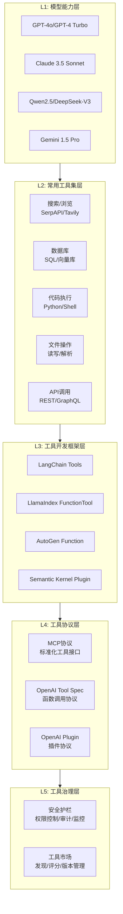
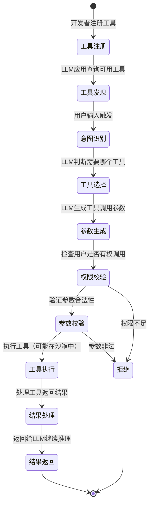
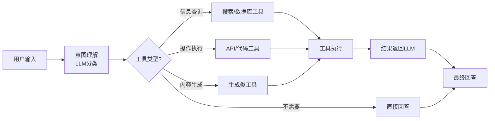
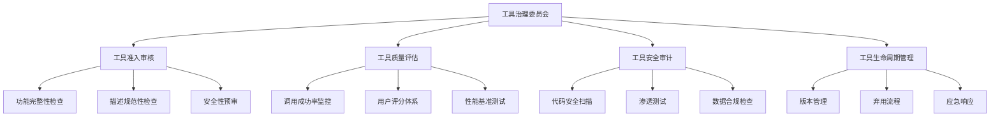

# Function Calling 工具生态

> **一句话定义**：Function Calling 工具生态是围绕大语言模型工具调用能力构建的完整工具体系，涵盖工具开发框架、工具市场、工具协议标准、常用工具集和工具治理，使 LLM 能够可靠地调用外部功能完成复杂任务。
>
> **核心价值**：将 LLM 从"只会说话"升级为"能做事"，通过标准化的工具生态实现能力复用、安全治理和规模化部署。
>
> **适用场景**：Agent 系统开发、企业 AI 应用构建、工具平台建设、多模型工具适配。

---

## 一、概述

### 1.1 工具生态的构成

Function Calling 工具生态由五个核心层次构成：



### 1.2 为什么需要工具生态

| 痛点（无工具生态） | 工具生态解决的问题 |
|-------------------|------------------|
| 每个应用重复开发相同工具 | 工具一次开发，多应用复用 |
| 工具接口不统一，切换模型需重写 | 标准化协议，一次适配多模型 |
| 工具质量参差不齐，缺乏评估 | 工具市场评分、版本管理、质量保证 |
| 工具调用安全风险不可控 | 统一安全护栏、权限控制、审计监控 |
| 工具发现困难，不知道有哪些可用 | 工具目录、分类、搜索、推荐 |
| 工具版本管理混乱 | 语义化版本、兼容性检查、灰度发布 |

### 1.3 核心概念与术语

| 概念 | 说明 |
|------|------|
| **Tool（工具）** | 可供 LLM 调用的外部功能单元，有名称、描述、参数 Schema |
| **Tool Spec（工具规范）** | 定义工具接口的标准格式，包括名称、描述、参数、返回值 |
| **Tool Registry（工具注册表）** | 管理工具注册、发现、版本的中心化服务 |
| **Tool Market（工具市场）** | 工具的发布、分发、评分、评论平台 |
| **Tool Router（工具路由）** | 根据用户意图动态选择和调用合适工具的机制 |
| **Tool Sandbox（工具沙箱）** | 隔离执行工具代码的安全环境 |
| **Tool Wrapper（工具包装器）** | 将现有 API/函数包装为 LLM 可调用工具的适配器 |
<div style="background:linear-gradient(135deg,#667eea,#764ba2);border-radius:16px;padding:20px;margin:16px 0;font-family:-apple-system,'Segoe UI','PingFang SC','Microsoft YaHei',sans-serif;color:#fff;overflow:hidden;box-shadow:0 8px 28px rgba(0,0,0,.14),0 3px 10px rgba(0,0,0,.08)">
<style>@keyframes pulse{0%,100%{transform:scale(1);opacity:.9}50%{transform:scale(1.03);opacity:1}}.dk-layer{border-radius:8px;padding:12px 16px;margin:6px auto;text-align:center;font-weight:600;animation:pulse 3s ease-in-out infinite}.dk-outer{background:rgba(255,255,255,.15);border:2px solid rgba(255,255,255,.5);max-width:340px;animation-delay:0s}.dk-middle{background:rgba(255,255,255,.2);border:2px solid rgba(255,255,255,.6);max-width:280px;animation-delay:.5s}.dk-inner{background:rgba(255,255,255,.25);border:2px solid rgba(255,255,255,.7);max-width:220px;animation-delay:1s}.dk-arrow{text-align:center;font-size:18px;margin:2px 0}.dk-label{font-size:12px;opacity:.85;font-weight:400;margin-top:4px}</style>
<div style="text-align:center;font-size:15px;font-weight:700;margin-bottom:14px;padding-bottom:10px;border-bottom:1.5px solid rgba(255,255,255,.22);letter-spacing:1px">🔧 Function Calling 工具生态五层架构</div>
<div class="dk-layer dk-outer">L5 治理层 · 安全护栏/工具市场<div class="dk-label">权限控制/审计监控/发现评分/版本管理</div></div>
<div class="dk-arrow">▼ 包含</div>
<div class="dk-layer dk-middle">L3-L4 框架+协议层<div class="dk-label">LangChain/LlamaIndex工具抽象 + MCP/OpenAI标准协议</div></div>
<div class="dk-arrow">▼ 包含</div>
<div class="dk-layer dk-inner">L1-L2 模型+工具集层<div class="dk-label">GPT-4o/Claude/Qwen模型能力 + 搜索/数据库/代码工具</div></div>
</div>


> 🔍 **知识点深度解析**
>
> **作用**：Function Calling 工具生态为 LLM 应用提供标准化的外部能力接入体系，解决工具开发、复用、治理的全生命周期问题。
>
> **原理**：通过分层架构实现关注点分离——模型层提供工具调用能力，工具集层提供具体功能，框架层提供开发抽象，协议层提供标准化接口，治理层提供安全和质量保障。各层通过标准接口解耦，使得工具可以跨模型、跨框架、跨应用复用。
>
> **用法要点**：① 优先使用 MCP 等标准化协议接入工具，避免绑定特定框架 ② 工具开发遵循单一职责原则，每个工具做一件事 ③ 工具描述必须清晰说明"做什么+何时用+何时不用" ④ 生产环境必须配置工具白名单、权限控制、调用审计 ⑤ 建立工具评估体系，定期检查工具质量和调用成功率

---

> 💡 **深度讲解**：工具生态的本质是"LLM 时代的操作系统"。就像智能手机的 App Store 生态一样，LLM 本身是一个通用的"大脑"，但要完成具体任务需要调用各种"App"（工具）。工具生态的价值在于降低了工具开发和使用的摩擦——开发者不需要为每个 LLM 应用重复造轮子，而是可以从工具市场中选择已有的高质量工具，通过标准化协议快速接入。这种生态效应使得工具质量持续提升（好的工具被更多人使用和改进），同时也催生了新的商业模式（工具订阅、按调用计费、企业级工具市场）。MCP（Model Context Protocol）的出现是工具生态标准化的重要里程碑，它将工具接口从"每个框架自己定义"升级为"行业统一标准"，使得工具可以一次开发、到处运行。
>
> **📝 精简总结**：工具生态由模型能力层、常用工具集层、开发框架层、协议标准层、治理层五层构成；解决工具复用、标准化、质量保证、安全治理、发现困难等痛点；核心概念包括 Tool、Tool Spec、Registry、Market、Router、Sandbox；MCP 协议是工具生态标准化的重要趋势。

---

## 二、原理

### 2.1 工具调用的完整生命周期



### 2.2 工具注册与发现机制

工具注册表（Tool Registry）是工具生态的核心基础设施，负责工具的注册、存储、查询和版本管理。

```mermaid
class ToolRegistry:
    """工具注册表：管理工具的注册、发现、版本"""

    def __init__(self):
        self.tools = {}  # tool_name -> ToolDefinition
        self.versions = {}  # tool_name -> {version: ToolDefinition}

    def register(self, tool_def: ToolDefinition):
        """注册工具，支持版本管理"""
        name = tool_def.name
        version = tool_def.version

        if name not in self.tools:
            self.tools[name] = tool_def
            self.versions[name] = {}

        # 检查版本兼容性
        if version in self.versions[name]:
            raise ValueError(f"工具 {name} 版本 {version} 已存在")

        self.versions[name][version] = tool_def
        # 更新为最新版本
        if self._is_newer(version, self.tools[name].version):
            self.tools[name] = tool_def

    def discover(self, query: str = None, category: str = None,
                 tags: list = None, limit: int = 20) -> list:
        """发现工具：支持关键词搜索、分类筛选、标签筛选"""
        results = list(self.tools.values())

        if category:
            results = [t for t in results if t.category == category]
        if tags:
            results = [t for t in results if any(tag in t.tags for tag in tags)]
        if query:
            # 简单关键词匹配（生产环境可用语义搜索）
            results = [t for t in results
                      if query.lower() in t.name.lower()
                      or query.lower() in t.description.lower()]

        return results[:limit]

    def get(self, name: str, version: str = None) -> ToolDefinition:
        """获取工具定义，默认返回最新版本"""
        if version:
            return self.versions[name].get(version)
        return self.tools.get(name)
```

### 2.3 工具路由与动态选择

工具路由（Tool Router）根据用户意图和上下文动态选择最合适的工具，是 Agent 系统的核心决策组件。



```mermaid
class ToolRouter:
    """工具路由器：根据用户意图动态选择工具"""

    def __init__(self, llm, registry: ToolRegistry):
        self.llm = llm
        self.registry = registry

    def route(self, user_input: str, context: dict = None) -> ToolCall:
        """路由决策：判断是否需要工具、需要哪个工具、参数是什么"""
        # 1. 获取所有可用工具（可根据上下文动态过滤）
        available_tools = self.registry.discover(limit=50)

        # 2. 用 LLM 进行工具选择和参数生成
        response = self.llm.chat.completions.create(
            model="gpt-4o-mini",
            messages=[
                {"role": "system", "content": "你是一个工具路由器，根据用户输入选择最合适的工具。"},
                {"role": "user", "content": user_input}
            ],
            tools=[t.to_openai_format() for t in available_tools],
            tool_choice="auto"
        )

        # 3. 解析工具调用决策
        msg = response.choices[0].message
        if not msg.tool_calls:
            return None  # 不需要工具

        tool_call = msg.tool_calls[0]
        return ToolCall(
            tool_name=tool_call.function.name,
            arguments=json.loads(tool_call.function.arguments),
            confidence=response.choices[0].finish_reason == "tool_calls"
        )
```

### 2.4 工具安全模型

工具安全是工具生态的基石，采用"认证→授权→校验→执行→审计"的五层安全模型。

| 安全层 | 机制 | 说明 |
|--------|------|------|
| **认证（Authentication）** | API Key / OAuth / JWT | 验证调用者身份 |
| **授权（Authorization）** | RBAC / ABAC / 工具白名单 | 控制谁可以调用哪些工具 |
| **校验（Validation）** | JSON Schema / 参数校验 / 危险命令检测 | 验证调用参数合法性 |
| **执行（Execution）** | 沙箱隔离 / 资源限制 / 网络隔离 | 安全执行工具代码 |
| **审计（Audit）** | 调用日志 / 异常检测 / 告警 | 记录和监控所有工具调用 |

```python
class ToolSecurityManager:
    """工具安全管理器：五层安全模型"""

    def execute_safely(self, tool_call: ToolCall, user_context: dict) -> ToolResult:
        # 1. 认证：验证用户身份
        if not self._authenticate(user_context):
            return ToolResult(error="认证失败")

        # 2. 授权：检查用户是否有权调用该工具
        if not self._authorize(user_context, tool_call.tool_name):
            return ToolResult(error="权限不足，无法调用该工具")

        # 3. 校验：验证参数合法性
        validation = self._validate_params(tool_call)
        if not validation.valid:
            return ToolResult(error=f"参数校验失败: {validation.reason}")

        # 4. 执行：在沙箱中安全执行
        try:
            result = self._execute_in_sandbox(tool_call)
            return ToolResult(success=True, data=result)
        except Exception as e:
            return ToolResult(error=f"执行失败: {str(e)}")
        finally:
            # 5. 审计：记录所有调用
            self._audit(tool_call, user_context, result)
```

---

> 💡 **深度讲解**：工具生态的核心设计原则是"标准化 + 解耦 + 治理"。标准化通过 MCP 等统一协议实现工具接口的一致性，使得工具可以跨模型、跨框架、跨应用复用；解耦通过分层架构实现各层独立演进——模型升级不影响工具，工具更新不影响应用；治理通过安全护栏、质量评估、版本管理确保工具生态的健康发展。工具路由是 Agent 系统中最关键的决策点，它决定了"什么时候用工具、用哪个工具、怎么用"。简单的路由基于规则和关键词匹配，高级的路由使用 LLM 进行语义理解和动态选择，最先进的路由还会结合用户历史、工具成功率、成本等因素进行综合决策。工具安全采用五层模型（认证→授权→校验→执行→审计），每一层都有明确的职责和独立的实现，确保即使某一层被绕过，后续层仍能提供防护。
>
> **📝 精简总结**：工具调用生命周期包括注册→发现→意图识别→选择→参数生成→权限校验→参数校验→执行→结果处理→返回；工具注册表负责注册、存储、查询、版本管理；工具路由根据用户意图动态选择工具，支持规则匹配和 LLM 语义选择；工具安全采用五层模型（认证/授权/校验/执行/审计）；核心设计原则是标准化、解耦、治理。

---

## 三、实操

### 3.1 开发自定义工具

#### 使用 LangChain 开发工具

```python
from langchain_core.tools import tool
from langchain_core.pydantic_v1 import BaseModel, Field

# 方式1：使用 @tool 装饰器（最简单）
@tool
def calculate_bmi(weight_kg: float, height_cm: float) -> str:
    """计算 BMI（身体质量指数）。

    Args:
        weight_kg: 体重（千克）
        height_cm: 身高（厘米）

    Returns:
        BMI 值和健康分类
    """
    height_m = height_cm / 100
    bmi = weight_kg / (height_m ** 2)

    if bmi < 18.5:
        category = "偏瘦"
    elif bmi < 24:
        category = "正常"
    elif bmi < 28:
        category = "偏胖"
    else:
        category = "肥胖"

    return f"BMI: {bmi:.1f}，分类：{category}"


# 方式2：使用 BaseModel 定义参数 Schema（更规范）
class WeatherInput(BaseModel):
    city: str = Field(description="城市名称，如北京、上海、广州")
    unit: str = Field(default="celsius", description="温度单位",
                       enum=["celsius", "fahrenheit"])

@tool(args_schema=WeatherInput)
def get_weather(city: str, unit: str = "celsius") -> dict:
    """获取指定城市的当前天气信息。当用户询问天气、气温、降雨情况时使用此工具。"""
    # 实际调用天气 API
    return {
        "city": city,
        "temperature": 25,
        "unit": unit,
        "condition": "晴",
        "humidity": 40,
        "wind": "东南风 3级"
    }


# 方式3：继承 BaseTool（最灵活，支持复杂逻辑）
from langchain_core.tools import BaseTool

class DatabaseQueryTool(BaseTool):
    name: str = "database_query"
    description: str = "执行 SQL 查询从数据库中获取数据。当用户需要查询、统计、分析数据库中的数据时使用。只允许 SELECT 查询。"

    def _run(self, sql: str) -> str:
        """执行 SQL 查询"""
        # 安全检查：只允许 SELECT
        if not sql.strip().upper().startswith("SELECT"):
            return "错误：只允许 SELECT 查询"

        try:
            # 执行查询
            result = db_connection.execute(sql)
            rows = result.fetchall()
            # 限制返回行数
            rows = rows[:100]
            return f"查询结果（{len(rows)}行）：\n" + "\n".join(str(row) for row in rows)
        except Exception as e:
            return f"查询失败：{str(e)}"
```

#### 使用 LlamaIndex 开发工具

```python
from llama_index.core.tools import FunctionTool

# 定义工具函数
def search_knowledge_base(query: str, top_k: int = 5) -> str:
    """在企业知识库中搜索相关文档。

    Args:
        query: 搜索查询关键词
        top_k: 返回的最相关文档数量

    Returns:
        相关文档内容
    """
    results = vector_index.similarity_search(query, k=top_k)
    return "\n\n".join([f"文档{i+1}：{doc.page_content}" for i, doc in enumerate(results)])

# 创建 FunctionTool
kb_tool = FunctionTool.from_defaults(
    fn=search_knowledge_base,
    name="search_knowledge_base",
    description="在企业知识库中搜索相关文档，当用户询问公司制度、产品文档、技术规范时使用"
)
```

### 3.2 使用 MCP 协议接入工具

MCP（Model Context Protocol）是 Anthropic 推出的标准化工具协议，支持工具、资源、提示词三种能力。

```python
# MCP Server 端：定义工具
from mcp.server import Server
from mcp.types import Tool, TextContent

server = Server("my-tools")

@server.list_tools()
async def list_tools() -> list[Tool]:
    return [
        Tool(
            name="calculate",
            description="执行数学计算",
            inputSchema={
                "type": "object",
                "properties": {
                    "expression": {"type": "string", "description": "数学表达式"}
                },
                "required": ["expression"]
            }
        ),
        Tool(
            name="get_current_time",
            description="获取当前日期和时间",
            inputSchema={"type": "object", "properties": {}}
        )
    ]

@server.call_tool()
async def call_tool(name: str, arguments: dict) -> list[TextContent]:
    if name == "calculate":
        result = eval(arguments["expression"])  # 生产环境用安全计算库
        return [TextContent(type="text", text=str(result))]
    elif name == "get_current_time":
        from datetime import datetime
        return [TextContent(type="text", text=datetime.now().isoformat())]
```

```python
# MCP Client 端：连接并调用工具
from mcp.client.stdio import stdio_client
from mcp import ClientSession

async def use_mcp_tools():
    # 连接到 MCP Server
    async with stdio_client(["python", "my_mcp_server.py"]) as (read, write):
        async with ClientSession(read, write) as session:
            await session.initialize()

            # 列出可用工具
            tools = await session.list_tools()
            print(f"可用工具: {[t.name for t in tools.tools]}")

            # 调用工具
            result = await session.call_tool("calculate", {"expression": "23 * 45 + 10"})
            print(f"计算结果: {result.content[0].text}")
```

### 3.3 构建工具注册表

```python
import json
from dataclasses import dataclass, field
from typing import Callable, Any

@dataclass
class ToolDefinition:
    """工具定义"""
    name: str
    description: str
    parameters: dict  # JSON Schema
    category: str = "general"
    tags: list = field(default_factory=list)
    version: str = "1.0.0"
    author: str = ""
    execute_fn: Callable = None

    def to_openai_format(self) -> dict:
        """转换为 OpenAI Function Calling 格式"""
        return {
            "type": "function",
            "function": {
                "name": self.name,
                "description": self.description,
                "parameters": self.parameters
            }
        }


class ToolRegistry:
    """工具注册表"""

    def __init__(self):
        self._tools: dict[str, ToolDefinition] = {}

    def register(self, tool: ToolDefinition):
        """注册工具"""
        if tool.name in self._tools:
            print(f"警告：工具 {tool.name} 已存在，将被覆盖")
        self._tools[tool.name] = tool

    def unregister(self, name: str):
        """注销工具"""
        self._tools.pop(name, None)

    def get(self, name: str) -> ToolDefinition | None:
        """获取工具"""
        return self._tools.get(name)

    def list_all(self) -> list[ToolDefinition]:
        """列出所有工具"""
        return list(self._tools.values())

    def list_by_category(self, category: str) -> list[ToolDefinition]:
        """按分类列出工具"""
        return [t for t in self._tools.values() if t.category == category]

    def search(self, query: str) -> list[ToolDefinition]:
        """搜索工具"""
        query = query.lower()
        return [
            t for t in self._tools.values()
            if query in t.name.lower()
            or query in t.description.lower()
            or any(query in tag.lower() for tag in t.tags)
        ]

    def execute(self, name: str, **kwargs) -> Any:
        """执行工具"""
        tool = self.get(name)
        if not tool:
            raise ValueError(f"工具 {name} 不存在")
        if not tool.execute_fn:
            raise ValueError(f"工具 {name} 没有实现执行函数")
        return tool.execute_fn(**kwargs)


# 使用示例
registry = ToolRegistry()

# 注册工具
registry.register(ToolDefinition(
    name="web_search",
    description="搜索互联网获取实时信息",
    parameters={
        "type": "object",
        "properties": {
            "query": {"type": "string", "description": "搜索关键词"},
            "num_results": {"type": "integer", "default": 5, "minimum": 1, "maximum": 10}
        },
        "required": ["query"]
    },
    category="search",
    tags=["搜索", "互联网", "实时信息"],
    execute_fn=lambda query, num_results=5: f"搜索 '{query}' 的 {num_results} 条结果"
))

# 发现和执行工具
results = registry.search("搜索")
print(f"找到 {len(results)} 个相关工具")
output = registry.execute("web_search", query="AI Agent")
print(output)
```

### 3.4 常用工具集实现

#### 搜索工具

```python
import requests

@tool
def tavily_search(query: str, max_results: int = 5) -> str:
    """使用 Tavily API 搜索互联网。当需要获取实时信息、新闻、事实核查时使用。

    Args:
        query: 搜索查询
        max_results: 返回结果数量（1-10）
    """
    response = requests.post(
        "https://api.tavily.com/search",
        json={
            "api_key": os.getenv("TAVILY_API_KEY"),
            "query": query,
            "max_results": max_results,
            "search_depth": "advanced"
        }
    )
    data = response.json()
    results = []
    for i, r in enumerate(data.get("results", [])):
        results.append(f"{i+1}. {r['title']}\n   {r['url']}\n   {r['content'][:200]}")
    return "\n\n".join(results)
```

#### 代码执行工具

```python
import subprocess
import tempfile
import os

@tool
def execute_python(code: str) -> str:
    """执行 Python 代码并返回输出。当需要进行计算、数据处理、算法验证时使用。

    Args:
        code: 要执行的 Python 代码
    """
    # 安全检查：禁止危险操作
    dangerous = ["import os", "import sys", "subprocess", "eval(", "exec(", "__import__"]
    for d in dangerous:
        if d in code:
            return f"安全错误：禁止使用 {d}"

    # 在临时文件中执行
    with tempfile.NamedTemporaryFile(mode='w', suffix='.py', delete=False) as f:
        f.write(code)
        tmp_path = f.name

    try:
        result = subprocess.run(
            ["python", tmp_path],
            capture_output=True, text=True, timeout=30
        )
        output = result.stdout
        if result.stderr:
            output += f"\n[错误]\n{result.stderr}"
        return output[:5000]  # 限制输出长度
    except subprocess.TimeoutExpired:
        return "执行超时（30秒）"
    finally:
        os.unlink(tmp_path)
```

#### 文件操作工具

```python
@tool
def read_file(filepath: str, max_lines: int = 100) -> str:
    """读取文件内容。当需要查看文件内容、读取配置、分析代码时使用。

    Args:
        filepath: 文件路径
        max_lines: 最大读取行数
    """
    if not os.path.exists(filepath):
        return f"文件不存在: {filepath}"

    with open(filepath, 'r', encoding='utf-8') as f:
        lines = f.readlines()

    if len(lines) > max_lines:
        content = ''.join(lines[:max_lines])
        content += f"\n...（文件共 {len(lines)} 行，已截断到 {max_lines} 行）"
    else:
        content = ''.join(lines)

    return content[:10000]
```

---

> 💡 **深度讲解**：工具开发的核心是"工具描述的质量决定了 LLM 能否正确使用工具"。很多开发者在开发工具时只关注功能实现，忽视了工具描述的编写，导致 LLM 不知道何时使用工具、如何正确传参。一个好的工具描述应该回答三个问题：①这个工具做什么（功能说明）；②什么时候应该用（使用场景）；③什么时候不应该用（边界条件）。参数定义应该使用 JSON Schema 严格约束，包括类型、枚举值、默认值、最小值/最大值，这能显著降低 LLM 传参错误率。工具粒度的选择也很重要——细粒度工具（单一职责）更容易被 LLM 正确选择和组合，但可能需要多轮调用；粗粒度工具（复合操作）一次调用完成多步，但参数复杂、LLM 可能误用。推荐策略是基础工具用细粒度，业务工具用粗粒度，工具总数控制在 10-30 个。
>
> **📝 精简总结**：工具开发支持 LangChain @tool 装饰器、BaseTool 继承、LlamaIndex FunctionTool 等多种方式；MCP 协议提供标准化工具接口，支持 Server/Client 架构；工具注册表负责注册、发现、分类、搜索、执行；常用工具集包括搜索（Tavily/SerpAPI）、代码执行（沙箱隔离）、文件操作（读写/解析）、数据库查询等；工具描述质量是关键，必须说明做什么、何时用、何时不用。

---

## 四、问题

### 4.1 常见错误与排查

| 问题 | 原因 | 解决方案 |
|------|------|---------|
| **LLM 不调用工具** | 工具描述不清晰 / tool_choice=none | 优化工具描述，明确使用场景；设置 tool_choice="auto" 或 "required" |
| **LLM 调用错误工具** | 工具描述重叠 / 工具数量过多 | 区分工具描述，减少工具数量，使用动态工具加载 |
| **参数解析失败** | LLM 输出非标准 JSON | 增加重试机制，在 system prompt 中强调 JSON 格式，使用 response_format |
| **参数值错误** | LLM 编造参数 / 参数描述不清 | 优化参数描述，使用 enum 限制取值，增加参数校验层 |
| **工具执行超时** | 外部 API 延迟高 / 死循环 | 设置超时时间，异步执行，增加重试和降级 |
| **工具返回结果过大** | 未限制返回长度 / 返回完整内容 | 截断结果，摘要压缩，分页返回 |
| **无限循环调用** | LLM 陷入重复调用 / 工具结果不充分 | 设置 max_iterations，检测重复调用，优化工具结果 |
| **工具调用成本高** | 频繁调用昂贵工具 / 未缓存 | 工具结果缓存，小模型做工具选择，大模型做生成 |
| **工具版本不兼容** | 工具升级后参数变化 | 语义化版本管理，兼容性检查，灰度发布 |
| **多工具冲突** | 多个工具功能重叠 | 工具去重，明确分工，使用工具路由优先级 |

### 4.2 性能优化策略

| 优化点 | 策略 | 预期效果 |
|--------|------|---------|
| **工具选择延迟** | 动态工具加载（根据 query 预选工具） | 减少 tools 列表长度，降低 token 消耗 30-50% |
| **工具执行延迟** | 并行执行无依赖的工具调用 | 多工具场景延迟降低 50-70% |
| **重复调用** | 工具结果缓存（相同参数直接返回缓存） | 重复查询延迟降低 90% |
| **上下文溢出** | 工具结果截断 + 滑动窗口 | 支持更长的 Agent Loop |
| **Token 成本** | 小模型做工具选择，大模型做最终回答 | 成本降低 40-60% |
| **冷启动** | 工具预热（常用工具预加载） | 首次调用延迟降低 50% |

### 4.3 安全风险与防护

| 风险 | 攻击方式 | 防护措施 |
|------|---------|---------|
| **Prompt 注入** | 通过工具返回内容注入恶意指令 | 工具返回内容隔离，系统提示与工具结果分离，注入检测 |
| **越权调用** | 诱导 LLM 调用高权限工具 | 工具白名单，RBAC 权限控制，高风险操作需用户确认 |
| **参数注入** | 在参数中注入恶意命令 | 严格参数校验，危险命令黑名单，沙箱执行 |
| **数据外泄** | 通过工具将敏感数据发送到外部 | 网络隔离，外发数据检测，敏感信息脱敏 |
| **拒绝服务** | 诱导大量工具调用消耗资源 | 速率限制，并发控制，超时机制 |
| **工具投毒** | 恶意工具返回错误信息 | 工具来源验证，工具签名，沙箱执行 |

### 4.4 生产环境踩坑记录

**踩坑1：工具描述太简略导致 LLM 频繁选错工具**
- **现象**：用户问"查一下订单"，LLM 调用了 `search_web` 而不是 `query_database`
- **原因**：`query_database` 的描述只有"查询数据库"，没有说明适用场景
- **方案**：优化描述为"从企业数据库中查询订单、用户、产品等业务数据。当用户询问订单状态、用户信息、产品库存等内部数据时使用此工具，不要用于搜索互联网信息"

**踩坑2：工具返回完整网页内容导致上下文溢出**
- **现象**：调用 `fetch_url` 工具后，返回 5000 字的网页内容，后续 LLM 调用超出 token 限制
- **原因**：工具未做结果截断，直接返回完整内容
- **方案**：在工具层实现结果截断和摘要，默认返回前 2000 字符，支持 `detail_level` 参数控制返回粒度

**踩坑3：工具版本升级导致线上 Agent 批量失败**
- **现象**：升级 `send_email` 工具后，参数从 `to` 改为 `recipient`，线上 Agent 仍传 `to` 参数
- **原因**：未做版本兼容性管理，直接覆盖旧版本
- **方案**：实施语义化版本管理，新版本与旧版本并存，提供兼容层（接受 `to` 自动转换为 `recipient`），灰度发布

---

> 💡 **深度讲解**：工具生态的问题排查核心是"可观测性 + 渐进式优化"。没有完整的工具调用日志（包括调用的工具名、参数、返回结果、耗时、错误信息），排查工具问题就像盲人摸象。生产环境必须记录每次工具调用的完整信息，并建立工具调用仪表盘（调用次数、成功率、平均耗时、错误分布）。性能优化遵循"先测量后优化"原则——不要凭直觉优化，先用数据找到瓶颈（是工具选择慢还是执行慢？是某个工具慢还是整体慢？），然后针对性优化。安全防护采用"纵深防御"策略——不依赖单一安全措施，而是在工具注册、调用路由、参数校验、执行沙箱、结果审计每个环节都设置安全检查点。工具版本管理是最容易被忽视但影响最大的问题——工具接口的任何破坏性变更都会导致所有依赖该工具的应用失败，必须像管理 API 版本一样严格管理工具版本。
>
> **📝 精简总结**：常见问题包括不调用工具、调用错误工具、参数解析失败、执行超时、结果过大、无限循环、成本高、版本不兼容等；性能优化采用动态加载、并行执行、结果缓存、小模型路由等策略；安全风险包括 Prompt 注入、越权调用、参数注入、数据外泄、DoS，采用纵深防御；生产踩坑集中在工具描述质量、结果截断、版本管理；排查核心是完整的可观测性。

---

## 五、拓展

### 5.1 工具市场与分发

工具市场（Tool Market）是工具生态的重要组成部分，为工具开发者提供发布、分发、变现渠道，为工具使用者提供发现、评估、获取渠道。

| 平台 | 类型 | 特点 |
|------|------|------|
| **LangChain Hub** | 工具/链市场 | LangChain 生态，支持工具和链的分享 |
| **MCP Hub** | MCP 工具市场 | 标准化 MCP Server 集合 |
| **Zapier AI Actions** | 无代码工具 | 5000+ 应用集成，无需代码 |
| **Pluginpedia** | ChatGPT 插件目录 | ChatGPT 插件分类和搜索 |
| **There's An AI For That** | AI 工具目录 | 广泛的 AI 工具分类 |

### 5.2 工具治理体系

成熟的工具生态需要完善的治理体系，确保工具质量、安全和合规。



### 5.3 工具生态的未来趋势

| 趋势 | 说明 | 影响 |
|------|------|------|
| **标准化协议** | MCP 等协议成为行业标准 | 工具一次开发，跨模型/框架/应用运行 |
| **自主工具发现** | Agent 自主发现和学习使用新工具 | 无需预定义工具列表，能力动态扩展 |
| **工具组合优化** | 自动发现工具组合模式，推荐最佳工具链 | 提升复杂任务的执行效率和质量 |
| **工具市场商业化** | 工具订阅、按调用计费、企业级市场 | 催生新的商业模式和开发者生态 |
| **工具安全即代码** | 安全策略代码化，CI/CD 集成安全检查 | 安全左移，自动化安全治理 |
| **多模态工具** | 支持图像、音频、视频等多模态输入输出 | 扩展 Agent 的感知和行动能力 |

### 5.4 学习资源

- [OpenAI Function Calling 文档](https://platform.openai.com/docs/guides/function-calling) 🔗
- [MCP 官方规范](https://modelcontextprotocol.io/) 🔗
- [LangChain Tools 文档](https://python.langchain.com/docs/modules/agents/tools/) 🔗
- [Anthropic Tool Use 文档](https://docs.anthropic.com/en/docs/build-with-claude/tool-use) 🔗
- [[MCP协议与工具生态]] — 本知识库 MCP 专题
- [[Agent工具调用FunctionCalling]] — Function Calling 基础
- [[自研Agent框架设计]] — 自研框架中的工具系统设计

---

> 💡 **深度讲解**：工具生态的未来是"自主工具发现 + 动态工具组合"。当前的 Agent 系统需要开发者预定义工具列表，LLM 只能从给定的工具中选择。未来的 Agent 将具备自主发现工具的能力——通过工具市场 API 搜索相关工具，阅读工具文档，理解工具功能，然后自主决定是否使用。这将使得 Agent 的能力边界从"开发者定义的工具集"扩展到"整个工具生态"。另一个重要趋势是"工具组合优化"——复杂任务通常需要多个工具协同完成，当前的工具调用顺序由 LLM 逐轮决策，效率较低。未来的系统可以自动发现常用的工具组合模式（如"搜索→摘要→翻译"），将其封装为复合工具，一次调用完成多步操作，显著提升效率。工具市场的商业化也将加速生态繁荣——开发者可以通过工具订阅、按调用计费等方式获得收入，激励更多高质量工具的开发。
>
> **📝 精简总结**：工具市场包括 LangChain Hub、MCP Hub、Zapier AI Actions 等平台，提供工具发布、分发、发现渠道；工具治理体系包括准入审核、质量评估、安全审计、生命周期管理；未来趋势包括标准化协议（MCP）、自主工具发现、工具组合优化、商业化、安全即代码、多模态工具；学习资源包括官方文档和本知识库相关专题。

---

## 🔗 关联笔记

- [[Agent工具调用FunctionCalling]] — Function Calling 协议与实现基础
- [[MCP协议与工具生态]] — MCP 标准化工具协议
- [[Agent核心概念-ReAct规划]] — ReAct 推理循环，工具调用的执行框架
- [[Agent安全与护栏设计]] — 工具调用安全防护
- [[多Agent协作模式]] — 多 Agent 间的工具共享与协作
- [[自研Agent框架设计]] — 自研框架中的工具系统设计
- [[LangChain-核心抽象与链]] — LangChain 工具抽象
- [[LlamaIndex-数据框架]] — LlamaIndex FunctionTool

## 📖 前置知识

- [[LLM大模型入门概念]]
- [[Agent工具调用FunctionCalling]]
- [[Prompt工程进阶]]

## 🏷️ 相关标签

`#AI应用` `#AI工程化` `#Agent` `#LLM`

---

[[Home|🏠 返回首页]] · [[MOC-AI与效率工具|📚 返回分类]]
