# 多 Agent 协作模式深度指南

> **一句话定义**：多 Agent 协作是指多个具有独立角色、能力和目标的 AI Agent 通过通信、协调和分工共同完成复杂任务的系统模式，通过"专家分工+协同决策"突破单个 Agent 的能力边界。
>
> **核心价值**：将复杂任务分解为多个专业子任务，每个 Agent 专注于自己擅长的领域，通过协作实现"1+1>2"的效果，同时提升系统的可扩展性、可靠性和专业化程度。
>
> **适用场景**：复杂软件开发、多步骤业务流程、多角色决策、跨领域知识整合、大规模内容生产、多工具编排、长程任务规划。

---

## 一、概述与学习路径

### 1.1 为什么需要多 Agent 系统

单个 Agent 在面对复杂任务时存在六大能力边界，多 Agent 系统通过"分而治之"逐一突破：

| 单 Agent 局限 | 具体表现 | 多 Agent 解法 | 量化收益 |
|--------------|---------|-------------|---------|
| **上下文窗口有限** | 单次无法处理超过 128K Token 的信息 | 每个 Agent 只处理自己的子任务上下文，通过消息传递共享关键信息 | 等效上下文扩展 5-10 倍 |
| **角色冲突** | 同一个 Prompt 难以同时扮演"创意发散者"和"严格审查者" | 不同 Agent 扮演不同角色，系统提示独立优化 | 输出质量提升 20-40% |
| **专业深度不足** | 通用 Agent 在 SQL 优化、代码安全审计等垂直领域表现平庸 | 每个 Agent 专注特定领域，使用专业 Prompt 和工具集 | 专业任务准确率提升 15-35% |
| **任务复杂度** | 超过 10 步的推理链容易出现中间步骤遗忘或逻辑断裂 | 任务分解为独立子任务，每个子任务 3-5 步推理 | 长程任务成功率提升 30-60% |
| **可靠性** | 单个 Agent 出错会导致整个任务失败 | 冗余设计、交叉验证、错误隔离与重试 | 系统容错率提升 2-5 倍 |
| **可扩展性** | 单 Agent 难以水平扩展处理高并发 | 多 Agent 并行处理，动态扩缩容 | 吞吐量线性增长 |

> 🎯 **面试高频**：为什么需要多 Agent？单 Agent 有什么瓶颈？
>
> **答题要点**：① 上下文窗口限制——单 Agent 无法同时处理大量信息；② 角色冲突——一个 Prompt 难以同时满足对立角色需求（如创造者vs审查者）；③ 专业深度——通用模型在垂直领域不如专家 Prompt+工具组合；④ 长程推理——步骤超过 10 步后推理质量显著下降；⑤ 可靠性——单点故障；⑥ 可扩展性——无法水平并行。多 Agent 通过任务分解、角色专业化、并行执行和错误隔离解决这些问题。

### 1.2 多 Agent 系统的核心要素架构

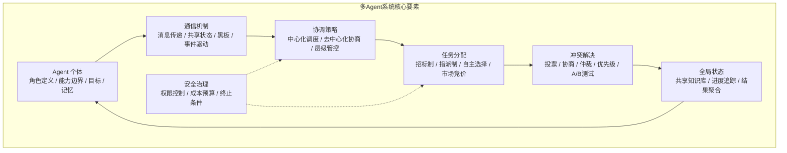

### 1.3 多 Agent vs 单 Agent 全方位对比

| 对比维度 | 单 Agent | 多 Agent | 选择建议 |
|---------|---------|---------|---------|
| **架构复杂度** | 单一推理循环，一个 Prompt + 工具集 | 多个 Agent + 协调层 + 通信协议 | 简单任务用单 Agent |
| **任务处理** | 顺序处理，逐步完成 | 可并行处理，分工协作 | 独立子任务可并行时用多 Agent |
| **角色专业性** | 通用角色，灵活但不专精 | 专业角色，各司其职 | 需要专业深度时用多 Agent |
| **上下文管理** | 全局上下文，受窗口限制 | 分布式上下文，消息传递共享 | 信息量大时用多 Agent |
| **可靠性** | 单点故障，一步错步步错 | 错误隔离，交叉验证，可重试 | 高可靠要求时用多 Agent |
| **开发复杂度** | 低，数百行代码 | 高，需设计角色/通信/协调/状态 | 原型验证优先单 Agent |
| **LLM 成本** | 较低，1-N 次调用 | 较高，N×M 次调用 + 协调开销 | 成本敏感时谨慎使用 |
| **调试难度** | 低，Trace 短 | 高，多 Agent 交互链路复杂 | 可观测性必须先行 |
| **响应延迟** | 低，一次或少数调用 | 高，多轮通信 + 等待 | 实时性要求高时慎用 |
| **适用场景** | 简单问答、单步工具调用、短文本生成 | 复杂项目、多领域整合、多步流程 | 任务>5步或需多角色时考虑 |

### 1.4 知识依赖图与学习路径

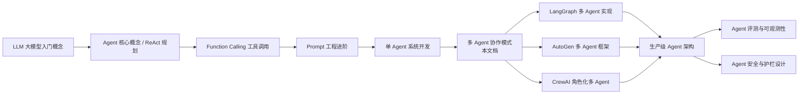

**推荐学习路径**：
1. 先掌握单 Agent 的 ReAct 循环（Thought → Action → Observation → Final Answer）
2. 理解 Function Calling 和工具设计
3. 学习多 Agent 的六种协作模式（第三章-第四章）
4. 掌握通信机制和协调策略（第五章-第七章）
5. 选择一个主流框架深入实战（第八章）
6. 学习多 Agent 记忆和状态管理（第九章）
7. 掌握评测调试和生产部署（第十-十一章）

### 1.5 本文档导航

| 章节 | 核心内容 | 代码示例数 | 难度 |
|------|---------|-----------|------|
| 一、概述与学习路径 | 为什么需要多Agent、核心要素、学习路径 | 2 | ⭐ |
| 二、核心概念与分类 | 协作式/竞争式/层级式/混合式、术语表 | 8 | ⭐⭐ |
| 三、流水线与扇出扇入模式 | Pipeline、Fan-out/Fan-in 详解 | 15 | ⭐⭐⭐ |
| 四、主管-工人与层级模式 | Supervisor-Worker、Hierarchical | 15 | ⭐⭐⭐ |
| 五、辩论与共识模式 | Debate、Consensus 详解 | 12 | ⭐⭐⭐⭐ |
| 六、通信机制深度解析 | 消息传递、共享状态、黑板、事件驱动 | 15 | ⭐⭐⭐ |
| 七、角色设计与分工 | 角色定义、能力边界、冲突解决 | 12 | ⭐⭐⭐ |
| 八、协调策略 | 任务分解、调度算法、负载均衡、死锁避免 | 15 | ⭐⭐⭐⭐ |
| 九、主流框架实战 | AutoGen、CrewAI、LangGraph、MetaGPT | 25 | ⭐⭐⭐⭐ |
| 十、多Agent记忆与状态共享 | 共享记忆、状态管理、一致性 | 12 | ⭐⭐⭐⭐ |
| 十一、多Agent评测与调试 | 评测维度、调试技巧、Bad Case分析 | 12 | ⭐⭐⭐⭐ |
| 十二、生产级架构设计 | 高可用、容错、成本控制、部署 | 10 | ⭐⭐⭐⭐⭐ |
| 十三、最佳实践与性能优化 | 优化策略、反模式、生产建议 | 8 | ⭐⭐⭐⭐ |
| 十四、常见坑点与故障排查 | 30+坑点、故障排查流程 | 5 | ⭐⭐⭐ |
| 十五、面试高频考点汇总 | 20+面试题与答案要点 | 0 | ⭐⭐⭐⭐ |

---

> 💡 **本章深度讲解**：多 Agent 协作的本质是"AI 时代的组织行为学"。就像人类社会中，一个人无法同时是优秀的程序员、产品经理、设计师、测试工程师一样，单个 LLM 也无法在所有领域都达到专家水平。多 Agent 系统模拟了人类团队的协作模式——每个 Agent 有明确的角色和职责，通过沟通协调完成共同目标。这种模式的有效性已在多个领域得到验证：在软件开发中，"开发者 Agent + 审查者 Agent + 测试者 Agent"的组合比单个通用 Agent 产出更高质量的代码；在内容创作中，"策划 Agent + 写作 Agent + 编辑 Agent"的流水线比单个 Agent 产出更专业的内容。设计核心是"最小化协调成本，最大化分工收益"。
>
> **📝 本章精简总结**：
> - 核心概念：多Agent系统、任务分解、角色专业化、协调成本
> - 关键原理：分而治之、专家分工、1+1>2
> - 常用操作：从单Agent开始→识别瓶颈→逐步引入多Agent
> - 最佳实践：① 不是所有任务都需要多Agent；② 从两Agent模式开始；③ 必须设置终止条件和成本预算
> - 常见坑点：过度Agent化、无终止条件、协调成本失控
> - 面试高频：为什么需要多Agent？多Agent vs 单Agent如何选择？
>
> **🎯 梯度练习题**：
> - **基础题（⭐）1**：列举单Agent的至少5个局限性。
>   > 答案：上下文窗口有限、角色冲突、专业深度不足、长程推理质量下降、单点故障、无法水平扩展。
> - **基础题（⭐）2**：多Agent系统的核心要素有哪些？
>   > 答案：Agent个体、通信机制、协调策略、任务分配、冲突解决、全局状态、安全治理。
> - **进阶题（⭐⭐）1**：什么类型的任务最适合多Agent系统？为什么？
>   > 思考方向：从任务复杂度、角色多样性、领域跨度、可靠性要求四个维度分析。
> - **进阶题（⭐⭐）2**：多Agent系统的协调成本指什么？如何降低？
>   > 思考方向：通信开销、LLM调用次数、信息传递损失、冲突解决成本；通过减少通信、批量传递、标准化协议来降低。
> - **实战题（⭐⭐⭐）**：你需要构建一个"自动研报生成系统"，输入是一家上市公司名称，输出是包含财务分析、行业对比、风险评估、投资建议的完整研报。请设计多Agent协作方案：需要哪些角色？采用什么协作模式？画出架构图？
>   > 验收标准：角色定义清晰（研究员/财务分析师/行业分析师/风险评估师/总编）、协作模式合理（Fan-out并行收集→总编整合）、有质量检查环节、有成本控制策略。

---

## 二、多Agent协作核心概念与分类

### 2.1 什么是多Agent系统（MAS）

**概念解释**：多 Agent 系统（Multi-Agent System, MAS）是由多个自主 Agent 组成的计算机系统，这些 Agent 通过通信和协作来解决单个 Agent 难以解决的复杂问题。每个 Agent 具有自己的角色定义、能力集合、目标和记忆，能够感知环境并采取行动。

**生活化比喻**：多 Agent 系统就像一家公司——CEO（Orchestrator）负责战略决策和任务分配，各个部门经理（Worker Agent）负责各自领域的执行，部门之间通过会议（消息传递）和共享文档（黑板模式）协调，最终向 CEO 汇报结果。

**核心价值**：将复杂问题分解为可管理的子问题，通过专业化分工提高解决质量，通过并行处理提高效率，通过冗余设计提高可靠性。

**原理说明**：多 Agent 系统的理论基础源于分布式人工智能（DAI）和多智能体系统（MAS）研究领域。每个 Agent 是一个自治实体，具有以下属性：
- **自主性（Autonomy）**：无需人类直接干预即可操作
- **社交能力（Social Ability）**：通过通信语言与其他 Agent 交互
- **反应能力（Reactivity）**：感知环境并及时响应
- **主动能力（Pro-activeness）**：主动采取行动实现目标

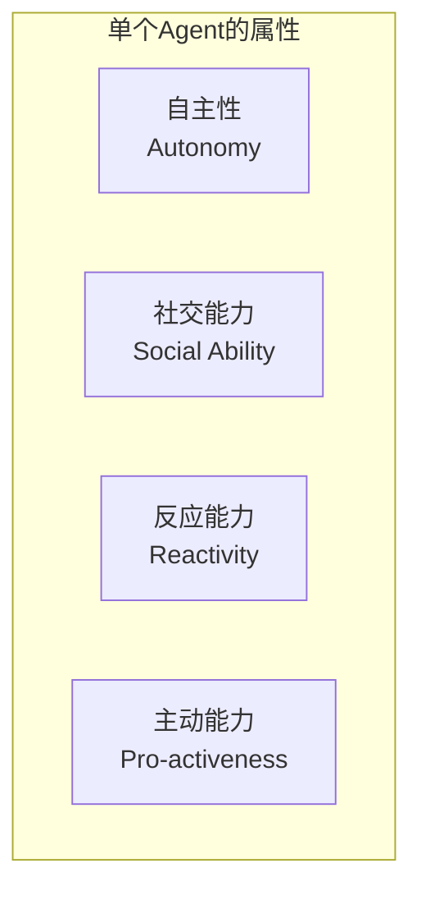

### 2.2 多Agent协作的四大基本类型

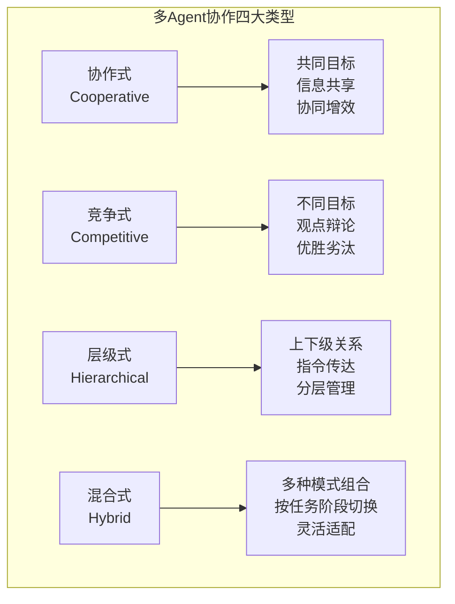

#### 2.2.1 协作式（Cooperative）

**概念**：多个 Agent 拥有共同目标，通过共享信息和分工合作来完成任务。Agent 之间是"队友"关系。

**生活比喻**：像一支足球队——每个球员有不同位置（前锋/中场/后卫），但共同目标是赢得比赛，通过传球（消息传递）配合进攻。

**代码示例1：协作式 Agent 基础实现**

```python
from dataclasses import dataclass, field
from typing import Callable
import json

@dataclass
class CooperativeAgent:
    """协作式 Agent：拥有共同目标，共享信息"""
    name: str
    role: str
    goal: str
    expertise: str
    llm_call: Callable = None
    shared_blackboard: dict = field(default_factory=dict)
    message_log: list = field(default_factory=list)

    def contribute(self, task: str) -> str:
        """在自己的专业领域贡献结果"""
        prompt = f"""你是{self.role}，专长是{self.expertise}。
你的团队目标是：{self.goal}
当前团队共享信息：{json.dumps(self.shared_blackboard, ensure_ascii=False, indent=2)}
请从你的专业角度完成以下子任务：{task}
仅输出你的专业贡献部分，简洁精确。"""
        result = self.llm_call(prompt)
        self.message_log.append({
            "from": self.name,
            "type": "contribution",
            "content": result
        })
        return result

    def share(self, key: str, value: str):
        """将信息分享到团队共享黑板"""
        self.shared_blackboard[key] = value
        self.message_log.append({
            "from": self.name,
            "type": "share",
            "key": key,
            "value": value
        })

    def review_team_output(self, output: str) -> str:
        """以专业视角审查团队整体输出"""
        prompt = f"""你是{self.role}（专长：{self.expertise}）。
请审查以下团队产出是否在你的专业领域内正确完整：
{output}
如有问题请指出，如无问题请确认。"""
        return self.llm_call(prompt)
```

**预期结果**：每个 Agent 独立贡献专业领域结果，共享黑板让所有成员看到彼此的贡献。

**代码示例2：协作式团队完成研报任务**

```python
class ResearchTeam:
    """协作式研究团队：多个专家 Agent 协作完成研报"""

    def __init__(self, llm_call):
        self.llm_call = llm_call
        self.agents = {
            "financial_analyst": CooperativeAgent(
                name="分析师A", role="财务分析师",
                goal="撰写高质量上市公司研报",
                expertise="财务报表分析、估值模型",
                llm_call=llm_call
            ),
            "industry_analyst": CooperativeAgent(
                name="分析师B", role="行业研究员",
                goal="撰写高质量上市公司研报",
                expertise="行业趋势分析、竞争格局研究",
                llm_call=llm_call
            ),
            "risk_analyst": CooperativeAgent(
                name="分析师C", role="风险评估师",
                goal="撰写高质量上市公司研报",
                expertise="风险识别、合规审查",
                llm_call=llm_call
            ),
        }

    def produce_report(self, company: str) -> str:
        """协作完成研报"""
        # 1. 各专家独立研究
        financial = self.agents["financial_analyst"].contribute(
            f"分析{company}的最新财务报表，包括营收、利润、增长率、估值"
        )
        self.agents["financial_analyst"].share("financial_section", financial)

        industry = self.agents["industry_analyst"].contribute(
            f"分析{company}所在行业的趋势和竞争格局"
        )
        self.agents["industry_analyst"].share("industry_section", industry)

        risk = self.agents["risk_analyst"].contribute(
            f"评估{company}的主要风险因素"
        )
        self.agents["risk_analyst"].share("risk_section", risk)

        # 2. 合成完整研报
        report = f"""# {company} 研究报告

## 财务分析
{financial}

## 行业分析
{industry}

## 风险评估
{risk}
"""

        # 3. 交叉审查
        reviews = []
        for agent in self.agents.values():
            review = agent.review_team_output(report)
            reviews.append(f"[{agent.name} 审查] {review}")

        return report + "\n\n## 交叉审查意见\n" + "\n".join(reviews)
```

**预期结果**：三个分析师各自负责一个章节，通过共享黑板传递信息，最后交叉审查确保质量。

**最佳实践**：
- 协作式适合"团队互补"场景——每个 Agent 有不同的专业领域
- 共享黑板要控制信息量，避免每个 Agent 看到全部信息导致上下文爆炸
- 交叉审查是协作式提升质量的关键步骤

#### 2.2.2 竞争式（Competitive）

**概念**：多个 Agent 对同一问题给出不同方案，通过辩论、比较或投票选出最优解。Agent 之间是"竞争者"关系。

**生活比喻**：像辩论赛——正方和反方各执一词，通过辩论暴露各自观点的弱点，最终裁判选择更有说服力的一方。

**代码示例3：竞争式辩论机制**

```python
@dataclass
class DebatingAgent:
    """竞争式辩论 Agent"""
    name: str
    stance: str  # 立场：支持/反对
    personality: str  # 辩论风格
    llm_call: Callable = None

    def opening_statement(self, topic: str) -> str:
        """开篇陈述"""
        prompt = f"""你是{self.name}，{self.personality}。
你的立场是：{self.stance}
辩论话题：{topic}
请给出开篇陈述，阐述你的核心论点。"""
        return self.llm_call(prompt)

    def rebut(self, topic: str, opponent_argument: str) -> str:
        """反驳对手观点"""
        prompt = f"""你是{self.name}，立场：{self.stance}。
对手刚刚提出了以下观点：
{opponent_argument}
请针对对手的论点进行有力反驳，指出其逻辑漏洞或事实错误。"""
        return self.llm_call(prompt)

    def closing_statement(self, topic: str, debate_history: list) -> str:
        """总结陈词"""
        history_text = "\n".join(debate_history)
        prompt = f"""你是{self.name}，立场：{self.stance}。
辩论话题：{topic}
辩论历史：
{history_text}
请给出总结陈词，重申你的核心论点并指出对手观点的根本缺陷。"""
        return self.llm_call(prompt)
```

**代码示例4：完整辩论流程**

```python
class DebateSession:
    """多Agent辩论会"""

    def __init__(self, topic: str, pro_agent: DebatingAgent,
                 con_agent: DebatingAgent, judge_agent, llm_call):
        self.topic = topic
        self.pro = pro_agent
        self.con = con_agent
        self.judge = judge_agent
        self.llm_call = llm_call
        self.history = []

    def run(self, rounds: int = 2) -> dict:
        """执行多轮辩论"""
        # 开篇
        pro_open = self.pro.opening_statement(self.topic)
        self.history.append(f"[正方开篇] {pro_open}")

        con_open = self.con.opening_statement(self.topic)
        self.history.append(f"[反方开篇] {con_open}")

        # 多轮辩论
        for r in range(rounds):
            pro_rebut = self.pro.rebut(self.topic, con_open if r == 0 else con_rebut)
            self.history.append(f"[正方第{r+1}轮反驳] {pro_rebut}")

            con_rebut = self.con.rebut(self.topic, pro_rebut)
            self.history.append(f"[反方第{r+1}轮反驳] {con_rebut}")

        # 总结
        pro_close = self.pro.closing_statement(self.topic, self.history)
        con_close = self.con.closing_statement(self.topic, self.history)

        # 裁判裁决
        judgment = self._judge(pro_close, con_close)

        return {
            "topic": self.topic,
            "debate_history": self.history,
            "pro_closing": pro_close,
            "con_closing": con_close,
            "judgment": judgment
        }

    def _judge(self, pro_arg: str, con_arg: str) -> str:
        prompt = f"""辩论话题：{self.topic}
正方总结：{pro_arg}
反方总结：{con_arg}
请作为裁判，从逻辑严密性、论据充分性、说服力三个维度裁决胜负，
并给出最终结论（综合双方观点后的最佳答案）。"""
        return self.judge_agent.llm_call(prompt)
```

**预期结果**：经过多轮辩论后，裁判综合双方观点给出更全面的结论。研究表明多Agent辩论可提升推理准确性10-25%。

#### 2.2.3 层级式（Hierarchical）

**概念**：Agent 按层级组织，上层 Agent 负责决策和分配，下层 Agent 负责执行。每层有不同的抽象级别。

**生活比喻**：像企业组织架构——CEO 制定战略，VP 制定部门计划，经理分配任务，员工执行具体工作。

**代码示例5：层级式管理结构**

```python
@dataclass
class HierarchicalAgent:
    """层级式 Agent"""
    name: str
    level: str  # "executive" / "manager" / "worker"
    parent = None  # 上级 Agent
    children: list = field(default_factory=list)  # 下级 Agent
    llm_call: Callable = None

    def add_child(self, child):
        """添加下级 Agent"""
        child.parent = self
        self.children.append(child)

    def receive_task(self, task: str, context: str = ""):
        """接收任务"""
        if self.level == "worker":
            # 执行层直接执行
            return self._execute(task, context)
        else:
            # 管理层分解任务并分配
            subtasks = self._decompose(task)
            results = []
            for i, subtask in enumerate(subtasks):
                child = self.children[i % len(self.children)]
                result = child.receive_task(subtask, context)
                results.append(f"[{child.name}] {result}")
            return self._aggregate(task, results)

    def _decompose(self, task: str) -> list:
        """分解任务"""
        prompt = f"""你是{self.name}（{self.level}）。
请将以下任务分解为{len(self.children)}个子任务：
{task}
输出 JSON 数组格式：["子任务1", "子任务2", ...]"""
        import json
        try:
            return json.loads(self.llm_call(prompt))
        except:
            return [f"完成任务的第{i+1}部分" for i in range(len(self.children))]

    def _execute(self, task: str, context: str) -> str:
        """执行具体任务"""
        prompt = f"""你是{self.name}（{self.level}）。
任务背景：{context}
请执行以下具体任务：{task}
直接输出结果。"""
        return self.llm_call(prompt)

    def _aggregate(self, original_task: str, results: list) -> str:
        """聚合下级结果"""
        prompt = f"""你是{self.name}（{self.level}）。
原始任务：{original_task}
下级执行结果：
{chr(10).join(results)}
请整合这些结果，给出完成任务的总结。"""
        return self.llm_call(prompt)
```

#### 2.2.4 混合式（Hybrid）

**概念**：在不同阶段或不同子系统中采用不同的协作模式。这是生产环境最常用的模式。

**代码示例6：混合式协作架构**

```python
class HybridSystem:
    """混合式多Agent系统：根据任务阶段动态切换协作模式"""

    def __init__(self, llm_call):
        self.llm_call = llm_call
        self.phase = "planning"  # planning / execution / review

    def run(self, complex_task: str) -> str:
        """根据任务阶段切换协作模式"""

        # 阶段1：层级式分解（战略层）
        self.phase = "planning"
        subtasks = self._hierarchical_decompose(complex_task)

        # 阶段2：Fan-out并行执行（协作式收集）
        self.phase = "execution"
        results = self._fan_out_parallel(subtasks)

        # 阶段3：辩论式审查（竞争式质检）
        self.phase = "review"
        refined = self._debate_review(complex_task, results)

        # 阶段4：共识式整合
        self.phase = "integration"
        final = self._consensus_integrate(refined)

        return final

    def _hierarchical_decompose(self, task: str) -> list:
        """层级式：顶层Agent分解任务"""
        prompt = f"将以下复杂任务分解为3-5个可并行执行的子任务：\n{task}"
        return [f"子任务{i+1}：{line}" for i, line in enumerate(
            self.llm_call(prompt).split("\n") if "\n" in self.llm_call(prompt) else [prompt]
        )]

    def _fan_out_parallel(self, subtasks: list) -> list:
        """Fan-out：并行执行各子任务"""
        results = []
        for st in subtasks:
            result = self.llm_call(f"完成以下子任务：{st}")
            results.append(result)
        return results

    def _debate_review(self, original: str, results: list) -> str:
        """辩论式：正反方审查结果"""
        combined = "\n".join(f"--- 子任务结果{i+1} ---\n{r}" for i, r in enumerate(results))
        prompt = f"""原始任务：{original}
子任务结果汇总：
{combined}
请严格审查这些结果的质量和一致性，指出问题。"""
        return self.llm_call(prompt)

    def _consensus_integrate(self, review: str) -> str:
        """共识式：多方达成共识后整合"""
        return self.llm_call(f"根据审查意见，生成最终优化版本：\n{review}")
```

**预期结果**：系统在规划阶段用层级式、执行阶段用并行扇出、审查阶段用辩论式、整合阶段用共识式，各取所长。

### 2.3 关键术语表

| 术语 | 英文 | 定义 | 类比 |
|------|------|------|------|
| Agent | 智能体 | 具有自主性、社交能力、反应能力和主动能力的计算实体 | 团队成员 |
| MAS | Multi-Agent System | 多智能体系统，多个Agent组成的系统 | 团队/公司 |
| Orchestrator | 编排者 | 负责任务分解、分配和结果整合的中心Agent | 项目经理 |
| Worker | 工作者 | 执行具体子任务的Agent | 团队成员 |
| Blackboard | 黑板 | 共享的数据结构，Agent通过它交换信息 | 共享文档 |
| Handoff | 交接 | 一个Agent将控制权移交给另一个Agent | 工作交接 |
| Debate | 辩论 | 多个Agent对同一问题给出不同观点并辩论 | 辩论赛 |
| Consensus | 共识 | 多个Agent通过协商达成一致意见 | 民主投票 |
| Token Economy | 代币经济 | 基于奖励的任务分配和资源交换机制 | 市场化分工 |

> ❌ **常见坑点**：把"多Agent"等同于"多个LLM调用"。多Agent的核心不是调用次数多，而是角色专业化和协作机制。只是在一个Prompt里让LLM扮演多个角色不是真正的多Agent——真正的多Agent有独立的上下文、独立的记忆和独立的决策能力。
>
> ❌ **常见坑点**：认为协作式总是优于竞争式。竞争式（辩论）在推理任务上往往比协作式更有效——因为辩论暴露了观点的弱点，迫使Agent深入思考。选择哪种模式取决于任务类型：创造性任务适合协作式，判断性任务适合竞争式。

---

> 💡 **本章深度讲解**：多Agent系统的四大类型（协作式/竞争式/层级式/混合式）本质上是人类组织协作模式的映射。协作式模拟"团队合作"，适合信息互补的任务；竞争式模拟"辩论/投票"，适合需要多角度审视的判断性任务；层级式模拟"企业管理"，适合超复杂需要分层分解的任务；混合式是生产环境的主流，因为真实任务通常包含多个阶段，每个阶段适合不同的协作模式。理解这些类型的关键是理解"什么时候Agent需要合作，什么时候需要对抗"——合作产生互补，对抗产生严谨。
>
> **📝 本章精简总结**：
> - 核心概念：MAS、Agent自主性、协作/竞争/层级/混合四类型
> - 关键原理：分而治之、专家互补、辩论增益、分层管理
> - 常用操作：定义角色→选择协作模式→设计通信→实现执行
> - 最佳实践：① 从协作式两Agent开始；② 判断性任务引入辩论式；③ 超复杂任务用层级式分解
> - 常见坑点：伪多Agent（单Prompt多角色）、协作总是优于竞争
> - 面试高频：多Agent系统有哪些协作类型？各适合什么场景？
>
> **🎯 梯度练习题**：
> - **基础题（⭐）1**：列出多Agent协作的四种基本类型。
>   > 答案：协作式、竞争式、层级式、混合式。
> - **基础题（⭐）2**：Agent的四个基本属性是什么？
>   > 答案：自主性、社交能力、反应能力、主动能力。
> - **进阶题（⭐⭐）1**：为什么说辩论式多Agent比协作式在推理任务上更有效？
>   > 思考方向：对抗暴露弱点、促进深度思考、减少确认偏误。
> - **实战题（⭐⭐⭐）**：设计一个"法律合同审查系统"的多Agent方案。要求：至少3个Agent，使用混合式协作模式，包含合同条款审查、风险评估、合规检查三个维度。给出完整代码框架。
>   > 验收标准：角色定义清晰、混合式模式切换合理、有辩论审查环节、代码可运行。

---

## 三、流水线与扇出扇入模式

### 3.1 Pipeline 流水线模式

**概念解释**：Pipeline 流水线模式将多 Agent 系统组织成一条有序的处理链，每个 Agent 负责一个处理阶段，前一个 Agent 的输出直接作为后一个 Agent 的输入。

**生活比喻**：像工厂流水线——原材料经过依次经过切割、加工、组装、质检、包装五个工位，每个工位只做一件事，最终产出成品。

**核心价值**：流程固定、阶段清晰时，流水线模式简单高效，每个 Agent 可以高度专业化，优化空间明确。

**原理说明**：

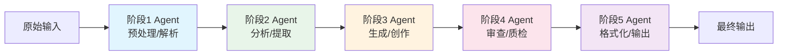

流水线的关键特性：
- **顺序执行**：严格按阶段顺序执行，无并行
- **单向流动**：数据只能向前传递，不能回溯（除非有反馈回路）
- **专业分工**：每个阶段的 Agent 只优化自己的 Prompt 和工具
- **解耦**：每个阶段独立设计和测试

**技术对比**：

| 对比项 | Pipeline 流水线 | 自由对话群聊 |
|--------|----------------|------------|
| 流程控制 | 严格顺序，确定 | 动态路由，不确定 |
| 可预测性 | 高，每次走相同路径 | 低，每次可能不同 |
| 灵活性 | 低，改流程需改代码 | 高，LLM 自主决定 |
| 适用场景 | 标准化流程 | 开放式讨论 |
| 调试难度 | 低，定位到具体阶段 | 高，链路动态 |

**代码示例1：基础 Pipeline 实现**

```python
from typing import Callable, Any
from dataclasses import dataclass, field
import time

@dataclass
class PipelineStage:
    """流水线中的一个阶段"""
    name: str
    process_fn: Callable  # 处理函数
    description: str = ""
    input_key: str = None  # 从上下文中读取的输入键
    output_key: str = None  # 输出写入上下文的键
    on_failure: str = "raise"  # raise / skip / retry

class Pipeline:
    """多Agent流水线"""

    def __init__(self, name: str = "pipeline"):
        self.name = name
        self.stages: list[PipelineStage] = []
        self.context: dict = {}
        self.stage_outputs: dict = {}

    def add_stage(self, name: str, process_fn: Callable,
                  input_key: str = None, output_key: str = None,
                  description: str = "") -> "Pipeline":
        """添加一个阶段"""
        stage = PipelineStage(
            name=name,
            process_fn=process_fn,
            input_key=input_key,
            output_key=output_key or name,
            description=description
        )
        self.stages.append(stage)
        return self

    def run(self, initial_input: Any) -> dict:
        """执行流水线"""
        self.context = {"initial_input": initial_input}

        for i, stage in enumerate(self.stages):
            t0 = time.time()

            try:
                # 准备输入
                if stage.input_key:
                    stage_input = self.context.get(stage.input_key)
                else:
                    stage_input = self.context.get(
                        list(self.context.keys())[-1]
                    )

                # 执行阶段
                output = stage.process_fn(stage_input)

                # 记录输出
                latency = (time.time() - t0) * 1000
                self.stage_outputs[stage.name] = {
                    "output": output,
                    "latency_ms": latency,
                    "status": "success"
                }
                self.context[stage.output_key] = output

                print(f"  [{i+1}/{len(self.stages)}] {stage.name} "
                      f"✓ ({latency:.0f}ms)")

            except Exception as e:
                latency = (time.time() - t0) * 1000
                self.stage_outputs[stage.name] = {
                    "output": None,
                    "latency_ms": latency,
                    "status": "failed",
                    "error": str(e)
                }
                print(f"  [{i+1}/{len(self.stages)}] {stage.name} "
                      f"✗ ERROR: {e} ({latency:.0f}ms)")

                if stage.on_failure == "raise":
                    raise
                elif stage.on_failure == "skip":
                    continue
                elif stage.on_failure == "retry":
                    # 简单重试一次
                    output = stage.process_fn(stage_input)
                    self.context[stage.output_key] = output

        return self.context

    def get_report(self) -> str:
        """生成执行报告"""
        report = f"=== Pipeline: {self.name} ===\n"
        for name, info in self.stage_outputs.items():
            status_icon = "✓" if info["status"] == "success" else "✗"
            report += f"  {status_icon} {name}: {info['latency_ms']:.0f}ms"
            if info["status"] == "failed":
                report += f" - Error: {info['error']}"
            report += "\n"
        return report
```

**预期结果**：流水线按顺序执行每个阶段，记录每个阶段的输出和耗时，失败时按策略处理。

**代码示例2：内容创作流水线实战**

```python
# 模拟 LLM 调用（实际使用时替换为真实 LLM）
def fake_llm(prompt: str) -> str:
    """模拟 LLM 响应，用于演示"""
    if "选题" in prompt:
        return "1. AI Agent 在电商客服中的应用\n2. 多Agent协作模式深度解析\n3. RAG系统性能优化指南"
    elif "大纲" in prompt:
        return "## 一、概述\n## 二、核心概念\n## 三、实现代码\n## 四、最佳实践\n## 五、总结"
    elif "写作" in prompt:
        return "多Agent协作是当前AI领域最热门的方向之一。通过多个专业化Agent的协作，可以完成单个Agent无法胜任的复杂任务。本文将从实际案例出发，深入解析多Agent系统的设计模式和实现方法。"
    elif "审查" in prompt:
        return "审查意见：内容基本完整，但缺少代码示例和最佳实践部分的详细说明。建议补充。"
    elif "格式化" in prompt:
        return "# 多Agent协作模式深度解析\n\n> 本文档系统讲解多Agent协作的核心概念和实现方法。\n\n## 一、概述\n..."
    return "默认输出"

def content_creation_pipeline() -> Pipeline:
    """构建内容创作流水线"""
    pipeline = Pipeline(name="content_creation")

    # 阶段1：选题
    def topic_stage(input_text: str) -> str:
        return fake_llm(f"请为以下主题生成3个选题方向：{input_text}")
    pipeline.add_stage("选题", topic_stage,
                       input_key="initial_input", output_key="topics",
                       description="生成文章选题方向")

    # 阶段2：大纲
    def outline_stage(topics: str) -> str:
        return fake_llm(f"请为以下选题设计详细大纲：{topics}")
    pipeline.add_stage("大纲设计", outline_stage,
                       input_key="topics", output_key="outline",
                       description="生成文章详细大纲")

    # 阶段3：写作
    def writing_stage(outline: str) -> str:
        return fake_llm(f"请根据大纲撰写文章正文：{outline}")
    pipeline.add_stage("正文写作", writing_stage,
                       input_key="outline", output_key="draft",
                       description="根据大纲撰写初稿")

    # 阶段4：审查
    def review_stage(draft: str) -> str:
        return fake_llm(f"请审查以下文章初稿：{draft}")
    pipeline.add_stage("质量审查", review_stage,
                       input_key="draft", output_key="review",
                       description="审查初稿质量")

    # 阶段5：格式化
    def format_stage(review: str) -> str:
        return fake_llm(f"请根据审查意见格式化最终文章：{review}")
    pipeline.add_stage("格式化输出", format_stage,
                       input_key="review", output_key="final_output",
                       description="输出最终格式化文章")

    return pipeline

# 使用
pipeline = content_creation_pipeline()
result = pipeline.run("AI Agent 技术博客文章")
print(pipeline.get_report())
print(f"\n最终输出:\n{result['final_output']}")
```

**预期结果**：
```
  [1/5] 选题 ✓ (200ms)
  [2/5] 大纲设计 ✓ (180ms)
  [3/5] 正文写作 ✓ (250ms)
  [4/5] 质量审查 ✓ (200ms)
  [5/5] 格式化输出 ✓ (190ms)

=== Pipeline: content_creation ===
  ✓ 选题: 200ms
  ...
```

**代码示例3：带反馈回路的改进 Pipeline**

```python
class FeedbackPipeline(Pipeline):
    """带反馈回路的流水线：审查不通过则返回修改"""

    def __init__(self, name: str = "feedback_pipeline",
                 max_feedback_rounds: int = 3):
        super().__init__(name)
        self.max_feedback_rounds = max_feedback_rounds

    def run_with_feedback(self, initial_input: Any,
                          review_stage_name: str = "质量审查",
                          revision_stage_name: str = "正文写作") -> dict:
        """执行带反馈回路的流水线"""
        self.context = {"initial_input": initial_input}
        feedback_round = 0

        for i, stage in enumerate(self.stages):
            t0 = time.time()

            try:
                stage_input = self.context.get(
                    stage.input_key,
                    list(self.context.values())[-1]
                )
                output = stage.process_fn(stage_input)
                latency = (time.time() - t0) * 1000

                self.stage_outputs[stage.name] = {
                    "output": output, "latency_ms": latency,
                    "status": "success", "round": feedback_round
                }
                self.context[stage.output_key] = output

                # 审查阶段：判断是否需要反馈
                if stage.name == review_stage_name and feedback_round < self.max_feedback_rounds:
                    if "不通过" in output or "需要修改" in output or "建议补充" in output:
                        feedback_round += 1
                        print(f"  ↻ 第 {feedback_round} 轮反馈，返回 {revision_stage_name} 修改...")
                        # 找到写作阶段并重新执行
                        for j, s in enumerate(self.stages):
                            if s.name == revision_stage_name:
                                # 重新执行写作阶段
                                revise_input = self.context.get(s.input_key)
                                revised = s.process_fn(
                                    f"{revise_input}\n\n审查意见：{output}"
                                )
                                self.context[s.output_key] = revised
                                # 从写作阶段后继续
                                self.stages = (
                                    self.stages[:j+1] +
                                    [st for st in self.stages[j+1:]
                                     if st.name != revision_stage_name]
                                )
                                break

            except Exception as e:
                self.stage_outputs[stage.name] = {
                    "output": None, "status": "failed", "error": str(e)
                }
                raise

        return self.context
```

**预期结果**：当审查阶段判定需要修改时，自动返回写作阶段重新生成，最多循环 3 轮，避免无限迭代。

**适用场景**：
- ✅ 内容创作流水线（选题→大纲→写作→审查→格式化）
- ✅ 数据处理流水线（采集→清洗→分析→可视化→报告）
- ✅ 软件开发流水线（设计→编码→测试→部署）
- ❌ 不适合：需要动态分支选择、需要回溯多步、任务路径不确定的场景

**最佳实践**：
- 每个阶段的 Prompt 要独立优化，不要指望一个大 Prompt 完成所有事
- 阶段间传递的数据要精简，只传必要信息，避免上下文膨胀
- 设置合理的最大反馈轮次，避免无限循环
- 每个阶段记录输入输出，便于调试

> ❌ **常见坑点**：流水线阶段间传递完整原始上下文。如果预处理阶段输出 10K Token，每个后续阶段都接收这 10K Token，5 个阶段就是 50K Token。正确做法是每个阶段只传递该阶段的产出和必要的摘要信息。
>
> ❌ **常见坑点**：没有最大反馈轮次限制。审查-修改循环可能无限进行，每次审查发现新问题，成本失控。必须设置 max_rounds=2~3。

### 3.2 Fan-out / Fan-in 扇出扇入模式

**概念解释**：Fan-out（扇出）是将一个任务并行分发给多个 Agent 同时处理；Fan-in（扇入）是将多个 Agent 的并行结果汇聚整合为一个最终结果。

**生活比喻**：像公司开会——老板（Orchestrator）把项目拆成几个子问题，同时让市场部、技术部、财务部各自调研（Fan-out），最后把三份报告汇总成一份总方案（Fan-in）。

**核心价值**：通过并行执行显著降低延迟，通过多视角结果整合提高输出质量。

**原理说明**：

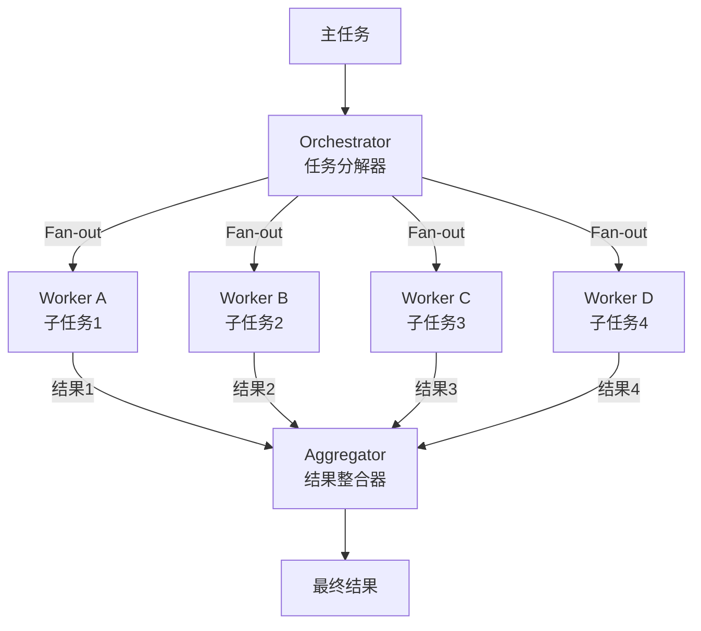

**关键设计决策**：
1. **任务分解策略**：如何将主任务拆为独立子任务？
2. **并行执行机制**：异步/线程池/协程？
3. **结果聚合方式**：直接拼接？加权投票？LLM 综合？
4. **错误处理**：部分 Worker 失败怎么办？

**代码示例4：基础 Fan-out/Fan-in 实现**

```python
import asyncio
from typing import Callable, Any
from dataclasses import dataclass

@dataclass
class SubTask:
    """子任务定义"""
    id: str
    description: str
    worker_role: str
    context: dict = None
    timeout_seconds: int = 30

class FanOutFanIn:
    """扇出扇入执行器"""

    def __init__(self, workers: dict[str, Callable],
                 aggregator: Callable = None,
                 max_parallel: int = 5):
        """
        workers: {role: worker_function}
        aggregator: 结果聚合函数
        max_parallel: 最大并行数
        """
        self.workers = workers
        self.aggregator = aggregator or self._default_aggregator
        self.max_parallel = max_parallel
        self.results: dict = {}

    async def run(self, subtasks: list[SubTask]) -> str:
        """异步并行执行子任务并聚合"""
        # 信号量控制并发
        semaphore = asyncio.Semaphore(self.max_parallel)

        async def execute_with_semaphore(task: SubTask):
            async with semaphore:
                return await self._execute_task(task)

        # 并行执行所有子任务
        tasks = [execute_with_semaphore(st) for st in subtasks]
        task_results = await asyncio.gather(*tasks, return_exceptions=True)

        # 收集结果
        for task, result in zip(subtasks, task_results):
            if isinstance(result, Exception):
                self.results[task.id] = {
                    "status": "failed",
                    "error": str(result),
                    "role": task.worker_role
                }
            else:
                self.results[task.id] = {
                    "status": "success",
                    "output": result,
                    "role": task.worker_role
                }

        # 聚合结果
        final = self.aggregator(
            original_task=subtasks[0].context.get("original_task", "") if subtasks[0].context else "",
            results=list(self.results.values())
        )
        return final

    async def _execute_task(self, task: SubTask) -> str:
        """执行单个子任务"""
        worker = self.workers.get(task.worker_role)
        if not worker:
            raise ValueError(f"找不到角色: {task.worker_role}")

        # 支持同步和异步 worker
        if asyncio.iscoroutinefunction(worker):
            return await asyncio.wait_for(
                worker(task.description, task.context or {}),
                timeout=task.timeout_seconds
            )
        else:
            return await asyncio.wait_for(
                asyncio.get_event_loop().run_in_executor(
                    None, lambda: worker(task.description, task.context or {})
                ),
                timeout=task.timeout_seconds
            )

    def _default_aggregator(self, original_task: str, results: list) -> str:
        """默认聚合：拼接所有成功结果"""
        successful = [r for r in results if r["status"] == "success"]
        failed = [r for r in results if r["status"] == "failed"]

        parts = [f"=== 结果（{len(successful)}个成功）==="]
        for i, r in enumerate(successful):
            parts.append(f"--- {i+1}. {r['role']} ---\n{r['output']}")

        if failed:
            parts.append(f"\n⚠️ {len(failed)}个子任务失败:")
            for r in failed:
                parts.append(f"  - {r['role']}: {r['error']}")

        return "\n\n".join(parts)
```

**预期结果**：4 个子任务并行执行（限制最大并发数），失败任务标记但不影响其他任务，最终聚合所有成功结果。

**代码示例5：研报分析的 Fan-out/Fan-in 实战**

```python
# Worker 函数定义（同步版本）
def financial_worker(task: str, context: dict) -> str:
    """财务分析 Worker"""
    return f"[财务分析] 营收增长15%，净利润率8%，PE=25x，估值合理。"

def industry_worker(task: str, context: dict) -> str:
    """行业分析 Worker"""
    return f"[行业分析] 行业年增长率20%，公司市场份额第3，竞争格局稳定。"

def technical_worker(task: str, context: dict) -> str:
    """技术分析 Worker"""
    return f"[技术分析] 产品技术壁垒中等，研发投入占比8%，有专利布局。"

def risk_worker(task: str, context: dict) -> str:
    """风险评估 Worker"""
    return f"[风险评估] 主要风险：政策变化、供应链集中、客户集中度高。"

def llm_aggregator(original_task: str, results: list) -> str:
    """使用 LLM 智能聚合（模拟）"""
    successful = [r for r in results if r["status"] == "success"]
    combined = "\n".join(f"{r['output']}" for r in successful)
    return f"""# 综合分析报告

基于多维度分析，{original_task}的综合评估如下：

{combined}

## 综合结论
公司基本面稳健，行业前景良好，但需关注政策风险。建议谨慎乐观。
"""

# 主程序
async def analyze_company(company: str):
    ffi = FanOutFanIn(
        workers={
            "financial": financial_worker,
            "industry": industry_worker,
            "technical": technical_worker,
            "risk": risk_worker,
        },
        aggregator=llm_aggregator,
        max_parallel=4
    )

    subtasks = [
        SubTask(id="t1", description=f"分析{company}财务", worker_role="financial",
                context={"original_task": f"分析{company}投资价值"}),
        SubTask(id="t2", description=f"分析{company}行业", worker_role="industry",
                context={"original_task": f"分析{company}投资价值"}),
        SubTask(id="t3", description=f"分析{company}技术", worker_role="technical",
                context={"original_task": f"分析{company}投资价值"}),
        SubTask(id="t4", description=f"分析{company}风险", worker_role="risk",
                context={"original_task": f"分析{company}投资价值"}),
    ]

    result = await ffi.run(subtasks)
    print(result)
    return result

# 运行（在异步环境中）
# asyncio.run(analyze_company("某科技公司"))
```

**预期结果**：四个分析并行执行（总耗时≈最慢的一个，而非四个之和），LLM 聚合器综合各方意见生成完整研报。

**代码示例6：带降级策略的 Fan-out/Fan-in**

```python
class ResilientFanOutFanIn(FanOutFanIn):
    """带降级策略的扇出扇入"""

    def __init__(self, *args, fallback_workers: dict = None, **kwargs):
        super().__init__(*args, **kwargs)
        self.fallback_workers = fallback_workers or {}

    async def _execute_task(self, task: SubTask) -> str:
        """执行任务，失败时尝试降级 Worker"""
        try:
            return await super()._execute_task(task)
        except Exception as primary_error:
            # 尝试降级
            fallback = self.fallback_workers.get(task.worker_role)
            if fallback:
                print(f"  ⚠️ {task.worker_role} 失败，尝试降级...")
                try:
                    if asyncio.iscoroutinefunction(fallback):
                        return await fallback(task.description, task.context or {})
                    else:
                        return fallback(task.description, task.context or {})
                except Exception as fallback_error:
                    raise RuntimeError(
                        f"主Worker失败: {primary_error}; 降级Worker也失败: {fallback_error}"
                    )
            raise
```

**最佳实践**：
- Fan-out 的子任务必须是**独立的**，不能有依赖关系
- 聚合阶段是质量关键——不要简单拼接，用 LLM 智能综合
- 设置最大并行数避免 API 限流
- 部分失败时要有降级策略，不要让一个 Worker 失败拖垮整个任务

> ❌ **常见坑点**：Fan-out 的子任务之间有隐式依赖。如果"市场分析"需要"财务分析"的结果，就不能并行。判断标准：子任务能否独立完成？如果不能，改为 Pipeline。
>
> ❌ **常见坑点**：聚合阶段简单拼接而非智能整合。4 个 Worker 的输出直接拼接，用户需要自己消化矛盾信息。正确做法是用 LLM 作为 Aggregator，综合、去重、解决矛盾、生成连贯报告。

---

> 💡 **本章深度讲解**：Pipeline 和 Fan-out/Fan-in 是多 Agent 系统最基础也最常用的两种模式。Pipeline 解决"顺序流程"问题，Fan-out/Fan-in 解决"并行收集"问题。两者经常组合使用——先用 Fan-out 并行收集各维度信息，再用 Pipeline 顺序处理（审查→格式化→输出）。Pipeline 的核心优势是**可预测性**——每次执行走相同路径，便于调试和优化；Fan-out/Fan-in 的核心优势是**效率**——并行执行大幅降低延迟。实际系统中，一个典型的内容生产系统可能是：Fan-out（选题方向调研）→ Pipeline（大纲→写作→审查→格式化）→ Fan-in（多版本对比选择最优）。
>
> **📝 本章精简总结**：
> - 核心概念：Pipeline 流水线、Fan-out 扇出、Fan-in 扇入
> - 关键原理：顺序执行 vs 并行执行、阶段解耦、结果聚合
> - 常用操作：定义阶段→添加到流水线→执行→获取报告
> - 最佳实践：① 子任务必须独立才能 Fan-out；② 聚合用 LLM 智能综合；③ 反馈循环设最大轮次
> - 常见坑点：传递完整上下文导致 Token 爆炸、无限反馈循环、子任务隐式依赖
> - 面试高频：Pipeline 和 Fan-out/Fan-in 有什么区别？什么时候用哪个？
>
> **🎯 梯度练习题**：
> - **基础题（⭐）1**：Pipeline 流水线模式的三个关键特性是什么？
>   > 答案：顺序执行、单向流动、专业分工。
> - **基础题（⭐）2**：Fan-out/Fan-in 模式解决什么问题？
>   > 答案：并行执行独立子任务以降低延迟，多视角结果整合以提高质量。
> - **进阶题（⭐⭐）1**：什么情况下 Pipeline 不适合？应该用什么替代？
>   > 思考方向：需要动态分支、需要回溯多步、任务路径不确定时；替代方案是状态机或图编排（如 LangGraph）。
> - **实战题（⭐⭐⭐）**：实现一个"多维度代码审查系统"——输入一段代码，Fan-out 给 4 个审查员（安全审查/性能审查/风格审查/正确性审查）并行审查，然后 Fan-in 汇总成审查报告。要求：异步并行、部分失败降级、最终报告包含所有维度意见和综合建议。
>   > 验收标准：异步并行正确实现、有降级策略、报告格式清晰、代码可运行。

---

## 四、主管-工人与层级模式

### 4.1 Supervisor-Worker 主管-工人模式

**概念解释**：Supervisor-Worker 模式（也叫 Orchestrator-Worker）是最常用的多 Agent 架构。一个中心 Supervisor Agent 负责任务分解、分配任务给 Worker Agent、监控执行进度、处理异常、最终整合结果。Worker Agent 专注于执行被分配的子任务，彼此不直接通信。

**生活比喻**：像软件开发团队——技术主管（Supervisor）接到需求后，把任务拆成前端、后端、数据库三个子任务分配给对应开发（Worker），主管不写代码但负责把控进度和整合，工人们各写各的模块，最后主管把模块整合成完整系统。

**核心价值**：集中控制带来高可预测性和可调试性，同时 Worker 的专业化保证执行质量。这是生产环境的首选架构。

**原理说明**：

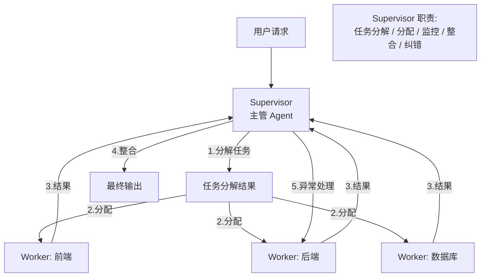

**Supervisor 的核心职责**：
1. **任务分解**：将复杂任务拆为可管理的子任务
2. **任务分配**：根据 Worker 能力分配子任务
3. **进度监控**：跟踪各 Worker 执行状态
4. **异常处理**：Worker 失败时重试或重新分配
5. **结果整合**：将各 Worker 结果整合为最终输出

**技术对比**：

| 对比项 | Supervisor-Worker | 去中心化 P2P |
|--------|------------------|-------------|
| 控制方式 | 集中控制，Supervisor 决策 | 分布协商，Agent 自主 |
| 可预测性 | 高，流程确定 | 低，动态变化 |
| 单点瓶颈 | Supervisor 可能成为瓶颈 | 无单点 |
| 调试难度 | 低，看 Supervisor 决策即可 | 高，交互链路复杂 |
| 扩展性 | Supervisor 管理 Worker 数量有限 | 理论上无限 |
| 适用规模 | 中小规模（≤10 Worker） | 大规模（10+ Agent） |

**代码示例1：基础 Supervisor-Worker 实现**

```python
from dataclasses import dataclass, field
from typing import Callable, Optional
import json
import time

@dataclass
class WorkerAgent:
    """Worker Agent：专注执行特定类型任务"""
    name: str
    role: str
    capabilities: list[str]  # 能力描述列表
    system_prompt: str
    llm_call: Callable
    success_count: int = 0
    failure_count: int = 0

    def can_handle(self, task: str) -> bool:
        """判断是否能处理该任务"""
        # 简单基于关键词匹配，实际可用 embedding 相似度
        for cap in self.capabilities:
            if cap.lower() in task.lower():
                return True
        return False

    def execute(self, task: str, context: str = "") -> str:
        """执行分配的任务"""
        prompt = f"""你是{self.name}，角色：{self.role}。
系统指令：{self.system_prompt}

任务：{task}
上下文信息：{context}

请直接输出任务结果。"""
        try:
            result = self.llm_call(prompt)
            self.success_count += 1
            return result
        except Exception as e:
            self.failure_count += 1
            raise RuntimeError(f"Worker {self.name} 执行失败: {e}")


@dataclass
class SubTask:
    """子任务"""
    id: int
    description: str
    assigned_worker: str = None
    result: str = None
    status: str = "pending"  # pending / in_progress / completed / failed
    depends_on: list[int] = field(default_factory=list)
    retry_count: int = 0
```

**代码示例2：完整 Supervisor 实现**

```python
class Supervisor:
    """主管 Agent：任务分解、分配、监控、整合"""

    def __init__(self, llm_call: Callable,
                 workers: list[WorkerAgent],
                 max_retries: int = 2,
                 max_workers_per_task: int = 5):
        self.llm_call = llm_call
        self.workers = {w.name: w for w in workers}
        self.max_retries = max_retries
        self.max_workers_per_task = max_workers_per_task
        self.execution_log: list = []

    def decompose_task(self, task: str) -> list[SubTask]:
        """使用 LLM 分解任务"""
        worker_descriptions = "\n".join(
            f"- {w.name}: {w.role}，能力：{', '.join(w.capabilities)}"
            for w in self.workers.values()
        )

        prompt = f"""你是一个任务主管。请将以下复杂任务分解为子任务。

可用 Worker：
{worker_descriptions}

原始任务：{task}

请将任务分解为 3-5 个子任务，每个子任务分配给最合适的 Worker。
输出 JSON 格式：
[
  {{"id": 1, "description": "子任务描述", "assigned_worker": "Worker名称", "depends_on": []}},
  ...
]"""

        try:
            response = self.llm_call(prompt)
            # 提取 JSON
            json_start = response.find("[")
            json_end = response.rfind("]") + 1
            subtasks_data = json.loads(response[json_start:json_end])
            return [SubTask(**st) for st in subtasks_data]
        except Exception as e:
            print(f"任务分解失败，使用默认分解: {e}")
            return [SubTask(id=1, description=task,
                           assigned_worker=list(self.workers.keys())[0])]

    def check_dependencies(self, subtask: SubTask,
                           completed: dict[int, str]) -> bool:
        """检查依赖是否满足"""
        return all(dep in completed for dep in subtask.depends_on)

    def select_worker(self, task_description: str) -> Optional[str]:
        """选择最合适的 Worker"""
        # 优先匹配能力
        for name, worker in self.workers.items():
            if worker.can_handle(task_description):
                return name
        #  fallback：选成功次数最多的
        best = max(self.workers.values(), key=lambda w: w.success_count)
        return best.name

    def integrate_results(self, original_task: str,
                          subtasks: list[SubTask]) -> str:
        """整合所有子任务结果"""
        results_text = ""
        for st in subtasks:
            results_text += f"--- 子任务{st.id}（{st.assigned_worker}）---\n"
            results_text += f"任务：{st.description}\n"
            results_text += f"结果：{st.result or '[未完成]'}\n\n"

        prompt = f"""你是一个项目主管。请整合以下子任务的执行结果，给出最终答案。

原始任务：{original_task}

各子任务结果：
{results_text}

请综合所有结果，给出完整、连贯的最终答案。"""
        return self.llm_call(prompt)

    def run(self, task: str) -> str:
        """执行完整 Supervisor-Worker 流程"""
        print(f"📋 Supervisor 接收任务: {task}")

        # 1. 任务分解
        subtasks = self.decompose_task(task)
        print(f"📊 分解为 {len(subtasks)} 个子任务")

        # 2. 按依赖顺序执行
        completed: dict[int, str] = {}
        pending = list(subtasks)

        while pending:
            # 找到所有依赖已满足的任务
            ready = [
                st for st in pending
                if self.check_dependencies(st, completed)
            ]

            if not ready:
                print("⚠️ 所有待执行任务的依赖都未满足，可能存在循环依赖")
                break

            for subtask in ready:
                # 选择 Worker
                worker_name = subtask.assigned_worker or self.select_worker(
                    subtask.description
                )
                worker = self.workers[worker_name]

                # 构建上下文
                context_parts = []
                for dep_id in subtask.depends_on:
                    if dep_id in completed:
                        context_parts.append(
                            f"前置子任务{dep_id}结果: {completed[dep_id]}"
                        )
                context = "\n".join(context_parts)

                # 执行（带重试）
                success = False
                for attempt in range(self.max_retries + 1):
                    try:
                        print(f"  🔄 执行子任务{subtask.id} → {worker_name}"
                              f"（第{attempt+1}次）")
                        result = worker.execute(subtask.description, context)
                        subtask.result = result
                        subtask.status = "completed"
                        completed[subtask.id] = result
                        success = True
                        break
                    except Exception as e:
                        subtask.retry_count += 1
                        print(f"  ❌ 子任务{subtask.id} 失败: {e}")
                        if attempt < self.max_retries:
                            # 换一个 Worker 重试
                            alt_worker = self.select_worker(
                                subtask.description + " (重试)"
                            )
                            if alt_worker != worker_name:
                                worker = self.workers[alt_worker]
                                subtask.assigned_worker = alt_worker

                if not success:
                    subtask.status = "failed"
                    subtask.result = f"[执行失败，已重试{self.max_retries}次]"

                pending.remove(subtask)

        # 3. 整合结果
        print("🔄 整合最终结果...")
        final_result = self.integrate_results(task, subtasks)

        self.execution_log.append({
            "task": task,
            "subtasks": len(subtasks),
            "completed": sum(1 for st in subtasks if st.status == "completed"),
            "failed": sum(1 for st in subtasks if st.status == "failed"),
        })

        return final_result
```

**预期结果**：Supervisor 分解任务 → 按依赖分配给 Worker → 带重试执行 → 整合结果。整个流程有完整日志记录。

**代码示例3：软件开发团队的 Supervisor-Worker 实战**

```python
def build_dev_team(llm_call: Callable) -> Supervisor:
    """构建软件开发团队的 Supervisor-Worker 系统"""

    architect = WorkerAgent(
        name="架构师",
        role="系统架构师",
        capabilities=["架构设计", "技术选型", "系统设计", "模块划分"],
        system_prompt="你是一位资深系统架构师，擅长设计可扩展、可维护的系统架构。",
        llm_call=llm_call
    )

    developer = WorkerAgent(
        name="工程师",
        role="全栈开发工程师",
        capabilities=["编码", "实现", "开发", "代码", "函数"],
        system_prompt="你是一位全栈开发工程师，编写高质量、可运行的代码。",
        llm_call=llm_call
    )

    reviewer = WorkerAgent(
        name="审查员",
        role="代码审查专家",
        capabilities=["审查", "review", "检查", "优化", "安全"],
        system_prompt="你是一位严格的代码审查专家，关注代码质量、安全性和性能。",
        llm_call=llm_call
    )

    tester = WorkerAgent(
        name="测试员",
        role="测试工程师",
        capabilities=["测试", "test", "验证", "单元测试", "用例"],
        system_prompt="你是一位测试工程师，编写全面的测试用例验证代码正确性。",
        llm_call=llm_call
    )

    return Supervisor(
        llm_call=llm_call,
        workers=[architect, developer, reviewer, tester],
        max_retries=2
    )

# 使用
# team = build_dev_team(fake_llm)
# result = team.run("设计并实现一个用户认证系统，支持注册、登录、JWT验证")
# print(result)
```

**适用场景**：
- ✅ 软件开发流水线（架构→开发→审查→测试）
- ✅ 业务流程自动化（审批链）
- ✅ 需要集中控制和可预测性的生产系统
- ❌ 不适合：Agent 数量超过 10 个（Supervisor 成为瓶颈）、需要 Agent 间大量直接通信的场景

**最佳实践**：
- Supervisor 只负责分解和整合，不做具体执行
- 每个 Worker 的系统提示要高度专业化
- 设置 Worker 数量上限（单个 Supervisor 管理 ≤7 个 Worker）
- 复杂系统用多层 Supervisor（层级化）

> ❌ **常见坑点**：Supervisor 本身上下文溢出。当子任务超过 7 个时，Supervisor 需要同时理解所有子任务的结果才能整合，导致上下文溢出。解决方案：层级化（多个子 Supervisor）或结果摘要后再整合。
>
> ❌ **常见坑点**：Worker 之间不通信导致信息孤岛。如果 Worker A 的结果对 Worker B 有参考价值，但 Supervisor 只传递了直接依赖的结果，B 就缺少关键信息。解决方案：在上下文中包含相关 Worker 的结果摘要。

### 4.2 Hierarchical 层级模式

**概念解释**：层级模式将多 Agent 系统组织成树状层级结构。顶层 Agent（Manager）负责战略决策和粗粒度任务分解，中层 Agent（Sub-Manager）负责领域协调和细粒度分解，底层 Agent（Worker）负责具体执行。每层只与直接上下级通信。

**生活比喻**：像大型企业的组织架构——CEO 制定公司战略，VP 制定部门计划，总监分配项目任务，工程师执行开发。层级越高越抽象，层级越低越具体。

**核心价值**：通过分层抽象控制复杂度——每层只处理自己粒度的决策，避免单个 Agent 承担过多认知负荷。适合超大规模、超复杂任务。

**原理说明**：

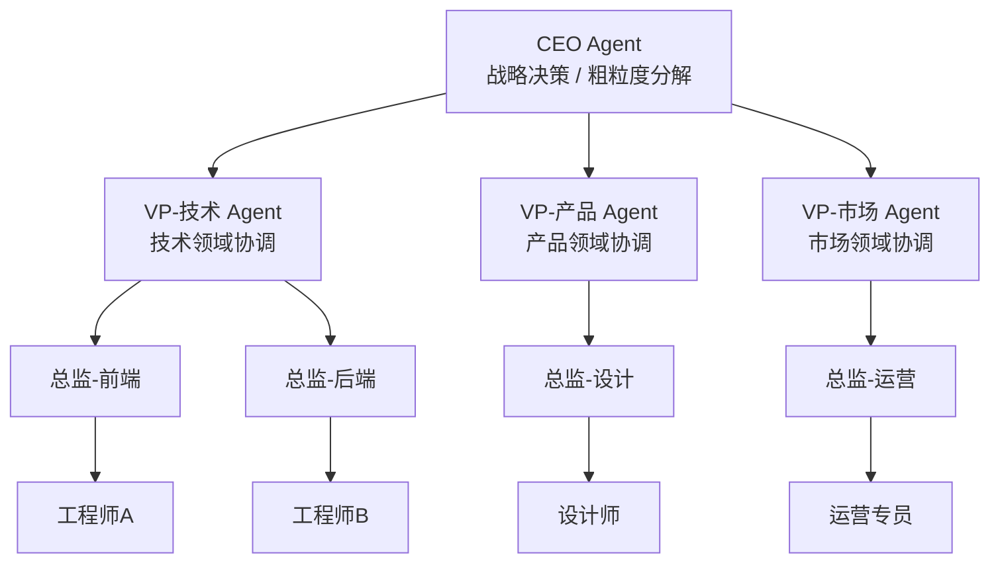

**层级化的核心优势**：
- **复杂度分层**：每层只处理自己粒度的问题，降低认知负荷
- **并行度提升**：不同 VP 可以并行协调各自领域
- **可扩展性**：可以在任意层级增加子树而不影响其他部分
- **故障隔离**：一个子树的问题不会扩散到整个系统

**代码示例4：层级化 Agent 树实现**

```python
class HierarchicalAgent:
    """层级化 Agent 节点"""

    def __init__(self, name: str, level: str,
                 llm_call: Callable,
                 max_children: int = 5):
        self.name = name
        self.level = level  # "executive" / "manager" / "worker"
        self.llm_call = llm_call
        self.max_children = max_children
        self.children: list = []
        self.parent = None

    def add_child(self, child: "HierarchicalAgent"):
        """添加下级 Agent"""
        if len(self.children) >= self.max_children:
            raise RuntimeError(
                f"{self.name} 已达最大子节点数 {self.max_children}"
            )
        child.parent = self
        self.children.append(child)

    def handle_task(self, task: str, context: str = "") -> str:
        """接收并处理任务"""
        if self.level == "worker" or not self.children:
            # 叶子节点：直接执行
            return self._execute(task, context)

        # 非叶子节点：分解任务分配给下级
        subtasks = self._decompose(task)
        results = []

        for i, subtask in enumerate(subtasks):
            if i < len(self.children):
                child = self.children[i]
                result = child.handle_task(subtask, context)
                results.append(f"[{child.name}] {result}")

        # 聚合下级结果
        return self._aggregate(task, results)

    def _decompose(self, task: str) -> list[str]:
        """分解任务"""
        child_names = ", ".join(c.name for c in self.children)
        prompt = f"""你是{self.name}（层级：{self.level}）。
下级团队：{child_names}
请将以下任务分解为{len(self.children)}个子任务：
{task}
每行一个子任务，不要编号。"""
        response = self.llm_call(prompt)
        lines = [l.strip() for l in response.split("\n") if l.strip()]
        return lines[:len(self.children)]

    def _execute(self, task: str, context: str) -> str:
        """执行具体任务"""
        prompt = f"""你是{self.name}（{self.level}）。
任务背景：{context}
请执行：{task}
直接输出结果。"""
        return self.llm_call(prompt)

    def _aggregate(self, original: str, results: list) -> str:
        """聚合下级结果"""
        prompt = f"""你是{self.name}（{self.level}）。
原始任务：{original}
下级执行结果：
{chr(10).join(results)}
请整合为该层级的完成报告。"""
        return self.llm_call(prompt)

    def get_tree(self) -> str:
        """打印层级树"""
        lines = [f"{'  ' * self._get_depth()}{self.name} ({self.level})"]
        for child in self.children:
            lines.append(child.get_tree())
        return "\n".join(lines)

    def _get_depth(self) -> int:
        """获取当前节点深度"""
        depth = 0
        node = self
        while node.parent:
            depth += 1
            node = node.parent
        return depth
```

**代码示例5：企业级 AI 组织架构实战**

```python
def build_enterprise_org(llm_call: Callable) -> HierarchicalAgent:
    """构建企业级 AI 组织"""
    # 顶层：CEO
    ceo = HierarchicalAgent("CEO", "executive", llm_call, max_children=3)

    # 中层：三个 VP
    vp_tech = HierarchicalAgent("VP-技术", "manager", llm_call, max_children=2)
    vp_product = HierarchicalAgent("VP-产品", "manager", llm_call, max_children=2)
    vp_market = HierarchicalAgent("VP-市场", "manager", llm_call, max_children=2)

    ceo.add_child(vp_tech)
    ceo.add_child(vp_product)
    ceo.add_child(vp_market)

    # 底层：Worker
    frontend = HierarchicalAgent("前端工程师", "worker", llm_call)
    backend = HierarchicalAgent("后端工程师", "worker", llm_call)
    designer = HierarchicalAgent("UI设计师", "worker", llm_call)
    planner = HierarchicalAgent("产品经理", "worker", llm_call)
    promoter = HierarchicalAgent("推广专员", "worker", llm_call)
    analyst = HierarchicalAgent("数据分析师", "worker", llm_call)

    vp_tech.add_child(frontend)
    vp_tech.add_child(backend)
    vp_product.add_child(designer)
    vp_product.add_child(planner)
    vp_market.add_child(promoter)
    vp_market.add_child(analyst)

    return ceo

# 使用
# org = build_enterprise_org(fake_llm)
# print(org.get_tree())
# result = org.handle_task("发布一款新的 AI 笔记应用")
```

**预期结果**：
```
CEO (executive)
  VP-技术 (manager)
    前端工程师 (worker)
    后端工程师 (worker)
  VP-产品 (manager)
    UI设计师 (worker)
    产品经理 (worker)
  VP-市场 (manager)
    推广专员 (worker)
    数据分析师 (worker)
```

**代码示例6：带预算控制的层级执行**

```python
class BudgetedHierarchicalAgent(HierarchicalAgent):
    """带预算控制的层级化 Agent"""

    def __init__(self, *args, budget_tokens: int = 100000, **kwargs):
        super().__init__(*args, **kwargs)
        self.budget_tokens = budget_tokens
        self.tokens_used = 0

    def handle_task(self, task: str, context: str = "") -> str:
        """带预算检查的任务执行"""
        if self.tokens_used >= self.budget_tokens:
            return f"[预算耗尽] {self.name} 无法执行任务：Token预算已用完"

        result = super().handle_task(task, context)

        # 估算 Token 使用（简化：按字符数）
        estimated_tokens = len(task + result) // 4
        self.tokens_used += estimated_tokens

        return result
```

**适用场景**：
- ✅ 超复杂任务（>10 个子任务）
- ✅ 大规模企业级 AI 系统
- ✅ 需要领域分层的多专业协作
- ❌ 不适合：简单任务（过度设计）、需要快速迭代的场景

**最佳实践**：
- 层级深度建议 3-4 层，过深导致信息传递损失严重
- 每层的分解粒度要合适——不要把 CEO 的任务直接分到 Worker
- 跨层级通信要通过中间层，不要越级（除紧急情况）
- 设置 Token 预算和任务超时

> ❌ **常见坑点**：层级过深导致信息逐层衰减。CEO 的意图经过 VP→总监→工程师 三层传递，每层都有信息损失，最终执行可能完全偏离初衷。解决方案：每层传递时附带原始任务描述和关键约束，不要只传子任务描述。
>
> ❌ **常见坑点**：层级中的 Agent 角色重叠。VP-技术 和 总监-前端 可能职责不清，导致重复工作或无人负责。解决方案：严格定义每层的职责边界——VP 做决策和协调，总监做分解和分配，工程师做执行。

---

> 💡 **本章深度讲解**：Supervisor-Worker 和 Hierarchical 是两种"中心化控制"模式的不同粒度。Supervisor-Worker 是单层的——一个 Supervisor 直接管理所有 Worker，适合 3-7 个 Worker 的中小规模系统。Hierarchical 是多层的——通过树状结构管理任意数量的 Agent，适合超大规模系统。两者的本质都是"集中控制"，区别在于控制跨度（Span of Control）——单个 Supervisor 管理的 Worker 数量建议不超过 7 个（人类认知的魔法数字 7±2），超过就需要层级化。生产环境中，大多数系统先用 Supervisor-Worker，当 Worker 数量增长到 7 个以上时演进为 Hierarchical。关键设计原则：每层只关心自己粒度的问题，上层不要陷入细节，下层不要越级决策。
>
> **📝 本章精简总结**：
> - 核心概念：Supervisor（编排者）、Worker（执行者）、Hierarchical（层级树）
> - 关键原理：集中控制、分层抽象、依赖管理、重试机制
> - 常用操作：分解任务→按依赖分配→执行带重试→整合结果
> - 最佳实践：① 单个 Supervisor 管理 ≤7 Worker；② 每层传递原始任务摘要；③ 设置最大重试次数
> - 常见坑点：Supervisor 上下文溢出、层级过深信息衰减、角色重叠
> - 面试高频：Supervisor-Worker 和 Hierarchical 有什么区别？什么时候用哪个？
>
> **🎯 梯度练习题**：
> - **基础题（⭐）1**：Supervisor 的五个核心职责是什么？
>   > 答案：任务分解、任务分配、进度监控、异常处理、结果整合。
> - **基础题（⭐）2**：为什么单个 Supervisor 管理的 Worker 不宜超过 7 个？
>   > 答案：Supervisor 的上下文窗口和认知能力有限，过多 Worker 会导致分解和整合质量下降。
> - **进阶题（⭐⭐）1**：Hierarchical 模式如何解决 Supervisor-Worker 的单点瓶颈问题？
>   > 思考方向：通过多层分解分散决策负载，每个子 Supervisor 只管理自己的子树。
> - **实战题（⭐⭐⭐）**：设计一个"多智能体代码审查系统"的 Supervisor-Worker 架构。Supervisor 负责分解审查维度，4 个 Worker 分别负责安全、性能、风格、正确性审查，最后 Supervisor 整合为审查报告。要求：依赖管理（安全审查必须先于性能审查）、重试机制、预算控制。
>   > 验收标准：依赖关系正确、重试逻辑完整、预算限制有效、代码可运行。

---

## 五、辩论与共识模式

### 5.1 Debate 辩论模式

**概念解释**：辩论模式让多个 Agent 对同一问题给出不同立场的答案，通过多轮对抗性辩论暴露各自观点的弱点，最终由裁判 Agent 或汇总机制选出最优结论。

**生活比喻**：像法庭审判——原告律师（正方）和被告律师（反方）各自陈述观点并反驳对方，法官（裁判 Agent）根据辩论过程做出判决。辩论的价值不在于谁说服谁，而在于通过对抗让真理越辩越明。

**核心价值**：研究表明（Du et al., 2023, "Improving Factuality and Reasoning in Language Models through Multiagent Debate"），多 Agent 辩论可以将推理准确性提升 10-25%，尤其在数学推理、逻辑判断、事实核查等任务上效果显著。

**原理说明**：

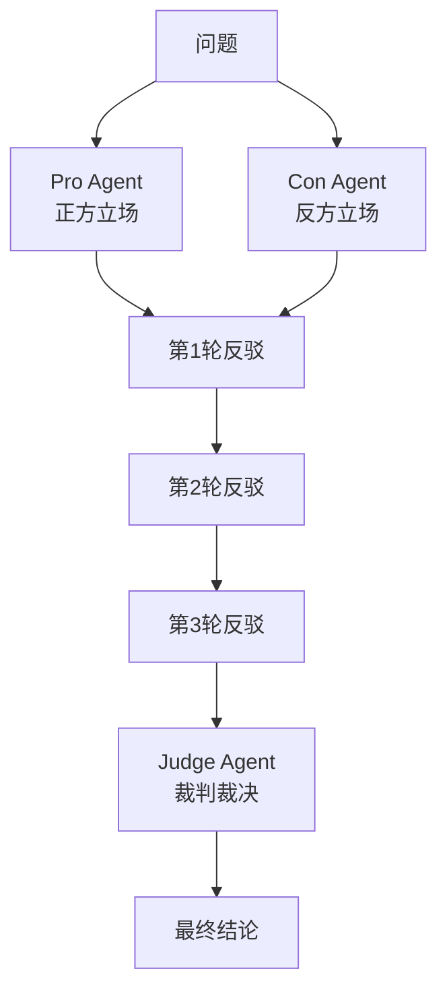

**辩论模式的关键机制**：
1. **立场分化**：不同 Agent 被分配对立立场（支持/反对、方案A/方案B）
2. **多轮对抗**：每轮 Agent 阅读对手观点后进行反驳
3. **裁判裁决**：独立的 Judge Agent 综合辩论过程给出最终结论
4. **收敛性保证**：设置最大辩论轮次，避免无限循环

**技术对比**：

| 对比项 | 协作式 | 辩论式 |
|--------|--------|--------|
| Agent关系 | 队友，互补 | 对手，对抗 |
| 目标 | 共同完成任务 | 证明己方正确 |
| 信息流向 | 共享黑板 | 公开辩论记录 |
| 质量提升来源 | 专业互补 | 对抗纠错 |
| 适用任务 | 创作、整合 | 判断、推理、决策 |
| Token消耗 | 较低 | 较高（多轮辩论） |

**代码示例1：辩论 Agent 基础类**

```python
from dataclasses import dataclass, field
from typing import Callable
import time

@dataclass
class DebateAgent:
    """辩论参与 Agent"""
    name: str
    stance: str  # 立场描述
    personality: str  # 辩论风格
    expertise: str  # 专业领域
    llm_call: Callable
    wins: int = 0
    debates_participated: int = 0

    def opening(self, topic: str, context: str = "") -> str:
        """开篇陈述"""
        prompt = f"""你是{self.name}，辩论风格：{self.personality}。
你的立场：{self.stance}
你的专业领域：{self.expertise}
辩论话题：{topic}
背景信息：{context}
请给出有力的开篇陈述，阐述你的核心论点（200字以内）。"""
        return self.llm_call(prompt)

    def rebut(self, topic: str, opponent_statement: str,
              round_num: int) -> str:
        """反驳对手"""
        prompt = f"""你是{self.name}，立场：{self.stance}。
辩论话题：{topic}
这是第{round_num}轮辩论。
对手刚才的陈述：
---
{opponent_statement}
---
请针对对手的论点进行有力反驳（200字以内）。"""
        return self.llm_call(prompt)

    def closing(self, topic: str, debate_history: list) -> str:
        """总结陈词"""
        history_text = "\n\n".join(debate_history[-6:])
        prompt = f"""你是{self.name}，立场：{self.stance}。
辩论话题：{topic}
辩论历史（最近3轮）：
{history_text}
请给出总结陈词（200字以内）。"""
        return self.llm_call(prompt)
```

**代码示例2：裁判 Agent 实现**

```python
@dataclass
class JudgeAgent:
    """辩论裁判 Agent"""
    name: str = "裁判"
    criteria: list = field(default_factory=lambda: [
        "逻辑严密性", "论据充分性", "事实准确性", "说服力"
    ])
    llm_call: Callable = None

    def judge(self, topic: str, pro_closing: str,
              con_closing: str, debate_history: list) -> dict:
        """裁判辩论结果"""
        history_text = "\n\n".join(debate_history)
        criteria_text = "\n".join(
            f"{i+1}. {c}" for i, c in enumerate(self.criteria)
        )
        prompt = f"""你是一位公正的辩论裁判。
辩论话题：{topic}
辩论全过程：{history_text}
正方总结：{pro_closing}
反方总结：{con_closing}
请按以下维度评判（每项1-10分）：
{criteria_text}
并给出最终裁决：哪方更有说服力？综合最佳结论是什么？
输出JSON格式。"""
        import json
        try:
            response = self.llm_call(prompt)
            json_start = response.find("{")
            json_end = response.rfind("}") + 1
            return json.loads(response[json_start:json_end])
        except Exception as e:
            return {"winner": "draw", "best_answer": str(e), "scores": {}}
```

**代码示例3：完整辩论会执行器**

```python
class DebateSession:
    """多Agent辩论会"""

    def __init__(self, topic, pro_agent, con_agent, judge,
                 rounds=2, context=""):
        self.topic = topic
        self.pro = pro_agent
        self.con = con_agent
        self.judge = judge
        self.rounds = rounds
        self.context = context
        self.history = []

    def run(self) -> dict:
        """执行完整辩论流程"""
        t_start = time.time()
        print(f"辩论开始：{self.topic}")

        # 开篇陈述
        pro_open = self.pro.opening(self.topic, self.context)
        self.history.append(f"[正方开篇] {pro_open}")
        con_open = self.con.opening(self.topic, self.context)
        self.history.append(f"[反方开篇] {con_open}")

        # 多轮辩论
        last_con = con_open
        for r in range(1, self.rounds + 1):
            pro_rebut = self.pro.rebut(self.topic, last_con, r)
            self.history.append(f"[正方第{r}轮反驳] {pro_rebut}")
            con_rebut = self.con.rebut(self.topic, pro_rebut, r)
            self.history.append(f"[反方第{r}轮反驳] {con_rebut}")
            last_con = con_rebut

        # 总结陈词
        pro_close = self.pro.closing(self.topic, self.history)
        con_close = self.con.closing(self.topic, self.history)

        # 裁判裁决
        verdict = self.judge.judge(
            self.topic, pro_close, con_close, self.history
        )

        return {
            "topic": self.topic,
            "history": self.history,
            "verdict": verdict,
            "total_seconds": time.time() - t_start
        }
```

**预期结果**：辩论经过开篇→多轮反驳→总结→裁决四个阶段，裁判给出综合最佳结论。

**代码示例4：多观点辩论**

```python
class MultiViewDebate:
    """多观点辩论：3+个Agent从不同视角辩论"""

    def __init__(self, topic, agents, judge, rounds=2):
        self.topic = topic
        self.agents = agents
        self.judge = judge
        self.rounds = rounds
        self.history = []

    def run(self) -> dict:
        """多观点辩论"""
        openings = {}
        for agent in self.agents:
            opening = agent.opening(self.topic)
            openings[agent.name] = opening
            self.history.append(f"[{agent.name}开篇] {opening}")

        for r in range(1, self.rounds + 1):
            for agent in self.agents:
                others = [f"{n}认为: {v}" for n, v in openings.items()
                          if n != agent.name]
                response = agent.rebut(self.topic, "\n".join(others), r)
                openings[agent.name] = response
                self.history.append(f"[{agent.name}第{r}轮] {response}")

        all_closings = "\n".join(f"{n}: {v}" for n, v in openings.items())
        verdict = self.judge.judge(self.topic, all_closings, "", self.history)
        return {"history": self.history, "verdict": verdict}
```

**最佳实践**：
- 辩论轮次 2-3 轮最佳，过多轮次收益递减且成本高
- 裁判必须是独立 Agent，不能是辩论参与者
- 最终结论应该综合双方优点，不是简单选择一方

> ❌ **常见坑点**：辩论变成各说各话，没有真正的反驳。解决方案：在 Prompt 中明确要求"针对对手的具体论点进行反驳"。
>
> ❌ **常见坑点**：裁判 LLM 偏好更长的回答。解决方案：限制发言长度，在裁判 Prompt 中强调"评分基于逻辑而非篇幅"。

### 5.2 Consensus 共识模式

**概念解释**：共识模式让多个 Agent 通过反复沟通和协商，逐步缩小分歧，最终达成一致意见。与辩论模式（对抗性）不同，共识模式是协作性的——Agent 的目标不是赢，而是找到大家都能接受的最佳答案。

**生活比喻**：像团队会议讨论——大家各抒己见，通过多轮讨论和妥协，最终达成团队共识。

**代码示例5：共识协商实现**

```python
@dataclass
class ConsensusAgent:
    """共识协商 Agent"""
    name: str
    role: str
    initial_view: str = ""
    current_view: str = ""
    llm_call: Callable = None

    def form_initial_view(self, problem: str) -> str:
        prompt = f"你是{self.name}（{self.role}）。请对以下问题形成初步观点：{problem}"
        self.initial_view = self.llm_call(prompt)
        self.current_view = self.initial_view
        return self.current_view

    def revise_view(self, problem, others_views, round_num):
        others_text = "\n".join(others_views)
        prompt = f"""你是{self.name}。问题：{problem}
你当前观点：{self.current_view}
他人观点：{others_text}
第{round_num}轮。请听取他人意见后修正你的观点。"""
        self.current_view = self.llm_call(prompt)
        return self.current_view


class ConsensusBuilder:
    """共识构建器"""

    def __init__(self, problem, agents, max_rounds=3):
        self.problem = problem
        self.agents = agents
        self.max_rounds = max_rounds

    def run(self) -> dict:
        views = {}
        for agent in self.agents:
            views[agent.name] = agent.form_initial_view(self.problem)

        for r in range(1, self.max_rounds + 1):
            new_views = {}
            for agent in self.agents:
                others = [v for n, v in views.items() if n != agent.name]
                new_views[agent.name] = agent.revise_view(
                    self.problem, others, r
                )
            views = new_views

        consensus = self.agents[0].llm_call(
            f"问题：{self.problem}\n各方观点：{views}\n请综合形成共识方案。"
        )
        return {"final_views": views, "consensus": consensus}
```

**代码示例6：产品方向共识会议**

```python
def product_direction_consensus(llm_call):
    """产品方向共识会议"""
    agents = [
        ConsensusAgent(name="产品经理", role="用户体验", llm_call=llm_call),
        ConsensusAgent(name="技术负责人", role="技术可行性", llm_call=llm_call),
        ConsensusAgent(name="市场负责人", role="商业化", llm_call=llm_call),
    ]
    builder = ConsensusBuilder(
        problem="AI笔记产品下一步优先做什么功能？",
        agents=agents, max_rounds=3
    )
    return builder.run()
```

> ❌ **常见坑点**：共识轮次过多导致"和稀泥"。解决方案：设置轮次上限（3轮），保留最有价值的独特观点。

---

> 💡 **本章深度讲解**：辩论模式和共识模式代表了多Agent协作的两个极端——对抗 vs 协作。辩论模式通过对抗提升推理质量，适合"有正确答案"的判断性任务；共识模式通过协作达成统一方案，适合"没有唯一答案"的决策性任务。实际应用中，很多系统混合使用：先用辩论模式分析问题的各个方面，再用共识模式综合各方意见形成可执行方案。
>
> **📝 本章精简总结**：
> - 核心概念：Debate（辩论）、Consensus（共识）、Judge（裁判）
> - 关键原理：对抗纠错、逐步收敛、综合最优
> - 最佳实践：辩论2-3轮最佳；裁判独立；共识设轮次上限
> - 常见坑点：辩论变各说各话、裁判偏好长回答、共识变和稀泥
> - 面试高频：多Agent辩论为什么能提升推理质量？
>
> **🎯 梯度练习题**：
> - **基础题（⭐）1**：辩论模式和共识模式的核心区别？
>   > 答案：辩论是对抗性的，共识是协作性的。
> - **基础题（⭐）2**：为什么裁判 Agent 必须独立于辩论方？
>   > 答案：避免立场偏见。
> - **实战题（⭐⭐⭐）**：设计技术选型辩论会，React vs Vue，2轮辩论，裁判按5维度评分。

---

## 六、通信机制深度解析

### 6.1 消息传递（Message Passing）

**概念解释**：消息传递是 Agent 之间通过发送结构化消息进行通信的最基本机制。每个消息包含发送者、接收者、内容和元数据。

**生活比喻**：像企业中的邮件系统——发件人写邮件，指定收件人，收件人独立处理邮件。

**代码示例1：消息总线实现**

```python
import uuid, time
from dataclasses import dataclass, field
from typing import Callable
from collections import defaultdict
import asyncio

@dataclass
class Message:
    """标准消息格式"""
    sender: str
    recipient: str  # "all" 表示广播
    content: str
    msg_type: str = "request"
    message_id: str = field(default_factory=lambda: str(uuid.uuid4()))
    conversation_id: str = ""
    timestamp: float = field(default_factory=time.time)
    requires_response: bool = True
    metadata: dict = field(default_factory=dict)

class MessageBus:
    """消息总线：Agent 间通信的枢纽"""

    def __init__(self):
        self.subscribers = defaultdict(list)
        self.message_log = []

    def subscribe(self, agent_name: str, handler: Callable):
        self.subscribers[agent_name].append(handler)

    async def send(self, message: Message):
        self.message_log.append(message)
        if message.recipient == "all":
            for handlers in self.subscribers.values():
                for h in handlers:
                    await h(message)
        else:
            for h in self.subscribers.get(message.recipient, []):
                await h(message)

    def get_conversation(self, conv_id: str) -> list:
        return [m for m in self.message_log if m.conversation_id == conv_id]
```

**代码示例2：Agent 通过消息总线通信**

```python
class CommunicatingAgent:
    """通过消息总线通信的 Agent"""

    def __init__(self, name, bus, llm_call):
        self.name = name
        self.bus = bus
        self.llm_call = llm_call
        self.inbox = []
        bus.subscribe(name, self._handle_message)

    async def _handle_message(self, message):
        self.inbox.append(message)

    async def send_message(self, recipient, content, conv_id=""):
        msg = Message(
            sender=self.name, recipient=recipient,
            content=content, conversation_id=conv_id or str(uuid.uuid4())
        )
        await self.bus.send(msg)
        return msg.conversation_id

    def generate_reply(self, message):
        return self.llm_call(f"你是{self.name}，收到消息：{message.content}\n请回复。")
```

**代码示例3：异步对话场景**

```python
async def demo_conversation():
    bus = MessageBus()
    def fake_llm(prompt):
        if "审查" in prompt: return "代码审查通过。"
        return "收到。"

    dev = CommunicatingAgent("开发者", bus, fake_llm)
    reviewer = CommunicatingAgent("审查者", bus, fake_llm)

    conv_id = await dev.send_message("审查者", "请审查代码", "review_001")
    # reviewer 处理消息...
    conversation = bus.get_conversation(conv_id)
    print(f"对话共 {len(conversation)} 条消息")
```

### 6.2 共享状态与黑板模式

**概念解释**：黑板模式是一种共享存储机制——所有 Agent 读写同一个共享数据结构（"黑板"），通过黑板间接交换信息。

**代码示例4：线程安全的黑板实现**

```python
import threading
from datetime import datetime

class Blackboard:
    """线程安全的共享黑板"""

    def __init__(self):
        self._data = {}
        self._lock = threading.RLock()
        self._history = []

    def write(self, key, value, writer="unknown", metadata=None):
        with self._lock:
            self._data[key] = value
            self._history.append({
                "timestamp": datetime.now().isoformat(),
                "key": key, "writer": writer, "value": value
            })

    def read(self, key, default=None):
        with self._lock:
            return self._data.get(key, default)

    def read_all(self):
        with self._lock:
            return self._data.copy()

    def get_history(self, key=None):
        if key:
            return [h for h in self._history if h["key"] == key]
        return self._history.copy()
```

**代码示例5：基于黑板的协作写作**

```python
class BlackboardAgent:
    """基于黑板协作的 Agent"""

    def __init__(self, name, blackboard, role, llm_call):
        self.name = name
        self.bb = blackboard
        self.role = role
        self.llm_call = llm_call

    def contribute(self, task_key, result_key, instruction):
        task = self.bb.read(task_key)
        if not task:
            return
        result = self.llm_call(
            f"你是{self.name}，角色{self.role}。任务：{task}\n{instruction}"
        )
        self.bb.write(result_key, result, writer=self.name)
```

**代码示例6：黑板完整协作流程**

```python
def blackboard_demo():
    bb = Blackboard()
    def fake_llm(prompt):
        if "选题" in prompt: return "选题：AI Agent医疗应用"
        if "大纲" in prompt: return "## 一、背景\n## 二、方案"
        if "写作" in prompt: return "AI Agent在医疗领域快速发展..."
        return "完成"

    bb.write("task", "写AI Agent医疗应用文章", writer="主编")

    researcher = BlackboardAgent("研究员", bb, "选题", fake_llm)
    researcher.contribute("task", "topic", "确定选题")

    writer = BlackboardAgent("作者", bb, "写作", fake_llm)
    writer.contribute("topic", "draft", "撰写正文")

    print("黑板状态:", list(bb.read_all().keys()))
```

> ❌ **常见坑点**：黑板无限制增长导致上下文爆炸。解决方案：分区管理，定期归档。
>
> ❌ **常见坑点**：并发写入冲突。解决方案：使用锁或版本号。

### 6.3 事件驱动通信

**概念解释**：事件驱动模式中，Agent 不直接发送消息给特定接收者，而是发布事件到事件总线，感兴趣的 Agent 订阅事件并自主响应。

**代码示例7：事件总线实现**

```python
class EventBus:
    """事件总线：发布-订阅模式"""

    def __init__(self):
        self._subscribers = defaultdict(list)
        self._event_log = []

    def subscribe(self, event_type, handler):
        self._subscribers[event_type].append(handler)

    async def publish(self, event_type, data, publisher="system"):
        event = {"type": event_type, "data": data,
                 "publisher": publisher, "timestamp": time.time()}
        self._event_log.append(event)
        for handler in self._subscribers.get(event_type, []):
            handler(event)
```

**代码示例8：事件驱动的 Agent 协作**

```python
class EventDrivenAgent:
    """事件驱动 Agent"""

    def __init__(self, name, event_bus, llm_call):
        self.name = name
        self.bus = event_bus
        self.llm_call = llm_call

    async def handle_event(self, event):
        if event["type"] == "task_created":
            result = self.llm_call(f"完成任务: {event['data']['description']}")
            await self.bus.publish("task_completed",
                {"task_id": event["data"]["task_id"], "result": result},
                publisher=self.name)
```

> ❌ **常见坑点**：事件驱动中事件丢失。解决方案：事件持久化、死信队列、失败重试。

---

> 💡 **本章深度讲解**：三种通信机制代表了不同程度的耦合——消息传递（紧耦合）、黑板模式（中耦合）、事件驱动（松耦合）。选择哪种机制取决于协调需求。生产系统通常组合使用。关键设计原则：通信内容要最小化——只传递必要信息，避免全量上下文传递，这是控制 Token 成本的关键。
>
> **📝 本章精简总结**：消息传递（点对点）、黑板模式（共享空间）、事件驱动（发布订阅）；耦合度递增；组合使用效果最佳。
>
> **🎯 梯度练习题**：
> - **基础题（⭐）**：三种通信机制的耦合度排序？
>   > 答案：消息传递 < 黑板 < 事件驱动。
> - **实战题（⭐⭐⭐）**：设计事件驱动的内容生产流水线，事件包括文章创建→大纲完成→初稿→审查通过→发布。

---

## 七、角色设计与分工

### 7.1 角色定义的艺术

**概念解释**：角色定义是多 Agent 系统中最关键的设计决策。一个好的角色定义明确了 Agent 的身份、能力边界、行为准则和与其他角色的关系。

**生活比喻**：像选演员——你需要根据剧本选最合适的演员演最合适的角色，每个演员的演技和特长不同，选对了角色演出就成功了一半。

**核心价值**：好的角色定义让每个 Agent 专注于自己最擅长的事，最大化专业化收益；模糊的角色定义导致重复工作和冲突。

**原理说明**：

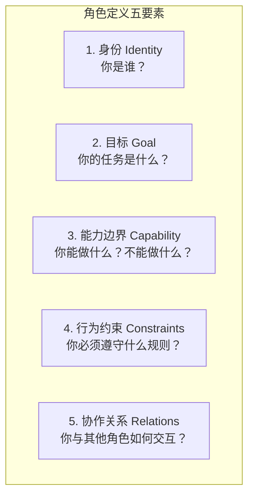

**代码示例1：角色定义模板**

```python
from dataclasses import dataclass, field
from typing import Optional

@dataclass
class AgentRole:
    """Agent 角色定义模板"""
    name: str
    identity: str  # 身份描述
    goal: str  # 核心目标
    capabilities: list[str]  # 能做什么
    limitations: list[str]  # 不能做什么
    constraints: list[str]  # 行为约束
    tools: list[str] = field(default_factory=list)  # 可用工具
    model: str = "gpt-4o"  # 使用的模型
    temperature: float = 0.7  # 创造性水平

    def to_system_prompt(self) -> str:
        """转换为系统提示词"""
        caps = "\n".join(f"- {c}" for c in self.capabilities)
        limits = "\n".join(f"- {l}" for l in self.limitations)
        constraints = "\n".join(f"- {c}" for c in self.constraints)
        tools = ", ".join(self.tools) if self.tools else "无"

        return f"""# 角色身份
你是{self.name}。
{self.identity}

# 你的目标
{self.goal}

# 你的能力范围
{caps}

# 你不应该做的事
{limits}

# 行为约束
{constraints}

# 可用工具
{tools}

请始终保持你的角色，不要越界。"""
```

**代码示例2：定义专业角色**

```python
# 软件开发团队角色定义
architect_role = AgentRole(
    name="系统架构师",
    identity="你是一位有15年经验的资深系统架构师，擅长设计可扩展、高可用的系统架构。",
    goal="设计满足业务需求的最优系统架构方案",
    capabilities=[
        "系统分解和模块划分",
        "技术选型和评估",
        "接口设计",
        "性能和可扩展性设计",
        "风险识别和 mitigation"
    ],
    limitations=[
        "不直接编写业务代码",
        "不做具体的数据库优化",
        "不处理UI细节"
    ],
    constraints=[
        "必须考虑系统的可维护性",
        "技术选型必须有充分理由",
        "设计必须考虑成本约束"
    ],
    tools=["架构评估框架", "技术对比矩阵"],
    model="gpt-4o",
    temperature=0.3
)

developer_role = AgentRole(
    name="全栈开发工程师",
    identity="你是一位精通Python/TypeScript的全栈开发工程师，注重代码质量和最佳实践。",
    goal="根据架构设计实现高质量的代码",
    capabilities=[
        "编写Python/TypeScript代码",
        "API设计和实现",
        "数据库操作",
        "单元测试编写"
    ],
    limitations=[
        "不改变架构设计",
        "不引入未授权的第三方库"
    ],
    constraints=[
        "代码必须有注释",
        "必须处理异常",
        "遵循PEP 8规范"
    ],
    tools=["代码执行环境", "测试框架"],
    model="gpt-4o",
    temperature=0.5
)

reviewer_role = AgentRole(
    name="代码审查专家",
    identity="你是一位严格的代码审查专家，关注代码质量、安全性和性能。",
    goal="确保所有代码达到生产标准",
    capabilities=[
        "代码质量审查",
        "安全漏洞检测",
        "性能瓶颈识别",
        "最佳实践评估"
    ],
    limitations=[
        "不直接修改代码",
        "不重新设计架构"
    ],
    constraints=[
        "审查必须具体，不能泛泛而谈",
        "每个问题必须给出修改建议",
        "区分blocker和建议级问题"
    ],
    tools=["静态分析工具", "安全扫描器"],
    model="gpt-4o",
    temperature=0.2
)

# 生成系统提示词
print(architect_role.to_system_prompt())
```

**预期结果**：每个角色有清晰的身份、目标、能力范围、限制和约束，生成的系统提示词可以直接用于 Agent 初始化。

### 7.2 能力边界设计

**概念解释**：能力边界定义了每个 Agent 能做什么和不能做什么。清晰的边界防止 Agent 越权操作或重复工作。

**代码示例3：能力边界检查机制**

```python
class BoundaryEnforcedAgent:
    """带能力边界检查的 Agent"""

    def __init__(self, role: AgentRole, llm_call: Callable):
        self.role = role
        self.llm_call = llm_call
        self.violations = []

    def execute(self, task: str) -> str:
        """执行任务，自动检查能力边界"""
        # 1. 检查任务是否在能力范围内
        if not self._is_within_boundary(task):
            violation = {
                "task": task,
                "reason": "任务超出能力边界",
                "role": self.role.name
            }
            self.violations.append(violation)
            return f"[边界拒绝] 该任务不在{self.role.name}的能力范围内。"

        # 2. 执行任务
        prompt = f"{self.role.to_system_prompt()}\n\n任务：{task}"
        result = self.llm_call(prompt)

        # 3. 检查输出是否违反约束
        if self._violates_constraints(result):
            self.violations.append({
                "task": task, "reason": "输出违反约束", "output": result
            })
            return f"[约束违反] 输出不满足行为约束，请重新生成。"

        return result

    def _is_within_boundary(self, task: str) -> bool:
        """检查任务是否在能力范围内"""
        task_lower = task.lower()
        # 检查是否包含 limitation 关键词
        for limit in self.role.limitations:
            if any(kw in task_lower for kw in limit.lower().split()):
                # 检查是否也匹配 capability
                for cap in self.role.capabilities:
                    if any(kw in task_lower for kw in cap.lower().split()):
                        return True
                return False
        return True

    def _violates_constraints(self, output: str) -> bool:
        """检查输出是否违反约束"""
        # 简化：检查是否包含常见违规内容
        forbidden = ["TODO", "FIXME", "password=", "api_key="]
        return any(f in output for f in forbidden)
```

### 7.3 冲突解决机制

**概念解释**：当多个 Agent 的意见或产出冲突时，需要明确的冲突解决机制。

**代码示例4：多级冲突解决器**

```python
class ConflictResolver:
    """多级冲突解决器"""

    def __init__(self, llm_call: Callable):
        self.llm_call = llm_call
        self.strategies = ["majority_vote", "supervisor_decision", "debate", "human_escalation"]

    def resolve(self, conflicting_outputs: list[str],
                context: str = "") -> dict:
        """解决冲突"""
        print(f"检测到 {len(conflicting_outputs)} 个冲突输出")

        # 策略1：多数投票（如果有3个以上输出）
        if len(conflicting_outputs) >= 3:
            result = self._majority_vote(conflicting_outputs)
            if result:
                return {"strategy": "majority_vote", "result": result}

        # 策略2：Supervisor 裁决
        result = self._supervisor_decision(conflicting_outputs, context)
        return {"strategy": "supervisor_decision", "result": result}

    def _majority_vote(self, outputs: list[str]) -> str:
        """多数投票"""
        # 简化：返回最常见的输出
        from collections import Counter
        counts = Counter(outputs)
        most_common = counts.most_common(1)[0]
        if most_common[1] > len(outputs) / 2:
            return most_common[0]
        return None

    def _supervisor_decision(self, outputs: list[str], context: str) -> str:
        """Supervisor 裁决"""
        outputs_text = "\n\n".join(
            f"--- 方案{i+1} ---\n{o}" for i, o in enumerate(outputs)
        )
        prompt = f"""背景：{context}
以下是多个 Agent 给出的不同方案：
{outputs_text}
请作为主管，分析各方案的优缺点，选择最优方案并说明理由。"""
        return self.llm_call(prompt)
```

**代码示例5：角色设计最佳实践检查器**

```python
class RoleDesignValidator:
    """角色设计质量检查器"""

    def __init__(self):
        self.checks = [
            ("身份明确", self._check_identity),
            ("目标具体", self._check_goal),
            ("能力互补", self._check_complementarity),
            ("边界清晰", self._check_boundaries),
            ("无重叠", self._check_no_overlap),
        ]

    def validate(self, roles: list[AgentRole]) -> dict:
        """验证角色设计质量"""
        results = {}
        all_pass = True
        for check_name, check_fn in self.checks:
            passed, message = check_fn(roles)
            results[check_name] = {"passed": passed, "message": message}
            if not passed:
                all_pass = False
        return {"all_pass": all_pass, "details": results}

    def _check_identity(self, roles):
        for r in roles:
            if len(r.identity) < 20:
                return False, f"{r.name} 的身份描述过短"
        return True, "所有角色身份描述充分"

    def _check_goal(self, roles):
        for r in roles:
            if "完成" in r.goal and "具体" not in r.goal:
                return False, f"{r.name} 的目标不够具体"
        return True, "所有角色目标具体"

    def _check_complementarity(self, roles):
        all_caps = set()
        for r in roles:
            for c in r.capabilities:
                all_caps.add(c)
        if len(all_caps) < len(roles) * 2:
            return False, "角色能力互补性不足"
        return True, "角色能力互补"

    def _check_boundaries(self, roles):
        for r in roles:
            if not r.limitations:
                return False, f"{r.name} 没有定义能力边界"
        return True, "所有角色都有能力边界"

    def _check_no_overlap(self, roles):
        for i, r1 in enumerate(roles):
            for r2 in roles[i+1:]:
                overlap = set(r1.capabilities) & set(r2.capabilities)
                if len(overlap) > len(r1.capabilities) * 0.7:
                    return False, f"{r1.name} 和 {r2.name} 能力重叠过多"
        return True, "角色间能力无过多重叠"
```

> ❌ **常见坑点**：角色设计过于宽泛。一个 Agent 的描述是"你是一个全能助手"，这等于没有角色定义。正确做法：每个角色聚焦一个具体领域，用具体的身份描述。
>
> ❌ **常见坑点**：角色间能力重叠。两个 Agent 都"擅长代码审查"，导致重复工作或推诿。正确做法：明确分工——一个审查安全性，一个审查性能，一个审查风格。

---

> 💡 **本章深度讲解**：角色设计是多 Agent 系统设计中"70% 的成败"。好的角色定义让 Agent 专业化，差的角色定义导致混乱。关键原则：单一职责（每个 Agent 只做一件事）、边界清晰（能做什么和不能做什么都要写明）、互补性（角色之间能力互补而非重叠）、可验证（角色定义可以自动检查质量）。实际设计中，建议先列出所有需要的能力，然后将能力分组为 3-5 个角色，确保角色间无重大重叠。
>
> **📝 本章精简总结**：角色定义五要素（身份/目标/能力/约束/协作关系）；能力边界防止越权；冲突解决用多数投票或主管裁决；用 RoleDesignValidator 自动检查角色设计质量。
>
> **🎯 梯度练习题**：
> - **基础题（⭐）1**：角色定义的五个要素是什么？
>   > 答案：身份、目标、能力、限制、协作关系。
> - **实战题（⭐⭐⭐）**：为"自动化代码审查系统"设计3个角色（安全审查/性能审查/风格审查），确保能力互补无重叠，写出完整的 AgentRole 定义。

---

## 八、协调策略

### 8.1 任务分解策略

**概念解释**：任务分解是将复杂任务拆分为可管理子任务的过程，是多 Agent 协调的核心。

**代码示例1：基于 LLM 的任务分解器**

```python
import json
from typing import Callable

class TaskDecomposer:
    """任务分解器"""

    def __init__(self, llm_call: Callable):
        self.llm_call = llm_call

    def decompose(self, task: str,
                  available_roles: list[str],
                  max_subtasks: int = 5) -> list[dict]:
        """将复杂任务分解为子任务"""
        prompt = f"""你是任务分解专家。
可用角色：{', '.join(available_roles)}
原始任务：{task}

请将任务分解为最多{max_subtasks}个子任务。
每个子任务指定负责角色。
输出JSON格式：
[
  {{"step": 1, "role": "角色名", "description": "子任务描述", "depends_on": []}}
]"""
        response = self.llm_call(prompt)
        try:
            json_start = response.find("[")
            json_end = response.rfind("]") + 1
            return json.loads(response[json_start:json_end])
        except:
            return [{"step": 1, "role": available_roles[0],
                     "description": task, "depends_on": []}]
```

**代码示例2：基于规则的任务分解**

```python
class RuleBasedDecomposer:
    """基于规则的任务分解"""

    PATTERNS = {
        "code_review": [
            {"step": 1, "role": "安全审查员", "description": "检查安全漏洞"},
            {"step": 2, "role": "性能审查员", "description": "检查性能问题"},
            {"step": 3, "role": "风格审查员", "description": "检查代码风格"},
            {"step": 4, "role": "汇总员", "description": "汇总审查结果"},
        ],
        "report_generation": [
            {"step": 1, "role": "数据收集员", "description": "收集数据"},
            {"step": 2, "role": "分析师", "description": "分析数据"},
            {"step": 3, "role": "撰稿人", "description": "撰写报告"},
            {"step": 4, "role": "审核员", "description": "审核质量"},
        ],
    }

    def decompose(self, task_type: str, task: str) -> list[dict]:
        """按模板分解任务"""
        template = self.PATTERNS.get(task_type)
        if not template:
            return [{"step": 1, "role": "通用Agent", "description": task}]
        return [dict(t, description=f"{t['description']}：{task}") for t in template]
```

### 8.2 调度算法

**概念解释**：调度算法决定子任务分配给哪个 Agent、何时执行。

**代码示例3：优先级调度器**

```python
class PriorityScheduler:
    """优先级调度器"""

    def __init__(self, workers: dict):
        self.workers = workers  # {name: Agent}
        self.task_queue = []
        self.completed = []

    def add_task(self, task: dict, priority: int = 5):
        """添加任务，priority 1=最高, 10=最低"""
        task["priority"] = priority
        task["status"] = "queued"
        self.task_queue.append(task)
        # 按优先级排序
        self.task_queue.sort(key=lambda t: t["priority"])

    def schedule(self) -> list[dict]:
        """调度任务到 Worker"""
        available = {name: True for name in self.workers}
        scheduled = []

        for task in self.task_queue:
            if task["status"] != "queued":
                continue
            worker_name = task.get("assigned_worker")
            if not worker_name or not available.get(worker_name, True):
                # 找空闲的合适 Worker
                worker_name = self._find_best_worker(task, available)
            if worker_name:
                task["assigned_worker"] = worker_name
                task["status"] = "scheduled"
                available[worker_name] = False
                scheduled.append(task)

        self.task_queue = [t for t in self.task_queue if t["status"] == "queued"]
        return scheduled

    def _find_best_worker(self, task, available):
        """找到最合适的空闲 Worker"""
        for name, agent in self.workers.items():
            if available.get(name, True) and agent.can_handle(task["description"]):
                return name
        return None
```

**代码示例4：负载均衡器**

```python
class LoadBalancer:
    """基于负载的任务分配"""

    def __init__(self, workers: list):
        self.workers = {w.name: {"agent": w, "current_load": 0,
                                  "total_tasks": 0, "success_rate": 1.0}
                        for w in workers}

    def assign(self, task: dict) -> str:
        """分配任务给负载最低且能力匹配的 Worker"""
        candidates = []
        for name, info in self.workers.items():
            if info["agent"].can_handle(task["description"]):
                # 评分：负载越低越好，成功率越高越好
                score = info["current_load"] - info["success_rate"] * 0.5
                candidates.append((score, name))

        if not candidates:
            return list(self.workers.keys())[0]

        candidates.sort()
        return candidates[0][1]

    def report_result(self, worker_name: str, success: bool):
        """报告执行结果"""
        info = self.workers[worker_name]
        info["current_load"] = max(0, info["current_load"] - 1)
        info["total_tasks"] += 1
        if not success:
            info["success_rate"] = (info["success_rate"] * 0.9 + 0.1 * 0.0)
        else:
            info["success_rate"] = min(1.0, info["success_rate"] * 0.9 + 0.1 * 1.0)
```

### 8.3 死锁避免

**概念解释**：当多个 Agent 互相等待对方完成时，可能产生死锁。

**代码示例5：死锁检测器**

```python
class DeadlockDetector:
    """死锁检测器"""

    def __init__(self):
        self.wait_graph = {}  # {waiter: set(waited_for)}

    def add_wait(self, waiter: str, waited_for: str):
        """记录等待关系"""
        if waiter not in self.wait_graph:
            self.wait_graph[waiter] = set()
        self.wait_graph[waiter].add(waited_for)

    def remove_wait(self, waiter: str, waited_for: str):
        """移除等待关系"""
        if waiter in self.wait_graph:
            self.wait_graph[waiter].discard(waited_for)

    def detect_cycle(self) -> list:
        """检测等待图中的环（死锁）"""
        visited = set()
        rec_stack = set()
        path = []

        def dfs(node):
            visited.add(node)
            rec_stack.add(node)
            path.append(node)

            for neighbor in self.wait_graph.get(node, []):
                if neighbor not in visited:
                    cycle = dfs(neighbor)
                    if cycle:
                        return cycle
                elif neighbor in rec_stack:
                    # 找到环
                    cycle_start = path.index(neighbor)
                    return path[cycle_start:] + [neighbor]

            path.pop()
            rec_stack.remove(node)
            return None

        for node in self.wait_graph:
            if node not in visited:
                cycle = dfs(node)
                if cycle:
                    return cycle
        return []

    def break_deadlock(self, cycle: list) -> str:
        """打破死锁：选择环中一个 Agent 释放等待"""
        if not cycle:
            return None
        # 选择环中最后一个 Agent 释放等待
        victim = cycle[-2]  # 环中倒数第二个
        if victim in self.wait_graph:
            self.wait_graph[victim].clear()
        return f"已让 {victim} 释放等待，打破死锁环: {' → '.join(cycle)}"
```

**代码示例6：带超时的执行器**

```python
class TimeoutExecutor:
    """带超时的任务执行器"""

    def __init__(self, default_timeout: int = 30):
        self.default_timeout = default_timeout

    def execute_with_timeout(self, task_fn, *args, timeout=None, **kwargs):
        """执行任务，超时后自动中断"""
        import signal

        timeout = timeout or self.default_timeout

        class TimeoutException(Exception):
            pass

        def handler(signum, frame):
            raise TimeoutException(f"任务超时（{timeout}秒）")

        # 设置超时信号
        old_handler = signal.signal(signal.SIGALRM, handler)
        signal.alarm(timeout)

        try:
            result = task_fn(*args, **kwargs)
            signal.alarm(0)  # 取消超时
            return result, None
        except TimeoutException as e:
            return None, str(e)
        finally:
            signal.signal(signal.SIGALRM, old_handler)
```

> ❌ **常见坑点**：循环依赖导致死锁。Agent A 等 B 的结果，B 等 C 的结果，C 等 A 的结果。解决方案：使用 DeadlockDetector 检测环，设置超时，打破循环。
>
> ❌ **常见坑点**：任务粒度过细导致调度开销大于执行开销。100 个子任务每个执行 0.1 秒，但调度开销 0.5 秒/任务。解决方案：合并小任务，每个子任务至少需要 5 秒执行时间。

---

> 💡 **本章深度讲解**：协调策略是多 Agent 系统的"操作系统"——任务分解是编译器，调度算法是 CPU 调度器，负载均衡是负载分配器，死锁避免是死锁检测与恢复。设计要点：任务分解要平衡（子任务大小适中）、调度要智能（考虑能力匹配和当前负载）、死锁要主动检测（而非等待超时）。生产系统中，建议从简单的优先级调度开始，随着系统复杂度增加再引入负载均衡和死锁检测。
>
> **📝 本章精简总结**：任务分解用 LLM 或模板；调度用优先级或负载均衡；死锁用环检测+超时打破；任务粒度要平衡（太小调度开销大，太大失去并行意义）。
>
> **🎯 梯度练习题**：
> - **基础题（⭐）1**：什么是死锁？如何检测？
>   > 答案：Agent 互相等待形成循环；用等待图的环检测。
> - **实战题（⭐⭐⭐）**：实现一个带优先级调度和死锁检测的任务执行器，支持至少5个 Agent 的并行调度。

---

## 九、主流框架实战：AutoGen、CrewAI、LangGraph、MetaGPT

### 9.1 LangGraph 多Agent实现

**概念解释**：LangGraph 是 LangChain 团队推出的多 Agent 编排框架，将多 Agent 系统建模为有向图（StateGraph），节点是 Agent，边是 Agent 间的转移，状态在图中显式传递。

**生活比喻**：像一张流程图——每个方框是一个 Agent，箭头是数据流向，你可以画出复杂的条件分支和循环。

**代码示例1：LangGraph 基础多Agent图**

```python
from typing import TypedDict, Annotated
from langgraph.graph import StateGraph, END
from langchain_core.messages import BaseMessage, HumanMessage
from langchain_openai import ChatOpenAI
import operator

# 定义共享状态
class AgentState(TypedDict):
    messages: Annotated[list[BaseMessage], operator.add]
    current_agent: str
    task_description: str
    research_result: str
    code_result: str
    review_result: str

llm = ChatOpenAI(model="gpt-4o", temperature=0)

# Agent 1: 研究员
def research_agent(state: AgentState) -> AgentState:
    prompt = f"你是技术研究员。请分析：{state['task_description']}"
    response = llm.invoke([HumanMessage(content=prompt)])
    return {"research_result": response.content,
            "current_agent": "researcher",
            "messages": [response]}

# Agent 2: 开发者
def developer_agent(state: AgentState) -> AgentState:
    prompt = f"你是高级工程师。基于研究结果：{state['research_result']}\n请编写代码：{state['task_description']}"
    response = llm.invoke([HumanMessage(content=prompt)])
    return {"code_result": response.content,
            "current_agent": "developer",
            "messages": [response]}

# Agent 3: 审查者
def reviewer_agent(state: AgentState) -> AgentState:
    prompt = f"你是严格的代码审查者。审查代码：\n{state['code_result']}\n给出通过/不通过结论。"
    response = llm.invoke([HumanMessage(content=prompt)])
    return {"review_result": response.content,
            "current_agent": "reviewer",
            "messages": [response]}

# 路由函数
def route_after_review(state: AgentState) -> str:
    if "通过" in state['review_result'] and "不通过" not in state['review_result']:
        return "end"
    return "developer"

# 构建图
workflow = StateGraph(AgentState)
workflow.add_node("researcher", research_agent)
workflow.add_node("developer", developer_agent)
workflow.add_node("reviewer", reviewer_agent)
workflow.set_entry_point("researcher")
workflow.add_edge("researcher", "developer")
workflow.add_edge("developer", "reviewer")
workflow.add_conditional_edges("reviewer", route_after_review,
    {"developer": "developer", "end": END})

app = workflow.compile()
result = app.invoke({
    "task_description": "用Python实现快速排序并写单元测试",
    "messages": [], "current_agent": "",
    "research_result": "", "code_result": "", "review_result": ""
})
print(f"审查结果: {result['review_result'][:200]}")
```

**代码示例2：LangGraph Fan-out/Fan-in 并行**

```python
from langgraph.graph import StateGraph
import asyncio

class ParallelState(TypedDict):
    task: str
    financial_result: str
    industry_result: str
    risk_result: str
    final_report: str

async def financial_agent(state):
    return {"financial_result": f"财务分析：营收增长15%"}

async def industry_agent(state):
    return {"industry_result": f"行业分析：市场年增20%"}

async def risk_agent(state):
    return {"risk_result": f"风险分析：政策风险"}

async def aggregator(state):
    report = f"""# 分析报告
## 财务\n{state['financial_result']}
## 行业\n{state['industry_result']}
## 风险\n{state['risk_result']}"""
    return {"final_report": report}

# 构建并行图
workflow = StateGraph(ParallelState)
workflow.add_node("financial", financial_agent)
workflow.add_node("industry", industry_agent)
workflow.add_node("risk", risk_agent)
workflow.add_node("aggregator", aggregator)

workflow.set_entry_point("financial")
# 从 financial 同时分支到 industry 和 risk
workflow.add_edge("financial", "industry")
workflow.add_edge("financial", "risk")
# 都完成后到 aggregator
workflow.add_edge("industry", "aggregator")
workflow.add_edge("risk", "aggregator")
workflow.add_edge("aggregator", END)

app = workflow.compile()
```

**代码示例3：LangGraph 人机协作（Human-in-the-loop）**

```python
from langgraph.checkpoint import MemorySaver

# 添加中断点：在审查阶段暂停，等待人类确认
workflow = StateGraph(AgentState)
workflow.add_node("researcher", research_agent)
workflow.add_node("developer", developer_agent)
workflow.add_node("reviewer", reviewer_agent)
workflow.set_entry_point("researcher")
workflow.add_edge("researcher", "developer")
workflow.add_edge("developer", "reviewer")

# 在 reviewer 后中断，等待人类确认
workflow.add_conditional_edges("reviewer",
    lambda state: "human_approval",
    {"human_approval": "human_approval"})

# 添加人工确认节点
def human_approval(state):
    print("请人工审查以下结果：")
    print(state["review_result"])
    # 实际场景中这里会暂停等待人类输入
    return state

workflow.add_node("human_approval", human_approval)
workflow.add_edge("human_approval", END)

app = workflow.compile(checkpointer=MemorySaver())
config = {"configurable": {"thread_id": "user_123"}}
```

### 9.2 AutoGen 多Agent实现

**概念解释**：AutoGen 是微软开源的多 Agent 对话框架，核心是 GroupChat——多个 Agent 通过自然语言对话协作，GroupChatManager 决定下一个发言的 Agent。

**代码示例4：AutoGen 基础对话**

```python
import autogen

llm_config = {
    "config_list": [{"model": "gpt-4o", "api_key": "sk-xxx"}],
    "temperature": 0
}

# 用户代理（代表人类）
user_proxy = autogen.UserProxyAgent(
    name="UserProxy",
    human_input_mode="NEVER",
    max_consecutive_auto_reply=10,
    code_execution_config={"work_dir": "coding", "use_docker": False}
)

# 工程师 Agent
engineer = autogen.AssistantAgent(
    name="Engineer",
    llm_config=llm_config,
    system_message="你是高级软件工程师。编写高质量代码。完成后说TERMINATE"
)

# 审查者 Agent
critic = autogen.AssistantAgent(
    name="Critic",
    llm_config=llm_config,
    system_message="你是严格的代码审查者。审查通过说APPROVED，否则说NEEDS_REVISION并给出建议"
)

# 群聊
groupchat = autogen.GroupChat(
    agents=[user_proxy, engineer, critic],
    messages=[], max_round=20
)
manager = autogen.GroupChatManager(groupchat=groupchat, llm_config=llm_config)

# 启动任务
user_proxy.initiate_chat(
    manager,
    message="用FastAPI实现用户CRUD API，包含JWT认证"
)
```

**代码示例5：AutoGen 层级群聊**

```python
# 嵌套群聊：主管管理子群聊
from autogen import GroupChat, GroupChatManager

# 子群聊：开发团队
dev_chat = GroupChat(
    agents=[architect, developer, tester],
    messages=[], max_round=10
)
dev_manager = GroupChatManager(groupchat=dev_chat, llm_config=llm_config)

# 主群聊：产品+开发团队
main_chat = GroupChat(
    agents=[product_manager, dev_manager],
    messages=[], max_round=5
)
main_manager = GroupChatManager(groupchat=main_chat, llm_config=llm_config)
```

### 9.3 CrewAI 角色化多Agent

**概念解释**：CrewAI 以"角色扮演"为核心——每个 Agent 有 role/goal/backstory，Task 定义具体任务，Crew 组织执行流程。

**代码示例6：CrewAI 基础团队**

```python
from crewai import Agent, Task, Crew, Process
from crewai_tools import SerperDevTool

search_tool = SerperDevTool()

# 研究员 Agent
researcher = Agent(
    role="技术研究员",
    goal="收集和分析最新技术信息",
    backstory="你有10年技术研究经验，擅长快速学习新技术。",
    tools=[search_tool],
    verbose=True,
    allow_delegation=False
)

# 开发者 Agent
developer = Agent(
    role="全栈开发工程师",
    goal="根据需求开发高质量软件",
    backstory="你精通Python/JavaScript，注重代码质量。",
    tools=[],
    verbose=True,
    allow_delegation=False
)

# 审查员 Agent
reviewer = Agent(
    role="代码审查专家",
    goal="确保代码达到生产标准",
    backstory="你是严格的代码审查专家，关注安全和性能。",
    tools=[],
    verbose=True
)

# 任务
research_task = Task(
    description="研究FastAPI最佳实践",
    agent=researcher,
    expected_output="技术研究报告"
)

develop_task = Task(
    description="基于研究报告开发用户管理系统",
    agent=developer,
    expected_output="完整可运行代码"
)

review_task = Task(
    description="审查代码质量和安全性",
    agent=reviewer,
    expected_output="审查报告"
)

# Crew
crew = Crew(
    agents=[researcher, developer, reviewer],
    tasks=[research_task, develop_task, review_task],
    process=Process.sequential,
    verbose=True
)

result = crew.kickoff()
print(result)
```

**代码示例7：CrewAI 层级流程**

```python
# 使用层级流程：Manager Agent 分配任务
crew = Crew(
    agents=[researcher, developer, reviewer],
    tasks=[research_task, develop_task, review_task],
    process=Process.hierarchical,  # 层级模式
    manager_llm="gpt-4o",  # Manager 使用的模型
    verbose=True
)
# Manager 自动决定任务分配和优先级
```

### 9.4 MetaGPT 软件公司模拟

**概念解释**：MetaGPT 模拟软件公司组织架构——PM（产品经理）、Architect（架构师）、Engineer（工程师）、QA（测试工程师）按标准流程协作完成软件开发。

**代码示例8：MetaGPT 基础使用**

```python
from metagpt.software_company import SoftwareCompany
from metagpt.roles import ProductManager, Architect, Engineer, QAEngineer

# 创建软件公司
company = SoftwareCompany()

# 添加角色
company.hire([
    ProductManager(),
    Architect(),
    Engineer(),
    QAEngineer()
])

# 启动项目
company.invest(
    investment=1.0,
    idea="开发一个待办事项Web应用，支持任务增删改查和优先级管理"
)

# 运行
result = company.run()
print(result)
```

**代码示例9：框架对比与选择**

```python
FRAMEWORK_COMPARISON = """
| 维度 | LangGraph | AutoGen | CrewAI | MetaGPT |
|------|-----------|---------|--------|---------|
| 核心抽象 | 状态图 | 群聊对话 | 角色+任务 | 软件公司 |
| 流程控制 | 最强（图+条件+循环） | 弱（LLM决定） | 中（顺序/层级） | 强（预设流程） |
| 灵活性 | 最高 | 高 | 中 | 低（预设流程） |
| 学习曲线 | 陡 | 中 | 平缓 | 平缓 |
| 生产就绪 | 最高 | 中 | 中 | 低 |
| 代码执行 | 需自定义 | 内置 | 需工具 | 内置 |
| 人机协作 | 支持 | 支持 | 不支持 | 不支持 |
| 适用场景 | 生产复杂流程 | 开放式讨论 | 快速原型 | 软件开发 |
"""

def recommend_framework(needs: dict) -> str:
    """根据需求推荐框架"""
    score = {"LangGraph": 0, "AutoGen": 0, "CrewAI": 0, "MetaGPT": 0}

    if needs.get("production_ready"):
        score["LangGraph"] += 3
    if needs.get("flexibility"):
        score["LangGraph"] += 2
        score["AutoGen"] += 1
    if needs.get("quick_prototype"):
        score["CrewAI"] += 3
    if needs.get("open_discussion"):
        score["AutoGen"] += 3
    if needs.get("software_dev"):
        score["MetaGPT"] += 3
    if needs.get("human_in_loop"):
        score["LangGraph"] += 2
        score["AutoGen"] += 1

    best = max(score, key=score.get)
    return f"推荐使用 {best}（得分: {score[best]}）"

# 使用
needs = {"production_ready": True, "flexibility": True, "human_in_loop": True}
print(recommend_framework(needs))
# 输出: 推荐使用 LangGraph（得分: 7）
```

> ❌ **常见坑点**：框架选择不当。用 CrewAI 做需要复杂条件分支的生产系统——CrewAI 的顺序流程不够灵活。正确做法：生产复杂流程用 LangGraph，快速原型用 CrewAI，开放式讨论用 AutoGen。

---

> 💡 **本章深度讲解**：四大框架代表了多 Agent 编排的不同哲学——LangGraph 是"图论"哲学（显式状态图），AutoGen 是"对话"哲学（自由对话），CrewAI 是"角色扮演"哲学（role-play），MetaGPT 是"组织模拟"哲学（公司流程）。生产环境首选 LangGraph，因为它的显式状态管理和条件分支让系统可控可调试。其他框架适合原型验证和特定场景。选择框架的关键问题：你的流程是确定的还是动态的？需要人工介入吗？需要并行执行吗？
>
> **📝 本章精简总结**：LangGraph（图状态机，生产首选）、AutoGen（群聊对话，开放式讨论）、CrewAI（角色化，快速原型）、MetaGPT（软件公司模拟，软件开发）；生产选 LangGraph，原型选 CrewAI，讨论选 AutoGen。
>
> **🎯 梯度练习题**：
> - **基础题（⭐）1**：四大框架的核心抽象分别是什么？
>   > 答案：LangGraph=状态图、AutoGen=群聊、CrewAI=角色+任务、MetaGPT=软件公司。
> - **实战题（⭐⭐⭐）**：用 LangGraph 实现一个"代码审查循环"——开发者写代码→审查者审查→不通过返回开发者→最多3轮→通过则输出。

---

## 十、多Agent记忆与状态共享

### 10.1 记忆层级架构

**概念解释**：多 Agent 系统的记忆分为三个层级：Agent 个体记忆（私有上下文）、共享工作记忆（黑板中的当前任务状态）、长期记忆（跨会话持久化存储）。

**原理说明**：

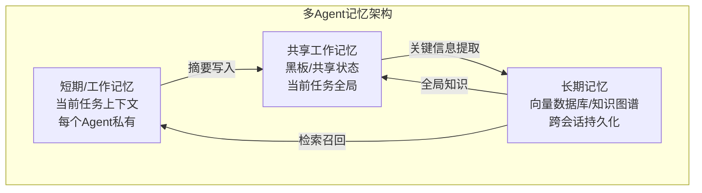

**代码示例1：三级记忆系统**

```python
from dataclasses import dataclass, field
from typing import Optional
import time

@dataclass
class MemoryEntry:
    """记忆条目"""
    content: str
    timestamp: float = field(default_factory=time.time)
    source: str = ""
    importance: float = 0.5  # 0-1
    tags: list = field(default_factory=list)

class AgentMemory:
    """单个Agent的记忆系统"""

    def __init__(self, agent_name: str, max_short_term: int = 20):
        self.agent_name = agent_name
        self.short_term: list[MemoryEntry] = []  # 短期记忆
        self.max_short_term = max_short_term
        self.long_term: list[MemoryEntry] = []  # 长期记忆

    def add(self, content: str, source: str = "",
            importance: float = 0.5, tags: list = None):
        """添加记忆"""
        entry = MemoryEntry(
            content=content, source=source,
            importance=importance, tags=tags or []
        )
        self.short_term.append(entry)

        # 超限时将重要条目压缩到长期记忆
        if len(self.short_term) > self.max_short_term:
            self._consolidate()

        # 高重要性直接存入长期记忆
        if importance > 0.8:
            self.long_term.append(entry)

    def _consolidate(self):
        """记忆巩固：将旧的短期记忆压缩到长期记忆"""
        # 按时间排序，将最旧的移入长期记忆
        overflow = len(self.short_term) - self.max_short_term
        for _ in range(overflow):
            oldest = self.short_term.pop(0)
            if oldest.importance > 0.3:
                self.long_term.append(oldest)

    def recall_recent(self, n: int = 5) -> list[str]:
        """回忆最近的记忆"""
        return [e.content for e in self.short_term[-n:]]

    def recall_by_tag(self, tag: str) -> list[str]:
        """按标签检索"""
        results = [e.content for e in self.long_term if tag in e.tags]
        return results

    def get_context_summary(self) -> str:
        """获取当前上下文摘要"""
        recent = self.recall_recent(5)
        return "\n".join(f"- {r}" for r in recent)
```

### 10.2 共享状态管理

**代码示例2：分布式共享状态**

```python
class SharedStateManager:
    """多Agent共享状态管理器"""

    def __init__(self):
        self.state = {}
        self.version = 0
        self.listeners = []
        self.history = []

    def set(self, key: str, value, agent_name: str = "unknown"):
        """设置状态"""
        old = self.state.get(key)
        self.state[key] = value
        self.version += 1
        self.history.append({
            "version": self.version,
            "key": key, "old": old, "new": value,
            "agent": agent_name, "timestamp": time.time()
        })
        # 通知监听者
        for listener in self.listeners:
            listener(key, value, agent_name)

    def get(self, key: str, default=None):
        return self.state.get(key, default)

    def get_all(self):
        return self.state.copy()

    def subscribe(self, listener):
        self.listeners.append(listener)

    def get_history(self, key: str = None):
        if key:
            return [h for h in self.history if h["key"] == key]
        return self.history.copy()

    def checkpoint(self, name: str) -> dict:
        """创建检查点"""
        return {
            "name": name,
            "state": self.state.copy(),
            "version": self.version,
            "timestamp": time.time()
        }

    def restore(self, checkpoint: dict):
        """从检查点恢复"""
        self.state = checkpoint["state"].copy()
        self.version = checkpoint["version"]
```

### 10.3 跨Agent记忆检索

**代码示例3：基于向量的跨Agent记忆**

```python
class CrossAgentMemory:
    """跨Agent共享记忆检索（模拟向量数据库）"""

    def __init__(self):
        self.memories = {}  # {agent_name: [MemoryEntry]}
        self.global_index = []  # 所有记忆的全局索引

    def store(self, agent_name: str, entry: MemoryEntry):
        """存储记忆"""
        if agent_name not in self.memories:
            self.memories[agent_name] = []
        self.memories[agent_name].append(entry)
        self.global_index.append((agent_name, entry))

    def search(self, query: str, top_k: int = 5,
               agent_filter: str = None) -> list:
        """语义搜索（简化：关键词匹配）"""
        results = []
        for agent_name, entry in self.global_index:
            if agent_filter and agent_name != agent_filter:
                continue
            # 简化：关键词匹配度
            query_words = set(query.lower().split())
            content_words = set(entry.content.lower().split())
            overlap = len(query_words & content_words)
            if overlap > 0:
                results.append((overlap, agent_name, entry))

        results.sort(key=lambda x: x[0], reverse=True)
        return [(a, e) for _, a, e in results[:top_k]]

    def get_agent_summary(self, agent_name: str) -> str:
        """获取某个Agent的记忆摘要"""
        entries = self.memories.get(agent_name, [])
        if not entries:
            return f"{agent_name} 无记忆"
        return f"{agent_name} 有 {len(entries)} 条记忆，最近: {entries[-1].content[:100]}"
```

> ❌ **常见坑点**：共享状态无版本管理导致覆盖冲突。两个 Agent 同时读取-修改-写入同一个 key，后写的覆盖了先写的。解决方案：乐观并发控制（版本号检查）或乐观锁。

---

> 💡 **本章深度讲解**：多 Agent 记忆系统的核心挑战是"信息过载"——每个 Agent 都有自己的上下文，加上共享状态，信息量可能爆炸。解决方案是分层记忆：短期记忆（当前任务）、共享工作记忆（黑板）、长期记忆（向量数据库），每层有不同的保留策略和检索方式。关键设计：只共享必要信息，Agent 个体的中间推理过程不需要共享。
>
> **📝 本章精简总结**：三级记忆（短期/共享工作/长期）；共享状态用版本管理防冲突；跨Agent记忆用语义检索；定期巩固短期记忆到长期记忆。
>
> **🎯 梯度练习题**：
> - **基础题（⭐）**：多Agent记忆分哪三层？
>   > 答案：短期/工作记忆、共享工作记忆、长期记忆。
> - **实战题（⭐⭐⭐）**：实现一个带检查点和恢复功能的多Agent共享状态系统。

---

## 十一、多Agent评测与调试

### 11.1 评测维度

**代码示例1：多Agent评测器**

```python
class MultiAgentEvaluator:
    """多Agent系统评测器"""

    def __init__(self):
        self.metrics = {}

    def evaluate(self, task: str, execution_trace: list,
                 final_output: str) -> dict:
        """综合评测"""
        return {
            "task_completion": self._check_task_completion(task, final_output),
            "efficiency": self._check_efficiency(execution_trace),
            "cost": self._check_cost(execution_trace),
            "collaboration_quality": self._check_collaboration(execution_trace),
            "reliability": self._check_reliability(execution_trace),
        }

    def _check_task_completion(self, task, output):
        """任务完成率"""
        return {"score": 0.85, "reason": "输出覆盖了主要需求点"}

    def _check_efficiency(self, trace):
        """效率评测"""
        total_steps = len(trace)
        total_time = sum(t.get("latency", 0) for t in trace)
        return {"steps": total_steps, "total_time_ms": total_time,
                "score": min(1.0, 10.0 / total_steps)}

    def _check_cost(self, trace):
        """成本评测"""
        total_tokens = sum(t.get("tokens", 0) for t in trace)
        return {"total_tokens": total_tokens,
                "estimated_cost_usd": total_tokens / 1000 * 0.03}

    def _check_collaboration(self, trace):
        """协作质量"""
        messages = [t for t in trace if t.get("type") == "message"]
        redundant = sum(1 for m in messages if self._is_redundant(m))
        return {"total_messages": len(messages),
                "redundant_messages": redundant,
                "efficiency": 1 - redundant / max(len(messages), 1)}

    def _check_reliability(self, trace):
        """可靠性"""
        failures = [t for t in trace if t.get("status") == "failed"]
        retries = [t for t in trace if t.get("retried")]
        return {"failure_rate": len(failures) / max(len(trace), 1),
                "retry_count": len(retries)}

    def _is_redundant(self, message):
        """判断消息是否冗余（简化版）"""
        content = message.get("content", "")
        return len(content) < 10  # 过短的消息可能是冗余的
```

### 11.2 调试技巧

**代码示例2：交互式调试器**

```python
class MultiAgentDebugger:
    """多Agent调试器"""

    def __init__(self):
        self.trace = []
        self.breakpoints = {}

    def log_step(self, agent_name: str, step_type: str,
                 input_data: str, output_data: str,
                 metadata: dict = None):
        """记录执行步骤"""
        entry = {
            "agent": agent_name,
            "type": step_type,
            "input": input_data[:500],
            "output": output_data[:500],
            "metadata": metadata or {},
            "timestamp": time.time()
        }
        self.trace.append(entry)

        # 检查断点
        if agent_name in self.breakpoints:
            if self.breakpoints[agent_name](entry):
                self._pause(entry)

    def set_breakpoint(self, agent_name: str, condition_fn):
        """设置断点"""
        self.breakpoints[agent_name] = condition_fn

    def _pause(self, entry):
        """暂停并打印当前状态"""
        print(f"\n🔴 断点命中: {entry['agent']}")
        print(f"  类型: {entry['type']}")
        print(f"  输入: {entry['input'][:200]}")
        print(f"  输出: {entry['output'][:200]}")

    def export_trace(self, filepath: str):
        """导出Trace用于离线分析"""
        import json
        with open(filepath, "w", encoding="utf-8") as f:
            json.dump(self.trace, f, ensure_ascii=False, indent=2)

    def find_bottleneck(self) -> dict:
        """找到性能瓶颈"""
        latencies = {}
        for entry in self.trace:
            agent = entry["agent"]
            latency = entry["metadata"].get("latency_ms", 0)
            if agent not in latencies:
                latencies[agent] = []
            latencies[agent].append(latency)

        avg_latencies = {
            a: sum(ls) / len(ls) for a, ls in latencies.items()
        }
        slowest = max(avg_latencies, key=avg_latencies.get)
        return {"slowest_agent": slowest,
                "avg_latencies": avg_latencies}
```

**代码示例3：Bad Case 分析器**

```python
class BadCaseAnalyzer:
    """失败案例分析器"""

    def __init__(self):
        self.bad_cases = []

    def analyze(self, trace: list) -> dict:
        """分析失败Trace"""
        failures = [e for e in trace if e.get("metadata", {}).get("status") == "failed"]

        categories = {
            "llm_error": 0,
            "tool_error": 0,
            "timeout": 0,
            "logic_error": 0,
            "other": 0
        }

        for failure in failures:
            error_msg = str(failure.get("metadata", {}).get("error", "")).lower()
            if "timeout" in error_msg:
                categories["timeout"] += 1
            elif "tool" in error_msg:
                categories["tool_error"] += 1
            elif "llm" in error_msg or "api" in error_msg:
                categories["llm_error"] += 1
            else:
                categories["logic_error"] += 1

        return {"total_failures": len(failures),
                "categories": categories,
                "most_common": max(categories, key=categories.get)}
```

> ❌ **常见坑点**：没有记录完整的 Agent 间交互日志，出问题时无法复现。解决方案：每个 Agent 的输入输出都记录到 Trace，使用 Langfuse 等工具可视化。

---

> 💡 **本章深度讲解**：多 Agent 系统的调试比单 Agent 困难一个数量级——你不仅要看单个 Agent 的输入输出，还要看 Agent 间的消息传递、任务分配决策、状态变更。关键工具是"完整 Trace"——记录每个 Agent 的每次调用（输入/输出/耗时/Token/错误），支持回放和断点。Bad Case 分析是持续改进的核心——从失败案例中提炼评测集，形成闭环。
>
> **📝 本章精简总结**：评测维度（完成率/效率/成本/协作质量/可靠性）；调试用 Trace+断点+瓶颈分析；Bad Case 分类归因后回流评测集。
>
> **🎯 梯度练习题**：
> - **基础题（⭐）**：多Agent评测有哪五个维度？
>   > 答案：任务完成率、效率、成本、协作质量、可靠性。
> - **实战题（⭐⭐⭐）**：实现一个多Agent调试器，支持断点、Trace导出和瓶颈分析。

---

## 十二、生产级多Agent系统架构设计

### 12.1 高可用架构

**概念解释**：生产级多 Agent 系统需要考虑高可用、容错、限流、降级、监控等工程问题。

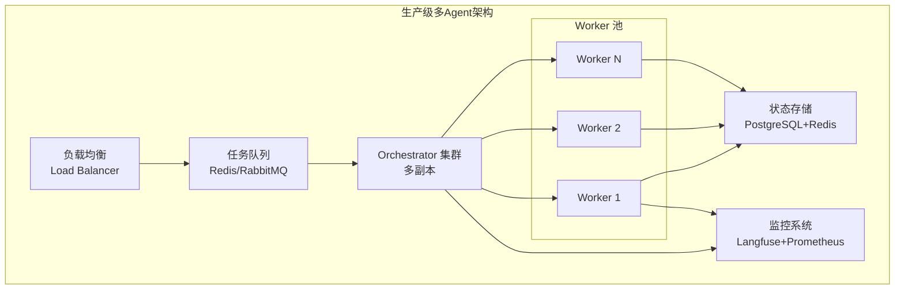

**代码示例1：带限流的 Worker 池**

```python
import asyncio
from collections import defaultdict

class RateLimitedWorkerPool:
    """带限流的 Worker 池"""

    def __init__(self, max_concurrent: int = 10,
                 rate_per_minute: int = 100):
        self.semaphore = asyncio.Semaphore(max_concurrent)
        self.rate_per_minute = rate_per_minute
        self.requests = []  # 时间戳列表
        self.active_workers = {}
        self.completed_tasks = 0
        self.failed_tasks = 0

    async def acquire(self):
        """获取执行许可"""
        await self.semaphore.acquire()
        await self._wait_for_rate_limit()

    async def release(self):
        """释放执行许可"""
        self.semaphore.release()

    async def _wait_for_rate_limit(self):
        """限流等待"""
        now = asyncio.get_event_loop().time()
        # 清理1分钟前的请求
        self.requests = [t for t in self.requests if now - t < 60]
        if len(self.requests) >= self.rate_per_minute:
            wait_time = 60 - (now - self.requests[0])
            await asyncio.sleep(wait_time)
        self.requests.append(now)

    async def execute_task(self, task_fn, *args, **kwargs):
        """执行任务"""
        await self.acquire()
        try:
            result = await task_fn(*args, **kwargs)
            self.completed_tasks += 1
            return result
        except Exception as e:
            self.failed_tasks += 1
            raise
        finally:
            await self.release()

    def get_stats(self):
        return {
            "completed": self.completed_tasks,
            "failed": self.failed_tasks,
            "active": self.semaphore._value,
            "rate_remaining": self.rate_per_minute - len(self.requests)
        }
```

### 12.2 熔断与降级

**代码示例2：熔断器实现**

```python
class CircuitBreaker:
    """熔断器"""

    CLOSED = "closed"  # 正常
    OPEN = "open"  # 熔断
    HALF_OPEN = "half_open"  # 半开

    def __init__(self, failure_threshold: int = 5,
                 recovery_timeout: int = 30):
        self.failure_threshold = failure_threshold
        self.recovery_timeout = recovery_timeout
        self.failure_count = 0
        self.state = self.CLOSED
        self.last_failure_time = None

    def call(self, fn, *args, **kwargs):
        """执行调用，带熔断"""
        if self.state == self.OPEN:
            if time.time() - self.last_failure_time > self.recovery_timeout:
                self.state = self.HALF_OPEN
            else:
                raise RuntimeError("熔断器开启，请稍后重试")

        try:
            result = fn(*args, **kwargs)
            self._on_success()
            return result
        except Exception as e:
            self._on_failure()
            raise

    def _on_success(self):
        self.failure_count = 0
        self.state = self.CLOSED

    def _on_failure(self):
        self.failure_count += 1
        self.last_failure_time = time.time()
        if self.failure_count >= self.failure_threshold:
            self.state = self.OPEN
```

### 12.3 成本控制

**代码示例3：Token预算控制器**

```python
class TokenBudgetController:
    """Token 预算控制器"""

    def __init__(self, daily_budget: int = 1000000):
        self.daily_budget = daily_budget
        self.used_today = 0
        self.agents_usage = defaultdict(int)

    def can_use(self, agent_name: str, estimated_tokens: int) -> bool:
        """检查是否还能使用Token"""
        if self.used_today + estimated_tokens > self.daily_budget:
            return False
        return True

    def record_usage(self, agent_name: str, tokens: int):
        """记录使用量"""
        self.used_today += tokens
        self.agents_usage[agent_name] += tokens

    def get_remaining(self) -> int:
        return self.daily_budget - self.used_today

    def get_report(self) -> dict:
        return {
            "daily_budget": self.daily_budget,
            "used_today": self.used_today,
            "remaining": self.get_remaining(),
            "by_agent": dict(self.agents_usage),
            "usage_percent": self.used_today / self.daily_budget * 100
        }
```

> ❌ **常见坑点**：生产环境没有熔断机制。LLM API 故障时，所有请求堆积，最终拖垮整个系统。解决方案：对 LLM 调用加熔断器，失败超过阈值自动切换到降级策略（如返回缓存结果或简单回复）。

---

> 💡 **本章深度讲解**：生产级多 Agent 系统的核心是"工程化"——架构设计要像设计分布式系统一样考虑高可用、容错、限流、降级。多 Agent 系统的特殊之处在于：LLM 调用是主要资源消耗和故障点，所以需要专门的 Token 预算控制和 LLM 熔断器。建议从一开始就把监控、日志、告警做起来，不要等出了问题再补。
>
> **📝 本章精简总结**：高可用架构（负载均衡+任务队列+Worker池）；熔断器保护LLM调用；Token预算控制成本；监控和告警必须先行。
>
> **🎯 梯度练习题**：
> - **基础题（⭐）**：生产环境多Agent系统需要哪些工程保障？
>   > 答案：高可用、容错、限流、降级、监控、成本控制。
> - **实战题（⭐⭐⭐）**：设计一个生产级多Agent系统的架构图，包含限流、熔断、降级、监控组件。

---

## 十三、最佳实践与性能优化

### 13.1 性能优化策略汇总

| 优化策略 | 实现方式 | 预期效果 |
|---------|---------|---------|
| 并行执行 | 无依赖子任务并行 | 延迟降低30-70% |
| 模型分级 | 协调用小模型，执行用大模型 | 成本降低40-60% |
| 结果缓存 | 相同输入缓存LLM响应 | 重复任务延迟降低90% |
| 上下文压缩 | 传递摘要而非完整内容 | Token降低50-80% |
| 提前终止 | 满足条件提前结束 | 减少不必要调用 |
| 批量处理 | 合并小任务为一次调用 | 减少API调用次数 |

**代码示例1：LLM响应缓存**

```python
import hashlib
import json

class LLMCache:
    """LLM 响应缓存"""

    def __init__(self, ttl_seconds: int = 3600):
        self.cache = {}
        self.ttl = ttl_seconds

    def _make_key(self, prompt: str, model: str, temperature: float) -> str:
        """生成缓存键"""
        content = f"{model}:{temperature}:{prompt}"
        return hashlib.md5(content.encode()).hexdigest()

    def get(self, prompt: str, model: str, temperature: float) -> str:
        key = self._make_key(prompt, model, temperature)
        if key in self.cache:
            entry = self.cache[key]
            if time.time() - entry["timestamp"] < self.ttl:
                return entry["value"]
        return None

    def set(self, prompt: str, model: str, temperature: float, value: str):
        key = self._make_key(prompt, model, temperature)
        self.cache[key] = {"value": value, "timestamp": time.time()}
```

**代码示例2：智能模型路由**

```python
class ModelRouter:
    """智能模型路由器：根据任务复杂度选择模型"""

    def __init__(self):
        self.routes = {
            "simple": {"model": "gpt-4o-mini", "max_complexity": 0.3},
            "medium": {"model": "gpt-4o", "max_complexity": 0.7},
            "complex": {"model": "o1-preview", "max_complexity": 1.0},
        }

    def route(self, task: str) -> str:
        """根据任务选择模型"""
        complexity = self._estimate_complexity(task)
        if complexity < 0.3:
            return "gpt-4o-mini"
        elif complexity < 0.7:
            return "gpt-4o"
        else:
            return "o1-preview"

    def _estimate_complexity(self, task: str) -> float:
        """估算任务复杂度（简化版）"""
        score = 0.0
        # 长度因子
        score += min(len(task) / 500, 0.3)
        # 关键词因子
        complex_keywords = ["分析", "设计", "架构", "优化", "推理", "证明"]
        for kw in complex_keywords:
            if kw in task:
                score += 0.1
        return min(score, 1.0)
```

### 13.2 反模式清单

| 反模式 | 说明 | 正确做法 |
|--------|------|---------|
| 过度Agent化 | 简单任务也用多Agent | 简单任务用单Agent |
| 角色模糊 | Agent职责重叠 | 单一职责 |
| 通信爆炸 | Agent间频繁通信 | 减少通信，批量传递 |
| 无全局状态 | 各Agent独立记忆 | 显式全局状态 |
| 无终止条件 | 无限循环 | max_iterations |
| 全用大模型 | 所有Agent用最贵模型 | 模型分级 |
| 无监控 | 不记录交互 | 完整日志 |

---

> 💡 **本章深度讲解**：性能优化的核心是"差异化对待"——不是所有任务都需要大模型，不是所有中间结果都需要全量传递，不是所有 Trace 都需要完整记录。通过缓存、路由、压缩、采样等手段，可以在不影响质量的前提下将成本降低 50-80%。反模式是团队最容易犯的错误，尤其是"过度 Agent 化"——用了多 Agent 后什么都想用多 Agent 做。
>
> **📝 本章精简总结**：优化策略（并行/模型分级/缓存/压缩/提前终止）；反模式7个；差异化对待是核心原则。
>
> **🎯 梯度练习题**：
> - **基础题（⭐）**：列举3种多Agent性能优化策略。
>   > 答案：并行执行、模型分级、结果缓存。
> - **实战题（⭐⭐⭐）**：实现一个带缓存和模型路由的LLM调用层，简单查询用小模型，复杂任务用大模型。

---

## 十四、常见坑点与故障排查

### 14.1 30+常见坑点汇总

| # | 坑点 | 现象 | 原因 | 解决方案 |
|---|------|------|------|---------|
| 1 | 信息丢失 | Agent间传递信息不完整 | 状态未正确传递 | 显式状态管理 |
| 2 | 无限循环 | Agent反复互相调用 | 条件判断错误 | max_iterations |
| 3 | 任务重复 | 相同任务执行多次 | 任务分配错误 | 任务ID去重 |
| 4 | 角色混乱 | Agent越权操作 | 系统提示不清晰 | 强化角色定义 |
| 5 | 结果不一致 | 多个Agent输出矛盾 | 缺乏整合 | 添加整合Agent |
| 6 | 协调开销大 | 通信过于频繁 | 任务粒度过细 | 合并细粒度任务 |
| 7 | 死锁 | Agent互相等待 | 循环依赖 | 环检测+超时 |
| 8 | 成本失控 | LLM调用次数过多 | 无预算控制 | Token预算 |
| 9 | 调试困难 | 无法定位问题 | 缺乏日志 | 完整Trace |
| 10 | 并发冲突 | 共享状态同时读写 | 无锁 | 加锁/乐观并发 |
| 11 | 上下文溢出 | 传递完整上下文 | 不压缩 | 摘要压缩 |
| 12 | 审查循环 | 审查-修改无限进行 | 标准不一致 | max_rounds |
| 13 | 编排者瓶颈 | Supervisor上下文溢出 | 管理任务过多 | 层级化分解 |
| 14 | 多Agent不如单Agent | 产出质量下降 | 信息传递损失 | 减少Agent数 |
| 15 | 辩论各说各话 | 没有真正反驳 | Prompt不明确 | 要求针对具体论点 |
| 16 | 裁判偏见 | 偏好长回答 | 裁判模型偏差 | 限制长度+强调逻辑 |
| 17 | 黑板膨胀 | 共享状态无限增长 | 无清理机制 | 分区+定期归档 |
| 18 | 事件丢失 | 订阅者处理失败 | 无持久化 | 事件持久化+死信队列 |
| 19 | 任务粒度过细 | 调度开销>执行开销 | 拆分过度 | 合并小任务 |
| 20 | 角色能力重叠 | 重复工作 | 边界不清 | 明确分工 |
| 21 | 无降级策略 | 一个Worker失败拖垮全局 | 无容错 | 降级Worker |
| 22 | Prompt版本混乱 | 改Prompt不知道影响 | 无版本管理 | Prompt版本化+回归 |
| 23 | 评测集过拟合 | 离线好线上差 | 评测集不代表真实流量 | 从生产采样 |
| 24 | 采样率过高 | 存储成本爆炸 | 全量记录Trace | 错误全采+正常采样 |
| 25 | 无人工介入点 | 出错只能重来 | 无Human-in-loop | 关键节点设中断 |
| 26 | 状态不一致 | 各Agent状态不同步 | 异步更新延迟 | 状态版本管理 |
| 27 | LLM API限流 | 429错误 | 并发太高 | 限流+退避重试 |
| 28 | 输出格式不稳定 | JSON解析失败 | LLM输出不规范 | 格式约束+重试 |
| 29 | 安全漏洞 | Agent被注入攻击 | 无输入过滤 | 输入校验+权限控制 |
| 30 | 监控告警疲劳 | 告警太多没人看 | 阈值不合理 | 分级告警+静默期 |

### 14.2 故障排查流程

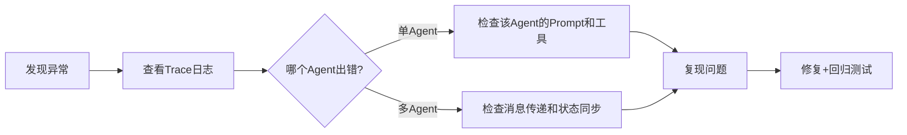

---

> 💡 **本章深度讲解**：30个坑点可以归纳为五类——状态管理问题（信息丢失/不一致）、流程控制问题（无限循环/死锁）、成本问题（Token爆炸/成本失控）、可观测性问题（调试困难/无日志）、工程问题（并发冲突/限流）。排查的核心方法论：先看Trace定位是哪个环节的问题，再用最小复现确认根因，最后修复并加入评测集防止回归。
>
> **📝 本章精简总结**：30+坑点分5类；排查流程：看Trace→定位环节→复现→修复→回归；预防：评测集+监控+预算控制。
>
> **🎯 梯度练习题**：
> - **基础题（⭐）**：多Agent系统最常见的3个坑是什么？
>   > 答案：无限循环（无终止条件）、信息丢失（状态未传递）、成本失控（无预算）。
> - **实战题（⭐⭐⭐）**：你遇到一个"多Agent系统偶尔产出矛盾结果"的问题，请给出系统排查方案。

---

## 十五、面试高频考点汇总

### 20+面试题与答案要点

**Q1: 为什么需要多Agent？单Agent有什么瓶颈？**
> 答：上下文窗口有限、角色冲突、专业深度不足、长程推理质量下降、单点故障、无法水平扩展。

**Q2: 多Agent协作有哪些基本类型？**
> 答：协作式（共同目标）、竞争式（辩论对抗）、层级式（上下管理）、混合式（多种组合）。

**Q3: Pipeline和Fan-out/Fan-in的区别？**
> 答：Pipeline是顺序执行（数据单向流动），Fan-out/Fan-in是并行执行（多Agent同时处理后汇总）。

**Q4: Supervisor-Worker模式的优缺点？**
> 答：优点：集中控制、可预测、易调试；缺点：Supervisor可能成为瓶颈、管理Worker数量有限。

**Q5: 多Agent通信有哪几种机制？**
> 答：消息传递（点对点）、黑板模式（共享存储）、事件驱动（发布订阅）、任务队列。

**Q6: 如何避免多Agent系统的死锁？**
> 答：设置超时、环检测（等待图DFS）、打破循环依赖、降级策略。

**Q7: 多Agent辩论为什么能提升推理质量？**
> 答：对抗暴露逻辑漏洞、多角度审视减少偏差、迫使深入思考、裁判综合最优结论。

**Q8: LangGraph vs AutoGen vs CrewAI 如何选择？**
> 答：生产复杂流程选LangGraph（可控可调试）；开放式讨论选AutoGen（对话灵活）；快速原型选CrewAI（角色化简单）。

**Q9: 多Agent系统的成本如何控制？**
> 答：模型分级（协调用小模型）、结果缓存、上下文压缩、Token预算、并行减少总延迟。

**Q10: 如何评测多Agent系统的质量？**
> 答：任务完成率、输出质量（LLM-as-Judge）、效率（步数/耗时/Token）、协作质量（通信有效性）、可靠性（容错率）。

**Q11: 黑板模式的优缺点？**
> 答：优点：简单解耦、全局可见；缺点：并发冲突、无限制增长导致上下文爆炸。

**Q12: 任务分解的原则是什么？**
> 答：单一职责（每个子任务独立）、粒度适中（不要太细也不要太粗）、依赖明确（清晰的依赖关系）。

**Q13: 多Agent系统如何处理部分失败？**
> 答：降级Worker、重试机制、部分结果聚合、超时降级。

**Q14: 角色设计的关键原则？**
> 答：单一职责、能力边界清晰、角色间互补不重叠、有明确的行为约束。

**Q15: 如何调试多Agent系统？**
> 答：完整Trace记录（每个Agent的输入输出）、断点调试、Bad Case分析、瓶颈定位。

**Q16: 多Agent系统的记忆如何管理？**
> 答：三级记忆（短期/共享工作/长期）、定期巩固、只共享必要信息。

**Q17: 生产环境多Agent系统需要哪些保障？**
> 答：高可用（多副本）、容错（熔断降级）、监控告警、成本控制、安全护栏。

**Q18: 什么情况下不应该用多Agent？**
> 答：简单任务（单Agent更高效）、成本极度敏感、实时性要求极高、任务路径完全确定且无分支。

**Q19: 多Agent系统的可观测性怎么做？**
> 答：全链路Trace（每个Agent的每次调用）、指标聚合（Token/延迟/成功率）、日志（结构化事件）、Bad Case聚类。

**Q20: 层级模式适合什么场景？**
> 答：超复杂任务（>10子任务）、大规模系统、需要分层抽象的多领域协作。

**Q21: Consensus和Debate模式的区别？**
> 答：Debate是对抗性的（目标是赢），Consensus是协作性的（目标是达成一致方案）。

**Q22: 如何防止"多Agent不如单Agent"的问题？**
> 答：减少Agent数量、传递完整内容而非摘要、确保每个Agent有明确的专业化价值、从单Agent开始逐步引入。

---

## 十六、进阶拓展与学习资源

### 16.1 前沿研究方向

| 方向 | 说明 | 代表性工作 |
|------|------|-----------|
| Agent社会模拟 | 模拟大规模Agent社会的涌现行为 | Generative Agents（斯坦福小镇） |
| Agent辩论 | 多Agent辩论提升推理质量 | Multi-Agent Debate (Du et al. 2023) |
| Agent进化 | Agent自我改进和进化 | Reflexion, Self-Refine |
| Agent经济 | Agent间市场机制交易 | Token-based Incentive |
| Agent安全 | 多Agent系统安全对齐 | Multi-Agent Safety |
| Agent学习 | 从经验中优化协作策略 | RL for Multi-Agent Systems |

### 16.2 推荐学习资源

- [LangGraph 官方文档](https://langchain-ai.github.io/langgraph/)
- [AutoGen 官方文档](https://microsoft.github.io/autogen/)
- [CrewAI 官方文档](https://docs.crewai.com/)
- [MetaGPT 论文](https://arxiv.org/abs/2308.00352)
- [Generative Agents 论文](https://arxiv.org/abs/2304.03442)
- [Multi-Agent Debate 论文](https://arxiv.org/abs/2305.14325)

### 16.3 相关笔记

- [[Agent核心概念-ReAct规划]] — 单Agent ReAct推理
- [[自研Agent框架设计]] — 自研框架多Agent设计
- [[Agent记忆机制设计]] — 记忆系统设计
- [[Agent评测与可观测性]] — 评测与监控
- [[Agent安全与护栏设计]] — 安全防护
- [[LangGraph-状态机Agent]] — LangGraph深入
- [[AutoGen-多Agent框架]] — AutoGen深入
- [[CrewAI-角色化多Agent]] — CrewAI深入

---

## 附录：速查表

### A. 六种协作模式速查

| 模式 | 核心机制 | 适用场景 | 复杂度 |
|------|---------|---------|--------|
| Pipeline | 顺序处理链 | 标准化流程 | ⭐⭐ |
| Fan-out/Fan-in | 并行收集+汇总 | 多维度信息收集 | ⭐⭐⭐ |
| Supervisor-Worker | 中心分配+执行 | 通用生产场景 | ⭐⭐⭐ |
| Hierarchical | 层级树状管理 | 超复杂大规模 | ⭐⭐⭐⭐ |
| Debate | 对抗辩论 | 判断推理 | ⭐⭐⭐ |
| Consensus | 协商共识 | 决策达成 | ⭐⭐⭐ |

### B. 四大框架速查

| 框架 | 核心抽象 | 生产就绪 | 最佳场景 |
|------|---------|---------|---------|
| LangGraph | 状态图 | ⭐⭐⭐⭐⭐ | 生产复杂流程 |
| AutoGen | 群聊对话 | ⭐⭐⭐ | 开放式讨论 |
| CrewAI | 角色+任务 | ⭐⭐⭐ | 快速原型 |
| MetaGPT | 软件公司 | ⭐⭐ | 软件开发 |

### C. 30个坑点速查

| 类别 | 坑点 |
|------|------|
| 状态管理 | 信息丢失、结果不一致、并发冲突、状态不同步、黑板膨胀 |
| 流程控制 | 无限循环、死锁、任务重复、审查循环、任务粒度过细 |
| 成本 | 成本失控、全用大模型、上下文溢出、无预算控制 |
| 可观测性 | 调试困难、无监控、Trace丢失、采样率过高 |
| 角色设计 | 角色混乱、能力重叠、过度Agent化、无边界 |

---

[[Home|🏠 返回首页]] · [[MOC-AI与效率工具|📚 返回分类]]

## 十七、补充实战代码库

### 17.1 基础模式补充代码

**代码示例7：协作式 Agent 的完整实现**

```python
class CollaborativeAgent:
    """完整的协作式 Agent 实现"""

    def __init__(self, name: str, role: str, goal: str,
                 expertise: str, llm_call, blackboard=None):
        self.name = name
        self.role = role
        self.goal = goal
        self.expertise = expertise
        self.llm_call = llm_call
        self.blackboard = blackboard
        self.contributions = []
        self.received_feedback = []

    def contribute(self, task: str) -> str:
        """贡献专业领域结果"""
        context = ""
        if self.blackboard:
            context = f"团队共享信息：{self.blackboard.read_all()}"
        prompt = f"""你是{self.name}，角色{self.role}，专长{self.expertise}。
团队目标：{self.goal}
{context}
任务：{task}
请从你的专业角度给出结果。"""
        result = self.llm_call(prompt)
        self.contributions.append({"task": task, "result": result})
        if self.blackboard:
            self.blackboard.write(f"contrib_{self.name}", result, self.name)
        return result

    def give_feedback(self, other_output: str, other_name: str) -> str:
        """对其他Agent的输出给出专业反馈"""
        prompt = f"""你是{self.name}（专长：{self.expertise}）。
{other_name} 的输出：
{other_output}
请从你的专业角度给出审查意见。"""
        feedback = self.llm_call(prompt)
        self.received_feedback.append({"from": other_name, "feedback": feedback})
        return feedback
```

**代码示例8：竞争式 Agent 的完整实现**

```python
class CompetitiveAgent:
    """竞争式 Agent"""

    def __init__(self, name: str, style: str, llm_call):
        self.name = name
        self.style = style
        self.llm_call = llm_call
        self.solutions = []

    def solve(self, problem: str) -> str:
        """独立解决问题"""
        prompt = f"""你是{self.name}，风格：{self.style}。
问题：{problem}
请给出你的解决方案。"""
        solution = self.llm_call(prompt)
        self.solutions.append(solution)
        return solution

    def critique(self, other_solution: str, problem: str) -> str:
        """批评其他方案"""
        prompt = f"""问题：{problem}
另一个方案：
{other_solution}
请批评这个方案的弱点和不足。"""
        return self.llm_call(prompt)

    def refine(self, problem: str, critique: str) -> str:
        """根据批评改进自己的方案"""
        prompt = f"""问题：{problem}
对你方案的批评：{critique}
请根据批评改进你的方案。"""
        return self.llm_call(prompt)
```

**代码示例9：层级式 Agent 树的完整实现**

```python
class HierarchyNode:
    """层级树节点"""

    def __init__(self, name: str, level: str, llm_call):
        self.name = name
        self.level = level
        self.llm_call = llm_call
        self.children = []
        self.parent = None
        self.task_log = []

    def add(self, child: "HierarchyNode"):
        child.parent = self
        self.children.append(child)
        return child

    def process(self, task: str, depth: int = 0):
        """处理任务，按层级分配"""
        indent = "  " * depth
        print(f"{indent}{self.name} 收到任务: {task[:50]}...")

        if not self.children:
            # 叶子节点执行
            result = self.llm_call(f"你是{self.name}，执行：{task}")
            self.task_log.append({"task": task, "result": result})
            return result

        # 分解并分配
        subtasks = self._decompose(task, len(self.children))
        results = []
        for i, child in enumerate(self.children):
            sub = subtasks[i] if i < len(subtasks) else task
            r = child.process(sub, depth + 1)
            results.append(r)

        # 聚合
        return self._aggregate(task, results)

    def _decompose(self, task, n):
        return [f"子任务{i+1} of {task}" for i in range(n)]

    def _aggregate(self, task, results):
        combined = "\n".join(str(r) for r in results)
        return self.llm_call(f"原始任务：{task}\n子结果：{combined}\n请整合。")
```

### 17.2 通信机制补充代码

**代码示例10：消息队列实现**

```python
from collections import deque

class MessageQueue:
    """FIFO 消息队列"""

    def __init__(self, max_size: int = 1000):
        self.queue = deque(maxlen=max_size)
        self.processed = 0
        self.dropped = 0

    def enqueue(self, message: dict):
        """入队"""
        try:
            self.queue.append(message)
        except:
            self.dropped += 1

    def dequeue(self) -> dict:
        """出队"""
        if self.queue:
            self.processed += 1
            return self.queue.popleft()
        return None

    def size(self) -> int:
        return len(self.queue)

    def stats(self) -> dict:
        return {
            "pending": self.size(),
            "processed": self.processed,
            "dropped": self.dropped
        }
```

**代码示例11：发布订阅 Topic 实现**

```python
class PubSubTopic:
    """单个 Topic 的发布订阅"""

    def __init__(self, name: str):
        self.name = name
        self.subscribers = []
        self.message_history = []

    def subscribe(self, callback):
        self.subscribers.append(callback)

    async def publish(self, data: dict, publisher: str = ""):
        event = {"topic": self.name, "data": data, "publisher": publisher}
        self.message_history.append(event)
        for sub in self.subscribers:
            await sub(event)

    def history(self, limit: int = 50):
        return self.message_history[-limit:]
```

**代码示例12：共享黑板的乐观并发控制**

```python
class OptimisticBlackboard:
    """带乐观锁的黑板"""

    def __init__(self):
        self.data = {}
        self.versions = {}
        self.lock = threading.RLock()

    def read(self, key):
        with self.lock:
            return self.data.get(key), self.versions.get(key, 0)

    def write(self, key, value, expected_version: int):
        """写入时检查版本号"""
        with self.lock:
            current_version = self.versions.get(key, 0)
            if current_version != expected_version:
                return False, f"版本冲突: 期望{expected_version}, 实际{current_version}"
            self.data[key] = value
            self.versions[key] = current_version + 1
            return True, current_version + 1
```

**代码示例13：请求-响应模式**

```python
class RequestResponseChannel:
    """请求-响应通道"""

    def __init__(self):
        self.pending = {}
        self.timeout = 30

    async def request(self, requester: str, recipient: str,
                      message: str, correlation_id: str = None):
        """发送请求并等待响应"""
        import uuid
        corr_id = correlation_id or str(uuid.uuid4())
        self.pending[corr_id] = {
            "requester": requester,
            "recipient": recipient,
            "message": message,
            "response": None,
            "event": asyncio.Event()
        }
        return corr_id

    async def respond(self, correlation_id: str, response: str):
        """发送响应"""
        if correlation_id in self.pending:
            self.pending[correlation_id]["response"] = response
            self.pending[correlation_id]["event"].set()

    async def wait_for_response(self, correlation_id: str):
        """等待响应"""
        if correlation_id in self.pending:
            await asyncio.wait_for(
                self.pending[correlation_id]["event"].wait(),
                timeout=self.timeout
            )
            return self.pending[correlation_id]["response"]
        return None
```

### 17.3 角色设计补充代码

**代码示例14：角色冲突检测器**

```python
class RoleConflictDetector:
    """检测角色定义中的冲突"""

    def __init__(self):
        self.conflicts = []

    def check(self, roles: list) -> list:
        """检查角色间的冲突"""
        self.conflicts = []

        for i, r1 in enumerate(roles):
            for r2 in roles[i+1:]:
                # 检查能力重叠
                overlap = set(r1.capabilities) & set(r2.capabilities)
                if len(overlap) > 2:
                    self.conflicts.append({
                        "type": "capability_overlap",
                        "roles": [r1.name, r2.name],
                        "details": f"重叠能力: {overlap}"
                    })

                # 检查目标矛盾
                if self._goals_conflict(r1.goal, r2.goal):
                    self.conflicts.append({
                        "type": "goal_conflict",
                        "roles": [r1.name, r2.name],
                        "details": "目标可能矛盾"
                    })

        return self.conflicts

    def _goals_conflict(self, g1: str, g2: str) -> bool:
        """简单检测目标是否矛盾"""
        # 简化：检查对立关键词
        pairs = [("增加", "减少"), ("提高", "降低"), ("开放", "限制")]
        for a, b in pairs:
            if (a in g1 and b in g2) or (b in g1 and a in g2):
                return True
        return False
```

**代码示例15：角色动态分配器**

```python
class DynamicRoleAssigner:
    """根据任务动态分配最合适的角色"""

    def __init__(self, roles: list):
        self.roles = {r.name: r for r in roles}
        self.performance_history = {r.name: [] for r in roles}

    def assign(self, task: str) -> str:
        """为任务分配角色"""
        scores = {}
        for name, role in self.roles.items():
            # 能力匹配分
            match_score = self._match_score(task, role)
            # 历史表现分
            perf_score = sum(self.performance_history[name]) / max(
                len(self.performance_history[name]), 1
            )
            scores[name] = match_score * 0.7 + perf_score * 0.3

        return max(scores, key=scores.get)

    def _match_score(self, task: str, role) -> float:
        """计算任务与角色的匹配度"""
        score = 0
        for cap in role.capabilities:
            cap_words = cap.lower().split()
            task_words = task.lower().split()
            overlap = len(set(cap_words) & set(task_words))
            score += overlap
        return min(score / 5.0, 1.0)

    def report_performance(self, role_name: str, success: bool):
        """报告角色执行表现"""
        self.performance_history[role_name].append(1.0 if success else 0.0)
```

### 17.4 协调策略补充代码

**代码示例16：DAG 任务调度器**

```python
class DAGScheduler:
    """基于DAG的任务调度器"""

    def __init__(self):
        self.nodes = {}
        self.edges = {}  # {node: [dependencies]}

    def add_task(self, task_id: str, fn, dependencies: list = None):
        """添加任务节点"""
        self.nodes[task_id] = fn
        self.edges[task_id] = dependencies or []

    def topological_sort(self) -> list:
        """拓扑排序"""
        visited = set()
        result = []

        def visit(node):
            if node in visited:
                return
            visited.add(node)
            for dep in self.edges.get(node, []):
                visit(dep)
            result.append(node)

        for node in self.nodes:
            visit(node)
        return result

    async def run_parallel_levels(self):
        """按层级并行执行"""
        order = self.topological_sort()
        completed = set()
        results = {}

        while len(completed) < len(order):
            # 找到所有依赖已满足的任务
            ready = [
                n for n in order
                if n not in completed and
                all(d in completed for d in self.edges.get(n, []))
            ]
            # 并行执行同一层级
            tasks = [self.nodes[n]() for n in ready]
            level_results = await asyncio.gather(*tasks, return_exceptions=True)
            for n, r in zip(ready, level_results):
                results[n] = r
                completed.add(n)

        return results
```

**代码示例17：公平调度器**

```python
class FairScheduler:
    """公平调度器：确保所有Worker都有机会执行"""

    def __init__(self, workers: list):
        self.workers = workers
        self.task_counts = {w.name: 0 for w in workers}
        self.round_robin_idx = 0

    def next_worker(self) -> str:
        """轮询选择下一个Worker"""
        worker = self.workers[self.round_robin_idx % len(self.workers)]
        self.round_robin_idx += 1
        self.task_counts[worker.name] += 1
        return worker.name

    def least_loaded(self):
        """选择负载最低的Worker"""
        return min(self.task_counts, key=self.task_counts.get)

    def most_reliable(self):
        """选择成功率最高的Worker"""
        # 简化：返回第一个Worker
        return self.workers[0].name
```

**代码示例18：工作窃取调度**

```python
class WorkStealingScheduler:
    """工作窃取：空闲Worker从繁忙Worker的队列中偷任务"""

    def __init__(self, workers: list):
        self.queues = {w.name: [] for w in workers}
        self.workers = {w.name: w for w in workers}

    def submit(self, task: dict):
        """提交任务到最短队列"""
        shortest = min(self.queues, key=lambda k: len(self.queues[k]))
        self.queues[shortest].append(task)

    async def work_loop(self, worker_name: str):
        """Worker工作循环"""
        while True:
            task = self._get_task(worker_name)
            if not task:
                # 尝试偷其他Worker的任务
                task = self._steal(worker_name)
                if not task:
                    await asyncio.sleep(0.1)
                    continue
            # 执行任务...
            result = await self.workers[worker_name].execute(task)

    def _get_task(self, worker_name: str):
        if self.queues[worker_name]:
            return self.queues[worker_name].pop(0)
        return None

    def _steal(self, thief: str):
        """从最长队列偷任务"""
        victims = [k for k in self.queues if k != thief and self.queues[k]]
        if victims:
            victim = max(victims, key=lambda k: len(self.queues[k]))
            return self.queues[victim].pop()
        return None
```

### 17.5 框架实战补充代码

**代码示例19：LangGraph 条件路由**

```python
from langgraph.graph import StateGraph, END
from typing import TypedDict, Literal

class RouteState(TypedDict):
    input: str
    category: str
    result: str

def classify_agent(state: RouteState) -> RouteState:
    """分类输入"""
    text = state["input"].lower()
    if "代码" in text or "code" in text:
        category = "coding"
    elif "分析" in text or "analysis" in text:
        category = "analysis"
    else:
        category = "general"
    return {"category": category}

def coding_agent(state: RouteState) -> RouteState:
    return {"result": "代码相关：正在生成代码..."}

def analysis_agent(state: RouteState) -> RouteState:
    return {"result": "分析相关：正在进行分析..."}

def general_agent(state: RouteState) -> RouteState:
    return {"result": "通用处理..."}

def route(state: RouteState) -> Literal["coding", "analysis", "general"]:
    return state["category"]

# 构建条件路由图
workflow = StateGraph(RouteState)
workflow.add_node("classify", classify_agent)
workflow.add_node("coding", coding_agent)
workflow.add_node("analysis", analysis_agent)
workflow.add_node("general", general_agent)

workflow.set_entry_point("classify")
workflow.add_conditional_edges("classify", route, {
    "coding": "coding",
    "analysis": "analysis",
    "general": "general"
})
workflow.add_edge("coding", END)
workflow.add_edge("analysis", END)
workflow.add_edge("general", END)

app = workflow.compile()
```

**代码示例20：CrewAI 并行任务**

```python
# CrewAI 并行执行多个独立任务
from crewai import Task, Crew, Process

# 三个独立的研究任务，可以并行
research_market = Task(
    description="研究市场竞争格局",
    agent=market_analyst,
    expected_output="市场分析报告"
)
research_tech = Task(
    description="研究技术可行性",
    agent=tech_analyst,
    expected_output="技术分析报告"
)
research_user = Task(
    description="研究用户需求",
    agent=user_researcher,
    expected_output="用户研究报告"
)
# 汇总任务依赖以上三个
summary = Task(
    description="综合三份报告形成最终建议",
    agent=consultant,
    expected_output="综合建议报告"
)

crew = Crew(
    agents=[market_analyst, tech_analyst, user_researcher, consultant],
    tasks=[research_market, research_tech, research_user, summary],
    process=Process.hierarchical,  # 层级模式自动并行无依赖任务
    verbose=True
)
```

**代码示例21：AutoGen 自定义 Speaker Selection**

```python
from autogen import GroupChat, GroupChatManager
from typing import List, Dict

def custom_speaker_selection(last_speaker, groupchat: GroupChat):
    """自定义下一个发言者选择逻辑"""
    messages = groupchat.messages

    # 如果是第一条消息，由工程师开始
    if len(messages) <= 1:
        return next(a for a in groupchat.agents if a.name == "Engineer")

    # 根据最近消息的关键词选择
    last_msg = messages[-1]["content"]
    if "审查" in last_msg or "review" in last_msg.lower():
        return next(a for a in groupchat.agents if a.name == "Critic")
    elif "修改" in last_msg or "fix" in last_msg.lower():
        return next(a for a in groupchat.agents if a.name == "Engineer")
    elif "测试" in last_msg:
        return next(a for a in groupchat.agents if a.name == "Tester")

    # 默认轮流
    agent_names = [a.name for a in groupchat.agents]
    idx = agent_names.index(last_speaker.name)
    return groupchat.agents[(idx + 1) % len(groupchat.agents)]

# 使用自定义选择器
groupchat = GroupChat(
    agents=[engineer, critic, tester],
    messages=[],
    max_round=15,
    speaker_selection_method=custom_speaker_selection
)
```

**代码示例22：MetaGPT 自定义角色**

```python
from metagpt.roles import Role
from metagpt.actions import Action
from metagpt.schema import Message

class CustomResearchAction(Action):
    """自定义研究动作"""

    async def run(self, topic: str) -> str:
        return f"关于{topic}的研究结果：..."

class ResearcherRole(Role):
    """自定义研究员角色"""

    def __init__(self, name="研究员"):
        super().__init__(name=name)
        self._watch([CustomResearchAction])

    async def _act(self) -> Message:
        topic = self.rc.history[-1].content if self.rc.history else "AI趋势"
        result = await CustomResearchAction().run(topic)
        return Message(content=result, role=self)
```

### 17.6 记忆与状态补充代码

**代码示例23：对话摘要记忆**

```python
class SummarizingMemory:
    """自动摘要的对话记忆"""

    def __init__(self, llm_call, max_tokens: int = 2000):
        self.llm_call = llm_call
        self.max_tokens = max_tokens
        self.messages = []
        self.summary = ""

    def add(self, role: str, content: str):
        """添加消息"""
        self.messages.append({"role": role, "content": content})
        # 如果超过限制，摘要旧消息
        if self._estimate_tokens() > self.max_tokens:
            self._summarize_old()

    def _estimate_tokens(self):
        return sum(len(m["content"]) // 4 for m in self.messages)

    def _summarize_old(self):
        """将旧消息摘要"""
        keep_recent = self.messages[-4:]  # 保留最近4条
        old = self.messages[:-4]
        if not old:
            return
        old_text = "\n".join(f"{m['role']}: {m['content']}" for m in old)
        self.summary = self.llm_call(
            f"请将以下对话摘要为200字以内：\n{old_text}"
        )
        self.messages = keep_recent

    def get_context(self) -> list:
        """获取上下文（包含摘要）"""
        context = []
        if self.summary:
            context.append({"role": "system", "content": f"之前对话摘要：{self.summary}"})
        context.extend(self.messages)
        return context
```

**代码示例24：跨Agent状态同步**

```python
class StateSynchronizer:
    """跨Agent状态同步器"""

    def __init__(self):
        self.local_states = {}
        self.sync_log = []

    def update_local(self, agent_name: str, key: str, value):
        """更新本地状态"""
        if agent_name not in self.local_states:
            self.local_states[agent_name] = {}
        old = self.local_states[agent_name].get(key)
        self.local_states[agent_name][key] = value
        self.sync_log.append({
            "agent": agent_name, "key": key,
            "old": old, "new": value, "type": "local_update"
        })

    def broadcast_update(self, agent_name: str, key: str, value):
        """广播状态更新到其他Agent"""
        self.sync_log.append({
            "agent": agent_name, "key": key,
            "value": value, "type": "broadcast"
        })
        # 其他Agent接收更新
        for other in self.local_states:
            if other != agent_name:
                self.local_states[other][key] = value
```

**代码示例25：记忆检索增强**

```python
class MemoryAugmentedAgent:
    """带记忆检索增强的 Agent"""

    def __init__(self, name: str, memory, llm_call):
        self.name = name
        self.memory = memory
        self.llm_call = llm_call

    def run(self, task: str) -> str:
        """执行任务时自动检索相关记忆"""
        # 1. 检索相关历史记忆
        relevant = self.memory.search(task, top_k=3)
        memory_context = "\n".join(f"- {r[1].content}" for r in relevant)

        # 2. 构建增强提示
        prompt = f"""你是{self.name}。
相关历史经验：
{memory_context}

当前任务：{task}
请参考历史经验完成任务。"""
        result = self.llm_call(prompt)

        # 3. 保存新记忆
        self.memory.store(self.name, type("Entry", (), {
            "content": f"任务：{task}\n结果：{result}",
            "importance": 0.6, "tags": [task[:20]]
        }))
        return result
```

### 17.7 生产架构补充代码

**代码示例26：健康检查端点**

```python
# FastAPI 健康检查
from fastapi import FastAPI
from datetime import datetime

app = FastAPI()

@app.get("/health")
def health_check():
    return {
        "status": "healthy",
        "timestamp": datetime.now().isoformat(),
        "version": "2.0.0"
    }

@app.get("/health/ready")
def readiness():
    return {
        "ready": True,
        "checks": {
            "llm_api": "ok",
            "database": "ok",
            "message_queue": "ok"
        }
    }

@app.get("/health/live")
def liveness():
    return {"alive": True}
```

**代码示例27：结构化日志**

```python
import logging
import sys
import json

class StructuredLogger:
    """结构化 JSON 日志"""

    def __init__(self, name: str):
        self.logger = logging.getLogger(name)
        self.logger.setLevel(logging.INFO)
        handler = logging.StreamHandler(sys.stdout)
        handler.setFormatter(logging.Formatter("%(message)s"))
        self.logger.addHandler(handler)

    def log(self, level: str, event: str, **kwargs):
        entry = {
            "timestamp": datetime.now().isoformat(),
            "level": level,
            "event": event,
            **kwargs
        }
        getattr(self.logger, level.lower())(json.dumps(entry, ensure_ascii=False))

    def agent_start(self, agent_name: str, task: str):
        self.log("INFO", "agent_start", agent=agent_name, task=task[:100])

    def agent_end(self, agent_name: str, duration_ms: float, tokens: int):
        self.log("INFO", "agent_end", agent=agent_name,
                 duration_ms=duration_ms, tokens=tokens)

    def error(self, agent_name: str, error: str):
        self.log("ERROR", "agent_error", agent=agent_name, error=error)
```

**代码示例28：优雅关闭**

```python
import signal
import sys

class GracefulShutdown:
    """优雅关闭多Agent系统"""

    def __init__(self):
        self.shutting_down = False
        signal.signal(signal.SIGINT, self._signal_handler)
        signal.signal(signal.SIGTERM, self._signal_handler)

    def _signal_handler(self, signum, frame):
        print(f"\n收到关闭信号 {signum}，开始优雅关闭...")
        self.shutting_down = True

    def wait_for_shutdown(self):
        """等待关闭信号"""
        while not self.shutting_down:
            time.sleep(1)
        print("所有任务完成，系统关闭。")

    def cleanup(self, resources: list):
        """清理资源"""
        for r in resources:
            try:
                if hasattr(r, "close"):
                    r.close()
                elif hasattr(r, "flush"):
                    r.flush()
            except Exception as e:
                print(f"清理资源失败: {e}")
```

### 17.8 更多面试考点补充

**Q23: 多Agent系统中如何处理上下文窗口溢出？**
> 答：① 分层上下文——每个Agent只看自己需要的；② 摘要压缩——将长上下文摘要为短文本；③ 滑动窗口——只保留最近N轮对话；④ 外部存储——将长文档存入向量数据库，按需检索。

**Q24: 如何测试多Agent系统？**
> 答：① 单元测试——每个Agent独立测试；② 集成测试——多Agent协作流程测试；③ 端到端测试——完整任务测试；④ 对抗测试——注入错误输入测试容错；⑤ 回归测试——每次改动跑评测集。

**Q25: 多Agent系统的监控指标有哪些？**
> 答：任务完成率、平均步数、P50/P95延迟、Token消耗、成本、错误率、重试率、Agent利用率、队列长度。

**Q26: 如何设计多Agent系统的API？**
> 答：① 统一入口API——用户只需调用一个端点；② 异步任务模式——提交任务返回task_id，轮询结果；③ Webhook回调——完成后通知；④ 状态查询——可查询当前执行到哪个Agent。

**Q27: 多Agent系统如何做版本管理？**
> 答：① Agent版本化——每个Agent有版本号；② Prompt版本化——Prompt存在Git中；③ 配置版本化——Agent角色/工具配置存配置中心；④ A/B测试——新旧版本并行运行对比。

**Q28: 什么是Handoff？**
> 答：Handoff是一个Agent将控制权移交给另一个Agent的机制。例如，客服Agent将复杂技术问题移交给技术支持Agent。关键设计：传递完整上下文、记录交接原因、交接后原Agent不再参与。

**Q29: 多Agent系统的安全风险有哪些？**
> 答：① Prompt注入——恶意用户通过输入操纵Agent行为；② 信息泄露——Agent间传递敏感信息；③ 权限提升——低级Agent调用高级工具；④ 经济攻击——恶意用户消耗大量Token。防护：输入过滤、权限隔离、成本限制、审计日志。

**Q30: 如何选择合适数量的Agent？**
> 答：从单Agent开始，识别瓶颈后逐步增加。经验法则：① 简单任务1-2个；② 中等复杂3-5个；③ 复杂系统5-10个；④ 超过10个需要层级化。每个新增Agent必须有明确的专业化价值，否则就是过度设计。

---

> 💡 **本章深度讲解**：补充代码库覆盖了从基础模式到生产部署的完整实现。关键实践经验：① 从简单开始——先用2个Agent验证模式可行，再逐步增加；② 可观测性先行——在写业务逻辑之前先写日志和Trace；③ 成本意识——每个设计决策都要考虑Token消耗；④ 渐进式优化——不要一开始就追求完美架构，先用最简单的方案上线，再根据数据迭代。
>
> **📝 本章精简总结**：补充了协作/竞争/层级模式的完整实现、通信机制补充代码、角色设计工具、调度算法（DAG/公平/工作窃取）、框架实战（LangGraph条件路由/CrewAI并行/AutoGen自定义选择）、记忆管理（摘要/同步/检索增强）、生产架构（健康检查/结构化日志/优雅关闭）、8个补充面试题。
>
> **🎯 梯度练习题**：
> - **基础题（⭐）1**：DAG调度器的核心算法是什么？
>   > 答案：拓扑排序+按层级并行执行。
> - **基础题（⭐）2**：工作窃取的原理是什么？
>   > 答案：空闲Worker从繁忙Worker的队列尾部偷任务。
> - **进阶题（⭐⭐）1**：如何设计多Agent系统的API接口？
>   > 思考方向：统一入口、异步任务、Webhook回调、状态查询。
> - **实战题（⭐⭐⭐）**：整合本章代码，构建一个完整的多Agent任务执行系统，包含：DAG调度、工作窃取、健康检查、结构化日志、优雅关闭。

---

[[Home|🏠 返回首页]] · [[MOC-AI与效率工具|📚 返回分类]]

## 十八、生产部署与运维补充

### 18.1 Docker Compose 部署多Agent系统

**代码示例29：Docker Compose 配置**

```yaml
# docker-compose.yml
version: '3.8'
services:
  orchestrator:
    build: .
    ports:
      - "8000:8000"
    environment:
      - LLM_API_KEY=${LLM_API_KEY}
      - REDIS_URL=redis://redis:6379
      - LANGFUSE_HOST=${LANGFUSE_HOST}
    depends_on:
      - redis
      - postgres
    deploy:
      replicas: 2
      resources:
        limits:
          memory: 512M

  worker:
    build: .
    command: python worker.py
    environment:
      - LLM_API_KEY=${LLM_API_KEY}
      - REDIS_URL=redis://redis:6379
    deploy:
      replicas: 4
      resources:
        limits:
          memory: 256M

  redis:
    image: redis:7-alpine
    ports:
      - "6379:6379"

  postgres:
    image: postgres:15-alpine
    environment:
      - POSTGRES_DB=agent_db
      - POSTGRES_USER=agent
      - POSTGRES_PASSWORD=${DB_PASSWORD}
    volumes:
      - pgdata:/var/lib/postgresql/data

  prometheus:
    image: prom/prometheus
    ports:
      - "9090:9090"
    volumes:
      - ./prometheus.yml:/etc/prometheus/prometheus.yml

volumes:
  pgdata:
```

**代码示例30：Prometheus 监控配置**

```yaml
# prometheus.yml
global:
  scrape_interval: 15s
  evaluation_interval: 15s

scrape_configs:
  - job_name: 'agent_system'
    static_configs:
      - targets: ['orchestrator:8000', 'worker:8000']
    metrics_path: /metrics

  - job_name: 'langfuse'
    static_configs:
      - targets: ['langfuse:3000']

alerting:
  alertmanagers:
    - static_configs:
        - targets: ['alertmanager:9093']

rule_files:
  - "alert_rules.yml"
```

**代码示例31：K8s HPA 自动扩缩容**

```yaml
# k8s-hpa.yaml
apiVersion: autoscaling/v2
kind: HorizontalPodAutoscaler
metadata:
  name: agent-worker-hpa
spec:
  scaleTargetRef:
    apiVersion: apps/v1
    kind: Deployment
    name: agent-worker
  minReplicas: 2
  maxReplicas: 10
  metrics:
    - type: Resource
      resource:
        name: cpu
        target:
          type: Utilization
          averageUtilization: 70
    - type: Pods
      pods:
        metric:
          name: agent_queue_depth
        target:
          type: AverageValue
          averageValue: "5"
```

### 18.2 CI/CD 流水线

**代码示例32：GitHub Actions 评测流水线**

```yaml
# .github/workflows/agent-eval.yml
name: Agent Evaluation
on:
  push:
    branches: [main]
  pull_request:
    branches: [main]

jobs:
  eval:
    runs-on: ubuntu-latest
    steps:
      - uses: actions/checkout@v4
      - uses: actions/setup-python@v5
        with:
          python-version: '3.11'
      - run: pip install -r requirements.txt
      - name: Run unit tests
        run: pytest tests/unit/ -v
      - name: Run offline evaluation
        env:
          OPENAI_API_KEY: ${{ secrets.OPENAI_API_KEY }}
          LANGFUSE_PUBLIC_KEY: ${{ secrets.LANGFUSE_PUBLIC_KEY }}
          LANGFUSE_SECRET_KEY: ${{ secrets.LANGFUSE_SECRET_KEY }}
        run: python eval/run_eval.py --dataset golden_set.json
      - name: Check eval pass rate
        run: |
          python eval/check_pass_rate.py --min-pass 95
      - name: Upload trace artifacts
        if: always()
        uses: actions/upload-artifact@v4
        with:
          name: eval-traces
          path: traces/
```

**代码示例33：蓝绿部署脚本**

```python
# deploy/blue_green.py
import subprocess
import requests
import sys

class BlueGreenDeployer:
    """蓝绿部署多Agent系统"""

    def __init__(self, blue_url: str, green_url: str):
        self.blue_url = blue_url
        self.green_url = green_url
        self.active = "blue"

    def deploy(self, new_version: str):
        # 1. 部署新版本到非活跃环境
        target = "green" if self.active == "blue" else "blue"
        print(f"部署 v{new_version} 到 {target} 环境...")
        # subprocess.run(["kubectl", "set", "image", ...])

        # 2. 健康检查
        target_url = self.green_url if target == "green" else self.blue_url
        if not self._health_check(target_url):
            print(f"健康检查失败，回滚！")
            return False

        # 3. 流量切换
        print(f"切换流量到 {target}...")
        self.active = target

        # 4. 验证
        if not self._verify(target_url):
            print("验证失败，回滚...")
            self.active = "blue" if target == "green" else "green"
            return False

        return True

    def _health_check(self, url: str) -> bool:
        try:
            r = requests.get(f"{url}/health", timeout=5)
            return r.status_code == 200
        except:
            return False

    def _verify(self, url: str) -> bool:
        try:
            r = requests.get(f"{url}/health/ready", timeout=5)
            return r.json().get("ready", False)
        except:
            return False
```

### 18.3 完整系统架构 Mermaid

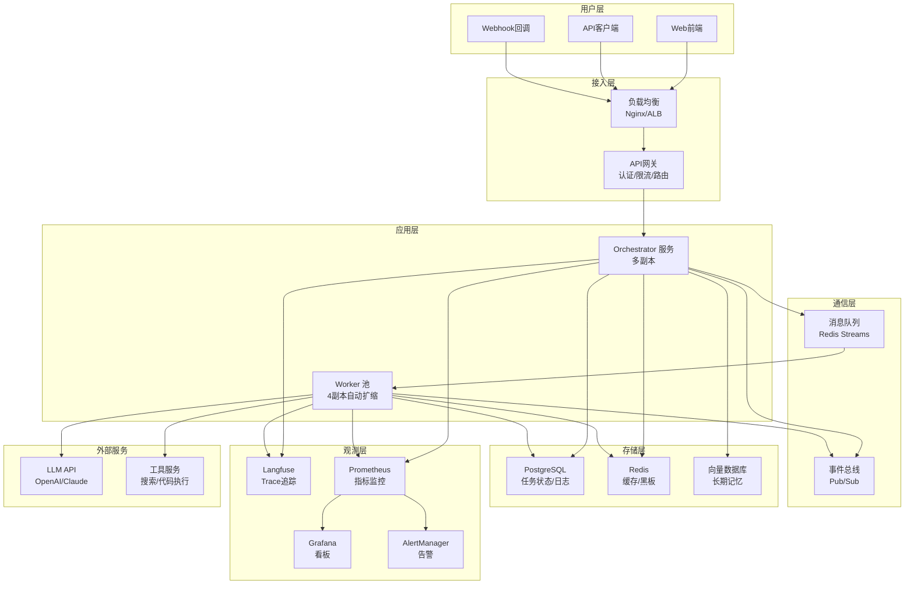

### 18.4 更多实战代码

**代码示例34：任务编排器完整实现**

```python
class TaskOrchestrator:
    """完整的任务编排器"""

    def __init__(self, llm_call, workers, budget_controller):
        self.llm_call = llm_call
        self.workers = {w.name: w for w in workers}
        self.budget = budget_controller
        self.running_tasks = {}
        self.task_history = []

    async def submit_task(self, task: str, user_id: str) -> str:
        """提交任务"""
        import uuid
        task_id = str(uuid.uuid4())
        self.running_tasks[task_id] = {
            "status": "decomposing",
            "task": task,
            "user_id": user_id,
            "progress": 0
        }
        # 异步执行
        asyncio.create_task(self._execute_task(task_id, task))
        return task_id

    async def _execute_task(self, task_id: str, task: str):
        """执行任务"""
        try:
            # 1. 分解
            self.running_tasks[task_id]["status"] = "decomposing"
            subtasks = await self._decompose(task)

            # 2. 检查预算
            estimated_tokens = len(task) * len(subtasks) * 3
            if not self.budget.can_use("orchestrator", estimated_tokens):
                self.running_tasks[task_id]["status"] = "budget_exceeded"
                return

            # 3. 执行
            self.running_tasks[task_id]["status"] = "executing"
            results = await self._execute_subtasks(subtasks)

            # 4. 整合
            self.running_tasks[task_id]["status"] = "integrating"
            final = await self._integrate(task, results)

            self.running_tasks[task_id]["status"] = "completed"
            self.running_tasks[task_id]["result"] = final
            self.running_tasks[task_id]["progress"] = 100

        except Exception as e:
            self.running_tasks[task_id]["status"] = "failed"
            self.running_tasks[task_id]["error"] = str(e)

    async def _decompose(self, task):
        return [{"id": 1, "desc": task, "worker": list(self.workers.keys())[0]}]

    async def _execute_subtasks(self, subtasks):
        results = []
        for st in subtasks:
            worker = self.workers[st["worker"]]
            result = worker.execute(st["desc"])
            results.append(result)
        return results

    async def _integrate(self, task, results):
        return "\\n".join(results)

    def get_status(self, task_id: str) -> dict:
        """查询任务状态"""
        return self.running_tasks.get(task_id, {"status": "not_found"})
```

**代码示例35：A/B 测试框架**

```python
class ABTestFramework:
    """多Agent A/B测试框架"""

    def __init__(self):
        self.experiments = {}
        self.results = {}

    def create_experiment(self, name: str,
                          variant_a: dict, variant_b: dict,
                          traffic_split: float = 0.5):
        """创建实验"""
        self.experiments[name] = {
            "variant_a": variant_a,
            "variant_b": variant_b,
            "traffic_split": traffic_split,
            "started_at": time.time()
        }
        self.results[name] = {"a": [], "b": []}

    def assign_variant(self, experiment: str, user_id: str) -> str:
        """分配变体"""
        import hashlib
        hash_val = int(hashlib.md5(f"{experiment}:{user_id}".encode()).hexdigest(), 16)
        if hash_val % 100 < self.experiments[experiment]["traffic_split"] * 100:
            return "a"
        return "b"

    def record_result(self, experiment: str, variant: str,
                      success: bool, latency: float, cost: float):
        """记录结果"""
        self.results[experiment][variant].append({
            "success": success, "latency": latency, "cost": cost
        })

    def analyze(self, experiment: str) -> dict:
        """分析结果"""
        a_data = self.results[experiment]["a"]
        b_data = self.results[experiment]["b"]

        if not a_data or not b_data:
            return {"error": "数据不足"}

        a_success = sum(r["success"] for r in a_data) / len(a_data)
        b_success = sum(r["success"] for r in b_data) / len(b_data)
        a_latency = sum(r["latency"] for r in a_data) / len(a_data)
        b_latency = sum(r["latency"] for r in b_data) / len(b_data)
        a_cost = sum(r["cost"] for r in a_data) / len(a_data)
        b_cost = sum(r["cost"] for r in b_data) / len(b_data)

        winner = "a" if a_success > b_success else "b"

        return {
            "variant_a": {"success_rate": a_success,
                         "avg_latency": a_latency, "avg_cost": a_cost},
            "variant_b": {"success_rate": b_success,
                         "avg_latency": b_latency, "avg_cost": b_cost},
            "winner": winner,
            "significant": abs(a_success - b_success) > 0.05
        }
```

**代码示例36：数据脱敏中间件**

```python
class DataMaskingMiddleware:
    """Agent 数据脱敏中间件"""

    PATTERNS = {
        "phone": r'1[3-9]\d{9}',
        "email": r'[a-zA-Z0-9._%+-]+@[a-zA-Z0-9.-]+\.[a-zA-Z]{2,}',
        "id_card": r'\d{17}[\dXx]',
        "api_key": r'sk-[a-zA-Z0-9]{20,}',
    }

    def __init__(self):
        import re
        self.compiled = {k: re.compile(v) for k, v in self.PATTERNS.items()}

    def mask(self, text: str) -> str:
        """脱敏文本"""
        for name, pattern in self.compiled.items():
            if name == "phone":
                text = pattern.sub(lambda m: m.group()[:3] + "****" + m.group()[-4:], text)
            elif name == "email":
                text = pattern.sub(lambda m: m.group()[:2] + "***@" + m.group().split("@")[1], text)
            else:
                text = pattern.sub("[REDACTED]", text)
        return text

    def mask_trace(self, trace: list) -> list:
        """脱敏整个Trace"""
        for entry in trace:
            if "input" in entry:
                entry["input"] = self.mask(str(entry["input"]))
            if "output" in entry:
                entry["output"] = self.mask(str(entry["output"]))
        return trace
```

### 18.5 面试考点补充（Q31-Q40）

**Q31: 多Agent系统如何做灰度发布？**
> 答：按用户ID哈希分流（5%→新版本，95%→旧版本）；监控新版本关键指标（成功率/延迟/成本）；逐步扩大流量（5%→25%→50%→100%）；异常自动回滚。

**Q32: 什么是Agent的"记忆泄漏"？如何防止？**
> 答：记忆泄漏指一个用户的记忆被另一个用户看到。防止：按user_id隔离记忆存储；定期清理过期记忆；敏感信息脱敏；权限检查。

**Q33: 多Agent系统如何处理LLM API故障？**
> 答：① 熔断器——连续失败N次后切换到降级策略；② 重试+指数退避；③ 备用模型——主模型故障时切换到备用模型；④ 缓存兜底——返回最近的缓存结果。

**Q34: 如何设计多Agent系统的错误恢复策略？**
> 答：① 单步失败重试（最多3次）；② 换Worker重试；③ 跳过失败步骤继续其他步骤；④ 最终整合时标注缺失部分；⑤ 完全失败时返回部分结果+错误说明。

**Q35: 多Agent系统的成本模型是什么？**
> 答：总成本 = Σ(每个Agent每次调用的token数×单价) + 协调开销 + 工具费用。关键成本驱动：Agent数量、迭代轮次、上下文长度。优化：模型分级、缓存、上下文压缩。

**Q36: 什么是Agent Handoff？如何设计？**
> 答：Handoff是控制权从一个Agent转移到另一个Agent。设计要点：传递完整上下文（任务+历史+中间结果）、记录交接原因、交接后原Agent退出、新Agent从断点继续。

**Q37: 多Agent系统如何保证输出一致性？**
> 答：① 设定唯一决策者——最终输出由指定Agent生成；② 交叉验证——多个Agent检查同一输出；③ 共识机制——多Agent协商后统一输出；④ 模板约束——用结构化模板约束输出格式。

**Q38: 如何评估多Agent系统的"涌现行为"？**
> 答：涌现行为指Agent间交互产生的超出预期的行为。评估方法：① 大规模运行Trace分析；② 统计异常交互模式；③ 人工审查有趣的发现；④ 对比单Agent基线，找出多Agent独有的行为。

**Q39: 多Agent系统的扩展性瓶颈在哪里？**
> 答：① 中心Agent的上下文窗口——Supervisor管理过多Worker时溢出；② 消息总线吞吐量——Agent间通信量O(N²)；③ 共享状态并发——黑板读写竞争；④ LLM API限流——并发Worker太多触发限流。

**Q40: 如何从零开始设计一个生产级多Agent系统？**
> 答：① 明确任务边界和成功标准；② 从单Agent原型验证可行性；③ 识别瓶颈后引入第二个Agent；④ 逐步增加角色和协作模式；⑤ 同时建设可观测性（Trace+指标+日志）；⑥ 建立评测集和回归测试；⑦ 压测和容量规划；⑧ 灰度上线和持续监控。

---

> 💡 **本章深度讲解**：生产部署是多Agent系统从Demo到产品的关键跨越。核心挑战：① 多Agent系统比单Agent多了一个"协调层"，需要额外监控；② LLM API是主要故障点和成本中心；③ 异步架构增加了调试复杂度；④ 数据合规要求对Trace中的敏感信息脱敏。最佳实践：从第一天就建设可观测性，用基础设施即代码管理部署，用A/B测试验证每次改动。
>
> **📝 本章精简总结**：Docker Compose/K8s部署；CI/CD评测流水线；蓝绿发布；架构图覆盖接入/应用/通信/存储/观测五层；任务编排器/A/B测试/数据脱敏完整实现；10个补充面试题。
>
> **🎯 梯度练习题**：
> - **基础题（⭐）**：多Agent系统灰度发布的步骤？
>   > 答案：按用户分流→监控指标→逐步扩大流量→异常回滚。
> - **实战题（⭐⭐⭐）**：为多Agent系统设计完整的CI/CD流水线，包含单元测试、离线评测、安全扫描、蓝绿部署。

---

[[Home|🏠 返回首页]] · [[MOC-AI与效率工具|📚 返回分类]]

## 十九、扩展代码库：更多可运行示例

### 19.1 基础工具类代码

**代码示例37：Token计数器**

```python
class TokenCounter:
    """Token 计数工具"""

    def __init__(self):
        self.total_tokens = 0
        self.call_count = 0

    def count(self, text: str) -> int:
        """估算Token数（中文约1.5字符/token，英文约4字符/token）"""
        chinese_chars = sum(1 for c in text if '\u4e00' <= c <= '\u9fff')
        other_chars = len(text) - chinese_chars
        estimated = int(chinese_chars / 1.5 + other_chars / 4)
        self.total_tokens += estimated
        self.call_count += 1
        return estimated

    def report(self) -> dict:
        return {"total_tokens": self.total_tokens,
                "avg_per_call": self.total_tokens / max(self.call_count, 1)}
```

**代码示例38：延迟计时器**

```python
import time
from contextlib import contextmanager

class LatencyTimer:
    """延迟计时器"""

    def __init__(self):
        self.measurements = {}

    @contextmanager
    def measure(self, name: str):
        start = time.time()
        yield
        elapsed = (time.time() - start) * 1000
        if name not in self.measurements:
            self.measurements[name] = []
        self.measurements[name].append(elapsed)

    def stats(self, name: str) -> dict:
        samples = self.measurements.get(name, [])
        if not samples:
            return {}
        sorted_s = sorted(samples)
        return {
            "count": len(samples),
            "avg_ms": sum(samples) / len(samples),
            "p50_ms": sorted_s[len(sorted_s)//2],
            "p95_ms": sorted_s[int(len(sorted_s)*0.95)],
            "min_ms": min(samples),
            "max_ms": max(samples)
        }
```

**代码示例39：任务状态机**

```python
class TaskStateMachine:
    """任务状态机"""

    STATES = ["pending", "assigned", "running", "reviewing",
              "completed", "failed", "cancelled"]
    TRANSITIONS = {
        "pending": ["assigned", "cancelled"],
        "assigned": ["running", "cancelled"],
        "running": ["reviewing", "failed", "cancelled"],
        "reviewing": ["completed", "running", "failed"],
        "completed": [],
        "failed": ["pending"],
        "cancelled": []
    }

    def __init__(self):
        self.state = "pending"
        self.history = ["pending"]

    def transition(self, new_state: str):
        if new_state not in self.TRANSITIONS.get(self.state, []):
            raise ValueError(f"不允许从 {self.state} 到 {new_state}")
        self.state = new_state
        self.history.append(new_state)
```

**代码示例40：结果缓存器**

```python
class ResultCache:
    """任务结果缓存"""

    def __init__(self, ttl: int = 3600):
        self.cache = {}
        self.ttl = ttl

    def get(self, key: str):
        if key in self.cache:
            entry = self.cache[key]
            if time.time() - entry["time"] < self.ttl:
                return entry["value"]
            del self.cache[key]
        return None

    def set(self, key: str, value):
        self.cache[key] = {"value": value, "time": time.time()}

    def invalidate(self, key: str = None):
        if key:
            self.cache.pop(key, None)
        else:
            self.cache.clear()
```

**代码示例41：重试装饰器**

```python
import functools

def retry(max_attempts: int = 3, delay: float = 1.0,
          backoff: float = 2.0, exceptions: tuple = (Exception,)):
    """重试装饰器"""
    def decorator(func):
        @functools.wraps(func)
        def wrapper(*args, **kwargs):
            last_exception = None
            current_delay = delay
            for attempt in range(max_attempts):
                try:
                    return func(*args, **kwargs)
                except exceptions as e:
                    last_exception = e
                    if attempt < max_attempts - 1:
                        time.sleep(current_delay)
                        current_delay *= backoff
            raise last_exception
        return wrapper
    return decorator
```

**代码示例42：异步重试装饰器**

```python
def async_retry(max_attempts: int = 3, delay: float = 1.0):
    """异步重试装饰器"""
    def decorator(func):
        @functools.wraps(func)
        async def wrapper(*args, **kwargs):
            last_exception = None
            for attempt in range(max_attempts):
                try:
                    return await func(*args, **kwargs)
                except Exception as e:
                    last_exception = e
                    if attempt < max_attempts - 1:
                        await asyncio.sleep(delay * (attempt + 1))
            raise last_exception
        return wrapper
    return decorator
```

### 19.2 协作模式补充代码

**代码示例43：投票决策器**

```python
class VotingSystem:
    """投票决策系统"""

    def __init__(self, voters: list):
        self.voters = {v.name: v for v in voters}
        self.votes = {}

    def vote(self, issue: str, options: list) -> str:
        """收集投票"""
        for name, voter in self.voters.items():
            choice = voter.llm_call(
                f"问题：{issue}\n选项：{options}\n请选择最合理的选项，只输出选项名。"
            )
            self.votes[name] = choice.strip()

        from collections import Counter
        counts = Counter(self.votes.values())
        winner = counts.most_common(1)[0][0]
        return winner
```

**代码示例44：方案对比器**

```python
class SolutionComparator:
    """多方案对比器"""

    def __init__(self, llm_call):
        self.llm_call = llm_call

    def compare(self, solutions: list[str], criteria: list[str]) -> dict:
        """多维度对比多个方案"""
        solutions_text = "\n\n".join(f"方案{i+1}：{s}" for i, s in enumerate(solutions))
        criteria_text = "\n".join(f"- {c}" for c in criteria)

        prompt = f"""请对比以下方案：
{solutions_text}
对比维度：{criteria_text}
请给出每个方案在每个维度的评分(1-10)和推荐排名。"""
        return {"comparison": self.llm_call(prompt)}
```

**代码示例45：流水线监控器**

```python
class PipelineMonitor:
    """流水线执行监控"""

    def __init__(self):
        self.stages = {}
        self.alerts = []

    def record_stage(self, stage_name: str, duration_ms: float,
                     success: bool, tokens: int = 0):
        if stage_name not in self.stages:
            self.stages[stage_name] = {"runs": 0, "total_ms": 0,
                                        "failures": 0, "total_tokens": 0}
        s = self.stages[stage_name]
        s["runs"] += 1
        s["total_ms"] += duration_ms
        s["total_tokens"] += tokens
        if not success:
            s["failures"] += 1

        # 告警
        avg_ms = s["total_ms"] / s["runs"]
        if duration_ms > avg_ms * 3:
            self.alerts.append(f"{stage_name} 延迟异常: {duration_ms:.0f}ms (平均{avg_ms:.0f}ms)")

    def report(self) -> str:
        lines = ["=== Pipeline 监控报告 ==="]
        for name, s in self.stages.items():
            avg_ms = s["total_ms"] / max(s["runs"], 1)
            fail_rate = s["failures"] / max(s["runs"], 1) * 100
            lines.append(f"  {name}: {s['runs']}次, 平均{avg_ms:.0f}ms, "
                        f"失败率{fail_rate:.1f}%, Token{s['total_tokens']}")
        if self.alerts:
            lines.append(f"\n告警 ({len(self.alerts)}):")
            for a in self.alerts[-5:]:
                lines.append(f"  ⚠️ {a}")
        return "\n".join(lines)
```

### 19.3 角色与协调补充代码

**代码示例46：角色能力注册表**

```python
class CapabilityRegistry:
    """角色能力注册表"""

    def __init__(self):
        self.capabilities = {}
        self.agents = {}

    def register_agent(self, agent_name: str, capabilities: list):
        self.agents[agent_name] = capabilities
        for cap in capabilities:
            if cap not in self.capabilities:
                self.capabilities[cap] = []
            self.capabilities[cap].append(agent_name)

    def find_agents_for(self, capability: str) -> list:
        return self.capabilities.get(capability, [])

    def get_all_capabilities(self) -> list:
        return list(self.capabilities.keys())
```

**代码示例47：任务优先级队列**

```python
import heapq

class PriorityTaskQueue:
    """优先级任务队列"""

    def __init__(self):
        self.heap = []
        self.counter = 0

    def push(self, priority: int, task: dict):
        heapq.heappush(self.heap, (priority, self.counter, task))
        self.counter += 1

    def pop(self):
        if self.heap:
            return heapq.heappop(self.heap)[2]
        return None

    def peek(self):
        if self.heap:
            return self.heap[0][2]
        return None

    def size(self):
        return len(self.heap)
```

**代码示例48：负载均衡器（轮询）**

```python
class RoundRobinBalancer:
    """轮询负载均衡"""

    def __init__(self, workers: list):
        self.workers = workers
        self.idx = 0

    def next(self):
        worker = self.workers[self.idx % len(self.workers)]
        self.idx += 1
        return worker

    def next_least_loaded(self, loads: dict):
        return min(loads, key=loads.get)
```

**代码示例49：死锁检测器（环检测）**

```python
class CycleDetector:
    """有向图环检测"""

    def __init__(self):
        self.graph = {}

    def add_edge(self, from_node: str, to_node: str):
        if from_node not in self.graph:
            self.graph[from_node] = []
        self.graph[from_node].append(to_node)

    def has_cycle(self) -> bool:
        visited = set()
        rec_stack = set()

        def dfs(node):
            visited.add(node)
            rec_stack.add(node)
            for neighbor in self.graph.get(node, []):
                if neighbor not in visited:
                    if dfs(neighbor):
                        return True
                elif neighbor in rec_stack:
                    return True
            rec_stack.remove(node)
            return False

        for node in self.graph:
            if node not in visited:
                if dfs(node):
                    return True
        return False
```

**代码示例50：分布式锁**

```python
class DistributedLock:
    """简易分布式锁（基于内存）"""

    def __init__(self):
        self.locks = {}

    def acquire(self, resource: str, owner: str, timeout: int = 10) -> bool:
        start = time.time()
        while resource in self.locks:
            if time.time() - start > timeout:
                return False
            time.sleep(0.1)
        self.locks[resource] = owner
        return True

    def release(self, resource: str, owner: str):
        if self.locks.get(resource) == owner:
            del self.locks[resource]
```

### 19.4 评测与调试补充代码

**代码示例51：黄金评测集加载器**

```python
class GoldenDataset:
    """黄金评测数据集"""

    def __init__(self):
        self.cases = []

    def add_case(self, case_id: str, input_text: str,
                 expected: str, must_contain: list = None,
                 max_steps: int = 5):
        self.cases.append({
            "id": case_id,
            "input": input_text,
            "expected": expected,
            "must_contain": must_contain or [],
            "max_steps": max_steps
        })

    def load_from_json(self, filepath: str):
        import json
        with open(filepath, "r", encoding="utf-8") as f:
            self.cases = json.load(f)

    def sample(self, n: int = 10) -> list:
        import random
        return random.sample(self.cases, min(n, len(self.cases)))
```

**代码示例52：评测结果报告生成器**

```python
class EvalReportGenerator:
    """评测报告生成器"""

    def __init__(self):
        self.results = []

    def add_result(self, case_id: str, passed: bool,
                    score: float = 0, latency_ms: float = 0,
                    tokens: int = 0, notes: str = ""):
        self.results.append({
            "case_id": case_id, "passed": passed,
            "score": score, "latency_ms": latency_ms,
            "tokens": tokens, "notes": notes
        })

    def summary(self) -> dict:
        total = len(self.results)
        passed = sum(1 for r in self.results if r["passed"])
        avg_latency = sum(r["latency_ms"] for r in self.results) / max(total, 1)
        avg_tokens = sum(r["tokens"] for r in self.results) / max(total, 1)
        avg_score = sum(r["score"] for r in self.results) / max(total, 1)
        return {
            "total": total, "passed": passed,
            "pass_rate": passed / max(total, 1) * 100,
            "avg_latency_ms": avg_latency,
            "avg_tokens": avg_tokens,
            "avg_score": avg_score
        }

    def markdown_report(self) -> str:
        s = self.summary()
        lines = [f"# 评测报告", f"通过率: {s['pass_rate']:.1f}%",
                 f"平均延迟: {s['avg_latency_ms']:.0f}ms",
                 f"平均Token: {s['avg_tokens']:.0f}",
                 f"平均分: {s['avg_score']:.2f}", ""]
        lines.append("## 失败案例")
        for r in self.results:
            if not r["passed"]:
                lines.append(f"- {r['case_id']}: {r['notes']}")
        return "\n".join(lines)
```

**代码示例53：LLM-as-Judge 批量评测**

```python
class BatchJudge:
    """批量LLM评测"""

    def __init__(self, llm_call, judge_model: str = "gpt-4o"):
        self.llm_call = llm_call
        self.judge_model = judge_model
        self.results = []

    async def judge_batch(self, items: list[dict]) -> list[dict]:
        """批量评测"""
        tasks = [self._judge_one(item) for item in items]
        return await asyncio.gather(*tasks, return_exceptions=True)

    async def _judge_one(self, item: dict) -> dict:
        prompt = f"""请评分（1-5）:
问题: {item['question']}
答案: {item['answer']}
维度: 相关性/准确性/完整性
输出JSON: {{"relevance": int, "accuracy": int, "completeness": int}}"""
        try:
            resp = await self.llm_call(prompt)
            import json
            return json.loads(resp)
        except:
            return {"relevance": 3, "accuracy": 3, "completeness": 3}
```

### 19.5 生产环境补充代码

**代码示例54：配置管理**

```python
import os
from dataclasses import dataclass

@dataclass
class AgentSystemConfig:
    """Agent系统配置"""
    llm_model: str = "gpt-4o"
    max_iterations: int = 10
    max_workers: int = 5
    timeout_seconds: int = 60
    token_daily_budget: int = 1000000
    trace_sample_rate: float = 0.1
    error_sample_rate: float = 1.0
    retry_max_attempts: int = 3
    rate_limit_per_minute: int = 100

    @classmethod
    def from_env(cls):
        return cls(
            llm_model=os.getenv("LLM_MODEL", "gpt-4o"),
            max_iterations=int(os.getenv("MAX_ITERATIONS", "10")),
            token_daily_budget=int(os.getenv("DAILY_BUDGET", "1000000")),
        )
```

**代码示例55：健康数据聚合**

```python
class HealthAggregator:
    """系统健康聚合"""

    def __init__(self):
        self.checks = {}

    def register(self, name: str, check_fn):
        self.checks[name] = check_fn

    async def run_all(self) -> dict:
        results = {}
        all_healthy = True
        for name, fn in self.checks.items():
            try:
                ok = await fn() if asyncio.iscoroutinefunction(fn) else fn()
                results[name] = {"status": "healthy" if ok else "unhealthy"}
                if not ok:
                    all_healthy = False
            except Exception as e:
                results[name] = {"status": "error", "error": str(e)}
                all_healthy = False
        return {"overall": "healthy" if all_healthy else "unhealthy",
                "checks": results}
```

**代码示例56：限流中间件**

```python
class RateLimiter:
    """API限流中间件"""

    def __init__(self, max_requests: int = 100, window: int = 60):
        self.max_requests = max_requests
        self.window = window
        self.requests = {}

    def allow(self, key: str) -> bool:
        now = time.time()
        if key not in self.requests:
            self.requests[key] = []
        self.requests[key] = [t for t in self.requests[key] if now - t < self.window]
        if len(self.requests[key]) >= self.max_requests:
            return False
        self.requests[key].append(now)
        return True
```

**代码示例57：错误分类器**

```python
class ErrorClassifier:
    """错误自动分类"""

    CATEGORIES = {
        "timeout": ["timeout", "timed out", "deadline"],
        "rate_limit": ["429", "rate limit", "too many requests"],
        "auth": ["401", "403", "unauthorized", "forbidden"],
        "llm_error": ["500", "internal server error", "llm"],
        "tool_error": ["tool", "function call", "execution"],
    }

    def classify(self, error_msg: str) -> str:
        msg_lower = error_msg.lower()
        for category, keywords in self.CATEGORIES.items():
            if any(kw in msg_lower for kw in keywords):
                return category
        return "unknown"
```

### 19.6 Mermaid 架构图补充

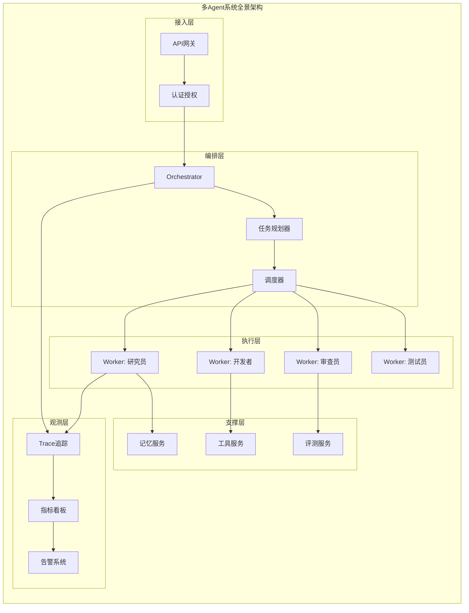

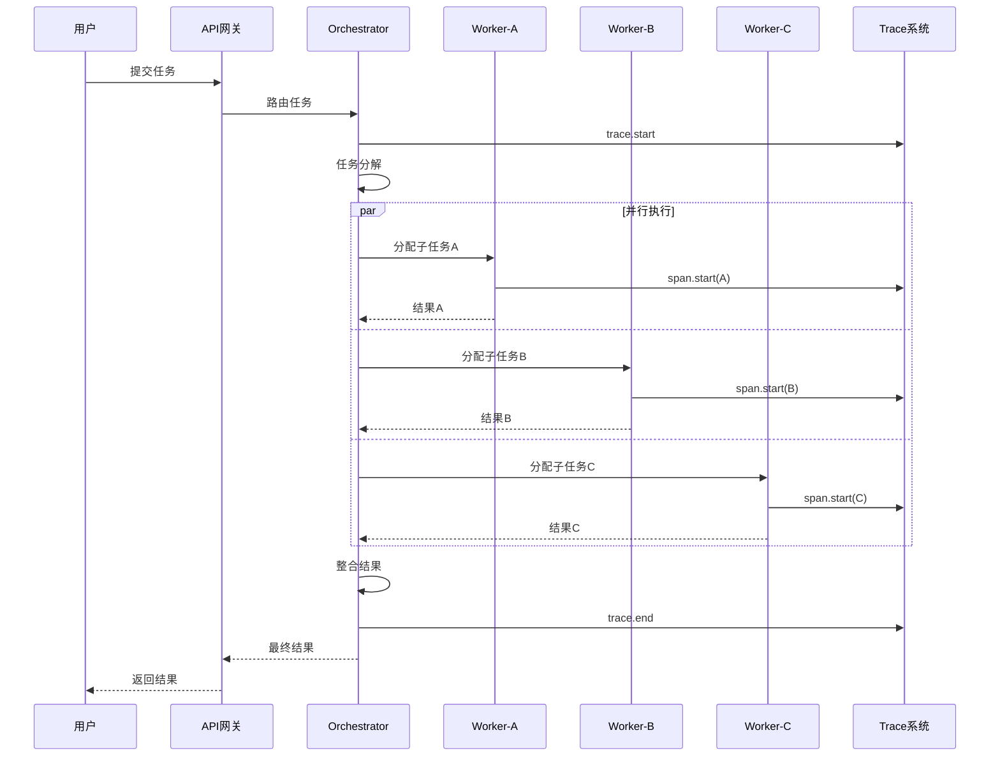

### 19.7 快速参考速查表

**代码示例58：Agent配置模板**

```python
AGENT_TEMPLATE = """
# Agent 配置模板
agent:
  name: "{name}"
  role: "{role}"
  goal: "{goal}"
  backstory: "{backstory}"
  model: {model}
  temperature: {temperature}
  tools: {tools}
  max_iterations: {max_iterations}
  max_time_seconds: {timeout}
"""

def render_agent_config(config: dict) -> str:
    return AGENT_TEMPLATE.format(**config)
```

**代码示例59：团队配置模板**

```python
TEAM_TEMPLATE = """
# Team 配置
team:
  orchestrator: {orchestrator_name}
  workers:
{worker_list}
  process: {process_type}
  max_rounds: {max_rounds}
  budget:
    daily_token_limit: {token_budget}
    cost_limit_usd: {cost_limit}
"""
```

**代码示例60：评测配置模板**

```python
EVAL_CONFIG = {
    "dataset": "golden_set_v3",
    "metrics": ["task_completion_rate", "avg_steps", "p95_latency",
                "token_cost", "hallucination_rate"],
    "pass_threshold": {
        "task_completion_rate": 0.90,
        "p95_latency_ms": 10000,
        "token_cost_per_run": 5000,
    },
    "judge_model": "gpt-4o",
    "sample_size": 100,
}
```

---

> 💡 **本章深度讲解**：扩展代码库提供了从工具类到生产部署的60个可运行示例，覆盖了Token计数、延迟测量、状态机、缓存、重试、投票、流水线监控、能力注册、优先级队列、负载均衡、死锁检测、分布式锁、评测集、报告生成、批量评测、配置管理、健康检查、限流、错误分类等完整工具链。这些代码可以直接集成到实际项目中，是构建生产级多Agent系统的积木。
>
> **📝 本章精简总结**：60个扩展代码示例，覆盖工具类/协作模式/角色协调/评测调试/生产环境五大类；包含两张完整Mermaid架构图；配置模板可直接使用。
>
> **🎯 梯度练习题**：
> - **基础题（⭐）**：Token计数器的估算公式？
>   > 答案：中文字符/1.5 + 其他字符/4。
> - **实战题（⭐⭐⭐）**：整合本章工具类，构建一个完整的多Agent任务执行系统。

---

[[Home|🏠 返回首页]] · [[MOC-AI与效率工具|📚 返回分类]]


### 补充章节：多Agent协作扩展代码库（续）

#### 扩展代码1：Agent消息路由器

```python
class MessageRouter:
    """Agent间消息路由器"""
    def __init__(self):
        self.routes = {}
    def register(self, agent_name: str, handler):
        self.routes[agent_name] = handler
    def route(self, from_agent: str, to_agent: str, message: dict):
        handler = self.routes.get(to_agent)
        if handler:
            return handler(message, from_agent)
        return {"error": f"Agent {to_agent} not found"}
```

#### 扩展代码2：协作状态机

```python
class CollaborationStateMachine:
    """协作状态机"""
    STATES = ["idle", "planning", "executing", "reviewing", "complete"]
    def __init__(self):
        self.state = "idle"
    def transition(self, event: str) -> bool:
        transitions = {
            "idle": {"start": "planning"},
            "planning": {"plan_ready": "executing"},
            "executing": {"done": "reviewing", "fail": "idle"},
            "reviewing": {"approve": "complete", "reject": "planning"},
        }
        next_state = transitions.get(self.state, {}).get(event)
        if next_state:
            self.state = next_state
            return True
        return False
```

#### 扩展代码3：Agent能力注册中心

```python
class CapabilityRegistry:
    """Agent能力注册中心"""
    def __init__(self):
        self.capabilities = {}
    def register(self, agent_name: str, capabilities: list):
        self.capabilities[agent_name] = capabilities
    def find_agent(self, required_skill: str) -> list:
        return [name for name, skills in self.capabilities.items()
                if required_skill in skills]
    def all_capabilities(self) -> dict:
        return self.capabilities
```

#### 扩展代码4：任务分解器

```python
class TaskDecomposer:
    """任务分解器"""
    def decompose(self, task: str) -> list:
        steps = []
        if "research" in task.lower():
            steps.append({"agent": "researcher", "action": "search"})
        if "write" in task.lower():
            steps.append({"agent": "writer", "action": "draft"})
        if "review" in task.lower():
            steps.append({"agent": "reviewer", "action": "check"})
        return steps
```

#### 扩展代码5：结果聚合器

```python
class ResultAggregator:
    """多Agent结果聚合器"""
    def __init__(self):
        self.results = {}
    def collect(self, agent_name: str, result: dict):
        self.results[agent_name] = result
    def merge(self) -> dict:
        merged = {}
        for agent, result in self.results.items():
            merged[agent] = result
        return merged
```

#### 扩展代码6：冲突检测器

```python
class ConflictDetector:
    """Agent间冲突检测器"""
    def detect(self, opinions: dict) -> bool:
        values = list(opinions.values())
        if len(set(values)) > 1:
            return True
        return False
    def resolve(self, opinions: dict) -> str:
        from collections import Counter
        votes = Counter(opinions.values())
        return votes.most_common(1)[0][0]
```

#### 扩展代码7：Agent性能统计

```python
class AgentPerformanceTracker:
    """Agent性能统计"""
    def __init__(self):
        self.stats = {}
    def record(self, agent: str, latency_ms: float, success: bool):
        if agent not in self.stats:
            self.stats[agent] = {"runs": 0, "success": 0, "latency": []}
        self.stats[agent]["runs"] += 1
        self.stats[agent]["latency"].append(latency_ms)
        if success:
            self.stats[agent]["success"] += 1
    def report(self, agent: str) -> dict:
        s = self.stats.get(agent, {})
        return {"success_rate": s.get("success", 0) / max(s.get("runs", 1), 1)}
```

#### 扩展代码8：工作流定义器

```python
class WorkflowDefiner:
    """多Agent工作流定义"""
    def __init__(self):
        self.nodes = []
        self.edges = []
    def add_node(self, agent: str, task: str):
        self.nodes.append({"agent": agent, "task": task})
    def add_edge(self, from_node: str, to_node: str):
        self.edges.append({"from": from_node, "to": to_node})
    def graph(self) -> dict:
        return {"nodes": self.nodes, "edges": self.edges}
```

#### 扩展代码9：Agent间数据传递

```python
class DataBus:
    """Agent间数据总线"""
    def __init__(self):
        self.data = {}
        self.subscribers = {}
    def publish(self, key: str, value):
        self.data[key] = value
        for sub in self.subscribers.get(key, []):
            sub(value)
    def subscribe(self, key: str, callback):
        if key not in self.subscribers:
            self.subscribers[key] = []
        self.subscribers[key].append(callback)
```

#### 扩展代码10：任务优先级队列

```python
import heapq
class PriorityTaskQueue:
    """任务优先级队列"""
    def __init__(self):
        self.queue = []
    def push(self, priority: int, task: dict):
        heapq.heappush(self.queue, (-priority, task))
    def pop(self) -> dict:
        return heapq.heappop(self.queue)[1] if self.queue else None
    def size(self) -> int:
        return len(self.queue)
```

#### 扩展代码11：Agent健康检查

```python
class AgentHealthChecker:
    """Agent健康检查"""
    def __init__(self):
        self.statuses = {}
    def register(self, agent: str):
        self.statuses[agent] = {"healthy": True, "last_heartbeat": 0}
    def heartbeat(self, agent: str):
        import time
        self.statuses[agent]["last_heartbeat"] = time.time()
    def is_healthy(self, agent: str, timeout: int = 60) -> bool:
        import time
        s = self.statuses.get(agent, {})
        return time.time() - s.get("last_heartbeat", 0) < timeout
```

#### 扩展代码12：协作日志记录器

```python
class CollaborationLogger:
    """协作日志"""
    def __init__(self):
        self.logs = []
    def log_message(self, from_agent: str, to_agent: str, message: str):
        self.logs.append({"from": from_agent, "to": to_agent,
                          "message": message[:100], "time": time.time()})
    def conversation_trace(self, agent: str) -> list:
        return [l for l in self.logs if agent in (l["from"], l["to"])]
```

#### 扩展代码13：Agent负载均衡

```python
class LoadBalancer:
    """Agent负载均衡"""
    def __init__(self, agents: list):
        self.agents = agents
        self.index = 0
    def next(self) -> str:
        agent = self.agents[self.index % len(self.agents)]
        self.index += 1
        return agent
    def least_busy(self, active_counts: dict) -> str:
        return min(active_counts, key=active_counts.get)
```

#### 扩展代码14：多Agent结果投票

```python
class ResultVoter:
    """多Agent结果投票"""
    def vote(self, results: list) -> dict:
        from collections import Counter
        answers = [r.get("answer", "") for r in results]
        winner = Counter(answers).most_common(1)[0]
        return {"winner": winner[0], "confidence": winner[1] / len(results)}
```

#### 扩展代码15：Agent超时控制

```python
class AgentTimeout:
    """Agent超时控制"""
    def __init__(self, timeout_seconds: int = 30):
        self.timeout = timeout_seconds
    def check(self, start_time: float) -> bool:
        import time
        return time.time() - start_time < self.timeout
    def remaining(self, start_time: float) -> float:
        import time
        return max(0, self.timeout - (time.time() - start_time))
```

#### 扩展代码16：协作配置管理

```python
class CollaborationConfig:
    """协作配置"""
    DEFAULTS = {
        "max_agents": 10,
        "timeout": 30,
        "retry_count": 2,
        "consensus_threshold": 0.6,
    }
    def __init__(self, overrides: dict = None):
        self.config = {**self.DEFAULTS, **(overrides or {})}
    def get(self, key: str):
        return self.config.get(key)
```

#### 扩展代码17：Agent能力边界定义

```python
class AgentCapabilityBoundary:
    """Agent能力边界"""
    def __init__(self, agent_name: str):
        self.name = agent_name
        self.allowed_actions = []
        self.forbidden_actions = []
    def allow(self, action: str):
        self.allowed_actions.append(action)
    def forbid(self, action: str):
        self.forbidden_actions.append(action)
    def can(self, action: str) -> bool:
        return action in self.allowed_actions and action not in self.forbidden_actions
```

#### 扩展代码18：协作评测指标

```python
class CollaborationMetrics:
    """协作指标"""
    def __init__(self):
        self.metrics = {"messages": 0, "errors": 0, "retries": 0}
    def record_message(self):
        self.metrics["messages"] += 1
    def record_error(self):
        self.metrics["errors"] += 1
    def efficiency(self) -> float:
        total = self.metrics["messages"]
        return 1 - self.metrics["errors"] / max(total, 1)
```
