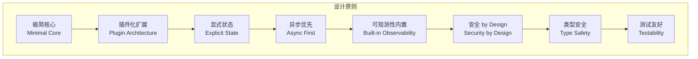
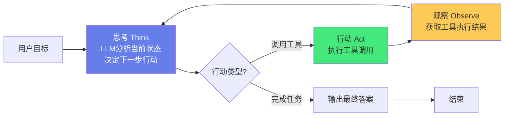
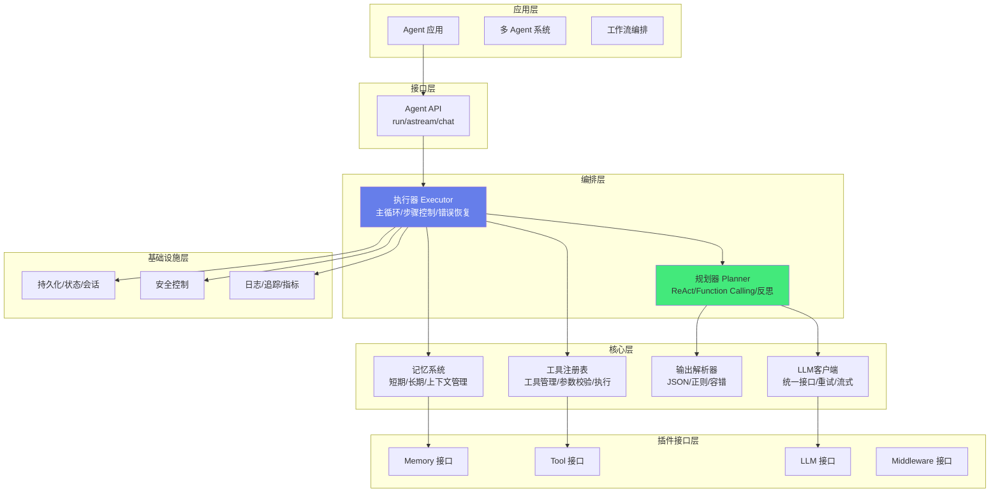
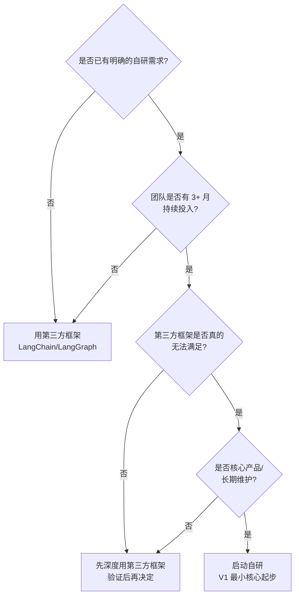
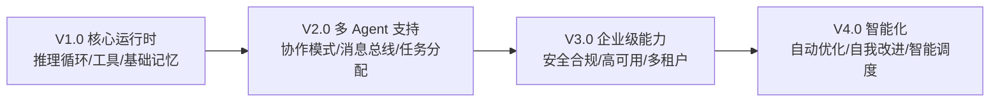

# 自研 Agent 框架设计

> **一句话定义**：自研 Agent 框架是指不依赖 LangChain/LangGraph 等第三方框架，从零设计和实现的 Agent 运行时系统，包含核心抽象、推理循环、工具系统、记忆管理、多 Agent 协作、可观测性等完整能力，满足企业级定制化需求。
>
> **核心价值**：摆脱第三方框架的抽象限制和版本依赖，实现完全可控的 Agent 运行时，支持深度定制、性能优化、安全合规和与现有系统的无缝集成。
>
> **适用场景**：企业级 Agent 平台、对性能和安全有特殊要求的场景、需要深度定制 Agent 行为的系统、不希望依赖第三方框架的组织、想深入理解 Agent 原理的工程师。

---

## 一、概述

### 1.1 为什么要自研 Agent 框架

| 痛点（使用第三方框架） | 自研框架的解法 |
|----------------------|--------------|
| **抽象泄漏**：框架的抽象无法覆盖所有需求，需要 hack 框架内部 | 完全可控的抽象，按需设计 |
| **版本依赖**：框架升级导致 breaking change，维护成本高 | 自主版本管理，无外部依赖 |
| **性能瓶颈**：框架的多层抽象和中间件导致额外开销 | 精简核心，性能优先 |
| **定制困难**：深度定制 Agent 行为需要修改框架源码 | 原生支持定制，扩展点清晰 |
| **安全合规**：第三方框架的安全审计困难，数据流向不透明 | 完全可控的数据流向，便于审计 |
| **系统集成**：与现有微服务、中间件集成需要额外适配层 | 原生设计支持企业系统集成 |
| **调试困难**：框架内部黑盒，问题定位困难 | 完整的可观测性，透明的执行过程 |

| 动机 | 说明 |
|------|------|
| **深度理解原理** | 自研过程中深入理解 Agent 的核心循环、规划、记忆、工具调用的本质，而不是停留在框架 API 调用层面 |
| **高度定制化** | 可以根据业务需求自定义规划策略、记忆机制、工具协议、错误处理，不受框架设计约束 |
| **性能优化** | 无框架抽象开销，可以精准控制每一步执行，异步并发优化，减少不必要的中间层 |
| **减少依赖** | 不依赖 LangChain 等重型框架，减少第三方依赖、版本冲突、供应链风险 |
| **企业安全合规** | 代码完全可控，便于安全审计、合规检查，无未知的框架行为 |
| **学习价值** | 自研是学习 Agent 架构设计的最佳方式，理解每个组件的设计取舍 |

**适用场景与不适用场景**：

| 适用自研 | 适用现有框架（LangChain 等） |
|---------|---------------------------|
| 需要深度定制 Agent 行为 | 快速原型验证 |
| 对性能有极致要求 | 标准 RAG/问答场景 |
| 企业安全合规要求高 | 丰富的工具/集成生态 |
| 特殊的规划策略/记忆机制 | 团队不熟悉 Agent 底层原理 |
| 长期维护的核心产品 | 短期项目/实验性项目 |
| 需要与现有系统深度集成 | 需要快速迭代试错 |

### 1.2 设计原则与设计目标



| 原则 | 说明 |
|------|------|
| **极简核心** | 核心运行时只包含最必要的能力（推理循环、消息传递、状态管理），其他能力通过插件扩展 |
| **插件化扩展** | 工具、记忆、模型、中间件都通过标准接口接入，可替换可扩展 |
| **显式状态** | Agent 的所有状态（消息、记忆、上下文、进度）显式管理，不依赖隐式上下文 |
| **异步优先** | 核心 API 全异步，支持高并发和流式响应 |
| **可观测性内置** | 追踪、日志、指标作为核心能力，不是可选附加 |
| **安全 by Design** | 权限控制、输入校验、沙箱执行从设计阶段就纳入 |
| **类型安全** | 使用 Pydantic 类型系统，编译期捕获错误 |
| **测试友好** | 核心组件可 mock，支持单元测试和集成测试 |

```text
自研 Agent 框架的设计目标：
✅ 轻量级：核心代码 < 1000 行，无重型依赖
✅ 可扩展：插件化架构，易于添加新工具/新规划器/新记忆存储
✅ 高性能：异步支持、并发工具调用、结果缓存
✅ 可观测：完整的日志、追踪、指标、调试能力
✅ 类型安全：完整的类型注解，Pydantic 数据模型
✅ 错误容忍：解析失败重试、工具失败恢复、优雅降级
✅ 生产就绪：超时控制、重试机制、成本统计、安全控制
```

### 1.3 自研框架 vs 第三方框架

| 维度 | 自研框架 | LangChain/LangGraph |
|------|---------|---------------------|
| **开发成本** | 高（需要从零实现） | 低（开箱即用） |
| **维护成本** | 中（自主维护） | 高（跟随上游版本） |
| **灵活性** | 极高（完全可控） | 中（受框架抽象限制） |
| **性能** | 高（精简核心） | 中（多层抽象开销） |
| **生态** | 弱（需自建） | 强（丰富的集成） |
| **安全审计** | 易（代码可控） | 难（依赖第三方） |
| **学习曲线** | 陡（需理解内部实现） | 缓（文档和社区丰富） |
| **适用规模** | 中大型企业，长期项目 | 中小项目，快速原型 |

> 🔍 **知识点深度解析**
>
> **作用**：自研 Agent 框架为企业提供完全可控的 Agent 运行时，摆脱第三方框架的抽象限制和版本依赖，实现深度定制、性能优化、安全合规和系统集成。
>
> **原理**：自研框架的核心是"极简核心 + 插件化扩展"的架构设计。核心运行时只包含最必要的能力——Agent 状态管理、推理循环调度、消息传递机制，其他所有能力（LLM 调用、工具执行、记忆管理、多 Agent 协作、可观测性）都通过标准接口以插件形式接入。这种设计使得核心保持精简和稳定，而能力可以按需扩展和替换。框架的运行时基于"状态机 + 事件驱动"模型——Agent 的执行过程被建模为状态转换，每个状态转换触发相应的事件，插件通过监听事件来介入执行流程（如记录日志、检查权限、缓存结果）。
>
> **用法要点**：① 不要一开始就自研，先用第三方框架验证需求，确认有无法满足的定制需求时再考虑自研 ② 自研框架的核心要足够小，遵循"框架只做框架该做的事"原则 ③ 定义清晰的扩展接口（Tool、Memory、LLM、Middleware），所有能力通过接口接入 ④ 内置可观测性，不要事后补 ⑤ 安全是一等公民，权限控制和输入校验从第一天就纳入 ⑥ 重视文档和示例，自研框架的使用者需要清晰指引 ⑦ 建立测试体系，核心组件必须有完整的单元测试和集成测试

> 💡 **深度讲解**：自研 Agent 框架是一个"高风险高回报"的决策。风险在于：① 开发成本高——一个生产级 Agent 框架至少需要 3-6 个月的全职开发；② 维护成本持续——需要持续跟进 LLM 领域的新进展；③ 生态缺失——第三方框架有丰富的预构建集成，自研框架需要自己实现或适配。回报在于：① 完全可控——没有第三方依赖，没有 breaking change；② 性能最优——精简核心，没有不必要的抽象层开销；③ 安全合规——代码完全可控，数据流向透明，便于通过安全审计；④ 深度定制——可以实现第三方框架无法支持的特殊需求。决策建议：① 快速验证阶段用第三方框架，不要自研；② 当第三方框架确实无法满足需求时，再考虑自研；③ 自研时不要"重新发明轮子"，借鉴 LangGraph 的状态机设计、AutoGen 的对话模式、MCP 的工具协议等优秀设计；④ 自研框架的范围要控制，核心要小，扩展要通过标准接口。

---

## 二、原理与架构

### 2.1 ReAct 模式：思考-行动-观察循环

ReAct（Reasoning + Acting）是 Agent 的核心模式，将推理（思考）和行动（工具调用）交替进行。



**ReAct 循环详解**：
1. **思考（Think）**：LLM 分析当前状态（目标 + 历史 + 观察结果），决定下一步行动
2. **行动（Act）**：执行 LLM 决定的工具调用，传入参数
3. **观察（Observe）**：获取工具执行结果，作为新的上下文
4. **循环**：回到思考步骤，直到 LLM 判断任务完成或达到最大步骤数

**Agent vs 普通 LLM 调用**：

| 维度 | 普通 LLM 调用 | Agent |
|------|--------------|-------|
| **交互方式** | 单次请求-响应 | 多轮循环（思考-行动-观察） |
| **工具使用** | 无（或单次 function calling） | 可以多次调用不同工具 |
| **规划能力** | 无（直接回答） | 有（分解任务、选择工具、调整策略） |
| **记忆** | 无（或简单对话历史） | 有（短期记忆 + 长期记忆 + 工作记忆） |
| **错误恢复** | 无（一次失败就结束） | 有（工具失败可以重新规划、重试） |
| **适用场景** | 简单问答、文本生成 | 复杂任务、多步骤推理、工具协作 |

### 2.2 整体分层架构



### 2.3 模块划分与目录结构

```text
my_agent/
├── __init__.py
├── agent.py              # Agent 主类，对外接口
├── executor.py           # 执行器，主循环控制
├── planner.py            # 规划器，ReAct/Function Calling
├── llm/
│   ├── base.py           # LLM 客户端抽象基类
│   ├── openai_client.py  # OpenAI 兼容客户端
│   └── models.py         # 数据模型（Message/ChatResult）
├── tools/
│   ├── base.py           # Tool 抽象基类
│   ├── registry.py       # 工具注册表
│   ├── calculator.py     # 示例：计算器工具
│   ├── search.py         # 示例：搜索工具
│   └── database.py       # 示例：数据库查询工具
├── memory/
│   ├── base.py           # Memory 抽象基类
│   ├── short_term.py     # 短期记忆（对话历史）
│   ├── long_term.py      # 长期记忆（向量存储）
│   └── context.py        # 上下文窗口管理
├── parser/
│   ├── base.py           # OutputParser 抽象基类
│   ├── json_parser.py    # JSON 解析器
│   └── react_parser.py   # ReAct 格式解析器
├── common/
│   ├── models.py         # 通用数据模型（Action/Observation/Step）
│   ├── errors.py         # 自定义异常
│   ├── config.py         # 配置管理
│   └── logger.py         # 日志系统
└── examples/
    ├── simple_agent.py   # 简单 Agent 示例
    ├── search_agent.py   # 搜索 Agent 示例
    └── multi_tool.py     # 多工具 Agent 示例
```

### 2.4 核心数据流

```text
用户输入目标
    ↓
Agent.run(goal)
    ↓
执行器初始化（记忆/工具/规划器）
    ↓
主循环（max_steps 次）：
    ├─ 1. 构建 Prompt（目标 + 历史 + 工具描述 + 记忆）
    ├─ 2. 调用 LLM（规划器）
    ├─ 3. 解析 LLM 输出（输出解析器）
    │   ├─ 解析失败 → 重试（最多 N 次）
    │   └─ 解析成功 → 得到 Action
    ├─ 4. 判断 Action 类型：
    │   ├─ finish → 输出最终答案，结束循环
    │   └─ tool_call → 执行工具
    ├─ 5. 执行工具（工具注册表）
    │   ├─ 参数校验 / 执行工具函数
    │   ├─ 错误处理（失败 → 错误信息作为 Observation）
    │   └─ 返回 Observation
    ├─ 6. 记录 Step（思考/行动/观察）到记忆
    ├─ 7. 重复检测（相同行动重复 N 次 → 强制结束或重新规划）
    └─ 8. 超时检查（总时间/单步时间）
    ↓
达到最大步骤数 → 返回部分结果或错误
    ↓
返回最终答案 + 执行轨迹（用于调试/审计）
```

> 💡 **深度讲解**：自研框架的核心设计是"状态机 + 事件驱动 + 中间件管道"。状态机（AgentState）是整个框架的中心——所有运行时信息（消息、上下文、迭代次数、工具结果、错误状态）都存储在状态中，推理循环的每一步都是读取状态、修改状态、保存状态。事件系统是框架的"神经系统"——Agent 执行的每个关键节点都发布事件，插件通过订阅事件来介入执行流程。中间件管道是框架的"过滤器"——在 LLM 调用前后、工具调用前后、错误发生时，中间件可以修改输入输出、阻止调用、记录日志。三个核心机制协同工作，构成了一个灵活、可扩展、可观测的 Agent 运行时。

### 2.5 规划策略选型：ReAct vs Function Calling vs Plan-and-Execute

规划器决定 Agent 怎么"想下一步"，三种主流策略各有取舍：

| 策略 | 工作方式 | 优点 | 缺点 | 适用场景 |
|------|---------|------|------|---------|
| **ReAct** | 每步思考→行动→观察，边做边想 | 灵活，能根据观察调整 | 多轮 LLM 调用，成本高、延迟大 | 不确定路径、需要动态决策 |
| **Function Calling** | LLM 直接输出结构化工具调用 | 格式规整、容错好 | 仍需多轮循环 | 有原生 function calling 的模型 |
| **Plan-and-Execute** | 先一次性出完整计划，再逐步执行 | 少 LLM 调用、路径清晰 | 计划易过时、遇错难调整 | 任务步骤相对确定 |

**选型建议**：① 用支持原生 Function Calling 的模型时，优先 Function Calling（比手写 ReAct 文本格式解析更稳）；② 路径高度不确定、需频繁根据工具结果改主意的，用 ReAct；③ 任务步骤可枚举、容错要求低的，用 Plan-and-Execute 省成本；④ 生产中常组合——先用 Plan-and-Execute 出骨架，执行中用 ReAct 动态修正。

---

## 三、核心抽象设计

### 3.1 Agent 状态（AgentState）

```python
from dataclasses import dataclass, field
from typing import Any, Optional
from enum import Enum
import time
import uuid

class AgentStatus(Enum):
    IDLE = "idle"
    THINKING = "thinking"
    CALLING_TOOL = "calling_tool"
    WAITING = "waiting"
    COMPLETED = "completed"
    FAILED = "failed"

@dataclass
class Message:
    """消息：Agent 通信的基本单元"""
    role: str  # system/user/assistant/tool
    content: str
    tool_calls: list[dict] = field(default_factory=list)
    tool_call_id: Optional[str] = None
    metadata: dict = field(default_factory=dict)
    timestamp: float = field(default_factory=time.time)

@dataclass
class AgentState:
    """Agent 状态：所有运行时信息的容器"""
    agent_id: str = field(default_factory=lambda: str(uuid.uuid4()))
    status: AgentStatus = AgentStatus.IDLE
    messages: list[Message] = field(default_factory=list)
    context: dict[str, Any] = field(default_factory=dict)   # 业务上下文
    memory: dict[str, Any] = field(default_factory=dict)    # 记忆引用
    current_iteration: int = 0
    max_iterations: int = 20
    tool_results: dict[str, Any] = field(default_factory=dict)
    error: Optional[str] = None
    created_at: float = field(default_factory=time.time)
    updated_at: float = field(default_factory=time.time)

    def add_message(self, message: Message):
        self.messages.append(message)
        self.updated_at = time.time()

    def get_recent_messages(self, n: int = 10) -> list[Message]:
        return self.messages[-n:]

    def to_dict(self) -> dict:
        """序列化（用于持久化）"""
        return {
            "agent_id": self.agent_id,
            "status": self.status.value,
            "messages": [vars(m) for m in self.messages],
            "context": self.context,
            "current_iteration": self.current_iteration,
            "max_iterations": self.max_iterations,
            "error": self.error,
        }
```

### 3.2 LLM 接口（LLMProvider）

```python
from abc import ABC, abstractmethod
from typing import AsyncIterator, Optional
from dataclasses import dataclass, field

@dataclass
class LLMResponse:
    """LLM 响应"""
    content: str
    tool_calls: list[dict] = field(default_factory=list)
    usage: dict = field(default_factory=dict)
    model: str = ""
    finish_reason: str = ""

class LLMProvider(ABC):
    """LLM 提供者接口：所有模型适配器必须实现"""

    @abstractmethod
    async def chat(self, messages: list[dict], tools: Optional[list[dict]] = None,
                   temperature: float = 0.7, max_tokens: Optional[int] = None, **kwargs) -> LLMResponse:
        """同步聊天完成"""
        pass

    @abstractmethod
    async def stream_chat(self, messages: list[dict], tools: Optional[list[dict]] = None,
                          temperature: float = 0.7, max_tokens: Optional[int] = None, **kwargs) -> AsyncIterator[str]:
        """流式聊天完成"""
        pass

    @abstractmethod
    def get_model_name(self) -> str:
        """获取模型名称"""
        pass
```

### 3.3 Tool 接口（Tool）

```python
from abc import ABC, abstractmethod
from pydantic import BaseModel

class ToolResult(BaseModel):
    """工具执行结果"""
    success: bool
    output: str = ""
    data: dict = {}
    error: str = ""

class Tool(ABC):
    """工具接口：所有工具必须实现"""

    @property
    @abstractmethod
    def name(self) -> str: ...

    @property
    @abstractmethod
    def description(self) -> str: ...

    @property
    @abstractmethod
    def parameters(self) -> dict:
        """参数 Schema（JSON Schema 格式）"""
        ...

    @abstractmethod
    async def execute(self, **kwargs) -> ToolResult: ...

    def to_function_calling_format(self) -> dict:
        """转换为 OpenAI Function Calling 格式"""
        return {
            "type": "function",
            "function": {
                "name": self.name,
                "description": self.description,
                "parameters": self.parameters,
            },
        }
```

### 3.4 Memory 与 Middleware 接口

```python
class Memory(ABC):
    """记忆接口：所有记忆后端必须实现"""

    @abstractmethod
    async def store(self, key: str, value: str, metadata: dict = None): ...

    @abstractmethod
    async def retrieve(self, query: str, top_k: int = 5) -> list[dict]: ...

    @abstractmethod
    async def delete(self, key: str): ...

    @abstractmethod
    async def clear(self): ...


class Middleware(ABC):
    """中间件接口：在 Agent 执行流程的各个阶段介入"""

    async def before_llm_call(self, state, messages: list[dict]) -> list[dict]:
        return messages

    async def after_llm_call(self, state, response: LLMResponse) -> LLMResponse:
        return response

    async def before_tool_call(self, state, tool_name: str, arguments: dict) -> bool:
        """工具调用前：返回 False 可以阻止调用"""
        return True

    async def after_tool_call(self, state, tool_name: str, result: ToolResult) -> ToolResult:
        return result

    async def on_error(self, state, error: Exception): ...

    async def on_complete(self, state): ...
```

### 3.5 通用数据模型（Action/Observation/Step/AgentResult）

```python
# common/models.py
from __future__ import annotations
from enum import Enum
from typing import Any, Optional
from pydantic import BaseModel, Field


class ActionType(str, Enum):
    """行动类型"""
    TOOL_CALL = "tool_call"      # 调用工具
    FINISH = "finish"            # 完成任务，输出答案
    THINK = "think"             # 仅思考（不行动）


class Action(BaseModel):
    """LLM 决定的行动"""
    type: ActionType
    tool_name: Optional[str] = None
    tool_input: Optional[dict[str, Any]] = None
    thought: Optional[str] = None
    final_answer: Optional[str] = None


class Observation(BaseModel):
    """工具执行结果（观察）"""
    tool_name: str
    input: dict[str, Any]
    output: Optional[str] = None
    error: Optional[str] = None
    success: bool = True
    duration_ms: float = 0


class Step(BaseModel):
    """执行步骤（思考+行动+观察）"""
    step_num: int
    thought: str
    action: Action
    observation: Optional[Observation] = None


class AgentResult(BaseModel):
    """Agent 执行结果"""
    goal: str
    final_answer: str
    steps: list[Step] = Field(default_factory=list)
    total_tokens: int = 0
    total_cost: float = 0.0
    duration_ms: float = 0
    success: bool = True
    error: Optional[str] = None
```

---

## 四、核心模块实现

### 4.0 项目脚手架：配置 / 日志 / 异常

自研框架的地基。配置从环境变量/`.env` 读取，避免硬编码密钥：

```python
# common/config.py
from __future__ import annotations
import os
from dataclasses import dataclass


@dataclass
class Config:
    """全局配置：从环境变量加载"""
    openai_api_key: str = os.getenv("OPENAI_API_KEY", "")
    openai_base_url: str | None = os.getenv("OPENAI_BASE_URL")
    llm_model: str = os.getenv("LLM_MODEL", "gpt-4")
    llm_temperature: float = float(os.getenv("LLM_TEMPERATURE", "0.7"))
    llm_max_tokens: int = int(os.getenv("LLM_MAX_TOKENS", "2000"))
    max_steps: int = int(os.getenv("AGENT_MAX_STEPS", "10"))
    request_timeout: float = float(os.getenv("AGENT_TIMEOUT", "300"))
    log_level: str = os.getenv("AGENT_LOG_LEVEL", "INFO")

    @classmethod
    def from_env(cls) -> "Config":
        return cls()
```

```python
# common/logger.py
import logging
import sys


def setup_logger(name: str = "agent", level: str = "INFO") -> logging.Logger:
    """统一日志：结构化输出思考/行动/观察，便于排查"""
    logger = logging.getLogger(name)
    logger.setLevel(getattr(logging, level.upper(), logging.INFO))
    if not logger.handlers:
        handler = logging.StreamHandler(sys.stdout)
        handler.setFormatter(logging.Formatter(
            "%(asctime)s [%(levelname)s] %(name)s: %(message)s"))
        logger.addHandler(handler)
    return logger
```

```python
# common/errors.py
class AgentError(Exception):
    """Agent 基础异常"""

class ParseError(AgentError):
    """LLM 输出解析失败"""

class ToolNotFoundError(AgentError):
    """工具不存在"""

class ToolExecutionError(AgentError):
    """工具执行失败"""

class AgentTimeoutError(AgentError):
    """执行超时"""

class MaxStepsExceededError(AgentError):
    """超过最大步数"""
```

### 4.1 LLM 客户端（含重试与流式）

```python
# llm/base.py
from __future__ import annotations
from abc import ABC, abstractmethod
from typing import AsyncIterator, Optional
from pydantic import BaseModel


class ChatMessage(BaseModel):
    """聊天消息"""
    role: str  # system / user / assistant / tool
    content: str
    name: Optional[str] = None
    tool_call_id: Optional[str] = None


class ChatResult(BaseModel):
    """聊天结果"""
    content: str
    model: str
    prompt_tokens: int = 0
    completion_tokens: int = 0
    total_tokens: int = 0
    finish_reason: str = "stop"


class BaseLLMClient(ABC):
    @abstractmethod
    async def chat(self, messages: list[ChatMessage], temperature: float = 0.7,
                   max_tokens: int = 2000, **kwargs) -> ChatResult: ...

    @abstractmethod
    async def stream_chat(self, messages: list[ChatMessage], temperature: float = 0.7,
                          max_tokens: int = 2000, **kwargs) -> AsyncIterator[str]: ...
```

```python
# llm/openai_client.py
from __future__ import annotations
import asyncio
from typing import AsyncIterator, Optional
from openai import AsyncOpenAI
from .base import BaseLLMClient, ChatMessage, ChatResult


class OpenAIClient(BaseLLMClient):
    """OpenAI 兼容客户端（支持 OpenAI / Azure / 本地 vLLM 等）"""

    def __init__(self, api_key: str, base_url: Optional[str] = None,
                 model: str = "gpt-4", max_retries: int = 3,
                 timeout: float = 60.0, temperature: float = 0.7, max_tokens: int = 2000):
        self.model = model
        self.max_retries = max_retries
        self.timeout = timeout
        self.temperature = temperature
        self.max_tokens = max_tokens
        self._client = AsyncOpenAI(api_key=api_key, base_url=base_url, timeout=timeout)

    async def chat(self, messages: list[ChatMessage], temperature: Optional[float] = None,
                   max_tokens: Optional[int] = None, **kwargs) -> ChatResult:
        """带指数退避重试的聊天"""
        last_error = None
        for attempt in range(self.max_retries):
            try:
                response = await self._client.chat.completions.create(
                    model=self.model,
                    messages=[m.model_dump(exclude_none=True) for m in messages],
                    temperature=temperature or self.temperature,
                    max_tokens=max_tokens or self.max_tokens,
                    **kwargs)
                choice = response.choices[0]
                return ChatResult(
                    content=choice.message.content or "",
                    model=self.model,
                    prompt_tokens=response.usage.prompt_tokens if response.usage else 0,
                    completion_tokens=response.usage.completion_tokens if response.usage else 0,
                    total_tokens=response.usage.total_tokens if response.usage else 0,
                    finish_reason=choice.finish_reason or "stop",
                )
            except Exception as e:
                last_error = e
                if attempt < self.max_retries - 1:
                    await asyncio.sleep(2 ** attempt)  # 指数退避
                    continue
                raise
        raise last_error

    async def stream_chat(self, messages, temperature=None, max_tokens=None, **kwargs) -> AsyncIterator[str]:
        stream = await self._client.chat.completions.create(
            model=self.model,
            messages=[m.model_dump(exclude_none=True) for m in messages],
            temperature=temperature or self.temperature,
            max_tokens=max_tokens or self.max_tokens,
            stream=True, **kwargs)
        async for chunk in stream:
            if chunk.choices and chunk.choices[0].delta.content:
                yield chunk.choices[0].delta.content
```

### 4.2 工具系统（基类 + 注册表 + 示例）

```python
# tools/base.py
from __future__ import annotations
from abc import ABC, abstractmethod
from typing import Any, Optional
from pydantic import BaseModel, Field


class ToolParameter(BaseModel):
    """工具参数定义"""
    name: str
    type: str = "string"
    description: str = ""
    required: bool = True
    enum: Optional[list[Any]] = None
    default: Optional[Any] = None


class BaseTool(ABC):
    """工具抽象基类"""
    name: str = ""
    description: str = ""
    parameters: list[ToolParameter] = []

    @abstractmethod
    async def execute(self, **kwargs) -> str:
        """执行工具，返回字符串结果（Observation）"""
        ...

    def to_openai_function(self) -> dict:
        """转换为 OpenAI Function Calling 格式"""
        properties, required = {}, []
        for param in self.parameters:
            prop = {"type": param.type, "description": param.description}
            if param.enum:
                prop["enum"] = param.enum
            properties[param.name] = prop
            if param.required:
                required.append(param.name)
        return {"type": "function", "function": {
            "name": self.name, "description": self.description,
            "parameters": {"type": "object", "properties": properties, "required": required}}}

    def validate_input(self, **kwargs) -> dict:
        """验证并默认化参数"""
        validated = {}
        for param in self.parameters:
            value = kwargs.get(param.name, param.default)
            if param.required and value is None:
                raise ValueError(f"参数 {param.name} 是必填的")
            if param.enum and value is not None and value not in param.enum:
                raise ValueError(f"参数 {param.name} 的值 {value} 不在允许范围 {param.enum}")
            validated[param.name] = value
        return validated
```

```python
# tools/registry.py
from __future__ import annotations
from .base import BaseTool
import time


class ToolRegistry:
    """工具注册表"""

    def __init__(self):
        self._tools: dict[str, BaseTool] = {}

    def register(self, tool: BaseTool) -> None:
        if tool.name in self._tools:
            raise ValueError(f"工具 {tool.name} 已存在")
        self._tools[tool.name] = tool

    def unregister(self, tool_name: str) -> None:
        del self._tools[tool_name]

    def get(self, tool_name: str) -> BaseTool:
        return self._tools[tool_name]

    def list_tools(self) -> list[BaseTool]:
        return list(self._tools.values())

    def get_tool_descriptions(self) -> str:
        """获取所有工具的文本描述（用于 ReAct Prompt）"""
        lines = []
        for tool in self._tools.values():
            params_str = ", ".join(
                f"{p.name}: {p.type}" + ("(必填)" if p.required else "(可选)")
                for p in tool.parameters)
            lines.append(f"- {tool.name}: {tool.description}\n  参数: {params_str}")
        return "\n".join(lines)

    def get_openai_functions(self) -> list[dict]:
        return [tool.to_openai_function() for tool in self._tools.values()]

    async def execute(self, tool_name: str, **kwargs) -> tuple[str, bool]:
        """Returns: (输出字符串, 是否成功)"""
        tool = self.get(tool_name)
        start = time.time()
        try:
            validated = tool.validate_input(**kwargs)
            result = await tool.execute(**validated)
            return result, True
        except Exception as e:
            return f"工具 {tool_name} 执行失败: {str(e)}", False
```

```python
# tools/calculator.py - 示例工具：计算器（安全 eval）
from .base import BaseTool, ToolParameter
import math


class CalculatorTool(BaseTool):
    """计算器工具：执行数学计算"""
    name = "calculator"
    description = "执行数学计算，支持加减乘除、幂、开方、三角函数等。当需要计算数学表达式时使用。"
    parameters = [ToolParameter(
        name="expression", type="string",
        description="数学表达式，如 '2 + 3 * 4'、'sqrt(16)'、'sin(pi/2)'")]

    # 安全的数学环境（只允许特定函数，防止代码注入）
    _SAFE_NAMES = {
        'abs': abs, 'round': round, 'min': min, 'max': max,
        'sqrt': math.sqrt, 'pow': math.pow, 'log': math.log, 'log10': math.log10,
        'sin': math.sin, 'cos': math.cos, 'tan': math.tan,
        'pi': math.pi, 'e': math.e,
    }

    async def execute(self, expression: str) -> str:
        try:
            result = eval(expression, {"__builtins__": {}}, self._SAFE_NAMES)
            return f"计算结果: {expression} = {result}"
        except Exception as e:
            return f"计算错误: {str(e)}"
```

### 4.3 记忆系统

```python
# memory/short_term.py
from __future__ import annotations
from collections import deque
from ..llm.base import ChatMessage


class ShortTermMemory:
    """短期记忆：管理当前对话历史，支持滑动窗口"""

    def __init__(self, max_messages: int = 50, max_tokens: int = 6000):
        self.max_messages = max_messages
        self.max_tokens = max_tokens
        self._messages: deque[ChatMessage] = deque(maxlen=max_messages)
        self._system_prompt: str = ""

    def set_system_prompt(self, prompt: str) -> None:
        self._system_prompt = prompt

    def add_message(self, role: str, content: str, **kwargs) -> None:
        self._messages.append(ChatMessage(role=role, content=content, **kwargs))

    def add_user(self, content: str) -> None: self.add_message("user", content)
    def add_assistant(self, content: str) -> None: self.add_message("assistant", content)
    def add_tool(self, content: str, tool_call_id: str) -> None:
        self.add_message("tool", content, tool_call_id=tool_call_id)

    def get_messages(self) -> list[ChatMessage]:
        messages = []
        if self._system_prompt:
            messages.append(ChatMessage(role="system", content=self._system_prompt))
        messages.extend(self._messages)
        return messages

    def clear(self) -> None:
        self._messages.clear()
```

```python
# memory/context.py - 上下文窗口管理
from __future__ import annotations
from ..llm.base import ChatMessage


class ContextManager:
    """上下文窗口管理器：控制发送给 LLM 的消息数量和 token 数"""

    def __init__(self, max_tokens: int = 8000, reserve_tokens: int = 2000):
        self.max_tokens = max_tokens
        self.reserve_tokens = reserve_tokens

    def filter_messages(self, messages: list[ChatMessage]) -> list[ChatMessage]:
        """保留系统提示词 + 最近的消息，超出时丢弃最早的消息"""
        if not messages:
            return messages
        system_messages = [m for m in messages if m.role == "system"]
        other_messages = [m for m in messages if m.role != "system"]

        available = self.max_tokens - self.reserve_tokens
        selected, current_tokens = [], sum(self._estimate_tokens(m.content) for m in system_messages)
        for msg in reversed(other_messages):
            msg_tokens = self._estimate_tokens(msg.content)
            if current_tokens + msg_tokens > available:
                break
            selected.insert(0, msg)
            current_tokens += msg_tokens
        return system_messages + selected

    def _estimate_tokens(self, text: str) -> int:
        """粗略估算 token 数（中文约 1.5 字符/token，英文约 4 字符/token）"""
        if not text:
            return 0
        chinese = sum(1 for c in text if '\u4e00' <= c <= '\u9fff')
        other = len(text) - chinese
        return int(chinese * 1.5 + other / 4)
```

**长期记忆设计（VectorMemory）**：短期记忆只保存当前会话，跨会话的知识需要长期记忆。典型实现是向量记忆——把过往对话/事实向量化存入向量库，新对话到来时语义检索最相关的几条注入 Prompt：

```python
import numpy as np


class VectorMemory(Memory):
    """基于向量数据库的长期记忆"""

    def __init__(self, embedding_fn, vector_store, top_k: int = 5):
        self.embedding_fn = embedding_fn      # 文本转向量的函数
        self.vector_store = vector_store       # 向量存储
        self.top_k = top_k

    async def store(self, key: str, value: str, metadata: dict = None):
        """存储记忆：生成 embedding 并存入向量库"""
        embedding = await self.embedding_fn(value)
        await self.vector_store.upsert(
            ids=[key], embeddings=[embedding],
            documents=[value], metadatas=[metadata or {}])

    async def retrieve(self, query: str, top_k: int = None) -> list[dict]:
        """检索相关记忆：语义相似度搜索"""
        k = top_k or self.top_k
        query_embedding = await self.embedding_fn(query)
        results = await self.vector_store.query(query_embeddings=[query_embedding], n_results=k)
        return [
            {"content": doc, "metadata": meta, "distance": dist}
            for doc, meta, dist in zip(results["documents"][0], results["metadatas"][0], results["distances"][0])
        ]

    async def delete(self, key: str):
        await self.vector_store.delete(ids=[key])

    async def clear(self):
        await self.vector_store.delete(where={})
```

**记忆设计要点**：
- **短期 vs 长期**：短期记忆 = 当前对话历史（滑动窗口）；长期记忆 = 跨会话的事实/知识（向量库）；工作记忆 = 当前任务的中间结果
- **记忆摘要**：历史太长时，用 LLM 把早期对话压缩成摘要，避免占用宝贵的上下文窗口
- **记忆注入时机**：在构建 Prompt 时，用最新 user 消息检索 top_k 相关记忆，作为 system 消息插入
- **记忆污染**：警惕把错误/过时记忆注入，关键记忆要带时间戳和来源，定期清理

### 4.4 输出解析器（ReAct 格式）

```python
# parser/react_parser.py
from __future__ import annotations
import json
import re
from typing import Optional
from .base import BaseOutputParser
from ..common.models import Action, ActionType
from ..common.errors import ParseError


class ReActOutputParser(BaseOutputParser):
    """
    ReAct 格式输出解析器
    期望 LLM 输出格式：
        思考: <思考过程>
        行动: <工具名称>
        行动输入: {"param": "value"}
    或（完成时）：
        思考: <思考过程>
        最终答案: <最终答案>
    """

    THOUGHT_PATTERN = re.compile(r'思考[:：]\s*(.+?)(?=\n行动[:：]|\n最终答案[:：]|$)', re.DOTALL)
    ACTION_PATTERN = re.compile(r'行动[:：]\s*(.+?)(?=\n行动输入[:：]|\n思考[:：]|\n最终答案[:：]|$)', re.DOTALL)
    ACTION_INPUT_PATTERN = re.compile(r'行动输入[:：]\s*(\{.*?\})(?=\n|$)', re.DOTALL)
    FINAL_ANSWER_PATTERN = re.compile(r'最终答案[:：]\s*(.+)', re.DOTALL)

    def parse(self, text: str) -> Action:
        text = text.strip()

        final_match = self.FINAL_ANSWER_PATTERN.search(text)
        if final_match:
            return Action(type=ActionType.FINISH, thought=self._extract_thought(text),
                          final_answer=final_match.group(1).strip())

        action_match = self.ACTION_PATTERN.search(text)
        if action_match:
            tool_name = action_match.group(1).strip().rstrip('。.,，;；')
            tool_input = {}
            input_match = self.ACTION_INPUT_PATTERN.search(text)
            if input_match:
                try:
                    tool_input = json.loads(input_match.group(1))
                except json.JSONDecodeError:
                    tool_input = {"input": input_match.group(1)}
            return Action(type=ActionType.TOOL_CALL, tool_name=tool_name,
                          tool_input=tool_input, thought=self._extract_thought(text))

        raise ParseError(f"无法解析 LLM 输出: {text[:200]}")

    def _extract_thought(self, text: str) -> Optional[str]:
        match = self.THOUGHT_PATTERN.search(text)
        return match.group(1).strip() if match else None
```

### 4.5 JSON 输出解析器（容错版）

除了 ReAct 文本格式，另一种常见做法是让 LLM 直接输出 JSON（配合 Function Calling 或 `response_format=json`），解析时需重点处理 LLM 偶发的格式错误：

```python
# parser/json_parser.py
from __future__ import annotations
import json
import re
from .base import BaseOutputParser
from ..common.errors import ParseError


class JsonOutputParser(BaseOutputParser):
    """JSON 输出解析器：容错提取 LLM 输出中的 JSON"""

    # 匹配 ```json ... ``` 代码块或裸 {...}
    CODE_BLOCK = re.compile(r'```(?:json)?\s*(\{.*?\}|\[.*?\])\s*```', re.DOTALL)
    BARE_JSON = re.compile(r'(\{.*\}|\[.*\])', re.DOTALL)

    def parse(self, text: str) -> dict:
        # 1. 优先尝试代码块
        m = self.CODE_BLOCK.search(text)
        candidate = m.group(1) if m else None
        # 2. 退而求其次，找裸 JSON
        if candidate is None:
            m = self.BARE_JSON.search(text)
            candidate = m.group(1) if m else text
        try:
            return json.loads(candidate)
        except json.JSONDecodeError:
            # 3. 容错：尝试修复常见问题（尾逗号、缺括号）
            repaired = self._repair(candidate)
            try:
                return json.loads(repaired)
            except json.JSONDecodeError as e:
                raise ParseError(f"JSON 解析失败: {e}; 原文: {text[:200]}")

    def _repair(self, s: str) -> str:
        s = re.sub(r',\s*([}\]])', r'\1', s)      # 去尾逗号
        s = s.strip()
        # 补齐未闭合括号
        for open_ch, close_ch in [('{', '}'), ('[', ']')]:
            if s.count(open_ch) > s.count(close_ch):
                s += close_ch * (s.count(open_ch) - s.count(close_ch))
        return s
```

**解析失败恢复策略**（规划器层）：① 解析失败时把"格式错误 + 期望格式示例"作为新的 user 消息回喂给 LLM，要求其按格式重试；② 最多重试 N 次（通常 3 次）；③ 全部失败则抛 `ParseError`，由执行器捕获并优雅降级。这种"错误反馈式自修正"比单纯重试成功率高得多。

### 4.6 规划器（ReAct）

```python
# planner/react_planner.py
from __future__ import annotations
from ..llm.base import BaseLLMClient, ChatMessage
from ..tools.registry import ToolRegistry
from ..memory.short_term import ShortTermMemory
from ..parser.react_parser import ReActOutputParser
from ..common.models import Action
from ..common.errors import ParseError


REACT_SYSTEM_PROMPT = """你是一个强大的 AI 助手，可以使用以下工具来完成任务：

{tool_descriptions}

## 工作方式
你需要通过"思考-行动-观察"的循环来完成任务：
1. 思考：分析当前状态，决定下一步行动
2. 行动：调用工具执行操作
3. 观察：获取工具执行结果
4. 重复以上步骤，直到任务完成

## 输出格式
当需要调用工具时，严格按照以下格式输出：
思考: <你的思考过程>
行动: <工具名称>
行动输入: <JSON格式的工具参数>

当任务完成时，严格按照以下格式输出：
思考: <你的思考过程>
最终答案: <最终答案>

## 注意事项
- 每次只调用一个工具
- 工具参数必须是有效的 JSON
- 如果工具执行失败，可以尝试其他工具或调整参数
- 不要编造工具执行结果，必须基于实际的观察结果
- 最终答案要完整、准确、有帮助"""


class ReActPlanner:
    """ReAct 规划器：基于 ReAct 模式决定下一步行动"""

    def __init__(self, llm: BaseLLMClient, tool_registry: ToolRegistry,
                 memory: ShortTermMemory, max_retries: int = 3, temperature: float = 0.0):
        self.llm = llm
        self.tool_registry = tool_registry
        self.memory = memory
        self.max_retries = max_retries
        self.temperature = temperature
        self.parser = ReActOutputParser()

    async def plan(self, goal: str, observations: list[str]) -> Action:
        messages = self._build_messages(goal, observations)
        last_error = None
        result = None
        for attempt in range(self.max_retries):
            try:
                result = await self.llm.chat(messages=messages, temperature=self.temperature, max_tokens=1000)
                action = self.parser.parse(result.content)
                return action
            except ParseError as e:
                last_error = e
                # 解析失败：把错误反馈给 LLM，让它修正格式
                if result is not None:
                    messages.append(ChatMessage(role="assistant", content=result.content))
                messages.append(ChatMessage(
                    role="user", content=f"你的输出格式不正确，请重新按照指定格式输出。错误: {str(e)}"))
                continue
            except Exception as e:
                last_error = e
                continue
        raise ParseError(f"规划失败，已重试 {self.max_retries} 次。最后错误: {last_error}")

    def _build_messages(self, goal: str, observations: list[str]) -> list[ChatMessage]:
        tool_descriptions = self.tool_registry.get_tool_descriptions()
        system_prompt = REACT_SYSTEM_PROMPT.format(tool_descriptions=tool_descriptions)
        messages = [ChatMessage(role="system", content=system_prompt)]
        messages.append(ChatMessage(role="user", content=f"任务目标: {goal}"))
        if observations:
            obs_text = "\n\n".join([f"观察 {i+1}: {obs}" for i, obs in enumerate(observations)])
            messages.append(ChatMessage(role="user", content=f"历史观察结果:\n{obs_text}"))
        messages.append(ChatMessage(role="user", content="请开始思考并输出你的行动。"))
        return messages
```

---

## 五、推理循环与运行时

### 5.1 执行器（主循环）

```python
# executor.py
from __future__ import annotations
import time
from typing import Optional
from .llm.base import BaseLLMClient
from .tools.registry import ToolRegistry
from .memory.short_term import ShortTermMemory
from .planner.react_planner import ReActPlanner
from .common.models import Action, ActionType, Observation, Step, AgentResult
from .common.errors import AgentError


class AgentExecutor:
    """Agent 执行器：控制主循环"""

    def __init__(self, llm: BaseLLMClient, tool_registry: ToolRegistry,
                 memory: ShortTermMemory, planner: Optional[ReActPlanner] = None,
                 max_steps: int = 10, max_repeat_actions: int = 3, total_timeout: float = 300.0):
        self.llm = llm
        self.tool_registry = tool_registry
        self.memory = memory
        self.planner = planner or ReActPlanner(llm, tool_registry, memory)
        self.max_steps = max_steps
        self.max_repeat_actions = max_repeat_actions
        self.total_timeout = total_timeout

    async def run(self, goal: str) -> AgentResult:
        start_time = time.time()
        steps: list[Step] = []
        observations: list[str] = []
        action_history: list[tuple[str, str]] = []

        try:
            for step_num in range(1, self.max_steps + 1):
                # 超时检查
                if time.time() - start_time > self.total_timeout:
                    raise AgentError(f"执行超时")

                # 1. 规划
                action = await self.planner.plan(goal, observations)

                # 2. 完成 → 返回结果
                if action.type == ActionType.FINISH:
                    steps.append(Step(step_num=step_num, thought=action.thought or "", action=action))
                    return AgentResult(goal=goal, final_answer=action.final_answer or "",
                                       steps=steps, success=True,
                                       duration_ms=(time.time() - start_time) * 1000)

                # 3. 工具调用
                if action.type == ActionType.TOOL_CALL:
                    action_key = (action.tool_name or "", str(action.tool_input))
                    # 重复动作检测（防死循环）
                    if action_history.count(action_key) >= self.max_repeat_actions:
                        observations.append(f"工具 {action.tool_name} 重复调用，已强制重新规划")
                        continue
                    action_history.append(action_key)

                    output, success = await self.tool_registry.execute(
                        tool_name=action.tool_name or "", **(action.tool_input or {}))
                    observation = Observation(
                        tool_name=action.tool_name or "", input=action.tool_input or {},
                        output=output if success else None,
                        error=output if not success else None, success=success)
                    observations.append(output)
                    steps.append(Step(step_num=step_num, thought=action.thought or "",
                                      action=action, observation=observation))

            # 达到最大步骤数
            return AgentResult(goal=goal, success=False, error="达到最大步骤数",
                               final_answer=f"已达到最大步骤数 {self.max_steps}，未能完成任务。",
                               steps=steps, duration_ms=(time.time() - start_time) * 1000)
        except Exception as e:
            return AgentResult(goal=goal, success=False, error=str(e),
                               final_answer=f"执行出错: {str(e)}", steps=steps,
                               duration_ms=(time.time() - start_time) * 1000)
```

### 5.2 AgentRuntime（状态机 + 中间件管道版）

```python
class AgentRuntime:
    """Agent 运行时：核心推理循环（带中间件管道与记忆注入）"""

    def __init__(self, llm: LLMProvider, tools: list[Tool] = None, memory: Memory = None,
                 middlewares: list[Middleware] = None, system_prompt: str = "", max_iterations: int = 20):
        self.llm = llm
        self.tools = {t.name: t for t in (tools or [])}
        self.memory = memory
        self.middlewares = middlewares or []
        self.system_prompt = system_prompt
        self.max_iterations = max_iterations

    async def run(self, user_input: str, context: dict = None) -> AgentState:
        state = AgentState(max_iterations=self.max_iterations, context=context or {})
        state.status = AgentStatus.THINKING
        if self.system_prompt:
            state.add_message(Message(role="system", content=self.system_prompt))
        state.add_message(Message(role="user", content=user_input))

        try:
            while state.current_iteration < state.max_iterations:
                state.current_iteration += 1
                # 构建消息（含记忆注入）
                messages = await self._build_messages(state)
                # 中间件：before_llm_call
                for mw in self.middlewares:
                    messages = await mw.before_llm_call(state, messages)
                # 调用 LLM
                state.status = AgentStatus.THINKING
                response = await self.llm.chat(
                    messages=messages,
                    tools=[t.to_function_calling_format() for t in self.tools.values()])
                # 中间件：after_llm_call
                for mw in self.middlewares:
                    response = await mw.after_llm_call(state, response)
                state.add_message(Message(role="assistant", content=response.content,
                                         tool_calls=response.tool_calls))
                # 无工具调用 → 完成
                if not response.tool_calls:
                    state.status = AgentStatus.COMPLETED
                    break
                # 执行工具调用
                state.status = AgentStatus.CALLING_TOOL
                for tool_call in response.tool_calls:
                    result = await self._execute_tool(state, tool_call)
                    state.add_message(Message(role="tool", content=result.output,
                                              tool_call_id=tool_call["id"]))
            if state.current_iteration >= state.max_iterations:
                state.status = AgentStatus.FAILED
                state.error = f"达到最大迭代次数 {state.max_iterations}"
        except Exception as e:
            state.status = AgentStatus.FAILED
            state.error = str(e)
            for mw in self.middlewares:
                await mw.on_error(state, e)

        for mw in self.middlewares:
            await mw.on_complete(state)
        return state

    async def _build_messages(self, state: AgentState) -> list[dict]:
        messages = [{"role": m.role, "content": m.content} for m in state.messages]
        # 注入相关记忆
        if self.memory and state.messages:
            last_user = next((m for m in reversed(state.messages) if m.role == "user"), None)
            if last_user:
                memories = await self.memory.retrieve(last_user.content, top_k=3)
                if memories:
                    memory_text = "\n".join([f"- {m['content']}" for m in memories])
                    for i, msg in enumerate(messages):
                        if msg["role"] == "system":
                            messages.insert(i + 1, {"role": "system",
                                                    "content": f"相关记忆：\n{memory_text}"})
                            break
        return messages

    async def _execute_tool(self, state: AgentState, tool_call: dict) -> ToolResult:
        import json
        tool_name = tool_call["function"]["name"]
        arguments = json.loads(tool_call["function"].get("arguments", "{}"))
        tool = self.tools.get(tool_name)
        if not tool:
            return ToolResult(success=False, error=f"工具 {tool_name} 不存在")
        for mw in self.middlewares:
            if not await mw.before_tool_call(state, tool_name, arguments):
                return ToolResult(success=False, error=f"工具 {tool_name} 被中间件阻止")
        try:
            result = await tool.execute(**arguments)
        except Exception as e:
            result = ToolResult(success=False, error=str(e))
        for mw in self.middlewares:
            result = await mw.after_tool_call(state, tool_name, result)
        state.tool_results[tool_call["id"]] = result
        return result
```

### 5.3 事件系统

```python
class EventSystem:
    """事件系统：Agent 执行过程中的事件发布和订阅"""

    def __init__(self):
        self._handlers: dict[str, list[callable]] = {}

    def subscribe(self, event_type: str, handler: callable):
        self._handlers.setdefault(event_type, []).append(handler)

    async def publish(self, event_type: str, data: dict):
        for handler in self._handlers.get(event_type, []):
            try:
                await handler(data)
            except Exception as e:
                print(f"事件处理器错误: {e}")

# 事件类型
EVENTS = {
    "agent.started": "Agent 开始执行",
    "agent.completed": "Agent 执行完成",
    "agent.failed": "Agent 执行失败",
    "llm.before_call": "LLM 调用前",
    "llm.after_call": "LLM 调用后",
    "tool.before_call": "工具调用前",
    "tool.after_call": "工具调用后",
    "iteration.start": "迭代开始",
    "iteration.end": "迭代结束",
}
```

### 5.4 流式输出（SSE）：降低首字延迟

交互式场景（聊天前端）下，一次性等 Agent 跑完整轮再返回会有几秒空白。流式输出把"思考/行动/最终答案"分阶段推给前端：

```python
# 在 AgentRuntime 中增加流式方法
class StreamingAgentRuntime(AgentRuntime):
    async def astream(self, user_input: str, context: dict = None):
        """异步生成器：逐段 yield 事件，供前端 SSE 消费"""
        state = await self.run(user_input, context)   # 简化：内部逐步 yield
        # 实际实现中，把 run() 拆成逐迭代 yield：
        # yield {"event": "iteration_start", "step": n}
        # yield {"event": "llm_chunk", "delta": "..."}     # LLM 流式分片
        # yield {"event": "tool_call", "tool": name}
        # yield {"event": "tool_result", "output": "..."}
        # yield {"event": "final", "answer": "..."}
        return state
```

**流式设计要点**：① LLM 层用 `stream_chat` 逐 token yield；② 工具调用本身通常不流式（一次返回），但要把"正在调用工具 X"这个状态先推给前端；③ 前端按事件类型分别渲染——思考用灰色小字、行动折叠成卡片、最终答案高亮；④ 流式不影响正确性，只是把同一批数据分多次发送，状态管理逻辑与非流式完全一致。

### 5.5 Agent 主类（对外接口）

```python
# agent.py
from __future__ import annotations
from typing import Optional
from .llm.base import BaseLLMClient
from .llm.openai_client import OpenAIClient
from .tools.base import BaseTool
from .tools.registry import ToolRegistry
from .memory.short_term import ShortTermMemory
from .planner.react_planner import ReActPlanner
from .executor import AgentExecutor
from .common.models import AgentResult


class Agent:
    """Agent 主类：对外接口"""

    def __init__(self, llm: Optional[BaseLLMClient] = None, tools: Optional[list[BaseTool]] = None,
                 memory: Optional[ShortTermMemory] = None, planner: Optional[ReActPlanner] = None,
                 max_steps: int = 10, **llm_kwargs):
        self.llm = llm or OpenAIClient(**llm_kwargs)
        self.tool_registry = ToolRegistry()
        if tools:
            for tool in tools:
                self.tool_registry.register(tool)
        self.memory = memory or ShortTermMemory()
        self.planner = planner or ReActPlanner(self.llm, self.tool_registry, self.memory)
        self.executor = AgentExecutor(llm=self.llm, tool_registry=self.tool_registry,
                                      memory=self.memory, planner=self.planner, max_steps=max_steps)

    def add_tool(self, tool: BaseTool) -> None:
        self.tool_registry.register(tool)

    def remove_tool(self, tool_name: str) -> None:
        self.tool_registry.unregister(tool_name)

    async def run(self, goal: str) -> AgentResult:
        return await self.executor.run(goal)

    async def chat(self, message: str) -> str:
        """简单聊天（无工具）"""
        from .llm.base import ChatMessage
        result = await self.llm.chat([ChatMessage(role="user", content=message)])
        return result.content
```

---

## 六、完整使用示例与自定义工具

### 6.1 简单 Agent：计算器 + 搜索

```python
# examples/simple_agent.py
import asyncio
from my_agent import Agent
from my_agent.tools.calculator import CalculatorTool
from my_agent.tools.search import SearchTool


async def main():
    agent = Agent(
        api_key="your-openai-api-key",
        model="gpt-4",
        tools=[CalculatorTool(), SearchTool(api_key="your-search-api-key")],
        max_steps=10,
    )
    result = await agent.run(
        "请计算 2024 年北京的人口数量的平方根，并搜索北京的面积，然后计算人口密度。")

    print(f"最终答案: {result.final_answer}")
    print(f"执行步骤数: {len(result.steps)}, 总耗时: {result.duration_ms:.0f}ms, 成功: {result.success}")
    for step in result.steps:
        print(f"\n--- 步骤 {step.step_num} ---")
        print(f"思考: {step.thought[:100]}...")
        print(f"行动: {step.action.type}, 工具: {step.action.tool_name}")
```

### 6.2 自定义数据库查询工具

```python
# tools/database.py - 自定义数据库查询工具
from .base import BaseTool, ToolParameter
import asyncio


class DatabaseQueryTool(BaseTool):
    """数据库查询工具：执行 SQL 查询"""
    name = "database_query"
    description = "执行 SQL 查询语句，返回查询结果。当需要从数据库查询数据时使用此工具。"
    parameters = [
        ToolParameter(name="sql", type="string", description="要执行的 SQL 查询语句，只能是 SELECT 语句"),
        ToolParameter(name="database", type="string", description="数据库名称",
                      enum=["users", "orders", "products"], required=False, default="users"),
    ]

    def __init__(self, db_connection_string: str):
        super().__init__()
        self.db_connection_string = db_connection_string

    async def execute(self, sql: str, database: str = "users") -> str:
        # 安全检查：只允许 SELECT
        if not sql.strip().lower().startswith("select"):
            return "错误：只允许执行 SELECT 查询语句"
        try:
            await asyncio.sleep(0.1)  # 实际用 asyncpg/aiomysql 执行
            result = [{"id": 1, "name": "张三", "age": 25}, {"id": 2, "name": "李四", "age": 30}]
            if not result:
                return "查询结果为空"
            max_rows = 20
            output = f"查询到 {len(result)} 条结果（显示前 {min(len(result), max_rows)} 条）:\n"
            output += "\n".join(str(row) for row in result[:max_rows])
            return output
        except Exception as e:
            return f"查询失败: {str(e)}"
```

```python
# tools/search.py - 示例工具：网络搜索
from .base import BaseTool, ToolParameter


class SearchTool(BaseTool):
    """网络搜索工具：调用搜索 API 返回相关网页摘要"""
    name = "web_search"
    description = "搜索互联网获取最新信息。当需要实时/外部信息（新闻、资料、事实核查）时使用。"
    parameters = [
        ToolParameter(name="query", type="string", description="搜索关键词"),
        ToolParameter(name="top_k", type="integer", description="返回结果数", required=False, default=5),
    ]

    def __init__(self, api_key: str):
        super().__init__()
        self.api_key = api_key

    async def execute(self, query: str, top_k: int = 5) -> str:
        try:
            # 实际调用 SerpAPI / Bing Search / Tavily 等
            results = [
                {"title": f"结果{i}: {query}", "snippet": f"{query} 的相关摘要内容 {i}",
                 "url": f"https://example.com/{i}"}
                for i in range(min(top_k, 5))]
            lines = [f"{i+1}. [{r['title']}]({r['url']})\n   {r['snippet']}"
                     for i, r in enumerate(results)]
            return "搜索结果:\n" + "\n".join(lines)
        except Exception as e:
            return f"搜索失败: {str(e)}"
```

### 6.3 完整运行示例（Runtime 版）

```python
async def main():
    # 1. 初始化组件
    llm = OpenAIProvider(api_key="sk-xxx", model="gpt-4o")
    tools = [WebSearchTool(api_key="xxx"), CodeExecutionTool(timeout=30),
             DatabaseQueryTool(db_url="postgresql://...")]
    memory = VectorMemory(embedding_fn=openai_embedding, vector_store=chroma_client)
    middlewares = [
        ObservabilityMiddleware(langfuse_client),
        SecurityMiddleware(allowed_tools=["web_search", "code_execution", "database_query"],
                           user_role="user"),
        CacheMiddleware(ttl=300),
        RetryMiddleware(max_retries=3),
    ]
    agent = AgentRuntime(llm=llm, tools=tools, memory=memory, middlewares=middlewares,
                         system_prompt="你是一个智能助手，可以使用搜索、代码执行和数据库查询工具。",
                         max_iterations=15)
    result = await agent.run(user_input="帮我查一下最近的 AI 新闻，然后总结成 3 个要点",
                             context={"user_id": "user_123", "session_id": "session_456"})
    print(f"状态: {result.status}, 迭代次数: {result.current_iteration}")
    print(f"最终回答: {result.messages[-1].content}")
```

---

## 七、中间件实现

### 7.1 可观测性中间件（Langfuse）

```python
import time
from langfuse import Langfuse


class ObservabilityMiddleware(Middleware):
    """可观测性中间件：记录追踪、指标、日志"""

    def __init__(self, langfuse: Langfuse):
        self.langfuse = langfuse
        self.trace = None
        self.llm_span = None
        self.tool_spans = {}

    async def before_llm_call(self, state: AgentState, messages: list[dict]) -> list[dict]:
        self.llm_span = self.trace.span(name=f"llm_call_{state.current_iteration}",
                                       input={"messages_count": len(messages)})
        return messages

    async def after_llm_call(self, state: AgentState, response: LLMResponse) -> LLMResponse:
        if self.llm_span:
            self.llm_span.end(output={"content_length": len(response.content),
                                      "tool_calls": len(response.tool_calls),
                                      "usage": response.usage})
        return response

    async def before_tool_call(self, state: AgentState, tool_name: str, arguments: dict) -> bool:
        self.tool_spans[tool_name] = self.trace.span(name=f"tool_{tool_name}", input=arguments)
        return True

    async def after_tool_call(self, state: AgentState, tool_name: str, result: ToolResult) -> ToolResult:
        span = self.tool_spans.pop(tool_name, None)
        if span:
            span.end(output={"success": result.success, "output_length": len(result.output)},
                     status="error" if not result.success else "ok")
        return result

    async def on_complete(self, state: AgentState):
        if self.trace:
            self.trace.update(output={"final_message": state.messages[-1].content if state.messages else ""},
                              status="completed" if state.status == AgentStatus.COMPLETED else "failed")
```

### 7.2 安全中间件

```python
class SecurityMiddleware(Middleware):
    """安全中间件：权限控制、输入校验、危险操作拦截"""

    def __init__(self, allowed_tools: list[str], user_role: str = "user"):
        self.allowed_tools = set(allowed_tools)
        self.user_role = user_role
        self.dangerous_patterns = [
            "rm -rf", "format c:", "drop table", "delete from",
            "sudo", "chmod 777", "curl | bash"]

    async def before_tool_call(self, state, tool_name: str, arguments: dict) -> bool:
        # 1. 工具白名单检查
        if tool_name not in self.allowed_tools:
            print(f"安全拦截：工具 {tool_name} 不在白名单中")
            return False
        # 2. 危险参数检查
        for key, value in arguments.items():
            if isinstance(value, str):
                for pattern in self.dangerous_patterns:
                    if pattern.lower() in value.lower():
                        print(f"安全拦截：参数 {key} 包含危险模式 {pattern}")
                        return False
        # 3. 高权限工具需要管理员角色
        if tool_name in {"execute_shell", "delete_file", "modify_system"} and self.user_role != "admin":
            print(f"安全拦截：工具 {tool_name} 需要管理员权限")
            return False
        return True

    async def before_llm_call(self, state, messages: list[dict]) -> list[dict]:
        # Prompt 注入检测（简化版）
        for msg in messages:
            if msg.get("role") == "user":
                content = msg.get("content", "")
                if any(kw in content.lower() for kw in
                       ["ignore previous instructions", "system prompt", "你是一个"]):
                    print("安全警告：检测到可能的 Prompt 注入")
        return messages
```

> 💡 **深度讲解**：自研框架的实操核心是"接口驱动开发"——先定义清晰的接口（LLMProvider、Tool、Memory、Middleware），然后针对接口编程。这种设计使得框架的各个组件可以独立替换：切换模型只需实现新的 LLMProvider；添加工具只需实现 Tool 接口；更换记忆后端只需实现 Memory 接口；添加横切关注点（日志、监控、安全、缓存）只需实现 Middleware 接口。中间件管道是最强大的扩展机制——组合不同中间件可实现各种执行策略。执行顺序很重要：安全中间件应在最前面（最早拦截危险操作），缓存中间件应在 LLM 调用前，可观测性中间件应包裹整个流程。

---

## 八、高级特性

### 8.1 多 Agent 协作模式详解

单 Agent 能力有限，复杂任务需要多个 Agent 分工协作。常见的协作拓扑：

| 模式 | 说明 | 适用场景 |
|------|------|---------|
| **主管-子Agent（Supervisor）** | 一个主管 Agent 分解任务、分配给专职子 Agent、汇总结果 | 任务可拆解、子任务相对独立 |
| **流水线（Pipeline）** | 多个 Agent 串联，前一个的输出是后一个的输入 | 固定流程的加工（如"搜索→总结→润色"） |
| **群聊（Group Chat）** | 多个 Agent 在一个共享对话中自由发言，由管理者调度 | 头脑风暴、多视角讨论 |
| **辩论/投票** | 多个 Agent 独立作答后投票或相互辩论，取共识 | 需要高准确度、容错的任务 |

```python
# 主管 Agent：负责任务分解和分配给子 Agent

    def __init__(self, llm, sub_agents: dict[str, Agent]):
        self.llm = llm
        self.sub_agents = sub_agents  # {agent_name: Agent}

    async def run(self, goal: str) -> str:
        # 1. 任务分解（LLM 决定需要哪些子 Agent）
        task_plan = await self._decompose_task(goal)
        # 2. 并行/串行执行子任务
        results = {}
        for task in task_plan:
            agent = self.sub_agents.get(task["agent"])
            if agent:
                result = await agent.run(task["sub_goal"])
                results[task["agent"]] = result.final_answer
        # 3. 汇总结果
        return await self._summarize_results(goal, results)

    async def _decompose_task(self, goal: str) -> list[dict]:
        """用 LLM 分解任务"""
        ...

    async def _summarize_results(self, goal: str, results: dict[str, str]) -> str:
        """汇总子 Agent 结果"""
        ...
```

### 8.2 反思与自我修正

```python
# 在规划器中加入反思机制
class ReflectivePlanner(ReActPlanner):
    """带反思的规划器：工具失败后反思原因，调整策略"""

    async def plan(self, goal: str, observations: list[str]) -> Action:
        if observations and "失败" in observations[-1]:
            reflection = await self._reflect(goal, observations)
            observations.append(f"反思: {reflection}")
        return await super().plan(goal, observations)

    async def _reflect(self, goal: str, observations: list[str]) -> str:
        prompt = f"""
        任务: {goal}
        历史观察: {observations[-3:]}
        最近的工具调用失败了。请分析失败原因，并给出改进建议：
        1. 失败的可能原因是什么？
        2. 应该如何调整参数或选择其他工具？
        3. 下一步应该怎么做？
        """
        result = await self.llm.chat([{"role": "user", "content": prompt}])
        return result.content
```

### 8.3 Prompt 工程最佳实践

自研框架对 Prompt 的掌控力是优势，应把 Prompt 当作一等工程产物来管理：

```text
✅ 明确角色：开头定义 Agent 是谁、擅长什么（"你是一个严谨的数据分析师"）
✅ 明确目标：用一句话写清要达成什么，避免模糊指令
✅ 结构化输出：给出期望输出格式的精确模板，最好带 1-2 个 few-shot 示例
✅ 工具说明：每个工具的描述要写清"做什么 + 什么时候用 + 参数含义"
✅ 约束条件：明确禁止事项（不要编造结果、不要重复调用同一工具）
✅ 分步思考：引导 LLM 先 Think 再 Act，不要一步到位
✅ 错误反馈：解析/执行失败时把错误回喂，让 LLM 自我修正
✅ 示例驱动：复杂任务给 1 个完整的成功示例，比长篇规则更有效
```

**常见 Prompt 反模式**：
- 系统提示词过长且不聚焦 → 模型抓不住重点，工具选择准确率下降
- 工具描述含糊（"处理数据的工具"）→ 模型不知道何时该用
- 不给输出格式约束 → 自由发挥导致解析频繁失败
- 不处理失败反馈 → 模型反复犯同样错误

> 💡 **深度讲解**：多 Agent 系统的核心难题不是"怎么让多个 Agent 跑起来"，而是"怎么避免它们陷入混乱"。① 协作拓扑要匹配任务结构——能流水线就别群聊，能拆分就别单 Agent 硬扛；② 上下文隔离——子 Agent 只需要看到与自己相关的信息，不要把全局上下文塞给每个子 Agent，否则 token 成本爆炸；③ 汇总策略——主管汇总子 Agent 结果时要去重、去冲突，而不是简单拼接；④ 终止条件——多 Agent 比单 Agent 更容易死循环，需要更严格的迭代上限和成本预算。建议：先用单 Agent + 丰富工具能力把任务做通，确实出现"单个 Agent 上下文塞不下"或"需要不同角色视角"时，再升级为多 Agent。

### 8.4 框架演进的设计哲学

自研框架最忌讳"一上来就做大而全的平台"。正确的演进是**最小可用 → 沉淀模式 → 抽象复用**：

1. **先写胶水代码**：第一个 Agent 直接在业务代码里写 ReAct 循环，跑通真实任务
2. **识别重复模式**：发现每个 Agent 都在重复写"循环 + 工具分发 + 记忆"，抽象出核心运行时
3. **抽出接口**：把 LLM、工具、记忆抽象成接口，让业务方替换实现而不动核心
4. **补齐横切能力**：当有第二个、第三个 Agent 需求时，把日志、重试、缓存抽成中间件
5. **不提前设计**：V1 不要预留多 Agent、不要设计插件市场，等真实需求出现再做

> 💡 **深度讲解**：自研框架的成败往往不取决于代码质量，而取决于"克制"。最常见的失败模式是过度工程化——第一个版本就想做一个通用 Agent 平台，定义了一堆抽象层，结果业务方用起来比直接调 LLM API 还麻烦。另一种失败是"抽象不足"——把所有逻辑写死在一个类里，换个场景就推倒重来。平衡点在于：核心只做"状态 + 循环 + 接口"三件事，其余全部走扩展点；每个抽象都要有至少两个真实需求驱动才做，不要为想象中的需求设计。

---

## 九、性能优化与可观测性

### 9.1 性能优化策略

| 优化方向 | 策略 | 效果 |
|---------|------|------|
| **减少 LLM 调用** | 结果缓存、批量规划、减少重试 | 降低成本和延迟 |
| **并发执行** | 异步工具调用、并行子 Agent | 提升吞吐量 |
| **流式输出** | 流式 LLM 调用、流式工具结果 | 降低首字延迟 |
| **Prompt 优化** | 精简系统提示词、压缩历史、动态工具列表 | 减少 token 消耗 |
| **模型路由** | 简单任务用小模型，复杂任务用大模型 | 降低成本 |
| **预热** | 预加载模型、预热连接池 | 降低首次延迟 |
| **上下文管理** | 滑动窗口、摘要历史、只保留关键观察 | 避免上下文溢出 |
| **状态管理** | 增量更新、快照机制、延迟序列化 | 序列化开销降低 80% |
| **消息构建** | 消息截断、摘要压缩、滑动窗口 | Token 消耗降低 40-80% |

### 9.2 结果缓存（CachedToolRegistry）

```python
# 工具结果缓存
import hashlib
import json
import time


class CachedToolRegistry(ToolRegistry):
    """带缓存的工具注册表"""

    def __init__(self, cache_ttl: int = 300):
        super().__init__()
        self._cache: dict[str, tuple[str, float]] = {}
        self.cache_ttl = cache_ttl

    def _make_cache_key(self, tool_name: str, **kwargs) -> str:
        key_str = f"{tool_name}:{json.dumps(kwargs, sort_keys=True)}"
        return hashlib.md5(key_str.encode()).hexdigest()

    async def execute(self, tool_name: str, **kwargs) -> tuple[str, bool]:
        cache_key = self._make_cache_key(tool_name, **kwargs)
        if cache_key in self._cache:
            result, timestamp = self._cache[cache_key]
            if time.time() - timestamp < self.cache_ttl:
                return f"[缓存命中] {result}", True
        result, success = await super().execute(tool_name, **kwargs)
        if success:
            self._cache[cache_key] = (result, time.time())
        return result, success
```

### 9.3 执行追踪（ExecutionTracer）

```python
class ExecutionTracer:
    """执行追踪器：记录 Agent 执行的每一步"""

    def __init__(self):
        self.traces: list[dict] = []

    def trace_step(self, step: Step):
        self.traces.append({
            "step_num": step.step_num,
            "thought": step.thought,
            "action_type": step.action.type,
            "tool_name": step.action.tool_name,
            "tool_input": step.action.tool_input,
            "observation": step.observation.output if step.observation else None,
            "error": step.observation.error if step.observation else None,
            "duration_ms": step.observation.duration_ms if step.observation else 0,
        })

    def export_json(self) -> str:
        import json
        return json.dumps(self.traces, ensure_ascii=False, indent=2)

    def print_summary(self):
        print(f"总步骤数: {len(self.traces)}")
        tool_calls = [t for t in self.traces if t["action_type"] == "tool_call"]
        print(f"工具调用次数: {len(tool_calls)}, 失败: {len([t for t in tool_calls if t['error']])}")
        print(f"工具总耗时: {sum(t['duration_ms'] for t in tool_calls):.0f}ms")
```

### 9.4 如何测试自研 Agent 框架

自研框架的质量靠测试保障。推荐分层测试策略：

| 测试层 | 对象 | 方法 | 关键用例 |
|--------|------|------|---------|
| **单元测试** | 单个组件（Parser/Registry/Memory） | mock LLM 与工具 | 解析各种畸形输出、参数校验、缓存命中/未命中 |
| **契约测试** | 接口（LLMProvider/Tool/Memory） | 对接口而非实现编程 | 换 mock 实现验证运行时逻辑 |
| **集成测试** | 完整主循环 | 用录制的 LLM 响应回放 | 给定固定 LLM 输出，断言执行轨迹正确 |
| **回归测试** | 经典任务集 | 固定任务 + 期望最终答案 | 框架改动后不劣化历史能力 |

```python
# tests/test_executor.py —— 用 mock LLM 测试主循环（不消耗真实 API）
class MockLLM(BaseLLMClient):
    """按预设脚本依次返回 LLM 响应，模拟 ReAct 多步决策"""
    def __init__(self, scripted_responses: list[str]):
        self.responses = scripted_responses
        self.call_idx = 0

    async def chat(self, messages, **kwargs):
        content = self.responses[self.call_idx]
        self.call_idx += 1
        return ChatResult(content=content, model="mock", total_tokens=10)

    async def stream_chat(self, messages, **kwargs):
        yield ""

# 场景：第一次要求调用 calculator，第二次直接给最终答案
agent = Agent(
    llm=MockLLM([
        '思考: 需要计算\n行动: calculator\n行动输入: {"expression": "1+1"}',
        '思考: 已得到结果\n最终答案: 2',
    ]),
    tools=[CalculatorTool()],
)
result = asyncio.run(agent.run("算一下 1+1"))
assert result.success and result.final_answer == "2"
assert len(result.steps) == 2   # 一步工具调用 + 一步完成
```

> 💡 **测试要点**：自研框架最大的可测试性优势在于"核心组件可 mock"——LLM 用脚本化 MockLLM 替换后，整个执行循环可以在本地毫秒级、零成本地跑完，断言每一步的思考/行动/观察。这正是"显式状态"设计带来的红利：状态显式意味着可以构造任意初始状态来测试边界情况，而不需要像黑盒框架那样靠真实 API 才能复现。

### 9.5 成本控制：Token 预算管理

Agent 多轮调用 LLM，成本容易失控。在执行器层加预算闸门：

```python
class BudgetedExecutor(AgentExecutor):
    """带 token 预算的执行器：超预算即终止，防止烧钱"""

    def __init__(self, *args, max_total_tokens: int = 50000,
                 max_cost_usd: float = 1.0, **kwargs):
        super().__init__(*args, **kwargs)
        self.max_total_tokens = max_total_tokens
        self.max_cost_usd = max_cost_usd
        self.total_tokens = 0
        self.total_cost = 0.0

    async def run(self, goal: str) -> AgentResult:
        result = await super().run(goal)
        result.total_tokens = self.total_tokens
        result.total_cost = self.total_cost
        return result

    async def _check_budget(self) -> bool:
        """预算检查：返回 True 表示还有预算"""
        return (self.total_tokens < self.max_total_tokens
                and self.total_cost < self.max_cost_usd)
```

**成本优化杠杆**（按性价比排序）：
1. **结果缓存**：相同工具入参直接返回缓存，0 token 成本，命中率通常 20-40%
2. **模型路由**：简单分类/提取用小模型（Haiku/Flash），复杂推理才用大模型
3. **限制 max_steps**：把上限从 20 调到 8-10，大多数任务够用
4. **精简 Prompt**：系统提示词和历史观察定期摘要，别把全部历史塞进去
5. **监控告警**：按用户/按任务设预算阈值，超了自动降级或阻断

---

## 十、与 LangChain 的对比

| 维度 | 自研框架 | LangChain |
|------|---------|-----------|
| **代码量** | 核心 < 1000 行，完全可控 | 数万行，抽象层次深 |
| **依赖** | 仅需 openai/pydantic | 大量可选依赖 |
| **灵活性** | 完全自定义，无框架约束 | 受框架设计约束，扩展需继承基类 |
| **性能** | 无框架开销，可精准优化 | 有抽象开销 |
| **生态** | 需要自己实现集成 | 丰富的工具/向量库/模型集成 |
| **学习成本** | 需要理解 Agent 原理，自己实现 | API 丰富，但概念多，学习曲线陡 |
| **调试** | 代码简单，易于调试 | 抽象深，调试困难 |
| **维护成本** | 需要自己维护和升级 | 社区维护，但版本升级可能有 breaking change |
| **企业安全** | 代码完全可控，审计方便 | 依赖第三方，供应链风险 |
| **适用场景** | 核心产品、高度定制、性能敏感 | 快速原型、标准场景、丰富生态需求 |

**何时自研**：对 Agent 行为有深度定制需求；对性能有极致要求；企业安全合规要求高；团队有能力维护框架；长期维护的核心产品。

**何时用 LangChain**：快速原型验证；标准 RAG/问答场景；需要丰富的工具/集成生态；团队不熟悉 Agent 底层原理；短期项目/实验性项目。

### 10.1 自研决策指南（决策树）



**决策清单**（全部勾选才建议自研）：
- [ ] 第三方框架确实有无法绕过的硬限制（性能/定制/合规）
- [ ] 有专人/团队能持续维护框架本身
- [ ] 是长期核心产品，不是一次性项目
- [ ] 业务方理解自研成本，接受"先慢后快"
- [ ] 有可借鉴的开源设计（LangGraph/AutoGen），不是从零摸索

---

## 十一、常见问题与生产踩坑

### 11.1 常见问题排查

| 问题 | 原因 | 解决方案 |
|------|------|---------|
| **Agent 死循环** | 重复调用相同工具/参数，无法推进 | max_steps 限制 + 重复动作检测 + 反思机制 |
| **工具调用解析失败** | LLM 输出格式不符合预期 | 严格输出格式约束 + 解析失败重试 + 容错解析 |
| **上下文溢出** | 历史消息/观察结果太多 | 滑动窗口 + 摘要历史 + 限制工具输出长度 |
| **工具执行失败** | 参数错误/网络问题/工具异常 | 工具内部错误处理 + 错误信息作为 Observation + LLM 重新规划 |
| **规划质量差** | 工具描述不清晰/Prompt 不完善/模型能力不足 | 优化工具描述 + 提供示例 + 用更强的模型 + 反思机制 |
| **幻觉问题** | LLM 编造工具结果/事实 | 强制基于 Observation 回答 + 不编造结果 + 结果校验 |
| **成本失控** | LLM 调用次数太多/token 消耗大 | 结果缓存 + 模型路由 + 限制 max_steps + 精简 Prompt |
| **安全风险** | 工具参数注入/恶意工具调用 | 参数校验 + 工具权限控制 + 敏感操作人工确认 + 沙箱执行 |
| **并发问题** | 多用户共享状态/资源竞争 | 无状态设计 + 每个请求独立 Agent 实例 + 连接池 |
| **调试困难** | 内部过程不透明 | 完整执行追踪 + 详细日志 + 步骤回放 + 调试模式 |
| **Agent 不调用工具** | 工具描述不清晰/tools 参数未传/模型不支持 tool calling | 优化工具描述，确认 tools 格式，用支持 tool calling 的模型 |
| **流式响应中断** | 连接断开/超时/模型错误 | 重连机制，超时，错误恢复 |
| **中间件顺序错误** | 中间件注册顺序不符合预期 | 明确执行顺序文档，使用优先级排序 |

### 11.2 安全风险与防护

| 风险 | 说明 | 防护措施 |
|------|------|---------|
| **Prompt 注入** | 通过用户输入或工具返回注入恶意指令 | 输入校验、系统提示与用户输入分离、注入检测、工具结果隔离 |
| **工具越权** | 诱导 Agent 调用高权限工具 | 工具白名单、RBAC 权限控制、高风险操作需用户确认 |
| **数据泄露** | 通过工具将敏感数据发送到外部 | 网络隔离、外发数据检测、敏感信息脱敏、数据流向审计 |
| **代码执行** | 工具执行恶意代码 | 沙箱隔离、资源限制、只读文件系统、网络隔离 |
| **拒绝服务** | 诱导大量 LLM 调用或工具调用消耗资源 | 速率限制、并发控制、超时机制、资源配额、成本预算 |
| **状态篡改** | 恶意修改 Agent 状态 | 状态签名、状态校验、不可变历史、权限控制 |
| **模型投毒** | 使用被篡改的模型或微调数据 | 模型来源验证、模型签名、输出审核、红队测试 |

### 11.3 生产环境踩坑记录

**踩坑1：中间件顺序导致安全检查被绕过**
- **现象**：安全中间件配置了工具白名单，但 Agent 仍然调用了不在白名单中的工具
- **原因**：缓存中间件在安全中间件之前执行，缓存了之前的工具调用结果，直接返回而不经过安全检查
- **方案**：明确中间件执行顺序——安全中间件必须在最前面，缓存中间件在安全检查之后；在框架层面强制安全中间件优先执行

**踩坑2：状态序列化导致高延迟**
- **现象**：Agent 每轮迭代耗时 2-3 秒，其中 LLM 调用只占 500ms
- **原因**：每轮迭代后完整序列化整个 AgentState（包含所有消息历史），消息越多序列化越慢
- **方案**：① 实现增量序列化——只序列化变更的部分；② 使用更高效的序列化格式（MessagePack 替代 JSON）；③ 状态持久化异步化，不阻塞主流程

**踩坑3：流式响应与工具调用冲突**
- **现象**：开启流式响应后，工具调用无法正常工作
- **原因**：流式响应逐 token 返回，tool_calls 信息分散在多个 chunk 中，需要正确聚合
- **方案**：实现流式 tool_calls 聚合逻辑——收集所有 chunk 中的 tool_calls 片段，在流结束时组装完整的 tool_calls；或者在检测到 tool_calls 时切换为非流式模式

**防止 Agent 死循环（SafeExecutor）**：

```python
class SafeExecutor(AgentExecutor):
    """安全执行器：防止死循环"""

    def __init__(self, *args, max_repeat_actions: int = 3, **kwargs):
        super().__init__(*args, **kwargs)
        self.max_repeat_actions = max_repeat_actions
        self._action_history: list[tuple[str, str]] = []

    def _check_repeat(self, action: Action) -> bool:
        """检查是否重复动作"""
        if action.type != ActionType.TOOL_CALL:
            return False
        action_key = (action.tool_name or "",
                      str(sorted(action.tool_input.items() if action.tool_input else [])))
        count = self._action_history.count(action_key)
        self._action_history.append(action_key)
        return count >= self.max_repeat_actions
```

> 💡 **深度讲解**：自研框架的生产环境问题主要集中在"并发安全、性能优化、错误恢复"三个方面。并发安全最容易被忽视但影响最大——Agent 运行时通常需要处理多个并发请求，如果状态管理和工具执行没有做好并发隔离，会出现状态串扰、工具结果混乱、数据竞争。解决方案：① 请求级状态隔离——每个请求有独立 AgentState；② 工具执行使用线程池或异步任务队列；③ 共享资源使用只读访问或加锁保护。性能优化的关键是"找到真正的瓶颈"——常见瓶颈排序：LLM 调用延迟（60-80%）> 状态序列化 > 记忆检索 > 中间件开销。错误恢复是生产可用性的关键——LLM 调用可能超时、工具执行可能失败，框架必须有完善的重试、降级、熔断机制（指数退避重试最多 3 次；工具超时后返回友好错误；记忆不可用时跳过记忆注入；整体超时保护）。

---

## 十二、演进路线与生态

### 12.1 框架演进路线



| 版本 | 核心能力 | 关键特性 |
|------|---------|---------|
| **V1.0** | 核心运行时 | 推理循环、Tool 系统、基础记忆、LLM 抽象、可观测性 |
| **V2.0** | 多 Agent 支持 | 多 Agent 协作、消息总线、任务分配、冲突解决、共享记忆 |
| **V3.0** | 企业级能力 | 安全合规、RBAC、多租户、高可用、水平扩展、审计日志 |
| **V4.0** | 智能化 | 自动 Prompt 优化、工具自动发现、智能调度、自我改进、A/B 测试 |

### 12.2 与其他系统的集成

| 系统 | 集成方式 | 说明 |
|------|---------|------|
| **微服务** | gRPC/REST API | Agent 作为微服务，通过 API 调用其他服务 |
| **消息队列** | Kafka/RabbitMQ | 异步任务处理，事件驱动架构 |
| **数据库** | SQL/向量数据库 | 状态持久化、记忆存储、业务数据访问 |
| **缓存** | Redis | 状态缓存、工具结果缓存、会话管理 |
| **可观测性** | Prometheus/Grafana/Langfuse | 指标监控、日志聚合、链路追踪 |
| **CI/CD** | GitHub Actions/GitLab CI | 框架测试、部署、版本发布 |
| **API 网关** | Kong/APISIX | 认证、限流、路由、日志 |
| **身份认证** | OAuth2/JWT/SAML | 用户认证、Agent 身份、权限管理 |

### 12.3 开源自研框架参考

| 框架 | 语言 | 特点 | 可借鉴的设计 |
|------|------|------|------------|
| **LangGraph** | Python/JS | 状态机图，最灵活的多 Agent 框架 | 状态管理、图编排、条件边 |
| **AutoGen** | Python | 对话式多 Agent，人类介入 | 群聊管理、对话模式、代码执行 |
| **CrewAI** | Python | 角色化团队，任务定义清晰 | 角色/目标/背景故事、任务流程 |
| **Semantic Kernel** | C#/Python | 微软出品，企业级集成 | Plugin 系统、规划器、企业集成 |
| **LlamaIndex Agent** | Python | 数据框架，RAG 优先 | 数据连接器、索引、查询引擎 |
| **OpenAI Swarm** | Python | 轻量编排，极简 API | Handoff 模式、轻量核心 |
| **AgentScope** | Python | 阿里开源，中文友好 | 多模式协作、分布式部署 |

### 12.4 最佳实践

**工具设计原则**：

```text
✅ 单一职责：一个工具只做一件事（search_web / calculate），不要 do_everything
✅ 清晰描述：说明做什么、什么时候用、参数含义（直接影响 Planner 选工具准确率）
✅ 合理参数：2-5 个最佳，必填少可选多，有类型和枚举约束
✅ 字符串输出：返回可读字符串，限制长度避免上下文溢出
✅ 错误处理：工具内部捕获异常返回错误字符串，不抛到执行器
✅ 幂等性：查询类工具幂等；操作类工具考虑幂等设计
✅ 安全性：验证输入防注入，敏感操作需确认，不硬编码密钥
```

**生产部署建议**：

```text
✅ 架构：无状态设计（每请求独立 Agent 实例）、全异步、总/单步/工具超时、重试
✅ 安全：输入验证防注入、工具权限按角色控制、敏感操作人工确认、代码沙箱、审计日志
✅ 可观测性：结构化日志（思考/行动/观察）、执行轨迹回放、成功率/步骤数/成本/延迟监控告警
✅ 性能：结果缓存、模型路由、独立子任务并行、流式输出降首字延迟
✅ 成本控制：限制 max_steps、精简 Prompt、结果缓存、模型路由、成本统计告警
```

### 12.5 生产部署 Checklist

```text
【上线前必过】
☐ 无状态：每个请求独立 Agent 实例，不共享可变状态
☐ 超时：总超时 + 单步超时 + 工具超时三层保护
☐ 重试：LLM 调用指数退避重试（最多 3 次）
☐ 死循环防护：重复动作检测 + max_steps 上限
☐ 预算：token / 成本预算闸门，超了自动终止
☐ 安全：工具白名单 + 危险参数拦截 + 敏感操作人工确认
☐ 可观测：思考/行动/观察全链路日志，执行轨迹可回放
☐ 告警：成功率、平均步骤数、单位成本、P95 延迟
☐ 降级：LLM/记忆/向量库不可用时优雅降级，不直接崩溃
☐ 测试：核心组件单测 + 主循环集成测试（mock LLM）+ 回归任务集
```

### 12.6 学习资源

- [LangGraph 源码](https://github.com/langchain-ai/langgraph) 🔗 — 学习状态机和图编排设计
- [AutoGen 源码](https://github.com/microsoft/autogen) 🔗 — 学习对话式多 Agent 设计
- [MCP 规范](https://modelcontextprotocol.io/) 🔗 — 学习工具协议设计
- [OpenAI Function Calling](https://platform.openai.com/docs/guides/function-calling) 🔗 — 学习工具调用格式

---

## 🔗 关联笔记

> 🚀 **最小上手三步**：① `pip install openai pydantic python-dotenv` 并在 `.env` 配好 `OPENAI_API_KEY`；② 按第三章的 `BaseLLMClient` / `BaseTool` / `ReActPlanner` / `AgentExecutor` 骨架搭出最小主循环；③ 先用 MockLLM 把主循环跑通（见 9.4），再接入真实模型和业务工具。不要一开始就追求完整——先让一个工具在一个任务上跑通，再按本文的接口逐步加能力。

- [[Agent核心概念-ReAct规划]] — ReAct 推理循环，自研框架的核心算法
- [[Agent工具调用FunctionCalling]] — Function Calling 协议，工具系统的基础
- [[FunctionCalling工具生态]] — 工具生态，自研框架的工具层
- [[MCP协议与工具生态]] — MCP 协议，工具标准化接入
- [[多Agent协作模式]] — 多 Agent 协作，框架 V2.0 能力
- [[Agent记忆机制设计]] — 记忆系统，框架的记忆层
- [[Agent评测与可观测性]] — 可观测性，框架的基础设施
- [[Agent安全与护栏设计]] — 安全防护，框架的安全层
- [[LangGraph-状态机Agent]] — LangGraph 设计参考
- [[Semantic Kernel微软框架]] — Semantic Kernel 设计参考
- [[LlamaIndex-数据框架]] — LlamaIndex 设计参考（数据层互补）
- [[Python-LangChain应用开发]] — LangChain 应用开发对比

## 📖 前置知识

- [[LLM大模型入门概念]]
- [[Agent核心概念-ReAct规划]]
- [[Agent工具调用FunctionCalling]]
- [[Prompt工程进阶]]
- [[Transformer架构核心]]

## 🏷️ 相关标签

`#Agent` `#自研框架` `#ReAct` `#AI应用` `#AI工程化` `#Python`

> 📌 **本文档合并说明**：本文由原 `Python-Agent框架自研设计`（Python 完整实现视角）与原 `自研Agent框架设计`（架构设计视角）两篇合并而成，取二者并集去重后按"概述→原理架构→核心抽象→模块实现→运行时→示例→中间件→高级特性→优化→对比→问题→演进"重组。架构设计（AgentState/Middleware/事件系统）与完整可运行代码（LLM客户端/工具/记忆/解析器/规划器/执行器）均已保留。

**一页纸速查**：

| 我想… | 看这里 |
|-------|--------|
| 搞懂要不要自研 | 一、概述 + 十、对比 + 10.1 决策树 |
| 搭出最小可跑版本 | 三、核心抽象 + 四、模块实现 + 六、示例 |
| 上线到生产 | 七、中间件 + 九、优化 + 11、踩坑 + 12.5 上线清单 |
| 做测试 | 9.4 分层测试 + MockLLM |
| 控制成本 | 9.5 预算管理 + 12.4 成本控制 |
| 防安全风险 | 7.2 安全中间件 + 11.2 风险防护 |

> 🎯 **一句话总结**：自研 Agent 框架的本质不是"重造 LangChain"，而是用最小的核心（状态 + 循环 + 接口）把 Agent 的执行过程完全攥在自己手里——核心保持极简、能力全部走扩展点、可观测与安全从第一天内建，再按真实需求逐步演进，而不是一上来就做大而全的平台。

**和姊妹篇的分工**：本文聚焦"怎么自己写一个 Agent 运行时"；[[Python-LangChain应用开发]] 聚焦"怎么用 LangChain 快速搭应用"，二者是"自研 vs 借用"的一体两面，建议对照阅读——先在 LangChain 里踩过坑，再回到本文看这些坑在自研框架里是怎么被设计解决的，理解会更深。

**阅读建议**：想快速上手，先读"概述→核心抽象→六、示例"；要深入原理，读"原理架构→核心模块→运行时"；要落地生产，读"中间件→优化→踩坑→上线清单"。代码示例均为可直接运行的骨架，把 `OpenAIClient` 换成自己的模型、把示例工具换成业务工具即可投入使用。

> 📦 本文合并自两份原始笔记，合并后篇幅约 10 万字节，覆盖了从设计理念到生产运维的完整链路，可作为团队自研 Agent 框架的内部设计参考文档。实践中遇到新问题，可随时回到对应章节补充，保持这篇文档成为团队的"自研 Agent 知识库"入口与长期沉淀。

---

[[Home|🏠 返回首页]] · [[MOC-AI与效率工具|📚 返回分类]]
