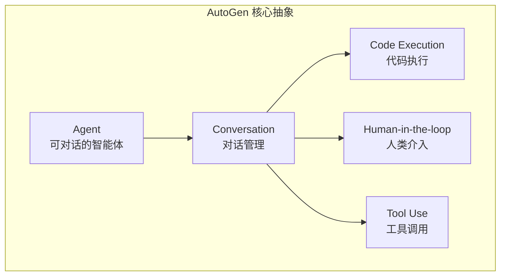
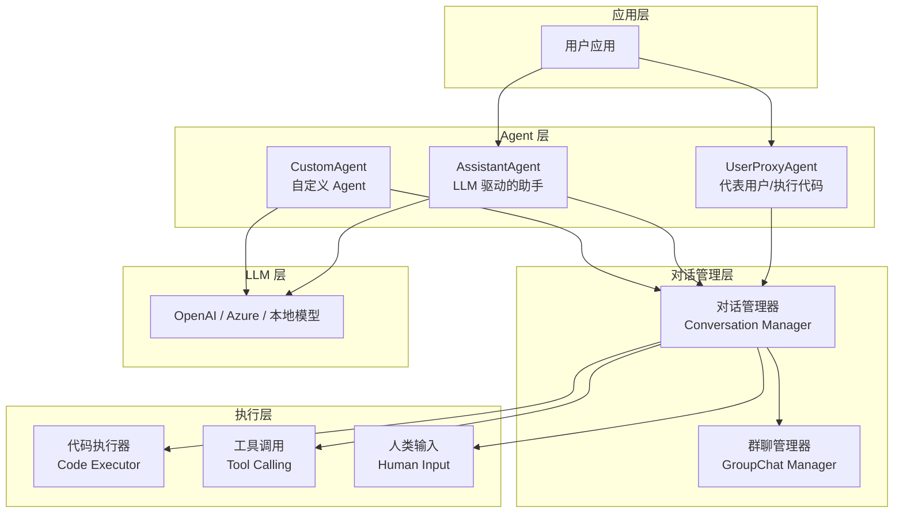
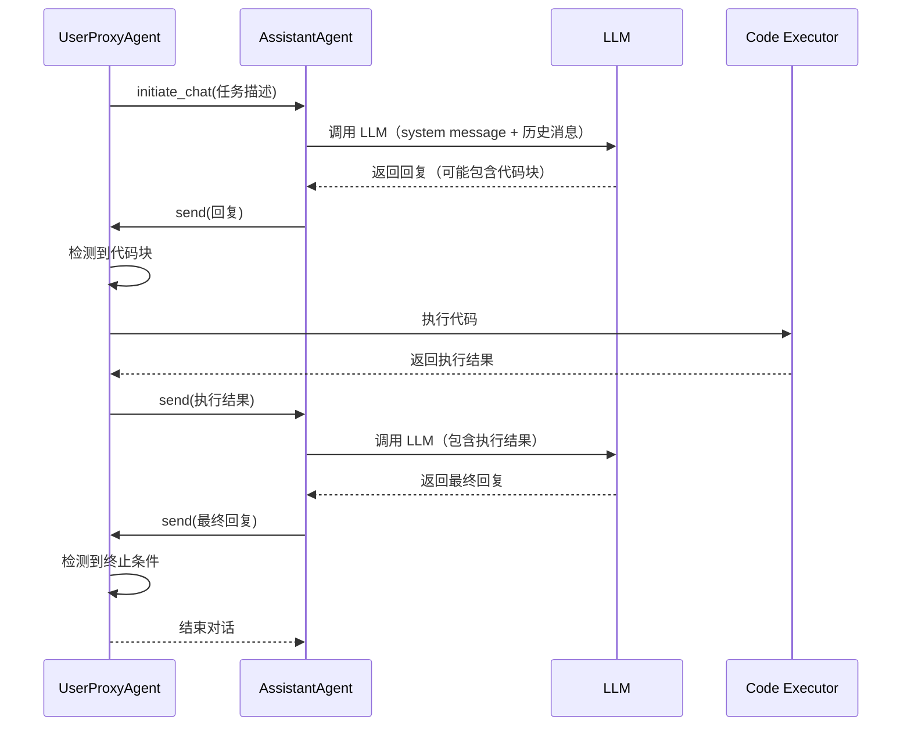

# AutoGen 多 Agent 框架

> **一句话定义**：AutoGen 是微软研究院开源的多 Agent 对话框架，通过"可对话 Agent"抽象实现多个 Agent 之间的自动对话协作，支持人类介入、代码执行、工具调用和复杂工作流编排。
>
> **核心价值**：以"对话"为核心抽象，简化多 Agent 系统的开发，支持灵活的 Agent 角色定义、自动对话管理、人类在环和代码执行沙箱。
>
> **适用场景**：多 Agent 协作任务、代码生成与执行、复杂问题求解、需要人类介入的 AI 工作流、研究实验。

---

## 一、概述

### 1.1 AutoGen 的设计理念

AutoGen 的核心设计理念是"**Agent 即对话参与者**"——每个 Agent 都是一个可以发送和接收消息的对话参与者，多 Agent 协作通过 Agent 之间的自动对话实现。



### 1.2 AutoGen 的核心特性

| 特性 | 说明 |
|------|------|
| **可对话 Agent** | 所有 Agent 都可以发送/接收消息，通过对话协作 |
| **多 Agent 对话** | 支持两个 Agent 对话、群聊、嵌套对话 |
| **人类在环** | 支持人类介入对话，提供输入和反馈 |
| **代码执行** | 内置代码执行沙箱，支持 Python 代码生成和执行 |
| **工具调用** | 支持 Function Calling，Agent 可以调用外部工具 |
| **灵活的角色定义** | 通过 system message 定义 Agent 角色和行为 |
| **对话模式** | 支持顺序对话、群聊、图结构对话 |
| **可扩展性** | 支持自定义 Agent、自定义对话管理器、自定义代码执行器 |
<div style="background:linear-gradient(135deg,#667eea,#764ba2);border-radius:16px;padding:20px;margin:16px 0;font-family:-apple-system,'Segoe UI','PingFang SC','Microsoft YaHei',sans-serif;color:#fff;overflow:hidden;box-shadow:0 8px 28px rgba(0,0,0,.14),0 3px 10px rgba(0,0,0,.08)">
<style>@keyframes pulse{0%,100%{transform:scale(1);opacity:.9}50%{transform:scale(1.03);opacity:1}}.dk-layer{border-radius:8px;padding:12px 16px;margin:6px auto;text-align:center;font-weight:600;animation:pulse 3s ease-in-out infinite}.dk-outer{background:rgba(255,255,255,.15);border:2px solid rgba(255,255,255,.5);max-width:340px;animation-delay:0s}.dk-middle{background:rgba(255,255,255,.2);border:2px solid rgba(255,255,255,.6);max-width:280px;animation-delay:.5s}.dk-inner{background:rgba(255,255,255,.25);border:2px solid rgba(255,255,255,.7);max-width:220px;animation-delay:1s}.dk-arrow{text-align:center;font-size:18px;margin:2px 0}.dk-label{font-size:12px;opacity:.85;font-weight:400;margin-top:4px}</style>
<div style="text-align:center;font-size:15px;font-weight:700;margin-bottom:14px;padding-bottom:10px;border-bottom:1.5px solid rgba(255,255,255,.22);letter-spacing:1px">💬 AutoGen 对话式 Agent 架构</div>
<div class="dk-layer dk-outer">协作层 · GroupChat/Nested Chat<div class="dk-label">群聊管理/嵌套对话/发言人选择</div></div>
<div class="dk-arrow">▼ 包含</div>
<div class="dk-layer dk-middle">Agent层 · ConversableAgent<div class="dk-label">send/receive消息传递/LLM驱动/角色定义</div></div>
<div class="dk-arrow">▼ 包含</div>
<div class="dk-layer dk-inner">执行层 · Code Exec/Human-in-loop<div class="dk-label">代码沙箱执行/人类介入/工具调用</div></div>
</div>


### 1.3 AutoGen vs 其他多 Agent 框架

| 维度 | AutoGen | LangGraph | CrewAI | MetaGPT |
|------|---------|-----------|--------|---------|
| **核心抽象** | 可对话 Agent | 状态图 | 角色化团队 | 软件公司 |
| **协作模式** | 对话/群聊 | 图编排 | 顺序/层级 | 流水线 |
| **代码执行** | 内置沙箱 | 需自定义 | 需自定义 | 需自定义 |
| **人类介入** | 原生支持 | 需自定义 | 有限支持 | 不支持 |
| **灵活性** | 高 | 极高 | 中 | 低 |
| **学习曲线** | 中 | 陡 | 缓 | 中 |
| **生产就绪** | 中 | 高 | 中 | 低 |
| **适用场景** | 对话协作、代码生成 | 复杂流程、生产系统 | 角色分工、快速原型 | 软件开发 |

> 🔍 **知识点深度解析**
>
> **作用**：AutoGen 为多 Agent 系统提供以"对话"为核心的开发框架，通过可对话 Agent 抽象、自动对话管理、代码执行沙箱和人类在环支持，简化多 Agent 协作系统的开发。
>
> **原理**：AutoGen 的核心是 `ConversableAgent` 类——每个 Agent 都有 `send()` 和 `receive()` 方法，可以向其他 Agent 发送消息并接收回复。两个 Agent 之间的对话通过 `initiate_chat()` 启动，Agent 根据自己的 system message 和 LLM 决定如何回复。对话可以自动进行（Agent 自动回复），也可以在需要时请求人类输入。代码执行通过 `UserProxyAgent` 的 `code_execution_config` 配置，在 Docker 或本地沙箱中执行 LLM 生成的代码。
>
> **用法要点**：① 从简单的两 Agent 对话开始，逐步增加复杂度 ② Agent 角色通过 system message 定义，要清晰明确 ③ 代码执行务必使用 Docker 沙箱，不要在本地直接执行 ④ 设置 `max_consecutive_auto_reply` 防止无限对话 ⑤ 群聊模式下注意 `speaker_selection_method` 的选择 ⑥ 生产环境需要自己实现持久化、可观测性和错误恢复

---

> 💡 **深度讲解**：AutoGen 的独特之处在于它将"对话"提升为一等公民。在传统的 Agent 框架中，Agent 之间的协作通常通过"任务分配→执行→返回结果"的结构化流程实现，而 AutoGen 认为 Agent 之间的协作本质上是"对话"——就像人类团队成员通过讨论来协作一样，AI Agent 也可以通过自然语言对话来协调分工、交换信息、解决分歧。这种设计的优势是灵活性极高——Agent 可以在对话中动态决定下一步做什么、是否需要调用工具、是否需要请求人类帮助，不需要预先定义严格的流程。但这种灵活性也带来了挑战——对话的走向不可控，可能出现无限循环、偏离主题、重复讨论等问题，需要通过 `max_consecutive_auto_reply`、`speaker_selection_method`、终止条件等机制来约束。AutoGen 的另一个亮点是原生支持代码执行和人类在环——`UserProxyAgent` 可以代表用户执行代码、提供输入，这使得 AutoGen 特别适合"AI 生成代码→执行→根据结果迭代"的场景，如数据分析、自动化脚本开发、科学计算等。
>
> **📝 精简总结**：AutoGen 是微软开源的多 Agent 对话框架，核心设计是"Agent 即对话参与者"；核心特性包括可对话 Agent、多 Agent 对话、人类在环、代码执行沙箱、工具调用、灵活角色定义；与 LangGraph（图编排）、CrewAI（角色化）、MetaGPT（软件公司）相比，AutoGen 以对话为核心，灵活性高，适合对话协作和代码生成；核心类是 ConversableAgent，通过 send/receive 实现对话，initiate_chat 启动对话。

---

## 二、原理

### 2.1 AutoGen 架构



### 2.2 核心类体系

| 类 | 说明 | 关键方法/属性 |
|----|------|-------------|
| **ConversableAgent** | 可对话 Agent 基类 | `send()`, `receive()`, `initiate_chat()`, `system_message` |
| **AssistantAgent** | LLM 驱动的助手 Agent | `llm_config`, 默认使用 LLM 回复 |
| **UserProxyAgent** | 代表用户的 Agent | `code_execution_config`, `human_input_mode`, 可执行代码/请求人类输入 |
| **GroupChat** | 群聊管理 | `agents`, `messages`, `speaker_selection_method` |
| **GroupChatManager** | 群聊管理器 | `groupchat`, 管理群聊中的发言顺序 |
| **CodeExecutor** | 代码执行器 | `execute_code_blocks()`, Docker 或本地执行 |
| **FunctionCall** | 工具调用 | 注册函数，Agent 可调用 |

### 2.3 对话流程



### 2.4 群聊发言选择机制

| 方法 | 说明 | 适用场景 |
|------|------|---------|
| **auto** | 自动选择下一个发言者（LLM 决定） | 开放式讨论，灵活但可能不可控 |
| **round_robin** | 轮流发言 | 固定角色顺序，如评审会议 |
| **random** | 随机选择 | 实验场景 |
| **manual** | 手动选择 | 需要人类控制发言顺序 |

---

> 💡 **深度讲解**：AutoGen 的对话管理是其核心机制。两个 Agent 之间的对话通过 `initiate_chat()` 启动后，会进入自动回复循环——接收消息的 Agent 根据自己的配置决定如何回复：如果是 `AssistantAgent`，会调用 LLM 生成回复；如果是 `UserProxyAgent`，会先检查是否有代码块需要执行，然后根据 `human_input_mode` 决定是自动回复还是请求人类输入。对话持续直到满足终止条件——`max_consecutive_auto_reply` 达到上限、Agent 返回终止消息（如 "TERMINATE"）、或人类介入结束。群聊模式更复杂——`GroupChatManager` 维护一个 Agent 列表和消息历史，每轮通过 `speaker_selection_method` 选择下一个发言者。`auto` 模式使用 LLM 根据对话上下文选择最合适的发言者，最灵活但也最不可控；`round_robin` 模式按固定顺序轮流发言，可控但不够灵活。实际使用中，建议：① 简单任务用两 Agent 对话（UserProxy + Assistant）；② 多角色协作用群聊，但设置明确的发言规则和终止条件；③ 生产环境避免使用 `auto` 发言选择，改用 `round_robin` 或自定义选择逻辑。
>
> **📝 精简总结**：AutoGen 架构分为应用层、Agent 层（UserProxy/Assistant/Custom）、对话管理层（Conversation/GroupChat Manager）、执行层（代码执行/工具调用/人类输入）、LLM 层；核心类包括 ConversableAgent（基类）、AssistantAgent（LLM助手）、UserProxyAgent（用户代理/代码执行）、GroupChat（群聊）、GroupChatManager（群聊管理）、CodeExecutor（代码执行）；对话流程是 initiate_chat→LLM回复→检测代码→执行代码→返回结果→继续LLM→终止条件；群聊发言选择支持 auto/round_robin/random/manual 四种方法。

---

## 三、实操

### 3.1 基础两 Agent 对话

```python
import autogen

# 配置 LLM
llm_config = {
    "config_list": [
        {
            "model": "gpt-4o",
            "api_key": "sk-xxx",
        }
    ],
    "temperature": 0,
    "timeout": 120,
}

# 创建 Assistant Agent（LLM 驱动）
assistant = autogen.AssistantAgent(
    name="assistant",
    llm_config=llm_config,
    system_message="""你是一个专业的数据分析助手。
- 当需要计算或数据处理时，编写 Python 代码
- 代码需要有注释
- 完成任务后回复 'TERMINATE'""",
)

# 创建 UserProxy Agent（代表用户，执行代码）
user_proxy = autogen.UserProxyAgent(
    name="user_proxy",
    human_input_mode="NEVER",  # 不请求人类输入，自动执行
    max_consecutive_auto_reply=10,
    code_execution_config={
        "work_dir": "coding",  # 代码执行工作目录
        "use_docker": True,    # 使用 Docker 沙箱（推荐）
    },
    system_message="""你是用户代理。
- 执行 assistant 提供的代码
- 返回执行结果
- 如果任务完成，回复 'TERMINATE'""",
)

# 启动对话
user_proxy.initiate_chat(
    assistant,
    message="""请分析以下销售数据并给出洞察：
月份,销售额,订单量
1月,12000,150
2月,15000,180
3月,18000,220
4月,16000,200
5月,21000,260
6月,24000,300
请计算月均增长率、找出最高销售月、预测7月销售额。""",
)

# 获取最终结果
print("对话历史:")
for msg in user_proxy.chat_messages[assistant]:
    print(f"[{msg['role']}] {msg['content'][:100]}...")
```

### 3.2 群聊多 Agent 协作

```python
import autogen

llm_config = {"config_list": [{"model": "gpt-4o", "api_key": "sk-xxx"}]}

# 创建多个角色 Agent
product_manager = autogen.AssistantAgent(
    name="ProductManager",
    llm_config=llm_config,
    system_message="""你是产品经理。
- 负责需求分析和产品设计
- 输出需求文档和功能规格
- 关注用户体验和商业价值""",
)

architect = autogen.AssistantAgent(
    name="Architect",
    llm_config=llm_config,
    system_message="""你是系统架构师。
- 负责技术方案设计
- 输出架构图和技术选型
- 关注可扩展性和性能""",
)

developer = autogen.AssistantAgent(
    name="Developer",
    llm_config=llm_config,
    system_message="""你是高级开发工程师。
- 负责代码实现
- 输出可运行的代码
- 关注代码质量和最佳实践""",
)

reviewer = autogen.AssistantAgent(
    name="Reviewer",
    llm_config=llm_config,
    system_message="""你是代码审查专家。
- 负责审查代码质量和安全性
- 输出审查意见和改进建议
- 严格但公正""",
)

user_proxy = autogen.UserProxyAgent(
    name="UserProxy",
    human_input_mode="NEVER",
    code_execution_config={"work_dir": "project", "use_docker": True},
)

# 创建群聊
groupchat = autogen.GroupChat(
    agents=[user_proxy, product_manager, architect, developer, reviewer],
    messages=[],
    max_round=20,
    speaker_selection_method="round_robin",  # 轮流发言
)

# 创建群聊管理器
manager = autogen.GroupChatManager(
    groupchat=groupchat,
    llm_config=llm_config,
)

# 启动群聊
user_proxy.initiate_chat(
    manager,
    message="请设计并实现一个用户管理系统的 REST API，包含用户 CRUD 和 JWT 认证。"
)
```

### 3.3 工具调用（Function Calling）

```python
import autogen
from typing import Annotated

llm_config = {"config_list": [{"model": "gpt-4o", "api_key": "sk-xxx"}]}

# 定义工具函数
@user_proxy.register_for_execution()
@assistant.register_for_llm(
    name="get_weather",
    description="获取指定城市的当前天气信息"
)
def get_weather(city: Annotated[str, "城市名称"]) -> str:
    """获取天气"""
    # 实际调用天气 API
    weather_data = {
        "北京": {"temp": 25, "condition": "晴", "humidity": 40},
        "上海": {"temp": 28, "condition": "多云", "humidity": 65},
    }
    data = weather_data.get(city, {"temp": "N/A", "condition": "未知"})
    return f"{city}天气：温度{data['temp']}°C，{data['condition']}，湿度{data.get('humidity', 'N/A')}%"


@user_proxy.register_for_execution()
@assistant.register_for_llm(
    name="send_email",
    description="发送电子邮件"
)
def send_email(
    to: Annotated[str, "收件人邮箱"],
    subject: Annotated[str, "邮件主题"],
    body: Annotated[str, "邮件正文"]
) -> str:
    """发送邮件"""
    print(f"发送邮件给 {to}: {subject}")
    # 实际调用邮件服务
    return f"邮件已发送给 {to}"


# 创建 Agent
assistant = autogen.AssistantAgent(
    name="assistant",
    llm_config=llm_config,
    system_message="你是一个智能助手，可以查询天气和发送邮件。",
)

user_proxy = autogen.UserProxyAgent(
    name="user_proxy",
    human_input_mode="NEVER",
    code_execution_config=False,  # 不执行代码，只调用工具
)

# 启动对话
user_proxy.initiate_chat(
    assistant,
    message="查一下北京今天的天气，然后给 test@example.com 发一封邮件告知天气情况。"
)
```

### 3.4 人类在环（Human-in-the-loop）

```python
import autogen

llm_config = {"config_list": [{"model": "gpt-4o", "api_key": "sk-xxx"}]}

assistant = autogen.AssistantAgent(
    name="assistant",
    llm_config=llm_config,
)

# human_input_mode="TERMINATE"：只在终止时请求人类输入
# human_input_mode="ALWAYS"：每次回复都请求人类输入
# human_input_mode="NEVER"：不请求人类输入
user_proxy = autogen.UserProxyAgent(
    name="user_proxy",
    human_input_mode="TERMINATE",  # 在对话终止时请求人类确认
    code_execution_config={"work_dir": "coding", "use_docker": True},
)

# 自定义人类输入函数
def get_human_input(prompt: str) -> str:
    """自定义人类输入逻辑（可接入 Web UI、API 等）"""
    print(f"\n[需要人类输入] {prompt}")
    user_input = input("请输入（输入 'exit' 结束）: ")
    return user_input

user_proxy.get_human_input = get_human_input

# 启动对话
user_proxy.initiate_chat(
    assistant,
    message="请帮我写一个 Python 脚本，批量重命名指定目录下的所有图片文件。"
)
```

### 3.5 嵌套对话（Nested Chats）

```python
import autogen

llm_config = {"config_list": [{"model": "gpt-4o", "api_key": "sk-xxx"}]}

# 外层 Agent：协调者
coordinator = autogen.AssistantAgent(
    name="coordinator",
    llm_config=llm_config,
    system_message="你是协调者，负责分配任务给专家并整合结果。",
)

# 内层 Agent：研究专家
researcher = autogen.AssistantAgent(
    name="researcher",
    llm_config=llm_config,
    system_message="你是研究专家，负责收集和分析信息。",
)

# 内层 Agent：写作专家
writer = autogen.AssistantAgent(
    name="writer",
    llm_config=llm_config,
    system_message="你是写作专家，负责撰写高质量文章。",
)

# 注册嵌套对话
coordinator.register_nested_chats(
    [
        {
            "recipient": researcher,
            "message": lambda recipient, messages, sender, config: f"请研究：{messages[-1]['content']}",
            "summary_method": "last_msg",
        },
        {
            "recipient": writer,
            "message": lambda recipient, messages, sender, config: f"根据以下研究结果撰写文章：{messages[-1]['content']}",
            "summary_method": "last_msg",
        },
    ],
    trigger=lambda sender: sender is not coordinator,  # 非自身消息触发嵌套对话
)

# 启动
user_proxy = autogen.UserProxyAgent(
    name="user_proxy",
    human_input_mode="NEVER",
    code_execution_config=False,
)

user_proxy.initiate_chat(
    coordinator,
    message="请研究 AI Agent 的最新进展，并撰写一篇 1000 字的综述文章。"
)
```

---

> 💡 **深度讲解**：AutoGen 的实操关键是"理解 Agent 的回复决策逻辑"。每个 Agent 在收到消息后，会按以下顺序决定如何回复：① 检查是否有终止条件（`max_consecutive_auto_reply`、终止关键词）；② 如果是 `UserProxyAgent`，检查消息中是否有代码块，如果有且配置了 `code_execution_config`，则执行代码并将结果作为回复；③ 检查 `human_input_mode`，如果需要人类输入，则请求人类输入并作为回复；④ 如果配置了 `llm_config`，调用 LLM 生成回复；⑤ 如果以上都不满足，使用默认回复。理解这个决策顺序对于调试 Agent 行为非常重要——例如，如果 `UserProxyAgent` 没有执行代码，可能是因为 `code_execution_config` 未配置、代码块格式不正确、或 `human_input_mode` 优先请求了人类输入。工具调用的注册方式也需要注意——`@register_for_llm` 装饰器将函数注册给 AssistantAgent（让 LLM 知道可以调用这个工具），`@register_for_execution` 装饰器将函数注册给 UserProxyAgent（实际执行工具），两个装饰器需要配合使用。嵌套对话是 AutoGen 的高级特性，允许一个 Agent 在对话过程中启动与其他 Agent 的子对话，适合"协调者-专家"模式——协调者收到任务后，分别与研究专家、写作专家进行子对话，获取结果后整合输出。
>
> **📝 精简总结**：基础两 Agent 对话使用 AssistantAgent（LLM驱动）+ UserProxyAgent（代码执行/人类输入），通过 initiate_chat 启动；群聊使用 GroupChat + GroupChatManager，支持 auto/round_robin/random/manual 发言选择；工具调用通过 @register_for_llm + @register_for_execution 装饰器注册；人类在环通过 human_input_mode 控制（NEVER/TERMINATE/ALWAYS），可自定义 get_human_input；嵌套对话通过 register_nested_chats 实现协调者-专家模式；关键是理解 Agent 的回复决策逻辑（终止条件→代码执行→人类输入→LLM→默认）。

---

## 四、问题

### 4.1 常见错误与排查

| 问题 | 原因 | 解决方案 |
|------|------|---------|
| **对话无限循环** | 没有终止条件 / Agent 反复讨论同一问题 | 设置 max_consecutive_auto_reply，在 system message 中要求完成后回复 TERMINATE |
| **代码不执行** | code_execution_config 未配置 / 代码块格式不正确 / Docker 未启动 | 配置 code_execution_config，确保代码用 ```python 包裹，启动 Docker |
| **工具不被调用** | 工具未正确注册 / 工具描述不清晰 / 模型不支持 tool calling | 检查 @register_for_llm 装饰器，优化工具描述，使用支持 tool calling 的模型 |
| **群聊发言混乱** | speaker_selection_method="auto" 不可控 / Agent 角色不清晰 | 改用 round_robin，明确 Agent 角色和发言规则 |
| **LLM 调用失败** | API Key 错误 / 模型不可用 / 网络问题 | 检查 config_list，测试 API 连通性，增加重试和超时 |
| **上下文溢出** | 对话历史过长 / 代码执行结果过大 | 实现消息摘要，限制代码输出长度，使用长上下文模型 |
| **人类输入不触发** | human_input_mode 配置错误 / get_human_input 被覆盖 | 确认 human_input_mode="TERMINATE" 或 "ALWAYS"，检查自定义输入函数 |
| **Docker 沙箱错误** | Docker 未安装 / 镜像不存在 / 权限不足 | 安装 Docker，使用官方镜像，检查 Docker 权限 |
| **嵌套对话不触发** | trigger 条件不满足 / 消息格式错误 | 检查 trigger lambda 函数，确认消息结构 |
| **结果不符合预期** | Agent 角色定义不清晰 / 缺少示例 / 温度设置不当 | 优化 system message，添加 few-shot 示例，调整 temperature |

### 4.2 性能优化策略

| 优化点 | 策略 | 预期效果 |
|--------|------|---------|
| **对话轮次** | 明确终止条件，减少不必要的讨论 | 总延迟降低 30-50% |
| **模型选择** | 简单任务用小模型，复杂任务用大模型 | 成本降低 40-60% |
| **代码执行** | 复用 Docker 容器，避免每次启动新容器 | 代码执行延迟降低 50% |
| **消息历史** | 摘要压缩历史消息，滑动窗口 | Token 消耗降低 40-80% |
| **群聊发言** | 使用 round_robin 替代 auto，减少 LLM 选择开销 | 每轮延迟降低 20% |
| **工具调用** | 工具结果缓存，减少重复调用 | 重复工具调用延迟降低 90% |
| **并行对话** | 无依赖的子对话并行执行 | 总延迟降低 30-70% |

### 4.3 安全风险与防护

| 风险 | 说明 | 防护措施 |
|------|------|---------|
| **代码执行安全** | LLM 生成的代码可能包含恶意操作 | 使用 Docker 沙箱，只读文件系统，网络隔离，资源限制 |
| **Prompt 注入** | 通过用户输入或代码执行结果注入恶意指令 | 输入校验，系统提示与用户输入分离，注入检测 |
| **工具越权** | Agent 调用未授权的工具 | 工具白名单，权限控制，高风险操作需人类确认 |
| **数据泄露** | 代码执行或工具调用泄露敏感数据 | 沙箱隔离，敏感信息脱敏，外发数据检测 |
| **无限循环** | Agent 反复调用导致资源耗尽 | max_consecutive_auto_reply，超时机制，成本预算 |
| **依赖混淆** | 代码执行时安装恶意依赖 | 私有 PyPI 镜像，依赖白名单，镜像扫描 |

### 4.4 生产环境踩坑记录

**踩坑1：Docker 沙箱中无法访问本地文件**
- **现象**：代码执行时需要读取本地数据文件，但 Docker 容器中找不到
- **原因**：Docker 沙箱默认不挂载本地目录，`work_dir` 只在容器内创建
- **方案**：在 `code_execution_config` 中配置 Docker 卷挂载，将需要的目录挂载到容器中；或者将数据文件复制到 `work_dir` 中

**踩坑2：群聊中 Agent 忘记自己的角色**
- **现象**：群聊进行几轮后，开发者 Agent 开始做产品经理的工作，角色混乱
- **原因**：群聊消息历史中各 Agent 的发言混合在一起，LLM 的角色感知减弱
- **方案**：① 在每条消息前添加 Agent 名称标识；② 定期在 system message 中重申角色；③ 使用 `round_robin` 发言顺序，减少角色混淆；④ 限制群聊轮次（max_round ≤ 15）

**踩坑3：代码执行结果过长导致上下文溢出**
- **现象**：代码输出了大量数据（如打印整个 DataFrame），导致后续 LLM 调用超出 token 限制
- **原因**：AutoGen 默认不限制代码输出长度，完整输出会加入对话历史
- **方案**：① 在代码中限制输出（如 `df.head()` 而非 `print(df)`）；② 配置代码执行器的输出截断；③ 实现消息摘要，对长输出进行压缩

---

> 💡 **深度讲解**：AutoGen 生产环境的核心挑战是"对话可控性"和"代码执行安全"。对话可控性是 AutoGen 最大的优势也是最大的风险——基于对话的协作非常灵活，但对话的走向不可预测，可能出现无限循环、偏离主题、角色混乱、重复讨论等问题。生产环境必须设置严格的约束：① `max_consecutive_auto_reply` 限制最大自动回复次数（建议 10-15）；② 在 system message 中明确要求完成后回复 "TERMINATE"；③ 群聊使用 `round_robin` 而非 `auto` 发言选择；④ 限制群聊 `max_round`（建议 ≤ 20）；⑤ 实现对话摘要，避免上下文溢出。代码执行安全是另一个核心挑战——LLM 生成的代码可能包含恶意操作（删除文件、访问网络、窃取数据），绝不能在本地直接执行。生产环境必须：① 使用 Docker 沙箱执行代码；② 沙箱使用只读文件系统（除 work_dir 外）；③ 禁用沙箱网络访问（除非明确需要）；④ 限制沙箱资源（CPU、内存、执行时间）；⑤ 代码执行前进行静态分析（检测危险操作）；⑥ 记录所有代码执行日志用于审计。AutoGen 的生产就绪度目前中等——它提供了强大的多 Agent 对话能力，但在持久化、可观测性、错误恢复、水平扩展等生产级特性上还不够完善，生产环境需要自己实现这些能力或与其他系统（Langfuse、Redis、Kubernetes）集成。
>
> **📝 精简总结**：常见问题包括无限循环、代码不执行、工具不调用、群聊发言混乱、LLM调用失败、上下文溢出、人类输入不触发、Docker错误、嵌套对话不触发、结果不符合预期；性能优化采用明确终止条件、模型分级、复用Docker容器、消息摘要、round_robin发言、工具缓存、并行对话等策略；安全风险包括代码执行安全、Prompt注入、工具越权、数据泄露、无限循环、依赖混淆，核心是Docker沙箱隔离；生产踩坑集中在Docker文件访问、群聊角色混乱、代码输出过长；核心挑战是对话可控性和代码执行安全，生产就绪度中等，需自行实现持久化/可观测性/错误恢复。

---

## 五、拓展

### 5.1 AutoGen 扩展生态

| 扩展 | 说明 |
|------|------|
| **AutoGen Studio** | 可视化界面，拖拽式构建多 Agent 应用 |
| **AutoGen Bench** | 多 Agent 系统的基准测试框架 |
| **AutoGen.Ollama** | 与 Ollama 集成，支持本地模型 |
| **AutoGen + LangChain** | 结合 LangChain 的工具和链 |
| **AutoGen + MemGPT** | 结合 MemGPT 的长期记忆 |
| **AutoGen + WebSocket** | 实时 WebSocket 通信，适合交互式应用 |

### 5.2 AutoGen 应用场景

| 场景 | Agent 配置 | 说明 |
|------|-----------|------|
| **数据分析** | UserProxy + DataAnalyst | 自动生成分析代码、执行、迭代 |
| **代码审查** | Developer + Reviewer + UserProxy | 开发者写代码，审查者提意见，迭代优化 |
| **内容创作** | Researcher + Writer + Editor | 研究→写作→编辑流水线 |
| **客户服务** | SupportAgent + EscalationAgent + Human | 自动回复，复杂问题升级，人类介入 |
| **科学计算** | Scientist + Coder + UserProxy | 假设→代码实现→实验验证 |
| **教育辅导** | Tutor + Student + Evaluator | 导师教学、学生练习、评估反馈 |
| **游戏 NPC** | 多个角色 Agent | 非玩家角色的自主对话和行为 |

### 5.3 与其他框架的集成

| 集成方式 | 说明 |
|---------|------|
| **AutoGen + LangChain** | 使用 LangChain 的 Tools、Chains、Retrievers 作为 AutoGen Agent 的工具 |
| **AutoGen + LlamaIndex** | 使用 LlamaIndex 的数据索引和查询引擎作为 AutoGen 的知识库工具 |
| **AutoGen + Langfuse** | 使用 Langfuse 进行 AutoGen 对话的可观测性和评估 |
| **AutoGen + FastAPI** | 将 AutoGen 对话封装为 REST API，支持 Web 应用调用 |
| **AutoGen + Docker** | 使用 Docker Compose 编排多 Agent + 代码执行沙箱 |

### 5.4 学习资源

- [AutoGen 官方文档](https://microsoft.github.io/autogen/) 🔗
- [AutoGen GitHub](https://github.com/microsoft/autogen) 🔗
- [AutoGen 示例库](https://github.com/microsoft/autogen/tree/main/python/samples) 🔗
- [AutoGen Studio](https://github.com/microsoft/autogen/tree/main/samples/apps/autogen-studio) 🔗
- [[多Agent协作模式]] — 多 Agent 协作模式理论
- [[LangGraph-状态机Agent]] — 另一种多 Agent 框架
- [[CrewAI-角色化多Agent]] — 角色化多 Agent 框架
- [[自研Agent框架设计]] — 自研框架参考

---

> 💡 **深度讲解**：AutoGen 的未来发展方向是"从研究框架到生产平台"。目前 AutoGen 主要用于研究和实验场景，其灵活的对话抽象非常适合探索多 Agent 协作的各种可能性。但要成为生产级框架，AutoGen 还需要在以下方面加强：① 持久化——对话状态的持久化和恢复；② 可观测性——内置的追踪、日志、指标；③ 水平扩展——支持分布式 Agent 部署；④ 安全治理——更完善的代码执行沙箱和权限控制；⑤ 流式支持——更好的流式响应和实时交互。AutoGen Studio 是向易用性发展的重要一步——它提供了可视化界面，允许非技术用户通过拖拽方式构建多 Agent 应用，降低了使用门槛。AutoGen 的另一个发展趋势是与其他 AI 技术的深度集成——与 LangChain 的工具生态集成、与 LlamaIndex 的 RAG 能力集成、与 MemGPT 的长期记忆集成、与 Langfuse 的可观测性集成，形成完整的 AI 应用开发生态。对于开发者来说，AutoGen 最适合的场景是"需要代码执行和人类介入的多 Agent 协作"——如数据分析、自动化脚本开发、科学计算等，这些场景中 AutoGen 的代码执行沙箱和人类在环特性能够发挥最大价值。
>
> **📝 精简总结**：AutoGen 扩展生态包括 AutoGen Studio（可视化界面）、AutoGen Bench（基准测试）、Ollama 集成（本地模型）、LangChain/LlamaIndex/MemGPT 集成等；应用场景包括数据分析、代码审查、内容创作、客户服务、科学计算、教育辅导、游戏 NPC 等；与其他框架集成包括 LangChain（工具）、LlamaIndex（RAG）、Langfuse（可观测性）、FastAPI（REST API）、Docker（编排）；学习资源包括官方文档、GitHub、示例库、AutoGen Studio 和本知识库相关专题；未来方向是从研究框架到生产平台，加强持久化、可观测性、水平扩展、安全治理。

---

## 🔗 关联笔记

- [[多Agent协作模式]] — 多 Agent 协作模式理论基础
- [[Agent核心概念-ReAct规划]] — ReAct 推理循环
- [[LangGraph-状态机Agent]] — 图状态机多 Agent 框架
- [[CrewAI-角色化多Agent]] — 角色化多 Agent 框架
- [[自研Agent框架设计]] — 自研框架设计参考
- [[Agent工具调用FunctionCalling]] — 工具调用基础
- [[FunctionCalling工具生态]] — 工具生态
- [[Agent评测与可观测性]] — 可观测性

## 📖 前置知识

- [[LLM大模型入门概念]]
- [[Agent核心概念-ReAct规划]]
- [[多Agent协作模式]]
- [[Agent工具调用FunctionCalling]]

## 🏷️ 相关标签

`#AI应用` `#AI工程化` `#Agent` `#效率工具`

---

[[Home|🏠 返回首页]] · [[MOC-AI与效率工具|📚 返回分类]]
