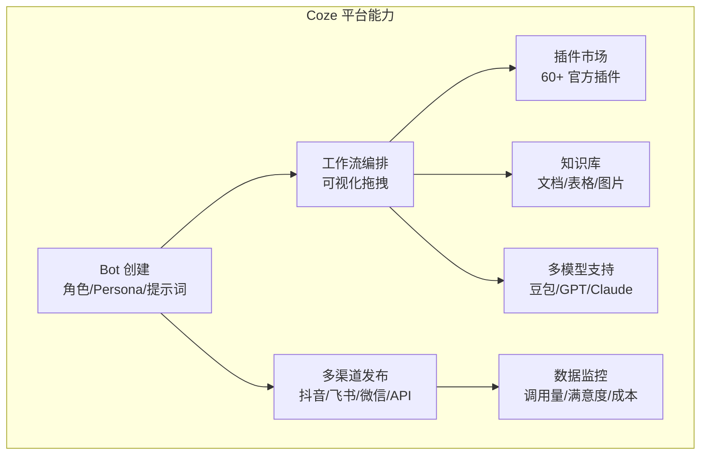
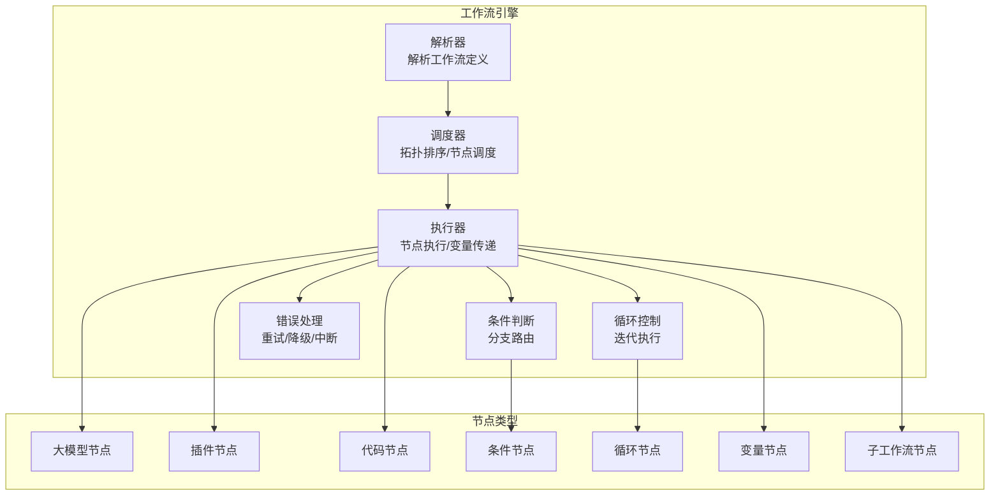
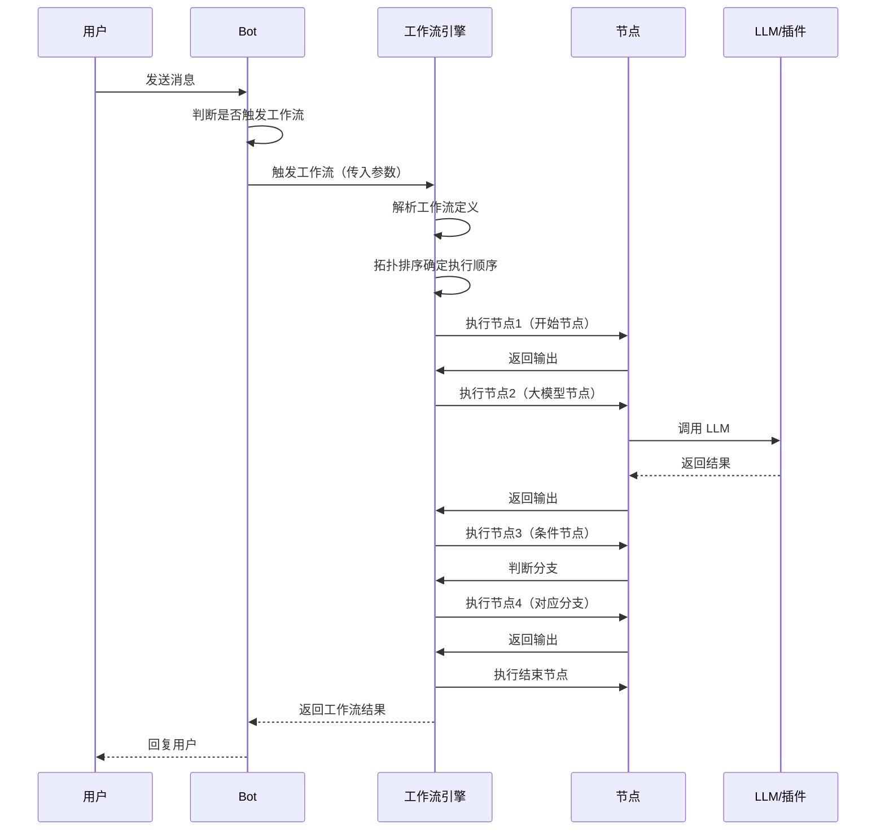
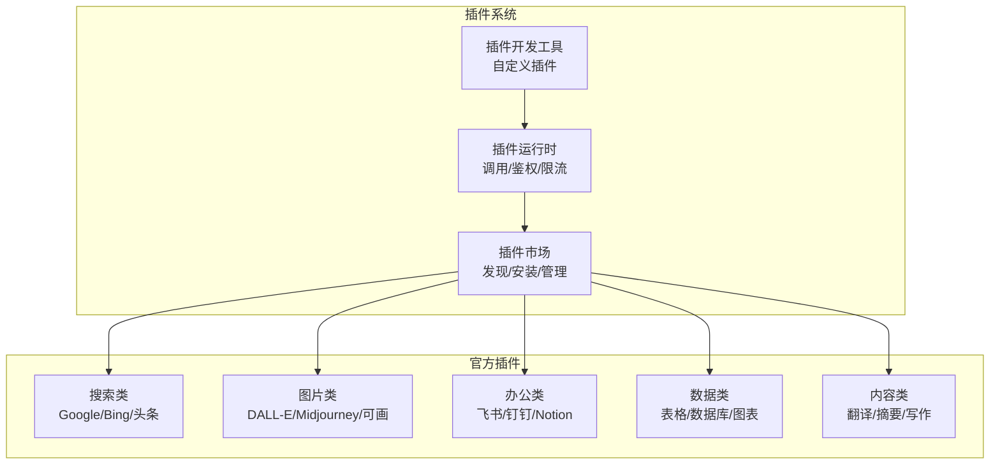
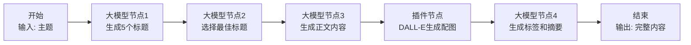

# Coze 工作流编排

> **一句话定义**：Coze（扣子）是字节跳动推出的 AI Bot 开发平台，提供可视化工作流编排、插件生态、知识库、多模型支持等能力，使非技术用户也能快速构建和部署 AI 应用。
>
> **核心价值**：通过"可视化拖拽 + 丰富插件 + 一键发布"的低代码模式，大幅降低 AI 应用的开发门槛，支持从简单聊天机器人到复杂工作流的全场景覆盖。
>
> **适用场景**：聊天机器人、内容创作、客服自动化、数据分析、工作流自动化、多平台 Bot 分发。

---

## 一、概述

### 1.1 Coze 平台定位

Coze 是一个"**AI Bot 全生命周期开发平台**"，覆盖从 Bot 创建、配置、测试到发布、运营的完整流程。



### 1.2 Coze 核心功能

| 功能 | 说明 |
|------|------|
| **Bot 配置** | 定义 Bot 的角色、人设、回复风格、开场白 |
| **工作流（Workflow）** | 可视化编排多步骤任务，支持条件分支、循环、并行 |
| **插件（Plugin）** | 60+ 官方插件 + 自定义插件，扩展 Bot 能力 |
| **知识库（Knowledge）** | 上传文档/表格/图片，Bot 基于知识库回答 |
| **多模型** | 支持豆包、GPT-4o、Claude 3.5、Gemini 等多种模型 |
| **记忆（Memory）** | 长期记忆和变量记忆，记住用户偏好和历史 |
| **定时任务** | 按时间触发 Bot 执行任务 |
| **多渠道发布** | 一键发布到抖音、飞书、微信、Discord、API 等 |
| **数据看板** | 调用量、用户数、满意度、成本等核心指标 |
<div style="background:linear-gradient(135deg,#f093fb,#f5576c);border-radius:16px;padding:20px;margin:16px 0;font-family:-apple-system,'Segoe UI','PingFang SC','Microsoft YaHei',sans-serif;color:#fff;overflow:hidden;box-shadow:0 8px 28px rgba(0,0,0,.14),0 3px 10px rgba(0,0,0,.08)">
<style>@keyframes flow{0%{transform:translateX(-10px);opacity:0}15%{transform:translateX(0);opacity:1}85%{transform:translateX(0);opacity:1}100%{transform:translateX(10px);opacity:0}}.flow-step{display:inline-block;background:rgba(255,255,255,.2);border:2px solid rgba(255,255,255,.5);border-radius:8px;padding:10px 14px;margin:4px;text-align:center;font-weight:600;font-size:13px;animation:flow 4s ease-in-out infinite;min-width:90px}.flow-step:nth-child(2){animation-delay:.5s}.flow-step:nth-child(4){animation-delay:1s}.flow-step:nth-child(6){animation-delay:1.5s}.flow-step:nth-child(8){animation-delay:2s}.flow-arrow{display:inline-block;font-size:20px;animation:flow 4s ease-in-out infinite;vertical-align:middle}.flow-code{background:rgba(0,0,0,.2);border-radius:6px;padding:8px 12px;margin-top:10px;font-family:monospace;font-size:12px;text-align:center}</style>
<div style="text-align:center;font-size:15px;font-weight:700;margin-bottom:14px;padding-bottom:10px;border-bottom:1.5px solid rgba(255,255,255,.22);letter-spacing:1px">🎯 Coze Bot 开发与发布流程</div>
<div style="text-align:center;white-space:nowrap;overflow-x:auto">
<span class="flow-step">Bot配置</span><span class="flow-arrow">→</span><span class="flow-step">工作流编排</span><span class="flow-arrow">→</span><span class="flow-step">插件/知识库</span><span class="flow-arrow">→</span><span class="flow-step">调试测试</span><span class="flow-arrow">→</span><span class="flow-step">多渠道发布</span><span class="flow-arrow">→</span><span class="flow-step">数据监控</span>
</div>
<div class="flow-code">角色人设→可视化拖拽工作流→60+插件/知识库→调试面板检查→抖音/飞书/微信/API发布→调用量/满意度监控</div>
</div>


### 1.3 Coze vs 其他低代码 AI 平台

| 维度 | Coze | Dify | LangFlow | Flowise |
|------|------|------|----------|---------|
| **开发商** | 字节跳动 | 开源社区 | 开源社区 | 开源社区 |
| **部署方式** | SaaS（国内/海外） | 自部署/SaaS | 自部署 | 自部署 |
| **工作流** | 可视化拖拽 | 可视化拖拽 | 节点式编排 | 节点式编排 |
| **插件生态** | 丰富（60+官方） | 中等 | 依赖 LangChain | 依赖 LangChain |
| **多渠道发布** | 强（抖音/飞书/微信） | 中（API/嵌入） | 弱（API） | 弱（API） |
| **知识库** | 强（文档/表格/图片） | 强（多种数据源） | 中 | 中 |
| **多模型** | 强（内置多模型） | 强（100+模型） | 中 | 中 |
| **代码能力** | 弱（低代码为主） | 中（支持自定义代码） | 强（Python节点） | 强（Python节点） |
| **适用用户** | 非技术用户/运营 | 开发者/企业 | 开发者 | 开发者 |
| **国内访问** | 优秀（国内版） | 需自部署 | 需自部署 | 需自部署 |

> 🔍 **知识点深度解析**
>
> **作用**：Coze 为非技术用户和开发者提供低代码 AI Bot 开发平台，通过可视化工作流编排、丰富插件生态、知识库和多渠道发布，快速构建和部署 AI 应用。
>
> **原理**：Coze 的核心是"工作流引擎"——用户通过可视化界面拖拽节点（LLM 调用、插件调用、条件判断、循环等）构建工作流，工作流引擎按拓扑顺序执行节点，节点间通过变量传递数据。Bot 在收到用户消息后，根据配置决定是直接用 LLM 回复，还是触发工作流执行复杂任务。插件系统通过标准化接口扩展 Bot 能力，知识库通过向量检索为 LLM 提供上下文。
>
> **用法要点**：① 从简单 Bot 开始，先配置角色和提示词，再逐步添加工作流和插件 ② 工作流命名要清晰，节点注释要完整，便于维护 ③ 复杂任务拆分为多个子工作流，通过工作流节点调用 ④ 知识库文档要结构化，避免上传过大的文件 ⑤ 发布前充分测试，使用调试面板检查每个节点的输入输出 ⑥ 定期查看数据看板，优化 Bot 表现 ⑦ 注意国内版和海外版的差异（模型、插件、发布渠道）

---

> 💡 **深度讲解**：Coze 的核心竞争力是"低门槛 + 强生态 + 多渠道"。低门槛体现在可视化拖拽界面——不需要写代码，通过拖拽节点就能构建复杂的工作流，这使得非技术用户（运营、产品、市场）也能独立开发 AI 应用。强生态体现在插件市场——Coze 提供了 60+ 官方插件，覆盖搜索、图片生成、数据分析、办公协作等场景，用户可以直接使用而不需要自己开发。多渠道体现在一键发布——Coze Bot 可以一键发布到抖音、飞书、微信、Discord、Telegram 等多个平台，还可以通过 API 嵌入到自有应用中，这是其他平台难以比拟的优势。Coze 的工作流编排采用"节点+连线"的可视化模式，节点类型包括：① 大模型节点（调用 LLM）；② 插件节点（调用插件）；③ 代码节点（执行 JavaScript/Python）；④ 条件节点（if-else 分支）；⑤ 循环节点（遍历数组）；⑥ 变量节点（设置/获取变量）；⑦ 工作流节点（调用子工作流）；⑧ 开始/结束节点。节点之间通过连线定义执行顺序，通过变量传递数据。这种模式非常适合构建多步骤、有分支逻辑的复杂任务。
>
> **📝 精简总结**：Coze 是字节跳动推出的 AI Bot 全生命周期开发平台，核心功能包括 Bot 配置、可视化工作流、60+插件、知识库、多模型、记忆、定时任务、多渠道发布、数据看板；与 Dify/LangFlow/Flowise 相比，Coze 更适合非技术用户，国内访问优秀，多渠道发布能力强；工作流采用节点+连线可视化模式，节点类型包括大模型/插件/代码/条件/循环/变量/子工作流/开始结束；核心竞争力是低门槛+强生态+多渠道。

---

## 二、原理

### 2.1 工作流引擎架构



### 2.2 工作流执行流程



### 2.3 变量系统

工作流中的变量是节点间数据传递的核心机制：

| 变量类型 | 说明 | 作用域 |
|---------|------|--------|
| **输入变量** | 工作流的输入参数 | 整个工作流 |
| **节点输出变量** | 每个节点的执行结果 | 后续节点可引用 |
| **全局变量** | 在工作流中全局可用的变量 | 整个工作流 |
| **环境变量** | Bot 级别的配置变量 | 所有工作流 |
| **循环变量** | 循环节点中的当前迭代项 | 循环体内 |

变量引用语法：`{{节点ID.输出字段}}`，例如 `{{大模型节点1.output}}`

### 2.4 插件系统架构



---

> 💡 **深度讲解**：Coze 工作流引擎的核心是"有向无环图（DAG）执行模型"。工作流被定义为一个 DAG——节点是操作单元，边是数据依赖，引擎通过拓扑排序确定节点的执行顺序，按顺序执行节点，节点的输出作为后续节点的输入。这种模型的优势是：① 执行顺序明确，不会出现循环依赖；② 可以并行执行无依赖的节点，提升效率；③ 数据流向清晰，便于调试和理解。但 DAG 模型也有局限——不支持循环（需要专门的循环节点）、不支持动态节点（节点在设计时确定）。Coze 通过循环节点和子工作流节点弥补了这些局限。变量系统是工作流的"血液"——节点之间通过变量传递数据，变量引用语法 `{{节点ID.字段}}` 使得数据传递非常直观。变量系统支持类型推断和自动转换，例如大模型节点的字符串输出可以直接传递给代码节点作为输入。插件系统采用"市场+运行时"架构——插件市场负责插件的发现、安装、版本管理，插件运行时负责插件的调用、鉴权、限流、错误处理。插件的标准化接口使得第三方开发者可以轻松开发自定义插件，丰富 Coze 的生态。Coze 的插件生态是其最大的竞争优势之一——60+ 官方插件覆盖了大部分常见场景，用户不需要自己开发就能快速构建功能丰富的 Bot。
>
> **📝 精简总结**：工作流引擎架构包括解析器、调度器（拓扑排序）、执行器、条件判断、循环控制、错误处理；节点类型包括大模型、插件、代码、条件、循环、变量、子工作流；执行流程是触发→解析→拓扑排序→按序执行节点→变量传递→条件分支→返回结果；变量系统包括输入变量、节点输出变量、全局变量、环境变量、循环变量，引用语法 `{{节点ID.字段}}`；插件系统采用市场+运行时架构，60+官方插件覆盖搜索/图片/办公/数据/内容等场景；核心是 DAG 执行模型。

---

## 三、实操

### 3.1 创建基础 Bot

1. **登录 Coze**：访问 [coze.cn](https://www.coze.cn)（国内版）或 [coze.com](https://www.coze.com)（海外版），使用手机号/邮箱登录
2. **创建 Bot**：点击"创建 Bot"，填写 Bot 名称、描述、头像
3. **配置人设与回复逻辑**：
   - **角色与目标**：定义 Bot 的角色和核心能力
   - **详细说明**：Bot 的行为准则、回复风格、限制条件
   - **开场白**：用户首次对话时 Bot 的自动回复
   - **推荐问题**：展示给用户的快捷问题按钮
4. **选择模型**：在模型选择器中选择豆包/GPT-4o/Claude 等模型
5. **测试**：在右侧预览面板中测试 Bot 回复
6. **发布**：点击"发布"，选择发布渠道（抖音/飞书/微信/API 等）

### 3.2 构建工作流

**场景：自动生成社交媒体内容**



**工作流配置步骤**：

1. **创建工作流**：在 Bot 配置页点击"工作流"→"创建工作流"
2. **添加开始节点**：配置输入变量 `topic`（字符串，主题）
3. **添加大模型节点1**：
   - 模型：GPT-4o
   - Prompt：`请为主题"{{start.topic}}"生成5个吸引人的社交媒体标题，每个标题不超过20字`
   - 输出：`titles`（字符串）
4. **添加大模型节点2**：
   - Prompt：`从以下标题中选择最适合社交媒体传播的一个，说明理由：{{大模型节点1.titles}}`
   - 输出：`best_title`
5. **添加大模型节点3**：
   - Prompt：`以"{{大模型节点2.best_title}}"为标题，撰写一篇300字的社交媒体正文，语气活泼，包含emoji`
   - 输出：`content`
6. **添加插件节点**：
   - 插件：DALL-E 3
   - 参数：`prompt` = `为社交媒体文章生成配图，主题：{{start.topic}}`
   - 输出：`image_url`
7. **添加大模型节点4**：
   - Prompt：`为以下内容生成5个标签和50字摘要：{{大模型节点3.content}}`
   - 输出：`tags_and_summary`
8. **添加结束节点**：配置输出变量（标题、正文、配图、标签）
9. **测试运行**：点击"运行"，输入测试主题，检查每个节点的输出
10. **保存并关联 Bot**：在 Bot 配置中添加工作流触发器

### 3.3 使用插件

**常用插件配置示例**：

## 搜索插件（头条搜索）
插件：头条搜索
参数：
  - query: {{start.search_keyword}}
  - count: 5
输出：
  - results: 搜索结果列表

## 图片生成插件（DALL-E 3）
插件：DALL-E 3
参数：
  - prompt: {{大模型节点.image_prompt}}
  - size: 1024x1024
  - quality: standard
输出：
  - url: 生成图片的 URL

## 翻译插件（谷歌翻译）
插件：谷歌翻译
参数：
  - text: {{大模型节点.content}}
  - target_language: en
输出：
  - translated_text: 翻译后的文本

## 图表插件（快图）
插件：快图
参数：
  - chart_type: bar
  - data: {{代码节点1.chart_data}}
  - title: 销售数据图表
输出：
  - image_url: 图表图片 URL

### 3.4 配置知识库

1. **创建知识库**：在 Bot 配置页点击"知识库"→"创建知识库"
2. **上传文档**：
   - 支持格式：PDF、Word、Excel、PPT、TXT、Markdown、图片
   - 单个文件最大 100MB
   - 可以上传多个文件
3. **配置分段策略**：
   - **自动分段**：Coze 自动按语义分段（推荐）
   - **自定义分段**：按字符数/分隔符分段
4. **配置检索设置**：
   - 检索模式：语义检索/关键词检索/混合检索
   - Top K：返回最相关的文档片段数量（默认 5）
   - 分数阈值：相似度阈值（默认 0.5）
5. **关联 Bot**：在 Bot 的"知识库"设置中选择要关联的知识库
6. **测试**：在预览面板中提问，验证 Bot 是否基于知识库回答

### 3.5 发布到多渠道

| 渠道 | 配置方式 | 说明 |
|------|---------|------|
| **抖音** | 绑定抖音账号，配置 Bot 头像和名称 | 在抖音私信中与 Bot 对话 |
| **飞书** | 创建飞书应用，配置 Bot 为飞书机器人 | 在飞书群聊/单聊中使用 |
| **微信客服** | 绑定微信客服账号 | 在微信客服场景中使用 |
| **Discord** | 创建 Discord Bot，配置 Token | 在 Discord 服务器中使用 |
| **Telegram** | 创建 Telegram Bot，配置 Token | 在 Telegram 中使用 |
| **API** | 获取 API Key 和 Bot ID | 通过 REST API 调用 Bot |
| **SDK** | 使用 Coze JavaScript/Python SDK | 在应用中集成 Bot |

**API 调用示例**：
```text
curl -X POST "https://api.coze.cn/v3/chat" \
  -H "Authorization: Bearer pat_xxx" \
  -H "Content-Type: application/json" \
  -d '{
    "bot_id": "73xxxxxx",
    "user_id": "user_123",
    "stream": false,
    "auto_save_history": true,
    "additional_messages": [
      {
        "role": "user",
        "content": "你好，请帮我写一篇关于AI的文章",
        "content_type": "text"
      }
    ]
  }'
```

---

> 💡 **深度讲解**：Coze 工作流的实操核心是"节点思维"——将复杂任务分解为一系列独立的节点，每个节点做一件事，节点之间通过变量传递数据。新手最容易犯的错误是"一个大模型节点做所有事"——把复杂的 Prompt 写在一个大模型节点中，试图让 LLM 一次性完成所有任务。这种做法的问题是：① Prompt 复杂，LLM 容易遗漏步骤；② 无法调试中间结果；③ 难以复用和维护。正确的做法是"任务分解"——将复杂任务拆分为多个步骤，每个步骤一个节点，例如：① 分析需求节点；② 搜索信息节点；③ 生成大纲节点；④ 撰写正文节点；⑤ 审校优化节点。这样每个节点的 Prompt 简单明确，中间结果可调试，节点可复用。工作流的调试也很重要——Coze 提供了"试运行"功能，可以输入测试参数，查看每个节点的输入输出和执行耗时。遇到问题时，应该逐个节点检查：① 节点的输入是否正确（变量引用是否正确）；② 节点的 Prompt 是否清晰；③ 节点的输出是否符合预期；④ 后续节点是否正确引用了前序节点的输出。变量引用是最容易出错的地方——`{{节点ID.字段}}` 中的节点 ID 必须与实际节点 ID 一致，字段名必须与节点的输出字段一致。建议使用 Coze 的变量选择器（而不是手动输入）来引用变量，避免拼写错误。
>
> **📝 精简总结**：创建基础 Bot 的流程是登录→创建Bot→配置人设/开场白/推荐问题→选择模型→测试→发布；构建工作流采用节点思维，将任务分解为大模型/插件/代码/条件/循环等节点，通过变量 `{{节点ID.字段}}` 传递数据；常用插件包括搜索（头条/Google）、图片生成（DALL-E）、翻译（谷歌翻译）、图表（快图）等；知识库支持 PDF/Word/Excel/图片等格式，配置分段策略和检索设置后关联 Bot；发布渠道包括抖音/飞书/微信/Discord/Telegram/API/SDK；核心是任务分解和节点思维，避免一个大模型节点做所有事。

---

## 四、问题

### 4.1 常见错误与排查

| 问题 | 原因 | 解决方案 |
|------|------|---------|
| **工作流执行失败** | 节点配置错误 / 变量引用错误 / 插件调用失败 | 使用试运行功能逐个节点检查，确认变量引用正确 |
| **Bot 不触发工作流** | 工作流触发器未配置 / 触发条件不匹配 | 在 Bot 配置中添加工作流触发器，配置触发关键词或意图 |
| **变量引用为空** | 节点 ID 错误 / 输出字段名错误 / 节点未执行 | 使用变量选择器引用，检查节点是否在执行路径上 |
| **大模型节点输出不符合预期** | Prompt 不清晰 / 模型选择不当 / 上下文不足 | 优化 Prompt，添加 few-shot 示例，选择更强的模型 |
| **插件调用失败** | 插件未授权 / 参数错误 / 插件服务不可用 | 检查插件授权状态，确认参数格式，查看插件状态 |
| **知识库回答不准确** | 文档质量差 / 分段不合理 / 检索参数不当 | 优化文档质量，调整分段策略，调整 Top K 和阈值 |
| **上下文溢出** | 工作流节点过多 / 知识库返回内容过长 | 精简节点，限制知识库返回长度，使用摘要 |
| **发布后 Bot 无响应** | 发布未完成 / 渠道配置错误 / API 限流 | 确认发布状态，检查渠道配置，查看 API 限流 |
| **成本超支** | 模型选择不当 / 工作流节点过多 / 调用量过大 | 使用小模型，精简工作流，设置调用配额 |
| **多语言支持差** | 模型不支持目标语言 / Prompt 未指定语言 | 选择多语言模型，在 Prompt 中明确指定回复语言 |

### 4.2 性能优化策略

| 优化点 | 策略 | 预期效果 |
|--------|------|---------|
| **工作流延迟** | 并行执行无依赖节点，减少串行节点数 | 总延迟降低 30-50% |
| **模型选择** | 简单任务用小模型（豆包-lite），复杂任务用大模型 | 成本降低 40-60% |
| **知识库检索** | 优化分段，调整 Top K，使用混合检索 | 检索准确率提升，延迟降低 |
| **插件调用** | 减少不必要的插件调用，缓存插件结果 | 延迟降低 20-40% |
| **Prompt 优化** | 精简 Prompt，使用结构化输出，减少 token 消耗 | Token 消耗降低 20-30% |
| **工作流复用** | 将常用逻辑封装为子工作流，多处复用 | 维护成本降低，一致性提升 |
| **批量处理** | 使用循环节点批量处理，减少工作流调用次数 | 效率提升 50%+ |

### 4.3 安全风险与防护

| 风险 | 说明 | 防护措施 |
|------|------|---------|
| **Prompt 注入** | 用户输入包含恶意指令，操纵 Bot 行为 | 系统提示与用户输入分离，输入校验，注入检测 |
| **数据泄露** | Bot 回复中包含敏感信息（知识库中的机密文档） | 知识库权限控制，敏感信息脱敏，输出审核 |
| **插件越权** | Bot 调用未授权的插件操作 | 插件权限配置，操作白名单，用户确认机制 |
| **滥用攻击** | 恶意用户大量调用 Bot，消耗资源 | 调用频率限制，用户配额，异常检测 |
| **内容安全** | Bot 生成违规内容（暴力/色情/政治敏感） | 内容安全审核，敏感词过滤，模型安全设置 |
| **知识库投毒** | 上传包含错误信息的文档，误导 Bot | 文档审核，来源验证，人工校验 |

### 4.4 生产环境踩坑记录

**踩坑1：工作流中的条件节点判断逻辑错误**
- **现象**：条件节点总是走同一个分支，另一个分支从不执行
- **原因**：条件判断的变量引用错误，或者判断运算符使用不当（如用了"包含"但实际需要"等于"）
- **方案**：① 在条件节点的配置中仔细检查变量引用；② 使用试运行功能查看条件节点的输入值和判断结果；③ 复杂条件拆分为多个简单条件节点

**踩坑2：知识库文档更新后 Bot 仍回答旧内容**
- **现象**：更新了知识库中的文档，但 Bot 仍然基于旧内容回答
- **原因**：Coze 的知识库索引更新有延迟，通常需要 5-30 分钟
- **方案**：① 等待索引更新完成后再测试；② 在知识库管理页面手动触发重新索引；③ 重要更新后等待 30 分钟再验证

**踩坑3：API 调用时 Bot 回复不完整**
- **现象**：通过 API 调用 Bot 时，回复内容被截断
- **原因**：API 的默认超时时间较短，或者流式响应未正确处理
- **方案**：① 增加 API 超时时间（建议 120 秒）；② 使用流式响应（stream=true）逐 token 接收；③ 检查 Bot 的 max_tokens 配置

---

> 💡 **深度讲解**：Coze 生产环境的核心挑战是"工作流可维护性"和"成本控制"。工作流可维护性是随着 Bot 复杂度增加而凸显的问题——一个复杂的 Bot 可能有 10+ 个工作流，每个工作流有 20+ 个节点，节点之间的变量引用错综复杂。如果没有良好的命名和注释规范，工作流会变得难以维护和调试。建议：① 工作流和节点使用清晰的命名（如"生成标题"而非"大模型节点1"）；② 复杂工作流拆分为子工作流，每个子工作流做一件事；③ 节点添加注释说明用途；④ 建立工作流文档，记录每个工作流的用途、输入输出、依赖关系。成本控制是另一个核心挑战——Coze 的调用成本包括模型费用和插件费用，随着调用量增加，成本可能快速增长。建议：① 根据任务复杂度选择合适的模型（简单任务用豆包-lite，复杂任务用 GPT-4o）；② 精简工作流节点，减少不必要的 LLM 调用；③ 使用缓存（如相同问题的搜索结果缓存）；④ 设置调用配额和告警；⑤ 定期分析调用数据，优化高成本场景。Coze 的国内版和海外版有重要差异——国内版使用豆包模型为主，发布渠道以抖音/飞书/微信为主；海外版支持 GPT/Claude/Gemini 等多模型，发布渠道以 Discord/Telegram/API 为主。根据目标用户选择合适的版本。
>
> **📝 精简总结**：常见问题包括工作流执行失败、不触发工作流、变量引用为空、大模型输出不符合预期、插件调用失败、知识库不准确、上下文溢出、发布后无响应、成本超支、多语言支持差；性能优化采用并行节点、模型分级、知识库优化、插件缓存、Prompt优化、子工作流复用、批量处理等策略；安全风险包括 Prompt注入、数据泄露、插件越权、滥用攻击、内容安全、知识库投毒；生产踩坑集中在条件节点逻辑、知识库索引延迟、API回复截断；核心挑战是工作流可维护性和成本控制，国内版和海外版有重要差异。

---

## 五、拓展

### 5.1 Coze 高级功能

| 功能 | 说明 |
|------|------|
| **数据库（Database）** | 内置数据库，Bot 可以读写结构化数据 |
| **定时任务** | 按 cron 表达式定时触发 Bot 执行任务 |
| **长期记忆** | Bot 记住用户的偏好和历史对话 |
| **变量记忆** | 在工作流中设置和读取持久化变量 |
| **多 Bot 协作** | 一个 Bot 可以调用另一个 Bot（通过插件） |
| **A/B 测试** | 对比不同 Prompt/模型配置的效果 |
| **自定义插件** | 使用代码开发自定义插件，扩展能力 |
| **工作流模板** | 使用官方/社区模板快速创建工作流 |
| **团队协作** | 多人协作编辑 Bot，版本管理 |
| **API 管理** | API Key 管理、调用统计、限流配置 |

### 5.2 Coze 应用场景

| 场景 | Bot 类型 | 核心功能 |
|------|---------|---------|
| **智能客服** | 客服 Bot | 知识库 + 工作流 + 人工转接 |
| **内容创作** | 写作 Bot | 工作流（选题→大纲→写作→审校）+ 图片插件 |
| **数据分析** | 分析 Bot | 代码节点 + 图表插件 + 数据库 |
| **营销推广** | 营销 Bot | 定时任务 + 多渠道发布 + 数据监控 |
| **教育辅导** | 导师 Bot | 知识库 + 工作流（出题→解答→评估）+ 记忆 |
| **办公助手** | 办公 Bot | 飞书/钉钉插件 + 知识库 + 工作流 |
| **游戏 NPC** | 角色 Bot | 人设 + 记忆 + 多轮对话 |
| **API 服务** | 后端 Bot | 工作流 + API 发布，作为 AI 后端服务 |

### 5.3 自定义插件开发

Coze 支持通过代码开发自定义插件，主要有两种方式：

| 方式 | 说明 | 适用场景 |
|------|------|---------|
| **在线代码插件** | 在 Coze 编辑器中编写 JavaScript/Python 代码 | 简单逻辑，快速开发 |
| **云端服务插件** | 部署独立的 API 服务，Coze 通过 HTTP 调用 | 复杂逻辑，需要外部资源 |

**在线代码插件示例**：
```javascript
// 插件：计算两个日期之间的天数
async function main({ start_date, end_date }) {
  const start = new Date(start_date);
  const end = new Date(end_date);
  const diffTime = Math.abs(end - start);
  const diffDays = Math.ceil(diffTime / (1000 * 60 * 60 * 24));
  return {
    days: diffDays,
    description: `${start_date} 到 ${end_date} 共 ${diffDays} 天`
  };
}
```

### 5.4 学习资源

- [Coze 官方文档](https://www.coze.cn/docs) 🔗
- [Coze 学院](https://www.coze.cn/academy) 🔗 — 官方教程和课程
- [Coze 模板市场](https://www.coze.cn/store) 🔗 — Bot 和工作流模板
- [Coze API 文档](https://www.coze.cn/docs/developer_guides/api) 🔗
- [Coze 插件开发指南](https://www.coze.cn/docs/developer_guides/plugin) 🔗
- [[Dify-低代码AI应用平台]] — 另一个低代码 AI 平台
- [[LangChain-核心抽象与链]] — 代码优先的 Agent 框架
- [[Agent核心概念-ReAct规划]] — Agent 推理循环
- [[多Agent协作模式]] — 多 Agent 协作理论

---

> 💡 **深度讲解**：Coze 的发展方向是"AI 应用的全生命周期平台"——从最初的 Bot 创建工具，逐步扩展到工作流编排、插件生态、知识库、数据库、定时任务、多渠道发布、数据监控，正在成为一个完整的 AI 应用开发和运营平台。Coze 的优势在于字节跳动的生态支持——国内版可以一键发布到抖音（日活数亿），这是其他平台无法比拟的流量优势。对于企业和创作者来说，Coze 是快速验证 AI 应用想法、触达大量用户的最佳平台之一。Coze 的局限在于"代码能力较弱"——虽然支持代码节点和自定义插件，但与 LangChain/LangGraph 等代码优先的框架相比，Coze 的自定义能力和灵活性有限。对于需要复杂逻辑、深度定制、与现有系统深度集成的企业级应用，Coze 可能不是最佳选择，更适合使用 Dify（自部署、可定制）或 LangGraph（代码优先、完全可控）。Coze 的定位更偏向"非技术用户的 AI 应用快速开发平台"——让运营、产品、市场等非技术角色也能独立开发 AI 应用，而不需要依赖开发团队。这一定位使得 Coze 在"AI 民主化"方面发挥了重要作用。
>
> **📝 精简总结**：Coze 高级功能包括数据库、定时任务、长期记忆、变量记忆、多Bot协作、A/B测试、自定义插件、工作流模板、团队协作、API管理；应用场景包括智能客服、内容创作、数据分析、营销推广、教育辅导、办公助手、游戏NPC、API服务；自定义插件支持在线代码插件（JavaScript/Python）和云端服务插件（HTTP API）；学习资源包括官方文档、Coze学院、模板市场、API文档、插件开发指南；发展方向是AI应用全生命周期平台，优势是字节生态和抖音流量，局限是代码能力较弱，定位是非技术用户的快速开发平台。

---

## 🔗 关联笔记

- [[Dify-低代码AI应用平台]] — 另一个低代码 AI 应用平台
- [[LangChain-核心抽象与链]] — 代码优先的 Agent 框架
- [[LangGraph-状态机Agent]] — 图状态机 Agent 框架
- [[Agent核心概念-ReAct规划]] — Agent 推理循环基础
- [[多Agent协作模式]] — 多 Agent 协作理论
- [[FunctionCalling工具生态]] — 工具生态（Coze 插件的理论基础）
- [[MCP协议与工具生态]] — 工具标准化协议
- [[AI Agent开发框架知识点系统梳理_优化版]] — Agent 框架系统梳理

## 📖 前置知识

- [[LLM大模型入门概念]]
- [[Agent核心概念-ReAct规划]]
- [[Prompt工程进阶]]

## 🏷️ 相关标签

`#AI应用` `#AI工程化` `#Agent` `#效率工具`

---

[[Home|🏠 返回首页]] · [[MOC-AI与效率工具|📚 返回分类]]
