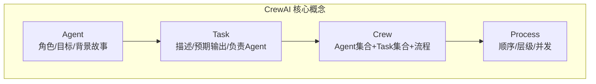
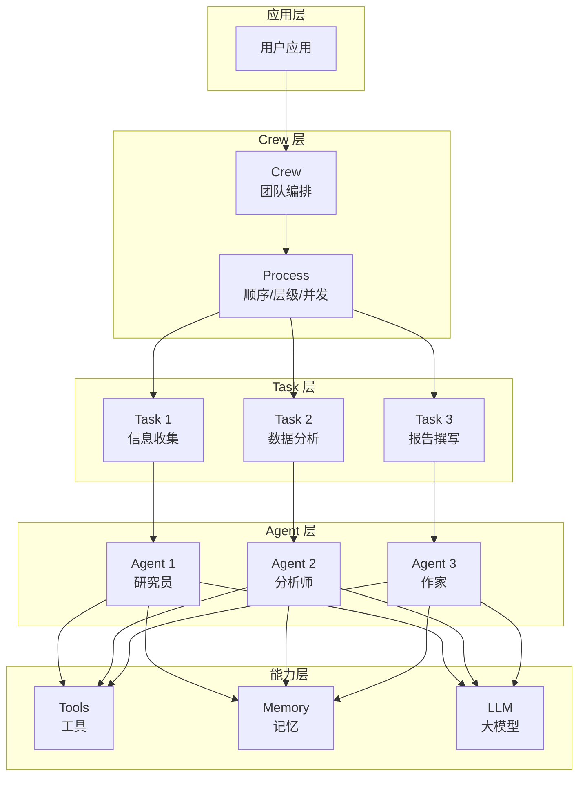
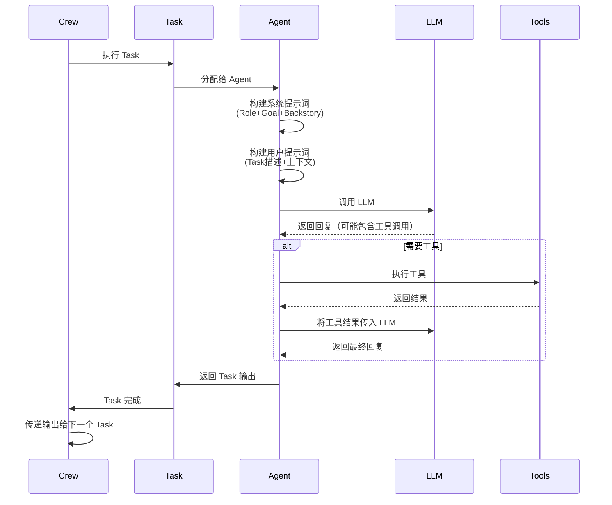

# CrewAI 角色化多 Agent

> **一句话定义**：CrewAI 是一个以"角色"为核心的多 Agent 框架，通过定义 Agent 的角色（Role）、目标（Goal）、背景故事（Backstory）和任务（Task），模拟人类团队的分工协作模式，快速构建专业化的多 Agent 系统。
>
> **核心价值**：将人类团队的组织模式（角色分工、目标驱动、协作流程）映射到 AI Agent 系统，使多 Agent 开发直观易懂，角色定义清晰，任务流程明确。
>
> **适用场景**：内容创作流水线、市场研究团队、软件开发团队、数据分析团队、需要明确角色分工的复杂任务。

---

## 一、概述

### 1.1 CrewAI 的设计理念

CrewAI 的核心设计理念是"**Agent 即团队成员**"——每个 Agent 都是一个有明确角色、目标和个性的团队成员，多个 Agent 组成一个 Crew（团队），通过协作完成共同目标。



### 1.2 CrewAI 核心概念

| 概念 | 说明 | 类比 |
|------|------|------|
| **Agent** | 具有角色、目标、背景故事的智能体 | 团队成员 |
| **Role** | Agent 的角色名称 | 职位（如"研究员"、"作家"） |
| **Goal** | Agent 的工作目标 | 岗位职责 |
| **Backstory** | Agent 的背景故事，影响行为风格 | 个人经历和性格 |
| **Task** | 具体的工作任务，有描述和预期输出 | 工作任务 |
| **Crew** | Agent 和 Task 的集合，定义协作流程 | 团队 |
| **Process** | Task 的执行流程（顺序/层级/并发） | 工作流程 |
| **Tool** | Agent 可使用的工具 | 工作工具 |
| **Memory** | Agent 的短期/长期/实体记忆 | 工作记忆 |
<div style="background:linear-gradient(135deg,#667eea,#764ba2);border-radius:16px;padding:20px;margin:16px 0;font-family:-apple-system,'Segoe UI','PingFang SC','Microsoft YaHei',sans-serif;color:#fff;overflow:hidden;box-shadow:0 8px 28px rgba(0,0,0,.14),0 3px 10px rgba(0,0,0,.08)">
<style>@keyframes pulse{0%,100%{transform:scale(1);opacity:.9}50%{transform:scale(1.03);opacity:1}}.dk-layer{border-radius:8px;padding:12px 16px;margin:6px auto;text-align:center;font-weight:600;animation:pulse 3s ease-in-out infinite}.dk-outer{background:rgba(255,255,255,.15);border:2px solid rgba(255,255,255,.5);max-width:340px;animation-delay:0s}.dk-middle{background:rgba(255,255,255,.2);border:2px solid rgba(255,255,255,.6);max-width:280px;animation-delay:.5s}.dk-inner{background:rgba(255,255,255,.25);border:2px solid rgba(255,255,255,.7);max-width:220px;animation-delay:1s}.dk-arrow{text-align:center;font-size:18px;margin:2px 0}.dk-label{font-size:12px;opacity:.85;font-weight:400;margin-top:4px}</style>
<div style="text-align:center;font-size:15px;font-weight:700;margin-bottom:14px;padding-bottom:10px;border-bottom:1.5px solid rgba(255,255,255,.22);letter-spacing:1px">👥 CrewAI 角色化团队架构</div>
<div class="dk-layer dk-outer">团队层 · Crew + Process<div class="dk-label">Agent集合+Task集合/顺序层级并发流程</div></div>
<div class="dk-arrow">▼ 包含</div>
<div class="dk-layer dk-middle">任务层 · Task + Expected Output<div class="dk-label">任务描述/预期输出/负责Agent/上下文传递</div></div>
<div class="dk-arrow">▼ 包含</div>
<div class="dk-layer dk-inner">成员层 · Agent(Role/Goal/Backstory)<div class="dk-label">角色定义/目标驱动/背景故事/工具记忆</div></div>
</div>


### 1.3 CrewAI vs 其他多 Agent 框架

| 维度 | CrewAI | AutoGen | LangGraph | MetaGPT |
|------|--------|---------|-----------|---------|
| **核心抽象** | 角色+目标+任务 | 可对话 Agent | 状态图 | 软件公司 |
| **角色定义** | 显式（Role/Goal/Backstory） | 隐式（system message） | 隐式（节点配置） | 显式（角色类） |
| **任务定义** | 显式（Task 类） | 隐式（对话内容） | 隐式（节点逻辑） | 显式（需求文档） |
| **协作模式** | 顺序/层级 | 对话/群聊 | 图编排 | 流水线 |
| **学习曲线** | 缓 | 中 | 陡 | 中 |
| **灵活性** | 中 | 高 | 极高 | 低 |
| **代码执行** | 需自定义 | 内置沙箱 | 需自定义 | 需自定义 |
| **生产就绪** | 中 | 中 | 高 | 低 |
| **适用场景** | 角色分工明确的任务 | 对话协作 | 复杂流程 | 软件开发 |

> 🔍 **知识点深度解析**
>
> **作用**：CrewAI 为多 Agent 系统提供以"角色"为核心的开发框架，通过 Role/Goal/Backstory 定义 Agent 个性，通过 Task 定义工作内容，通过 Crew 组织团队和流程，使多 Agent 开发直观易懂。
>
> **原理**：CrewAI 的核心是"角色扮演"机制——每个 Agent 有明确的 Role（角色）、Goal（目标）、Backstory（背景故事），这些信息被组合成系统提示词，引导 LLM 以该角色的身份和风格执行任务。Task 定义了具体的工作内容和预期输出，每个 Task 分配给特定的 Agent 执行。Crew 组织 Agent 和 Task，按照指定的 Process（顺序/层级/并发）执行 Task 序列，前一个 Task 的输出可以作为后一个 Task 的上下文。
>
> **用法要点**：① 角色定义要具体——不要用"助手"这种泛化角色，要用"资深数据分析师"这种具体角色 ② Goal 要可衡量——明确 Agent 应该达成什么结果 ③ Backstory 要影响行为——描述 Agent 的经验、风格、工作方式，而不是无关的生平 ④ Task 描述要清晰——包含任务目的、具体要求、预期输出格式 ⑤ 从顺序流程开始，熟练后再尝试层级和并发 ⑥ 工具要与角色匹配——研究员配搜索工具，作家配写作工具 ⑦ 使用记忆功能让 Agent 记住之前的工作成果

---

> 💡 **深度讲解**：CrewAI 的独特价值在于"将组织行为学引入 Agent 系统"。传统的多 Agent 框架（如 AutoGen）将 Agent 视为平等的对话参与者，通过自然语言对话协作，这种模式灵活但角色不明确、任务不可控。CrewAI 借鉴了人类团队的组织模式——每个团队成员有明确的职位（Role）、岗位职责（Goal）、个人风格（Backstory），团队有明确的任务列表（Task）和工作流程（Process）。这种设计使得多 Agent 系统的开发变得非常直观——你只需要像组建一个真实团队一样，定义每个成员的角色和职责，分配任务，设定流程，CrewAI 就会自动调度 Agent 执行。角色化设计的另一个优势是"行为可预测性"——由于每个 Agent 的角色和目标明确，其行为更加可控和可预测，不容易出现角色混乱或偏离任务的情况。CrewAI 的 Task 系统也很有特色——每个 Task 有明确的描述（description）和预期输出（expected_output），Agent 执行 Task 后会生成符合预期输出格式的结果，前一个 Task 的输出自动作为后一个 Task 的上下文，形成流水线式的协作。这种设计特别适合内容创作、市场研究、数据分析等有明确流程和角色分工的场景。
>
> **📝 精简总结**：CrewAI 是以"角色"为核心的多 Agent 框架，核心概念包括 Agent（Role/Goal/Backstory）、Task（描述/预期输出）、Crew（团队）、Process（顺序/层级/并发）、Tool、Memory；与 AutoGen（对话式）、LangGraph（图编排）、MetaGPT（软件公司）相比，CrewAI 角色定义显式、学习曲线缓、适合角色分工明确的任务；设计理念是将人类团队的组织模式映射到 Agent 系统，优势是直观易懂、行为可预测、流程明确；核心是角色扮演机制，Role/Goal/Backstory 组合成系统提示词引导 LLM 行为。

---

## 二、原理

### 2.1 CrewAI 架构



### 2.2 Agent 执行机制



### 2.3 流程模式（Process）

| 模式 | 说明 | 图示 | 适用场景 |
|------|------|------|---------|
| **sequential（顺序）** | Task 按定义顺序依次执行，前一个输出作为后一个输入 | A→B→C→D | 流水线任务，如内容创作 |
| **hierarchical（层级）** | 有一个管理者 Agent 负责任务分解和分配，其他 Agent 执行 | Manager→Worker1/Worker2 | 复杂任务，需要动态分配 |
| **concurrent（并发）** | 无依赖的 Task 并行执行 | A∥B∥C→D | 可并行的子任务，如多源研究 |

### 2.4 记忆系统

CrewAI 支持三种记忆类型：

| 记忆类型 | 说明 | 存储 | 用途 |
|---------|------|------|------|
| **短期记忆（Short-term）** | 当前 Crew 执行过程中的对话历史 | 内存 | 记住当前任务的上下文 |
| **长期记忆（Long-term）** | 跨 Crew 执行的持久化记忆 | 向量数据库 | 记住之前的工作成果和经验 |
| **实体记忆（Entity）** | 关于人、地点、组织等实体的信息 | 知识图谱 | 记住实体之间的关系 |

---

> 💡 **深度讲解**：CrewAI 的执行机制核心是"提示词工程 + 任务流水线"。每个 Agent 执行 Task 时，CrewAI 会自动构建两个提示词：① 系统提示词——由 Role（角色）、Goal（目标）、Backstory（背景故事）组合而成，定义 Agent 的身份和行为准则；② 用户提示词——由 Task 描述（description）、预期输出（expected_output）、上下文（前序 Task 的输出）组合而成，定义具体的工作内容。这种"系统提示词定义身份，用户提示词定义任务"的分离设计，使得 Agent 的角色和任务可以独立配置和复用。流程模式是 CrewAI 的另一个核心设计——sequential（顺序）模式最简单，Task 按定义顺序执行，前一个的输出自动作为后一个的输入，适合流水线任务；hierarchical（层级）模式引入管理者 Agent，由管理者动态分解任务、分配给 Worker Agent、整合结果，适合复杂的、需要动态决策的任务；concurrent（并发）模式允许无依赖的 Task 并行执行，提升效率。记忆系统是 CrewAI 的进阶能力——短期记忆记住当前任务的对话历史，长期记忆通过向量数据库跨任务存储经验，实体记忆通过知识图谱存储实体关系。合理使用记忆可以让 Agent "记住"之前的工作成果，避免重复劳动，提升一致性。
>
> **📝 精简总结**：CrewAI 架构分为应用层、Crew层（Crew+Process）、Agent层（多个角色Agent）、Task层（任务列表）、能力层（Tools+Memory+LLM）；Agent 执行机制是构建系统提示词（Role+Goal+Backstory）+ 用户提示词（Task描述+上下文）→ 调用LLM → 工具调用 → 返回输出；三种流程模式：sequential（顺序流水线）、hierarchical（层级管理-执行）、concurrent（并发执行）；记忆系统包括短期记忆（内存/当前任务）、长期记忆（向量库/跨任务）、实体记忆（知识图谱/实体关系）。

---

## 三、实操

### 3.1 基础 Crew：内容创作团队

```python
from crewai import Agent, Task, Crew, Process
from crewai_tools import SerperDevTool, FileWriteTool
import os

os.environ["SERPER_API_KEY"] = "your-serper-key"
os.environ["OPENAI_API_KEY"] = "your-openai-key"

# 工具
search_tool = SerperDevTool()
write_tool = FileWriteTool()

# ============ 定义 Agent ============
researcher = Agent(
    role="资深研究员",
    goal="收集和分析关于 {topic} 的最新信息，提供全面的研究报告",
    backstory="""你是一位有15年经验的资深研究员，擅长快速收集信息、
    提炼核心要点、识别趋势。你注重信息的准确性和时效性，
    总是引用可靠的来源。你的研究报告结构清晰、数据详实。""",
    tools=[search_tool],
    verbose=True,
    allow_delegation=False,
    memory=True,
)

writer = Agent(
    role="资深内容作家",
    goal="将研究结果转化为引人入胜的 {format} 内容",
    backstory="""你是一位获奖的内容作家，有10年的写作经验。
    你擅长将复杂的技术概念用通俗易懂的语言表达，
    你的文章结构清晰、语言生动、有深度。你注重读者体验，
    总是在文章中加入实际案例和可操作的建议。""",
    tools=[write_tool],
    verbose=True,
    allow_delegation=False,
    memory=True,
)

editor = Agent(
    role="严格的编辑",
    goal="审查和优化内容，确保质量、准确性和可读性",
    backstory="""你是一位严格但公正的编辑，有20年的出版经验。
    你对文字有极高的要求，善于发现逻辑漏洞、事实错误和表达问题。
    你的修改建议总是具体且可操作的，你致力于提升内容的整体质量。""",
    tools=[],
    verbose=True,
    allow_delegation=False,
)

# ============ 定义 Task ============
research_task = Task(
    description="""研究以下主题的最新信息：{topic}
    要求：
    1. 搜索最近3个月的相关信息
    2. 收集至少5个可靠来源
    3. 识别关键趋势和数据
    4. 整理成结构化的研究笔记""",
    expected_output="""一份结构化的研究笔记，包含：
    - 核心发现（5-10条）
    - 关键数据和统计
    - 趋势分析
    - 引用来源列表""",
    agent=researcher,
)

writing_task = Task(
    description="""基于研究结果，撰写一篇关于 {topic} 的 {format}
    要求：
    1. 标题吸引人
    2. 结构清晰（引言/主体/结论）
    3. 语言生动，有案例
    4. 字数约 {word_count} 字""",
    expected_output="""一篇完整的 {format}，包含：
    - 吸引人的标题
    - 引言（引出主题）
    - 主体（3-5个核心段落）
    - 结论（总结+展望）
    - 总字数约 {word_count} 字""",
    agent=writer,
    context=[research_task],  # 依赖研究任务的输出
)

editing_task = Task(
    description="""审查以下内容并提供修改建议：
    检查维度：
    1. 事实准确性（数据、引用是否正确）
    2. 逻辑连贯性（段落之间是否流畅）
    3. 语言质量（语法、用词、可读性）
    4. 结构完整性（是否有遗漏）
    5. 读者价值（是否有实用信息）""",
    expected_output="""一份编辑审查报告，包含：
    - 总体评分（1-10分）
    - 各维度评分和评语
    - 具体修改建议（按段落）
    - 最终修改后的完整内容""",
    agent=editor,
    context=[writing_task],  # 依赖写作任务的输出
)

# ============ 创建 Crew ============
crew = Crew(
    agents=[researcher, writer, editor],
    tasks=[research_task, writing_task, editing_task],
    process=Process.sequential,  # 顺序执行
    verbose=True,
    memory=True,
    cache=True,
)

# ============ 运行 Crew ============
result = crew.kickoff(inputs={
    "topic": "AI Agent 的最新发展趋势",
    "format": "博客文章",
    "word_count": "1500",
})

print("最终结果:")
print(result)
```

### 3.2 层级流程（Hierarchical Process）

```python
from crewai import Agent, Task, Crew, Process

# 管理者 Agent
manager = Agent(
    role="项目经理",
    goal="协调团队完成复杂项目，确保质量和进度",
    backstory="""你是一位经验丰富的项目经理，擅长任务分解、
    资源分配和进度管理。你善于沟通，能够协调不同角色的团队成员。""",
    allow_delegation=True,  # 允许委派任务
    verbose=True,
)

# 工作者 Agent
designer = Agent(
    role="UI设计师",
    goal="设计美观易用的用户界面",
    backstory="你是一位有创意的UI设计师，注重用户体验和视觉美感。",
    allow_delegation=False,
)

developer = Agent(
    role="前端开发工程师",
    goal="实现高质量的前端代码",
    backstory="你是一位资深前端工程师，精通 React/Vue，注重代码质量。",
    allow_delegation=False,
)

tester = Agent(
    role="测试工程师",
    goal="确保产品质量，发现并跟踪缺陷",
    backstory="你是一位细致的测试工程师，擅长功能测试和回归测试。",
    allow_delegation=False,
)

# 任务（不指定 agent，由管理者分配）
design_task = Task(
    description="设计登录页面的 UI 界面",
    expected_output="UI 设计稿和设计规范",
)

dev_task = Task(
    description="实现登录页面的前端代码",
    expected_output="可运行的前端代码",
    context=[design_task],
)

test_task = Task(
    description="测试登录页面的功能和兼容性",
    expected_output="测试报告和缺陷列表",
    context=[dev_task],
)

# 创建层级 Crew
crew = Crew(
    agents=[designer, developer, tester],
    tasks=[design_task, dev_task, test_task],
    process=Process.hierarchical,  # 层级流程
    manager_agent=manager,  # 指定管理者
    verbose=True,
)

result = crew.kickoff()
```

### 3.3 使用工具

```python
from crewai import Agent, Task, Crew
from crewai_tools import (
    SerperDevTool,        # 搜索
    ScrapeWebsiteTool,    # 网页抓取
    FileReadTool,         # 读文件
    FileWriteTool,        # 写文件
    DirectoryReadTool,    # 读目录
    CodeInterpreterTool,  # 代码执行
    YoutubeVideoSearchTool,  # YouTube 搜索
)

# 初始化工具
search_tool = SerperDevTool()
scrape_tool = ScrapeWebsiteTool()
code_tool = CodeInterpreterTool()

# Agent 使用工具
data_analyst = Agent(
    role="数据分析师",
    goal="分析数据并生成洞察报告",
    backstory="你是一位资深数据分析师，擅长用数据说话。",
    tools=[search_tool, scrape_tool, code_tool],  # 分配工具
    verbose=True,
)

# 自定义工具
from crewai.tools import BaseTool
from pydantic import BaseModel, Field

class WeatherTool(BaseTool):
    name: str = "get_weather"
    description: str = "获取指定城市的当前天气"

    def _run(self, city: str) -> str:
        # 调用天气 API
        return f"{city}当前天气：晴，25°C"

weather_tool = WeatherTool()
```

### 3.4 记忆与上下文

```python
from crewai import Agent, Task, Crew
from crewai.memory import MemoryConfig

# 配置记忆
memory_config = MemoryConfig(
    short_term=True,      # 启用短期记忆
    long_term=True,       # 启用长期记忆
    entity=True,          # 启用实体记忆
    long_term_config={
        "type": "vector",
        "config": {
            "provider": "chroma",  # 向量数据库
            "collection_name": "crewai_memory"
        }
    }
)

# Agent 启用记忆
agent = Agent(
    role="研究员",
    goal="持续研究 AI 领域进展",
    backstory="你有长期记忆，能记住之前的研究成果。",
    memory=True,  # 启用记忆
    verbose=True,
)

# Task 之间传递上下文
task1 = Task(
    description="研究 AI Agent 的发展历史",
    expected_output="历史时间线",
    agent=researcher,
)

task2 = Task(
    description="基于历史研究，分析当前趋势",
    expected_output="趋势分析报告",
    agent=analyst,
    context=[task1],  # task1 的输出作为 task2 的上下文
)

task3 = Task(
    description="综合历史和趋势，预测未来发展",
    expected_output="预测报告",
    agent=forecaster,
    context=[task1, task2],  # 多个 Task 的输出作为上下文
)
```

### 3.5 输出与导出

```python
# 运行 Crew
crew = Crew(agents=[...], tasks=[...])
result = crew.kickoff(inputs={"topic": "AI"})

# 获取结果
print(result.raw)           # 原始输出字符串
print(result.tasks_output)  # 每个 Task 的输出列表
print(result.token_usage)   # Token 使用统计

# 导出为 JSON
import json
output = {
    "result": result.raw,
    "tasks": [
        {"name": t.description, "output": t.output.raw}
        for t in result.tasks_output
    ],
    "token_usage": result.token_usage,
}
with open("output.json", "w", encoding="utf-8") as f:
    json.dump(output, f, ensure_ascii=False, indent=2)

# 保存到文件（使用 FileWriteTool）
write_task = Task(
    description="将最终报告保存到文件",
    expected_output="文件已保存",
    agent=writer,
    output_file="report.md",  # 直接指定输出文件
)
```

---

> 💡 **深度讲解**：CrewAI 的实操核心是"角色定义的质量决定 Agent 的表现"。很多新手在使用 CrewAI 时，角色定义过于简单（如 role="助手"，goal="帮助用户"），导致 Agent 表现平庸。高质量的角色定义应该：① Role 具体——"资深数据分析师"比"助手"好，"专注于电商领域的资深数据分析师"更好；② Goal 可衡量——"生成包含5个关键洞察的分析报告"比"分析数据"好；③ Backstory 影响行为——"你有10年电商数据分析经验，擅长从销售数据中发现增长机会，你的报告总是包含可操作的建议"比"你是一个分析师"好。Backstory 不是写小说，而是定义 Agent 的工作风格、专业领域、行为习惯，这些信息会直接影响 LLM 的输出风格和质量。Task 定义同样重要——description 应该包含任务目的、具体要求、约束条件；expected_output 应该明确输出格式、结构、长度。清晰的 expected_output 可以显著提升输出的一致性和可用性。CrewAI 的 context 机制是 Task 间数据传递的核心——通过 `context=[task1, task2]`，前序 Task 的输出自动作为当前 Task 的上下文，不需要手动传递。这使得流水线式的协作非常简洁。在实际项目中，建议从 sequential（顺序）流程开始，因为它最简单、最可控；当需要动态任务分配时再使用 hierarchical（层级）流程；concurrent（并发）流程适合明确可并行的子任务，但需要注意 Task 之间的依赖关系。
>
> **📝 精简总结**：基础 Crew 开发流程是定义 Agent（role/goal/backstory/tools）→ 定义 Task（description/expected_output/agent/context）→ 创建 Crew（agents/tasks/process）→ kickoff 运行；层级流程使用 Process.hierarchical + manager_agent，由管理者动态分配任务；工具使用 crewai_tools 提供的搜索/抓取/文件/代码执行等工具，也可自定义 BaseTool；记忆系统支持短期/长期/实体记忆，通过 memory=True 启用，长期记忆使用向量数据库；Task 间通过 context 参数传递前序输出；结果通过 result.raw/tasks_output/token_usage 获取，可导出 JSON 或直接 output_file 保存。

---

## 四、问题

### 4.1 常见错误与排查

| 问题 | 原因 | 解决方案 |
|------|------|---------|
| **Agent 不使用工具** | 工具描述不清晰 / Agent 角色不需要工具 / 模型不支持 tool calling | 优化工具描述，确认角色需要工具，使用支持 tool calling 的模型 |
| **Task 输出不符合预期** | expected_output 不明确 / Agent 角色不匹配 / 上下文不足 | 明确 expected_output 格式，检查 Agent 角色，确保 context 正确 |
| **上下文丢失** | context 未配置 / Task 顺序错误 / 记忆未启用 | 配置 context 参数，确认 Task 顺序，启用 memory |
| **无限循环** | 层级流程中管理者反复分配任务 / Task 描述不明确 | 设置 max_iter，优化 Task 描述，检查管理者逻辑 |
| **成本过高** | Agent 数量过多 / Task 过多 / 使用大模型 / 工具调用频繁 | 精简 Agent 和 Task，使用小模型，减少工具调用 |
| **角色混乱** | Agent 角色定义重叠 / backstory 不清晰 / allow_delegation 配置错误 | 明确角色分工，优化 backstory，正确配置 allow_delegation |
| **工具调用失败** | 工具 API Key 未配置 / 工具参数错误 / 网络问题 | 检查 API Key，确认参数格式，测试网络连通性 |
| **输出格式错误** | expected_output 未指定格式 / Agent 未遵循格式 | 在 expected_output 中明确指定格式（JSON/Markdown/列表） |
| **并发冲突** | concurrent 流程中 Task 依赖关系错误 / 共享资源冲突 | 确认 Task 无依赖，避免共享资源，使用锁或队列 |
| **记忆干扰** | 长期记忆中存储了无关信息 / 记忆检索不准确 | 清理记忆，优化记忆存储，调整检索参数 |

### 4.2 性能优化策略

| 优化点 | 策略 | 预期效果 |
|--------|------|---------|
| **Agent 数量** | 只保留必要的 Agent，合并职责相近的 Agent | 成本降低 30-50% |
| **模型选择** | 简单任务用小模型（gpt-4o-mini），复杂任务用大模型 | 成本降低 40-60% |
| **Task 合并** | 合并简单的 Task，减少 LLM 调用次数 | 延迟降低 20-40% |
| **并发执行** | 无依赖的 Task 使用 concurrent 流程并行执行 | 总延迟降低 30-70% |
| **结果缓存** | 启用 cache，相同输入直接返回缓存结果 | 重复任务延迟降低 90% |
| **Prompt 优化** | 精简 role/goal/backstory，减少 token 消耗 | Token 消耗降低 20-30% |
| **工具优化** | 减少不必要的工具调用，缓存工具结果 | 延迟降低 20-40% |
| **输出限制** | 限制 expected_output 长度，避免过长输出 | Token 消耗降低 30-50% |

### 4.3 安全风险与防护

| 风险 | 说明 | 防护措施 |
|------|------|---------|
| **Prompt 注入** | 通过 Task 描述或工具返回注入恶意指令 | 输入校验，系统提示与用户输入分离，注入检测 |
| **工具越权** | Agent 调用未授权的工具或执行危险操作 | 工具白名单，权限控制，高风险操作需确认 |
| **数据泄露** | Agent 将敏感信息写入输出或传递给外部工具 | 敏感信息脱敏，输出审核，工具网络隔离 |
| **代码执行** | CodeInterpreterTool 执行恶意代码 | 沙箱隔离，资源限制，代码审查 |
| **记忆污染** | 恶意信息存入长期记忆，影响后续任务 | 记忆审核，记忆清理，记忆来源验证 |
| **成本攻击** | 诱导 Agent 进行大量 LLM 调用和工具调用 | 调用配额，速率限制，成本告警 |

### 4.4 生产环境踩坑记录

**踩坑1：Agent 之间互相委派导致死循环**
- **现象**：两个 Agent 都配置了 `allow_delegation=True`，它们互相委派任务，陷入死循环
- **原因**：CrewAI 中如果多个 Agent 都允许委派，它们可能互相推任务，没有一个实际执行
- **方案**：① 只让管理者 Agent 配置 `allow_delegation=True`，工作者 Agent 配置 `allow_delegation=False`；② 在 sequential 流程中，所有 Agent 都设置 `allow_delegation=False`；③ 只有 hierarchical 流程需要管理者委派任务

**踩坑2：expected_output 太笼统导致输出不可用**
- **现象**：Task 的 expected_output 写的是"一份分析报告"，Agent 输出了一篇散文式的文章，无法直接使用
- **原因**：expected_output 没有明确格式、结构、长度要求，Agent 自由发挥
- **方案**：expected_output 要具体到格式和结构，例如："一份 JSON 格式的分析报告，包含以下字段：summary（字符串，200字以内）、key_findings（数组，5条）、recommendations（数组，3条）、confidence（数字，0-1）"

**踩坑3：长期记忆导致上下文混乱**
- **现象**：启用长期记忆后，Agent 在新任务中引用了之前不相关任务的信息，导致输出混乱
- **原因**：长期记忆的检索不够精准，返回了与当前任务无关的记忆
- **方案**：① 为不同项目使用不同的记忆集合（collection_name）；② 优化记忆存储，只存储重要信息；③ 调整记忆检索的 top_k 和相似度阈值；④ 在不需要长期记忆的场景关闭它

---

> 💡 **深度讲解**：CrewAI 生产环境的核心挑战是"角色定义质量"和"成本控制"。角色定义质量是 CrewAI 表现的决定性因素——同样的 Task，用"助手"角色和用"资深电商数据分析师"角色，输出质量可能天差地别。高质量的角色定义需要投入时间和精力，建议：① 参考真实岗位的职位描述（JD）来写 Role 和 Goal；② Backstory 要包含专业领域、工作经验、行为风格、输出偏好；③ 不同 Agent 的角色要有明显区分，避免职责重叠；④ 定期 review 角色定义，根据输出质量优化。成本控制是另一个核心挑战——CrewAI 的成本 = Agent 数 × Task 数 × 平均 LLM 调用次数 × 模型单价。一个 5 个 Agent、10 个 Task 的 Crew，每次运行可能需要 20-50 次 LLM 调用，成本不容忽视。优化策略：① 精简 Agent 数量——能合并的角色就合并，不要为了"多 Agent"而多 Agent；② 模型分级——简单 Task 用 gpt-4o-mini，复杂 Task 用 gpt-4o；③ 启用缓存——相同输入的 Task 直接返回缓存；④ 限制输出长度——expected_output 中明确字数限制；⑤ 批量运行——如果有多个相似任务，考虑批量处理。CrewAI 的生产就绪度目前中等——它提供了优雅的角色化抽象和简洁的 API，但在可观测性、错误恢复、水平扩展等生产级特性上还不够完善，生产环境需要与 Langfuse（可观测性）、Redis（缓存）、Kubernetes（编排）等系统集成。
>
> **📝 精简总结**：常见问题包括不使用工具、输出不符合预期、上下文丢失、无限循环、成本过高、角色混乱、工具调用失败、输出格式错误、并发冲突、记忆干扰；性能优化采用精简Agent、模型分级、Task合并、并发执行、结果缓存、Prompt优化、工具优化、输出限制等策略；安全风险包括 Prompt注入、工具越权、数据泄露、代码执行、记忆污染、成本攻击，采用纵深防御；生产踩坑集中在互相委派死循环（只让管理者allow_delegation=True）、expected_output太笼统（明确格式结构）、长期记忆混乱（分项目使用不同集合）；核心挑战是角色定义质量和成本控制，生产就绪度中等需与其他系统集成。

---

## 五、拓展

### 5.1 CrewAI 生态

| 组件 | 说明 |
|------|------|
| **CrewAI+** | 托管平台，提供在线 Crew 开发和部署 |
| **CrewAI Tools** | 官方工具库，30+ 预构建工具 |
| **CrewAI Templates** | 官方/社区模板，快速创建 Crew |
| **CrewAI Enterprise** | 企业版，支持 SSO、审计、私有部署 |
| **CrewAI CLI** | 命令行工具，创建、运行、调试 Crew |
| **CrewAI Studio** | 可视化界面，拖拽式构建 Crew |

### 5.2 CrewAI 应用场景

| 场景 | Agent 配置 | 说明 |
|------|-----------|------|
| **市场研究团队** | 研究员+分析师+报告撰写者 | 收集信息→分析→撰写报告 |
| **内容创作团队** | 策划+写作+编辑+设计师 | 选题→写作→编辑→配图 |
| **软件开发团队** | PM+架构师+开发者+测试+审查 | 需求→设计→编码→测试→审查 |
| **数据分析团队** | 数据工程师+分析师+可视化专家 | 数据清洗→分析→可视化 |
| **客户服务团队** | 客服+技术支持+主管 | 解答问题→技术支持→升级处理 |
| **招聘团队** | 招聘专员+面试官+HR经理 | 筛选简历→面试→录用决策 |
| **法律研究团队** | 法律研究员+律师+编辑 | 案例研究→法律分析→文书撰写 |

### 5.3 与其他框架的集成

| 集成方式 | 说明 |
|---------|------|
| **CrewAI + LangChain** | 使用 LangChain 的 Tools、Chains、Retrievers 作为 CrewAI Agent 的工具 |
| **CrewAI + LlamaIndex** | 使用 LlamaIndex 的数据索引和查询引擎作为知识库工具 |
| **CrewAI + Langfuse** | 使用 Langfuse 进行 Crew 执行的可观测性和评估 |
| **CrewAI + FastAPI** | 将 Crew 封装为 REST API，支持 Web 应用调用 |
| **CrewAI + Docker** | 使用 Docker 容器化 Crew 应用，便于部署和扩展 |

### 5.4 学习资源

- [CrewAI 官方文档](https://docs.crewai.com/) 🔗
- [CrewAI GitHub](https://github.com/crewAIInc/crewAI) 🔗
- [CrewAI 示例库](https://github.com/crewAIInc/crewAI-examples) 🔗
- [CrewAI Tools](https://github.com/crewAIInc/crewAI-tools) 🔗
- [CrewAI+ 平台](https://www.crewai.com/) 🔗
- [[多Agent协作模式]] — 多 Agent 协作模式理论
- [[AutoGen-多Agent框架]] — 对话式多 Agent 框架
- [[LangGraph-状态机Agent]] — 图状态机多 Agent 框架
- [[自研Agent框架设计]] — 自研框架设计参考

---

> 💡 **深度讲解**：CrewAI 的发展方向是"从角色化框架到 AI 团队平台"。CrewAI 最初是一个简洁的角色化多 Agent 库，通过 Role/Goal/Backstory 的优雅设计快速获得了社区关注。随着发展，CrewAI 正在向平台化演进——CrewAI+ 提供托管平台，CrewAI Studio 提供可视化界面，CrewAI Enterprise 提供企业级功能。这种从库到平台的演进路径与 LangChain（从库到 LangSmith 平台）类似。CrewAI 的核心优势始终是"角色化抽象的简洁性"——它是最容易上手的多 Agent 框架之一，新手可以在 10 分钟内构建一个多 Agent 团队。这种简洁性使得 CrewAI 特别适合快速原型验证和非技术用户使用。但简洁性也带来了局限——对于需要复杂流程控制、动态决策、深度定制的生产级应用，CrewAI 的灵活性不如 LangGraph。建议的技术选型策略：① 快速原型、内容创作、市场研究等角色分工明确的场景用 CrewAI；② 复杂流程、生产级系统、需要深度定制的场景用 LangGraph；③ 对话式协作、代码执行、人类在环的场景用 AutoGen；④ 企业级低代码平台用 Dify。CrewAI 的社区生态正在快速发展，官方工具库提供了 30+ 预构建工具，社区模板覆盖了各种应用场景，这些都降低了使用门槛。
>
> **📝 精简总结**：CrewAI 生态包括 CrewAI+（托管平台）、CrewAI Tools（30+工具）、CrewAI Templates（模板）、CrewAI Enterprise（企业版）、CrewAI CLI（命令行）、CrewAI Studio（可视化）；应用场景包括市场研究、内容创作、软件开发、数据分析、客户服务、招聘、法律研究等团队配置；与 LangChain（工具）、LlamaIndex（RAG）、Langfuse（可观测性）、FastAPI（REST API）、Docker（容器化）集成；学习资源包括官方文档、GitHub、示例库、工具库、平台和本知识库相关专题；发展方向是从角色化框架到AI团队平台，核心优势是简洁性，适合快速原型和角色分工明确的场景。

---

## 🔗 关联笔记

- [[多Agent协作模式]] — 多 Agent 协作模式理论基础
- [[AutoGen-多Agent框架]] — 对话式多 Agent 框架
- [[LangGraph-状态机Agent]] — 图状态机多 Agent 框架
- [[Dify-低代码AI应用平台]] — 低代码 AI 应用平台
- [[Coze-工作流编排]] — 可视化工作流编排平台
- [[Agent核心概念-ReAct规划]] — ReAct 推理循环
- [[自研Agent框架设计]] — 自研框架设计参考
- [[AI Agent开发框架知识点系统梳理_优化版]] — Agent 框架系统梳理

## 📖 前置知识

- [[LLM大模型入门概念]]
- [[Agent核心概念-ReAct规划]]
- [[多Agent协作模式]]
- [[Prompt工程进阶]]

## 🏷️ 相关标签

`#AI应用` `#AI工程化` `#Agent` `#效率工具`

---

[[Home|🏠 返回首页]] · [[MOC-AI与效率工具|📚 返回分类]]
