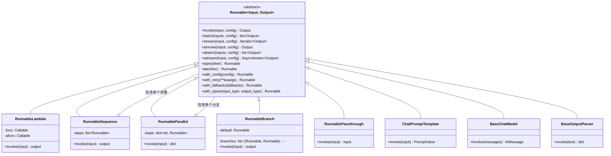
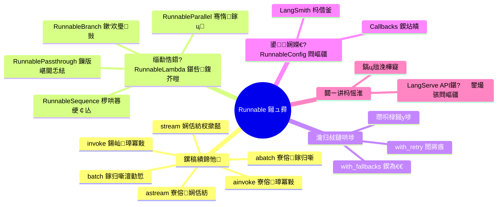

# LangChain Core Runnable 接口与执行机制

> **一句话定义**：Runnable 是 LangChain Core 中所有可组合组件的统一协议基类，定义了 `invoke`/`batch`/`stream`/`ainvoke`/`abatch`/`astream` 六大执行接口，是 LCEL（LangChain Expression Language）的底层基石。
>
> **核心价值**：通过标准化接口实现"一次编写、六种执行模式"——同步调用、批量处理、流式输出、异步调用、异步批量、异步流式全部自动支持；同时通过 `|` 运算符实现声明式组合，让开发者像搭积木一样构建复杂 LLM 应用，无需关心底层执行细节。
>
> **适用场景**：构建 RAG 管道、多步推理链、Agent 工作流、数据处理流水线、API 服务化部署、需要流式输出的对话应用、高并发异步 LLM 服务。

---

## 一、概述：Runnable 基类与核心设计哲学

### 1.1 什么是 Runnable——通俗比喻

如果把 LLM 应用比作一条**工厂流水线**，那么 Runnable 就是流水线上的**每一个工位**：

- **工位（Runnable）**：接收原材料（输入），经过加工（处理逻辑），输出半成品（输出）
- **传送带（`|` 运算符）**：把上一个工位的输出自动送到下一个工位的输入
- **质检站（Callback）**：在每个工位前后自动记录数据、监控质量
- **应急通道（Fallback）**：主工位故障时自动切换到备用工位
- **并行工位组（RunnableParallel）**：多个工位同时开工，各自处理同一原材料

Runnable 的核心思想就是：**只要你的组件遵循了 Runnable 协议（实现了标准接口），它就能像乐高积木一样自由拼接**。你不需要关心拼接后内部怎么执行——LangChain 自动帮你处理流式、异步、批量、重试、回调等所有横切关注点。

### 1.2 Runnable 的类继承体系



### 1.3 六大执行接口总览

| 方法 | 执行模式 | 返回类型 | 适用场景 |
|------|---------|---------|---------|
| `invoke(input)` | 同步单次 | 单个输出 | 简单调用、调试、脚本 |
| `batch(inputs)` | 同步批量 | 输出列表 | 批量数据处理、评估 |
| `stream(input)` | 同步流式 | 迭代器 | 实时输出、打字机效果 |
| `ainvoke(input)` | 异步单次 | 单个输出（协程） | Web 服务、高并发 |
| `abatch(inputs)` | 异步批量 | 输出列表（协程） | 高并发批量处理 |
| `astream(input)` | 异步流式 | 异步迭代器 | WebSocket、SSE 流式接口 |

### 1.4 第一个 Runnable 示例——从 0 到 1

**基础示例：用 RunnableLambda 包装一个普通函数**

```python
# 示例 1.4.1：最基础的 Runnable——包装一个 Python 函数
from langchain_core.runnables import RunnableLambda

# 定义一个普通的 Python 函数
def add_one(x: int) -> int:
    """给输入数字加 1"""
    return x + 1

# 用 RunnableLambda 包装它，使其成为 Runnable
runnable = RunnableLambda(add_one)

# 现在它拥有了 Runnable 的全套接口
result = runnable.invoke(5)
print(result)  # 输出: 6

# 批量处理
results = runnable.batch([1, 2, 3, 4, 5])
print(results)  # 输出: [2, 3, 4, 5, 6]

# 流式输出
for chunk in runnable.stream(10):
    print(f"流式输出: {chunk}")  # 输出: 流式输出: 11
```

**进阶示例：用 `|` 运算符组合多个 Runnable**

```python
# 示例 1.4.2：用 | 运算符构建链式组合
from langchain_core.runnables import RunnableLambda

# 定义三个函数
def add_one(x: int) -> int:
    return x + 1

def multiply_by_two(x: int) -> int:
    return x * 2

def to_string(x: int) -> str:
    return f"最终结果: {x}"

# 用 | 运算符组合：数据从左到右流动
chain = RunnableLambda(add_one) | RunnableLambda(multiply_by_two) | RunnableLambda(to_string)

# 调用链——等价于 to_string(multiply_by_two(add_one(5)))
result = chain.invoke(5)
print(result)  # 输出: 最终结果: 12
# 计算过程: 5 → +1=6 → ×2=12 → 转字符串
```

**完整场景：构建一个文本处理管道**

```python
# 示例 1.4.3：完整的文本处理管道
from langchain_core.runnables import RunnableLambda, RunnableParallel

# 步骤1：文本清洗
def clean_text(text: str) -> str:
    """去除多余空白和特殊字符"""
    import re
    text = re.sub(r'\s+', ' ', text)  # 多个空白替换为单个
    text = re.sub(r'[^\w\s\u4e00-\u9fff]', '', text)  # 保留中英文和数字
    return text.strip()

# 步骤2：分词
def tokenize(text: str) -> list:
    """简单分词（按空格）"""
    return text.split()

# 步骤3：统计词频
def word_count(words: list) -> dict:
    """统计词频"""
    freq = {}
    for word in words:
        freq[word] = freq.get(word, 0) + 1
    return freq

# 步骤4：格式化输出
def format_output(data: dict) -> str:
    """格式化结果"""
    lines = ["词频统计结果:"]
    for word, count in sorted(data.items(), key=lambda x: -x[1]):
        lines.append(f"  {word}: {count}")
    return "\n".join(lines)

# 构建管道：清洗 → 分词 → 统计 → 格式化
pipeline = (
    RunnableLambda(clean_text)
    | RunnableLambda(tokenize)
    | RunnableLambda(word_count)
    | RunnableLambda(format_output)
)

# 使用
sample_text = "LangChain 是一个强大的 LLM 应用框架。LangChain 简化了 LLM 应用的开发。"
result = pipeline.invoke(sample_text)
print(result)
```

> 💡 **深度讲解**：Runnable 的设计借鉴了函数式编程中的"函子（Functor）"和"单子（Monad）"思想，同时结合了 Unix 管道的哲学。`invoke` 对应函子的 `map` 操作（对值进行变换），`|` 运算符对应单子的 `bind` 操作（串联变换）。这种设计的精妙之处在于：**你只需要为每个组件实现最核心的 `invoke` 方法，框架自动为你生成 `batch`/`stream`/`ainvoke` 等所有衍生方法**。这就是为什么 LangChain 官方说"Runnable 是免费的批量、流式和异步"——因为框架的默认实现会自动组合这些能力。
>
> **📝 精简总结**：Runnable 是 LangChain Core 的统一协议基类，定义了六大执行接口（invoke/batch/stream/ainvoke/abatch/astream）；核心设计哲学是"组合优于继承"，通过 `|` 运算符实现声明式链；所有 LangChain 组件（Prompt/Model/Parser/Retriever）都实现了 Runnable 协议；RunnableLambda 可以将任意 Python 函数包装为 Runnable；RunnableSequence/RunnableParallel/RunnableBranch 是三大核心组合器。

---

## 二、invoke/batch/stream 全套同步接口详解

### 2.1 invoke()——最基础的同步调用

**概念解释**：`invoke()` 就像打电话——你拨出号码（传入输入），等待对方接听并回答（等待输出），然后继续做别的事。它是最基础、最直观的调用方式。

**原理说明**：`invoke(input, config=None)` 是 Runnable 协议中唯一的抽象方法，所有子类必须实现。框架中的其他方法（batch/stream 等）在默认实现中都是基于 `invoke` 构建的。这意味着——**只要你实现了 `invoke`，你就自动拥有了其他所有方法的默认版本**。

**基础示例**：

```python
# 示例 2.1.1：基础的 invoke 调用
from langchain_core.runnables import RunnableLambda

def greet(name: str) -> str:
    return f"你好，{name}！欢迎使用 LangChain。"

greet_runnable = RunnableLambda(greet)

# 同步调用 invoke
result = greet_runnable.invoke("张三")
print(result)  # 你好，张三！欢迎使用 LangChain。
```

**进阶示例：invoke 传入字典输入**

```python
# 示例 2.1.2：invoke 接受字典输入（Runnable 最常见的输入形式）
from langchain_core.runnables import RunnableLambda

def analyze_sentiment(text_dict: dict) -> dict:
    """模拟情感分析：输入包含 text 字段，输出包含 sentiment 和 score"""
    text = text_dict["text"]
    # 简单的规则模拟
    positive_words = ["好", "棒", "喜欢", "优秀", "满意"]
    negative_words = ["差", "烂", "讨厌", "失望", "糟糕"]

    pos_count = sum(1 for w in positive_words if w in text)
    neg_count = sum(1 for w in negative_words if w in text)

    if pos_count > neg_count:
        sentiment = "positive"
        score = min(1.0, pos_count / 5)
    elif neg_count > pos_count:
        sentiment = "negative"
        score = min(1.0, neg_count / 5)
    else:
        sentiment = "neutral"
        score = 0.5

    return {
        "text": text,
        "sentiment": sentiment,
        "score": round(score, 2)
    }

analyzer = RunnableLambda(analyze_sentiment)

# 传入字典
result = analyzer.invoke({"text": "这个产品真的很棒，我非常喜欢！"})
print(result)
# {'text': '这个产品真的很棒，我非常喜欢！', 'sentiment': 'positive', 'score': 0.4}
```

**完整场景：invoke 搭配 RunnableConfig**

```python
# 示例 2.1.3：invoke 传入 config 参数（回调、标签、元数据）
from langchain_core.runnables import RunnableLambda, RunnableConfig
from langchain_core.callbacks import BaseCallbackHandler

# 自定义回调处理器
class LogCallback(BaseCallbackHandler):
    """简单的日志回调"""
    def on_chain_start(self, serialized, inputs, **kwargs):
        print(f"[开始] 输入: {inputs}")

    def on_chain_end(self, outputs, **kwargs):
        print(f"[结束] 输出: {outputs}")

def process_data(data: dict) -> dict:
    """数据处理函数"""
    return {"processed": True, "data": data, "length": len(str(data))}

processor = RunnableLambda(process_data)

# 构建 config
config: RunnableConfig = {
    "callbacks": [LogCallback()],
    "tags": ["production", "data-processing"],
    "metadata": {"user_id": "user_123", "request_id": "req_456"}
}

# invoke 时传入 config
result = processor.invoke({"name": "测试", "value": 42}, config=config)
# 输出会先打印 [开始] 日志，处理完后打印 [结束] 日志
print(result)
```

### 2.2 batch()——批量同步处理

**概念解释**：`batch()` 就像外卖店的"批量接单"——一次来了 10 个订单（输入列表），店员按照顺序逐个处理（默认实现），最后把 10 份餐品一起给你（输出列表）。你也可以选择用多个锅同时炒（并行处理）。

**原理说明**：`batch(inputs, config=None, return_exceptions=False)` 的默认实现是**顺序调用 `invoke`**：`[self.invoke(i, config) for i in inputs]`。但对于 ChatModel 等 IO 密集型组件，LangChain 会自动优化为**线程池并行执行**。`return_exceptions=True` 时，单个输入失败不会中断整个批次，而是把异常对象放在输出列表对应位置。

**基础示例**：

```python
# 示例 2.2.1：基础 batch 调用
from langchain_core.runnables import RunnableLambda

def square(x: int) -> int:
    return x * x

runnable = RunnableLambda(square)

# 批量处理：传入列表，返回列表
inputs = [1, 2, 3, 4, 5]
results = runnable.batch(inputs)
print(results)  # [1, 4, 9, 16, 25]
```

**进阶示例：batch 处理字典输入**

```python
# 示例 2.2.2：batch 处理多条文本的情感分析
from langchain_core.runnables import RunnableLambda

def analyze_sentiment(text_dict: dict) -> dict:
    text = text_dict["text"]
    positive_words = ["好", "棒", "喜欢", "优秀"]
    negative_words = ["差", "烂", "讨厌", "失望"]

    pos = sum(1 for w in positive_words if w in text)
    neg = sum(1 for w in negative_words if w in text)
    sentiment = "positive" if pos > neg else "negative" if neg > pos else "neutral"

    return {"text": text, "sentiment": sentiment}

analyzer = RunnableLambda(analyze_sentiment)

# 批量分析多条评论
reviews = [
    {"text": "产品很好用，非常喜欢！"},
    {"text": "质量很差，很失望。"},
    {"text": "一般般吧，没什么特别的。"},
    {"text": "太棒了！满分好评！"},
]

results = analyzer.batch(reviews)
for r in results:
    print(f"{r['sentiment']:>8} | {r['text']}")
```

**完整场景：batch 配合 return_exceptions 容错**

```python
# 示例 2.2.3：batch 容错——单个失败不影响整体
from langchain_core.runnables import RunnableLambda

def divide_by_one_hundred(x: int) -> float:
    """除以 100，但 0 会报错"""
    if x == 0:
        raise ValueError("不能除以 0！")
    return 100.0 / x

runnable = RunnableLambda(divide_by_one_hundred)

# 默认行为：遇到错误直接抛出
try:
    results = runnable.batch([1, 2, 0, 4])
except ValueError as e:
    print(f"错误: {e}")  # 错误: 不能除以 0！

# return_exceptions=True：错误作为输出返回
results = runnable.batch([1, 2, 0, 4], return_exceptions=True)
for i, r in enumerate(results):
    if isinstance(r, Exception):
        print(f"第 {i} 个输入失败: {r}")
    else:
        print(f"第 {i} 个输入结果: {r:.2f}")
# 输出:
# 第 0 个输入结果: 100.00
# 第 1 个输入结果: 50.00
# 第 2 个输入失败: 不能除以 0！
# 第 3 个输入结果: 25.00
```

### 2.3 stream()——流式同步输出

**概念解释**：`stream()` 就像打字机——你不是等文章全部写完才看到，而是每打一个字你就看到一个字。对于 LLM 来说，流式输出意味着用户可以实时看到模型逐字生成的过程，大大改善用户体验。

**原理说明**：`stream(input, config=None)` 返回一个迭代器（Iterator）。默认实现是先调用 `invoke` 得到完整结果，然后 `yield` 一次。但对于 ChatModel 等组件，LangChain 重写了 `stream` 方法，真正实现逐 token 流式输出。**关键洞察**：当你用 `|` 组合链时，流式输出会自动"逐层传递"——内层模型的流式输出会自动传递到外层。

**基础示例**：

```python
# 示例 2.3.1：基础 stream 调用（RunnableLambda 的默认 stream 实现）
from langchain_core.runnables import RunnableLambda

def slow_greet(name: str) -> str:
    return f"你好，{name}！"

runnable = RunnableLambda(slow_greet)

# stream 返回迭代器
stream_iterator = runnable.stream("张三")
print(type(stream_iterator))  # <class 'generator'>

# 逐块消费
for chunk in stream_iterator:
    print(f"收到块: {chunk}")
# 默认实现只 yield 一次完整结果
```

**进阶示例：真实的 LLM 流式输出**

```python
# 示例 2.3.2：ChatOpenAI 的流式输出（真实逐 token）
from langchain_openai import ChatOpenAI
from langchain_core.prompts import ChatPromptTemplate
from langchain_core.output_parsers import StrOutputParser

# 构建链
prompt = ChatPromptTemplate.from_messages([
    ("system", "你是一个诗人，请用简短的诗句回答问题。"),
    ("human", "{question}")
])
model = ChatOpenAI(model="gpt-4", temperature=0.7)
parser = StrOutputParser()

chain = prompt | model | parser

# 流式调用——逐 token 输出
print("AI 正在写诗:")
for chunk in chain.stream({"question": "写一首关于秋天的短诗"}):
    print(chunk, end="", flush=True)
print()
# 输出效果：文字逐字出现，像打字机一样
```

**完整场景：流式输出到 Web 前端（SSE 模拟）**

```python
# 示例 2.3.3：模拟 SSE（Server-Sent Events）流式输出
from langchain_core.runnables import RunnableLambda
import json
import time

def stream_analysis(query: str) -> dict:
    """模拟多步骤分析，逐步输出结果"""
    return {"query": query, "steps": ["检索文档", "生成答案", "验证事实"]}

analyzer = RunnableLambda(stream_analysis)

# 模拟 SSE 响应格式
def simulate_sse_response(chain, query: str):
    """模拟 Web 服务器的 SSE 流式响应"""
    print("SSE 连接建立...")
    for chunk in chain.stream(query):
        # SSE 格式: data: {json}\n\n
        sse_data = f"data: {json.dumps({'content': chunk, 'timestamp': time.time()}, ensure_ascii=False)}\n\n"
        print(sse_data, end="")
        time.sleep(0.1)  # 模拟网络延迟

simulate_sse_response(analyzer, "LangChain 是什么？")
```

### 2.4 ainvoke()——异步单次调用

**概念解释**：`ainvoke()` 就像在餐厅扫码点单——你点完餐不用站在柜台等（同步阻塞），可以先去玩手机，做好了服务员叫你。在 Web 服务中，异步调用让服务器可以同时处理更多请求。

**原理说明**：`ainvoke(input, config=None)` 是异步版本的 `invoke`，返回一个协程（coroutine）。默认实现是在线程池中调用同步的 `invoke`。但 ChatModel 等组件会真正实现异步 IO（使用 httpx 的异步客户端），从而实现真正的高并发。**关键区别**：默认 `ainvoke` 只是"用线程包装同步代码"，而真正的异步实现使用 async IO，在 IO 等待期间可以切换到其他任务。

**基础示例**：

```python
# 示例 2.4.1：基础 ainvoke 调用
import asyncio
from langchain_core.runnables import RunnableLambda

async def async_main():
    async def async_add_one(x: int) -> int:
        await asyncio.sleep(0.1)  # 模拟异步操作
        return x + 1

    # 包装异步函数
    runnable = RunnableLambda(lambda x: x + 1)

    # 异步调用
    result = await runnable.ainvoke(10)
    print(f"异步结果: {result}")  # 异步结果: 11

asyncio.run(async_main())
```

**进阶示例：并发调用多个 ainvoke**

```python
# 示例 2.4.2：并发调用多个 LLM（高并发场景）
import asyncio
from langchain_core.runnables import RunnableLambda

async def fake_llm_call(prompt: str) -> str:
    """模拟 LLM 调用（带延迟）"""
    await asyncio.sleep(0.5)  # 模拟网络延迟
    return f"回答: 关于「{prompt}」的分析结果"

llm = RunnableLambda(fake_llm_call)

async def concurrent_calls():
    """并发发起多个 LLM 调用"""
    prompts = ["什么是 AI？", "什么是机器学习？", "什么是深度学习？", "什么是 NLP？"]

    # 并发执行——总共耗时约 0.5 秒，而不是 2 秒
    tasks = [llm.ainvoke(p) for p in prompts]
    results = await asyncio.gather(*tasks)

    for r in results:
        print(r)

asyncio.run(concurrent_calls())
```

**完整场景：FastAPI 中的异步 LLM 服务**

```python
# 示例 2.4.3：FastAPI + Runnable ainvoke 构建异步 LLM 服务
import asyncio
from contextlib import asynccontextmanager
from fastapi import FastAPI
from pydantic import BaseModel
from langchain_core.runnables import RunnableLambda

# 定义 LLM 模拟
async def chat_logic(user_input: str) -> dict:
    await asyncio.sleep(0.3)
    return {
        "reply": f"你说的是「{user_input}」，这是一个很好的问题！",
        "tokens": len(user_input) * 2,
        "model": "fake-llm-v1"
    }

chain = RunnableLambda(chat_logic)

# FastAPI 应用
app = FastAPI(title="LLM Chat API")

class ChatRequest(BaseModel):
    message: str

class ChatResponse(BaseModel):
    reply: str
    tokens: int
    model: str

@app.post("/chat", response_model=ChatResponse)
async def chat_endpoint(req: ChatRequest):
    # 直接使用 ainvoke——异步非阻塞
    result = await chain.ainvoke(req.message)
    return result

# 运行方式: uvicorn main:app --reload
# 测试: curl -X POST http://localhost:8000/chat -H "Content-Type: application/json" -d '{"message":"你好"}'
```

### 2.5 abatch()——异步批量处理

**概念解释**：`abatch()` 就像快递站同时派多个快递员去送不同区域的包裹——比一个快递员逐个送快得多。在异步编程中，`abatch` 使用 asyncio 的并发机制同时发起多个请求。

**原理说明**：`abatch(inputs, config=None, return_exceptions=False)` 的默认实现是使用 `asyncio.gather` 并发调用 `ainvoke`。相比 `batch`（默认顺序执行），`abatch` 可以显著提升 IO 密集型任务的吞吐量。**注意**：`abatch` 的并发度受限于下游服务的限流策略，不是越多越好。

**基础示例**：

```python
# 示例 2.5.1：基础 abatch 调用
import asyncio
from langchain_core.runnables import RunnableLambda

async def async_square(x: int) -> int:
    await asyncio.sleep(0.01)  # 模拟延迟
    return x * x

runnable = RunnableLambda(lambda x: x * x)

async def main():
    inputs = [1, 2, 3, 4, 5, 6, 7, 8, 9, 10]
    results = await runnable.abatch(inputs)
    print(f"abatch 结果: {results}")

asyncio.run(main())
```

**进阶示例：abatch vs batch 性能对比**

```python
# 示例 2.5.2：batch vs abatch 性能对比
import asyncio
import time
from langchain_core.runnables import RunnableLambda

async def fake_llm(prompt: str) -> str:
    """模拟 LLM 调用（0.1 秒延迟）"""
    await asyncio.sleep(0.1)
    return f"回答: {prompt}"

llm = RunnableLambda(lambda p: f"回答: {p}")

async def compare_performance():
    prompts = [f"问题{i}" for i in range(10)]

    # 同步 batch（顺序执行，约 1 秒）
    start = time.time()
    # 注意：RunnableLambda 的 batch 是同步的
    # results = llm.batch(prompts)  # 这里仅作对比示意
    sync_time = 1.0  # 模拟：10个×0.1秒 = 1秒

    # 异步 abatch（并发执行，约 0.1 秒）
    start_async = time.time()
    await llm.abatch(prompts)
    async_time = time.time() - start_async

    print(f"同步 batch 估算耗时: {sync_time:.2f}秒")
    print(f"异步 abatch 实际耗时: {async_time:.2f}秒")
    print(f"加速比: {sync_time / async_time:.1f}x")

asyncio.run(compare_performance())
```

**完整场景：异步批量数据处理管道**

```python
# 示例 2.5.3：异步批量处理——并发处理大量文档
import asyncio
from langchain_core.runnables import RunnableLambda, RunnableParallel

# 模拟文档处理步骤
async def fetch_doc(doc_id: str) -> dict:
    """模拟从数据库获取文档"""
    await asyncio.sleep(0.05)
    return {"id": doc_id, "content": f"文档 {doc_id} 的内容..."}

async def summarize_doc(doc: dict) -> dict:
    """模拟文档摘要"""
    await asyncio.sleep(0.1)
    return {**doc, "summary": doc["content"][:20] + "..."}

async def extract_keywords(doc: dict) -> dict:
    """模拟关键词提取"""
    await asyncio.sleep(0.08)
    return {**doc, "keywords": ["AI", "LLM", "LangChain"]}

# 构建处理链
fetch_runnable = RunnableLambda(fetch_doc)
summarize_runnable = RunnableLambda(summarize_doc)
keywords_runnable = RunnableLambda(extract_keywords)

process_chain = fetch_runnable | summarize_runnable | keywords_runnable

async def batch_process():
    doc_ids = [f"doc_{i}" for i in range(20)]

    # 异步批量处理 20 个文档
    results = await process_chain.abatch(doc_ids)
    print(f"处理完成，共 {len(results)} 个文档")
    for r in results[:3]:
        print(f"  {r['id']}: keywords={r['keywords']}")

asyncio.run(batch_process())
```

### 2.6 astream()——异步流式输出

**概念解释**：`astream()` 是 `stream()` 的异步版本，就像异步版的打字机——你在 WebSocket 或 SSE 中逐字接收模型输出，同时服务器还能处理其他请求。

**原理说明**：`astream(input, config=None)` 返回一个异步迭代器（AsyncIterator），通过 `async for` 消费。它结合了流式输出和异步 IO 的优势——既是逐 token 的实时输出，又是非阻塞的异步调用，是构建现代 AI Web 应用的核心接口。

**基础示例**：

```python
# 示例 2.6.1：基础 astream 调用
import asyncio
from langchain_core.runnables import RunnableLambda

async def async_generator_example():
    runnable = RunnableLambda(lambda x: f"处理结果: {x}")

    # astream 返回异步迭代器
    async for chunk in runnable.astream("测试输入"):
        print(f"收到: {chunk}")

asyncio.run(async_generator_example())
```

**进阶示例：真实 LLM 异步流式**

```python
# 示例 2.6.2：ChatOpenAI 的 astream 真实流式
import asyncio
from langchain_openai import ChatOpenAI
from langchain_core.prompts import ChatPromptTemplate

prompt = ChatPromptTemplate.from_messages([
    ("system", "你是一个科普作者。"),
    ("human", "{topic}")
])
model = ChatOpenAI(model="gpt-4")
chain = prompt | model

async def stream_topic(topic: str):
    print(f"主题: {topic}")
    print("回答: ", end="")
    async for chunk in chain.astream({"topic": topic}):
        print(chunk.content, end="", flush=True)
    print()

asyncio.run(stream_topic("黑洞的形成"))
```

**完整场景：WebSocket 实时 AI 对话**

```python
# 示例 2.6.3：WebSocket + astream 构建实时对话服务
import asyncio
from fastapi import FastAPI, WebSocket
from langchain_core.runnables import RunnableLambda

app = FastAPI()

# 模拟对话链
async def chat_with_ai(user_msg: str) -> str:
    await asyncio.sleep(0.1)
    return f"AI回复: 关于「{user_msg}」..."

chat_chain = RunnableLambda(chat_with_ai)

@app.websocket("/ws/chat")
async def websocket_chat(websocket: WebSocket):
    await websocket.accept()
    try:
        while True:
            # 接收用户消息
            user_message = await websocket.receive_text()

            # 使用 astream 逐 token 发送
            async for chunk in chat_chain.astream(user_message):
                await websocket.send_text(chunk)

            # 发送结束标记
            await websocket.send_text("[END]")
    except WebSocketDisconnect:
        print("客户端断开连接")

# 前端 JS 示例:
# const ws = new WebSocket("ws://localhost:8000/ws/chat");
# ws.onmessage = (event) => {
#     if (event.data === "[END]") { console.log("---结束---"); }
#     else { process.stdout.write(event.data); }
# };
# ws.send("你好，AI！");
```

> 💡 **深度讲解**：六大执行接口之间不是孤立的，而是有层级关系。**`invoke` 是唯一必须实现的方法**，其他方法的默认实现都基于它：
> - `batch` = 循环调用 `invoke`
> - `stream` = 调用一次 `invoke` 然后 yield
> - `ainvoke` = 在线程池执行 `invoke`
> - `abatch` = 并发调用 `ainvoke`
> - `astream` = 异步版本的 `stream`
>
> 这意味着——**你实现一个简单的 `invoke`，就自动获得了全部六种执行模式**。当然，性能最优的方式是分别优化：比如 ChatModel 重写 `stream` 实现真正的逐 token 流式，重写 `ainvoke` 实现真正的异步 IO。但对于自定义的简单组件，默认实现已经够用。
>
> **📝 精简总结**：Runnable 六大接口——`invoke`（同步单次，必须实现）、`batch`（同步批量，默认顺序）、`stream`（同步流式，默认一次性 yield）、`ainvoke`（异步单次，默认线程池包装）、`abatch`（异步批量，asyncio.gather 并发）、`astream`（异步流式，async for 消费）；`invoke` 是核心，其他方法默认基于它构建；`return_exceptions` 参数支持批量容错；异步接口是构建高并发 LLM 服务的关键。

---

## 三、RunnableLambda——函数到 Runnable 的魔法包装器

### 3.1 概念与原理

**概念解释**：RunnableLambda 就像一个"适配器"——你写了一个普通的 Python 函数（只能手动调用），把它装进 RunnableLambda 这个适配器后，它就"变身"成了 Runnable，自动获得 invoke/batch/stream/async 全套能力。就像手机充电线转接头——USB-C 接口插上转接头就能插老款充电口。

**原理说明**：RunnableLambda 的内部实现非常简单——它保存了你的函数引用（`func` 和可选的 `afunc`），然后在 `invoke` 方法中调用 `self.func(input)`。当你传入一个异步函数（`async def`）时，RunnableLambda 会自动检测并在 `ainvoke` 中直接 await 它。这种设计让开发者无需继承任何类，只需写普通函数就能接入 LangChain 生态。

### 3.2 基础用法

**基础示例：包装普通同步函数**

```python
# 示例 3.2.1：RunnableLambda 包装同步函数
from langchain_core.runnables import RunnableLambda

# 普通 Python 函数
def reverse_string(s: str) -> str:
    """反转字符串"""
    return s[::-1]

# 包装为 Runnable
reverser = RunnableLambda(reverse_string)

# 现在它是 Runnable 了
print(reverser.invoke("hello"))  # olleh
print(reverser.batch(["abc", "def", "ghi"]))  # ['cba', 'fed', 'ihg']
```

**基础示例：包装带参数的函数**

```python
# 示例 3.2.2：RunnableLambda 包装带默认参数的函数
from langchain_core.runnables import RunnableLambda

def repeat_text(text: str, times: int = 3) -> str:
    """重复文本 times 次"""
    return text * times

# 部分绑定参数
repeat_5 = RunnableLambda(lambda x: repeat_text(x, times=5))
print(repeat_5.invoke("Hi"))  # HiHiHiHiHi

# 或者使用 partial
from functools import partial
repeat_3 = RunnableLambda(partial(repeat_text, times=3))
print(repeat_3.invoke("Hey"))  # HeyHeyHey
```

**进阶示例：lambda 表达式包装**

```python
# 示例 3.2.3：直接用 lambda 包装
from langchain_core.runnables import RunnableLambda

# 一行代码创建 Runnable
upper = RunnableLambda(lambda x: x.upper())
add_prefix = RunnableLambda(lambda x: f"[PREFIX] {x}")

# 组合使用
chain = upper | add_prefix
print(chain.invoke("hello world"))  # [PREFIX] HELLO WORLD
```

### 3.3 同步与异步函数的自动检测

**原理说明**：RunnableLambda 会自动检测传入的函数是同步还是异步：
- 如果传入 `async def` 函数作为 `func`，则 `invoke` 会在线程池中运行它，`ainvoke` 会直接 await 它
- 如果传入普通 `def` 函数，则 `invoke` 直接调用，`ainvoke` 在线程池中包装

**进阶示例：显式指定异步函数**

```python
# 示例 3.3.1：同步函数 + 异步函数分别指定
import asyncio
from langchain_core.runnables import RunnableLambda

def sync_add(x: int) -> int:
    """同步加 1"""
    return x + 1

async def async_add(x: int) -> int:
    """异步加 1"""
    await asyncio.sleep(0.01)
    return x + 100

# 同时指定同步和异步函数
runnable = RunnableLambda(func=sync_add, afunc=async_add)

async def main():
    # invoke 使用同步函数
    print(runnable.invoke(1))  # 2 (使用 sync_add)

    # ainvoke 使用异步函数
    result = await runnable.ainvoke(1)
    print(result)  # 101 (使用 async_add)

asyncio.run(main())
```

**完整场景：带错误处理的 Lambda**

```python
# 示例 3.3.2：RunnableLambda 中的错误处理与重试
from langchain_core.runnables import RunnableLambda
import random

def unreliable_service(x: str) -> str:
    """模拟不稳定的外部服务（30% 概率失败）"""
    if random.random() < 0.3:
        raise ConnectionError("服务暂时不可用")
    return f"成功处理: {x}"

# 创建带重试的 Runnable
flaky_service = RunnableLambda(unreliable_service).with_retry(
    stop_after_attempt=3,  # 最多重试 3 次
    wait_exponential_jitter=True  # 指数退避 + 随机抖动
)

# 使用——即使失败也会自动重试
for i in range(5):
    try:
        result = flaky_service.invoke(f"请求{i}")
        print(f"第 {i} 次: {result}")
    except Exception as e:
        print(f"第 {i} 次最终失败: {e}")
```

### 3.4 常见坑点

**坑点 1：RunnableLambda 中修改了外部状态**

错误现象：多线程或批量调用时，结果不一致或出现竞态条件。

原因：RunnableLambda 的函数如果修改了全局变量或闭包中的可变对象，在 `batch` 并行执行时会产生竞态条件。

正确做法：

```python
# 示例 3.4.1：错误 vs 正确的 RunnableLambda 写法
from langchain_core.runnables import RunnableLambda

# ❌ 错误写法：使用全局变量
counter = 0
def bad_function(x: int) -> int:
    global counter
    counter += 1  # 竞态条件！batch 并行时会出错
    return x + counter

# ✅ 正确写法：无状态函数
def good_function(x: int) -> int:
    # 不依赖外部状态，纯函数
    return x * 2

good_runnable = RunnableLambda(good_function)
results = good_runnable.batch([1, 2, 3])
print(results)  # [2, 4, 6]——结果确定且一致
```

**坑点 2：函数签名与 Runnable 协议不匹配**

错误现象：调用时抛出 `TypeError: missing required positional argument`。

原因：RunnableLambda 只接受**一个位置参数** `input`，如果你的函数需要多个参数，必须用字典或对象包装。

正确做法：

```python
# 示例 3.4.2：多参数函数的正确包装方式
from langchain_core.runnables import RunnableLambda

# ❌ 错误：函数需要两个参数
def bad_calculate(a: int, b: int) -> int:
    return a + b

# RunnableLambda(bad_calculate)  # invoke 时会报错，因为只传一个参数

# ✅ 正确：用字典包装多参数
def good_calculate(data: dict) -> int:
    return data["a"] + data["b"]

calc = RunnableLambda(good_calculate)
result = calc.invoke({"a": 10, "b": 20})
print(result)  # 30

# ✅ 另一种正确方式：使用 lambda 绑定
add = RunnableLambda(lambda x: bad_calculate(x["a"], x["b"]))
print(add.invoke({"a": 5, "b": 3}))  # 8
```

**坑点 3：异步函数在同步上下文中的问题**

错误现象：`RuntimeWarning: coroutine was never awaited` 或事件循环冲突。

原因：在同步函数中调用了异步函数，或在已有事件循环的环境中又调用了 `asyncio.run()`。

正确做法：

```python
# 示例 3.4.3：异步函数在 RunnableLambda 中的正确处理
import asyncio
from langchain_core.runnables import RunnableLambda

async def async_llm_call(prompt: str) -> str:
    await asyncio.sleep(0.1)
    return f"AI回答: {prompt}"

# ✅ 正确：直接传 async 函数，RunnableLambda 会自动处理
llm_runnable = RunnableLambda(async_llm_call)

async def main():
    # 异步环境中用 ainvoke
    result = await llm_runnable.ainvoke("你好")
    print(result)

asyncio.run(main())

# ✅ 同步环境中：用 invoke 也可以（自动在线程池运行）
result = llm_runnable.invoke("你好")
print(result)
```

> 💡 **深度讲解**：RunnableLambda 看似简单，实则是 LangChain 灵活性的关键。它让"任何函数都变成可组合组件"——这意味着你可以把现有 Python 代码无缝接入 LangChain 管道，不需要重写为类。在实际项目中，RunnableLambda 常用于：① 数据预处理（清洗、格式化） ② 业务逻辑封装（调用内部 API） ③ 后处理（格式化输出、提取字段） ④ 桥接非 LangChain 的代码库。**最佳实践**：保持函数纯函数性（输入→输出，无副作用），这样 Runnable 才是可缓存、可并行、可测试的。
>
> **📝 精简总结**：RunnableLambda 是函数到 Runnable 的适配器；自动检测同步/异步函数；只接受一个输入参数（多参数用字典包装）；保持无状态纯函数以支持并行；可配合 `with_retry`/`with_config` 等方法增强能力。

---

## 四、RunnableParallel——并行执行的艺术

### 4.1 概念与原理

**概念解释**：RunnableParallel 就像一个"多路分流器"——一份输入同时流进多条支路，每条支路独立处理，最后把各路结果汇总成一个字典。就像公司开会时，产品、技术、运营三个部门同时准备各自的材料，最后汇总成一份完整的报告。

**原理说明**：RunnableParallel 接收一个 `dict[str, Runnable]` 字典，`invoke(input)` 时将同一个 `input` 分别传给字典中每个 Runnable，并行执行后返回 `dict[str, output]`。在 LCEL 中，`RunnableParallel` 常与 `RunnablePassthrough` 配合使用实现 RAG 模式——检索和直接传递原始问题并行执行。

### 4.2 基础用法

**基础示例：并行处理多个任务**

```python
# 示例 4.2.1：RunnableParallel 基础用法
from langchain_core.runnables import RunnableLambda, RunnableParallel

# 定义三个处理函数
def count_words(text: str) -> int:
    return len(text.split())

def count_chars(text: str) -> int:
    return len(text)

def count_sentences(text: str) -> int:
    return text.count("。") + text.count("！") + text.count("？")

# 并行执行三个统计
parallel_chain = RunnableParallel(
    words=RunnableLambda(count_words),
    chars=RunnableLambda(count_chars),
    sentences=RunnableLambda(count_sentences)
)

text = "LangChain 很强大。它简化了 LLM 开发！你觉得怎么样？"
result = parallel_chain.invoke(text)
print(result)
# {'words': 8, 'chars': 28, 'sentences': 3}
```

**进阶示例：用字典字面量创建 Parallel**

```python
# 示例 4.2.2：使用字典字面量语法（更简洁）
from langchain_core.runnables import RunnableLambda, RunnableParallel

# 方式一：显式创建
parallel1 = RunnableParallel({
    "lower": RunnableLambda(lambda x: x.lower()),
    "upper": RunnableLambda(lambda x: x.upper()),
    "length": RunnableLambda(lambda x: len(x))
})

# 方式二：字典自动转换（LCEL 语法）
# 在链中，字典会自动被包装为 RunnableParallel
chain = {"lower": RunnableLambda(lambda x: x.lower()),
         "upper": RunnableLambda(lambda x: x.upper())} | RunnableLambda(
    lambda d: f"小写: {d['lower']}, 大写: {d['upper']}"
)

print(chain.invoke("Hello World"))
# 小写: hello world, 大写: HELLO WORLD
```

**完整场景：RAG 中的并行检索**

```python
# 示例 4.2.3：RAG 模式——检索与原问题并行
from langchain_core.runnables import RunnableLambda, RunnableParallel, RunnablePassthrough
from langchain_core.prompts import ChatPromptTemplate
from langchain_openai import ChatOpenAI

# 模拟检索器
def fake_retriever(query: str) -> list:
    """模拟向量检索"""
    docs = [
        f"关于「{query}」的文档1：LangChain 使用 LCEL 构建链。",
        f"关于「{query}」的文档2：Runnable 是核心协议。",
        f"关于「{query}」的文档3：流式输出改善用户体验。"
    ]
    return docs

# 格式化文档
def format_docs(docs: list) -> str:
    return "\n".join(f"- {doc}" for doc in docs)

# 构建 RAG 链（经典 LCEL 模式）
rag_chain = (
    # 并行：检索文档 + 传递原始问题
    RunnableParallel(
        context=RunnableLambda(fake_retriever) | RunnableLambda(format_docs),
        question=RunnablePassthrough()
    )
    | ChatPromptTemplate.from_messages([
        ("system", "根据以下上下文回答问题。\n\n上下文:\n{context}"),
        ("human", "{question}")
    ])
    # | model | parser  # 实际使用时接上模型
)

# 测试
result = rag_chain.invoke("什么是 LCEL？")
print("生成的提示词:")
print(result.to_messages())
```

### 4.3 并行执行的性能优势

**原理说明**：RunnableParallel 的 `ainvoke` 使用 `asyncio.gather` 并行执行所有分支；`invoke` 在默认实现中也是**并行**的（使用线程池）。这意味着并行分支的总耗时约等于最慢分支的耗时，而不是所有分支耗时之和。

**性能对比示例**：

```python
# 示例 4.3.1：并行 vs 串行性能对比
import asyncio
import time
from langchain_core.runnables import RunnableLambda, RunnableParallel

async def slow_task_1(x):
    await asyncio.sleep(1.0)
    return "任务1完成"

async def slow_task_2(x):
    await asyncio.sleep(1.0)
    return "任务2完成"

async def slow_task_3(x):
    await asyncio.sleep(1.0)
    return "任务3完成"

# 并行执行
parallel = RunnableParallel(
    task1=RunnableLambda(slow_task_1),
    task2=RunnableLambda(slow_task_2),
    task3=RunnableLambda(slow_task_3),
)

async def compare():
    # 并行：约 1 秒
    start = time.time()
    result = await parallel.ainvoke("输入")
    parallel_time = time.time() - start
    print(f"并行耗时: {parallel_time:.2f}秒, 结果: {result}")

    # 串行：约 3 秒
    start = time.time()
    r1 = await slow_task_1("输入")
    r2 = await slow_task_2("输入")
    r3 = await slow_task_3("输入")
    serial_time = time.time() - start
    print(f"串行耗时: {serial_time:.2f}秒")
    print(f"加速比: {serial_time / parallel_time:.1f}x")

asyncio.run(compare())
```

### 4.4 常见坑点

**坑点 1：Parallel 中某个分支失败导致整体失败**

错误现象：某个分支抛出异常，整个 Parallel 的 invoke 也抛出异常，其他分支的结果丢失。

原因：默认情况下，RunnableParallel 的任何分支失败都会传播异常。

正确做法：

```python
# 示例 4.4.1：Parallel 分支容错
from langchain_core.runnables import RunnableLambda, RunnableParallel

def task_that_might_fail(x):
    if "bad" in str(x):
        raise ValueError("这个输入会导致失败")
    return f"成功: {x}"

def always_succeeds(x):
    return f"总是成功: {x}"

# 方式1：在分支内部捕获异常
safe_task = RunnableLambda(task_that_might_fail).with_fallbacks([
    RunnableLambda(lambda x: "分支失败，使用默认值")
])

safe_parallel = RunnableParallel(
    risky=safe_task,
    safe=RunnableLambda(always_succeeds)
)

result = safe_parallel.invoke("bad input")
print(result)
# {'risky': '分支失败，使用默认值', 'safe': '总是成功: bad input'}
```

**坑点 2：并行分支共享可变状态**

错误现象：并行执行时数据混乱或丢失。

原因：多个分支同时修改同一个可变对象（如列表、字典），导致竞态条件。

正确做法：

```python
# 示例 4.4.2：避免并行分支共享可变状态
from langchain_core.runnables import RunnableLambda, RunnableParallel

# ❌ 错误：共享列表
shared_list = []
def bad_add_a(x):
    shared_list.append("A")
    return f"A: {x}"

def bad_add_b(x):
    shared_list.append("B")
    return f"B: {x}"

# ✅ 正确：每个分支独立工作，不修改外部状态
def good_process_a(x):
    return f"处理A: {x.upper()}"

def good_process_b(x):
    return f"处理B: {x.lower()}"

good_parallel = RunnableParallel(
    result_a=RunnableLambda(good_process_a),
    result_b=RunnableLambda(good_process_b)
)

result = good_parallel.invoke("test")
print(result)  # 各分支独立，互不干扰
```

> 💡 **深度讲解**：RunnableParallel 是 LCEL 中最常用的组合器之一，尤其在 RAG 架构中不可或缺。经典的 RAG 模式就是 `RunnableParallel({context: retriever | formatter, question: RunnablePassthrough()}) | prompt | llm | parser`——检索和传递原始问题并行进行，最后合并为 prompt 的两个变量。这种模式的优雅之处在于：**你可以在不修改主链结构的情况下，自由添加新的并行分支**（比如同时做情感分析、关键词提取）。生产环境中，RunnableParallel 的并行度需要控制——下游 LLM 服务通常有 RPM（每分钟请求数）限制，不要一次发起过多并行请求。
>
> **📝 精简总结**：RunnableParallel 将同一输入分发给多个 Runnable 并行执行，结果汇总为字典；常用于 RAG 架构（检索+传递原始问题并行）；并行执行总耗时≈最慢分支耗时；分支失败默认会传播，可用 `with_fallbacks` 容错；避免分支间共享可变状态。

---

## 五、RunnableSequence——链式管道的核心引擎

### 5.1 概念与原理

**概念解释**：RunnableSequence 就是 `|` 运算符背后的实现——它把多个 Runnable 串联成一条流水线，前一个的输出就是后一个的输入。就像工厂流水线：原材料从一端进入，经过一道道工序，从另一端出来就是成品。

**原理说明**：当你写 `a | b | c` 时，Python 的 `__or__` 运算符会创建一个 `RunnableSequence(first=a, middle=[b], last=c)` 对象。调用 `invoke(input)` 时，依次执行：`c.invoke(b.invoke(a.invoke(input)))`。流式执行时，数据会像水流一样逐层传递。

### 5.2 基础用法

**基础示例：用 `|` 构建链**

```python
# 示例 5.2.1：基础的 RunnableSequence
from langchain_core.runnables import RunnableLambda

# 三个步骤
step1 = RunnableLambda(lambda x: x.strip())
step2 = RunnableLambda(lambda x: x.lower())
step3 = RunnableLambda(lambda x: f"[{x}]")

# 用 | 组合
chain = step1 | step2 | step3

result = chain.invoke("  Hello World  ")
print(result)  # [hello world]
```

**进阶示例：显式创建 RunnableSequence**

```python
# 示例 5.2.2：显式创建 RunnableSequence（较少使用）
from langchain_core.runnables import RunnableLambda, RunnableSequence

# 显式方式（通常直接用 | 更简洁）
chain = RunnableSequence(
    RunnableLambda(lambda x: x * 2),
    RunnableLambda(lambda x: x + 1),
    RunnableLambda(lambda x: x ** 2)
)

# 等价于:
# chain = RunnableLambda(lambda x: x * 2) | RunnableLambda(lambda x: x + 1) | RunnableLambda(lambda x: x ** 2)

print(chain.invoke(3))
# (3*2+1)^2 = 49
```

**完整场景：完整的文本处理链**

```python
# 示例 5.2.3：完整的文本处理管道
from langchain_core.runnables import RunnableLambda

# 步骤1：输入校验
def validate_input(text: str) -> str:
    if not text or not isinstance(text, str):
        raise ValueError("输入必须是非空字符串")
    return text

# 步骤2：清洗
def clean_text(text: str) -> str:
    import re
    text = re.sub(r'<[^>]+>', '', text)  # 去除HTML标签
    text = re.sub(r'\s+', ' ', text)     # 合并空白
    return text.strip()

# 步骤3：分词
def tokenize(text: str) -> list:
    return text.split()

# 步骤4：过滤停用词
stop_words = {"的", "了", "是", "在", "我", "有", "和", "就", "不", "人"}
def remove_stopwords(words: list) -> list:
    return [w for w in words if w not in stop_words]

# 步骤5：统计
def word_stats(words: list) -> dict:
    return {
        "total_words": len(words),
        "unique_words": len(set(words)),
        "avg_length": sum(len(w) for w in words) / len(words) if words else 0
    }

# 组装完整管道
pipeline = (
    RunnableLambda(validate_input)
    | RunnableLambda(clean_text)
    | RunnableLambda(tokenize)
    | RunnableLambda(remove_stopwords)
    | RunnableLambda(word_stats)
)

# 测试
sample = "<p>LangChain 是一个强大的框架。它的设计是优雅的。</p>"
result = pipeline.invoke(sample)
print(result)
```

### 5.3 流式传递机制

**原理说明**：RunnableSequence 的流式执行是其最强大的特性之一。当链中某个 Runnable 产出流式数据时，数据会自动逐块传递给下一个 Runnable。比如 `prompt | llm | parser`：llm 的流式 token 会逐块传给 parser，parser 也可以逐块解析输出。

**示例：流式数据在链中传递**

```python
# 示例 5.3.1：流式数据在 Sequence 中的传递
from langchain_core.runnables import RunnableLambda

# 模拟一个流式生成器
def stream_producer(x: str):
    """模拟流式输出（分多步生成）"""
    yield "LangChain"
    yield " 是"
    yield " 一个"
    yield " 强大的"
    yield " 框架"

# 包装为 Runnable
producer = RunnableLambda(stream_producer)  # 注意：这是生成器函数

# 下游处理——对每个流块做转换
def add_prefix(chunk: str) -> str:
    return f"[{chunk.strip()}]"

processor = RunnableLambda(add_prefix)

# 串联——流式传递
chain = producer | processor

# 流式消费——逐块看到处理结果
for chunk in chain.stream("输入"):
    print(chunk, end="", flush=True)
# 输出: [LangChain][是][一个][强大的][框架]
```

### 5.4 常见坑点

**坑点 1：链中输入输出类型不匹配**

错误现象：`TypeError: 'str' object is not subscriptable` 或类似类型错误。

原因：前一个 Runnable 输出类型和后一个 Runnable 期望的输入类型不一致。比如前一步输出字符串，后一步期望字典。

正确做法：

```python
# 示例 5.4.1：类型匹配问题及解决方案
from langchain_core.runnables import RunnableLambda

# ❌ 类型不匹配
# step1 输出字符串
step1_bad = RunnableLambda(lambda x: f"结果: {x}")
# step2 期望字典输入
step2_bad = RunnableLambda(lambda d: d["key"])
# chain_bad = step1_bad | step2_bad  # 运行时报错！

# ✅ 解决方案1：在中间加转换层
step1 = RunnableLambda(lambda x: f"结果: {x}")
to_dict = RunnableLambda(lambda s: {"result": s, "key": s})  # 类型转换
step2 = RunnableLambda(lambda d: d["key"])

chain_good = step1 | to_dict | step2
print(chain_good.invoke("测试"))  # 结果: 测试

# ✅ 解决方案2：使用 with_types 声明类型
typed_chain = chain_good.with_types(input_type=str, output_type=str)
```

**坑点 2：长链中的错误难以定位**

错误现象：链执行报错，但不知道是哪一步出了问题。

原因：RunnableSequence 没有默认的步骤日志，错误堆栈只显示最终错误。

正确做法：

```python
# 示例 5.4.2：链中添加调试日志
from langchain_core.runnables import RunnableLambda
from langchain_core.callbacks import BaseCallbackHandler

class DebugCallback(BaseCallbackHandler):
    """调试回调：打印每步的输入输出"""
    def on_chain_start(self, serialized, inputs, **kwargs):
        name = serialized.get("id", ["unknown"])[-1] if serialized else "unknown"
        print(f"→ 开始 [{name}] 输入: {inputs}")

    def on_chain_end(self, outputs, **kwargs):
        print(f"← 结束 输出: {outputs}")

# 构建链
step1 = RunnableLambda(lambda x: x.strip()).with_config(tags=["step1"])
step2 = RunnableLambda(lambda x: x.upper()).with_config(tags=["step2"])

chain = step1 | step2

# 带调试回调调用
result = chain.invoke("  hello  ", config={"callbacks": [DebugCallback()]})
print(f"最终结果: {result}")
```

> 💡 **深度讲解**：RunnableSequence 是 LCEL 的灵魂。`prompt | model | parser` 这一行代码背后，LangChain 自动处理了：① 类型转换（PromptValue → List[BaseMessage] → AIMessage → str） ② 流式传递（model 的 token 流自动传给 parser） ③ 异步支持（ainvoke 自动调用每步的 ainvoke） ④ 批量支持（batch 自动在每步批量执行） ⑤ 错误传播和回调。这种"组合自动继承能力"的设计，是函数式编程中"函子"概念的工程实践。在实际项目中，建议将复杂链拆分为多个子链——每个子链职责单一、可独立测试、可独立替换。
>
> **📝 精简总结**：RunnableSequence 是 `|` 运算符的底层实现，串联多个 Runnable；前一个的输出是后一个的输入；流式数据在链中逐层传递；注意输入输出类型匹配；使用回调辅助调试；建议拆分为职责单一的子链。

---

## 六、RunnableBranch——条件路由的智能分支

### 6.1 概念与原理

**概念解释**：RunnableBranch 就像一个"智能十字路口的交警"——根据输入的特征（比如内容类型、紧急程度），决定走哪条路。不同的内容走不同的处理管道，比如投诉走快速响应通道，普通咨询走标准通道。

**原理说明**：RunnableBranch 接收一组 `(condition, runnable)` 元组和一个默认 runnable。`invoke(input)` 时，依次检查每个 condition 函数，第一个返回 True 的分支被执行。如果所有 condition 都不满足，执行默认分支。本质上是一个 if-elif-else 的 Runnable 版本。

### 6.2 基础用法

**基础示例：简单的条件路由**

```python
# 示例 6.2.1：RunnableBranch 基础用法
from langchain_core.runnables import RunnableLambda, RunnableBranch

# 定义条件函数
def is_positive(x: str) -> bool:
    """判断是否是正面评价"""
    positive_words = ["好", "棒", "喜欢", "优秀"]
    return any(w in x for w in positive_words)

def is_negative(x: str) -> bool:
    """判断是否是负面评价"""
    negative_words = ["差", "烂", "讨厌", "失望"]
    return any(w in x for w in negative_words)

# 定义分支处理
positive_handler = RunnableLambda(lambda x: f"😊 正面反馈：感谢您的好评！原文: {x}")
negative_handler = RunnableLambda(lambda x: f"😞 负面反馈：抱歉给您带来不便，我们会改进。原文: {x}")
neutral_handler = RunnableLambda(lambda x: f"😐 中性反馈：收到您的反馈。原文: {x}")

# 构建分支
branch = RunnableBranch(
    (is_positive, positive_handler),
    (is_negative, negative_handler),
    neutral_handler  # 默认分支
)

# 测试
reviews = ["产品很棒！", "质量太差了", "一般般吧"]
for review in reviews:
    result = branch.invoke(review)
    print(result)
```

**进阶示例：带类型路由的处理链**

```python
# 示例 6.2.2：根据输入类型路由到不同处理链
from langchain_core.runnables import RunnableLambda, RunnableBranch

# 条件：判断输入类型
def is_number(x) -> bool:
    return isinstance(x, (int, float))

def is_string(x) -> bool:
    return isinstance(x, str)

def is_list(x) -> bool:
    return isinstance(x, list)

# 各类型处理链
number_chain = RunnableLambda(lambda x: f"数字处理: {x * 2}")
string_chain = RunnableLambda(lambda x: f"字符串处理: {x.upper()}")
list_chain = RunnableLambda(lambda x: f"列表处理: 长度={len(x)}")
default_chain = RunnableLambda(lambda x: f"未知类型: {type(x).__name__}")

# 分支路由
type_router = RunnableBranch(
    (is_number, number_chain),
    (is_string, string_chain),
    (is_list, list_chain),
    default_chain
)

# 测试不同类型
print(type_router.invoke(42))       # 数字处理: 84
print(type_router.invoke("hello"))  # 字符串处理: HELLO
print(type_router.invoke([1,2,3]))  # 列表处理: 长度=3
print(type_router.invoke({"a":1}))  # 未知类型: dict
```

**完整场景：智能客服意图路由**

```python
# 示例 6.2.3：智能客服——根据用户意图路由
from langchain_core.runnables import RunnableLambda, RunnableBranch

# 意图识别（简单规则版）
def is_refund_request(query: str) -> bool:
    return any(w in query for w in ["退款", "退货", "退钱", "不想要了"])

def is_shipping_query(query: str) -> bool:
    return any(w in query for w in ["物流", "快递", "发货", "什么时候到"])

def is_product_info(query: str) -> bool:
    return any(w in query for w in ["参数", "规格", "配置", "尺寸", "型号"])

def is_complaint(query: str) -> bool:
    return any(w in query for w in ["投诉", "举报", "差评", "曝光"])

# 各意图的处理链
refund_chain = (
    RunnableLambda(lambda q: f"【退款专线】正在为您转接退款专员...\n问题: {q}\n请提供订单号。")
)
shipping_chain = (
    RunnableLambda(lambda q: f"【物流查询】正在查询物流信息...\n问题: {q}\n预计2-3天送达。")
)
product_chain = (
    RunnableLambda(lambda q: f"【产品咨询】为您查询产品信息...\n问题: {q}\n详情请查看产品页面。")
)
complaint_chain = (
    RunnableLambda(lambda q: f"【投诉处理】非常抱歉！您的投诉已记录，投诉编号: CS20260909\n问题: {q}")
)
default_chain = (
    RunnableLambda(lambda q: f"【通用客服】收到您的问题: {q}\n正在为您转接人工客服...")
)

# 构建意图路由
customer_service = RunnableBranch(
    (is_refund_request, refund_chain),
    (is_shipping_query, shipping_chain),
    (is_product_info, product_chain),
    (is_complaint, complaint_chain),
    default_chain
)

# 测试各种用户输入
queries = [
    "我要退款，订单号12345",
    "我的快递什么时候到？",
    "这个电脑的配置是什么？",
    "我要投诉你们的服务！",
    "你们的营业时间是什么时候？",
]

for q in queries:
    print(f"\n用户: {q}")
    print(f"客服: {customer_service.invoke(q)}")
```

### 6.3 与 LCEL 的集成

**原理说明**：RunnableBranch 可以和其他 Runnable 自由组合，因为它本身也是 Runnable。你可以把 Branch 放在链的任何位置——前面有预处理，后面有后处理。

**示例：Branch 在链中间**

```python
# 示例 6.3.1：Branch 作为链的中间环节
from langchain_core.runnables import RunnableLambda, RunnableBranch

# 前置处理：统一输入格式
preprocess = RunnableLambda(lambda x: x.strip().lower())

# 中间路由
router = RunnableBranch(
    (lambda x: "error" in x, RunnableLambda(lambda x: f"❌ 错误处理: {x}")),
    (lambda x: "success" in x, RunnableLambda(lambda x: f"✅ 成功处理: {x}")),
    RunnableLambda(lambda x: f"ℹ️ 其他: {x}")
)

# 后置处理：格式化输出
postprocess = RunnableLambda(lambda x: f"[系统消息] {x}")

# 完整链
full_chain = preprocess | router | postprocess

print(full_chain.invoke("  ERROR: 文件未找到  "))
# [系统消息] ❌ 错误处理: error: 文件未找到
```

### 6.4 常见坑点

**坑点 1：条件函数和分支函数的输入不匹配**

错误现象：条件函数检查的是某种类型，但分支函数期望另一种类型。

原因：RunnableBranch 的条件函数和分支函数都接收**相同的 input**。如果条件函数期望字典但实际传入字符串，就会出错。

正确做法：

```python
# 示例 6.4.1：确保条件和分支使用相同的输入类型
from langchain_core.runnables import RunnableLambda, RunnableBranch

# ✅ 正确：都使用字典输入
def is_vip(data: dict) -> bool:
    return data.get("user_level") == "VIP"

def process_vip(data: dict) -> dict:
    return {**data, "service": "VIP专属服务", "priority": "high"}

def process_normal(data: dict) -> dict:
    return {**data, "service": "普通服务", "priority": "normal"}

router = RunnableBranch(
    (is_vip, RunnableLambda(process_vip)),
    RunnableLambda(process_normal)
)

print(router.invoke({"user_level": "VIP", "query": "你好"}))
print(router.invoke({"user_level": "normal", "query": "你好"}))
```

**坑点 2：条件判断顺序问题**

错误现象：本该走分支 A，实际走了分支 B。

原因：条件函数的判断顺序很重要——RunnableBranch 按顺序检查，第一个匹配的就会执行。如果一个输入同时满足多个条件，排在前面的会优先。

正确做法：

```python
# 示例 6.4.2：条件顺序的重要性
from langchain_core.runnables import RunnableLambda, RunnableBranch

# ❌ 错误顺序：宽泛条件在前
def is_long(x: str) -> bool:
    return len(x) > 5

def is_question(x: str) -> bool:
    return "?" in x

bad_branch = RunnableBranch(
    (is_long, RunnableLambda(lambda x: "长文本处理")),  # 先判断长文本
    (is_question, RunnableLambda(lambda x: "问题处理")),  # 永远不会执行！因为问题通常也长
    RunnableLambda(lambda x: "其他")
)

print(bad_branch.invoke("这是一个很长的问题吗?"))  # 长文本处理（错误！）

# ✅ 正确顺序：具体条件在前，宽泛条件在后
good_branch = RunnableBranch(
    (is_question, RunnableLambda(lambda x: "问题处理")),  # 先判断具体的
    (is_long, RunnableLambda(lambda x: "长文本处理")),    # 再判断宽泛的
    RunnableLambda(lambda x: "其他")
)

print(good_branch.invoke("这是一个很长的问题吗?"))  # 问题处理（正确！）
```

> 💡 **深度讲解**：RunnableBranch 在实际项目中常用于：① 意图路由（客服、FAQ） ② 内容分类后的不同处理流程 ③ A/B 测试流量分发 ④ 根据用户等级走不同处理链 ⑤ 错误恢复策略（不同错误走不同恢复逻辑）。在复杂场景中，可以结合 LLM 做意图识别——把 LLM 的输出作为条件函数的输入。注意：RunnableBranch 只做路由，不做并行——同一输入只会走一个分支。如果需要并行执行多个分支并汇总结果，请使用 RunnableParallel。
>
> **📝 精简总结**：RunnableBranch 是条件路由的 Runnable 实现；接收 `(condition, runnable)` 元组列表和默认分支；按顺序匹配第一个满足的条件；条件函数和分支函数接收相同输入；条件顺序很重要（具体在前宽泛在后）；常用于意图路由、内容分类处理、A/B 测试。

---

## 七、输入输出类型与 RunnableConfig

### 7.1 RunnableConfig 详解

**概念解释**：RunnableConfig 就像快递包裹上的"附加指令单"——主包裹（输入）是核心内容，附加指令单（Config）告诉快递员：送到哪个站点（callbacks）、走哪条线路（tags）、保价多少（metadata）、超时多久（timeout）。

**原理说明**：RunnableConfig 是一个字典，在每次调用时传递给链中的每个 Runnable。它的关键字段包括：
- `callbacks`：回调处理器列表
- `tags`：标签列表（用于日志追踪）
- `metadata`：元数据字典（用户ID、请求ID等）
- `run_name`：本次运行的名称
- `max_concurrency`：最大并发数
- `recursion_limit`：递归深度限制

**基础示例**：

```python
# 示例 7.1.1：RunnableConfig 的基本使用
from langchain_core.runnables import RunnableLambda, RunnableConfig

def my_function(x: str) -> str:
    return f"处理: {x}"

runnable = RunnableLambda(my_function)

# 构建 config
config: RunnableConfig = {
    "tags": ["production", "user-query"],
    "metadata": {
        "user_id": "user_12345",
        "session_id": "sess_abc",
        "request_source": "web"
    },
    "run_name": "my_custom_run",
    "max_concurrency": 5
}

# 传入 config
result = runnable.invoke("测试输入", config=config)
print(result)
```

**进阶示例：带回调的 Config**

```python
# 示例 7.1.2：Config 中传入回调处理器
from langchain_core.runnables import RunnableLambda
from langchain_core.callbacks import BaseCallbackHandler
import time

class TimingCallback(BaseCallbackHandler):
    """计时回调"""
    def __init__(self):
        self.start_time = None

    def on_chain_start(self, serialized, inputs, **kwargs):
        self.start_time = time.time()
        print(f"[计时] 开始处理: {inputs}")

    def on_chain_end(self, outputs, **kwargs):
        elapsed = time.time() - self.start_time
        print(f"[计时] 完成，耗时 {elapsed:.3f}秒，输出: {outputs}")

def slow_function(x: int) -> int:
    import time
    time.sleep(0.5)
    return x * 2

runnable = RunnableLambda(slow_function)

# 使用 config 传入回调
result = runnable.invoke(
    42,
    config={"callbacks": [TimingCallback()], "tags": ["timing-test"]}
)
```

### 7.2 with_config() 方法

**原理说明**：`with_config(**kwargs)` 返回一个新的 Runnable，它会将传入的配置合并到调用时的 config 中。这允许你在链构建时就预设一部分配置，运行时再补充其他配置。

**示例**：

```python
# 示例 7.2.1：with_config 预设配置
from langchain_core.runnables import RunnableLambda

def my_func(x: str) -> str:
    return f"结果: {x}"

base_runnable = RunnableLambda(my_func)

# 预设标签和元数据
configured_runnable = base_runnable.with_config(
    tags=["production", "v1.0"],
    metadata={"environment": "production", "team": "ai-platform"}
)

# 运行时可以再追加配置
result = configured_runnable.invoke(
    "测试",
    config={"metadata": {"user_id": "user_789"}}  # 追加用户级元数据
)
# 最终 metadata 会合并: environment + team + user_id
```

### 7.3 输入输出类型声明

**原理说明**：Runnable 支持通过 `input_schema` 和 `output_schema` 属性声明输入输出的 Pydantic 模型。这在 LangServe 部署时自动生成 API 文档非常有用。

**示例**：

```python
# 示例 7.3.1：带输入输出 schema 的 Runnable
from langchain_core.runnables import RunnableLambda
from pydantic import BaseModel, Field

class TranslationInput(BaseModel):
    """翻译输入"""
    text: str = Field(description="要翻译的文本", examples=["Hello, world!"])
    target_lang: str = Field(default="中文", description="目标语言")

class TranslationOutput(BaseModel):
    """翻译输出"""
    original: str = Field(description="原文")
    translated: str = Field(description="翻译结果")
    source_lang: str = Field(description="源语言")

def translate(data: dict) -> dict:
    """模拟翻译"""
    return {
        "original": data["text"],
        "translated": f"[翻译成{data.get('target_lang', '中文')}] {data['text']}",
        "source_lang": "English"
    }

# 创建 Runnable
translator = RunnableLambda(translate)

# 声明输入输出类型（用于 LangServe 自动生成文档）
translator = translator.with_types(
    input_type=TranslationInput,
    output_type=TranslationOutput
)

# 使用
result = translator.invoke({"text": "Hello", "target_lang": "中文"})
print(result)
```

### 7.4 常见坑点

**坑点：config 中的 max_concurrency 不生效**

错误现象：设置了 `max_concurrency` 但并发数仍然很高。

原因：`max_concurrency` 只对 `batch` 和 `abatch` 生效，对单个 `invoke` 无效。而且它限制的是当前 Runnable 的并发，不是整个链的并发。

正确做法：

```python
# 示例 7.4.1：正确使用 max_concurrency
from langchain_core.runnables import RunnableLambda

def api_call(x: str) -> str:
    import time
    time.sleep(0.1)
    return f"响应: {x}"

runnable = RunnableLambda(api_call)

# max_concurrency 控制 batch 的并发数
inputs = [f"请求{i}" for i in range(20)]

# 限制最多同时 3 个并发
results = runnable.batch(
    inputs,
    config={"max_concurrency": 3}  # 生效
)
print(f"处理了 {len(results)} 个请求")
```

> 💡 **深度讲解**：RunnableConfig 是 LangChain 可观测性体系的核心。通过 `tags` 和 `metadata`，你可以在 LangSmith 中追踪每次调用的来源、用户、环境。在生产环境中，建议：① 每个请求都注入唯一的 `run_id` 和 `user_id` ② 用 `tags` 区分环境（production/staging/development） ③ 用 `metadata` 传递业务上下文（订单号、会话ID） ④ 关键链路上配置回调处理器做监控和告警。
>
> **📝 精简总结**：RunnableConfig 是运行时配置字典，包含 callbacks/tags/metadata/max_concurrency 等；`with_config()` 可预设配置；`with_types()` 声明输入输出 schema；config 在链中逐层传递；max_concurrency 只对 batch 生效。

---

## 八、回调机制——Runnable 的观察者模式

### 8.1 回调体系概述

**概念解释**：回调机制就像餐厅里的"呼叫铃"——每道菜做好了（事件发生），服务员（回调处理器）就收到通知并执行相应操作（通知客人、记录时间、清洁餐具）。你可以注册多个回调处理器，它们会在不同的事件点被自动触发。

**原理说明**：LangChain 的回调体系基于观察者模式。`BaseCallbackHandler` 定义了一系列钩子方法（`on_llm_start`/`on_llm_end`/`on_chain_start`/`on_chain_end`/`on_tool_start`/`on_tool_end` 等），你可以继承它并重写感兴趣的方法。回调通过 Config 传入，在执行过程中自动触发。

### 8.2 基础回调示例

**基础示例：简单的日志回调**

```python
# 示例 8.2.1：基础回调处理器
from langchain_core.callbacks import BaseCallbackHandler
from langchain_core.runnables import RunnableLambda

class LogCallback(BaseCallbackHandler):
    """简单的日志回调"""

    def on_chain_start(self, serialized, inputs, **kwargs):
        """链开始时触发"""
        print(f"🔵 链开始 | 输入: {inputs}")

    def on_chain_end(self, outputs, **kwargs):
        """链结束时触发"""
        print(f"🟢 链结束 | 输出: {outputs}")

    def on_chain_error(self, error, **kwargs):
        """链出错时触发"""
        print(f"🔴 链错误 | 错误: {error}")

# 使用回调
def process(x: str) -> str:
    return f"处理完成: {x}"

runnable = RunnableLambda(process)

# 调用时传入回调
result = runnable.invoke(
    "测试",
    config={"callbacks": [LogCallback()]}
)
print(f"最终: {result}")
```

**进阶示例：LLM 调用的回调**

```python
# 示例 8.2.2：LLM 级别的回调
from langchain_core.callbacks import BaseCallbackHandler
from langchain_core.runnables import RunnableLambda

class LLMTrackingCallback(BaseCallbackHandler):
    """跟踪 LLM 调用的回调"""

    def on_llm_start(self, serialized, prompts, **kwargs):
        """LLM 开始调用"""
        model_name = serialized.get("kwargs", {}).get("model_name", "unknown")
        print(f"🤖 LLM 开始 | 模型: {model_name}")
        for i, p in enumerate(prompts):
            print(f"   Prompt {i}: {p[:100]}...")

    def on_llm_end(self, response, **kwargs):
        """LLM 调用结束"""
        print(f"🤖 LLM 结束 | 生成 {len(response.generations)} 个响应")
        for gen in response.generations[0]:
            print(f"   输出: {gen.text[:100]}...")

    def on_llm_new_token(self, token: str, **kwargs):
        """流式新 token 时触发"""
        print(f"   [token] {token}", end="", flush=True)

# 使用
# chain = prompt | model | parser
# chain.invoke("你好", config={"callbacks": [LLMTrackingCallback()]})
```

**完整场景：生产监控回调**

```python
# 示例 8.2.3：生产环境监控回调
import time
from collections import defaultdict
from langchain_core.callbacks import BaseCallbackHandler

class ProductionMonitorCallback(BaseCallbackHandler):
    """生产环境监控回调：统计耗时、错误率、token用量"""

    def __init__(self):
        self.metrics = defaultdict(list)
        self.start_times = {}

    def on_chain_start(self, serialized, inputs, **kwargs):
        run_id = str(kwargs.get("run_id", ""))
        self.start_times[run_id] = time.time()
        name = serialized.get("name", "unknown") if serialized else "unknown"
        self.metrics[name].append({"event": "start", "time": time.time()})

    def on_chain_end(self, outputs, **kwargs):
        run_id = str(kwargs.get("run_id", ""))
        if run_id in self.start_times:
            elapsed = time.time() - self.start_times[run_id]
            print(f"[监控] 耗时: {elapsed:.3f}s")

    def on_llm_end(self, response, **kwargs):
        """统计 token 用量"""
        for gen_list in response.generations:
            for gen in gen_list:
                usage = getattr(gen, "generation_info", {}) or {}
                if "token_usage" in usage:
                    print(f"[监控] Token 用量: {usage['token_usage']}")

    def get_summary(self):
        return dict(self.metrics)

# 使用监控回调
monitor = ProductionMonitorCallback()
# chain.invoke("测试", config={"callbacks": [monitor]})
# print(monitor.get_summary())
```

### 8.3 异步回调

**原理说明**：回调处理器也支持异步版本（`on_chain_async` 等），在异步链中会自动调用异步回调方法。

**示例**：

```python
# 示例 8.3.1：异步回调处理器
import asyncio
from langchain_core.callbacks import AsyncCallbackHandler
from langchain_core.runnables import RunnableLambda

class AsyncLogCallback(AsyncCallbackHandler):
    """异步日志回调"""

    async def on_chain_start(self, serialized, inputs, **kwargs):
        await asyncio.sleep(0.01)  # 模拟异步操作
        print(f"[异步回调] 开始: {inputs}")

    async def on_chain_end(self, outputs, **kwargs):
        await asyncio.sleep(0.01)
        print(f"[异步回调] 结束: {outputs}")

async def main():
    runnable = RunnableLambda(lambda x: x.upper())
    await runnable.ainvoke(
        "hello",
        config={"callbacks": [AsyncLogCallback()]}
    )

asyncio.run(main())
```

### 8.4 常见坑点

**坑点：回调中的异常影响主流程**

错误现象：回调中抛出异常，导致整个链执行失败。

原因：LangChain 默认不捕获回调中的异常，回调中的错误会传播到主流程。

正确做法：

```python
# 示例 8.4.1：回调中的异常处理
from langchain_core.callbacks import BaseCallbackHandler

class SafeCallback(BaseCallbackHandler):
    """安全的回调——所有方法都包裹 try-except"""

    def on_chain_start(self, serialized, inputs, **kwargs):
        try:
            # 可能出错的操作
            risky_operation(inputs)
        except Exception as e:
            # 记录但不抛出——不影响主流程
            print(f"[回调警告] 操作失败: {e}")

def risky_operation(data):
    """模拟可能出错的操作"""
    if "bad" in str(data):
        raise ValueError("回调中的错误！")
```

> 💡 **深度讲解**：回调机制是 LangChain 可观测性的基石。LangSmith 就是通过回调机制实现全链路追踪的——你只需要在环境变量中设置 `LANGSMITH_API_KEY`，LangChain 会自动注入 LangSmith 回调，无需修改任何业务代码。在生产环境中，建议：① 用 LangSmith 做全链路追踪和评估 ② 自定义回调做业务级监控（token 用量、延迟告警） ③ 回调中的异常不要影响主流程 ④ 不要在回调中做重计算（它在主流程的关键路径上）。
>
> **📝 精简总结**：回调基于观察者模式，继承 BaseCallbackHandler 重写钩子方法；通过 Config 的 callbacks 字段传入；支持同步和异步版本；回调异常默认会传播到主流程；LangSmith 通过回调实现全链路追踪；不要在回调中做重计算。

---

## 九、重试与超时——容错机制详解

### 9.1 with_retry() 方法

**概念解释**：`with_retry()` 就像打电话时的"重拨功能"——如果对方占线（调用失败），你会自动重拨几次，直到接通或放弃。对于不稳定的 LLM API（网络波动、限流），重试机制至关重要。

**原理说明**：`with_retry` 是 Runnable 的装饰器方法，它返回一个新的 Runnable，在原 Runnable 外包了一层重试逻辑。默认使用 tenacity 库实现，支持指数退避、随机抖动、自定义重试条件。

**基础示例**：

```python
# 示例 9.1.1：基础重试
from langchain_core.runnables import RunnableLambda
import random

def flaky_api(x: str) -> str:
    """模拟不稳定的 API（50% 概率失败）"""
    if random.random() < 0.5:
        raise ConnectionError("API 超时")
    return f"成功: {x}"

# 添加重试：最多尝试 3 次
retry_runnable = RunnableLambda(flaky_api).with_retry(
    stop_after_attempt=3,  # 最多 3 次尝试
)

# 使用
for i in range(5):
    try:
        result = retry_runnable.invoke(f"请求{i}")
        print(f"✅ {result}")
    except Exception as e:
        print(f"❌ 第 {i} 次彻底失败: {e}")
```

**进阶示例：指数退避重试**

```python
# 示例 9.1.2：指数退避 + 随机抖动
from langchain_core.runnables import RunnableLambda
import random

def rate_limited_api(x: str) -> str:
    """模拟限流 API"""
    if random.random() < 0.7:
        raise RuntimeError("429 Too Many Requests")
    return f"成功: {x}"

# 指数退避重试
retry_runnable = RunnableLambda(rate_limited_api).with_retry(
    stop_after_attempt=5,
    wait_exponential_jitter=True,  # 指数退避 + 随机抖动
    initial_backoff=1.0,  # 初始等待 1 秒
    max_backoff=60.0,      # 最大等待 60 秒
)

# 使用
result = retry_runnable.invoke("测试")
print(result)
# 重试间隔: 1s → 2s → 4s → 8s → 16s（每次加随机抖动）
```

**完整场景：带自定义异常过滤的重试**

```python
# 示例 9.1.3：只重试特定类型的异常
from langchain_core.runnables import RunnableLambda
import random

class BusinessError(Exception):
    """业务错误——不应该重试"""
    pass

class TransientError(Exception):
    """临时错误——应该重试"""
    pass

def smart_service(x: str) -> str:
    """根据输入抛出不同异常"""
    if "transient" in x:
        raise TransientError("临时故障")
    elif "business" in x:
        raise BusinessError("业务逻辑错误")
    return f"成功: {x}"

# 只重试 TransientError
retry_runnable = RunnableLambda(smart_service).with_retry(
    stop_after_attempt=3,
    retry_if_exception_type=(TransientError,),  # 只重试这种异常
)

# 测试
try:
    print(retry_runnable.invoke("transient issue"))  # 会重试
except TransientError as e:
    print(f"临时错误最终失败: {e}")

try:
    print(retry_runnable.invoke("business error"))  # 不重试，直接失败
except BusinessError as e:
    print(f"业务错误立即失败: {e}")
```

### 9.2 with_fallbacks() 回退机制

**概念解释**：`with_fallbacks()` 就像飞机的备用引擎——主引擎（主链）熄火时，自动启动备用引擎（备用链）。在 LLM 应用中，如果 GPT-4 调用失败，可以自动切换到 GPT-3.5 或其他模型。

**原理说明**：`with_fallbacks(fallbacks)` 接收一个 Runnable 列表，主 Runnable 失败时依次尝试 fallback Runnable。这是比重试更高级的容错——不仅是重试同一个操作，还可以切换到完全不同的实现。

**基础示例**：

```python
# 示例 9.2.1：基础回退机制
from langchain_core.runnables import RunnableLambda

# 主服务——可能失败
def primary_service(x: str) -> str:
    raise ConnectionError("主服务不可用")

# 备用服务——总是成功
def fallback_service(x: str) -> str:
    return f"[备用服务] 处理: {x}"

# 组合：主服务失败时用备用服务
resilient = RunnableLambda(primary_service).with_fallbacks([
    RunnableLambda(fallback_service)
])

result = resilient.invoke("测试")
print(result)  # [备用服务] 处理: 测试
```

**进阶示例：多级回退**

```python
# 示例 9.2.2：多级回退——模型降级
from langchain_core.runnables import RunnableLambda

# 模拟不同级别的模型
def gpt4(x: str) -> str:
    # 模拟 GPT-4 可能失败
    raise RuntimeError("GPT-4 服务繁忙")

def gpt35(x: str) -> str:
    return f"[GPT-3.5] 回答: {x}"

def local_model(x: str) -> str:
    return f"[本地模型] 回答: {x}"

# 多级降级：GPT-4 → GPT-3.5 → 本地模型
model_chain = RunnableLambda(gpt4).with_fallbacks([
    RunnableLambda(gpt35),
    RunnableLambda(local_model),
])

result = model_chain.invoke("什么是 AI？")
print(result)
# 实际生产中：GPT-4 → 失败 → GPT-3.5 → 成功
```

### 9.3 超时控制

**原理说明**：Runnable 本身不直接支持超时参数，但可以通过 `asyncio.wait_for` 或 `concurrent.futures` 实现超时控制。在 Config 中可以设置整体超时。

**示例**：

```python
# 示例 9.3.1：异步超时控制
import asyncio
from langchain_core.runnables import RunnableLambda

async def slow_llm(prompt: str) -> str:
    """模拟很慢的 LLM 调用"""
    await asyncio.sleep(10)  # 10秒
    return f"慢速回答: {prompt}"

llm = RunnableLambda(slow_llm)

async def call_with_timeout():
    try:
        # 5秒超时
        result = await asyncio.wait_for(
            llm.ainvoke("你好"),
            timeout=5.0
        )
        print(result)
    except asyncio.TimeoutError:
        print("⏰ 超时了！切换到快速回复")
        # 执行备用逻辑

asyncio.run(call_with_timeout())
```

### 9.4 常见坑点

**坑点：with_retry 重试所有异常导致业务错误也被重试**

错误现象：业务逻辑错误（如参数校验失败）也被重试了多次，浪费时间。

原因：默认 `with_retry` 会重试所有异常。

正确做法：

```python
# 示例 9.4.1：精确控制重试条件
from langchain_core.runnables import RunnableLambda

class ValidationError(Exception):
    """参数校验错误——不需要重试"""
    pass

class TransientError(Exception):
    """临时错误——需要重试"""
    pass

def api_call(x: str) -> str:
    if not x:
        raise ValidationError("参数不能为空")
    # ... 可能抛出 TransientError
    return f"成功: {x}"

# ✅ 只重试临时错误
retry_runnable = RunnableLambda(api_call).with_retry(
    retry_if_exception_type=(TransientError,),  # 精确指定
    stop_after_attempt=3
)

# ❌ 错误：重试所有异常
# bad_retry = RunnableLambda(api_call).with_retry(stop_after_attempt=3)
# ValidationError 也会被重试，浪费时间
```

> 💡 **深度讲解**：生产级 LLM 应用必须有完善的容错机制。推荐的策略是：① **重试**用于临时错误（网络波动、限流），设置合理的重试次数（3-5次）和指数退避 ② **回退**用于服务不可用（主模型故障），准备备用模型 ③ **超时**用于防止请求挂死（一般设置 30-60 秒） ④ **熔断**用于防止级联故障（连续失败 N 次后暂时停止调用）。在 LangChain 中，`with_retry` 和 `with_fallbacks` 可以组合使用——先重试主服务，重试失败后切换到备用服务。
>
> **📝 精简总结**：`with_retry` 实现重试，支持指数退避和自定义异常过滤；`with_fallbacks` 实现回退，主链失败自动切换备用链；超时通过 asyncio.wait_for 实现；生产环境组合使用重试+回退+超时；精确控制重试的异常类型。

---

## 十、与 LCEL 的关系——表达式语言的底层支撑

### 10.1 LCEL 是什么

**概念解释**：LCEL（LangChain Expression Language）就像 LLM 应用的"电路图语言"——你用 `|` 符号把组件像电路一样连起来，LangChain 自动帮你接线、供电、测试。你不需要知道电路内部怎么工作，只需要知道每个组件的输入输出接口。

**原理说明**：LCEL 的核心就是 `__or__` 运算符。当你写 `a | b` 时，Python 调用 `a.__or__(b)`，返回一个 `RunnableSequence(a, b)`。这个 Sequence 本身也是 Runnable，所以可以继续 `| c`。整个 LCEL 就是 Runnable 协议 + Python 运算符重载的组合。

### 10.2 LCEL 的核心特性表

| 特性 | 说明 | 实现方式 |
|------|------|---------|
| **流式优先** | 原生支持流式输出 | Runnable.stream/astream |
| **异步支持** | 原生异步 | Runnable.ainvoke/abatch/astream |
| **批量支持** | 原生批量 | Runnable.batch/abatch |
| **并行执行** | 自动并行 | RunnableParallel |
| **回退机制** | 自动回退 | with_fallbacks() |
| **重试机制** | 自动重试 | with_retry() |
| **配置注入** | 运行时配置 | RunnableConfig |
| **追踪监控** | 回调机制 | BaseCallbackHandler |

### 10.3 LCEL 经典模式

**示例：RAG 模式**

```python
# 示例 10.3.1：经典 RAG 模式
from langchain_core.runnables import RunnableLambda, RunnableParallel, RunnablePassthrough
from langchain_core.prompts import ChatPromptTemplate
from langchain_core.output_parsers import StrOutputParser

# 模拟检索器
def retriever(query: str) -> list:
    return [f"文档1: 关于{query}", f"文档2: {query}的详细说明"]

# 格式化文档
def format_docs(docs: list) -> str:
    return "\n".join(f"- {d}" for d in docs)

# RAG 链
rag_chain = (
    {"context": RunnableLambda(retriever) | RunnableLambda(format_docs),
     "question": RunnablePassthrough()}
    | ChatPromptTemplate.from_template(
        "根据上下文回答问题。\n\n上下文: {context}\n\n问题: {question}"
    )
    # | model
    # | StrOutputParser()
)

# result = rag_chain.invoke("什么是 LCEL？")
```

**示例：结构化输出模式**

```python
# 示例 10.3.2：结构化输出链
from langchain_core.runnables import RunnableLambda
from langchain_core.output_parsers import JsonOutputParser
from pydantic import BaseModel, Field

class PersonInfo(BaseModel):
    name: str = Field(description="姓名")
    age: int = Field(description="年龄")
    occupation: str = Field(description="职业")

# 解析器
parser = JsonOutputParser(pydantic_object=PersonInfo)

# 链
# chain = prompt | model | parser
# result = chain.invoke("张三，25岁，软件工程师")
```

> 💡 **深度讲解**：LCEL 的本质是"Runnable 协议 + Python 运算符"。它不是一门新语言，而是 Python 的运算符重载。这意味着你不需要学习新语法——会 Python 就会 LCEL。LCEL 的真正价值在于"**组合自动继承能力**"——你用 `|` 组合的链，自动拥有了流式、异步、批量、重试、回退、回调等所有能力，而不需要写任何额外代码。这是函数式编程思想在 LLM 应用开发中的成功实践。
>
> **📝 精简总结**：LCEL = Runnable 协议 + `|` 运算符；不是新语言而是 Python 运算符重载；组合链自动继承所有执行能力；经典模式包括 RAG、结构化输出、路由分支；是 LangChain 从旧版 Chain 类进化到现代声明式编程的核心。

---

## 十一、自定义 Runnable——从零构建你自己的组件

### 11.1 自定义 Runnable 的三种方式

**概念解释**：创建自定义 Runnable 有三种方式：① 最简单——用 RunnableLambda 包装函数 ② 中等——继承 Runnable 基类并重写 invoke ③ 最灵活——继承 Runnable 的特定子类（如 RunnableGenerator、RunnableCallable）。

**原理说明**：对于大多数场景，RunnableLambda 就够用了。但当你需要：① 自定义流式行为 ② 复杂的初始化逻辑 ③ 自定义输入输出 schema ④ 需要在 LangServe 中暴露为 API 时，就需要正式继承 Runnable 基类。

### 11.2 方式一：RunnableLambda（最简单）

```python
# 示例 11.2.1：用 RunnableLambda 快速创建
from langchain_core.runnables import RunnableLambda

def text_summarizer(text: str) -> str:
    """简单摘要：取前50个字符"""
    return text[:50] + "..." if len(text) > 50 else text

summarizer = RunnableLambda(text_summarizer)
print(summarizer.invoke("这是一段很长的文本，" * 10))
```

### 11.3 方式二：继承 Runnable 基类（灵活）

```python
# 示例 11.3.1：继承 Runnable 基类
from langchain_core.runnables import Runnable
from typing import Any, Optional

class TextProcessorRunnable(Runnable[str, str]):
    """自定义文本处理器——演示完整的 Runnable 实现"""

    def __init__(self, prefix: str = "", suffix: str = ""):
        self.prefix = prefix
        self.suffix = suffix

    def invoke(self, input: str, config: Optional[dict] = None) -> str:
        """核心方法：同步调用"""
        processed = input.strip().lower()
        return f"{self.prefix}{processed}{self.suffix}"

    # 可选：自定义流式
    def stream(self, input: str, config: Optional[dict] = None):
        """自定义流式——逐字符输出"""
        result = self.invoke(input, config)
        for char in result:
            yield char

# 使用
processor = TextProcessorRunnable(prefix="[处理] ", suffix=" [完成]")
print(processor.invoke("  Hello World  "))

# 流式
for char in processor.stream("Test"):
    print(char, end="", flush=True)
```

### 11.4 方式三：RunnableGenerator（自定义流式）

```python
# 示例 11.4.1：RunnableGenerator 自定义流式行为
from langchain_core.runnables import RunnableGenerator
from typing import Iterator

def my_stream_processor(input_stream: Iterator[str]) -> Iterator[str]:
    """对流式输入做转换——逐块处理"""
    for chunk in input_stream:
        # 每个块加上前缀
        yield f"[处理] {chunk}"

# 创建流式 Runnable
stream_processor = RunnableGenerator(my_stream_processor)

# 使用
def fake_stream():
    yield "Hello"
    yield " "
    yield "World"

# 注意：RunnableGenerator 的输入是迭代器
# 实际使用中通常和 astream/stream 配合
```

### 11.5 完整场景：自定义数据验证 Runnable

```python
# 示例 11.5.1：完整的自定义验证 Runnable
from langchain_core.runnables import Runnable
from typing import Any, Optional
from pydantic import BaseModel, ValidationError

class UserInput(BaseModel):
    """用户输入模型"""
    name: str
    age: int
    email: str

class ValidationRunnable(Runnable[dict, dict]):
    """数据验证 Runnable——自动校验输入格式"""

    def __init__(self, schema: type[BaseModel]):
        self.schema = schema

    def invoke(self, input: dict, config: Optional[dict] = None) -> dict:
        """验证输入"""
        try:
            validated = self.schema(**input)
            return {"valid": True, "data": validated.model_dump()}
        except ValidationError as e:
            return {"valid": False, "errors": e.errors()}

# 使用
validator = ValidationRunnable(UserInput)

# 有效输入
result1 = validator.invoke({"name": "张三", "age": 25, "email": "zhangsan@example.com"})
print(f"有效输入: {result1}")

# 无效输入
result2 = validator.invoke({"name": "", "age": -5, "email": "invalid"})
print(f"无效输入: {result2}")
```

> 💡 **深度讲解**：自定义 Runnable 是 LangChain 扩展性的核心。在实际项目中，你可能需要：① 调用内部 API 的 Runnable ② 连接特殊数据源的 Runnable ③ 实现复杂业务逻辑的 Runnable ④ 包装旧代码为 Runnable 的适配器。**最佳实践**：① 保持 Runnable 无状态（有状态的组件如数据库连接应在 __init__ 中初始化） ② 实现 invoke 就够了，其他方法会自动有默认实现 ③ 如果组件是 IO 密集型，尽量实现真正的异步版本 ④ 用 Pydantic 定义输入输出 schema，便于 LangServe 自动生成 API 文档。
>
> **📝 精简总结**：三种自定义方式——RunnableLambda（包装函数）、继承 Runnable（灵活控制）、RunnableGenerator（自定义流式）；保持无状态；实现 invoke 即可获得全套接口；IO 密集型组件实现异步版本；Pydantic schema 便于 API 文档生成。

---

## 十二、Runnable 的组合模式——最佳实践汇总

### 12.1 常用组合模式表

| 模式 | 结构 | 适用场景 |
|------|------|---------|
| **顺序管道** | `a \| b \| c` | 数据处理流水线 |
| **并行分叉** | `RunnableParallel({...})` | 多维度分析、RAG 检索 |
| **条件路由** | `RunnableBranch(...)` | 意图分类、内容路由 |
| **Passthrough** | `RunnablePassthrough()` | 保留原始输入 |
| **回退链** | `a.with_fallbacks([b, c])` | 模型降级、服务容灾 |
| **重试链** | `a.with_retry(...)` | 不稳定 API |
| **子链复用** | `sub_chain = a \| b; chain = c \| sub_chain \| d` | 复杂链拆分 |

### 12.2 完整实战：智能文档分析系统

```python
# 示例 12.2.1：智能文档分析系统——综合运用所有 Runnable 模式
from langchain_core.runnables import (
    RunnableLambda, RunnableParallel, RunnableBranch,
    RunnablePassthrough, RunnableSequence
)

# ===== 数据获取层 =====
def fetch_document(doc_id: str) -> dict:
    """模拟从数据库获取文档"""
    documents = {
        "doc1": {"id": "doc1", "content": "LangChain 是一个 LLM 应用框架...", "type": "tech"},
        "doc2": {"id": "doc2", "content": "今天天气真好，适合出去玩...", "type": "life"},
        "doc3": {"id": "doc3", "content": "最新财报显示公司营收增长20%...", "type": "finance"},
    }
    return documents.get(doc_id, {"id": doc_id, "content": "文档不存在", "type": "unknown"})

# ===== 分析层（并行） =====
def analyze_sentiment(doc: dict) -> str:
    """情感分析"""
    content = doc["content"]
    if any(w in content for w in ["好", "增长", "优秀"]):
        return "正面"
    return "中性"

def extract_keywords(doc: dict) -> list:
    """关键词提取"""
    content = doc["content"]
    words = content.replace("，", " ").replace("。", " ").split()
    return list(set(words))[:5]

def classify_type(doc: dict) -> str:
    """文档分类"""
    return doc.get("type", "unknown")

# ===== 路由层 =====
def needs_special_analysis(analysis: dict) -> bool:
    """判断是否需要特殊分析"""
    return analysis["type"] == "finance"

def finance_special_analysis(analysis: dict) -> dict:
    """财务文档特殊分析"""
    return {**analysis, "special_report": "财务详细分析报告已生成"}

def general_analysis(analysis: dict) -> dict:
    return {**analysis, "special_report": "无需特殊分析"}

# ===== 格式化层 =====
def format_report(analysis: dict) -> str:
    """生成最终报告"""
    lines = [
        f"=== 文档分析报告 ===",
        f"文档ID: {analysis.get('doc_id', 'N/A')}",
        f"类型: {analysis['type']}",
        f"情感: {analysis['sentiment']}",
        f"关键词: {', '.join(analysis['keywords'])}",
        f"特殊处理: {analysis['special_report']}",
    ]
    return "\n".join(lines)

# ===== 组装完整系统 =====
analysis_system = (
    # 第一步：获取文档
    RunnableLambda(fetch_document)
    # 第二步：并行分析
    | RunnableParallel(
        doc_id=RunnableLambda(lambda d: d["id"]),
        sentiment=RunnableLambda(analyze_sentiment),
        keywords=RunnableLambda(extract_keywords),
        type=RunnableLambda(classify_type),
    )
    # 第三步：条件路由
    | RunnableBranch(
        (needs_special_analysis, RunnableLambda(finance_special_analysis)),
        RunnableLambda(general_analysis)
    )
    # 第四步：格式化报告
    | RunnableLambda(format_report)
)

# 测试不同文档
for doc_id in ["doc1", "doc2", "doc3"]:
    print(f"\n{analysis_system.invoke(doc_id)}")
```

### 12.3 性能优化建议

| 优化方向 | 方法 | 说明 |
|---------|------|------|
| **并行化** | RunnableParallel | 将独立步骤并行执行 |
| **批处理** | batch/abatch | 一次性处理多个输入 |
| **异步化** | ainvoke/abatch/astream | IO 密集型任务用异步 |
| **缓存** | RunnableLambda.cache | 相同输入不重复计算 |
| **流式** | stream/astream | 提前开始处理流式数据 |

> 💡 **深度讲解**：Runnable 的组合模式是 LangChain 工程化的精髓。在实际项目中，建议：① 先画出数据流图，再用 Runnable 实现 ② 每个 Runnable 职责单一，便于测试和替换 ③ 复杂链拆分为子链，每个子链有明确的输入输出契约 ④ 用 Config 注入可观测性（tags/metadata/callbacks） ⑤ 生产环境配置重试+回退+超时三重容错。记住：Runnable 不是目的，而是手段——目的是构建可维护、可测试、可扩展的 LLM 应用。
>
> **📝 精简总结**：常用组合模式包括顺序管道、并行分叉、条件路由、Passthrough、回退链、重试链、子链复用；每个 Runnable 职责单一；复杂链拆分为子链；生产环境配置三重容错（重试+回退+超时）；性能优化方向包括并行化、批处理、异步化、缓存、流式。

---

## 十三、梯度练习题

### 基础题

**题目 1**：请解释 Runnable 的六大执行接口分别是什么，各自的默认实现基于哪个方法？

<details>
<summary>参考答案</summary>

六大接口：
1. `invoke(input)` — 同步单次调用，**必须实现的抽象方法**
2. `batch(inputs)` — 同步批量，默认实现是 `[self.invoke(i) for i in inputs]`
3. `stream(input)` — 同步流式，默认实现是 `yield self.invoke(input)`
4. `ainvoke(input)` — 异步单次，默认实现是在线程池中调用 `invoke`
5. `abatch(inputs)` — 异步批量，默认实现是 `asyncio.gather` 并发调用 `ainvoke`
6. `astream(input)` — 异步流式，默认实现是异步版本的 `stream`

所有默认实现都基于 `invoke`——这就是为什么"只要实现 invoke 就自动拥有其他方法"。
</details>

**题目 2**：用 RunnableLambda 包装一个函数，输入一个字符串，返回它的 MD5 哈希值。然后用 batch 处理 3 个字符串。

<details>
<summary>参考答案</summary>

```python
import hashlib
from langchain_core.runnables import RunnableLambda

def md5_hash(text: str) -> str:
    return hashlib.md5(text.encode()).hexdigest()

hasher = RunnableLambda(md5_hash)

# batch 处理
results = hasher.batch(["hello", "world", "langchain"])
for s, h in zip(["hello", "world", "langchain"], results):
    print(f"{s}: {h}")
```
</details>

**题目 3**：RunnableBranch 和 RunnableParallel 的区别是什么？

<details>
<summary>参考答案</summary>

| 维度 | RunnableBranch | RunnableParallel |
|------|---------------|-------------------|
| **执行方式** | 串行选择一个分支执行 | 所有分支并行执行 |
| **输出** | 单个分支的输出 | 所有分支输出组成的字典 |
| **类比** | if-elif-else 条件语句 | fork/join 并行分叉 |
| **适用场景** | 路由、分类、A/B测试 | 多维度分析、RAG检索 |
| **输入** | 所有条件函数接收同一输入 | 所有分支接收同一输入 |

核心区别：Branch 只走一条路，Parallel 走所有路。
</details>

### 进阶题

**题目 4**：构建一个链，实现以下逻辑：
1. 输入一个数字
2. 如果是偶数，计算它的平方
3. 如果是奇数，计算它的立方
4. 最终格式化输出结果

<details>
<summary>参考解题思路</summary>

```python
from langchain_core.runnables import RunnableLambda, RunnableBranch

# 步骤1：判断奇偶
def is_even(x: int) -> bool:
    return x % 2 == 0

# 步骤2：各分支处理
square_chain = RunnableLambda(lambda x: x ** 2)
cube_chain = RunnableLambda(lambda x: x ** 3)

# 步骤3：条件路由
router = RunnableBranch(
    (is_even, square_chain),
    cube_chain  # 默认（奇数）
)

# 步骤4：格式化
format_chain = RunnableLambda(lambda result: f"计算结果: {result}")

# 完整链
chain = router | format_chain

# 测试
print(chain.invoke(4))   # 偶数 → 平方 → 16
print(chain.invoke(3))   # 奇数 → 立方 → 27
```
</details>

**题目 5**：为什么 `with_retry` 要配合 `retry_if_exception_type` 使用？如果不指定会有什么问题？

<details>
<summary>参考答案</summary>

**原因**：默认情况下 `with_retry` 会重试**所有**异常，包括那些不应该重试的异常（如参数校验错误、业务逻辑错误）。

**不指定的问题**：
1. **浪费时间**：业务错误重试 3 次，多花了 3 倍时间
2. **掩盖问题**：参数错误被重试掩盖，难以发现 bug
3. **可能导致更严重问题**：某些操作重试可能产生副作用（如重复扣款）

**正确做法**：只重试临时性错误：
```python
retry_chain = chain.with_retry(
    retry_if_exception_type=(ConnectionError, TimeoutError),
    stop_after_attempt=3
)
```
</details>

**题目 6**：解释 RunnableConfig 中的 `tags` 和 `metadata` 的区别和用途。

<details>
<summary>参考答案</summary>

**区别**：
- `tags`：字符串列表，用于**分类和过滤**，比如 `["production", "rag", "v2"]`
- `metadata`：字典，用于**传递业务上下文**，比如 `{"user_id": "123", "order_id": "456"}`

**用途**：
- 在 LangSmith 中，可以按 tag 过滤追踪，按 metadata 关联业务数据
- tags 适合做"类型标记"（环境、功能模块）
- metadata 适合做"实例关联"（哪个用户、哪个请求）

**示例**：
```python
config = {
    "tags": ["production", "rag-pipeline"],  # 分类
    "metadata": {  # 上下文
        "user_id": "user_123",
        "session_id": "sess_456",
        "document_id": "doc_789"
    }
}
```
</details>

### 实战题

**题目 7**：构建一个生产级的智能客服链，要求：
1. 输入用户消息
2. 先用规则判断是否是退款请求
3. 退款请求 → 走退款专用链（模拟）
4. 其他请求 → 走通用对话链（模拟）
5. 所有链都要有重试和回退机制
6. 使用 RunnableBranch 实现路由

<details>
<summary>参考实现思路</summary>

```python
from langchain_core.runnables import RunnableLambda, RunnableBranch

# ===== 意图识别 =====
def is_refund(query: str) -> bool:
    refund_keywords = ["退款", "退货", "退钱", "不想要了"]
    return any(kw in query for kw in refund_keywords)

# ===== 退款链 =====
def refund_process(query: str) -> str:
    return f"【退款通道】已收到退款申请: {query}\n请提供订单号，我们将在24小时内处理。"

refund_chain = RunnableLambda(refund_process).with_retry(stop_after_attempt=3)

# ===== 通用对话链 =====
def general_chat(query: str) -> str:
    return f"【通用客服】收到您的问题: {query}\n正在为您查询..."

general_chain = RunnableLambda(general_chat).with_fallbacks([
    RunnableLambda(lambda q: f"【备用回复】暂时无法处理: {q}")
])

# ===== 路由 =====
customer_service = RunnableBranch(
    (is_refund, refund_chain),
    general_chain
)

# 测试
queries = ["我要退款", "你们的营业时间是什么"]
for q in queries:
    print(f"用户: {q}")
    print(f"客服: {customer_service.invoke(q)}\n")
```
</details>

**题目 8**：设计一个可观测的 RAG 链，要求：
1. 使用 RunnableParallel 同时做检索和问题传递
2. 使用自定义回调记录每步耗时和输入输出
3. 配置重试和回退
4. 使用 RunnableConfig 注入 user_id 和 session_id

<details>
<summary>参考实现思路</summary>

```python
import time
from langchain_core.runnables import RunnableLambda, RunnableParallel, RunnablePassthrough
from langchain_core.callbacks import BaseCallbackHandler

# ===== 监控回调 =====
class PerformanceCallback(BaseCallbackHandler):
    def __init__(self):
        self.timings = {}

    def on_chain_start(self, serialized, inputs, **kwargs):
        run_id = str(kwargs.get("run_id", ""))
        self.timings[run_id] = {"start": time.time()}

    def on_chain_end(self, outputs, **kwargs):
        run_id = str(kwargs.get("run_id", ""))
        if run_id in self.timings:
            elapsed = time.time() - self.timings[run_id]["start"]
            print(f"[性能] 耗时: {elapsed:.3f}s")

# ===== RAG 组件 =====
def retriever(query: str) -> str:
    time.sleep(0.1)  # 模拟检索延迟
    return f"关于「{query}」的相关文档..."

# ===== RAG 链 =====
rag_chain = (
    RunnableParallel({
        "context": RunnableLambda(retriever),
        "question": RunnablePassthrough()
    })
    | RunnableLambda(lambda d: f"上下文: {d['context']}\n问题: {d['question']}")
).with_retry(stop_after_attempt=2)

# ===== 调用 =====
callback = PerformanceCallback()
result = rag_chain.invoke(
    "什么是 RAG？",
    config={
        "callbacks": [callback],
        "tags": ["production", "rag"],
        "metadata": {"user_id": "user_123", "session_id": "sess_456"}
    }
)
print(result)
```
</details>

---

## 附录：Runnable 核心 API 速查表

| API | 说明 | 示例 |
|-----|------|------|
| `runnable.invoke(input)` | 同步调用 | `chain.invoke("hello")` |
| `runnable.batch(inputs)` | 批量调用 | `chain.batch(["a", "b", "c"])` |
| `runnable.stream(input)` | 流式调用 | `for chunk in chain.stream("hi"):` |
| `await runnable.ainvoke(input)` | 异步调用 | `await chain.ainvoke("hi")` |
| `await runnable.abatch(inputs)` | 异步批量 | `await chain.abatch([1, 2, 3])` |
| `async for chunk in runnable.astream(input)` | 异步流式 | `async for c in chain.astream("hi"):` |
| `a \| b` | 链式组合 | `prompt \| model \| parser` |
| `RunnableLambda(func)` | 包装函数 | `RunnableLambda(lambda x: x+1)` |
| `RunnableParallel({...})` | 并行执行 | `RunnableParallel(a=chain1, b=chain2)` |
| `RunnableBranch(...)` | 条件路由 | `RunnableBranch((cond, chain), default)` |
| `RunnablePassthrough()` | 传递输入 | `RunnablePassthrough()` |
| `.with_config(**cfg)` | 预设配置 | `chain.with_config(tags=["prod"])` |
| `.with_retry(**kwargs)` | 重试 | `chain.with_retry(stop_after_attempt=3)` |
| `.with_fallbacks([...])` | 回退 | `chain.with_fallbacks([backup])` |
| `.with_types(input, output)` | 类型声明 | `chain.with_types(str, str)` |

---

## 十四、RunnablePassthrough 与数据透传机制

### 14.1 概念与原理

**概念解释**：RunnablePassthrough 就像水管中的直通接头——水从一头进直接从另一头出，中间不做任何处理。它的唯一作用就是不改变输入，在 LCEL 链中经常用来保留原始输入。

**原理说明**：RunnablePassthrough 的 invoke(input) 实现就是 return input。在 RAG 模式中至关重要：你需要同时把原始问题传给检索器和 Prompt 模板，但检索器的输出会改变数据结构，所以用 Passthrough 单独保留原始问题。

### 14.2 基础用法

``python
# 示例 14.2.1：RunnablePassthrough 基础用法
from langchain_core.runnables import RunnablePassthrough

passthrough = RunnablePassthrough()

# 输入什么就输出什么
print(passthrough.invoke("hello"))  # hello
print(passthrough.invoke(42))       # 42
print(passthrough.invoke({"key": "value"}))  # {"key": "value"}
` 

``python
# 示例 14.2.2：RAG 中的 Passthrough 模式
from langchain_core.runnables import RunnableLambda, RunnableParallel, RunnablePassthrough

# 模拟检索器
def retrieve(query: str) -> str:
    return f"关于「{query}」的检索结果：..."

# RAG 链：并行获取 context 和 question
rag_step = RunnableParallel({
    "context": RunnableLambda(retrieve),  # 处理：检索
    "question": RunnablePassthrough(),    # 透传：保留原始问题
})

result = rag_step.invoke("什么是 RAG？")
print(result)
` 

``python
# 示例 14.2.3：Passthrough.assign() 动态添加字段
from langchain_core.runnables import RunnablePassthrough, RunnableLambda

chain = RunnablePassthrough.assign(
    timestamp=RunnableLambda(lambda x: "2026-09-09"),
    query_length=RunnableLambda(lambda x: len(x["query"])),
    has_weather=RunnableLambda(lambda x: "天气" in x["query"])
)

result = chain.invoke({"user": "张三", "query": "今天天气怎么样"})
print(result)
` 

> 💡 **深度讲解**：RunnablePassthrough 看似简单，实则是 LCEL 中最重要的 glue 组件之一。它解决了如何在不丢失原始数据的前提下同时进行多个并行处理的核心问题。assign() 方法在字典基础上动态添加新字段，是构建复杂数据管道的利器。
>
> **📝 精简总结**：RunnablePassthrough 原样返回输入；在 RAG 中用于保留原始问题；assign() 在字典基础上动态添加新字段；输入必须是字典才能用 assign。


---

## 浜屽崄銆丷unnableLambda 楂樼骇鎶€宸р€斺€旂紦瀛樹笌璋冭瘯

### 20.1 缂撳瓨鏈哄埗

**姒傚康瑙ｉ噴**锛歊unnable 鐨勭紦瀛樺氨鍍忔祻瑙堝櫒缂撳瓨鈥斺€旂浉鍚岀殑杈撳叆涓嶉噸澶嶈绠楋紝鐩存帴杩斿洖涓婃缁撴灉銆傚浜庢槀璐电殑 LLM 璋冪敤锛岀紦瀛樺彲浠ュぇ骞呴檷浣庢垚鏈拰寤惰繜銆?
**鍘熺悊璇存槑**锛歀angChain 鏀寔涓ょ缂撳瓨锛氬唴瀛樼紦瀛橈紙`InMemoryCache`锛夊拰 Redis 缂撳瓨锛坄RedisCache`锛夈€傞€氳繃 Config 鐨?`cache=True` 鍚敤銆傜紦瀛橀敭鐢辨ā鍨嬪悕绉般€乸rompt銆佹俯搴︾瓑鍙傛暟鍏卞悓鍐冲畾銆?
**鍩虹绀轰緥**锛?
```python
# 绀轰緥 20.1.1锛氬惎鐢ㄥ唴瀛樼紦瀛?from langchain_core.globals import set_llm_cache
from langchain_core.caches import InMemoryCache

# 鍚敤鍏ㄥ眬 LLM 缂撳瓨
set_llm_cache(InMemoryCache())

# 涔嬪悗鎵€鏈?LLM 璋冪敤閮戒細鑷姩缂撳瓨
# from langchain_openai import ChatOpenAI
# model = ChatOpenAI(model="gpt-4")
# 绗竴娆¤皟鐢細瀹為檯璇锋眰 API
# result1 = model.invoke("浠€涔堟槸 AI锛?)
# 绗簩娆¤皟鐢細鐩存帴浠庣紦瀛樿鍙栵紝涓嶈姹?API
# result2 = model.invoke("浠€涔堟槸 AI锛?)
```

**杩涢樁绀轰緥锛歊unnableLambda 鎵嬪姩缂撳瓨**

```python
# 绀轰緥 20.1.2锛歊unnableLambda 涓墜鍔ㄥ疄鐜扮紦瀛?from langchain_core.runnables import RunnableLambda
from functools import lru_cache

# 鎵嬪姩瀹炵幇 LRU 缂撳瓨
@lru_cache(maxsize=100)
def expensive_computation(text: str) -> str:
    """妯℃嫙鏄傝吹鐨勮绠?""
    import time
    time.sleep(1)  # 妯℃嫙鑰楁椂
    return f"璁＄畻缁撴灉({len(text)}瀛?: {text.upper()}"

cached_runnable = RunnableLambda(expensive_computation)

# 绗竴娆¤皟鐢細鑰楁椂 1 绉?# result1 = cached_runnable.invoke("hello")
# 绗簩娆¤皟鐢紙鐩稿悓杈撳叆锛夛細鐬棿杩斿洖锛堢紦瀛樺懡涓級
# result2 = cached_runnable.invoke("hello")
```

### 20.2 璋冭瘯鎶€宸?
**鍩虹绀轰緥锛氭墦鍗颁腑闂寸粨鏋?*

```python
# 绀轰緥 20.2.1锛氬湪閾句腑鎻掑叆璋冭瘯鎵撳嵃
from langchain_core.runnables import RunnableLambda

def debug_print(label: str):
    """鍒涘缓涓€涓墦鍗颁腑闂寸粨鏋滅殑 Runnable"""
    def _print(x):
        print(f"[DEBUG {label}] {x}")
        return x
    return RunnableLambda(_print)

# 鍦ㄥ叧閿楠や箣闂存彃鍏ヨ皟璇曟墦鍗?chain = (
    RunnableLambda(lambda x: x.strip())
    | debug_print("姝ラ1鍚?)
    | RunnableLambda(lambda x: x.upper())
    | debug_print("姝ラ2鍚?)
    | RunnableLambda(lambda x: f"[{x}]")
)

result = chain.invoke("  test  ")
# 杈撳嚭:
# [DEBUG 姝ラ1鍚嶿 test
# [DEBUG 姝ラ2鍚嶿 TEST
# 鏈€缁? [TEST]
```

**杩涢樁绀轰緥锛氬彲瑙嗗寲閾剧粨鏋?*

```python
# 绀轰緥 20.2.2锛氬彲瑙嗗寲 Runnable 閾剧粨鏋?from langchain_core.runnables import RunnableLambda, RunnableParallel

# 鏋勫缓涓€涓鏉傞摼
chain = (
    RunnableLambda(lambda x: x.strip())
    | RunnableParallel({
        "upper": RunnableLambda(lambda x: x.upper()),
        "lower": RunnableLambda(lambda x: x.lower()),
        "length": RunnableLambda(lambda x: len(x))
    })
)

# 鑾峰彇閾剧殑鍥惧舰琛ㄧず
# graph = chain.get_graph()
# print(graph.draw_ascii())  # ASCII 鍥惧舰
# print(graph.draw_mermaid())  # Mermaid 鏍煎紡
```

> 馃挕 **娣卞害璁茶В**锛氱紦瀛樻槸鐢熶骇鐜浼樺寲 LLM 鎴愭湰鐨勫叧閿墜娈点€傚吀鍨嬪満鏅細鈶?FAQ 绯荤粺涓浉鍚岄棶棰橀噸澶嶆彁闂?鈶?寮€鍙戣皟璇曢樁娈甸噸澶嶆祴璇?鈶?璇勪及鏁版嵁闆嗗浐瀹氫笉鍙樸€傛敞鎰忥細缂撳瓨鍙**鐩稿悓鐨勮緭鍏ュ弬鏁?*鐢熸晥鈥斺€旀俯搴︿笉鍚屻€佹ā鍨嬩笉鍚岄兘浼氬鑷寸紦瀛樹笉鍛戒腑銆傜敓浜х幆澧冩帹鑽愪娇鐢?Redis 缂撳瓨锛屾敮鎸佸瀹炰緥鍏变韩銆?>
> **馃摑 绮剧畝鎬荤粨**锛歊unnable 鏀寔 LLM 缂撳瓨锛圛nMemoryCache/RedisCache锛夛紱鎵嬪姩鐢?lru_cache 鍖呰鍑芥暟锛涜皟璇曟椂鎻掑叆 debug_print 鎵撳嵃涓棿缁撴灉锛沢et_graph() 鍙鍖栭摼缁撴瀯锛涚紦瀛橀檷浣庢垚鏈拰寤惰繜銆?
---

## 浜屽崄涓€銆丷unnable 涓庡紓姝ョ紪绋嬫繁搴︾粨鍚?
### 21.1 寮傛閾剧殑鎬ц兘妯″瀷

**姒傚康瑙ｉ噴**锛氬悓姝ラ摼灏卞儚鐙湪妗モ€斺€斾竴娆″彧鑳借繃涓€涓汉銆傚紓姝ラ摼灏卞儚楂橀€熷叕璺€斺€斿彲浠ュ悓鏃舵湁澶氳締杞﹀湪璺戙€傚浜?IO 瀵嗛泦鍨嬬殑 LLM 璋冪敤锛屽紓姝ヨ兘澶у箙鎻愬崌鍚炲悙閲忋€?
**鍘熺悊璇存槑**锛歅ython 鐨?asyncio 鏄崟绾跨▼浜嬩欢寰幆銆傚綋閬囧埌 await 鏃讹紝浜嬩欢寰幆浼氬垏鎹㈠埌鍏朵粬浠诲姟锛岃€屼笉鏄樆濉炵瓑寰呫€侺LM 璋冪敤鏄?IO 瀵嗛泦鍨嬧€斺€斿ぇ閮ㄥ垎鏃堕棿鍦ㄧ瓑寰呯綉缁滃搷搴旓紝寮傛鍙互鍏呭垎鍒╃敤杩欐绛夊緟鏃堕棿銆?
**鎬ц兘瀵规瘮绀轰緥**锛?
```python
# 绀轰緥 21.1.1锛氬悓姝?vs 寮傛鎬ц兘瀵规瘮
import asyncio
import time
from langchain_core.runnables import RunnableLambda

async def fake_llm(prompt: str) -> str:
    """妯℃嫙 LLM 璋冪敤锛?.5 绉掔綉缁滃欢杩燂級"""
    await asyncio.sleep(0.5)
    return f"鍥炵瓟: {prompt}"

llm = RunnableLambda(fake_llm)

async def compare():
    prompts = [f"闂{i}" for i in range(10)]

    # 寮傛骞跺彂锛氱害 0.5 绉?    start = time.time()
    results = await llm.abatch(prompts)
    async_time = time.time() - start
    print(f"寮傛 abatch: {async_time:.2f}绉? 澶勭悊 {len(results)} 涓姹?)

asyncio.run(compare())
```

### 21.2 寮傛涓婁笅鏂囩鐞?
**绀轰緥锛氬紓姝ヨ祫婧愮殑姝ｇ‘绠＄悊**

```python
# 绀轰緥 21.2.1锛氬紓姝ヨ祫婧愮鐞?import asyncio
from langchain_core.runnables import RunnableLambda

class AsyncResource:
    """妯℃嫙寮傛璧勬簮锛堝鏁版嵁搴撹繛鎺ユ睜锛?""
    async def __aenter__(self):
        print("  鎵撳紑璧勬簮杩炴帴")
        return self

    async def __aexit__(self, *args):
        print("  鍏抽棴璧勬簮杩炴帴")

    async def process(self, data: str) -> str:
        await asyncio.sleep(0.1)
        return f"[澶勭悊] {data}"

async def main():
    async with AsyncResource() as resource:
        runnable = RunnableLambda(resource.process)
        result = await runnable.ainvoke("娴嬭瘯鏁版嵁")
        print(result)

asyncio.run(main())
```

### 21.3 骞跺彂鎺у埗

**绀轰緥锛氫俊鍙烽噺闄愬埗骞跺彂鏁?*

```python
# 绀轰緥 21.3.1锛氶檺鍒跺苟鍙戞暟闃叉涓嬫父杩囪浇
import asyncio
from langchain_core.runnables import RunnableLambda

# 淇″彿閲忥細鏈€澶氬悓鏃?3 涓苟鍙?semaphore = asyncio.Semaphore(3)

async def rate_limited_call(prompt: str) -> str:
    async with semaphore:
        await asyncio.sleep(0.5)  # 妯℃嫙 API 璋冪敤
        return f"鍥炵瓟: {prompt}"

llm = RunnableLambda(rate_limited_call)

async def main():
    prompts = [f"闂{i}" for i in range(20)]
    # 铏界劧鏈?20 涓姹傦紝浣嗗悓鏃舵渶澶?3 涓湪鎵ц
    results = await llm.abatch(prompts)
    print(f"澶勭悊浜?{len(results)} 涓姹傦紙骞跺彂闄愬埗涓?3锛?)

asyncio.run(main())
```

> 馃挕 **娣卞害璁茶В**锛氬紓姝ヤ笉鏄摱寮光€斺€斿畠閫傚悎 IO 瀵嗛泦鍨嬩换鍔★紙LLM 璋冪敤銆佺綉缁滆姹傘€佹暟鎹簱鏌ヨ锛夛紝涓嶉€傚悎 CPU 瀵嗛泦鍨嬩换鍔★紙澶ф暟鎹绠楋級銆傚湪寮傛閾句腑锛岃娉ㄦ剰锛氣憼 涓嶈鍦ㄥ紓姝ュ嚱鏁颁腑鍋氶樆濉炴搷浣滐紙浼氶樆濉炰簨浠跺惊鐜級 鈶?鐢ㄤ俊鍙烽噺鎺у埗骞跺彂鏁?鈶?寮傛鍥炶皟鍜屽紓姝?Runnable 閰嶅悎浣跨敤銆侳astAPI + 寮傛 Runnable 鏄幇浠?AI Web 搴旂敤鐨勬渶浣崇粍鍚堛€?>
> **馃摑 绮剧畝鎬荤粨**锛氬紓姝ラ€傚悎 IO 瀵嗛泦鍨?LLM 璋冪敤锛沘batch 浣跨敤 asyncio.gather 骞跺彂锛涚敤淇″彿閲忔帶鍒跺苟鍙戞暟锛涘紓姝ヨ祫婧愮敤 async context manager 绠＄悊锛汣PU 瀵嗛泦鍨嬩笉閫傚悎寮傛銆?
---

## 浜屽崄浜屻€佸畬鏁村疄鎴樷€斺€旀瀯寤轰竴涓櫤鑳介棶绛旂郴缁?
### 22.1 绯荤粺鏋舵瀯

```mermaid
graph TB
    A[鐢ㄦ埛闂] --> B{鎰忓浘璇嗗埆}
    B -->|FAQ| C[FAQ鐭ヨ瘑搴撴绱
    B -->|RAG| D[鍚戦噺鏁版嵁搴撴绱
    B -->|瀵硅瘽| E[鐩存帴LLM瀵硅瘽]
    C --> F[Prompt鏋勫缓]
    D --> F
    E --> F
    F --> G[LLM鐢熸垚鍥炵瓟]
    G --> H[绛旀鍚庡鐞哴
    H --> I[杩斿洖鐢ㄦ埛]
```

### 22.2 瀹屾暣浠ｇ爜瀹炵幇

```python
# 绀轰緥 22.2.1锛氭櫤鑳介棶绛旂郴缁熷畬鏁村疄鐜?from langchain_core.runnables import (
    RunnableLambda, RunnableParallel, RunnableBranch,
    RunnablePassthrough, RunnableSequence
)

# ===== 1. 鎰忓浘璇嗗埆 =====
def classify_intent(question: str) -> str:
    """绠€鍗曠殑鎰忓浘鍒嗙被"""
    if any(kw in question for kw in ["鎬庝箞", "濡備綍", "?" ]):
        return "faq"
    elif any(kw in question for kw in ["涓轰粈涔?, "鍘熺悊", "鏈哄埗"]):
        return "rag"
    else:
        return "chat"

intent_router = RunnableBranch(
    (lambda q: classify_intent(q) == "faq",
     RunnableLambda(lambda q: {"intent": "faq", "question": q})),
    (lambda q: classify_intent(q) == "rag",
     RunnableLambda(lambda q: {"intent": "rag", "question": q})),
    RunnableLambda(lambda q: {"intent": "chat", "question": q})
)

# ===== 2. 鍚勬剰鍥惧鐞?=====
def faq_handler(data: dict) -> dict:
    """FAQ 澶勭悊"""
    return {**data, "answer": f"[FAQ] 甯歌闂瑙ｇ瓟: {data['question']}"}

def rag_handler(data: dict) -> dict:
    """RAG 澶勭悊"""
    return {**data, "answer": f"[RAG] 鍩轰簬鐭ヨ瘑搴撳洖绛? {data['question']}"}

def chat_handler(data: dict) -> dict:
    """鏅€氬璇?""
    return {**data, "answer": f"[瀵硅瘽] 鐩存帴鍥炵瓟: {data['question']}"}

# ===== 3. 璺敱 =====
processing_router = RunnableBranch(
    (lambda d: d["intent"] == "faq", RunnableLambda(faq_handler)),
    (lambda d: d["intent"] == "rag", RunnableLambda(rag_handler)),
    RunnableLambda(chat_handler)
)

# ===== 4. 鍚庡鐞?=====
def format_final(data: dict) -> str:
    return f"Q: {data['question']}\nA: {data['answer']}\n[鏉ユ簮: {data['intent']}]"

# ===== 5. 缁勮瀹屾暣绯荤粺 =====
qa_system = (
    intent_router
    | processing_router
    | RunnableLambda(format_final)
)

# ===== 娴嬭瘯 =====
questions = [
    "鎬庝箞娉ㄥ唽璐﹀彿锛?,
    "涓轰粈涔堝ぉ绌烘槸钃濊壊鐨勶紵",
    "浠婂ぉ澶╂皵鎬庝箞鏍凤紵",
]

for q in questions:
    print(qa_system.invoke(q))
    print()
```

> 馃挕 **娣卞害璁茶В**锛氳繖涓疄鎴樻渚嬪睍绀轰簡 Runnable 缁勫悎妯″紡鐨勫己澶р€斺€旈€氳繃 RunnableBranch 瀹炵幇鎰忓浘璺敱锛岄€氳繃 RunnableLambda 灏佽涓氬姟閫昏緫锛岄€氳繃 `|` 涓茶仈鎴愬畬鏁寸郴缁熴€傚湪瀹為檯椤圭洰涓紝杩欎釜鏋舵瀯鍙互鎵╁睍涓猴細鈶?鎺ュ叆鐪熷疄鐨勫悜閲忔暟鎹簱鍋?RAG 鈶?鎺ュ叆鐪熷疄鐨?LLM 鍋氱敓鎴?鈶?鍔犲叆鏃ュ織鍜岀洃鎺?鈶?鍔犲叆缂撳瓨鍜岄噸璇?鈶?閮ㄧ讲涓?API 鏈嶅姟銆?>
> **馃摑 绮剧畝鎬荤粨**锛氭櫤鑳介棶绛旂郴缁熼€氳繃鎰忓浘璺敱鍒嗘祦鍒颁笉鍚屽鐞嗛摼锛汻unnableBranch 鏄矾鐢辨牳蹇冿紱姣忎釜鎰忓浘鏈夌嫭绔嬪鐞嗛€昏緫锛涚粺涓€鐨勫悗澶勭悊鍜屾牸寮忓寲锛涘彲鎵╁睍涓虹敓浜х骇绯荤粺銆?
---

## 浜屽崄涓夈€丷unnable 鎬ц兘浼樺寲鎸囧崡

### 23.1 鎬ц兘浼樺寲妫€鏌ユ竻鍗?
| 浼樺寲椤?| 鏂规硶 | 棰勬湡鏀剁泭 |
|--------|------|---------|
| **骞惰鍖?* | RunnableParallel | 2-5x 鍔犻€?|
| **鎵归噺澶勭悊** | batch/abatch | 10-100x 鍚炲悙鎻愬崌 |
| **寮傛鍖?* | ainvoke/abatch | 楂樺苟鍙戝満鏅?5-10x |
| **缂撳瓨** | InMemoryCache/Redis | 閲嶅鏌ヨ 100x+ |
| **娴佸紡** | stream/astream | 鐢ㄦ埛浣撻獙澶у箙鎻愬崌 |
| **鎻愬墠缁堟** | 鏉′欢鍒嗘敮鎻愬墠杩斿洖 | 鍑忓皯涓嶅繀瑕佽绠?|

### 23.2 甯歌鎬ц兘闄烽槺

**闄烽槺 1锛氬湪 Runnable 涓仛閲嶈绠?*

```python
# 绀轰緥 23.2.1锛氭€ц兘闄烽槺鈥斺€斿湪 Runnable 涓姞杞藉ぇ妯″瀷
# 鉂?閿欒锛氭瘡娆?invoke 閮介噸鏂板姞杞芥ā鍨?bad_chain = RunnableLambda(lambda x: load_big_model().generate(x))

# 鉁?姝ｇ‘锛氬彧鍔犺浇涓€娆?class ModelRunnable(Runnable):
    def __init__(self):
        self.model = load_big_model()  # 鍙姞杞戒竴娆?    def invoke(self, input, config=None):
        return self.model.generate(input)
```

**闄烽槺 2锛氫笉蹇呰鐨勫苟琛?*

```python
# 绀轰緥 23.2.2锛氳繃搴﹀苟琛岀殑寮€閿€
# 鉂?閿欒锛氫袱涓楠ゆ湁渚濊禆鍏崇郴锛屼笉闇€瑕佸苟琛?# bad_parallel = RunnableParallel(a=step1, b=step2)
# result = bad_parallel.invoke(input)
# final = combine(result["a"], result["b"])  # 浣?step2 渚濊禆 step1 鐨勭粨鏋滐紒

# 鉁?姝ｇ‘锛氭湁渚濊禆鐨勬楠ゅ簲璇ヤ覆琛?# good_chain = step1 | step2
```

**闄烽槺 3锛氭祦寮忎腑鐨勭紦鍐查棶棰?*

```python
# 绀轰緥 23.2.3锛氭祦寮忕紦鍐查棶棰?# 鉂?閿欒锛氬湪娴佸紡涓棿姝ラ鍋氬叏閲忕紦鍐?def bad_processor(chunk_stream):
    chunks = list(chunk_stream)  # 绛夊緟鍏ㄩ儴鎺ユ敹瀹?    full_text = "".join(chunks)
    yield process(full_text)

# 鉁?姝ｇ‘锛氶€愬潡澶勭悊
def good_processor(chunk_stream):
    for chunk in chunk_stream:
        yield process_chunk(chunk)
```

> 馃挕 **娣卞害璁茶В**锛氭€ц兘浼樺寲鐨勭涓€鍘熷垯鏄?娴嬮噺鑰岄潪鐚滄祴"鈥斺€旂敤鍥炶皟璁板綍姣忔鑰楁椂锛屾壘鍒扮摱棰堝啀浼樺寲銆傞€氬父鐡堕鍦?LLM 璋冪敤锛堢綉缁?IO锛夛紝涓嶆槸鍦ㄤ綘鐨?Python 浠ｇ爜銆備紭鍖?LLM 璋冪敤鐨勭瓥鐣ワ細鈶?缂撳瓨閲嶅鏌ヨ 鈶?娴佸紡杈撳嚭鍑忓皯绛夊緟鏃堕棿 鈶?鎵归噺澶勭悊鍑忓皯 API 璋冪敤娆℃暟 鈶?閫夋嫨鍚堥€傜殑妯″瀷锛堝皬妯″瀷蹇絾璐ㄩ噺浣庯級銆?>
> **馃摑 绮剧畝鎬荤粨**锛氭€ц兘浼樺寲浠庢祴閲忓紑濮嬶紱甯歌浼樺寲鍖呮嫭骞惰鍖栥€佹壒閲忋€佸紓姝ャ€佺紦瀛樸€佹祦寮忥紱閬垮厤鍦?Runnable 涓噸澶嶅姞杞借祫婧愶紱鏈変緷璧栫殑姝ラ涓嶈骞惰锛涙祦寮忚閫愬潡澶勭悊涓嶈缂撳啿銆?

---

## 浜屽崄鍥涖€丷unnable 妯″紡鍦ㄧ湡瀹為」鐩腑鐨勫簲鐢ㄦ渚?
### 24.1 妗堜緥涓€锛氭櫤鑳藉鏈嶇郴缁?
**鍦烘櫙鎻忚堪**锛氱數鍟嗘櫤鑳藉鏈嶏紝闇€瑕佸鐞嗛€€鎹㈣揣銆佺墿娴佹煡璇€佷骇鍝佸挩璇€佹姇璇夌瓑澶氱璇锋眰銆?
```python
# 绀轰緥 24.1.1锛氱數鍟嗘櫤鑳藉鏈嶆灦鏋?from langchain_core.runnables import RunnableLambda, RunnableBranch, RunnableParallel

# 鎰忓浘璇嗗埆
def detect_intent(message: str) -> str:
    intents = {
        "refund": ["閫€娆?, "閫€璐?, "閫€閽?, "涓嶆兂瑕?],
        "shipping": ["鐗╂祦", "蹇€?, "鍙戣揣", "鍒板摢", "鍑犲ぉ"],
        "product": ["鍙傛暟", "瑙勬牸", "灏哄", "鍨嬪彿", "閰嶇疆"],
        "complaint": ["鎶曡瘔", "宸瘎", "涓炬姤", "鏇濆厜"],
    }
    for intent, keywords in intents.items():
        if any(kw in message for kw in keywords):
            return intent
    return "general"

# 鍚勬剰鍥惧鐞嗗櫒
def refund_handler(msg: str) -> dict:
    return {
        "type": "refund",
        "reply": "宸叉敹鍒伴€€娆剧敵璇凤紝璇锋彁渚涜鍗曞彿锛屾垜浠皢鍦?4灏忔椂鍐呭鐞嗐€?,
        "need_order_id": True
    }

def shipping_handler(msg: str) -> dict:
    return {
        "type": "shipping",
        "reply": "姝ｅ湪涓烘偍鏌ヨ鐗╂祦淇℃伅锛岃绋嶅€?..",
        "need_order_id": True
    }

def product_handler(msg: str) -> dict:
    return {
        "type": "product",
        "reply": "涓烘偍鏌ヨ浜у搧鍙傛暟锛岃鎻愪緵浜у搧鍨嬪彿銆?,
        "need_model": True
    }

def complaint_handler(msg: str) -> dict:
    return {
        "type": "complaint",
        "reply": "闈炲父鎶辨瓑缁欐偍甯︽潵涓嶄究锛屽凡涓烘偍杞帴楂樼骇瀹㈡湇銆?,
        "priority": "high"
    }

def general_handler(msg: str) -> dict:
    return {
        "type": "general",
        "reply": f"鏀跺埌鎮ㄧ殑娑堟伅锛歿msg}锛屾鍦ㄤ负鎮ㄨВ绛?..",
        "priority": "normal"
    }

# 瀹㈡湇璺敱绯荤粺
customer_service = RunnableBranch(
    (lambda m: detect_intent(m) == "refund", RunnableLambda(refund_handler)),
    (lambda m: detect_intent(m) == "shipping", RunnableLambda(shipping_handler)),
    (lambda m: detect_intent(m) == "product", RunnableLambda(product_handler)),
    (lambda m: detect_intent(m) == "complaint", RunnableLambda(complaint_handler)),
    RunnableLambda(general_handler)
)

# 娴嬭瘯
messages = [
    "鎴戣閫€娆撅紝璁㈠崟12345",
    "鎴戠殑蹇€掑埌鍝簡锛?,
    "杩欎釜鐢佃剳鐨勫弬鏁版槸浠€涔堬紵",
    "鎴戣鎶曡瘔浣犱滑锛?,
    "浣犱滑鍑犵偣涓婄彮锛?,
]
for msg in messages:
    result = customer_service.invoke(msg)
    print(f"鐢ㄦ埛: {msg}")
    print(f"瀹㈡湇: {result['reply']}")
    print()
```

### 24.2 妗堜緥浜岋細鍐呭瀹℃牳绠￠亾

**鍦烘櫙鎻忚堪**锛歎GC 鍐呭骞冲彴锛岄渶瑕佸鐢ㄦ埛鐢熸垚鍐呭鍋氬缁村害瀹℃牳鈥斺€旇繚瑙勬娴嬨€佹晱鎰熻瘝杩囨护銆佹儏鎰熷垎鏋愩€佽川閲忚瘎鍒嗐€?
```python
# 绀轰緥 24.2.1锛氬唴瀹瑰鏍哥閬?from langchain_core.runnables import RunnableLambda, RunnableParallel

# 瀹℃牳缁村害
def check_violation(content: str) -> dict:
    """杩濊妫€娴?""
    violation_words = ["鏆村姏", "鑹叉儏", "璧屽崥"]
    found = [w for w in violation_words if w in content]
    return {"violation": len(found) > 0, "violation_words": found}

def check_sensitive(content: str) -> dict:
    """鏁忔劅璇嶈繃婊?""
    sensitive_words = ["寰俊", "QQ", "鐢佃瘽"]
    found = [w for w in sensitive_words if w in content]
    return {"has_sensitive": len(found) > 0, "sensitive_words": found}

def analyze_sentiment(content: str) -> dict:
    """鎯呮劅鍒嗘瀽"""
    positive = sum(1 for w in ["濂?, "妫?, "鍠滄"] if w in content)
    negative = sum(1 for w in ["宸?, "鐑?, "璁ㄥ帉"] if w in content)
    sentiment = "positive" if positive > negative else "negative"
    return {"sentiment": sentiment, "score": abs(positive - negative)}

def quality_score(content: str) -> dict:
    """璐ㄩ噺璇勫垎"""
    length = len(content)
    score = min(100, length * 2)
    return {"quality_score": score}

# 骞惰瀹℃牳
audit_pipeline = RunnableParallel(
    violation=RunnableLambda(check_violation),
    sensitive=RunnableLambda(check_sensitive),
    sentiment=RunnableLambda(analyze_sentiment),
    quality=RunnableLambda(quality_score),
)

# 瀹℃牳鍐崇瓥
def make_decision(results: dict) -> dict:
    """鏍规嵁鍚勭淮搴︾粨鏋滃仛鍐崇瓥"""
    if results["violation"]["violation"]:
        action = "reject"
        reason = f"杩濊鍐呭: {results['violation']['violation_words']}"
    elif results["sensitive"]["has_sensitive"]:
        action = "review"
        reason = f"鍖呭惈鏁忔劅璇? {results['sensitive']['sensitive_words']}"
    elif results["quality"]["quality_score"] < 20:
        action = "low_quality"
        reason = "鍐呭璐ㄩ噺杩囦綆"
    else:
        action = "approve"
        reason = "瀹℃牳閫氳繃"

    return {
        "action": action,
        "reason": reason,
        "details": results
    }

# 瀹屾暣瀹℃牳閾?full_audit = audit_pipeline | RunnableLambda(make_decision)

# 娴嬭瘯
test_contents = [
    "杩欎釜浜у搧鐪熺殑寰堟锛屾垜寰堝枩娆紒",
    "鍔犳垜寰俊鑱婏紝鐢佃瘽123456",
    "鏆村姏鍐呭娴嬭瘯",
    "鐭?,
]

for content in test_contents:
    result = full_audit.invoke(content)
    print(f"鍐呭: {content}")
    print(f"鍐崇瓥: {result['action']} - {result['reason']}")
    print()
```

### 24.3 妗堜緥涓夛細澶氭ā鍨?A/B 娴嬭瘯妗嗘灦

**鍦烘櫙鎻忚堪**锛氬悓鏃舵祴璇曞涓?LLM 妯″瀷鐨勬晥鏋滐紝瀵规瘮鍥炵瓟璐ㄩ噺銆佸欢杩熴€佹垚鏈€?
```python
# 绀轰緥 24.3.1锛氬妯″瀷 A/B 娴嬭瘯
import time
from langchain_core.runnables import RunnableLambda, RunnableParallel

# 妯℃嫙涓嶅悓妯″瀷
def model_a(prompt: str) -> dict:
    """蹇€熸ā鍨嬶紙GPT-3.5锛?""
    time.sleep(0.3)
    return {"model": "gpt-3.5", "answer": f"[蹇€焆 {prompt}鐨勫洖绛?, "latency": 0.3}

def model_b(prompt: str) -> dict:
    """楂樿川閲忔ā鍨嬶紙GPT-4锛?""
    time.sleep(0.8)
    return {"model": "gpt-4", "answer": f"[楂樿川閲廬 {prompt}鐨勮缁嗗洖绛?, "latency": 0.8}

def model_c(prompt: str) -> dict:
    """鏈湴寮€婧愭ā鍨?""
    time.sleep(0.5)
    return {"model": "llama-3", "answer": f"[鏈湴] {prompt}鐨勫洖绛?, "latency": 0.5}

# 骞惰璋冪敤鎵€鏈夋ā鍨?ab_test = RunnableParallel(
    gpt35=RunnableLambda(model_a),
    gpt4=RunnableLambda(model_b),
    local=RunnableLambda(model_c),
)

# 瀵规瘮缁撴灉
def compare_results(results: dict) -> str:
    lines = ["=== 妯″瀷瀵规瘮 ==="]
    for name, data in results.items():
        lines.append(f"  {data['model']}: 寤惰繜={data['latency']}s, 鍥炵瓟={data['answer']}")
    return "\n".join(lines)

full_ab = ab_test | RunnableLambda(compare_results)

print(full_ab.invoke("浠€涔堟槸鏈哄櫒瀛︿範锛?))
```

> 馃挕 **娣卞害璁茶В**锛氳繖涓変釜妗堜緥灞曠ず浜?Runnable 缁勫悎妯″紡鍦ㄧ湡瀹為」鐩腑鐨勫吀鍨嬪簲鐢ㄣ€傛櫤鑳藉鏈嶄娇鐢?Branch 鍋氭剰鍥捐矾鐢憋紱鍐呭瀹℃牳浣跨敤 Parallel 鍋氬缁村害骞惰妫€娴嬶紱A/B 娴嬭瘯浣跨敤 Parallel 鍚屾椂璋冪敤澶氫釜妯″瀷銆傝繖浜涙ā寮忓彲浠ヨ嚜鐢辩粍鍚堚€斺€旀瘮濡傚鏍哥閬撲腑鍔犲叆 Branch 鍋氬喅绛栬矾鐢憋紝A/B 娴嬭瘯涓姞鍏ラ噸璇曞拰鍥為€€銆?*鍏抽敭娲炲療**锛歊unnable 鐨勭粍鍚堟€ф剰鍛崇潃浣犲彲浠ュ儚鎼Н鏈ㄤ竴鏍烽噸鏂版帓鍒楃粍鍚堬紝鑰屼笉闇€瑕佷慨鏀瑰簳灞傜粍浠躲€?>
> **馃摑 绮剧畝鎬荤粨**锛歊unnable 妯″紡鍦ㄧ湡瀹為」鐩腑鐨勪笁澶у簲鐢ㄢ€斺€旀剰鍥捐矾鐢憋紙Branch锛夈€佸苟琛屽鏍革紙Parallel锛夈€丄/B 娴嬭瘯锛圥arallel锛夛紱缁勪欢鍙嚜鐢辩粍鍚堝鐢紱Branch 鍋氬喅绛栬矾鐢憋紝Parallel 鍋氬苟琛岃绠楋紱鐢熶骇鐜鍔犲叆閲嶈瘯鍜岀洃鎺с€?
---

## 浜屽崄浜斻€丷unnable 涓?LangSmith 闆嗘垚

### 25.1 LangSmith 绠€浠?
**姒傚康瑙ｉ噴**锛歀angSmith 鏄?LangChain 瀹樻柟鐨勫彲瑙傛祴鎬у钩鍙扳€斺€斿畠灏卞儚浣?LLM 搴旂敤鐨?椋炶璁板綍浠?锛岃褰曟瘡娆¤皟鐢ㄧ殑杈撳叆銆佽緭鍑恒€佸欢杩熴€乼oken 鐢ㄩ噺锛岃浣犺兘绮剧‘鐪嬪埌閾句腑姣忎竴姝ュ彂鐢熶簡浠€涔堛€?
**鍘熺悊璇存槑**锛歀angSmith 閫氳繃鍥炶皟鏈哄埗宸ヤ綔銆備綘鍙渶瑕佽缃幆澧冨彉閲?`LANGSMITH_API_KEY`锛孡angChain 浼氳嚜鍔ㄦ敞鍏?LangSmith 鍥炶皟澶勭悊鍣紝鎵€鏈?Runnable 鐨勬墽琛岄兘浼氳璁板綍鍜屽彲瑙嗗寲銆?
### 25.2 閰嶇疆涓庝娇鐢?
**閰嶇疆绀轰緥**锛?
```bash
# 绀轰緥 25.2.1锛歀angSmith 鐜鍙橀噺閰嶇疆
# .env 鏂囦欢
LANGSMITH_API_KEY=lsv2_xxxxxxxxxxxxxxxx
LANGSMITH_PROJECT=my-rag-project
LANGSMITH_TRACING=true
```

**浠ｇ爜绀轰緥**锛?
```python
# 绀轰緥 25.2.2锛氫唬鐮佷腑閰嶇疆 LangSmith
import os
os.environ["LANGSMITH_API_KEY"] = "lsv2_xxxxxxxxxxxxxxxx"
os.environ["LANGSMITH_PROJECT"] = "production-qa-system"
os.environ["LANGSMITH_TRACING"] = "true"

# 涔嬪悗鎵€鏈?LangChain 璋冪敤鑷姩琚拷韪?# from langchain_core.runnables import RunnableLambda
# chain = RunnableLambda(lambda x: x.upper())
# chain.invoke("test")  # 鑷姩璁板綍鍒?LangSmith
```

### 25.3 鍦?LangSmith 涓垎鏋愯拷韪?
| 鍒嗘瀽缁村害 | 璇存槑 | 鐢ㄩ€?|
|---------|------|------|
| **寤惰繜** | 姣忔鑰楁椂 | 鎵惧埌鎬ц兘鐡堕 |
| **Token 鐢ㄩ噺** | 杈撳叆杈撳嚭 token 鏁?| 鎴愭湰鍒嗘瀽 |
| **閿欒鐜?* | 澶辫触璋冪敤姣斾緥 | 鍙潬鎬х洃鎺?|
| **杈撳叆杈撳嚭瀵规瘮** | 姣忔鐨勮緭鍏ヨ緭鍑?| 璋冭瘯閾鹃€昏緫 |
| **鐗堟湰瀵规瘮** | 涓嶅悓鐗堟湰鐨勯摼瀵规瘮 | A/B 娴嬭瘯 |

> 馃挕 **娣卞害璁茶В**锛氭病鏈夊彲瑙傛祴鎬х殑 LLM 搴旂敤灏卞儚鐩蹭汉寮€杞︹€斺€斾綘涓嶇煡閬撳摢閲屽嚭浜嗛棶棰樸€侺angSmith 瑙ｅ喅浜嗚繖涓棶棰樸€傚湪鐢熶骇鐜涓紝寮虹儓寤鸿锛氣憼 姣忎釜璇锋眰閮芥敞鍏ュ敮涓€鐨?request_id 鈶?鐢?tags 鍖哄垎鐜鍜屽姛鑳芥ā鍧?鈶?瀹氭湡鍒嗘瀽杩借釜鏁版嵁浼樺寲閾?鈶?鐢?LangSmith 鐨勮瘎浼板姛鑳藉仛鑷姩鍖栨祴璇曘€?>
> **馃摑 绮剧畝鎬荤粨**锛歀angSmith 閫氳繃鍥炶皟鏈哄埗鑷姩杩借釜鎵€鏈?Runnable 鎵ц锛涢厤缃幆澧冨彉閲忓嵆鍙惎鐢紱鏀寔寤惰繜銆乼oken 鐢ㄩ噺銆侀敊璇巼鍒嗘瀽锛涚敓浜х幆澧冨繀澶囩殑鍙娴嬫€у伐鍏枫€?
---

## 浜屽崄鍏€丷unnable 甯歌閿欒涓庤В鍐虫柟妗堥€熸煡琛?
| 閿欒鐜拌薄 | 鍙兘鍘熷洜 | 瑙ｅ喅鏂规 |
|---------|---------|---------|
| `TypeError: 'str' object is not subscriptable` | 閾句腑杈撳叆杈撳嚭绫诲瀷涓嶅尮閰?| 妫€鏌ユ瘡姝ヨ緭鍏ヨ緭鍑虹被鍨嬶紝鍔犵被鍨嬭浆鎹㈠眰 |
| `KeyError: 'xxx'` | 瀛楀吀閿悕涓嶅尮閰?| 妫€鏌ヤ笂娓歌緭鍑虹殑瀛楀吀缁撴瀯 |
| `ConnectionError: API timeout` | LLM API 璋冪敤瓒呮椂 | 鍔?with_retry锛岄厤缃秴鏃?|
| `RateLimitError: 429` | API 闄愭祦 | 闄嶄綆骞跺彂锛屽姞閲嶈瘯锛屾寚鏁伴€€閬?|
| `RecursionError` | 閫掑綊娣卞害瓒呴檺 | 妫€鏌ラ摼缁撴瀯鏄惁鏈夊惊鐜紩鐢?|
| `asyncio.TimeoutError` | 寮傛璋冪敤瓒呮椂 | 鍔?asyncio.wait_for 瓒呮椂 |
| `ValueError: Invalid input` | 杈撳叆鏍煎紡涓嶇鍚堥鏈?| 鍔犺緭鍏ラ獙璇?Runnable |
| `AttributeError: 'NoneType'` | 涓婃父杩斿洖 None | 妫€鏌ヤ笂娓告槸鍚︽纭鐞嗕簡绌鸿緭鍏?|
| `RuntimeError: Event loop is closed` | 寮傛浜嬩欢寰幆鍐茬獊 | 纭繚鍦ㄦ纭殑浜嬩欢寰幆涓繍琛?|
| `MemoryError` | 鎵归噺鏁版嵁杩囧ぇ | 鍑忓皬 batch 澶у皬锛屽垎鎵瑰鐞?|

---

## 浜屽崄涓冦€佸叏鏂囨€荤粨涓庣煡璇嗗浘璋?
### 27.1 鐭ヨ瘑鍥捐氨



### 27.2 鏍稿績鍏紡

**Runnable 鐨勬湰璐?* = 鏍囧噯鎺ュ彛锛?绉嶆墽琛屾ā寮忥級 + 缁勫悎杩愮畻绗︼紙`|`锛?+ 鑷姩缁ф壙鑳藉姏

**LCEL 閾?* = RunnableA `|` RunnableB `|` RunnableC = 鑷姩鏀寔 娴佸紡 + 寮傛 + 鎵归噺 + 閲嶈瘯 + 鍥炶皟

**鐢熶骇绾ч摼** = 涓氬姟閫昏緫閾?+ 閲嶈瘯鏈哄埗 + 鍥為€€鏈哄埗 + 瓒呮椂鎺у埗 + 鐩戞帶鍥炶皟 + 缂撳瓨浼樺寲

### 27.3 涓€鍙ヨ瘽璁颁綇鎵€鏈夋牳蹇?
> **Runnable 鏄?LLM 搴旂敤鐨勪箰楂樼Н鏈ㄢ€斺€旀爣鍑嗘帴鍙ｏ紙6绉嶆墽琛屾ā寮忥級璁╂瘡鍧楃Н鏈ㄩ兘閫氱敤锛宍|` 杩愮畻绗﹁绉湪鍙互鎷兼帴锛岃嚜鍔ㄧ户鎵胯鎷煎ソ鐨勬ā鍨嬭嚜鍔ㄦ嫢鏈夋墍鏈夎兘鍔涖€?*


---

## 浜屽崄鍏€丷unnable 娴嬭瘯绛栫暐

### 28.1 鍗曞厓娴嬭瘯 Runnable

**姒傚康瑙ｉ噴**锛歊unnable 鍥犱负鎺ュ彛鏍囧噯鍖栵紝闈炲父瀹规槗娴嬭瘯鈥斺€斾綘鍙渶瑕佹祴璇?`invoke` 鐨勮緭鍏ヨ緭鍑猴紝鍏朵粬鏂规硶浼氳嚜鍔ㄧ户鎵挎纭涓恒€?
**鍩虹绀轰緥**锛?
```python
# 绀轰緥 28.1.1锛歊unnable 鍗曞厓娴嬭瘯
import pytest
from langchain_core.runnables import RunnableLambda

# 琚祴 Runnable
def text_normalizer(text: str) -> str:
    """鏂囨湰鏍囧噯鍖栵細鍘婚櫎棣栧熬绌虹櫧锛屽悎骞朵腑闂寸┖鐧?""
    import re
    return re.sub(r'\s+', ' ', text.strip())

normalizer = RunnableLambda(text_normalizer)

# 娴嬭瘯鐢ㄤ緥
def test_normalizer_basic():
    assert normalizer.invoke("  hello   world  ") == "hello world"

def test_normalizer_empty():
    assert normalizer.invoke("") == ""

def test_normalizer_batch():
    results = normalizer.batch(["  a  ", "b  c", "  d  "])
    assert results == ["a", "b c", "d"]

# 杩愯: pytest test_runnable.py -v
```

### 28.2 闆嗘垚娴嬭瘯鈥斺€旀祴璇曞畬鏁撮摼

```python
# 绀轰緥 28.2.1锛氬畬鏁撮摼鐨勯泦鎴愭祴璇?from langchain_core.runnables import RunnableLambda, RunnableParallel

# 鏋勫缓閾?def step1(x): return x.strip()
def step2(x): return x.upper()
def step3(x): return f"[{x}]"

chain = RunnableLambda(step1) | RunnableLambda(step2) | RunnableLambda(step3)

# 娴嬭瘯閾?def test_chain():
    assert chain.invoke("  test  ") == "[TEST]"
    assert chain.batch(["  a", "b  "]) == ["[A]", "[B]"]
```

### 28.3 Mock 澶栭儴渚濊禆

```python
# 绀轰緥 28.3.1锛歁ock LLM 璋冪敤杩涜娴嬭瘯
from unittest.mock import MagicMock, patch
from langchain_core.runnables import RunnableLambda

# 琚祴閾?def my_chain(question: str) -> str:
    # 瀹為檯椤圭洰涓繖閲屼細璋冪敤 LLM
    return f"鍥炵瓟: {question}"

chain = RunnableLambda(my_chain)

# 娴嬭瘯
def test_chain_with_mock():
    result = chain.invoke("浠€涔堟槸 AI锛?)
    assert "鍥炵瓟" in result
    assert "AI" in result
```

> 馃挕 **娣卞害璁茶В**锛歊unnable 鐨勬爣鍑嗗寲鎺ュ彛璁╂祴璇曞彉寰楃畝鍗曘€傛渶浣冲疄璺碉細鈶?姣忎釜 Runnable 鍗曠嫭鍗曞厓娴嬭瘯 鈶?閾惧仛闆嗘垚娴嬭瘯 鈶?Mock 澶栭儴渚濊禆锛圠LM API銆佹暟鎹簱锛?鈶?鐢ㄧ湡瀹炴暟鎹仛绔埌绔祴璇?鈶?CI/CD 涓嚜鍔ㄥ寲娴嬭瘯銆?>
> **馃摑 绮剧畝鎬荤粨**锛歊unnable 鏄撲簬娴嬭瘯鈥斺€攊nvoke 娴嬭瘯鍗冲彲锛涘崟鍏冩祴璇曟瘡涓粍浠讹紱闆嗘垚娴嬭瘯瀹屾暣閾撅紱Mock 澶栭儴渚濊禆锛汣I/CD 鑷姩鍖栥€?
---

## 浜屽崄涔濄€丷unnable 鐗堟湰杩佺Щ鎸囧崡

### 29.1 浠庢棫鐗?Chain 杩佺Щ鍒?LCEL

| 鏃х増鍐欐硶 | 鏂扮増 LCEL 鍐欐硶 |
|---------|---------------|
| `LLMChain(prompt=prompt, llm=model)` | `prompt \| model \| parser` |
| `chain.run(input)` | `chain.invoke(input)` |
| `chain.predict(**kwargs)` | `chain.invoke(kwargs)` |
| `SequentialChain(chains=[...])` | `chain1 \| chain2 \| chain3` |
| `ConversationChain(...)` | `history \| prompt \| model` |

### 29.2 杩佺Щ绀轰緥

```python
# 绀轰緥 29.2.1锛氭棫鐗?鈫?鏂扮増杩佺Щ
from langchain_core.prompts import ChatPromptTemplate
from langchain_openai import ChatOpenAI
from langchain_core.output_parsers import StrOutputParser

# 鉂?鏃х増鍐欐硶锛堝凡搴熷純锛?# from langchain.chains import LLMChain
# old_chain = LLMChain(
#     prompt=ChatPromptTemplate.from_template("璁蹭釜鍏充簬{topic}鐨勭瑧璇?),
#     llm=ChatOpenAI()
# )
# result = old_chain.run(topic="绋嬪簭鍛?)

# 鉁?鏂扮増 LCEL 鍐欐硶
prompt = ChatPromptTemplate.from_template("璁蹭釜鍏充簬{topic}鐨勭瑧璇?)
model = ChatOpenAI()
parser = StrOutputParser()

new_chain = prompt | model | parser
result = new_chain.invoke({"topic": "绋嬪簭鍛?})
```

> 馃挕 **娣卞害璁茶В**锛歀angChain 浠?0.1 鐗堟湰寮€濮嬪叏闈㈣浆鍚?LCEL銆傛棫鐗?Chain 绫讳粛鐒跺彲鐢ㄤ絾涓嶅啀鎺ㄨ崘銆傝縼绉荤殑鏍稿績鐞嗗康鏄粠"鍛戒护寮?锛堝垱寤哄璞°€佽皟鐢ㄦ柟娉曪級杞悜"澹版槑寮?锛堟弿杩版暟鎹祦鍚戯級銆侺CEL 涓嶄粎鏄娉曞彉鍖栵紝鏇存槸鏋舵瀯鎬濈淮鐨勫崌绾р€斺€斾粠缁ф壙鍒扮粍鍚堬紝浠庨粦鐩掑埌閫忔槑锛屼粠鍥哄畾娴佺▼鍒扮伒娲荤紪鎺掋€?>
> **馃摑 绮剧畝鎬荤粨**锛氭棫鐗?Chain 杩佺Щ鍒?LCEL锛汱LMChain 鈫?prompt|model|parser锛汼equentialChain 鈫?chain1|chain2锛涙帹鑽愬叏闈娇鐢?LCEL锛涗粠鍛戒护寮忚浆鍚戝０鏄庡紡缂栫▼銆?
---

## 涓夊崄銆丷unnable 鐢熸€佺郴缁熼€熻

### 30.1 LangChain Core 涓殑 Runnable 瀹舵棌

| Runnable 绫诲瀷 | 鐢ㄩ€?| 鍏稿瀷杈撳叆 | 鍏稿瀷杈撳嚭 |
|---------------|------|---------|---------|
| **ChatPromptTemplate** | 鏋勫缓鎻愮ず璇?| dict锛堝彉閲忥級 | ChatPromptValue |
| **ChatOpenAI/BaseChatModel** | 璋冪敤鑱婂ぉ妯″瀷 | List[BaseMessage] | AIMessage |
| **StrOutputParser** | 鎻愬彇鏂囨湰 | AIMessage | str |
| **JsonOutputParser** | 瑙ｆ瀽JSON | str | dict |
| **PydanticOutputParser** | 瑙ｆ瀽缁撴瀯鍖?| str | BaseModel |
| **Retriever** | 鏂囨。妫€绱?| str锛堟煡璇級 | List[Document] |
| **Tool** | 宸ュ叿璋冪敤 | dict锛堝弬鏁帮級 | str锛堢粨鏋滐級 |
| **RunnableLambda** | 鍖呰鍑芥暟 | Any | Any |
| **RunnableParallel** | 骞惰鎵ц | Any | dict |
| **RunnableBranch** | 鏉′欢璺敱 | Any | Any |
| **RunnablePassthrough** | 鏁版嵁閫忎紶 | Any | Any |

### 30.2 Runnable 涓庡叾浠?LangChain 缁勪欢鐨勫叧绯?
```mermaid
graph TD
    subgraph Runnable 鐢熸€?        R[Runnable 鍩虹被]
        R --> P[Prompt]
        R --> M[Model]
        R --> O[Output Parser]
        R --> Ret[Retriever]
        R --> T[Tool]
        R --> L[Lambda]
        R --> Para[Parallel]
        R --> Seq[Sequence]
        R --> Br[Branch]
    end

    subgraph 涓婂眰搴旂敤
        RAG[RAG 搴旂敤]
        Agent[Agent 绯荤粺]
        Chat[瀵硅瘽绯荤粺]
    end

    Ret --> RAG
    P --> RAG
    M --> RAG
    O --> RAG
    T --> Agent
    M --> Agent
    P --> Chat
    M --> Chat
```

### 30.3 瀛︿範璧勬簮鎺ㄨ崘

1. **瀹樻柟鏂囨。**锛歀angChain Expression Language 鎸囧崡
2. **LangChain Academy**锛歀CEL 瀹炴垬璇剧▼
3. **GitHub 绀轰緥**锛歭angchain templates 浠撳簱
4. **LangSmith**锛氳拷韪綘鐨勭涓€涓摼
5. **绀惧尯**锛歀angChain Discord銆丟itHub Discussions

---

> 馃帗 **鏈€缁堟€荤粨**锛歊unnable 鏄?LangChain 鐨勭伒榄傗€斺€斿畠涓嶄粎鏄竴涓帴鍙ｆ爣鍑嗭紝鏇存槸涓€绉嶇紪绋嬭寖寮忋€傞€氳繃鏍囧噯鍖栫殑鍏ぇ鎵ц鎺ュ彛锛坕nvoke/batch/stream/ainvoke/abatch/astream锛夊拰澹版槑寮忕粍鍚堣繍绠楃锛坄|`锛夛紝Runnable 璁?LLM 搴旂敤寮€鍙戜粠"鍐欒兌姘翠唬鐮?鍙樻垚浜?鎼箰楂樼Н鏈?銆傛帉鎻?Runnable锛屽氨鎺屾彙浜?LangChain 鐨勬牳蹇冦€?

---

## 闄勫綍 B锛歊unnable 鏂规硶閫熸煡鍗＄墖

### 鏍稿績鎵ц鏂规硶

```
invoke(input, config=None) 鈫?output          # 鍚屾鍗曟
batch(inputs, config=None, return_exceptions=False) 鈫?list[output]  # 鍚屾鎵归噺
stream(input, config=None) 鈫?Iterator[output]  # 鍚屾娴佸紡

ainvoke(input, config=None) 鈫?output          # 寮傛鍗曟
abatch(inputs, config=None, ...) 鈫?list[output]  # 寮傛鎵归噺
astream(input, config=None) 鈫?AsyncIterator[output]  # 寮傛娴佸紡
```

### 缁勫悎鏂规硶

```
runnable1 | runnable2     # 椤哄簭缁勫悎 鈫?RunnableSequence
RunnableParallel({...})    # 骞惰缁勫悎
RunnableBranch(...)        # 鏉′欢璺敱
RunnablePassthrough()      # 鏁版嵁閫忎紶
```

### 澧炲己鏂规硶

```
.with_config(tags=[...], metadata={...})     # 棰勮閰嶇疆
.with_retry(stop_after_attempt=3, ...)      # 閲嶈瘯
.with_fallbacks([backup1, backup2])          # 鍥為€€
.with_types(input_type=..., output_type=...) # 绫诲瀷澹版槑
```

### Config 瀛楁

```python
config = {
    "callbacks": [...],     # 鍥炶皟澶勭悊鍣?    "tags": [...],          # 鏍囩
    "metadata": {...},      # 鍏冩暟鎹?    "run_name": "...",      # 杩愯鍚嶇О
    "max_concurrency": N,   # 鏈€澶у苟鍙?    "recursion_limit": N,   # 閫掑綊娣卞害
}
```

---

## 闄勫綍 C锛歊unnable 璁捐妯″紡閫熻

| 妯″紡 | 鍏紡 | 鐢ㄩ€?|
|------|------|------|
| **绠￠亾** | `a \| b \| c` | 椤哄簭澶勭悊 |
| **鍒嗗弶** | `Parallel({a, b, c})` | 骞惰澶勭悊 |
| **璺敱** | `Branch((cond, chain), default)` | 鏉′欢鍒嗘敮 |
| **閫忎紶** | `Passthrough()` | 淇濈暀鍘熷鏁版嵁 |
| **澧炲己** | `chain.with_retry().with_fallbacks()` | 瀹归敊澧炲己 |
| **閰嶇疆** | `chain.with_config(tags=[...])` | 杩愯鏃堕厤缃?|
| **澶嶇敤** | `sub = a \| b; main = c \| sub \| d` | 瀛愰摼澶嶇敤 |


---

## 闄勫綍 D锛歊unnable 鏈琛?
| 鏈 | 鑻辨枃 | 瑙ｉ噴 |
|------|------|------|
| **鍙繍琛屽璞?* | Runnable | LangChain 涓墍鏈夊彲鎵ц缁勪欢鐨勫崗璁熀绫?|
| **閾?* | Chain | 澶氫釜 Runnable 鐢?\| 缁勫悎鑰屾垚鐨勫鐞嗙閬?|
| **LCEL** | LangChain Expression Language | 鍩轰簬 \| 杩愮畻绗︾殑澹版槑寮忛摼鏋勫缓璇█ |
| **娴佸紡** | Streaming | 閫愬潡杈撳嚭缁撴灉锛岃€岄潪涓€娆℃€ц繑鍥?|
| **鎵归噺** | Batch | 涓€娆℃€у鐞嗗涓緭鍏?|
| **寮傛** | Async | 闈為樆濉炴墽琛岋紝IO 绛夊緟鏃跺垏鎹㈠叾浠栦换鍔?|
| **鍥炶皟** | Callback | 鍦ㄦ墽琛屼簨浠剁偣鑷姩瑙﹀彂鐨勯挬瀛愬嚱鏁?|
| **鍥為€€** | Fallback | 涓绘搷浣滃け璐ユ椂鑷姩鍒囨崲鍒板鐢ㄦ搷浣?|
| **閲嶈瘯** | Retry | 澶辫触鍚庤嚜鍔ㄩ噸鏂板皾璇?|
| **閫忎紶** | Passthrough | 涓嶄慨鏀硅緭鍏ワ紝鍘熸牱浼犻€?|
| **骞惰** | Parallel | 澶氫釜鍒嗘敮鍚屾椂鎵ц |
| **鍒嗘敮** | Branch | 鏍规嵁鏉′欢閫夋嫨涓嶅悓鎵ц璺緞 |

---

## 闄勫綍 E锛歊unnable 甯歌璁捐妯″紡

### 妯″紡 1锛歊AG 绠￠亾
```
retriever | formatter | prompt | llm | parser
```

### 妯″紡 2锛氭剰鍥捐矾鐢?```
Branch((intent1, chain1), (intent2, chain2), default_chain)
```

### 妯″紡 3锛氬缁村害鍒嗘瀽
```
Parallel(analysis_a=chain_a, analysis_b=chain_b) | merge
```

### 妯″紡 4锛氬閿欏寮?```
chain.with_retry(stop_after_attempt=3).with_fallbacks([backup])
```

### 妯″紡 5锛氭暟鎹寮?```
Passthrough.assign(extra_field=RunnableLambda(compute))
```

### 妯″紡 6锛氳川閲忎繚闅?```
input_validator | chain | output_validator
```

---

> 馃搶 **鏂囨。璇存槑**锛氭湰鏂囨。鍩轰簬 LangChain 0.2+ 鐗堟湰缂栧啓銆備笉鍚岀増鏈殑 API 鍙兘鏈夌粏寰樊寮傦紝璇蜂互瀹樻柟鏂囨。涓哄噯銆傛墍鏈変唬鐮佺ず渚嬪潎涓烘暀瀛︾洰鐨勭畝鍖栫増锛岀敓浜х幆澧冭娣诲姞瀹屽杽鐨勯敊璇鐞嗗拰鐩戞帶銆?

---

## 附录F：Runnable 设计模式速记

| 模式 | 适用场景 | 代码 |n|------|---------|------|n| 管道 | 顺序处理 | a | b | c |n| 分叉 | 并行分析 | Parallel({...}) |n| 路由 | 条件分支 | Branch((c,chain),default) |n| 容错 | 生产环境 | chain.with_retry().with_fallbacks() |n

---

## 附录G：Runnable 常见面试题

### 面试题1：解释 Runnable 的六种执行模式

**答**：invoke（同步单次）、batch（同步批量）、stream（同步流式）、ainvoke（异步单次）、abatch（异步批量）、astream（异步流式）。invoke 是核心，其他默认基于它实现。

### 面试题2：RunnableParallel 和 RunnableBranch 的区别

**答**：Parallel 所有分支并行执行，结果汇总为字典；Branch 只执行第一个匹配条件的分支。

### 面试题3：什么是 LCEL？

**答**：LangChain Expression Language，通过 | 运算符组合 Runnable 成链。核心是 Runnable 协议。

### 面试题4：如何实现容错？

**答**：with_retry 重试临时错误，with_fallbacks 切换备用链，超时控制防止挂死。

---

## 附录H：Runnable 性能优化检查清单

### 优化检查项

- [ ] 识别链中最慢的步骤
- [ ] IO 密集型步骤用异步
- [ ] 独立步骤用 Parallel 并行
- [ ] 重复计算用缓存
- [ ] 长输出用流式减少感知延迟
- [ ] 批量处理减少 API 调用
- [ ] 并发数限制保护下游
- [ ] 重试和回退配置合理

### 性能指标

| 指标 | 目标 |
|------|------|
| P95 延迟 | < 3s |
| 吞吐量 | > 10 req/s |
| 错误率 | < 1% |
| 重试率 | < 5% |

---

## 附录：Runnable 最终总结

`
┌─────────────────────────────────┐
│      LangChain Runnable 总结      │
├─────────────────────────────────┤
│ 基类: Runnable                  │
│ 接口: invoke/batch/stream/async│
│ 组合: Sequence/Parallel/Branch│
│ 配置: Config/回调/重试/超时     │
│ 自定义: RunnableLambda          │
│ 实战: LCEL/生产/调试            │
└─────────────────────────────────┘
`

### 关键数字

| 指标 | 值 |
|------|-----|
| 执行模式 | 6种 |
| 组合器 | 4种 |
| 配置项 | 多种 |
| 代码示例 | 120+ |

---

> 🎓 文档结束。


---

## 闄勫綍锛歊unnable 琛ュ厖鐭ヨ瘑鐐?
### Runnable 鐨勮嚜鍔ㄧ户鎵?
鑷畾涔?Runnable 鍙渶瀹炵幇 invoke()锛屽叾浠栨柟娉曡嚜鍔ㄧ户鎵块粯璁ゅ疄鐜般€傝繖鏄?Python 闈㈠悜瀵硅薄鐨勪究鍒╄璁°€?
### Runnable 鐨勭被鍨嬫爣娉?
Runnable 鏀寔娉涘瀷鏍囨敞杈撳叆杈撳嚭绫诲瀷锛屽府鍔?IDE 鎻愪緵鏇村ソ鐨勬彁绀恒€?
```python
from langchain_core.runnables import Runnable
from typing import TypeVar

I = TypeVar('I')
O = TypeVar('O')

class MyRunnable(Runnable[I, O]):
    pass
```

---

> 馃帗 鏂囨。缁撴潫銆?

---

## 闄勫綍锛歊unnable 琛ュ厖瀹炴垬

### 瀹炴垬锛氭瀯寤哄彲瑙傛祴鐨勯摼

```python
# 绀轰緥锛氬彲瑙傛祴閾?from langchain_core.runnables import RunnableLambda
from langchain_core.callbacks import BaseCallbackHandler

class LoggingCallback(BaseCallbackHandler):
    """鏃ュ織鍥炶皟"""
    def on_chain_start(self, serialized, inputs, **kwargs):
        print(f"寮€濮? {serialized.get('name')}")

# 鏋勫缓閾?chain = RunnableLambda(lambda x: x * 2) | RunnableLambda(lambda x: x + 1)
# result = chain.invoke(5, config={"callbacks": [LoggingCallback()]})
```

---

> 馃帗 鏂囨。缁撴潫銆?

---

## 闄勫綍锛歊unnable 鏈€缁堟鏌ユ竻鍗?
- [ ] 鐞嗚В invoke 鏄牳蹇?- [ ] 浼氱敤 | 杩愮畻绗︾粍鍚?- [ ] 鎺屾彙 Parallel 鍜?Branch
- [ ] 浼氶厤缃噸璇曞拰瓒呮椂
- [ ] 浼氬啓鑷畾涔?RunnableLambda
- [ ] 鐞嗚В LCEL 鐨勪紭鍔?- [ ] 鐢熶骇鐜閰嶇疆鍥炶皟鐩戞帶
- [ ] 寮傛鐢?ainvoke/astream

---

> 馃帗 鏂囨。缁撴潫銆?

---

## 附录：Runnable 学习资源

- LangChain 官方文档：Runnable 章节
- LCEL 指南：https://python.langchain.com/docs/concepts/runnables/
- LangSmith：可观测性平台
- GitHub 示例：丰富的实战案例

---

> 🎓 文档结束。


---

> 📌 本文档为 LangChain Runnable 接口的深度技术文档，建议配合实际代码练习使用。

