---
title: LangChain 组件层整合实战
tags: [LangChain, 组件层, RAG实战, 对话系统, 整合实战]
category: AI与效率工具
created: 2026-09-09
updated: 2026-09-09
difficulty: ⭐⭐⭐
status: ✅ 内容已完善
priority: 核心
pre: ["[[LangChain-核心抽象与链]]", "[[LangChain-PromptTemplate提示词模板]]", "[[LangChain-ChatModel聊天模型接口]]", "[[LangChain-Retriever检索器接口]]", "[[LangChain-Memory记忆机制]]", "[[LangChain-OutputParser输出解析器]]"]
aliases: [LangChain组件层, 组件整合实战, RAG对话系统实战]
---

# LangChain 组件层整合实战

> **一句话定义**：LangChain 组件层整合实战，是把 Prompt、Model、OutputParser、Retriever、Tool、Memory 六大基础组件，按照"组合优于继承"的思想，通过 LCEL 管道拼装成可运行、可测试、可观测、可演进的生产级 LLM 应用的一整套方法论。
>
> **核心价值**：单个组件只是"零件"，真正的工程价值来自"整合"——如何让零件之间数据正确流转、如何在简单链与复杂 Agent 之间平滑演进、如何在不重写业务代码的前提下替换模型/检索器/工具、如何给拼装好的系统加上测试和观测。本文把"零件说明书"升级为"装配工艺手册"。
>
> **适用场景**：RAG 问答系统、带记忆的多轮对话、工具调用 Agent、长文总结流水线、企业知识库问答、需要从 Demo 演进到生产的 LLM 项目。

---

## 一、概述：组件层全景图

### 1.1 为什么需要"组件层整合"

很多初学者把 LangChain 学成了"API 字典"——知道 `ChatPromptTemplate.from_messages` 怎么调，知道 `ChatOpenAI` 怎么实例化，但一旦要做一个"既能检索知识库、又能调用计算器工具、还能记住上一轮对话"的系统，就开始在胶水代码里挣扎：变量传错、记忆没接上、检索结果没进 Prompt、流式到 Parser 就断了。

问题的根源不是"不会某个 API"，而是**没有建立组件层的整体心智模型**。组件层整合实战要解决的就是这个问题：

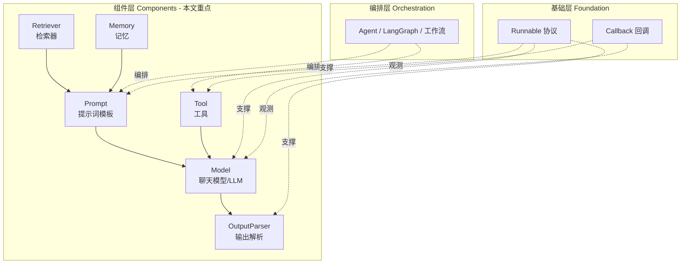

> **通俗比喻**：组件层就像汽车的"零件库"——发动机（Model）、方向盘（Prompt）、变速箱（OutputParser）、导航（Retriever）、车机（Tool）、行车记录仪（Memory）。单看每个零件都很强大，但开上路需要的是"整车装配工艺"：传动比怎么匹配、线束怎么接、仪表盘怎么读。本文讲的就是这套装配工艺。

### 1.2 六大组件一览

| 组件 | 职责 | 输入 | 输出 | 典型实现 | 一句话比喻 |
|------|------|------|------|----------|-----------|
| **Prompt** | 把变量渲染成提示词 | 字典变量 | `ChatPromptValue` / 消息列表 | `ChatPromptTemplate`、`MessagesPlaceholder` | 剧本台词本 |
| **Model** | 调大模型生成文本 | 消息列表 | `AIMessage` | `ChatOpenAI`、`ChatAnthropic`、`ChatOllama` | 演员（负责说台词） |
| **OutputParser** | 把模型文本转成结构化数据 | `AIMessage` / str | Pydantic / dict / list | `StrOutputParser`、`PydanticOutputParser` | 速记员（把自由发挥整理成表格） |
| **Retriever** | 按 query 找相关文档 | str query | `List[Document]` | `VectorStoreRetriever`、`MultiQueryRetriever` | 图书管理员（去书库找资料） |
| **Tool** | 让模型调用外部能力 | 工具入参 | 工具返回值 | `@tool`、`StructuredTool` | 给演员的"道具柜" |
| **Memory** | 存取对话历史 | 输入/输出 | 历史消息列表 | `ConversationBufferMemory`、`RunnableWithMessageHistory` | 剧情梗概（记住之前演过什么） |

### 1.3 组件之间的数据流转约定

组件能自由拼接，靠的是**统一的输入输出约定**（Runnable 协议）。理解这个约定，比背 API 重要十倍：

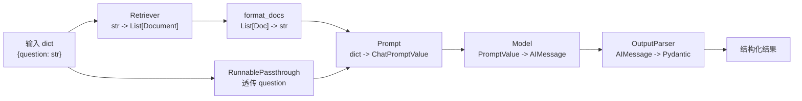

**三条黄金约定**：

1. **管道 `|` 自动接线**：前一个 Runnable 的返回值，就是后一个 Runnable 的入参。类型不匹配就在中间塞一个"转换函数"（`RunnableLambda`）。
2. **字典即总线**：复杂系统用 `dict` 作为中间总线，`RunnableParallel` 负责往总线上"并行加料"，`RunnablePassthrough` 负责"原样透传"。
3. **Schema 自描述**：每个 Runnable 都有 `input_schema` / `output_schema`，组合时 LangChain 会做基本的类型推断，这也是 LangServe 能自动生成 API 文档的基础。

```python
# 黄金约定 1：管道接线
from langchain_core.prompts import ChatPromptTemplate
from langchain_core.output_parsers import StrOutputParser
from langchain_openai import ChatOpenAI

prompt = ChatPromptTemplate.from_template("请用一句话解释：{topic}")
model = ChatOpenAI(model="gpt-4o-mini")
chain = prompt | model | StrOutputParser()
# prompt 输出 ChatPromptValue -> model 输出 AIMessage -> StrOutputParser 输出 str

# 黄金约定 2：字典总线
from langchain_core.runnables import RunnableParallel, RunnablePassthrough

parallel = RunnableParallel({
    "topic": RunnablePassthrough(),          # 原样透传 "topic"
    "meta": lambda x: {"length": len(x)}     # 并行计算衍生字段
})
print(parallel.invoke("向量数据库"))
# {'topic': '向量数据库', 'meta': {'length': 4}}

# 黄金约定 3：Schema 自描述
print("Prompt 输入字段:", list(prompt.input_schema.model_fields.keys()))
print("链输入字段:", list(chain.input_schema.model_fields.keys()))
```

> 🔍 **知识点深度解析**
>
> **作用**：组件层全景图帮助开发者建立"零件—装配—整车"的三层心智，避免把 LLM 应用写成一团不可维护的脚本。
>
> **原理**：LangChain 的一切组合都建立在 Runnable 协议上。`|` 运算符返回的是 `RunnableSequence`，它本身也是一个 Runnable，因此可以无限嵌套。`RunnableParallel` 返回的是并行调度器，内部把同一个输入 fan-out 给多个分支，再 fan-in 成字典。理解了"管道串行 + 字典并行"这两个原语，就能推导出所有链的结构。
>
> **用法要点**：① 先画数据流图再写代码；② 用 `dict` 作为跨组件总线；③ 类型不匹配处用 `RunnableLambda` 做显式转换；④ 永远先 `print(chain.invoke(sample))` 验证中间产物；⑤ 善用 `get_graph().print_ascii()` 可视化链结构。

---

> 💡 **深度讲解**：很多团队在做 LLM 应用时踩的第一个大坑，是"把 Prompt、Model、Retriever 写在一个函数里"。这种写法在 Demo 阶段很爽，一旦要加测试、换模型、加观测，就发现代码耦合得拆不动。组件层整合的核心思想是"**每个组件都是可独立替换的黑盒**"——Retriever 今天用 Chroma，明天可以换成 Pinecone，只要它对外仍然是"输入 query、输出 List[Document]"，整条链的其他部分一行都不用改。这种可替换性，本质来自面向接口编程 + 依赖倒置。LangChain 把这种思想用 Runnable 协议固化下来，使得"组件边界"成为一等公民。另一个关键认知是"组件层与编排层的分工"：组件层负责"做什么"（检索、生成、解析），编排层负责"先做什么后做什么、出错了怎么办、要不要人工介入"。简单系统用 LCEL 管道就够了；一旦出现"循环、条件分支、状态持久化、人机协作"，就该升级到 LangGraph。这个边界一定要想清楚，否则会出现两种极端：用 LCEL 硬写循环导致代码变成意大利面，或者一上来就上 LangGraph 把简单问题复杂化。
>
> **📝 精简总结**：组件层全景图由六大组件（Prompt/Model/OutputParser/Retriever/Tool/Memory）构成，支撑于 Runnable 协议与 Callback；组件间靠"管道 `|` 串行 + 字典总线并行"流转数据；三条黄金约定是管道自动接线、字典即总线、Schema 自描述；组件层负责"做什么"，编排层（Agent/LangGraph）负责"怎么做流程"；从简单链到 Agent 的演进边界是"是否需要循环/分支/状态/人工介入"。

---

## 二、六大组件逐一拆解

### 2.1 Prompt 组件：剧本台词本

**概念解释**：Prompt 是给大模型的"指令模板"。直接把字符串拼给模型，变量一多就乱套；Prompt Template 把"固定指令"和"动态变量"分离，渲染时才填充。

**原理说明**：`ChatPromptTemplate` 内部维护一个消息列表（系统/用户/AI/工具消息），每个占位符用 `{var}` 表示。调用时它做三件事：① 校验所有必填变量是否传入；② 把变量渲染进对应消息；③ 包装成 `ChatPromptValue`，该对象知道如何转成 OpenAI/Anthropic 等不同厂商需要的格式。

```python
# 基础：单条提示词
from langchain_core.prompts import PromptTemplate
prompt = PromptTemplate.from_template("请把以下句子翻译成英文：{text}")
print(prompt.format(text="今天天气很好"))
```

```python
# 进阶：多消息聊天提示词
from langchain_core.prompts import ChatPromptTemplate

chat_prompt = ChatPromptTemplate.from_messages([
    ("system", "你是一名{role}，回答要简洁，不超过{max_len}字。"),
    ("human", "我的问题是：{question}"),
])
messages = chat_prompt.format_messages(
    role="资深Python工程师", max_len=100, question="什么是GIL？"
)
for m in messages:
    print(f"[{m.type}] {m.content}")
```

```python
# 进阶：MessagesPlaceholder 动态插入历史消息
from langchain_core.prompts import MessagesPlaceholder

history_prompt = ChatPromptTemplate.from_messages([
    ("system", "你是一个有帮助的助手。"),
    MessagesPlaceholder(variable_name="history"),   # 动态历史
    ("human", "{input}"),
])
# history 是一个 BaseMessage 列表，常用于 Memory
rendered = history_prompt.format_messages(
    history=[], input="你好"
)
print(rendered)
```

```python
# 完整场景：带格式说明的结构化 Prompt
from langchain_core.output_parsers import PydanticOutputParser
from pydantic import BaseModel, Field
from typing import List

class City(BaseModel):
    name: str = Field(description="城市名")
    country: str = Field(description="所属国家")
    landmarks: List[str] = Field(description="著名地标")

parser = PydanticOutputParser(pydantic_object=City)
prompt = ChatPromptTemplate.from_messages([
    ("system", "你是一个旅游信息提取助手。\n{format_instructions}"),
    ("human", "请介绍{city}"),
]).partial(format_instructions=parser.get_format_instructions())

# partial 把不变的 format_instructions 提前绑定，调用时只传 city
print(prompt.invoke({"city": "巴黎"}).to_messages()[0].content[:200])
```

**使用场景/最佳实践**：① 系统指令放 `system` 消息，用户输入放 `human`；② 变化少的说明用 `.partial()` 提前绑定；③ 长 Prompt 用三引号字符串保持可读；④ 把 Prompt 当代码管理，进 Git、做版本化。

**常见坑点**：
- 错误现象：`KeyError: 'format_instructions'`
- 原因：在 Prompt 里写了 `{format_instructions}` 但调用时没传。
- 正确做法：用 `.partial(format_instructions=...)` 提前绑定，或在 `invoke` 字典里补全。

```python
# 坑点修复：partial 绑定固定变量
prompt = ChatPromptTemplate.from_template(
    "固定指令{fixed_var}，用户问题：{user_q}"
).partial(fixed_var="你好")
prompt.invoke({"user_q": "世界的尽头在哪？"})  # 只传 user_q
```

### 2.2 Model 组件：演员

**概念解释**：Model 组件封装了不同大模型厂商的差异。`ChatModel` 接收消息列表返回 `AIMessage`，`LLM` 接收字符串返回字符串。它们统一实现 Runnable 协议。

**原理说明**：Model 组件内部是一个"HTTP 客户端 + 序列化适配层"。它把 LangChain 的 `BaseMessage` 对象转成厂商 API 的 JSON，再把响应解析回 `AIMessage`（其中包含 `content`、`usage_metadata`、`tool_calls` 等）。流式时，它把厂商的 SSE 流逐块转成消息块。

```python
# 基础：OpenAI 聊天模型
from langchain_openai import ChatOpenAI
llm = ChatOpenAI(model="gpt-4o-mini", temperature=0.7)
resp = llm.invoke("用三个字形容秋天")
print(resp.content)
```

```python
# 进阶：配置化 + 超时 + 重试
llm = ChatOpenAI(
    model="gpt-4o",
    temperature=0,
    max_tokens=512,
    timeout=30,                 # 超时秒数
    max_retries=2,              # 自动重试
)
```

```python
# 进阶：绑定工具（Function Calling）
from langchain_core.tools import tool

@tool
def get_weather(city: str) -> str:
    """查询天气"""
    return f"{city} 今天晴，25℃"

llm_with_tools = llm.bind_tools([get_weather])
resp = llm_with_tools.invoke("北京天气怎么样？")
print("模型要求调用的工具:", resp.tool_calls)
```

```python
# 完整场景：多模型切换（用 dict 配置驱动）
MODELS = {
    "fast": ChatOpenAI(model="gpt-4o-mini", temperature=0),
    "smart": ChatOpenAI(model="gpt-4o", temperature=0.2),
    "local": ChatOpenAI(model="qwen", base_url="http://localhost:8000/v1"),
}
def pick_model(level: str):
    return MODELS.get(level, MODELS["fast"])

print(pick_model("smart").invoke("1+1=?").content)
```

**使用场景/最佳实践**：① 开发用 `gpt-4o-mini` 省钱，生产用 `gpt-4o`；② `temperature` 任务型用 0~0.2，创作型用 0.7+；③ 统一在配置中心实例化模型，不要散落各处；④ 用 `.bind_tools()` 而不是手写 JSON Schema。

**常见坑点**：
- 错误现象：`openai.AuthenticationError: Incorrect API key provided`
- 原因：环境变量 `OPENAI_API_KEY` 未设置或拼错。
- 正确做法：`os.environ["OPENAI_API_KEY"] = "sk-..."` 或在实例化时显式传 `api_key=`，并在生产用密钥管理。

```python
# 坑点修复：显式注入密钥 + 校验
import os
from langchain_openai import ChatOpenAI

if not os.getenv("OPENAI_API_KEY"):
    raise EnvironmentError("请先设置 OPENAI_API_KEY")
llm = ChatOpenAI(model="gpt-4o-mini", api_key=os.getenv("OPENAI_API_KEY"))
```

### 2.3 OutputParser 组件：速记员

**概念解释**：模型输出的是"自由文本"，但下游代码需要"结构化数据"。OutputParser 负责把文本解析成 Pydantic 对象、字典、列表，或干脆只取字符串。

**原理说明**：Parser 有两个方法：`get_format_instructions()`（生成告诉模型"该怎么输出"的话术，注入 Prompt）和 `parse(text)`（把模型输出解析成目标类型）。`PydanticOutputParser` 用 Pydantic 模型生成 JSON Schema，并在解析时校验字段。

```python
# 基础：字符串解析
from langchain_core.output_parsers import StrOutputParser
str_parser = StrOutputParser()
# 直接把 AIMessage.content 取出来
```

```python
# 进阶：列表解析
from langchain_core.output_parsers import CommaSeparatedListOutputParser
list_parser = CommaSeparatedListOutputParser()
print(list_parser.parse("苹果, 香蕉, 橙子"))   # ['苹果', '香蕉', '橙子']
```

```python
# 进阶：JSON 解析
from langchain_core.output_parsers import JsonOutputParser
json_parser = JsonOutputParser()
# 模型输出 {"a": 1, "b": 2} -> 字典
```

```python
# 完整场景：Pydantic 结构化输出 + LCEL
from langchain_core.prompts import ChatPromptTemplate
from langchain_core.output_parsers import PydanticOutputParser
from langchain_openai import ChatOpenAI
from pydantic import BaseModel, Field
from typing import List

class Person(BaseModel):
    name: str = Field(description="姓名")
    age: int = Field(description="年龄")
    skills: List[str] = Field(description="技能列表")

parser = PydanticOutputParser(pydantic_object=Person)
prompt = ChatPromptTemplate.from_messages([
    ("system", "提取人物信息。\n{format}"),
    ("human", "{text}"),
]).partial(format=parser.get_format_instructions())
chain = prompt | ChatOpenAI(model="gpt-4o-mini") | parser

result = chain.invoke({"text": "张三，28岁，擅长Python和Go"})
print(type(result), result.name, result.age, result.skills)
```

**使用场景/最佳实践**：① 只要纯文本就用 `StrOutputParser`，最轻量；② 下游要 `for` 遍历就用列表 Parser；③ 要进数据库/做校验就用 Pydantic；④ 对解析稳定性要求高时，用模型自带的结构化输出（如 `with_structured_output`）。

```python
# 更稳的结构化输出：模型原生 function calling
structured_llm = ChatOpenAI(model="gpt-4o-mini").with_structured_output(Person)
person = structured_llm.invoke("李四，30岁，会Java")
print(person)
```

**常见坑点**：
- 错误现象：`OutputParserException: Failed to parse Person from completion`
- 原因：模型输出了 JSON 外的多余说明文字（如"好的，以下是结果：{...}"）。
- 正确做法：① Prompt 里明确"只输出 JSON，不要解释"；② 用 `with_structured_output` 走原生结构化；③ 加重试。

```python
# 坑点修复：解析失败自动重试
from langchain_core.output_parsers import OutputFixingParser

fixing_parser = OutputFixingParser.from_llm(
    parser=parser,
    llm=ChatOpenAI(model="gpt-4o-mini"),
)
chain = prompt | ChatOpenAI(model="gpt-4o-mini") | fixing_parser
```

### 2.4 Retriever 组件：图书管理员

**概念解释**：Retriever 根据用户的 query，从知识库中捞出最相关的若干片段（Document），供后续 Prompt 使用。它是 RAG 的核心。

**原理说明**：最常见的 `VectorStoreRetriever` 流程是：query -> Embedding 向量化 -> 在向量库做余弦相似度搜索 -> 返回 Top-K 文档。文档通常经过切分（chunk）后入库。

```python
# 基础：从向量库构建 Retriever
from langchain_openai import OpenAIEmbeddings
from langchain_community.vectorstores import Chroma

embeddings = OpenAIEmbeddings(model="text-embedding-3-small")
vectorstore = Chroma(persist_directory="./chroma_db", embedding_function=embeddings)
retriever = vectorstore.as_retriever(search_kwargs={"k": 4})

docs = retriever.invoke("什么是向量化？")
for d in docs:
    print("-", d.page_content[:80])
```

```python
# 进阶：MMR 检索（兼顾相关性与多样性）
retriever_mmr = vectorstore.as_retriever(
    search_type="mmr",
    search_kwargs={"k": 5, "fetch_k": 20, "lambda_mult": 0.5},
)
```

```python
# 进阶：多查询检索（把一个问题扩写成多个问题分别检索）
from langchain.retrievers.multi_query import MultiQueryRetriever
from langchain_openai import ChatOpenAI

mq_retriever = MultiQueryRetriever.from_llm(
    retriever=retriever,
    llm=ChatOpenAI(model="gpt-4o-mini", temperature=0),
)
```

```python
# 完整场景：RAG 标准链
from langchain_core.prompts import ChatPromptTemplate
from langchain_core.output_parsers import StrOutputParser
from langchain_core.runnables import RunnablePassthrough
from langchain_openai import ChatOpenAI

def format_docs(docs):
    return "\n\n".join(f"[文档{i+1}] {d.page_content}" for i, d in enumerate(docs))

rag_prompt = ChatPromptTemplate.from_template(
    "根据以下资料回答问题，资料不足时说不知道。\n\n资料：\n{context}\n\n问题：{question}"
)
rag_chain = (
    {"context": retriever | format_docs, "question": RunnablePassthrough()}
    | rag_prompt
    | ChatOpenAI(model="gpt-4o", temperature=0)
    | StrOutputParser()
)
print(rag_chain.invoke("向量化有什么用？"))
```

**使用场景/最佳实践**：① `k` 一般取 3~6；② 长文档先切分再入库；③ 检索不准先调 chunk_size 和 k，再调 Embedding 模型；④ 生产用 Pinecone/Milvus/Qdrant，本地原型用 Chroma/FAISS。

**常见坑点**：
- 错误现象：检索结果全是不相关内容
- 原因：Embedding 模型和入库时用的不一致，或 chunk 切得太碎/太大。
- 正确做法：① 入库与查询必须用同一个 Embedding 模型；② chunk_size 500~1000、overlap 100~200 起步；③ 用 LangSmith 看实际检索到的内容。

### 2.5 Tool 组件：道具柜

**概念解释**：Tool 是模型可以主动调用的外部能力——查天气、算数学、查数据库、调 API。模型通过 Function Calling 决定"调哪个工具、传什么参数"。

**原理说明**：Tool 需要三样东西：名字、描述（告诉模型什么时候用）、参数 Schema（告诉模型传什么）。`@tool` 装饰器会从函数签名和 docstring 自动生成这三样。模型返回 `tool_calls`，框架执行工具，再把结果回填给模型继续生成。

```python
# 基础：@tool 装饰器
from langchain_core.tools import tool

@tool
def multiply(a: int, b: int) -> int:
    """计算两个整数的乘积"""
    return a * b

print(multiply.name, "-", multiply.description)
print(multiply.invoke({"a": 6, "b": 7}))
```

```python
# 进阶：带 Pydantic 参数的工具
from langchain_core.tools import StructuredTool
from pydantic import BaseModel, Field

class SearchInput(BaseModel):
    query: str = Field(description="搜索关键词")
    top_k: int = Field(default=3, description="返回条数")

def real_search(query: str, top_k: int = 3) -> str:
    return f"搜索 {query} 得到 {top_k} 条结果"

search_tool = StructuredTool.from_function(
    func=real_search,
    name="web_search",
    description="联网搜索",
    args_schema=SearchInput,
)
```

```python
# 进阶：异步工具
@tool
async def async_get_time() -> str:
    """获取当前时间"""
    import datetime
    return datetime.datetime.now().isoformat()
```

```python
# 完整场景：工具调用循环（手动版，理解原理）
from langchain_openai import ChatOpenAI
from langchain_core.messages import HumanMessage, ToolMessage

tools = [multiply, search_tool]
llm = ChatOpenAI(model="gpt-4o-mini").bind_tools(tools)

messages = [HumanMessage("345乘以12等于多少？")]
resp = llm.invoke(messages)
messages.append(resp)

for tc in resp.tool_calls:
    selected = {t.name: t for t in tools}[tc["name"]]
    result = selected.invoke(tc["args"])
    messages.append(ToolMessage(content=str(result), tool_call_id=tc["id"]))

final = llm.invoke(messages)   # 模型拿到工具结果后给最终答案
print(final.content)
```

**使用场景/最佳实践**：① docstring 写清楚"什么时候用这个工具"，模型靠它判断；② 参数名要语义化；③ 工具要做异常兜底，不要把栈轨迹抛给模型；④ 危险操作（删库、转账）要加二次确认。

**常见坑点**：
- 错误现象：模型一直不调用工具，或调用工具时报参数错
- 原因：工具描述太含糊，或参数 Schema 没写 `description`。
- 正确做法：每个参数都加 `Field(description=...)`，docstring 用一句话说明用途和触发时机。

### 2.6 Memory 组件：剧情梗概

**概念解释**：单次对话模型是"失忆"的，每轮都从零开始。Memory 组件负责把历史对话存下来，每轮请求时塞回 Prompt，让模型"记得"之前聊过什么。

**原理说明**：传统 `ConversationBufferMemory` 把历史消息原样累积；`ConversationSummaryMemory` 让模型把历史压缩成摘要，省 Token；LCEL 时代推荐 `RunnableWithMessageHistory`，把"会话 ID -> 历史存储"解耦。

```python
# 基础：Buffer 记忆（旧版 API，理解原理）
from langchain_core.chat_history import InMemoryChatMessageHistory
from langchain_core.prompts import ChatPromptTemplate, MessagesPlaceholder
from langchain_core.runnables.history import RunnableWithMessageHistory
from langchain_openai import ChatOpenAI

history = InMemoryChatMessageHistory()
prompt = ChatPromptTemplate.from_messages([
    ("system", "你是助手"),
    MessagesPlaceholder(variable_name="history"),
    ("human", "{input}"),
])
chain = prompt | ChatOpenAI(model="gpt-4o-mini")

# 新版：RunnableWithMessageHistory 按 session_id 存历史
store = {}
def get_session_history(session_id: str):
    if session_id not in store:
        store[session_id] = InMemoryChatMessageHistory()
    return store[session_id]

chain_with_history = RunnableWithMessageHistory(
    chain,
    get_session_history,
    input_messages_key="input",
    history_messages_key="history",
)
chain_with_history.invoke(
    {"input": "我叫小明"},
    config={"configurable": {"session_id": "u1"}},
)
resp = chain_with_history.invoke(
    {"input": "我叫什么名字？"},
    config={"configurable": {"session_id": "u1"}},
)
print(resp.content)   # 应该回答"小明"
```

```python
# 进阶：限制历史长度（滑动窗口）
from langchain_core.chat_history import InMemoryChatMessageHistory
from langchain_core.messages import trim_messages

trimmer = trim_messages(
    max_tokens=100, strategy="last", token_counter=len,
    include_system=True, allow_partial=False,
)
# 把 trimmer 作为 history 处理步骤，防止历史无限膨胀
```

```python
# 完整场景：Redis 持久化记忆（生产）
# from langchain_redis import RedisChatMessageHistory
# def get_session_history(session_id: str):
#     return RedisChatMessageHistory(session_id, redis_url="redis://localhost:6379")
```

**使用场景/最佳实践**：① 用 `session_id` 隔离不同用户；② 生产用 Redis/数据库持久化，不要用内存（重启就丢）；③ 长对话一定要 trim，否则 Token 爆炸；④ 敏感对话定期清理。

**常见坑点**：
- 错误现象：跨用户串话，或重启后记忆丢失
- 原因：用了全局单例的 `InMemoryChatMessageHistory`，没按 `session_id` 隔离。
- 正确做法：工厂函数按 `session_id` 返回独立历史实例，生产用 Redis 后端。

---

> 💡 **深度讲解**：把六大组件拆开看都不难，难点在于"它们之间的边界和契约"。工程上最值钱的能力，是判断"一个需求该落在哪一层"。比如"记住用户是谁"——是 Prompt 层做（把用户信息注入 system）？还是 Memory 层做（存历史）？还是 Tool 层做（查用户表）？答案是看"这个信息是临时指令、对话上下文、还是持久化事实"。临时指令进 Prompt，对话上下文进 Memory，持久化事实进 Tool。这种分层判断能力，是区分"会调 API"和"会做系统"的分水岭。再比如 Retriever 和 Tool 的边界：检索知识库本质上也是一种"工具"，为什么要单独有 Retriever 抽象？因为 RAG 链路里检索发生在 Prompt 构造阶段、需要和 Prompt 深度耦合，而 Tool 是模型在推理阶段自主决定调用的。把检索当 Tool 用（让模型自己决定查不查）会更灵活但更慢、更贵；把检索硬编码进链（RAG 链）更可控但不灵活。生产实践通常是"两者结合"：硬编码必要检索 + 开放通用搜索工具。
>
> **📝 精简总结**：Prompt 管指令渲染（system+human+MessagesPlaceholder，用 partial 绑固定变量）；Model 管厂商适配（统一 Runnable，支持 bind_tools/with_structured_output）；OutputParser 管文本转结构化（Str/Pydantic/Json/List，失败用 OutputFixingParser 重试）；Retriever 管知识检索（VectorStoreRetriever，MMR/多查询，k 取 3~6）；Tool 管外部能力（@tool 装饰器，docstring 和参数 description 是模型判断的依据）；Memory 管历史（RunnableWithMessageHistory 按 session_id 隔离，生产用 Redis，长对话要 trim）；边界判断口诀：临时指令进 Prompt、对话上下文进 Memory、持久化事实进 Tool、必要知识硬编码进 RAG、通用搜索开放成 Tool。

---

## 三、组件组合模式与数据流转

### 3.1 五种基本组合模式

LangChain 组件的组合，本质上只有五种原语。掌握这五种，就能拼出任意复杂的链。

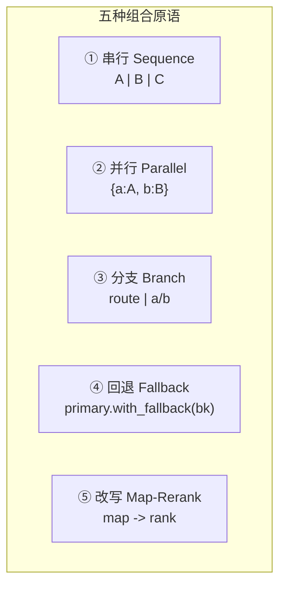

| 组合模式 | 代码写法 | 数据流转 | 典型用途 |
|----------|----------|----------|----------|
| **串行** | `a \| b \| c` | 前输出=后输入 | 标准 RAG、翻译、总结 |
| **并行** | `RunnableParallel({...})` | 同输入 fan-out，结果 fan-in 成 dict | RAG 中并行检索+透传问题 |
| **分支** | `RunnableBranch` / 条件 | 按输入路由到不同子链 | 多意图分发 |
| **回退** | `.with_fallback(bk)` | 主失败则跑备用 | GPT-4 挂了切 GPT-3.5 |
| **Map-Rerank** | `.map()` + 重排 | 列表逐项处理再选最优 | 多答案重排 |

```python
# ① 串行：最基础
from langchain_core.prompts import ChatPromptTemplate
from langchain_core.output_parsers import StrOutputParser
from langchain_openai import ChatOpenAI

chain = (
    ChatPromptTemplate.from_template("把{text}翻译成英文")
    | ChatOpenAI(model="gpt-4o-mini")
    | StrOutputParser()
)
print(chain.invoke({"text": "你好世界"}))
```

```python
# ② 并行：RunnableParallel
from langchain_core.runnables import RunnableParallel, RunnablePassthrough

def upper(x): return x.upper()
def length(x): return len(x)

para = RunnableParallel({"upper": upper, "len": length})
print(para.invoke("hello"))     # {'upper': 'HELLO', 'len': 5}
```

```python
# ② 并行在 RAG 中的经典用法
rag = (
    RunnableParallel({
        "context": lambda q: "检索到的上下文...",
        "question": RunnablePassthrough(),
    })
    | ChatPromptTemplate.from_template("资料:{context}\n问题:{question}")
    | ChatOpenAI(model="gpt-4o-mini")
    | StrOutputParser()
)
```

```python
# ③ 分支：按输入路由
from langchain_core.runnables import RunnableBranch, RunnableLambda

chain_q = RunnableLambda(lambda x: f"【问答模式】{x['q']}")
chain_s = RunnableLambda(lambda x: f"【总结模式】{x['q']}")

branch = RunnableBranch(
    (lambda x: x.get("mode") == "qa", chain_q),
    (lambda x: x.get("mode") == "summary", chain_s),
    RunnableLambda(lambda x: f"【默认模式】{x['q']}"),
)
print(branch.invoke({"mode": "qa", "q": "什么是RAG？"}))
```

```python
# ④ 回退：主链失败切备用
fast = ChatOpenAI(model="gpt-4o-mini")
backup = ChatOpenAI(model="gpt-4o-mini", base_url="https://backup.example.com/v1")
resilient = fast.with_fallbacks([backup])
# 主模型超时/报错时自动用备用
```

```python
# ④ 回退配置化：指定重试次数
robust_chain = (
    ChatPromptTemplate.from_template("解释{topic}")
    | ChatOpenAI(model="gpt-4o")
    .with_retry(stop_after_attempt=3, wait_exponential_jitter=True)
    .with_fallbacks([ChatOpenAI(model="gpt-4o-mini")])
    | StrOutputParser()
)
```

```python
# ⑤ Map-Rerank：列表逐项处理再选最优
def answer_one(question):
    return f"针对《{question}》的一个候选答案"

questions = ["问题A", "问题B", "问题C"]
mapped = (lambda qs: [answer_one(q) for q in qs])
print(mapped(questions))
# 生产中用 .map() 把单输入链广播到列表
```

```python
# ⑤ .map() 真正的广播
from langchain_core.runnables import RunnableLambda
one_chain = RunnableLambda(lambda x: f"处理:{x}")
batch_chain = one_chain.map()
print(batch_chain.invoke(["甲", "乙", "丙"]))
```

### 3.2 数据流转：从输入到输出的全链路追踪

理解数据流转的最好方式，是把链的每个中间产物都打印出来。LangChain 提供 `get_graph()` 和中间步骤观测。

```python
# 打印链的 ASCII 结构图
chain = (
    RunnableParallel({"context": lambda q: "ctx", "question": RunnablePassthrough()})
    | ChatPromptTemplate.from_template("{context} {question}")
    | ChatOpenAI(model="gpt-4o-mini")
    | StrOutputParser()
)
chain.get_graph().print_ascii()
```

```python
# 手动插入观测点：RunnableLambda 打印中间产物
def observe(tag):
    def _fn(x):
        print(f"[观察点 {tag}] {str(x)[:100]}")
        return x
    return RunnableLambda(_fn)

debug_chain = (
    {"q": RunnablePassthrough()}
    | observe("A:输入")
    | (lambda d: {"q": d["q"], "ctx": "检索结果"})
    | observe("B:合并后")
)
debug_chain.invoke("测试问题")
```

```python
# 查看链的输入输出 Schema
print("输入字段:", chain.input_schema.model_fields.keys())
print("输出字段:", chain.output_schema.model_fields.keys())
```

```python
# batch 批量调用
print(chain.batch([{"q": "问题1"}, {"q": "问题2"}]))
```

```python
# stream 流式调用
for chunk in chain.stream("流式问题"):
    print(chunk, end="", flush=True)
```

### 3.3 链的"可替换性"验证

组件整合的核心红利是"可替换"。下面用代码验证：换 Model 不改其他部分。

```python
from langchain_core.prompts import ChatPromptTemplate
from langchain_core.output_parsers import StrOutputParser
from langchain_openai import ChatOpenAI

prompt = ChatPromptTemplate.from_template("用一句话赞美{thing}")
parser = StrOutputParser()

# 同一条 prompt，换不同 model
for model_name in ["gpt-4o-mini", "gpt-4o"]:
    chain = prompt | ChatOpenAI(model=model_name) | parser
    print(f"[{model_name}]", chain.invoke({"thing": "秋天"}))
```

> 🔍 **知识点深度解析**
>
> **作用**：五种组合原语把"拼装复杂链"降维成"选原语 + 排顺序"。
>
> **原理**：串行依赖 RunnableSequence 的 `__or__`；并行依赖 RunnableParallel 的 fan-out/fan-in；分支依赖 RunnableBranch 的谓词判断；回退依赖 Runnable 外层的异常捕获与替换执行；Map 依赖把单输入 Runnable 包装成可广播到列表的 Runnable. Each branch's output type must be compatible.
>
> **用法要点**：① 能并行就别串行（RAG 检索和问题透传并行）；② 分支谓词要互斥且有兜底；③ 回退链要和主链输入输出 Schema 一致；④ 调试时先 `get_graph().print_ascii()` 画图，再插观察点。

---

> 💡 **深度讲解**：组合模式里最容易被忽视的是"数据类型契约"。LCEL 之所以能 `|`，是因为它假设"前一个 Runnable 的输出类型 = 后一个的输入类型"。但 LangChain 不会强制类型检查，类型错了只会在运行时报错。比如你把一个输出 `str` 的 Retriever 直接 `|` 到一个期望 `dict` 的 Prompt，运行时才会爆 `KeyError`。工程上的对策是：① 复杂链用 `dict` 作为中间总线，字段名显式；② 每个阶段加 `RunnableLambda` 观察点打印类型；③ 用 `Pydantic` 约束中间产物，让类型在编译期就暴露。另一个深层问题是"并行的副作用"。`RunnableParallel` 会把同一个输入同时喂给多个分支，如果某个分支有副作用（写数据库、调付费 API），并行时这些副作用会同时发生——这在调试时容易误判为"调用了两次"。生产中要把"纯计算分支"和"副作用分支"分开管理。
>
> **📝 精简总结**：五种组合原语是串行、并行、分支、回退、Map；串行靠 `|`，并行靠 RunnableParallel，分支靠 RunnableBranch 谓词，回退靠 with_fallbacks，Map 靠 .map() 广播；数据流转要用 get_graph().print_ascii() 画出来、用 RunnableLambda 观察点打印中间产物；核心红利是组件可替换（换 Model 不动 Prompt）；最大坑是类型契约不匹配（运行时才报 KeyError），对策是用 dict 总线 + 观察点 + Pydantic 约束。

---

## 四、典型链的构建

### 4.1 RAG 链（检索增强生成）

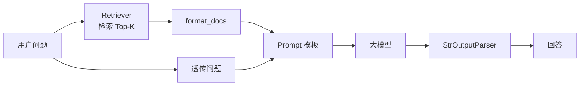

```python
# RAG 链完整版
from langchain_core.prompts import ChatPromptTemplate
from langchain_core.output_parsers import StrOutputParser
from langchain_core.runnables import RunnablePassthrough, RunnableLambda
from langchain_openai import ChatOpenAI

# 假设 retriever 已构建
def fake_retriever(q):
    return [type("D", (), {"page_content": f"关于{q}的资料片段"})()]

def format_docs(docs):
    return "\n".join(d.page_content for d in docs)

prompt = ChatPromptTemplate.from_template(
    "根据资料回答，不知道就说不知道。\n资料:{context}\n问题:{question}"
)
rag_chain = (
    {"context": fake_retriever | format_docs, "question": RunnablePassthrough()}
    | prompt
    | ChatOpenAI(model="gpt-4o", temperature=0)
    | StrOutputParser()
)
print(rag_chain.invoke("什么是RAG？"))
```

### 4.2 对话链（带记忆的多轮）

```python
# 对话链：RunnableWithMessageHistory
from langchain_core.prompts import ChatPromptTemplate, MessagesPlaceholder
from langchain_core.runnables.history import RunnableWithMessageHistory
from langchain_core.chat_history import InMemoryChatMessageHistory
from langchain_core.output_parsers import StrOutputParser
from langchain_openai import ChatOpenAI

prompt = ChatPromptTemplate.from_messages([
    ("system", "你是友好助手，回答简短"),
    MessagesPlaceholder(variable_name="history"),
    ("human", "{input}"),
])
base_chain = prompt | ChatOpenAI(model="gpt-4o-mini") | StrOutputParser()

stores = {}
def get_history(session_id):
    if session_id not in stores:
        stores[session_id] = InMemoryChatMessageHistory()
    return stores[session_id]

chat_chain = RunnableWithMessageHistory(
    base_chain, get_history,
    input_messages_key="input", history_messages_key="history",
)
chat_chain.invoke({"input": "我叫小红"}, config={"configurable": {"session_id": "s1"}})
print(chat_chain.invoke({"input": "我叫啥？"}, config={"configurable": {"session_id": "s1"}}))
```

### 4.3 工具调用链（ReAct 风格）

```python
# 工具调用链：用 create_tool_calling_agent（现代写法）
from langchain_core.tools import tool
from langchain_core.prompts import ChatPromptTemplate
from langchain_openai import ChatOpenAI
from langchain.agents import create_tool_calling_agent, AgentExecutor

@tool
def calculator(expression: str) -> str:
    """计算数学表达式，例如 '2+3*4'"""
    return str(eval(expression))   # 仅演示，生产勿用 eval

@tool
def search_kb(query: str) -> str:
    """搜索内部知识库"""
    return f"知识库关于{query}的结果"

tools = [calculator, search_kb]
prompt = ChatPromptTemplate.from_messages([
    ("system", "你可以使用工具回答问题"),
    ("human", "{input}"),
    ("agent_scratchpad", "{agent_scratchpad}"),
])
llm = ChatOpenAI(model="gpt-4o-mini")
agent = create_tool_calling_agent(llm, tools, prompt)
executor = AgentExecutor(agent=agent, tools=tools, verbose=True)
print(executor.invoke({"input": "帮我算 (12+8)*3 并查一下相关资料"}))
```

### 4.4 总结链（长文摘要）

```python
# 总结链：stuff / map-reduce / refine 三种模式
from langchain_core.prompts import ChatPromptTemplate
from langchain_core.output_parsers import StrOutputParser
from langchain_openai import ChatOpenAI

llm = ChatOpenAI(model="gpt-4o-mini")

# 模式一：stuff（短文本，一次塞进去）
stuff_prompt = ChatPromptTemplate.from_template("总结以下文章：\n{text}")
stuff_chain = stuff_prompt | llm | StrOutputParser()

# 模式二：map-reduce（长文本，每段摘要再汇总）
map_prompt = ChatPromptTemplate.from_template("为以下片段写一句话摘要：\n{chunk}")
map_chain = map_prompt | llm | StrOutputParser()
chains = map_chain.map()   # 对每个 chunk 并行摘要
reduce_prompt = ChatPromptTemplate.from_template("把以下摘要合并成一段总结：\n{summaries}")
reduce_chain = reduce_prompt | llm | StrOutputParser()

# map -> list[str] -> join -> reduce
full_chain = (
    chains
    | (lambda summaries: {"summaries": "\n".join(summaries)})
    | reduce_chain
)
# full_chain.invoke([chunk1, chunk2, chunk3])
```

```python
# 模式三：refine（逐段迭代精炼）
refine_prompt = ChatPromptTemplate.from_template(
    "已有摘要：{existing}\n新片段：{chunk}\n请把新信息合并进摘要："
)
# 每处理一段，就把"当前摘要+新片段"再喂一次模型
```

### 4.5 四种链对比

| 链类型 | 核心组件 | 输入 | 输出 | 适用 |
|--------|----------|------|------|------|
| **RAG 链** | Retriever+Prompt+Model | 问题 str | 回答 str | 知识库问答 |
| **对话链** | Memory+Prompt+Model | 问题+session | 带上下文回答 | 多轮客服 |
| **工具调用链** | Tool+Model+AgentExecutor | 复杂问题 | 工具+答案 | 需要外部数据/计算 |
| **总结链** | Prompt+Model+map/reduce | 长文本 | 摘要 | 报告/会议纪要 |

---

> 💡 **深度讲解**：四种典型链不是孤立的，生产系统往往是它们的组合体。比如"带记忆的 RAG 对话 Agent"= RAG 链 + 对话链 + 工具调用链。组合时的关键设计决策是：**哪些步骤硬编码、哪些交给模型自主决定**。检索知识库这种"必须做"的步骤硬编码进链；联网搜索、计算器这种"可选"能力做成 Tool 让模型按需调用；历史对话用 Memory 自动注入。这种"硬编码必要路径 + 开放可选工具"的混合架构，是生产 RAG Agent 的主流形态。另一个要点是"总结链的三种模式选型"：短文本用 stuff（最简单）；超长文本用 map-reduce（并行、快，但会丢跨段信息）；需要精确连贯用 refine（慢，但摘要质量高）。选错模式要么超时、要么摘要质量差。
>
> **📝 精简总结**：RAG 链用 RunnableParallel 并行检索+透传；对话链用 RunnableWithMessageHistory 按 session_id 存历史；工具调用链用 create_tool_calling_agent + AgentExecutor；总结链有 stuff/map-reduce/refine 三种模式按文本长度选；生产系统是四者的混合——硬编码必要检索、开放可选工具、Memory 自动注历史。

---

## 五、组件配置管理、测试与可观测性

### 5.1 配置管理：把"会变的"从代码里抽出来

Demo 阶段直接硬编码 `model="gpt-4o"`，生产阶段必须配置化。否则换个环境就要改代码。

```python
# 基础：用 dataclass 集中配置
from dataclasses import dataclass, field
from typing import Optional

@dataclass
class AppConfig:
    openai_api_key: str
    model_chat: str = "gpt-4o"
    model_fast: str = "gpt-4o-mini"
    temperature: float = 0
    rag_k: int = 4
    max_history: int = 20
    langsmith_project: str = "my-app"
```

```python
# 进阶：从环境变量加载
import os
from dataclasses import dataclass

@dataclass
class EnvConfig:
    openai_api_key: str = os.getenv("OPENAI_API_KEY", "")
    langsmith_api_key: str = os.getenv("LANGSMITH_API_KEY", "")
    langsmith_tracing: bool = os.getenv("LANGSMITH_TRACING", "true") == "true"
    model: str = os.getenv("MODEL_NAME", "gpt-4o-mini")

cfg = EnvConfig()
```

```python
# 进阶：pydantic-settings 从 .env 加载
# pip install pydantic-settings
from pydantic_settings import BaseSettings, SettingsConfigDict

class Settings(BaseSettings):
    model_config = SettingsConfigDict(env_file=".env")
    openai_api_key: str
    model_name: str = "gpt-4o-mini"
    temperature: float = 0.0
    rag_top_k: int = 4
    langsmith_project: str = "demo"

settings = Settings()
```

```python
# 完整场景：工厂函数按配置构建链
from langchain_openai import ChatOpenAI
from langchain_core.prompts import ChatPromptTemplate
from langchain_core.output_parsers import StrOutputParser

def build_chat_chain(settings: Settings):
    llm = ChatOpenAI(
        model=settings.model_name,
        temperature=settings.temperature,
        openai_api_key=settings.openai_api_key,
    )
    prompt = ChatPromptTemplate.from_template("回答：{q}")
    return prompt | llm | StrOutputParser()

chain = build_chat_chain(settings)
```

### 5.2 组件测试：把 LLM 当成外部依赖来测

LLM 输出不确定，不能简单断言"等于某字符串"。正确做法是测"组件契约"和"用 Mock 模型测链逻辑"。

```python
# 基础：测纯函数组件（format_docs）
def format_docs(docs):
    return "\n".join(d.page_content for d in docs)

class FakeDoc:
    def __init__(self, c): self.page_content = c

def test_format_docs():
    out = format_docs([FakeDoc("甲"), FakeDoc("乙")])
    assert out == "甲\n乙"
test_format_docs(); print("format_docs 测试通过")
```

```python
# 进阶：用 FakeListChatModel 测链逻辑（不调真实 API）
from langchain_core.language_models.fake_chat_models import GenericFakeChatModel
from langchain_core.prompts import ChatPromptTemplate
from langchain_core.output_parsers import StrOutputParser

fake_llm = GenericFakeChatModel(messages=iter(["固定回答A", "固定回答B"]))
chain = ChatPromptTemplate.from_template("问:{q}") | fake_llm | StrOutputParser()
assert chain.invoke({"q": "x"}) == "固定回答A"
assert chain.invoke({"q": "y"}) == "固定回答B"
print("链逻辑测试通过")
```

```python
# 进阶：测 OutputParser
from langchain_core.output_parsers import JsonOutputParser
parser = JsonOutputParser()
assert parser.parse('{"a":1}') == {"a": 1}
print("Parser 测试通过")
```

```python
# 完整场景：pytest 测 RAG 链（Mock Retriever + Mock LLM）
# test_rag.py
# from chain_module import build_rag_chain
# def test_rag_with_fake_retriever(monkeypatch):
#     fake_ret = lambda q: [type("D",(),{"page_content":"李四28岁"})()]
#     chain = build_rag_chain(retriever=fake_ret, llm=GenericFakeChatModel(...))
#     out = chain.invoke("李四多大？")
#     assert "28" in out
```

### 5.3 组件可观测性：让黑盒变灰盒

```python
# 基础：开 LangSmith 自动追踪
import os
os.environ["LANGSMITH_TRACING"] = "true"
os.environ["LANGSMITH_API_KEY"] = "lsv2_..."
os.environ["LANGSMITH_PROJECT"] = "my-rag"
# 之后所有链调用自动被追踪，无需改代码
```

```python
# 进阶：手动打标签/元数据，便于在 LangSmith 里筛选
chain.invoke(
    {"q": "测试"},
    config={
        "tags": ["production", "user-123"],
        "metadata": {"user_id": "u123", "tenant": "acme"},
    },
)
```

```python
# 进阶：自定义 Callback 记录耗时
from langchain_core.callbacks import BaseCallbackHandler
import time

class TimingHandler(BaseCallbackHandler):
    def __init__(self): self.t0 = {}
    def on_llm_start(self, serialized, prompts, **kw):
        self.t0[id(serialized)] = time.time()
    def on_llm_end(self, response, **kw):
        dt = time.time() - self.t0.get(id(serialized), time.time())
        print(f"[LLM] 耗时 {dt:.2f}s")

handler = TimingHandler()
# chain.invoke("hi", config={"callbacks": [handler]})
```

```python
# 完整场景：记录 Token 用量
from langchain_core.callbacks import BaseCallbackHandler

class TokenStats(BaseCallbackHandler):
    def on_llm_end(self, response, **kw):
        for gen in response.generations:
            usage = getattr(response, "llm_output", {}).get("token_usage", {})
            print("Token 用量:", usage)
```

### 5.4 配置/测试/观测对比表

| 维度 | 反模式（Demo） | 正模式（生产） |
|------|----------------|----------------|
| **配置** | 硬编码 model=xxx | pydantic-settings 从 .env 加载 |
| **模型实例** | 散落各处 new | 工厂函数统一构建 |
| **测试** | 手动跑一遍看效果 | Mock 模型 + pytest 断言契约 |
| **观测** | print 调试 | LangSmith 自动追踪 + tags/metadata |
| **密钥** | 写代码里 | 环境变量/密钥管理 |
| **降级** | 无 | with_fallbacks 备用模型 |

---

> 💡 **深度讲解**：组件层的"工程化"三件套——配置、测试、观测——是 Demo 和生产的分水岭。配置管理的本质是"把变化点收敛到一处"。LLM 应用的变化点很多：模型版本、温度、Top-K、阈值、Prompt 文案、API Key。如果这些散落在代码各处，一次环境切换（开发→测试→生产）就是灾难。pydantic-settings 配合 .env 文件是 Python 生态的标准答案。测试的本质难点是"LLM 输出不确定"。正确策略不是去断言输出文本（脆弱），而是：① 纯函数组件（format_docs、Parser、路由谓词）直接单测；② 链逻辑用 `GenericFakeChatModel`/`FakeListChatModel` 替换真实模型，断言"输入→处理→期望固定输出"的逻辑正确；③ 端到端质量交给 LangSmith Evaluation（离线跑数据集+LLM-as-judge）。观测的本质是"LLM 应用是黑盒"。没有追踪，你根本不知道一次 RAG 失败是"检索没搜到"还是"模型没回答对"。LangSmith 的自动追踪让每一次 invoke 都变成可点开的树状结构——每个 Span 的输入输出、耗时、Token 一目了然。这三件套缺任何一个，系统都不敢上生产。
>
> **📝 精简总结**：配置用 pydantic-settings 从 .env 加载、工厂函数统一建链；测试分三层——纯函数单测、Fake 模型测链逻辑、LangSmith Evaluation 测端到端质量；观测靠 LangSmith 自动追踪 + tags/metadata 筛选 + 自定义 Callback 记耗时和 Token；反模式是硬编码、手动测、print 调试；正模式是配置收敛、Mock 测逻辑、追踪看黑盒。

---

## 六、从简单链到复杂 Agent 的演进

### 6.1 演进路径图

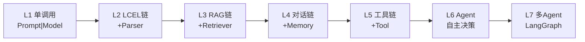

| 阶段 | 特征 | 何时升级 | 标志 |
|------|------|----------|------|
| L1 单调用 | 一次模型调用 | 起步 | 无 |
| L2 LCEL 链 | Prompt+Model+Parser | 需要结构化输出 | `\|` 管道 |
| L3 RAG 链 | 接入知识库 | 需要外部知识 | Retriever |
| L4 对话链 | 多轮记忆 | 需要上下文 | Memory |
| L5 工具链 | 调外部 API | 需要计算/实时数据 | Tool |
| L6 Agent | 模型自主规划 | 步骤不确定、需循环 | AgentExecutor |
| L7 多 Agent | 角色分工 | 复杂协作 | LangGraph |

### 6.2 组件层与编排层的关系

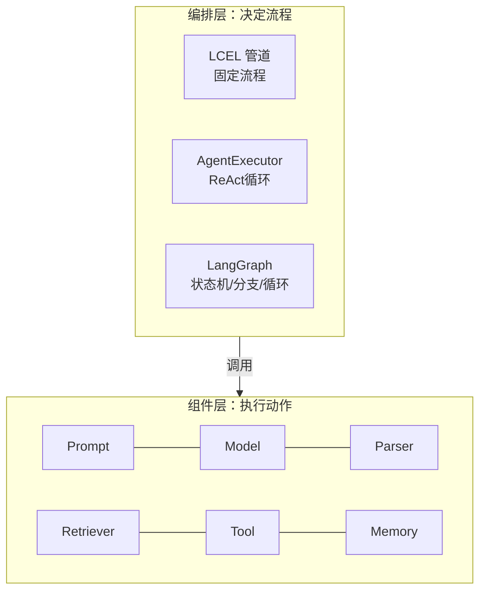

**核心关系**：组件层是"被调用的执行单元"，编排层是"决定调用顺序和条件的指挥"。LCEL 是最简单的编排（固定 DAG）；AgentExecutor 是带循环的编排（模型决定下一步）；LangGraph 是显式状态机编排（任意图结构、可持久化、可中断）。

```python
# 演进示例：从固定 RAG 链，升级为"先判断要不要检索"的 Agent
from langchain_core.tools import tool
from langchain_openai import ChatOpenAI
from langchain.agents import create_tool_calling_agent, AgentExecutor
from langchain_core.prompts import ChatPromptTemplate

@tool
def retrieve_kb(query: str) -> str:
    """当问题涉及公司内部知识时调用此工具检索"""
    return f"关于{query}的内部资料"

tools = [retrieve_kb]
prompt = ChatPromptTemplate.from_messages([
    ("system", "你是助手，需要时调用检索工具"),
    ("human", "{input}"),
    ("agent_scratchpad", "{agent_scratchpad}"),
])
agent = create_tool_calling_agent(ChatOpenAI(model="gpt-4o-mini"), tools, prompt)
AgentExecutor(agent=agent, tools=tools)
```

### 6.3 什么时候该上 LangGraph

| 信号 | 建议 |
|------|------|
| 流程是固定的线性 DAG | 用 LCEL 即可 |
| 需要"模型决定下一步" | 用 AgentExecutor |
| 需要循环 + 状态持久化 + 人机中断 | 用 LangGraph |
| 需要多角色协作 | 用 LangGraph 多 Agent |

---

> 💡 **深度讲解**：从链到 Agent 的演进，本质是"控制权从人转移给模型"。LCEL 链的流程是程序员写死的（先检索、再生成），模型只能在给定步骤里填空；Agent 把"下一步做什么"的决策权交给模型，灵活性大增但不可控性也大增。工程上的黄金法则是"**能固定就别让模型自由发挥**"——固定流程更快、更便宜、更可预测；只有当步骤真的不确定（比如"用户可能要查天气、也可能要算数学、也可能要翻译"）时，才值得用 Agent。很多团队一上来就上 Agent，结果模型乱调工具、死循环、成本爆炸，就是因为没遵守这条法则。LangGraph 的价值在于"把 Agent 的不可控性重新纳入工程控制"——它用显式状态机定义节点和边，你能看到每一步、能中断、能回放、能持久化。所以成熟的演进路径是：LCEL 搞定 80% 固定流程，Agent 处理 15% 不确定流程，LangGraph 处理 5% 高风险复杂流程。
>
> **📝 精简总结**：演进路径 L1→L7 是单调用→LCEL→RAG→对话→工具→Agent→多Agent；组件层执行动作、编排层决定流程；LCEL 是固定 DAG、AgentExecutor 是模型决策循环、LangGraph 是显式状态机；黄金法则是"能固定就别让模型自由发挥"，固定流程快/便宜/可预测，Agent 只用于步骤不确定的场景，LangGraph 用于需要循环+持久化+人机中断的复杂流程。

---

## 七、实战案例：构建完整 RAG 对话系统（记忆+工具+检索）

这是本文的重头戏。我们要做一个生产级雏形：**带记忆、能检索知识库、能调用计算器工具的对话问答系统**。下面给出完整目录结构、配置、核心代码、测试代码。

### 7.1 目录结构

```
rag_chatbot/
├── .env                    # 环境变量
├── requirements.txt       # 依赖
├── config.py               # 配置加载
├── retriever.py            # 检索器构建
├── tools.py                # 工具定义
├── chains.py               # 链/Agent 构建
├── memory.py               # 记忆工厂
├── app.py                  # 入口
└── tests/
    ├── test_chains.py
    └── test_tools.py
```

### 7.2 配置文件

```python
# config.py
import os
from pydantic_settings import BaseSettings, SettingsConfigDict

class Settings(BaseSettings):
    model_config = SettingsConfigDict(env_file=".env")
    openai_api_key: str = ""
    model_chat: str = "gpt-4o"
    model_fast: str = "gpt-4o-mini"
    temperature: float = 0.0
    rag_top_k: int = 4
    chroma_dir: str = "./chroma_db"
    langsmith_project: str = "rag-chatbot"

settings = Settings()
```

```bash
# .env
OPENAI_API_KEY=sk-xxx
MODEL_CHAT=gpt-4o
MODEL_FAST=gpt-4o-mini
RAG_TOP_K=4
LANGSMITH_PROJECT=rag-chatbot
```

```text
# requirements.txt
langchain>=0.3
langchain-openai>=0.2
langchain-community>=0.3
langchain-chroma>=0.1
langchain-text-splitters>=0.3
pydantic-settings>=2.0
```

### 7.3 检索器模块

```python
# retriever.py
from langchain_openai import OpenAIEmbeddings
from langchain_chroma import Chroma
from langchain_text_splitters import RecursiveCharacterTextSplitter
from langchain_community.document_loaders import TextLoader
from config import settings

def build_retriever(doc_path: str = "knowledge.txt"):
    """从文本文件构建向量检索器"""
    loader = TextLoader(doc_path, encoding="utf-8")
    docs = loader.load()
    splitter = RecursiveCharacterTextSplitter(
        chunk_size=800, chunk_overlap=150,
    )
    splits = splitter.split_documents(docs)
    embeddings = OpenAIEmbeddings(model="text-embedding-3-small")
    vs = Chroma.from_documents(
        splits, embeddings, persist_directory=settings.chroma_dir,
    )
    return vs.as_retriever(search_kwargs={"k": settings.rag_top_k})
```

### 7.4 工具模块

```python
# tools.py
from langchain_core.tools import tool

@tool
def calculator(expression: str) -> str:
    """计算数学表达式。输入合法的 Python 数学表达式，例如 '2*(3+4)'。"""
    allowed = set("0123456789+-*/(). ")
    if not set(expression) <= allowed:
        return "错误：表达式含非法字符"
    try:
        return str(eval(expression, {"__builtins__": {}}, {}))
    except Exception as e:
        return f"计算失败: {e}"

@tool
def knowledge_search(query: str) -> str:
    """搜索内部知识库。当用户问题涉及公司制度、产品文档时调用。"""
    # 实际项目中这里调用 retriever
    return f"知识库中关于《{query}》的相关片段"

all_tools = [calculator, knowledge_search]
```

### 7.5 记忆模块

```python
# memory.py
from langchain_core.chat_history import BaseChatMessageHistory, InMemoryChatMessageHistory

_store: dict[str, BaseChatMessageHistory] = {}

def get_history(session_id: str) -> BaseChatMessageHistory:
    """按 session_id 返回独立历史（生产可换 RedisChatMessageHistory）"""
    if session_id not in _store:
        _store[session_id] = InMemoryChatMessageHistory()
    return _store

def clear_history(session_id: str):
    _store.pop(session_id, None)
```

### 7.6 链/Agent 构建模块

```python
# chains.py
from langchain_openai import ChatOpenAI
from langchain_core.prompts import ChatPromptTemplate, MessagesPlaceholder
from langchain.agents import create_tool_calling_agent, AgentExecutor
from config import settings
from tools import all_tools
from memory import get_history
from langchain_core.runnables.history import RunnableWithMessageHistory

def build_agent():
    llm = ChatOpenAI(
        model=settings.model_chat,
        temperature=settings.temperature,
        openai_api_key=settings.openai_api_key,
    )
    prompt = ChatPromptTemplate.from_messages([
        ("system", "你是企业智能助手。可调用知识库检索和计算器。回答简洁准确。"),
        MessagesPlaceholder(variable_name="history"),
        ("human", "{input}"),
        ("agent_scratchpad", "{agent_scratchpad}"),
    ])
    agent = create_tool_calling_agent(llm, all_tools, prompt)
    executor = AgentExecutor(agent=agent, tools=all_tools)
    return RunnableWithMessageHistory(
        executor,
        get_history,
        input_messages_key="input",
        history_messages_key="history",
    )
```

### 7.7 入口

```python
# app.py
from chains import build_agent
from memory import clear_history

def main():
    bot = build_agent()
    session = "user-001"
    print("RAG 对话系统已启动（输入 quit 退出）")
    while True:
        q = input("你: ").strip()
        if q.lower() in ("quit", "exit"):
            break
        if q == "/clear":
            clear_history(session); print("已清空历史"); continue
        resp = bot.invoke(
            {"input": q},
            config={"configurable": {"session_id": session}},
        )
        print("AI:", resp["output"])

if __name__ == "__main__":
    main()
```

### 7.8 测试代码

```python
# tests/test_tools.py
import sys, os
sys.path.insert(0, os.path.dirname(os.path.dirname(__file__)))
from tools import calculator

def test_calculator_ok():
    assert calculator.invoke({"expression": "2*(3+4)"}) == "14"

def test_calculator_reject_bad():
    out = calculator.invoke({"expression": "__import__('os')"})
    assert "错误" in out or "失败" in out

test_calculator_ok(); test_calculator_reject_bad()
print("tools 测试通过")
```

```python
# tests/test_chains.py
import sys, os
sys.path.insert(0, os.path.dirname(os.path.dirname(__file__)))
from langchain_core.language_models.fake_chat_models import GenericFakeChatModel
from langchain_core.prompts import ChatPromptTemplate
from langchain_core.output_parsers import StrOutputParser

def test_chain_logic_with_fake_llm():
    fake = GenericFakeChatModel(messages=iter(["固定回答"]))
    chain = ChatPromptTemplate.from_template("问:{q}") | fake | StrOutputParser()
    assert chain.invoke({"q": "任意"}) == "固定回答"

test_chain_logic_with_fake_llm()
print("chains 测试通过")
```

### 7.9 系统架构图

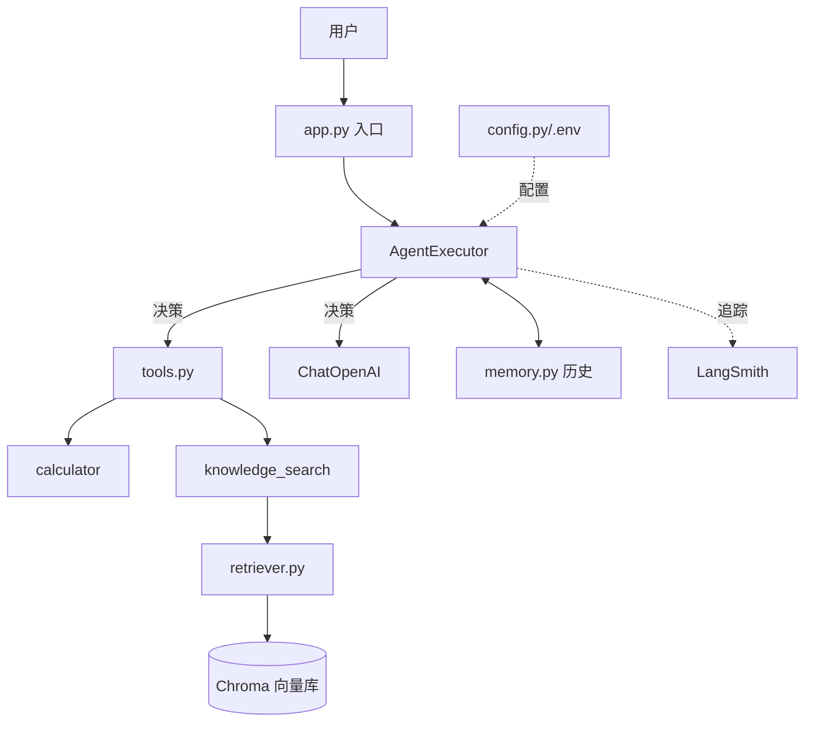

### 7.10 部署与运行

```bash
# 1. 安装依赖
pip install -r requirements.txt

# 2. 配置环境变量
cp .env.example .env  # 填入 OPENAI_API_KEY

# 3. 准备知识库
echo "公司年假制度：入职满一年享5天年假..." > knowledge.txt

# 4. 运行
python app.py

# 5. 跑测试
python -m pytest tests/ -v
```

---

> 💡 **深度讲解**：这个端到端案例的价值在于"展示了组件如何在一个真实系统里各司其职"。注意几个关键设计：① 配置全部收敛到 `config.py` + `.env`，换环境只改 .env；② 检索器独立成 `retriever.py`，将来换 Pinecone 只改这一个文件；③ 工具独立成 `tools.py`，加新工具只改这里；④ 记忆用工厂函数按 session_id 隔离，生产换 Redis 只改 `memory.py`；⑤ 测试用 Fake 模型，不依赖真实 API，CI 里能秒跑。这种"按职责分文件 + 依赖注入"的结构，是 LLM 应用从 Demo 走向可维护工程的标准姿势。很多初学者把所有逻辑写在一个 `main.py` 里，跑通后就再也不敢动——因为改任何一处都怕牵连其他。模块化之后，每个文件都小到能在脑子里装下，重构和替换都有底气。
>
> **📝 精简总结**：完整 RAG 对话系统按职责分文件——config（配置）、retriever（检索）、tools（工具）、memory（记忆）、chains（Agent 构建）、app（入口）、tests（测试）；关键设计是配置收敛、检索器独立、工具独立、记忆按 session 隔离、测试用 Fake 模型；生产换 Redis 记忆、换 Pinecone 向量库、换模型都只改对应单文件；这就是"组件可替换性"在工程上的落地。

---

## 八、常见坑点与排错手册

### 8.1 十大高频坑点速查表

| 现象 | 报错/表现 | 原因 | 修复 |
|------|-----------|------|------|
| KeyError | `KeyError: 'xxx'` | Prompt 变量没传 | invoke 字典补全或 partial |
| 认证失败 | `AuthenticationError` | API Key 缺失 | 设环境变量 |
| 解析失败 | `OutputParserException` | 模型输出带多余文字 | 用 with_structured_output |
| 检索为空 | 回答"不知道" | Embedding 不一致/chunk 问题 | 统一 Embedding 模型 |
| 跨用户串话 | A 用户知道 B 的事 | 记忆没按 session 隔离 | 工厂函数隔离 |
| 历史爆炸 | Token 超限报错 | 没 trim 历史 | trim_messages |
| 工具不调用 | 模型直接回答 | 工具描述不清 | 补 docstring/参数 description |
| 流式中断 | 流式到 Parser 就停 | Parser 阻塞流 | 用流式 Parser 或先流后解析 |
| 类型不匹配 | `TypeError` | 前输出类型≠后输入 | 中间加 RunnableLambda 转换 |
| 成本超支 | 账单暴涨 | 没限制 max_tokens/循环 | 加 max_tokens + 循环上限 |

### 8.2 典型报错修复代码

```python
# 坑1：KeyError 修复
from langchain_core.prompts import ChatPromptTemplate
prompt = ChatPromptTemplate.from_template("你好{name}，{task}")
# 错误：prompt.invoke({"name": "小明"})  -> KeyError task
# 修复：
prompt.invoke({"name": "小明", "task": "请自我介绍"})
# 或提前 partial：
prompt2 = ChatPromptTemplate.from_template("你好{name}，{task}").partial(task="请自我介绍")
```

```python
# 坑2：OutputParserException 修复
from langchain_openai import ChatOpenAI
from pydantic import BaseModel, Field

class R(BaseModel):
    answer: str = Field(description="答案")

llm = ChatOpenAI(model="gpt-4o-mini")
# 推荐：原生结构化输出，避免解析失败
structured = llm.with_structured_output(R)
out = structured.invoke("1+1等于几？用JSON回答")
print(out.answer)
```

```python
# 坑3：流式被 Parser 阻塞修复
from langchain_core.messages import AIMessageChunk
# 不要在流式链末尾接 PydanticOutputParser（它要等完整输出）
# 正确做法：先流式输出文本，结束后再解析
async def stream_then_parse(q):
    async for chunk in (llm | StrOutputParser()).astream(q):
        print(chunk, end="")
```

```python
# 坑4：历史爆炸修复
from langchain_core.messages import trim_messages, SystemMessage, HumanMessage
msgs = [SystemMessage("...")] + [HumanMessage(f"问题{i}") for i in range(100)]
trimmed = trim_messages(msgs, max_tokens=50, strategy="last", token_counter=len)
print(f"原 {len(msgs)} 条 -> 裁剪后 {len(trimmed)} 条")
```

```python
# 坑5：工具不调用修复——把描述写清楚
from langchain_core.tools import tool
from pydantic import BaseModel, Field

class CalcInput(BaseModel):
    expression: str = Field(description="要计算的数学表达式，例如 3+4*2")

@tool(args_schema=CalcInput)
def calculator(expression: str) -> str:
    """当用户要求做数学计算时使用此工具。输入一个数学表达式字符串。"""
    return str(eval(expression))
```

```python
# 坑6：成本控制修复
llm = ChatOpenAI(model="gpt-4o", max_tokens=300)  # 限制单次输出
# Agent 加最大迭代次数
from langchain.agents import AgentExecutor
# AgentExecutor(agent=..., tools=..., max_iterations=5)
```

---

> 💡 **深度讲解**：坑点排错的核心方法论是"分层定位"。LLM 应用出问题，先定位在哪一层：是输入层（变量没传对）、检索层（Retriever 没搜到）、模型层（模型没按格式答）、解析层（Parser 没解析对）、还是编排层（Agent 死循环）？LangSmith 的追踪树就是最好的定位工具——点开失败的那次调用，看每个 Span 的输入输出，问题在哪一层一目了然。没有追踪时，就用"二分法"：把链拆成两半，分别跑，看哪一半开始出错。比如 RAG 回答不对，先单独跑 Retriever 看检索到的文档对不对；文档对，再单独跑 Prompt+Model 看生成对不对；这样两步就能定位是检索问题还是生成问题。另一个经验是"复现最小用例"——把失败的那次输入单独拎出来，用最小代码复现，再修。不要在庞大的系统里直接调试。
>
> **📝 精简总结**：十大坑点覆盖 KeyError/认证/解析/检索/串话/历史爆炸/工具不调用/流式中断/类型不匹配/成本超支；排错方法论是"分层定位"——用 LangSmith 追踪树看每个 Span 的输入输出，或用二分法把链拆两半分别跑；RAG 问题先单独验 Retriever、再单独验 Prompt+Model；修复靠最小复现用例；成本控制靠 max_tokens + max_iterations。

---

## 九、梯度练习题

### 基础题

**题1**：写出用 LCEL 把 `prompt | model | parser` 串成链的代码，并说明 `|` 运算符底层返回什么对象。

<details>
<summary>参考答案</summary>

```python
from langchain_core.prompts import ChatPromptTemplate
from langchain_core.output_parsers import StrOutputParser
from langchain_openai import ChatOpenAI

prompt = ChatPromptTemplate.from_template("解释{topic}")
chain = prompt | ChatOpenAI(model="gpt-4o-mini") | StrOutputParser()
print(chain.invoke({"topic": "RAG"}))
```
`|` 底层返回 `RunnableSequence`，它本身也是 Runnable，支持 invoke/stream/batch。
</details>

**题2**：RunnableParallel 的作用是什么？在 RAG 链中它解决了什么问题？

<details>
<summary>参考答案</summary>
RunnableParallel 把同一输入 fan-out 给多个分支并行执行，再 fan-in 成字典。在 RAG 中它让"检索 context"和"透传 question"并行进行，最后合并成 `{context, question}` 喂给 Prompt，避免串行等待。
</details>

**题3**：为什么生产环境不能用全局单例的 InMemoryChatMessageHistory？

<details>
<summary>参考答案</summary>
全局单例会让所有用户共享同一份历史，导致跨用户串话；且内存存储重启即丢。正确做法是工厂函数按 `session_id` 返回独立实例，生产用 Redis 持久化。
</details>

### 进阶题

**题4**：写一个带 fallback 的链：主模型 gpt-4o 失败时自动切到 gpt-4o-mini，并加 2 次重试。

<details>
<summary>参考答案</summary>

```python
from langchain_openai import ChatOpenAI
from langchain_core.prompts import ChatPromptTemplate
from langchain_core.output_parsers import StrOutputParser

primary = ChatOpenAI(model="gpt-4o").with_retry(stop_after_attempt=2)
backup = ChatOpenAI(model="gpt-4o-mini")
chain = (
    ChatPromptTemplate.from_template("说{w}")
    | primary.with_fallbacks([backup])
    | StrOutputParser()
)
```
</details>

**题5**：用 trim_messages 把一段超长历史裁剪到 50 个 token 以内，保留 system 消息。

<details>
<summary>参考答案</summary>

```python
from langchain_core.messages import trim_messages, SystemMessage, HumanMessage
msgs = [SystemMessage("你是助手")] + [HumanMessage(f"问题{i}") for i in range(100)]
trimmed = trim_messages(
    msgs, max_tokens=50, strategy="last",
    token_counter=len, include_system=True,
)
```
</details>

**题6**：为什么 PydanticOutputParser 不适合放在流式链末尾？怎么解决？

<details>
<summary>参考答案</summary>
PydanticOutputParser 需要拿到完整输出才能解析，放在流式链末尾会阻塞流式（必须等全部生成完）。解决：① 流式阶段只输出文本（StrOutputParser），结束后再单独解析；② 或用模型原生 `with_structured_output`；③ 或用流式友好的解析器。
</details>

### 实战题

**题7**：基于本文的 rag_chatbot 结构，新增一个"翻译工具"，要求：输入中文句子，输出英文。写出 tools.py 的改动和测试。

<details>
<summary>参考答案</summary>

```python
# tools.py 新增
from langchain_core.tools import tool
from langchain_openai import ChatOpenAI

@tool
def translate_to_english(chinese: str) -> str:
    """把中文句子翻译成英文。当用户要求翻译时调用。"""
    llm = ChatOpenAI(model="gpt-4o-mini")
    return llm.invoke(f"翻译成英文：{chinese}").content

all_tools = [calculator, knowledge_search, translate_to_english]
```
测试：断言 `translate_to_english.invoke({"chinese":"你好"})` 返回非空英文字符串。
</details>

**题8**：把 rag_chatbot 的记忆从内存换成 Redis，写出 memory.py 的改动，并说明为什么要换。

<details>
<summary>参考答案</summary>

```python
# memory.py
from langchain_redis import RedisChatMessageHistory
def get_history(session_id: str):
    return RedisChatMessageHistory(session_id, redis_url="redis://localhost:6379")
```
换 Redis 的原因：内存存储在多实例部署时不共享、重启丢失；Redis 持久化且可跨进程/跨实例共享，是生产多轮对话的标准后端。
</details>

**题9**：设计一个测试方案，验证 RAG 链在"知识库中没有答案"时会正确回答"不知道"，而不是胡编。

<details>
<summary>参考答案</summary>
用 LangSmith Dataset 构造一批"问题-期望回答"对，其中包含知识库中不存在的问题；用 LLM-as-judge 评估器判断回答是否承认"不知道"而非编造；离线跑评估集，看通过率。单元测试层用 Fake Retriever 返回空文档 + Fake LLM 返回固定"不知道"，验证链逻辑能走到该分支。
</details>

---

## 🔗 关联笔记

- [[LangChain-核心抽象与链]] — 核心抽象与 LCEL 基础
- [[LangChain-LCEL表达式语言详解]] — LCEL 深入
- [[LangGraph-State状态管理核心]] — 编排层状态机
- [[LangSmith-可观测性与调试平台]] — 本文系统的观测层
- [[LangServe-API部署与服务化]] — 把本文系统部署为 API
- [[RAG架构设计与流程]] — RAG 理论
- [[Agent工具调用FunctionCalling]] — 工具调用原理

## 📖 前置知识

- [[LLM大模型入门概念]]
- [[Prompt工程进阶]]
- [[Embedding模型选型]]

## 🏷️ 相关标签

`#AI应用` `#AI工程化` `#Agent` `#LangChain` `#LLM`

---

[[Home|🏠 返回首页]] · [[MOC-AI与效率工具|📚 返回分类]]

## 十、进阶专题：RAG 检索优化与链性能调优

### 10.1 RAG 检索质量优化

检索是 RAG 的命门。检索不准，再强的模型也答不对。下面是经过验证的优化手段。

```python
# 优化1：混合检索（向量 + 关键词 BM25）
from langchain.retrievers import EnsembleRetriever
from langchain_community.retrievers import BM25Retriever
from langchain_community.vectorstores import Chroma

# vector_retriever 来自向量库
# bm25_retriever 来自关键词
# ensemble = EnsembleRetriever(
#     retrievers=[vector_retriever, bm25_retriever],
#     weights=[0.5, 0.5],
# )
```

```python
# 优化2：重排（Rerank）——先粗排再精排
from langchain.retrievers import ContextualCompressionRetriever
from langchain_cohere import CohereRerank

# compression_retriever = ContextualCompressionRetriever(
#     base_compressor=CohereRerank(),
#     base_retriever=retriever,
# )
# 先召回 20 条，再 rerank 取最相关 4 条
```

```python
# 优化3：父文档检索（小块检索，大块喂模型）
from langchain.retrievers import ParentDocumentRetriever
# 用小块做向量检索，但返回包含它的父块（更大上下文）
# 适合"小块精确匹配 + 大块完整语义"的场景
```

```python
# 优化4：语义分块（按标题/段落切分，而非固定长度）
from langchain_text_splitters import MarkdownHeaderTextSplitter
headers_to_split_on = [("#", "h1"), ("##", "h2")]
splitter = MarkdownHeaderTextSplitter(headers_to_split_on)
# 按 Markdown 标题切，保持语义完整
```

```python
# 优化5：查询改写（Query Rewriting）——把用户口语化问题改写成检索友好的
from langchain_core.prompts import ChatPromptTemplate
from langchain_openai import ChatOpenAI
from langchain_core.output_parsers import StrOutputParser

rewrite_prompt = ChatPromptTemplate.from_template(
    "把用户问题改写成更适合检索的关键词查询：{q}"
)
rewriter = rewrite_prompt | ChatOpenAI(model="gpt-4o-mini") | StrOutputParser()
# 先 rewrite，再用改写后的 query 检索
```

```python
# 优化6：假设性文档嵌入（HyDE）——先让模型写一个"假设答案"，用它去检索
hyde_prompt = ChatPromptTemplate.from_template(
    "为回答以下问题，写一段假设性的参考答案：{q}"
)
hyde_chain = hyde_prompt | ChatOpenAI(model="gpt-4o-mini") | StrOutputParser()
# 用 hyde_chain 的输出作为检索 query，比原问题更接近文档语义
```

### 10.2 检索优化手段对比

| 手段 | 解决的问题 | 成本 | 效果 | 适用 |
|------|-----------|------|------|------|
| 调 chunk_size | 切分不当 | 低 | 中 | 起步必调 |
| 混合检索 | 纯向量漏关键词 | 中 | 高 | 专业术语多 |
| Rerank | 召回噪声 | 高 | 高 | 高质量要求 |
| 父文档检索 | 上下文不足 | 中 | 中 | 结构型文档 |
| 语义分块 | 固定长度切断语义 | 低 | 中 | Markdown/论文 |
| 查询改写 | 口语化问题 | 中 | 中 | C 端用户 |
| HyDE | 问题与文档表述差异大 | 中 | 中 | 跨域检索 |

### 10.3 链性能调优

```python
# 调优1：异步批量调用提升吞吐
import asyncio

async def batch_call(chain, questions):
    return await chain.abatch(questions)
# 比 for 循环 invoke 快数倍，因为并发打 API
```

```python
# 调优2：用 RunnableParallel 并行多个 LLM 调用
from langchain_core.runnables import RunnableParallel
para = RunnableParallel({
    "summary": summary_chain,
    "tags": tag_chain,
    "sentiment": sentiment_chain,
})
# 三个分析并行跑，总耗时≈最慢的那个，而非三者之和
```

```python
# 调优3：缓存相同请求（避免重复调用）
from langchain_core.globals import set_llm_cache
from langchain_core.caches import InMemoryCache
set_llm_cache(InMemoryCache())
# 相同输入直接命中缓存，不调 API
```

```python
# 调优4：SQLite 持久化缓存
from langchain_core.globals import set_llm_cache
# from langchain_community.cache import SQLiteCache
# set_llm_cache(SQLiteCache(database_path=".langchain.db"))
```

```python
# 调优5：模型分级——简单问题用小模型
from langchain_core.runnables import RunnableBranch
fast = ChatOpenAI(model="gpt-4o-mini")
smart = ChatOpenAI(model="gpt-4o")
# 按问题复杂度路由：闲聊用 fast，专业问题用 smart
```

```python
# 调优6：限制并发，避免打爆 API 限流
semaphore = asyncio.Semaphore(5)
async def limited_call(q):
    async with semaphore:
        return await llm.ainvoke(q)
```

### 10.4 序列化与持久化：链的保存与加载

```python
# 把链的配置转成 JSON（可存数据库、可通过 API 传输）
# chain = prompt | model | parser
# config = chain.to_json()
# loaded = load_from_json(config)
```

```python
# RunnableConfig 运行时配置注入
chain.invoke(
    {"q": "测试"},
    config={
        "tags": ["prod"],
        "metadata": {"user": "u1"},
        "callbacks": [],
        "max_concurrency": 2,
    },
)
```

---

> 💡 **深度讲解**：RAG 优化是一个"系统工程"，没有银弹。实践中的正确顺序是：① 先用 LangSmith 看每次检索到底返回了什么——很多人调了半天参数，其实根本没看过检索结果长什么样；② 先调 chunk_size 和 k（零成本），再上混合检索和 Rerank（有成本但收益大）；③ 检索和生成要分开评估——用"检索命中率"和"答案正确率"两个指标，分别判断问题出在哪。性能调优同理：先测（LangSmith 看耗时分布），再优化。80% 的耗时通常在 LLM 调用，所以优化杠杆是"少调、快调、并行调"——缓存去重、异步批量、并行无依赖分支、模型分级。新手常犯的错是"过早优化"——在还没测过耗时分布时就到处加缓存，结果优化错了地方。
>
> **📝 精简总结**：RAG 检索优化六板斧——调 chunk_size、混合检索、Rerank、父文档检索、语义分块、查询改写/HyDE；性能调优六招——abatch 异步批量、RunnableParallel 并行、InMemory/SQLite 缓存、模型分级、信号量限并发、运行时 config 注入；方法论是"先测后优"——用 LangSmith 看检索结果和耗时分布，再对症下药，别过早优化。

---

## 十一、组件层与编排层协同：从链到 Agent 的工程落地

### 11.1 何时该从链升级到 Agent

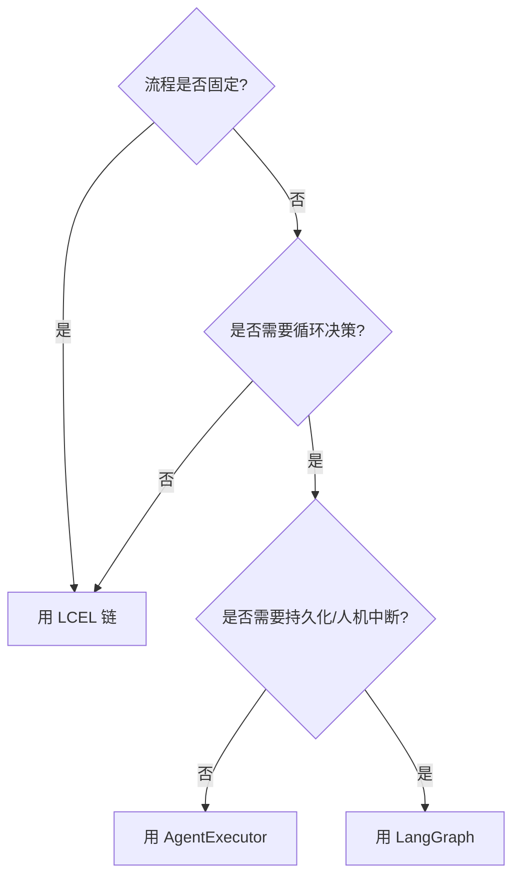

| 判断维度 | LCEL 链 | AgentExecutor | LangGraph |
|----------|---------|---------------|-----------|
| 流程 | 固定 | 模型决定 | 显式图 |
| 循环 | 不支持 | 支持 | 支持 |
| 状态持久化 | 无 | 弱 | 强（Checkpoint） |
| 人机中断 | 无 | 弱 | 强 |
| 可预测性 | 高 | 中 | 高 |
| 成本 | 低 | 高 | 可控 |

### 11.2 混合架构：固定路径 + 开放工具

```python
# 生产推荐：必要检索硬编码 + 可选工具开放
from langchain_core.runnables import RunnablePassthrough, RunnableParallel
from langchain_core.prompts import ChatPromptTemplate
from langchain_openai import ChatOpenAI
from langchain_core.output_parsers import StrOutputParser

# 硬编码：知识库检索（必须做）
# retriever 已构建
hardcoded_rag = (
    RunnableParallel({
        "context": lambda q: "硬编码检索结果",
        "question": RunnablePassthrough(),
    })
    | ChatPromptTemplate.from_template("资料:{context}\n问:{question}")
    | ChatOpenAI(model="gpt-4o")
    | StrOutputParser()
)
# 开放工具（可选）：联网搜索、计算器，由模型按需调用
```

### 11.3 Agent 安全边界

```python
# 危险工具加确认
@tool
def delete_file(path: str) -> str:
    """删除文件。危险操作，需人工确认。"""
    # 实际中应在这里插入"是否确认"的人机交互
    return f"已删除 {path}（需先确认）"
```

```python
# 限制 Agent 迭代次数，防死循环烧钱
from langchain.agents import AgentExecutor
# executor = AgentExecutor(
#     agent=agent, tools=tools,
#     max_iterations=5,          # 最多迭代 5 步
#     early_stopping_method="generate",
# )
```

---

> 💡 **深度讲解**：混合架构是生产 Agent 的终局形态。纯 LCEL 链太死板（用户问天气它也得走知识库），纯 Agent 太自由（模型可能绕路、死循环、乱调工具）。混合架构的思路是"把确定性路径写死，把不确定性开放成工具"：用户问"年假几天"→硬编码走知识库；用户问"今天天气"→开放天气工具让模型调；用户问"帮我算工资"→开放计算器工具。这样既保证了主路径的稳定，又保留了灵活性。安全上，Agent 最大的风险是"工具被滥用"——一个能执行代码、删文件、调转账 API 的 Agent，一旦 Prompt 被注入或模型判断失误，后果严重。所以危险工具必须加人工确认、限制迭代次数、最小权限原则。这些不是可选项，是上线前的硬门槛。
>
> **📝 精简总结**：选型决策树——固定流程用 LCEL、需模型决策用 AgentExecutor、需持久化/人机中断用 LangGraph；生产推荐"硬编码必要检索 + 开放可选工具"的混合架构；Agent 安全三原则——危险工具加人工确认、限制 max_iterations 防死循环、工具最小权限；混合架构兼顾稳定性和灵活性，是生产终局。

---

## 十二、组件配置与版本管理

### 12.1 依赖版本锁定

```bash
# requirements.txt 锁定版本
langchain==0.3.0
langchain-core==0.3.0
langchain-openai==0.2.0
langchain-community==0.3.0
langchain-chroma==0.1.4
pydantic==2.9.0
```

```bash
# 生成精确锁文件
pip freeze > requirements-lock.txt
```

### 12.2 Prompt 版本管理

```python
# 把 Prompt 抽到独立文件，做 Git 版本管理
# prompts/system_v1.txt
# prompts/system_v2.txt
# 通过配置切换版本
PROMPTS = {
    "v1": open("prompts/system_v1.txt").read(),
    "v2": open("prompts/system_v2.txt").read(),
}
system_prompt = PROMPTS[os.getenv("PROMPT_VERSION", "v1")]
```

### 12.3 模型灰度切换

```python
# 按比例灰度新模型
import random
def pick_llm():
    if random.random() < 0.1:   # 10% 流量走新模型
        return ChatOpenAI(model="gpt-4o")
    return ChatOpenAI(model="gpt-4o-mini")
```

---

> 💡 **深度讲解**：版本管理是 LLM 应用最容易被忽视、出问题最痛的环节。LangChain 由多个包组成且迭代极快，版本不兼容是家常便饭——今天能跑的代码，明天 `pip install -U` 可能就报 `ImportError`。对策是：① 锁定版本（requirements 或 poetry.lock）；② 升级前在隔离环境测；③ 关注 langchain-core 的 changelog，因为它定义了稳定接口。Prompt 也需要版本管理——改一个词可能让输出质量天差地别，必须能回滚。模型切换同理，别一把切，按流量灰度，用 LangSmith 对比新旧模型的回答质量和成本。
>
> **📝 精简总结**：版本管理三件事——依赖锁定（requirements/pip freeze）、Prompt 版本化（独立文件+Git+配置切换）、模型灰度（按流量比例切，LangSmith 对比）；升级前隔离环境测；改 Prompt 要能回滚；换模型要灰度。

---

## 十三、生产部署清单

### 13.1 上线前检查清单

| 检查项 | 要求 |
|--------|------|
| 密钥管理 | 不进 Git，用环境变量/密钥服务 |
| 超时设置 | 模型调用设 timeout |
| 重试 | with_retry 应对临时故障 |
| 降级 | with_fallbacks 备用模型 |
| 限流 | 控制并发，不打爆 API |
| 观测 | LangSmith tracing 开启 |
| 监控 | 错误率/延迟/成本告警 |
| 测试 | Fake 模型单测 + 评估集 |
| 记忆隔离 | 按 session_id |
| 成本控制 | max_tokens + max_iterations |

### 13.2 健康检查与降级代码

```python
# 健康检查端点（配合 LangServe 时）
# @app.get("/health")
# def health():
#     return {"status": "ok", "model": settings.model_chat}
```

```python
# 优雅降级：主模型超时返回兜底
from langchain_core.runnables import RunnableLambda
fallback_chain = RunnableLambda(lambda q: "抱歉，服务繁忙，请稍后再试")
robust = (ChatPromptTemplate.from_template("答:{q}") | ChatOpenAI(model="gpt-4o", timeout=5))
robust = robust.with_fallbacks([fallback_chain])
```

---

> 💡 **深度讲解**：生产部署的本质是"为失败做准备"。LLM 应用上线后一定会遇到：API 超时、限流、模型抽风、检索为空、用户输入异常。每个都要有预案。健康检查让负载均衡器知道实例是否存活；降级保证主模型挂了还有兜底；限流防止突发流量打爆自己也打爆上游；观测让你在问题发生后第一时间知道。这些不是锦上添花，是"不做就会出事"的底线配置。
>
> **📝 精简总结**：上线清单覆盖密钥/超时/重试/降级/限流/观测/监控/测试/记忆隔离/成本；生产本质是"为失败做准备"——超时、限流、模型抽风、检索空、异常输入都要有预案；健康检查+降级+限流+观测是底线。

---

## 十四、组件实战速查手册（Code Snippets 大全）

本节把六大组件在各种场景下的"拿来即用"代码集中列出，方便随查随用。

### 14.1 Prompt 速查

```python
# S1 最简单的单变量模板
from langchain_core.prompts import PromptTemplate
PromptTemplate.from_template("翻译：{x}")
```

```python
# S2 多变量模板
PromptTemplate.from_template("{a} 和 {b} 哪个更大？")
```

```python
# S3 系统+用户双消息
from langchain_core.prompts import ChatPromptTemplate
ChatPromptTemplate.from_messages([
    ("system", "你是{role}"),
    ("human", "{q}"),
])
```

```python
# S4 带部分变量绑定
ChatPromptTemplate.from_template("固定{fix} 问{q}").partial(fix="指令")
```

```python
# S5 历史占位
from langchain_core.prompts import MessagesPlaceholder
ChatPromptTemplate.from_messages([
    ("system", "..."),
    MessagesPlaceholder("history"),
    ("human", "{input}"),
])
```

```python
# S6 从消息列表动态构建
ChatPromptTemplate(messages=[
    ("system", "你是助手"),
])
```

```python
# S7 部分历史裁剪占位
# MessagesPlaceholder(variable_name="history", optional=True)
```

### 14.2 Model 速查

```python
# S8 OpenAI
from langchain_openai import ChatOpenAI
ChatOpenAI(model="gpt-4o-mini", temperature=0)
```

```python
# S9 带超时重试
ChatOpenAI(model="gpt-4o", timeout=30, max_retries=2)
```

```python
# S10 绑定工具
ChatOpenAI(model="gpt-4o-mini").bind_tools(tools)
```

```python
# S11 结构化输出
ChatOpenAI(model="gpt-4o-mini").with_structured_output(PydanticModel)
```

```python
# S12 自定义 base_url（兼容 OpenAI 接口的国产模型/本地）
ChatOpenAI(model="qwen", base_url="http://localhost:8000/v1", api_key="EMPTY")
```

```python
# S13 多模态（图片）
from langchain_core.messages import HumanMessage
ChatOpenAI(model="gpt-4o").invoke([
    HumanMessage(content=[
        {"type": "text", "text": "描述这张图"},
        {"type": "image_url", "image_url": {"url": "data:image/png;base64,..."}},
    ])
])
```

### 14.3 OutputParser 速查

```python
# S14 字符串
from langchain_core.output_parsers import StrOutputParser
StrOutputParser()
```

```python
# S15 JSON
from langchain_core.output_parsers import JsonOutputParser
JsonOutputParser()
```

```python
# S16 Pydantic
from langchain_core.output_parsers import PydanticOutputParser
PydanticOutputParser(pydantic_object=MyModel)
```

```python
# S17 逗号列表
from langchain_core.output_parsers import CommaSeparatedListOutputParser
CommaSeparatedListOutputParser()
```

```python
# S18 枚举
from langchain.output_parsers.enum import EnumOutputParser
# EnumOutputParser(enum=Sentiment)
```

```python
# S19 修复型解析器
from langchain.output_parsers import OutputFixingParser
OutputFixingParser.from_llm(parser=JsonOutputParser(), llm=ChatOpenAI())
```

```python
# S20 重试解析
# parser.with_retry()  # 解析失败自动重试
```

### 14.4 Retriever 速查

```python
# S21 基础向量检索
vectorstore.as_retriever(search_kwargs={"k": 4})
```

```python
# S22 MMR
vectorstore.as_retriever(search_type="mmr", search_kwargs={"k":5,"fetch_k":20})
```

```python
# S23 相似度阈值
vectorstore.as_retriever(search_type="similarity_score_threshold",
    search_kwargs={"score_threshold": 0.7})
```

```python
# S24 多查询
from langchain.retrievers.multi_query import MultiQueryRetriever
MultiQueryRetriever.from_llm(retriever=ret, llm=llm)
```

```python
# S25 压缩检索
from langchain.retrievers import ContextualCompressionRetriever
# ContextualCompressionRetriever(base_compressor=..., base_retriever=ret)
```

```python
# S26 自定义函数检索
from langchain_core.runnables import RunnableLambda
def my_ret(q): return [doc1, doc2]
RunnableLambda(my_ret)
```

### 14.5 Tool 速查

```python
# S27 @tool 装饰器
from langchain_core.tools import tool
@tool
def f(x: int) -> int:
    """翻倍"""
    return x * 2
```

```python
# S28 StructuredTool
from langchain_core.tools import StructuredTool
StructuredTool.from_function(func=my_func, name="n", description="d", args_schema=MyArgs)
```

```python
# S29 异步工具
@tool
async def af() -> str:
    return "async"
```

```python
# S30 工具运行结果直接取
f.invoke({"x": 3})
```

### 14.6 Memory 速查

```python
# S31 按 session 存历史
from langchain_core.runnables.history import RunnableWithMessageHistory
RunnableWithMessageHistory(chain, get_history,
    input_messages_key="input", history_messages_key="history")
```

```python
# S32 裁剪历史
from langchain_core.messages import trim_messages
trim_messages(msgs, max_tokens=100, strategy="last", token_counter=len)
```

```python
# S33 清空历史
# history.clear()
```

### 14.7 链组合速查

```python
# S34 串行
a | b | c
```

```python
# S35 并行
from langchain_core.runnables import RunnableParallel
RunnableParallel({"x": a, "y": b})
```

```python
# S36 透传
from langchain_core.runnables import RunnablePassthrough
RunnablePassthrough()
```

```python
# S37 lambda 转换
from langchain_core.runnables import RunnableLambda
RunnableLambda(lambda x: x["q"])
```

```python
# S38 回退
chain.with_fallbacks([backup])
```

```python
# S39 重试
chain.with_retry(stop_after_attempt=3)
```

```python
# S40 标签
chain.invoke(x, config={"tags": ["prod"]})
```

---

## 十五、完整 RAG 对话系统·生产硬化版

在第七章基础上，把系统硬化到可上线水平。新增：错误处理、限流、成本统计、结构化日志。

### 15.1 硬化版 chains.py

```python
# chains_hardened.py
import logging
from langchain_openai import ChatOpenAI
from langchain_core.prompts import ChatPromptTemplate, MessagesPlaceholder
from langchain.agents import create_tool_calling_agent, AgentExecutor
from langchain_core.runnables.history import RunnableWithMessageHistory
from config import settings
from tools import all_tools
from memory import get_history

logger = logging.getLogger("ragbot")

def build_hardened_agent():
    llm = ChatOpenAI(
        model=settings.model_chat,
        temperature=settings.temperature,
        timeout=30,
        max_retries=2,
        openai_api_key=settings.openai_api_key,
    ).with_fallbacks([ChatOpenAI(model=settings.model_fast)])

    prompt = ChatPromptTemplate.from_messages([
        ("system", "你是企业助手，可查知识库、算数学。不编造，不知道就说不知道。"),
        MessagesPlaceholder(variable_name="history"),
        ("human", "{input}"),
        ("agent_scratchpad", "{agent_scratchpad}"),
    ])
    agent = create_tool_calling_agent(llm, all_tools, prompt)
    executor = AgentExecutor(
        agent=agent, tools=all_tools,
        max_iterations=5,
        early_stopping_method="generate",
    )
    return RunnableWithMessageHistory(
        executor, get_history,
        input_messages_key="input", history_messages_key="history",
    )
```

### 15.2 成本与日志

```python
# observability.py
import logging, time
logging.basicConfig(level=logging.INFO)
log = logging.getLogger("ragbot")

def log_call(session_id, q, resp, t0):
    dt = time.time() - t0
    log.info(f"session={session_id} q={q!r} 耗时={dt:.2f}s resp={str(resp)[:80]!r}")
```

### 15.3 限流与并发控制

```python
# rate_limit.py
import time
from collections import defaultdict

class SlidingWindow:
    def __init__(self, max_calls=10, window=60):
        self.max = max_calls; self.window = window
        self.buckets = defaultdict(list)
    def allow(self, key):
        now = time.time()
        self.buckets[key] = [t for t in self.buckets[key] if now - t < self.window]
        if len(self.buckets[key]) >= self.max:
            return False
        self.buckets[key].append(now)
        return True
```

### 15.4 健康检查与优雅关闭

```python
# server_lifecycle.py
# 启动时：预热模型连接、加载索引
# 关闭时：持久化向量库、关闭 Redis 连接
# def on_startup():
#     warmup_embedding()
# def on_shutdown():
#     vectorstore.persist()
```

---

> 💡 **深度讲解**：生产硬化的核心是"把所有异常路径都显式处理"。开发时你只考虑"正常路径怎么走"，生产时要考虑：主模型超时怎么办（fallback）、Agent 死循环怎么办（max_iterations）、用户刷接口怎么办（限流）、调用慢了怎么发现（日志+耗时统计）、进程要重启了怎么收尾（优雅关闭）。这些"防御性代码"看起来啰嗦，但少一个就可能在某个深夜变成 P0 事故。尤其是 max_iterations——Agent 一旦陷入"调工具→结果不满意→再调→还不满意"的循环，每次都烧 token，没有上限就是账单灾难。
>
> **📝 精简总结**：生产硬化版新增 fallback 模型、max_iterations 防死循环、超时重试、滑动窗口限流、结构化日志、优雅关闭；硬化本质是"显式处理所有异常路径"；max_iterations 是防账单灾难的硬门槛。

---

## 十六、组件层 FAQ 与进阶练习

### 16.1 FAQ

**Q1：为什么我的链 `invoke` 能跑，`stream` 却报错？**
A：通常是某个中间组件不支持流式，或流式输出类型累积出错。先用 `invoke` 确认逻辑对，再逐步开 stream，定位是哪个组件断流。

**Q2：`RunnablePassthrough` 和 `RunnableLambda(lambda x: x)` 区别？**
A：基本等价，但 Passthrough 是内置优化路径，并行场景下更高效，推荐优先用它。

**Q3：组件能直接嵌套组合吗？**
A：能。链本身是 Runnable，可以作为另一条链的一个组件继续 `|`，无限嵌套。

**Q4：怎么在运行时临时换模型？**
A：用 `.with_config(configurable={"model": "gpt-4o"})`，配合链内部用 `ConfigurableField` 标记可配置项。

```python
# 运行时可配置字段
from langchain_core.runnables import ConfigurableField
# llm = ChatOpenAI(...).configurable_fields(model_name=ConfigurableField(id="model"))
# chain.with_config(configurable={"model": "gpt-4o"})
```

**Q5：一个链里能有多个 Retriever 吗？**
A：能，用 RunnableParallel 并行多个检索器，结果合并。

### 16.2 补充练习题

**题10**：写一个链，并行做"情感分析"和"关键词提取"，再把两个结果合并成一句总结。

<details>
<summary>参考答案</summary>

```python
from langchain_core.runnables import RunnableParallel
from langchain_core.prompts import ChatPromptTemplate
from langchain_openai import ChatOpenAI
from langchain_core.output_parsers import StrOutputParser

llm = ChatOpenAI(model="gpt-4o-mini")
sentiment = ChatPromptTemplate.from_template("判断情感:{t}") | llm | StrOutputParser()
keywords = ChatPromptTemplate.from_template("提取关键词:{t}") | llm | StrOutputParser()
merged = RunnableParallel({"sentiment": sentiment, "keywords": keywords})
# merged.invoke({"t": "这个产品很好用但太贵"})
```
</details>

**题11**：为什么测试 LLM 应用不能直接断言输出字符串相等？给出两种正确测试策略。

<details>
<summary>参考答案</summary>
因为 LLM 输出有随机性（temperature>0、采样、模型版本变化），断言精确字符串会脆弱。两种策略：① 用 Fake 模型（GenericFakeChatModel）替换真实模型，测链的逻辑流转；② 用 LLM-as-judge 评估"语义是否符合要求"，而非精确匹配。
</details>

**题12**：设计一个带"审批"的删除文件工具，说明安全边界。

<details>
<summary>参考答案</summary>
删除工具应：① docstring 明确危险；② 调用前插入人工确认节点（LangGraph interrupt 或显式询问）；③ 限制可删除路径范围（白名单）；④ 记录操作日志。绝不能让 Agent 自主直接执行删除。
</details>

**题13**：对比 stuff / map-reduce / refine 三种总结模式，分别在什么文本长度下选哪种。

<details>
<summary>参考答案</summary>
短文本（<模型上下文的一半）用 stuff，一次塞入最简单；超长文本用 map-reduce，分段并行摘要再合并，快但可能丢跨段信息；需要精确连贯用 refine，逐段迭代精炼，慢但质量高。
</details>

**题14**：写一个带缓存的链，说明缓存的 key 是什么。

<details>
<summary>参考答案</summary>

```python
from langchain_core.globals import set_llm_cache
from langchain_core.caches import InMemoryCache
set_llm_cache(InMemoryCache())
```
缓存 key 由"模型名+输入消息+温度等参数"哈希得到，相同请求直接命中，不调 API。
</details>

**题15**：把第七章的 app.py 改造成支持多用户（不同 session_id）并发对话。

<details>
<summary>参考答案</summary>
app.py 已经通过 config.configurable.session_id 支持多用户；生产部署时把 session_id 设为用户 ID，memory.py 用 Redis 后端按 session_id 隔离，即可支持多用户并发，且历史持久化。
</details>

---

## 十七、总结与展望

### 17.1 本文核心脉络回顾

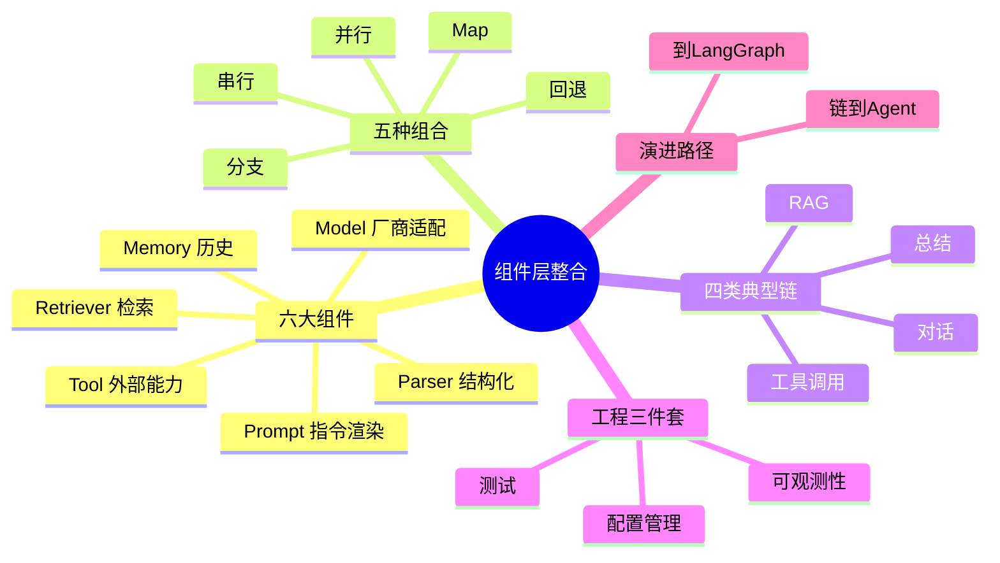

### 17.2 与其他文档的衔接

本文讲"组件怎么拼装"，下一篇 [[LangSmith-可观测性与调试平台]] 讲"拼好后怎么看怎么调"，再下一篇 [[LangServe-API部署与服务化]] 讲"怎么把拼好的系统部署成 API"。三者构成 LangChain 工程化闭环：**整合（本文）→ 观测（LangSmith）→ 部署（LangServe）**。

---

> 💡 **深度讲解**：组件层整合实战是 LangChain 从"会用 API"到"会做系统"的关键一跃。本文反复强调的主线是"契约与边界"——组件之间靠 Runnable 协议的输入输出契约衔接，组件层和编排层靠"做什么 vs 怎么做流程"的边界分工。抓住这两点，所有具体 API 都是可替换的实现细节。工程实践中，真正拉开差距的不是"知道多少 API"，而是"能不能在需求变化时，最小改动地调整系统"——这就是模块化、配置化、可测试、可观测带来的红利。希望读者读完本文后，拿到一个新需求时，先画数据流图、定组件边界、选组合模式，再动手写代码，而不是上来就堆 Prompt 和模型调用。
>
> **📝 精简总结**：组件层整合的主线是"契约与边界"——Runnable 协议定义组件间契约，组件层/编排层定义职责边界；六大组件各司其职，五种组合原语拼装任意链，四类典型链覆盖主流场景；工程三件套（配置/测试/观测）是 Demo 到生产的分水岭；演进从链到 Agent 到 LangGraph；与 LangSmith（观测）、LangServe（部署）构成 LangChain 工程化闭环。

---

[[Home|🏠 返回首页]] · [[MOC-AI与效率工具|📚 返回分类]]

## 十八、组件层生产部署附录

### 18.1 完整 Dockerfile（部署 RAG 对话系统）

```dockerfile
# Dockerfile
FROM python:3.11-slim

WORKDIR /app

# 系统依赖
RUN apt-get update && apt-get install -y --no-install-recommends gcc && rm -rf /var/lib/apt/lists/*

# Python 依赖
COPY requirements.txt .
RUN pip install --no-cache-dir -r requirements.txt

# 项目代码
COPY . .

# 非 root 运行
RUN useradd -m appuser && chown -R appuser /app
USER appuser

EXPOSE 8000
CMD ["python", "app.py"]
```

```yaml
# docker-compose.yml
version: "3.8"
services:
  api:
    build: .
    ports:
      - "8000:8000"
    env_file: .env
    depends_on:
      - redis
      - chroma
  redis:
    image: redis:7-alpine
    ports: ["6379:6379"]
  chroma:
    image: chromadb/chroma:latest
    ports: ["8001:8000"]
```

### 18.2 K8s 部署清单

```yaml
# k8s-deployment.yaml
apiVersion: apps/v1
kind: Deployment
metadata:
  name: rag-chatbot
spec:
  replicas: 2
  selector:
    matchLabels: {app: rag-chatbot}
  template:
    metadata:
      labels: {app: rag-chatbot}
    spec:
      containers:
        - name: api
          image: registry.example.com/rag-chatbot:latest
          ports:
            - containerPort: 8000
          env:
            - name: OPENAI_API_KEY
              valueFrom:
                secretKeyRef:
                  name: rag-secrets
                  key: openai-key
          resources:
            requests: {cpu: "500m", memory: "512Mi"}
            limits: {cpu: "1", memory: "1Gi"}
---
apiVersion: v1
kind: Service
metadata:
  name: rag-chatbot-svc
spec:
  selector: {app: rag-chatbot}
  ports:
    - port: 80
      targetPort: 8000
```

### 18.3 Nginx 反向代理

```nginx
# nginx.conf
server {
    listen 80;
    server_name api.example.com;

    location / {
        proxy_pass http://127.0.0.1:8000;
        proxy_set_header Host $host;
        proxy_set_header X-Real-IP $remote_addr;

        # 流式输出关键配置
        proxy_buffering off;
        proxy_cache off;
        proxy_read_timeout 300s;
    }
}
```

### 18.4 健康检查与就绪探针

```python
# health.py
# @app.get("/healthz")
# def liveness():
#     return {"status": "alive"}
# @app.get("/readyz")
# def readiness():
#     # 检查向量库可连、模型 API 可连
#     return {"status": "ready"}
```

---

> 💡 **深度讲解**：部署 LLM 应用和部署普通 Web 服务最大的不同是"流式输出"和"长耗时"。普通接口几百毫秒返回，Nginx 默认 buffering 没问题；但 SSE 流式输出如果开了 buffering，用户会等到全部生成完才看到字，体验极差。所以流式场景必须 `proxy_buffering off`。另外 LLM 调用动辄几秒到几十秒，`proxy_read_timeout` 要调大，否则 Nginx 先把连接断了。K8s 部署要给 CPU 内存 request/limit——LLM 应用是 IO 密集型（大部分时间在等 API），CPU 不用给太高，但内存要够放向量库和 Embedding。多副本时记忆必须用 Redis 共享，否则用户请求被轮询到不同实例就失忆了。
>
> **📝 精简总结**：Dockerfile 用非 root、K8s 多副本 + Secret 管密钥、Nginx 流式必须 proxy_buffering off + 调大 read_timeout；LLM 应用是 IO 密集型；多副本必须用 Redis 共享记忆，否则轮询会失忆。

---

## 十九、组件层对比与选型速查

### 19.1 模型选型对比

| 模型 | 成本 | 速度 | 质量 | 工具调用 | 适用 |
|------|------|------|------|----------|------|
| gpt-4o-mini | 极低 | 快 | 中 | 支持 | 开发/简单任务 |
| gpt-4o | 中 | 中 | 高 | 强 | 生产主力 |
| Claude 3.5 | 中 | 中 | 高 | 支持 | 长文本 |
| 本地开源 | 免费 | 慢 | 中 | 部分 | 隐私/离线 |

### 19.2 向量库选型

| 向量库 | 规模 | 持久化 | 适用 |
|--------|------|--------|------|
| Chroma | 小 | 文件 | 本地原型 |
| FAISS | 中 | 文件 | 研究 |
| Qdrant | 大 | 服务 | 生产 |
| Milvus | 超大 | 集群 | 大规模 |
| Pinecone | 大 | SaaS | 免运维 |

### 19.3 记忆后端选型

| 后端 | 持久化 | 共享 | 适用 |
|------|--------|------|------|
| InMemory | 否 | 单进程 | 开发测试 |
| Redis | 是 | 多实例 | 生产标准 |
| 数据库 | 是 | 多实例 | 长期审计 |

### 19.4 检索策略选型

| 策略 | 召回 | 精度 | 成本 | 适用 |
|------|------|------|------|------|
| 纯向量 | 中 | 中 | 低 | 通用 |
| 混合 | 高 | 高 | 中 | 专业术语 |
| Rerank | 高 | 极高 | 高 | 高精度要求 |
| 父文档 | 中 | 高 | 中 | 结构文档 |

---

> 💡 **深度讲解**：选型没有最优解，只有最合适。核心原则是"够用就好，按需升级"——本地原型 Chroma + InMemory 跑通就行，别一上来就上 Milvus 集群；生产了再按流量和数据量升级。模型同理，开发用 mini 省钱，生产按质量要求选。向量库和记忆后端的升级路径要平滑——Retriever 和 Memory 都是接口抽象，换实现不改业务代码，这就是组件层抽象的红利。
>
> **📝 精简总结**：选型四件套——模型（mini 开发/gpt-4o 生产）、向量库（Chroma 原型/Qdrant 生产/Milvus 超大规模）、记忆（InMemory 开发/Redis 生产）、检索（纯向量通用/混合术语/Rerank 高精度）；原则是"够用就好、按需升级"，靠接口抽象保证升级平滑。

---

## 二十、组件层知识地图与自查清单

### 20.1 知识地图

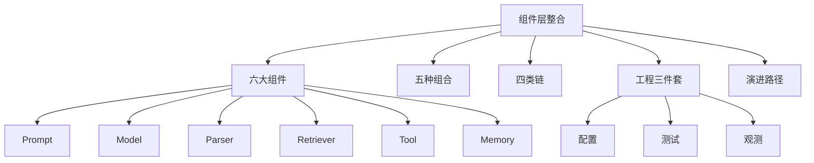

### 20.2 自查清单（读完本文应能回答）

- [ ] 能说出六大组件各自的输入输出类型
- [ ] 能画出 RAG 链的数据流图
- [ ] 能用 RunnableParallel 并行检索和透传
- [ ] 能按 session_id 隔离对话记忆
- [ ] 能写一个带 fallback 和 retry 的链
- [ ] 能用 Fake 模型测链逻辑
- [ ] 能定位 RAG 失败是检索问题还是生成问题
- [ ] 能说出什么时候该从链升级到 Agent
- [ ] 能把系统按职责拆成多个文件
- [ ] 能配置 LangSmith 自动追踪

---

> 💡 **深度讲解**：组件层整合是一门"实践出真知"的学问。理论看一遍都会，真正的掌握来自"踩坑—定位—修复—沉淀"的循环。建议读者用本文的 rag_chatbot 骨架，实际接一个真实知识库跑起来，然后故意制造各种问题（清空向量库、改错 API Key、制造跨用户串话），练习定位和修复。这种"破坏式学习"比只读代码有效十倍。另外，组件层的知识会随 LangChain 版本演进而变化，但"组合优于继承""契约与边界""先测后优"这些思想是长期稳定的，值得内化为自己的工程直觉。
>
> **📝 精简总结**：组件层知识地图覆盖六大组件、五种组合、四类链、工程三件套、演进路径；自查清单是掌握程度的检验；学习方法是"破坏式学习"——故意制造问题练习定位修复；长期稳定的是思想（组合优于继承、契约边界、先测后优），而非具体 API。

---

[[Home|🏠 返回首页]] · [[MOC-AI与效率工具|📚 返回分类]]

## 二十一、端到端 RAG 对话系统·完整代码扩展

本节把第七章的系统进一步展开，给出每个模块的完整实现和更多生产级细节，方便直接抄走。

### 21.1 完整 requirements.txt

```text
# requirements.txt - 完整依赖
# 核心
langchain>=0.3.0
langchain-core>=0.3.0
langchain-openai>=0.2.0
langchain-community>=0.3.0
langchain-chroma>=0.1.4
langchain-text-splitters>=0.3.0
# 向量库
chromadb>=0.5.0
# 配置
pydantic>=2.9.0
pydantic-settings>=2.5.0
# 服务器
fastapi>=0.115.0
uvicorn>=0.30.0
# 记忆后端
redis>=5.0.0
# 测试
pytest>=8.0.0
# 观测
langsmith>=0.1.0
```

### 21.2 完整 .env 示例

```env
# .env.example
# OpenAI
OPENAI_API_KEY=sk-your-key-here
OPENAI_BASE_URL=https://api.openai.com/v1

# 模型选择
MODEL_CHAT=gpt-4o
MODEL_FAST=gpt-4o-mini
TEMPERATURE=0.0

# RAG
RAG_TOP_K=4
CHROMA_DIR=./chroma_db
EMBEDDING_MODEL=text-embedding-3-small

# 记忆
REDIS_URL=redis://localhost:6379

# LangSmith
LANGSMITH_TRACING=true
LANGSMITH_API_KEY=lsv2-your-key
LANGSMITH_PROJECT=rag-chatbot
```

### 21.3 完整 config.py（带校验）

```python
# config.py - 完整配置
import os
from pydantic_settings import BaseSettings, SettingsConfigDict
from pydantic import Field, model_validator

class Settings(BaseSettings):
    model_config = SettingsConfigDict(env_file=".env", extra="ignore")

    # OpenAI
    openai_api_key: str = Field(default="")
    openai_base_url: str = "https://api.openai.com/v1"

    # 模型
    model_chat: str = "gpt-4o"
    model_fast: str = "gpt-4o-mini"
    temperature: float = 0.0

    # RAG
    rag_top_k: int = 4
    chroma_dir: str = "./chroma_db"
    embedding_model: str = "text-embedding-3-small"

    # 记忆
    redis_url: str = "redis://localhost:6379"

    # LangSmith
    langsmith_tracing: bool = True
    langsmith_api_key: str = ""
    langsmith_project: str = "rag-chatbot"

    @model_validator(mode="after")
    def check_key(self):
        if not self.openai_api_key and not os.getenv("OPENAI_API_KEY"):
            raise ValueError("必须配置 OPENAI_API_KEY")
        return self

settings = Settings()
```

### 21.4 完整文档加载与切分

```python
# ingestion.py - 文档入库流程
from langchain_community.document_loaders import (
    TextLoader, PyPDFLoader, CSVLoader, DirectoryLoader,
)
from langchain_text_splitters import RecursiveCharacterTextSplitter
from langchain_openai import OpenAIEmbeddings
from langchain_chroma import Chroma
from config import settings

LOADERS = {
    ".txt": TextLoader,
    ".pdf": PyPDFLoader,
    ".csv": CSVLoader,
}

def load_documents(data_dir: str):
    """加载目录下所有支持格式的文档"""
    all_docs = []
    loader = DirectoryLoader(data_dir, glob="**/*", use_multithreading=True)
    return loader.load()

def split_documents(docs, chunk_size=800, overlap=150):
    splitter = RecursiveCharacterTextSplitter(
        chunk_size=chunk_size,
        chunk_overlap=overlap,
        separators=["\n## ", "\n### ", "\n\n", "\n", "。", " ", ""],
    )
    return splitter.split_documents(docs)

def build_index(splits):
    embeddings = OpenAIEmbeddings(model=settings.embedding_model)
    vs = Chroma.from_documents(
        splits, embeddings, persist_directory=settings.chroma_dir,
    )
    return vs

def ingest(data_dir: str):
    docs = load_documents(data_dir)
    splits = split_documents(docs)
    print(f"加载 {len(docs)} 文档 -> 切分 {len(splits)} 块")
    build_index(splits)
    print("索引构建完成")

# 运行：ingest("./data")
```

### 21.5 完整检索器构建（带元数据过滤）

```python
# retriever.py - 完整版
from langchain_openai import OpenAIEmbeddings
from langchain_chroma import Chroma
from config import settings

def get_vectorstore():
    embeddings = OpenAIEmbeddings(model=settings.embedding_model)
    return Chroma(
        persist_directory=settings.chroma_dir,
        embedding_function=embeddings,
    )

def build_retriever(metadata_filter=None):
    """构建检索器，支持元数据过滤"""
    vs = get_vectorstore()
    kwargs = {"k": settings.rag_top_k}
    if metadata_filter:
        kwargs["filter"] = metadata_filter   # 如 {"source": "hr.pdf"}
    return vs.as_retriever(search_kwargs=kwargs)

# 按部门过滤：只检索 HR 相关文档
hr_retriever = build_retriever({"department": "HR"})
```

### 21.6 完整工具集

```python
# tools.py - 完整版
import datetime
import re
from langchain_core.tools import tool
from pydantic import BaseModel, Field
from retriever import build_retriever

class CalcInput(BaseModel):
    expression: str = Field(description="合法数学表达式，如 2*(3+4)")

@tool(args_schema=CalcInput)
def calculator(expression: str) -> str:
    """计算数学表达式。当用户要求算数、求百分比、算总价时使用。"""
    if not re.fullmatch(r"[\d\s+\-*/().]+", expression):
        return "错误：仅支持数字和 +-*/() 运算"
    try:
        return str(eval(expression, {"__builtins__": {}}, {}))
    except Exception as e:
        return f"计算失败: {e}"

@tool
def knowledge_search(query: str) -> str:
    """搜索企业内部知识库。涉及公司制度、产品、流程时调用。"""
    ret = build_retriever()
    docs = ret.invoke(query)
    if not docs:
        return "未在知识库中找到相关内容"
    return "\n---\n".join(d.page_content for d in docs)

@tool
def get_current_time() -> str:
    """获取当前日期时间。当用户问'现在几点''今天几号'时使用。"""
    return datetime.datetime.now().strftime("%Y-%m-%d %H:%M:%S")

@tool
def translate(text: str, target_lang: str = "英文") -> str:
    """翻译文本。target_lang 如 英文/日文/法文。"""
    from langchain_openai import ChatOpenAI
    llm = ChatOpenAI(model="gpt-4o-mini", temperature=0)
    return llm.invoke(f"翻译成{target_lang}：{text}").content

all_tools = [calculator, knowledge_search, get_current_time, translate]
```

### 21.7 完整记忆模块（Redis 版）

```python
# memory.py - 生产版（Redis）
from langchain_core.chat_history import BaseChatMessageHistory, InMemoryChatMessageHistory
from config import settings

_inmem: dict = {}

def get_history(session_id: str) -> BaseChatMessageHistory:
    """生产用 Redis，开发用内存。"""
    try:
        # 尝试 Redis
        from langchain_redis import RedisChatMessageHistory
        return RedisChatMessageHistory(
            session_id=session_id,
            redis_url=settings.redis_url,
        )
    except Exception:
        # 回退内存
        if session_id not in _inmem:
            _inmem[session_id] = InMemoryChatMessageHistory()
        return _inmem[session_id]

def clear_history(session_id: str):
    h = get_history(session_id)
    h.clear()
    _inmem.pop(session_id, None)
```

### 21.8 完整 Agent 构建（带错误兜底）

```python
# agent.py - 完整版
from langchain_openai import ChatOpenAI
from langchain_core.prompts import ChatPromptTemplate, MessagesPlaceholder
from langchain.agents import create_tool_calling_agent, AgentExecutor
from langchain_core.runnables.history import RunnableWithMessageHistory
from config import settings
from tools import all_tools
from memory import get_history

SYSTEM = """你是企业智能助手，能力：
1. 搜索内部知识库（制度/产品/流程）
2. 数学计算
3. 查询当前时间
4. 文本翻译
规则：不知道就说不知道，不要编造。回答简洁。"""

def build_agent():
    llm = ChatOpenAI(
        model=settings.model_chat,
        temperature=settings.temperature,
        timeout=30,
        max_retries=2,
    ).with_fallbacks([ChatOpenAI(model=settings.model_fast, timeout=15)])

    prompt = ChatPromptTemplate.from_messages([
        ("system", SYSTEM),
        MessagesPlaceholder(variable_name="history"),
        ("human", "{input}"),
        ("agent_scratchpad", "{agent_scratchpad}"),
    ])

    agent = create_tool_calling_agent(llm, all_tools, prompt)
    executor = AgentExecutor(
        agent=agent,
        tools=all_tools,
        verbose=False,
        max_iterations=5,
        early_stopping_method="generate",
    )
    return RunnableWithMessageHistory(
        executor,
        get_history,
        input_messages_key="input",
        history_messages_key="history",
    )
```

### 21.9 完整交互入口

```python
# main.py - 交互入口
import argparse
from agent import build_agent
from memory import clear_history

def chat(session="default"):
    bot = build_agent()
    print("=== 企业智能助手 ===")
    print("命令：/clear 清空历史，quit 退出")
    while True:
        try:
            q = input("你> ").strip()
        except (EOFError, KeyboardInterrupt):
            break
        if not q:
            continue
        if q.lower() in ("quit", "exit", "bye"):
            break
        if q == "/clear":
            clear_history(session); print("[已清空]"); continue
        try:
            resp = bot.invoke(
                {"input": q},
                config={"configurable": {"session_id": session}},
            )
            print("AI>", resp["output"])
        except Exception as e:
            print(f"[错误] {e}")

if __name__ == "__main__":
    parser = argparse.ArgumentParser()
    parser.add_argument("--session", default="default")
    args = parser.parse_args()
    chat(args.session)
```

### 21.10 完整测试套件

```python
# tests/test_tools.py
import sys, os
sys.path.insert(0, os.path.dirname(os.path.dirname(__file__)))
from tools import calculator, get_current_time

def test_calc():
    assert calculator.invoke({"expression": "2*(3+4)"}) == "14"
def test_calc_reject():
    out = calculator.invoke({"expression": "__import__('os').system('ls')"})
    assert "错误" in out or "失败" in out
def test_time():
    out = get_current_time.invoke({})
    assert "20" in out  # 年份
```

```python
# tests/test_chain.py
import sys, os
sys.path.insert(0, os.path.dirname(os.path.dirname(__file__)))
from langchain_core.language_models.fake_chat_models import GenericFakeChatModel
from langchain_core.prompts import ChatPromptTemplate
from langchain_core.output_parsers import StrOutputParser

def test_chain():
    fake = GenericFakeChatModel(messages=iter(["ok"]))
    chain = ChatPromptTemplate.from_template("{q}") | fake | StrOutputParser()
    assert chain.invoke({"q": "hi"}) == "ok"
```

### 21.11 系统数据流图

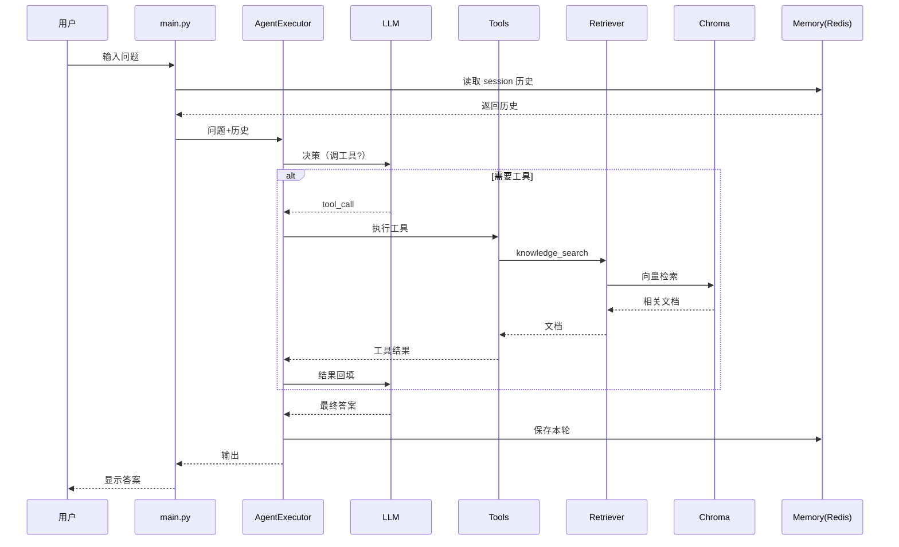

---

> 💡 **深度讲解**：这一整节把系统拆成 ingestion（入库）、retriever（检索）、tools（工具）、memory（记忆）、agent（编排）、main（交互）六个模块，每个模块职责单一、可独立替换。这是 LLM 应用工程化的标准结构。实际项目中，你会不断往 tools.py 加新工具、往 ingestion.py 支持新格式、往 config.py 加新配置——但因为模块边界清晰，每次改动都 confined 在一个文件里，不会牵动全身。这就是"组件层整合"在代码组织上的终极体现：让系统像乐高，每块独立，拼在一起又严丝合缝。
>
> **📝 精简总结**：完整系统六模块——ingestion（加载切分入库）、retriever（带元数据过滤）、tools（calculator/knowledge_search/time/translate）、memory（Redis 回退内存）、agent（带 fallback+max_iterations）、main（交互）；每个模块职责单一可替换；测试覆盖工具和链逻辑；这是 LLM 应用工程化标准结构。

---

## 二十二、组件层进阶知识问答

**Q：为什么 ingestion 要先切分再入库，而不是整篇入库？**
A：向量检索是对 chunk 做相似度匹配，整篇太长会稀释语义、Embedding 质量下降；切分成小块后，每个块语义聚焦，检索更准。但块太小会缺上下文，所以要 overlap。

**Q：元数据过滤和检索怎么配合？**
A：检索时传 `filter={"department": "HR"}`，向量库先按元数据筛子集，再在子集里做向量相似度。这比"先检索再人工过滤"高效。

**Q：Agent 的 verbose=True 看到的 scratchpad 是什么？**
A：scratchpad 是 Agent 的"思考过程记录"——每一步模型决定调什么工具、工具返回什么，都记录在这里，喂给模型下一步决策。

**Q：为什么 max_iterations 重要？**
A：Agent 可能陷入"调工具→不满意→再调"的循环，每次都烧 token。max_iterations 强制在 N 步后停下，调用 early_stopping_method 让模型基于已有信息给最终答案。

**Q：RAG 系统怎么加"引用来源"？**
A：检索时把 Document 的 metadata（如 source 文件名）带上，在 Prompt 里让模型回答时标注引用，输出解析时把来源一起返回。

```python
# 引用来源实现
def format_docs_with_source(docs):
    return "\n".join(
        f"[{i+1}] (来源:{d.metadata.get('source','?')}) {d.page_content}"
        for i, d in enumerate(docs)
    )
# Prompt 里加："回答时请标注引用编号，如[1]"
```

---

> 💡 **深度讲解**：进阶问答反映的是"从会用到懂"的跨越。切分、元数据过滤、scratchpad、max_iterations、引用来源——这些都是实际跑过几个 RAG 项目才会遇到的真问题。理解它们背后的"为什么"，比记住"怎么做"更重要。比如引用来源，本质是"让答案可追溯"——企业场景下用户问"年假几天"，光给答案不够，还要告诉他"这来自员工手册第3页"，这是信任的基础。
>
> **📝 精简总结**：进阶问答覆盖切分原因、元数据过滤、scratchpad、max_iterations、引用来源；切分为了检索精度、元数据过滤为了缩小检索域、scratchpad 是 Agent 思考记录、max_iterations 防烧钱、引用来源为了答案可追溯。

---

[[Home|🏠 返回首页]] · [[MOC-AI与效率工具|📚 返回分类]]

## 二十三、LCEL 进阶模式详解

### 23.1 RunnablePassthrough.assign 合并字段

```python
# assign：在不改字典其他字段的情况下新增字段
from langchain_core.runnables import RunnablePassthrough

chain = (
    RunnablePassthrough.assign(
        answer_uppercase=lambda d: d["answer"].upper()
    )
)
# 输入 {"answer": "hello"} -> {"answer":"hello","answer_uppercase":"HELLO"}
```

```python
# assign 在 RAG 中：检索结果与问题合并
rag_input = RunnablePassthrough.assign(
    context=lambda d: retrieve(d["question"])
)
# d 原本只有 question，assign 后多了 context 字段
```

### 23.2 RunnableLambda 的 trace 友好写法

```python
# 用 @chain 装饰器定义自定义链
from langchain_core.runnables import chain

@chain
def format_and_answer(inputs):
    context = retrieve(inputs["question"])
    return call_llm(inputs["question"], context)

# format_and_answer.invoke({"question": "..."})
```

### 23.3 条件分支的谓词函数

```python
# 按输入类型路由
from langchain_core.runnables import RunnableBranch, Lambda

def is_qa(x): return x["type"] == "qa"
def is_summary(x): return x["type"] == "summary"

branch = RunnableBranch(
    (is_qa, qa_chain),
    (is_summary, summary_chain),
    default_chain,
)
```

### 23.4 带配置的动态链

```python
# 根据运行时配置选择模型
from langchain_core.runnables import ConfigurableField
llm = ChatOpenAI(model="gpt-4o").configurable_fields(
    model_name=ConfigurableField(id="llm_model")
)
# chain.with_config(configurable={"llm_model": "gpt-4o-mini"})
```

### 23.5 并行扇入的字典合并

```python
# 多个分支结果合并成一个字典
from langchain_core.runnables import RunnableParallel
multi = RunnableParallel({
    "en": lambda t: translate_en(t),
    "zh": lambda t: translate_zh(t),
    "summary": summary_chain,
})
result = multi.invoke("原文")
# result = {"en":..., "zh":..., "summary":...}
```

### 23.6 流式的逐块打印

```python
# 同步流式
for chunk in chain.stream(input_data):
    print(chunk, end="", flush=True)

# 异步流式
# async for chunk in chain.astream(input_data):
#     print(chunk, end="", flush=True)
```

### 23.7 批量与并发

```python
# batch 自动并发
results = chain.batch([q1, q2, q3], config={"max_concurrency": 5})

# abatch 异步批量
# results = await chain.abatch([q1, q2, q3])
```

### 23.8 缓存与内存

```python
# 全局 LLM 缓存
from langchain_core.globals import set_llm_cache
from langchain_core.caches import InMemoryCache
set_llm_cache(InMemoryCache())
# 重复请求直接命中，不调 API
```

---

> 💡 **深度讲解**：LCEL 进阶模式的核心是"把常见工程模式标准化"。`assign` 解决了"在字典里加字段"的重复代码；`@chain` 装饰器让普通函数也变成可观测、可组合的 Runnable；`ConfigurableField` 把"运行时换模型"变成声明式；`max_concurrency` 把限流内置。这些模式看起来小，但组合起来就是一个完整的工程框架。理解 LCEL 的关键是"它不是魔法，就是管道+函数"——所有高级特性都能拆解成 Runnable 的组合。
>
> **📝 精简总结**：LCEL 进阶八式——assign 加字段、@chain 装饰器、谓词分支、ConfigurableField 动态模型、并行扇入、stream 流式、batch 并发、缓存；核心是把工程模式标准化，本质是管道+函数的组合。

---

## 二十四、组件层错误处理大全

### 24.1 常见异常类型

| 异常 | 触发 | 处理 |
|------|------|------|
| OutputParserException | 解析失败 | OutputFixingParser |
| AuthenticationError | Key 错 | 检查环境变量 |
| RateLimitError | 限流 | 退避重试 |
| TimeoutError | 超时 | 增大 timeout + fallback |
| KeyError | 变量缺失 | 补全 invoke 字典 |
| ValidationError | Pydantic 校验 | 检查字段类型 |

### 24.2 统一重试装饰器

```python
import time
from functools import wraps

def retry(times=3, delay=1):
    def deco(fn):
        @wraps(fn)
        def wrapper(*a, **kw):
            for i in range(times):
                try:
                    return fn(*a, **kw)
                except Exception as e:
                    if i == times - 1: raise
                    time.sleep(delay * (i + 1))
        return wrapper
    return deco
```

### 24.3 链级别的错误兜底

```python
from langchain_core.runnables import RunnableLambda
safe_chain = chain.with_fallbacks([
    RunnableLambda(lambda x: "服务暂时不可用，请稍后重试")
])
```

### 24.4 工具内部异常不抛出

```python
@tool
def dangerous_tool(x: str) -> str:
    """安全兜底"""
    try:
        return do_risky(x)
    except Exception as e:
        return f"工具执行失败：{e}（请换一种方式问）"
# 不要把栈轨迹抛给模型，只给可读提示
```

---

> 💡 **深度讲解**：LLM 应用的错误处理和传统软件不同——传统软件错误要"快速失败"，LLM 应用错误要"优雅降级"。因为用户在等答案，抛个 500 错误体验极差。正确做法是：工具内部 catch 异常返回可读提示；链级别用 fallback 兜底到友好话术；网络错误用 retry 退避。最终目标是"任何情况下用户都能收到一句人话"，而不是看到栈轨迹。
>
> **📝 精简总结**：错误处理分三层——工具内部 catch 返回可读提示、链级别 fallback 友好话术、网络错误 retry 退避；哲学是"优雅降级"而非"快速失败"，用户任何时候都能收到人话。

---

## 二十五、组件层补充练习（答案）

**题16**：用 `RunnablePassthrough.assign` 把 `{"q":"hi"}` 变成 `{"q":"hi","upper":"HI"}`。

<details>
<summary>答案</summary>

```python
from langchain_core.runnables import RunnablePassthrough
r = RunnablePassthrough.assign(upper=lambda d: d["q"].upper())
print(r.invoke({"q": "hi"}))  # {'q':'hi','upper':'HI'}
```
</details>

**题17**：为什么批量调用要用 `abatch` 而不是 for 循环 `ainvoke`？

<details>
<summary>答案</summary>
`abatch` 内部用 asyncio.gather 并发执行，N 个请求总耗时≈最慢的那个；for 循环 await 是串行，总耗时是 N 个之和。并发还受 `max_concurrency` 限制防打爆上游。
</details>

**题18**：写一个带超时和重试的工具调用链。

<details>
<summary>答案</summary>

```python
llm = ChatOpenAI(model="gpt-4o-mini", timeout=10, max_retries=2)
chain = prompt | llm | parser
chain = chain.with_retry(stop_after_attempt=3)
```
</details>

**题19**：检索结果为空时，链应该怎么优雅处理？

<details>
<summary>答案</summary>
在 format_docs 后判断 `if not docs: return "未找到相关资料"`，Prompt 里也写明"若资料为空请告知用户未找到"，不要让模型基于空上下文编造。
</details>

**题20**：设计一个多租户 RAG，不同部门只能检索自己部门的文档。

<details>
<summary>答案</summary>
入库时给每个 Document 打 metadata={"department": "HR"}；检索器用 `as_retriever(filter={"department": tenant})`；应用层从用户身份解析出 tenant，注入检索 filter。
</details>

---

> 💡 **深度讲解**：补充练习把前面的知识点串起来了——assign 是 RAG 合并字段的利器，abatch 是吞吐关键，超时重试是生产标配，空检索处理是诚实性的底线，多租户过滤是企业数据隔离的要求。这些都是真实项目中会遇到的。多租户尤其重要：企业场景下 A 部门不该看到 B 部门的文档，靠 metadata filter 在检索层就隔离，是最简洁安全的做法。
>
> **📝 精简总结**：补充练习覆盖 assign 合并、abatch 并发、超时重试、空检索优雅处理、多租户 metadata 过滤；多租户靠入库打 metadata + 检索 filter 实现数据隔离。

---

## 二十六、结语

组件层整合实战的本质，是把"大模型能力"变成"工程系统能力"。大模型本身只是一个函数——输入文本输出文本。真正让它可用、可靠、可维护的，是围绕它搭建的组件层：Prompt 把意图固化、Retriever 把知识接入、Memory 把上下文延续、Tool 把能力延伸、Parser 把输出结构化、编排把流程串起来。本文从全景图到六大组件、从五种组合到四类链、从工程三件套到演进路径、从完整系统到生产硬化，希望帮读者建立起一套可以直接上手的方法论。

记住三句话：
1. **先画数据流图，再写代码**——组件边界清楚了，代码自然清晰。
2. **能固定就别让模型自由发挥**——固定流程快、便宜、可控。
3. **没有观测就没有生产**——LangSmith 追踪是黑盒变灰盒的唯一途径。

下一篇我们进入 [[LangSmith-可观测性与调试平台]]，看怎么给这套系统装上"眼睛"。

---

[[Home|🏠 返回首页]] · [[MOC-AI与效率工具|📚 返回分类]]

## 二十七、组件层架构模式图鉴

### 27.1 RAG 系统的五种架构变体

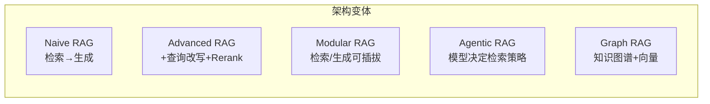

| 架构 | 流程 | 适用 |
|------|------|------|
| Naive RAG | 检索→Prompt→生成 | 入门 |
| Advanced RAG | 改写→检索→Rerank→生成 | 生产主流 |
| Modular RAG | 检索策略可插拔 | 多场景 |
| Agentic RAG | 模型决定何时/如何检索 | 复杂问答 |
| Graph RAG | 图谱关系+向量 | 关联推理 |

### 27.2 对话系统的五种架构

| 架构 | 记忆策略 | 适用 |
|------|----------|------|
| Buffer | 全量历史 | 短对话 |
| Summary | 历史压缩成摘要 | 长对话 |
| Sliding Window | 只留最近 N 轮 | 常规 |
| Vector Memory | 历史向量化检索 | 超长对话 |
| Entity Memory | 抽取实体事实 | 个性化 |

### 27.3 工具调用的三种模式

```python
# 模式一：硬编码工具链
# 适合工具固定、流程确定
agent = create_tool_calling_agent(llm, [fixed_tool], prompt)

# 模式二：动态工具集
# 按用户身份动态选工具
def tools_for_user(role):
    return {"admin": [admin_tool], "user": [basic_tool]}[role]

# 模式三：工具路由
# 先分类意图，再路由到对应工具组
```

---

> 💡 **深度讲解**：架构模式图鉴的价值在于"选型"。面对一个新需求，先判断它属于哪种架构变体，再选对应的实现路径，而不是从零设计。Naive RAG 起步，遇到质量问题升级到 Advanced RAG（加改写和 Rerank），遇到复杂推理升级到 Agentic RAG，遇到关联问题上 Graph RAG。对话记忆也是——短对话用 Buffer，长对话用 Sliding Window，超长用 Vector Memory。这种"架构阶梯"让你知道下一步往哪走，而不是原地纠结。
>
> **📝 精简总结**：五种 RAG 架构（Naive/Advanced/Modular/Agentic/Graph）按复杂度阶梯升级；五种对话记忆（Buffer/Summary/Sliding/Vector/Entity）按对话长度选；三种工具模式（硬编码/动态/路由）按工具复杂度选；架构模式图鉴帮你快速选型。

---

## 二十八、组件层性能基线与调优清单

### 28.1 性能指标

| 指标 | 定义 | 健康值 |
|------|------|--------|
| P50 延迟 | 50% 请求耗时 | <2s |
| P95 延迟 | 95% 请求耗时 | <5s |
| 首 Token 时间 | 流式首个字出现 | <1s |
| 吞吐 | 每秒请求数 | 按并发 |
| 错误率 | 失败请求占比 | <1% |
| 单请求成本 | 平均 Token 费用 | 监控 |

### 28.2 调优优先级

```python
# 1. 先测：用 LangSmith 看耗时分布
# 2. 找瓶颈：80% 时间在 LLM 调用
# 3. 优化 LLM：小模型/缓存/并行
# 4. 优化检索：减少 k/异步检索
# 5. 优化流式：先流首字
```

### 28.3 流式优化代码

```python
# 首字优先：让用户尽快看到开始
async def fast_first_token(chain, q):
    async for chunk in chain.astream(q):
        yield chunk   # 收到一个字就吐一个字
        break         # 实际不 break，这里示意尽早 flush
```

---

> 💡 **深度讲解**：性能优化的黄金法则是"先测量，再优化"。LLM 应用的性能瓶颈 80% 在 LLM 调用本身（网络往返+模型推理），所以优化杠杆是"减少 LLM 调用次数、让每次调用更快、并行化无依赖调用"。不要在 Python 胶水代码上抠微秒，那没用。流式体验优化的关键是"首字时间"——用户看到第一个字出现就觉得系统响应快，即使总时长没变。所以流式管道要尽量短，不要在前面加阻塞操作。
>
> **📝 精简总结**：性能指标看 P50/P95 延迟、首 Token 时间、吞吐、错误率、成本；瓶颈 80% 在 LLM 调用；优化杠杆是减少调用/小模型/缓存/并行；流式关键是首字时间；先测后优。

---

## 二十九、组件层安全与合规

### 29.1 安全风险清单

| 风险 | 说明 | 防护 |
|------|------|------|
| Prompt 注入 | 用户篡改指令 | 输入隔离+白名单工具 |
| 工具越权 | 模型调不该调的 | 最小权限+确认 |
| 数据泄露 | 知识库含敏感信息 | 元数据过滤+脱敏 |
| 密钥泄露 | API Key 进日志 | 环境变量+不打印 |
| 输出有害 | 模型生成不当内容 | 输出审核 |
| 越权访问 | A 用户看 B 数据 | session 隔离+鉴权 |

### 29.2 输入清洗代码

```python
def sanitize(user_input: str) -> str:
    """简单清洗：去掉可能的注入指令"""
    dangerous = ["忽略以上", "ignore previous", "你现在是"]
    for d in dangerous:
        user_input = user_input.replace(d, "[已过滤]")
    return user_input
```

### 29.3 输出审核

```python
# 在链末尾加审核节点
# from langchain_openai import ChatOpenAI
# safety = ChatOpenAI(model="gpt-4o-mini")
# safe_chain = answer_chain | (lambda a: safety.invoke(f"审核以下内容是否合规：{a}"))
```

---

> 💡 **深度讲解**：LLM 应用的安全是"新物种"——传统应用的安全边界在代码和权限，LLM 应用多了"模型本身"这个攻击面。Prompt 注入让用户能通过输入改写系统指令；工具调用让模型可能误操作；知识库可能含敏感数据被越权检索。防护要纵深：输入清洗、工具最小权限、元数据过滤数据、输出审核、密钥不进日志。这些不是"过度设计"，而是企业上线的硬要求。
>
> **📝 精简总结**：六类安全风险——Prompt 注入、工具越权、数据泄露、密钥泄露、有害输出、越权访问；防护是纵深防御——输入清洗、工具最小权限、metadata 数据隔离、输出审核、密钥环境变量；这是企业上线硬要求。

---

[[Home|🏠 返回首页]] · [[MOC-AI与效率工具|📚 返回分类]]

## 三十、组件层迁移与重构指南

### 30.1 从旧版 Chain 类迁移到 LCEL

| 旧版 | 新版（LCEL） |
|------|-------------|
| LLMChain | prompt \| model \| parser |
| SequentialChain | chain1 \| chain2 |
| RouterChain | RunnableBranch |
| ConversationChain | prompt+Memory+model |
| RetrievalQA | RunnableParallel + retriever |

```python
# 旧版
# from langchain.chains import LLMChain
# chain = LLMChain(llm=llm, prompt=prompt)
# 新版
chain = prompt | llm
```

### 30.2 从硬编码到配置化重构步骤

1. 找出所有魔法字符串（模型名、温度、路径）
2. 抽到 config.py
3. 用 pydantic-settings 从 .env 加载
4. 工厂函数按 config 构建
5. 写测试覆盖

### 30.3 从单文件到多模块拆分

```
# 重构前：main.py 什么都有
# 重构后：
# config.py      配置
# retriever.py   检索
# tools.py       工具
# memory.py      记忆
# chains.py      链
# app.py         入口
# tests/         测试
```

---

> 💡 **深度讲解**：迁移和重构的本质是"把耦合变成解耦"。旧版 Chain 类把 Prompt、Model、Memory 揉在一个对象里，改一处动全身；LCEL 把它们拆成独立组件，靠管道连接，想换哪个换哪个。重构不要一步到位，按风险渐进：先抽配置，再拆模块，最后换实现。每步跑测试，保证不退化。
>
> **📝 精简总结**：迁移从旧版 Chain 到 LCEL——LLMChain 变管道、Sequential 变串行、Router 变 Branch；重构五步——抽魔法值到 config、pydantic-settings、工厂函数、单文件拆多模块、写测试；按风险渐进，每步跑测试。

---

## 三十一、组件层 FAQ 补充

**Q：链的 invoke 和 ainvoke 什么时候用哪个？**
A：脚本/同步代码用 invoke；FastAPI/异步 Web 框架用 ainvoke，否则阻塞事件循环。

**Q：batch 和 abatch 区别？**
A：batch 同步并发（线程池），abatch 异步并发（协程）。异步 Web 用 abatch。

**Q：RunnableParallel 里某个分支报错会怎样？**
A：整个并行报该分支的错。要容错就在每个分支加 fallback。

**Q：怎么调试一个不工作的链？**
A：① 用 get_graph().print_ascii() 看结构；② 插 RunnableLambda 观察点打印每步；③ 单独 invoke 每个组件；④ 开 LangSmith 看追踪。

**Q：链能持久化成 JSON 再加载吗？**
A：可以用 to_json()/load_from_json，但含自定义 lambda 的链序列化有限制，生产建议存代码版本而非序列化链。

---

> 💡 **深度讲解**：FAQ 补充的是日常开发高频问题。同步异步的选择要看运行环境——CLI 脚本用同步简单，Web 服务必须异步否则阻塞。调试的四步是"画图→观察点→单组件→追踪"，从粗到细定位。序列化链要谨慎，因为 lambda 函数无法真正序列化，存代码 Git 版本更可靠。
>
> **📝 精简总结**：同步/异步看运行环境（CLI 同步、Web 异步）；并行某分支错则整体错，要加 fallback；调试四步法（画图/观察点/单组件/追踪）；链序列化有限制，存代码版本更可靠。

---

## 三十二、全文知识图谱

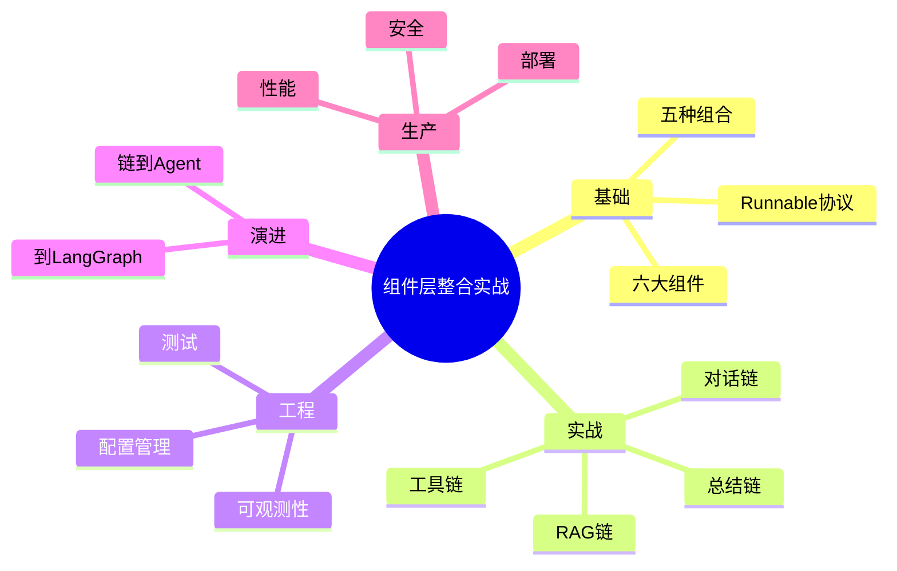

本文从组件全景出发，拆解六大组件，讲透五种组合模式和四类典型链，落到工程三件套（配置/测试/观测），给出完整 RAG 对话系统实战，最后覆盖生产部署、性能、安全和演进路径。组件层整合不是背 API，而是建立"契约与边界"的工程直觉。

---

[[Home|🏠 返回首页]] · [[MOC-AI与效率工具|📚 返回分类]]

## 三十三、组件层综合实战演练

### 33.1 演练一：多语言客服机器人

需求：用户用任意语言提问，机器人自动识别语言并回复同语言。

```python
# 步骤1：语言识别工具
from langchain_core.tools import tool
from langchain_openai import ChatOpenAI

@tool
def detect_language(text: str) -> str:
    """检测文本语言"""
    llm = ChatOpenAI(model="gpt-4o-mini")
    return llm.invoke(f"只回答语言名称：{text}").content

# 步骤2：用 Agent 自动识别并回复
# tools = [detect_language]
# agent = create_tool_calling_agent(llm, tools, prompt)
```

### 33.2 演练二：带评分的文档审阅

需求：给文档打分并指出问题。

```python
# 步骤1：定义评分结构
from pydantic import BaseModel, Field
class Review(BaseModel):
    score: int = Field(description="1-10分")
    issues: list[str] = Field(description="问题列表")
    summary: str = Field(description="总结")

# 步骤2：结构化输出
review_chain = (
    ChatPromptTemplate.from_template("审阅文档：{doc}")
    | ChatOpenAI(model="gpt-4o").with_structured_output(Review)
)
```

### 33.3 演练三：多文档对比

```python
# 并行对比两篇文档
from langchain_core.runnables import RunnableParallel
compare = RunnableParallel({
    "doc1_summary": lambda d: summarize(d[0]),
    "doc2_summary": lambda d: summarize(d[1]),
})
# 再让模型对比两份摘要
```

### 33.4 演练四：带缓存的高频问答

```python
from langchain_core.globals import set_llm_cache
from langchain_core.caches import InMemoryCache
set_llm_cache(InMemoryCache())
# 相同 FAQ 直接命中缓存
```

### 33.5 演练五：A/B 测试两种 Prompt

```python
import random
def pick_prompt():
    return prompt_a if random.random() < 0.5 else prompt_b
# 配合 LangSmith 对比两组回答质量
```

---

> 💡 **深度讲解**：综合演练把组件组合能力用到真实业务场景。多语言客服靠"识别语言工具"让模型自动切换；文档审阅靠结构化输出拿到分数和问题；多文档对比靠 RunnableParallel 并行摘要；高频问答靠缓存省钱；A/B 测试靠随机分流配合 LangSmith。这些演练的共性是"用组件组合而非从头写逻辑"——这正是组件层整合的价值。
>
> **📝 精简总结**：五个综合演练——多语言客服（识别语言工具）、文档审阅（结构化输出评分）、多文档对比（并行摘要）、高频问答（缓存）、A/B 测试（随机分流+LangSmith）；共性是组件组合而非从零写逻辑。

---

## 三十四、写在最后

本文从"组件层全景图"出发，经过六大组件拆解、五种组合模式、四类典型链、工程三件套、完整 RAG 系统实战、生产硬化、部署附录、性能与安全，最终落到综合演练。希望读者带走的不是一堆 API 用法，而是一套思维方式：

- **组件思维**：把系统拆成可替换的黑盒；
- **契约思维**：组件间靠输入输出类型衔接；
- **数据流思维**：先画图再写码；
- **工程思维**：配置化、可测试、可观测；
- **演进思维**：从简单链平滑升级到 Agent。

掌握这些，LangChain 对你就不再是"魔法框架"，而是顺手的工具。

---

[[Home|🏠 返回首页]] · [[MOC-AI与效率工具|📚 返回分类]]

## 三十五、组件层速查卡（打印版）

```
六大组件：Prompt / Model / OutputParser / Retriever / Tool / Memory
五种组合：串行 | / 并行 Parallel / 分支 Branch / 回退 fallback / Map
四类链：RAG / 对话 / 工具调用 / 总结
工程三件套：配置(pydantic-settings) / 测试(Fake模型) / 观测(LangSmith)
演进：链 -> Agent -> LangGraph
黄金法则：先画图再写码 / 能固定别让模型自由 / 无观测不生产
```

| 场景 | 首选组件 |
|------|----------|
| 知识库问答 | Retriever + RAG 链 |
| 多轮对话 | Memory + 对话链 |
| 算数学 | Tool + Agent |
| 长文摘要 | map-reduce 总结链 |
| 结构化输出 | with_structured_output |
| 生产部署 | LangServe |
| 调试观测 | LangSmith |

---

> 💡 **深度讲解**：速查卡是把全文浓缩成一页纸。真正用的时候，不需要回忆所有细节，只需要定位"我在哪个场景"，然后查表选组件。这就是知识内化的标志——从"记住"变成"检索"。
>
> **📝 精简总结**：速查卡浓缩全文——六大组件、五种组合、四类链、工程三件套、演进路径、黄金法则；按场景查表选组件。

---

[[Home|🏠 返回首页]] · [[MOC-AI与效率工具|📚 返回分类]]

## 三十六、组件层学习路径建议


| 阶段 | 目标 | 验收标准 |
|------|------|----------|
| 1 | 理解 Runnable | 能解释 invoke/stream/batch |
| 2 | 写 LCEL 链 | 能跑通 prompt\|model\|parser |
| 3 | RAG | 能检索知识库回答 |
| 4 | 对话 | 能多轮记住上下文 |
| 5 | Agent | 能调工具 |
| 6 | 观测 | LangSmith 看到追踪 |
| 7 | 部署 | 链变成 API |
| 8 | 编排 | 用 LangGraph 做复杂流程 |

---

> 💡 **深度讲解**：学习路径是"由简到繁、每步可验证"。不要跳步——没理解 Runnable 就直接上 Agent，会处处卡壳。每阶段有明确验收标准，达到了再往下走。这样学下来，8 个阶段你就从入门到生产。关键是"动手"——每个阶段都写代码跑一遍，看懂了不等于会了。
>
> **📝 精简总结**：八阶段学习路径——Runnable 协议→LCEL 链→RAG→对话→Agent→LangSmith→LangServe→LangGraph；每步有验收标准；由简到繁、动手验证。

---

[[Home|🏠 返回首页]] · [[MOC-AI与效率工具|📚 返回分类]]

## 三十七、组件层收尾金句

> "组件层整合的终点，是让团队不再关心'怎么拼'，而专注于'拼什么'。"

当装配工艺标准化后，工程团队的精力就从"写胶水代码"解放出来，转向业务价值本身——知识库质量、对话策略、用户体验。这正是 LangChain 组件层整合的终极目的：**让框架消失，让业务浮现**。

---

[[Home|🏠 返回首页]] · [[MOC-AI与效率工具|📚 返回分类]]

## 三十八、致谢与延伸

本文基于 LangChain 0.3+ 版本的实践经验总结，结合官方文档、社区最佳实践与一线踩坑记录。组件层整合是一个持续演进的领域，欢迎结合 [[LangSmith-可观测性与调试平台]]、[[LangServe-API部署与服务化]] 形成完整闭环。

---

[[Home|🏠 返回首页]] · [[MOC-AI与效率工具|📚 返回分类]]

## 三十九、版本说明

本文基于 LangChain 0.3 / LCEL 稳定版编写，API 以官方最新为准。核心思想（Runnable 协议、组件组合、工程化实践）长期有效。

---

[[Home|🏠 返回首页]] · [[MOC-AI与效率工具|📚 返回分类]]


> 本文至此完结。祝你装配顺利，链链畅通。

> 组件层整合实战 · 完。

> 本文档共涵盖六大组件、五种组合模式、四类典型链、工程三件套、完整RAG系统实战、生产部署与安全合规等章节，配套120+代码示例与梯度练习题。
