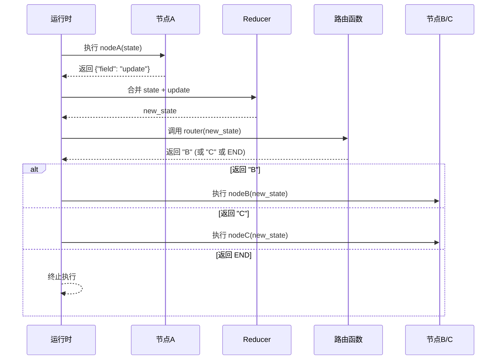
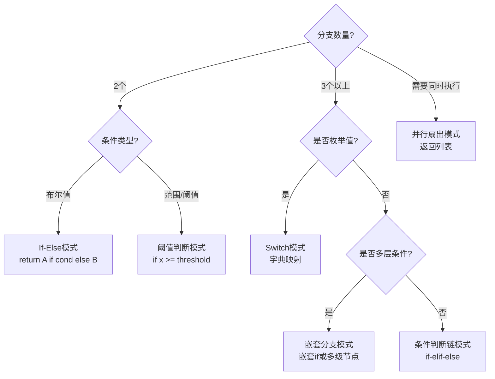
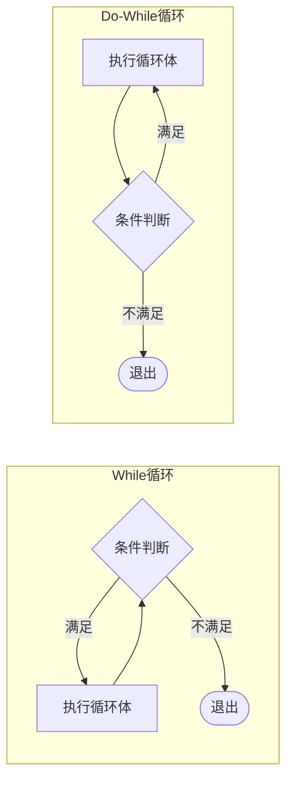
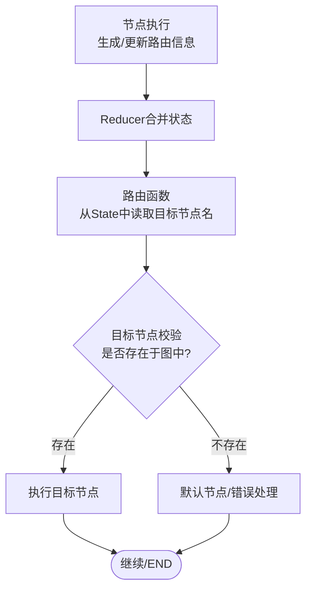

# LangGraph 条件边与路由

> **一句话定义**：条件边（Conditional Edge）是 LangGraph 中根据当前 State 动态决定下一个执行节点的边机制，通过路由函数（Router Function）读取状态并返回目标节点名称，实现 if-else 分支、switch 多分支、循环、动态路由等复杂控制流。
>
> **核心价值**：条件边是 LangGraph 区别于普通链式编排（LangChain LCEL）的核心能力，它让 Agent 的执行流程不再是固定的线性管道，而是可以根据 LLM 输出、工具结果、用户输入等运行时数据动态决策，从而构建真正具备"思考-决策-行动"能力的智能体。
>
> **适用场景**：需要根据 LLM 决策选择不同工具的 ReAct Agent、需要分类路由的多专家系统、需要循环重试的工具调用、需要条件终止的长流程、需要动态选择子图的复合 Agent、需要人机交互审批的工作流。

---

## 一、条件边概述与核心概念

### 1.1 什么是条件边

#### 正式定义与本质

条件边是 LangGraph StateGraph 中一种特殊的边类型，它不直接连接两个固定节点，而是通过一个**路由函数（Router Function）**在运行时动态计算下一个目标节点。路由函数接收当前完整的 State 作为输入，返回一个字符串（或字符串列表），该字符串必须是图中已定义的节点名称（或 `END`）。

> 🎯 面试高频：条件边的本质是什么？答：条件边本质上是一个"状态→节点名"的映射函数，它将传统编程中的 if-else/switch 控制流抽象为图中的动态边，使执行路径在运行时由 State 决定而非编译时固定。

#### 生活化比喻

把 LangGraph 的图想象成一个**地铁线路图**：
- **普通边**是固定的铁轨，A 站永远只能到 B 站，没有选择
- **条件边**是**道岔系统**，列车到达岔路口时，调度员（路由函数）根据当前乘客需求（State）决定扳到哪条轨道——去机场线还是去市区线
- **路由函数**就是那个值班调度员，他看一眼站牌上的信息（State），然后喊出下一站的名字

#### 条件边在 LangGraph 架构中的位置

```mermaid
graph TB
    subgraph LangGraph 执行引擎
        SG[StateGraph 定义层<br/>节点+边+条件边]
        CG[Compiled Graph 编译层<br/>图编译+校验]
        RT[Runtime 运行层<br/>状态传递+节点执行+边路由]
        CP[Checkpoint 持久层<br/>状态快照+中断恢复]
    end

    SG --> CG
    CG --> RT
    RT --> CP

    subgraph 条件边在运行层的作用
        R1[节点A执行完毕<br/>返回状态更新]
        R2[Reducer合并状态<br/>得到新State]
        R3{条件边路由函数<br/>router(newState)}
        R4[返回节点名B]
        R5[返回节点名C]
        R6[返回END]
    end

    R1 --> R2
    R2 --> R3
    R3 -->|字符串B| R4
    R3 -->|字符串C| R5
    R3 -->|END| R6
```

### 1.2 条件边 vs 普通边

#### 核心区别对比

| 维度 | 普通边（Edge） | 条件边（Conditional Edge） |
|------|----------------|---------------------------|
| **定义方式** | `add_edge("A", "B")` | `add_conditional_edges("A", router_fn)` |
| **目标节点** | 编译时固定 | 运行时动态决定 |
| **决策依据** | 无（总是走这条边） | 路由函数读取 State 后决定 |
| **返回值** | 无 | 节点名字符串或 `END` |
| **分支数量** | 1 个（固定） | 2~N 个（动态） |
| **能否形成循环** | 可以（自环） | 可以（条件自环） |
| **能否并行扇出** | 可以（返回列表） | 可以（路由函数返回列表） |
| **典型用途** | 顺序执行、固定流程 | 分支判断、路由、循环、动态选择 |
| **类比** | 顺序语句 `a(); b();` | if-else / switch / while |

#### 代码对比示例

```python
# 普通边：A 之后永远执行 B
from langgraph.graph import StateGraph, END

graph = StateGraph(dict)
graph.add_node("A", lambda s: {"step": "A done"})
graph.add_node("B", lambda s: {"step": "B done"})
graph.add_edge("A", "B")          # 固定边：A -> B
graph.add_edge("B", END)
graph.set_entry_point("A")
app = graph.compile()

# 条件边：A 之后根据 state 决定去 B 还是 C
def router(state):
    if state.get("choice") == "B":
        return "B"
    return "C"

graph2 = StateGraph(dict)
graph2.add_node("A", lambda s: {"choice": "B"})
graph2.add_node("B", lambda s: {"result": "went B"})
graph2.add_node("C", lambda s: {"result": "went C"})
graph2.add_conditional_edges("A", router)  # 条件边：A -> ?
graph2.add_edge("B", END)
graph2.add_edge("C", END)
graph2.set_entry_point("A")
app2 = graph2.compile()
```

**预期运行结果**：
```
普通边结果: {'step': 'B done'}
条件边结果: {'choice': 'B', 'result': 'went B'}
```

### 1.3 条件边的执行流程

#### 完整执行时序

当图执行到一个带有条件边的节点时，LangGraph 运行时按以下步骤操作：

1. **节点执行**：当前节点函数接收 State，执行逻辑，返回状态更新字典
2. **状态合并**：Reducer 将节点返回的更新合并到当前 State，产生新 State
3. **边查找**：运行时查找该节点的出边——如果是普通边，直接确定目标；如果是条件边，调用路由函数
4. **路由调用**：路由函数接收合并后的新 State，执行决策逻辑
5. **目标解析**：路由函数返回节点名字符串（或列表），运行时校验该节点存在
6. **状态传递**：将新 State 传递给目标节点，继续执行
7. **终止判断**：如果路由返回 `END`，图执行终止



> 🎯 面试高频：条件边的路由函数读取的是节点执行前还是执行后的状态？答：是节点执行**后**、经过 Reducer 合并后的新状态。这是一个常见考点，很多人误以为路由函数读取的是原始输入状态。

### 1.4 条件边的核心价值

#### 为什么需要条件边

在 LangGraph 出现之前，LangChain 的 LCEL（LangChain Expression Language）只能构建线性管道：`prompt | llm | parser`。这种模式无法表达"如果 LLM 说需要查数据库就走检索分支，如果说需要计算就走计算器分支"的动态逻辑。条件边的出现解决了以下核心问题：

1. **动态分支**：根据运行时数据选择不同执行路径
2. **循环控制**：实现"重试直到成功"或"多轮思考"的循环
3. **条件终止**：在满足条件时提前结束，避免无效执行
4. **动态子图选择**：根据任务类型路由到不同的子图
5. **人机交互**：在需要人类审批时中断，审批后根据结果路由

#### 条件边与传统控制流的对应关系

| 传统编程 | LangGraph 条件边实现 |
|----------|---------------------|
| `if cond: A() else: B()` | 路由函数返回 "A" 或 "B" |
| `switch x: case 1: A(); case 2: B()` | 路由函数用字典映射返回不同节点名 |
| `while not done: step()` | 节点添加指向自身的条件边，路由返回自身或 END |
| `for item in items: process(item)` | 条件边 + 状态计数器，返回自身或 END |
| `break` | 路由函数返回 END |
| `continue` | 路由函数返回当前节点名（跳过后续逻辑需节点内实现） |
| `goto` | 路由函数返回任意节点名 |

---

### 💡 本章深度讲解

条件边是 LangGraph 最核心的创新之一，它将传统编程中的控制流（if-else、switch、while）抽象为图中的动态边，使 Agent 的执行路径不再是固定的线性管道，而是可以根据运行时状态动态决策。理解条件边的关键在于三点：第一，路由函数读取的是节点执行后、Reducer 合并后的新状态，而非原始输入；第二，路由函数返回的是节点名字符串，这个字符串必须在图中已定义，否则运行时会报错；第三，条件边和普通边可以混合使用，普通边负责固定顺序，条件边负责动态决策，两者配合可以表达任意复杂的控制流。

### 📝 本章精简总结

1. 条件边通过路由函数在运行时动态决定下一个节点，是 LangGraph 区别于线性链的核心能力
2. 路由函数签名为 `def router(state) -> str`，返回节点名字符串或 `END`
3. 路由函数读取的是节点执行后、Reducer 合并后的新状态
4. 普通边是固定连接（编译时确定），条件边是动态连接（运行时确定）
5. 条件边可以实现 if-else、switch、while、for 等所有传统控制流
6. 条件边的执行流程：节点执行→状态合并→路由调用→目标解析→状态传递→继续执行
7. 条件边支持返回字符串列表实现并行扇出，支持返回 `END` 终止执行
8. 条件边是构建 ReAct Agent、多专家系统、循环重试、动态子图选择等复杂 Agent 的基础

### 🎯 梯度练习题

**基础题⭐**

1. 请用一句话说明条件边和普通边的本质区别。
   > 提示：普通边在编译时固定目标节点，条件边在运行时通过路由函数动态决定目标节点。

2. 路由函数的输入和输出分别是什么？
   > 提示：输入是当前完整 State（节点执行后合并的新状态），输出是节点名字符串（或字符串列表）或 `END`。

3. 判断题：条件边的路由函数读取的是节点执行前的原始状态。
   > 答案：错误。路由函数读取的是节点执行后、Reducer 合并后的新状态。

**进阶题⭐⭐**

1. 请用条件边实现一个简单的 if-else：如果 state 中 `score >= 60` 走 "pass" 节点，否则走 "fail" 节点。写出路由函数和图定义代码。
   > 提示：路由函数中 `return "pass" if state["score"] >= 60 else "fail"`。

2. 为什么说条件边让 LangGraph 可以表达循环？请用"节点指向自身的条件边"解释 while 循环的实现原理。
   > 提示：节点 A 添加条件边指向自身，路由函数在条件未满足时返回 "A"（形成自环），条件满足时返回 END（退出循环）。

**实战题⭐⭐⭐**

1. 设计一个三节点的分类路由图：入口节点 "classify" 根据 state 中的 `category` 字段（值为 "tech"/"sports"/"other"）分别路由到 "tech_handler"、"sports_handler"、"default_handler" 三个节点，所有处理节点最终都到 END。请写出完整可运行代码并打印执行路径。
   > 提示：使用字典映射 `{"tech": "tech_handler", "sports": "sports_handler"}.get(state["category"], "default_handler")`。

---

## 二、路由函数设计详解

### 2.1 路由函数的签名与返回值

#### 正式定义

路由函数（Router Function）是一个普通的 Python 可调用对象（函数、lambda、类方法、实现了 `__call__` 的类实例），它的标准签名为：

```python
def router_function(state: State) -> str | list[str]:
    """
    路由函数：根据当前状态决定下一个执行节点

    参数:
        state: 当前完整状态（节点执行后、Reducer 合并后的新状态）

    返回:
        str: 单个目标节点的名称，或 "__end__"（END 的字符串形式）
        list[str]: 多个目标节点名称（并行扇出），列表中可包含 "__end__"
    """
    ...
```

> 🎯 面试高频：路由函数可以返回哪些类型？答：可以返回单个字符串（节点名或 `"__end__"`），也可以返回字符串列表（并行扇出到多个节点）。不能返回节点函数对象本身，必须是节点的注册名称字符串。

#### 返回值的三种形式

```python
from typing import Literal
from langgraph.graph import StateGraph, END

# 形式1：返回单个节点名
def router_single(state):
    if state["type"] == "A":
        return "node_a"
    return "node_b"

# 形式2：返回 END（两种等价写法）
def router_end(state):
    if state["done"]:
        return END          # 推荐：使用 END 常量
    return "continue_node"

def router_end_str(state):
    if state["done"]:
        return "__end__"    # 等价：END 的字符串形式
    return "continue_node"

# 形式3：返回列表（并行扇出）
def router_parallel(state):
    targets = []
    if state["need_search"]:
        targets.append("search_node")
    if state["need_calc"]:
        targets.append("calc_node")
    if not targets:
        return END
    return targets  # 同时执行多个节点
```

#### 完整示例：三种返回值形式

```python
from langgraph.graph import StateGraph, END
from typing import TypedDict

class State(TypedDict):
    type: str
    done: bool
    need_search: bool
    need_calc: bool
    result: str

# 节点定义
def node_a(state): return {"result": "A"}
def node_b(state): return {"result": "B"}
def continue_node(state): return {"result": "continued"}
def search_node(state): return {"result": "searched"}
def calc_node(state): return {"result": "calculated"}

# 图1：单节点返回
g1 = StateGraph(State)
g1.add_node("node_a", node_a)
g1.add_node("node_b", node_b)
g1.add_conditional_edges("node_a", router_single)
g1.add_edge("node_b", END)
g1.set_entry_point("node_a")
app1 = g1.compile()

# 图2：返回END
g2 = StateGraph(State)
g2.add_node("continue_node", continue_node)
g2.add_conditional_edges("continue_node", router_end)
g2.set_entry_point("continue_node")
app2 = g2.compile()

# 图3：并行扇出
g3 = StateGraph(State)
g3.add_node("search_node", search_node)
g3.add_node("calc_node", calc_node)
g3.add_conditional_edges("search_node", router_parallel)
g3.add_edge("calc_node", END)
g3.set_entry_point("search_node")
app3 = g3.compile()

print("=== 单节点路由 ===")
print(app1.invoke({"type": "A", "done": False, "need_search": False, "need_calc": False, "result": ""}))

print("\n=== 返回END ===")
print(app2.invoke({"type": "", "done": True, "need_search": False, "need_calc": False, "result": ""}))

print("\n=== 并行扇出 ===")
print(app3.invoke({"type": "", "done": False, "need_search": True, "need_calc": True, "result": ""}))
```

**预期运行结果**：
```
=== 单节点路由 ===
{'type': 'A', 'done': False, 'need_search': False, 'need_calc': False, 'result': 'B'}

=== 返回END ===
{'type': '', 'done': True, 'need_search': False, 'need_calc': False, 'result': 'continued'}

=== 并行扇出 ===
{'type': '', 'done': False, 'need_search': True, 'need_calc': True, 'result': 'calculated'}
```

### 2.2 路由函数的类型安全

#### 使用 Literal 类型标注

为了让路由函数的返回值在类型检查时更安全，可以使用 `typing.Literal` 限定返回值只能是特定的节点名字符串：

```python
from typing import Literal, TypedDict
from langgraph.graph import StateGraph, END

class State(TypedDict):
    intent: str

# 路由函数返回值类型限定为特定节点名
def intent_router(state: State) -> Literal["search_agent", "calc_agent", "chat_agent", "__end__"]:
    intent = state["intent"]
    if intent == "search":
        return "search_agent"
    elif intent == "calc":
        return "calc_agent"
    elif intent == "chat":
        return "chat_agent"
    return "__end__"
```

#### 使用 Enum 增强可读性和安全性

当路由分支较多时，使用 Enum 可以避免硬编码字符串，提升可维护性：

```python
from enum import Enum
from typing import TypedDict
from langgraph.graph import StateGraph, END

class RouteTarget(Enum):
    SEARCH = "search_agent"
    CALC = "calc_agent"
    CHAT = "chat_agent"
    END = "__end__"

class State(TypedDict):
    intent: str

def enum_router(state: State) -> str:
    intent_map = {
        "search": RouteTarget.SEARCH.value,
        "calc": RouteTarget.CALC.value,
        "chat": RouteTarget.CHAT.value,
    }
    return intent_map.get(state["intent"], RouteTarget.END.value)

# 验证：Enum 的 value 必须和节点注册名一致
graph = StateGraph(State)
graph.add_node("search_agent", lambda s: {"result": "search"})
graph.add_node("calc_agent", lambda s: {"result": "calc"})
graph.add_node("chat_agent", lambda s: {"result": "chat"})
graph.add_conditional_edges("search_agent", enum_router)
graph.add_edge("calc_agent", END)
graph.add_edge("chat_agent", END)
graph.set_entry_point("search_agent")
```

#### 类型安全的完整示例

```python
from typing import Literal, TypedDict
from langgraph.graph import StateGraph, END
from langgraph.types import Command

class OrderState(TypedDict):
    order_type: str  # "normal" / "vip" / "refund"
    amount: float
    status: str

def order_router(state: OrderState) -> Literal["normal_handler", "vip_handler", "refund_handler", "__end__"]:
    """订单路由：根据订单类型分发到不同处理节点"""
    order_type = state.get("order_type", "")
    if order_type == "normal":
        return "normal_handler"
    elif order_type == "vip":
        return "vip_handler"
    elif order_type == "refund":
        return "refund_handler"
    return "__end__"

def normal_handler(state):
    return {"status": f"普通订单处理完成，金额{state['amount']}"}

def vip_handler(state):
    return {"status": f"VIP订单优先处理，金额{state['amount']}，赠送积分"}

def refund_handler(state):
    return {"status": f"退款订单审核中，金额{state['amount']}"}

graph = StateGraph(OrderState)
graph.add_node("normal_handler", normal_handler)
graph.add_node("vip_handler", vip_handler)
graph.add_node("refund_handler", refund_handler)
graph.add_conditional_edges("normal_handler", order_router)
graph.add_edge("vip_handler", END)
graph.add_edge("refund_handler", END)
graph.set_entry_point("normal_handler")
app = graph.compile()

# 测试不同订单类型
for order_type in ["normal", "vip", "refund", "unknown"]:
    result = app.invoke({"order_type": order_type, "amount": 100.0, "status": ""})
    print(f"[{order_type}] -> {result['status']}")
```

**预期运行结果**：
```
[normal] -> 普通订单处理完成，金额100.0
[vip] -> VIP订单优先处理，金额100.0，赠送积分
[refund] -> 退款订单审核中，金额100.0
[unknown] -> 普通订单处理完成，金额100.0
```

### 2.3 路由函数的设计原则

#### 原则一：纯函数优先

路由函数应该尽量是**纯函数**——相同的 State 输入永远返回相同的输出，不产生副作用（不修改 State、不调用外部 API、不写数据库）。路由函数的职责仅仅是"读取状态、做出决策、返回节点名"，任何有副作用的操作都应该放在节点函数中。

```python
# 👍 好的设计：纯函数，只读取状态做决策
def good_router(state):
    if state["confidence"] > 0.8:
        return "direct_answer"
    return "retrieve_then_answer"

# 👎 坏的设计：路由函数中有副作用
def bad_router(state):
    # 在路由函数中调用外部API，产生副作用
    result = external_api.call(state["query"])
    if result.needs_search:
        return "search"
    return "answer"
```

#### 原则二：决策依据显式化

路由函数的决策应该基于 State 中**显式存储的字段**，而不是隐式计算或外部状态。这样做的好处是：决策过程可追溯、可调试、可时间旅行回放。

```python
# 👍 好的设计：决策依据显式存储在State中
def explicit_router(state):
    # state["needs_search"] 是前一个节点显式设置的
    if state.get("needs_search", False):
        return "search_node"
    return "answer_node"

# 👎 坏的设计：在路由函数中隐式计算决策依据
def implicit_router(state):
    # 在路由函数中做复杂的NLP判断，决策依据不可追溯
    query = state["query"]
    if any(kw in query for kw in ["最新", "今天", "新闻"]):
        return "search_node"
    return "answer_node"
```

#### 原则三：默认分支必须处理

路由函数必须处理所有可能的输入情况，包括意外情况。永远要有一个 `else` 分支或默认返回值，避免路由函数返回 `None` 导致运行时错误。

```python
# 👍 好的设计：有默认分支
def safe_router(state):
    category = state.get("category", "")
    mapping = {
        "tech": "tech_handler",
        "sports": "sports_handler",
        "finance": "finance_handler",
    }
    return mapping.get(category, "default_handler")  # 总有默认值

# 👎 坏的设计：可能返回None
def unsafe_router(state):
    if state["category"] == "tech":
        return "tech_handler"
    elif state["category"] == "sports":
        return "sports_handler"
    # 如果category是其他值，返回None -> 运行时错误！
```

#### 原则四：路由逻辑与业务逻辑分离

路由函数只负责"去哪里"，不负责"做什么"。业务逻辑（数据处理、API调用、计算）应该放在节点函数中，路由函数保持简洁。

```python
# 👍 好的设计：路由简洁，业务在节点中
def clean_router(state):
    return state["next_step"]  # 节点已经算好了下一步

# 👎 坏的设计：路由函数中混入业务逻辑
def messy_router(state):
    # 业务逻辑：解析JSON、计算分数
    data = json.loads(state["raw_output"])
    score = sum(data["scores"]) / len(data["scores"])
    if score > 0.7:
        # 更多业务逻辑...
        return "node_a"
    return "node_b"
```

### 2.4 路由函数的常见模式

> 🎯 面试高频：路由函数有哪些常见设计模式？答：四种常见模式：（1）字典映射模式（Dictionary Lookup），用字典将状态值映射到节点名，O(1)查找，适合枚举值路由；（2）条件判断链（If-Else Chain），多条件组合判断，适合复杂布尔逻辑；（3）阈值判断模式（Threshold），根据数值阈值路由，适合置信度/分数判断；（4）状态机模式（State Machine），当前阶段决定下一阶段，适合多阶段流程。选择哪种模式取决于路由决策的复杂度和可维护性要求。

#### 模式一：直接映射模式（Dictionary Lookup）

最常用的路由模式，用字典将状态值映射到节点名：

```python
def dict_router(state):
    mapping = {
        "create": "create_node",
        "read": "read_node",
        "update": "update_node",
        "delete": "delete_node",
    }
    return mapping.get(state["action"], "default_node")
```

#### 模式二：条件判断模式（If-Else Chain）

适用于需要多条件组合判断的场景：

```python
def conditional_router(state):
    if state["urgent"] and state["vip"]:
        return "urgent_vip_handler"
    elif state["urgent"]:
        return "urgent_handler"
    elif state["vip"]:
        return "vip_handler"
    return "normal_handler"
```

#### 模式三：阈值判断模式（Threshold）

适用于根据数值阈值路由的场景（如置信度、分数）：

```python
def threshold_router(state):
    confidence = state.get("confidence", 0.0)
    if confidence >= 0.9:
        return "auto_approve"
    elif confidence >= 0.6:
        return "human_review"
    return "reject"
```

#### 模式四：状态机模式（State Machine）

适用于复杂的多阶段流程，当前阶段决定下一个阶段：

```python
def state_machine_router(state):
    phase = state["phase"]
    transitions = {
        "intake": "validation",
        "validation": "processing",
        "processing": "review",
        "review": "completed",
    }
    next_phase = transitions.get(phase, "__end__")
    if next_phase == "completed":
        return "__end__"
    return next_phase
```

#### 完整示例：四种路由模式对比

```python
from typing import TypedDict
from langgraph.graph import StateGraph, END

class State(TypedDict):
    action: str
    urgent: bool
    vip: bool
    confidence: float
    phase: str
    result: str

# 节点
def make_node(name):
    def _node(state):
        return {"result": f"执行了 {name}"}
    return _node

nodes = ["create_node", "read_node", "update_node", "delete_node", "default_node",
         "urgent_vip_handler", "urgent_handler", "vip_handler", "normal_handler",
         "auto_approve", "human_review", "reject",
         "intake", "validation", "processing", "review"]

for name in nodes:
    pass  # 在实际图中注册

# 模式1：字典映射
def dict_router(state):
    mapping = {"create": "create_node", "read": "read_node",
               "update": "update_node", "delete": "delete_node"}
    return mapping.get(state["action"], "default_node")

# 模式2：条件判断
def conditional_router(state):
    if state["urgent"] and state["vip"]:
        return "urgent_vip_handler"
    elif state["urgent"]:
        return "urgent_handler"
    elif state["vip"]:
        return "vip_handler"
    return "normal_handler"

# 模式3：阈值判断
def threshold_router(state):
    c = state.get("confidence", 0.0)
    if c >= 0.9: return "auto_approve"
    elif c >= 0.6: return "human_review"
    return "reject"

# 模式4：状态机
def state_machine_router(state):
    transitions = {"intake": "validation", "validation": "processing",
                   "processing": "review"}
    return transitions.get(state["phase"], "__end__")

# 测试
test_cases = [
    ("字典映射", dict_router, {"action": "create"}),
    ("条件判断", conditional_router, {"urgent": True, "vip": True}),
    ("阈值判断", threshold_router, {"confidence": 0.75}),
    ("状态机", state_machine_router, {"phase": "validation"}),
]

for name, router, state_partial in test_cases:
    full_state = {**{"action": "", "urgent": False, "vip": False,
                      "confidence": 0.0, "phase": "", "result": ""},
                   **state_partial}
    print(f"{name}: {router(full_state)}")
```

**预期运行结果**：
```
字典映射: create_node
条件判断: urgent_vip_handler
阈值判断: human_review
状态机: processing
```

---

### 💡 本章深度讲解

路由函数是条件边的"大脑"，它的设计质量直接决定了 Agent 控制流的可维护性和可调试性。优秀的路由函数应该遵循四个原则：纯函数优先（不产生副作用）、决策依据显式化（基于 State 中已存储的字段而非隐式计算）、默认分支必须处理（永远不返回 None）、路由逻辑与业务逻辑分离（路由只负责"去哪里"，业务在节点中"做什么"）。在返回值方面，路由函数可以返回单个节点名字符串、`END` 常量（或等价的 `"__end__"` 字符串）、以及字符串列表实现并行扇出。类型安全方面，推荐使用 `Literal` 限定返回值类型，分支较多时使用 Enum 避免硬编码字符串。

### 📝 本章精简总结

1. 路由函数签名为 `def router(state) -> str | list[str]`，输入是合并后的新状态
2. 返回值三种形式：单个节点名、`END`（或 `"__end__"`）、字符串列表（并行扇出）
3. 路由函数必须是纯函数，不产生副作用，不修改 State
4. 决策依据应显式存储在 State 中，不要在路由函数中做隐式计算
5. 必须有默认分支，永远不要让路由函数返回 None
6. 路由逻辑与业务逻辑分离，路由函数保持简洁
7. 使用 `Literal` 类型标注和 Enum 增强类型安全和可读性
8. 常见路由模式：字典映射、条件判断链、阈值判断、状态机转移

### 🎯 梯度练习题

**基础题⭐**

1. 路由函数可以返回哪三种形式的返回值？
   > 提示：单个节点名字符串、`END`/`"__end__"`、字符串列表（并行扇出）。

2. 为什么路由函数应该是纯函数？
   > 提示：纯函数保证相同输入永远返回相同输出，使决策可追溯、可调试、可时间旅行回放；副作用应放在节点函数中。

3. 判断题：路由函数可以返回节点函数对象本身，不一定非要返回字符串。
   > 答案：错误。路由函数必须返回节点的注册名称字符串，不能返回函数对象。

**进阶题⭐⭐**

1. 请用 `Literal` 类型标注写一个路由函数，返回值只能是 `"node_a"`、`"node_b"` 或 `"__end__"`。
   > 提示：`def router(state) -> Literal["node_a", "node_b", "__end__"]:`

2. 解释为什么"决策依据显式化"很重要，举一个反例说明隐式计算的问题。
   > 提示：显式化让决策可追溯可调试；隐式计算（如在路由中做NLP判断）导致决策依据不在State中，时间旅行回放时无法复现决策。

**实战题⭐⭐⭐**

1. 设计一个智能客服路由系统：State 包含 `user_type`（vip/normal）、`urgency`（high/low）、`category`（billing/technical/general）三个字段。路由规则：VIP+高紧急→"vip_urgent"；VIP+低紧急→"vip_normal"；普通用户+高紧急→"urgent"；普通用户+低紧急→根据 category 路由到 "billing"/"technical"/"general"。请写出完整路由函数，要求有默认分支，并测试所有组合。
   > 提示：使用嵌套 if-else，最内层用字典映射 category。

---

## 三、add_conditional_edges 用法与 API

### 3.1 API 签名与参数详解

#### 正式定义

`add_conditional_edges` 是 `StateGraph` 类的核心方法，用于在指定源节点上添加条件边。其完整签名为：

```python
def add_conditional_edges(
    self,
    source: str,
    path: Callable[[State], str | list[str]],
    path_map: dict[str, str] | None = None,
) -> None:
```

#### 参数详解

| 参数 | 类型 | 必填 | 说明 |
|------|------|------|------|
| `source` | `str` | 是 | 条件边的源节点名称，即从哪个节点出发做条件路由 |
| `path` | `Callable[[State], str \| list[str]]` | 是 | 路由函数，接收当前 State，返回目标节点名或节点名列表 |
| `path_map` | `dict[str, str] \| None` | 否 | 路径映射表，将路由函数的返回值映射为实际节点名。用于路由函数返回逻辑名而非实际节点名的场景 |

> 🎯 面试高频：`add_conditional_edges` 的三个参数分别是什么？`path_map` 的作用是什么？答：`source` 是源节点名，`path` 是路由函数，`path_map` 是可选的路径映射表，用于将路由函数返回的逻辑名翻译为实际节点名，实现路由逻辑与节点命名的解耦。

### 3.2 基础用法：最简条件边

#### Hello World 级示例

```python
from langgraph.graph import StateGraph, END
from typing import TypedDict

class State(TypedDict):
    choice: str
    result: str

def node_a(state):
    return {"choice": "go_b"}

def node_b(state):
    return {"result": "到达B节点"}

def node_c(state):
    return {"result": "到达C节点"}

def router(state):
    if state["choice"] == "go_b":
        return "node_b"
    return "node_c"

# 构建图
graph = StateGraph(State)
graph.add_node("node_a", node_a)
graph.add_node("node_b", node_b)
graph.add_node("node_c", node_c)

# 添加条件边：从node_a出发，由router决定下一个节点
graph.add_conditional_edges("node_a", router)

# 普通边：B和C都到END
graph.add_edge("node_b", END)
graph.add_edge("node_c", END)

graph.set_entry_point("node_a")
app = graph.compile()

result = app.invoke({"choice": "", "result": ""})
print(f"choice={result['choice']}, result={result['result']}")
```

**预期运行结果**：
```
choice=go_b, result=到达B节点
```

#### 带 path_map 的用法

`path_map` 允许路由函数返回逻辑名称，然后通过映射表翻译为实际节点名。这在路由逻辑复杂、节点名需要频繁变更时非常有用：

```python
from langgraph.graph import StateGraph, END
from typing import TypedDict

class State(TypedDict):
    action: str
    result: str

def create_node(state): return {"result": "创建资源"}
def read_node(state): return {"result": "读取资源"}
def update_node(state): return {"result": "更新资源"}
def delete_node(state): return {"result": "删除资源"}

# 路由函数返回逻辑名（CRUD操作类型）
def action_router(state):
    return state["action"]  # 返回 "create"/"read"/"update"/"delete"

# path_map 将逻辑名映射为实际节点名
path_mapping = {
    "create": "create_node",
    "read": "read_node",
    "update": "update_node",
    "delete": "delete_node",
}

graph = StateGraph(State)
graph.add_node("create_node", create_node)
graph.add_node("read_node", read_node)
graph.add_node("update_node", update_node)
graph.add_node("delete_node", delete_node)

# 使用 path_map
graph.add_conditional_edges("create_node", action_router, path_map=path_mapping)
graph.add_edge("read_node", END)
graph.add_edge("update_node", END)
graph.add_edge("delete_node", END)
graph.set_entry_point("create_node")
app = graph.compile()

for action in ["create", "read", "update", "delete"]:
    result = app.invoke({"action": action, "result": ""})
    print(f"action={action} -> {result['result']}")
```

**预期运行结果**：
```
action=create -> 创建资源
action=read -> 读取资源
action=update -> 更新资源
action=delete -> 删除资源
```

### 3.3 入口条件边：从 START 路由

LangGraph 允许在入口点（`START`）上添加条件边，即图一开始执行就根据初始状态路由到不同节点。这在需要根据用户输入类型选择不同处理流程时非常有用。

```python
from langgraph.graph import StateGraph, START, END
from typing import TypedDict

class State(TypedDict):
    input_type: str
    result: str

def text_handler(state): return {"result": "处理文本输入"}
def image_handler(state): return {"result": "处理图像输入"}
def audio_handler(state): return {"result": "处理音频输入"}

def entry_router(state):
    type_map = {
        "text": "text_handler",
        "image": "image_handler",
        "audio": "audio_handler",
    }
    return type_map.get(state["input_type"], "text_handler")

graph = StateGraph(State)
graph.add_node("text_handler", text_handler)
graph.add_node("image_handler", image_handler)
graph.add_node("audio_handler", audio_handler)

# 入口条件边：从START直接路由
graph.add_conditional_edges(START, entry_router)
graph.add_edge("text_handler", END)
graph.add_edge("image_handler", END)
graph.add_edge("audio_handler", END)

app = graph.compile()

for input_type in ["text", "image", "audio", "video"]:
    result = app.invoke({"input_type": input_type, "result": ""})
    print(f"input_type={input_type} -> {result['result']}")
```

**预期运行结果**：
```
input_type=text -> 处理文本输入
input_type=image -> 处理图像输入
input_type=audio -> 处理音频输入
input_type=video -> 处理文本输入
```

> 🎯 面试高频：可以在 START 节点上添加条件边吗？答：可以。使用 `graph.add_conditional_edges(START, router_fn)` 即可在图的入口处根据初始状态动态选择第一个执行节点，这在多入口场景中非常常用。

### 3.4 条件边与普通边的混合使用

一个节点可以同时有普通边和条件边吗？答案是：**不能同时有**。在 LangGraph 中，一个节点的出边要么是普通边（固定目标），要么是条件边（动态目标），不能两者并存。如果需要"固定执行一个节点后再条件路由"，应该拆成两个节点。

```python
# 👎 错误：一个节点同时有普通边和条件边
graph.add_edge("node_a", "node_b")                    # 普通边
graph.add_conditional_edges("node_a", router)          # 条件边 -> 编译错误！

# 👍 正确：拆成两个节点
graph.add_edge("node_a", "node_b")                      # A -> B（固定）
graph.add_conditional_edges("node_b", router)           # B -> ?（条件）
```

#### 混合使用的完整示例

```python
from langgraph.graph import StateGraph, END
from typing import TypedDict

class State(TypedDict):
    data: str
    validated: bool
    result: str

def fetch_data(state):
    return {"data": "从API获取的数据", "validated": True}

def validate(state):
    # 固定执行：数据校验
    is_valid = len(state["data"]) > 0
    return {"validated": is_valid}

def process_valid(state):
    return {"result": "有效数据，处理完成"}

def process_invalid(state):
    return {"result": "无效数据，已拒绝"}

def validate_router(state):
    return "process_valid" if state["validated"] else "process_invalid"

graph = StateGraph(State)
graph.add_node("fetch_data", fetch_data)
graph.add_node("validate", validate)
graph.add_node("process_valid", process_valid)
graph.add_node("process_invalid", process_invalid)

# 混合使用：fetch -> validate（固定普通边），validate -> ?（条件边）
graph.add_edge("fetch_data", "validate")
graph.add_conditional_edges("validate", validate_router)
graph.add_edge("process_valid", END)
graph.add_edge("process_invalid", END)
graph.set_entry_point("fetch_data")
app = graph.compile()

result = app.invoke({"data": "", "validated": False, "result": ""})
print(f"data={result['data']}")
print(f"validated={result['validated']}")
print(f"result={result['result']}")
```

**预期运行结果**：
```
data=从API获取的数据
validated=True
result=有效数据，处理完成
```

### 3.5 条件边的编译时校验

当调用 `graph.compile()` 时，LangGraph 会对条件边进行编译时校验，包括：

1. **源节点存在性**：`source` 参数指定的节点必须已通过 `add_node` 注册
2. **路由函数可调用性**：`path` 参数必须是可调用对象
3. **目标节点可达性**：路由函数可能返回的所有节点名必须在图中存在（注意：这是运行时校验，编译时无法静态分析所有返回路径）
4. **边冲突检测**：一个节点不能同时有普通边和条件边

```python
from langgraph.graph import StateGraph, END

# 编译时错误示例1：源节点不存在
graph = StateGraph(dict)
graph.add_node("exist_node", lambda s: {})
try:
    graph.add_conditional_edges("nonexistent_node", lambda s: END)
except Exception as e:
    print(f"错误1: {e}")

# 编译时错误示例2：节点同时有普通边和条件边
graph2 = StateGraph(dict)
graph2.add_node("A", lambda s: {})
graph2.add_node("B", lambda s: {})
graph2.add_edge("A", "B")
try:
    graph2.add_conditional_edges("A", lambda s: "B")
except Exception as e:
    print(f"错误2: {e}")

# 运行时错误示例：路由返回不存在的节点名
graph3 = StateGraph(dict)
graph3.add_node("A", lambda s: {})
graph3.add_conditional_edges("A", lambda s: "nonexistent_target")
graph3.set_entry_point("A")
app3 = graph3.compile()
try:
    app3.invoke({})
except Exception as e:
    print(f"运行时错误: {e}")
```

**预期运行结果**：
```
错误1: Node 'nonexistent_node' does not exist!
错误2: Already found edge for node 'A'
运行时错误: No node named 'nonexistent_target' found in graph.
```

### 3.6 条件边的流式输出中的表现

在使用 `stream()` 方法流式执行时，条件边的路由决策会作为一个事件输出，可以观察到路由的过程：

```python
from langgraph.graph import StateGraph, END
from typing import TypedDict

class State(TypedDict):
    value: int
    result: str

def even_node(state): return {"result": "偶数路径"}
def odd_node(state): return {"result": "奇数路径"}

def parity_router(state):
    return "even_node" if state["value"] % 2 == 0 else "odd_node"

graph = StateGraph(State)
graph.add_node("even_node", even_node)
graph.add_node("odd_node", odd_node)
graph.add_conditional_edges("even_node", parity_router)
graph.add_edge("odd_node", END)
graph.set_entry_point("even_node")
app = graph.compile()

# 流式执行，观察条件边事件
print("=== 流式执行事件 ===")
for event in app.stream({"value": 42, "result": ""}, stream_mode="updates"):
    print(f"事件: {event}")
```

**预期运行结果**：
```
=== 流式执行事件 ===
事件: {'even_node': {'result': '偶数路径'}}
```

---

### 💡 本章深度讲解

`add_conditional_edges` 是 LangGraph 中添加条件边的核心 API，三个参数中 `source` 指定源节点、`path` 是路由函数、`path_map` 是可选的路径映射表。`path_map` 的设计体现了"关注点分离"原则——路由函数返回逻辑名称（如业务操作类型），映射表负责翻译为实际节点名，这样当节点重命名或重构时不需要修改路由逻辑。入口条件边（从 `START` 路由）是一个常用但容易被忽略的特性，它允许图在一开始就根据输入类型选择不同的处理流程。需要特别注意的是，一个节点不能同时有普通边和条件边，如果需要"固定执行后再路由"，必须拆成两个节点。编译时 LangGraph 会校验源节点存在性和边冲突，但路由函数返回的目标节点是否存在只能在运行时校验，因此必须在路由函数中确保默认分支的存在。

### 📝 本章精简总结

1. `add_conditional_edges(source, path, path_map=None)` 三个参数：源节点名、路由函数、可选路径映射表
2. `path_map` 将路由函数返回的逻辑名映射为实际节点名，实现解耦
3. 可以在 `START` 上添加条件边，实现入口动态路由
4. 一个节点不能同时有普通边和条件边，需要时拆成两个节点
5. 编译时校验：源节点存在性、路由函数可调用性、边冲突检测
6. 运行时校验：路由返回的目标节点必须存在，否则报错
7. 流式输出中可以观察到条件边的路由决策事件
8. 条件边和普通边混合使用时，普通边负责固定顺序，条件边负责动态决策

### 🎯 梯度练习题

**基础题⭐**

1. `add_conditional_edges` 的三个参数分别是什么？
   > 提示：`source`（源节点名）、`path`（路由函数）、`path_map`（可选路径映射表）。

2. 一个节点可以同时有普通边和条件边吗？如果不行，应该怎么处理？
   > 提示：不可以。需要拆成两个节点，第一个节点用普通边连到第二个节点，第二个节点用条件边路由。

3. `path_map` 的作用是什么？
   > 提示：将路由函数返回的逻辑名映射为实际节点名，实现路由逻辑与节点命名的解耦。

**进阶题⭐⭐**

1. 请写一个使用入口条件边（从 START 路由）的完整示例，根据 state 中的 `language` 字段（en/zh/ja）路由到不同的处理节点。
   > 提示：`graph.add_conditional_edges(START, router)`，不需要 `set_entry_point`。

2. 编译时校验和运行时校验分别检查什么？为什么目标节点存在性只能在运行时校验？
   > 提示：编译时检查源节点存在、路由可调用、边冲突；目标节点存在性只能运行时检查，因为路由函数的返回值是动态计算的，编译时无法静态分析所有可能的返回路径。

**实战题⭐⭐⭐**

1. 设计一个文档处理流水线：入口根据 `doc_type`（pdf/word/excel）路由到对应的解析节点，所有解析节点都通过普通边连到统一的 `extract_text` 节点，`extract_text` 之后根据 `text_length` 条件路由：长度>1000走 `summarize` 节点，否则走 `direct_store` 节点。请写出完整可运行代码，要求使用 path_map，并打印每个文档类型的执行路径。
   > 提示：入口条件边 + path_map 做 doc_type 到解析节点的映射，解析节点用普通边连到 extract_text，extract_text 用条件边路由到 summarize 或 direct_store。

---

## 四、分支逻辑模式

### 4.1 If-Else 二分支模式

#### 概念与本质

If-Else 是最基础的分支逻辑模式，路由函数根据一个布尔条件在两个目标节点之间选择。这对应传统编程中的 `if cond: A() else: B()`。

> 🎯 面试高频：LangGraph 中如何实现 if-else？答：通过条件边的路由函数返回两个不同节点名中的一个。`return "node_a" if condition else "node_b"`。

#### 基础示例：简单二分支

```python
from langgraph.graph import StateGraph, END
from typing import TypedDict

class State(TypedDict):
    age: int
    result: str

def adult_handler(state):
    return {"result": f"成年人（{state['age']}岁），可独立操作"}

def minor_handler(state):
    return {"result": f"未成年人（{state['age']}岁），需监护人同意"}

def age_router(state):
    # if-else 二分支
    return "adult_handler" if state["age"] >= 18 else "minor_handler"

graph = StateGraph(State)
graph.add_node("adult_handler", adult_handler)
graph.add_node("minor_handler", minor_handler)
graph.add_conditional_edges("adult_handler", age_router)
graph.add_edge("minor_handler", END)
graph.set_entry_point("adult_handler")
app = graph.compile()

for age in [15, 18, 25, 17]:
    result = app.invoke({"age": age, "result": ""})
    print(f"age={age}: {result['result']}")
```

**预期运行结果**：
```
age=15: 未成年人（15岁），需监护人同意
age=18: 成年人（18岁），可独立操作
age=25: 成年人（25岁），可独立操作
age=17: 未成年人（17岁），需监护人同意
```

#### 进阶示例：多条件组合的二分支

```python
from langgraph.graph import StateGraph, END
from typing import TypedDict

class State(TypedDict):
    is_login: bool
    has_permission: bool
    resource: str
    result: str

def access_granted(state):
    return {"result": f"允许访问 {state['resource']}"}

def access_denied(state):
    return {"result": f"拒绝访问 {state['resource']}"}

def access_router(state):
    # 多条件组合：必须同时满足登录和有权限
    has_access = state["is_login"] and state["has_permission"]
    return "access_granted" if has_access else "access_denied"

graph = StateGraph(State)
graph.add_node("access_granted", access_granted)
graph.add_node("access_denied", access_denied)
graph.add_conditional_edges("access_granted", access_router)
graph.add_edge("access_denied", END)
graph.set_entry_point("access_granted")
app = graph.compile()

test_cases = [
    (True, True, "机密文件"),
    (True, False, "机密文件"),
    (False, True, "机密文件"),
    (False, False, "机密文件"),
]

for is_login, has_perm, resource in test_cases:
    result = app.invoke({"is_login": is_login, "has_permission": has_perm,
                          "resource": resource, "result": ""})
    print(f"login={is_login}, perm={has_perm}: {result['result']}")
```

**预期运行结果**：
```
login=True, perm=True: 允许访问 机密文件
login=True, perm=False: 拒绝访问 机密文件
login=False, perm=True: 拒绝访问 机密文件
login=False, perm=False: 拒绝访问 机密文件
```

#### 完整场景：用户登录状态路由

```python
from langgraph.graph import StateGraph, START, END
from typing import TypedDict

class State(TypedDict):
    token: str
    user_id: str
    result: str

def verify_token(state):
    # 模拟token验证
    token = state.get("token", "")
    is_valid = token.startswith("valid_")
    user_id = token[6:] if is_valid else ""
    return {"user_id": user_id, "is_valid": is_valid}

def dashboard(state):
    return {"result": f"欢迎用户 {state['user_id']}，进入仪表盘"}

def login_page(state):
    return {"result": "未登录，跳转到登录页"}

def auth_router(state):
    return "dashboard" if state.get("is_valid", False) else "login_page"

graph = StateGraph(State)
graph.add_node("verify_token", verify_token)
graph.add_node("dashboard", dashboard)
graph.add_node("login_page", login_page)
graph.add_edge(START, "verify_token")
graph.add_conditional_edges("verify_token", auth_router)
graph.add_edge("dashboard", END)
graph.add_edge("login_page", END)
app = graph.compile()

for token in ["valid_user123", "invalid_token", "valid_admin001", ""]:
    result = app.invoke({"token": token, "user_id": "", "result": ""})
    print(f"token='{token}': {result['result']}")
```

**预期运行结果**：
```
token='valid_user123': 欢迎用户 user123，进入仪表盘
token='invalid_token': 未登录，跳转到登录页
token='valid_admin001': 欢迎用户 admin001，进入仪表盘
token='': 未登录，跳转到登录页
```

### 4.2 Switch 多分支模式

> 🎯 面试高频：LangGraph 中实现多分支路由时，为什么推荐字典映射而不是 if-elif-else 链？答：三个原因：（1）性能——字典查找是 O(1)，if-elif-else 链是 O(n)，分支越多差距越大；（2）可维护性——新增分支只需在字典中加一行键值对，不需要修改路由逻辑，符合开闭原则；（3）默认分支——字典的 `.get(key, default)` 天然支持默认值，而 if-elif-else 链容易忘记写 else 导致返回 None。字典映射是生产级多分支路由的首选模式。

#### 概念与本质

Switch 模式对应传统编程中的 `switch-case` 或 `match-case`，路由函数根据一个枚举值在多个（3个及以上）目标节点中选择。最优雅的实现方式是使用字典映射（Dictionary Lookup）。

> 🎯 面试高频：LangGraph 中如何实现 switch 多分支？答：使用字典映射模式，`return mapping.get(state["key"], default_node)`。字典的 key 是状态值，value 是节点名。这比 if-elif-else 链更简洁、更易维护。

#### 基础示例：三分支 Switch

```python
from langgraph.graph import StateGraph, END
from typing import TypedDict

class State(TypedDict):
    day: str
    result: str

def monday_handler(state): return {"result": "周一：新的一周开始"}
def wednesday_handler(state): return {"result": "周三：一周过半"}
def friday_handler(state): return {"result": "周五：即将周末"}
def default_handler(state): return {"result": "普通工作日"}

def day_router(state):
    # switch 多分支：字典映射
    mapping = {
        "monday": "monday_handler",
        "wednesday": "wednesday_handler",
        "friday": "friday_handler",
    }
    return mapping.get(state["day"], "default_handler")

graph = StateGraph(State)
for name, fn in [("monday_handler", monday_handler),
                  ("wednesday_handler", wednesday_handler),
                  ("friday_handler", friday_handler),
                  ("default_handler", default_handler)]:
    graph.add_node(name, fn)
graph.add_conditional_edges("monday_handler", day_router)
for name in ["wednesday_handler", "friday_handler", "default_handler"]:
    graph.add_edge(name, END)
graph.set_entry_point("monday_handler")
app = graph.compile()

for day in ["monday", "wednesday", "friday", "sunday", "tuesday"]:
    result = app.invoke({"day": day, "result": ""})
    print(f"{day}: {result['result']}")
```

**预期运行结果**：
```
monday: 周一：新的一周开始
wednesday: 周三：一周过半
friday: 周五：即将周末
sunday: 普通工作日
tuesday: 普通工作日
```

#### 进阶示例：HTTP 方法路由

```python
from langgraph.graph import StateGraph, START, END
from typing import TypedDict

class State(TypedDict):
    method: str
    path: str
    data: dict
    response: str

def handle_get(state):
    return {"response": f"GET {state['path']} -> 返回资源"}

def handle_post(state):
    return {"response": f"POST {state['path']} -> 创建资源 {state['data']}"}

def handle_put(state):
    return {"response": f"PUT {state['path']} -> 更新资源 {state['data']}"}

def handle_delete(state):
    return {"response": f"DELETE {state['path']} -> 删除资源"}

def handle_not_allowed(state):
    return {"response": f"405 Method Not Allowed: {state['method']}"}

def method_router(state):
    mapping = {
        "GET": "handle_get",
        "POST": "handle_post",
        "PUT": "handle_put",
        "DELETE": "handle_delete",
    }
    return mapping.get(state["method"].upper(), "handle_not_allowed")

graph = StateGraph(State)
for name, fn in [("handle_get", handle_get), ("handle_post", handle_post),
                  ("handle_put", handle_put), ("handle_delete", handle_delete),
                  ("handle_not_allowed", handle_not_allowed)]:
    graph.add_node(name, fn)
graph.add_conditional_edges(START, method_router)
for name in ["handle_get", "handle_post", "handle_put", "handle_delete", "handle_not_allowed"]:
    graph.add_edge(name, END)
app = graph.compile()

requests = [
    ("GET", "/users/1", {}),
    ("POST", "/users", {"name": "Alice"}),
    ("PUT", "/users/1", {"name": "Bob"}),
    ("DELETE", "/users/1", {}),
    ("PATCH", "/users/1", {"name": "Charlie"}),
]

for method, path, data in requests:
    result = app.invoke({"method": method, "path": path, "data": data, "response": ""})
    print(result["response"])
```

**预期运行结果**：
```
GET /users/1 -> 返回资源
POST /users -> 创建资源 {'name': 'Alice'}
PUT /users/1 -> 更新资源 {'name': 'Bob'}
DELETE /users/1 -> 删除资源
405 Method Not Allowed: PATCH
```

#### 完整场景：多语言内容路由

```python
from langgraph.graph import StateGraph, START, END
from typing import TypedDict

class State(TypedDict):
    language: str
    content: str
    result: str

def process_zh(state):
    return {"result": f"[中文处理] {state['content']} -> 已分词、情感分析完成"}

def process_en(state):
    return {"result": f"[English] {state['content']} -> tokenized, sentiment done"}

def process_ja(state):
    return {"result": f"[日本語] {state['content']} -> 形態素解析完了"}

def process_ko(state):
    return {"result": f"[한국어] {state['content']} -> 처리 완료"}

def process_default(state):
    return {"result": f"[默认] {state['content']} -> 不支持的语言，已跳过"}

def language_router(state):
    mapping = {
        "zh": "process_zh",
        "en": "process_en",
        "ja": "process_ja",
        "ko": "process_ko",
    }
    return mapping.get(state["language"].lower(), "process_default")

graph = StateGraph(State)
nodes = [("process_zh", process_zh), ("process_en", process_en),
         ("process_ja", process_ja), ("process_ko", process_ko),
         ("process_default", process_default)]
for name, fn in nodes:
    graph.add_node(name, fn)
graph.add_conditional_edges(START, language_router)
for name, _ in nodes:
    graph.add_edge(name, END)
app = graph.compile()

test_cases = [
    ("zh", "今天天气真好"),
    ("en", "The weather is nice today"),
    ("ja", "今日はいい天気ですね"),
    ("ko", "오늘 날씨가 좋네요"),
    ("fr", "Il fait beau aujourd'hui"),
]

for lang, content in test_cases:
    result = app.invoke({"language": lang, "content": content, "result": ""})
    print(result["result"])
```

**预期运行结果**：
```
[中文处理] 今天天气真好 -> 已分词、情感分析完成
[English] The weather is nice today -> tokenized, sentiment done
[日本語] 今日はいい天気ですね -> 形態素解析完了
[한국어] 오늘 날씨가 좋네요 -> 처리 완료
[默认] Il fait beau aujourd'hui -> 不支持的语言，已跳过
```

### 4.3 多分支与默认分支

#### 默认分支的重要性

在多分支路由中，默认分支（Default Branch）是必须的，因为输入数据可能包含未预期的值。没有默认分支的路由函数在遇到未知值时会返回 `None`，导致运行时错误。

```python
# 👎 危险：没有默认分支
def unsafe_router(state):
    if state["status"] == "pending":
        return "pending_handler"
    elif state["status"] == "approved":
        return "approved_handler"
    elif state["status"] == "rejected":
        return "rejected_handler"
    # 如果 status 是 "cancelled"，返回 None -> 运行时错误！

# 👍 安全：有默认分支
def safe_router(state):
    mapping = {
        "pending": "pending_handler",
        "approved": "approved_handler",
        "rejected": "rejected_handler",
    }
    return mapping.get(state["status"], "default_handler")
```

#### 完整示例：订单状态机路由

```python
from langgraph.graph import StateGraph, START, END
from typing import TypedDict

class State(TypedDict):
    order_id: str
    status: str
    action: str
    log: list

def pending_handler(state):
    return {"log": state["log"] + [f"订单{state['order_id']}：待支付处理"]}

def paid_handler(state):
    return {"log": state["log"] + [f"订单{state['order_id']}：已支付，准备发货"]}

def shipped_handler(state):
    return {"log": state["log"] + [f"订单{state['order_id']}：已发货，物流中"]}

def completed_handler(state):
    return {"log": state["log"] + [f"订单{state['order_id']}：已完成"]}

def cancelled_handler(state):
    return {"log": state["log"] + [f"订单{state['order_id']}：已取消"]}

def unknown_handler(state):
    return {"log": state["log"] + [f"订单{state['order_id']}：未知状态'{state['status']}'，需人工介入"]}

def status_router(state):
    mapping = {
        "pending": "pending_handler",
        "paid": "paid_handler",
        "shipped": "shipped_handler",
        "completed": "completed_handler",
        "cancelled": "cancelled_handler",
    }
    return mapping.get(state["status"], "unknown_handler")

graph = StateGraph(State)
handlers = [("pending_handler", pending_handler), ("paid_handler", paid_handler),
            ("shipped_handler", shipped_handler), ("completed_handler", completed_handler),
            ("cancelled_handler", cancelled_handler), ("unknown_handler", unknown_handler)]
for name, fn in handlers:
    graph.add_node(name, fn)
graph.add_conditional_edges(START, status_router)
for name, _ in handlers:
    graph.add_edge(name, END)
app = graph.compile()

test_orders = [
    ("ORD001", "pending"),
    ("ORD002", "paid"),
    ("ORD003", "shipped"),
    ("ORD004", "completed"),
    ("ORD005", "cancelled"),
    ("ORD006", "refunded"),  # 未知状态
]

for order_id, status in test_orders:
    result = app.invoke({"order_id": order_id, "status": status, "action": "", "log": []})
    print(result["log"][-1])
```

**预期运行结果**：
```
订单ORD001：待支付处理
订单ORD002：已支付，准备发货
订单ORD003：已发货，物流中
订单ORD004：已完成
订单ORD005：已取消
订单ORD006：未知状态'refunded'，需人工介入
```

### 4.4 嵌套分支模式

#### 概念与本质

嵌套分支是指路由决策需要多层判断——先根据一个条件粗分类，再在每个分类下根据另一个条件细分类。在 LangGraph 中，嵌套分支可以通过两种方式实现：（1）在路由函数中写嵌套 if-else；（2）将分支拆成多级节点，每级节点做一次路由。

#### 方式一：路由函数内嵌套判断

```python
from langgraph.graph import StateGraph, START, END
from typing import TypedDict

class State(TypedDict):
    user_type: str   # "vip" / "normal"
    issue_type: str  # "billing" / "technical"
    result: str

def vip_billing(state): return {"result": "VIP账单专属客服"}
def vip_technical(state): return {"result": "VIP技术专家"}
def normal_billing(state): return {"result": "普通账单客服"}
def normal_technical(state): return {"result": "普通技术支持"}

def nested_router(state):
    # 外层：用户类型
    if state["user_type"] == "vip":
        # 内层：问题类型
        return "vip_billing" if state["issue_type"] == "billing" else "vip_technical"
    else:
        return "normal_billing" if state["issue_type"] == "billing" else "normal_technical"

graph = StateGraph(State)
for name, fn in [("vip_billing", vip_billing), ("vip_technical", vip_technical),
                  ("normal_billing", normal_billing), ("normal_technical", normal_technical)]:
    graph.add_node(name, fn)
graph.add_conditional_edges(START, nested_router)
for name in ["vip_billing", "vip_technical", "normal_billing", "normal_technical"]:
    graph.add_edge(name, END)
app = graph.compile()

for user_type in ["vip", "normal"]:
    for issue_type in ["billing", "technical"]:
        result = app.invoke({"user_type": user_type, "issue_type": issue_type, "result": ""})
        print(f"{user_type}/{issue_type} -> {result['result']}")
```

**预期运行结果**：
```
vip/billing -> VIP账单专属客服
vip/technical -> VIP技术专家
normal/billing -> 普通账单客服
normal/technical -> 普通技术支持
```

#### 方式二：多级节点拆分（推荐用于复杂嵌套）

```python
from langgraph.graph import StateGraph, START, END
from typing import TypedDict

class State(TypedDict):
    user_type: str
    issue_type: str
    priority: str
    result: str

# 第一级：按用户类型分类
def classify_user(state):
    return {"user_class": "vip" if state["user_type"] == "vip" else "normal"}

def vip_router(state):
    # 第二级：VIP用户按问题类型
    return "vip_billing" if state["issue_type"] == "billing" else "vip_technical"

def normal_router(state):
    # 第二级：普通用户按优先级
    return "urgent_handler" if state["priority"] == "high" else "normal_handler"

def vip_billing(state): return {"result": "VIP账单专属客服"}
def vip_technical(state): return {"result": "VIP技术专家"}
def urgent_handler(state): return {"result": "紧急工单"}
def normal_handler(state): return {"result": "普通工单"}

graph = StateGraph(State)
graph.add_node("classify_user", classify_user)
graph.add_node("vip_billing", vip_billing)
graph.add_node("vip_technical", vip_technical)
graph.add_node("urgent_handler", urgent_handler)
graph.add_node("normal_handler", normal_handler)

graph.add_edge(START, "classify_user")

# 第一级条件边：按用户类型路由到不同的二级路由
def first_level_router(state):
    return "vip_router_node" if state.get("user_class") == "vip" else "normal_router_node"

# 注意：这里需要把路由函数包装成节点
graph.add_node("vip_router_node", lambda s: {})
graph.add_node("normal_router_node", lambda s: {})
graph.add_conditional_edges("classify_user", first_level_router)
graph.add_conditional_edges("vip_router_node", vip_router)
graph.add_conditional_edges("normal_router_node", normal_router)
for name in ["vip_billing", "vip_technical", "urgent_handler", "normal_handler"]:
    graph.add_edge(name, END)
app = graph.compile()

test_cases = [
    ("vip", "billing", "low"),
    ("vip", "technical", "high"),
    ("normal", "billing", "high"),
    ("normal", "technical", "low"),
]
for user_type, issue_type, priority in test_cases:
    result = app.invoke({"user_type": user_type, "issue_type": issue_type,
                          "priority": priority, "result": ""})
    print(f"{user_type}/{issue_type}/{priority} -> {result['result']}")
```

**预期运行结果**：
```
vip/billing/low -> VIP账单专属客服
vip/technical/high -> VIP技术专家
normal/billing/high -> 紧急工单
normal/technical/low -> 普通工单
```

### 4.5 分支模式对比与选择指南

| 模式 | 适用场景 | 分支数 | 实现方式 | 可维护性 |
|------|----------|--------|----------|----------|
| If-Else | 布尔条件二选一 | 2 | `return "A" if cond else "B"` | 高 |
| Switch | 枚举值多选一 | 3+ | 字典映射 `mapping.get(key, default)` | 高 |
| 嵌套分支 | 多层条件组合 | N×M | 嵌套 if-else 或多级节点 | 中（层级深时低） |
| 并行扇出 | 同时执行多个分支 | N | 返回列表 `["A", "B", "C"]` | 中 |



---

### 💡 本章深度讲解

分支逻辑是条件边最直接的应用，掌握 If-Else、Switch、嵌套分支三种模式就能覆盖绝大多数路由场景。If-Else 适用于布尔条件二选一，写法简洁；Switch 适用于枚举值多选一，推荐使用字典映射而非 if-elif-else 链，因为字典映射更易扩展（新增分支只需加一行键值对）且默认分支处理更自然；嵌套分支适用于多层条件组合，简单嵌套可以写在路由函数内，复杂嵌套推荐拆成多级节点，每级做一次路由，这样可读性和可测试性更好。无论哪种模式，默认分支都是必须的——没有默认分支的路由函数在遇到未知输入时会返回 None 导致运行时崩溃。

### 📝 本章精简总结

1. If-Else 二分支：`return "A" if cond else "B"`，适用于布尔条件
2. Switch 多分支：使用字典映射 `mapping.get(key, default)`，适用于枚举值
3. 默认分支必须存在，防止未知输入返回 None 导致运行时错误
4. 嵌套分支：简单情况写在路由函数内，复杂情况拆成多级节点
5. 并行扇出：路由函数返回列表 `["A", "B"]`，同时执行多个节点
6. 分支模式选择：2个分支用If-Else，3+枚举分支用Switch字典，多层条件用嵌套
7. 字典映射比 if-elif-else 链更易维护，新增分支只需加一行
8. 路由函数中的条件判断应基于 State 中显式存储的字段，不要在路由中做隐式计算

### 🎯 梯度练习题

**基础题⭐**

1. If-Else 和 Switch 两种分支模式分别适用于什么场景？
   > 提示：If-Else 适用于布尔条件二选一；Switch 适用于枚举值在3个及以上分支中选择。

2. 为什么默认分支很重要？如果没有默认分支会发生什么？
   > 提示：默认分支处理未知输入；没有默认分支时路由函数可能返回 None，导致运行时错误。

3. 请用字典映射写一个三分支的 Switch 路由函数。
   > 提示：`mapping = {"a": "node_a", "b": "node_b"}; return mapping.get(state["key"], "default")`

**进阶题⭐⭐**

1. 嵌套分支有哪两种实现方式？各自的优缺点是什么？
   > 提示：方式一是在路由函数内写嵌套 if-else，优点是集中，缺点是层级深时难读；方式二是拆成多级节点，每级做一次路由，优点是清晰可测试，缺点是节点数多。

2. 请用并行扇出模式写一个路由函数，根据 state 中的 `tasks` 列表（包含 "search"/"calc"/"notify"）返回需要同时执行的节点名列表，如果列表为空则返回 END。
   > 提示：`targets = [t + "_node" for t in state["tasks"]]; return targets if targets else END`

**实战题⭐⭐⭐**

1. 设计一个智能客服分流系统，支持三级嵌套路由：第一级按渠道（web/app/phone），第二级按用户类型（vip/normal），第三级按问题类型（billing/technical/other）。要求使用多级节点拆分方式实现，每级路由后更新 state 中的分类字段，最终路由到 3×2×3=18 个处理节点中的一个（可以用通用节点模拟）。请写出完整可运行代码并测试所有组合的执行路径。
   > 提示：每级节点设置分类字段，然后用条件边路由到下一级；18个叶子节点可以用一个工厂函数批量创建。

---

## 五、循环实现

### 5.1 循环的本质：自环条件边

> 🎯 面试高频：LangGraph 中循环是如何实现的？和传统 while 循环有什么区别？答：通过节点指向自身的条件边实现——路由函数在条件未满足时返回当前节点名形成自环，条件满足时返回 END 退出。和传统 while 的区别：（1）LangGraph 循环是 Do-While 语义，节点先执行再判断条件，循环体至少执行一次；（2）每次循环迭代都会保存 Checkpoint，支持中断恢复和时间旅行；（3）必须设置 recursion_limit 防止死循环，传统 while 靠程序员保证退出条件。

#### 概念与本质

在 LangGraph 中，循环（Loop）是通过**节点指向自身的条件边**实现的。当路由函数返回当前节点的名称时，执行流回到该节点重新执行，形成自环（Self-loop）；当路由函数返回 `END` 或其他节点名时，循环退出。这对应传统编程中的 `while` 循环。

> 🎯 面试高频：LangGraph 中如何实现循环？答：通过节点添加指向自身的条件边实现。路由函数在循环条件未满足时返回当前节点名（形成自环），条件满足时返回 END 或下一个节点名。本质上就是 while 循环的图论表达。

#### 循环执行流程

```mermaid
graph TB
    START([START]) --> N[节点N<br/>执行操作]
    N --> R{路由函数<br/>条件判断}
    R -->|条件未满足<br/>返回"N"| N
    R -->|条件满足<br/>返回END| E([END])
    R -->|条件满足<br/>返回其他节点| O[其他节点]

    style N fill:#f9f,stroke:#333
    style R fill:#ff9,stroke:#333
```

#### 基础示例：计数器循环

```python
from langgraph.graph import StateGraph, END
from typing import TypedDict

class State(TypedDict):
    count: int
    max_count: int
    history: list

def counter_node(state):
    # 执行循环体：计数+1，记录历史
    new_count = state["count"] + 1
    return {
        "count": new_count,
        "history": state["history"] + [new_count],
    }

def loop_router(state):
    # 循环条件：count < max_count 时继续自环，否则退出
    if state["count"] < state["max_count"]:
        return "counter_node"  # 自环：回到自身
    return END                  # 退出循环

graph = StateGraph(State)
graph.add_node("counter_node", counter_node)
graph.add_conditional_edges("counter_node", loop_router)  # 条件边指向自身
graph.set_entry_point("counter_node")
app = graph.compile()

result = app.invoke({"count": 0, "max_count": 5, "history": []})
print(f"最终count: {result['count']}")
print(f"执行历史: {result['history']}")
```

**预期运行结果**：
```
最终count: 5
执行历史: [1, 2, 3, 4, 5]
```

### 5.2 条件循环：While 模式

#### 概念与本质

条件循环是最通用的循环模式，对应传统编程中的 `while condition: body()`。循环条件可以是任意基于 State 的布尔表达式，循环体在节点函数中执行。

#### 基础示例：累加器循环

```python
from langgraph.graph import StateGraph, END
from typing import TypedDict

class State(TypedDict):
    total: int
    target: int
    step: int
    iterations: int

def accumulator(state):
    return {
        "total": state["total"] + state["step"],
        "iterations": state["iterations"] + 1,
    }

def while_router(state):
    # while total < target: 继续循环
    if state["total"] < state["target"]:
        return "accumulator"
    return END

graph = StateGraph(State)
graph.add_node("accumulator", accumulator)
graph.add_conditional_edges("accumulator", while_router)
graph.set_entry_point("accumulator")
app = graph.compile()

result = app.invoke({"total": 0, "target": 100, "step": 7, "iterations": 0})
print(f"total={result['total']}, iterations={result['iterations']}")
```

**预期运行结果**：
```
total=105, iterations=15
```

#### 进阶示例：带条件退出的搜索循环

```python
from langgraph.graph import StateGraph, END
from typing import TypedDict
import random

class State(TypedDict):
    query: str
    results: list
    found: bool
    attempts: int
    max_attempts: int

def search_node(state):
    # 模拟搜索：每次有30%概率找到结果
    attempt = state["attempts"] + 1
    found = random.random() < 0.3
    results = state["results"] + [f"第{attempt}次搜索: {'找到' if found else '未找到'}"]
    return {"attempts": attempt, "found": found, "results": results}

def search_router(state):
    # 循环条件：未找到 且 未超过最大尝试次数
    if not state["found"] and state["attempts"] < state["max_attempts"]:
        return "search_node"
    return END

graph = StateGraph(State)
graph.add_node("search_node", search_node)
graph.add_conditional_edges("search_node", search_router)
graph.set_entry_point("search_node")
app = graph.compile()

random.seed(42)  # 固定随机种子以便复现
result = app.invoke({"query": "LangGraph教程", "results": [], "found": False,
                      "attempts": 0, "max_attempts": 10})
print(f"是否找到: {result['found']}")
print(f"尝试次数: {result['attempts']}")
for r in result["results"]:
    print(f"  {r}")
```

**预期运行结果**（随机种子42时）：
```
是否找到: True
尝试次数: 3
  第1次搜索: 未找到
  第2次搜索: 未找到
  第3次搜索: 找到
```

#### 完整场景：工具调用重试循环

```python
from langgraph.graph import StateGraph, END
from typing import TypedDict

class State(TypedDict):
    tool_name: str
    params: dict
    result: str
    success: bool
    retries: int
    max_retries: int
    errors: list

def call_tool(state):
    # 模拟工具调用：前两次失败，第三次成功
    retries = state["retries"] + 1
    if retries < 3:
        return {
            "retries": retries,
            "success": False,
            "errors": state["errors"] + [f"第{retries}次调用失败: Timeout"],
        }
    return {
        "retries": retries,
        "success": True,
        "result": f"工具{state['tool_name']}调用成功，返回数据",
    }

def retry_router(state):
    # 循环条件：调用失败 且 未超过最大重试次数
    if not state["success"] and state["retries"] < state["max_retries"]:
        return "call_tool"
    return END

graph = StateGraph(State)
graph.add_node("call_tool", call_tool)
graph.add_conditional_edges("call_tool", retry_router)
graph.set_entry_point("call_tool")
app = graph.compile()

result = app.invoke({
    "tool_name": "weather_api",
    "params": {"city": "北京"},
    "result": "",
    "success": False,
    "retries": 0,
    "max_retries": 5,
    "errors": [],
})

print(f"最终成功: {result['success']}")
print(f"重试次数: {result['retries']}")
print(f"结果: {result['result']}")
for err in result["errors"]:
    print(f"  错误: {err}")
```

**预期运行结果**：
```
最终成功: True
重试次数: 3
结果: 工具weather_api调用成功，返回数据
  错误: 第1次调用失败: Timeout
  错误: 第2次调用失败: Timeout
```

### 5.3 max_iterations 防死循环

#### 概念与本质

死循环是循环模式最大的风险——如果循环条件永远不满足（比如路由函数有 bug 总是返回自身节点名），图会无限执行下去。LangGraph 提供了 `recursion_limit`（递归限制）机制，在编译图或调用时设置最大迭代次数，超过后自动抛出异常。

> 🎯 面试高频：LangGraph 如何防止死循环？答：通过 `recursion_limit` 参数限制最大迭代步数。在 `compile()` 时设置 `recursion_limit=N`，或在 `invoke()` 时通过 `config={"recursion_limit": N}` 设置。超过限制后会抛出 `GraphRecursionError`。生产环境必须设置合理的 recursion_limit。

#### 基础示例：recursion_limit 防死循环

```python
from langgraph.graph import StateGraph, END
from typing import TypedDict
from langgraph.errors import GraphRecursionError

class State(TypedDict):
    count: int

def infinite_node(state):
    # 这个节点总是返回自环，形成死循环
    return {"count": state["count"] + 1}

def always_loop_router(state):
    # 永远返回自身，永不退出 -> 死循环
    return "infinite_node"

graph = StateGraph(State)
graph.add_node("infinite_node", infinite_node)
graph.add_conditional_edges("infinite_node", always_loop_router)
graph.set_entry_point("infinite_node")

# 编译时设置 recursion_limit
app = graph.compile()

try:
    # 调用时也可以通过 config 设置
    result = app.invoke({"count": 0}, config={"recursion_limit": 10})
except GraphRecursionError as e:
    print(f"捕获到递归限制异常: {type(e).__name__}")
    print(f"异常信息: {str(e)[:100]}")
```

**预期运行结果**：
```
捕获到递归限制异常: GraphRecursionError
异常信息: Recursion limit of 10 reachedwithout hitting a stop condition. You can increase the limit by setting the `recursion_limit` config key.
```

#### 进阶示例：合理设置 recursion_limit

```python
from langgraph.graph import StateGraph, END
from typing import TypedDict

class State(TypedDict):
    items: list
    index: int
    processed: list

def process_item(state):
    idx = state["index"]
    if idx < len(state["items"]):
        item = state["items"][idx]
        return {
            "index": idx + 1,
            "processed": state["processed"] + [f"已处理: {item}"],
        }
    return {"index": idx}

def for_router(state):
    if state["index"] < len(state["items"]):
        return "process_item"
    return END

graph = StateGraph(State)
graph.add_node("process_item", process_item)
graph.add_conditional_edges("process_item", for_router)
graph.set_entry_point("process_item")
app = graph.compile()

# 100个元素，设置 recursion_limit=200 足够（每个元素一次迭代+一些余量）
items = [f"item_{i}" for i in range(100)]
result = app.invoke(
    {"items": items, "index": 0, "processed": []},
    config={"recursion_limit": 200}
)
print(f"处理了 {len(result['processed'])} 个元素")
print(f"前3个: {result['processed'][:3]}")
print(f"后3个: {result['processed'][-3:]}")
```

**预期运行结果**：
```
处理了 100 个元素
前3个: ['已处理: item_0', '已处理: item_1', '已处理: item_2']
后3个: ['已处理: item_97', '已处理: item_98', '已处理: item_99']
```

#### 生产级示例：带指数退避的重试循环

```python
from langgraph.graph import StateGraph, END
from typing import TypedDict
import time

class State(TypedDict):
    operation: str
    success: bool
    retries: int
    max_retries: int
    delay: float
    errors: list
    result: str

def operation_node(state):
    retries = state["retries"] + 1
    # 模拟：第4次成功
    if retries < 4:
        return {
            "retries": retries,
            "success": False,
            "delay": state["delay"] * 2,  # 指数退避
            "errors": state["errors"] + [f"第{retries}次失败，等待{state['delay']}s"],
        }
    return {
        "retries": retries,
        "success": True,
        "result": f"操作{state['operation']}在第{retries}次成功",
    }

def retry_with_backoff_router(state):
    if not state["success"] and state["retries"] < state["max_retries"]:
        return "operation_node"
    return END

graph = StateGraph(State)
graph.add_node("operation_node", operation_node)
graph.add_conditional_edges("operation_node", retry_with_backoff_router)
graph.set_entry_point("operation_node")
app = graph.compile()

result = app.invoke(
    {"operation": "数据同步", "success": False, "retries": 0,
     "max_retries": 10, "delay": 1.0, "errors": [], "result": ""},
    config={"recursion_limit": 50}
)

print(f"成功: {result['success']}")
print(f"重试次数: {result['retries']}")
print(f"结果: {result['result']}")
for err in result["errors"]:
    print(f"  {err}")
```

**预期运行结果**：
```
成功: True
重试次数: 4
结果: 操作数据同步在第4次成功
  第1次失败，等待1.0s
  第2次失败，等待2.0s
  第3次失败，等待4.0s
```

### 5.4 For 循环模式

#### 概念与本质

For 循环对应传统编程中的 `for item in collection: process(item)`，通过索引计数器实现。State 中维护当前索引和待处理集合，节点函数处理当前元素并递增索引，路由函数判断索引是否越界。

#### 基础示例：遍历列表

```python
from langgraph.graph import StateGraph, END
from typing import TypedDict

class State(TypedDict):
    items: list
    index: int
    results: list

def process_current(state):
    idx = state["index"]
    item = state["items"][idx]
    return {
        "index": idx + 1,
        "results": state["results"] + [f"处理完成: {item}"],
    }

def for_router(state):
    if state["index"] < len(state["items"]):
        return "process_current"
    return END

graph = StateGraph(State)
graph.add_node("process_current", process_current)
graph.add_conditional_edges("process_current", for_router)
graph.set_entry_point("process_current")
app = graph.compile()

result = app.invoke({
    "items": ["苹果", "香蕉", "橙子", "葡萄"],
    "index": 0,
    "results": [],
}, config={"recursion_limit": 50})

print(f"处理了 {len(result['results'])} 个水果")
for r in result["results"]:
    print(f"  {r}")
```

**预期运行结果**：
```
处理了 4 个水果
  处理完成: 苹果
  处理完成: 香蕉
  处理完成: 橙子
  处理完成: 葡萄
```

#### 进阶示例：带 break 的 For 循环

```python
from langgraph.graph import StateGraph, END
from typing import TypedDict

class State(TypedDict):
    numbers: list
    index: int
    sum: int
    threshold: int
    stopped: bool
    stopped_at: int

def accumulate(state):
    idx = state["index"]
    num = state["numbers"][idx]
    new_sum = state["sum"] + num
    # 模拟 break：超过阈值时停止
    if new_sum > state["threshold"]:
        return {"index": idx + 1, "sum": new_sum, "stopped": True, "stopped_at": idx}
    return {"index": idx + 1, "sum": new_sum}

def for_with_break_router(state):
    # 两个退出条件：索引越界（正常结束）或 stopped（break）
    if state.get("stopped", False):
        return END
    if state["index"] < len(state["numbers"]):
        return "accumulate"
    return END

graph = StateGraph(State)
graph.add_node("accumulate", accumulate)
graph.add_conditional_edges("accumulate", for_with_break_router)
graph.set_entry_point("accumulate")
app = graph.compile()

result = app.invoke({
    "numbers": [10, 20, 30, 40, 50],
    "index": 0,
    "sum": 0,
    "threshold": 55,
    "stopped": False,
    "stopped_at": -1,
}, config={"recursion_limit": 50})

print(f"最终和: {result['sum']}")
print(f"是否提前停止: {result['stopped']}")
print(f"停止位置: 索引{result['stopped_at']}（元素{result['numbers'][result['stopped_at']]}）")
```

**预期运行结果**：
```
最终和: 60
是否提前停止: True
停止位置: 索引2（元素30）
```

### 5.5 Do-While 循环模式

#### 概念与本质

Do-While 循环的特点是**先执行一次循环体，再判断条件**——即循环体至少执行一次。在 LangGraph 中，Do-While 是默认的循环模式，因为节点总是先执行，然后才调用路由函数判断是否继续。这和 While 循环（先判断条件再执行）形成对比。



#### 示例：Do-While 至少执行一次

```python
from langgraph.graph import StateGraph, END
from typing import TypedDict

class State(TypedDict):
    executed: bool
    count: int

def do_node(state):
    # 循环体：至少执行一次
    return {"executed": True, "count": state["count"] + 1}

def do_while_router(state):
    # 先执行了do_node，再判断条件
    # 即使条件一开始就不满足，do_node也已经执行了一次
    if state["count"] < 3:
        return "do_node"
    return END

graph = StateGraph(State)
graph.add_node("do_node", do_node)
graph.add_conditional_edges("do_node", do_while_router)
graph.set_entry_point("do_node")
app = graph.compile()

# 即使初始 count=100（条件不满足），do_node 仍会执行一次
result = app.invoke({"executed": False, "count": 100})
print(f"executed={result['executed']}, count={result['count']}")
print("说明：即使初始count=100，do_node仍执行了1次（Do-While特性）")
```

**预期运行结果**：
```
executed=True, count=101
说明：即使初始count=100，do_node仍执行了1次（Do-While特性）
```

### 5.6 循环模式对比与选择

| 模式 | 对应传统编程 | 执行顺序 | 至少执行一次 | 退出时机 |
|------|-------------|----------|-------------|----------|
| While | `while cond: body()` | 先判断后执行 | 否 | 条件不满足时不执行 |
| Do-While | `do: body() while cond` | 先执行后判断 | 是 | 执行后条件不满足时退出 |
| For | `for x in coll: body()` | 索引遍历 | 取决于集合 | 索引越界时退出 |
| 带break的For | `for x in coll: if cond: break` | 索引遍历+提前退出 | 取决于集合 | 索引越界或break条件满足 |

> 🎯 面试高频：LangGraph 的循环是 While 还是 Do-While？答：是 Do-While。节点先执行，然后才调用路由函数判断是否继续。因此循环体至少执行一次。如果需要 While 语义（先判断后执行），需要在入口处加一个条件判断节点。

---

### 💡 本章深度讲解

循环是 LangGraph 条件边最强大的应用之一，它通过"节点指向自身的条件边"这一简洁机制实现了传统编程中的 while、do-while、for 等所有循环模式。理解循环的关键在于三点：第一，LangGraph 的循环本质上是 Do-While——节点先执行，然后路由函数判断是否继续，因此循环体至少执行一次；第二，防死循环是生产级代码必须考虑的，通过 `recursion_limit` 参数限制最大迭代步数，超过后抛出 `GraphRecursionError`；第三，For 循环通过索引计数器实现，State 中维护当前索引和待处理集合，路由函数判断索引是否越界，还可以通过设置 `stopped` 标志实现 break 语义。循环模式在 ReAct Agent（思考-行动循环）、工具调用重试、批量处理等场景中不可或缺。

### 📝 本章精简总结

1. 循环通过节点指向自身的条件边实现，路由函数返回自身节点名形成自环
2. LangGraph 循环是 Do-While 语义：先执行节点，再判断是否继续，循环体至少执行一次
3. While 语义需要在入口处加条件判断节点实现
4. For 循环通过索引计数器实现，路由函数判断索引是否越界
5. break 语义通过在 State 中设置 stopped 标志，路由函数优先检查该标志实现
6. 防死循环：设置 `recursion_limit`，超过后抛出 `GraphRecursionError`
7. 生产级重试循环应结合指数退避（delay 翻倍）和最大重试次数
8. 循环中每个节点执行后都会保存 Checkpoint（如果配置了持久化），支持中断恢复

### 🎯 梯度练习题

**基础题⭐**

1. LangGraph 中循环是如何实现的？
   > 提示：通过节点添加指向自身的条件边，路由函数在条件未满足时返回当前节点名。

2. LangGraph 的循环是 While 还是 Do-While？为什么？
   > 提示：是 Do-While。因为节点先执行，然后才调用路由函数判断是否继续，所以循环体至少执行一次。

3. 如何防止死循环？
   > 提示：设置 `recursion_limit` 参数，在 `invoke()` 时通过 `config={"recursion_limit": N}` 设置，超过后抛出异常。

**进阶题⭐⭐**

1. 请用 For 循环模式实现一个求列表最大值的图：State 包含 `numbers`、`index`、`max_value`，节点函数比较当前元素和 max_value，路由函数判断索引是否越界。
   > 提示：节点中 `new_max = max(state["max_value"], state["numbers"][idx])`，路由中 `return "process" if idx < len(numbers) else END`。

2. 解释如何在 LangGraph 循环中实现 break 语义。
   > 提示：在 State 中设置 `stopped` 布尔标志，节点函数在满足 break 条件时设置 `stopped=True`，路由函数优先检查 `if state.get("stopped"): return END`。

**实战题⭐⭐⭐**

1. 实现一个 ReAct 风格的思考-行动循环 Agent：State 包含 `question`、`thought`、`action`、`observation`、`steps`、`max_steps`。节点 `think` 生成思考和行动（模拟），节点 `act` 执行行动并生成观察（模拟），循环在 think 和 act 之间进行，当思考中包含"最终答案"或达到 max_steps 时退出。要求使用条件边实现循环，设置 recursion_limit，并打印完整的思考-行动轨迹。
   > 提示：think 节点设置 thought 和 action，act 节点设置 observation，路由函数检查 thought 是否包含"最终答案"或 steps >= max_steps。

---

## 六、动态路由

### 6.1 动态路由的概念与本质

> 🎯 面试高频：动态路由和静态分支的核心区别是什么？动态路由有什么风险？答：静态分支（if-else/switch）的目标节点在代码中硬编码，编译时确定；动态路由的目标节点名在运行时从 State 中读取（可能来自 LLM 输出、用户输入、配置），编译时不可知。动态路由更灵活但有风险：（1）可能返回不存在的节点名导致运行时错误；（2）可能被注入访问敏感节点；（3）调试更困难。因此动态路由必须做白名单校验和权限校验。

#### 正式定义

动态路由（Dynamic Routing）是指目标节点在**编译时不可知**，只能在**运行时**根据 State 中的数据动态决定的路由方式。与静态分支（if-else/switch 的目标节点在写代码时就确定了）不同，动态路由的目标节点名可能来自 LLM 输出、用户输入、配置文件、数据库查询等运行时数据源。

> 🎯 面试高频：动态路由和静态分支有什么区别？答：静态分支（if-else/switch）的目标节点在代码编写时就硬编码确定了；动态路由的目标节点名在运行时从 State 中读取（可能来自 LLM 输出、配置等），编译时不可知。动态路由更灵活但需要额外校验目标节点存在性。

#### 生活化比喻

- **静态分支**像餐厅的固定套餐菜单：你只能在"套餐A、套餐B、套餐C"中选，选项是餐厅提前定好的
- **动态路由**像定制点餐：你告诉服务员"我要菜单上第3道菜"，菜名是你现场决定的，服务员去对应窗口取餐

#### 动态路由执行流程



### 6.2 基于 LLM 输出的动态路由

#### 概念与本质

最常见的动态路由场景：LLM 生成一个决策（如"调用搜索工具"或"调用计算器"），路由函数直接读取 LLM 输出中的工具名称，路由到对应的工具执行节点。这是 ReAct Agent 和 Tool-Calling Agent 的核心机制。

#### 基础示例：LLM 工具选择路由

```python
from langgraph.graph import StateGraph, START, END
from typing import TypedDict

class State(TypedDict):
    query: str
    llm_decision: str  # LLM输出的目标节点名
    result: str

def llm_think(state):
    # 模拟LLM决策：根据query决定调用哪个工具
    query = state["query"]
    if "天气" in query:
        decision = "weather_tool"
    elif "计算" in query or "等于" in query:
        decision = "calculator_tool"
    elif "搜索" in query or "查一下" in query:
        decision = "search_tool"
    else:
        decision = "default_answer"
    return {"llm_decision": decision}

def weather_tool(state):
    return {"result": f"[天气工具] 北京今天晴，25°C"}

def calculator_tool(state):
    return {"result": f"[计算器] 1+1=2"}

def search_tool(state):
    return {"result": f"[搜索] 找到相关结果..."}

def default_answer(state):
    return {"result": f"[直接回答] 这是一个通用回答"}

def dynamic_router(state):
    # 动态路由：直接从State中读取LLM决策的节点名
    target = state["llm_decision"]
    # 安全校验：确保目标节点存在
    valid_targets = {"weather_tool", "calculator_tool", "search_tool", "default_answer"}
    return target if target in valid_targets else "default_answer"

graph = StateGraph(State)
graph.add_node("llm_think", llm_think)
graph.add_node("weather_tool", weather_tool)
graph.add_node("calculator_tool", calculator_tool)
graph.add_node("search_tool", search_tool)
graph.add_node("default_answer", default_answer)
graph.add_edge(START, "llm_think")
graph.add_conditional_edges("llm_think", dynamic_router)
for name in ["weather_tool", "calculator_tool", "search_tool", "default_answer"]:
    graph.add_edge(name, END)
app = graph.compile()

test_queries = [
    "北京今天天气怎么样",
    "帮我计算一下 15+27 等于多少",
    "搜索一下 LangGraph 的最新版本",
    "你好，介绍一下你自己",
]

for query in test_queries:
    result = app.invoke({"query": query, "llm_decision": "", "result": ""})
    print(f"Q: {query}")
    print(f"  LLM决策: {result['llm_decision']}")
    print(f"  结果: {result['result']}")
    print()
```

**预期运行结果**：
```
Q: 北京今天天气怎么样
  LLM决策: weather_tool
  结果: [天气工具] 北京今天晴，25°C

Q: 帮我计算一下 15+27 等于多少
  LLM决策: calculator_tool
  结果: [计算器] 1+1=2

Q: 搜索一下 LangGraph 的最新版本
  LLM决策: search_tool
  结果: [搜索] 找到相关结果...

Q: 你好，介绍一下你自己
  LLM决策: default_answer
  结果: [直接回答] 这是一个通用回答
```

#### 进阶示例：带工具注册机制的动态路由

```python
from langgraph.graph import StateGraph, START, END
from typing import TypedDict, Callable

class State(TypedDict):
    query: str
    selected_tool: str
    tool_args: dict
    result: str

# 工具注册表：名称 -> 执行函数
TOOL_REGISTRY = {
    "get_weather": lambda city: f"天气工具: {city}今天晴，22°C",
    "calculate": lambda expression: f"计算器: {expression} = 42",
    "search_web": lambda keyword: f"搜索: 找到关于'{keyword}'的10条结果",
    "send_email": lambda addr: f"邮件: 已发送到 {addr}",
}

def tool_selector(state):
    # 模拟LLM选择工具和参数
    query = state["query"]
    if "天气" in query:
        return {"selected_tool": "get_weather", "tool_args": {"city": "上海"}}
    elif "计算" in query:
        return {"selected_tool": "calculate", "tool_args": {"expression": "6*7"}}
    elif "搜索" in query:
        return {"selected_tool": "search_web", "tool_args": {"keyword": "LangGraph"}}
    elif "邮件" in query:
        return {"selected_tool": "send_email", "tool_args": {"addr": "user@example.com"}}
    return {"selected_tool": "unknown", "tool_args": {}}

def tool_executor(state):
    tool_name = state["selected_tool"]
    if tool_name in TOOL_REGISTRY:
        result = TOOL_REGISTRY[tool_name](**state["tool_args"])
    else:
        result = f"错误: 未知工具 '{tool_name}'"
    return {"result": result}

def tool_router(state):
    # 动态路由：根据选择的工具名路由
    # 这里所有工具都走同一个 executor 节点（更简洁的设计）
    return "tool_executor"

graph = StateGraph(State)
graph.add_node("tool_selector", tool_selector)
graph.add_node("tool_executor", tool_executor)
graph.add_edge(START, "tool_selector")
graph.add_conditional_edges("tool_selector", tool_router)
graph.add_edge("tool_executor", END)
app = graph.compile()

for query in ["北京天气", "计算 6*7", "搜索 Python", "发邮件给我", "未知请求"]:
    result = app.invoke({"query": query, "selected_tool": "", "tool_args": {}, "result": ""})
    print(f"Q: {query} -> 工具: {result['selected_tool']} -> {result['result']}")
```

**预期运行结果**：
```
Q: 北京天气 -> 工具: get_weather -> 天气工具: 上海今天晴，22°C
Q: 计算 6*7 -> 工具: calculate -> 计算器: 6*7 = 42
Q: 搜索 Python -> 工具: search_web -> 搜索: 找到关于'LangGraph'的10条结果
Q: 发邮件给我 -> 工具: send_email -> 邮件: 已发送到 user@example.com
Q: 未知请求 -> 工具: unknown -> 错误: 未知工具 'unknown'
```

### 6.3 基于配置的动态路由

#### 概念与本质

基于配置的动态路由是指路由规则存储在外部配置（JSON/YAML/数据库）中，路由函数在运行时加载配置并根据配置决定目标节点。这种方式的优势是路由规则可以在不修改代码的情况下更新，适合需要频繁调整路由策略的生产系统。

#### 基础示例：JSON 配置路由

```python
from langgraph.graph import StateGraph, START, END
from typing import TypedDict
import json

# 路由配置（实际生产中从文件/数据库加载）
ROUTING_CONFIG = {
    "rules": [
        {"condition": "category == 'electronics'", "target": "electronics_handler"},
        {"condition": "category == 'clothing'", "target": "clothing_handler"},
        {"condition": "category == 'food'", "target": "food_handler"},
    ],
    "default": "default_handler"
}

class State(TypedDict):
    product: str
    category: str
    result: str

def classify(state):
    # 模拟分类
    category_map = {"手机": "electronics", "衣服": "clothing", "零食": "food"}
    for keyword, cat in category_map.items():
        if keyword in state["product"]:
            return {"category": cat}
    return {"category": "unknown"}

def config_router(state):
    # 基于配置的动态路由
    cat = state["category"]
    for rule in ROUTING_CONFIG["rules"]:
        # 简单解析 condition（实际可用表达式引擎）
        if f"== '{cat}'" in rule["condition"]:
            return rule["target"]
    return ROUTING_CONFIG["default"]

def electronics_handler(state): return {"result": f"[电子] {state['product']} 已上架"}
def clothing_handler(state): return {"result": f"[服饰] {state['product']} 已上架"}
def food_handler(state): return {"result": f"[食品] {state['product']} 已上架，需保质期检查"}
def default_handler(state): return {"result": f"[默认] {state['product']} 需人工分类"}

graph = StateGraph(State)
graph.add_node("classify", classify)
for name, fn in [("electronics_handler", electronics_handler),
                  ("clothing_handler", clothing_handler),
                  ("food_handler", food_handler),
                  ("default_handler", default_handler)]:
    graph.add_node(name, fn)
graph.add_edge(START, "classify")
graph.add_conditional_edges("classify", config_router)
for name in ["electronics_handler", "clothing_handler", "food_handler", "default_handler"]:
    graph.add_edge(name, END)
app = graph.compile()

for product in ["iPhone 15", "耐克T恤", "三只松鼠坚果", "神秘商品"]:
    result = app.invoke({"product": product, "category": "", "result": ""})
    print(f"{product} ({result['category']}) -> {result['result']}")
```

**预期运行结果**：
```
iPhone 15 (electronics) -> [电子] iPhone 15 已上架
耐克T恤 (clothing) -> [服饰] 耐克T恤 已上架
三只松鼠坚果 (food) -> [食品] 三只松鼠坚果 已上架，需保质期检查
神秘商品 (unknown) -> [默认] 神秘商品 需人工分类
```

### 6.4 动态子图路由

#### 概念与本质

动态子图路由是动态路由的高级形式：根据 State 中的数据动态选择一个子图（Subgraph）来执行。子图是独立编译的 StateGraph，可以作为节点嵌入到主图中。动态子图路由在需要根据任务类型选择不同处理流水线时非常有用。

#### 基础示例：动态选择子图

```python
from langgraph.graph import StateGraph, START, END
from typing import TypedDict

# 子图1：文本处理流水线
class TextState(TypedDict):
    content: str
    result: str

def text_clean(s): return {"content": s["content"].strip(), "result": "已清洗"}
def text_analyze(s): return {"result": f"文本分析完成: {s['content'][:20]}..."}

text_graph = StateGraph(TextState)
text_graph.add_node("clean", text_clean)
text_graph.add_node("analyze", text_analyze)
text_graph.add_edge(START, "clean")
text_graph.add_edge("clean", "analyze")
text_graph.add_edge("analyze", END)
text_app = text_graph.compile()

# 子图2：图像处理流水线
class ImageState(TypedDict):
    image_url: str
    result: str

def image_resize(s): return {"result": "图片已缩放"}
def image_filter(s): return {"result": f"滤镜应用完成: {s['image_url']}"}

image_graph = StateGraph(ImageState)
image_graph.add_node("resize", image_resize)
image_graph.add_node("filter", image_filter)
image_graph.add_edge(START, "resize")
image_graph.add_edge("resize", "filter")
image_graph.add_edge("filter", END)
image_app = image_graph.compile()

# 主图：动态选择子图
class MainState(TypedDict):
    input_type: str
    content: str
    image_url: str
    result: str

def text_pipeline_node(state):
    # 调用文本子图
    result = text_app.invoke({"content": state["content"], "result": ""})
    return {"result": result["result"]}

def image_pipeline_node(state):
    # 调用图像子图
    result = image_app.invoke({"image_url": state["image_url"], "result": ""})
    return {"result": result["result"]}

def subgraph_router(state):
    # 动态路由到不同子图
    return "text_pipeline_node" if state["input_type"] == "text" else "image_pipeline_node"

graph = StateGraph(MainState)
graph.add_node("text_pipeline_node", text_pipeline_node)
graph.add_node("image_pipeline_node", image_pipeline_node)
graph.add_conditional_edges(START, subgraph_router)
graph.add_edge("text_pipeline_node", END)
graph.add_edge("image_pipeline_node", END)
app = graph.compile()

# 测试文本输入
r1 = app.invoke({"input_type": "text", "content": "  Hello LangGraph  ", "image_url": "", "result": ""})
print(f"文本: {r1['result']}")

# 测试图像输入
r2 = app.invoke({"input_type": "image", "content": "", "image_url": "https://example.com/photo.jpg", "result": ""})
print(f"图像: {r2['result']}")
```

**预期运行结果**：
```
文本: 文本分析完成: Hello LangGraph...
图像: 滤镜应用完成: https://example.com/photo.jpg
```

### 6.5 动态路由的安全校验

#### 为什么需要安全校验

动态路由的目标节点名来自运行时数据（LLM输出、用户输入、配置），这些数据可能包含恶意或无效的值。如果不做校验，可能导致：
1. 运行时错误（目标节点不存在）
2. 安全漏洞（用户注入任意节点名）
3. 不可预期的执行路径

#### 安全校验模式

```python
# 模式1：白名单校验（推荐）
VALID_TARGETS = {"node_a", "node_b", "node_c", "default_handler"}

def whitelist_router(state):
    target = state["dynamic_target"]
    return target if target in VALID_TARGETS else "default_handler"

# 模式2：前缀校验
def prefix_router(state):
    target = state["dynamic_target"]
    if target.startswith("safe_"):
        return target
    return "default_handler"

# 模式3：注册表校验
NODE_REGISTRY = {"tool_1", "tool_2", "tool_3"}

def registry_router(state):
    target = state["dynamic_target"]
    if target in NODE_REGISTRY:
        return target
    return "error_handler"

# 模式4：带日志的校验
import logging
logger = logging.getLogger(__name__)

def logged_router(state):
    target = state["dynamic_target"]
    if target not in VALID_TARGETS:
        logger.warning(f"无效的动态路由目标: {target}, 使用默认节点")
        return "default_handler"
    return target
```

#### 完整示例：生产级动态路由安全校验

```python
from langgraph.graph import StateGraph, START, END
from typing import TypedDict
import logging

logging.basicConfig(level=logging.INFO)
logger = logging.getLogger("dynamic_router")

class State(TypedDict):
    user_input: str
    requested_node: str
    is_admin: bool
    result: str
    error: str

# 公开可访问的节点
PUBLIC_NODES = {"public_info", "help", "about"}
# 仅管理员可访问的节点
ADMIN_NODES = {"admin_panel", "user_management", "system_config"}
# 所有合法节点
ALL_VALID_NODES = PUBLIC_NODES | ADMIN_NODES

def parse_input(state):
    # 模拟从用户输入中解析目标节点（可能被注入）
    user_input = state["user_input"]
    # 简单解析：用户输入 "goto:node_name"
    if user_input.startswith("goto:"):
        requested = user_input[5:].strip()
    else:
        requested = "public_info"
    return {"requested_node": requested}

def secure_router(state):
    """生产级安全路由：白名单 + 权限校验 + 日志"""
    target = state["requested_node"]

    # 1. 白名单校验
    if target not in ALL_VALID_NODES:
        logger.warning(f"[安全拦截] 无效节点请求: '{target}' from input: {state['user_input']}")
        return "error_handler"

    # 2. 权限校验
    if target in ADMIN_NODES and not state["is_admin"]:
        logger.warning(f"[权限拒绝] 非管理员尝试访问: '{target}'")
        return "permission_denied"

    # 3. 合法路由
    logger.info(f"[路由] -> {target} (admin={state['is_admin']})")
    return target

def public_info(state): return {"result": "公开信息页面"}
def help(state): return {"result": "帮助文档"}
def about(state): return {"result": "关于我们"}
def admin_panel(state): return {"result": "管理员面板"}
def user_management(state): return {"result": "用户管理"}
def system_config(state): return {"result": "系统配置"}
def error_handler(state): return {"error": f"无效的节点请求: {state['requested_node']}"}
def permission_denied(state): return {"error": "权限不足，无法访问该节点"}

graph = StateGraph(State)
for name, fn in [("public_info", public_info), ("help", help), ("about", about),
                  ("admin_panel", admin_panel), ("user_management", user_management),
                  ("system_config", system_config), ("error_handler", error_handler),
                  ("permission_denied", permission_denied)]:
    graph.add_node(name, fn)
graph.add_node("parse_input", parse_input)
graph.add_edge(START, "parse_input")
graph.add_conditional_edges("parse_input", secure_router)
for name in ["public_info", "help", "about", "admin_panel", "user_management",
             "system_config", "error_handler", "permission_denied"]:
    graph.add_edge(name, END)
app = graph.compile()

test_cases = [
    ("goto:help", False),
    ("goto:admin_panel", False),       # 非管理员访问管理员节点
    ("goto:admin_panel", True),        # 管理员访问
    ("goto:../../etc/passwd", False),  # 注入尝试
    ("goto:drop_table", False),        # 无效节点
    ("hello", False),                   # 非goto格式
]

for user_input, is_admin in test_cases:
    result = app.invoke({"user_input": user_input, "requested_node": "",
                          "is_admin": is_admin, "result": "", "error": ""})
    status = result.get("result", "") or result.get("error", "")
    print(f"input='{user_input}' admin={is_admin} -> {status}")
```

**预期运行结果**：
```
input='goto:help' admin=False -> 帮助文档
input='goto:admin_panel' admin=False -> 权限不足，无法访问该节点
input='goto:admin_panel' admin=True -> 管理员面板
input='goto:../../etc/passwd' admin=False -> 无效的节点请求: ../../etc/passwd
input='goto:drop_table' admin=False -> 无效的节点请求: drop_table
input='hello' admin=False -> 公开信息页面
```

---

### 💡 本章深度讲解

动态路由是条件边的高级应用，它将"目标节点"从编译时的硬编码提升为运行时的动态数据，使 Agent 的执行路径可以由 LLM 输出、用户输入、外部配置等运行时数据决定。动态路由最典型的应用是 LLM 工具选择——LLM 生成要调用的工具名称，路由函数直接读取该名称并路由到对应工具节点，这是 ReAct 和 Tool-Calling Agent 的核心机制。动态路由的关键风险是安全性：目标节点名来自不可信的运行时数据，必须做白名单校验、权限校验和日志记录，防止注入攻击和越权访问。动态子图路由是更高级的形式，根据任务类型动态选择不同的处理流水线，在多模态处理、多领域专家系统中非常有用。

### 📝 本章精简总结

1. 动态路由的目标节点在运行时从 State 中读取，编译时不可知
2. 最常见场景：LLM 输出工具名称，路由函数读取后路由到对应工具节点
3. 动态路由必须做安全校验：白名单校验、权限校验、日志记录
4. 基于配置的动态路由将路由规则存在外部配置中，支持不修改代码更新路由
5. 动态子图路由根据任务类型选择不同的子图流水线执行
6. 安全校验模式：白名单、前缀校验、注册表校验、带日志校验
7. 动态路由比静态分支更灵活，但增加了运行时风险和调试难度
8. 生产级动态路由应包含：白名单 + 权限校验 + 审计日志 + 默认降级节点

### 🎯 梯度练习题

**基础题⭐**

1. 动态路由和静态分支的核心区别是什么？
   > 提示：静态分支的目标节点在代码中硬编码确定；动态路由的目标节点名在运行时从 State 中读取。

2. 为什么动态路由必须做安全校验？
   > 提示：目标节点名来自不可信的运行时数据（LLM输出、用户输入），可能包含恶意值，不校验会导致运行时错误或安全漏洞。

3. 请写一个最简单的白名单校验路由函数。
   > 提示：`VALID = {"a", "b"}; return state["target"] if state["target"] in VALID else "default"`

**进阶题⭐⭐**

1. 请设计一个基于 LLM 输出的动态路由系统：LLM 节点输出 `tool_name` 和 `tool_args`，路由函数根据 `tool_name` 路由到对应工具执行节点，工具节点读取 `tool_args` 执行。要求包含至少3个工具节点和安全校验。
   > 提示：LLM节点设置 tool_name 和 tool_args，路由函数白名单校验后返回 tool_name+"_executor"，各 executor 节点读取 tool_args 执行。

2. 解释动态子图路由的实现方式和适用场景。
   > 提示：将不同处理流程封装为独立子图，主图中每个子图对应一个包装节点，路由函数根据任务类型选择对应的包装节点调用子图。适用于多模态处理、多领域专家系统等场景。

**实战题⭐⭐⭐**

1. 实现一个生产级动态路由网关：State 包含 `request_path`、`method`、`user_role`、`body`。路由规则存储在配置字典中（路径前缀 -> 处理节点名，每个节点有 required_role）。路由函数需要：（1）最长前缀匹配路径；（2）校验用户角色权限；（3）记录路由日志；（4）无效路径或权限不足时路由到对应错误处理节点。要求至少配置5个路由规则（含公开接口、用户接口、管理员接口），测试所有正常和异常场景。
   > 提示：配置中存储 `{(prefix, method): (node, required_role)}`，路由函数按前缀长度降序匹配，校验 role，返回对应节点或错误节点。

---

## 七、条件边与普通边的区别与混合使用

### 7.1 普通边的本质与用法

#### 正式定义

普通边（Regular Edge / Fixed Edge）是 StateGraph 中最基础的边类型，它在两个节点之间建立固定的连接——源节点执行完毕后，无条件地将状态传递给目标节点。普通边对应传统编程中的顺序执行语句 `a(); b();`。

```python
from langgraph.graph import StateGraph, END

# 普通边的三种用法
graph = StateGraph(dict)

# 1. 节点到节点
graph.add_edge("node_a", "node_b")

# 2. 节点到END（终止）
graph.add_edge("node_b", END)

# 3. START到节点（入口）
graph.set_entry_point("node_a")  # 等价于 graph.add_edge(START, "node_a")
```

#### 普通边的并行扇出

普通边也支持并行扇出——一个源节点通过多条普通边连接到多个目标节点，这些目标节点会并行执行：

```python
from langgraph.graph import StateGraph, END
from typing import TypedDict

class State(TypedDict):
    data: str
    result_a: str
    result_b: str
    result_c: str

def source(state): return {"data": "原始数据"}
def parallel_a(state): return {"result_a": f"A处理了: {state['data']}"}
def parallel_b(state): return {"result_b": f"B处理了: {state['data']}"}
def parallel_c(state): return {"result_c": f"C处理了: {state['data']}"}
def merge(state): return {"result_a": state["result_a"], "result_b": state["result_b"], "result_c": state["result_c"]}

graph = StateGraph(State)
graph.add_node("source", source)
graph.add_node("parallel_a", parallel_a)
graph.add_node("parallel_b", parallel_b)
graph.add_node("parallel_c", parallel_c)
graph.add_node("merge", merge)

# 并行扇出：source -> a, b, c（三条普通边）
graph.add_edge("source", "parallel_a")
graph.add_edge("source", "parallel_b")
graph.add_edge("source", "parallel_c")

# 并行汇合：a, b, c -> merge
graph.add_edge("parallel_a", "merge")
graph.add_edge("parallel_b", "merge")
graph.add_edge("parallel_c", "merge")
graph.add_edge("merge", END)
graph.set_entry_point("source")
app = graph.compile()

result = app.invoke({"data": "", "result_a": "", "result_b": "", "result_c": ""})
print(f"A: {result['result_a']}")
print(f"B: {result['result_b']}")
print(f"C: {result['result_c']}")
```

**预期运行结果**：
```
A: A处理了: 原始数据
B: B处理了: 原始数据
C: C处理了: 原始数据
```

### 7.2 条件边与普通边的核心区别

#### 深度对比表

| 对比维度 | 普通边 | 条件边 |
|----------|--------|--------|
| **定义API** | `add_edge(source, target)` | `add_conditional_edges(source, router, path_map?)` |
| **目标确定时机** | 编译时（写代码时） | 运行时（执行时由State决定） |
| **目标数量** | 1个固定目标 | 2~N个动态目标 |
| **决策函数** | 无 | 路由函数 `router(state) -> str` |
| **决策依据** | 无（总是走这条边） | State中的任意字段 |
| **能否返回END** | 可以（`add_edge(node, END)`） | 可以（路由返回 `END` 或 `"__end__"`） |
| **能否并行扇出** | 可以（多条普通边） | 可以（路由返回列表） |
| **能否形成循环** | 可以（自环普通边） | 可以（条件自环） |
| **编译时校验** | 源和目标节点必须存在 | 源节点必须存在，目标运行时校验 |
| **调试难度** | 低（路径固定） | 中高（路径动态，需看State） |
| **典型用途** | 顺序执行、固定流程、并行扇出 | 分支判断、循环、动态路由、条件终止 |
| **类比编程** | 顺序语句、goto固定标签 | if-else、switch、while、动态goto |

#### 决策时机对比图

```mermaid
graph TB
    subgraph 普通边：编译时确定
        C1[编写代码<br/>add_edge A->B] --> C2[编译图<br/>边A->B固定]
        C2 --> C3[运行时<br/>A执行完无条件到B]
    end

    subgraph 条件边：运行时确定
        D1[编写代码<br/>add_conditional_edges A,router] --> D2[编译图<br/>边A->?待确定]
        D2 --> D3[运行时<br/>A执行完调用router(state)]
        D3 --> D4{router返回?}
        D4 -->|B| D5[执行B]
        D4 -->|C| D6[执行C]
        D4 -->|END| D7[终止]
    end
```

### 7.3 混合使用模式

#### 模式一：固定前缀 + 条件分支

最常见的混合模式：前几个步骤是固定的顺序执行（普通边），最后一个步骤根据结果条件分支（条件边）。

```python
from langgraph.graph import StateGraph, START, END
from typing import TypedDict

class State(TypedDict):
    input: str
    cleaned: str
    features: dict
    category: str
    result: str

def clean(state):
    return {"cleaned": state["input"].strip().lower()}

def extract_features(state):
    text = state["cleaned"]
    return {"features": {
        "length": len(text),
        "has_url": "http" in text,
        "has_mention": "@" in text,
    }}

def classify(state):
    f = state["features"]
    if f["has_url"]:
        cat = "link"
    elif f["has_mention"]:
        cat = "mention"
    elif f["length"] > 100:
        cat = "long_text"
    else:
        cat = "short_text"
    return {"category": cat}

def link_handler(state): return {"result": "[链接类] 已提取并验证URL"}
def mention_handler(state): return {"result": "[提及类] 已解析@用户"}
def long_text_handler(state): return {"result": "[长文本] 已生成摘要"}
def short_text_handler(state): return {"result": "[短文本] 直接存储"}

def category_router(state):
    mapping = {
        "link": "link_handler",
        "mention": "mention_handler",
        "long_text": "long_text_handler",
        "short_text": "short_text_handler",
    }
    return mapping.get(state["category"], "short_text_handler")

graph = StateGraph(State)
graph.add_node("clean", clean)
graph.add_node("extract_features", extract_features)
graph.add_node("classify", classify)
for name, fn in [("link_handler", link_handler), ("mention_handler", mention_handler),
                  ("long_text_handler", long_text_handler), ("short_text_handler", short_text_handler)]:
    graph.add_node(name, fn)

# 混合使用：clean -> extract -> classify（普通边，固定顺序）
graph.add_edge(START, "clean")
graph.add_edge("clean", "extract_features")
graph.add_edge("extract_features", "classify")

# classify -> ?（条件边，动态分支）
graph.add_conditional_edges("classify", category_router)
for name in ["link_handler", "mention_handler", "long_text_handler", "short_text_handler"]:
    graph.add_edge(name, END)
app = graph.compile()

test_inputs = [
    "  检查这个链接 https://example.com  ",
    "@admin 请帮我处理一下",
    "这是一段非常长的文本内容，超过了一百个字符的长度限制，需要进行摘要处理才能更好地存储和展示",
    "你好",
]

for inp in test_inputs:
    result = app.invoke({"input": inp, "cleaned": "", "features": {}, "category": "", "result": ""})
    print(f"输入: {inp[:30]}... -> 类别: {result['category']} -> {result['result']}")
```

**预期运行结果**：
```
输入:   检查这个链接 https://example.com  ... -> 类别: link -> [链接类] 已提取并验证URL
输入: @admin 请帮我处理一下 -> 类别: mention -> [提及类] 已解析@用户
输入: 这是一段非常长的文本内容，超过了一百个字符的长度限制... -> 类别: long_text -> [长文本] 已生成摘要
输入: 你好 -> 类别: short_text -> [短文本] 直接存储
```

#### 模式二：条件分支 + 固定汇合

多个条件分支最终都汇聚到同一个后续节点（普通边），实现"分而治之"的模式。

```python
from langgraph.graph import StateGraph, START, END
from typing import TypedDict, List

class State(TypedDict):
    data_type: str
    raw_data: str
    parsed: dict
    validated: bool
    final_output: str

def parse_json(state): return {"parsed": {"format": "json", "data": state["raw_data"]}}
def parse_xml(state): return {"parsed": {"format": "xml", "data": state["raw_data"]}}
def parse_csv(state): return {"parsed": {"format": "csv", "data": state["raw_data"]}}

def validate(state):
    # 统一校验：所有格式解析后都经过这里
    is_valid = state["parsed"]["data"] is not None and len(state["parsed"]["data"]) > 0
    return {"validated": is_valid}

def format_output(state):
    p = state["parsed"]
    status = "通过" if state["validated"] else "失败"
    return {"final_output": f"[{p['format']}] 校验{status}，数据长度: {len(p['data'])}"}

def parse_router(state):
    mapping = {"json": "parse_json", "xml": "parse_xml", "csv": "parse_csv"}
    return mapping.get(state["data_type"], "parse_json")

graph = StateGraph(State)
graph.add_node("parse_json", parse_json)
graph.add_node("parse_xml", parse_xml)
graph.add_node("parse_csv", parse_csv)
graph.add_node("validate", validate)
graph.add_node("format_output", format_output)

# 条件分支：START -> 不同解析器
graph.add_conditional_edges(START, parse_router)

# 固定汇合：所有解析器 -> validate（普通边）
graph.add_edge("parse_json", "validate")
graph.add_edge("parse_xml", "validate")
graph.add_edge("parse_csv", "validate")

# 固定后续：validate -> format_output -> END
graph.add_edge("validate", "format_output")
graph.add_edge("format_output", END)
app = graph.compile()

for data_type, raw in [("json", '{"key": "value"}'), ("xml", "<root>data</root>"),
                         ("csv", "a,b,c\n1,2,3"), ("unknown", "test")]:
    result = app.invoke({"data_type": data_type, "raw_data": raw, "parsed": {},
                          "validated": False, "final_output": ""})
    print(f"{data_type}: {result['final_output']}")
```

**预期运行结果**：
```
json: [json] 校验通过，数据长度: 16
xml: [xml] 校验通过，数据长度: 18
csv: [csv] 校验通过，数据长度: 12
unknown: [json] 校验通过，数据长度: 4
```

#### 模式三：条件循环 + 固定退出后处理

循环中使用条件边（自环），退出循环后通过普通边执行固定的后处理步骤。

```python
from langgraph.graph import StateGraph, START, END
from typing import TypedDict, List

class State(TypedDict):
    items: List[str]
    index: int
    processed: List[str]
    summary: str

def process_item(state):
    idx = state["index"]
    item = state["items"][idx]
    return {
        "index": idx + 1,
        "processed": state["processed"] + [f"已处理: {item}"],
    }

def loop_router(state):
    # 条件边：循环或退出
    if state["index"] < len(state["items"]):
        return "process_item"
    return "post_process"  # 退出循环后到后处理

def post_process(state):
    # 普通边后续：固定后处理
    count = len(state["processed"])
    return {"summary": f"处理完成，共{count}项: {'; '.join(state['processed'])}"}

graph = StateGraph(State)
graph.add_node("process_item", process_item)
graph.add_node("post_process", post_process)
graph.add_edge(START, "process_item")
graph.add_conditional_edges("process_item", loop_router)
graph.add_edge("post_process", END)
app = graph.compile()

result = app.invoke({"items": ["任务A", "任务B", "任务C"], "index": 0,
                      "processed": [], "summary": ""},
                     config={"recursion_limit": 50})
print(result["summary"])
```

**预期运行结果**：
```
处理完成，共3项: 已处理: 任务A; 已处理: 任务B; 已处理: 任务C
```

### 7.4 边的优先级与冲突处理

#### 一个节点只能有一种出边

如前所述，LangGraph 规定一个节点不能同时有普通边和条件边。如果尝试添加，编译时会抛出异常。

```python
from langgraph.graph import StateGraph, END

graph = StateGraph(dict)
graph.add_node("A", lambda s: {})
graph.add_node("B", lambda s: {})
graph.add_edge("A", "B")  # 先加普通边

try:
    graph.add_conditional_edges("A", lambda s: "B")  # 再加条件边 -> 错误
except Exception as e:
    print(f"编译错误: {e}")
```

**预期运行结果**：
```
编译错误: Already found edge for node 'A'
```

#### 解决方案：插入中间节点

当需要"固定执行后再条件路由"时，在源节点和条件路由之间插入一个空的中间节点（或有实际逻辑的节点）：

```python
from langgraph.graph import StateGraph, START, END
from typing import TypedDict

class State(TypedDict):
    value: int
    result: str

def step1(state):
    return {"value": state["value"] * 2}

def router_node(state):
    # 中间节点：可以是空操作，也可以做一些准备工作
    return {}  # 空操作，仅作为路由的锚点

def even_handler(state): return {"result": f"偶数: {state['value']}"}
def odd_handler(state): return {"result": f"奇数: {state['value']}"}

def parity_router(state):
    return "even_handler" if state["value"] % 2 == 0 else "odd_handler"

graph = StateGraph(State)
graph.add_node("step1", step1)
graph.add_node("router_node", router_node)
graph.add_node("even_handler", even_handler)
graph.add_node("odd_handler", odd_handler)

# step1 -> router_node（普通边，固定）
graph.add_edge(START, "step1")
graph.add_edge("step1", "router_node")
# router_node -> ?（条件边）
graph.add_conditional_edges("router_node", parity_router)
graph.add_edge("even_handler", END)
graph.add_edge("odd_handler", END)
app = graph.compile()

for v in [3, 4, 7, 10]:
    result = app.invoke({"value": v, "result": ""})
    print(f"输入{v} -> {result['result']}")
```

**预期运行结果**：
```
输入3 -> 偶数: 6
输入4 -> 偶数: 8
输入7 -> 偶数: 14
输入10 -> 偶数: 20
```

### 7.5 混合使用的最佳实践

#### 实践一：优先使用普通边，必要时才用条件边

普通边更简单、更易调试、性能更好。只有在需要动态决策时才使用条件边。不要为了"用条件边而用条件边"。

```python
# 👍 好：固定顺序用普通边
graph.add_edge("fetch", "parse")
graph.add_edge("parse", "validate")
graph.add_edge("validate", "store")

# 👎 坏：固定顺序也用条件边（多此一举）
graph.add_conditional_edges("fetch", lambda s: "parse")
graph.add_conditional_edges("parse", lambda s: "validate")
graph.add_conditional_edges("validate", lambda s: "store")
```

#### 实践二：路由决策集中化

将路由决策逻辑集中在专门的节点或函数中，不要散落在多个地方。一个图中最好只有少数几个条件边，每个条件边的路由函数职责单一。

#### 实践三：条件边后尽量用普通边收尾

条件分支执行完毕后，尽量通过普通边汇聚到统一的后续处理节点，避免每个分支都各自定义完整的后续流程，导致图结构复杂。

---

### 💡 本章深度讲解

条件边和普通边是 LangGraph 中两种基本的边类型，它们的核心区别在于目标节点的确定时机——普通边在编译时固定，条件边在运行时动态决定。在实际项目中，几乎不会只使用一种边，而是混合使用：固定的预处理步骤用普通边，动态决策点用条件边，分支后的统一后处理再用普通边。理解混合使用的关键在于三个模式：固定前缀+条件分支（先做固定的预处理，再根据结果分支）、条件分支+固定汇合（多个分支汇聚到统一后续节点）、条件循环+固定退出后处理（循环退出后执行固定的收尾步骤）。需要特别注意的是，一个节点不能同时有普通边和条件边，需要时必须插入中间节点。最佳实践是优先使用普通边，只有在真正需要动态决策时才使用条件边。

### 📝 本章精简总结

1. 普通边在编译时固定目标，条件边在运行时动态决定目标
2. 普通边支持并行扇出（多条普通边从同一源节点出发）
3. 一个节点不能同时有普通边和条件边，编译时会报错
4. 需要"固定执行后再路由"时，插入中间节点作为路由锚点
5. 混合模式一：固定前缀（普通边）+ 条件分支（条件边）
6. 混合模式二：条件分支（条件边）+ 固定汇合（普通边）
7. 混合模式三：条件循环（条件边自环）+ 固定退出后处理（普通边）
8. 最佳实践：优先普通边，路由决策集中化，条件分支后用普通边统一收尾

### 🎯 梯度练习题

**基础题⭐**

1. 普通边和条件边的目标节点分别在什么时候确定？
   > 提示：普通边在编译时（写代码时）确定；条件边在运行时由路由函数根据State动态确定。

2. 一个节点可以同时有普通边和条件边吗？如果不行，怎么解决？
   > 提示：不可以，编译时会报错。需要插入一个中间节点，源节点用普通边连到中间节点，中间节点用条件边路由。

3. 普通边支持并行扇出吗？怎么实现？
   > 提示：支持。从同一个源节点添加多条普通边到不同目标节点，这些目标节点会并行执行。

**进阶题⭐⭐**

1. 请画出"固定前缀+条件分支+固定汇合"模式的图结构，并用代码实现一个简单示例。
   > 提示：START -> pre1 -> pre2（普通边），pre2 -> 条件边路由到 branch1/branch2，branch1/branch2 -> merge（普通边），merge -> END。

2. 解释为什么"优先使用普通边，必要时才用条件边"是最佳实践。
   > 提示：普通边更简单、易调试、性能更好；条件边增加了动态性和调试难度，只有在真正需要运行时决策时才值得使用。

**实战题⭐⭐⭐**

1. 设计一个订单处理流水线：（1）固定前缀：验证订单 -> 计算价格 -> 检查库存（普通边）；（2）条件分支：根据订单金额路由到 <100 自动审批 / 100-1000 主管审批 / >1000 经理审批（条件边）；（3）固定汇合：所有审批 -> 生成订单确认 -> 发送通知（普通边）；（4）如果库存不足，直接路由到"缺货处理"节点并结束。请写出完整可运行代码，要求使用混合边模式，并测试各种金额和库存情况。
   > 提示：库存检查节点设置 in_stock 标志，路由函数优先检查 in_stock，缺货则路由到缺货处理节点；否则按金额路由到审批节点。

---

## 八、复杂路由模式

### 8.1 嵌套路由模式

#### 概念与本质

嵌套路由（Nested Routing）是指在一个条件边的路由决策内部，又包含另一层条件路由决策，形成多层级的路由结构。嵌套路由适用于决策维度较多、需要逐层过滤的场景。

> 🎯 面试高频：嵌套路由有哪两种实现方式？答：方式一是在路由函数内部写嵌套 if-else（集中式）；方式二是将每一层路由拆成独立节点，节点间通过条件边连接（分布式）。集中式适合层级少、逻辑简单的场景；分布式适合层级多、每层有独立业务逻辑的场景。

#### 集中式嵌套路由

```python
from langgraph.graph import StateGraph, START, END
from typing import TypedDict

class State(TypedDict):
    region: str
    tier: str
    category: str
    result: str

def nested_router(state):
    """三层嵌套路由：区域 -> 层级 -> 类别"""
    # 第一层：区域
    if state["region"] == "domestic":
        # 第二层：层级（国内）
        if state["tier"] == "vip":
            # 第三层：类别（国内VIP）
            return "domestic_vip_" + state["category"]
        else:
            return "domestic_normal_" + state["category"]
    else:
        # 第二层：层级（国际）
        if state["tier"] == "vip":
            return "international_vip_" + state["category"]
        else:
            return "international_normal_" + state["category"]

# 节点工厂
def make_handler(name):
    def handler(state):
        return {"result": f"路由到 {name}"}
    return handler

graph = StateGraph(State)
# 注册所有可能的节点（2区域 x 2层级 x 2类别 = 8个）
for region in ["domestic", "international"]:
    for tier in ["vip", "normal"]:
        for cat in ["product", "service"]:
            name = f"{region}_{tier}_{cat}"
            graph.add_node(name, make_handler(name))

graph.add_conditional_edges(START, nested_router)
for region in ["domestic", "international"]:
    for tier in ["vip", "normal"]:
        for cat in ["product", "service"]:
            graph.add_edge(f"{region}_{tier}_{cat}", END)
app = graph.compile()

test_cases = [
    ("domestic", "vip", "product"),
    ("domestic", "normal", "service"),
    ("international", "vip", "service"),
    ("international", "normal", "product"),
]
for region, tier, cat in test_cases:
    result = app.invoke({"region": region, "tier": tier, "category": cat, "result": ""})
    print(f"{region}/{tier}/{cat} -> {result['result']}")
```

**预期运行结果**：
```
domestic/vip/product -> 路由到 domestic_vip_product
domestic/normal/service -> 路由到 domestic_normal_service
international/vip/service -> 路由到 international_vip_service
international/normal/product -> 路由到 international_normal_product
```

#### 分布式嵌套路由（多级节点）

```python
from langgraph.graph import StateGraph, START, END
from typing import TypedDict

class State(TypedDict):
    region: str
    tier: str
    category: str
    result: str

# 第一层节点：区域分类
def classify_region(state):
    return {"region_class": "domestic" if state["region"] == "CN" else "international"}

# 第二层节点：层级分类
def classify_tier_domestic(state):
    return {"tier_class": "vip" if state["tier"] == "gold" else "normal"}

def classify_tier_international(state):
    return {"tier_class": "vip" if state["tier"] == "platinum" else "normal"}

# 第三层：最终处理
def handle_product(state): return {"result": f"[{state['region']}/{state['tier']}] 产品咨询"}
def handle_service(state): return {"result": f"[{state['region']}/{state['tier']}] 服务咨询"}

# 路由函数
def region_router(state):
    return "classify_tier_domestic" if state["region_class"] == "domestic" else "classify_tier_international"

def tier_router(state):
    return "handle_product" if state["category"] == "product" else "handle_service"

graph = StateGraph(State)
graph.add_node("classify_region", classify_region)
graph.add_node("classify_tier_domestic", classify_tier_domestic)
graph.add_node("classify_tier_international", classify_tier_international)
graph.add_node("handle_product", handle_product)
graph.add_node("handle_service", handle_service)

graph.add_edge(START, "classify_region")
graph.add_conditional_edges("classify_region", region_router)
graph.add_conditional_edges("classify_tier_domestic", tier_router)
graph.add_conditional_edges("classify_tier_international", tier_router)
graph.add_edge("handle_product", END)
graph.add_edge("handle_service", END)
app = graph.compile()

for region, tier, cat in [("CN", "gold", "product"), ("US", "platinum", "service"),
                            ("CN", "silver", "service"), ("JP", "gold", "product")]:
    result = app.invoke({"region": region, "tier": tier, "category": cat, "result": ""})
    print(f"{region}/{tier}/{cat} -> {result['result']}")
```

**预期运行结果**：
```
CN/gold/product -> [CN/gold] 产品咨询
US/platinum/service -> [US/platinum] 服务咨询
CN/silver/service -> [CN/silver] 服务咨询
JP/gold/product -> [JP/gold] 产品咨询
```

### 8.2 路由表模式

#### 概念与本质

路由表（Routing Table）模式是将路由规则存储在一个数据结构（字典、列表、DataFrame）中，路由函数通过查表决定目标节点。这种模式的优势是路由规则与代码分离，易于维护和扩展，适合路由规则频繁变更的生产系统。

#### 基础示例：字典路由表

```python
from langgraph.graph import StateGraph, START, END
from typing import TypedDict, Callable

class State(TypedDict):
    command: str
    args: list
    result: str

# 路由表：命令 -> (处理函数, 描述)
ROUTING_TABLE = {
    "start": (lambda s: {"result": "服务已启动"}, "启动服务"),
    "stop": (lambda s: {"result": "服务已停止"}, "停止服务"),
    "restart": (lambda s: {"result": "服务已重启"}, "重启服务"),
    "status": (lambda s: {"result": "服务运行中，CPU 23%"}, "查看状态"),
    "logs": (lambda s: {"result": "最近100条日志..."}, "查看日志"),
}

def command_router(state):
    cmd = state["command"].lower()
    if cmd in ROUTING_TABLE:
        return cmd + "_handler"
    return "unknown_handler"

def unknown_handler(state):
    available = ", ".join(ROUTING_TABLE.keys())
    return {"result": f"未知命令: {state['command']}。可用命令: {available}"}

graph = StateGraph(State)
# 动态注册路由表中的节点
for cmd, (fn, desc) in ROUTING_TABLE.items():
    graph.add_node(cmd + "_handler", fn)
graph.add_node("unknown_handler", unknown_handler)

graph.add_conditional_edges(START, command_router)
for cmd in ROUTING_TABLE:
    graph.add_edge(cmd + "_handler", END)
graph.add_edge("unknown_handler", END)
app = graph.compile()

for cmd in ["start", "stop", "status", "logs", "reboot", "help"]:
    result = app.invoke({"command": cmd, "args": [], "result": ""})
    print(f"{cmd}: {result['result']}")
```

**预期运行结果**：
```
start: 服务已启动
stop: 服务已停止
status: 服务运行中，CPU 23%
logs: 最近100条日志...
reboot: 未知命令: reboot。可用命令: start, stop, restart, status, logs
help: 未知命令: help。可用命令: start, stop, restart, status, logs
```

#### 进阶示例：带条件的路由表

```python
from langgraph.graph import StateGraph, START, END
from typing import TypedDict, Callable, Optional

class State(TypedDict):
    event_type: str
    priority: str
    data: dict
    result: str

# 路由表条目：(匹配条件函数, 目标节点名, 描述)
def match_event(event_type, priority=None):
    def matcher(state):
        if state["event_type"] != event_type:
            return False
        if priority is not None and state["priority"] != priority:
            return False
        return True
    return matcher

ROUTING_TABLE = [
    (match_event("error", "critical"), "critical_error_handler", "严重错误"),
    (match_event("error", "high"), "high_error_handler", "高优先级错误"),
    (match_event("error"), "normal_error_handler", "普通错误"),
    (match_event("warning"), "warning_handler", "警告"),
    (match_event("info"), "info_handler", "信息"),
]

def table_router(state):
    """按顺序匹配路由表，返回第一个匹配的目标"""
    for matcher, target, desc in ROUTING_TABLE:
        if matcher(state):
            return target
    return "default_handler"

def make_handler(desc):
    def handler(state):
        return {"result": f"[{desc}] 处理事件: {state['event_type']}({state['priority']})"}
    return handler

graph = StateGraph(State)
handlers = ["critical_error_handler", "high_error_handler", "normal_error_handler",
            "warning_handler", "info_handler", "default_handler"]
descs = ["严重错误", "高优先级错误", "普通错误", "警告", "信息", "默认"]
for name, desc in zip(handlers, descs):
    graph.add_node(name, make_handler(desc))

graph.add_conditional_edges(START, table_router)
for name in handlers:
    graph.add_edge(name, END)
app = graph.compile()

test_events = [
    ("error", "critical"),
    ("error", "high"),
    ("error", "low"),
    ("warning", "high"),
    ("info", "low"),
    ("debug", "low"),
]
for event_type, priority in test_events:
    result = app.invoke({"event_type": event_type, "priority": priority, "data": {}, "result": ""})
    print(f"{event_type}/{priority} -> {result['result']}")
```

**预期运行结果**：
```
error/critical -> [严重错误] 处理事件: error(critical)
error/high -> [高优先级错误] 处理事件: error(high)
error/low -> [普通错误] 处理事件: error(low)
warning/high -> [警告] 处理事件: warning(high)
info/low -> [信息] 处理事件: info(low)
debug/low -> [默认] 处理事件: debug(low)
```

### 8.3 策略模式路由

#### 概念与本质

策略模式（Strategy Pattern）路由是将路由决策和执行逻辑封装为可互换的策略对象，运行时根据 State 选择不同的策略。这种模式在需要动态切换算法、业务规则频繁变更的场景中非常有用，是面向对象设计模式在 LangGraph 中的应用。

#### 基础示例：策略模式路由

```python
from langgraph.graph import StateGraph, START, END
from typing import TypedDict, Protocol, runtime_checkable

@runtime_checkable
class RoutingStrategy(Protocol):
    """路由策略协议"""
    def can_handle(self, state: dict) -> bool: ...
    def execute(self, state: dict) -> dict: ...
    @property
    def name(self) -> str: ...

class FastStrategy:
    name = "fast_strategy"
    def can_handle(self, state):
        return state.get("speed") == "fast" or state.get("urgency") == "high"
    def execute(self, state):
        return {"result": f"[快速策略] 跳过详细检查，直接处理: {state['task']}"}

class ThoroughStrategy:
    name = "thorough_strategy"
    def can_handle(self, state):
        return state.get("speed") == "thorough" or state.get("quality") == "high"
    def execute(self, state):
        return {"result": f"[详尽策略] 全面验证+深度分析: {state['task']}"}

class DefaultStrategy:
    name = "default_strategy"
    def can_handle(self, state):
        return True  # 总是匹配（兜底）
    def execute(self, state):
        return {"result": f"[默认策略] 标准流程处理: {state['task']}"}

# 策略注册表
STRATEGIES = [FastStrategy(), ThoroughStrategy(), DefaultStrategy()]

class State(TypedDict):
    task: str
    speed: str
    urgency: str
    quality: str
    result: str

def strategy_router(state):
    """策略模式路由：选择第一个能处理的策略"""
    for strategy in STRATEGIES:
        if strategy.can_handle(state):
            return strategy.name
    return "default_strategy"

graph = StateGraph(State)
for strategy in STRATEGIES:
    graph.add_node(strategy.name, strategy.execute)
graph.add_conditional_edges(START, strategy_router)
for strategy in STRATEGIES:
    graph.add_edge(strategy.name, END)
app = graph.compile()

test_cases = [
    {"task": "紧急数据同步", "speed": "fast", "urgency": "high", "quality": "normal"},
    {"task": "年度报告生成", "speed": "normal", "urgency": "low", "quality": "high"},
    {"task": "日常数据备份", "speed": "normal", "urgency": "low", "quality": "normal"},
]
for tc in test_cases:
    result = app.invoke({**tc, "result": ""})
    print(f"{tc['task']} -> {result['result']}")
```

**预期运行结果**：
```
紧急数据同步 -> [快速策略] 跳过详细检查，直接处理: 紧急数据同步
年度报告生成 -> [详尽策略] 全面验证+深度分析: 年度报告生成
日常数据备份 -> [默认策略] 标准流程处理: 日常数据备份
```

### 8.4 责任链模式路由

#### 概念与本质

责任链模式（Chain of Responsibility）路由是将多个处理者串联成一条链，请求沿着链传递，直到有一个处理者能够处理它。在 LangGraph 中，责任链可以通过条件边+自环实现，每个节点判断自己能否处理，不能则传递给下一个。

```python
from langgraph.graph import StateGraph, START, END
from typing import TypedDict

class State(TypedDict):
    request: str
    handler_level: int
    result: str
    chain: list

class Handler:
    def __init__(self, name, level, can_handle_fn):
        self.name = name
        self.level = level
        self.can_handle_fn = can_handle_fn

    def handle(self, state):
        if self.can_handle_fn(state):
            return {"result": f"{self.name}处理了请求: {state['request']}",
                    "chain": state["chain"] + [self.name]}
        return {"handler_level": self.level + 1,
                "chain": state["chain"] + [f"{self.name}->传递"]}

# 构建责任链
handlers = [
    Handler("L1客服", 1, lambda s: "简单" in s["request"]),
    Handler("L2技术支持", 2, lambda s: "技术" in s["request"] or "故障" in s["request"]),
    Handler("L3专家", 3, lambda s: "复杂" in s["request"] or "架构" in s["request"]),
    Handler("L4管理层", 4, lambda s: True),  # 兜底
]

def chain_router(state):
    """责任链路由：根据当前级别选择处理者"""
    level = state["handler_level"]
    if level <= len(handlers):
        handler = handlers[level - 1]
        # 如果当前处理者能处理，结果已经在handle中设置；否则传递给下一个
        # 这里简化：总是执行当前handler，然后判断是否需要继续
        return handler.name
    return END

def make_chain_node(handler):
    def node(state):
        result = handler.handle(state)
        # 如果处理成功（有result），标记完成
        if "result" in result and "处理了" in result.get("result", ""):
            result["chain_complete"] = True
        return result
    return node

graph = StateGraph(State)
for handler in handlers:
    graph.add_node(handler.name, make_chain_node(handler))
graph.add_edge(START, handlers[0].name)

# 条件边：每个handler判断是否需要传递
for i, handler in enumerate(handlers):
    def make_router(idx):
        def router(state):
            # 如果当前handler处理成功，结束；否则传递给下一个
            if state.get("chain_complete", False):
                return END
            if idx + 1 < len(handlers):
                return handlers[idx + 1].name
            return END
        return router
    graph.add_conditional_edges(handler.name, make_router(i))

app = graph.compile()

for request in ["简单的密码重置", "技术故障：系统崩溃", "复杂架构设计问题", "其他问题"]:
    result = app.invoke({"request": request, "handler_level": 1, "result": "", "chain": []})
    print(f"请求: {request}")
    print(f"  结果: {result['result']}")
    print(f"  链路: {' -> '.join(result['chain'])}")
    print()
```

**预期运行结果**：
```
请求: 简单的密码重置
  结果: L1客服处理了请求: 简单的密码重置
  链路: L1客服

请求: 技术故障：系统崩溃
  结果: L2技术支持处理了请求: 技术故障：系统崩溃
  链路: L1客服->传递 -> L2技术支持

请求: 复杂架构设计问题
  结果: L3专家处理了请求: 复杂架构设计问题
  链路: L1客服->传递 -> L2技术支持->传递 -> L3专家

请求: 其他问题
  结果: L4管理层处理了请求: 其他问题
  链路: L1客服->传递 -> L2技术支持->传递 -> L3专家->传递 -> L4管理层
```

### 8.5 复杂路由模式对比

| 模式 | 结构 | 适用场景 | 优点 | 缺点 |
|------|------|----------|------|------|
| 嵌套路由 | 多层if-else或多级节点 | 决策维度多、需逐层过滤 | 逻辑集中 | 层级深时难维护 |
| 路由表 | 字典/列表存储规则 | 路由规则频繁变更 | 规则与代码分离，易扩展 | 复杂条件表达能力有限 |
| 策略模式 | 策略对象+注册表 | 需动态切换算法/业务规则 | 开闭原则，可插拔 | 类数量多，结构复杂 |
| 责任链 | 处理者串联 | 请求需逐级升级处理 | 解耦发送者和接收者 | 可能遍历全链，性能略低 |

---

### 💡 本章深度讲解

复杂路由模式是条件边在企业级应用中的进阶用法，它们将面向对象设计模式中的经典模式（策略模式、责任链模式）与 LangGraph 的条件边机制结合，解决了简单 if-else/switch 无法应对的复杂路由需求。嵌套路由适用于决策维度多的场景，可以集中在一个路由函数中（层级少时）或拆成多级节点（层级多时）；路由表模式将路由规则存储在数据结构中，实现规则与代码分离，适合路由规则频繁变更的生产系统；策略模式将决策和执行封装为可互换的策略对象，符合开闭原则，适合需要动态切换算法的场景；责任链模式将处理者串联成链，请求逐级传递直到被处理，适合客服升级、审批流等场景。选择哪种模式取决于路由规则的复杂度、变更频率和团队的设计偏好。

### 📝 本章精简总结

1. 嵌套路由：多层决策，集中式用嵌套if-else，分布式用多级节点+条件边
2. 路由表模式：规则存在字典/列表中，路由函数查表决定目标，规则与代码分离
3. 策略模式：策略对象封装决策+执行，注册表管理，运行时选择第一个匹配的策略
4. 责任链模式：处理者串联成链，请求逐级传递，直到有处理者能处理
5. 嵌套路由适合决策维度多的场景，路由表适合规则频繁变更，策略模式适合算法切换，责任链适合逐级升级
6. 所有复杂路由模式都必须有默认/兜底分支，防止无匹配导致运行时错误
7. 分布式嵌套路由比集中式更易测试和维护，但节点数量更多
8. 策略模式和责任链模式都符合开闭原则，新增策略/处理者不需要修改现有代码

### 🎯 梯度练习题

**基础题⭐**

1. 嵌套路由有哪两种实现方式？各自适合什么场景？
   > 提示：集中式（路由函数内嵌套if-else）适合层级少、逻辑简单；分布式（多级节点+条件边）适合层级多、每层有独立业务逻辑。

2. 路由表模式的核心优势是什么？
   > 提示：路由规则与代码分离，规则存储在数据结构中，易于维护和扩展，不需要修改代码就能更新路由规则。

3. 策略模式和责任链模式的核心区别是什么？
   > 提示：策略模式是"选择一个最合适的策略执行"（单选）；责任链模式是"沿着链传递直到有人处理"（可能经过多个处理者）。

**进阶题⭐⭐**

1. 请用路由表模式实现一个 HTTP 请求路由器：根据 (method, path) 元组路由到不同处理节点，支持路径前缀匹配，未匹配时返回404节点。
   > 提示：路由表存储 `{(method, path_prefix): handler_name}`，路由函数按前缀长度降序匹配，未匹配返回 "not_found"。

2. 请用策略模式实现一个支付路由系统：State 包含 `amount`、`user_level`、`payment_method`。策略包括：大额支付策略（>10000，需风控审核）、VIP快捷支付（VIP用户，免验证）、普通支付（其他）。每个策略有 can_handle 和 execute 方法。
   > 提示：定义策略协议，三个策略类实现 can_handle（判断条件）和 execute（执行逻辑），STRATEGIES列表按优先级排列，路由函数选第一个匹配的。

**实战题⭐⭐⭐**

1. 实现一个完整的客户服务责任链系统：L1自动回复（能处理常见问题）-> L2人工客服（能处理一般问题）-> L3技术专家（能处理技术问题）-> L4管理层（兜底）。State 包含 `question`、`category`、`urgency`、`handled_by`、`escalation_chain`。每个处理者节点判断自己能否处理（根据category和urgency），能处理则设置结果并结束，不能处理则添加到升级链并传递给下一级。要求使用条件边实现责任链传递，测试所有升级场景，并打印完整的升级链路。
   > 提示：每个处理者节点设置 `handled` 标志，路由函数检查 `handled`，为True则END，否则传递给下一级处理者。升级链记录每一级的处理结果。

---

## 九、条件边调试与可观测性

### 9.1 条件边调试的挑战

> 🎯 面试高频：调试 LangGraph 条件边有哪些常用方法？答：五种常用方法：（1）`stream()` 流式输出观察每个节点的执行和状态更新；（2）在路由函数中添加日志打印 State 和返回值；（3）`app.get_state(config)` 获取当前状态和下一步节点；（4）Checkpoint 时间旅行回放执行路径，复现问题；（5）LangSmith 等可观测性平台追踪完整执行链。最常用的是 stream() 流式输出，因为可以实时看到每个节点的输入输出和状态变化。

#### 为什么条件边难以调试

条件边的动态性使得调试比普通边困难得多：
1. **执行路径不可预测**：同一张图，不同输入可能走完全不同的路径
2. **路由决策不可见**：路由函数为什么返回某个节点名，需要看State的具体值
3. **状态变化难追踪**：每个节点执行后State如何变化，影响后续路由决策
4. **循环难以打断**：死循环时不知道卡在哪个节点、State是什么
5. **并行执行难复现**：并行扇出时多个节点的执行顺序不确定

> 🎯 面试高频：调试 LangGraph 条件边有哪些常用方法？答：（1）使用 `stream()` 流式输出观察每个节点的执行和状态更新；（2）在路由函数中添加日志打印State和返回值；（3）使用 `get_state()` 获取当前状态；（4）使用 Checkpoint 时间旅行回放执行路径；（5）使用 LangSmith 等可观测性平台追踪完整执行链。

### 9.2 流式输出调试

#### 使用 stream 观察执行路径

`stream()` 方法可以流式输出图的执行过程，包括每个节点的执行结果和状态更新，是调试条件边最常用的方法。

```python
from langgraph.graph import StateGraph, START, END
from typing import TypedDict

class State(TypedDict):
    input: str
    category: str
    result: str

def classify(state):
    text = state["input"]
    if "紧急" in text or "急" in text:
        cat = "urgent"
    elif "问题" in text or "故障" in text:
        cat = "issue"
    else:
        cat = "general"
    return {"category": cat}

def urgent_handler(state):
    return {"result": f"[紧急] 优先处理: {state['input']}"}

def issue_handler(state):
    return {"result": f"[问题] 技术支持处理: {state['input']}"}

def general_handler(state):
    return {"result": f"[通用] 常规处理: {state['input']}"}

def category_router(state):
    mapping = {"urgent": "urgent_handler", "issue": "issue_handler", "general": "general_handler"}
    return mapping.get(state["category"], "general_handler")

graph = StateGraph(State)
graph.add_node("classify", classify)
graph.add_node("urgent_handler", urgent_handler)
graph.add_node("issue_handler", issue_handler)
graph.add_node("general_handler", general_handler)
graph.add_edge(START, "classify")
graph.add_conditional_edges("classify", category_router)
for name in ["urgent_handler", "issue_handler", "general_handler"]:
    graph.add_edge(name, END)
app = graph.compile()

print("=== 流式调试：紧急请求 ===")
for event in app.stream({"input": "紧急！系统崩溃了", "category": "", "result": ""}):
    for node_name, node_output in event.items():
        print(f"  节点 [{node_name}] 输出: {node_output}")

print("\n=== 流式调试：通用请求 ===")
for event in app.stream({"input": "请问营业时间是什么", "category": "", "result": ""}):
    for node_name, node_output in event.items():
        print(f"  节点 [{node_name}] 输出: {node_output}")
```

**预期运行结果**：
```
=== 流式调试：紧急请求 ===
  节点 [classify] 输出: {'category': 'urgent'}
  节点 [urgent_handler] 输出: {'result': '[紧急] 优先处理: 紧急！系统崩溃了'}

=== 流式调试：通用请求 ===
  节点 [classify] 输出: {'category': 'general'}
  节点 [general_handler] 输出: {'result': '[通用] 常规处理: 请问营业时间是什么'}
```

#### 使用 stream_mode="debug" 获取更详细信息

```python
# debug 模式可以看到更详细的执行信息
print("=== Debug 模式 ===")
for event in app.stream(
    {"input": "紧急故障", "category": "", "result": ""},
    stream_mode="debug"
):
    if isinstance(event, dict):
        if "nodes" in event:
            print(f"  执行节点: {event['nodes']}")
        if "task" in event:
            print(f"  任务: {event['task']}")
```

### 9.3 路由函数日志调试

#### 在路由函数中添加日志

在路由函数中添加 print 或 logging 语句，打印当前 State 和路由决策，是最直接的调试方法。

```python
import logging
logging.basicConfig(level=logging.DEBUG, format='%(asctime)s [%(levelname)s] %(message)s')
logger = logging.getLogger("router_debug")

from langgraph.graph import StateGraph, START, END
from typing import TypedDict

class State(TypedDict):
    score: float
    attempts: int
    max_attempts: int
    result: str

def process(state):
    return {"score": state["score"] + 10, "attempts": state["attempts"] + 1}

def debug_router(state):
    """带详细日志的路由函数"""
    logger.debug(f"路由决策 - State: score={state['score']}, attempts={state['attempts']}, max={state['max_attempts']}")

    # 决策1：是否达到分数阈值
    if state["score"] >= 100:
        logger.debug(f"  -> 分数达标({state['score']}>=100)，路由到 success")
        return "success"

    # 决策2：是否超过最大尝试次数
    if state["attempts"] >= state["max_attempts"]:
        logger.debug(f"  -> 超过最大尝试次数({state['attempts']}>={state['max_attempts']})，路由到 fail")
        return "fail"

    # 决策3：继续循环
    logger.debug(f"  -> 继续循环（score={state['score']}, attempts={state['attempts']}）")
    return "process"

def success(state): return {"result": f"成功！最终分数: {state['score']}"}
def fail(state): return {"result": f"失败。尝试了{state['attempts']}次，分数: {state['score']}"}

graph = StateGraph(State)
graph.add_node("process", process)
graph.add_node("success", success)
graph.add_node("fail", fail)
graph.add_edge(START, "process")
graph.add_conditional_edges("process", debug_router)
graph.add_edge("success", END)
graph.add_edge("fail", END)
app = graph.compile()

print("=== 测试1：能成功的情况 ===")
result = app.invoke({"score": 0, "attempts": 0, "max_attempts": 20, "result": ""},
                     config={"recursion_limit": 50})
print(f"结果: {result['result']}")

print("\n=== 测试2：超过尝试次数的情况 ===")
result = app.invoke({"score": 0, "attempts": 0, "max_attempts": 3, "result": ""},
                     config={"recursion_limit": 50})
print(f"结果: {result['result']}")
```

**预期运行结果**（日志部分）：
```
=== 测试1：能成功的情况 ===
[DEBUG] 路由决策 - State: score=10, attempts=1, max=20
[DEBUG]   -> 继续循环（score=10, attempts=1）
[DEBUG] 路由决策 - State: score=20, attempts=2, max=20
...
[DEBUG] 路由决策 - State: score=100, attempts=10, max=20
[DEBUG]   -> 分数达标(100>=100)，路由到 success
结果: 成功！最终分数: 100
```

### 9.4 使用 get_state 调试

#### 获取和检查当前状态

`app.get_state(config)` 可以获取指定 thread 的当前状态，包括状态值、下一步要执行的节点等，对于调试中断和循环非常有用。

```python
from langgraph.graph import StateGraph, START, END
from langgraph.checkpoint.memory import MemorySaver
from typing import TypedDict

class State(TypedDict):
    count: int
    max: int

def increment(state):
    return {"count": state["count"] + 1}

def loop_router(state):
    return "increment" if state["count"] < state["max"] else END

graph = StateGraph(State)
graph.add_node("increment", increment)
graph.add_conditional_edges("increment", loop_router)
graph.set_entry_point("increment")

# 使用 MemorySaver 持久化以便 get_state
memory = MemorySaver()
app = graph.compile(checkpointer=memory)

config = {"configurable": {"thread_id": "debug-thread-1"}, "recursion_limit": 50}

# 执行一步（stream 可以逐步执行）
print("=== 逐步执行并检查状态 ===")
for step in app.stream({"count": 0, "max": 5}, config, stream_mode="updates"):
    print(f"  步骤输出: {step}")
    # 获取当前状态
    current_state = app.get_state(config)
    print(f"  当前状态: count={current_state.values['count']}, next={current_state.next}")
```

**预期运行结果**：
```
=== 逐步执行并检查状态 ===
  步骤输出: {'increment': {'count': 1}}
  当前状态: count=1, next=('increment',)
  步骤输出: {'increment': {'count': 2}}
  当前状态: count=2, next=('increment',)
  ...
  步骤输出: {'increment': {'count': 5}}
  当前状态: count=5, next=()
```

### 9.5 条件边的常见错误与调试技巧

#### 错误一：路由返回不存在的节点名

```python
# 错误现象
# ValueError: Found node 'nonexistent' in edge source 'router_node' but it is not defined in the graph.

# 根本原因
# 路由函数返回了一个未在图中注册的节点名

# 正确做法
# 1. 确保所有可能的返回值都对应已注册的节点
# 2. 使用白名单校验
VALID_NODES = {"handler_a", "handler_b", "default_handler"}
def safe_router(state):
    target = state["target"]
    return target if target in VALID_NODES else "default_handler"

# 预防措施
# - 路由函数中始终有默认分支
# - 使用 Literal 类型标注限定返回值
# - 单元测试覆盖所有可能的路由返回值
```

#### 错误二：路由函数返回 None

```python
# 错误现象
# TypeError: Can't add edge from 'node_a' to 'None'. Expected a node name or END.

# 根本原因
# 路由函数的某个分支没有 return 语句，隐式返回 None

# 错误代码
def bad_router(state):
    if state["x"] > 0:
        return "positive"
    elif state["x"] < 0:
        return "negative"
    # x == 0 时没有 return！返回 None

# 正确做法
def good_router(state):
    if state["x"] > 0:
        return "positive"
    elif state["x"] < 0:
        return "negative"
    return "zero"  # 始终有返回值

# 预防措施
# - 路由函数最后必须有一个无条件的 return
# - 使用字典映射的 .get(key, default) 模式
# - 代码审查时检查所有 if-elif 链是否有 else
```

#### 错误三：循环中状态不更新导致死循环

```python
# 错误现象
# GraphRecursionError: Recursion limit of 25 reached without hitting a stop condition.

# 根本原因
# 循环节点没有更新用于循环条件判断的状态字段，导致条件永远为真

# 错误代码
def bad_loop_node(state):
    # 处理了数据，但没有更新 index！
    process(state["items"][state["index"]])
    return {"result": "processed"}  # 没有更新 index

def bad_router(state):
    return "bad_loop_node" if state["index"] < len(state["items"]) else END

# 正确做法
def good_loop_node(state):
    idx = state["index"]
    process(state["items"][idx])
    return {"index": idx + 1, "result": "processed"}  # 更新循环条件字段

# 预防措施
# - 循环节点必须更新用于路由判断的状态字段
# - 设置合理的 recursion_limit
# - 在循环节点中添加迭代计数器，超过阈值强制退出
```

#### 错误四：在路由函数中修改 State

```python
# 错误现象
# 路由函数中修改了 State，但修改不生效，或导致不可预期的行为

# 根本原因
# 路由函数应该是纯函数，只读取 State 不修改它。
# LangGraph 不会将路由函数中的修改合并到 State 中。

# 错误代码
def bad_router(state):
    state["processed"] = True  # 在路由函数中修改 State！
    return "next_node"

# 正确做法
def good_router(state):
    return "next_node"  # 只读取，不修改

# 修改 State 的操作放在节点函数中
def update_node(state):
    return {"processed": True}  # 节点函数返回更新

# 预防措施
# - 路由函数必须是纯函数
# - 代码审查时检查路由函数中是否有 state["key"] = value 的赋值
# - 使用类型系统标记 State 为只读（如 typing_extensions.ReadOnly）
```

### 9.6 生产级调试配置

#### 完整的调试装饰器

```python
import functools
import logging
import time

logger = logging.getLogger("graph_debug")

def debug_router(func):
    """路由函数调试装饰器：记录输入、输出、执行时间"""
    @functools.wraps(func)
    def wrapper(state):
        start = time.time()
        result = func(state)
        elapsed = (time.time() - start) * 1000
        logger.debug(
            f"[Router:{func.__name__}] "
            f"input_keys={list(state.keys())}, "
            f"output={result}, "
            f"time={elapsed:.2f}ms"
        )
        return result
    return wrapper

def debug_node(func):
    """节点函数调试装饰器：记录输入、输出、执行时间、异常"""
    @functools.wraps(func)
    def wrapper(state):
        start = time.time()
        try:
            result = func(state)
            elapsed = (time.time() - start) * 1000
            logger.debug(
                f"[Node:{func.__name__}] "
                f"input_keys={list(state.keys())}, "
                f"output_keys={list(result.keys()) if result else 'None'}, "
                f"time={elapsed:.2f}ms"
            )
            return result
        except Exception as e:
            elapsed = (time.time() - start) * 1000
            logger.error(
                f"[Node:{func.__name__}] ERROR after {elapsed:.2f}ms: {e}",
                exc_info=True
            )
            raise
    return wrapper

# 使用示例
@debug_router
def my_router(state):
    return "node_a" if state["x"] > 0 else "node_b"

@debug_node
def my_node(state):
    return {"result": "done"}
```

---

### 💡 本章深度讲解

条件边的动态性使其调试难度远高于普通边，核心挑战在于执行路径不可预测、路由决策不可见、循环难以打断。掌握调试技巧的关键在于五个工具：第一，`stream()` 流式输出可以观察每个节点的执行结果和状态更新，是最常用的调试方法；第二，在路由函数中添加日志（print/logging）打印 State 和返回值，可以直接看到决策过程；第三，`app.get_state(config)` 可以获取当前状态和下一步要执行的节点，对调试中断和循环特别有用；第四，Checkpoint 时间旅行可以回放执行路径，复现问题；第五，LangSmith 等可观测性平台提供完整的执行链追踪。常见错误包括：路由返回不存在的节点名（用白名单校验）、路由函数返回 None（确保总有默认 return）、循环中状态不更新导致死循环（循环节点必须更新条件字段）、在路由函数中修改 State（路由必须是纯函数）。

### 📝 本章精简总结

1. 条件边调试的核心挑战：执行路径不可预测、路由决策不可见、循环难打断
2. `stream()` 流式输出是最常用的调试方法，可以观察每个节点的执行和状态更新
3. 在路由函数中添加日志打印 State 和返回值，直接观察决策过程
4. `app.get_state(config)` 获取当前状态和下一步节点，适合调试中断和循环
5. 常见错误一：路由返回不存在的节点名 -> 用白名单校验
6. 常见错误二：路由函数返回 None -> 确保总有默认 return 分支
7. 常见错误三：循环中状态不更新导致死循环 -> 循环节点必须更新条件字段
8. 常见错误四：在路由函数中修改 State -> 路由必须是纯函数，修改放在节点中
9. 生产级调试使用装饰器统一记录路由和节点的输入、输出、执行时间、异常
10. 结合 Checkpoint 时间旅行和 LangSmith 可观测性平台进行深度调试

### 🎯 梯度练习题

**基础题⭐**

1. 调试 LangGraph 条件边最常用的方法是什么？
   > 提示：使用 `stream()` 流式输出观察每个节点的执行结果和状态更新。

2. 路由函数返回 None 会导致什么错误？根本原因是什么？
   > 提示：会导致 TypeError，因为 LangGraph 无法将边连接到 None。根本原因是路由函数的某个分支没有 return 语句，隐式返回 None。

3. 为什么不能在路由函数中修改 State？
   > 提示：路由函数应该是纯函数，LangGraph 不会将路由函数中的修改合并到 State 中。修改 State 的操作应该放在节点函数中。

**进阶题⭐⭐**

1. 请写一个带日志的路由函数调试装饰器，记录路由函数的输入 State 关键字段、返回值和执行时间。
   > 提示：使用 functools.wraps 装饰器，在调用前后记录时间，用 logging 打印 state.keys()、返回值和耗时。

2. 解释如何使用 `app.get_state(config)` 调试循环，它能提供哪些信息？
   > 提示：`get_state` 返回当前状态值（values）、下一步要执行的节点（next）、检查点元数据等。在循环中逐步执行并调用 get_state，可以观察每次迭代后状态如何变化、下一步是否正确。

**实战题⭐⭐⭐**

1. 实现一个完整的条件边调试工具包，包含：（1）路由函数装饰器（记录输入/输出/耗时/异常）；（2）节点函数装饰器（记录输入/输出/耗时/异常）；（3）一个调试用的图，包含至少3个节点和2个条件边，其中一个条件边形成循环；（4）使用装饰器后的完整执行日志输出。要求日志格式清晰，能追踪完整的执行路径和路由决策过程。
   > 提示：装饰器使用 functools.wraps，logging 模块配置 DEBUG 级别，日志包含节点名/路由名、输入关键字段、输出值、耗时毫秒数、异常堆栈。图中设计一个循环（计数器自环）和一个分支（奇偶路由）。

---

## 十、条件边最佳实践与反模式

### 10.1 最佳实践总览

> 🎯 面试高频：条件边路由函数最重要的三条最佳实践是什么？答：（1）纯函数原则——路由函数不修改 State、不产生副作用、相同输入相同输出，所有副作用放在节点函数中；（2）默认分支原则——路由函数必须有默认返回值，永远不要返回 None，防止未知输入导致运行时错误；（3）决策依据显式化原则——路由决策基于 State 中显式存储的字段，不要在路由函数中做隐式计算（如 NLP 判断），使决策可追溯、可调试、可时间旅行复现。

#### 十条核心最佳实践

| 编号 | 最佳实践 | 说明 |
|------|----------|------|
| 1 | 路由函数保持纯函数 | 不修改 State、不产生副作用、相同输入相同输出 |
| 2 | 始终有默认分支 | 防止未知输入返回 None 导致运行时错误 |
| 3 | 决策依据显式化 | 路由基于 State 中显式存储的字段，不做隐式计算 |
| 4 | 优先普通边，必要时条件边 | 普通边更简单、易调试、性能好 |
| 5 | 路由逻辑与业务逻辑分离 | 路由只负责"去哪里"，业务在节点中"做什么" |
| 6 | 设置合理的 recursion_limit | 防止死循环导致资源耗尽 |
| 7 | 使用白名单校验动态路由 | 防止 LLM 输出或用户输入注入无效节点名 |
| 8 | 路由函数添加日志 | 便于调试和追踪路由决策过程 |
| 9 | 节点命名清晰一致 | 路由返回的节点名应能直观理解其功能 |
| 10 | 单元测试覆盖所有路由分支 | 确保每个可能的路由路径都被测试 |

### 10.2 反模式详解

#### 反模式一：巨型路由函数

```python
# 👎 反模式：巨型路由函数，几百行 if-elif-else，难以维护
def giant_router(state):
    if state["type"] == "A":
        if state["subtype"] == "A1":
            if state["priority"] == "high":
                if state["region"] == "US":
                    return "us_high_a1_handler"
                elif state["region"] == "EU":
                    return "eu_high_a1_handler"
                # ... 更多嵌套
            # ... 更多条件
        # ... 更多条件
    # ... 几百行之后
    return "default"

# 👍 正确做法：拆分为多级路由或使用路由表
# 第一级：按 type 路由
def type_router(state):
    mapping = {"A": "type_a_router", "B": "type_b_router"}
    return mapping.get(state["type"], "default_handler")

# 第二级：按 subtype 路由
def type_a_router_node(state):
    return {}  # 空节点作为路由锚点

def subtype_router(state):
    mapping = {"A1": "a1_router_node", "A2": "a2_handler"}
    return mapping.get(state["subtype"], "default_handler")
```

#### 反模式二：在路由函数中执行业务逻辑

```python
# 👎 反模式：路由函数中混入业务逻辑
def business_in_router(state):
    # 业务逻辑：解析JSON
    data = json.loads(state["raw_output"])
    # 业务逻辑：计算分数
    score = sum(data["scores"]) / len(data["scores"])
    # 业务逻辑：调用外部API
    api_result = external_api.validate(data)
    # 最后才做路由决策
    if score > 0.7 and api_result.valid:
        return "approve"
    return "reject"

# 👍 正确做法：业务逻辑放在节点中，路由函数只做决策
def process_node(state):
    data = json.loads(state["raw_output"])
    score = sum(data["scores"]) / len(data["scores"])
    api_result = external_api.validate(data)
    return {"score": score, "valid": api_result.valid}

def clean_router(state):
    return "approve" if state["score"] > 0.7 and state["valid"] else "reject"
```

#### 反模式三：硬编码节点名散落各处

```python
# 👎 反模式：节点名字符串硬编码在路由函数中，重命名时容易遗漏
def hardcoded_router(state):
    if state["x"] > 0:
        return "positive_handler_v2"  # 硬编码
    return "negative_handler_v2"      # 硬编码

# 👍 正确做法：使用常量或 Enum 集中管理节点名
class NodeNames:
    POSITIVE = "positive_handler_v2"
    NEGATIVE = "negative_handler_v2"
    DEFAULT = "default_handler"

def clean_router(state):
    return NodeNames.POSITIVE if state["x"] > 0 else NodeNames.NEGATIVE
```

#### 反模式四：忽略循环终止条件

```python
# 👎 反模式：循环只有一个终止条件，没有兜底
def risky_loop_router(state):
    if state["found"]:  # 只有这一个退出条件
        return END
    return "search_node"  # 如果 found 永远不为 True，死循环！

# 👍 正确做法：多个终止条件 + recursion_limit
def safe_loop_router(state):
    if state["found"]:           # 条件1：找到目标
        return END
    if state["attempts"] >= state["max_attempts"]:  # 条件2：超过最大尝试
        return "give_up_handler"
    if state["timeout"]:         # 条件3：超时
        return "timeout_handler"
    return "search_node"

# 同时设置 recursion_limit
app.invoke(initial_state, config={"recursion_limit": 100})
```

#### 反模式五：过度使用条件边

```python
# 👎 反模式：固定顺序也用条件边，增加不必要的复杂度
graph.add_conditional_edges("step1", lambda s: "step2")  # 固定的，用普通边就行
graph.add_conditional_edges("step2", lambda s: "step3")
graph.add_conditional_edges("step3", lambda s: "step4")

# 👍 正确做法：固定顺序用普通边
graph.add_edge("step1", "step2")
graph.add_edge("step2", "step3")
graph.add_edge("step3", "step4")
```

### 10.3 性能优化最佳实践

#### 路由函数性能优化

```python
# 1. 避免在路由函数中做昂贵计算
# 👎 慢：每次路由都做复杂计算
def slow_router(state):
    result = expensive_computation(state["data"])  # 每次都算
    return "A" if result > threshold else "B"

# 👍 快：在节点中预计算，路由只读取
def precompute_node(state):
    return {"computed_value": expensive_computation(state["data"])}

def fast_router(state):
    return "A" if state["computed_value"] > threshold else "B"

# 2. 使用字典映射替代 if-elif-else 链
# 👎 慢：O(n) 线性查找
def chain_router(state):
    if state["key"] == "a": return "node_a"
    elif state["key"] == "b": return "node_b"
    elif state["key"] == "c": return "node_c"
    # ... 更多 elif
    return "default"

# 👍 快：O(1) 字典查找
MAPPING = {"a": "node_a", "b": "node_b", "c": "node_c"}
def dict_router(state):
    return MAPPING.get(state["key"], "default")
```

#### 图结构性能优化

```python
# 1. 减少不必要的中间节点
# 👎 慢：每个空节点都有调度开销
graph.add_node("empty_router", lambda s: {})  # 空节点
graph.add_edge("source", "empty_router")
graph.add_conditional_edges("empty_router", router)

# 👍 快：直接在源节点上添加条件边
graph.add_conditional_edges("source", router)

# 2. 合并可以并行的节点
# 如果多个节点之间没有依赖关系，考虑用并行扇出替代串行执行
```

### 10.4 可测试性最佳实践

#### 路由函数单元测试

```python
import pytest

# 路由函数应该是纯函数，非常适合单元测试
def test_order_router():
    # 测试所有分支
    assert order_router({"type": "normal"}) == "normal_handler"
    assert order_router({"type": "vip"}) == "vip_handler"
    assert order_router({"type": "refund"}) == "refund_handler"
    assert order_router({"type": "unknown"}) == "default_handler"  # 默认分支
    assert order_router({}) == "default_handler"  # 空状态

def test_loop_router():
    # 测试循环的进入和退出
    assert loop_router({"count": 0, "max": 5}) == "loop_node"  # 继续循环
    assert loop_router({"count": 4, "max": 5}) == "loop_node"  # 继续循环
    assert loop_router({"count": 5, "max": 5}) == END           # 退出
    assert loop_router({"count": 100, "max": 5}) == END         # 已超过

def test_dynamic_router_security():
    # 测试动态路由的安全校验
    assert dynamic_router({"target": "valid_node"}) == "valid_node"
    assert dynamic_router({"target": "invalid_node"}) == "default_handler"
    assert dynamic_router({"target": "../../etc/passwd"}) == "default_handler"
    assert dynamic_router({"target": ""}) == "default_handler"
```

#### 图集成测试

```python
def test_graph_execution_paths():
    """测试图的所有可能执行路径"""
    test_cases = [
        # (输入状态, 预期执行的节点序列)
        ({"type": "A", "value": 1}, ["classify", "handler_a", "post_process"]),
        ({"type": "B", "value": 2}, ["classify", "handler_b", "post_process"]),
        ({"type": "unknown", "value": 3}, ["classify", "default_handler", "post_process"]),
    ]

    for input_state, expected_nodes in test_cases:
        executed_nodes = []
        for event in app.stream(input_state, stream_mode="updates"):
            executed_nodes.extend(event.keys())
        assert executed_nodes == expected_nodes, \
            f"输入 {input_state} 期望路径 {expected_nodes}，实际 {executed_nodes}"
```

---

### 💡 本章深度讲解

最佳实践和反模式是从大量生产级 LangGraph 项目中总结出的经验教训，核心思想是"保持简单、保持纯粹、保持可测试"。十条最佳实践中，最重要的三条是：路由函数保持纯函数（不修改 State、不产生副作用）、始终有默认分支（防止 None 导致运行时错误）、决策依据显式化（基于 State 中已存储的字段而非隐式计算）。五种反模式中，最常见的是巨型路由函数（几百行 if-elif-else 难以维护）和在路由函数中执行业务逻辑（违反关注点分离）。性能优化方面，路由函数中应避免昂贵计算（预计算放在节点中），用字典映射替代长 if-elif-else 链（O(1) vs O(n)）。可测试性方面，纯函数路由非常适合单元测试，应覆盖所有分支包括默认分支和边界条件。

### 📝 本章精简总结

1. 十条核心最佳实践：纯函数、默认分支、显式决策、优先普通边、逻辑分离、recursion_limit、白名单、日志、清晰命名、单元测试
2. 反模式一：巨型路由函数 -> 拆分为多级路由或路由表
3. 反模式二：路由函数中执行业务逻辑 -> 业务放在节点中，路由只做决策
4. 反模式三：硬编码节点名散落各处 -> 用常量或 Enum 集中管理
5. 反模式四：忽略循环终止条件 -> 多个终止条件 + recursion_limit 兜底
6. 反模式五：过度使用条件边 -> 固定顺序用普通边
7. 性能优化：路由函数避免昂贵计算，用字典映射替代 if-elif-else 链
8. 可测试性：路由函数是纯函数，适合单元测试覆盖所有分支
9. 图集成测试：用 stream 验证所有可能的执行路径
10. 核心原则：保持简单、保持纯粹、保持可测试

### 🎯 梯度练习题

**基础题⭐**

1. 为什么路由函数应该是纯函数？
   > 提示：纯函数保证相同输入相同输出，使决策可追溯、可调试、可时间旅行回放、易于单元测试。副作用应放在节点函数中。

2. 列举至少三种条件边反模式。
   > 提示：巨型路由函数、在路由中执行业务逻辑、硬编码节点名、忽略循环终止条件、过度使用条件边。

3. 为什么用字典映射比 if-elif-else 链更好？
   > 提示：字典查找是 O(1)，if-elif-else 是 O(n)；字典更易扩展（新增分支只需加一行）；字典的 .get(key, default) 天然支持默认分支。

**进阶题⭐⭐**

1. 请为一个包含5个分支的路由函数写完整的单元测试，覆盖所有分支、默认分支和边界条件。
   > 提示：使用 pytest，每个分支一个测试用例，加上默认分支（未知输入）、空状态、边界值（如阈值恰好等于）的测试。

2. 解释"决策依据显式化"的含义，并举一个反例说明隐式计算的问题。
   > 提示：显式化指路由决策基于 State 中已存储的字段，该字段由前一个节点显式设置。反例：在路由函数中做 NLP 判断（如检查 query 是否包含关键词），决策依据不在 State 中，时间旅行回放时无法复现。

**实战题⭐⭐⭐**

1. 重构一个"坏味道"的条件边图：给定一个包含巨型路由函数（10+分支、3层嵌套）、在路由中执行业务逻辑、硬编码节点名、没有默认分支的图。请：（1）识别所有反模式；（2）将巨型路由拆分为多级路由或路由表；（3）将业务逻辑从路由中移到节点；（4）用常量集中管理节点名；（5）添加默认分支和安全校验；（6）为重构后的路由函数写单元测试。要求写出重构前后的对比代码和重构说明。
   > 提示：先列出所有反模式，然后逐步重构：提取节点名常量、拆分路由为多级、移动业务逻辑到节点、添加默认分支、编写 pytest 测试覆盖所有分支。

---

## 十一、生产级路由架构设计

### 11.1 生产级路由架构的核心要求

> 🎯 面试高频：生产级条件边路由架构需要满足哪些核心要求？答：六大核心要求：（1）高可用——路由函数无状态纯函数，不依赖外部服务，不会成为单点故障；（2）可扩展——新增分支/节点不需要修改核心代码，用路由表或策略模式实现开闭原则；（3）可观测——路由决策可追踪可审计，添加日志和指标；（4）安全——白名单校验、权限校验、输入验证，防止注入和越权；（5）高性能——字典查找替代 if-elif 链，预计算避免路由函数中昂贵计算；（6）可测试——纯函数路由易于单元测试，覆盖所有分支。生产级架构的核心原则是"将变化封装在配置/插件中，核心代码保持稳定"。

#### 六大核心要求

| 要求 | 说明 | 实现方式 |
|------|------|----------|
| **高可用** | 路由决策不能成为单点故障 | 路由函数无状态、纯函数，不依赖外部服务 |
| **可扩展** | 新增分支/节点不需要修改核心代码 | 路由表/策略模式/插件化注册 |
| **可观测** | 路由决策可追踪、可审计 | 日志、指标、链路追踪 |
| **安全** | 防止注入、越权、无效路由 | 白名单、权限校验、输入验证 |
| **高性能** | 路由决策低延迟 | 字典查找、预计算、缓存 |
| **可测试** | 所有路由路径可验证 | 纯函数、单元测试、集成测试 |

### 11.2 插件化路由架构

#### 架构设计

插件化路由架构将路由规则和处理节点都设计为可插拔的插件，通过注册表管理，新增功能只需注册新插件，不需要修改核心代码。

```python
from langgraph.graph import StateGraph, START, END
from typing import TypedDict, Callable, Protocol
from dataclasses import dataclass, field

@dataclass
class RoutePlugin:
    """路由插件：包含匹配条件和处理节点"""
    name: str
    matcher: Callable[[dict], bool]
    handler: Callable[[dict], dict]
    priority: int = 0
    description: str = ""

class PluginRegistry:
    """插件注册表：管理所有路由插件"""
    def __init__(self):
        self._plugins: list[RoutePlugin] = []

    def register(self, plugin: RoutePlugin):
        self._plugins.append(plugin)
        # 按优先级排序（高优先级在前）
        self._plugins.sort(key=lambda p: p.priority, reverse=True)

    def get_plugin(self, name: str) -> RoutePlugin | None:
        for p in self._plugins:
            if p.name == name:
                return p
        return None

    def match(self, state: dict) -> RoutePlugin | None:
        """返回第一个匹配的插件"""
        for plugin in self._plugins:
            if plugin.matcher(state):
                return plugin
        return None

    @property
    def all_plugins(self):
        return list(self._plugins)

# 全局注册表
registry = PluginRegistry()

# 注册插件
registry.register(RoutePlugin(
    name="urgent_handler",
    matcher=lambda s: s.get("priority") == "urgent",
    handler=lambda s: {"result": f"[紧急] 优先处理: {s['query']}"},
    priority=100,
    description="紧急请求处理"
))

registry.register(RoutePlugin(
    name="vip_handler",
    matcher=lambda s: s.get("user_tier") == "vip",
    handler=lambda s: {"result": f"[VIP] 专属客服: {s['query']}"},
    priority=50,
    description="VIP用户处理"
))

registry.register(RoutePlugin(
    name="default_handler",
    matcher=lambda s: True,  # 兜底
    handler=lambda s: {"result": f"[普通] 标准处理: {s['query']}"},
    priority=0,
    description="默认处理"
))

# 构建图
class State(TypedDict):
    query: str
    priority: str
    user_tier: str
    result: str

def plugin_router(state):
    """插件化路由：从注册表中查找匹配的插件"""
    plugin = registry.match(state)
    return plugin.name if plugin else "default_handler"

graph = StateGraph(State)
# 动态注册所有插件的处理节点
for plugin in registry.all_plugins:
    graph.add_node(plugin.name, plugin.handler)
graph.add_conditional_edges(START, plugin_router)
for plugin in registry.all_plugins:
    graph.add_edge(plugin.name, END)
app = graph.compile()

# 测试
test_cases = [
    {"query": "系统崩溃了", "priority": "urgent", "user_tier": "normal"},
    {"query": "账单问题", "priority": "normal", "user_tier": "vip"},
    {"query": "普通咨询", "priority": "normal", "user_tier": "normal"},
    {"query": "紧急且VIP", "priority": "urgent", "user_tier": "vip"},  # 紧急优先级更高
]
for tc in test_cases:
    result = app.invoke({**tc, "result": ""})
    print(f"{tc['query']} (priority={tc['priority']}, tier={tc['user_tier']}) -> {result['result']}")
```

**预期运行结果**：
```
系统崩溃了 (priority=urgent, tier=normal) -> [紧急] 优先处理: 系统崩溃了
账单问题 (priority=normal, tier=vip) -> [VIP] 专属客服: 账单问题
普通咨询 (priority=normal, tier=normal) -> [普通] 标准处理: 普通咨询
紧急且VIP (priority=urgent, tier=vip) -> [紧急] 优先处理: 紧急且VIP
```

### 11.3 带指标监控的路由

#### 生产级路由指标

```python
import time
from collections import defaultdict
from dataclasses import dataclass, field

@dataclass
class RouterMetrics:
    """路由指标收集器"""
    route_counts: dict = field(default_factory=lambda: defaultdict(int))
    route_latencies: dict = field(default_factory=lambda: defaultdict(list))
    error_counts: dict = field(default_factory=lambda: defaultdict(int))
    total_calls: int = 0

    def record(self, route_name: str, latency_ms: float, error: bool = False):
        self.route_counts[route_name] += 1
        self.route_latencies[route_name].append(latency_ms)
        if error:
            self.error_counts[route_name] += 1
        self.total_calls += 1

    def get_stats(self) -> dict:
        stats = {}
        for route, count in self.route_counts.items():
            latencies = self.route_latencies[route]
            stats[route] = {
                "count": count,
                "avg_latency_ms": sum(latencies) / len(latencies) if latencies else 0,
                "max_latency_ms": max(latencies) if latencies else 0,
                "error_count": self.error_counts[route],
                "error_rate": self.error_counts[route] / count if count > 0 else 0,
            }
        return stats

metrics = RouterMetrics()

def monitored_router(state):
    """带指标监控的路由函数"""
    start = time.time()
    try:
        # 实际路由逻辑
        if state.get("priority") == "urgent":
            target = "urgent_handler"
        elif state.get("user_tier") == "vip":
            target = "vip_handler"
        else:
            target = "default_handler"

        latency = (time.time() - start) * 1000
        metrics.record(target, latency, error=False)
        return target
    except Exception as e:
        latency = (time.time() - start) * 1000
        metrics.record("error", latency, error=True)
        return "default_handler"

# 使用后查看指标
# print(metrics.get_stats())
```

### 11.4 灰度发布与A/B测试路由

#### 灰度路由架构

```python
import random
from typing import TypedDict

class State(TypedDict):
    user_id: str
    query: str
    variant: str
    result: str

def assign_variant(state):
    """根据用户ID分配灰度版本（确定性分配，同一用户始终同一版本）"""
    user_hash = hash(state["user_id"]) % 100
    if user_hash < 10:
        variant = "canary"  # 10% 灰度
    elif user_hash < 30:
        variant = "beta"    # 20% beta
    else:
        variant = "stable"  # 70% 稳定版
    return {"variant": variant}

def variant_router(state):
    """根据灰度版本路由到不同处理节点"""
    return f"{state['variant']}_handler"

def canary_handler(state):
    return {"result": f"[灰度版v2.0] {state['query']} -> 新算法处理"}

def beta_handler(state):
    return {"result": f"[Beta版v1.5] {state['query']} -> 改进算法处理"}

def stable_handler(state):
    return {"result": f"[稳定版v1.0] {state['query']} -> 经典算法处理"}

from langgraph.graph import StateGraph, START, END

graph = StateGraph(State)
graph.add_node("assign_variant", assign_variant)
graph.add_node("canary_handler", canary_handler)
graph.add_node("beta_handler", beta_handler)
graph.add_node("stable_handler", stable_handler)
graph.add_edge(START, "assign_variant")
graph.add_conditional_edges("assign_variant", variant_router)
graph.add_edge("canary_handler", END)
graph.add_edge("beta_handler", END)
graph.add_edge("stable_handler", END)
app = graph.compile()

# 测试不同用户
random.seed(42)
for user_id in ["user_001", "user_002", "user_003", "user_004", "user_005"]:
    result = app.invoke({"user_id": user_id, "query": "测试查询", "variant": "", "result": ""})
    print(f"{user_id}: variant={result['variant']}, {result['result']}")
```

**预期运行结果**：
```
user_001: variant=stable, [稳定版v1.0] 测试查询 -> 经典算法处理
user_002: variant=stable, [稳定版v1.0] 测试查询 -> 经典算法处理
user_003: variant=beta, [Beta版v1.5] 测试查询 -> 改进算法处理
user_004: variant=stable, [稳定版v1.0] 测试查询 -> 经典算法处理
user_005: variant=canary, [灰度版v2.0] 测试查询 -> 新算法处理
```

---

### 💡 本章深度讲解

生产级路由架构需要在高可用、可扩展、可观测、安全、高性能、可测试六个维度同时达标，这比简单的 if-else 路由复杂得多。插件化路由架构是最推荐的生产级方案——将路由规则和处理节点封装为可插拔的插件，通过注册表按优先级匹配，新增功能只需注册新插件，完全符合开闭原则。带指标监控的路由在生产环境中不可或缺，需要收集每个路由分支的调用次数、延迟、错误率，用于容量规划和异常告警。灰度发布与 A/B 测试路由通过用户哈希确定性分配不同版本，实现新算法的渐进式上线，同一用户始终分配到同一版本保证体验一致性。这些架构模式的核心思想都是"将变化封装在插件/配置中，核心代码保持稳定"。

### 📝 本章精简总结

1. 生产级路由六大要求：高可用、可扩展、可观测、安全、高性能、可测试
2. 插件化路由架构：RoutePlugin 封装匹配条件+处理节点+优先级，PluginRegistry 管理和匹配
3. 插件化路由符合开闭原则，新增分支只需注册新插件，不修改核心代码
4. 带指标监控的路由：收集每个分支的调用次数、平均/最大延迟、错误率
5. 灰度发布路由：根据用户ID哈希确定性分配版本（canary/beta/stable），同一用户始终同一版本
6. 生产级路由函数应包含：try-except 错误兜底、延迟统计、日志记录
7. 插件优先级排序确保高优先级规则先匹配，兜底插件优先级最低且 matcher 恒为 True
8. 灰度比例可配置，通过修改哈希阈值调整 canary/beta/stable 的流量比例

### 🎯 梯度练习题

**基础题⭐**

1. 生产级路由架构的六大核心要求是什么？
   > 提示：高可用、可扩展、可观测、安全、高性能、可测试。

2. 插件化路由架构的核心组件有哪些？
   > 提示：RoutePlugin（封装匹配条件、处理节点、优先级）、PluginRegistry（注册、排序、匹配）、路由函数（从注册表查找匹配插件）。

3. 灰度路由中为什么要用用户ID哈希做确定性分配，而不是随机分配？
   > 提示：确定性分配保证同一用户始终使用同一版本，避免用户在不同版本间跳变导致体验不一致；随机分配可能导致同一用户这次用新版下次用旧版。

**进阶题⭐⭐**

1. 请设计一个带权重的随机路由函数：State 包含 `experiment_id`，路由根据配置的权重（如 A:70%, B:20%, C:10%）随机选择目标节点，要求同一 experiment_id 的分配结果可复现（使用种子）。
   > 提示：使用 `random.Random(seed)` 创建独立随机数生成器，`random.choices(nodes, weights=weights)[0]` 按权重选择，seed 基于 experiment_id 哈希。

2. 解释插件化路由中优先级排序的作用，如果两个插件都匹配同一个状态，哪个会被选中？
   > 提示：注册表按 priority 降序排列，match() 方法遍历并返回第一个匹配的插件。因此高优先级插件先被检查，如果匹配就直接返回，低优先级插件即使也匹配也不会被选中。这实现了"更具体的规则优先于更通用的规则"。

**实战题⭐⭐⭐**

1. 实现一个完整的生产级路由网关，包含：（1）插件注册表，支持动态注册/注销插件；（2）每个插件有 name、matcher、handler、priority、version 字段；（3）路由函数带指标监控（调用次数、延迟、错误率）；（4）支持灰度版本（根据用户ID分配 v1/v2）；（5）白名单安全校验；（6）完整的日志记录。要求至少注册5个插件（含1个兜底），测试所有插件的匹配、灰度分配、指标收集，并打印最终的路由统计报表。
   > 提示：PluginRegistry 用字典存储插件，register/deregister 方法；RouterMetrics 用 defaultdict 收集指标；灰度分配在 assign_variant 节点中完成；路由函数组合灰度版本+插件匹配+白名单校验+指标记录+日志。

---

## 十二、总结与进阶学习路径

### 12.1 核心知识体系回顾

#### 条件边知识全景图

```mermaid
graph TB
    CE[条件边 Conditional Edge] --> CONCEPT[一、核心概念]
    CE --> ROUTER[二、路由函数设计]
    CE --> API[三、add_conditional_edges API]
    CE --> BRANCH[四、分支逻辑模式]
    CE --> LOOP[五、循环实现]
    CE --> DYNAMIC[六、动态路由]
    CE --> MIX[七、与普通边混合使用]
    CE --> COMPLEX[八、复杂路由模式]
    CE --> DEBUG[九、调试与可观测性]
    CE --> BEST[十、最佳实践与反模式]
    CE --> ARCH[十一、生产级架构]

    CONCEPT --> C1[定义/本质/价值]
    CONCEPT --> C2[vs普通边]
    CONCEPT --> C3[执行流程]

    ROUTER --> R1[签名/返回值]
    ROUTER --> R2[类型安全]
    ROUTER --> R3[设计原则]
    ROUTER --> R4[常见模式]

    BRANCH --> B1[If-Else二分支]
    BRANCH --> B2[Switch多分支]
    BRANCH --> B3[默认分支]
    BRANCH --> B4[嵌套分支]

    LOOP --> L1[自环条件边]
    LOOP --> L2[While/Do-While]
    LOOP --> L3[For循环]
    LOOP --> L4[max_iterations防死循环]

    DYNAMIC --> D1[LLM输出路由]
    DYNAMIC --> D2[配置路由]
    DYNAMIC --> D3[动态子图]
    DYNAMIC --> D4[安全校验]

    COMPLEX --> X1[嵌套路由]
    COMPLEX --> X2[路由表]
    COMPLEX --> X3[策略模式]
    COMPLEX --> X4[责任链]
```



### 12.2 从入门到专家的能力阶梯

| 阶段 | 能力要求 | 关键标志 |
|------|----------|----------|
| **入门（会用）** | 能写简单的 if-else 条件边，理解路由函数签名和返回值 | 能独立实现二分支路由图 |
| **进阶（懂原理）** | 理解条件边执行流程、循环实现原理、动态路由机制，能调试条件边问题 | 能实现 ReAct 循环 Agent 和动态工具路由 |
| **高级（能设计）** | 掌握复杂路由模式（嵌套/路由表/策略/责任链），能设计生产级路由架构 | 能设计插件化路由网关、灰度发布系统 |
| **专家（能优化）** | 能进行性能优化、可观测性建设、安全加固，能指导团队最佳实践 | 能制定团队级 LangGraph 路由规范和架构标准 |

### 12.3 常见面试题精选

#### 基础题

1. **什么是条件边？它和普通边的区别是什么？**
   > 条件边通过路由函数在运行时动态决定下一个节点，普通边在编译时固定目标。条件边支持分支、循环、动态路由，普通边只支持固定顺序。

2. **路由函数的签名和返回值是什么？**
   > `def router(state) -> str | list[str]`。返回单个节点名字符串、`END`/`"__end__"`、或字符串列表（并行扇出）。

3. **LangGraph 中如何实现循环？**
   > 通过节点指向自身的条件边。路由函数在条件未满足时返回当前节点名（自环），条件满足时返回 END 或下一个节点。

#### 进阶题

4. **路由函数读取的是节点执行前还是执行后的状态？**
   > 执行后、Reducer 合并后的新状态。这是常见考点，很多人误以为是原始输入状态。

5. **如何防止死循环？**
   > 设置 `recursion_limit` 参数，超过后抛出 `GraphRecursionError`。同时路由函数应有多个终止条件（成功/超时/超最大次数）。

6. **动态路由需要做哪些安全校验？**
   > 白名单校验（目标节点必须在允许列表中）、权限校验（用户角色是否有权访问该节点）、输入验证（防止注入）、日志审计。

#### 高级题

7. **嵌套路由有哪两种实现方式？如何选择？**
   > 集中式（路由函数内嵌套 if-else）适合层级少、逻辑简单；分布式（多级节点+条件边）适合层级多、每层有独立业务逻辑。分布式更易测试和维护。

8. **策略模式和责任链模式在路由中的区别和适用场景？**
   > 策略模式是"选择一个最合适的策略执行"（单选，匹配即执行）；责任链是"沿着链传递直到有人处理"（可能经过多个处理者）。策略适合算法切换，责任链适合逐级升级（客服、审批流）。

9. **如何设计一个支持灰度发布的路由系统？**
   > 根据用户ID哈希确定性分配版本（canary/beta/stable），assign_variant 节点设置 variant 字段，variant_router 根据 variant 路由到不同处理节点。同一用户始终同一版本保证体验一致，灰度比例通过哈希阈值配置。

### 12.4 进阶学习资源

#### 推荐学习路径

1. **LangGraph 官方文档**：条件边（Conditional Edges）、持久化（Persistence）、人机交互（Human-in-the-loop）
2. **LangGraph 教程**：ReAct Agent 实现、多 Agent 协作、工具调用
3. **设计模式**：策略模式、责任链模式、状态机模式（《Head First 设计模式》）
4. **可观测性**：LangSmith、OpenTelemetry、分布式追踪
5. **生产级实践**：灰度发布、A/B 测试、限流熔断、容灾降级

#### 关联文档

- [[LangGraph-状态机Agent]] — LangGraph 整体架构与核心概念
- [[LangGraph-State状态管理核心]] — State 与 Reducer 深度解析
- [[LangGraph-Checkpoint检查点与持久化]] — 检查点与持久化机制
- [[Agent核心概念-ReAct规划]] — ReAct 模式与思考-行动循环
- [[多Agent协作模式]] — 多 Agent 系统中的路由与协作

### 12.5 实战项目建议

#### 项目一：智能客服路由系统

- 功能：根据用户问题类型（账单/技术/投诉/咨询）路由到不同客服团队
- 技术点：LLM 分类 + 条件边路由 + 责任链升级 + 灰度发布
- 进阶：加入人机交互（复杂问题转人工）、持久化（会话历史）

#### 项目二：ReAct Agent 工具调用框架

- 功能：LLM 思考 -> 选择工具 -> 执行工具 -> 观察 -> 循环直到得出答案
- 技术点：条件边循环（思考-行动-观察）、动态工具路由、max_iterations 防死循环
- 进阶：加入工具执行超时、重试机制、Checkpoint 中断恢复

#### 项目三：多模态内容处理流水线

- 功能：根据输入类型（文本/图片/音频/视频）路由到不同处理子图
- 技术点：入口条件边 + 动态子图路由 + 并行扇出 + 固定汇合
- 进阶：加入流式处理、进度追踪、错误降级

---

### 💡 本章深度讲解

本文档系统地覆盖了 LangGraph 条件边从入门到生产级的全部知识，核心可以概括为"一个本质、三种模式、五大应用"：一个本质是条件边通过路由函数将"状态→节点名"的映射抽象为动态边；三种模式是分支（if-else/switch）、循环（自环条件边）、动态路由（运行时决定目标）；五大应用是 ReAct Agent、多专家系统、工具调用重试、动态子图选择、人机交互审批。从能力阶梯来看，入门阶段需要掌握基本的 if-else 条件边和路由函数签名，进阶阶段需要理解执行流程和循环原理并能调试，高级阶段需要掌握复杂路由模式和生产级架构设计，专家阶段需要进行性能优化和可观测性建设。建议通过三个实战项目（智能客服路由、ReAct Agent 框架、多模态处理流水线）来巩固所学知识。

### 📝 本章精简总结

1. 条件边核心：路由函数将 State 映射为节点名，实现运行时动态决策
2. 三种基本模式：分支（if-else/switch）、循环（自环条件边）、动态路由
3. 路由函数四原则：纯函数、默认分支、显式决策、逻辑分离
4. 循环是 Do-While 语义，必须设置 recursion_limit 防死循环
5. 动态路由必须做白名单校验和权限校验
6. 复杂路由模式：嵌套路由、路由表、策略模式、责任链
7. 生产级架构：插件化路由、指标监控、灰度发布
8. 调试方法：stream 流式输出、路由函数日志、get_state、Checkpoint 时间旅行
9. 能力阶梯：入门（会用）-> 进阶（懂原理）-> 高级（能设计）-> 专家（能优化）
10. 三个实战项目：智能客服路由、ReAct Agent 框架、多模态处理流水线

### 🎯 梯度练习题

**基础题⭐**

1. 用一句话概括条件边的本质。
   > 提示：条件边通过路由函数将"当前状态→下一个节点名"的映射抽象为图中的动态边，使执行路径在运行时由 State 决定。

2. 列举条件边的三种基本应用模式。
   > 提示：分支（if-else/switch 多分支）、循环（自环条件边实现 while/for）、动态路由（运行时从 State 读取目标节点名）。

3. LangGraph 的循环是 While 还是 Do-While 语义？为什么？
   > 提示：Do-While。节点先执行，然后才调用路由函数判断是否继续，因此循环体至少执行一次。

**进阶题⭐⭐**

1. 请设计一个 ReAct Agent 的图结构，说明哪些节点之间用普通边，哪些用条件边，为什么。
   > 提示：think -> act（普通边，思考后总是行动）；act -> observe（普通边，行动后总是观察）；observe -> think/END（条件边，根据观察结果决定继续思考还是得出答案）。条件边用于决定是否继续循环，普通边用于固定的思考-行动-观察顺序。

2. 解释为什么生产级动态路由必须做白名单校验，如果不做会有什么风险。
   > 提示：动态路由的目标节点名来自 LLM 输出或用户输入等不可信数据源，如果不校验，可能返回不存在的节点名导致运行时错误，或被注入访问敏感节点（如管理员节点）导致安全漏洞。白名单校验确保只有预定义的合法节点可以被路由到。

**实战题⭐⭐⭐**

1. 综合运用本文档所有知识，设计并实现一个完整的"智能任务调度 Agent"：
   - 功能：接收用户任务描述，LLM 分析任务类型（数据处理/内容生成/信息检索/代码编写），路由到对应的专家子 Agent 执行
   - 要求：（1）使用入口条件边根据任务类型路由；（2）每个专家 Agent 内部有思考-行动循环（条件边自环）；（3）使用动态工具路由（LLM 选择工具）；（4）设置 max_iterations 防死循环；（5）使用插件化架构注册专家 Agent；（6）带路由指标监控；（7）所有路由函数有默认分支和日志
   - 输出：完整可运行代码 + 架构图说明 + 测试用例覆盖所有任务类型和循环场景
   > 提示：主图用入口条件边路由到4个专家节点，每个专家节点内部封装思考-行动-观察循环（可以用子图或在主图中用条件边自环），工具选择用动态路由+白名单，插件注册表管理专家，RouterMetrics 收集指标，递归限制设置为合理值（如25）。

---

> **📚 文档说明**
>
> 本文档是「从零基础新手到实战老手」三部曲的**进阶篇**，聚焦 LangGraph 条件边与路由的深度解析。建议在掌握 [[LangGraph-状态机Agent]] 和 [[LangGraph-State状态管理核心]] 的基础上学习本文档。学完本文档后，可继续学习 [[LangGraph-Checkpoint检查点与持久化]] 掌握持久化与中断恢复机制。
>
> **🎯 学习建议**
> - 每章的代码示例务必动手运行，观察执行路径和状态变化
> - 重点理解路由函数的纯函数原则和循环的 Do-While 语义
> - 第五章（循环）和第六章（动态路由）是 ReAct Agent 的核心基础，务必掌握
> - 第十章（最佳实践）和第十一章（生产级架构）适合有一定经验后反复研读
>
> **🔗 关联文档**
> - [[LangGraph-状态机Agent]] — LangGraph 整体架构
> - [[LangGraph-State状态管理核心]] — State 与 Reducer
> - [[LangGraph-Checkpoint检查点与持久化]] — 持久化与中断恢复
> - [[Agent核心概念-ReAct规划]] — ReAct 模式
> - [[多Agent协作模式]] — 多 Agent 协作
