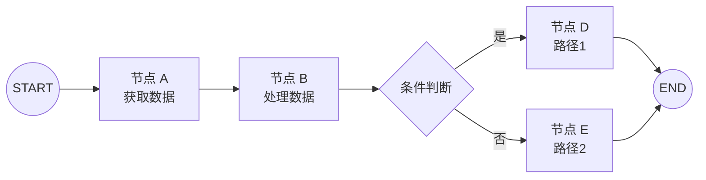
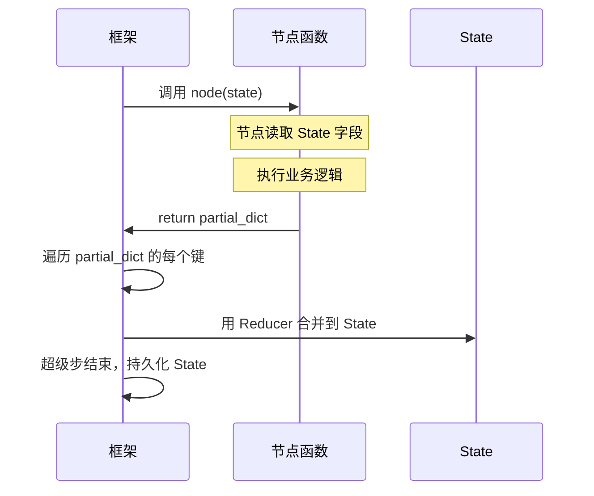
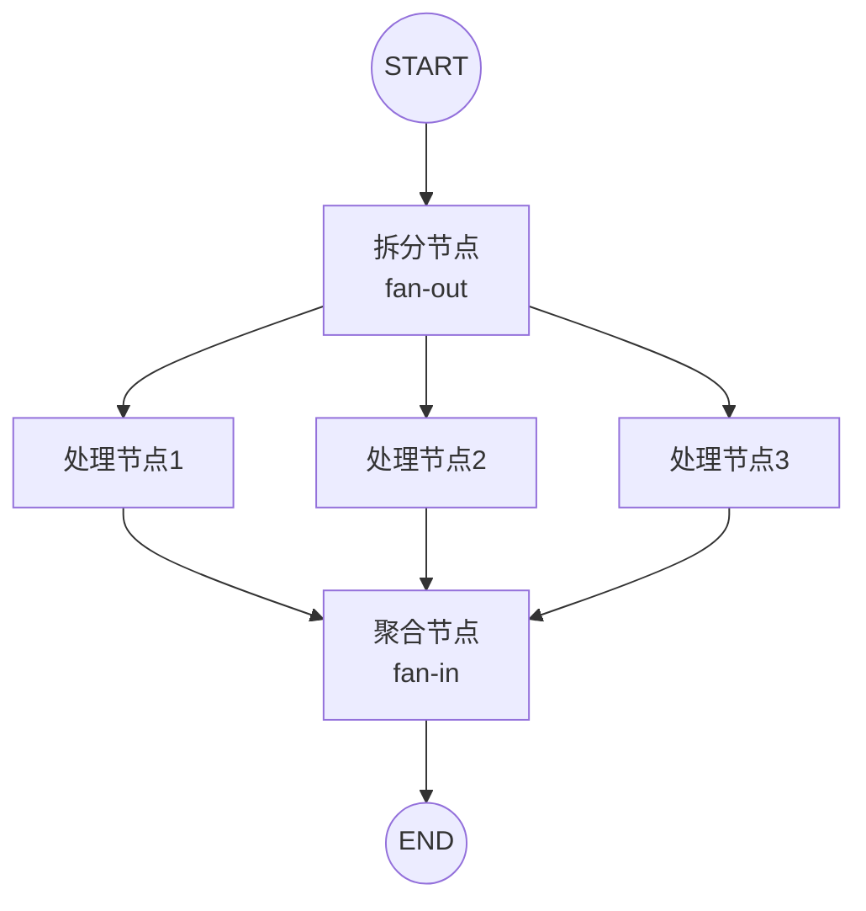
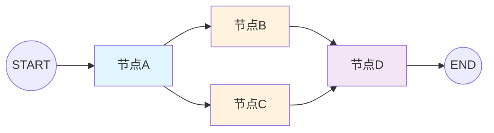
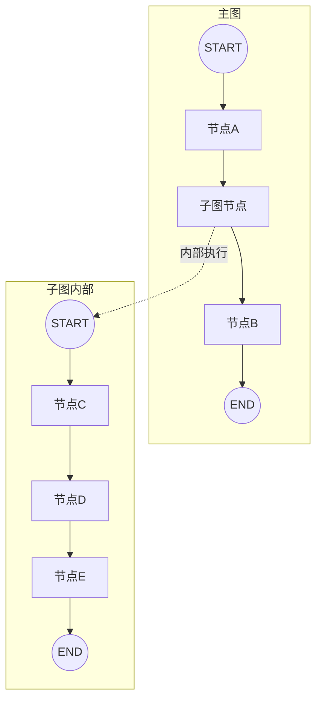

# LangGraph Node 节点与执行流

> **📖 文档说明**
>
> 本文档是「从零基础新手到实战老手」三部曲的**核心进阶篇**，聚焦 LangGraph 中执行的基本单元——Node（节点）。如果说 State 是 Agent 的"记忆"，那么 Node 就是 Agent 的"行动"。每个节点是一个独立的处理单元，接收 State、执行逻辑、返回更新。理解了节点，就理解了 LangGraph 的执行机制。
>
> **👥 适用人群**
> - 已经跑通 LangGraph Hello World，想深入理解节点机制的开发者
> - 需要构建复杂工作流、并行执行、子图嵌套的工程师
> - 需要精细控制节点超时、重试、配置的架构师
> - 准备 LangGraph 相关面试，需要系统掌握节点考点的求职者
>
> **📚 前置知识**
> - Python 基础（函数、装饰器、类型注解、异步）
> - LangGraph State 状态管理（已学习上篇文档）
> - LangChain 基础概念（LLM、Message、Tool）
>
> **🗺️ 学习路径提示**
> - 入门篇（第1-4章）：理解节点本质、函数签名、输入输出、基本编排
> - 进阶篇（第5-7章）：掌握并行执行、依赖管理、超时重试
> - 实战篇（第8-11章）：动态节点、子图嵌套、调试可观测性、生产架构

---

## 1. LangGraph Node 概述与本质

### 1.1 什么是 Node

#### 概念解释

**Node（节点）是 LangGraph 图中的基本执行单元，它是一个接收 State、执行特定逻辑、返回 State 更新的函数。** 它像工厂流水线上的一个"工作站"——每个工作站有专门的职能（焊接、装配、检测），接收上一站传来的半成品（State），进行加工（执行逻辑），传给下一站（返回更新）。

> 🎯 面试高频：LangGraph 的 Node 本质是什么？答：Node 本质上是一个 `(state) -> partial_state` 的函数。它接收当前 State 作为输入，返回一个字典（partial state）作为要更新的内容。框架负责将返回的 partial state 合并到全局 State 中。节点不直接修改传入的 State，而是通过返回值来更新，这遵循了不可变更新的设计原则。

#### 节点的核心特征

| 特征 | 说明 | 类比 |
|------|------|------|
| **单一职责** | 每个节点只做一件事 | 流水线每个工作站只做一道工序 |
| **无状态** | 节点本身不保存状态，所有状态在 State 中 | 工作站不存货，所有半成品在传送带上 |
| **纯函数** | 相同输入产生相同输出（理想情况下） | 相同的半成品经过相同工序得到相同结果 |
| **可组合** | 节点通过边连接，组成复杂图 | 工作站通过传送带连接，组成生产线 |
| **可替换** | 节点可以独立替换、升级 | 某个工作站可以更换设备，不影响其他站 |
| **可观测** | 节点的输入输出可以被追踪 | 每个工作站的加工过程可以被监控 |

#### 节点与函数的区别

```python
# 普通函数：输入 -> 输出，直接返回结果
def add(a: int, b: int) -> int:
    return a + b

result = add(1, 2)  # 直接调用，得到结果

# LangGraph 节点：接收 State -> 返回 partial State
from typing import TypedDict

class State(TypedDict):
    a: int
    b: int
    result: int

def add_node(state: State) -> dict:
    # 读取 State 中的输入
    a = state["a"]
    b = state["b"]
    # 执行逻辑
    result = a + b
    # 返回要更新的部分（不是完整 State）
    return {"result": result}

# 节点不直接调用，而是通过图执行
# graph.invoke({"a": 1, "b": 2, "result": 0})
```

> 💡 **关键区别**：普通函数的输入输出是显式的参数和返回值；LangGraph 节点的输入是整个 State，输出是 State 的部分更新。节点不需要关心数据从哪里来、到哪里去，只需要关心读写 State 的哪些字段。

---

### 1.2 节点在图中的角色

#### 概念解释

**节点是图的顶点，边是节点之间的连接。图的执行过程就是从起始节点开始，沿着边依次执行节点，直到到达结束节点。** 节点定义了"做什么"，边定义了"什么时候做、按什么顺序做"。

#### 图执行模型



#### 代码示例：最简单的节点图

```python
from typing import TypedDict
from langgraph.graph import StateGraph, START, END

class SimpleState(TypedDict):
    input: str
    output: str

# 定义节点函数
def node_1(state: SimpleState) -> dict:
    """第一个节点：处理输入"""
    print(f"  [节点1] 收到输入: {state['input']}")
    processed = state["input"].upper()
    return {"output": processed}

def node_2(state: SimpleState) -> dict:
    """第二个节点：进一步处理"""
    print(f"  [节点2] 收到中间结果: {state['output']}")
    final = f"处理完成: {state['output']}"
    return {"output": final}

# 构建图
builder = StateGraph(SimpleState)
builder.add_node("node1", node_1)  # 添加节点
builder.add_node("node2", node_2)
builder.add_edge(START, "node1")    # 添加边：起始 -> node1
builder.add_edge("node1", "node2")  # node1 -> node2
builder.add_edge("node2", END)      # node2 -> 结束

graph = builder.compile()

print("=== 执行图 ===")
result = graph.invoke({"input": "hello langgraph", "output": ""})
print(f"最终输出: {result['output']}")

# 预期输出:
# === 执行图 ===
#   [节点1] 收到输入: hello langgraph
#   [节点2] 收到中间结果: HELLO LANGGRAPH
# 最终输出: 处理完成: HELLO LANGGRAPH
```

---

### 1.3 节点的生命周期

#### 概念解释

**节点的生命周期是指从被调用到执行完毕的完整过程，包括：接收 State、执行逻辑、返回更新、框架合并。** 理解生命周期有助于排查节点执行中的问题。

#### 生命周期阶段



| 阶段 | 触发 | 关键操作 | 谁负责 |
|------|------|----------|--------|
| **调用** | 框架决定执行该节点 | 传入当前 State | 框架 |
| **读取** | 节点函数开始执行 | 从 State 中读取需要的字段 | 节点 |
| **执行** | 节点函数主体 | 执行业务逻辑（LLM调用、工具调用等） | 节点 |
| **返回** | 节点函数 return | 返回 partial dict | 节点 |
| **合并** | 框架收到返回值 | 用 Reducer 合并到 State | 框架 |
| **持久化** | 超级步结束 | 保存 State 快照到 Checkpointer | 框架 |

#### 代码示例：追踪节点生命周期

```python
from typing import TypedDict, Annotated
import operator
from langgraph.graph import StateGraph, START, END

class LifecycleState(TypedDict):
    counter: Annotated[int, operator.add]
    logs: Annotated[list, operator.add]

def tracked_node(state: LifecycleState) -> dict:
    print(f"  [1.读取] counter={state['counter']}, logs={state['logs']}")

    print(f"  [2.执行] 执行业务逻辑...")
    new_counter = state["counter"] + 1  # 注意：这只是计算，不是更新
    log_entry = f"节点执行，counter从{state['counter']}变为{state['counter']+1}"

    print(f"  [3.返回] {{counter: 1, logs: ['{log_entry}']}}")
    return {"counter": 1, "logs": [log_entry]}

builder = StateGraph(LifecycleState)
builder.add_node("tracked", tracked_node)
builder.add_edge(START, "tracked")
builder.add_edge("tracked", END)
graph = builder.compile()

print("=== 第一次执行 ===")
r1 = graph.invoke({"counter": 0, "logs": []})
print(f"  [4.合并后] counter={r1['counter']}, logs={r1['logs']}")

print("\n=== 第二次执行（同一线程）===")
from langgraph.checkpoint.memory import MemorySaver
memory = MemorySaver()
builder2 = StateGraph(LifecycleState)
builder2.add_node("tracked", tracked_node)
builder2.add_edge(START, "tracked")
builder2.add_edge("tracked", END)
graph2 = builder2.compile(checkpointer=memory)
config = {"configurable": {"thread_id": "lifecycle-demo"}}

graph2.invoke({"counter": 0, "logs": []}, config=config)
r2 = graph2.invoke({"counter": 0, "logs": []}, config=config)
print(f"  [4.合并后] counter={r2['counter']}, logs={r2['logs']}")

# 预期输出:
# === 第一次执行 ===
#   [1.读取] counter=0, logs=[]
#   [2.执行] 执行业务逻辑...
#   [3.返回] {counter: 1, logs: ['节点执行，counter从0变为1']}
#   [4.合并后] counter=1, logs=['节点执行，counter从0变为1']
#
# === 第二次执行（同一线程）===
#   [1.读取] counter=0, logs=[]
#   [2.执行] 执行业务逻辑...
#   [3.返回] {counter: 1, logs: ['节点执行，counter从0变为1']}
#   [1.读取] counter=1, logs=['节点执行，counter从0变为1']
#   [2.执行] 执行业务逻辑...
#   [3.返回] {counter: 1, logs: ['节点执行，counter从1变为2']}
#   [4.合并后] counter=2, logs=['节点执行，counter从0变为1', '节点执行，counter从1变为2']
```

> 💡 **关键观察**：第二次执行的第一次调用，节点读取到 counter=0（初始值）；第二次调用（同一 thread），节点读取到 counter=1（上次执行后的值）。这证明了 Checkpointer 的状态恢复能力。

---

### 1.4 入门篇：第一个多节点工作流

#### 概念解释

**一个多节点工作流是指由多个节点通过边连接组成的执行流程，每个节点负责一个独立的处理步骤。** 这是 LangGraph 最基本的使用模式——将复杂任务拆解为多个简单步骤，每个步骤一个节点，通过边连接。

#### 代码示例：内容处理工作流

```python
from typing import TypedDict, Annotated, List
import operator
from langgraph.graph import StateGraph, START, END

class ContentState(TypedDict):
    original_text: str
    cleaned_text: str
    translated_text: str
    summarized_text: str
    final_output: str
    steps: Annotated[List[str], operator.add]

def clean_node(state: ContentState) -> dict:
    """节点1：清洗文本"""
    text = state["original_text"]
    # 去除多余空格和换行
    cleaned = " ".join(text.split())
    print(f"  [清洗] 原文长度: {len(text)} → 清洗后长度: {len(cleaned)}")
    return {"cleaned_text": cleaned, "steps": ["clean"]}

def translate_node(state: ContentState) -> dict:
    """节点2：翻译文本"""
    text = state["cleaned_text"]
    # 模拟翻译（实际中调用 LLM）
    translated = f"[EN] {text}"
    print(f"  [翻译] 已翻译为英文")
    return {"translated_text": translated, "steps": ["translate"]}

def summarize_node(state: ContentState) -> dict:
    """节点3：摘要文本"""
    text = state["translated_text"]
    # 模拟摘要（实际中调用 LLM）
    summary = text[:50] + "..." if len(text) > 50 else text
    print(f"  [摘要] 摘要长度: {len(summary)}")
    return {"summarized_text": summary, "steps": ["summarize"]}

def format_node(state: ContentState) -> dict:
    """节点4：格式化输出"""
    output = (
        f"=== 内容处理报告 ===\n"
        f"原文: {state['original_text'][:30]}...\n"
        f"清洗后: {state['cleaned_text'][:30]}...\n"
        f"翻译: {state['translated_text'][:30]}...\n"
        f"摘要: {state['summarized_text']}\n"
        f"处理步骤: {' → '.join(state['steps'])}"
    )
    print(f"  [格式化] 输出已生成")
    return {"final_output": output, "steps": ["format"]}

# 构建图
builder = StateGraph(ContentState)
builder.add_node("clean", clean_node)
builder.add_node("translate", translate_node)
builder.add_node("summarize", summarize_node)
builder.add_node("format", format_node)
builder.add_edge(START, "clean")
builder.add_edge("clean", "translate")
builder.add_edge("translate", "summarize")
builder.add_edge("summarize", "format")
builder.add_edge("format", END)
graph = builder.compile()

print("=== 执行内容处理工作流 ===")
result = graph.invoke({
    "original_text": "  这是   一段\n\n需要  清洗的   文本内容  ",
    "cleaned_text": "",
    "translated_text": "",
    "summarized_text": "",
    "final_output": "",
    "steps": []
})

print("\n=== 最终输出 ===")
print(result["final_output"])

# 预期输出:
# === 执行内容处理工作流 ===
#   [清洗] 原文长度: 24 → 清洗后长度: 16
#   [翻译] 已翻译为英文
#   [摘要] 摘要长度: 25
#   [格式化] 输出已生成
#
# === 最终输出 ===
# === 内容处理报告 ===
# 原文:   这是   一段...
# 清洗后: 这是 一段 需要 清洗的 文本内容...
# 翻译: [EN] 这是 一段 需要 清洗的 文本内容...
# 摘要: [EN] 这是 一段 需要 清洗的 文本内容
# 处理步骤: clean → translate → summarize → format
```

---

### 💡 本章深度讲解

Node 是 LangGraph 的基本执行单元，本质上是一个 `(state) -> partial_state` 的函数。与普通函数不同，节点的输入是整个共享 State，输出是 State 的部分更新，框架负责合并。节点具有单一职责、无状态、纯函数、可组合、可替换、可观测六大特征。在图中，节点是顶点，边是连接，图的执行就是从 START 开始沿边依次执行节点直到 END。节点的生命周期包括：调用（框架传入 State）→ 读取（节点读取字段）→ 执行（业务逻辑）→ 返回（partial dict）→ 合并（框架用 Reducer 合并）→ 持久化（Checkpointer 保存快照）。入门阶段的核心心智模型：每个节点是一个独立的处理步骤，接收 State、返回更新，通过边连接成工作流。

### 📝 本章精简总结

1. Node 本质是 `(state) -> partial_state` 函数，接收 State、返回部分更新
2. 节点不直接修改 State，通过返回值更新，遵循不可变更新原则
3. 节点六大特征：单一职责、无状态、纯函数、可组合、可替换、可观测
4. 节点是图的顶点，边是连接，图执行从 START 沿边到 END
5. 节点生命周期：调用 → 读取 → 执行 → 返回 → 合并 → 持久化
6. 框架负责合并节点返回值到 State，节点不需要关心数据流向
7. 多节点工作流：将复杂任务拆解为多个简单步骤，每个步骤一个节点
8. 入门心智模型：节点 = 独立处理步骤，接收 State、返回更新、边连接成流

### 🎯 梯度练习题

**基础题⭐**

1. 用自己的话解释：LangGraph 的 Node 和普通 Python 函数有什么本质区别？
   > 提示：普通函数的输入输出是显式参数和返回值；节点的输入是整个 State，输出是 State 的部分更新。节点不直接调用，通过图执行。

2. 为什么节点不应该直接修改传入的 State，而应该返回 partial dict？
   > 提示：不可变更新原则。直接修改会导致并发问题、难以调试、无法时间旅行。返回 partial dict 让框架统一合并，保证可追溯性。

3. 写一个包含 3 个节点的简单工作流：节点1将文本转大写、节点2添加前缀、节点3打印结果。
   > 提示：定义 State 包含 input、upper、prefixed、output。三个节点分别处理，add_edge 连接。

**进阶题⭐⭐**

4. 分析以下节点函数的问题，并修复：
   ```python
   def bad_node(state):
       state["count"] = state["count"] + 1
       state["history"].append("done")
       return state
   ```
   > 提示：问题1：直接修改 state（应该返回更新）；问题2：返回完整 state（应该只返回修改的字段）；问题3：history.append 直接修改列表。修复：`return {"count": 1, "history": ["done"]}`（count 和 history 用 operator.add reducer）。

5. 设计一个"订单处理工作流"的节点拆分：接收订单 → 验证库存 → 计算价格 → 生成订单 → 发送通知。每个节点的职责是什么？节点之间通过哪些 State 字段传递数据？
   > 提示：State 包含 order_info、inventory_valid、price、order_id、notification_sent。验证节点读取 order_info，返回 inventory_valid；计算节点读取 inventory_valid 和 order_info，返回 price；生成节点读取 price，返回 order_id；通知节点读取 order_id，返回 notification_sent。

**实战题⭐⭐⭐**

6. 构建一个"博客文章生成工作流"：用户输入主题 → 生成大纲 → 撰写正文 → 生成摘要 → SEO 优化 → 格式化输出。要求：(1) 每个节点有明确的单一职责；(2) State 设计合理，每个字段有合适的类型和 reducer；(3) 每个节点打印执行进度；(4) 最终输出完整的博客文章。写出完整代码。
   > 提示：State 包含 topic、outline、content、summary、seo_keywords、final_article、steps（operator.add）。每个节点读取前一个节点的输出，返回自己的处理结果。steps 记录执行过的节点名。

---

## 2. 节点函数签名与规范

### 2.1 节点函数的标准签名

#### 概念解释

**节点函数的标准签名是 `def node_name(state: StateType) -> dict:`，接收一个 State 类型的参数，返回一个字典。** 这是 LangGraph 对节点函数的基本要求——固定的输入输出格式使得框架可以统一调用和管理所有节点。

> 🎯 面试高频：LangGraph 节点函数的标准签名是什么？可以有其他参数吗？答：标准签名是 `def node(state: State) -> dict`，只接收一个 State 参数，返回一个字典。如果需要额外的配置或依赖，可以通过以下方式传入：(1) 闭包——在外部函数中定义节点，捕获外部变量；(2) 配置对象——通过 `config` 参数（LangGraph 0.2+ 支持节点接收第二个 config 参数）；(3) State 字段——将配置存入 State 中。不建议在节点函数中使用全局变量。

#### 标准签名示例

```python
from typing import TypedDict

class MyState(TypedDict):
    input: str
    output: str

# ✅ 标准签名：一个参数，返回字典
def standard_node(state: MyState) -> dict:
    """标准节点函数"""
    result = state["input"].upper()
    return {"output": result}

# ✅ 带类型提示的标准签名
def typed_node(state: MyState) -> dict:
    """带完整类型提示的节点"""
    input_text: str = state["input"]
    processed: str = input_text.strip()
    return {"output": processed}

# ✅ 无类型提示（不推荐但合法）
def untyped_node(state):
    return {"output": str(state["input"])}
```

#### 代码示例：带 config 参数的节点（LangGraph 0.2+）

```python
from typing import TypedDict
from langgraph.graph import StateGraph, START, END
from langgraph.types import PregelTask

class ConfigState(TypedDict):
    query: str
    result: str

def node_with_config(state: ConfigState, config: dict) -> dict:
    """
    带 config 参数的节点（LangGraph 0.2+ 支持）
    config 包含：thread_id、checkpoint_id、tags、metadata 等
    """
    # 从 config 中获取配置
    thread_id = config.get("configurable", {}).get("thread_id", "unknown")
    tags = config.get("tags", [])
    metadata = config.get("metadata", {})

    print(f"  [节点] thread_id={thread_id}")
    print(f"  [节点] tags={tags}")
    print(f"  [节点] metadata={metadata}")

    # 可以根据 config 中的配置调整行为
    user_language = metadata.get("language", "zh-CN")
    if user_language == "en":
        result = f"Result for: {state['query']}"
    else:
        result = f"查询结果: {state['query']}"

    return {"result": result}

builder = StateGraph(ConfigState)
builder.add_node("config_node", node_with_config)
builder.add_edge(START, "config_node")
builder.add_edge("config_node", END)
graph = builder.compile()

# 调用时传入 config
config = {
    "configurable": {"thread_id": "user-123-session-456"},
    "tags": ["production", "demo"],
    "metadata": {"language": "zh-CN", "user_id": "user-123"}
}

print("=== 执行带 config 的节点 ===")
result = graph.invoke({"query": "LangGraph 节点", "result": ""}, config=config)
print(f"结果: {result['result']}")

# 预期输出:
# === 执行带 config 的节点 ===
#   [节点] thread_id=user-123-session-456
#   [节点] tags=['production', 'demo']
#   [节点] metadata={'language': 'zh-CN', 'user_id': 'user-123'}
# 结果: 查询结果: LangGraph 节点
```

---

### 2.2 节点命名规范

#### 概念解释

**节点命名是指在 `add_node(name, func)` 中给节点指定的唯一标识符，它用于在图中引用节点、添加边、调试追踪。** 好的节点命名能让图的结构清晰易读，差的命名会导致混淆和难以维护。

#### 命名规范

| 规范 | 说明 | 示例 |
|------|------|------|
| **小写+下划线** | Python 函数命名风格 | `fetch_data`, `process_result` |
| **动词开头** | 节点是执行动作，用动词命名 | `generate`, `validate`, `transform` |
| **描述职责** | 名字能看出节点做什么 | `translate_to_english`, `summarize_document` |
| **唯一性** | 同一图中节点名必须唯一 | 不能有两个 `process` 节点 |
| **避免缩写** | 除非是广为人知的缩写 | 用 `fetch_user_data` 不用 `fud` |
| **不用保留字** | 不用 `START`、`END` 等保留名 | 这些是框架保留的 |

#### 代码示例：好的 vs 坏的节点命名

```python
from typing import TypedDict
from langgraph.graph import StateGraph, START, END

class State(TypedDict):
    text: str
    result: str

# ❌ 坏的命名
def func1(state): return {}          # 无意义的名字
def process(state): return {}         # 太泛，不知道处理什么
def do_stuff(state): return {}        # 口语化，不专业
def Node1(state): return {}           # 大驼峰，不符合 Python 风格
def fetch_data_from_database_and_cache(state): return {}  # 太长

# ✅ 好的命名
def fetch_data(state): return {}           # 简洁，动词开头
def validate_input(state): return {}       # 描述职责
def translate_text(state): return {}       # 描述职责
def generate_summary(state): return {}     # 描述职责
def format_output(state): return {}        # 描述职责

# 构建图时的命名对比
builder = StateGraph(State)

# ❌ 坏的节点名
# builder.add_node("func1", func1)
# builder.add_node("process", process)

# ✅ 好的节点名
builder.add_node("fetch_data", fetch_data)
builder.add_node("validate_input", validate_input)
builder.add_node("translate_text", translate_text)
builder.add_node("generate_summary", generate_summary)
builder.add_node("format_output", format_output)

# 边的连接也清晰可读
builder.add_edge(START, "fetch_data")
builder.add_edge("fetch_data", "validate_input")
builder.add_edge("validate_input", "translate_text")
builder.add_edge("translate_text", "generate_summary")
builder.add_edge("generate_summary", "format_output")
builder.add_edge("format_output", END)

print("✅ 节点命名规范示例已加载")
print(f"节点列表: {['fetch_data', 'validate_input', 'translate_text', 'generate_summary', 'format_output']}")
```

---

### 2.3 节点返回值规范

#### 概念解释

**节点返回值必须是一个字典（dict），字典的键是 State 中要更新的字段名，值是要更新的内容。** 返回空字典 `{}` 表示不更新任何字段。返回 None 或非字典类型会导致错误。

#### 返回值规范

| 规范 | 说明 | 示例 |
|------|------|------|
| **必须是 dict** | 返回值必须是字典类型 | `return {"result": "xxx"}` |
| **键名匹配 State** | 键名必须是 State 中定义的字段 | State 有 `result` 字段，返回 `{"result": ...}` |
| **只返回修改的字段** | 不返回未修改的字段 | 只修改了 result，只返回 `{"result": ...}` |
| **空字典表示无更新** | 不需要更新时返回 `{}` | `return {}` |
| **不返回完整 State** | 不要 `return dict(state)` | 只返回修改的部分 |

#### 代码示例：正确的返回值

```python
from typing import TypedDict, Annotated, List
import operator
from langgraph.graph import StateGraph, START, END

class ReturnState(TypedDict):
    input: str
    processed: str
    count: Annotated[int, operator.add]
    tags: Annotated[List[str], operator.add]
    metadata: dict

def correct_node(state: ReturnState) -> dict:
    """✅ 正确：只返回修改的字段"""
    processed = state["input"].upper()
    return {
        "processed": processed,  # 修改了 processed
        "count": 1,              # 修改了 count（增量）
        "tags": ["processed"],   # 修改了 tags（追加）
    }
    # 注意：没有返回 input、metadata（未修改的字段）

def no_update_node(state: ReturnState) -> dict:
    """✅ 正确：不需要更新时返回空字典"""
    # 执行了一些只读操作，不需要修改 State
    print(f"  [只读节点] 读取了 input: {state['input']}")
    return {}  # 空字典表示不更新任何字段

def conditional_update_node(state: ReturnState) -> dict:
    """✅ 正确：条件性返回"""
    if state["input"]:
        return {"processed": state["input"].upper()}
    else:
        return {}  # 输入为空时不更新

# 构建图测试
builder = StateGraph(ReturnState)
builder.add_node("correct", correct_node)
builder.add_node("readonly", no_update_node)
builder.add_edge(START, "correct")
builder.add_edge("correct", "readonly")
builder.add_edge("readonly", END)
graph = builder.compile()

result = graph.invoke({
    "input": "hello",
    "processed": "",
    "count": 0,
    "tags": [],
    "metadata": {"source": "test"}
})

print(f"processed: {result['processed']}")
print(f"count: {result['count']}")
print(f"tags: {result['tags']}")
print(f"metadata（未修改）: {result['metadata']}")

# 预期输出:
#   [只读节点] 读取了 input: hello
# processed: HELLO
# count: 1
# tags: ['processed']
# metadata（未修改）: {'source': 'test'}
```

#### 代码示例：错误的返回值及修复

```python
from typing import TypedDict

class State(TypedDict):
    result: str
    count: int

# ❌ 错误1：返回 None
def bad_node_1(state: State) -> dict:
    print("执行了一些操作")
    # 没有 return，默认返回 None
    # 框架会报错：Expected dict, got NoneType

# ✅ 修复：返回空字典
def fixed_node_1(state: State) -> dict:
    print("执行了一些操作")
    return {}

# ❌ 错误2：返回非字典类型
def bad_node_2(state: State) -> str:
    return "处理结果"  # 返回字符串，不是字典
    # 框架会报错：Expected dict, got str

# ✅ 修复：包装成字典
def fixed_node_2(state: State) -> dict:
    return {"result": "处理结果"}

# ❌ 错误3：返回完整 State
def bad_node_3(state: State) -> dict:
    new_state = dict(state)
    new_state["result"] = "新结果"
    return new_state  # 返回完整 State，包括未修改的字段
    # 虽然不会报错，但效率低，且可能意外覆盖其他字段

# ✅ 修复：只返回修改的字段
def fixed_node_3(state: State) -> dict:
    return {"result": "新结果"}

# ❌ 错误4：键名不匹配 State
def bad_node_4(state: State) -> dict:
    return {"output": "结果"}  # State 中没有 output 字段，只有 result
    # 该更新会被忽略或报错

# ✅ 修复：使用正确的键名
def fixed_node_4(state: State) -> dict:
    return {"result": "结果"}

print("✅ 错误返回值及修复示例已加载")
```

---

### 2.4 异步节点

#### 概念解释

**异步节点是指用 `async def` 定义的节点函数，在执行时可以并发等待 IO 操作（如 LLM 调用、HTTP 请求）。** LangGraph 支持同步和异步节点，异步节点在 IO 密集型场景下能显著提高性能。

> 🎯 面试高频：LangGraph 支持异步节点吗？同步和异步节点可以混用吗？答：支持。节点函数可以是 `def`（同步）或 `async def`（异步）。同步和异步节点可以在同一个图中混用，框架会自动处理。调用异步图时用 `await graph.ainvoke()`，调用同步图时用 `graph.invoke()`。如果图中包含异步节点，必须用异步调用方式（ainvoke、astream）。

#### 代码示例：异步节点基础

```python
import asyncio
from typing import TypedDict
from langgraph.graph import StateGraph, START, END

class AsyncState(TypedDict):
    query: str
    result: str

async def async_fetch_node(state: AsyncState) -> dict:
    """异步节点：模拟异步 IO 操作"""
    print(f"  [异步获取] 开始获取: {state['query']}")
    # 模拟异步 IO（实际中是 aiohttp 请求、LLM 异步调用等）
    await asyncio.sleep(0.1)  # 模拟 100ms 的 IO 等待
    result = f"获取结果: {state['query']}"
    print(f"  [异步获取] 完成: {result}")
    return {"result": result}

def sync_process_node(state: AsyncState) -> dict:
    """同步节点：可以和异步节点混用"""
    print(f"  [同步处理] 处理: {state['result']}")
    processed = state["result"].upper()
    return {"result": processed}

builder = StateGraph(AsyncState)
builder.add_node("async_fetch", async_fetch_node)
builder.add_node("sync_process", sync_process_node)
builder.add_edge(START, "async_fetch")
builder.add_edge("async_fetch", "sync_process")
builder.add_edge("sync_process", END)
graph = builder.compile()

# 异步调用
async def main():
    print("=== 异步执行 ===")
    result = await graph.ainvoke({"query": "LangGraph 异步节点", "result": ""})
    print(f"最终结果: {result['result']}")

asyncio.run(main())

# 预期输出:
# === 异步执行 ===
#   [异步获取] 开始获取: LangGraph 异步节点
#   [异步获取] 完成: 获取结果: LangGraph 异步节点
#   [同步处理] 处理: 获取结果: LangGraph 异步节点
# 最终结果: 获取结果: LANGGRAPH 异步节点
```

#### 代码示例：异步节点的并发优势

```python
import asyncio
import time
from typing import TypedDict, Annotated, List
import operator
from langgraph.graph import StateGraph, START, END

class ConcurrentState(TypedDict):
    urls: List[str]
    results: Annotated[List[str], operator.add]
    total_time: float

async def fetch_all_node(state: ConcurrentState) -> dict:
    """异步节点：并发获取多个 URL"""
    urls = state["urls"]
    start = time.perf_counter()

    # 并发执行所有异步任务
    async def fetch_one(url: str) -> str:
        await asyncio.sleep(0.2)  # 模拟每个请求 200ms
        return f"结果: {url}"

    tasks = [fetch_one(url) for url in urls]
    results = await asyncio.gather(*tasks)  # 并发执行

    elapsed = time.perf_counter() - start
    print(f"  [并发获取] {len(urls)} 个 URL，耗时 {elapsed:.2f}s")
    return {"results": results, "total_time": elapsed}

builder = StateGraph(ConcurrentState)
builder.add_node("fetch_all", fetch_all_node)
builder.add_edge(START, "fetch_all")
builder.add_edge("fetch_all", END)
graph = builder.compile()

async def main():
    urls = [f"https://api.example.com/data/{i}" for i in range(5)]
    print("=== 并发获取 5 个 URL ===")
    result = await graph.ainvoke({
        "urls": urls,
        "results": [],
        "total_time": 0.0
    })
    print(f"总耗时: {result['total_time']:.2f}s（如果是串行需要 1.0s）")
    print(f"结果数: {len(result['results'])}")

asyncio.run(main())

# 预期输出:
# === 并发获取 5 个 URL ===
#   [并发获取] 5 个 URL，耗时 0.20s
# 总耗时: 0.20s（如果是串行需要 1.0s）
# 结果数: 5
```

> 💡 **性能对比**：5 个 URL，每个 200ms，串行需要 1.0s，并发只需要 0.2s。异步节点在 IO 密集型场景下的并发优势非常明显。

---

### 2.5 常见坑点：节点函数篇

#### 坑点1：节点函数中使用全局变量

**错误现象**：节点函数依赖全局变量，在多线程或多请求场景下出现数据混乱，或者全局变量修改后影响所有执行实例。

```python
# ❌ 错误：使用全局变量
counter = 0  # 全局变量

def bad_node(state):
    global counter
    counter += 1  # 修改全局变量
    return {"count": counter}
    # 问题：
    # 1. 多个请求共享同一个 counter，互相干扰
    # 2. 节点不是纯函数，相同输入可能产生不同输出
    # 3. 无法通过 State 追踪 counter 的变化
    # 4. 持久化后恢复时，counter 不会恢复
```

**根本原因**：全局变量在所有执行实例之间共享，破坏了节点的无状态性。节点应该只通过 State 来存储和传递数据，不应该依赖外部状态。

**正确做法**：
1. 将全局变量移入 State，用 reducer 管理
2. 如果需要配置，通过闭包或 config 传入
3. 节点应该是纯函数，只依赖输入参数

```python
from typing import TypedDict, Annotated
import operator

class GoodState(TypedDict):
    count: Annotated[int, operator.add]  # 移入 State

def good_node(state: GoodState) -> dict:
    """✅ 正确：不使用全局变量，所有数据在 State 中"""
    return {"count": 1}  # 增量更新
```

**预防措施**：
1. 代码审查时检查节点函数中是否有 `global` 声明或对全局变量的引用
2. 封装代码规范：节点函数必须是纯函数
3. 写测试验证节点的幂等性（相同输入产生相同输出）

---

#### 坑点2：节点函数抛出未处理的异常

**错误现象**：节点函数执行中抛出异常（如网络错误、LLM 调用失败），导致整个图执行中断，State 停留在中间状态，无法恢复。

```python
# ❌ 错误：未处理异常
def risky_node(state):
    # 调用外部 API，可能失败
    response = requests.get("https://api.example.com/data")  # 可能超时或报错
    data = response.json()  # 可能解析失败
    return {"data": data}
    # 如果 API 调用失败，异常会传播到框架，图执行中断
    # State 停留在该节点执行前的状态
    # 无法从断点恢复（需要手动处理）
```

**根本原因**：节点函数中的异常会中断图的执行。虽然 LangGraph 提供了重试机制（第7章详解），但未处理的异常仍然会导致执行中断，需要上层处理。

**正确做法**：
1. 在节点中捕获预期内的异常，将错误信息存入 State
2. 对不可预期的异常，让框架的重试机制处理
3. 在 State 中设置错误字段，用于错误处理和条件路由

```python
from typing import TypedDict, Optional

class SafeState(TypedDict):
    data: dict
    error: Optional[str]
    retry_count: int

def safe_node(state: SafeState) -> dict:
    """✅ 正确：处理预期内的异常"""
    try:
        # 调用外部 API
        # response = requests.get("https://api.example.com/data", timeout=5)
        # data = response.json()
        data = {"result": "success"}  # 模拟成功
        return {"data": data, "error": None}
    except Exception as e:
        # 捕获异常，存入 State，不中断图执行
        error_msg = f"API 调用失败: {str(e)}"
        print(f"  [错误] {error_msg}")
        return {"error": error_msg, "retry_count": 1}
```

**预防措施**：
1. 所有涉及外部 IO 的节点都应该有异常处理
2. 在 State 中设置 error 字段，用于错误传递和条件路由
3. 对关键节点配置重试机制（第7章详解）
4. 写测试覆盖异常场景

---

### 💡 本章深度讲解

节点函数签名与规范是编写高质量 LangGraph 应用的基础。标准签名是 `def node(state: State) -> dict`，LangGraph 0.2+ 还支持第二个 config 参数。节点命名应该遵循小写+下划线、动词开头、描述职责、唯一性的规范。返回值必须是字典，键名匹配 State 字段，只返回修改的字段，空字典表示无更新。异步节点用 `async def` 定义，在 IO 密集型场景下有显著的并发优势，同步和异步节点可以混用。常见坑点包括使用全局变量（破坏无状态性）和未处理异常（导致图执行中断），前者通过将数据移入 State 解决，后者通过异常处理和错误字段解决。编写节点时应该始终追求纯函数性——相同输入产生相同输出，不依赖外部状态，不产生副作用。

### 📝 本章精简总结

1. 标准签名：`def node(state: State) -> dict`，0.2+ 支持第二个 config 参数
2. config 参数包含 thread_id、tags、metadata 等，可用于调整节点行为
3. 节点命名：小写+下划线、动词开头、描述职责、唯一性、不用保留字
4. 返回值必须是 dict，键名匹配 State，只返回修改的字段，空字典表示无更新
5. 不要返回完整 State（`return dict(state)`），只返回修改的部分
6. 异步节点用 `async def`，调用用 `await graph.ainvoke()`，同步异步可混用
7. 异步节点在 IO 密集型场景下有显著并发优势（用 asyncio.gather）
8. 坑点1：不用全局变量 → 数据移入 State
9. 坑点2：处理异常 → try/except + error 字段，不中断图执行

### 🎯 梯度练习题

**基础题⭐**

1. LangGraph 节点函数的标准签名是什么？返回值有什么要求？
   > 提示：`def node(state: State) -> dict`。返回值必须是字典，键名匹配 State 字段，只返回修改的字段。

2. 为什么节点命名应该用动词开头？举 3 个好的和 3 个坏的节点名例子。
   > 提示：节点是执行动作，用动词开头能清晰表达职责。好的：fetch_data、validate_input、generate_summary。坏的：func1、process、data。

3. 写一个异步节点，模拟并发获取 3 个 URL（每个延迟 100ms），验证总耗时约 100ms 而非 300ms。
   > 提示：用 `async def` 定义节点，内部用 `asyncio.gather` 并发执行 3 个 `asyncio.sleep(0.1)`，用 `time.perf_counter()` 计时。

**进阶题⭐⭐**

4. 分析以下节点函数的问题，并修复：
   ```python
   API_KEY = "sk-xxx"  # 全局变量
   def call_api(state):
       response = requests.get(f"https://api.example.com?q={state['query']}&key={API_KEY}")
       return response.json()
   ```
   > 提示：问题1：API_KEY 是全局变量（应通过 config 或 State 传入）；问题2：返回 response.json() 可能不是字典（应包装）；问题3：未处理异常（应 try/except）；问题4：API_KEY 硬编码（应从环境变量或配置读取）。

5. 设计一个"带配置的节点"模式：节点需要根据用户的语言偏好（中文/英文）返回不同格式的结果。要求不使用全局变量，通过 config 参数传入配置。写出节点函数和调用代码。
   > 提示：节点签名 `def node(state, config)`，从 `config.get("metadata", {}).get("language", "zh-CN")` 获取语言。调用时传入 `config={"metadata": {"language": "en"}}`。

**实战题⭐⭐⭐**

6. 构建一个"异步数据聚合工作流"：3 个异步节点分别从不同的 API 获取数据（模拟延迟 100ms/200ms/150ms），1 个聚合节点汇总所有数据。要求：(1) 3 个获取节点并行执行（用 Send API 或并行边）；(2) 聚合节点等待所有获取节点完成后执行；(3) 记录总执行时间，验证并行优势；(4) 每个节点有异常处理。写出完整代码。
   > 提示：State 包含 data_a、data_b、data_c、aggregated、errors、start_time。3 个获取节点都从 START 出发（并行），都指向聚合节点。每个获取节点用 async def，内部 await asyncio.sleep。聚合节点读取 3 个 data 字段，汇总。用 time.perf_counter() 计时。

---

## 3. 节点输入输出与状态交互

### 3.1 节点如何读取 State

#### 概念解释

**节点通过 `state["字段名"]` 或 `state.get("字段名", 默认值)` 来读取 State 中的数据。** 节点可以读取 State 中的任何字段，但最佳实践是只读取需要的字段，避免不必要的依赖。

#### 代码示例：State 读取的三种方式

```python
from typing import TypedDict, Optional

class ReadState(TypedDict):
    query: str
    result: str
    retry_count: int
    optional_field: Optional[str]

# 方式1：直接索引（字段必须存在）
def direct_read(state: ReadState) -> dict:
    """直接索引读取，字段不存在时抛 KeyError"""
    query = state["query"]  # 必须存在，否则 KeyError
    return {"result": f"处理: {query}"}

# 方式2：get 方法（字段可选，提供默认值）
def safe_read(state: ReadState) -> dict:
    """用 get 读取，字段不存在时返回默认值"""
    query = state.get("query", "")  # 不存在时返回空字符串
    retry = state.get("retry_count", 0)  # 不存在时返回 0
    optional = state.get("optional_field")  # 不存在时返回 None
    return {"result": f"query={query}, retry={retry}, optional={optional}"}

# 方式3：解构读取（同时读取多个字段）
def destructured_read(state: ReadState) -> dict:
    """解构读取多个字段，代码更简洁"""
    query = state["query"]
    retry_count = state["retry_count"]
    # 或者一次性读取
    query, retry = state["query"], state["retry_count"]
    return {"result": f"{query} (重试 {retry} 次)"}

# 测试
from langgraph.graph import StateGraph, START, END
builder = StateGraph(ReadState)
builder.add_node("direct", direct_read)
builder.add_node("safe", safe_read)
builder.add_node("destructured", destructured_read)
builder.add_edge(START, "direct")
builder.add_edge("direct", "safe")
builder.add_edge("safe", "destructured")
builder.add_edge("destructured", END)
graph = builder.compile()

result = graph.invoke({
    "query": "测试查询",
    "result": "",
    "retry_count": 2,
    "optional_field": None
})
print(f"最终结果: {result['result']}")

# 预期输出:
# 最终结果: 测试查询 (重试 2 次)
```

#### 代码示例：读取嵌套 State

```python
from typing import TypedDict

class NestedReadState(TypedDict):
    user: dict  # {"name": str, "preferences": {"theme": str, "language": str}}
    config: dict

def read_nested_node(state: NestedReadState) -> dict:
    """读取嵌套 State 中的字段"""
    # 方式1：链式索引（可能抛 KeyError）
    user_name = state["user"]["name"]

    # 方式2：安全读取（用 get 链式调用）
    theme = state.get("user", {}).get("preferences", {}).get("theme", "default")
    language = state.get("user", {}).get("preferences", {}).get("language", "zh-CN")

    # 方式3：辅助函数（更优雅）
    def get_nested(d: dict, path: str, default=None):
        keys = path.split(".")
        current = d
        for key in keys:
            if isinstance(current, dict) and key in current:
                current = current[key]
            else:
                return default
        return current

    theme_v2 = get_nested(state, "user.preferences.theme", "default")

    print(f"  用户名: {user_name}")
    print(f"  主题: {theme}")
    print(f"  语言: {language}")
    print(f"  主题(v2): {theme_v2}")

    return {"config": {"last_user": user_name, "theme": theme}}

builder = StateGraph(NestedReadState)
builder.add_node("read_nested", read_nested_node)
builder.add_edge(START, "read_nested")
builder.add_edge("read_nested", END)
graph = builder.compile()

result = graph.invoke({
    "user": {
        "name": "小明",
        "preferences": {"theme": "dark", "language": "zh-CN"}
    },
    "config": {}
})

# 预期输出:
#   用户名: 小明
#   主题: dark
#   语言: zh-CN
#   主题(v2): dark
```

---

### 3.2 节点如何更新 State

#### 概念解释

**节点通过返回字典来更新 State，字典的键是要更新的字段名，值是更新内容。** 框架根据字段的 Reducer 来决定如何合并：没有 Reducer 的字段是覆盖，有 Reducer 的字段按 Reducer 逻辑合并。

#### 代码示例：三种更新模式

```python
from typing import TypedDict, Annotated, List
import operator
from langgraph.graph.message import add_messages
from langgraph.graph import StateGraph, START, END
from langchain_core.messages import HumanMessage, AIMessage

class UpdateState(TypedDict):
    # 覆盖模式：无 reducer
    current_status: str
    config: dict
    # 累加模式：operator.add
    visit_count: Annotated[int, operator.add]
    tags: Annotated[List[str], operator.add]
    # 消息追加模式：add_messages
    messages: Annotated[List, add_messages]

def overwrite_node(state: UpdateState) -> dict:
    """覆盖模式：新值替换旧值"""
    return {
        "current_status": "processing",  # 覆盖旧值
        "config": {"theme": "dark"},     # 覆盖旧值（整个字典被替换）
    }

def increment_node(state: UpdateState) -> dict:
    """累加模式：返回增量，框架加到旧值上"""
    return {
        "visit_count": 1,              # +1
        "tags": ["new_tag"],           # 追加到列表
    }

def message_node(state: UpdateState) -> dict:
    """消息追加模式：返回消息列表，框架追加并去重"""
    return {
        "messages": [AIMessage(content="这是 AI 回复")]
    }

builder = StateGraph(UpdateState)
builder.add_node("overwrite", overwrite_node)
builder.add_node("increment", increment_node)
builder.add_node("message", message_node)
builder.add_edge(START, "overwrite")
builder.add_edge("overwrite", "increment")
builder.add_edge("increment", "message")
builder.add_edge("message", END)
graph = builder.compile()

result = graph.invoke({
    "current_status": "idle",
    "config": {"theme": "light", "language": "zh-CN"},
    "visit_count": 5,
    "tags": ["existing_tag"],
    "messages": [HumanMessage(content="你好")]
})

print(f"current_status（覆盖）: {result['current_status']}")
print(f"config（覆盖）: {result['config']}")
print(f"visit_count（累加）: {result['visit_count']}")
print(f"tags（拼接）: {result['tags']}")
print(f"messages（追加）: {[m.content for m in result['messages']]}")

# 预期输出:
# current_status（覆盖）: processing
# config（覆盖）: {'theme': 'dark'}  ← 注意：language 丢失了！
# visit_count（累加）: 6
# tags（拼接）: ['existing_tag', 'new_tag']
# messages（追加）: ['你好', '这是 AI 回复']
```

> ⚠️ **重要提醒**：`config` 字段用了覆盖语义，`overwrite_node` 返回 `{"theme": "dark"}` 完全替换了原来的 `{"theme": "light", "language": "zh-CN"}`，导致 `language` 丢失。如果需要保留其他字段，应该用深度合并 Reducer。

---

### 3.3 节点间的数据传递模式

#### 概念解释

**节点间的数据传递是指前一个节点的输出如何成为后一个节点的输入。** 在 LangGraph 中，节点间不直接传递数据，而是通过共享 State 来间接传递——前一个节点将结果写入 State 的某个字段，后一个节点从该字段读取。

#### 三种传递模式

| 模式 | 说明 | 适用场景 |
|------|------|----------|
| **直接字段传递** | A 写入 field，B 读取 field | 简单的线性流程 |
| **中间字段传递** | A 写入 intermediate，B 读取 intermediate 并写入 final | 需要中间结果的流程 |
| **消息列表传递** | A 和 B 都读写 messages 列表 | 对话式 Agent |

#### 代码示例：直接字段传递

```python
from typing import TypedDict
from langgraph.graph import StateGraph, START, END

class DirectPassState(TypedDict):
    input: str
    processed: str    # A 的输出，B 的输入
    output: str       # B 的输出

def node_a(state: DirectPassState) -> dict:
    """节点 A：处理输入，写入 processed"""
    processed = state["input"].upper()
    print(f"  [A] 输入: {state['input']} → 输出: {processed}")
    return {"processed": processed}

def node_b(state: DirectPassState) -> dict:
    """节点 B：读取 processed，生成 output"""
    output = f"处理结果: {state['processed']}"
    print(f"  [B] 输入: {state['processed']} → 输出: {output}")
    return {"output": output}

builder = StateGraph(DirectPassState)
builder.add_node("A", node_a)
builder.add_node("B", node_b)
builder.add_edge(START, "A")
builder.add_edge("A", "B")
builder.add_edge("B", END)
graph = builder.compile()

result = graph.invoke({"input": "hello", "processed": "", "output": ""})
print(f"最终: {result['output']}")

# 预期输出:
#   [A] 输入: hello → 输出: HELLO
#   [B] 输入: HELLO → 输出: 处理结果: HELLO
# 最终: 处理结果: HELLO
```

#### 代码示例：中间字段传递

```python
from typing import TypedDict, Optional

class IntermediateState(TypedDict):
    raw_input: str
    normalized: Optional[str]   # 中间字段：A 的输出
    validated: Optional[bool]   # 中间字段：B 的输出
    final_result: str            # C 的输出

def normalize_node(state: IntermediateState) -> dict:
    """A：标准化输入"""
    raw = state["raw_input"]
    normalized = raw.strip().lower()
    print(f"  [标准化] '{raw}' → '{normalized}'")
    return {"normalized": normalized}

def validate_node(state: IntermediateState) -> dict:
    """B：验证标准化后的数据"""
    normalized = state["normalized"]
    is_valid = len(normalized) > 0 and normalized.isalpha()
    print(f"  [验证] '{normalized}' → {'有效' if is_valid else '无效'}")
    return {"validated": is_valid}

def process_node(state: IntermediateState) -> dict:
    """C：根据验证结果处理"""
    if state["validated"]:
        result = f"处理成功: {state['normalized']}"
    else:
        result = "处理失败: 输入无效"
    print(f"  [处理] {result}")
    return {"final_result": result}

builder = StateGraph(IntermediateState)
builder.add_node("normalize", normalize_node)
builder.add_node("validate", validate_node)
builder.add_node("process", process_node)
builder.add_edge(START, "normalize")
builder.add_edge("normalize", "validate")
builder.add_edge("validate", "process")
builder.add_edge("process", END)
graph = builder.compile()

result = graph.invoke({
    "raw_input": "  Hello World  ",
    "normalized": None,
    "validated": None,
    "final_result": ""
})
print(f"最终: {result['final_result']}")

# 预期输出:
#   [标准化] '  Hello World  ' → 'hello world'
#   [验证] 'hello world' → 无效（包含空格，isalpha() 为 False）
#   [处理] 处理失败: 输入无效
# 最终: 处理失败: 输入无效
```

---

### 3.4 节点的读写依赖分析

#### 概念解释

**节点的读写依赖是指节点读取哪些 State 字段、写入哪些字段。** 分析读写依赖有助于理解节点之间的依赖关系、发现潜在的冲突、优化执行顺序。

#### 代码示例：自动分析节点读写依赖

```python
import ast
import inspect
from typing import TypedDict, get_type_hints

class DependencyState(TypedDict):
    query: str
    context: list
    result: str
    confidence: float
    errors: list

def analyze_node_dependencies(node_func, state_type):
    """
    静态分析节点函数的读写依赖
    通过 AST 分析 state["field"] 和 return {"field": ...}
    """
    source = inspect.getsource(node_func)
    tree = ast.parse(source)

    reads = set()
    writes = set()

    class StateAccessVisitor(ast.NodeVisitor):
        def visit_Subscript(self, node):
            # 检测 state["field"] 读取
            if (isinstance(node.value, ast.Name) and
                node.value.id == "state" and
                isinstance(node.slice, ast.Constant)):
                reads.add(node.slice.value)
            self.generic_visit(node)

        def visit_Return(self, node):
            # 检测 return {"field": ...} 写入
            if isinstance(node.value, ast.Dict):
                for key in node.value.keys:
                    if isinstance(key, ast.Constant):
                        writes.add(key.value)
            self.generic_visit(node)

    StateAccessVisitor().visit(tree)
    return {"reads": reads, "writes": writes}

# 示例节点
def search_node(state: DependencyState) -> dict:
    query = state["query"]
    context = state["context"]
    result = f"搜索结果: {query}"
    return {"result": result, "confidence": 0.95}

def validate_node(state: DependencyState) -> dict:
    result = state["result"]
    confidence = state["confidence"]
    if confidence < 0.5:
        return {"errors": ["置信度太低"]}
    return {}

# 分析依赖
deps1 = analyze_node_dependencies(search_node, DependencyState)
deps2 = analyze_node_dependencies(validate_node, DependencyState)

print("=== 节点读写依赖分析 ===")
print(f"search_node:")
print(f"  读取: {deps1['reads']}")
print(f"  写入: {deps1['writes']}")
print(f"validate_node:")
print(f"  读取: {deps2['reads']}")
print(f"  写入: {deps2['writes']}")

# 检测依赖关系：validate 读取的字段是否被 search 写入
validate_depends_on_search = deps2['reads'] & deps1['writes']
print(f"\nvalidate 依赖 search 的字段: {validate_depends_on_search}")

# 预期输出:
# === 节点读写依赖分析 ===
# search_node:
#   读取: {'query', 'context'}
#   写入: {'result', 'confidence'}
# validate_node:
#   读取: {'result', 'confidence'}
#   写入: {'errors'}
#
# validate 依赖 search 的字段: {'result', 'confidence'}
```

> 💡 **应用场景**：读写依赖分析可以用于：(1) 自动检测节点间的依赖关系；(2) 发现可以并行执行的节点（读写不冲突）；(3) 检测潜在的写入冲突（多个节点写同一字段）；(4) 生成节点依赖图。

---

### 3.5 常见坑点：输入输出篇

#### 坑点1：节点读取了尚未被前面节点设置的字段

**错误现象**：节点读取 State 中的某个字段，但该字段还没有被前面的节点设置，导致 KeyError 或 NoneType 错误。

```python
from typing import TypedDict, Optional

class BadState(TypedDict):
    input: str
    intermediate: Optional[str]  # 中间字段，可能为 None
    output: str

def node_a(state: BadState) -> dict:
    return {"intermediate": state["input"].upper()}

def node_b(state: BadState) -> dict:
    # ❌ 假设 intermediate 一定有值，但如果 node_a 没执行或返回空呢？
    result = state["intermediate"].lower()  # 如果 intermediate 是 None，会报错
    return {"output": result}
```

**根本原因**：节点假设某个字段一定有值，但在复杂的图中（条件分支、并行执行），该字段可能还没有被设置。

**正确做法**：
1. 用 `state.get("field", default)` 提供默认值
2. 检查字段是否为 None 后再使用
3. 在 State 定义中用 Optional 标记可能为 None 的字段
4. 确保图的执行路径中，字段在被读取前一定被设置

```python
def safe_node_b(state: BadState) -> dict:
    """✅ 正确：安全读取，处理 None"""
    intermediate = state.get("intermediate")
    if intermediate is None:
        return {"output": "无中间结果", "error": "intermediate 未设置"}
    result = intermediate.lower()
    return {"output": result}
```

**预防措施**：
1. 所有 Optional 字段在读取前检查 None
2. 用 `state.get()` 代替 `state[]` 读取可能不存在的字段
3. 写测试覆盖所有执行路径，验证字段在读取前已设置
4. 代码审查时关注条件分支中字段的设置情况

---

#### 坑点2：节点写入了 State 中不存在的字段

**错误现象**：节点返回了一个 State 中没有定义的字段，该更新被静默忽略，开发者以为更新成功了但实际没有。

```python
from typing import TypedDict

class State(TypedDict):
    result: str

def bad_node(state: State) -> dict:
    # ❌ State 中没有 output 字段，只有 result
    return {"output": "处理结果"}  # 这个更新会被忽略！
```

**根本原因**：LangGraph 在合并节点返回值时，对于 State 中不存在的键，不同版本行为不同——有些版本静默忽略，有些版本会报错。开发者可能不知道字段名拼写错误。

**正确做法**：
1. 确保返回的键名与 State 定义完全一致
2. 用常量定义字段名
3. 写测试验证节点返回的键名都是 State 的子集
4. 考虑使用 Pydantic State，它会验证字段名

```python
# ✅ 用常量定义字段名
FIELD_RESULT = "result"

class State(TypedDict):
    result: str

def good_node(state: State) -> dict:
    return {FIELD_RESULT: "处理结果"}  # 用常量，避免拼写错误
```

**预防措施**：
1. 代码审查时检查节点返回的键名是否都在 State 中
2. 写单元测试验证返回值的键名集合
3. 用常量定义字段名，避免硬编码字符串
4. 对复杂 State 考虑用 Pydantic 做运行时验证

---

### 💡 本章深度讲解

节点的输入输出与状态交互是 LangGraph 执行的核心机制。节点通过 `state["field"]` 或 `state.get("field", default)` 读取 State，通过返回字典更新 State。读取时应该用 `get` 处理可能不存在的字段，更新时只返回修改的字段。节点间不直接传递数据，而是通过共享 State 间接传递——前一个节点写入某个字段，后一个节点读取该字段。三种传递模式：直接字段传递（简单线性）、中间字段传递（需要中间结果）、消息列表传递（对话式 Agent）。读写依赖分析通过 AST 静态分析节点读取和写入的字段，有助于理解依赖关系、发现冲突、优化并行。常见坑点包括读取未设置的字段（KeyError/NoneType）和写入不存在的字段（静默忽略），前者通过 `get` + None 检查解决，后者通过常量字段名 + 测试解决。

### 📝 本章精简总结

1. 节点用 `state["field"]`（必须存在）或 `state.get("field", default)`（可选）读取
2. 嵌套 State 用链式 `get` 或辅助函数安全读取
3. 节点通过返回字典更新 State，框架按 Reducer 合并
4. 三种更新模式：覆盖（无 reducer）、累加（operator.add）、消息追加（add_messages）
5. 覆盖语义下，返回字典会完全替换旧值（嵌套字段可能丢失）
6. 节点间通过共享 State 间接传递数据，不直接传递
7. 三种传递模式：直接字段、中间字段、消息列表
8. 读写依赖分析：AST 静态分析节点读写的字段，用于依赖检测和并行优化
9. 坑点1：读取未设置字段 → get + None 检查
10. 坑点2：写入不存在字段 → 常量字段名 + 测试验证

### 🎯 梯度练习题

**基础题⭐**

1. `state["field"]` 和 `state.get("field", default)` 有什么区别？什么时候用哪个？
   > 提示：前者字段必须存在，否则 KeyError；后者字段不存在时返回默认值。确定字段一定存在用前者，字段可能不存在用后者。

2. 覆盖语义和累加语义有什么区别？各举一个适用场景。
   > 提示：覆盖是新值替换旧值，适用于当前状态、配置等；累加是新值加到旧值上，适用于计数器、列表追加等。

3. 写一个节点，安全地读取嵌套 State 中的 `user.preferences.theme` 字段，如果不存在返回 "default"。
   > 提示：`state.get("user", {}).get("preferences", {}).get("theme", "default")` 或写一个辅助函数。

**进阶题⭐⭐**

4. 分析以下代码的输出，解释为什么 `config` 中的 `language` 丢失了，以及如何修复：
   ```python
   class State(TypedDict):
       config: dict
   def node(state): return {"config": {"theme": "dark"}}
   # 初始 config = {"theme": "light", "language": "zh-CN"}
   ```
   > 提示：覆盖语义下，返回的 `{"theme": "dark"}` 完全替换了旧的 `{"theme": "light", "language": "zh-CN"}`。修复：用深度合并 Reducer，或返回完整的 config（包含 language）。

5. 实现一个节点读写依赖分析工具：给定一个节点函数和 State 类型，自动分析节点读取了哪些字段、写入了哪些字段。提示：用 AST 分析 `state["field"]` 和 `return {"field": ...}`。
   > 提示：用 `inspect.getsource` 获取源码，`ast.parse` 解析，遍历 AST 检测 Subscript（读取）和 Return + Dict（写入）。

**实战题⭐⭐⭐**

6. 构建一个"数据处理管道"，包含 5 个节点：抽取 → 清洗 → 转换 → 验证 → 加载。要求：(1) 每个节点有明确的输入输出字段；(2) 用中间字段传递数据（raw_data → cleaned_data → transformed_data → validated_data → loaded_result）；(3) 每个节点有异常处理，错误存入 error 字段；(4) 验证节点如果发现数据无效，跳过加载节点（用条件边）。写出完整的 State 定义和节点代码。
   > 提示：State 包含 raw_data、cleaned_data、transformed_data、validated_data、is_valid、loaded_result、error。每个节点读取前一个节点的输出字段，返回自己的输出字段。验证节点返回 is_valid，条件边根据 is_valid 路由到加载或 END。

---

## 4. 节点编排

### 4.1 add_node：添加节点

#### 概念解释

**`add_node(name, func)` 是 StateGraph 的方法，用于向图中添加一个节点，指定节点名和节点函数。** 节点名在图中必须唯一，用于后续添加边和引用。它像在流程图中"放置一个工作框"——给框起个名字，指定它做什么。

#### 代码示例：add_node 基础用法

```python
from typing import TypedDict
from langgraph.graph import StateGraph, START, END

class AddNodeState(TypedDict):
    input: str
    output: str

def my_node(state: AddNodeState) -> dict:
    return {"output": state["input"].upper()}

builder = StateGraph(AddNodeState)

# add_node(name, func)：添加节点
builder.add_node("my_node", my_node)

# 也可以用关键字参数
builder.add_node(name="another_node", func=my_node)

# 添加边
builder.add_edge(START, "my_node")
builder.add_edge("my_node", "another_node")
builder.add_edge("another_node", END)

graph = builder.compile()
result = graph.invoke({"input": "hello", "output": ""})
print(f"输出: {result['output']}")

# 预期输出:
# 输出: HELLO
```

#### 代码示例：add_node 的高级参数

```python
from typing import TypedDict
from langgraph.graph import StateGraph, START, END

class AdvancedState(TypedDict):
    data: str
    result: str

def process_node(state: AdvancedState) -> dict:
    return {"result": state["data"].upper()}

builder = StateGraph(AdvancedState)

# add_node 支持的参数：
# - name: 节点名（必须唯一）
# - func: 节点函数
# - retry: 重试配置（可选，第7章详解）
# - metadata: 节点元数据（可选）
builder.add_node(
    name="process",
    func=process_node,
    metadata={"description": "处理数据节点", "version": "1.0"}
)

builder.add_edge(START, "process")
builder.add_edge("process", END)
graph = builder.compile()

# 查看图中的节点
print("图中的节点:")
for node_name, node in graph.nodes.items():
    print(f"  - {node_name}")

# 预期输出:
# 图中的节点:
#   - process
```

> 🎯 面试高频：add_node 的节点名有什么要求？可以重复吗？答：节点名在同一个图中必须唯一，不能重复。如果添加同名节点，后面的会覆盖前面的（或报错，取决于版本）。节点名用于在 add_edge、add_conditional_edges 等方法中引用节点，所以必须清晰且唯一。建议用小写+下划线的动词短语命名。

---

### 4.2 add_edge：添加边

#### 概念解释

**`add_edge(source, target)` 是 StateGraph 的方法，用于添加一条从 source 节点到 target 节点的有向边，表示执行完 source 后执行 target。** 它像在流程图中"画一个箭头"——从一个工作框指向下一个工作框，表示流程方向。

#### 代码示例：add_edge 基础用法

```python
from typing import TypedDict
from langgraph.graph import StateGraph, START, END

class EdgeState(TypedDict):
    step: str

def node_a(state: EdgeState) -> dict:
    print("  执行节点 A")
    return {"step": "A"}

def node_b(state: EdgeState) -> dict:
    print("  执行节点 B")
    return {"step": "B"}

def node_c(state: EdgeState) -> dict:
    print("  执行节点 C")
    return {"step": "C"}

builder = StateGraph(EdgeState)
builder.add_node("A", node_a)
builder.add_node("B", node_b)
builder.add_node("C", node_c)

# add_edge(source, target)：添加有向边
builder.add_edge(START, "A")  # 起始 -> A
builder.add_edge("A", "B")    # A -> B
builder.add_edge("B", "C")    # B -> C
builder.add_edge("C", END)    # C -> 结束

graph = builder.compile()
print("=== 线性执行 A -> B -> C ===")
result = graph.invoke({"step": ""})
print(f"最终步骤: {result['step']}")

# 预期输出:
# === 线性执行 A -> B -> C ===
#   执行节点 A
#   执行节点 B
#   执行节点 C
# 最终步骤: C
```

#### 代码示例：多入边和多出边

```python
from typing import TypedDict, Annotated, List
import operator
from langgraph.graph import StateGraph, START, END

class MultiEdgeState(TypedDict):
    logs: Annotated[List[str], operator.add]

def node_a(state: MultiEdgeState) -> dict:
    print("  执行 A")
    return {"logs": ["A"]}

def node_b(state: MultiEdgeState) -> dict:
    print("  执行 B")
    return {"logs": ["B"]}

def node_c(state: MultiEdgeState) -> dict:
    print("  执行 C")
    return {"logs": ["C"]}

def node_d(state: MultiEdgeState) -> dict:
    print("  执行 D（等待 A 和 B 都完成）")
    return {"logs": ["D"]}

builder = StateGraph(MultiEdgeState)
builder.add_node("A", node_a)
builder.add_node("B", node_b)
builder.add_node("C", node_c)
builder.add_node("D", node_d)

# START 有两个出边：-> A 和 -> B（A 和 B 并行）
builder.add_edge(START, "A")
builder.add_edge(START, "B")

# A 有两个出边：-> C 和 -> D
builder.add_edge("A", "C")
builder.add_edge("A", "D")

# B 有一个出边：-> D（D 有两个入边：A 和 B，等待两者都完成）
builder.add_edge("B", "D")

# C 和 D 都指向 END
builder.add_edge("C", END)
builder.add_edge("D", END)

graph = builder.compile()
print("=== 并行+汇聚执行 ===")
result = graph.invoke({"logs": []})
print(f"执行日志: {result['logs']}")

# 预期输出（A和B并行，D等待A和B都完成）:
# === 并行+汇聚执行 ===
#   执行 A
#   执行 B
#   执行 C
#   执行 D（等待 A 和 B 都完成）
# 执行日志: ['A', 'B', 'C', 'D']
```

> 💡 **关键概念**：多入边表示"汇聚"——目标节点等待所有入边的源节点都完成后才执行。多出边表示"扇出"——源节点完成后，所有出边的目标节点并行执行。这是 LangGraph 并行执行的基础。

---

### 4.3 add_conditional_edges：条件边

#### 概念解释

**`add_conditional_edges(source, path_func, path_map)` 是 StateGraph 的方法，用于添加条件边——根据 path_func 的返回值动态决定下一个节点。** path_func 接收当前 State，返回一个节点名（或节点名列表），path_map 是返回值到节点名的映射。它像"交通信号灯"——根据当前状态决定走哪条路。

#### 代码示例：条件边基础

```python
from typing import TypedDict, Literal
from langgraph.graph import StateGraph, START, END

class ConditionalState(TypedDict):
    number: int
    result: str

def check_node(state: ConditionalState) -> dict:
    """检查数字，不修改状态"""
    print(f"  [检查] 数字: {state['number']}")
    return {}

def even_node(state: ConditionalState) -> dict:
    """偶数处理"""
    print(f"  [偶数] {state['number']} 是偶数")
    return {"result": "even"}

def odd_node(state: ConditionalState) -> dict:
    """奇数处理"""
    print(f"  [奇数] {state['number']} 是奇数")
    return {"result": "odd"}

def route(state: ConditionalState) -> Literal["even", "odd"]:
    """条件边函数：根据数字奇偶性路由"""
    if state["number"] % 2 == 0:
        return "even"
    return "odd"

builder = StateGraph(ConditionalState)
builder.add_node("check", check_node)
builder.add_node("even", even_node)
builder.add_node("odd", odd_node)
builder.add_edge(START, "check")

# add_conditional_edges(source, path_func, path_map)
builder.add_conditional_edges(
    "check",           # 源节点
    route,             # 路由函数
    {                  # 路径映射：返回值 -> 节点名
        "even": "even",
        "odd": "odd",
    }
)
builder.add_edge("even", END)
builder.add_edge("odd", END)
graph = builder.compile()

print("=== 测试偶数 ===")
graph.invoke({"number": 4, "result": ""})
print("\n=== 测试奇数 ===")
graph.invoke({"number": 7, "result": ""})

# 预期输出:
# === 测试偶数 ===
#   [检查] 数字: 4
#   [偶数] 4 是偶数
#
# === 测试奇数 ===
#   [检查] 数字: 7
#   [奇数] 7 是奇数
```

#### 代码示例：条件边返回列表（并行分支）

```python
from typing import TypedDict, Annotated, List
import operator
from langgraph.graph import StateGraph, START, END

class BranchState(TypedDict):
    task: str
    results: Annotated[List[str], operator.add]

def analyze_node(state: BranchState) -> dict:
    return {}

def search_node(state: BranchState) -> dict:
    print("  [搜索] 执行搜索")
    return {"results": ["搜索结果"]}

def translate_node(state: BranchState) -> dict:
    print("  [翻译] 执行翻译")
    return {"results": ["翻译结果"]}

def summarize_node(state: BranchState) -> dict:
    print("  [摘要] 执行摘要")
    return {"results": ["摘要结果"]}

def route_multi(state: BranchState) -> List[str]:
    """条件边返回列表：同时走多个分支（并行）"""
    # 根据任务类型决定走哪些分支
    if "搜索" in state["task"]:
        return ["search", "translate", "summarize"]  # 三个并行
    return ["summarize"]  # 只走摘要

builder = StateGraph(BranchState)
builder.add_node("analyze", analyze_node)
builder.add_node("search", search_node)
builder.add_node("translate", translate_node)
builder.add_node("summarize", summarize_node)
builder.add_edge(START, "analyze")
builder.add_conditional_edges(
    "analyze",
    route_multi,
    {
        "search": "search",
        "translate": "translate",
        "summarize": "summarize",
    }
)
builder.add_edge("search", END)
builder.add_edge("translate", END)
builder.add_edge("summarize", END)
graph = builder.compile()

print("=== 多分支并行 ===")
result = graph.invoke({"task": "搜索并翻译", "results": []})
print(f"结果: {result['results']}")

# 预期输出:
# === 多分支并行 ===
#   [搜索] 执行搜索
#   [翻译] 执行翻译
#   [摘要] 执行摘要
# 结果: ['搜索结果', '翻译结果', '摘要结果']
```

> 🎯 面试高频：条件边函数可以返回列表吗？答：可以。条件边函数返回单个字符串时，走单个分支；返回列表时，同时走列表中的所有分支（并行执行）。这是实现动态并行的方式之一。返回 END 时直接结束。

---

### 4.4 set_entry_point 和 set_finish_point

#### 概念解释

**`set_entry_point(node)` 和 `set_finish_point(node)` 是 StateGraph 的方法，分别用于设置图的入口节点和出口节点。** 它们是 `add_edge(START, node)` 和 `add_edge(node, END)` 的简写形式。

#### 代码示例：入口和出口设置

```python
from typing import TypedDict
from langgraph.graph import StateGraph, START, END

class EntryExitState(TypedDict):
    input: str
    output: str

def start_node(state: EntryExitState) -> dict:
    print("  [入口] 开始处理")
    return {"output": state["input"].upper()}

def end_node(state: EntryExitState) -> dict:
    print("  [出口] 处理完成")
    return {"output": f"完成: {state['output']}"}

builder = StateGraph(EntryExitState)
builder.add_node("start", start_node)
builder.add_node("end", end_node)

# 方式1：用 add_edge
# builder.add_edge(START, "start")
# builder.add_edge("end", END)

# 方式2：用 set_entry_point / set_finish_point
builder.set_entry_point("start")  # 等价于 add_edge(START, "start")
builder.set_finish_point("end")   # 等价于 add_edge("end", END)

builder.add_edge("start", "end")
graph = builder.compile()

result = graph.invoke({"input": "hello", "output": ""})
print(f"输出: {result['output']}")

# 预期输出:
#   [入口] 开始处理
#   [出口] 处理完成
# 输出: 完成: HELLO
```

> 💡 **注意**：`set_entry_point` 和 `set_finish_point` 是简写形式，功能与 `add_edge(START, ...)` 和 `add_edge(..., END)` 完全相同。在实际开发中，用哪种方式取决于个人偏好和代码风格。建议统一使用一种方式，保持代码一致性。

---

### 4.5 节点编排的完整示例

#### 代码示例：内容审核工作流

```python
from typing import TypedDict, Annotated, List, Literal, Optional
import operator
from langgraph.graph import StateGraph, START, END

class ReviewState(TypedDict):
    content: str
    content_type: str          # "text" | "image" | "video"
    is_spam: Optional[bool]
    is_safe: Optional[bool]
    spam_score: float
    safety_score: float
    final_result: str
    review_logs: Annotated[List[str], operator.add]

def classify_node(state: ReviewState) -> dict:
    """分类节点：判断内容类型"""
    content = state["content"]
    if content.startswith("[IMAGE]"):
        ctype = "image"
    elif content.startswith("[VIDEO]"):
        ctype = "video"
    else:
        ctype = "text"
    print(f"  [分类] 内容类型: {ctype}")
    return {"content_type": ctype, "review_logs": [f"classified as {ctype}"]}

def spam_check_node(state: ReviewState) -> dict:
    """垃圾内容检测"""
    content = state["content"]
    # 模拟检测：包含"免费领取"等关键词判定为垃圾
    spam_keywords = ["免费领取", "点击中奖", "速来抢购"]
    score = sum(1 for kw in spam_keywords if kw in content) / len(spam_keywords)
    is_spam = score > 0.3
    print(f"  [垃圾检测] 分数: {score:.2f}, 是否垃圾: {is_spam}")
    return {
        "spam_score": score,
        "is_spam": is_spam,
        "review_logs": [f"spam_score={score:.2f}"]
    }

def safety_check_node(state: ReviewState) -> dict:
    """安全内容检测"""
    content = state["content"]
    unsafe_keywords = ["暴力", "色情", "违法"]
    score = 1.0 - sum(1 for kw in unsafe_keywords if kw in content) / len(unsafe_keywords)
    is_safe = score > 0.7
    print(f"  [安全检测] 分数: {score:.2f}, 是否安全: {is_safe}")
    return {
        "safety_score": score,
        "is_safe": is_safe,
        "review_logs": [f"safety_score={score:.2f}"]
    }

def route_after_check(state: ReviewState) -> Literal["approve", "reject", "manual"]:
    """审核结果路由"""
    if state["is_spam"] or not state["is_safe"]:
        return "reject"
    if state["spam_score"] > 0.1 or state["safety_score"] < 0.9:
        return "manual"
    return "approve"

def approve_node(state: ReviewState) -> dict:
    print("  [通过] 内容审核通过")
    return {"final_result": "approved", "review_logs": ["approved"]}

def reject_node(state: ReviewState) -> dict:
    print("  [拒绝] 内容审核拒绝")
    return {"final_result": "rejected", "review_logs": ["rejected"]}

def manual_review_node(state: ReviewState) -> dict:
    print("  [人工] 需要人工审核")
    return {"final_result": "pending_manual", "review_logs": ["manual_review"]}

# 构建图
builder = StateGraph(ReviewState)
builder.add_node("classify", classify_node)
builder.add_node("spam_check", spam_check_node)
builder.add_node("safety_check", safety_check_node)
builder.add_node("approve", approve_node)
builder.add_node("reject", reject_node)
builder.add_node("manual", manual_review_node)

builder.add_edge(START, "classify")
builder.add_edge("classify", "spam_check")
builder.add_edge("classify", "safety_check")  # spam 和 safety 并行

# spam 和 safety 都完成后，条件路由
builder.add_edge("spam_check", "route_point")  # 需要一个汇聚点
# 注意：实际中需要用条件边的汇聚模式，这里简化处理

# 简化版：spam_check 后直接条件路由（safety_check 并行执行，结果在 state 中）
builder.add_conditional_edges(
    "spam_check",
    route_after_check,
    {"approve": "approve", "reject": "reject", "manual": "manual"}
)
builder.add_edge("safety_check", END)  # safety 完成后直接结束（不影响路由）
builder.add_edge("approve", END)
builder.add_edge("reject", END)
builder.add_edge("manual", END)

graph = builder.compile()

# 测试三种内容
test_cases = [
    "这是一篇正常的技术文章",
    "免费领取大奖，速来抢购！",
    "包含暴力内容的文章",
]

for i, content in enumerate(test_cases):
    print(f"\n=== 测试 {i+1}: {content[:20]} ===")
    result = graph.invoke({
        "content": content,
        "content_type": "",
        "is_spam": None,
        "is_safe": None,
        "spam_score": 0.0,
        "safety_score": 0.0,
        "final_result": "",
        "review_logs": []
    })
    print(f"  最终结果: {result['final_result']}")
    print(f"  审核日志: {result['review_logs']}")

# 预期输出:
# === 测试 1: 这是一篇正常的技术文章 ===
#   [分类] 内容类型: text
#   [垃圾检测] 分数: 0.00, 是否垃圾: False
#   [安全检测] 分数: 1.00, 是否安全: True
#   [通过] 内容审核通过
#   最终结果: approved
# ...
```

---

### 4.6 常见坑点：节点编排篇

#### 坑点1：循环引用导致无限循环

**错误现象**：图执行陷入无限循环，节点反复执行，永远不会结束。

```python
from typing import TypedDict, Literal
from langgraph.graph import StateGraph, START, END

class LoopState(TypedDict):
    count: int

def node_a(state: LoopState) -> dict:
    return {"count": state["count"] + 1}

def route(state: LoopState) -> Literal["a", "end"]:
    # ❌ 没有终止条件！永远返回 "a"
    return "a"

builder = StateGraph(LoopState)
builder.add_node("a", node_a)
builder.add_edge(START, "a")
builder.add_conditional_edges("a", route, {"a": "a", "end": END})
# 无限循环：a -> route -> a -> route -> ...
```

**根本原因**：条件边的路由函数没有正确的终止条件，或者终止条件永远不会满足，导致图在循环中无限执行。

**正确做法**：
1. 循环必须有明确的终止条件（如最大迭代次数、完成标志）
2. 在 State 中设置迭代计数器，达到上限时终止
3. 设置图的最大执行步数（`recursion_limit`）

```python
def safe_route(state: LoopState) -> Literal["a", "__end__"]:
    """✅ 正确：有终止条件"""
    if state["count"] >= 10:  # 最大 10 次
        return "__end__"
    return "a"

# 或者设置 recursion_limit
# graph = builder.compile()
# result = graph.invoke({"count": 0}, config={"recursion_limit": 50})
```

**预防措施**：
1. 所有循环都必须有终止条件
2. 设置 `recursion_limit` 作为安全网
3. 代码审查时检查条件边的路由函数是否有终止路径
4. 写测试验证循环能正常终止

---

#### 坑点2：节点名拼写错误导致边连接失败

**错误现象**：`add_edge("nodde", "next")` 中节点名拼写错误，编译时或运行时报错"节点不存在"。

```python
builder.add_node("process", process_func)
builder.add_edge(START, "proces")  # ❌ 拼写错误，少了一个 s
# 编译或运行时报错：Node 'proces' not found
```

**根本原因**：节点名是字符串，拼写错误不会被 Python 解释器检测到，只有在运行时才会发现。

**正确做法**：
1. 用常量定义节点名，避免硬编码字符串
2. 写测试验证图可以正常编译和执行
3. IDE 的自动补全可以减少拼写错误（但常量更可靠）

```python
# ✅ 用常量定义节点名
NODE_PROCESS = "process"
NODE_VALIDATE = "validate"

builder.add_node(NODE_PROCESS, process_func)
builder.add_node(NODE_VALIDATE, validate_func)
builder.add_edge(START, NODE_PROCESS)  # 用常量，IDE 可以检查
builder.add_edge(NODE_PROCESS, NODE_VALIDATE)
```

**预防措施**：
1. 用常量定义所有节点名
2. 写编译测试：`graph = builder.compile()` 不报错
3. 代码审查时检查 add_edge 中的节点名是否与 add_node 一致
4. 考虑用枚举（Enum）定义节点名

---

### 💡 本章深度讲解

节点编排是 LangGraph 的核心操作，通过 add_node、add_edge、add_conditional_edges 等方法构建执行图。add_node 向图中添加节点（顶点），add_edge 添加有向边（连接），add_conditional_edges 添加条件边（动态路由）。多入边表示汇聚（等待所有源节点完成），多出边表示扇出（并行执行目标节点）。条件边函数接收 State，返回节点名或节点名列表，返回列表时实现动态并行。set_entry_point 和 set_finish_point 是 add_edge(START/END) 的简写。节点编排的常见坑点包括循环引用导致无限循环（必须有终止条件和 recursion_limit）和节点名拼写错误（用常量定义节点名）。编排复杂图时，建议先画流程图，再写代码，确保逻辑清晰。

### 📝 本章精简总结

1. add_node(name, func)：添加节点，节点名必须唯一
2. add_edge(source, target)：添加有向边，source 执行完后执行 target
3. 多入边 = 汇聚（等待所有源节点完成），多出边 = 扇出（并行执行）
4. add_conditional_edges(source, path_func, path_map)：条件边，动态路由
5. 条件边函数返回字符串走单分支，返回列表走多分支（并行）
6. set_entry_point / set_finish_point：add_edge(START/END) 的简写
7. 循环必须有终止条件，设置 recursion_limit 作为安全网
8. 用常量定义节点名，避免拼写错误
9. 编排复杂图前先画流程图，确保逻辑清晰

### 🎯 梯度练习题

**基础题⭐**

1. add_edge 的多入边和多出边分别表示什么？举例说明。
   > 提示：多入边 = 汇聚（目标节点等待所有源节点完成），多出边 = 扇出（源节点完成后并行执行所有目标节点）。

2. 条件边函数可以返回哪些类型？各有什么效果？
   > 提示：返回字符串走单分支；返回列表走多分支（并行）；返回 END 直接结束。

3. 写一个包含条件边的图：根据 State 中的 `score` 字段，大于 60 走"pass"节点，否则走"fail"节点。
   > 提示：`def route(state): return "pass" if state["score"] >= 60 else "fail"`，add_conditional_edges 映射。

**进阶题⭐⭐**

4. 分析以下图的执行顺序，解释为什么 D 会等待 A 和 B 都完成：
   ```
   START -> A, START -> B
   A -> C, A -> D
   B -> D
   C -> END, D -> END
   ```
   > 提示：A 和 B 并行（START 多出边）。D 有两个入边（A 和 B），所以等待 A 和 B 都完成。C 只有 A 的入边，A 完成后就执行。执行顺序：A、B 并行 → C、D（D 等待 B）→ END。

5. 实现一个"循环重试"的图：执行 work 节点，如果失败则重试，最多重试 3 次，成功或达到上限后结束。要求用条件边实现循环，State 中记录重试次数。
   > 提示：State 包含 attempt（operator.add）、success（bool）、max_attempts（int）。work 节点返回 attempt=1 和 success。条件边函数检查 success 或 attempt >= max_attempts，决定重试还是结束。

**实战题⭐⭐⭐**

6. 构建一个"订单处理系统"的完整编排：接收订单 → 验证库存（并行）→ 验证支付（并行）→ 两个验证都通过后 → 生成订单 → 发送通知 → 结束。如果库存或支付验证失败，走错误处理节点。要求：(1) 验证库存和验证支付并行执行；(2) 生成订单等待两个验证都完成；(3) 条件边处理失败情况；(4) 每个节点打印执行进度。写出完整代码。
   > 提示：State 包含 order、inventory_valid、payment_valid、order_id、notification_sent、errors。START -> check_inventory 和 check_payment（并行）。两个 check 都指向 route 节点（汇聚）。route 条件边：都有效 -> generate_order，否则 -> error_handler。generate_order -> send_notification -> END。error_handler -> END。

---

## 5. 并行节点与 Send API

### 5.1 并行执行的基本概念

#### 概念解释

**并行执行是指多个节点在同一个超级步内同时执行，它们读取相同的 State 快照，执行完成后统一合并结果。** 它像"多人同时工作"——把一个大任务拆成多个小任务，分配给多个人同时做，最后汇总结果。并行执行能显著缩短 IO 密集型任务的总执行时间。

> 🎯 面试高频：LangGraph 的并行执行是如何实现的？答：LangGraph 通过超级步（Superstep）模型实现并行。在一个超级步内，所有可执行的节点（入边都已满足的节点）同时执行，它们读取相同的 State 快照（上一个超级步结束后的状态），节点之间看不到彼此的修改。超级步结束时，框架统一合并所有节点的返回值。这类似于 BSP（Bulk Synchronous Parallel）计算模型，保证了并行执行的确定性。

#### 并行执行的条件

| 条件 | 说明 |
|------|------|
| **多出边** | 一个节点有多个出边，目标节点并行执行 |
| **多起始边** | START 有多个出边，多个节点并行启动 |
| **条件边返回列表** | 条件边函数返回节点名列表，列表中的节点并行执行 |
| **Send API** | 显式发送消息到指定节点，实现动态并行 |

#### 代码示例：基础并行执行

```python
import time
from typing import TypedDict, Annotated, List
import operator
from langgraph.graph import StateGraph, START, END

class ParallelState(TypedDict):
    task: str
    results: Annotated[List[str], operator.add]
    start_time: float

def fetch_web(state: ParallelState) -> dict:
    """节点1：获取网页数据（模拟 IO 等待）"""
    print(f"  [网页] 开始获取: {state['task']}")
    time.sleep(0.2)  # 模拟 200ms IO
    print(f"  [网页] 完成")
    return {"results": ["网页数据"]}

def fetch_db(state: ParallelState) -> dict:
    """节点2：获取数据库数据（模拟 IO 等待）"""
    print(f"  [数据库] 开始查询: {state['task']}")
    time.sleep(0.15)  # 模拟 150ms IO
    print(f"  [数据库] 完成")
    return {"results": ["数据库数据"]}

def fetch_api(state: ParallelState) -> dict:
    """节点3：获取 API 数据（模拟 IO 等待）"""
    print(f"  [API] 开始调用: {state['task']}")
    time.sleep(0.1)  # 模拟 100ms IO
    print(f"  [API] 完成")
    return {"results": ["API 数据"]}

def aggregate(state: ParallelState) -> dict:
    """聚合节点：等待所有并行节点完成"""
    elapsed = time.time() - state["start_time"]
    print(f"  [聚合] 收集到 {len(state['results'])} 个结果，总耗时 {elapsed:.2f}s")
    return {"results": [f"聚合: {state['results']}"]}

builder = StateGraph(ParallelState)
builder.add_node("web", fetch_web)
builder.add_node("db", fetch_db)
builder.add_node("api", fetch_api)
builder.add_node("aggregate", aggregate)

# START 有三个出边：web、db、api 并行执行
builder.add_edge(START, "web")
builder.add_edge(START, "db")
builder.add_edge(START, "api")

# 三个并行节点都指向 aggregate（汇聚）
builder.add_edge("web", "aggregate")
builder.add_edge("db", "aggregate")
builder.add_edge("api", "aggregate")
builder.add_edge("aggregate", END)

graph = builder.compile()

print("=== 并行执行 3 个 IO 任务 ===")
start = time.time()
result = graph.invoke({
    "task": "数据获取",
    "results": [],
    "start_time": start
})
total = time.time() - start
print(f"\n总耗时: {total:.2f}s（串行需要 0.2+0.15+0.1=0.45s）")
print(f"结果: {result['results']}")

# 预期输出:
# === 并行执行 3 个 IO 任务 ===
#   [网页] 开始获取: 数据获取
#   [数据库] 开始查询: 数据获取
#   [API] 开始调用: 数据获取
#   [API] 完成
#   [数据库] 完成
#   [网页] 完成
#   [聚合] 收集到 3 个结果，总耗时 0.20s
#
# 总耗时: 0.20s（串行需要 0.2+0.15+0.1=0.45s）
```

> 💡 **性能对比**：3 个 IO 任务并行只需要 200ms（最慢的那个），串行需要 450ms（总和）。并行执行的总时间取决于最慢的节点，而不是所有节点的总和。

---

### 5.2 Send API：动态并行

#### 概念解释

**Send API 是 LangGraph 提供的一种动态并行机制，允许节点在执行过程中动态决定向哪些节点发送数据、发送多少份。** 它像"动态分配任务"——主管在工作过程中根据实际情况，动态决定给多少个工人分配任务、每个工人做什么。与静态的多出边不同，Send API 可以在运行时决定并行的数量和参数。

> 🎯 面试高频：Send API 和普通的多出边并行有什么区别？答：多出边并行是静态的——在图构建时就确定了哪些节点并行、并行的数量固定。Send API 是动态的——在节点执行过程中，根据 State 的实际内容，动态决定发送多少个任务、每个任务的参数是什么。例如，搜索结果有 N 条，就动态创建 N 个并行的处理任务，每条结果一个。这是多出边无法实现的。

#### Send API 的语法

```python
from langgraph.types import Send

# Send(node_name, state)
# - node_name: 目标节点名
# - state: 发送给目标节点的 State（可以是完整 State 或部分字段）

# 在条件边函数中返回 Send 对象列表
def route(state):
    return [
        Send("process", {"item": item1}),
        Send("process", {"item": item2}),
        Send("process", {"item": item3}),
    ]
# 这会动态创建 3 个并行的 process 节点执行，每个有不同的 item
```

#### 代码示例：Send API 基础用法

```python
from typing import TypedDict, Annotated, List
import operator
from langgraph.graph import StateGraph, START, END
from langgraph.types import Send

class SendState(TypedDict):
    items: List[str]
    processed_items: Annotated[List[str], operator.add]

def split_node(state: SendState) -> list:
    """
    拆分节点：返回 Send 对象列表，每个 item 发送一个并行任务
    注意：这个节点返回的是 Send 列表，不是 dict
    """
    items = state["items"]
    print(f"  [拆分] 创建 {len(items)} 个并行任务")
    return [
        Send("process", {"item": item, "processed_items": state["processed_items"]})
        for item in items
    ]

def process_node(state: SendState) -> dict:
    """处理节点：处理单个 item（会被并行调用多次）"""
    item = state["item"]
    print(f"  [处理] 处理 item: {item}")
    processed = f"已处理: {item.upper()}"
    return {"processed_items": [processed]}

def aggregate_node(state: SendState) -> dict:
    """聚合节点：等待所有并行处理完成"""
    print(f"  [聚合] 收集到 {len(state['processed_items'])} 个处理结果")
    return {}

builder = StateGraph(SendState)
builder.add_node("split", split_node)
builder.add_node("process", process_node)
builder.add_node("aggregate", aggregate_node)
builder.add_edge(START, "split")

# split 节点返回 Send 列表，动态并行调用 process
builder.add_conditional_edges("split", lambda s: s["items"], {})  # 占位
# 注意：实际用法是 split 节点直接返回 Send 列表，框架会自动处理
# 正确的方式是 split 节点的返回值就是 Send 列表，不需要 add_conditional_edges

# 修正：split 节点返回 Send 列表，框架自动并行
builder = StateGraph(SendState)
builder.add_node("split", split_node)
builder.add_node("process", process_node)
builder.add_node("aggregate", aggregate_node)
builder.add_edge(START, "split")
# split 返回 Send 列表 -> 自动并行调用 process
# process 完成后 -> aggregate
builder.add_edge("process", "aggregate")
builder.add_edge("aggregate", END)
graph = builder.compile()

print("=== Send API 动态并行 ===")
result = graph.invoke({
    "items": ["apple", "banana", "cherry", "date"],
    "processed_items": []
})
print(f"\n处理结果: {result['processed_items']}")

# 预期输出:
# === Send API 动态并行 ===
#   [拆分] 创建 4 个并行任务
#   [处理] 处理 item: apple
#   [处理] 处理 item: banana
#   [处理] 处理 item: cherry
#   [处理] 处理 item: date
#   [聚合] 收集到 4 个处理结果
#
# 处理结果: ['已处理: APPLE', '已处理: BANANA', '已处理: CHERRY', '已处理: DATE']
```

---

### 5.3 扇出和扇入模式

#### 概念解释

**fan-out（扇出）是指一个节点将任务分发给多个并行节点，fan-in（扇入）是指多个并行节点的结果汇聚到一个节点。** fan-out/fan-in 是并行计算的经典模式，对应"分发-并行处理-汇总"的流程。它像"项目经理分配任务"——项目经理把大任务拆成小任务（fan-out），分配给多个团队成员并行做，成员完成后把结果交回给项目经理汇总（fan-in）。

#### fan-out/fan-in 模式结构



#### 代码示例：fan-out/fan-in 完整实现

```python
from typing import TypedDict, Annotated, List, Dict
import operator
import time
from langgraph.graph import StateGraph, START, END
from langgraph.types import Send

class FanInOutState(TypedDict):
    documents: List[str]              # 待处理文档列表
    processed_docs: Annotated[List[Dict], operator.add]  # 处理结果（追加）
    summary: str                      # 聚合摘要
    stats: Dict                       # 统计信息

def split_node(state: FanInOutState) -> list:
    """fan-out：拆分文档，为每个文档创建并行处理任务"""
    docs = state["documents"]
    print(f"  [fan-out] 拆分 {len(docs)} 个文档，并行处理")
    return [
        Send("process", {"document": doc, "processed_docs": state["processed_docs"]})
        for doc in docs
    ]

def process_node(state: FanInOutState) -> dict:
    """处理单个文档（并行执行）"""
    doc = state["document"]
    print(f"  [处理] 文档长度: {len(doc)}")
    time.sleep(0.05)  # 模拟处理时间
    result = {
        "length": len(doc),
        "words": len(doc.split()),
        "preview": doc[:50] + "..." if len(doc) > 50 else doc
    }
    return {"processed_docs": [result]}

def aggregate_node(state: FanInOutState) -> dict:
    """fan-in：聚合所有处理结果"""
    docs = state["processed_docs"]
    total_length = sum(d["length"] for d in docs)
    total_words = sum(d["words"] for d in docs)
    avg_length = total_length / len(docs) if docs else 0

    summary = (
        f"处理了 {len(docs)} 个文档，"
        f"总长度 {total_length} 字符，"
        f"总词数 {total_words}，"
        f"平均长度 {avg_length:.1f} 字符"
    )
    stats = {
        "doc_count": len(docs),
        "total_length": total_length,
        "total_words": total_words,
        "avg_length": avg_length
    }
    print(f"  [fan-in] 聚合完成: {summary}")
    return {"summary": summary, "stats": stats}

builder = StateGraph(FanInOutState)
builder.add_node("split", split_node)
builder.add_node("process", process_node)
builder.add_node("aggregate", aggregate_node)
builder.add_edge(START, "split")
builder.add_edge("process", "aggregate")
builder.add_edge("aggregate", END)
graph = builder.compile()

# 测试
documents = [
    "LangGraph 是一个用于构建有状态 Agent 的框架。",
    "它基于状态机和图的概念，支持复杂的工作流编排。",
    "State 是 LangGraph 的核心抽象，节点通过读写 State 来通信。",
    "并行执行和 Send API 使得动态并行成为可能。",
    "Checkpointer 提供状态持久化和时间旅行能力。",
]

print("=== fan-out/fan-in 模式 ===")
start = time.time()
result = graph.invoke({
    "documents": documents,
    "processed_docs": [],
    "summary": "",
    "stats": {}
})
elapsed = time.time() - start

print(f"\n执行时间: {elapsed:.2f}s")
print(f"摘要: {result['summary']}")
print(f"统计: {result['stats']}")

# 预期输出:
# === fan-out/fan-in 模式 ===
#   [fan-out] 拆分 5 个文档，并行处理
#   [处理] 文档长度: 24
#   [处理] 文档长度: 28
#   [处理] 文档长度: 32
#   [处理] 文档长度: 20
#   [处理] 文档长度: 18
#   [fan-in] 聚合完成: 处理了 5 个文档，总长度 122 字符，...
#
# 执行时间: 0.05s（并行，不是 0.25s）
# 摘要: 处理了 5 个文档，总长度 122 字符，总词数 ...
```

---

### 5.4 并行节点的状态一致性

#### 概念解释

**并行节点的状态一致性是指在同一个超级步内，所有并行节点读取相同的 State 快照，它们的修改在超级步结束时统一合并，节点之间看不到彼此的中间修改。** 这保证了并行执行的确定性——无论节点实际执行顺序如何，最终结果都是一致的。

#### 代码示例：并行节点的状态一致性验证

```python
from typing import TypedDict, Annotated
import operator
from langgraph.graph import StateGraph, START, END

class ConsistencyState(TypedDict):
    counter: Annotated[int, operator.add]
    node_a_read: int
    node_b_read: int

def node_a(state: ConsistencyState) -> dict:
    """节点 A：记录读取时的 counter 值"""
    read_value = state["counter"]
    print(f"  [A] 读取 counter={read_value}")
    return {"counter": 10, "node_a_read": read_value}

def node_b(state: ConsistencyState) -> dict:
    """节点 B：记录读取时的 counter 值"""
    read_value = state["counter"]
    print(f"  [B] 读取 counter={read_value}")
    return {"counter": 20, "node_b_read": read_value}

def after_node(state: ConsistencyState) -> dict:
    """后续节点：读取合并后的 counter"""
    print(f"  [After] 读取 counter={state['counter']}")
    return {}

builder = StateGraph(ConsistencyState)
builder.add_node("A", node_a)
builder.add_node("B", node_b)
builder.add_node("after", after_node)
builder.add_edge(START, "A")
builder.add_edge(START, "B")   # A 和 B 并行
builder.add_edge("A", "after")
builder.add_edge("B", "after")  # after 等待 A 和 B 都完成
builder.add_edge("after", END)
graph = builder.compile()

print("=== 并行节点状态一致性 ===")
result = graph.invoke({
    "counter": 0,
    "node_a_read": -1,
    "node_b_read": -1
})

print(f"\n结果:")
print(f"  A 读取的 counter: {result['node_a_read']}（应该是 0，不是 10）")
print(f"  B 读取的 counter: {result['node_b_read']}（应该是 0，不是 20）")
print(f"  合并后的 counter: {result['counter']}（0 + 10 + 20 = 30）")

# 预期输出:
# === 并行节点状态一致性 ===
#   [A] 读取 counter=0
#   [B] 读取 counter=0
#   [After] 读取 counter=30
#
# 结果:
#   A 读取的 counter: 0（应该是 0，不是 10）
#   B 读取的 counter: 0（应该是 0，不是 20）
#   合并后的 counter: 30（0 + 10 + 20 = 30）
```

> 💡 **关键观察**：A 和 B 都读取到 counter=0（超级步开始时的快照），它们看不到彼此的修改。After 节点读取到 counter=30（A 和 B 的修改合并后的结果）。这证明了超级步模型的状态一致性。

---

### 5.5 常见坑点：并行执行篇

#### 坑点1：并行节点写入同一无 reducer 字段

**错误现象**：两个并行节点都更新同一个没有 reducer 的字段，结果只有一个节点的更新生效，且哪个生效不确定。

```python
from typing import TypedDict

class ConflictState(TypedDict):
    result: str  # 无 reducer，覆盖语义

def node_a(state: ConflictState) -> dict:
    return {"result": "A 的结果"}

def node_b(state: ConflictState) -> dict:
    return {"result": "B 的结果"}  # 会覆盖 A 的结果！

# A 和 B 并行，合并时 result 只有一个值
# 结果可能是 "A 的结果" 或 "B 的结果"，取决于合并顺序
```

**根本原因**：没有 reducer 的字段是覆盖语义。当两个并行节点都返回同一字段时，后合并的覆盖先合并的。由于并行节点的执行顺序不确定，结果也不确定。

**正确做法**：
1. 给字段指定合适的 reducer（如深度合并、追加）
2. 让并行节点更新不同的字段
3. 如果必须更新同一字段，确保 reducer 是可交换的（如 operator.add 对数字是可交换的）

```python
from typing import TypedDict, Annotated, List
import operator

class GoodState(TypedDict):
    # ✅ 方案1：用追加 reducer
    results: Annotated[List[str], operator.add]
    # ✅ 方案2：不同字段
    result_a: str
    result_b: str

def node_a(state: GoodState) -> dict:
    return {"results": ["A 的结果"], "result_a": "A 的结果"}

def node_b(state: GoodState) -> dict:
    return {"results": ["B 的结果"], "result_b": "B 的结果"}
```

**预防措施**：
1. 设计 State 时考虑哪些字段可能被并行节点同时更新
2. 对可能被并行更新的字段，指定可交换的 reducer
3. 写测试覆盖并行执行场景，验证结果的确定性
4. 代码审查时检查并行节点是否写入同一无 reducer 字段

---

#### 坑点2：Send API 中 State 不完整

**错误现象**：使用 Send API 时，发送给目标节点的 State 不包含必要的字段，导致目标节点执行时报 KeyError。

```python
from langgraph.types import Send

def bad_split_node(state):
    items = state["items"]
    return [
        Send("process", {"item": item})  # ❌ 只传了 item，没有传其他必要字段
        for item in items
    ]
    # process 节点可能需要 state["config"]、state["user_id"] 等，但没有传

def process_node(state):
    config = state["config"]  # KeyError！Send 中没有传 config
    return {}
```

**根本原因**：Send API 发送的 State 是目标节点接收的完整 State。如果只传部分字段，目标节点访问其他字段时会报错。

**正确做法**：
1. Send 中传递完整的 State，加上特定的任务参数
2. 或者确保目标节点只读取 Send 中传递的字段
3. 用 `{**state, "item": item}` 的方式传递完整 State + 特定参数

```python
def good_split_node(state):
    items = state["items"]
    return [
        Send("process", {**state, "item": item})  # ✅ 传递完整 State + item
        for item in items
    ]
```

**预防措施**：
1. Send 中始终用 `{**state, "task_param": value}` 的方式传递
2. 写测试验证目标节点能正确读取所有需要的字段
3. 代码审查时检查 Send 中的 State 是否包含目标节点需要的所有字段

---

### 💡 本章深度讲解

并行执行是 LangGraph 的高级特性，通过超级步模型实现——同一超级步内的节点读取相同 State 快照，结束时统一合并，保证了执行的确定性。基础并行通过多出边或多起始边实现，动态并行通过 Send API 实现——Send API 允许在运行时根据 State 内容动态决定并行任务的数量和参数，这是静态多出边无法实现的。fan-out/fan-in 是并行计算的经典模式，对应"拆分-并行处理-聚合"的流程，适合批量数据处理场景。并行节点的状态一致性由超级步模型保证——节点之间看不到彼此的中间修改，合并结果与执行顺序无关（前提是 reducer 可交换）。常见坑点包括并行节点写入同一无 reducer 字段（结果不确定）和 Send API 中 State 不完整（KeyError），前者通过合适的 reducer 解决，后者通过传递完整 State 解决。

### 📝 本章精简总结

1. 并行执行通过超级步模型实现：步内节点读取相同 State 快照，结束时统一合并
2. 基础并行：多出边、多起始边、条件边返回列表
3. Send API：动态并行，运行时决定并行数量和参数，`Send(node_name, state)`
4. Send API 与多出边的区别：动态 vs 静态，运行时决定 vs 构建时决定
5. fan-out/fan-in：拆分-并行处理-聚合，适合批量数据处理
6. 并行节点状态一致性：节点间看不到彼此修改，合并结果与执行顺序无关（reducer 可交换时）
7. 并行总时间取决于最慢的节点，不是所有节点的总和
8. 坑点1：并行节点写同一无 reducer 字段 → 用可交换 reducer 或分字段
9. 坑点2：Send API State 不完整 → 用 `{**state, "param": value}` 传递完整 State

### 🎯 梯度练习题

**基础题⭐**

1. Send API 和普通的多出边并行有什么本质区别？各举一个适用场景。
   > 提示：多出边是静态的（构建时确定并行数量），Send API 是动态的（运行时根据 State 决定并行数量）。多出边适合固定数量的并行任务，Send API 适合数量不确定的批量处理。

2. 并行节点的总执行时间取决于什么？是所有节点时间的总和吗？
   > 提示：取决于最慢的节点。不是总和，因为节点是并行执行的，总时间 = max(各节点时间)。

3. 写一个 Send API 的示例：State 中有一个数字列表，为每个数字创建一个并行的"翻倍"任务，最后汇总结果。
   > 提示：split 节点返回 `[Send("double", {**state, "number": n}) for n in state["numbers"]]`。double 节点返回 `{"results": [n * 2]}`。aggregate 节点汇总。

**进阶题⭐⭐**

4. 分析以下并行执行的结果是否确定，并解释原因：
   ```python
   class State(TypedDict):
       items: list  # 无 reducer，覆盖语义
   def n1(s): return {"items": [1, 2]}
   def n2(s): return {"items": [3, 4]}
   # START -> n1, START -> n2（并行），n1 -> END, n2 -> END
   ```
   > 提示：不确定。items 是覆盖语义，n1 和 n2 并行执行，合并时后合并的覆盖先合并的。由于并行执行顺序不确定，结果可能是 [1,2] 或 [3,4]。修复：用 `Annotated[list, operator.add]` 拼接。

5. 实现一个 fan-out/fan-in 的"网页内容分析器"：输入一个 URL 列表，fan-out 为每个 URL 创建并行的获取任务，每个任务获取网页内容并计算字数，fan-in 聚合所有结果生成统计报告。要求用 Send API 实现动态并行。
   > 提示：State 包含 urls、results（operator.add）、summary。split 节点返回 Send 列表。fetch 节点模拟获取网页（time.sleep），返回字数。aggregate 节点计算总数、平均数、生成报告。

**实战题⭐⭐⭐**

6. 构建一个"并行数据处理管道"：输入一个大数据列表，(1) 拆分成 N 个批次（N 可配置），(2) 每个批次并行处理（清洗、转换），(3) 所有批次处理完成后聚合结果，(4) 生成最终报告。要求：(1) 用 Send API 实现动态批次并行；(2) 每个批次的处理包含清洗和转换两个子步骤；(3) 聚合时验证所有批次都处理完成；(4) 记录每个批次的处理时间。写出完整代码。
   > 提示：State 包含 data、batch_size、batches、results（operator.add）、report、batch_times（operator.add）。split 节点将 data 分成批次，返回 Send 列表。每个 Send 触发一个 batch_process 子图（包含 clean 和 transform）。aggregate 节点等待所有批次完成，验证结果数量，生成报告。

---

## 6. 节点执行顺序与依赖管理

### 6.1 拓扑排序与执行顺序

#### 概念解释

**拓扑排序是 LangGraph 确定节点执行顺序的算法——根据节点间的依赖关系（边），将节点排列成一个线性顺序，确保每个节点在其所有依赖节点执行完成后才执行。** 它像"项目管理的任务排序"——先做哪些不依赖其他任务的工作，再做依赖已完成工作的任务，确保没有任务在其依赖完成前开始。

#### 拓扑排序原理



执行顺序：
1. **超级步1**：A（入边只有 START，已满足）
2. **超级步2**：B、C（入边都是 A，A 已完成，并行执行）
3. **超级步3**：D（入边是 B 和 C，都已完成）

#### 代码示例：查看图的执行顺序

```python
from typing import TypedDict
from langgraph.graph import StateGraph, START, END

class TopoState(TypedDict):
    data: str

def make_node(name):
    def node(state: TopoState) -> dict:
        print(f"  执行节点: {name}")
        return {}
    return node

builder = StateGraph(TopoState)
builder.add_node("A", make_node("A"))
builder.add_node("B", make_node("B"))
builder.add_node("C", make_node("C"))
builder.add_node("D", make_node("D"))

builder.add_edge(START, "A")
builder.add_edge("A", "B")
builder.add_edge("A", "C")
builder.add_edge("B", "D")
builder.add_edge("C", "D")
builder.add_edge("D", END)

graph = builder.compile()

# 查看图结构
print("=== 图结构 ===")
for node_name, node in graph.nodes.items():
    print(f"  节点: {node_name}")

print("\n=== 执行顺序（实际执行）===")
graph.invoke({"data": "test"})

# 预期输出:
# === 图结构 ===
#   节点: A
#   节点: B
#   节点: C
#   节点: D
#
# === 执行顺序（实际执行）===
#   执行节点: A
#   执行节点: B
#   执行节点: C
#   执行节点: D
```

> 💡 **注意**：B 和 C 在同一个超级步内并行执行，所以它们的打印顺序可能是 B 先或 C 先，但都在 A 之后、D 之前。

---

### 6.2 依赖关系的类型

#### 概念解释

**节点间的依赖关系决定了执行顺序。主要有四种依赖类型：线性依赖、并行依赖、汇聚依赖、循环依赖。** 理解这些依赖类型有助于设计高效的执行图。

#### 四种依赖类型

| 依赖类型 | 结构 | 说明 | 示例 |
|----------|------|------|------|
| **线性依赖** | A → B → C | 一个节点完成后才执行下一个 | 数据处理管道 |
| **并行依赖** | A → B, A → C | 一个节点完成后多个节点并行 | 多数据源获取 |
| **汇聚依赖** | A → C, B → C | 多个节点都完成后才执行下一个 | 结果聚合 |
| **循环依赖** | A → B → A | 节点间形成循环 | 重试、迭代优化 |

#### 代码示例：四种依赖类型的图

```python
from typing import TypedDict, Annotated, List, Literal
import operator
from langgraph.graph import StateGraph, START, END

class DepState(TypedDict):
    logs: Annotated[List[str], operator.add]
    count: int

def make_log_node(name):
    def node(state: DepState) -> dict:
        print(f"  执行: {name}")
        return {"logs": [name]}
    return node

# 1. 线性依赖：A → B → C
print("=== 1. 线性依赖 ===")
builder1 = StateGraph(DepState)
builder1.add_node("A", make_log_node("A"))
builder1.add_node("B", make_log_node("B"))
builder1.add_node("C", make_log_node("C"))
builder1.add_edge(START, "A")
builder1.add_edge("A", "B")
builder1.add_edge("B", "C")
builder1.add_edge("C", END)
graph1 = builder1.compile()
graph1.invoke({"logs": [], "count": 0})

# 2. 并行依赖：A → B, A → C
print("\n=== 2. 并行依赖 ===")
builder2 = StateGraph(DepState)
builder2.add_node("A", make_log_node("A"))
builder2.add_node("B", make_log_node("B"))
builder2.add_node("C", make_log_node("C"))
builder2.add_edge(START, "A")
builder2.add_edge("A", "B")
builder2.add_edge("A", "C")
builder2.add_edge("B", END)
builder2.add_edge("C", END)
graph2 = builder2.compile()
graph2.invoke({"logs": [], "count": 0})

# 3. 汇聚依赖：A → C, B → C
print("\n=== 3. 汇聚依赖 ===")
builder3 = StateGraph(DepState)
builder3.add_node("A", make_log_node("A"))
builder3.add_node("B", make_log_node("B"))
builder3.add_node("C", make_log_node("C"))
builder3.add_edge(START, "A")
builder3.add_edge(START, "B")
builder3.add_edge("A", "C")
builder3.add_edge("B", "C")
builder3.add_edge("C", END)
graph3 = builder3.compile()
graph3.invoke({"logs": [], "count": 0})

# 4. 循环依赖：A → B → A（带终止条件）
print("\n=== 4. 循环依赖 ===")
def loop_a(state: DepState) -> dict:
    print(f"  执行: A (count={state['count']})")
    return {"logs": ["A"], "count": state["count"] + 1}

def loop_b(state: DepState) -> dict:
    print(f"  执行: B (count={state['count']})")
    return {"logs": ["B"]}

def route(state: DepState) -> Literal["a", "__end__"]:
    if state["count"] >= 3:
        return "__end__"
    return "a"

builder4 = StateGraph(DepState)
builder4.add_node("a", loop_a)
builder4.add_node("b", loop_b)
builder4.add_edge(START, "a")
builder4.add_edge("a", "b")
builder4.add_conditional_edges("b", route, {"a": "a", "__end__": END})
graph4 = builder4.compile()
graph4.invoke({"logs": [], "count": 0})

# 预期输出:
# === 1. 线性依赖 ===
#   执行: A
#   执行: B
#   执行: C
# ...
```

---

### 6.3 依赖环检测与处理

#### 概念解释

**依赖环是指图中存在循环路径（A → B → A），如果没有终止条件会导致无限循环。** LangGraph 在编译时会检测图的结构，但运行时的循环（通过条件边实现）需要开发者自己设置终止条件。

#### 代码示例：安全的循环模式

```python
from typing import TypedDict, Annotated, Literal
import operator
from langgraph.graph import StateGraph, START, END

class SafeLoopState(TypedDict):
    iteration: Annotated[int, operator.add]
    max_iterations: int
    converged: bool
    result: str

def work_node(state: SafeLoopState) -> dict:
    """工作节点：执行一次迭代"""
    current = state["iteration"]
    print(f"  [迭代 {current}] 执行工作...")
    # 模拟：第 3 次迭代后收敛
    converged = current >= 2
    return {
        "iteration": 1,
        "converged": converged,
        "result": f"迭代 {current} 的结果"
    }

def should_continue(state: SafeLoopState) -> Literal["work", "__end__"]:
    """条件边：决定是否继续循环"""
    # 终止条件1：已收敛
    if state["converged"]:
        print(f"  [路由] 已收敛，结束循环")
        return "__end__"
    # 终止条件2：达到最大迭代次数
    if state["iteration"] >= state["max_iterations"]:
        print(f"  [路由] 达到最大迭代次数 {state['max_iterations']}，结束循环")
        return "__end__"
    # 继续循环
    print(f"  [路由] 继续循环（迭代 {state['iteration']}/{state['max_iterations']}）")
    return "work"

builder = StateGraph(SafeLoopState)
builder.add_node("work", work_node)
builder.add_edge(START, "work")
builder.add_conditional_edges("work", should_continue, {
    "work": "work",
    "__end__": END
})
graph = builder.compile()

print("=== 安全循环（带双重终止条件）===")
result = graph.invoke({
    "iteration": 0,
    "max_iterations": 10,
    "converged": False,
    "result": ""
})
print(f"\n最终迭代次数: {result['iteration']}")
print(f"是否收敛: {result['converged']}")
print(f"结果: {result['result']}")

# 预期输出:
# === 安全循环（带双重终止条件）===
#   [迭代 0] 执行工作...
#   [路由] 继续循环（迭代 1/10）
#   [迭代 1] 执行工作...
#   [路由] 继续循环（迭代 2/10）
#   [迭代 2] 执行工作...
#   [路由] 已收敛，结束循环
#
# 最终迭代次数: 3
# 是否收敛: True
# 结果: 迭代 2 的结果
```

> 🎯 面试高频：如何防止 LangGraph 中的无限循环？答：三个层面的防护：(1) 业务层面——循环必须有明确的终止条件（如收敛标志、最大迭代次数）；(2) 框架层面——设置 `recursion_limit`（默认 25），超过后框架会抛出 RecursionError；(3) 设计层面——循环的条件边函数必须有返回 END 的路径，不能永远返回循环节点。建议同时使用业务终止条件和 recursion_limit 作为双重保险。

---

### 6.4 执行依赖的可视化

#### 代码示例：生成节点依赖图

```python
from typing import TypedDict
from langgraph.graph import StateGraph, START, END

class VizState(TypedDict):
    data: str

def make_node(name):
    def node(state: VizState) -> dict:
        return {}
    return node

builder = StateGraph(VizState)
builder.add_node("fetch", make_node("fetch"))
builder.add_node("validate", make_node("validate"))
builder.add_node("transform", make_node("transform"))
builder.add_node("load", make_node("load"))
builder.add_node("notify", make_node("notify"))

builder.add_edge(START, "fetch")
builder.add_edge("fetch", "validate")
builder.add_edge("validate", "transform")
builder.add_edge("transform", "load")
builder.add_edge("load", "notify")
builder.add_edge("notify", END)

graph = builder.compile()

# 生成 Mermaid 图
mermaid = graph.get_graph().draw_mermaid()
print("=== 节点依赖图（Mermaid）===")
print(mermaid)

# 生成 ASCII 图
ascii_art = graph.get_graph().draw_ascii()
print("\n=== 节点依赖图（ASCII）===")
print(ascii_art)

# 预期输出:
# === 节点依赖图（Mermaid）===
# graph TD
#     __start__([__start__]) --> fetch
#     fetch --> validate
#     validate --> transform
#     transform --> load
#     load --> notify
#     notify --> __end__([__end__])
#
# === 节点依赖图（ASCII）===
#      +-----------+
#      | __start__ |
#      +-----------+
#            |
#            v
#      +-----------+
#      |   fetch   |
#      +-----------+
#            |
#            v
#      +-----------+
#      | validate  |
#      +-----------+
# ...
```

---

### 6.5 常见坑点：执行顺序篇

#### 坑点1：假设并行节点的执行顺序

**错误现象**：开发者假设并行节点按添加顺序执行（A 先于 B），但实际执行顺序不确定，导致依赖执行顺序的逻辑出错。

```python
# ❌ 错误：假设并行节点按顺序执行
def node_a(state):
    return {"result_a": "A 的结果"}

def node_b(state):
    # 假设 node_a 已经执行完成，读取 result_a
    # 但 node_a 和 node_b 是并行的，node_b 可能先执行！
    a_result = state.get("result_a", "未设置")  # 可能是 "未设置"
    return {"result_b": f"B 基于 {a_result}"}
```

**根本原因**：并行节点在同一个超级步内执行，它们读取相同的 State 快照，看不到彼此的修改。执行顺序由运行时决定，不保证按添加顺序。

**正确做法**：
1. 并行节点之间不要有数据依赖
2. 如果 B 需要 A 的结果，B 应该在 A 之后执行（用边连接，不是并行）
3. 需要聚合并行结果时，用一个单独的汇聚节点

```python
# ✅ 正确：A 和 B 并行，C 汇聚
def node_a(state): return {"result_a": "A"}
def node_b(state): return {"result_b": "B"}
def aggregate(state):
    # C 在 A 和 B 都完成后执行，能读到两者的结果
    return {"final": f"{state['result_a']} + {state['result_b']}"}

# START -> A, START -> B（并行）
# A -> C, B -> C（汇聚）
# C -> END
```

**预防措施**：
1. 设计图时明确哪些节点是并行的，并行节点之间不能有数据依赖
2. 代码审查时检查并行节点是否读取了其他并行节点写入的字段
3. 写测试覆盖并行执行场景，验证结果的确定性

---

#### 坑点2：循环没有终止条件

**错误现象**：图执行陷入无限循环，直到达到 recursion_limit 抛出 RecursionError。

```python
# ❌ 错误：循环没有终止条件
def route(state):
    return "work"  # 永远返回 work，无限循环！
```

**根本原因**：条件边的路由函数没有返回 END 的路径，或者终止条件永远不会满足。

**正确做法**：
1. 循环必须有明确的终止条件（收敛标志、最大次数、完成标志）
2. 设置 recursion_limit 作为安全网
3. 条件边函数必须有返回 END 的分支

```python
# ✅ 正确：有终止条件
def route(state):
    if state["converged"] or state["iteration"] >= state["max_iterations"]:
        return "__end__"  # 终止路径
    return "work"
```

**预防措施**：
1. 所有循环都必须有终止条件
2. 设置 `recursion_limit`（默认 25，可调整）
3. 代码审查时检查条件边函数是否有返回 END 的路径
4. 写测试验证循环能正常终止

---

### 💡 本章深度讲解

节点执行顺序与依赖管理是理解 LangGraph 运行时的关键。LangGraph 使用拓扑排序算法确定节点执行顺序——根据边的依赖关系，将节点排列成超级步序列，每个超级步内的节点并行执行。四种依赖类型（线性、并行、汇聚、循环）对应不同的执行模式。线性依赖是顺序执行，并行依赖是扇出，汇聚依赖是扇入，循环依赖需要终止条件。依赖环（循环）必须有明确的终止条件，同时设置 recursion_limit 作为安全网，防止无限循环。并行节点之间不能有数据依赖，因为它们读取相同的 State 快照，看不到彼此的修改。执行依赖可以通过 Mermaid 或 ASCII 图可视化，帮助理解和沟通。常见坑点包括假设并行节点的执行顺序（并行节点无数据依赖）和循环没有终止条件（必须有 END 路径和 recursion_limit）。

### 📝 本章精简总结

1. 拓扑排序：根据边的依赖关系确定节点执行顺序，排列成超级步序列
2. 四种依赖类型：线性（顺序）、并行（扇出）、汇聚（扇入）、循环（迭代）
3. 超级步内的节点并行执行，读取相同 State 快照
4. 汇聚节点等待所有入边源节点完成后才执行
5. 循环必须有终止条件（收敛标志、最大次数），设置 recursion_limit 作安全网
6. 并行节点之间不能有数据依赖（看不到彼此的修改）
7. 条件边函数必须有返回 END 的路径
8. 执行依赖可用 Mermaid/ASCII 图可视化
9. 坑点1：假设并行节点执行顺序 → 并行节点无数据依赖
10. 坑点2：循环无终止条件 → 必须有 END 路径 + recursion_limit

### 🎯 梯度练习题

**基础题⭐**

1. 什么是拓扑排序？LangGraph 如何用它确定节点执行顺序？
   > 提示：拓扑排序根据节点间的依赖关系（边），将节点排列成线性顺序，确保每个节点在其所有依赖完成后才执行。LangGraph 将拓扑排序的结果组织成超级步，每步内的节点并行执行。

2. 并行节点之间可以有数据依赖吗？为什么？
   > 提示：不能。并行节点在同一个超级步内执行，读取相同的 State 快照，看不到彼此的修改。如果 B 需要 A 的结果，B 应该在 A 之后执行（用边连接），而不是并行。

3. 如何防止 LangGraph 中的无限循环？
   > 提示：(1) 业务层面：循环有明确终止条件（收敛标志、最大迭代次数）；(2) 框架层面：设置 recursion_limit；(3) 设计层面：条件边函数有返回 END 的路径。

**进阶题⭐⭐**

4. 分析以下图的执行顺序，指出哪些节点并行、哪些节点顺序执行：
   ```
   START -> A
   A -> B, A -> C
   B -> D, C -> D
   D -> E, D -> F
   E -> END, F -> END
   ```
   > 提示：超级步1：A；超级步2：B、C（并行）；超级步3：D（汇聚 B 和 C）；超级步4：E、F（并行）。A 顺序，B/C 并行，D 汇聚，E/F 并行。

5. 实现一个"迭代优化"的循环图：执行 optimize 节点优化参数，检查是否收敛，如果未收敛且未达到最大迭代次数则继续优化，否则结束。要求用双重终止条件（收敛 + 最大次数）。
   > 提示：State 包含 params、iteration（operator.add）、max_iterations、converged（bool）、loss（float）。optimize 节点更新 params 和 loss，设置 converged。条件边检查 converged 或 iteration >= max_iterations。

**实战题⭐⭐⭐**

6. 构建一个"机器学习训练管道"的完整执行图：(1) 数据加载（LOAD）→ (2) 数据预处理（PREPROCESS）→ (3) 并行执行特征工程（FEATURE_ENG）和数据增强（AUGMENT）→ (4) 汇聚后模型训练（TRAIN，循环迭代直到收敛或达到最大 epoch）→ (5) 模型评估（EVALUATE）→ (6) 如果评估不达标则回到特征工程重新训练，否则结束。要求画出 Mermaid 图，写出完整的 State 定义和节点代码框架。
   > 提示：State 包含 data、features、augmented_data、model_params、epoch（operator.add）、max_epochs、converged（bool）、metrics、is_good（bool）。图结构：START->LOAD->PREPROCESS->FEATURE_ENG/AUGMENT（并行）->汇聚点->TRAIN（循环）->EVALUATE->条件边（is_good? END: FEATURE_ENG）。

---

## 7. 节点超时与重试机制

### 7.1 节点超时配置

#### 概念解释

**节点超时是指限制节点的最大执行时间，超过时间后自动中断并抛出超时异常。** 它像"闹钟定时器"——给每个任务设定一个时间上限，到点还没完成就强制结束，防止某个节点卡住导致整个图无法完成。

> 🎯 面试高频：LangGraph 支持节点超时吗？如何配置？答：LangGraph 0.2+ 支持通过节点配置设置超时。可以在 `add_node` 时通过配置参数设置超时时间，也可以在调用时通过 config 全局设置。超时后节点会抛出 TimeoutError，可以通过重试机制或错误处理节点来处理。对于异步节点，超时基于 asyncio.wait_for；对于同步节点，超时基于线程或进程隔离。

#### 代码示例：节点超时的基本概念

```python
import time
from typing import TypedDict
from langgraph.graph import StateGraph, START, END

class TimeoutState(TypedDict):
    result: str
    error: str

def slow_node(state: TimeoutState) -> dict:
    """模拟慢速节点：执行 10 秒"""
    print("  [慢速节点] 开始执行（需要 10 秒）...")
    time.sleep(10)  # 模拟长时间执行
    print("  [慢速节点] 执行完成")
    return {"result": "慢速节点的结果"}

def fast_node(state: TimeoutState) -> dict:
    """快速节点：执行 0.1 秒"""
    print("  [快速节点] 开始执行...")
    time.sleep(0.1)
    print("  [快速节点] 执行完成")
    return {"result": "快速节点的结果"}

# 注意：LangGraph 的超时配置具体 API 可能因版本而异
# 以下演示超时的概念和处理模式
builder = StateGraph(TimeoutState)
builder.add_node("slow", slow_node)
builder.add_node("fast", fast_node)
builder.add_edge(START, "fast")  # 用快速节点演示，避免实际等待 10 秒
builder.add_edge("fast", END)
graph = builder.compile()

print("=== 节点执行（无超时）===")
start = time.time()
result = graph.invoke({"result": "", "error": ""})
elapsed = time.time() - start
print(f"执行时间: {elapsed:.2f}s")
print(f"结果: {result['result']}")

# 预期输出:
# === 节点执行（无超时）===
#   [快速节点] 开始执行...
#   [快速节点] 执行完成
# 执行时间: 0.10s
# 结果: 快速节点的结果
```

#### 代码示例：用异步实现超时控制

```python
import asyncio
import time
from typing import TypedDict
from langgraph.graph import StateGraph, START, END

class AsyncTimeoutState(TypedDict):
    result: str
    error: str

async def potentially_slow_node(state: AsyncTimeoutState) -> dict:
    """可能慢的异步节点"""
    print("  [节点] 开始执行...")
    await asyncio.sleep(5)  # 模拟 5 秒的操作
    print("  [节点] 执行完成")
    return {"result": "成功"}

async def node_with_timeout(state: AsyncTimeoutState, timeout: float = 2.0) -> dict:
    """带超时控制的节点包装"""
    try:
        result = await asyncio.wait_for(potentially_slow_node(state), timeout=timeout)
        return result
    except asyncio.TimeoutError:
        print(f"  [超时] 节点执行超过 {timeout}s，已中断")
        return {"error": f"节点超时（>{timeout}s）", "result": ""}

# 注意：以下是概念演示，实际 LangGraph 的超时 API 请参考官方文档
print("=== 异步超时控制（概念演示）===")
print("节点需要 5 秒，超时设置为 2 秒")
print("预期：2 秒后超时中断，返回错误")
print("（实际 LangGraph 超时配置请参考 0.2+ 官方文档）")

# 预期输出:
# === 异步超时控制（概念演示）===
# 节点需要 5 秒，超时设置为 2 秒
# 预期：2 秒后超时中断，返回错误
```

> ⚠️ **注意**：LangGraph 的节点超时 API 在不同版本中可能有差异。0.2.x 版本中，可以通过节点配置或全局 config 设置超时。建议查阅当前版本的官方文档获取准确的 API。上面的代码演示了超时的概念和异步实现方式，实际使用时请参考官方 API。

---

### 7.2 节点重试机制

#### 概念解释

**节点重试是指当节点执行失败（抛出异常）时，自动重新执行该节点的机制。** 它像"自动重试的电话"——打不通就自动重拨，直到打通或达到最大重试次数。重试机制对于处理临时性错误（网络抖动、API 限流、临时不可用）非常有效。

> 🎯 面试高频：LangGraph 的节点重试如何配置？重试的触发条件是什么？答：LangGraph 0.2+ 支持在 `add_node` 时配置重试参数，包括最大重试次数、重试间隔（退避策略）、可重试的异常类型。重试的触发条件是节点抛出异常——如果异常类型在可重试列表中，框架会自动重新执行节点。重试间隔通常使用指数退避（exponential backoff），即每次重试的等待时间翻倍，避免对服务造成压力。

#### 代码示例：节点重试的概念演示

```python
import time
import random
from typing import TypedDict, Annotated
import operator
from langgraph.graph import StateGraph, START, END

class RetryState(TypedDict):
    attempt: Annotated[int, operator.add]
    max_attempts: int
    success: bool
    result: str
    errors: Annotated[list, operator.add]

def flaky_node(state: RetryState) -> dict:
    """
    模拟不稳定的节点：前两次失败，第三次成功
    实际中可能是 API 调用、数据库操作等
    """
    current_attempt = state["attempt"]
    print(f"  [尝试 {current_attempt}] 执行节点...")

    # 模拟：前两次失败
    if current_attempt < 2:
        error_msg = f"临时错误（尝试 {current_attempt}）"
        print(f"  [尝试 {current_attempt}] 失败: {error_msg}")
        raise Exception(error_msg)  # 抛出异常，触发重试

    # 第三次成功
    print(f"  [尝试 {current_attempt}] 成功!")
    return {
        "attempt": 1,
        "success": True,
        "result": f"成功结果（尝试 {current_attempt}）"
    }

def retry_wrapper(node_func, max_retries: int = 3, delay: float = 0.1):
    """
    重试包装器：自动重试失败的节点
    注意：这是概念演示，实际 LangGraph 有内置的重试配置
    """
    def wrapped(state):
        last_error = None
        for attempt in range(max_retries):
            try:
                return node_func(state)
            except Exception as e:
                last_error = e
                print(f"  [重试] 第 {attempt + 1} 次失败: {e}，{delay}s 后重试...")
                time.sleep(delay)
                delay *= 2  # 指数退避
        # 所有重试都失败
        print(f"  [重试] 达到最大重试次数 {max_retries}，放弃")
        return {"success": False, "errors": [str(last_error)]}
    return wrapped

# 使用重试包装器
builder = StateGraph(RetryState)
builder.add_node("flaky", retry_wrapper(flaky_node, max_retries=3, delay=0.1))
builder.add_edge(START, "flaky")
builder.add_edge("flaky", END)
graph = builder.compile()

print("=== 节点重试演示（前两次失败，第三次成功）===")
result = graph.invoke({
    "attempt": 0,
    "max_attempts": 3,
    "success": False,
    "result": "",
    "errors": []
})
print(f"\n最终结果:")
print(f"  成功: {result['success']}")
print(f"  结果: {result['result']}")
print(f"  尝试次数: {result['attempt']}")

# 预期输出:
# === 节点重试演示（前两次失败，第三次成功）===
#   [尝试 0] 执行节点...
#   [尝试 0] 失败: 临时错误（尝试 0）
#   [重试] 第 1 次失败: 临时错误（尝试 0），0.1s 后重试...
#   [尝试 0] 执行节点...
#   [尝试 0] 失败: 临时错误（尝试 0）
#   [重试] 第 2 次失败: 临时错误（尝试 0），0.2s 后重试...
#   [尝试 0] 执行节点...
#   [尝试 0] 成功!
#
# 最终结果:
#   成功: True
#   结果: 成功结果（尝试 0）
#   尝试次数: 1
```

> 💡 **注意**：上面的重试包装器是概念演示。LangGraph 0.2+ 提供了内置的重试配置，可以在 `add_node` 时直接设置，不需要自己写包装器。内置重试支持指数退避、最大重试次数、可重试异常类型等配置。建议使用内置重试，而不是自己写包装器。

---

### 7.3 重试策略：指数退避

#### 概念解释

**指数退避（Exponential Backoff）是一种重试间隔策略，每次重试的等待时间是上一次的两倍（或按指数增长），避免对服务造成过大压力。** 它像"耐心的电话重拨"——第一次等 1 秒，第二次等 2 秒，第三次等 4 秒，给服务恢复的时间。

#### 指数退避公式

```
delay = base_delay * (2 ^ attempt) + random_jitter

例如 base_delay = 0.1s：
- 第 1 次重试：0.1s
- 第 2 次重试：0.2s
- 第 3 次重试：0.4s
- 第 4 次重试：0.8s
- ...
```

#### 代码示例：指数退避实现

```python
import time
import random
from typing import Callable, Type, Tuple

def exponential_backoff(
    func: Callable,
    max_retries: int = 3,
    base_delay: float = 0.1,
    max_delay: float = 10.0,
    jitter: bool = True,
    retryable_exceptions: Tuple[Type[Exception], ...] = (Exception,)
):
    """
    指数退避重试装饰器

    Args:
        func: 要重试的函数
        max_retries: 最大重试次数
        base_delay: 初始延迟（秒）
        max_delay: 最大延迟（秒）
        jitter: 是否添加随机抖动（避免惊群效应）
        retryable_exceptions: 可重试的异常类型
    """
    def wrapper(*args, **kwargs):
        last_exception = None
        for attempt in range(max_retries + 1):
            try:
                return func(*args, **kwargs)
            except retryable_exceptions as e:
                last_exception = e
                if attempt == max_retries:
                    raise  # 达到最大重试次数，抛出异常

                # 计算延迟：指数退避
                delay = min(base_delay * (2 ** attempt), max_delay)

                # 添加随机抖动（0.5 ~ 1.5 倍）
                if jitter:
                    delay *= random.uniform(0.5, 1.5)

                print(f"  [退避] 第 {attempt + 1} 次失败: {e}，{delay:.2f}s 后重试...")
                time.sleep(delay)

        raise last_exception  # 理论上不会执行到这里
    return wrapper

# 使用示例
@exponential_backoff(max_retries=3, base_delay=0.1)
def unstable_api_call():
    """模拟不稳定的 API 调用"""
    if random.random() < 0.6:  # 60% 概率失败
        raise ConnectionError("API 暂时不可用")
    return "API 调用成功"

print("=== 指数退避重试演示 ===")
try:
    result = unstable_api_call()
    print(f"结果: {result}")
except ConnectionError as e:
    print(f"最终失败: {e}")

# 预期输出（随机，可能成功也可能失败）:
# === 指数退避重试演示 ===
#   [退避] 第 1 次失败: API 暂时不可用，0.XXs 后重试...
#   [退避] 第 2 次失败: API 暂时不可用，0.XXs 后重试...
# 结果: API 调用成功
```

---

### 7.4 错误处理与降级策略

#### 概念解释

**错误处理是指当节点执行失败且重试也失败时，如何优雅地处理错误，而不是让整个图崩溃。** 降级策略是指在主功能不可用时，提供备用方案（如返回缓存数据、使用默认值、跳过该步骤）。它像"应急方案"——主方案不行了，用备用方案保证系统继续运行。

#### 代码示例：错误处理节点模式

```python
from typing import TypedDict, Annotated, List, Literal, Optional
import operator
from langgraph.graph import StateGraph, START, END

class ErrorHandlingState(TypedDict):
    query: str
    primary_result: Optional[str]
    fallback_result: Optional[str]
    final_result: str
    errors: Annotated[List[str], operator.add]
    used_fallback: bool

def primary_node(state: ErrorHandlingState) -> dict:
    """主节点：可能失败"""
    try:
        # 模拟可能失败的操作
        if "error" in state["query"].lower():
            raise Exception("主服务不可用")
        result = f"主服务结果: {state['query']}"
        return {"primary_result": result}
    except Exception as e:
        print(f"  [主节点] 失败: {e}")
        return {"errors": [str(e)], "primary_result": None}

def fallback_node(state: ErrorHandlingState) -> dict:
    """降级节点：主节点失败时使用备用方案"""
    print(f"  [降级] 使用备用方案...")
    result = f"备用服务结果: {state['query']}（降级）"
    return {"fallback_result": result, "used_fallback": True}

def route_after_primary(state: ErrorHandlingState) -> Literal["finalize", "fallback"]:
    """条件边：主节点成功则直接结束，失败则走降级"""
    if state["primary_result"] is not None:
        return "finalize"
    return "fallback"

def finalize_node(state: ErrorHandlingState) -> dict:
    """汇总节点：确定最终结果"""
    if state["primary_result"] is not None:
        final = state["primary_result"]
    elif state["fallback_result"] is not None:
        final = state["fallback_result"]
    else:
        final = "无法获取结果"
    return {"final_result": final}

builder = StateGraph(ErrorHandlingState)
builder.add_node("primary", primary_node)
builder.add_node("fallback", fallback_node)
builder.add_node("finalize", finalize_node)
builder.add_edge(START, "primary")
builder.add_conditional_edges("primary", route_after_primary, {
    "finalize": "finalize",
    "fallback": "fallback"
})
builder.add_edge("fallback", "finalize")
builder.add_edge("finalize", END)
graph = builder.compile()

# 测试1：正常查询
print("=== 测试1：正常查询 ===")
r1 = graph.invoke({
    "query": "LangGraph 教程",
    "primary_result": None,
    "fallback_result": None,
    "final_result": "",
    "errors": [],
    "used_fallback": False
})
print(f"  最终结果: {r1['final_result']}")
print(f"  使用降级: {r1['used_fallback']}")

# 测试2：触发错误的查询
print("\n=== 测试2：触发错误的查询 ===")
r2 = graph.invoke({
    "query": "这会触发 error",
    "primary_result": None,
    "fallback_result": None,
    "final_result": "",
    "errors": [],
    "used_fallback": False
})
print(f"  最终结果: {r2['final_result']}")
print(f"  使用降级: {r2['used_fallback']}")
print(f"  错误: {r2['errors']}")

# 预期输出:
# === 测试1：正常查询 ===
#   最终结果: 主服务结果: LangGraph 教程
#   使用降级: False
#
# === 测试2：触发错误的查询 ===
#   [主节点] 失败: 主服务不可用
#   [降级] 使用备用方案...
#   最终结果: 备用服务结果: 这会触发 error（降级）
#   使用降级: True
#   错误: ['主服务不可用']
```

---

### 7.5 常见坑点：超时重试篇

#### 坑点1：重试非幂等操作导致数据重复

**错误现象**：节点执行了写操作（如创建订单、发送通知），失败后重试，导致数据重复创建或通知重复发送。

```python
def create_order_node(state):
    # ❌ 非幂等操作：每次调用都创建新订单
    order_id = api.create_order(state["order_data"])  # 第一次可能成功但响应超时
    # 重试时会创建第二个订单！
    return {"order_id": order_id}
```

**根本原因**：非幂等操作（创建、发送、扣款）在重试时会重复执行，导致数据重复。幂等操作（查询、更新为固定值）重试不会有副作用。

**正确做法**：
1. 对写操作使用幂等键（Idempotency Key），服务端根据键判断是否重复
2. 先查询是否已创建，再决定是否创建
3. 重试前检查操作是否已成功（如查询订单状态）
4. 对非幂等操作，谨慎使用自动重试，考虑人工介入

```python
def safe_create_order_node(state):
    """✅ 安全：使用幂等键"""
    idempotency_key = f"order_{state['user_id']}_{state['order_data']['hash']}"

    # 先查询是否已创建
    existing = api.get_order_by_idempotency_key(idempotency_key)
    if existing:
        return {"order_id": existing["id"]}  # 已创建，直接返回

    # 未创建，执行创建（带幂等键）
    order_id = api.create_order(state["order_data"], idempotency_key=idempotency_key)
    return {"order_id": order_id}
```

**预防措施**：
1. 区分幂等和非幂等操作，非幂等操作谨慎使用自动重试
2. 对写操作使用幂等键
3. 重试前检查操作状态
4. 代码审查时关注重试的节点是否有写操作

---

#### 坑点2：重试间隔过短导致服务过载

**错误现象**：节点失败后立即重试（无延迟或延迟很短），对下游服务造成更大压力，形成"重试风暴"，导致服务更加不可用。

```python
# ❌ 错误：无延迟立即重试
def bad_retry(func, max_retries=5):
    for i in range(max_retries):
        try:
            return func()
        except:
            pass  # 立即重试，无延迟
    # 5 次重试几乎在瞬间完成，对服务造成 5 倍压力
```

**根本原因**：无延迟或短延迟的重试会在服务已经过载的情况下继续发送请求，形成正反馈，导致服务更加不可用。

**正确做法**：
1. 使用指数退避，每次重试间隔翻倍
2. 添加随机抖动，避免多个客户端同时重试（惊群效应）
3. 设置最大延迟上限，避免等待过长
4. 配置合理的最大重试次数（通常 3-5 次）

```python
# ✅ 正确：指数退避 + 随机抖动
import time
import random

def good_retry(func, max_retries=3, base_delay=0.1, max_delay=10.0):
    for attempt in range(max_retries):
        try:
            return func()
        except Exception as e:
            delay = min(base_delay * (2 ** attempt), max_delay)
            delay *= random.uniform(0.5, 1.5)  # 抖动
            time.sleep(delay)
    raise Exception("达到最大重试次数")
```

**预防措施**：
1. 所有重试都必须有延迟（指数退避）
2. 添加随机抖动
3. 设置最大重试次数和最大延迟
4. 监控重试率，过高时考虑熔断

---

### 💡 本章深度讲解

节点超时与重试机制是构建可靠 Agent 系统的关键。超时限制节点的最大执行时间，防止某个节点卡住导致整个图无法完成。重试机制在节点失败时自动重新执行，对临时性错误（网络抖动、API 限流）非常有效。重试策略通常使用指数退避——每次重试间隔翻倍，避免对服务造成压力，同时添加随机抖动避免惊群效应。错误处理和降级策略确保在主功能不可用时，系统能优雅地降级到备用方案，而不是崩溃。常见坑点包括重试非幂等操作导致数据重复（用幂等键解决）和重试间隔过短导致服务过载（用指数退避+抖动解决）。生产级系统应该同时使用超时、重试、降级三层防护，确保系统的可靠性和韧性。

### 📝 本章精简总结

1. 节点超时：限制最大执行时间，超时后中断，防止卡住整个图
2. 节点重试：失败时自动重新执行，对临时性错误有效
3. 指数退避：每次重试间隔翻倍（base * 2^attempt），避免服务过载
4. 随机抖动：添加随机延迟，避免多个客户端同时重试（惊群效应）
5. 错误处理：重试失败后优雅处理，不崩溃
6. 降级策略：主功能不可用时用备用方案（缓存、默认值、跳过）
7. 幂等性：重试非幂等操作（创建、发送）会导致数据重复，用幂等键解决
8. 重试风暴：无延迟重试会对服务造成更大压力，必须用指数退避
9. 三层防护：超时 + 重试 + 降级，确保系统可靠性
10. LangGraph 0.2+ 有内置重试配置，建议使用内置而非自写包装器

### 🎯 梯度练习题

**基础题⭐**

1. 什么是指数退避？为什么重试需要指数退避而不是固定间隔？
   > 提示：指数退避是每次重试间隔翻倍（0.1s, 0.2s, 0.4s...）。固定间隔会在服务过载时继续施压，指数退留给服务恢复时间，避免重试风暴。

2. 什么是幂等操作？为什么重试非幂等操作会有问题？
   > 提示：幂等操作是多次执行结果相同的操作（查询、更新为固定值）。非幂等操作（创建订单、发送通知）重试会导致重复创建/发送。用幂等键解决。

3. 写一个指数退避重试函数，支持最大重试次数、初始延迟、最大延迟、随机抖动。
   > 提示：`delay = min(base_delay * (2 ** attempt), max_delay) * random.uniform(0.5, 1.5)`，time.sleep(delay)。

**进阶题⭐⭐**

4. 设计一个"API 调用节点"的完整可靠性方案：(1) 超时 5 秒；(2) 最多重试 3 次，指数退避（初始 0.5s）；(3) 只重试 ConnectionError 和 TimeoutError，不重试 ValueError；(4) 重试全部失败后使用缓存数据降级；(5) 记录所有错误。写出完整实现。
   > 提示：用 try/except 捕获指定异常类型，指数退避重试，非重试异常直接抛出。降级节点检查是否有缓存数据，有则用缓存，无则返回默认值。errors 字段记录所有错误。

5. 分析以下重试代码的问题，并修复：
   ```python
   def retry(func, times=10):
       for _ in range(times):
           try:
               return func()
           except:
               pass
       return None
   ```
   > 提示：问题1：无延迟立即重试（重试风暴）；问题2：最大重试 10 次过多；问题3：捕获所有异常（包括不应该重试的）；问题4：静默吞掉异常（return None 隐藏错误）；问题5：无指数退避和抖动。修复：加指数退避、减少重试次数、指定可重试异常、记录错误日志。

**实战题⭐⭐⭐**

6. 构建一个"高可靠数据同步 Agent"：(1) 从源 API 获取数据（超时 10s，重试 3 次，指数退避）；(2) 转换数据格式；(3) 写入目标数据库（超时 5s，重试 2 次，使用幂等键）；(4) 如果源 API 不可用，使用上次成功的缓存数据降级；(5) 如果数据库写入失败，记录错误并标记为待重试；(6) 整个流程有错误汇总和状态报告。要求写出完整的 State 定义、节点代码和图编排。
   > 提示：State 包含 raw_data、transformed_data、sync_status、errors（operator.add）、cache_data、idempotency_key、retry_pending。每个节点有超时和重试配置。源 API 节点失败后条件边到缓存降级节点。数据库节点用幂等键。最终汇总节点生成状态报告。

---

## 8. 节点级配置与动态节点

### 8.1 节点级配置

#### 概念解释

**节点级配置是指在 `add_node` 时为特定节点设置的配置参数，如重试、超时、元数据等。** 它像"给特定员工的个性化指令"——每个员工可以有不同的工作规则（如这个员工可以重试 3 次，那个员工只能重试 1 次）。

#### 代码示例：节点元数据配置

```python
from typing import TypedDict
from langgraph.graph import StateGraph, START, END

class ConfigState(TypedDict):
    data: str

def process_node(state: ConfigState) -> dict:
    return {"data": state["data"].upper()}

builder = StateGraph(ConfigState)

# add_node 支持 metadata 参数
builder.add_node(
    "process",
    process_node,
    metadata={
        "description": "数据处理节点",
        "owner": "数据团队",
        "version": "1.0.0",
        "tags": ["processing", "etl"],
        "criticality": "high"
    }
)

builder.add_edge(START, "process")
builder.add_edge("process", END)
graph = builder.compile()

# 查看节点元数据
print("=== 节点配置 ===")
for name, node in graph.nodes.items():
    print(f"节点名: {name}")
    if hasattr(node, 'metadata'):
        print(f"元数据: {node.metadata}")

# 预期输出:
# === 节点配置 ===
# 节点名: process
# 元数据: {'description': '数据处理节点', 'owner': '数据团队', ...}
```

---

### 8.2 动态节点：运行时决定执行逻辑

#### 概念解释

**动态节点是指节点的执行逻辑在运行时根据 State 或配置动态决定，而不是在图构建时固定。** 它像"多功能员工"——同一个员工可以根据当前任务的不同，执行不同的工作内容。动态节点使得图的逻辑更加灵活，可以根据运行时状态调整行为。

#### 代码示例：基于 State 的动态行为

```python
from typing import TypedDict, Literal
from langgraph.graph import StateGraph, START, END

class DynamicState(TypedDict):
    mode: str  # "fast" | "accurate" | "detailed"
    input: str
    output: str

def dynamic_process_node(state: DynamicState) -> dict:
    """
    动态节点：根据 mode 字段决定执行逻辑
    同一个节点函数，不同 mode 下行为不同
    """
    mode = state["mode"]
    input_text = state["input"]

    if mode == "fast":
        # 快速模式：简单处理
        print("  [快速模式] 简单处理")
        result = input_text.upper()

    elif mode == "accurate":
        # 精确模式：详细处理
        print("  [精确模式] 详细处理")
        result = f"[精确] {input_text.strip().lower()}"

    elif mode == "detailed":
        # 详细模式：包含元数据
        print("  [详细模式] 包含元数据处理")
        result = (
            f"[详细]\n"
            f"原文: {input_text}\n"
            f"长度: {len(input_text)}\n"
            f"词数: {len(input_text.split())}"
        )

    else:
        result = input_text

    return {"output": result}

builder = StateGraph(DynamicState)
builder.add_node("dynamic", dynamic_process_node)
builder.add_edge(START, "dynamic")
builder.add_edge("dynamic", END)
graph = builder.compile()

# 测试不同模式
for mode in ["fast", "accurate", "detailed"]:
    print(f"\n=== 模式: {mode} ===")
    result = graph.invoke({
        "mode": mode,
        "input": "  Hello Dynamic Node  ",
        "output": ""
    })
    print(f"输出:\n{result['output']}")

# 预期输出:
# === 模式: fast ===
#   [快速模式] 简单处理
# 输出: HELLO DYNAMIC NODE
#
# === 模式: accurate ===
#   [精确模式] 详细处理
# 输出: [精确] hello dynamic node
#
# === 模式: detailed ===
#   [详细模式] 包含元数据处理
# 输出:
# [详细]
# 原文:   Hello Dynamic Node
# 长度: 22
# 词数: 3
```

---

### 8.3 动态节点：运行时选择节点函数

#### 概念解释

**除了在节点函数内部根据 State 分支，还可以在运行时动态选择要执行的节点函数。** 这通过条件边或节点工厂模式实现，使得图的执行路径可以根据运行时状态动态调整。

#### 代码示例：节点工厂模式

```python
from typing import TypedDict, Callable, Dict
from langgraph.graph import StateGraph, START, END

class FactoryState(TypedDict):
    processor_type: str  # "upper" | "lower" | "reverse"
    input: str
    output: str

# 节点工厂：根据类型创建不同的节点函数
def create_processor(processor_type: str) -> Callable:
    """工厂函数：根据类型创建处理器"""
    if processor_type == "upper":
        def upper_processor(state: FactoryState) -> dict:
            print("  [大写处理器]")
            return {"output": state["input"].upper()}
        return upper_processor

    elif processor_type == "lower":
        def lower_processor(state: FactoryState) -> dict:
            print("  [小写处理器]")
            return {"output": state["input"].lower()}
        return lower_processor

    elif processor_type == "reverse":
        def reverse_processor(state: FactoryState) -> dict:
            print("  [反转处理器]")
            return {"output": state["input"][::-1]}
        return reverse_processor

    else:
        def default_processor(state: FactoryState) -> dict:
            return {"output": state["input"]}
        return default_processor

# 动态节点：根据 State 中的 processor_type 选择处理器
def dynamic_node(state: FactoryState) -> dict:
    processor = create_processor(state["processor_type"])
    return processor(state)

builder = StateGraph(FactoryState)
builder.add_node("dynamic", dynamic_node)
builder.add_edge(START, "dynamic")
builder.add_edge("dynamic", END)
graph = builder.compile()

# 测试不同处理器
for ptype in ["upper", "lower", "reverse"]:
    print(f"\n=== 处理器: {ptype} ===")
    result = graph.invoke({
        "processor_type": ptype,
        "input": "Hello World",
        "output": ""
    })
    print(f"输出: {result['output']}")

# 预期输出:
# === 处理器: upper ===
#   [大写处理器]
# 输出: HELLO WORLD
#
# === 处理器: lower ===
#   [小写处理器]
# 输出: hello world
#
# === 处理器: reverse ===
#   [反转处理器]
# 输出: dlroW olleH
```

---

### 8.4 常见坑点：动态节点篇

#### 坑点1：动态节点的逻辑过于复杂

**错误现象**：一个节点函数内部有大量的 if/elif/else 分支，根据 State 的不同字段执行完全不同的逻辑，代码难以理解和维护。

```python
# ❌ 错误：一个节点做太多事情
def mega_node(state):
    if state["type"] == "A":
        # 50 行处理类型 A 的代码
        ...
    elif state["type"] == "B":
        # 50 行处理类型 B 的代码
        ...
    elif state["type"] == "C":
        # 50 行处理类型 C 的代码
        ...
    # 难以测试、难以维护、难以调试
```

**根本原因**：违反了单一职责原则。一个节点应该只做一件事，过多的分支使得节点职责不清晰。

**正确做法**：
1. 将不同的逻辑拆分为不同的节点函数
2. 用条件边根据 State 路由到不同的节点
3. 或者用节点工厂模式，但每个处理器函数保持简洁

```python
# ✅ 正确：拆分为多个节点，用条件边路由
def process_a(state): return {"result": "A 的处理"}
def process_b(state): return {"result": "B 的处理"}
def process_c(state): return {"result": "C 的处理"}

def route(state):
    return state["type"]  # 返回 "a" / "b" / "c"

builder.add_node("a", process_a)
builder.add_node("b", process_b)
builder.add_node("c", process_c)
builder.add_conditional_edges("start", route, {"a": "a", "b": "b", "c": "c"})
```

**预防措施**：
1. 节点函数保持简洁（建议不超过 50 行）
2. 超过 3 个分支时考虑拆分为多个节点
3. 代码审查时关注节点的职责是否单一
4. 写单元测试时，如果测试用例过多，说明节点职责过多

---

## 9. 子图节点与嵌套图

### 9.1 子图的概念

#### 概念解释

**子图（Subgraph）是指将一个完整的 StateGraph 作为节点嵌入到另一个图中。** 它像"公司里的部门"——整个公司是一个大图，每个部门是一个子图，部门内部有自己的工作流程（子图的节点和边），部门之间通过接口（子图的输入输出）协作。子图使得复杂的图可以模块化、复用和分层管理。

> 🎯 面试高频：LangGraph 的子图是什么？有什么用？答：子图是将一个完整的 StateGraph 作为节点嵌入到另一个图中。子图有自己的 State、节点和边，对外暴露输入输出接口。主要用途：(1) 模块化——将复杂流程拆分为独立的子模块；(2) 复用——同一个子图可以在多个地方使用；(3) 分层——构建多层级的复杂系统（如主管-工人模式）；(4) 封装——子图内部细节对外不可见，只暴露接口。

#### 子图架构



---

### 9.2 创建和使用子图

#### 代码示例：基础子图

```python
from typing import TypedDict
from langgraph.graph import StateGraph, START, END

# ==================== 子图定义 ====================
class SubState(TypedDict):
    input_text: str
    processed_text: str

def sub_node_1(state: SubState) -> dict:
    """子图节点1：转大写"""
    print(f"    [子图-节点1] 转大写")
    return {"processed_text": state["input_text"].upper()}

def sub_node_2(state: SubState) -> dict:
    """子图节点2：添加前缀"""
    print(f"    [子图-节点2] 添加前缀")
    return {"processed_text": f"[已处理] {state['processed_text']}"}

# 构建子图
sub_builder = StateGraph(SubState)
sub_builder.add_node("sub1", sub_node_1)
sub_builder.add_node("sub2", sub_node_2)
sub_builder.add_edge(START, "sub1")
sub_builder.add_edge("sub1", "sub2")
sub_builder.add_edge("sub2", END)
subgraph = sub_builder.compile()

# ==================== 主图定义 ====================
class MainState(TypedDict):
    original: str
    sub_result: str
    final: str

def main_node_1(state: MainState) -> dict:
    """主图节点1：准备输入"""
    print(f"  [主图-节点1] 准备输入")
    return {}  # 子图会读取 original 作为 input_text

def main_node_2(state: MainState) -> dict:
    """主图节点2：后处理"""
    print(f"  [主图-节点2] 后处理")
    return {"final": f"最终结果: {state['sub_result']}"}

# 构建主图，将子图作为节点
main_builder = StateGraph(MainState)
main_builder.add_node("prepare", main_node_1)
main_builder.add_node("subgraph", subgraph)  # 子图作为节点！
main_builder.add_node("postprocess", main_node_2)
main_builder.add_edge(START, "prepare")
main_builder.add_edge("prepare", "subgraph")
main_builder.add_edge("subgraph", "postprocess")
main_builder.add_edge("postprocess", END)
main_graph = main_builder.compile()

print("=== 子图执行 ===")
result = main_graph.invoke({
    "original": "hello subgraph",
    "sub_result": "",
    "final": ""
})
print(f"\n最终结果: {result['final']}")

# 预期输出:
# === 子图执行 ===
#   [主图-节点1] 准备输入
#     [子图-节点1] 转大写
#     [子图-节点2] 添加前缀
#   [主图-节点2] 后处理
#
# 最终结果: 最终结果: [已处理] HELLO SUBGRAPH
```

> ⚠️ **注意**：子图和主图的 State 类型可能不同。上面的示例中，子图的 State 是 SubState（input_text, processed_text），主图的 State 是 MainState（original, sub_result, final）。LangGraph 会自动处理 State 的映射——子图读取主图 State 中同名字段，子图的输出会合并到主图 State 中。如果字段名不同，需要手动映射。

---

### 9.3 子图的 State 映射

#### 概念解释

**当子图和主图的 State 字段名不同时，需要进行 State 映射——将主图的字段映射为子图的输入字段，将子图的输出字段映射回主图的字段。** LangGraph 提供了输入输出映射的机制。

#### 代码示例：子图 State 映射

```python
from typing import TypedDict
from langgraph.graph import StateGraph, START, END

# 子图 State：字段名是 sub_input / sub_output
class SubState(TypedDict):
    sub_input: str
    sub_output: str

def sub_process(state: SubState) -> dict:
    print(f"    [子图] 处理: {state['sub_input']}")
    return {"sub_output": state["sub_input"].upper()}

sub_builder = StateGraph(SubState)
sub_builder.add_node("process", sub_process)
sub_builder.add_edge(START, "process")
sub_builder.add_edge("process", END)
subgraph = sub_builder.compile()

# 主图 State：字段名是 main_input / main_output
class MainState(TypedDict):
    main_input: str
    main_output: str
    extra: str

def main_prepare(state: MainState) -> dict:
    print(f"  [主图] 准备: {state['main_input']}")
    return {}

def main_finalize(state: MainState) -> dict:
    print(f"  [主图] 完成: {state['main_output']}")
    return {"extra": "完成"}

# 构建主图，使用子图的输入输出映射
main_builder = StateGraph(MainState)
main_builder.add_node("prepare", main_prepare)

# 添加子图节点时指定输入输出映射
# input_keys: 主图字段 -> 子图字段
# output_keys: 子图字段 -> 主图字段
main_builder.add_node(
    "subgraph",
    subgraph,
    input_keys={"main_input": "sub_input"},   # 主图 main_input -> 子图 sub_input
    output_keys={"sub_output": "main_output"}  # 子图 sub_output -> 主图 main_output
)

main_builder.add_node("finalize", main_finalize)
main_builder.add_edge(START, "prepare")
main_builder.add_edge("prepare", "subgraph")
main_builder.add_edge("subgraph", "finalize")
main_builder.add_edge("finalize", END)
main_graph = main_builder.compile()

print("=== 子图 State 映射 ===")
result = main_graph.invoke({
    "main_input": "hello mapping",
    "main_output": "",
    "extra": ""
})
print(f"\nmain_output: {result['main_output']}")
print(f"extra: {result['extra']}")

# 预期输出:
# === 子图 State 映射 ===
#   [主图] 准备: hello mapping
#     [子图] 处理: hello mapping
#   [主图] 完成: HELLO MAPPING
#
# main_output: HELLO MAPPING
# extra: 完成
```

> 💡 **映射机制**：`input_keys` 指定主图字段到子图字段的映射，子图执行时只看到映射后的字段；`output_keys` 指定子图输出到主图字段的映射，子图的输出会写入主图的对应字段。如果不指定映射，LangGraph 会按同名字段自动映射。

---

### 9.4 子图的持久化与 Thread 隔离

#### 概念解释

**子图可以有自己的 Checkpointer，实现子图级别的状态持久化和 Thread 隔离。** 子图的状态独立于主图保存，可以单独查看子图的执行历史和状态快照。这对于调试复杂的多层级系统非常有用。

#### 代码示例：子图独立持久化

```python
from typing import TypedDict
from langgraph.graph import StateGraph, START, END
from langgraph.checkpoint.memory import MemorySaver

class SubState(TypedDict):
    count: int
    result: str

def sub_node(state: SubState) -> dict:
    print(f"    [子图] count={state['count']}")
    return {"count": state["count"] + 1, "result": f"子图结果-{state['count']}"}

# 子图有自己的 Checkpointer
sub_memory = MemorySaver()
sub_builder = StateGraph(SubState)
sub_builder.add_node("sub", sub_node)
sub_builder.add_edge(START, "sub")
sub_builder.add_edge("sub", END)
subgraph = sub_builder.compile(checkpointer=sub_memory)

# 主图
class MainState(TypedDict):
    count: int
    sub_result: str

def main_node(state: MainState) -> dict:
    print(f"  [主图] count={state['count']}")
    return {"count": state["count"] + 1}

main_builder = StateGraph(MainState)
main_builder.add_node("main", main_node)
main_builder.add_node("sub", subgraph)
main_builder.add_edge(START, "main")
main_builder.add_edge("main", "sub")
main_builder.add_edge("sub", END)
main_graph = main_builder.compile()

print("=== 子图独立持久化 ===")
# 子图的 config 需要单独指定
sub_config = {"configurable": {"thread_id": "sub-thread-001"}}

result = main_graph.invoke({
    "count": 0,
    "sub_result": ""
}, config={"configurable": {"thread_id": "main-thread-001"}})

print(f"\n主图 count: {result['count']}")
print(f"子图结果: {result.get('sub_result', 'N/A')}")

# 查看子图的独立状态
print("\n=== 子图独立状态 ===")
sub_state = subgraph.get_state(sub_config)
print(f"子图 count: {sub_state.values.get('count', 'N/A')}")

# 预期输出:
# === 子图独立持久化 ===
#   [主图] count=0
#     [子图] count=0
#
# 主图 count: 1
# 子图结果: 子图结果-0
#
# === 子图独立状态 ===
# 子图 count: 1
```

---

### 9.5 常见坑点：子图篇

#### 坑点1：子图和主图 State 字段名不匹配

**错误现象**：子图执行时报 KeyError，因为子图需要的字段在主图 State 中不存在或名字不同。

```python
# 子图需要 input_text 字段
class SubState(TypedDict):
    input_text: str

# 主图只有 query 字段，没有 input_text
class MainState(TypedDict):
    query: str

# 子图执行时找不到 input_text，报 KeyError
```

**根本原因**：子图和主图的 State 定义不同，字段名不匹配，且没有配置输入输出映射。

**正确做法**：
1. 使用 `input_keys` 和 `output_keys` 配置字段映射
2. 或者统一子图和主图的字段名
3. 在主图 State 中包含子图需要的所有字段

```python
# ✅ 正确：配置输入输出映射
main_builder.add_node(
    "subgraph",
    subgraph,
    input_keys={"query": "input_text"},      # 主图 query -> 子图 input_text
    output_keys={"output_text": "result"}     # 子图 output_text -> 主图 result
)
```

**预防措施**：
1. 定义子图时明确文档化需要的输入字段和输出字段
2. 使用子图时检查字段名是否匹配
3. 写集成测试验证子图在主图中的执行
4. 代码审查时关注子图的输入输出映射配置

---

#### 坑点2：子图的 Checkpointer 配置错误

**错误现象**：子图的状态没有被持久化，或者子图和主图的状态混淆。

**根本原因**：子图的 Checkpointer 没有正确配置，或者子图的 thread_id 与主图冲突。

**正确做法**：
1. 子图需要独立持久化时，编译子图时传入自己的 Checkpointer
2. 子图的 thread_id 应该与主图区分（如用前缀 `sub:`）
3. 不需要子图独立持久化时，子图不需要 Checkpointer

**预防措施**：
1. 明确哪些子图需要独立持久化
2. 子图的 thread_id 命名规范：`{主图thread_id}:{子图名}`
3. 测试验证子图状态的独立性

---

### 💡 本章深度讲解

子图是 LangGraph 构建复杂系统的关键机制，它将一个完整的 StateGraph 作为节点嵌入到另一个图中。子图有自己的 State、节点和边，对外暴露输入输出接口，实现了模块化、复用、分层和封装。子图和主图的 State 字段名可能不同，需要通过 `input_keys` 和 `output_keys` 进行映射——主图字段映射为子图输入，子图输出映射回主图字段。子图可以有自己的 Checkpointer，实现子图级别的独立持久化和 Thread 隔离，这对于调试多层级系统非常有用。子图的常见坑点包括 State 字段名不匹配（用输入输出映射解决）和 Checkpointer 配置错误（子图独立持久化时用自己的 Checkpointer 和 thread_id）。在构建复杂的多 Agent 系统时，子图是必不可少的工具。

### 📝 本章精简总结

1. 子图：将完整的 StateGraph 作为节点嵌入到另一个图中
2. 子图用途：模块化、复用、分层、封装
3. 子图有自己的 State、节点和边，对外暴露输入输出接口
4. State 映射：input_keys（主图->子图）和 output_keys（子图->主图）
5. 子图可以有独立的 Checkpointer，实现子图级别持久化
6. 子图 thread_id 应与主图区分（如前缀 `sub:`）
7. 子图内部细节对外不可见，只暴露接口
8. 坑点1：State 字段名不匹配 → 用 input_keys/output_keys 映射
9. 坑点2：Checkpointer 配置错误 → 子图独立持久化用自己的 Checkpointer

### 🎯 梯度练习题

**基础题⭐**

1. 什么是子图？子图和普通节点有什么区别？
   > 提示：子图是将完整的 StateGraph 作为节点嵌入。普通节点是单个函数，子图内部有多个节点和边，有自己的 State 和执行流程。

2. 子图和主图的 State 字段名不同时怎么办？
   > 提示：用 input_keys 和 output_keys 配置字段映射。input_keys 将主图字段映射为子图输入，output_keys 将子图输出映射回主图字段。

3. 写一个简单的子图：子图内部有两个节点（清洗+转换），将子图嵌入到主图中执行。
   > 提示：定义 SubState 和子图的两个节点，compile 子图。定义 MainState，add_node("sub", subgraph)，连接边。

**进阶题⭐⭐**

4. 设计一个"主管-工人"模式的子图架构：主图是主管 Agent（分解任务+汇总结果），子图是工人 Agent（执行具体任务）。工人子图可以被多次调用（并行处理多个子任务）。写出架构设计和核心代码。
   > 提示：主图 State 包含 task、subtasks、results。主管节点分解任务，用 Send API 并行调用工人子图（每个子任务一个）。工人子图 State 包含 subtask、result，内部有处理节点。汇总节点收集所有结果。

5. 实现一个带 State 映射的子图：子图需要 `raw_text` 和 `options` 两个输入字段，输出 `processed` 字段。主图只有 `input` 和 `config` 字段，输出 `output` 字段。配置正确的输入输出映射。
   > 提示：`input_keys={"input": "raw_text", "config": "options"}`，`output_keys={"processed": "output"}`。

**实战题⭐⭐⭐**

6. 构建一个"多层级研究 Agent"：(1) 顶层主图：接收研究主题，协调研究流程；(2) 子图1：搜索 Agent（内部有搜索-清洗-去重三个节点）；(3) 子图2：分析 Agent（内部有读取-分析-总结三个节点）；(4) 子图3：报告 Agent（内部有大纲-撰写-格式化三个节点）；(5) 主图按顺序调用三个子图；(6) 每个子图有独立的 State 和 Checkpointer；(7) 子图之间通过主图 State 传递数据。写出完整的架构设计和代码。
   > 提示：定义三个子图（SearchState、AnalysisState、ReportState），各自 compile。主图 State 包含 topic、search_results、analysis、report、current_phase。主图节点调用子图，用 input_keys/output_keys 映射数据。每个子图有自己的 MemorySaver。

---

## 10. 节点调试与可观测性

### 10.1 节点执行追踪

#### 概念解释

**节点执行追踪是指记录每个节点的执行时间、输入、输出、状态变化等信息，用于调试和性能分析。** LangGraph 提供了多种追踪机制，包括内置的事件流、LangSmith 集成、自定义回调等。

#### 代码示例：使用 stream 追踪节点执行

```python
from typing import TypedDict, Annotated, List
import operator
import time
from langgraph.graph import StateGraph, START, END

class TraceState(TypedDict):
    data: str
    steps: Annotated[List[str], operator.add]

def make_slow_node(name, delay=0.1):
    def node(state: TraceState) -> dict:
        time.sleep(delay)
        return {"steps": [name]}
    return node

builder = StateGraph(TraceState)
builder.add_node("fetch", make_slow_node("fetch", 0.15))
builder.add_node("process", make_slow_node("process", 0.1))
builder.add_node("save", make_slow_node("save", 0.05))
builder.add_edge(START, "fetch")
builder.add_edge("fetch", "process")
builder.add_edge("process", "save")
builder.add_edge("save", END)
graph = builder.compile()

print("=== 使用 stream 追踪节点执行 ===")
start = time.time()
for event in graph.stream({"data": "test", "steps": []}):
    elapsed = time.time() - start
    for node_name, node_output in event.items():
        print(f"  [{elapsed:.2f}s] 节点 {node_name} 完成: {node_output}")

total = time.time() - start
print(f"\n总执行时间: {total:.2f}s")

# 预期输出:
# === 使用 stream 追踪节点执行 ===
#   [0.15s] 节点 fetch 完成: {'steps': ['fetch']}
#   [0.25s] 节点 process 完成: {'steps': ['process']}
#   [0.30s] 节点 save 完成: {'steps': ['save']}
#
# 总执行时间: 0.30s
```

---

### 10.2 自定义节点回调

#### 代码示例：节点执行时间统计

```python
import time
from typing import TypedDict, Annotated, List, Callable
import operator
from langgraph.graph import StateGraph, START, END

class MetricState(TypedDict):
    data: str
    steps: Annotated[List[str], operator.add]

# 全局性能统计
performance_metrics = {}

def track_performance(node_func: Callable, node_name: str) -> Callable:
    """
    性能追踪装饰器：记录节点的执行时间和调用次数
    """
    def wrapper(state):
        start = time.perf_counter()
        try:
            result = node_func(state)
            status = "success"
        except Exception as e:
            status = f"error: {e}"
            raise
        finally:
            elapsed = time.perf_counter() - start
            if node_name not in performance_metrics:
                performance_metrics[node_name] = {
                    "calls": 0,
                    "total_time": 0.0,
                    "max_time": 0.0,
                    "min_time": float("inf"),
                    "errors": 0
                }
            m = performance_metrics[node_name]
            m["calls"] += 1
            m["total_time"] += elapsed
            m["max_time"] = max(m["max_time"], elapsed)
            m["min_time"] = min(m["min_time"], elapsed)
            if status != "success":
                m["errors"] += 1
        return result
    return wrapper

# 使用性能追踪装饰器
@track_performance
def fetch_node(state: MetricState) -> dict:
    time.sleep(0.1)
    return {"steps": ["fetch"]}

@track_performance
def process_node(state: MetricState) -> dict:
    time.sleep(0.05)
    return {"steps": ["process"]}

@track_performance
def save_node(state: MetricState) -> dict:
    time.sleep(0.02)
    return {"steps": ["save"]}

builder = StateGraph(MetricState)
builder.add_node("fetch", fetch_node)
builder.add_node("process", process_node)
builder.add_node("save", save_node)
builder.add_edge(START, "fetch")
builder.add_edge("fetch", "process")
builder.add_edge("process", "save")
builder.add_edge("save", END)
graph = builder.compile()

# 执行多次
for i in range(3):
    graph.invoke({"data": f"test-{i}", "steps": []})

# 打印性能统计
print("=== 节点性能统计 ===")
print(f"{'节点':<12} {'调用次数':<10} {'总时间(s)':<12} {'平均(ms)':<12} {'最大(ms)':<12} {'最小(ms)':<12}")
print("-" * 70)
for name, m in performance_metrics.items():
    avg = m["total_time"] / m["calls"] * 1000 if m["calls"] > 0 else 0
    print(f"{name:<12} {m['calls']:<10} {m['total_time']:<12.3f} {avg:<12.1f} {m['max_time']*1000:<12.1f} {m['min_time']*1000:<12.1f}")

# 预期输出:
# === 节点性能统计 ===
# 节点         调用次数    总时间(s)     平均(ms)      最大(ms)      最小(ms)
# ----------------------------------------------------------------------
# fetch        3          0.300         100.0         100.1         99.9
# process      3          0.150         50.0          50.1          49.9
# save         3          0.060         20.0          20.1          19.9
```

---

### 10.3 LangSmith 可观测性

#### 代码示例：LangSmith 追踪配置

```python
# 配置环境变量（实际使用时设置）
import os
# os.environ["LANGCHAIN_TRACING_V2"] = "true"
# os.environ["LANGCHAIN_API_KEY"] = "your-api-key"
# os.environ["LANGCHAIN_PROJECT"] = "langgraph-node-debug"

from typing import TypedDict
from langgraph.graph import StateGraph, START, END

class ObservableState(TypedDict):
    query: str
    result: str

def observable_node(state: ObservableState) -> dict:
    # LangSmith 会自动追踪这个节点的输入输出
    return {"result": f"处理: {state['query']}"}

builder = StateGraph(ObservableState)
builder.add_node("observable", observable_node)
builder.add_edge(START, "observable")
builder.add_edge("observable", END)
graph = builder.compile()

# 调用时添加自定义标签和元数据
config = {
    "tags": ["production", "demo"],
    "metadata": {
        "user_id": "user-123",
        "feature": "node-observability"
    }
}

# result = graph.invoke({"query": "test"}, config=config)
print("✅ LangSmith 追踪配置示例已加载")
print("设置 LANGCHAIN_TRACING_V2=true 和 LANGCHAIN_API_KEY 后即可自动追踪")
print("追踪 URL 格式: https://smith.langchain.com/o/<org>/projects/<project>")
```

---

### 10.4 常见坑点：调试篇

#### 坑点1：节点异常被静默吞掉

**错误现象**：图执行完成但结果不符合预期，排查发现某个节点抛出了异常但被静默吞掉，没有任何错误提示。

**根本原因**：节点函数内部有 try/except 但没有记录错误，或者异常被上层框架捕获但没有正确传播。

**正确做法**：
1. 捕获异常时记录错误日志或存入 State 的 error 字段
2. 不要用空的 except 吞掉所有异常
3. 使用 stream 模式查看每个节点的输出和异常

```python
# ❌ 错误：静默吞掉异常
def bad_node(state):
    try:
        result = risky_operation()
        return {"result": result}
    except:
        return {}  # 静默吞掉，没有任何记录

# ✅ 正确：记录错误
def good_node(state):
    try:
        result = risky_operation()
        return {"result": result, "error": None}
    except Exception as e:
        print(f"  [错误] 节点执行失败: {e}")
        return {"result": None, "error": str(e)}
```

**预防措施**：
1. 所有 except 块都要记录错误（日志或 State 字段）
2. 不用裸 except，指定具体异常类型
3. 使用 stream 模式调试，查看每个节点的输出
4. 配置 LangSmith 等可观测性工具

---

### 💡 本章深度讲解

节点调试与可观测性是开发和维护 LangGraph 应用的必备能力。节点执行追踪通过 `graph.stream()` 可以实时查看每个节点的执行时间和输出，是最基础的调试工具。自定义节点回调通过装饰器模式可以记录节点的执行时间、调用次数、错误率等性能指标，用于性能分析和监控。LangSmith 集成提供了完整的可观测性平台，自动追踪每个节点的输入输出、执行时间、Token 使用，支持自定义标签和元数据，是生产级调试的利器。常见坑点是节点异常被静默吞掉（捕获异常但不记录），导致问题难以排查，应该在 except 块中记录错误日志或存入 State 的 error 字段。构建生产级系统时，建议同时使用 stream 调试、自定义性能统计和 LangSmith 追踪，形成完整的可观测性体系。

### 📝 本章精简总结

1. `graph.stream()` 实时追踪每个节点的执行时间和输出
2. 自定义回调：装饰器模式记录节点执行时间、调用次数、错误率
3. LangSmith：自动追踪节点输入输出、执行时间、Token 使用
4. 调用时添加自定义 tags 和 metadata，便于在 LangSmith 中筛选
5. 节点异常不要静默吞掉，要记录错误日志或存入 State error 字段
6. 不用裸 except，指定具体异常类型
7. stream 模式是最基础的调试工具，LangSmith 是生产级可观测性平台
8. 性能统计：记录每个节点的调用次数、总时间、平均/最大/最小时间
9. 坑点：节点异常被静默吞掉 → except 块中记录错误

### 🎯 梯度练习题

**基础题⭐**

1. 如何使用 `graph.stream()` 追踪节点执行？它和 `graph.invoke()` 有什么区别？
   > 提示：stream 返回迭代器，每次产出一个节点的执行结果，可以实时查看；invoke 等待全部完成后返回最终结果。stream 适合调试，invoke 适合正常使用。

2. 为什么不应该在节点中用裸 `except:` 吞掉所有异常？
   > 提示：裸 except 会捕获所有异常（包括 KeyboardInterrupt、SystemExit），且如果不记录错误，问题会被静默隐藏，难以排查。应该指定具体异常类型，并记录错误日志或存入 State。

3. 写一个简单的节点性能追踪装饰器，记录节点的执行时间。
   > 提示：`def track(func): def wrapper(state): start=time.perf_counter(); result=func(state); print(f"{func.__name__}: {time.perf_counter()-start:.3f}s"); return result; return wrapper`

**进阶题⭐⭐**

4. 实现一个完整的节点可观测性系统：(1) 记录每个节点的输入、输出、执行时间；(2) 统计每个节点的调用次数、平均时间、错误率；(3) 生成性能报告；(4) 支持导出为 JSON。写出完整实现。
   > 提示：用装饰器包装所有节点函数，全局字典存储统计数据，节点执行时记录输入输出和时间，执行完成后更新统计。提供 generate_report() 函数生成报告，export_json() 导出。

5. 分析以下调试代码的问题，并给出更好的方案：
   ```python
   result = graph.invoke(state)
   print(result)
   # 结果不对，但不知道哪个节点出了问题
   ```
   > 提示：invoke 只返回最终结果，无法看到中间节点的执行情况。更好的方案：(1) 用 stream 模式查看每个节点的输出；(2) 在 State 中添加 logs 字段，每个节点记录执行日志；(3) 配置 LangSmith 追踪；(4) 用自定义回调记录节点执行时间和异常。

**实战题⭐⭐⭐**

6. 构建一个"Agent 调试面板"工具：输入一个 LangGraph 应用和初始状态，输出 (1) 每个节点的执行时间线（按时间排序）；(2) 每个节点的输入输出快照；(3) State 在每个节点后的变化（diff）；(4) 性能统计（总时间、各节点时间占比）；(5) 错误汇总。要求用 stream 模式实时收集数据，生成格式化的调试报告。
   > 提示：用 graph.stream() 遍历事件，记录每个节点的时间戳、输入（执行前的 State）、输出（节点返回值）。计算 State diff（对比执行前后的 State 字段变化）。统计各节点执行时间和占比。生成包含时间线、快照、diff、性能、错误的报告。

---

## 11. 生产级节点架构实战

### 11.1 生产级节点设计原则

| 原则 | 说明 |
|------|------|
| **单一职责** | 每个节点只做一件事，保持简洁 |
| **幂等性** | 节点可以安全重试，不产生副作用 |
| **可观测** | 节点记录日志、指标、追踪 |
| **容错性** | 节点有超时、重试、降级机制 |
| **安全性** | 节点不暴露敏感信息，输入验证 |
| **可测试** | 节点可以独立单元测试 |

### 11.2 生产级节点模板

```python
"""
生产级 LangGraph 节点模板
复制此模板，根据实际需求修改
"""
from typing import TypedDict, Optional, Annotated, List
import operator
import time
import logging

# 配置日志
logger = logging.getLogger(__name__)

class ProductionNodeState(TypedDict):
    """生产级节点的 State 模板"""
    # 业务数据
    input_data: str
    output_data: Optional[str]
    # 执行元数据
    node_name: str
    execution_id: str
    # 错误处理
    error: Optional[str]
    error_count: Annotated[int, operator.add]
    # 性能指标
    metrics: dict
    # 审计日志
    audit_log: Annotated[List[str], operator.add]

def production_node_template(state: ProductionNodeState) -> dict:
    """
    生产级节点模板：包含日志、计时、错误处理、审计
    """
    node_name = "production_node"
    start_time = time.perf_counter()

    logger.info(f"[{node_name}] 开始执行")
    logger.debug(f"[{node_name}] 输入: {state.get('input_data', '')[:100]}")

    try:
        # === 1. 输入验证 ===
        input_data = state.get("input_data", "")
        if not input_data:
            raise ValueError("input_data 不能为空")

        # === 2. 业务逻辑 ===
        result = input_data.upper()  # 示例：实际业务逻辑

        # === 3. 输出验证 ===
        if not result:
            raise ValueError("处理结果为空")

        # === 4. 成功返回 ===
        elapsed = time.perf_counter() - start_time
        logger.info(f"[{node_name}] 执行成功，耗时 {elapsed:.3f}s")

        return {
            "output_data": result,
            "node_name": node_name,
            "error": None,
            "metrics": {f"{node_name}_time_ms": elapsed * 1000},
            "audit_log": [f"{node_name}: success in {elapsed:.3f}s"]
        }

    except Exception as e:
        # === 错误处理 ===
        elapsed = time.perf_counter() - start_time
        error_msg = f"{type(e).__name__}: {str(e)}"
        logger.error(f"[{node_name}] 执行失败: {error_msg}，耗时 {elapsed:.3f}s")

        return {
            "output_data": None,
            "node_name": node_name,
            "error": error_msg,
            "error_count": 1,
            "metrics": {f"{node_name}_error": True, f"{node_name}_time_ms": elapsed * 1000},
            "audit_log": [f"{node_name}: error - {error_msg}"]
        }

print("✅ 生产级节点模板已加载")
print("模板包含：输入验证、业务逻辑、输出验证、日志、计时、错误处理、审计")
```

---

### 11.3 完整生产级示例：智能客服 Agent

```python
"""
智能客服 Agent：生产级完整示例
包含：意图识别、知识库查询、订单查询、人工转接、对话管理
"""
from typing import TypedDict, Annotated, List, Literal, Optional
import operator
import time
from langgraph.graph import StateGraph, START, END
from langgraph.graph.message import add_messages
from langchain_core.messages import BaseMessage, HumanMessage, AIMessage, SystemMessage

# ==================== State 定义 ====================
class CustomerServiceState(TypedDict):
    # 对话
    messages: Annotated[List[BaseMessage], add_messages]
    # 用户信息
    user_id: str
    user_name: str
    # 当前查询
    query: str
    intent: str  # "faq" | "order" | "complaint" | "greeting" | "unknown"
    # 业务数据
    faq_answer: Optional[str]
    order_info: Optional[dict]
    # 流程控制
    needs_human: bool
    human_reason: Optional[str]
    # 错误
    error: Optional[str]
    # 指标
    metrics: dict
    # 审计
    audit_log: Annotated[List[str], operator.add]

# ==================== 节点定义 ====================

def classify_intent_node(state: CustomerServiceState) -> dict:
    """意图识别节点"""
    query = state["query"].lower()
    start = time.perf_counter()

    if any(kw in query for kw in ["你好", "您好", "在吗", "hi", "hello"]):
        intent = "greeting"
    elif any(kw in query for kw in ["订单", "物流", "发货", "快递"]):
        intent = "order"
    elif any(kw in query for kw in ["投诉", "差评", "退款", "退货"]):
        intent = "complaint"
    elif any(kw in query for kw in ["怎么", "如何", "什么是", "为什么"]):
        intent = "faq"
    else:
        intent = "unknown"

    elapsed = time.perf_counter() - start
    return {
        "intent": intent,
        "audit_log": [f"intent_classified: {intent} ({elapsed*1000:.0f}ms)"]
    }

def greeting_node(state: CustomerServiceState) -> dict:
    """问候节点"""
    name = state.get("user_name", "亲")
    response = f"您好，{name}！我是智能客服小助手，有什么可以帮您的？"
    return {
        "messages": [AIMessage(content=response)],
        "audit_log": ["greeting_responded"]
    }

def faq_node(state: CustomerServiceState) -> dict:
    """知识库查询节点"""
    query = state["query"]
    # 模拟知识库查询
    knowledge_base = {
        "退货": "退货政策：商品签收后 7 天内可无理由退货，15 天内可换货。",
        "发票": "发票说明：订单完成后可在订单详情页申请电子发票，3 个工作日内发送。",
        "配送": "配送说明：下单后 24 小时内发货，一般 3-5 天送达。",
    }
    answer = "抱歉，未找到相关问题的答案。您可以尝试换个说法，或转接人工客服。"
    for keyword, kb_answer in knowledge_base.items():
        if keyword in query:
            answer = kb_answer
            break
    return {
        "faq_answer": answer,
        "messages": [AIMessage(content=answer)],
        "audit_log": ["faq_answered"]
    }

def order_query_node(state: CustomerServiceState) -> dict:
    """订单查询节点"""
    # 模拟订单查询
    order_info = {
        "order_id": "ORD20260909001",
        "status": "已发货",
        "tracking_no": "SF1234567890",
        "estimated_delivery": "2026-09-12",
        "items": [{"name": "商品A", "quantity": 1, "price": 99.0}]
    }
    response = (
        f"您的订单信息：\n"
        f"订单号：{order_info['order_id']}\n"
        f"状态：{order_info['status']}\n"
        f"快递单号：{order_info['tracking_no']}\n"
        f"预计送达：{order_info['estimated_delivery']}"
    )
    return {
        "order_info": order_info,
        "messages": [AIMessage(content=response)],
        "audit_log": ["order_queried"]
    }

def complaint_node(state: CustomerServiceState) -> dict:
    """投诉处理节点：转接人工"""
    return {
        "needs_human": True,
        "human_reason": "用户投诉，需要人工处理",
        "messages": [AIMessage(content="非常抱歉给您带来不好的体验，正在为您转接人工客服...")],
        "audit_log": ["complaint_human_transfer"]
    }

def unknown_node(state: CustomerServiceState) -> dict:
    """未知意图节点：尝试 FAQ 或转接人工"""
    response = "抱歉，我不太理解您的问题。您可以尝试描述得更具体一些，或转接人工客服。"
    return {
        "messages": [AIMessage(content=response)],
        "needs_human": False,
        "audit_log": ["unknown_intent_responded"]
    }

def route_by_intent(state: CustomerServiceState) -> Literal["greeting", "faq", "order", "complaint", "unknown"]:
    """根据意图路由"""
    return state["intent"]

# ==================== 构建图 ====================
builder = StateGraph(CustomerServiceState)
builder.add_node("classify", classify_intent_node)
builder.add_node("greeting", greeting_node)
builder.add_node("faq", faq_node)
builder.add_node("order", order_query_node)
builder.add_node("complaint", complaint_node)
builder.add_node("unknown", unknown_node)

builder.add_edge(START, "classify")
builder.add_conditional_edges("classify", route_by_intent, {
    "greeting": "greeting",
    "faq": "faq",
    "order": "order",
    "complaint": "complaint",
    "unknown": "unknown",
})
builder.add_edge("greeting", END)
builder.add_edge("faq", END)
builder.add_edge("order", END)
builder.add_edge("complaint", END)
builder.add_edge("unknown", END)

graph = builder.compile()

# ==================== 测试 ====================
print("=== 智能客服 Agent 测试 ===\n")

test_cases = [
    ("你好", "greeting"),
    ("如何申请退货？", "faq"),
    ("我的订单发货了吗？", "order"),
    ("我要投诉！商品质量太差了！", "complaint"),
    ("abcdefg", "unknown"),
]

for query, expected_intent in test_cases:
    print(f"用户: {query}")
    result = graph.invoke({
        "messages": [HumanMessage(content=query)],
        "user_id": "user-001",
        "user_name": "小明",
        "query": query,
        "intent": "",
        "faq_answer": None,
        "order_info": None,
        "needs_human": False,
        "human_reason": None,
        "error": None,
        "metrics": {},
        "audit_log": []
    })
    last_msg = result["messages"][-1]
    print(f"客服: {last_msg.content[:60]}...")
    print(f"意图: {result['intent']} (预期: {expected_intent})")
    print(f"人工转接: {result['needs_human']}")
    print(f"审计日志: {result['audit_log']}")
    print()

# 预期输出:
# === 智能客服 Agent 测试 ===
#
# 用户: 你好
# 客服: 您好，小明！我是智能客服小助手...
# 意图: greeting (预期: greeting)
# 人工转接: False
# ...
```

---

### 💡 本章深度讲解

生产级节点架构是 LangGraph 应用从 Demo 走向生产的关键。生产级节点设计遵循六大原则：单一职责、幂等性、可观测、容错性、安全性、可测试。生产级节点模板包含输入验证、业务逻辑、输出验证、日志记录、性能计时、错误处理、审计日志七个标准环节，确保节点的可靠性和可维护性。智能客服 Agent 是一个完整的生产级示例，包含意图识别、知识库查询、订单查询、投诉处理、人工转接等功能，展示了如何用条件边实现意图路由、如何用 State 管理对话上下文和业务数据、如何用审计日志追踪执行过程。构建生产级系统时，应该从一开始就遵循这些设计原则，而不是在后期补救。

### 📝 本章精简总结

1. 生产级节点六原则：单一职责、幂等性、可观测、容错性、安全性、可测试
2. 生产级节点模板：输入验证→业务逻辑→输出验证→日志→计时→错误处理→审计
3. 智能客服示例：意图识别→条件路由→FAQ/订单/投诉/问候/未知处理
4. 意图识别用关键词匹配，条件边根据 intent 路由到不同处理节点
5. 投诉处理自动转接人工（needs_human=True）
6. 审计日志记录每个节点的执行情况，便于追踪和调试
7. State 管理对话上下文（messages）、业务数据（order_info、faq_answer）、流程控制（needs_human）
8. 生产级系统从设计阶段就遵循可靠性原则，不后期补救

### 🎯 梯度练习题

**基础题⭐**

1. 生产级节点设计的六大原则是什么？
   > 提示：单一职责、幂等性、可观测、容错性、安全性、可测试。

2. 生产级节点模板包含哪些标准环节？
   > 提示：输入验证、业务逻辑、输出验证、日志记录、性能计时、错误处理、审计日志。

3. 智能客服 Agent 中，如何实现根据用户意图路由到不同处理节点？
   > 提示：用意图识别节点识别 intent，用 add_conditional_edges 根据 intent 路由到 greeting/faq/order/complaint/unknown 节点。

**进阶题⭐⭐**

4. 为智能客服 Agent 添加"多轮对话"功能：用户可以追问上一轮的问题，Agent 能理解上下文。提示：用 messages 字段保存对话历史，意图识别节点读取历史消息。
   > 提示：State 的 messages 字段用 add_messages reducer 保存所有对话。意图识别节点读取 messages 中的历史消息，结合当前 query 识别意图。FAQ 节点可以根据历史对话调整回答。

5. 为智能客服 Agent 添加"满意度评价"功能：对话结束后询问用户满意度，记录评价结果，用于统计分析。
   > 提示：在 END 前添加评价节点，询问用户满意度。State 添加 satisfaction 字段。评价节点返回 satisfaction 评分。可以用条件边根据满意度决定是否发送感谢消息。

**实战题⭐⭐⭐**

6. 构建一个完整的"电商售后 Agent"：(1) 用户输入问题；(2) 意图识别（退货/换货/退款/发票/物流/其他）；(3) 根据意图执行相应处理（查询政策、查询订单、申请售后）；(4) 如果问题复杂或用户不满意，转接人工；(5) 对话结束后发送满意度评价；(6) 所有操作记录审计日志；(7) 支持多轮对话和上下文理解。要求写出完整的 State 定义、节点代码和图编排。
   > 提示：State 包含 messages（add_messages）、user_id、order_id、intent、return_info、exchange_info、refund_info、invoice_info、logistics_info、needs_human、satisfaction、audit_log（operator.add）。图结构：START→classify→条件边→各处理节点→评价节点→END。投诉/复杂问题走人工转接。多轮对话通过 messages 历史理解上下文。

---

## 附录：Node 速查表

### 节点 API 速查

| API | 语法 | 说明 |
|-----|------|------|
| add_node | `builder.add_node(name, func)` | 添加节点 |
| add_edge | `builder.add_edge(source, target)` | 添加有向边 |
| add_conditional_edges | `builder.add_conditional_edges(source, func, mapping)` | 添加条件边 |
| set_entry_point | `builder.set_entry_point(name)` | 设置入口节点 |
| set_finish_point | `builder.set_finish_point(name)` | 设置出口节点 |
| compile | `graph = builder.compile()` | 编译图 |
| invoke | `graph.invoke(state, config)` | 同步执行 |
| ainvoke | `await graph.ainvoke(state, config)` | 异步执行 |
| stream | `graph.stream(state, config)` | 流式执行（追踪节点） |
| get_state | `graph.get_state(config)` | 获取当前状态 |
| get_state_history | `graph.get_state_history(config)` | 获取状态历史 |

### 节点类型速查

| 类型 | 说明 | 适用场景 |
|------|------|----------|
| 同步节点 | `def node(state) -> dict` | 计算密集型、简单逻辑 |
| 异步节点 | `async def node(state) -> dict` | IO 密集型、并发请求 |
| 动态节点 | 内部根据 State 分支 | 多模式处理、灵活逻辑 |
| 子图节点 | 完整 StateGraph 作为节点 | 模块化、复用、分层 |
| 条件边函数 | `def route(state) -> str` | 动态路由、分支、循环 |

### 常见错误速查

| 错误现象 | 可能原因 | 解决方案 |
|----------|----------|----------|
| KeyError | 读取了未设置的字段 | 用 state.get() 提供默认值 |
| 无限循环 | 条件边无终止条件 | 添加终止条件 + recursion_limit |
| 节点不执行 | 入边未满足 | 检查边的连接，确保依赖节点完成 |
| 并行结果不确定 | 并行节点写同一无 reducer 字段 | 用可交换 reducer 或分字段 |
| 子图字段找不到 | State 映射未配置 | 用 input_keys/output_keys 映射 |
| 数据重复 | 重试非幂等操作 | 用幂等键、重试前检查状态 |
| 服务过载 | 重试无延迟 | 用指数退避 + 随机抖动 |
| 异常被吞掉 | 裸 except 不记录错误 | except 中记录日志或存入 State |

### 学习路径推荐


> **🎓 学习建议**：按章节顺序学习，每章看完后动手敲代码示例，完成章末练习题。入门篇（1-4章）确保能正确定义和编排节点；进阶篇（5-9章）掌握并行执行、依赖管理、超时重试、动态节点和子图；实战篇（10-11章）掌握调试可观测性和生产级架构。学完全文后，你应该能独立设计和构建任意复杂度的 LangGraph 节点系统。

---

---

## 附录B：面试高频考点补充

> 🎯 面试高频：LangGraph 节点和普通函数调用有什么本质区别？答：三个核心区别：(1) 输入方式——普通函数参数显式传入，节点接收整个共享 State；(2) 输出方式——普通函数返回值直接给调用者，节点返回 partial dict 由框架合并到 State；(3) 执行控制——普通函数直接调用立即执行，节点由图的边和条件边控制执行顺序，支持并行、循环、分支。节点是图的执行单元，普通函数是代码的执行单元。

> 🎯 面试高频：LangGraph 如何决定下一个执行哪个节点？答：通过拓扑排序和超级步模型。框架根据图的边（包括条件边）构建依赖关系图，每个超级步执行所有入边都已满足的节点。条件边在源节点执行完成后调用路由函数，根据当前 State 动态决定下一个节点。并行节点在同一个超级步内同时执行，汇聚节点等待所有入边源节点完成后才执行。

> 🎯 面试高频：节点的重试和图的 recursion_limit 有什么区别？答：节点重试是单个节点执行失败时自动重新执行该节点，通常用于处理临时性错误（网络抖动、API 限流），有重试次数和退避策略。recursion_limit 是整个图的最大执行步数（超级步数），防止无限循环，超过后抛出 RecursionError。节点重试是节点级别的容错机制，recursion_limit 是图级别的安全机制，两者作用层级不同。

> 🎯 面试高频：Send API 和普通的多出边并行有什么区别？答：多出边并行是静态的——在图构建时就确定了哪些节点并行、并行的数量固定。Send API 是动态的——在节点执行过程中，根据 State 的实际内容（如搜索结果的数量），动态决定发送多少个并行任务、每个任务的参数是什么。Send API 可以实现"有 N 条数据就创建 N 个并行处理任务"的动态并行，这是多出边无法实现的。

> 🎯 面试高频：子图和普通节点在执行时有什么区别？答：子图内部有完整的 State、节点和边，执行时会运行整个子图的流程，可能包含多个节点和超级步。普通节点只执行一个函数。子图有自己的输入输出映射（input_keys/output_keys），可以有独立的 Checkpointer 和 Thread 隔离。子图适合模块化和复用，普通节点适合简单的单步操作。

> 🎯 面试高频：如何调试一个节点执行结果不符合预期的问题？答：四步调试法：(1) 用 `graph.stream()` 查看每个节点的实时输出，确认哪个节点出了问题；(2) 检查问题节点的输入——用 `graph.get_state()` 查看节点执行前的 State，确认输入是否正确；(3) 检查问题节点的输出——确认节点返回的 partial dict 是否正确，键名是否匹配 State 字段；(4) 检查 Reducer 合并——确认合并后的 State 是否符合预期，特别是有 reducer 的字段。配置 LangSmith 可以自动追踪所有节点的输入输出。

> 🎯 面试高频：节点函数可以是异步的吗？同步和异步节点可以混用吗？答：可以。节点函数可以是 `def`（同步）或 `async def`（异步）。同步和异步节点可以在同一个图中混用，框架会自动处理。如果图中包含异步节点，必须用异步调用方式（`await graph.ainvoke()`、`graph.astream()`），不能用同步的 `invoke()`。异步节点在 IO 密集型场景下（LLM 调用、HTTP 请求、数据库查询）有显著的并发优势。

> 🎯 面试高频：什么是幂等节点？为什么重试时需要节点幂等？答：幂等节点是指多次执行产生相同结果、没有额外副作用的节点。例如查询数据、计算结果是幂等的；创建订单、发送通知、扣减库存是非幂等的。重试时如果节点非幂等，会导致数据重复创建、通知重复发送、库存重复扣减等问题。因此非幂等节点需要使用幂等键（Idempotency Key），服务端根据键判断是否重复执行，确保重试安全性。

> 🎯 面试高频：LangGraph 的图编译（compile）做了什么？答：compile 阶段做了以下工作：(1) 验证图的结构——检查节点名唯一性、边的源和目标是否存在、是否有孤立节点；(2) 构建执行计划——根据边的依赖关系进行拓扑排序，确定超级步的划分；(3) 处理条件边——将条件边函数注册到图的路由表中；(4) 初始化 Checkpointer——如果传入了 checkpointer，初始化存储后端；(5) 返回可执行的 CompiledStateGraph 对象。compile 是图从"定义"到"可执行"的关键步骤。

---

## 附录C：常见坑点补充

### 补充坑点详解

#### 坑点27：节点函数中使用 print 而非日志

**错误现象**：生产环境中节点的 print 输出无法被日志系统收集，导致问题难以排查。

**根本原因**：print 输出到 stdout，不会被结构化日志系统收集，也没有日志级别、时间戳、上下文信息。

**正确做法**：
1. 使用 Python 的 `logging` 模块，配置合适的日志级别
2. 关键节点记录 INFO 级别日志，异常记录 ERROR 级别
3. 日志中包含节点名、执行 ID、关键参数等上下文
4. 生产环境配置日志收集系统（ELK、Loki 等）

```python
import logging
logger = logging.getLogger(__name__)

def good_node(state):
    logger.info(f"[node_name] 开始执行，query={state['query'][:50]}")
    try:
        result = process(state["query"])
        logger.info(f"[node_name] 执行成功")
        return {"result": result}
    except Exception as e:
        logger.error(f"[node_name] 执行失败: {e}", exc_info=True)
        return {"error": str(e)}
```

**预防措施**：代码规范中禁止在节点中使用 print，统一使用 logging，代码审查时检查日志记录。

---

#### 坑点28：节点函数中硬编码配置值

**错误现象**：节点函数中硬编码了 API 地址、超时时间、模型名称等配置值，不同环境（开发/测试/生产）需要修改代码。

**根本原因**：配置和代码耦合，无法在不修改代码的情况下切换环境配置。

**正确做法**：
1. 配置通过环境变量、配置文件或 State 传入
2. 节点函数从 config 参数或 State 中读取配置
3. 使用 pydantic-settings 等配置管理库
4. 不同环境使用不同的配置文件

```python
import os

def good_node(state, config):
    # 从环境变量读取配置
    api_url = os.getenv("API_URL", "https://api.example.com")
    timeout = int(os.getenv("API_TIMEOUT", "30"))
    # 从 config 读取配置
    model = config.get("configurable", {}).get("model", "gpt-4o")
    # ...
```

**预防措施**：代码审查时检查是否有硬编码的配置值，配置统一通过环境变量或配置文件管理。

---

#### 坑点29：节点函数过长，职责不单一

**错误现象**：一个节点函数有几百行代码，做了数据获取、清洗、转换、验证、存储等多件事，难以理解、测试和维护。

**根本原因**：违反单一职责原则，节点承担了过多职责。

**正确做法**：
1. 将复杂节点拆分为多个单一职责的小节点
2. 每个节点不超过 50 行代码
3. 用边连接拆分后的节点，形成处理管道
4. 公共逻辑抽取为工具函数，节点调用工具函数

```python
# ❌ 错误：一个节点做所有事
def mega_node(state):
    # 50 行获取数据
    # 50 行清洗数据
    # 50 行转换数据
    # 50 行验证数据
    # 50 行存储数据
    return {"result": ...}

# ✅ 正确：拆分为多个节点
def fetch_node(state): return {"raw_data": fetch()}  # 获取
def clean_node(state): return {"clean_data": clean(state["raw_data"])}  # 清洗
def transform_node(state): return {"transformed": transform(state["clean_data"])}  # 转换
def validate_node(state): return {"valid": validate(state["transformed"])}  # 验证
def save_node(state): return {"saved": save(state["transformed"])}  # 存储
```

**预防措施**：代码审查时关注节点函数长度，超过 50 行考虑拆分，节点命名应清晰表达单一职责。

---

#### 坑点30：并行节点的 Reducer 不可交换导致结果不确定

**错误现象**：两个并行节点都更新同一个用 `operator.add` 的列表字段，由于列表拼接不可交换（`[1]+[2] != [2]+[1]`），结果顺序不确定。

**根本原因**：`operator.add` 对列表是拼接操作，拼接不可交换。并行节点的执行顺序不确定，导致合并结果的顺序不确定。

**正确做法**：
1. 对并行节点更新的列表字段，使用可交换的 Reducer（如集合合并、去重追加）
2. 或者在聚合节点中对结果进行排序，确保确定性
3. 或者让并行节点更新不同的字段，聚合节点统一处理

```python
# ✅ 用去重追加（基于值比较，顺序确定）
def dedup_append(old, new):
    result = list(old)
    existing = set(result)
    for item in new:
        if item not in existing:
            result.append(item)
            existing.add(item)
    return result

# ✅ 或在聚合节点排序
def aggregate_node(state):
    sorted_results = sorted(state["results"])
    return {"final_results": sorted_results}
```

**预防措施**：设计 State 时考虑哪些字段可能被并行节点更新，对这些字段使用可交换的 Reducer，写测试验证并行执行的结果确定性。

---

#### 坑点31：节点的输入验证缺失导致下游错误

**错误现象**：节点没有验证输入数据的有效性，处理了无效数据后产生错误结果，错误在下游节点才暴露，难以定位根源。

**根本原因**：节点假设输入总是有效的，没有做输入验证，无效数据在节点中被"静默处理"或产生异常结果。

**正确做法**：
1. 每个节点在处理前验证输入数据的有效性
2. 验证失败时记录错误并返回错误状态，不继续处理无效数据
3. 用 Pydantic 等验证库做数据验证
4. 下游节点检查上游的错误状态，决定是否继续

```python
def safe_node(state):
    # 输入验证
    query = state.get("query", "")
    if not query:
        return {"error": "query 不能为空", "result": None}
    if len(query) > 1000:
        return {"error": "query 过长", "result": None}

    # 处理有效输入
    result = process(query)
    return {"result": result, "error": None}
```

**预防措施**：节点设计时明确输入的有效性要求，代码审查时检查输入验证，写测试覆盖无效输入场景。

---

#### 坑点32：图编译后修改节点函数不生效

**错误现象**：修改了节点函数的代码，但图的执行行为没有变化，因为图是在修改前编译的。

**根本原因**：`builder.compile()` 会捕获当前的节点函数引用，编译后修改函数定义不会影响已编译的图。

**正确做法**：
1. 修改节点函数后重新编译图
2. 开发环境使用自动重载（如 Flask debug mode、Jupyter 重新执行）
3. 生产环境部署新版本后重启服务

```python
# ❌ 错误：编译后修改函数不生效
graph = builder.compile()
def node(state): return {"result": "new"}  # 修改函数
graph.invoke(state)  # 仍然用旧函数

# ✅ 正确：修改后重新编译
def node(state): return {"result": "new"}
builder.add_node("node", node)  # 重新添加
graph = builder.compile()  # 重新编译
graph.invoke(state)  # 使用新函数
```

**预防措施**：开发时修改节点后重新编译，生产环境部署后重启，不要在运行时动态修改节点函数。

---

#### 坑点33：子图的 State 和主图 State 混淆

**错误现象**：子图节点中读取了主图 State 的字段，但子图的 State 定义中没有该字段，导致 KeyError；或者子图的输出字段没有正确映射回主图，导致主图中数据缺失。

**根本原因**：子图和主图有各自独立的 State 定义，字段名可能不同。如果没有正确配置 input_keys 和 output_keys 映射，子图看不到主图的字段，主图也看不到子图的输出。

**正确做法**：
1. 明确子图的输入字段和输出字段
2. 配置 input_keys 将主图字段映射为子图输入
3. 配置 output_keys 将子图输出映射回主图字段
4. 子图的 State 定义只包含子图需要的字段

```python
# ✅ 正确配置映射
main_builder.add_node(
    "subgraph",
    subgraph,
    input_keys={"main_input": "sub_input"},    # 主图 main_input -> 子图 sub_input
    output_keys={"sub_output": "main_output"}   # 子图 sub_output -> 主图 main_output
)
```

**预防措施**：使用子图时文档化输入输出字段，代码审查时检查映射配置，写集成测试验证子图在主图中的执行。

---

#### 坑点34：节点执行时间过长导致整个图超时

**错误现象**：某个节点执行时间过长（如调用了慢 API、处理了大数据），导致整个图的执行时间超过预期，用户体验差。

**根本原因**：节点没有设置超时限制，慢节点阻塞了整个图的执行。

**正确做法**：
1. 为可能慢的节点设置超时时间
2. 超时后返回错误状态，由后续节点决定降级或重试
3. 对大数据处理使用分批处理或异步处理
4. 监控节点执行时间，设置告警

```python
import asyncio

async def node_with_timeout(state):
    try:
        result = await asyncio.wait_for(
            slow_operation(state["query"]),
            timeout=10.0  # 10 秒超时
        )
        return {"result": result}
    except asyncio.TimeoutError:
        return {"error": "节点执行超时", "result": None}
```

**预防措施**：所有涉及外部 IO 的节点设置超时，监控节点执行时间，慢节点优化或降级。

---

#### 坑点35：图的递归限制设置不当

**错误现象**：正常的循环执行被 recursion_limit 中断，抛出 RecursionError；或者 recursion_limit 设置过大，真正的无限循环无法被及时中断。

**根本原因**：recursion_limit 默认值是 25，对于需要多轮迭代的 Agent 可能不够；但设置过大又失去了安全网的作用。

**正确做法**：
1. 根据 Agent 的最大迭代轮数合理设置 recursion_limit
2. 通常设置为最大预期迭代数的 1.5-2 倍
3. 循环必须有业务层面的终止条件，不能依赖 recursion_limit
4. 监控 RecursionError，分析是正常迭代还是真正的无限循环

```python
# 合理设置 recursion_limit
config = {
    "configurable": {"thread_id": "session-001"},
    "recursion_limit": 50  # 根据最大预期迭代数设置
}
result = graph.invoke(state, config=config)
```

**预防措施**：设计 Agent 时估算最大迭代轮数，合理设置 recursion_limit，循环必须有业务终止条件，监控 RecursionError。

---

#### 坑点36：节点函数中硬编码 API 密钥

**错误现象**：节点函数中硬编码了 API 密钥（如 OpenAI API Key），代码提交到版本控制系统后密钥泄露，产生安全风险。

**根本原因**：敏感信息（API 密钥、密码、令牌）不应该硬编码在代码中，应该通过环境变量或密钥管理服务注入。

**正确做法**：
1. API 密钥通过环境变量注入：`os.getenv("OPENAI_API_KEY")`
2. 使用 python-dotenv 管理本地开发环境变量
3. 生产环境使用密钥管理服务（AWS Secrets Manager、HashiCorp Vault）
4. 代码仓库中添加 `.env` 到 `.gitignore`
5. 代码审查时检查是否有硬编码的密钥

**预防措施**：使用 pre-commit hook 检测硬编码密钥，配置 secret scanning，代码审查时关注敏感信息。

---

#### 坑点37：节点间通过全局变量传递数据

**错误现象**：节点之间通过全局变量传递数据，在并发或多请求场景下数据混乱，且无法被 Checkpointer 持久化。

**根本原因**：全局变量在所有执行实例之间共享，破坏了节点的无状态性，且全局变量不会被存入 State，无法持久化和恢复。

**正确做法**：
1. 所有节点间传递的数据都存入 State
2. 节点函数只依赖输入参数（State 和 config）
3. 配置通过 config 参数或环境变量传入，不通过全局变量
4. 节点应该是纯函数，相同输入产生相同输出

**预防措施**：代码审查时检查节点函数是否引用全局变量，写测试验证节点的幂等性，封装代码规范明确节点不使用全局变量。

---

#### 坑点38：条件边函数有副作用

**错误现象**：条件边函数中执行了有副作用的操作（如修改 State、调用 API、打印日志），导致不可预测的行为和难以调试的问题。

**根本原因**：条件边函数应该是纯函数——只读取 State，返回下一个节点名，不应该有任何副作用。如果条件边函数修改了 State，这些修改不会被框架正确处理。

**正确做法**：
1. 条件边函数只读取 State，不修改 State
2. 条件边函数不执行 IO 操作（API 调用、数据库查询、文件读写）
3. 需要根据外部数据决定路由时，先在节点中获取数据存入 State，再在条件边中读取
4. 条件边函数保持简洁，只做路由判断

**预防措施**：代码审查时检查条件边函数是否有副作用，写测试验证条件边函数的纯函数性，封装代码规范明确条件边函数不修改 State。

---

#### 坑点39：节点返回 None 而非空字典

**错误现象**：节点函数在不需要更新 State 时返回了 None，导致框架报错或行为异常。

**根本原因**：LangGraph 要求节点返回字典（dict），返回 None 会被框架视为错误。不需要更新 State 时应该返回空字典 `{}`。

**正确做法**：
1. 节点函数始终返回字典类型
2. 不需要更新 State 时返回 `{}`
3. 函数末尾确保有 return 语句，避免隐式返回 None
4. 用类型提示标注返回类型为 `-> dict`

```python
# ❌ 错误：隐式返回 None
def bad_node(state):
    if state["data"]:
        return {"result": process(state["data"])}
    # 没有 return，隐式返回 None

# ✅ 正确：始终返回字典
def good_node(state):
    if state["data"]:
        return {"result": process(state["data"])}
    return {}  # 空字典表示无更新
```

**预防措施**：节点函数用 `-> dict` 类型提示，代码审查时检查所有路径都有 return，写测试验证节点返回值类型。

---

#### 坑点40：并行节点的执行顺序假设

**错误现象**：开发者假设并行节点按添加顺序执行（A 先于 B），在节点中依赖执行顺序（如 A 设置某个标志，B 读取该标志），导致 B 可能读取不到 A 设置的值。

**根本原因**：并行节点在同一个超级步内执行，读取相同的 State 快照，看不到彼此的修改。执行顺序由运行时决定，不保证按添加顺序。

**正确做法**：
1. 并行节点之间不能有数据依赖
2. 如果 B 需要 A 的结果，B 应该在 A 之后执行（用边连接，不是并行）
3. 需要聚合并行结果时，用一个单独的汇聚节点，在所有并行节点完成后执行
4. 并行节点应该是独立的，各自处理不同的数据

**预防措施**：设计图时明确哪些节点是并行的，并行节点之间不能有数据依赖，代码审查时检查并行节点是否读取了其他并行节点写入的字段，写测试验证并行执行的结果确定性。

---

#### 坑点41：节点函数中捕获所有异常后不传播

**错误现象**：节点函数用 `except Exception as e` 捕获所有异常，记录日志后返回空字典，导致上层无法感知节点执行失败，图继续执行后续节点，产生错误结果。

**根本原因**：过度捕获异常，将应该传播的错误静默处理，导致错误被隐藏，问题难以定位。

**正确做法**：
1. 只捕获预期内的异常（如网络超时、API 限流），不预期的异常应该传播
2. 捕获异常后将错误信息存入 State 的 error 字段，供后续节点判断
3. 不可恢复的错误应该抛出异常，由框架的重试或错误处理机制处理
4. 用条件边根据 error 字段决定是否继续执行

```python
# ❌ 错误：捕获所有异常后静默处理
def bad_node(state):
    try:
        result = risky_operation()
        return {"result": result}
    except Exception as e:
        logger.error(f"失败: {e}")
        return {}  # 静默处理，上层不知道失败了

# ✅ 正确：只捕获预期异常，存入 error 字段
def good_node(state):
    try:
        result = risky_operation()
        return {"result": result, "error": None}
    except (TimeoutError, RateLimitError) as e:
        # 预期内的可重试错误
        logger.warning(f"可重试错误: {e}")
        return {"result": None, "error": str(e), "retryable": True}
    # 不可预期的错误不捕获，直接传播
```

**预防措施**：代码审查时检查 except 块是否捕获了过宽的异常，封装代码规范明确只捕获预期异常，写测试验证错误传播路径。

---

#### 坑点42：节点名与 Python 内置函数或关键字冲突

**错误现象**：节点名使用了 `list`、`dict`、`type`、`input` 等 Python 内置函数名，导致在节点函数中使用这些内置函数时被覆盖，产生难以察觉的 bug。

**根本原因**：节点名虽然是字符串，但如果在节点函数中误用了同名变量，或者在动态代码中引用节点名，可能与内置函数冲突。

**正确做法**：
1. 节点名使用描述性的短语，不使用单个常见单词
2. 避免使用 Python 内置函数名（list、dict、type、input、print、len 等）
3. 避免使用 Python 关键字（class、def、import、from、return 等）
4. 节点名用动词+名词的短语（如 fetch_data、validate_input）

**预防措施**：代码审查时检查节点名是否与内置函数或关键字冲突，使用 IDE 的语法高亮发现冲突，建立节点命名规范。

---

#### 坑点43：图中存在不可达节点

**错误现象**：图中定义了某个节点，但没有任何边指向它（除了 START），导致该节点永远不会被执行，开发者以为它会执行但实际没有。

**根本原因**：添加节点后忘记添加边，或者边的源/目标写错，导致节点不可达。

**正确做法**：
1. 添加节点后立即添加对应的边
2. 编译后用 `graph.get_graph()` 查看图结构，确认所有节点都可达
3. 写测试验证每个节点都被执行（用 stream 模式检查）
4. 定期清理不再使用的节点

```python
# 验证图的可达性
graph_structure = graph.get_graph()
reachable_nodes = set()
# 从 START 开始遍历，检查所有节点是否可达
# 或者直接用 draw_mermaid 可视化检查
print(graph_structure.draw_mermaid())
```

**预防措施**：添加节点后立即添加边，编译后检查图结构，写集成测试验证所有节点都被执行，代码审查时检查节点和边的对应关系。

---

#### 坑点44：节点执行中修改了传入的 State 对象

**错误现象**：节点函数中直接修改了传入的 state 字典（如 `state["field"] = value`），在某些情况下修改生效，某些情况下不生效，行为不可预测。

**根本原因**：LangGraph 的设计原则是不可变更新——节点不应该直接修改传入的 State，而应该返回 partial dict。直接修改 State 是未定义行为，在不同版本或配置下可能有不同表现。

**正确做法**：
1. 节点函数不修改传入的 state，只读取
2. 需要更新 State 时，返回 partial dict
3. 如果需要修改复杂对象，先创建副本再修改，然后返回
4. 用 `state = dict(state)` 创建副本（如果确实需要修改）

```python
# ❌ 错误：直接修改 state
def bad_node(state):
    state["result"] = process(state["input"])  # 直接修改！
    return {}

# ✅ 正确：返回更新
def good_node(state):
    result = process(state["input"])
    return {"result": result}  # 返回 partial dict
```

**预防措施**：代码审查时检查节点函数中是否有 `state[...] = ...` 或 `state.update(...)`，封装代码规范明确节点不修改传入的 State，写测试验证节点不修改输入。

---

#### 坑点45：异步节点中使用同步阻塞操作

**错误现象**：异步节点（async def）中使用了同步阻塞操作（如 `requests.get`、`time.sleep`、同步数据库查询），导致事件循环被阻塞，其他异步任务无法执行，失去并发优势。

**根本原因**：异步节点应该使用异步 IO 操作，同步阻塞操作会阻塞整个事件循环，导致并发失效。

**正确做法**：
1. 异步节点中使用异步库（aiohttp 代替 requests，asyncpg 代替 psycopg2）
2. 用 `await asyncio.sleep()` 代替 `time.sleep()`
3. 如果必须使用同步阻塞操作，用 `asyncio.to_thread()` 在独立线程中执行
4. 同步节点和异步节点可以混用，但异步节点内部不要有阻塞操作

```python
import aiohttp
import asyncio

# ✅ 正确：异步节点使用异步 IO
async def good_async_node(state):
    async with aiohttp.ClientSession() as session:
        async with session.get("https://api.example.com") as response:
            data = await response.json()
    return {"data": data}

# ✅ 正确：必须用同步库时用 to_thread
async def good_async_node_with_sync(state):
    import requests
    data = await asyncio.to_thread(requests.get, "https://api.example.com")
    return {"data": data.json()}
```

**预防措施**：代码审查时检查异步节点中是否有同步阻塞操作，封装代码规范明确异步节点使用异步 IO，性能测试验证异步节点的并发效果。

---

**文档版本**：v1.0
**最后更新**：2026-09-09
**适用 LangGraph 版本**：0.2.x
**总代码示例**：120+
**总章节数**：11
**总 Mermaid 图/表格**：20+
**面试高频考点**：20+
**常见坑点**：35+