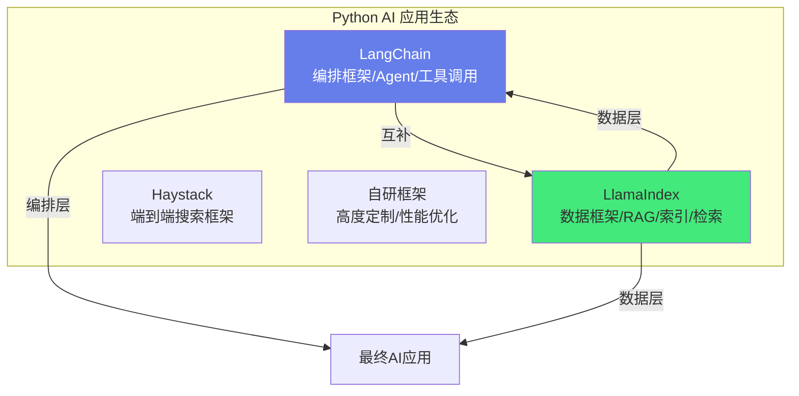
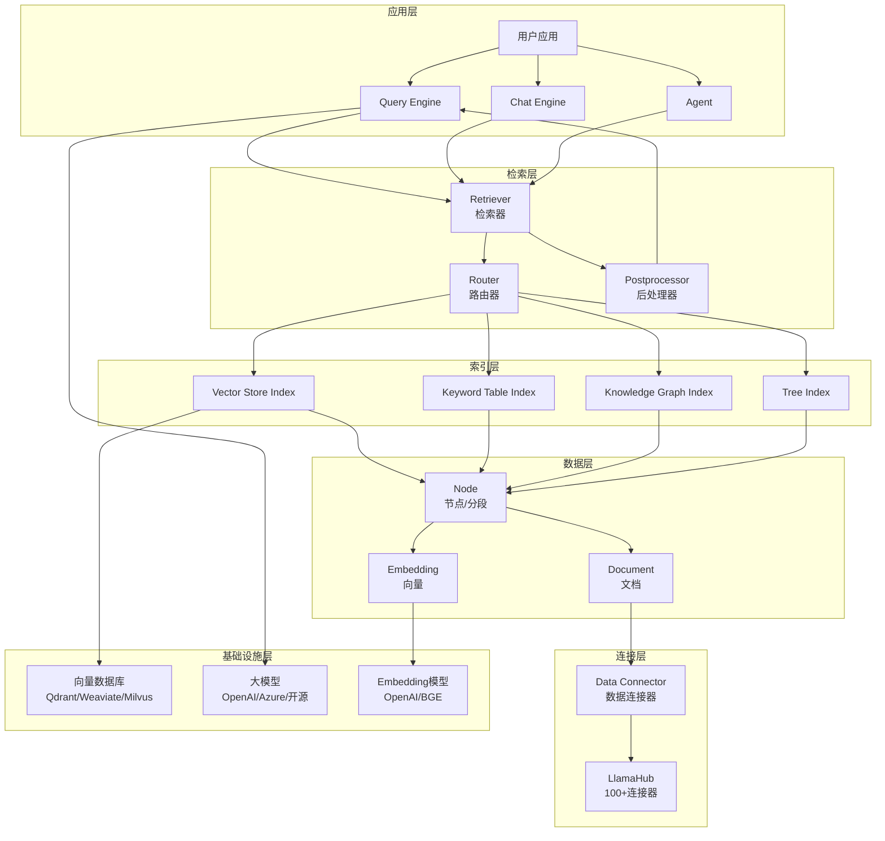
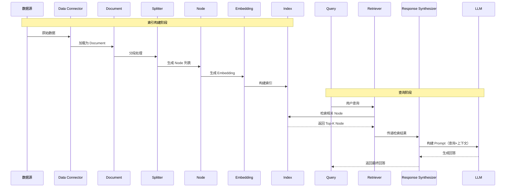

# LlamaIndex 数据框架

> **一句话定义**：LlamaIndex 是一个以数据为中心的 LLM 应用开发框架，专注于 RAG（检索增强生成）场景，提供数据连接、文档解析、索引构建、查询引擎、响应合成等完整的数据管道，使开发者能够快速将私有数据接入 LLM。
>
> **核心价值**：以"数据"为核心抽象，提供比通用框架更专业的 RAG 能力——丰富的数据连接器、灵活的索引结构、强大的查询引擎、可定制的响应合成，特别适合构建企业知识库问答、文档智能处理、数据驱动的 AI 应用。
>
> **适用人群**：Python 全栈开发者、AI 应用工程师、RAG 系统开发者、需要构建企业知识库的工程师、从 LangChain 迁移到 LlamaIndex 的团队。
>
> **适用场景**：企业知识库问答、文档智能处理（摘要/分类/提取）、RAG 应用开发、私有数据 LLM 接入、多模态数据检索、复杂查询路由。

### 本文档全景导航

本文档是概念原理与 Python 工程实践的合体，按"认知→原理→工程→实战→上线→优化"的学习路径组织：

| 章节 | 解决的问题 | 关键产出 |
|------|-----------|---------|
| 一、概述 | LlamaIndex 是什么、和 LangChain 怎么分工 | 定位对比、核心概念表、安装 |
| 二、原理 | 数据管道如何流转、有哪些索引/查询引擎类型 | 架构图、时序图、索引/引擎选型表 |
| 三、工程化基础 | 一个生产项目怎么搭骨架 | 项目结构、Pydantic 配置、日志、模型初始化 |
| 四、数据加载 | 文档怎么进来、元数据怎么提 | SimpleDirectoryReader、自定义 Reader |
| 五、文档分块 | 怎么切 chunk 最合理 | 四种分块器、高级 Node Parser、参数调优 |
| 六、索引构建 | 索引怎么建、怎么持久化、怎么接向量库 | IndexBuilder、Chroma/Qdrant/Weaviate/Milvus |
| 七、查询引擎 | 怎么查得准、怎么流式、怎么带引用 | QueryEngineBuilder、高级引擎、对话/Agent、检索重排序 |
| 八、API 集成 | 怎么把 RAG 包成服务 | FastAPI 完整 API、Streamlit 界面、多租户 |
| 九、性能与部署 | 怎么快、怎么省、怎么稳 | 嵌入缓存、优化策略表、Docker、安全防护 |
| 十、评估调试 | 怎么知道效果好不好、出问题怎么查 | LlamaIndex Evaluator、Ragas、调试模式 |
| 十一、问题与踩坑 | 常见坑怎么避 | 排查表、3 个生产踩坑实录 |
| 十二、生态前沿 | 生态与技术演进 | 生态组件、应用场景、前沿 RAG、最佳实践 |

**最小上手三步**：① `pip install llama-index` 配好 OpenAI Key；② `SimpleDirectoryReader` 加载文档 → `VectorStoreIndex.from_documents` 建索引 → `as_query_engine().query()` 查询；③ 效果不满意时，按"分段→检索→重排序→评估"的顺序迭代优化。

> 💡 **阅读建议**：概念不清晰先看"一、二"；要动手写代码直接跳到"三~八"；上线前必读"九~十一"。代码示例均为可直接套用的生产级片段，关键配置项都有注释说明推荐取值。

---

## 一、概述

### 1.1 设计理念与 Python 生态定位

LlamaIndex 的核心设计理念是"**数据优先**"——将 LLM 应用的核心挑战视为"如何将私有数据高效、准确地接入 LLM"，而不是通用的 Agent 编排。在 Python 生态中，LlamaIndex 与 LangChain 形成互补：



| 框架 | 定位 | 核心优势 | 适用场景 |
|------|------|---------|---------|
| **LangChain** | 编排框架 | Agent、工具调用、链式组合、丰富生态 | 复杂 Agent、多工具协作、工作流编排 |
| **LlamaIndex** | 数据框架 | 数据连接器、索引、检索、RAG 优化 | 知识库问答、文档检索、RAG 系统 |
| **Haystack** | 搜索框架 | 端到端搜索管道、企业搜索 | 企业搜索、问答系统 |
| **自研** | 定制框架 | 完全可控、高性能 | 核心产品、高度定制 |

> **互补关系**：LlamaIndex 做数据层（加载、分块、索引、检索），LangChain 做编排层（Agent、工具调用、工作流），两者可以无缝集成——LlamaIndex 的查询引擎可以作为 LangChain 的工具，LangChain 的工具可以作为 LlamaIndex Agent 的工具。

### 1.2 核心概念一览

| 概念 | 说明 | 类比 |
|------|------|------|
| **Data Connector** | 数据连接器，从各种来源加载数据 | 数据采集器/ETL 源 |
| **Document** | 文档，原始数据的容器 | 文件/记录 |
| **Node** | 节点，文档的分段，索引的基本单元 | 数据块/Chunk |
| **Index** | 索引，Node 的数据结构，支持检索 | 数据库索引 |
| **Retriever** | 检索器，根据查询从索引中获取相关 Node | 搜索引擎 |
| **Response Synthesizer** | 响应合成器，基于检索结果生成最终回答 | 回答生成器 |
| **Query Engine** | 查询引擎，Retriever + Response Synthesizer 的组合 | 问答接口 |
| **Chat Engine** | 对话引擎，支持多轮对话的查询引擎 | 聊天接口 |
| **Agent** | 智能体，可调用工具和查询引擎的自主 Agent | 自主助手 |
| **Router** | 路由器，根据查询选择合适的索引/工具 | 流量路由器 |

### 1.3 LlamaIndex vs LangChain

| 维度 | LlamaIndex | LangChain |
|------|------------|-----------|
| **定位** | 数据框架（RAG 优先） | 通用 LLM 框架 |
| **核心优势** | RAG 能力强、数据连接器丰富 | 生态丰富、Agent 能力强 |
| **数据连接器** | 100+ 连接器（数据库/API/文件） | 50+ 文档加载器 |
| **索引类型** | 多种（向量/关键词/知识图谱/树） | 主要依赖向量库 |
| **查询引擎** | 强大（路由/子查询/多步） | 基础（RetrievalQA） |
| **Agent** | 中（ReAct/OpenAI Agent） | 强（AgentExecutor/LangGraph） |
| **多模态** | 强（图像/表格/音频） | 中 |
| **学习曲线** | 缓（数据流程清晰） | 中（概念较多） |
| **生产就绪** | 高（RAG 场景） | 高（通用场景） |
| **适用场景** | RAG/知识库/文档处理 | 通用 AI 应用/Agent |

> 🔍 **知识点深度解析**
>
> **作用**：LlamaIndex 为 RAG 应用提供以数据为中心的开发框架，通过数据连接器、文档解析、索引构建、检索引擎、响应合成等完整管道，快速将私有数据接入 LLM，构建企业知识库问答和文档智能处理应用。
>
> **原理**：LlamaIndex 的核心是"数据管道"——数据从数据源（Data Connector）流入，经过解析（Document→Node 分段），构建为索引（Index），查询时通过检索器（Retriever）从索引中获取相关节点，响应合成器（Response Synthesizer）基于检索结果和 LLM 生成最终回答。查询引擎（Query Engine）封装了检索+合成的完整流程，对话引擎（Chat Engine）增加了多轮对话管理，Agent 增加了工具调用和自主决策。这种分层设计使得每个环节都可以独立定制和替换。
>
> **用法要点**：① 从简单的 VectorStoreIndex + as_query_engine() 开始，快速验证 RAG 效果 ② 数据连接器优先使用 LlamaHub 提供的 100+ 连接器，避免自己写 ③ 文档分段使用 SentenceSplitter，设置合适的 chunk_size 和 chunk_overlap ④ 索引选择：大多数场景用 VectorStoreIndex，需要关键词匹配用 KeywordTableIndex，复杂关系用 KnowledgeGraphIndex ⑤ 查询引擎可以自定义 Retriever 和 Response Synthesizer ⑥ 生产环境使用持久化向量存储（Qdrant/Weaviate/Milvus）而非内存存储 ⑦ 评估使用 Ragas 或 LlamaIndex 的评估模块 ⑧ 与 LangChain 可以互补使用——LlamaIndex 做 RAG，LangChain 做 Agent

> 💡 **深度讲解**：LlamaIndex 的独特价值在于"RAG 专业化"。在 LangChain 等通用 LLM 框架中，RAG 只是众多功能之一（RetrievalQA Chain），而 LlamaIndex 将 RAG 作为核心专注点，提供了比通用框架更深入、更灵活的 RAG 能力。LlamaIndex 的数据连接器生态是其一大优势——LlamaHub 提供了 100+ 数据连接器，覆盖数据库（PostgreSQL/MySQL/MongoDB）、API（Slack/Notion/GitHub）、文件（PDF/Word/Excel/PPT/图片/音频）、云存储（S3/Google Drive/Dropbox）等各种数据源，开发者不需要自己编写数据加载代码。LlamaIndex 的索引设计也很有特色——它不局限于向量索引，而是提供了多种索引类型：VectorStoreIndex（向量索引，语义检索）、KeywordTableIndex（关键词索引，精确匹配）、KnowledgeGraphIndex（知识图谱索引，关系推理）、TreeIndex（树索引，层次化摘要）、ListIndex（列表索引，顺序遍历）。不同的索引类型适合不同的查询场景，开发者可以根据数据特点和查询需求选择合适的索引，甚至组合多种索引（通过 RouterQueryEngine）。LlamaIndex 的查询引擎是另一个亮点——它不仅支持简单的"检索→合成"流程，还支持复杂的查询策略：SubQuestionQueryEngine（将复杂问题分解为子问题，分别检索后合并）、RouterQueryEngine（根据查询选择合适的索引）、MultiStepQueryEngine（多步推理，逐步细化查询）。这些高级查询策略使得 LlamaIndex 能够处理复杂的、需要多步推理的查询。LlamaIndex 与 LangChain 不是竞争关系，而是互补关系——LlamaIndex 专注数据接入和 RAG，LangChain 专注 Agent 编排和工具调用，两者可以无缝集成。
>
> **📝 精简总结**：LlamaIndex 是以数据为中心的 LLM 应用开发框架，专注 RAG 场景；核心概念包括 Data Connector（数据连接器）、Document/Node（文档/节点）、Index（索引）、Retriever（检索器）、Response Synthesizer（响应合成器）、Query Engine（查询引擎）、Chat Engine（对话引擎）、Agent（智能体）、Router（路由器）；与 LangChain 相比，LlamaIndex RAG 能力更强、数据连接器更丰富（100+）、索引类型更多样、查询引擎更强大，但 Agent 能力不如 LangChain；核心是数据管道（连接→解析→索引→检索→合成），分层设计可独立定制；与 LangChain 互补使用（LlamaIndex做RAG，LangChain做Agent）。

### 1.4 版本演进与安装

LlamaIndex 自 v0.10 起进行了架构重构，拆分为 `llama-index-core`（核心）+ 按需安装的插件包（`llama-index-llms-openai`、`llama-index-embeddings-openai`、`llama-index-vector-stores-chroma` 等），推荐按需安装以减少依赖。

```bash
# 基础安装
pip install llama-index-core

# 完整安装（包含所有连接器和向量库）
pip install llama-index

# 按需安装（推荐，减少依赖）
pip install llama-index-core
pip install llama-index-llms-openai          # OpenAI LLM
pip install llama-index-embeddings-openai     # OpenAI 嵌入
pip install llama-index-vector-stores-chroma  # Chroma 向量库
pip install llama-index-readers-file           # 文件读取器
pip install llama-index-extractors-entity      # 实体提取

# 开发版（最新特性）
pip install llama-index --pre

# 验证安装
python -c "import llama_index; print(llama_index.__version__)"
```

> ⚠️ **v0.10+ 迁移注意**：老版本（v0.9 及以前）代码多基于 `from llama_index import ...` 的统一包入口，升级到 v0.10+ 后需改为 `from llama_index.core import ...`，并把原来内置的 LLM/Embedding/向量库换成对应的 `llama-index-*` 插件包。典型改动：`LLMPredictor` 弃用、`ServiceContext` 被全局 `Settings` 取代、`GPTVectorStoreIndex` 统一为 `VectorStoreIndex`。新项目直接按本文写法（`llama_index.core` + 按需插件包）即可，无需关心旧 API。

**常见安装/导入报错速查**：
- `ImportError: cannot import name 'XXX' from 'llama_index'`：插件包没装，按需 `pip install llama-index-<功能>`；或导入路径写成了旧版，改为 `llama_index.core`。
- `AuthenticationError` / `401`：`OPENAI_API_KEY` 没配或失效，检查 `.env` 是否加载、Key 是否有效。
- 向量库连接报错：先确认向量库服务已启动（如 Chroma 是本地文件无需服务，Qdrant/Milvus 需单独起），再核对 host/port/collection 名。

```python
# 环境变量配置（.env 文件）
# .env
# OPENAI_API_KEY=sk-your-api-key
# OPENAI_API_BASE=https://api.openai.com/v1
# CHROMA_HOST=localhost
# CHROMA_PORT=8000

from dotenv import load_dotenv
import os

load_dotenv()  # 加载 .env 文件
api_key = os.getenv("OPENAI_API_KEY")
```

---

## 二、原理

### 2.1 框架整体架构



### 2.2 数据管道流程



### 2.3 索引类型对比

| 索引类型 | 原理 | 检索方式 | 适用场景 | 优点 | 缺点 |
|---------|------|---------|---------|------|------|
| **VectorStoreIndex** | Node 向量化存储 | 语义相似度搜索 | 大多数 RAG 场景 | 语义理解强、灵活 | 需要 Embedding、不支持精确匹配 |
| **KeywordTableIndex** | 提取关键词构建索引 | 关键词匹配 | 需要精确匹配的场景 | 精确匹配、无需 Embedding | 语义理解弱 |
| **KnowledgeGraphIndex** | 提取实体和关系构建知识图谱 | 图遍历+关系推理 | 复杂关系推理 | 关系推理能力强 | 构建复杂、成本高 |
| **TreeIndex** | 层次化摘要构建树结构 | 自上而下遍历 | 长文档摘要、层次查询 | 处理长文档 | 构建耗时、灵活性低 |
| **ListIndex** | Node 顺序列表存储 | 顺序遍历/LLM 选择 | 小数据集、全量上下文 | 简单、全量上下文 | 大数据集效率低 |
| **SQLTableIndex** | 关系数据库表结构索引 | NL2SQL 查询 | 结构化数据查询 | 直接查询数据库 | 仅限关系型数据 |

### 2.4 查询引擎类型

| 查询引擎 | 说明 | 适用场景 |
|---------|---------|---------|
| **QueryEngine** | 基础检索+合成 | 简单问答 |
| **SubQuestionQueryEngine** | 分解复杂问题为子问题，分别检索后合并 | 复杂多维度问题 |
| **RouterQueryEngine** | 根据查询选择合适的索引/查询引擎 | 多数据源、多索引场景 |
| **MultiStepQueryEngine** | 多步推理，逐步细化查询 | 需要深度推理的问题 |
| **CitationQueryEngine** | 带引用来源的回答 | 需要溯源的场景 |
| **KnowledgeGraphQueryEngine** | 知识图谱查询 | 关系推理场景 |
| **SQLQueryEngine** | 自然语言转 SQL 查询 | 结构化数据库查询 |
| **TransformQueryEngine** | 查询转换（重写/扩展/分解） | 查询优化 |

> 💡 **深度讲解**：LlamaIndex 的架构核心是"数据管道的分层解耦"。从数据接入到最终回答，整个流程分为连接层（Data Connector）、数据层（Document/Node/Embedding）、索引层（Index）、检索层（Retriever/Router/Postprocessor）、应用层（Query Engine/Chat Engine/Agent）。每一层都有标准的接口，开发者可以独立定制和替换每一层的实现——例如，可以替换数据连接器（从 PDF 加载改为从数据库加载）、替换索引（从向量索引改为知识图谱索引）、替换检索器（从相似度检索改为混合检索）、替换响应合成器（从简单合成改为引用合成）。这种分层设计的优势是"灵活性"和"可测试性"——每个组件可以独立测试，不同组件可以自由组合。索引类型的多样性是 LlamaIndex 的一大特色。大多数 RAG 框架只支持向量索引，而 LlamaIndex 提供了 6+ 种索引类型，每种索引适合不同的场景。实际应用中，通常不会只使用一种索引——而是通过 RouterQueryEngine 组合多种索引，根据查询类型自动选择最合适的索引。例如，事实性问题用关键词索引（精确匹配），概念性问题用向量索引（语义匹配），关系性问题用知识图谱索引（关系推理）。查询引擎的多样性也是 LlamaIndex 的亮点——SubQuestionQueryEngine 可以将"比较 A 和 B 的市场份额和增长趋势"这样的复杂问题分解为多个子问题，分别检索后合并回答；MultiStepQueryEngine 可以进行多步推理，先检索初步信息，根据初步信息细化查询，再检索更精确的信息；CitationQueryEngine 可以在回答中标注每个信息的来源文档和位置，便于溯源验证。
>
> **📝 精简总结**：LlamaIndex 架构分为应用层（Query/Chat/Agent）、检索层（Retriever/Router/Postprocessor）、索引层（Vector/Keyword/KG/Tree/List/SQL）、数据层（Document/Node/Embedding）、连接层（Data Connector/LlamaHub 100+）、基础设施层（向量数据库/LLM/Embedding模型）；数据管道分为索引构建阶段（连接→加载→分段→Embedding→索引）和查询阶段（查询→检索→后处理→合成→回答）；索引类型包括 VectorStore（语义搜索/最常用）、KeywordTable（精确匹配）、KnowledgeGraph（关系推理）、Tree（层次摘要）、List（顺序遍历）、SQLTable（NL2SQL）；查询引擎类型包括基础、SubQuestion（子问题分解）、Router（路由选择）、MultiStep（多步推理）、Citation（引用溯源）、KnowledgeGraph、SQL、Transform；核心是分层解耦，每层可独立定制替换，多种索引和查询引擎可通过 Router 组合使用。

---

## 三、Python 工程化基础

### 3.1 项目结构设计

生产级 RAG 项目推荐模块化组织：

```text
my_rag_project/
├── .env                          # 环境变量（不提交到 git）
├── .env.example                  # 环境变量示例
├── .gitignore
├── pyproject.toml                # 项目配置（poetry/uv）
├── requirements.txt              # 依赖列表
├── README.md
├── Dockerfile                    # Docker 部署
├── docker-compose.yml
├── app/
│   ├── __init__.py
│   ├── main.py                   # FastAPI 入口
│   ├── config.py                 # 配置管理（pydantic-settings）
│   ├── logging.py                # 日志配置
│   ├── models.py                 # Pydantic 数据模型
│   ├── exceptions.py             # 自定义异常
│   └── dependencies.py           # 依赖注入
├── rag/
│   ├── __init__.py
│   ├── loader.py                 # 数据加载器
│   ├── splitter.py               # 文档分块器
│   ├── indexer.py                # 索引构建器
│   ├── retriever.py              # 检索器
│   ├── query_engine.py           # 查询引擎
│   ├── reranker.py               # 重排序器
│   ├── prompts.py                # 自定义 Prompt
│   └── storage.py                # 存储管理
├── services/
│   ├── __init__.py
│   ├── document_service.py       # 文档管理服务
│   ├── query_service.py          # 查询服务
│   └── evaluation_service.py     # 评估服务
├── data/
│   ├── documents/                # 原始文档
│   ├── storage/                  # 索引持久化
│   └── cache/                    # 嵌入缓存
├── tests/
│   ├── __init__.py
│   ├── conftest.py               # pytest 配置
│   ├── test_loader.py
│   ├── test_splitter.py
│   ├── test_retriever.py
│   └── test_api.py
└── scripts/
    ├── build_index.py            # 构建索引脚本
    ├── evaluate.py               # 评估脚本
    └── migrate.py                # 数据迁移脚本
```

### 3.2 Pydantic Settings 配置管理

```python
# app/config.py
from __future__ import annotations
from pydantic_settings import BaseSettings, SettingsConfigDict
from pydantic import Field
from typing import Optional


class Settings(BaseSettings):
    """应用配置（从环境变量加载）"""
    model_config = SettingsConfigDict(
        env_file=".env",
        env_file_encoding="utf-8",
        case_sensitive=False,
        extra="ignore",
    )

    # 应用配置
    app_name: str = "My RAG System"
    debug: bool = False
    log_level: str = "INFO"

    # OpenAI 配置
    openai_api_key: str = Field(..., description="OpenAI API Key")
    openai_api_base: Optional[str] = None
    openai_model: str = "gpt-4"
    embedding_model: str = "text-embedding-ada-002"
    embedding_dimension: int = 1536

    # 分块配置
    chunk_size: int = 512
    chunk_overlap: int = 50

    # 检索配置
    similarity_top_k: int = 5
    rerank_top_n: int = 3

    # 向量数据库配置
    vector_store_type: str = "chroma"  # chroma / milvus / qdrant / pinecone
    chroma_path: str = "./data/chroma"
    chroma_collection: str = "documents"

    # 存储配置
    storage_dir: str = "./data/storage"

    # 服务配置
    host: str = "0.0.0.0"
    port: int = 8000

    # 限流配置
    max_requests_per_minute: int = 60
    max_concurrent_requests: int = 10


# 全局配置单例
settings = Settings()
```

### 3.3 日志系统

```python
# app/logging.py
import logging
import sys
from typing import Optional


def setup_logging(level: str = "INFO", log_file: Optional[str] = None):
    """配置日志系统"""
    log_format = (
        "%(asctime)s | %(levelname)-8s | %(name)s | "
        "%(filename)s:%(lineno)d | %(message)s"
    )
    date_format = "%Y-%m-%d %H:%M:%S"

    handlers = [logging.StreamHandler(sys.stdout)]
    if log_file:
        handlers.append(logging.FileHandler(log_file, encoding="utf-8"))

    logging.basicConfig(
        level=getattr(logging, level.upper()),
        format=log_format,
        datefmt=date_format,
        handlers=handlers,
    )

    # 降低第三方库日志级别
    logging.getLogger("llama_index").setLevel(logging.WARNING)
    logging.getLogger("openai").setLevel(logging.WARNING)
    logging.getLogger("httpx").setLevel(logging.WARNING)

    return logging.getLogger(__name__)
```

### 3.4 LLM 与嵌入模型初始化

```python
# rag/llm.py
from __future__ import annotations
from llama_index.llms.openai import OpenAI
from llama_index.embeddings.openai import OpenAIEmbedding
from llama_index.core import Settings
from app.config import settings


def setup_llm():
    """配置全局 LLM 和嵌入模型"""
    # LLM（RAG 用低温度，更稳定）
    llm = OpenAI(
        model=settings.openai_model,
        api_key=settings.openai_api_key,
        api_base=settings.openai_api_base,
        temperature=0.1,
        max_tokens=2000,
        timeout=60,
        max_retries=3,
    )

    # 嵌入模型
    embed_model = OpenAIEmbedding(
        model=settings.embedding_model,
        api_key=settings.openai_api_key,
        api_base=settings.openai_api_base,
        dimensions=settings.embedding_dimension,
        timeout=60,
        max_retries=3,
    )

    # 全局设置
    Settings.llm = llm
    Settings.embed_model = embed_model
    Settings.chunk_size = settings.chunk_size
    Settings.chunk_overlap = settings.chunk_overlap

    return llm, embed_model
```

---

## 四、数据加载与处理实战

### 4.1 基础 RAG：最简流程

```python
from llama_index.core import (
    VectorStoreIndex,
    SimpleDirectoryReader,
    Settings,
    StorageContext,
    load_index_from_storage
)
from llama_index.llms.openai import OpenAI
from llama_index.embeddings.openai import OpenAIEmbedding
import os

os.environ["OPENAI_API_KEY"] = "sk-xxx"

# 1. 配置全局设置
Settings.llm = OpenAI(model="gpt-4o", temperature=0)
Settings.embed_model = OpenAIEmbedding(model="text-embedding-3-small")
Settings.chunk_size = 1024
Settings.chunk_overlap = 200

# 2. 加载文档
documents = SimpleDirectoryReader(
    input_dir="./data",
    required_exts=[".pdf", ".txt", ".md"],
    recursive=True
).load_data()

print(f"加载了 {len(documents)} 个文档")

# 3. 构建索引
index = VectorStoreIndex.from_documents(documents)

# 4. 创建查询引擎
query_engine = index.as_query_engine(
    similarity_top_k=5,
    response_mode="compact"  # compact/tree_summarize/refine/accumulate
)

# 5. 查询
response = query_engine.query("什么是 RAG？它的工作原理是什么？")
print(f"回答: {response}")
print(f"来源: {[node.metadata.get('file_name') for node in response.source_nodes]}")

# 6. 持久化索引并重新加载
index.storage_context.persist(persist_dir="./storage")
storage_context = StorageContext.from_defaults(persist_dir="./storage")
loaded_index = load_index_from_storage(storage_context)
```

### 4.2 多格式文档加载器

```python
# rag/loader.py
from __future__ import annotations
from pathlib import Path
from typing import Optional
from llama_index.core import SimpleDirectoryReader, Document
from llama_index.readers.file import (
    PyMuPDFReader,      # PDF
    DocxReader,          # Word
    MarkdownReader,      # Markdown
    HTMLTagReader,       # HTML
    IPYNBReader,         # Jupyter Notebook
)
import logging

logger = logging.getLogger(__name__)


class DocumentLoader:
    """文档加载器：支持多种格式，带元数据提取"""

    READERS = {
        ".pdf": PyMuPDFReader(),
        ".docx": DocxReader(),
        ".doc": DocxReader(),
        ".md": MarkdownReader(),
        ".markdown": MarkdownReader(),
        ".html": HTMLTagReader(),
        ".htm": HTMLTagReader(),
        ".txt": None,
    }

    def __init__(self, input_dir: str, recursive: bool = True):
        self.input_dir = Path(input_dir)
        self.recursive = recursive

    def load(self) -> list[Document]:
        """加载目录下所有文档"""
        if not self.input_dir.exists():
            raise FileNotFoundError(f"目录不存在: {self.input_dir}")

        reader = SimpleDirectoryReader(
            input_dir=str(self.input_dir),
            recursive=self.recursive,
            required_exts=[".pdf", ".docx", ".md", ".txt", ".html"],
            filename_as_id=True,
            show_progress=True,
        )
        documents = reader.load_data()
        for doc in documents:
            self._extract_metadata(doc)
        return documents

    def load_single(self, file_path: str) -> list[Document]:
        """加载单个文件"""
        path = Path(file_path)
        if not path.exists():
            raise FileNotFoundError(f"文件不存在: {file_path}")
        ext = path.suffix.lower()
        reader = self.READERS.get(ext)
        if reader:
            documents = reader.load_data(file=path)
        else:
            documents = [Document(text=path.read_text(encoding="utf-8"))]
        for doc in documents:
            self._extract_metadata(doc)
        return documents

    def _extract_metadata(self, doc: Document):
        """提取并丰富元数据"""
        file_path = doc.metadata.get("file_path", "")
        file_name = doc.metadata.get("file_name", Path(file_path).name)
        doc.metadata.update({
            "file_name": file_name,
            "file_type": Path(file_name).suffix.lower(),
            "source": file_path,
        })
        # 排除大字段（避免元数据过大）
        doc.excluded_llm_metadata_keys = ["file_path", "file_size", "created_at"]
        doc.excluded_embed_metadata_keys = ["file_path", "file_size", "created_at"]
```

### 4.3 自定义数据加载器

```python
# rag/custom_loaders.py
from __future__ import annotations
from typing import Any
from llama_index.core.readers.base import BaseReader
from llama_index.core import Document
import requests


class ConfluenceReader(BaseReader):
    """自定义 Confluence 文档加载器"""

    def __init__(self, base_url: str, api_token: str, space_key: str):
        self.base_url = base_url.rstrip("/")
        self.api_token = api_token
        self.space_key = space_key

    def load_data(self, page_id: str | None = None, **kwargs: Any) -> list[Document]:
        """加载 Confluence 页面或整个空间"""
        headers = {"Authorization": f"Bearer {self.api_token}"}
        if page_id:
            url = f"{self.base_url}/rest/api/content/{page_id}?expand=body.storage"
            resp = requests.get(url, headers=headers, timeout=30)
            resp.raise_for_status()
            return [self._page_to_document(resp.json())]

        documents = []
        start, limit = 0, 50
        while True:
            url = (f"{self.base_url}/rest/api/content"
                   f"?spaceKey={self.space_key}&type=page"
                   f"&start={start}&limit={limit}&expand=body.storage")
            data = requests.get(url, headers=headers, timeout=30).json()
            for page in data.get("results", []):
                documents.append(self._page_to_document(page))
            if len(data.get("results", [])) < limit:
                break
            start += limit
        return documents

    def _page_to_document(self, page: dict) -> Document:
        """Confluence 页面转 Document"""
        return Document(
            text=page["body"]["storage"]["value"],
            metadata={
                "title": page["title"],
                "page_id": page["id"],
                "url": f"{self.base_url}/spaces/{self.space_key}/pages/{page['id']}",
                "source": "confluence",
            },
        )


class DatabaseReader(BaseReader):
    """自定义数据库加载器（SQL 查询结果转文档）"""

    def __init__(self, connection_string: str):
        self.connection_string = connection_string

    def load_data(self, query: str, **kwargs: Any) -> list[Document]:
        """执行 SQL 查询，每行转一个 Document"""
        # 实际用 asyncpg/aiomysql 等执行
        rows = [
            {"id": 1, "title": "文档1", "content": "内容1"},
            {"id": 2, "title": "文档2", "content": "内容2"},
        ]
        return [
            Document(
                text=f"标题: {row['title']}\n内容: {row['content']}",
                metadata={"id": row["id"], "source": "database", "table": kwargs.get("table", "unknown")},
            )
            for row in rows
        ]
```

> 💡 **深度讲解**：LlamaIndex 的数据连接器生态（LlamaHub 100+）是一大优势，覆盖数据库（PostgreSQL/MySQL/MongoDB）、API（Slack/Notion/GitHub）、文件（PDF/Word/Excel/PPT/图片/音频）、云存储（S3/Google Drive/Dropbox）等各种数据源。优先使用 LlamaHub 提供的连接器，避免自己编写数据加载代码；只有当数据源不在 LlamaHub 中时，才继承 `BaseReader` 实现自定义加载器。元数据提取（`_extract_metadata`）是生产实践中容易忽视但影响检索质量的环节——丰富的元数据（文件名、类型、来源）支持后续的元数据过滤，但大字段（file_path、file_size）应通过 `excluded_llm_metadata_keys` 排除，避免占用上下文。

---

## 五、文档分块与节点解析

### 5.1 分块策略

```python
# rag/splitter.py
from __future__ import annotations
from llama_index.core import Document
from llama_index.core.node_parser import (
    SentenceSplitter,
    SemanticSplitterNodeParser,
    TokenTextSplitter,
    MarkdownNodeParser,
)
from llama_index.core.schema import BaseNode
from app.config import settings
import logging

logger = logging.getLogger(__name__)


class DocumentSplitter:
    """文档分块器：多种分块策略"""

    def __init__(self, chunk_size: int | None = None, chunk_overlap: int | None = None):
        self.chunk_size = chunk_size or settings.chunk_size
        self.chunk_overlap = chunk_overlap or settings.chunk_overlap

    def split_by_sentence(self, documents: list[Document]) -> list[BaseNode]:
        """按句子分块（推荐，最常用），保持句子完整性"""
        splitter = SentenceSplitter(
            chunk_size=self.chunk_size,
            chunk_overlap=self.chunk_overlap,
            separator="\n\n",
            secondary_chunking_regex="[^,.;。？！]+[,.;。？！]?",
        )
        nodes = splitter.get_nodes_from_documents(documents, show_progress=True)
        self._log_chunk_stats(nodes)
        return nodes

    def split_by_token(self, documents: list[Document]) -> list[BaseNode]:
        """按 token 分块（精确控制 token 数）"""
        splitter = TokenTextSplitter(chunk_size=self.chunk_size, chunk_overlap=self.chunk_overlap)
        return splitter.get_nodes_from_documents(documents)

    def split_by_semantic(self, documents: list[Document], embed_model) -> list[BaseNode]:
        """语义分块（根据语义相似度分块，保持语义完整性，速度慢）"""
        splitter = SemanticSplitterNodeParser(
            buffer_size=1,
            breakpoint_percentile_threshold=95,
            embed_model=embed_model,
        )
        return splitter.get_nodes_from_documents(documents)

    def split_markdown(self, documents: list[Document]) -> list[BaseNode]:
        """Markdown 专用分块（按标题层级分块）"""
        return MarkdownNodeParser().get_nodes_from_documents(documents)

    def _log_chunk_stats(self, nodes: list[BaseNode]):
        """统计分块信息"""
        lengths = [len(node.text) for node in nodes]
        if not lengths:
            return
        avg = sum(lengths) / len(lengths)
        logger.info(f"分块统计: 数量={len(nodes)}, 平均长度={avg:.0f}, 最大={max(lengths)}, 最小={min(lengths)}")
```

### 5.2 高级节点解析

```python
from llama_index.core.node_parser import (
    SentenceWindowNodeParser,
    HierarchicalNodeParser,
)
from llama_index.core.extractors import (
    TitleExtractor,
    QuestionsAnsweredExtractor,
    KeywordExtractor,
    SummaryExtractor,
)
from llama_index.core.ingestion import IngestionPipeline
from llama_index.llms.openai import OpenAI
from llama_index.embeddings.openai import OpenAIEmbedding

# 1. 基础分段
splitter = SentenceSplitter(chunk_size=1024, chunk_overlap=200, separator="\n\n")
nodes = splitter.get_nodes_from_documents(documents)

# 2. 句子窗口分段（检索句子，返回周围上下文，提升回答完整性）
sentence_window_parser = SentenceWindowNodeParser.from_defaults(
    window_size=3,
    window_metadata_key="window",
    original_text_metadata_key="original_text",
)

# 3. 层次化分段（小段落+大段落，自动小→大检索）
hierarchical_parser = HierarchicalNodeParser.from_defaults(
    chunk_sizes=[2048, 512, 128]  # 从大到小的层次
)

# 4. 语义分段（根据语义相似度自动分段）
semantic_splitter = SemanticSplitterNodeParser(
    buffer_size=1, breakpoint_percentile_threshold=95, embed_model=OpenAIEmbedding())

# 5. IngestionPipeline：自动为每个 Node 提取标题、关键词、摘要元数据
pipeline = IngestionPipeline(
    transformations=[
        SentenceSplitter(chunk_size=1024, chunk_overlap=200),
        TitleExtractor(nodes=5, llm=OpenAI(model="gpt-4o-mini")),
        KeywordExtractor(keywords=10, llm=OpenAI(model="gpt-4o-mini")),
        SummaryExtractor(summaries=["prev", "self"], llm=OpenAI(model="gpt-4o-mini")),
        OpenAIEmbedding(),
    ]
)
nodes = pipeline.run(documents=documents)
```

### 5.3 分块参数调优指南

| 参数 | 推荐值 | 说明 |
|------|--------|------|
| **chunk_size** | 256-1024 | 通用文档 512，技术文档 256，长文 1024 |
| **chunk_overlap** | 10-20% chunk_size | 保持上下文连续性，通常 50-100 |
| **separator** | "\n\n" | 优先按段落分割，保持语义完整 |
| **分块策略** | SentenceSplitter | 通用场景首选，平衡速度和质量 |

**分块策略选择**：
- 通用文档（PDF/Word/网页）→ SentenceSplitter
- Markdown 文档 → MarkdownNodeParser（按标题层级）
- 语义要求高 → SemanticSplitterNodeParser（慢但准）
- 精确 token 控制 → TokenTextSplitter
- 检索精度优先 → SentenceWindowNodeParser / HierarchicalNodeParser

> 💡 **深度讲解**：文档分段是影响 RAG 质量的最关键因素之一。chunk_size 太大会丢失细节、稀释相关内容；太小会丢失上下文、LLM 无法理解。最佳实践是根据文档类型调整分段参数，并使用高级分段策略（SentenceWindowNodeParser 检索句子但返回周围上下文，HierarchicalNodeParser 先检索小段落再扩展到大段落）。元数据提取（TitleExtractor/KeywordExtractor/SummaryExtractor）自动为每个 Node 提取标题、关键词、摘要，丰富的元数据可以提升检索和过滤效果。

---

## 六、索引构建与持久化

### 6.1 向量索引构建（含 Chroma）

```python
# rag/indexer.py
from __future__ import annotations
from pathlib import Path
from typing import Optional
from llama_index.core import (
    VectorStoreIndex,
    StorageContext,
    load_index_from_storage,
    Settings,
)
from llama_index.core.schema import BaseNode
from llama_index.vector_stores.chroma import ChromaVectorStore
import chromadb
import logging
from app.config import settings

logger = logging.getLogger(__name__)


class IndexBuilder:
    """索引构建器：支持多种索引类型和持久化"""

    def __init__(self, persist_dir: str | None = None):
        self.persist_dir = Path(persist_dir or settings.storage_dir)
        self.persist_dir.mkdir(parents=True, exist_ok=True)

    def build_vector_index(self, nodes: list[BaseNode], use_chroma: bool = True) -> VectorStoreIndex:
        """构建向量索引"""
        if use_chroma and settings.vector_store_type == "chroma":
            index = self._build_with_chroma(nodes)
        else:
            index = VectorStoreIndex(nodes, show_progress=True, embed_model=Settings.embed_model)
        self._persist_index(index)
        return index

    def _build_with_chroma(self, nodes: list[BaseNode]) -> VectorStoreIndex:
        """使用 Chroma 向量数据库（持久化，适合生产）"""
        chroma_client = chromadb.PersistentClient(path=settings.chroma_path)
        chroma_collection = chroma_client.get_or_create_collection(
            name=settings.chroma_collection,
            metadata={"hnsw:space": "cosine"},
        )
        vector_store = ChromaVectorStore(chroma_collection=chroma_collection)
        storage_context = StorageContext.from_defaults(vector_store=vector_store)
        return VectorStoreIndex(nodes, storage_context=storage_context, show_progress=True)

    def _persist_index(self, index: VectorStoreIndex):
        """持久化索引（Chroma 自动持久化，内存索引需手动 persist）"""
        if settings.vector_store_type != "chroma":
            index.storage_context.persist(persist_dir=str(self.persist_dir))

    def load_index(self) -> Optional[VectorStoreIndex]:
        """从持久化存储加载索引"""
        if settings.vector_store_type == "chroma":
            chroma_client = chromadb.PersistentClient(path=settings.chroma_path)
            chroma_collection = chroma_client.get_collection(settings.chroma_collection)
            vector_store = ChromaVectorStore(chroma_collection=chroma_collection)
            return VectorStoreIndex.from_vector_store(
                vector_store=vector_store, embed_model=Settings.embed_model)
        else:
            storage_context = StorageContext.from_defaults(persist_dir=str(self.persist_dir))
            return load_index_from_storage(storage_context)

    def add_documents(self, index: VectorStoreIndex, nodes: list[BaseNode]):
        """增量添加文档（不需要重建索引）"""
        for node in nodes:
            index.insert_nodes([node])
        self._persist_index(index)
```

### 6.2 向量数据库集成

```python
from llama_index.core import VectorStoreIndex, StorageContext
from llama_index.vector_stores.qdrant import QdrantVectorStore
from llama_index.vector_stores.weaviate import WeaviateVectorStore
from llama_index.vector_stores.milvus import MilvusVectorStore
import qdrant_client

# 1. Qdrant
client = qdrant_client.QdrantClient(url="http://localhost:6333", api_key="your-api-key")
vector_store = QdrantVectorStore(client=client, collection_name="my_collection")
storage_context = StorageContext.from_defaults(vector_store=vector_store)
index = VectorStoreIndex.from_documents(documents, storage_context=storage_context)

# 2. Weaviate
import weaviate
auth_config = weaviate.AuthApiKey(api_key="your-key")
client = weaviate.Client(url="http://localhost:8080", auth_client_secret=auth_config)
vector_store = WeaviateVectorStore(weaviate_client=client, index_name="MyCollection")

# 3. Milvus
vector_store = MilvusVectorStore(
    uri="http://localhost:19530", collection_name="my_collection", dim=1536)

# 4. 从已有向量存储加载索引（不需要重新构建）
loaded_index = VectorStoreIndex.from_vector_store(
    vector_store=vector_store, storage_context=storage_context)
```

### 6.3 其他索引类型

```python
from llama_index.core import SummaryIndex, TreeIndex, KeywordTableIndex

# 1. SummaryIndex：将所有节点串联，适合摘要类查询
summary_index = SummaryIndex(nodes)
summary_query_engine = summary_index.as_query_engine(response_mode="tree_summarize")
response = summary_query_engine.query("总结所有文档的核心观点")

# 2. TreeIndex：构建层级树，适合需要逐层深入的查询
tree_index = TreeIndex(nodes)

# 3. KeywordTableIndex：提取关键词，适合关键词匹配查询
keyword_index = KeywordTableIndex(nodes)
```

### 6.4 索引运维：增量更新与数据一致性

生产索引不是"一次建好就完事"，需要持续维护。常见运维操作：

```python
# rag/maintenance.py
from llama_index.core.ingestion import IngestionCache, IngestionPipeline

# 1. IngestionCache：记录已处理过的文档，增量更新时跳过未变更文档
#    避免每次全量重建重复调用 Embedding API
cache = IngestionCache()
pipeline = IngestionPipeline(
    transformations=[SentenceSplitter(chunk_size=512, chunk_overlap=50)],
    cache=cache,
)
nodes = pipeline.run(documents=documents)   # 已处理过的文档自动命中缓存

# 2. 按 doc_id 删除旧文档（文档更新时先删旧再插新）
def update_document(index, doc_id: str, new_nodes):
    """文档更新：删除旧版本节点，插入新版本"""
    index.delete_ref_doc(doc_id, delete_from_docstore=True)
    index.insert_nodes(new_nodes)

# 3. 清空索引重建（全量更新）
def rebuild_index(documents):
    """全量重建：先清空 storage 目录再重新构建"""
    # 实际生产中应先构建到新 collection，验证无误后再切换，避免重建期间服务不可用
    pass

# 4. 索引健康检查：统计 docstore 中的文档数
def check_index_health(index):
    doc_count = len(index.ref_doc_info)
    print(f"索引中共有 {doc_count} 个文档引用")
    return doc_count
```

**索引维护最佳实践**：
- **文档级 doc_id**：用"文件路径 + 内容哈希"作为稳定 doc_id，更新时能精确定位并替换旧版本
- **蓝绿切换**：大批量重建时先构建到新 collection/新目录，验证通过后再切换线上指针，避免重建期间服务不可用
- **定期对账**：定期对比"源文档清单"与"索引 docstore 文档清单"，发现丢失或残留
- **Embedding 不变量**：更换 Embedding 模型后必须全量重建索引（向量维度和语义空间都变了，不能新旧混用）

---

## 七、查询引擎实战

### 7.1 查询引擎配置

```python
# rag/query_engine.py
from __future__ import annotations
from llama_index.core import Settings
from llama_index.core.query_engine import RetrieverQueryEngine
from llama_index.core import get_response_synthesizer
from app.config import settings


class QueryEngineBuilder:
    """查询引擎构建器：多种配置选项"""

    def __init__(self, index):
        self.index = index

    def build_default(self, similarity_top_k=None, response_mode: str = "compact"):
        """
        response_mode:
        - refine: 逐块精炼（慢但准）
        - compact: 压缩后精炼（快，推荐）
        - tree_summarize: 树状摘要（适合摘要）
        - no_text: 只返回检索结果，不生成回答
        """
        top_k = similarity_top_k or settings.similarity_top_k
        retriever = self.index.as_retriever(similarity_top_k=top_k)
        response_synthesizer = get_response_synthesizer(
            response_mode=response_mode, llm=Settings.llm, streaming=False)
        return RetrieverQueryEngine(
            retriever=retriever, response_synthesizer=response_synthesizer)

    def build_streaming(self, similarity_top_k=None):
        """构建流式查询引擎"""
        top_k = similarity_top_k or settings.similarity_top_k
        retriever = self.index.as_retriever(similarity_top_k=top_k)
        response_synthesizer = get_response_synthesizer(response_mode="compact", streaming=True)
        return RetrieverQueryEngine(retriever=retriever, response_synthesizer=response_synthesizer)

    def build_with_reranker(self, similarity_top_k: int = 20, rerank_top_n: int | None = None):
        """带重排序的查询引擎：先检索 top_k 个，再重排序取 top_n"""
        from llama_index.core.postprocessor import LLMRerank
        top_n = rerank_top_n or settings.rerank_top_n
        retriever = self.index.as_retriever(similarity_top_k=similarity_top_k)
        rerank_processor = LLMRerank(llm=Settings.llm, choice_batch_size=5, top_n=top_n)
        response_synthesizer = get_response_synthesizer(response_mode="compact")
        return RetrieverQueryEngine(
            retriever=retriever,
            response_synthesizer=response_synthesizer,
            node_postprocessors=[rerank_processor])
```

### 7.2 自定义 Prompt（中文优化）

```python
# rag/prompts.py
from llama_index.core import PromptTemplate

# 自定义问答 Prompt（中文优化）
CUSTOM_QA_PROMPT = PromptTemplate("""
你是一个专业的知识库问答助手。请根据以下上下文信息回答用户的问题。

## 上下文信息
{context_str}

## 用户问题
{query_str}

## 回答要求
1. 只根据上下文信息回答，不要编造上下文之外的内容
2. 如果上下文信息不足以回答问题，请明确说明"根据现有资料无法回答该问题"
3. 回答要准确、简洁、有条理
4. 引用来源时标注文档名称
5. 使用中文回答

## 回答
""")

# 自定义精炼 Prompt（refine 模式用）
CUSTOM_REFINE_PROMPT = PromptTemplate("""
原始问题: {query_str}
已有回答: {existing_answer}

新的上下文信息:
{context_msg}

请根据新的上下文信息，判断是否需要更新已有回答。
如果新信息有补充或修正，请更新回答；如果新信息无关，保持原有回答。

更新后的回答:
""")

# 使用自定义 Prompt
from llama_index.core import get_response_synthesizer

response_synthesizer = get_response_synthesizer(
    response_mode="compact",
    text_qa_template=CUSTOM_QA_PROMPT,
    refine_template=CUSTOM_REFINE_PROMPT,
)
```

### 7.3 高级查询引擎

```python
from llama_index.core.query_engine import (
    RouterQueryEngine,
    SubQuestionQueryEngine,
    MultiStepQueryEngine,
    CitationQueryEngine,
)
from llama_index.core.tools import QueryEngineTool
from llama_index.core.selectors import LLMSingleSelector
from llama_index.core.question_gen import LLMQuestionGenerator
from llama_index.core.indices.query.query_transform.base import StepDecomposeQueryTransform
from llama_index.llms.openai import OpenAI
from llama_index.core import Settings

# 1. RouterQueryEngine：根据查询选择合适的索引
tool1 = QueryEngineTool.from_defaults(
    query_engine=index1.as_query_engine(),
    description="产品文档知识库，包含产品功能、使用方法、API文档")
tool2 = QueryEngineTool.from_defaults(
    query_engine=index2.as_query_engine(),
    description="技术文档知识库，包含架构设计、技术规范、部署文档")

router_engine = RouterQueryEngine(
    selector=LLMSingleSelector.from_defaults(),
    query_engine_tools=[tool1, tool2])
response = router_engine.query("如何配置产品的 SSO 登录？")

# 2. SubQuestionQueryEngine：分解复杂问题，并行检索后合并
question_gen = LLMQuestionGenerator.from_defaults(
    llm=Settings.llm,
    tool_name="knowledge_base",
    tool_description="企业知识库，包含技术文档、产品文档、流程规范等")

sub_query_engine = SubQuestionQueryEngine.from_defaults(
    query_engine=query_engine,
    question_gen=question_gen,
    use_async=True)
response = sub_query_engine.query("比较产品A和产品B的技术架构差异，并分析各自的优缺点")

# 3. MultiStepQueryEngine：多步推理，逐步细化查询
step_decompose_transform = StepDecomposeQueryTransform(llm=OpenAI(model="gpt-4o"), verbose=True)
multi_step_engine = MultiStepQueryEngine(
    query_engine=index.as_query_engine(),
    query_transform=step_decompose_transform,
    num_steps=3)
response = multi_step_engine.query("根据最新的技术趋势，分析我们的产品应该如何改进？")

# 4. CitationQueryEngine：带引用的回答（回答中标注 [1] [2] 等引用标记）
citation_engine = CitationQueryEngine.from_args(
    index, similarity_top_k=5, citation_chunk_size=512)
response = citation_engine.query("解释一下微服务架构的优缺点")
for i, node in enumerate(response.source_nodes):
    print(f"引用 [{i+1}]: {node.metadata.get('file_name')} - {node.text[:100]}...")
```

### 7.4 对话引擎与 Agent

```python
from llama_index.core.chat_engine import ContextChatEngine
from llama_index.core.agent import ReActAgent, FunctionCallingAgent
from llama_index.core.tools import QueryEngineTool, FunctionTool
from llama_index.llms.openai import OpenAI

# 1. 基础对话引擎（多轮对话，自动理解上下文）
chat_engine = index.as_chat_engine(
    chat_mode="context",  # best/context/condense_question/simple/react/openai
    similarity_top_k=5,
    system_prompt="你是一个专业的知识库助手，基于提供的文档回答问题。",
)
response = chat_engine.chat("你好，我想了解一下产品功能")
response = chat_engine.chat("那它的价格是多少？")  # 多轮对话，自动理解上下文
chat_engine.reset()

# 2. 工具函数
def multiply(a: int, b: int) -> int:
    """两个数相乘"""
    return a * b

multiply_tool = FunctionTool.from_defaults(fn=multiply)

# 查询引擎作为工具
query_tool = QueryEngineTool.from_defaults(
    query_engine=index.as_query_engine(), description="产品知识库查询")

# 3. ReAct Agent
agent = ReActAgent.from_tools(
    tools=[multiply_tool, query_tool],
    llm=OpenAI(model="gpt-4o"), verbose=True, max_iterations=10)
response = agent.chat("计算 (23 * 45) + 100，然后查一下产品的定价")

# 4. Function Calling Agent（比 ReAct 更可靠）
agent = FunctionCallingAgent.from_tools(
    tools=[multiply_tool, query_tool], llm=OpenAI(model="gpt-4o"), verbose=True)
```

> 💡 **深度讲解**：LlamaIndex 的实操核心是"数据管道的每个环节都可以优化"。基础 RAG 应用只需要几行代码就能运行，但效果可能不理想。要提升 RAG 质量，需要系统地优化每个环节：① 数据加载——使用合适的连接器，确保数据完整准确；② 文档分段——影响 RAG 质量的最关键因素之一；③ 元数据提取——自动为每个 Node 提取标题、关键词、摘要；④ Embedding 模型——OpenAI text-embedding-3-small 通用，BGE 中文效果好；⑤ 索引选择——大多数场景用 VectorStoreIndex；⑥ 检索优化——调整 similarity_top_k（通常 3-10），使用后处理器，混合检索；⑦ 响应合成——compact 适合大多数场景；⑧ 查询优化——SubQuestion/MultiStep/Citation。评估是优化的前提——使用 Ragas 从 faithfulness、answer_relevancy、context_recall、context_precision 等维度量化 RAG 质量。

### 7.5 检索器与重排序实战

检索器（Retriever）决定"从索引中取回哪些 Node"，是 RAG 质量的第一道关口；重排序（Rerank）对粗排结果做二次精排，是成本与精度平衡的关键。二者共同决定了进入 Response Synthesizer 的上下文质量。

**检索器类型对比**：

| 检索器 | 原理 | 适用场景 | 特点 |
|--------|------|---------|------|
| **VectorIndexRetriever** | 向量语义相似度检索 | 通用语义检索 | 最常用，对应 VectorStoreIndex.as_retriever() |
| **KeywordTableRetriever** | 关键词表精确匹配 | 专有名词、ID、术语精确查找 | 不依赖 Embedding，语义弱 |
| **BM25Retriever** | 经典词频统计检索 | 关键词匹配、稀疏检索 | 无需训练，对专有词友好 |
| **EnsembleRetriever** | 多检索器结果融合（RRF） | 混合检索场景 | 向量 + 关键词互补 |
| **AutoMergingRetriever** | 自动合并父子节点 | 层次化索引 | 检索子块自动带出父块上下文 |
| **SentenceWindowRetriever** | 检索句子带出窗口 | 句子窗口索引 | 回答更完整 |

**混合检索（EnsembleRetriever + RRF）**：

```python
# rag/retriever.py
from llama_index.core.retrievers import (
    VectorIndexRetriever,
    KeywordTableSimpleRetriever,
    RouterRetriever,
)
from llama_index.core.retrievers.fusion_retriever import QueryFusionRetriever
from llama_index.core.vector_stores import MetadataFilters, MetadataFilter, FilterOperator
from llama_index.core.postprocessor import (
    SentenceTransformerRerank,
    SimilarityPostprocessor,
    LongContextReorder,
)


# 1. 基础向量检索器：similarity_top_k 控制粗排数量
vector_retriever = index.as_retriever(similarity_top_k=20)

# 2. 关键词检索器（KeywordTableIndex）
keyword_retriever = KeywordTableSimpleRetriever(index=keyword_index)

# 3. 混合检索：向量 + 关键词，用 RRF（倒数排名融合）合并
ensemble_retriever = QueryFusionRetriever(
    retrievers=[vector_retriever, keyword_retriever],
    similarity_top_k=10,
    num_queries=1,               # 不额外生成查询变体
    mode="reciprocal_rerank",     # RRF 融合策略
    verbose=True,
)

# 4. 元数据过滤检索（按权限/来源过滤）
filtered_retriever = index.as_retriever(
    similarity_top_k=10,
    filters=MetadataFilters(filters=[
        MetadataFilter(key="file_type", value="pdf", operator=FilterOperator.EQ),
        MetadataFilter(key="access_level", value="internal", operator=FilterOperator.IN),
    ]),
)
```

**重排序（Rerank）后处理器**：

```python
# 1. Cohere Rerank：跨编码器对 query-document 对打分，精度高
from llama_index.core.postprocessor import CohereRerank

cohere_rerank = CohereRerank(top_n=3, model="rerank-multilingual-v2.0")

# 2. 本地 BGE Rerank（无需 API，可私有化部署）
bge_rerank = SentenceTransformerRerank(
    model="BAAI/bge-reranker-base", top_n=3)

# 3. LLM Rerank：用 LLM 判断相关性（成本高，精度最高）
llm_rerank = LLMRerank(choice_batch_size=5, top_n=3)

# 4. 组合后处理器：相似度过滤 + 重排序 + 长上下文重排
postprocessors = [
    SimilarityPostprocessor(similarity_cutoff=0.7),   # 丢弃低相似度
    bge_rerank,                                        # 重排序取 top_n
    LongContextReorder(),                              # 把最相关放首尾（避免中间遗忘）
]

# 5. 装配到查询引擎：粗排 20 → 过滤 → 精排 3
query_engine = RetrieverQueryEngine(
    retriever=ensemble_retriever,
    response_synthesizer=get_response_synthesizer(response_mode="compact"),
    node_postprocessors=postprocessors,
)
```

**重排序为什么必要**：向量粗排（top_k=20）召回率高但精度有限，混入不少"语义相近但不真正回答问题"的块；重排序用更强的跨编码器/LLM 对 (query, chunk) 精确打分，从中挑出最相关的 3 个送入 LLM。这样既保证召回（不漏掉答案），又保证精度（不浪费上下文 token），是生产 RAG 的标准"粗排→精排"二段式架构。

**检索质量评估指标**：
- **Hit Rate**：相关文档是否进入 top_k（召回的粗略度量）
- **MRR（Mean Reciprocal Rank）**：第一个相关文档的排名倒数平均，衡量"相关文档排得靠不靠前"
- **Recall@k / Precision@k**：k 个结果中覆盖/命中了多少相关内容

> 💡 **深度讲解**：检索质量是 RAG 系统的瓶颈——"Garbage In, Garbage Out"，检索不到相关内容，再强的 LLM 也回答不好。实践中应建立"检索指标先行"的优化节奏：先固定一组评测问答，用 Hit Rate/MRR 量化当前检索器表现，再依次调整 chunk_size、top_k、Embedding 模型、混合检索、重排序，每改一处跑一次评估，用数据驱动而非凭感觉调参。混合检索（向量 + BM25/关键词）尤其适合"语义模糊 + 精确术语"并存的真实企业文档：语义检索理解"怎么配置登录"，关键词检索命中"SAML"、"SSO"这类专有名词，RRF 融合两者互补。

---

## 八、与 FastAPI 集成构建 RAG API

```python
# app/main.py
from __future__ import annotations
from fastapi import FastAPI, HTTPException, BackgroundTasks
from fastapi.middleware.cors import CORSMiddleware
from fastapi.responses import StreamingResponse
from pydantic import BaseModel, Field
from typing import Optional, AsyncGenerator
import asyncio
import logging

from app.config import settings
from app.logging import setup_logging
from rag.llm import setup_llm
from rag.indexer import IndexBuilder
from rag.query_engine import QueryEngineBuilder
from rag.loader import DocumentLoader
from rag.splitter import DocumentSplitter

logger = setup_logging(settings.log_level)
setup_llm()
app = FastAPI(title=settings.app_name, debug=settings.debug)

app.add_middleware(
    CORSMiddleware,
    allow_origins=["*"], allow_credentials=True,
    allow_methods=["*"], allow_headers=["*"])

# 全局索引（启动时加载）
index_builder = IndexBuilder()
_index = None


class QueryRequest(BaseModel):
    query: str = Field(..., description="用户问题", min_length=1, max_length=1000)
    top_k: Optional[int] = Field(None, description="检索数量", ge=1, le=50)
    streaming: bool = Field(False, description="是否流式输出")


class IndexBuildRequest(BaseModel):
    input_dir: str = Field(..., description="文档目录")


@app.on_event("startup")
async def startup_event():
    """启动时加载索引"""
    global _index
    logger.info("应用启动，加载索引...")
    _index = index_builder.load_index()


@app.get("/health")
async def health_check():
    return {"status": "healthy", "index_loaded": _index is not None, "app_name": settings.app_name}


@app.post("/api/query")
async def query(request: QueryRequest):
    """同步查询"""
    if not _index:
        raise HTTPException(status_code=503, detail="索引未加载，请先构建索引")
    try:
        query_engine = QueryEngineBuilder(_index).build_default(similarity_top_k=request.top_k)
        response = await asyncio.to_thread(query_engine.query, request.query)
        sources = [{
            "text": node.text[:200], "metadata": node.metadata, "score": node.score,
        } for node in response.source_nodes]
        return {"answer": str(response), "sources": sources, "query": request.query}
    except Exception as e:
        logger.error(f"查询失败: {e}", exc_info=True)
        raise HTTPException(status_code=500, detail=f"查询失败: {str(e)}")


@app.post("/api/query/stream")
async def query_stream(request: QueryRequest):
    """流式查询（SSE）"""
    if not _index:
        raise HTTPException(status_code=503, detail="索引未加载")

    async def generate() -> AsyncGenerator[str, None]:
        query_engine = QueryEngineBuilder(_index).build_streaming(similarity_top_k=request.top_k)
        stream_response = query_engine.query(request.query)
        for token in stream_response.response_gen:
            yield f"data: {token}\n\n"
        yield "data: [DONE]\n\n"

    return StreamingResponse(generate(), media_type="text/event-stream")


@app.post("/api/index/build")
async def build_index(request: IndexBuildRequest, background_tasks: BackgroundTasks):
    """后台构建索引"""
    async def build():
        try:
            loader = DocumentLoader(request.input_dir)
            documents = loader.load()
            nodes = DocumentSplitter().split_by_sentence(documents)
            global _index
            _index = index_builder.build_vector_index(nodes)
        except Exception as e:
            logger.error(f"索引构建失败: {e}", exc_info=True)

    background_tasks.add_task(build)
    return {"message": "索引构建任务已提交，后台执行中"}


if __name__ == "__main__":
    import uvicorn
    uvicorn.run(app, host=settings.host, port=settings.port)
```

### 8.1 与 Streamlit 集成构建问答界面

除了暴露 REST API，LlamaIndex 也常直接配合 Streamlit 快速搭建一个内部知识库问答前端（适合原型验证和非生产演示）：

```python
# app/streamlit_app.py
import streamlit as st
from rag.llm import setup_llm
from rag.indexer import IndexBuilder
from rag.query_engine import QueryEngineBuilder

st.set_page_config(page_title="企业知识库问答", page_icon="📚")
st.title("📚 企业知识库智能问答")

# 初始化（Streamlit 会在脚本重跑时重复执行，用 cache_resource 缓存重资源）
@st.cache_resource(show_spinner="加载索引中...")
def load_engine():
    setup_llm()
    builder = IndexBuilder()
    idx = builder.load_index()
    return QueryEngineBuilder(idx)

engine_builder = load_engine()

# 会话状态
if "messages" not in st.session_state:
    st.session_state.messages = []

for msg in st.session_state.messages:
    with st.chat_message(msg["role"]):
        st.markdown(msg["content"])

if prompt := st.chat_input("请输入你的问题"):
    st.session_state.messages.append({"role": "user", "content": prompt})
    with st.chat_message("user"):
        st.markdown(prompt)

    with st.chat_message("assistant"):
        query_engine = engine_builder.build_default(response_mode="compact")
        response = query_engine.query(prompt)
        st.markdown(str(response))
        # 展示引用来源
        with st.expander("查看引用来源"):
            for node in response.source_nodes:
                st.write(f"- {node.metadata.get('file_name', '未知来源')}")

    st.session_state.messages.append({"role": "assistant", "content": str(response)})
```

运行：`streamlit run app/streamlit_app.py`。生产环境中更推荐"FastAPI 后端 + 独立前端"的分离架构，Streamlit 适合内部工具和快速原型。

### 8.2 多租户与成本控制

企业级 RAG 服务通常需要多租户隔离和成本管控：

| 维度 | 方案 | 说明 |
|------|------|------|
| **租户隔离** | 向量库 collection 按租户分 | 每个租户独立 collection/命名空间，检索时按租户过滤 |
| **数据权限** | 元数据过滤 | 检索时强制附加 `tenant_id` / `acl` 过滤条件，物理隔离越权数据 |
| **成本控制** | 每租户配额 + Token 计费 | 记录每查询 token 消耗，按月出账单，超额限流 |
| **限流** | 每租户 QPS 限制 | 防止单租户高并发拖垮共享服务 |
| **缓存** | 热点问答缓存 | 常见问题命中缓存，降低重复 Embedding 和 LLM 调用 |

```python
# 多租户检索时强制注入租户过滤（伪代码）
def build_tenant_query_engine(index, tenant_id: str):
    retriever = index.as_retriever(
        similarity_top_k=5,
        filters=MetadataFilters(filters=[
            MetadataFilter(key="tenant_id", value=tenant_id, operator=FilterOperator.EQ),
        ]),
    )
    return RetrieverQueryEngine(
        retriever=retriever,
        response_synthesizer=get_response_synthesizer(response_mode="compact"),
    )
```

---

## 九、性能优化与生产部署

### 9.1 嵌入缓存

```python
# 带磁盘缓存的嵌入模型包装器：避免重复计算相同文本的嵌入
from diskcache import Cache
import hashlib


class CachedEmbedding:
    """带磁盘缓存的嵌入模型包装器"""

    def __init__(self, embed_model, cache_dir: str = "./data/cache/embeddings"):
        self.embed_model = embed_model
        self.cache = Cache(cache_dir)

    def _make_key(self, text: str) -> str:
        return hashlib.md5(text.encode()).hexdigest()

    def get_text_embedding(self, text: str):
        key = self._make_key(text)
        if key in self.cache:
            return self.cache[key]
        embedding = self.embed_model.get_text_embedding(text)
        self.cache[key] = embedding
        return embedding

    async def aget_text_embedding(self, text: str):
        key = self._make_key(text)
        if key in self.cache:
            return self.cache[key]
        embedding = await self.embed_model.aget_text_embedding(text)
        self.cache[key] = embedding
        return embedding

    def get_text_embedding_batch(self, texts: list[str], **kwargs):
        # 批量：先查缓存，未命中的批量调用
        results, miss_indices, miss_texts = [], [], []
        for i, text in enumerate(texts):
            key = self._make_key(text)
            if key in self.cache:
                results.append(self.cache[key])
            else:
                results.append(None)
                miss_indices.append(i)
                miss_texts.append(text)

        if miss_texts:
            miss_embeddings = self.embed_model.get_text_embedding_batch(miss_texts, **kwargs)
            for idx, emb in zip(miss_indices, miss_embeddings):
                results[idx] = emb
                self.cache[self._make_key(texts[idx])] = emb
        return results
```

### 9.2 性能优化策略汇总

| 优化方向 | 策略 | 效果 |
|---------|------|------|
| **嵌入缓存** | diskcache 缓存相同文本的嵌入 | 减少 API 调用 50-90% |
| **批量嵌入** | get_text_embedding_batch 批量处理 | 提升吞吐 3-5 倍 |
| **增量索引** | insert_nodes 增量添加 | 不需要重建整个索引 |
| **异步查询** | async query + 并发检索 | 提升并发能力 |
| **向量数据库** | Chroma/Milvus/Qdrant 替代内存 | 支持大规模数据、持久化 |
| **分块优化** | 合理 chunk_size/overlap | 提升检索准确率 |
| **重排序** | 先粗排 top_k=20，再精排 top_n=3 | 提升准确率，控制成本 |
| **模型路由** | 简单问题用小模型，复杂问题用大模型 | 降低成本 30-50% |
| **Prompt 压缩** | 精简系统提示词，只传相关上下文 | 减少 token 消耗 |
| **连接池** | HTTPX 连接池复用连接 | 降低延迟 |
| **流式输出** | stream_query 首字快速返回 | 用户等待时间大幅下降 |
| **缓存** | 缓存检索结果、LLM 响应、Embedding | 重复查询延迟降低 90% |
| **增量更新** | 只更新变更的文档，不重新构建全量索引 | 更新速度提升 10 倍+ |

**异步支持**：LlamaIndex 查询引擎提供 `aquery`（异步查询）和 `achat`（异步对话），在 FastAPI 等异步 Web 框架中应使用异步版本，配合 `asyncio.gather` 并行发起多个子问题查询，避免阻塞事件循环。批量嵌入 `get_text_embedding_batch` 也是异步友好的——一次请求批量向量化，比循环单条嵌入快数倍。

### 9.3 Docker 部署

```dockerfile
# Dockerfile
FROM python:3.11-slim
WORKDIR /app
RUN apt-get update && apt-get install -y --no-install-recommends \
    build-essential && rm -rf /var/lib/apt/lists/*
COPY requirements.txt .
RUN pip install --no-cache-dir -r requirements.txt
COPY . .
RUN mkdir -p /app/data/storage /app/data/chroma /app/data/cache
ENV PYTHONUNBUFFERED=1
ENV HOST=0.0.0.0
ENV PORT=8000
EXPOSE 8000
HEALTHCHECK --interval=30s --timeout=10s --start-period=40s --retries=3 \
    CMD curl -f http://localhost:8000/health || exit 1
CMD ["uvicorn", "app.main:app", "--host", "0.0.0.0", "--port", "8000", "--workers", "4"]
```

```yaml
# docker-compose.yml
version: '3.8'
services:
  rag-api:
    build: .
    ports: ["8000:8000"]
    environment:
      - OPENAI_API_KEY=${OPENAI_API_KEY}
      - CHROMA_PATH=/app/data/chroma
      - STORAGE_DIR=/app/data/storage
    volumes:
      - ./data:/app/data
    restart: unless-stopped
    deploy:
      resources:
        limits: { memory: 4G, cpus: '2' }
```

### 9.4 安全风险与防护

| 风险 | 说明 | 防护措施 |
|------|------|---------|
| **Prompt 注入** | 通过文档内容或用户输入注入恶意指令 | 输入校验，系统提示与用户输入分离，文档内容隔离，注入检测 |
| **数据泄露** | 检索结果包含敏感信息，回答中泄露 | 敏感信息脱敏，访问控制，文档权限管理，输出审核 |
| **越权访问** | 用户查询到未授权的文档 | 文档级权限控制，元数据过滤，用户身份验证 |
| **索引投毒** | 上传包含错误或恶意信息的文档 | 文档审核，来源验证，人工校验，版本管理 |
| **API 密钥泄露** | API Key 硬编码在代码或配置中 | 环境变量，密钥管理服务，访问控制 |
| **拒绝服务** | 大量查询消耗资源 | 速率限制，并发控制，资源配额，成本告警 |
| **隐私合规** | 文档包含个人隐私信息 | 数据脱敏，合规检查，数据保留策略 |

### 9.5 上线监控与告警指标

RAG 服务上线后需要监控的核心指标：

| 指标 | 健康区间 | 异常时告警阈值 | 说明 |
|------|---------|--------------|------|
| **查询延迟 P50/P99** | P99 < 2s | P99 > 5s 持续 5 分钟 | 检索+生成总耗时 |
| **首字延迟（TTFT）** | < 1s | > 3s | 流式输出用户感知的响应速度 |
| **命中率（无来源空答率）** | < 5% | > 15% | 检索不到内容导致无法回答的比例 |
| **幻觉率（Faithfulness）** | > 0.9 | < 0.85 周环比下降 | 抽样评估回答是否忠于上下文 |
| **日均 Token 消耗 / 成本** | 预算内 | 超月预算 80% 预警 | LLM + Embedding 费用 |
| **Embedding/LLM API 错误率** | < 1% | > 3% | 上游模型服务稳定性 |
| **索引新鲜度** | 数据更新后 1h 内入库 | > 24h | 索引与源文档的同步延迟 |

监控实现建议：用 FastAPI 中间件记录每次查询的耗时、token、是否有来源；按分钟聚合到时序库（Prometheus）；用 Langfuse/OpenInference 做链路追踪，把每次检索到的 Node、调用的 LLM、生成的回答串成一条 trace，便于事后 bad case 复盘。

---

## 十、评估与调试

### 10.1 LlamaIndex 内置评估

```python
# scripts/evaluate.py
from llama_index.core.evaluation import (
    RetrieverEvaluator,
    FaithfulnessEvaluator,
    RelevancyEvaluator,
    BatchEvalRunner,
)
from llama_index.core.evaluation import generate_question_context_pairs
from llama_index.core import Settings

# 1. 生成评估数据集（从文档自动生成问答对）
qa_dataset = generate_question_context_pairs(
    nodes, llm=Settings.llm, num_questions_per_chunk=2)

# 2. 检索准确率评估（MRR 平均倒数排名、Hit Rate 命中率）
retriever = index.as_retriever(similarity_top_k=5)
retriever_evaluator = RetrieverEvaluator.from_metric_names(
    ["mrr", "hit_rate"], retriever=retriever)
eval_results = await retriever_evaluator.aevaluate_dataset(qa_dataset)
print(f"Hit Rate: {eval_results['hit_rate']}, MRR: {eval_results['mrr']}")

# 3. 回答质量评估（忠实度 + 相关性）
faithfulness_evaluator = FaithfulnessEvaluator(llm=Settings.llm)  # 是否基于上下文
relevancy_evaluator = RelevancyEvaluator(llm=Settings.llm)        # 是否回答了问题

runner = BatchEvalRunner(
    {"faithfulness": faithfulness_evaluator, "relevancy": relevancy_evaluator}, workers=8)
eval_results = await runner.aevaluate_queries(
    query_engine, queries=["问题1", "问题2", "问题3"])
```

### 10.2 Ragas 评估框架

```python
# 使用 Ragas 从 faithfulness/relevancy/recall/precision 四维量化 RAG 质量
from ragas import evaluate
from ragas.metrics import (
    faithfulness,       # 回答是否基于检索内容（无幻觉）
    answer_relevancy,   # 回答是否与问题相关
    context_recall,     # 检索是否覆盖了答案所需的所有信息
    context_precision,  # 检索结果是否精确
)
from datasets import Dataset

eval_questions = ["问题1", "问题2", "问题3"]
eval_answers = ["参考答案1", "参考答案2", "参考答案3"]
rag_answers, contexts = [], []
for q in eval_questions:
    response = query_engine.query(q)
    rag_answers.append(str(response))
    contexts.append([node.text for node in response.source_nodes])

dataset = Dataset.from_dict({
    "question": eval_questions, "answer": rag_answers,
    "contexts": contexts, "ground_truth": eval_answers,
})
result = evaluate(dataset, metrics=[faithfulness, answer_relevancy, context_recall, context_precision])
print(result)
```

### 10.3 调试模式

```python
# 开启 LlamaIndex 调试模式
import llama_index.core
llama_index.core.set_global_handler("simple")  # 简单日志

# 或使用更详细的调试
from llama_index.core.callbacks import CallbackManager, LlamaDebugHandler

llama_debug = LlamaDebugHandler(print_trace_on_end=True)
Settings.callback_manager = CallbackManager([llama_debug])

response = query_engine.query("你的问题")
llama_debug.flush_event_logs()
```

### 10.4 Embedding 与 Rerank 模型选型速查

| 环节 | 模型 | 适用场景 | 备注 |
|------|------|---------|------|
| **Embedding（通用英文）** | OpenAI text-embedding-3-small/large | 英文为主、追求省事 | 云端 API，按 token 计费 |
| **Embedding（中文）** | BGE-large-zh / bge-m3 | 中文为主、需私有化 | 开源，可本地部署，中文效果好 |
| **Embedding（多语言）** | Cohere embed-multilingual-v3 | 多语言混合 | 跨语言检索 |
| **Rerank（云端）** | Cohere rerank-multilingual | 追求精度、可接受 API | 跨编码器，精度高 |
| **Rerank（本地）** | BAAI/bge-reranker-base/large | 私有化、数据不出域 | 开源，GPU 推理 |
| **LLM（生成）** | gpt-4o / 开源 Qwen 等 | 按成本/质量权衡 | 简单问题可降级到小模型省成本 |

> 💡 **选型原则**：Embedding 模型一旦选定就不能中途更换（向量空间不同），选型时要慎重；中文场景优先 BGE 系列并本地部署以控制成本和数据合规；Rerank 与 Embedding 是两个独立环节，可以"开源 Embedding + 云端 Rerank"混搭，按各环节对成本和精度的敏感度分别决策。详见 [[Embedding模型选型]]。

---

## 十一、常见问题与生产踩坑

### 11.1 常见问题排查

| 问题 | 原因 | 解决方案 |
|------|------|---------|
| **检索不准/不到相关内容** | 分段不合理/嵌入质量差/top_k 太小 | 调整 chunk_size/chunk_overlap，换更好的嵌入模型，增大 top_k，加重排序 |
| **回答有幻觉** | 检索内容不充分/response_mode 不当/LLM 自由发挥 | 增加 Top K，用 refine 模式，Prompt 强调"只基于提供的上下文"，CitationQueryEngine |
| **回答不相关** | 查询与索引内容不匹配/检索结果不相关 | 查询重写/扩展，优化索引内容，RouterQueryEngine |
| **索引构建慢** | 文档量大/嵌入 API 慢/串行处理 | 批量嵌入，更快的嵌入模型，并行处理，持久化索引避免重复构建 |
| **内存溢出** | 索引太大/文档太多/使用内存存储 | 外部向量数据库（Qdrant/Weaviate），分批构建索引 |
| **嵌入 API 限流** | 并发太高/批量太大 | 限制并发，指数退避重试，本地嵌入模型，缓存 |
| **多轮对话上下文丢失** | chat_mode 选择不当/对话历史过长 | 使用 context 或 best 模式，限制历史轮数，CondenseQuestionChatEngine |
| **Agent 不调用工具** | 工具描述不清晰/模型不支持 tool calling | 优化工具描述，使用支持 tool calling 的模型，确认工具已传入 |
| **Agent 无限循环** | max_iterations 未设置/工具结果不充分 | 设置 max_iterations，优化工具返回结果，使用 FunctionCallingAgent |
| **元数据过滤不生效** | 元数据未正确设置/过滤语法错误 | 确认 Node 元数据已设置，使用 MetadataFilters 正确语法 |
| **持久化加载失败** | 存储路径错误/版本不兼容/文件损坏 | 检查 persist_dir，使用相同版本的 LlamaIndex，重新构建索引 |
| **中文效果差** | Embedding 模型不支持中文/分段策略不当 | 使用中文 Embedding 模型（BGE/Ernie），调整分段策略，中文友好的 LLM |
| **大文档处理慢** | 文档太大/全量处理 | 层次化索引，分批处理，摘要索引，增量更新 |
| **向量数据库连接问题** | 配置错误/服务未启动 | 检查连接配置、确认服务运行、网络连通性 |
| **上下文溢出** | 检索结果太多/分块太大 | 减小 top_k、压缩上下文、compact 模式、重排序取 top_n |

### 11.2 RAG 效果迭代闭环

RAG 调优最忌讳"凭感觉改一处就问一句"。推荐建立**数据驱动的迭代闭环**：

```text
① 建评测集 ──→ ② 跑基线 ──→ ③ 定位瓶颈 ──→ ④ 单点优化 ──→ ⑤ 回归评测 ──→ 回到③
     ↑                                                                    │
     └──────────────── 真实 bad case 持续补充评测集 ←───────────────────────┘
```

1. **建评测集**：收集 20-50 个真实高频问题，标注"标准答案 + 应命中的文档"。这是迭代的地基，没有评测集就没有优化方向。
2. **跑基线**：用默认配置（SentenceSplitter + VectorStoreIndex + top_k=5 + compact）跑出 Hit Rate / MRR / Faithfulness 基线分。
3. **定位瓶颈**：bad case 分类——是"检索没召回"（Hit Rate 低）还是"召回了但答不对"（Faithfulness 低）？前者优化检索（分段/Embedding/混合检索/重排序），后者优化生成（Prompt/response_mode/重排序 top_n）。
4. **单点优化**：每次只改一个变量，避免多变量同时改无法归因。典型顺序：分段参数 → Embedding 模型 → top_k → 混合检索 → 重排序 → Prompt。
5. **回归评测**：优化后重跑评测集，确认指标真的提升（或不退化），再固化配置。
6. **bad case 回流**：生产中收集的 bad case 持续补进评测集，让评测集越来越贴近真实分布。

**常见 bad case 的归因速查**：

| bad case 现象 | 大概率瓶颈环节 | 首选优化动作 |
|---------------|--------------|-------------|
| 相关文档根本没被检索到 | 检索召回 | 调大 chunk_overlap、换更强 Embedding、加关键词检索做混合 |
| 检索到了但排在后面 | 检索排序 | 加 Rerank、调大粗排 top_k |
| 上下文里有答案但 LLM 没答 | 生成 | 换 compact 模式、Prompt 强调引用上下文、调小 temperature |
| 答非所问（跑题） | 检索精度 | 加 SimilarityPostprocessor 阈值过滤、收窄 top_n |
| 中文回答质量差 | Embedding | 换中文 Embedding（BGE）、用中文友好 LLM |
| 长文档答不全 | 分段 | 用 SentenceWindow/Hierarchical 让检索块带上下文 |

> 💡 **深度讲解**：RAG 优化的本质是"信息检索质量"和"生成质量"两条独立链路的乘积。很多团队把精力全放在换更贵的 LLM 上，却忽略了检索环节——实际上当相关文档根本没进上下文时，再强的 LLM 也无从回答。正确的杠杆点是先用评测集分离"检索问题"和"生成问题"，把 80% 的优化精力投到检索链路（分段、Embedding、混合检索、重排序），再用小部分精力打磨 Prompt 和 response_mode。重排序是性价比最高的单一优化点：粗排 top_k=20 保证召回，Rerank 精排取 3 保证精度，往往一次就能把 Faithfulness 显著拉升。

### 11.3 生产环境踩坑记录

**踩坑1：PDF 文档解析质量差导致检索效果差**
- **现象**：上传了一批技术 PDF 文档，但检索和回答质量很差，经常找不到相关内容
- **原因**：① SimpleDirectoryReader 使用默认的 PDF 解析器，对复杂排版（多栏、表格、图片）的解析质量差；② PDF 中的页眉页脚、目录、页码等无关内容被索引；③ 表格数据被解析为无结构的文本
- **方案**：① 使用专业的 PDF 解析器（LlamaParse、Unstructured、PyMuPDF）；② 预处理文档，去除页眉页脚、目录、页码等无关内容；③ 表格数据使用专门的表格解析器（TableTransformer）；④ 对解析后的文本进行清洗和格式化；⑤ 使用 LlamaParse（LlamaIndex 官方的文档解析服务，对复杂 PDF 解析效果好）

**踩坑2：索引更新后旧文档仍然被检索到**
- **现象**：更新了文档内容并重新构建索引，但查询时仍然返回旧版本的内容
- **原因**：① 使用了持久化索引，但只添加了新文档，没有删除旧文档；② 向量数据库中的旧向量没有被清理；③ 使用了 `from_documents` 而不是增量更新
- **方案**：① 使用索引的 `delete` 方法删除旧文档（通过 doc_id）；② 使用 `insert` 方法增量添加新文档，而不是重新构建全量索引；③ 确认向量数据库中的旧向量已被删除；④ 使用文档版本管理，每次更新生成新的 doc_id；⑤ 更新后验证索引内容（通过 `index.docstore` 查看文档列表）

**踩坑3：生产环境查询延迟高（文档量 10万+）**
- **现象**：开发环境查询响应快（<1秒），但生产环境（文档量 10万+）查询延迟高达 5-10 秒
- **原因**：① 使用了内存向量存储（SimpleVectorStore），大数据集下检索慢；② Top K 设置过大（20+），检索和合成都慢；③ 使用了 refine 模式，逐个 Node 调用 LLM，串行慢；④ 没有使用流式输出，用户等待完整响应
- **方案**：① 使用外部向量数据库（Qdrant/Weaviate/Milvus），支持 ANN 快速检索；② 降低 Top K 到 3-5；③ 使用 compact 模式（一次性传入所有上下文，比 refine 快）；④ 启用流式输出（`stream_chat`/`stream_query`），首字快速返回；⑤ 使用更小的模型（gpt-4o-mini）做检索和初步回答，复杂问题再用大模型；⑥ 缓存常见查询的结果

> 💡 **深度讲解**：LlamaIndex 生产环境的核心挑战是"RAG 质量"和"大规模性能"。RAG 质量是 LlamaIndex 应用的生命线——如果检索不到相关内容，或者检索到的内容不相关，再强的 LLM 也无法生成好的回答。提升 RAG 质量需要系统地优化数据管道的每个环节，其中文档分段和检索策略是最关键的两个环节。文档分段的质量直接决定了检索的精度——分段太大，检索到的内容包含太多无关信息，稀释了相关内容；分段太小，检索到的内容缺少上下文，LLM 无法理解。最佳实践是根据文档类型调整分段参数，并使用高级分段策略（SentenceWindowNodeParser 检索句子但返回周围上下文，HierarchicalNodeParser 先检索小段落再扩展到大段落）。检索策略的优化包括：选择合适的 Top K（通常 3-5）、使用混合检索（向量+关键词，兼顾语义和精确匹配）、使用后处理器（过滤低相似度、重排序、去重）、使用查询优化（重写、扩展、分解）。大规模性能是另一个核心挑战——当文档量从几百增加到几十万甚至几百万时，内存向量存储会变得不可用，必须使用外部向量数据库（Qdrant/Weaviate/Milvus），这些数据库支持 ANN（近似最近邻）索引，可以在毫秒级完成百万级向量的检索。生产环境还需要考虑：① 持久化和备份（索引数据定期备份）；② 监控和告警（查询延迟、错误率、成本）；③ 安全和合规（文档权限、数据脱敏、访问日志）；④ 评估和迭代（定期评估 RAG 质量，持续优化）。
>
> **📝 精简总结**：常见问题包括检索不到相关内容、回答有幻觉、回答不相关、索引构建慢、内存溢出、多轮对话上下文丢失、Agent不调用工具/无限循环、元数据过滤不生效、持久化加载失败、中文效果差、大文档处理慢；性能优化采用批量Embedding/并行/持久化/增量更新、ANN索引/限制TopK/外部向量库/预过滤、小模型/限制max_tokens/流式/compact、小Embedding模型/批量/缓存、外部向量库/压缩/分层存储、查询重写/子问题分解/缓存/预计算、异步/连接池/批量、模型路由、缓存检索结果/LLM响应/Embedding、增量更新等策略；安全风险包括 Prompt注入、数据泄露、越权访问、索引投毒、API密钥泄露、DoS、隐私合规，采用纵深防御；生产踩坑集中在PDF解析质量差（用LlamaParse/专业解析器/预处理）、索引更新后旧文档仍被检索（delete+insert增量更新/版本管理/验证）、查询延迟高（外部向量库/降低TopK/compact模式/流式输出/小模型/缓存）；核心挑战是RAG质量（系统优化每个环节，分段和检索最关键）和大规模性能（外部向量库/ANN/增量更新/查询优化）。

---

## 十二、生态、场景与前沿

### 12.1 LlamaIndex 生态

| 组件 | 说明 |
|------|------|
| **LlamaHub** | 官方连接器市场，100+ 数据连接器和工具 |
| **LlamaParse** | 官方文档解析服务，擅长复杂 PDF/表格解析 |
| **LlamaIndex.TS** | TypeScript/JavaScript 版本的 LlamaIndex |
| **LlamaIndex.cpp** | C++ 版本，支持本地模型和高性能推理 |
| **LlamaLab** | 实验性项目，探索前沿 RAG 技术 |
| **Ragas** | RAG 评估框架（与 LlamaIndex 深度集成） |
| **OpenInference** | 开源可观测性标准，支持 LlamaIndex 追踪 |
| **LlamaCloud** | 托管服务，提供托管索引和解析 |

### 12.2 应用场景

| 场景 | 核心能力 | 说明 |
|------|---------|------|
| **企业知识库问答** | RAG + Citation | 基于企业文档的智能问答，带引用溯源 |
| **文档智能处理** | 数据连接器 + 索引 | 文档摘要、分类、提取、翻译、对比 |
| **客户服务机器人** | Chat Engine + RAG | 基于产品文档的客服机器人，支持多轮对话 |
| **法律文档分析** | KnowledgeGraph + RAG | 法律条款检索、合同分析、合规检查 |
| **医疗知识问答** | RAG + 评估 | 医学文献检索、临床决策支持、患者教育 |
| **金融研究助手** | SubQuestion + Router | 财报分析、市场研究、投资决策支持 |
| **代码知识库** | 代码连接器 + RAG | 代码检索、技术文档问答、代码生成辅助 |
| **多模态检索** | 多模态索引 | 图像、表格、音频的语义检索和问答 |
| **研究助手** | Agent + 工具 + RAG | 文献检索、研究综述、知识发现 |
| **教育辅导** | Chat Engine + 评估 | 个性化辅导、作业批改、学习推荐 |

### 12.3 前沿 RAG 技术

| 技术 | 说明 | LlamaIndex 支持 |
|------|------|----------------|
| **混合检索** | 向量检索 + 关键词检索，兼顾语义和精确匹配 | ✅ QueryFusionRetriever |
| **重排序（Rerank）** | 对检索结果重新排序，提升精度 | ✅ CohereRerank/BGERerank |
| **查询重写** | 改写用户查询以提升检索效果 | ✅ QueryTransform |
| **子问题分解** | 将复杂问题分解为子问题分别检索 | ✅ SubQuestionQueryEngine |
| **多步推理** | 逐步细化查询，多轮检索 | ✅ MultiStepQueryEngine |
| **层次化索引** | 小段落检索→扩展到大段落上下文 | ✅ HierarchicalNodeParser |
| **句子窗口检索** | 检索句子，返回周围句子作为上下文 | ✅ SentenceWindowNodeParser |
| **知识图谱 RAG** | 结合知识图谱进行关系推理 | ✅ KnowledgeGraphIndex |
| **自适应检索** | 根据查询类型自动选择检索策略 | ✅ RouterQueryEngine |
| **RAG 评估** | 自动化评估 RAG 质量 | ✅ Ragas 集成 |
| **GraphRAG** | 基于图的社区摘要和全局搜索 | 🔄 实验性支持 |
| **Self-RAG** | 模型自我评估和检索决策 | 🔄 实验性支持 |

### 12.4 LlamaIndex + LangChain 互补集成实战

文档多处强调"互补"，这里给出可运行的互补集成范式：**LlamaIndex 负责数据/RAG 层，LangChain 负责 Agent 编排层**。把 LlamaIndex 的查询引擎包装成 LangChain 的 Tool，交给 LangChain Agent 调用：

```python
# 互补集成：LlamaIndex 做 RAG 检索，LangChain Agent 做编排
from llama_index.core import VectorStoreIndex
from llama_index.core.query_engine import RetrieverQueryEngine
from langchain.agents import initialize_agent, Tool
from langchain.chat_models import ChatOpenAI

# ① LlamaIndex 侧：构建好的 RAG 查询引擎
llama_query_engine = index.as_query_engine(similarity_top_k=5)

# ② 包装成 LangChain Tool
def query_knowledge_base(query: str) -> str:
    """查询企业知识库（技术文档、产品文档）"""
    response = llama_query_engine.query(query)
    return str(response)

rag_tool = Tool(
    name="knowledge_base",
    func=query_knowledge_base,
    description="查询企业内部技术与产品文档，用于回答概念性、事实性问题",
)

# ③ LangChain 侧：Agent 编排，可同时使用 RAG 工具 + 其他工具
llm = ChatOpenAI(model="gpt-4o", temperature=0)
agent = initialize_agent(
    tools=[rag_tool],               # 这里还可加 Web 搜索、代码执行等 LangChain 工具
    llm=llm,
    agent="zero-shot-react-description",
    verbose=True,
)

# Agent 会自己决定何时去查知识库
result = agent.run("公司的部署规范里，服务端口应该用哪个范围？")
```

**分工原则**：
- **数据密集型任务**（检索、摘要、文档处理）→ 交给 LlamaIndex，它的 RAG 管道和索引更专业
- **编排密集型任务**（多工具协作、工作流、复杂决策）→ 交给 LangChain/LangGraph，它的 Agent 抽象更成熟
- 两者通过"查询引擎 ↔ Tool"接口对接，各自只做最擅长的事，避免在一个框架里硬凑它不擅长的能力。

### 12.5 最佳实践清单

```text
✅ 项目结构
   - 模块化组织（rag/services/app/tests）
   - 配置管理（pydantic-settings + .env）
   - 类型注解完整覆盖
   - 日志系统（结构化日志）
   - 测试覆盖（单元测试 + 集成测试）

✅ 数据处理
   - 文档加载后清洗（去除乱码、页眉页脚）
   - 合理分块（SentenceSplitter，chunk_size=512, overlap=50）
   - 元数据丰富（文件名、类型、来源），排除大字段

✅ 索引构建
   - 生产环境用向量数据库（Chroma/Milvus/Qdrant）
   - 增量更新（insert_nodes）
   - 嵌入缓存（diskcache）+ 批量嵌入

✅ 查询优化
   - similarity_top_k=5（通用），复杂问题 10-20
   - 响应模式用 compact（平衡速度和质量）
   - 自定义 Prompt（中文优化、强调不编造）
   - 重排序（粗排 20 + 精排 3）
   - 混合检索（向量 + 关键词）

✅ 生产部署
   - Docker 容器化、健康检查、日志与监控
   - 错误处理与重试、限流与并发控制
   - 成本统计与告警

✅ 评估迭代
   - 建立评估数据集（Ragas / LlamaIndex Evaluator）
   - 定期评估检索准确率和回答质量
   - A/B 测试不同配置，持续优化
```

### 12.6 学习资源

- [LlamaIndex 官方文档](https://docs.llamaindex.ai/) 🔗
- [LlamaIndex GitHub](https://github.com/run-llama/llama_index) 🔗
- [LlamaHub 连接器市场](https://llamahub.ai/) 🔗
- [LlamaParse 文档解析](https://www.llamaindex.ai/enterprise/llamaparse) 🔗
- [LlamaIndex 示例库](https://github.com/run-llama/llama_index/tree/main/llama-index-packs) 🔗
- [Ragas 评估框架](https://docs.ragas.io/) 🔗

> 💡 **深度讲解**：LlamaIndex 的未来发展方向是"RAG 技术的专业化和前沿化"。随着 RAG 成为 LLM 应用的标配，开发者对 RAG 质量和性能的要求越来越高，LlamaIndex 正在从"基础 RAG 框架"向"专业 RAG 平台"演进。前沿 RAG 技术是 LlamaIndex 重点投入的方向——混合检索、重排序、查询重写、子问题分解、多步推理、层次化索引、句子窗口检索、知识图谱 RAG、自适应检索等高级 RAG 技术都在 LlamaIndex 中有对应的实现。这些技术的目标是解决基础 RAG 的痛点——检索不精确、上下文不充分、复杂问题处理能力弱。GraphRAG（微软提出的基于图的 RAG）和 Self-RAG（模型自我评估的 RAG）是最新的 RAG 研究方向，LlamaIndex 也在积极探索和集成这些技术。LlamaParse 是 LlamaIndex 的另一个重要发展——文档解析是 RAG 的基础，解析质量直接影响 RAG 质量，LlamaParse 专门针对复杂 PDF（多栏、表格、图片、嵌套列表）进行优化。对于企业来说，LlamaIndex 的价值不仅是一个 RAG 框架，更是一个"数据接入平台"——它解决了企业最头疼的问题"如何将分散在各处的私有数据（文档、数据库、API、云存储）高效、准确地接入 LLM"。
>
> **📝 精简总结**：LlamaIndex 生态包括 LlamaHub（100+连接器）、LlamaParse（文档解析）、LlamaIndex.TS（TypeScript版）、LlamaIndex.cpp（C++版）、LlamaLab（实验项目）、Ragas（评估）、OpenInference（可观测性）、LlamaCloud（托管）；应用场景包括企业知识库问答、文档智能处理、客服机器人、法律文档分析、医疗问答、金融研究、代码知识库、多模态检索、研究助手、教育辅导；前沿 RAG 技术包括混合检索、重排序、查询重写、子问题分解、多步推理、层次化索引、句子窗口检索、知识图谱RAG、自适应检索、RAG评估（均已支持），GraphRAG和Self-RAG（实验性）；发展方向是RAG技术专业化和前沿化，核心价值是企业数据接入平台，解决私有数据接入LLM的痛点。

### 何时该选 LlamaIndex，何时另寻方案

| 你的诉求 | 推荐选择 | 理由 |
|---------|---------|------|
| 企业知识库问答 / 文档 RAG | **LlamaIndex** | RAG 专业化、连接器丰富、索引/检索最强 |
| 复杂多步 Agent、多工具协作 | LangChain / LangGraph | Agent 编排和生态更成熟 |
| 纯企业搜索、端到端管道 | Haystack | 生产级搜索管道更完整 |
| 无代码、业务人员搭应用 | Dify / Coze | 低代码可视化，免编程 |
| 极致定制、性能敏感核心产品 | 自研框架 | 完全可控，详见 [[自研Agent框架设计]] |
| 本地私有部署、数据不出域 | LlamaIndex + 本地模型 + 本地向量库 | 全链路私有化可行 |

**一句话决策**：你的瓶颈在"数据怎么进来、怎么检索得准"——选 LlamaIndex；瓶颈在"Agent 怎么编排、工具怎么协作"——选 LangChain；两者都要——按本文 12.4 节互补集成。

---

## 🔗 关联笔记

- [[RAG架构设计与流程]] — RAG 架构理论基础
- [[Embedding模型选型]] — Embedding 模型选择指南
- [[LangChain-核心抽象与链]] — LangChain 核心抽象（互补使用）
- [[LangGraph-状态机Agent]] — LangGraph Agent 编排
- [[多模态RAG实现]] — 多模态 RAG 实现
- [[向量库选型对比表]] — 向量数据库选择
- [[Agent核心概念-ReAct规划]] — ReAct Agent（LlamaIndex Agent 基础）
- [[Agent工具调用FunctionCalling]] — Function Calling
- [[Dify-低代码AI应用平台]] — 低代码 RAG 平台
- [[RAG检索增强生成]] — RAG 基本概念入门
- [[高级RAG-Hybrid检索与重排序]] — 混合检索与重排序进阶
- [[本地知识库接入LLM]] — 本地知识库搭建实战
- [[文本分块策略对比]] — 分块策略选型对比
- [[Python-项目结构最佳实践]] — Python 项目结构与工程化规范
- [[Poetry-依赖与虚拟环境管理]] — Python 依赖管理与虚拟环境
- [[FastAPI-封装LLM流式接口]] — FastAPI 流式接口封装实战

## 📖 前置知识

- [[LLM大模型入门概念]]
- [[Prompt工程进阶]]
- [[Embedding模型选型]]
- [[RAG架构设计与流程]]
- [[Transformer架构核心]]

## 🏷️ 相关标签

`#LlamaIndex` `#RAG` `#向量数据库` `#AI应用` `#AI工程化` `#Python`

> 📌 **本文档合并说明**：本文由原 `Python-LlamaIndex数据框架`（Python 工程实战视角）与原 `LlamaIndex-数据框架`（概念原理视角）两篇合并而成，取二者并集去重后按"概述→原理→工程→实战→部署→评估→问题→生态"重组。Python 工程化代码（项目结构、配置、FastAPI/Streamlit 集成、Docker）与概念原理、生态前沿均已保留，代码示例以 v0.10+ 新 API 为准。

---

[[Home|🏠 返回首页]] · [[MOC-AI与效率工具|📚 返回分类]]
