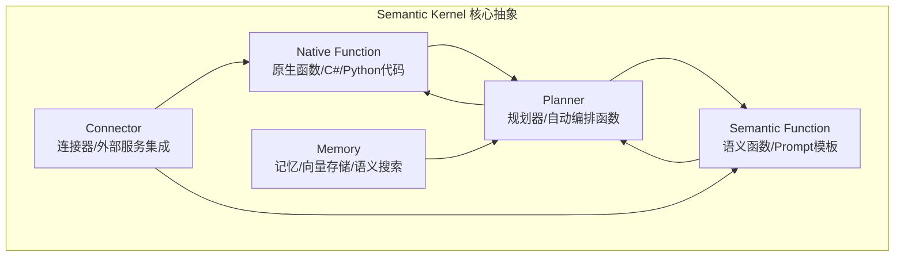
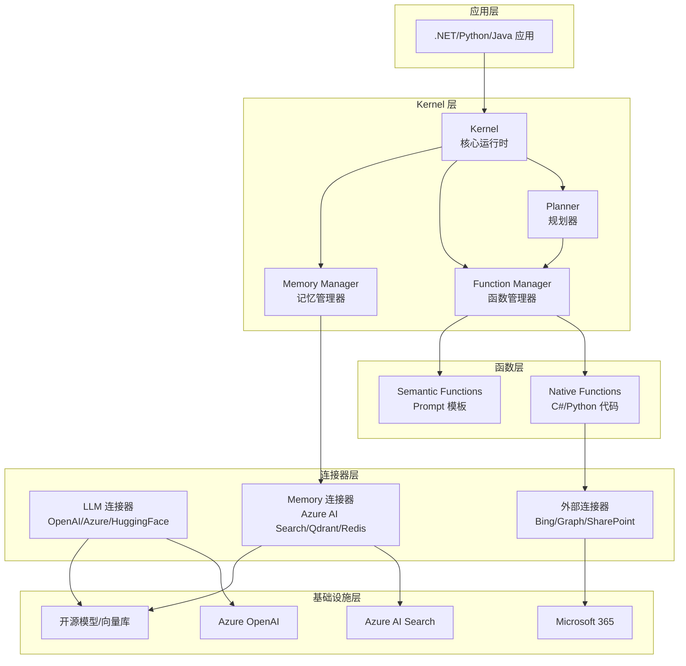
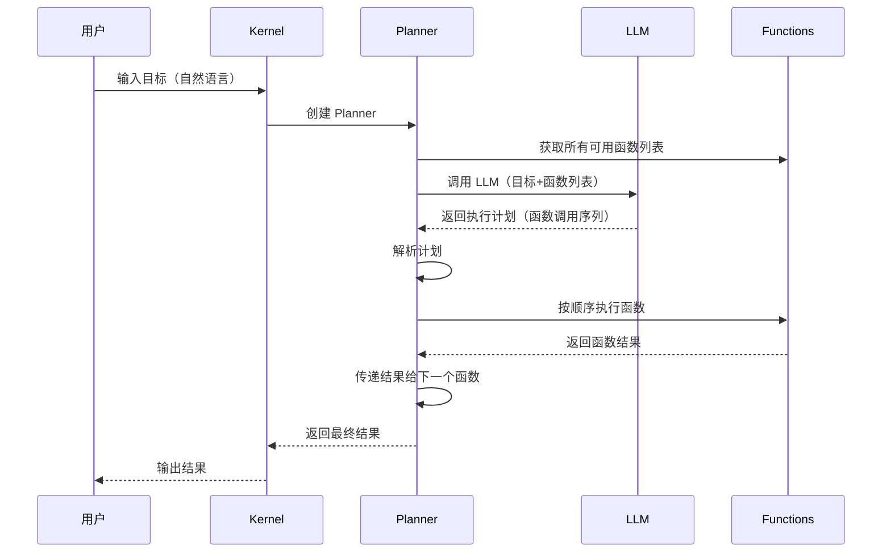
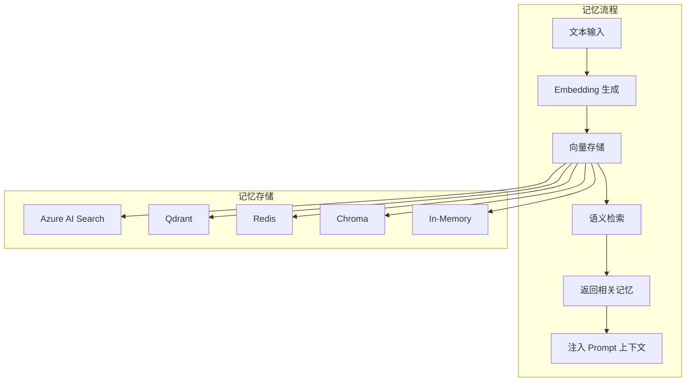

# Semantic Kernel 微软框架

> **一句话定义**：Semantic Kernel（SK）是微软推出的开源 AI 编排框架，通过"原生函数（Native Function）+ 语义函数（Semantic Function）+ 规划器（Planner）+ 记忆（Memory）"的核心抽象，将 LLM 能力无缝集成到 C#/Python/Java 应用中，特别适合企业级 .NET 应用的 AI 改造。
>
> **核心价值**：以"函数即技能"的核心理念，将 LLM 的语义能力与传统代码的原生能力统一为可组合的函数，通过规划器自动编排函数调用，同时提供企业级的可靠性、安全性和与 Azure/微软生态的深度集成。
>
> **适用场景**：企业 .NET 应用 AI 改造、Azure 云原生 AI 应用、企业级 Agent 系统、需要高可靠性和安全合规的 AI 应用、与微软生态（Office/Teams/Power Platform）集成。

---

## 一、概述

### 1.1 Semantic Kernel 设计理念

Semantic Kernel 的核心设计理念是"**AI 即函数**"——将 LLM 的语义能力封装为"语义函数"，将传统代码封装为"原生函数"，两者使用统一的接口，可以自由组合、编排和调用。



### 1.2 核心概念一览

| 概念 | 说明 | 类比 |
|------|------|------|
| **Kernel** | 核心运行时，管理函数、记忆、连接器 | 应用容器/运行时 |
| **Native Function** | 用 C#/Python 编写的原生函数 | 传统代码函数 |
| **Semantic Function** | 用 Prompt 模板定义的语义函数 | Prompt 模板 |
| **Plugin** | 函数的集合，按功能分组 | 模块/插件 |
| **Planner** | 规划器，根据目标自动编排函数调用 | 任务调度器 |
| **Memory** | 记忆，存储和检索语义信息 | 知识库/向量数据库 |
| **Connector** | 连接器，集成外部服务（OpenAI/Azure/Bing） | 适配器/SDK |
| **Skill** | 旧称，现称为 Plugin | 技能集合 |
| **Function Calling** | 函数调用，LLM 直接调用原生函数 | API 调用 |
<div style="background:linear-gradient(135deg,#4facfe,#00f2fe);border-radius:16px;padding:20px;margin:16px 0;font-family:-apple-system,'Segoe UI','PingFang SC','Microsoft YaHei',sans-serif;color:#fff;overflow:hidden;box-shadow:0 8px 28px rgba(0,0,0,.14),0 3px 10px rgba(0,0,0,.08)">
<style>@keyframes fadeIn{from{opacity:0;transform:translateY(10px)}to{opacity:1;transform:translateY(0)}}.cmp-col{display:inline-block;width:45%;vertical-align:top;padding:12px;margin:0 2%;background:rgba(255,255,255,.15);border-radius:10px;animation:fadeIn .8s ease-out}.cmp-col h4{margin:0 0 8px 0;text-align:center;border-bottom:1px solid rgba(255,255,255,.3);padding-bottom:6px}.cmp-col ul{margin:0;padding-left:18px;font-size:13px;line-height:1.8}.cmp-vs{display:inline-block;width:4%;text-align:center;font-size:24px;font-weight:700;vertical-align:middle;animation:fadeIn 1s ease-out}</style>
<div style="text-align:center;font-size:15px;font-weight:700;margin-bottom:14px;padding-bottom:10px;border-bottom:1.5px solid rgba(255,255,255,.22);letter-spacing:1px">⚖️ Semantic Kernel 双函数体系对比</div>
<div style="text-align:center">
<div class="cmp-col"><h4>Native Function 原生函数</h4><ul><li>C#/Python/Java代码实现</li><li>精确逻辑、高性能</li><li>[KernelFunction]特性注册</li><li>适合计算、数据操作、API调用</li><li>确定性输出，可测试</li></ul></div>
<div class="cmp-vs">VS</div>
<div class="cmp-col"><h4>Semantic Function 语义函数</h4><ul><li>Prompt模板实现（skprompt.txt）</li><li>自然语言理解、生成</li><li>config.json配置参数</li><li>适合摘要、翻译、分类、推理</li><li>非确定性输出，需评估</li></ul></div>
</div>
<div style="text-align:center;font-size:12px;opacity:.85;margin-top:10px">两者统一为Function接口，由Planner自动编排，简单逻辑用Native，复杂语义用Semantic</div>
</div>


### 1.3 Semantic Kernel vs LangChain

| 维度 | Semantic Kernel | LangChain |
|------|-----------------|-----------|
| **开发商** | 微软 | 开源社区 |
| **主要语言** | C#（首选）、Python、Java | Python（首选）、JS/TS |
| **核心抽象** | 函数（Native/Semantic）+ Planner | Runnable + LCEL |
| **企业级** | 强（Azure 集成、.NET 生态） | 中 |
| **生态丰富度** | 中（微软生态为主） | 极强（100+ 集成） |
| **学习曲线** | 中（.NET 开发者友好） | 中（概念较多） |
| **生产就绪** | 高（微软背书、企业级支持） | 高 |
| **多 Agent** | 中（Planner + 函数） | 强（LangGraph） |
| **RAG** | 中（Memory + 连接器） | 强（Retriever + 向量库） |
| **适用场景** | .NET 企业应用、Azure 云原生 | 通用 AI 应用、Python 生态 |

> 🔍 **知识点深度解析**
>
> **作用**：Semantic Kernel 为企业级应用（特别是 .NET 应用）提供 AI 编排框架，通过原生函数+语义函数的统一抽象、规划器自动编排、记忆系统和连接器，将 LLM 能力无缝集成到现有应用中，同时提供企业级的可靠性和与 Azure/微软生态的深度集成。
>
> **原理**：Semantic Kernel 的核心是 Kernel（内核）——一个运行时容器，管理函数注册、记忆存储、连接器配置。函数分为两种：Native Function 是用 C#/Python 编写的传统代码函数，通过 `[KernelFunction]` 特性注册；Semantic Function 是用 Prompt 模板定义的语义函数，存储为 `skprompt.txt` + `config.json` 文件。Planner（规划器）接收用户目标，通过 LLM 分析需要调用哪些函数、按什么顺序调用，生成执行计划（Plan），然后执行计划。Memory（记忆）提供语义存储和检索能力，通过连接器接入向量数据库。
>
> **用法要点**：① C# 开发者优先使用 C# SDK，Python 开发者可以使用 Python SDK ② 原生函数使用 `[KernelFunction]` 特性和 `[Description]` 描述，便于 Planner 识别 ③ 语义函数使用 `skprompt.txt`（Prompt 模板）+ `config.json`（配置）的文件结构 ④ 函数按功能分组为 Plugin，使用 `ImportPluginFromObject` 或 `ImportPluginFromPromptDirectory` 注册 ⑤ Planner 是 SK 的核心能力，使用 `HandlebarsPlanner` 或 `FunctionCallingStepwisePlanner` 自动编排 ⑥ 生产环境使用 Azure OpenAI 服务，配置重试和超时 ⑦ 记忆系统使用 `KernelMemory` 或 `SemanticMemory`，接入 Azure AI Search 或 Qdrant 等向量库

---

> 💡 **深度讲解**：Semantic Kernel 的独特价值在于"企业级 .NET AI 编排"。在 LangChain 等 Python 优先的框架主导 AI 开发的背景下，Semantic Kernel 为庞大的 .NET 开发者社区提供了原生的 AI 编排框架——C# 开发者不需要学习 Python，不需要跨语言调用，可以直接在现有的 .NET 应用中集成 AI 能力。这对于拥有大量 .NET 遗产系统的企业来说非常有价值。Semantic Kernel 的"函数即技能"设计理念也很有特色——它不区分"LLM 调用"和"代码调用"，而是将两者统一为"函数"（Function）。Native Function 是代码实现的函数，Semantic Function 是 Prompt 实现的函数，两者使用相同的接口（输入参数→输出结果），可以被 Planner 统一编排。这种设计的优势是：① 开发者可以用最适合的方式实现每个技能（简单逻辑用代码，复杂语义用 Prompt）；② Planner 不需要区分函数类型，统一编排；③ 函数可以自由组合和复用。Planner 是 Semantic Kernel 最核心的能力——它接收用户的自然语言目标，自动分析需要调用哪些函数、按什么顺序调用、如何传递参数，生成可执行的计划。这比 LangChain 的 AgentExecutor 更结构化——Planner 生成的计划是显式的（可以查看和修改），而不是隐式的 ReAct 循环。Semantic Kernel 与 Azure 生态的深度集成也是其优势——Azure OpenAI、Azure AI Search、Azure Functions、Azure Logic Apps、Microsoft 365 Copilot 等都可以无缝集成，这对于使用 Azure 云的企业非常有吸引力。
>
> **📝 精简总结**：Semantic Kernel 是微软推出的开源 AI 编排框架，核心设计是"AI 即函数"——Native Function（代码函数）+ Semantic Function（Prompt函数）统一为可组合的函数；核心概念包括 Kernel（运行时）、Native/Semantic Function、Plugin（函数集合）、Planner（规划器/自动编排）、Memory（记忆）、Connector（连接器）；与 LangChain 相比，SK 更适合 .NET 企业应用和 Azure 云原生，企业级能力更强，但生态丰富度不如 LangChain；核心价值是为 .NET 开发者提供原生 AI 编排，函数统一抽象，Planner 显式计划，Azure 生态深度集成。

---

## 二、原理

### 2.1 Semantic Kernel 架构



### 2.2 函数系统

#### Native Function（原生函数）

```mermaid
graph LR
    A[C# 方法] --> B[[KernelFunction] 特性]
    B --> C[[Description] 描述]
    C --> D[Kernel 注册]
    D --> E[Planner 可调用]
```

Native Function 是用 C#/Python 编写的传统代码函数，通过特性/装饰器注册到 Kernel。

**关键元素**：
- `[KernelFunction]`：标记方法为 Kernel 函数
- `[Description]`：描述函数用途（Planner 据此决定是否调用）
- 参数：函数的输入参数（Planner 据此生成调用参数）
- 返回值：函数的输出结果

#### Semantic Function（语义函数）

Semantic Function 是用 Prompt 模板定义的函数，存储为文件结构：

```text
Plugins/
└── WriterPlugin/
    └── ShortPoem/
        ├── skprompt.txt    # Prompt 模板
        └── config.json     # 配置（模型、温度、max_tokens）
```

**skprompt.txt 示例**：
```text
写一首关于{{$topic}}的短诗，风格为{{$style}}。

要求：
- 不超过4行
- 押韵
- 意境优美
```

**config.json 示例**：
```json
{
  "schema": 1,
  "description": "写一首短诗",
  "type": "completion",
  "completion": {
    "max_tokens": 200,
    "temperature": 0.8,
    "top_p": 1.0
  },
  "input": {
    "parameters": [
      { "name": "topic", "description": "诗歌主题", "defaultValue": "春天" },
      { "name": "style", "description": "诗歌风格", "defaultValue": "现代" }
    ]
  }
}
```

### 2.3 Planner（规划器）工作原理



**Planner 类型**：

| Planner | 说明 | 适用场景 |
|---------|------|---------|
| **FunctionCallingStepwisePlanner** | 使用 Function Calling 逐步规划和执行 | 复杂任务、需要迭代 |
| **HandlebarsPlanner** | 生成 Handlebars 模板作为计划 | 结构化任务、可复用计划 |
| **SequentialPlanner** | 生成顺序执行的 XML 计划 | 简单顺序任务 |

### 2.4 记忆系统



---

> 💡 **深度讲解**：Semantic Kernel 的函数系统是其最核心的设计创新。传统的 AI 框架将"LLM 调用"和"代码调用"视为两种不同的操作，需要不同的 API 和处理逻辑。Semantic Kernel 将两者统一为"函数"（Function）——Native Function 是代码实现的函数，Semantic Function 是 Prompt 实现的函数，两者有相同的接口（名称、描述、输入参数、输出结果），可以被统一注册、管理、编排。这种统一抽象的优势是"Planner 不需要区分函数类型"——规划器只需要知道有哪些函数、每个函数做什么、输入输出是什么，就可以自动编排调用，而不需要关心这个函数是代码实现的还是 Prompt 实现的。这使得函数的实现细节对 Planner 透明，开发者可以根据需要自由选择实现方式——简单的逻辑（如数学计算、字符串处理）用 Native Function，复杂的语义理解（如摘要、翻译、分类）用 Semantic Function。Planner 是 Semantic Kernel 最强大的能力——它将"用户目标→函数调用序列"的转换自动化。与 LangChain 的 AgentExecutor（隐式 ReAct 循环）不同，Semantic Kernel 的 Planner 生成显式的执行计划——用户可以查看计划、修改计划、甚至保存计划为模板复用。这种显式计划的优势是可控性和可预测性——开发者知道 Planner 打算做什么，可以在执行前审核和修改。FunctionCallingStepwisePlanner 是最新的 Planner 实现，它使用 LLM 的 Function Calling 能力，逐步规划和执行，比传统的 SequentialPlanner 更灵活、更准确。记忆系统提供了 RAG 能力——将文本向量化存储，检索时通过语义相似度找到相关记忆，注入到 Prompt 上下文中。Semantic Kernel 的记忆系统支持多种向量存储（Azure AI Search、Qdrant、Redis、Chroma 等），企业环境推荐使用 Azure AI Search（与 Azure 生态集成、企业级安全）。
>
> **📝 精简总结**：Semantic Kernel 架构分为应用层、Kernel层（Kernel/Planner/Function Manager/Memory Manager）、函数层（Native Function/Semantic Function）、连接器层（LLM/Memory/外部连接器）、基础设施层（Azure OpenAI/Azure AI Search/M365/开源）；函数系统统一 Native Function（[KernelFunction]特性注册的C#/Python代码）和 Semantic Function（skprompt.txt+config.json定义的Prompt模板），两者接口相同可统一编排；Planner 工作原理是获取函数列表→调用LLM生成执行计划→按序执行函数→传递结果→返回最终结果，支持 FunctionCallingStepwise/Handlebars/Sequential 三种类型；记忆系统实现 Embedding→向量存储→语义检索→注入Prompt，支持 Azure AI Search/Qdrant/Redis/Chroma 等存储；核心是函数统一抽象和 Planner 显式计划。

---

## 三、实操

### 3.1 C# 基础使用

```python
using Microsoft.SemanticKernel;
using Microsoft.SemanticKernel.ChatCompletion;
using Microsoft.SemanticKernel.Connectors.OpenAI;

// 1. 创建 Kernel
var builder = Kernel.CreateBuilder();
builder.AddAzureOpenAIChatCompletion(
    deploymentName: "gpt-4o",
    endpoint: "https://your-resource.openai.azure.com/",
    apiKey: "your-api-key"
);
var kernel = builder.Build();

// 2. 直接调用 LLM
var result = await kernel.InvokePromptAsync("你好，请介绍一下你自己");
Console.WriteLine(result);

// 3. 使用 Chat Completion
var chatService = kernel.GetRequiredService<IChatCompletionService>();
var chatHistory = new ChatHistory();
chatHistory.AddSystemMessage("你是一个友好的 AI 助手");
chatHistory.AddUserMessage("什么是 Semantic Kernel？");

var response = await chatService.GetChatMessageContentAsync(chatHistory);
Console.WriteLine(response.Content);
```

### 3.2 Native Function（C#）

```python
using Microsoft.SemanticKernel;
using System.ComponentModel;

// 定义 Plugin（函数集合）
public class MathPlugin
{
    [KernelFunction, Description("执行数学计算")]
    public string Calculate(
        [Description("数学表达式，如 '23 * 45 + 10'")] string expression)
    {
        try
        {
            var result = new System.Data.DataTable().Compute(expression, null);
            return $"计算结果: {result}";
        }
        catch (Exception ex)
        {
            return $"计算错误: {ex.Message}";
        }
    }

    [KernelFunction, Description("将摄氏度转换为华氏度")]
    public double CelsiusToFahrenheit(
        [Description("摄氏度温度")] double celsius)
    {
        return celsius * 9 / 5 + 32;
    }
}

public class TimePlugin
{
    [KernelFunction, Description("获取当前日期和时间")]
    public string GetCurrentTime()
    {
        return DateTime.Now.ToString("yyyy-MM-dd HH:mm:ss");
    }

    [KernelFunction, Description("计算两个日期之间的天数")]
    public int DaysBetween(
        [Description("开始日期 (yyyy-MM-dd)")] string startDate,
        [Description("结束日期 (yyyy-MM-dd)")] string endDate)
    {
        var start = DateTime.Parse(startDate);
        var end = DateTime.Parse(endDate);
        return (end - start).Days;
    }
}

// 注册 Plugin 到 Kernel
var builder = Kernel.CreateBuilder();
builder.AddAzureOpenAIChatCompletion("gpt-4o", endpoint, apiKey);
builder.Plugins.AddFromObject<MathPlugin>();
builder.Plugins.AddFromObject<TimePlugin>();
var kernel = builder.Build();

// 使用 Function Calling 自动调用函数
var settings = new OpenAIPromptExecutionSettings
{
    ToolCallBehavior = ToolCallBehavior.AutoInvokeKernelFunctions
};

var result = await kernel.InvokePromptAsync(
    "现在几点了？然后计算 2024-01-01 到 2024-12-31 有多少天",
    new(settings));
Console.WriteLine(result);
```

### 3.3 Semantic Function（Prompt 模板）

```python
// 方式1：从目录加载 Semantic Function
var plugin = kernel.ImportPluginFromPromptDirectory(
    pluginDirectory: "Plugins/WriterPlugin",
    pluginName: "WriterPlugin");

// 调用 Semantic Function
var result = await kernel.InvokeAsync(
    pluginName: "WriterPlugin",
    functionName: "ShortPoem",
    arguments: new KernelArguments
    {
        ["topic"] = "人工智能",
        ["style"] = "现代"
    });
Console.WriteLine(result);

// 方式2：内联创建 Semantic Function
var poemFunction = kernel.CreateFunctionFromPrompt(
    promptTemplate: "写一首关于{{$topic}}的短诗，风格为{{$style}}",
    functionName: "WritePoem",
    description: "写一首短诗");

var result2 = await kernel.InvokeAsync(
    poemFunction,
    new KernelArguments { ["topic"] = "春天", ["style"] = "古典" });
```

### 3.4 Planner 使用

```python
using Microsoft.SemanticKernel.Planning;
using Microsoft.SemanticKernel.Planning.Handlebars;

// 创建 Planner
var planner = new HandlebarsPlanner(new HandlebarsPlannerOptions()
{
    AllowLoops = true
});

// 生成计划
var plan = await planner.CreatePlanAsync(kernel, 
    "帮我研究一下 AI 的最新发展，然后写一篇 500 字的总结文章，保存到文件");

// 查看计划
Console.WriteLine("生成的计划:");
Console.WriteLine(plan);

// 执行计划
var result = await plan.InvokeAsync(kernel);
Console.WriteLine($"执行结果: {result}");

// 使用 FunctionCallingStepwisePlanner
var stepwisePlanner = new FunctionCallingStepwisePlanner(
    new FunctionCallingStepwisePlannerOptions
    {
        MaxIterations = 10,
        MaxTokens = 4000
    });

var stepwiseResult = await stepwisePlanner.ExecuteAsync(kernel, 
    "分析最近一个月的销售数据，找出增长最快的产品，生成分析报告");
Console.WriteLine(stepwiseResult.FinalAnswer);
```

### 3.5 记忆系统

```text
using Microsoft.SemanticKernel.Memory;
using Microsoft.SemanticKernel.Connectors.AzureAISearch;
using Microsoft.SemanticKernel.Connectors.OpenAI;

// 创建 Memory Builder
var memoryBuilder = new MemoryBuilder();
memoryBuilder.WithAzureOpenAITextEmbeddingGeneration(
    deploymentName: "text-embedding-3-small",
    endpoint: endpoint,
    apiKey: apiKey);
memoryBuilder.WithMemoryStore(new AzureAISearchMemoryStore(
    endpoint: searchEndpoint,
    apiKey: searchApiKey));
var memory = memoryBuilder.Build();

// 存储记忆
await memory.SaveInformationAsync(
    collection: "company-docs",
    text: "Semantic Kernel 是微软推出的 AI 编排框架，支持 C#/Python/Java",
    id: "doc-001",
    description: "SK 简介");

await memory.SaveInformationAsync(
    collection: "company-docs",
    text: "Planner 是 Semantic Kernel 的核心能力，可以自动编排函数调用",
    id: "doc-002",
    description: "Planner 介绍");

// 检索记忆
var results = await memory.SearchAsync(
    collection: "company-docs",
    query: "什么是 Planner？",
    limit: 3,
    minRelevanceScore: 0.7);

await foreach (var result in results)
{
    Console.WriteLine($"相关度: {result.Relevance}");
    Console.WriteLine($"内容: {result.Metadata.Text}");
}

// 在 Kernel 中使用记忆
var builder = Kernel.CreateBuilder();
builder.AddAzureOpenAIChatCompletion("gpt-4o", endpoint, apiKey);
var kernel = builder.Build();

// 检索相关记忆并注入 Prompt
var memories = await memory.SearchAsync("company-docs", "Semantic Kernel", 3);
var context = string.Join("\n", memories.Select(m => m.Metadata.Text));

var answer = await kernel.InvokePromptAsync(
    $"基于以下信息回答问题：\n{context}\n\n问题：Semantic Kernel 的核心能力是什么？");
Console.WriteLine(answer);
```

### 3.6 Python SDK 使用

```python
import semantic_kernel as sk
from semantic_kernel.connectors.ai.open_ai import AzureChatCompletion
from semantic_kernel.core_plugins import MathPlugin, TimePlugin

# 创建 Kernel
kernel = sk.Kernel()
kernel.add_service(AzureChatCompletion(
    deployment_name="gpt-4o",
    endpoint="https://your-resource.openai.azure.com/",
    api_key="your-api-key"
))

# 注册 Plugin
kernel.import_plugin_from_object(MathPlugin(), "math")
kernel.import_plugin_from_object(TimePlugin(), "time")

# 调用 Semantic Function
writer_plugin = kernel.import_plugin_from_prompt_directory(
    parent_directory="Plugins",
    plugin_directory_name="WriterPlugin"
)

result = await kernel.invoke(
    writer_plugin["ShortPoem"],
    topic="人工智能",
    style="现代"
)
print(result)
```

---

> 💡 **深度讲解**：Semantic Kernel 的实操核心是"函数注册 + Planner 编排"。函数注册是基础——Native Function 通过 `[KernelFunction]` + `[Description]` 特性注册，Semantic Function 通过 `skprompt.txt` + `config.json` 文件结构注册。函数的描述（Description）非常重要——Planner 根据函数描述决定是否调用该函数，描述不清晰会导致 Planner 无法正确选择函数。函数描述应该说明"做什么+何时用"，例如"执行数学计算，当用户需要计算数学表达式时使用"。Planner 编排是 Semantic Kernel 的核心能力——使用 `FunctionCallingStepwisePlanner` 或 `HandlebarsPlanner`，传入用户目标，Planner 自动分析需要调用哪些函数、按什么顺序调用，生成执行计划。FunctionCallingStepwisePlanner 是推荐的 Planner——它使用 LLM 的 Function Calling 能力，逐步规划和执行，比传统的 SequentialPlanner 更灵活、更准确。使用 Planner 时需要注意：① 函数数量不宜过多（建议 10-20 个），否则 Planner 难以选择；② 函数描述要清晰；③ 设置 MaxIterations 防止无限循环；④ 复杂任务可以拆分为多个子任务，分别使用 Planner。记忆系统提供 RAG 能力——使用 `MemoryBuilder` 配置 Embedding 生成器和向量存储，然后保存和检索记忆。企业环境推荐使用 Azure AI Search 作为向量存储（与 Azure 生态集成、企业级安全）。记忆的使用流程是：保存文档→检索相关文档→将检索结果注入 Prompt→LLM 基于上下文回答。Semantic Kernel 的 C# SDK 是最成熟的，Python SDK 也在快速发展中。.NET 开发者应该优先使用 C# SDK，可以充分利用 .NET 的类型系统、依赖注入、异步编程等特性。
>
> **📝 精简总结**：C# 基础使用是 Kernel.CreateBuilder→AddAzureOpenAIChatCompletion→Build→InvokePromptAsync；Native Function 使用 [KernelFunction]+[Description] 特性标记 C# 方法，通过 builder.Plugins.AddFromObject 注册，Function Calling 自动调用用 ToolCallBehavior.AutoInvokeKernelFunctions；Semantic Function 使用 skprompt.txt（Prompt模板）+config.json（配置）文件结构，通过 ImportPluginFromPromptDirectory 加载，也可用 CreateFunctionFromPrompt 内联创建；Planner 使用 HandlebarsPlanner 或 FunctionCallingStepwisePlanner，CreatePlanAsync 生成计划→InvokeAsync 执行，FunctionCallingStepwisePlanner 推荐用于复杂任务；记忆系统使用 MemoryBuilder 配置 Embedding+向量存储，SaveInformationAsync 存储，SearchAsync 检索，结果注入 Prompt；Python SDK 提供类似 API，C# SDK 最成熟；核心是函数注册（描述清晰）+ Planner 编排（函数数量适中+MaxIterations）。

---

## 四、问题

### 4.1 常见错误与排查

| 问题 | 原因 | 解决方案 |
|------|------|---------|
| **Kernel 创建失败** | Azure 配置错误 / API Key 无效 / 部署名错误 | 检查 endpoint、apiKey、deploymentName，确认 Azure OpenAI 资源已部署 |
| **函数不被 Planner 调用** | 函数描述不清晰 / 函数未正确注册 / 函数数量过多 | 优化函数描述（做什么+何时用），确认函数已注册，减少函数数量 |
| **Function Calling 不生效** | 未配置 ToolCallBehavior / 模型不支持 tool calling | 设置 ToolCallBehavior.AutoInvokeKernelFunctions，使用支持 tool calling 的模型 |
| **Semantic Function 加载失败** | 文件路径错误 / skprompt.txt 缺失 / config.json 格式错误 | 检查文件路径，确认 skprompt.txt 存在，验证 config.json JSON 格式 |
| **Planner 生成计划失败** | 目标太复杂 / 函数描述不清 / LLM 能力不足 | 拆分复杂目标，优化函数描述，使用更强的模型 |
| **Planner 无限循环** | MaxIterations 未设置 / 函数结果不充分 | 设置 MaxIterations，优化函数返回结果 |
| **记忆检索不到相关内容** | 文档未正确存储 / Embedding 模型不匹配 / 相似度阈值过高 | 确认文档已存储，使用匹配的 Embedding 模型，降低 minRelevanceScore |
| **记忆存储失败** | 向量存储连接错误 / 集合不存在 / 权限不足 | 检查向量存储连接，确认集合已创建，验证访问权限 |
| **流式输出不完整** | 未使用流式 API / 缓冲区设置不当 | 使用 GetStreamingChatMessageContentsAsync，正确处理流 |
| **异步调用报错** | 在同步上下文中调用异步方法 / 死锁 | 使用 await，在 async 方法中调用，避免 .Result / .Wait() |
| **依赖冲突** | NuGet 包版本不兼容 | 使用兼容版本，清理 NuGet 缓存，参考官方版本矩阵 |
| **中文乱码** | 编码设置错误 / 控制台编码不支持 UTF-8 | 设置 Console.OutputEncoding = Encoding.UTF8，使用 UTF-8 编码 |

### 4.2 性能优化策略

| 优化点 | 策略 | 预期效果 |
|--------|------|---------|
| **模型调用** | 使用更小的模型，降低 temperature，限制 max_tokens | 延迟降低 30-50%，成本降低 40-60% |
| **函数数量** | 精简函数数量，合并相似函数 | Planner 选择更准确，延迟降低 |
| **Planner** | 使用 FunctionCallingStepwisePlanner，设置合理 MaxIterations | 规划更高效，避免无限循环 |
| **记忆检索** | 优化 Embedding，使用 ANN 索引，调整 Top K | 检索延迟降低 50%，准确率提升 |
| **缓存** | 缓存 LLM 响应和函数结果 | 重复查询延迟降低 90% |
| **批量处理** | 使用批量 Embedding，批量函数调用 | 吞吐量提升 2-5 倍 |
| **异步** | 使用 async/await 处理并发 | 并发处理能力提升 |
| **流式输出** | 使用流式 API 实现首字快速返回 | 首字延迟降低 50-80% |
| **连接池** | 配置 HttpClient 连接池，复用连接 | 连接开销降低 70% |
| **模型路由** | 根据任务复杂度动态选择模型 | 成本降低 30-50% |

### 4.3 安全风险与防护

| 风险 | 说明 | 防护措施 |
|------|------|---------|
| **Prompt 注入** | 通过用户输入或函数返回注入恶意指令 | 输入校验，系统提示与用户输入分离，注入检测 |
| **函数越权** | Planner 调用未授权的函数或执行危险操作 | 函数白名单，权限控制，高风险操作需人类批准 |
| **数据泄露** | 记忆中存储敏感信息，或函数输出泄露 | 敏感信息脱敏，记忆访问控制，输出审核 |
| **代码执行** | Native Function 执行危险代码（如文件删除、命令执行） | 沙箱隔离，资源限制，代码审查，函数白名单 |
| **API 密钥泄露** | API Key 硬编码在代码或配置中 | 使用 Azure Key Vault，环境变量，托管标识 |
| **拒绝服务** | Planner 无限循环或大量调用消耗资源 | MaxIterations 限制，速率限制，资源配额，成本告警 |
| **记忆投毒** | 存储包含错误或恶意信息的记忆 | 记忆审核，来源验证，人工校验 |

### 4.4 生产环境踩坑记录

**踩坑1：Planner 无法正确选择函数**
- **现象**：用户问"现在几点了"，Planner 调用了 Calculate 函数而不是 GetCurrentTime 函数
- **原因**：GetCurrentTime 函数的 Description 只有"获取当前时间"，没有说明使用场景；Calculate 函数的描述更详细，Planner 误选
- **方案**：① 优化函数描述，明确说明使用场景，如"获取当前日期和时间，当用户询问时间、日期、今天是几号时使用此函数"；② 函数名称要直观（GetCurrentTime 比 GetTime 好）；③ 减少函数数量，避免功能重叠；④ 使用 FunctionCallingStepwisePlanner，它的函数选择更准确

**踩坑2：Semantic Function 的变量未被替换**
- **现象**：调用 Semantic Function 后，输出中仍然包含 `{{$topic}}` 占位符，变量未被替换
- **原因**：① Prompt 模板中变量名与传入参数名不匹配（模板用 `topic`，参数传 `subject`）；② 变量名格式错误（应该用 `{{$topic}}` 而不是 `{{topic}}`）；③ 参数未正确传入 KernelArguments
- **方案**：① 确认 Prompt 模板中的变量名与 KernelArguments 的 key 完全一致；② 使用正确的变量格式 `{{$variableName}}`；③ 调用时确认参数已传入；④ 在 config.json 的 input.parameters 中定义变量，便于校验

**踩坑3：Azure OpenAI 调用超时**
- **现象**：生产环境中，部分 LLM 调用超时，导致应用响应缓慢
- **原因**：① 默认超时时间较短（100秒），复杂 Prompt 或大模型可能超时；② 网络延迟；③ 未配置重试策略
- **方案**：① 增加超时时间（设置 HttpClient.Timeout）；② 配置重试策略（使用 Polly 或 Kernel 的重试机制）；③ 使用流式输出，首字快速返回；④ 选择更近的 Azure 区域；⑤ 监控 API 延迟，必要时升级模型部署的吞吐量

---

> 💡 **深度讲解**：Semantic Kernel 生产环境的核心挑战是"Planner 可靠性"和"企业集成"。Planner 可靠性是 Semantic Kernel 最关键也最容易出问题的地方——Planner 依赖 LLM 来理解用户目标、选择函数、生成执行计划，这本质上是非确定性的。如果函数描述不清晰、函数数量过多、目标太复杂，Planner 可能选择错误的函数、生成无效的计划、陷入无限循环。提升 Planner 可靠性的策略：① 函数描述要清晰具体（做什么+何时用+何时不用）；② 函数数量控制在 10-20 个，功能不重叠；③ 使用 FunctionCallingStepwisePlanner（比 SequentialPlanner 更可靠）；④ 设置 MaxIterations 防止无限循环；⑤ 复杂任务拆分为简单子任务；⑥ 记录 Planner 的计划和执行过程，便于调试和优化；⑦ 对关键流程可以不使用 Planner，直接编排函数调用（确定性更高）。企业集成是 Semantic Kernel 的另一个核心挑战——企业应用通常需要与现有系统（数据库、API、消息队列、身份认证）集成。Semantic Kernel 通过 Native Function 可以轻松调用任何 .NET 代码，这意味着可以直接复用现有的业务逻辑和数据访问层。同时，Semantic Kernel 与 Azure 生态的深度集成（Azure OpenAI、Azure AI Search、Azure Functions、Azure Logic Apps、Microsoft 365）使得企业可以在熟悉的 Azure 环境中构建 AI 应用。安全合规是企业级应用的关键——Semantic Kernel 支持 Azure Key Vault（密钥管理）、托管标识（无密钥认证）、私有端点（网络隔离）、内容安全（输出过滤）等企业级安全特性。建议生产环境：① 使用 Azure OpenAI 而非公开 OpenAI（数据不离开 Azure）；② 使用托管标识认证（不硬编码 API Key）；③ 配置内容安全过滤；④ 记录完整的审计日志；⑤ 对高风险函数使用人类审批（interrupt）。
>
> **📝 精简总结**：常见问题包括 Kernel创建失败、函数不被Planner调用、Function Calling不生效、Semantic Function加载失败、Planner生成计划失败/无限循环、记忆检索不到/存储失败、流式输出不完整、异步报错、依赖冲突、中文乱码；性能优化采用模型分级、精简函数数量、FunctionCallingStepwisePlanner、记忆检索优化、缓存、批量处理、异步、流式输出、连接池、模型路由等策略；安全风险包括 Prompt注入、函数越权、数据泄露、代码执行、API密钥泄露、DoS、记忆投毒，采用纵深防御+Azure Key Vault+托管标识；生产踩坑集中在Planner函数选择错误（描述清晰+函数直观+减少数量+StepwisePlanner）、Semantic Function变量未替换（变量名匹配+正确格式{{$var}}+参数传入）、Azure OpenAI超时（增加超时+重试策略+流式+更近区域）；核心挑战是Planner可靠性（描述清晰+函数适中+StepwisePlanner+复杂任务拆分）和企业集成（Native Function复用业务逻辑+Azure生态深度集成+安全合规）。

---

## 五、拓展

### 5.1 Semantic Kernel 生态

| 组件 | 说明 |
|------|------|
| **Semantic Kernel (C#)** | 核心 C# SDK，最成熟完整 |
| **Semantic Kernel (Python)** | Python SDK，快速发展中 |
| **Semantic Kernel (Java)** | Java SDK，企业 Java 应用 |
| **Kernel Memory** | 独立的记忆服务，支持 RAG 管道 |
| **Semantic Kernel Tools** | VS Code 扩展，辅助开发和调试 |
| **Azure AI Foundry** | Azure 的 AI 开发平台，与 SK 深度集成 |
| **Microsoft 365 Copilot** | 可通过 SK 扩展 Copilot 能力 |
| **Azure Functions** | 无服务器部署 SK 应用 |
| **Azure Logic Apps** | 工作流集成 SK 函数 |

### 5.2 Semantic Kernel 应用场景

| 场景 | 核心能力 | 说明 |
|------|---------|------|
| **企业 Copilot** | Planner + Native Function | 企业内部 AI 助手，调用业务系统 |
| **客户服务机器人** | Memory + Function Calling | 基于知识库的客服，可调用订单系统 |
| **文档智能处理** | Semantic Function + Memory | 文档摘要、分类、提取、翻译 |
| **数据分析助手** | Native Function + Planner | 自然语言查询数据库，生成分析报告 |
| **代码助手** | Native Function + Semantic Function | 代码生成、审查、重构、文档生成 |
| **流程自动化** | Planner + Connector | 自动执行业务流程（审批、通知、报表） |
| **知识管理** | Memory + Semantic Function | 企业知识库问答、知识发现、知识推荐 |
| **IT 运维助手** | Native Function + Planner | 故障诊断、日志分析、自动化运维 |
| **营销内容生成** | Semantic Function + Planner | 营销文案、社交媒体内容、邮件生成 |
| **教育辅导** | Memory + Function Calling | 个性化辅导、作业批改、学习推荐 |

### 5.3 与其他框架的对比

| 维度 | Semantic Kernel | LangChain | LangGraph | AutoGen |
|------|-----------------|-----------|-----------|---------|
| **主要语言** | C#/Python/Java | Python/JS | Python/JS | Python |
| **核心抽象** | 函数 + Planner | Runnable + LCEL | 状态图 | 对话 Agent |
| **编排方式** | Planner 自动编排 | 链式组合 | 显式图编排 | 对话协作 |
| **企业级** | 极强（Azure/.NET） | 中 | 高 | 中 |
| **生态** | 微软生态 | 通用生态 | LangChain 生态 | 微软+开源 |
| **学习曲线** | 中（.NET 友好） | 中 | 陡 | 中 |
| **多 Agent** | 中 | 中 | 极强 | 强 |
| **RAG** | 中（Memory） | 强（Retriever） | 中 | 弱 |
| **生产就绪** | 高 | 高 | 高 | 中 |
| **适用场景** | .NET 企业应用 | 通用 AI 应用 | 复杂 Agent 流程 | 对话协作 |

### 5.4 学习资源

- [Semantic Kernel 官方文档](https://learn.microsoft.com/semantic-kernel/) 🔗
- [Semantic Kernel GitHub](https://github.com/microsoft/semantic-kernel) 🔗
- [Semantic Kernel 博客](https://devblogs.microsoft.com/semantic-kernel/) 🔗
- [Kernel Memory 文档](https://microsoft.github.io/kernel-memory/) 🔗
- [Semantic Kernel 示例](https://github.com/microsoft/semantic-kernel/tree/main/dotnet/samples) 🔗
- [Azure OpenAI 文档](https://learn.microsoft.com/azure/ai-services/openai/) 🔗
- [[LangChain-核心抽象与链]] — LangChain 核心抽象
- [[LangGraph-状态机Agent]] — 状态机 Agent 编排
- [[Agent核心概念-ReAct规划]] — ReAct 推理循环
- [[自研Agent框架设计]] — 自研框架参考
- [[AI Agent开发框架知识点系统梳理_优化版]] — Agent 框架系统梳理

---

> 💡 **深度讲解**：Semantic Kernel 的未来发展方向是"企业 AI 编排的标准框架"。随着微软将 AI 能力深度集成到整个产品生态（Microsoft 365 Copilot、Azure AI Foundry、Power Platform），Semantic Kernel 作为连接 LLM 与企业业务系统的桥梁，其重要性不断提升。Semantic Kernel 的核心优势是"企业级 .NET 集成"——全球有数百万 .NET 开发者和大量的 .NET 企业应用，Semantic Kernel 为这些开发者和应用提供了原生的 AI 编排能力，不需要跨语言调用，不需要学习新的技术栈。这对于企业的 AI 转型非常有价值——企业可以在现有的 .NET 应用中快速集成 AI 能力，而不需要重新构建 Python 技术栈。Semantic Kernel 的函数统一抽象（Native + Semantic）也是一个重要的创新——它使得"哪些逻辑用代码实现，哪些逻辑用 Prompt 实现"成为一个可以灵活选择的工程决策，而不是框架强加的约束。开发者可以根据性能、成本、可靠性等因素自由选择实现方式，同时保持统一的调用接口。Planner 的演进也值得关注——从最初的 SequentialPlanner（XML 计划）到 HandlebarsPlanner（模板计划），再到 FunctionCallingStepwisePlanner（基于 Function Calling 的逐步规划），Planner 变得越来越灵活和可靠。未来的 Planner 可能会结合 LangGraph 的状态机思想，支持更复杂的流程控制（循环、条件分支、人机交互）。对于企业来说，选择 Semantic Kernel 的决策因素：① 现有技术栈是否以 .NET 为主（是则优先考虑 SK）；② 是否使用 Azure 云（是则 SK 集成更顺畅）；③ 是否需要企业级安全合规（SK 的 Azure 集成更完善）；④ 团队是否熟悉 Python 生态（如是则 LangChain 可能更合适）。
>
> **📝 精简总结**：Semantic Kernel 生态包括 C#/Python/Java SDK、Kernel Memory（独立记忆服务）、VS Code Tools、Azure AI Foundry、Microsoft 365 Copilot、Azure Functions、Azure Logic Apps；应用场景包括企业 Copilot、客服机器人、文档智能处理、数据分析助手、代码助手、流程自动化、知识管理、IT运维助手、营销内容生成、教育辅导；与 LangChain（Python优先/通用生态）、LangGraph（状态机/复杂流程）、AutoGen（对话式/多Agent）各有侧重，SK 优势是 .NET 企业集成和 Azure 生态；学习资源包括官方文档、GitHub、博客、Kernel Memory文档、示例、Azure OpenAI文档和本知识库相关专题；发展方向是企业AI编排标准框架，核心优势是 .NET 原生集成、函数统一抽象、Planner 持续演进、Azure 生态深度集成。

---

## 🔗 关联笔记

- [[LangChain-核心抽象与链]] — LangChain 核心抽象与 LCEL
- [[LangGraph-状态机Agent]] — 状态机 Agent 编排框架
- [[Agent核心概念-ReAct规划]] — ReAct 推理循环
- [[Agent工具调用FunctionCalling]] — Function Calling 基础
- [[FunctionCalling工具生态]] — 工具生态
- [[多Agent协作模式]] — 多 Agent 协作理论
- [[自研Agent框架设计]] — 自研框架设计参考
- [[Dify-低代码AI应用平台]] — 低代码 AI 平台
- [[AI Agent开发框架知识点系统梳理_优化版]] — Agent 框架系统梳理

## 📖 前置知识

- [[LLM大模型入门概念]]
- [[Prompt工程进阶]]
- [[Agent核心概念-ReAct规划]]
- [[Agent工具调用FunctionCalling]]

## 🏷️ 相关标签

`#AI应用` `#AI工程化` `#Agent` `#效率工具`

---

[[Home|🏠 返回首页]] · [[MOC-AI与效率工具|📚 返回分类]]
