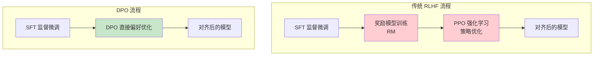
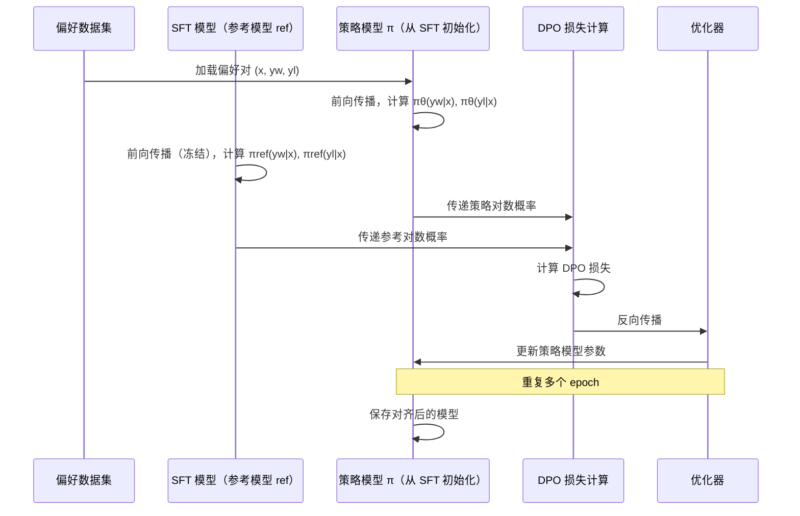

# DPO 直接偏好优化

> **一句话定义**：DPO（Direct Preference Optimization）是一种简化的 LLM 对齐方法，通过直接在偏好数据上优化策略，绕过传统 RLHF 中复杂的奖励模型训练和强化学习过程，实现更简单、更稳定、更高效的 LLM 对齐。
>
> **核心价值**：将 RLHF 的三阶段流程（SFT→奖励模型→PPO）简化为两阶段（SFT→DPO），不需要单独训练奖励模型，不需要复杂的强化学习超参数调优，训练更稳定、计算成本更低、效果相当甚至更好。
>
> **适用场景**：LLM 对齐微调、对话模型优化、指令遵循提升、减少有害输出、个性化模型调整、资源有限场景下的模型对齐。

---

## 一、概述

### 1.1 DPO 解决的问题

传统 RLHF（基于人类反馈的强化学习）流程复杂、训练不稳定、计算成本高：

| RLHF 痛点 | DPO 的解法 |
|-----------|-----------|
| **需要训练奖励模型** | 隐式学习奖励，不需要单独的奖励模型 |
| **PPO 训练不稳定** | 直接优化，类似监督学习，训练稳定 |
| **超参数复杂** | 超参数少，主要是学习率和 β |
| **计算成本高** | 计算量接近 SFT，远低于 PPO |
| **奖励模型过优化** | 隐式奖励，不容易过优化 |
| **实现复杂** | 实现简单，类似标准的监督微调 |

### 1.2 RLHF vs DPO 流程对比



### 1.3 核心概念

| 概念 | 说明 |
|------|------|
| **偏好数据** | 包含提示（prompt）、首选回答（chosen）、非首选回答（rejected）的三元组数据 |
| **SFT 模型** | 经过监督微调的基础模型，作为 DPO 的起始点和参考模型 |
| **参考模型（ref）** | 冻结的 SFT 模型，用于计算参考对数概率，防止策略偏离太远 |
| **策略模型（π）** | 正在训练的模型，DPO 优化的目标 |
| **β（beta）** | 温度参数，控制策略与参考模型的偏离程度，β 越小越接近参考模型 |
| **隐式奖励** | DPO 不直接训练奖励模型，而是从策略中隐式推导奖励函数 |
| **对比损失** | DPO 的损失函数，最大化 chosen 的概率同时最小化 rejected 的概率 |


<div style="background:linear-gradient(135deg,#f093fb,#f5576c);border-radius:16px;padding:20px;margin:16px 0;font-family:-apple-system,'Segoe UI','PingFang SC','Microsoft YaHei',sans-serif;color:#fff;overflow:hidden;box-shadow:0 8px 28px rgba(0,0,0,.14),0 3px 10px rgba(0,0,0,.08)">
<style>@keyframes flow{0%{transform:translateX(-10px);opacity:0}15%{transform:translateX(0);opacity:1}85%{transform:translateX(0);opacity:1}100%{transform:translateX(10px);opacity:0}}.flow-step{display:inline-block;background:rgba(255,255,255,.2);border:2px solid rgba(255,255,255,.5);border-radius:8px;padding:10px 14px;margin:4px;text-align:center;font-weight:600;font-size:13px;animation:flow 4s ease-in-out infinite;min-width:90px}.flow-step:nth-child(2){animation-delay:.5s}.flow-step:nth-child(4){animation-delay:1s}.flow-step:nth-child(6){animation-delay:1.5s}.flow-step:nth-child(8){animation-delay:2s}.flow-arrow{display:inline-block;font-size:20px;animation:flow 4s ease-in-out infinite;vertical-align:middle}.flow-code{background:rgba(0,0,0,.2);border-radius:6px;padding:8px 12px;margin-top:10px;font-family:monospace;font-size:12px;text-align:center}</style>
<div style="text-align:center;font-size:15px;font-weight:700;margin-bottom:14px;padding-bottom:10px;border-bottom:1.5px solid rgba(255,255,255,.22);letter-spacing:1px">🎯 DPO 直接偏好优化流程</div>
<div style="text-align:center;white-space:nowrap;overflow-x:auto">
<span class="flow-step">偏好数据收集</span><span class="flow-arrow">→</span><span class="flow-step">策略模型初始化</span><span class="flow-arrow">→</span><span class="flow-step">DPO损失计算</span><span class="flow-arrow">→</span><span class="flow-step">梯度更新</span><span class="flow-arrow">→</span><span class="flow-step">对齐模型</span>
</div>
<div class="flow-code">chosen/rejected对→SFT模型初始化→直接优化偏好损失→无需奖励模型→对齐人类偏好</div>
</div>
> 🔍 **知识点深度解析**
>
> **作用**：DPO 为 LLM 对齐提供了一种简化的方法，通过直接在偏好数据上优化策略，绕过传统 RLHF 中复杂的奖励模型训练和 PPO 强化学习，实现更简单、更稳定、更高效的对齐。
>
> **原理**：DPO 的核心洞察是"奖励模型和策略优化可以合并为一个目标"。在传统 RLHF 中，奖励模型学习人类偏好，PPO 使用奖励模型优化策略。DPO 证明了这两个步骤可以合并——通过最大化"chosen 相对于 rejected 的对数概率差"（相对于参考模型），可以隐式地学习到最优奖励函数并同时优化策略。DPO 的损失函数本质上是一个对比损失：对于每个偏好对（prompt, chosen, rejected），增加 chosen 的对数概率（相对于参考模型），减少 rejected 的对数概率，β 参数控制与参考模型的偏离程度。
>
> **用法要点**：① DPO 必须在 SFT 模型基础上进行，不能直接在基础模型上做 ② 偏好数据质量是关键——chosen 和 rejected 的差异要明显且有意义 ③ β 参数通常取 0.1-0.5，β 太小对齐效果弱，β 太大可能导致语言质量下降 ④ 训练配置类似 SFT——学习率 5e-7 到 5e-6，epoch 1-3，batch size 适中 ⑤ 使用 LoRA/QLoRA 可以显著降低显存需求 ⑥ 评估需要同时看对齐效果（偏好胜率）和语言质量（困惑度、多样性）⑦ DPO 容易导致"对齐税"（语言能力下降），需要监控和平衡

---

> 💡 **深度讲解**：DPO 的出现是 LLM 对齐领域的重要简化。在 DPO 之前，RLHF 是 LLM 对齐的标准方法，但它有几个显著的痛点：① 需要单独训练一个奖励模型（RM），这本身需要大量偏好数据和调优；② PPO 强化学习训练非常不稳定，超参数敏感（学习率、clip range、KL 系数、GAE 参数等），容易出现奖励黑客（reward hacking）和语言质量下降；③ 计算成本高——PPO 训练需要同时维护策略模型、参考模型、奖励模型、价值模型四个模型，显存和计算量巨大；④ 实现复杂——PPO 的正确实现需要处理 GAE、advantage 归一化、clip 等细节，容易出错。DPO 的核心洞察来自于对 RLHF 最优解的理论分析——研究者发现，在最优策略下，奖励函数可以从策略中解析地推导出来，这意味着不需要单独训练奖励模型，而是可以直接优化策略来隐式地学习最优奖励。DPO 的损失函数形式非常简洁——它本质上是一个带参考模型的对比损失，数学形式类似于带温度的逻辑回归。这种简洁性带来了多个优势：① 训练稳定——DPO 的训练更像监督学习，不会出现 PPO 的训练崩溃；② 超参数少——主要是学习率和 β，不需要调 PPO 的一堆超参数；③ 计算成本低——只需要策略模型和参考模型（可以用 LoRA 共享主干），不需要奖励模型和价值模型；④ 实现简单——DPO 的损失函数只有几行代码，容易正确实现。DPO 已经被广泛应用于各种开源模型（Zephyr、Tulu、OpenHermes 等），效果与 RLHF 相当甚至更好，正在成为 LLM 对齐的主流方法。
>
> **📝 精简总结**：DPO（直接偏好优化）是简化的 LLM 对齐方法，将 RLHF 的三阶段（SFT→奖励模型→PPO）简化为两阶段（SFT→DPO）；解决了 RLHF 的奖励模型训练复杂、PPO不稳定、超参数多、计算成本高、实现复杂等痛点；核心概念包括偏好数据（prompt/chosen/rejected三元组）、SFT模型、参考模型（ref，冻结）、策略模型（π，训练）、β（温度参数，控制偏离程度）、隐式奖励、对比损失；核心原理是奖励模型和策略优化可合并，通过最大化 chosen 相对于 rejected 的对数概率差（相对于参考模型）隐式学习最优奖励；优势是训练稳定、超参数少、计算成本低、实现简单；正在成为 LLM 对齐的主流方法。

---

## 二、原理

### 2.1 DPO 数学原理

#### 偏好数据格式

每个偏好样本包含：
- **prompt (x)**：用户提示
- **chosen (y_w)**：人类偏好的回答（win）
- **rejected (y_l)**：人类不偏好的回答（lose）

#### DPO 损失函数

```text
$$
\mathcal{L}_{DPO}(\pi_\theta; \pi_{ref}) = -\mathbb{E}_{(x,y_w,y_l) \sim D} \left[ \log \sigma \left( \beta \log \frac{\pi_\theta(y_w|x)}{\pi_{ref}(y_w|x)} - \beta \log \frac{\pi_\theta(y_l|x)}{\pi_{ref}(y_l|x)} \right) \right]
$$
```

其中：
- $\pi_\theta$：策略模型（正在训练）
- $\pi_{ref}$：参考模型（冻结的 SFT 模型）
- $\beta$：温度参数，控制 KL 散度惩罚强度
- $\sigma$：sigmoid 函数
- $\pi_\theta(y|x)$：策略模型生成回答 y 的概率

#### 简化理解

DPO 损失可以理解为：**增加 chosen 的相对概率，减少 rejected 的相对概率**。

```mermaid
graph LR
    A[偏好对<br/>x, yw, yl] --> B[计算策略概率<br/>πθ(yw|x), πθ(yl|x)]
    A --> C[计算参考概率<br/>πref(yw|x), πref(yl|x)]
    B --> D[计算对数概率比<br/>log(πθ/πref)]
    C --> D
    D --> E[计算差值<br/>β*(chosen比 - rejected比)]
    E --> F[sigmoid + 负对数损失]
    F --> G[反向传播更新 πθ]
```

#### 隐式奖励函数

DPO 隐式学习的奖励函数为：

```text
$$
r(x, y) = \beta \log \frac{\pi_\theta(y|x)}{\pi_{ref}(y|x)}
$$
```

这意味着 DPO 不需要显式训练奖励模型，奖励函数直接从策略模型和参考模型的概率比中推导。

### 2.2 β 参数的作用

β 是 DPO 最重要的超参数，控制策略模型与参考模型的偏离程度：

| β 值 | 效果 | 适用场景 |
|------|------|---------|
| **小（0.01-0.1）** | 策略接近参考模型，对齐效果弱，语言质量保持好 | 轻微对齐，语言质量优先 |
| **中（0.1-0.5）** | 平衡对齐效果和语言质量，最常用 | 大多数场景，推荐起点 0.1-0.3 |
| **大（0.5-1.0）** | 策略偏离参考模型大，对齐效果强，可能降低语言质量 | 强对齐需求，可接受语言质量下降 |

β 的本质是 KL 散度惩罚——β 越大，对策略偏离参考模型的惩罚越强（在损失函数中，β 乘以对数概率比，β 越大，对数概率比的变化对损失影响越大，策略越倾向于增大 chosen 比和减小 rejected 比，从而偏离参考模型）。

### 2.3 DPO 训练流程



### 2.4 DPO 变体

| 方法 | 说明 | 改进点 |
|------|------|--------|
| **DPO** | 原始直接偏好优化 | 基础方法 |
| **IPO** | Identity Policy Optimization | 使用二次损失替代 logistic 损失，训练更稳定 |
| **KTO** | Kahneman-Tversky Optimization | 不需要成对偏好数据，只需要单个样本的好坏标签 |
| **ORPO** | Odds Ratio Preference Optimization | 将 SFT 和偏好优化合并为一个阶段，不需要参考模型 |
| **SimPO** | Simple Preference Optimization | 去掉参考模型，使用长度归一化，更简单 |
| **CPO** | Contrastive Preference Optimization | 对比学习视角的偏好优化 |
| **DPO+KT** | DPO with Knowledgge Distillation | 结合知识蒸馏，减少对齐税 |

---

> 💡 **深度讲解**：DPO 的数学原理简洁而优雅。传统 RLHF 的目标是最大化奖励函数的期望，同时约束策略与参考模型的 KL 散度（防止策略偏离太远导致语言质量下降）。这个优化问题的最优解满足一个特定的形式——最优策略下，奖励函数等于 β 乘以策略概率与参考概率的对数比。DPO 的核心洞察就是：既然最优奖励函数可以从最优策略中解析推导，那么就不需要先训练奖励模型再用 PPO 优化策略，而是可以直接将奖励函数的表达式代入目标，得到一个只依赖策略模型和参考模型的损失函数。这个损失函数就是 DPO 损失——它本质上是一个带参考模型的对比损失，对于每个偏好对，最大化 chosen 的对数概率比（相对于参考模型），最小化 rejected 的对数概率比。DPO 损失的数学形式类似于带温度的逻辑回归（sigmoid 交叉熵），这使得它的训练非常稳定——不会出现 PPO 的训练崩溃、奖励黑客等问题。β 参数是 DPO 中最重要的超参数，它控制 KL 散度惩罚的强度。β 太小，策略几乎不偏离参考模型，对齐效果弱；β 太大，策略偏离参考模型太多，可能导致语言质量下降（"对齐税"）。实践中 β=0.1-0.3 是比较安全的起点。DPO 的一个重要特性是"隐式奖励"——它不直接训练奖励模型，而是从策略中推导奖励，这意味着 DPO 不容易出现 RLHF 中的"奖励过优化"问题（策略过度优化奖励函数的漏洞，导致输出看似高分但实际质量差）。DPO 的变体也在快速发展——IPO 用二次损失提升稳定性，KTO 不需要成对数据，ORPO/SimPO 去掉参考模型进一步简化，这些变体使得 DPO 家族更加灵活和强大。
>
> **📝 精简总结**：DPO 损失函数是带参考模型的对比损失，最大化 chosen 的对数概率比（πθ/πref）同时最小化 rejected 的对数概率比，β 控制偏离程度；数学形式是 -E[log σ(β*(chosen对数比 - rejected对数比))]；隐式奖励函数 r(x,y)=β*log(πθ/πref)，不需要显式训练奖励模型；β 参数小（0.01-0.1）对齐弱但语言质量好，中（0.1-0.5）平衡，大（0.5-1.0）对齐强但可能降质量，推荐起点 0.1-0.3；训练流程是加载偏好对→策略模型前向→参考模型前向（冻结）→计算DPO损失→反向传播更新策略；DPO 变体包括 IPO（二次损失）、KTO（单样本标签）、ORPO（合并SFT+偏好）、SimPO（去参考模型）、CPO（对比学习）等；核心优势是训练稳定、超参数少、计算成本低、不容易奖励过优化。

---

## 三、实操

### 3.1 偏好数据准备

```python
# 偏好数据格式：JSONL，每行一个偏好对
# {"prompt": "用户问题", "chosen": "首选回答", "rejected": "非首选回答"}

import json
from datasets import Dataset

# 加载偏好数据
def load_preference_data(file_path: str) -> Dataset:
    """加载 DPO 偏好数据"""
    data = []
    with open(file_path, 'r', encoding='utf-8') as f:
        for line in f:
            item = json.loads(line.strip())
            data.append({
                "prompt": item["prompt"],
                "chosen": item["chosen"],
                "rejected": item["rejected"]
            })
    return Dataset.from_list(data)

# 数据格式示例
sample_data = [
    {
        "prompt": "如何学习编程？",
        "chosen": "学习编程的最佳方法是：1. 选择一门入门语言（如 Python）；2. 通过在线课程学习基础概念；3. 多动手写代码，从小项目开始；4. 阅读他人代码并参与开源项目；5. 持续练习和反思。关键是保持耐心和毅力。",
        "rejected": "学编程很简单，看几天视频就会了。"
    },
    {
        "prompt": "介绍一下人工智能",
        "chosen": "人工智能（AI）是计算机科学的一个分支，致力于创建能够执行通常需要人类智能的任务的系统。AI 包括机器学习、深度学习、自然语言处理、计算机视觉等子领域。近年来，随着大语言模型的发展，AI 在各个领域取得了突破性进展。",
        "rejected": "人工智能就是机器人，未来会统治人类。"
    }
]

# 数据质量检查
def validate_preference_data(dataset: Dataset):
    """验证偏好数据质量"""
    issues = []
    for i, item in enumerate(dataset):
        # 检查 chosen 和 rejected 是否不同
        if item["chosen"] == item["rejected"]:
            issues.append(f"样本 {i}: chosen 和 rejected 相同")
        # 检查长度差异
        if abs(len(item["chosen"]) - len(item["rejected"])) < 10:
            issues.append(f"样本 {i}: chosen 和 rejected 长度差异太小")
        # 检查空值
        if not item["prompt"] or not item["chosen"] or not item["rejected"]:
            issues.append(f"样本 {i}: 存在空值")
    return issues
```

### 3.2 使用 TRL 库进行 DPO 训练

```python
# pip install trl transformers peft accelerate datasets

from transformers import AutoModelForCausalLM, AutoTokenizer, TrainingArguments
from trl import DPOTrainer, DPOConfig
from peft import LoraConfig, get_peft_model
from datasets import load_dataset

# 1. 加载模型和分词器
model_name = "mistralai/Mistral-7B-Instruct-v0.2"
tokenizer = AutoTokenizer.from_pretrained(model_name)
tokenizer.pad_token = tokenizer.eos_token

# 策略模型（从 SFT 模型加载）
model = AutoModelForCausalLM.from_pretrained(
    model_name,
    torch_dtype="bfloat16",
    device_map="auto"
)

# 参考模型（冻结，可使用相同模型的副本或共享主干）
# DPOTrainer 会自动创建参考模型（如果 ref_model=None）

# 2. 配置 LoRA（降低显存需求）
peft_config = LoraConfig(
    r=16,
    lora_alpha=32,
    lora_dropout=0.05,
    bias="none",
    task_type="CAUSAL_LM",
    target_modules=["q_proj", "k_proj", "v_proj", "o_proj",
                    "gate_proj", "up_proj", "down_proj"]
)

# 3. 加载偏好数据
dataset = load_dataset("json", data_files="preference_data.jsonl", split="train")

# 4. DPO 训练配置
training_args = DPOConfig(
    output_dir="./dpo-output",
    num_train_epochs=1,
    per_device_train_batch_size=4,
    gradient_accumulation_steps=4,
    learning_rate=5e-7,              # DPO 学习率通常比 SFT 小
    lr_scheduler_type="cosine",
    warmup_ratio=0.1,
    logging_steps=10,
    save_steps=100,
    bf16=True,
    gradient_checkpointing=True,      # 节省显存
    optim="paged_adamw_32bit",
    remove_unused_columns=False,
    beta=0.1,                          # DPO 温度参数
    max_length=1024,                   # prompt + response 最大长度
    max_prompt_length=512,             # prompt 最大长度
)

# 5. 创建 DPOTrainer
trainer = DPOTrainer(
    model=model,
    ref_model=None,                    # 自动创建参考模型
    args=training_args,
    train_dataset=dataset,
    tokenizer=tokenizer,
    peft_config=peft_config,
)

# 6. 训练
trainer.train()

# 7. 保存模型
trainer.save_model("./dpo-final-model")
tokenizer.save_pretrained("./dpo-final-model")
```

### 3.3 使用 Axolotl 进行 DPO 训练（推荐生产环境）

```yaml
# axolotl DPO 配置文件 dpo_config.yaml
base_model: mistralai/Mistral-7B-Instruct-v0.2
model_type: MistralForCausalLM
tokenizer_type: LlamaTokenizer

# DPO 配置
rl: dpo
dpo:
  beta: 0.1
  loss_type: sigmoid  # sigmoid/ipo/ipo_zero/simpo

# 数据集
datasets:
  - path: ./preference_data.jsonl
    type: chat_template
    chat_template: chatml
    split: train

# LoRA 配置
adapter: lora
lora_r: 16
lora_alpha: 32
lora_dropout: 0.05
lora_target_modules:
  - q_proj
  - k_proj
  - v_proj
  - o_proj
  - gate_proj
  - up_proj
  - down_proj

# 训练参数
num_epochs: 1
batch_size: 4
gradient_accumulation_steps: 4
learning_rate: 5.0e-7
lr_scheduler: cosine
warmup_steps: 100

# 长度
sequence_len: 1024
max_prompt_length: 512

# 精度和优化
bf16: true
gradient_checkpointing: true
optimizer: paged_adamw_8bit

# 日志和保存
logging_steps: 10
save_steps: 100
eval_steps: 100
output_dir: ./dpo-output
```

## 启动训练
accelerate launch -m axolotl.cli.train dpo_config.yaml

### 3.4 偏好数据构建方法

```python
# 方法1：使用 AI 模型生成偏好数据（AI Feedback）
def generate_preference_data_with_ai(prompts: list, model_name: str) -> list:
    """使用 AI 模型生成偏好对（chosen 由强模型生成，rejected 由弱模型生成）"""
    from openai import OpenAI
    client = OpenAI()

    preference_data = []
    for prompt in prompts:
        # chosen: 强模型生成
        chosen = client.chat.completions.create(
            model="gpt-4o",
            messages=[{"role": "user", "content": prompt}],
            temperature=0.7
        ).choices[0].message.content

        # rejected: 弱模型生成（或强模型低温度/限制长度生成）
        rejected = client.chat.completions.create(
            model="gpt-4o-mini",
            messages=[{"role": "user", "content": prompt}],
            temperature=0.7
        ).choices[0].message.content

        preference_data.append({
            "prompt": prompt,
            "chosen": chosen,
            "rejected": rejected
        })

    return preference_data

# 方法2：使用排序模型生成偏好数据
def generate_preference_with_rm(prompts: list, responses_per_prompt: int = 4) -> list:
    """生成多个回答，用奖励模型排序，取最好和最差作为偏好对"""
    preference_data = []
    for prompt in prompts:
        # 生成多个回答
        responses = generate_responses(prompt, n=responses_per_prompt)

        # 用奖励模型打分
        scores = [reward_model.score(prompt, r) for r in responses]

        # 取最高分和最低分作为偏好对
        best_idx = scores.index(max(scores))
        worst_idx = scores.index(min(scores))

        preference_data.append({
            "prompt": prompt,
            "chosen": responses[best_idx],
            "rejected": responses[worst_idx]
        })

    return preference_data

# 方法3：人类标注（最高质量但成本高）
# 使用标注平台（如 LabelStudio、Scale AI）让人类对回答进行偏好排序
```

### 3.5 DPO 训练评估

```python
# 评估 DPO 训练效果
import torch
from transformers import AutoModelForCausalLM, AutoTokenizer

def evaluate_dpo_model(
    model_path: str,
    eval_prompts: list,
    reference_model_path: str = None
):
    """评估 DPO 模型效果"""

    # 加载模型
    model = AutoModelForCausalLM.from_pretrained(
        model_path, torch_dtype="bfloat16", device_map="auto"
    )
    tokenizer = AutoTokenizer.from_pretrained(model_path)

    results = {
        "preference_win_rate": [],    # 偏好胜率（对齐效果）
        "perplexity": [],             # 困惑度（语言质量）
        "response_length": [],        # 回答长度
        "toxicity_score": [],        # 毒性分数（安全性）
    }

    for prompt in eval_prompts:
        # 生成回答
        inputs = tokenizer(prompt, return_tensors="pt").to("cuda")
        with torch.no_grad():
            outputs = model.generate(
                **inputs,
                max_new_tokens=512,
                temperature=0.7,
                do_sample=True
            )
        response = tokenizer.decode(outputs[0][inputs["input_ids"].shape[1]:],
                                    skip_special_tokens=True)

        # 1. 偏好胜率评估（与参考模型或其他模型对比）
        # 使用奖励模型或人类评估偏好
        # win_rate = compare_with_reference(prompt, response, reference_response)

        # 2. 困惑度评估（语言质量）
        # ppl = calculate_perplexity(model, tokenizer, response)

        # 3. 毒性评估（安全性）
        # toxicity = toxicity_detector.score(response)

        results["response_length"].append(len(response))

    # 汇总指标
    avg_length = sum(results["response_length"]) / len(results["response_length"])
    print(f"平均回答长度: {avg_length:.1f}")
    # print(f"偏好胜率: {sum(results['preference_win_rate'])/len(...):.2%}")
    # print(f"平均困惑度: {sum(results['perplexity'])/len(...):.2f}")

    return results

# 对齐税检测：比较 DPO 前后模型在通用任务上的表现
def check_alignment_tax(before_model_path: str, after_model_path: str, eval_tasks: list):
    """检测对齐税（DPO 后通用能力下降）"""
    print("=== 对齐税检测 ===")
    for task in eval_tasks:
        # score_before = evaluate_task(before_model_path, task)
        # score_after = evaluate_task(after_model_path, task)
        # delta = score_after - score_before
        # print(f"{task}: {score_before:.2f} -> {score_after:.2f} (Δ={delta:+.2f})")
        pass
```

---

> 💡 **深度讲解**：DPO 的实操核心是"偏好数据质量 + 训练配置"。偏好数据质量是 DPO 效果的决定性因素——垃圾进垃圾出，如果 chosen 和 rejected 的差异不明显、或者 chosen 的质量不高，DPO 训练的效果就会很差。高质量的偏好数据应该满足：① chosen 明显优于 rejected（在有用性、正确性、无害性等维度）；② 偏好对覆盖多样化的任务类型（问答、写作、编程、推理等）；③ 数据量足够（通常几千到几万对）；④ 数据分布与目标场景匹配。偏好数据的构建方法有三种：① 人类标注（质量最高但成本高，适合关键场景）；② AI 反馈（用强模型生成 chosen，弱模型生成 rejected，成本低质量尚可，适合大规模数据）；③ 奖励模型排序（生成多个回答用奖励模型排序，取最好和最差，适合已有奖励模型的场景）。训练配置方面，DPO 的超参数比 PPO 简单得多，但仍有几个关键点：① 学习率——DPO 的学习率通常比 SFT 小一个数量级（5e-7 到 5e-6），因为 DPO 是在 SFT 模型基础上做微调，学习率太大会破坏语言能力；② β——最重要的超参数，推荐从 0.1 开始，根据对齐效果和语言质量调整；③ epoch——DPO 通常 1-2 个 epoch 就够了，太多 epoch 可能导致过拟合和语言质量下降；④ LoRA——使用 LoRA/QLoRA 可以显著降低显存需求（7B 模型可以在单张 24GB 显卡上训练），而且 LoRA 的 DPO 效果通常和全参数微调相当；⑤ 长度限制——max_length 和 max_prompt_length 要根据数据设置，太长会增加显存和计算，太短会截断重要内容。评估是 DPO 训练中容易被忽视但非常重要的环节——需要同时评估对齐效果（偏好胜率、无害性）和语言质量（困惑度、通用任务表现、多样性），警惕"对齐税"（对齐提升但通用能力下降）。推荐使用 MT-Bench、AlpacaEval 等基准评估对话能力，使用 MMLU、GSM8K 等评估通用能力。
>
> **📝 精简总结**：偏好数据格式是 JSONL（prompt/chosen/rejected三元组），数据质量是关键（chosen明显优于rejected、多样化、足够量、分布匹配）；使用 TRL 库的 DPOTrainer 进行训练，配置包括学习率5e-7~5e-6、β=0.1（推荐起点）、epoch 1-2、LoRA降低显存、bf16混合精度、gradient_checkpointing节省显存；Axolotl 提供更完善的生产级 DPO 训练配置（YAML配置文件+accelerate启动）；偏好数据构建方法包括人类标注（高质量高成本）、AI反馈（强模型生成chosen/弱模型生成rejected，低成本）、奖励模型排序（多回答+RM打分取最好最差）；评估需要同时看对齐效果（偏好胜率/无害性）和语言质量（困惑度/通用任务/多样性），警惕对齐税，推荐 MT-Bench/AlpacaEval/MMLU/GSM8K 等基准；核心是偏好数据质量+训练配置（学习率小、β适中、epoch少、LoRA、长度限制）。

---

## 四、问题

### 4.1 常见错误与排查

| 问题 | 原因 | 解决方案 |
|------|------|---------|
| **训练损失不下降** | 学习率太小 / β 太大 / 数据质量差 | 增大学习率，减小 β，检查偏好数据质量 |
| **对齐效果不明显** | β 太小 / epoch 太少 / 偏好数据差异小 | 增大 β，增加 epoch，确保 chosen 明显优于 rejected |
| **语言质量下降（对齐税）** | β 太大 / 学习率太大 / epoch 太多 | 减小 β，降低学习率，减少 epoch，使用 LoRA |
| **训练不稳定（loss 震荡）** | 学习率太大 / batch size 太小 / 数据噪声大 | 降低学习率，增大 batch size，清洗数据 |
| **显存不足（OOM）** | 模型太大 / batch size 太大 / 未用梯度检查点 | 使用 LoRA/QLoRA，减小 batch size，开启 gradient_checkpointing，使用 4bit/8bit 量化 |
| **参考模型显存翻倍** | ref_model 单独加载 / 未共享主干 | 使用 LoRA（策略和参考共享主干），或使用 DPOTrainer 的 ref_model 自动处理 |
| **生成回答变短** | DPO 偏好短回答 / β 太大 | 检查偏好数据是否偏好短回答，减小 β，在评估中监控回答长度 |
| **生成重复/循环** | 训练过拟合 / 学习率太大 | 减少 epoch，降低学习率，增加数据多样性，使用 repetition_penalty |
| **偏好数据构建成本高** | 全部人类标注 / 数据量需求大 | 使用 AI 反馈生成数据，主动学习（只标注不确定的样本），数据增强 |
| **评估困难** | 缺乏评估基准 / 人工评估成本高 | 使用 MT-Bench/AlpacaEval 自动评估，建立小规模人工评估集，使用奖励模型辅助评估 |
| **多轮对话 DPO 效果差** | 偏好数据未包含多轮上下文 / 长度限制 | 构建多轮对话偏好数据，增大 max_length，使用对话模板 |
| **代码能力下降** | 偏好数据缺少代码样本 / 对齐税 | 在偏好数据中包含代码样本，使用 DPO+KT（知识蒸馏），评估代码能力（HumanEval） |

### 4.2 性能优化策略

| 优化点 | 策略 | 预期效果 |
|--------|------|---------|
| **显存优化** | LoRA/QLoRA、4bit/8bit 量化、梯度检查点、Flash Attention 2 | 7B 模型单卡可训练，显存降低 60-80% |
| **训练速度** | 增大 batch size、梯度累积、bf16 混合精度、数据预取 | 训练速度提升 2-4 倍 |
| **数据效率** | AI 反馈生成数据、主动学习、数据增强、高质量小数据 | 数据需求降低 50-80% |
| **推理优化** | vLLM/TGI 推理、连续批处理、PagedAttention、量化 | 推理吞吐量提升 5-20 倍 |
| **模型选择** | 合适大小的模型（不是越大越好）、领域适配模型 | 成本降低，效果提升 |
| **超参数优化** | 学习率扫描、β 扫描、早停（early stopping） | 找到最优配置，避免过拟合 |
| **分布式训练** | DeepSpeed/FSDP、多卡分布式、张量并行 | 支持更大模型，训练速度提升 |
| **缓存优化** | KV 缓存、前缀缓存、批处理缓存 | 推理延迟降低 30-50% |

### 4.3 安全风险与防护

| 风险 | 说明 | 防护措施 |
|------|------|---------|
| **对齐不足** | 模型仍产生有害/有偏见内容 | 增加无害性偏好数据，使用红队测试，安全过滤，持续监控 |
| **过度对齐** | 模型过于保守，拒绝合理请求（"对齐税"的一种） | 平衡有用性和无害性，在偏好数据中包含合理的边界请求，评估拒绝率 |
| **数据投毒** | 偏好数据被恶意注入，导致模型行为异常 | 数据审核，来源验证，异常检测，人工抽检 |
| **隐私泄露** | 偏好数据包含敏感信息，模型可能记忆并泄露 | 数据脱敏，隐私过滤，差分隐私，记忆检测 |
| **偏见放大** | 偏好数据中的偏见被 DPO 放大 | 数据去偏，偏见检测，公平性评估，多样化数据 |
| **模型滥用** | 对齐后的模型仍可能被用于恶意目的 | 使用限制，访问控制，输出监控，滥用检测 |
| **知识产权** | 偏好数据可能包含受版权保护的内容 | 数据版权审查，合理使用评估，来源标注 |

### 4.4 生产环境踩坑记录

**踩坑1：DPO 后模型回答变得非常短**
- **现象**：DPO 训练后，模型的回答长度从平均 300 字降到 50 字，虽然简洁但不够详细
- **原因**：① 偏好数据中 chosen 回答普遍比 rejected 短（标注者偏好简洁回答）；② β 太大，策略过度拟合偏好数据中的长度偏差；③ 没有在评估中监控回答长度
- **方案**：① 检查偏好数据，确保 chosen 回答的长度和详细程度合理（不是越短越好）；② 减小 β（从 0.3 降到 0.1）；③ 在偏好数据中增加一些"详细回答优于简短回答"的样本；④ 在训练和评估中监控回答长度，设置合理的长度范围；⑤ 可以在推理时设置 min_length 或使用长度惩罚

**踩坑2：DPO 训练后通用能力显著下降（严重对齐税）**
- **现象**：DPO 训练后，模型在对话对齐测试中表现提升，但在 MMLU（知识测试）和 GSM8K（数学推理）上的分数下降了 10-15%
- **原因**：① 学习率太大（5e-5，和 SFT 一样）；② epoch 太多（3 个 epoch）；③ β 太大（0.5）；④ 偏好数据只包含对话类样本，缺少知识和推理类样本
- **方案**：① 降低学习率到 5e-7（DPO 学习率应比 SFT 小一个数量级）；② 减少 epoch 到 1；③ 减小 β 到 0.1；④ 在偏好数据中增加知识问答和数学推理类样本（chosen 是正确解答，rejected 是错误解答）；⑤ 使用 DPO+KT（知识蒸馏）方法，在 DPO 损失中加入知识蒸馏损失，保持通用能力；⑥ 训练过程中定期评估通用能力（MMLU/GSM8K），发现下降及时停止或调整

**踩坑3：偏好数据中 chosen 和 rejected 差异太小导致 DPO 无效**
- **现象**：DPO 训练损失正常下降，但评估发现对齐效果几乎没有提升（偏好胜率 50%，和随机一样）
- **原因**：① 偏好数据中 chosen 和 rejected 是同一个模型用不同随机种子生成的，差异很小（只是措辞不同，质量相当）；② 没有对偏好数据进行质量过滤，很多样本的 chosen 并不明显优于 rejected；③ 偏好数据量太少（只有几百对）
- **方案**：① 重新构建偏好数据，确保 chosen 明显优于 rejected——可以用强模型（GPT-4o）生成 chosen，弱模型（GPT-4o-mini 或旧模型）生成 rejected，或者用人类标注确保质量差异；② 对偏好数据进行质量过滤——计算 chosen 和 rejected 的奖励分数差，只保留差异大的样本（差异 > 阈值）；③ 增加偏好数据量到几千到几万对；④ 使用数据增强——对同一个 prompt 生成多个回答，用奖励模型排序，取最好和最差作为偏好对；⑤ 可以使用 IPO 或 ORPO 等对数据质量要求较低的变体

---

> 💡 **深度讲解**：DPO 生产环境的核心挑战是"对齐效果与语言质量的平衡"。DPO 训练本质上是在"对齐目标"（符合人类偏好）和"语言能力"（保持预训练获得的通用能力）之间做权衡。β 参数是这个权衡的核心控制旋钮——β 太小，对齐效果弱但语言能力保持好；β 太大，对齐效果强但语言能力下降多。生产环境需要根据业务需求找到合适的平衡点。"对齐税"（alignment tax）是 DPO 训练中最需要警惕的问题——指的是对齐提升的同时，模型的通用能力（知识、推理、代码等）下降。对齐税的产生原因是：① DPO 在偏好数据上微调，偏好数据的分布与预训练数据不同，导致模型"遗忘"预训练知识；② β 太大，策略偏离参考模型太多；③ 学习率太大或 epoch 太多，过拟合偏好数据。缓解对齐税的策略：① 使用 LoRA 而非全参数微调（LoRA 的对齐税通常更小）；② 降低学习率和 epoch；③ 减小 β；④ 在偏好数据中包含多样化的任务类型（不仅是对话，还有知识、推理、代码）；⑤ 使用 DPO+KT（知识蒸馏），在 DPO 损失中加入对参考模型输出的 KL 约束或知识蒸馏损失；⑥ 训练过程中持续监控通用能力，发现下降及时停止；⑦ 可以使用"混合训练"——在 DPO 训练中混合一定比例的 SFT 数据，保持语言能力。偏好数据质量是另一个核心挑战——DPO 的效果高度依赖偏好数据质量，如果 chosen 和 rejected 差异太小，DPO 损失虽然下降但对齐效果不明显（因为模型学不到有意义的偏好信号）。生产环境应该建立偏好数据的质量评估流程——用奖励模型打分，计算 chosen 和 rejected 的分数差，只保留差异大的高质量样本。同时，偏好数据的多样性也很重要——应该覆盖各种任务类型、各种难度级别、各种语言风格，避免模型只在特定类型的任务上对齐好。DPO 的评估也是生产环境的重要环节——需要建立自动化的评估流水线，包括：① 对齐效果评估（偏好胜率、MT-Bench、AlpacaEval）；② 语言质量评估（困惑度、多样性、回答长度）；③ 通用能力评估（MMLU、GSM8K、HumanEval）；④ 安全评估（毒性、偏见、有害性）；⑤ 人工评估（小规模高质量样本）。定期运行评估流水线，监控模型质量变化，及时发现和解决问题。
>
> **📝 精简总结**：常见问题包括损失不下降（学习率/β/数据）、对齐效果不明显（β小/epoch少/数据差异小）、语言质量下降/对齐税（β大/学习率大/epoch多）、训练不稳定（学习率/batch/数据）、显存OOM（LoRA/量化/梯度检查点）、参考模型显存翻倍（LoRA共享主干）、回答变短（偏好短回答/β大）、生成重复（过拟合/学习率大）、数据构建成本高（AI反馈/主动学习）、评估困难（自动基准+小规模人工）、多轮对话效果差（多轮数据/增大长度）、代码能力下降（代码样本/DPO+KT/HumanEval）；性能优化采用 LoRA/QLoRA/量化/梯度检查点/FlashAttention2（显存降60-80%）、增大batch/梯度累积/bf16/数据预取（速度2-4倍）、AI反馈/主动学习/数据增强（数据需求降50-80%）、vLLM/TGI/连续批处理/PagedAttention（推理5-20倍）、超参数扫描/早停、DeepSpeed/FSDP分布式、KV缓存/前缀缓存；安全风险包括对齐不足/过度对齐/数据投毒/隐私泄露/偏见放大/模型滥用/知识产权，采用纵深防御；生产踩坑集中在回答变短（检查偏好数据长度/减小β/增加详细回答样本/监控长度）、严重对齐税（降低学习率到5e-7/减少epoch/减小β/增加知识推理样本/DPO+KT/监控通用能力）、偏好差异太小DPO无效（强模型vs弱模型/质量过滤差异大样本/增加数据量/奖励模型排序取最好最差/IPO或ORPO变体）；核心挑战是对齐效果与语言质量的平衡（β控制）、对齐税缓解（LoRA/小学习率/少epoch/多样化数据/DPO+KT/混合训练）、偏好数据质量（差异大/多样化/质量评估）、自动化评估流水线（对齐/语言/通用/安全/人工五维评估）。

---

## 五、拓展

### 5.1 DPO 相关研究方向

| 方向 | 说明 | 代表性工作 |
|------|------|-----------|
| **无参考模型 DPO** | 去掉参考模型，进一步简化训练 | SimPO、ORPO、CPO |
| **单样本偏好优化** | 不需要成对偏好数据，只需要单个样本的好坏标签 | KTO |
| **在线 DPO** | 在线学习，模型与环境交互收集偏好数据 | Online DPO、RLAIF |
| **多轮对话 DPO** | 针对多轮对话的偏好优化 | ChatDPO、Multi-turn DPO |
| **可解释 DPO** | 理解 DPO 学到的隐式奖励，可解释性 | Reward 可视化、归因分析 |
| **高效 DPO** | 降低 DPO 的计算和数据需求 | 数据高效 DPO、LoRA DPO、量化 DPO |
| **安全 DPO** | 在 DPO 中显式考虑安全和对齐 | Safe DPO、Constitutional DPO |
| **多目标 DPO** | 同时优化多个目标（有用性、无害性、诚实性） | Multi-objective DPO、Pareto DPO |
| **DPO + 检索** | 结合 RAG 和 DPO，提升知识密集型任务 | RAG-DPO、Retrieval-augmented DPO |
| **DPO + 推理** | 结合思维链推理和 DPO | CoT-DPO、Reasoning-DPO |

### 5.2 DPO 在工业界的应用

| 公司/项目 | 应用方式 | 说明 |
|-----------|---------|------|
| **Zephyr (HuggingFace)** | DPO 对齐 Mistral-7B | 使用 AI 反馈数据（UltraFeedback）进行 DPO，效果出色 |
| **Tulu (AI2)** | DPO + 多任务 SFT | 结合 SFT 和 DPO，在多个基准上表现优秀 |
| **OpenHermes** | DPO 对齐 | 社区驱动的 DPO 对齐模型 |
| **Llama 3 (Meta)** | 结合 DPO 和 RLHF | 传闻 Llama 3 使用了 DPO 等多种对齐方法 |
| **Qwen (阿里)** | DPO 对齐 | 通义千问使用 DPO 进行对话对齐 |
| **DeepSeek** | DPO + RLHF | 深度求索结合多种对齐方法 |
| **Mistral** | DPO 对齐 | Mistral 模型使用 DPO 进行指令遵循对齐 |
| **企业内部模型** | 领域 DPO | 企业在通用模型基础上用领域偏好数据进行 DPO |

### 5.3 DPO 与其他对齐方法对比

| 方法 | 数据需求 | 计算成本 | 训练稳定性 | 对齐效果 | 语言质量 | 实现复杂度 |
|------|---------|---------|-----------|---------|---------|-----------|
| **SFT** | 指令-回答对 | 低 | 高 | 中 | 高 | 低 |
| **RLHF (PPO)** | 偏好对 + 奖励数据 | 极高 | 低 | 高 | 中 | 极高 |
| **DPO** | 偏好对 | 中（接近 SFT） | 高 | 高 | 中高 | 低 |
| **IPO** | 偏好对 | 中 | 极高 | 中高 | 高 | 低 |
| **KTO** | 单样本标签 | 中 | 高 | 中 | 高 | 低 |
| **ORPO** | 偏好对 | 低（合并 SFT） | 高 | 高 | 中高 | 低 |
| **SimPO** | 偏好对 | 低（无参考模型） | 高 | 高 | 中高 | 低 |
| **RLAIF** | AI 生成偏好 | 中 | 中 | 高 | 中 | 中 |
| **Constitutional AI** | 原则 + 自我批评 | 中高 | 中 | 高 | 中 | 中 |

### 5.4 学习资源

- [DPO 论文](https://arxiv.org/abs/2305.18290) 🔗 — Direct Preference Optimization: Your Language Model is Secretly a Reward Model
- [TRL 库 DPO 文档](https://huggingface.co/docs/trl/dpo_trainer) 🔗
- [Axolotl DPO 配置](https://github.com/axolotl-ai-cloud/axolotl) 🔗
- [Zephyr 技术报告](https://arxiv.org/abs/2310.16944) 🔗 — 使用 DPO 的优秀案例
- [Tulu 3 论文](https://arxiv.org/abs/2406.03130) 🔗 — 多任务 SFT + DPO
- [IPO 论文](https://arxiv.org/abs/2310.12036) 🔗 — Identity Policy Optimization
- [KTO 论文](https://arxiv.org/abs/2402.01306) 🔗 — Kahneman-Tversky Optimization
- [ORPO 论文](https://arxiv.org/abs/2403.07691) 🔗 — Odds Ratio Preference Optimization
- [[大模型训练范式-PT-SFT-RLHF]] — 大模型训练范式全景
- [[SFT监督微调实战]] — SFT 监督微调
- [[LoRA-QLoRA参数高效微调]] — 参数高效微调（DPO 训练常用）
- [[主流开源模型架构对比]] — 主流模型对比

---

> 💡 **深度讲解**：DPO 的未来发展方向是"更简单、更高效、更强大"。更简单——SimPO、ORPO 等变体去掉了参考模型，将 SFT 和偏好优化合并为一个阶段，进一步简化了训练流程。未来可能出现"端到端对齐"方法，从基础模型直接进行偏好优化，不需要单独的 SFT 阶段。更高效——数据高效 DPO（主动学习、数据增强）、计算高效 DPO（LoRA、量化、分布式训练）、推理高效 DPO（模型压缩、知识蒸馏），降低 DPO 的数据和计算门槛，使得小团队也能进行高质量的模型对齐。更强大——多目标 DPO（同时优化有用性、无害性、诚实性、多样性等多个目标）、多模态 DPO（扩展到图像、音频、视频等多模态场景）、多轮对话 DPO（针对多轮对话的偏好优化）、可解释 DPO（理解隐式奖励，提升可解释性和可控性）、安全 DPO（显式考虑安全和伦理）。DPO 在工业界的应用正在快速普及——Zephyr、Tulu、OpenHermes 等优秀开源模型都使用了 DPO，Meta、阿里、深度求索、Mistral 等公司也在使用 DPO 进行模型对齐。DPO 正在从"RLHF 的替代方案"变成"LLM 对齐的标准方法"。对于企业和开发者来说，DPO 的价值在于：① 降低了 LLM 对齐的技术门槛——不需要复杂的 PPO 实现和调优，DPO 的实现和调优接近 SFT；② 降低了计算成本——DPO 的计算量接近 SFT，远低于 PPO（不需要奖励模型和价值模型）；③ 提升了训练稳定性——DPO 的训练更像监督学习，不会出现 PPO 的训练崩溃和奖励黑客；④ 效果相当甚至更好——多个研究和实践表明，DPO 的对齐效果与 RLHF 相当，在某些场景甚至更好。DPO 的局限性也需要认识到：① 仍然需要偏好数据（虽然比 RLHF 少了奖励模型训练，但仍需要偏好对）；② 隐式奖励不如显式奖励灵活（不能直接用奖励函数进行推理和分析）；③ 可能存在对齐税（需要平衡对齐效果和语言质量）；④ 偏好数据质量要求高（chosen 和 rejected 差异太小则效果差）。未来的研究将继续解决这些局限性，推动 DPO 向更完善的方向发展。
>
> **📝 精简总结**：DPO 研究方向包括无参考模型DPO（SimPO/ORPO/CPO）、单样本偏好优化（KTO）、在线DPO、多轮对话DPO、可解释DPO、高效DPO（数据/计算/推理）、安全DPO、多目标DPO、DPO+检索（RAG-DPO）、DPO+推理（CoT-DPO）；工业界应用包括 Zephyr（HuggingFace，UltraFeedback+DPO）、Tulu（AI2，多任务SFT+DPO）、OpenHermes（社区）、Llama3（Meta，DPO+RLHF）、Qwen（阿里）、DeepSeek、Mistral 等，DPO 正在成为对齐标准方法；与其他对齐方法对比：SFT（低/低/高/中/高/低）、RLHF-PPO（高/极高/低/高/中/极高）、DPO（中/中/高/高/中高/低）、IPO（中/中/极高/中高/高/低）、KTO（低/中/高/中/高/低）、ORPO（中/低/高/高/中高/低）、SimPO（中/低/高/高/中高/低）；学习资源包括 DPO 原始论文、TRL/Axolotl 文档、Zephyr/Tulu 技术报告、IPO/KTO/ORPO 论文和本知识库相关专题；发展方向是更简单（去参考模型/合并SFT）、更高效（数据/计算/推理）、更强大（多目标/多模态/多轮/可解释/安全）；核心价值是降低对齐门槛（技术/计算/稳定性），效果相当甚至更好，正在从RLHF替代方案变成LLM对齐标准方法。

---

## 🔗 关联笔记

- [[大模型训练范式-PT-SFT-RLHF]] — 大模型训练范式全景（PT→SFT→RLHF/DPO）
- [[SFT监督微调实战]] — SFT 监督微调（DPO 的前置步骤）
- [[LoRA-QLoRA参数高效微调]] — 参数高效微调（DPO 训练常用，降低显存）
- [[LLM大模型入门概念]] — LLM 基础概念
- [[主流开源模型架构对比]] — 主流开源模型对比
- [[Transformer架构核心]] — Transformer 架构（模型基础）
- [[注意力机制详解]] — 注意力机制
- [[位置编码进阶-RoPE-ALiBi]] — 位置编码
- [[生成式AI原理与应用知识点系统梳理_优化版]] — 生成式 AI 系统梳理

## 📖 前置知识

- [[LLM大模型入门概念]]
- [[Transformer架构核心]]
- [[SFT监督微调实战]]
- [[大模型训练范式-PT-SFT-RLHF]]
- [[LoRA-QLoRA参数高效微调]]

## 🏷️ 相关标签

`#AI应用` `#AI工程化` `#LLM` `#效率工具`

---

[[Home|🏠 返回首页]] · [[MOC-AI与效率工具|📚 返回分类]]
