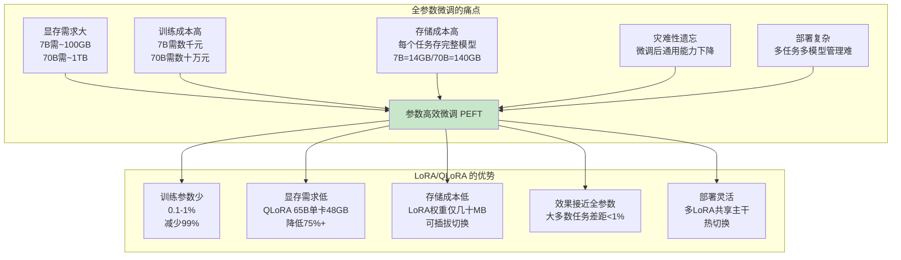
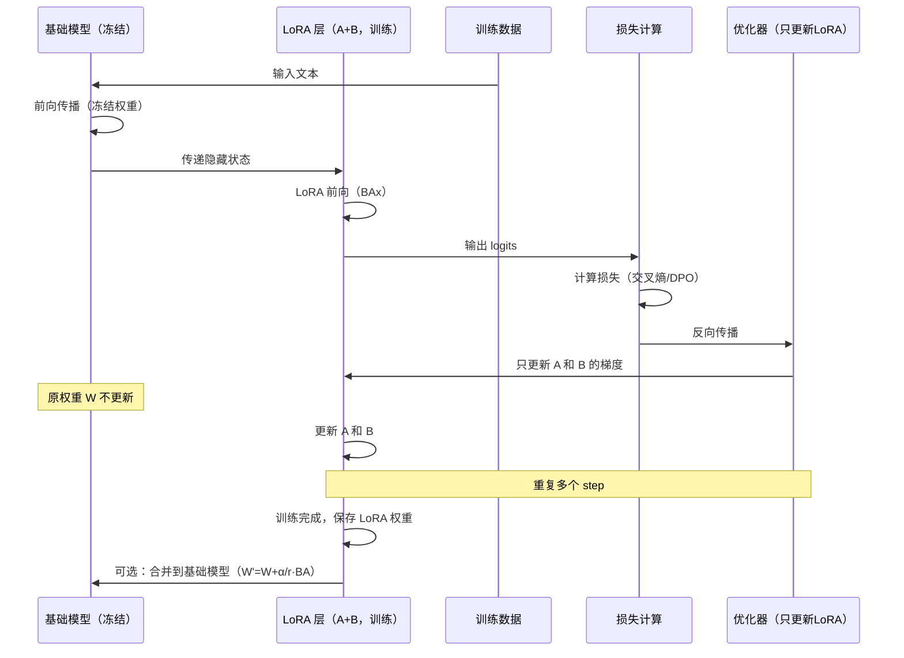

# LoRA 与 QLoRA 参数高效微调

> **一句话定义**：LoRA（Low-Rank Adaptation，低秩适配）是一种参数高效微调（PEFT）方法，通过在 Transformer 权重旁添加低秩矩阵来训练，只更新少量参数（通常 0.1-1%）即可达到接近全参数微调的效果；QLoRA 在此基础上结合 4bit 量化，进一步将显存需求降到极致，使 65B 模型能在单张 48GB 显卡上微调。
>
> **核心价值**：将大模型微调的门槛从"需要 A100 集群"降到"单张消费级显卡"，训练参数减少 99%，显存需求降低 75%+，同时保持接近全参数微调的效果，是个人和小团队定制大模型的首选方法。
>
> **适用场景**：领域适配（医疗/法律/金融）、风格定制（写作/对话）、指令微调、多任务学习、持续学习、模型个性化、资源受限环境下的微调。

---

## 一、概述

### 1.1 为什么需要参数高效微调



### 1.2 核心概念

| 概念 | 说明 |
|------|------|
| **PEFT（Parameter-Efficient Fine-Tuning）** | 参数高效微调，一类只更新少量参数的微调方法的总称，包括 LoRA、Adapter、Prefix Tuning、Prompt Tuning 等 |
| **LoRA（Low-Rank Adaptation）** | 低秩适配，通过在原权重旁添加低秩矩阵 A 和 B（ΔW = BA）来训练，只更新 A 和 B，原权重冻结 |
| **QLoRA（Quantized LoRA）** | 量化 LoRA，将基础模型量化为 4bit（NF4），在此基础上做 LoRA 微调，进一步降低显存 |
| **秩（Rank, r）** | 低秩矩阵的秩，LoRA 的核心超参数，r 越大表达能力越强但参数越多，常见 8/16/32/64 |
| **低秩矩阵 A 和 B** | LoRA 训练的两个矩阵，A 是 r×d 随机初始化，B 是 d×r 零初始化，ΔW = B×A |
| **目标模块（target_modules）** | 应用 LoRA 的层，通常是注意力的 Q/V 投影，也可以扩展到 K/O 和 MLP 层 |
| **Alpha（α）** | LoRA 的缩放因子，实际缩放 = α/r，控制 LoRA 输出的幅度，常见 16/32/64 |
| **Dropout** | LoRA 层的 dropout，防止过拟合，常见 0.05/0.1 |
| **NF4（NormalFloat 4-bit）** | QLoRA 使用的 4bit 量化数据类型，基于正态分布的分位数量化，比普通 4bit 精度更高 |
| **双重量化（Double Quantization）** | QLoRA 的优化技术，对量化常数再次量化，进一步节省显存 |
| **分页优化器（Paged Optimizer）** | QLoRA 使用的优化器，将优化器状态分页到 CPU 内存，防止显存峰值 OOM |
| **合并（Merge）** | 训练后将 LoRA 权重（ΔW = BA）合并到原权重中，得到完整模型，推理时无额外开销 |
| **可插拔（Pluggable）** | LoRA 权重可以独立存储和加载，多个 LoRA 共享同一个基础模型，运行时切换 |

### 1.3 PEFT 方法对比

| 方法 | 原理 | 训练参数量 | 效果 | 显存 | 特点 |
|------|------|-----------|------|------|------|
| **全参数微调** | 更新所有参数 | 100% | 最好 | 极高 | 效果最好但成本最高 |
| **LoRA** | 低秩矩阵适配 | 0.1-1% | 接近全参数 | 低 | 平衡效果和效率，最常用 |
| **QLoRA** | 4bit量化 + LoRA | 0.1-1% | 接近 LoRA | 极低 | 显存最小，65B单卡可训 |
| **Adapter** | 在层间插入小网络 | 1-5% | 好 | 中 | 推理有额外延迟（串行计算） |
| **Prefix Tuning** | 前缀向量优化 | <0.1% | 中等 | 低 | 只优化前缀，效果一般 |
| **Prompt Tuning** | 软提示优化 | <0.01% | 较差 | 极低 | 只优化输入嵌入，大模型才有效 |
| **IA³** | 向量缩放 | <0.1% | 好 | 低 | 用向量缩放激活，参数极少 |


<div style="background:linear-gradient(135deg,#4facfe,#00f2fe);border-radius:16px;padding:20px;margin:16px 0;font-family:-apple-system,'Segoe UI','PingFang SC','Microsoft YaHei',sans-serif;color:#fff;overflow:hidden;box-shadow:0 8px 28px rgba(0,0,0,.14),0 3px 10px rgba(0,0,0,.08)">
<style>@keyframes fadeIn{from{opacity:0;transform:translateY(10px)}to{opacity:1;transform:translateY(0)}}.cmp-col{display:inline-block;width:45%;vertical-align:top;padding:12px;margin:0 2%;background:rgba(255,255,255,.15);border-radius:10px;animation:fadeIn .8s ease-out}.cmp-col h4{margin:0 0 8px 0;text-align:center;border-bottom:1px solid rgba(255,255,255,.3);padding-bottom:6px}.cmp-col ul{margin:0;padding-left:18px;font-size:13px;line-height:1.8}.cmp-vs{display:inline-block;width:4%;text-align:center;font-size:24px;font-weight:700;vertical-align:middle;animation:fadeIn 1s ease-out}</style>
<div style="text-align:center;font-size:15px;font-weight:700;margin-bottom:14px;padding-bottom:10px;border-bottom:1.5px solid rgba(255,255,255,.22);letter-spacing:1px">⚖️ LoRA vs QLoRA 高效微调对比</div>
<div style="text-align:center">
<div class="cmp-col"><h4>LoRA 低秩适配</h4><ul><li>冻结原模型，训练低秩矩阵A/B</li><li>模型精度：FP16/BF16（全精度）</li><li>显存：约原模型1.5-2倍</li><li>效果：接近全参数微调</li><li>适合：有足够显存的场景</li></ul></div>
<div class="cmp-vs">VS</div>
<div class="cmp-col"><h4>QLoRA 量化LoRA</h4><ul><li>4bit量化原模型+NF4+双重量化</li><li>模型精度：4bit量化（节省75%显存）</li><li>显存：约原模型0.5-0.7倍</li><li>效果：接近LoRA，略低</li><li>适合：消费级显卡/大模型微调</li></ul></div>
</div>
<div style="text-align:center;font-size:12px;opacity:.85;margin-top:10px">LoRA效果好需大显存，QLoRA省显存效果略降；4bit量化+分页优化器让单卡微调65B模型成为可能</div>
</div>
> 🔍 **知识点深度解析**
>
> **作用**：LoRA/QLoRA 是参数高效微调的主流方法，通过只训练少量参数（0.1-1%）来适配大模型，将微调门槛从 A100 集群降到单张消费级显卡，使个人和小团队也能定制大模型。
>
> **原理**：LoRA 的核心洞察是"大模型微调后的权重更新具有低秩特性"——即权重变化矩阵 ΔW 可以用两个低秩矩阵的乘积 BA 来近似（ΔW ≈ BA，其中 B 是 d×r，A 是 r×d，r << d）。训练时冻结原权重 W，只训练 A 和 B；推理时将 BA 合并到 W 中（W' = W + BA），无额外推理延迟。QLoRA 在 LoRA 基础上，将基础模型量化为 4bit（NF4 数据类型），只保留 LoRA 参数和优化器状态为 16bit，同时使用双重量化和分页优化器进一步降低显存，使 65B 模型能在单张 48GB 显卡上微调。
>
> **用法要点**：① 秩 r 的选择——大多数任务 r=8-16 足够，复杂任务用 r=32-64，r 太大可能过拟合且增加成本 ② 目标模块——至少包含 q_proj 和 v_proj，更好的效果包含所有注意力层（q/k/v/o）和 MLP 层（gate/up/down），但参数更多 ③ Alpha 设置——通常 α = 2r（如 r=16, α=32），缩放因子 α/r 控制 LoRA 输出幅度 ④ 学习率——LoRA 的学习率通常比全参数微调大（1e-4 到 3e-4，全参数是 1e-5 到 5e-5），因为参数少需要更大的步长 ⑤ QLoRA 量化——使用 bitsandbytes 的 4bit 量化（bnb_4bit_compute_dtype=bfloat16, bnb_4bit_quant_type=nf4, bnb_4bit_use_double_quant=True）⑥ 训练后合并——用 model.merge_and_unload() 将 LoRA 权重合并到基础模型，得到完整模型用于推理或进一步处理 ⑦ 多 LoRA 管理——多个 LoRA 可以共享基础模型，运行时加载/切换，适合多任务/多用户场景 ⑧ 评估——需要在领域任务和通用任务上同时评估，警惕过拟合和灾难性遗忘

---

> 💡 **深度讲解**：LoRA 的出现是大模型微调领域的里程碑——在 LoRA 之前，微调一个 7B 模型需要多张 A100（每张 80GB），70B 模型需要整个 A100 集群，成本高达数万到数十万美元，只有大公司能负担。LoRA 通过"低秩适配"的巧妙设计，将训练参数量减少到 0.1-1%，显存需求降低 60-70%，使得 7B 模型可以在单张 24GB 显卡（如 RTX 3090/4090）上微调，大大降低了门槛。LoRA 的核心洞察来自于对大模型微调的理论分析——研究者发现，大模型在微调过程中，权重的变化量 ΔW 具有"低秩特性"（intrinsic dimension 很低），即 ΔW 可以用低秩矩阵近似。这意味着不需要更新完整的 d×d 权重矩阵，只需要更新两个小矩阵 A（r×d）和 B（d×r），其中 r 远小于 d（如 r=16, d=4096），参数量从 d² 降到 2rd，减少了 99%+。训练时，原权重 W 冻结，前向传播时输出 = Wx + BAx（LoRA 分支），只更新 A 和 B；推理时，可以将 BA 合并到 W 中（W' = W + BA），得到完整的模型权重，推理时没有任何额外延迟——这是 LoRA 相比 Adapter 等方法的巨大优势（Adapter 需要在层间串行计算小网络，增加推理延迟）。QLoRA 是 LoRA 的进一步优化，它的核心是"4bit 量化基础模型 + 16bit LoRA 参数"。基础模型被量化为 4bit（使用 NF4 数据类型，基于正态分布的分位数量化，比普通 4bit 精度更高），只占 4bit/参数（7B 模型约 3.5GB）；LoRA 参数和优化器状态保持 16bit。同时使用双重量化（对量化常数再次量化，节省约 0.4bit/参数）和分页优化器（将优化器状态分页到 CPU 内存，防止显存峰值 OOM）。QLoRA 使得 65B 模型可以在单张 48GB 显卡（如 RTX A6000/4090 24GB 不够，需要 A6000 48GB 或 A100 40GB）上微调，这在以前是不可想象的。LoRA/QLoRA 的生态已经非常成熟——HuggingFace PEFT 库提供了统一的接口，支持 LoRA、QLoRA、Adapter、Prefix Tuning 等多种方法；Axolotl、LLaMA-Factory、Unsloth 等框架提供了开箱即用的训练配置；vLLM、TGI 等推理引擎支持 LoRA 的动态加载和切换。对于个人和小团队来说，LoRA/QLoRA 是定制大模型的首选方法——成本低、效果好、部署灵活。
>
> **📝 精简总结**：LoRA（低秩适配）通过在原权重旁添加低秩矩阵A(r×d)和B(d×r)，ΔW=BA，冻结原权重只训练A和B，参数减少99%，推理时可合并无额外延迟；QLoRA在LoRA基础上用4bit NF4量化基础模型+双重量化+分页优化器，显存进一步降低，65B单卡48GB可微调；核心概念包括秩r（8-64，越大表达越强但参数多）、目标模块（q/v至少，更好包含q/k/v/o+MLP）、Alpha（通常=2r，缩放因子α/r）、Dropout（0.05-0.1防过拟合）、NF4（4bit正态分位数量化）、双重量化、分页优化器、合并（merge_and_unload）、可插拔（多LoRA共享主干热切换）；PEFT方法对比：全参数（100%/最好/极高）、LoRA（0.1-1%/接近全参数/低，最常用）、QLoRA（0.1-1%/接近LoRA/极低，显存最小）、Adapter（1-5%/好/中，推理有延迟）、Prefix Tuning（<0.1%/中等/低）、Prompt Tuning（<0.01%/较差/极低）、IA³（<0.1%/好/低）；核心原理是大模型微调权重变化具有低秩特性（intrinsic dimension低），可用低秩矩阵近似；用法要点包括r选择（8-16够用，复杂32-64）、目标模块（至少q/v，更好全注意力+MLP）、Alpha=2r、学习率比全参数大（1e-4~3e-4）、QLoRA用bitsandbytes 4bit（nf4/bfloat16/双重量化）、训练后合并、多LoRA管理、领域+通用双评估。

---

## 二、原理

### 2.1 LoRA 数学原理

#### 低秩分解

全参数微调更新权重 W：

```text
$$
W' = W + \Delta W
$$
```

其中 ΔW 是 d×d 的完整矩阵。LoRA 假设 ΔW 具有低秩特性，可以分解为两个低秩矩阵的乘积：

```text
$$
\Delta W = B \cdot A
$$
```

其中：
- B ∈ ℝ^{d×r}：右矩阵，初始化为零
- A ∈ ℝ^{r×d}：左矩阵，随机初始化（高斯分布）
- r：秩，r << d（如 r=16, d=4096）

训练参数量：2 × d × r（对比全参数的 d²，减少 d/(2r) 倍）

#### 前向传播

```mermaid
graph LR
    subgraph LoRA 前向传播
        X[输入 x] --> W[原权重 W<br/>冻结]
        X --> A[低秩矩阵 A<br/>r×d, 训练]
        A --> B[低秩矩阵 B<br/>d×r, 训练, 初始零]
        B --> SCALE[缩放 α/r]
        W --> ADD[相加]
        SCALE --> ADD
        ADD --> Y[输出 y = Wx + (α/r)BAx]
    end

    Note over A,B: 初始时 B=0，所以 LoRA 分支输出为 0<br/>训练从与原模型完全相同的状态开始
```

前向传播公式：

```text
$$
y = Wx + \frac{\alpha}{r} B A x
$$
```

其中 α 是缩放因子，α/r 是实际缩放比例。初始时 B=0，所以 LoRA 分支输出为 0，训练从与原模型完全相同的状态开始（这是 LoRA 的一个重要设计，确保训练初期的稳定性）。

#### 推理合并

训练完成后，将 LoRA 权重合并到原权重：

$$
W' = W + \frac{\alpha}{r} B A
$$

合并后得到完整的模型权重 W'，推理时与全参数微调的模型完全相同，无额外计算开销。

### 2.2 QLoRA 量化原理

```mermaid
graph TB
    subgraph QLoRA 显存构成
        subgraph 基础模型（4bit NF4）
            M1[模型权重 4bit<br/>7B≈3.5GB<br/>65B≈32.5GB]
        end
        subgraph LoRA 参数（16bit）
            M2[LoRA 权重 A+B<br/>通常<1GB]
        end
        subgraph 优化器状态（16bit/32bit）
            M3[Adam 状态<br/>m+v, 仅LoRA参数<br/>通常<2GB]
        end
        subgraph 激活值（16bit）
            M4[前向/反向激活<br/>取决于batch和长度<br/>通常5-15GB]
        end
    end

    M1 --> T[总显存<br/>7B≈10-15GB<br/>65B≈45-50GB]
    M2 --> T
    M3 --> T
    M4 --> T

    style T fill:#c8e6c9
```

#### NF4 量化

NF4（NormalFloat 4-bit）是 QLoRA 提出的 4bit 量化数据类型：

1. **基于正态分布**：大模型的权重通常服从正态分布（均值0，方差小），NF4 利用这一特性设计量化级别
2. **分位数量化**：量化级别不是均匀分布，而是按正态分布的分位数设置——分布密集的区域（接近0）量化级别更密，分布稀疏的区域（尾部）量化级别更疏
3. **精度更高**：相比普通的 4bit 均匀量化，NF4 在正态分布数据上的量化误差更小，保持了更高的模型精度

#### 双重量化（Double Quantization）

对量化过程中的常数（缩放因子）再次量化：

1. 第一重量化：将权重从 16bit 量化为 4bit，需要存储每个块的缩放因子（通常 16bit/32bit）
2. 第二重量化：将缩放因子再次量化（如从 32bit 量化为 8bit），进一步节省显存
3. 效果：节省约 0.4bit/参数，对 65B 模型节省约 3GB 显存

#### 分页优化器（Paged Optimizer）

使用 NVIDIA 统一内存（Unified Memory）特性，将优化器状态（Adam 的 m 和 v）分页存储：

1. 当 GPU 显存不足时，将部分优化器状态自动转移到 CPU 内存
2. 需要时再从 CPU 内存转移回 GPU
3. 防止显存峰值导致的 OOM（Out of Memory）
4. 对训练速度影响较小（PCIe 传输速度足够）

### 2.3 LoRA 训练流程



---

> 💡 **深度讲解**：LoRA 的数学原理简洁而深刻。传统的全参数微调更新完整的权重矩阵 W（d×d），而 LoRA 观察到一个关键现象：大模型微调后的权重变化 ΔW 具有"低秩特性"（low intrinsic dimension）——即 ΔW 可以用低秩矩阵近似。这一现象的理论基础是"内在维度"（intrinsic dimension）研究——研究者发现，对于高维优化问题，有效的参数维度往往远低于表面维度，特别是对于预训练好的大模型，微调只需要在一个低维子空间中调整即可。LoRA 利用这一特性，将 ΔW 分解为 B×A（B 是 d×r，A 是 r×d，r << d），训练参数量从 d² 降到 2rd。以 d=4096, r=16 为例，全参数需要 16,777,216 个参数，而 LoRA 只需要 131,072 个参数，减少了 99.2%。LoRA 的另一个巧妙设计是初始化——A 随机初始化（高斯分布），B 初始化为零。这样在训练开始时，BA = 0，LoRA 分支的输出为零，模型的行为与基础模型完全相同。随着训练进行，B 逐渐学习到非零值，LoRA 分支开始贡献输出。这种"从零开始"的设计确保了训练初期的稳定性，不会因为随机初始化而破坏基础模型已有的能力。缩放因子 α/r 也是一个重要设计——α 是一个超参数，r 是秩，实际缩放是 α/r。这意味着当 r 变化时，可以通过调整 α 来保持缩放比例的稳定（通常 α=2r，这样 α/r=2，与 r 无关）。这种设计使得不同 r 的实验更容易比较，也使得超参数调优更稳定。QLoRA 的核心创新是"4bit 量化基础模型 + 16bit LoRA 参数"的混合精度方案。基础模型被量化为 4bit（NF4），只占 4bit/参数；LoRA 参数和优化器状态保持 16bit，确保训练精度。这种混合方案的关键洞察是：基础模型在微调中只需要前向和反向传播，不需要高精度（4bit 足够）；而 LoRA 参数需要精确更新，必须保持 16bit。NF4 量化是 QLoRA 的另一个创新——普通的 4bit 均匀量化在正态分布数据上精度损失较大（因为大部分权重集中在接近 0 的区域，均匀量化在这个区域的分辨率不够），而 NF4 按正态分布的分位数设置量化级别，在分布密集的区域分配更多量化级别，在稀疏区域分配更少，从而在相同 bit 数下获得更高的精度。双重量化和分页优化器是 QLoRA 的工程优化——双重量化对量化常数再次量化，节省约 0.4bit/参数；分页优化器利用 NVIDIA 统一内存将优化器状态分页到 CPU，防止显存峰值 OOM。这些工程优化使得 QLoRA 的显存效率达到了极致——65B 模型在单张 48GB 显卡上微调，这在 QLoRA 之前是不可想象的。LoRA/QLoRA 的训练流程与全参数微调基本相同，只是优化器只更新 LoRA 参数（A 和 B），原权重完全冻结。这意味着可以复用现有的训练框架和代码，只需要添加 LoRA 层即可。HuggingFace PEFT 库提供了统一的接口，使得添加 LoRA 只需要几行代码。
>
> **📝 精简总结**：LoRA 数学原理——全参数更新 W'=W+ΔW，LoRA假设ΔW低秩可分解为ΔW=B·A（B:d×r零初始化，A:r×d随机初始化，r<<d），训练参数从d²降到2rd（减少99%+）；前向传播 y=Wx+(α/r)BAx，初始B=0所以LoRA分支输出为0，训练从原模型状态开始保证稳定；推理合并 W'=W+(α/r)BA，合并后无额外开销；QLoRA量化原理——基础模型4bit NF4量化（基于正态分布分位数，比均匀4bit精度高）+LoRA参数16bit+优化器16bit+激活16bit，显存构成：7B≈10-15GB，65B≈45-50GB；双重量化（量化常数再次量化，省0.4bit/参数≈3GB/65B）；分页优化器（NVIDIA统一内存，优化器状态分页到CPU，防峰值OOM）；LoRA训练流程——输入→基础模型前向（冻结）→LoRA前向（BAx）→损失计算→反向传播→优化器只更新A和B→重复→保存LoRA权重→可选合并；核心洞察是大模型微调权重变化具有低秩特性（intrinsic dimension低），混合精度方案（基础模型4bit+LoRA 16bit）是QLoRA的关键。

---

## 三、实操

### 3.1 使用 HuggingFace PEFT 进行 LoRA 微调

```python
# pip install transformers peft accelerate datasets bitsandbytes trl

import torch
from datasets import load_dataset
from transformers import (
    AutoModelForCausalLM,
    AutoTokenizer,
    TrainingArguments,
    BitsAndBytesConfig,
)
from peft import LoraConfig, get_peft_model, prepare_model_for_kbit_training
from trl import SFTTrainer

# 1. 加载模型和分词器
model_name = "Qwen/Qwen2.5-7B-Instruct"
tokenizer = AutoTokenizer.from_pretrained(model_name)
tokenizer.pad_token = tokenizer.eos_token

# 2. 4bit 量化配置（QLoRA）
bnb_config = BitsAndBytesConfig(
    load_in_4bit=True,
    bnb_4bit_quant_type="nf4",           # NF4 量化类型
    bnb_4bit_compute_dtype=torch.bfloat16,  # 计算时用 bfloat16
    bnb_4bit_use_double_quant=True,      # 双重量化
)

# 3. 加载量化模型
model = AutoModelForCausalLM.from_pretrained(
    model_name,
    quantization_config=bnb_config,
    device_map="auto",
    trust_remote_code=True,
)
model = prepare_model_for_kbit_training(model)

# 4. LoRA 配置
lora_config = LoraConfig(
    r=16,                          # 秩
    lora_alpha=32,                 # Alpha（通常 = 2*r）
    lora_dropout=0.05,             # Dropout
    bias="none",                   # 不训练 bias
    task_type="CAUSAL_LM",         # 任务类型
    target_modules=[                # 目标模块
        "q_proj", "k_proj", "v_proj", "o_proj",      # 注意力层
        "gate_proj", "up_proj", "down_proj",           # MLP 层
    ],
)

# 5. 添加 LoRA
model = get_peft_model(model, lora_config)
model.print_trainable_parameters()
# 输出: trainable params: 40,140,800 || all params: 7,665,887,232 || trainable%: 0.5236

# 6. 加载数据集
dataset = load_dataset("json", data_files="train_data.jsonl", split="train")

# 7. 训练参数
training_args = TrainingArguments(
    output_dir="./lora-output",
    num_train_epochs=3,
    per_device_train_batch_size=4,
    gradient_accumulation_steps=4,
    learning_rate=2e-4,              # LoRA 学习率通常较大
    lr_scheduler_type="cosine",
    warmup_ratio=0.03,
    logging_steps=10,
    save_steps=100,
    save_total_limit=3,
    bf16=True,
    gradient_checkpointing=True,      # 节省显存
    optim="paged_adamw_8bit",        # 分页 8bit 优化器
    report_to="none",
)

# 8. 创建 Trainer（用 SFTTrainer 方便处理对话格式）
trainer = SFTTrainer(
    model=model,
    args=training_args,
    train_dataset=dataset,
    tokenizer=tokenizer,
    max_seq_length=2048,
    dataset_text_field="text",        # 如果是纯文本
    # 如果是对话格式，用 formatting_func
)

# 9. 训练
trainer.train()

# 10. 保存 LoRA 权重
trainer.save_model("./lora-final")
tokenizer.save_pretrained("./lora-final")
```

### 3.2 合并 LoRA 权重

```python
from peft import PeftModel
from transformers import AutoModelForCausalLM, AutoTokenizer
import torch

# 1. 加载基础模型
base_model_name = "Qwen/Qwen2.5-7B-Instruct"
base_model = AutoModelForCausalLM.from_pretrained(
    base_model_name,
    torch_dtype=torch.bfloat16,
    device_map="cpu",  # 合并时用 CPU 节省显存
)
tokenizer = AutoTokenizer.from_pretrained(base_model_name)

# 2. 加载 LoRA 权重
lora_path = "./lora-final"
model = PeftModel.from_pretrained(base_model, lora_path)

# 3. 合并并卸载 LoRA
model = model.merge_and_unload()

# 4. 保存合并后的完整模型
output_path = "./merged-model"
model.save_pretrained(output_path, safe_serialization=True)
tokenizer.save_pretrained(output_path)

print(f"合并后的模型已保存到: {output_path}")

# 5. 验证合并后的模型
merged_model = AutoModelForCausalLM.from_pretrained(
    output_path, torch_dtype=torch.bfloat16, device_map="auto"
)
inputs = tokenizer("你好，请介绍一下你自己", return_tensors="pt").to("cuda")
with torch.no_grad():
    outputs = merged_model.generate(**inputs, max_new_tokens=100)
print(tokenizer.decode(outputs[0], skip_special_tokens=True))
```

### 3.3 使用 Axolotl 进行 LoRA/QLoRA 训练（推荐生产环境）

```yaml
# axolotl 配置文件 lora_config.yaml
base_model: Qwen/Qwen2.5-7B-Instruct
model_type: AutoModelForCausalLM
tokenizer_type: AutoTokenizer

# LoRA 配置
adapter: lora
lora_r: 16
lora_alpha: 32
lora_dropout: 0.05
lora_target_modules:
  - q_proj
  - k_proj
  - v_proj
  - o_proj
  - gate_proj
  - up_proj
  - down_proj

# QLoRA 4bit 量化
load_in_4bit: true
bnb_4bit_quant_type: nf4
bnb_4bit_compute_dtype: bfloat16
bnb_4bit_use_double_quant: true

# 数据集
datasets:
  - path: ./train_data.jsonl
    type: chat_template
    chat_template: chatml
    split: train

# 训练参数
num_epochs: 3
batch_size: 4
gradient_accumulation_steps: 4
learning_rate: 2.0e-4
lr_scheduler: cosine
warmup_steps: 100

# 长度
sequence_len: 2048

# 精度和优化
bf16: true
gradient_checkpointing: true
optimizer: paged_adamw_8bit

# 日志和保存
logging_steps: 10
save_steps: 100
eval_steps: 100
output_dir: ./lora-output
```

## 启动训练（单卡）
accelerate launch -m axolotl.cli.train lora_config.yaml

## 多卡分布式训练
accelerate launch --num_processes 4 -m axolotl.cli.train lora_config.yaml

### 3.4 推理时动态加载/切换 LoRA

```python
# 使用 vLLM 动态加载多个 LoRA（生产环境推荐）
# pip install vllm

from vllm import LLM, SamplingParams

# 1. 初始化 vLLM，启用 LoRA
llm = LLM(
    model="Qwen/Qwen2.5-7B-Instruct",
    enable_lora=True,
    max_loras=4,           # 最多同时加载的 LoRA 数量
    max_lora_rank=64,      # 最大 LoRA 秩
    gpu_memory_utilization=0.9,
)

# 2. 定义采样参数
sampling_params = SamplingParams(
    temperature=0.7,
    max_tokens=500,
    top_p=0.9,
)

# 3. 使用不同 LoRA 生成
# LoRA 1: 医疗助手
outputs_medical = llm.generate(
    ["什么是高血压？"],
    sampling_params,
    lora_request={"lora_name": "medical-assistant", "lora_path": "./loras/medical"},
)

# LoRA 2: 法律助手
outputs_legal = llm.generate(
    ["什么是劳动合同？"],
    sampling_params,
    lora_request={"lora_name": "legal-assistant", "lora_path": "./loras/legal"},
)

# 不使用 LoRA（基础模型）
outputs_base = llm.generate(
    ["你好"],
    sampling_params,
)

print("医疗助手:", outputs_medical[0].outputs[0].text)
print("法律助手:", outputs_legal[0].outputs[0].text)
print("基础模型:", outputs_base[0].outputs[0].text)
```

```python
# 使用 HuggingFace PEFT 动态切换 LoRA（开发/测试环境）
from peft import PeftModel
from transformers import AutoModelForCausalLM, AutoTokenizer
import torch

base_model = AutoModelForCausalLM.from_pretrained(
    "Qwen/Qwen2.5-7B-Instruct", torch_dtype=torch.bfloat16, device_map="auto"
)
tokenizer = AutoTokenizer.from_pretrained("Qwen/Qwen2.5-7B-Instruct")

# 加载第一个 LoRA
model = PeftModel.from_pretrained(base_model, "./loras/medical", adapter_name="medical")

# 加载第二个 LoRA（共享基础模型）
model.load_adapter("./loras/legal", adapter_name="legal")

# 切换到医疗 LoRA
model.set_adapter("medical")
inputs = tokenizer("什么是高血压？", return_tensors="pt").to("cuda")
outputs = model.generate(**inputs, max_new_tokens=100)
print("医疗:", tokenizer.decode(outputs[0], skip_special_tokens=True))

# 切换到法律 LoRA
model.set_adapter("legal")
inputs = tokenizer("什么是劳动合同？", return_tensors="pt").to("cuda")
outputs = model.generate(**inputs, max_new_tokens=100)
print("法律:", tokenizer.decode(outputs[0], skip_special_tokens=True))

# 禁用所有 LoRA（使用基础模型）
model.disable_adapter()
```

### 3.5 LoRA 超参数调优指南

## LoRA 超参数搜索空间
```json
hyperparameter_grid = {
    "r": [8, 16, 32, 64],           # 秩：简单任务 8-16，复杂任务 32-64
    "lora_alpha": [16, 32, 64, 128], # 通常 = 2*r
    "lora_dropout": [0.0, 0.05, 0.1], # 小数据集用 0.05-0.1，大数据集用 0.0
    "learning_rate": [1e-4, 2e-4, 3e-4, 5e-4], # LoRA 学习率比全参数大
```
    "target_modules": [
```json
        ["q_proj", "v_proj"],                              # 最小配置
        ["q_proj", "k_proj", "v_proj", "o_proj"],         # 注意力全层
        ["q_proj", "k_proj", "v_proj", "o_proj",          # 全层配置（推荐）
```
         "gate_proj", "up_proj", "down_proj"],
```json
    ],
    "num_epochs": [1, 2, 3],           # 小数据 3 epoch，大数据 1-2
    "batch_size": [2, 4, 8],           # 根据显存调整
}
```

```css
# 推荐配置（大多数任务的起点）
recommended_config = {
```
    "r": 16,
    "lora_alpha": 32,        # = 2*r
    "lora_dropout": 0.05,
    "learning_rate": 2e-4,
    "target_modules": ["q_proj", "k_proj", "v_proj", "o_proj",
                       "gate_proj", "up_proj", "down_proj"],
    "num_epochs": 3,
    "batch_size": 4,
    "gradient_accumulation_steps": 4,
    "lr_scheduler_type": "cosine",
    "warmup_ratio": 0.03,
}

```css
# 调优策略
tuning_strategy = {
```
    "第一步": "用推荐配置跑通训练，验证数据和流程",
    "第二步": "调整 r（8→16→32），观察效果变化，找到最优 r",
    "第三步": "调整 target_modules（q/v → 全注意力 → 全注意力+MLP）",
    "第四步": "调整学习率（1e-4 → 2e-4 → 3e-4），用验证集选择",
    "第五步": "调整 epoch 和 batch size，防止过拟合",
    "第六步": "在领域任务和通用任务上同时评估，平衡效果和遗忘",
}

---

> 💡 **深度讲解**：LoRA/QLoRA 的实操核心是"超参数选择 + 训练配置 + 合并部署"。超参数选择是 LoRA 效果的关键——秩 r 是最重要的超参数，它决定了 LoRA 的表达能力。r=8 适合简单任务（如风格转换、简单分类），r=16 是大多数任务的推荐起点，r=32-64 适合复杂任务（如代码生成、深度推理、多任务学习）。但 r 不是越大越好——r 太大会增加训练参数和显存，且可能导致过拟合（特别是小数据集时）。实践中建议从 r=16 开始，根据效果调整。目标模块（target_modules）也很重要——最小配置只加在 q_proj 和 v_proj 上（LoRA 原论文的配置），效果已经不错；更好的配置是加在所有注意力层（q/k/v/o）上；最好的配置是加在所有注意力层和 MLP 层（gate/up/down）上，效果最接近全参数微调，但参数最多。实践中推荐全注意力+MLP 的配置（如果显存允许），因为 MLP 层存储了大量知识，适配 MLP 层能显著提升领域适配效果。Alpha 通常设为 2r（如 r=16, α=32），这样缩放因子 α/r=2，与 r 无关，便于不同 r 的实验比较。学习率是另一个关键超参数——LoRA 的学习率通常比全参数微调大一个数量级（全参数 1e-5 到 5e-5，LoRA 1e-4 到 3e-4），因为 LoRA 只训练少量参数，需要更大的步长才能有效更新。学习率太大会导致训练不稳定或过拟合，太小会导致收敛慢或效果差。推荐从 2e-4 开始，根据验证集调整。训练配置方面，QLoRA 的 4bit 量化配置需要注意：① bnb_4bit_quant_type="nf4"（NF4 比普通 fp4 精度高）；② bnb_4bit_compute_dtype=bfloat16（计算时用 bfloat16 提升精度，不要用 float16，可能溢出）；③ bnb_4bit_use_double_quant=True（双重量化节省显存）；④ optim="paged_adamw_8bit"（分页 8bit 优化器，进一步节省显存）。gradient_checkpointing=True 可以节省大量显存（以速度换空间），推荐在显存紧张时开启。合并和部署是训练后的关键步骤——训练完成后，LoRA 权重（A 和 B）是独立存储的（通常只有几十 MB），可以：① 合并到基础模型得到完整模型（用 merge_and_unload()），适合单任务部署，推理无额外开销；② 保持 LoRA 格式，推理时动态加载，适合多任务/多用户场景，多个 LoRA 共享基础模型，节省存储和显存。vLLM 支持 LoRA 的动态加载和切换（enable_lora=True），是生产环境的推荐方案。多 LoRA 管理是一个实用技巧——对于多个领域/任务/用户，可以训练多个 LoRA，共享同一个基础模型。运行时根据请求动态加载对应的 LoRA，实现"一个模型，多种能力"。这大大降低了多任务部署的成本（不需要为每个任务存储完整模型），也提升了灵活性（可以随时添加/更新/删除 LoRA）。评估是 LoRA 训练中容易被忽视但非常重要的环节——需要在领域任务（微调目标）和通用任务（MMLU/GSM8K 等）上同时评估，警惕过拟合（领域任务提升但通用任务下降，即"灾难性遗忘"）。如果通用任务下降明显，可以：① 减小 r 或学习率；② 减少 epoch；③ 在训练数据中混合通用数据；④ 使用 LoRA+KT（知识蒸馏）保持通用能力。
>
> **📝 精简总结**：HuggingFace PEFT LoRA 微调——加载模型+4bit NF4量化（BitsAndBytesConfig: nf4/bfloat16/双重量化）+prepare_model_for_kbit_training+LoraConfig（r=16/alpha=32/dropout=0.05/target_modules全注意力+MLP/task_type=CAUSAL_LM）+get_peft_model+TrainingArguments（lr=2e-4/cosine/3epoch/batch4/grad_accum4/bf16/gradient_checkpointing/paged_adamw_8bit）+SFTTrainer+train()+save_model；合并 LoRA——加载基础模型(CPU)+PeftModel.from_pretrained+merge_and_unload+save_pretrained，合并后推理无额外开销；Axolotl 生产训练——YAML配置（base_model/adapter=lora/lora_r/lora_alpha/lora_target_modules/load_in_4bit/bnb配置/datasets/训练参数）+accelerate launch启动，支持多卡分布式；推理动态加载 LoRA——vLLM（enable_lora/max_loras/lora_request，生产推荐）或 PEFT（load_adapter/set_adapter/disable_adapter，开发测试），多LoRA共享基础模型热切换；超参数调优——r（8简单/16推荐/32-64复杂）、target_modules（q/v最小→全注意力→全注意力+MLP推荐）、alpha=2r、学习率（1e-4~3e-4，比全参数大10倍）、epoch（1-3）、dropout（0.05-0.1小数据）；调优策略是先跑通→调r→调target_modules→调学习率→调epoch/batch→领域+通用双评估；核心是超参数选择（r/target_modules/学习率）+训练配置（NF4量化/分页优化器/梯度检查点）+合并部署（合并单任务/动态加载多任务）。

---

## 四、问题

### 4.1 常见错误与排查

| 问题 | 原因 | 解决方案 |
|------|------|---------|
| **训练损失不下降** | 学习率太小 / LoRA 秩太小 / 数据质量差 / 目标模块太少 | 增大学习率，增大 r，增加目标模块（q/v→全注意力+MLP），检查数据 |
| **训练损失震荡/发散** | 学习率太大 / batch size 太小 / 数据噪声大 | 降低学习率，增大 batch size（或梯度累积），清洗数据，加 warmup |
| **微调后效果差** | r 太小 / 目标模块太少 / epoch 太少 / 数据量不足 / 学习率不当 | 增大 r，增加目标模块，增加 epoch，增加数据量，调学习率，用验证集早停 |
| **过拟合（训练好验证差）** | r 太大 / epoch 太多 / 数据量小 / 学习率太大 / 无 dropout | 减小 r，减少 epoch，数据增强，降低学习率，加 lora_dropout=0.05-0.1，早停 |
| **灾难性遗忘（通用能力下降）** | r 太大 / 学习率太大 / epoch 太多 / 数据分布偏移 | 减小 r/学习率/epoch，混合通用数据，用 LoRA+KT（知识蒸馏），评估通用任务 |
| **显存不足（OOM）** | 模型太大 / batch size 太大 / 未用 4bit 量化 / 未用梯度检查点 | 用 QLoRA 4bit 量化，减小 batch size，开启 gradient_checkpointing，用 paged_adamw_8bit，减小序列长度 |
| **QLoRA 量化后效果差** | 用了 fp4 而非 nf4 / compute_dtype 用了 float16 / 未用双重量化 | 用 bnb_4bit_quant_type="nf4"，compute_dtype=bfloat16，开启双重量化，必要时用 8bit |
| **合并后模型效果与 LoRA 不一致** | 合并时缩放因子错误 / 基础模型不匹配 / 量化模型合并问题 | 确认 alpha/r 正确，用相同基础模型，量化模型合并后需验证，用 merge_and_unload 官方方法 |
| **多 LoRA 切换出错** | LoRA 名称冲突 / 适配器未正确加载 / 基础模型不兼容 | 用唯一 adapter_name，确认 load_adapter 成功，所有 LoRA 用相同基础模型，set_adapter 后验证 |
| **推理速度慢（未合并）** | LoRA 未合并 / 批量太小 / 未用推理引擎 | 合并 LoRA 权重，用 vLLM/TGI 推理引擎，增大批量，模型量化 |
| **保存的 LoRA 文件很大** | 错误地保存了完整模型 / 未用 safe_serialization | 用 trainer.save_model() 只保存 LoRA，用 safe_serialization=True，检查文件大小（应几十MB） |
| **不同框架 LoRA 不兼容** | Axolotl/PEFT/LLaMA-Factory 的 LoRA 格式差异 / target_modules 命名不同 | 用 PEFT 格式（最通用），确认 target_modules 命名，转换格式，用相同框架训练和推理 |
| **长序列训练 OOM** | sequence_len 太大 / 未用梯度检查点 / 注意力复杂度 O(n²) | 减小 sequence_len，开启 gradient_checkpointing，用 Flash Attention 2，用滑动窗口注意力 |
| **DPO + LoRA 效果差** | β 太大 / 学习率不当 / 偏好数据质量差 / LoRA 配置不当 | 调 β（0.1-0.3），调学习率（5e-7~5e-6），提升偏好数据质量，增大 r/目标模块 |

### 4.2 性能优化策略

| 优化点 | 策略 | 预期效果 |
|--------|------|---------|
| **显存优化** | QLoRA 4bit NF4、双重量化、分页优化器、梯度检查点、Flash Attention 2 | 显存降低 75%+，65B 单卡可训 |
| **训练速度** | 增大 batch size、梯度累积、bf16 混合精度、数据预取、多卡分布式 | 训练速度提升 2-8 倍 |
| **参数效率** | 选择合适 r（不是越大越好）、目标模块精选、Alpha 优化 | 参数减少 50-80%，效果保持 |
| **数据效率** | 高质量数据、数据增强、主动学习、课程学习 | 数据需求降低 50-70% |
| **推理加速** | 合并 LoRA、vLLM/TGI 推理、连续批处理、PagedAttention、量化 | 推理吞吐量提升 5-20 倍 |
| **多任务效率** | 多 LoRA 共享主干、动态加载、热切换、批量多 LoRA | 存储降低 90%+，部署灵活 |
| **超参数优化** | 学习率扫描、r 扫描、早停、验证集选择 | 找到最优配置，避免过拟合 |
| **分布式训练** | DeepSpeed/FSDP、多卡数据并行、张量并行、流水线并行 | 支持更大模型，训练速度提升 |
| **缓存优化** | KV 缓存、前缀缓存、数据缓存、Embedding 缓存 | 训练/推理速度提升 20-50% |
| **模型选择** | 合适大小的模型（不是越大越好）、领域预训练模型 | 成本降低，效果提升 |
| **训练精度** | bf16（推荐）vs fp16（可能溢出）、混合精度、损失缩放 | 训练稳定，速度提升 |
| **评估效率** | 自动化评估、小规模验证集、早停、持续监控 | 评估成本降低，及时发现问题 |

### 4.3 安全风险与防护

| 风险 | 说明 | 防护措施 |
|------|------|---------|
| **数据投毒** | 训练数据被恶意注入，导致模型行为异常 | 数据审核、来源验证、异常检测、人工抽检、数据清洗 |
| **隐私泄露** | 训练数据包含敏感信息，模型可能记忆并输出 | 数据脱敏、隐私过滤、差分隐私、记忆检测、合规审查 |
| **模型滥用** | 微调后的模型被用于恶意目的（诈骗、虚假信息） | 使用限制、访问控制、速率限制、滥用检测、内容溯源 |
| **偏见放大** | 训练数据中的偏见被 LoRA 放大 | 偏见检测、去偏数据、公平性评估、多样化数据、人工审核 |
| **知识产权** | 训练数据可能包含受版权保护的内容 | 数据版权审查、合理使用评估、来源标注、输出查重 |
| **LoRA 替换攻击** | 恶意 LoRA 被加载到基础模型，改变模型行为 | LoRA 来源验证、签名校验、沙箱测试、访问控制、审计日志 |
| **供应链安全** | 依赖第三方库/模型/数据可能有安全漏洞 | 供应商审查、版本锁定、安全扫描、漏洞监控、应急响应 |
| **合规风险** | AI 应用可能违反数据保护法（GDPR/个保法）、行业监管 | 合规评估、数据治理、用户同意、可解释性、审计日志 |

### 4.4 生产环境踩坑记录

**踩坑1：QLoRA 4bit 量化后微调效果显著下降**
- **现象**：用 QLoRA 4bit 微调 7B 模型，训练损失正常下降，但在验证集上的效果比 16bit LoRA 差了 5-8%
- **原因**：① 用了普通的 fp4 量化而非 NF4（fp4 在正态分布权重上精度损失大）；② bnb_4bit_compute_dtype 用了 float16 而非 bfloat16（float16 在某些计算上可能溢出或精度不足）；③ 没有开启双重量化（虽然不直接影响精度，但显存不足可能导致 batch size 太小）；④ 模型本身对量化敏感（某些层的权重分布不适合 4bit）
- **方案**：① 用 bnb_4bit_quant_type="nf4"（NF4 基于正态分布分位数，比 fp4 精度高）；② 用 bnb_4bit_compute_dtype=torch.bfloat16（bfloat16 的动态范围比 float16 大，更适合计算）；③ 开启 bnb_4bit_use_double_quant=True（双重量化，节省显存）；④ 如果效果仍差，尝试 8bit 量化（load_in_8bit=True），精度更高但显存增加；⑤ 对关键层（如 lm_head）保持 16bit，不量化；⑥ 用更大的 r（32-64）弥补量化带来的表达能力损失；⑦ 评估时用 16bit 合并后的模型（合并时反量化），可能比 4bit 推理效果好

**踩坑2：LoRA 微调后通用能力严重下降（灾难性遗忘）**
- **现象**：用医疗数据 LoRA 微调 7B 模型，医疗任务准确率提升了 15%，但 MMLU（通用知识）下降了 12%，GSM8K（数学推理）下降了 10%，模型变得"只会医疗，其他都不会"
- **原因**：① r 太大（r=64），LoRA 表达能力太强，过度拟合医疗数据；② 学习率太大（5e-4），参数更新过猛；③ epoch 太多（5 个 epoch），过拟合；④ 训练数据只有医疗数据，没有混合通用数据，数据分布严重偏移；⑤ 没有在通用任务上评估，只关注医疗任务，发现问题时已经过拟合
- **方案**：① 减小 r 到 16-32（大多数任务足够，减少过拟合）；② 降低学习率到 1e-4 到 2e-4；③ 减少 epoch 到 2-3，用验证集早停；④ 在训练数据中混合 10-30% 的通用数据（如 Alpaca/GPT4-LLM 的通用指令数据），保持模型的通用能力；⑤ 使用 LoRA+KT（知识蒸馏）——在 LoRA 损失中加入对基础模型输出的 KL 散度约束，防止策略偏离太远；⑥ 只在必要的层加 LoRA（如只在注意力层，不加 MLP 层），减少对知识存储的干扰；⑦ 训练过程中定期评估通用任务（MMLU/GSM8K），发现下降及时停止或调整；⑧ 考虑用持续学习方法（如 Elastic Weight Consolidation）保护重要参数

**踩坑3：合并 LoRA 后模型输出乱码或效果异常**
- **现象**：LoRA 训练完成后，用 merge_and_unload() 合并权重，保存完整模型。加载合并后的模型推理，输出乱码（重复字符、无意义文本）或效果与 LoRA 推理时差异很大
- **原因**：① 合并时基础模型和 LoRA 的 dtype 不匹配（基础模型是 4bit 量化，LoRA 是 bfloat16，合并时缩放计算错误）；② 基础模型版本不匹配（训练时用了某个版本的基础模型，合并时用了另一个版本，权重不一致）；③ target_modules 命名不匹配（训练时的模块名和合并时的模块名不一致，LoRA 权重没加到正确的层上）；④ 缩放因子错误（alpha/r 计算错误，导致 LoRA 权重被错误缩放）；⑤ 保存时用了错误的方法（直接保存 state_dict 而非 save_pretrained，导致配置丢失）；⑥ 分词器不匹配（保存模型时没有同时保存分词器，加载时用了错误的分词器）
- **方案**：① 合并前将基础模型转为 16bit（不要在 4bit 量化状态下合并），用 AutoModelForCausalLM.from_pretrained 加载 16bit 基础模型，再用 PeftModel.from_pretrained 加载 LoRA，最后 merge_and_unload；② 确保训练和合并用完全相同的基础模型（相同的 model_name 和 revision）；③ 确认 target_modules 命名正确（不同模型的命名可能不同，如 q_proj vs query_key_value），用 model.print_trainable_parameters() 验证；④ 确认 LoRA 配置中的 alpha 和 r 正确，合并时 PEFT 会自动处理缩放，不要手动计算；⑤ 用 model.save_pretrained(output_path, safe_serialization=True) 保存，同时用 tokenizer.save_pretrained(output_path) 保存分词器；⑥ 合并后立即验证——加载合并后的模型，用几个测试输入推理，对比 LoRA 推理和合并后推理的输出是否一致；⑦ 如果合并后仍有问题，尝试不合并，直接用 PEFT 格式推理（PeftModel.from_pretrained），确认是合并问题还是训练问题；⑧ 用官方推荐的合并流程（PEFT 文档中的 merge_and_unload 示例），不要自己写合并代码

---

> 💡 **深度讲解**：LoRA/QLoRA 生产环境的核心挑战是"效果、显存、稳定性"的平衡。效果是 LoRA 微调的首要目标——如果微调后效果不好，再省显存也没用。效果优化涉及：① 超参数选择（r/target_modules/学习率/epoch）；② 数据质量（高质量数据比大数量更重要）；③ 训练策略（课程学习、数据增强、早停）；④ 评估迭代（领域任务+通用任务双评估，bad case 分析）。显存是 LoRA/QLoRA 的核心优势——通过 4bit 量化、低秩适配、梯度检查点、分页优化器等技术，将大模型微调的显存需求降到极致。但显存优化不能以牺牲效果为代价——需要找到效果和显存的最佳平衡点。例如，4bit 量化在大多数模型上效果损失很小（<1%），但在某些模型上可能损失较大（5%+），需要根据具体模型评估。稳定性是生产环境的基本要求——训练过程不能频繁崩溃，结果不能不可复现。稳定性保障涉及：① 正确的量化配置（NF4/bfloat16/双重量化）；② 合理的学习率和 warmup；③ 梯度裁剪（防止梯度爆炸）；④ 检查点保存和恢复（训练中断后能恢复）；⑤ 日志和监控（及时发现异常）。灾难性遗忘是 LoRA 微调中最需要警惕的问题——微调后领域任务提升但通用能力下降。这是因为 LoRA 虽然只训练少量参数，但这些参数（特别是注意力层和 MLP 层）对模型的行为有显著影响，过度拟合领域数据会"覆盖"通用能力。缓解灾难性遗忘的策略：① 减小 r 和学习率（减少参数更新幅度）；② 减少 epoch（防止过拟合）；③ 混合通用数据（在训练数据中加入 10-30% 的通用指令数据）；④ LoRA+KT（知识蒸馏，在损失中加入对基础模型输出的 KL 约束）；⑤ 选择性 LoRA（只在注意力层加 LoRA，不加 MLP 层，减少对知识存储的干扰）；⑥ 持续评估通用任务，发现下降及时停止。QLoRA 量化的精度问题是另一个需要关注的点——4bit 量化不可避免地会损失一些精度，但 NF4 量化已经将损失降到很小（大多数任务 <1%）。如果发现量化后效果下降明显，可以：① 确认用了 NF4 而非 fp4；② 确认 compute_dtype 是 bfloat16 而非 float16；③ 尝试 8bit 量化（精度更高但显存增加）；④ 对关键层保持 16bit；⑤ 用更大的 r 弥补量化损失。合并 LoRA 权重是训练后的常见操作，但容易出错——特别是在量化模型上合并。最佳实践是：① 合并时加载 16bit 基础模型（不要在 4bit 状态下合并）；② 用官方的 merge_and_unload() 方法；③ 合并后立即验证输出一致性；④ 如果合并有问题，直接用 PEFT 格式推理（不合并）。对于多任务/多用户场景，推荐不合并，用 vLLM 动态加载 LoRA，更灵活。
>
> **📝 精简总结**：常见问题包括损失不下降（学习率/r/目标模块/数据）、损失震荡发散（学习率大/batch小/数据噪声）、效果差（r小/模块少/epoch少/数据不足/学习率）、过拟合（r大/epoch多/数据小/学习率大/无dropout，减r减epoch数据增强降学习率加dropout早停）、灾难性遗忘（r大/学习率大/epoch多/数据偏移，减r/学习率/epoch+混合通用数据+LoRA+KT+选择性LoRA+持续评估）、显存OOM（QLoRA 4bit/减batch/梯度检查点/paged_adamw_8bit/减序列长度）、QLoRA效果差（用nf4而非fp4/compute_dtype用bfloat16/双重量化/必要时8bit）、合并后不一致（缩放错误/基础模型不匹配/量化合并问题，16bit合并/相同基础模型/官方方法/验证）、多LoRA切换错（名称冲突/加载失败/不兼容，唯一名称/验证/相同基础模型）、推理慢（未合并/批量小/无推理引擎，合并+vLLM/TGI/增批量/量化）、保存文件大（存了完整模型，用save_model只存LoRA/safe_serialization）、框架不兼容（格式差异/命名不同，用PEFT通用格式/确认命名/转换）、长序列OOM（减sequence_len/梯度检查点/FlashAttention2/滑动窗口）、DPO+LoRA差（调β/学习率/数据质量/LoRA配置）；性能优化采用显存优化（QLoRA/双重量化/分页优化器/梯度检查点/FlashAttention2，降75%+）、训练速度（增batch/梯度累积/bf16/数据预取/多卡，2-8倍）、参数效率（合适r/精选模块/Alpha优化）、数据效率（高质量/增强/主动学习/课程学习，降50-70%）、推理加速（合并/vLLM/TGI/连续批处理/PagedAttention/量化，5-20倍）、多任务效率（多LoRA共享/动态加载/热切换，存储降90%+）、超参数优化（扫描/早停/验证集）、分布式训练（DeepSpeed/FSDP/多卡）、缓存优化（KV/前缀/数据/Embedding）、模型选择（合适大小/领域预训练）、训练精度（bf16推荐/混合精度）、评估效率（自动化/小规模验证集/早停/监控）；安全风险包括数据投毒（审核/验证/检测/抽检）、隐私泄露（脱敏/过滤/差分隐私/记忆检测）、模型滥用（限制/访问控制/速率/检测/溯源）、偏见放大（检测/去偏/公平评估/多样化）、知识产权（版权审查/合理使用/标注/查重）、LoRA替换攻击（来源验证/签名/沙箱/访问控制/审计）、供应链安全（审查/版本锁定/扫描/监控）、合规风险（评估/治理/同意/可解释/审计）；生产踩坑集中在QLoRA 4bit效果下降（用nf4/bfloat16/双重量化/必要时8bit/关键层16bit/更大r/16bit合并验证）、灾难性遗忘（减r到16-32/降学习率1e-4~2e-4/减epoch2-3/混合10-30%通用数据/LoRA+KT/只注意力层不加MLP/持续评估通用任务/持续学习方法）、合并后乱码（16bit基础模型合并/相同模型版本/确认target_modules命名/官方merge_and_unload/save_pretrained+分词器/合并后验证/有问题用PEFT格式推理）；核心挑战是效果（超参数/数据/策略/评估）、显存（量化/低秩/检查点/分页，平衡效果与显存）、稳定性（正确配置/学习率/梯度裁剪/检查点/监控）的平衡，关键是警惕灾难性遗忘和量化精度损失。

---

## 五、拓展

### 5.1 LoRA 变体与进阶技术

| 方法 | 说明 | 改进点 | 适用场景 |
|------|------|--------|---------|
| **LoRA** | 基础低秩适配 | 标准方法 | 大多数场景 |
| **QLoRA** | 4bit 量化 + LoRA | 显存最小 | 资源受限、大模型 |
| **LoRA+** | 非对称学习率（A和B不同学习率） | 效果提升，训练更快 | 追求更好效果 |
| **rsLoRA** | 秩缩放（rank-scaled），用 1/√r 缩放 | 不同 r 的效果更稳定 | r 不确定时 |
| **DoRA** | 权重分解（Weight Decomposition），将权重分解为幅度和方向 | 效果更接近全参数，可合并 | 追求最佳效果 |
| **VeRA** | 向量共享的低秩适配，A和B用共享向量 | 参数更少（比 LoRA 少 10 倍） | 极多任务/极多用户 |
| **AdaLoRA** | 自适应秩分配，不同层分配不同 r | 参数效率更高，效果更好 | 多层模型、参数敏感 |
| **LoRA-FA** | 冻结 A 只训练 B | 参数减半，效果接近 | 极低成本 |
| **PEFT 组合** | LoRA + Adapter + Prefix 组合 | 各取所长 | 复杂任务 |
| **MoE-LoRA** | 混合专家 LoRA，多个 LoRA 专家 | 多任务/多模态能力 | 多任务统一模型 |
| **LoRA 剪枝** | 训练后剪枝 LoRA 秩 | 推理更快，存储更小 | 部署优化 |

### 5.2 LoRA 在不同任务中的应用

| 任务 | LoRA 配置建议 | 效果 | 注意事项 |
|------|---------------|------|---------|
| **指令微调（SFT）** | r=16-32, 全注意力+MLP, lr=2e-4, 3epoch | 接近全参数 | 数据质量关键，混合通用数据防遗忘 |
| **DPO 对齐** | r=16-32, 全注意力, lr=5e-7~5e-6, 1-2epoch | 好 | β 调优，偏好数据质量，监控对齐税 |
| **领域适配（医疗/法律）** | r=16-64, 全注意力+MLP, lr=1e-4~2e-4, 3-5epoch | 显著提升 | 混合通用数据，评估通用能力防遗忘 |
| **风格定制（写作/对话）** | r=8-16, q/v 或全注意力, lr=2e-4~3e-4, 3-5epoch | 风格明显 | 小数据易过拟合，加 dropout，早停 |
| **代码微调** | r=32-64, 全注意力+MLP, lr=1e-4~2e-4, 2-3epoch | 好 | 代码数据质量，评估 HumanEval/MBPP |
| **多语言适配** | r=16-32, 全注意力+MLP, lr=2e-4, 3epoch | 好 | 多语言数据平衡，评估各语言效果 |
| **持续学习** | r=8-16, 选择性层, lr=1e-4, 少 epoch | 中等 | 防遗忘是关键，用 EWC/回放/LoRA+KT |
| **多任务学习** | r=16-32, 全注意力, lr=2e-4, 3epoch | 好 | 任务平衡，梯度冲突，可用多 LoRA |
| **个性化（用户级）** | r=4-8, q/v, lr=2e-4, 少 epoch | 轻量适配 | 每个用户一个 LoRA，动态加载，隐私保护 |
| **模型蒸馏** | r=16-32, 全注意力, lr=2e-4, 3epoch | 好 | 用大模型监督小模型 LoRA，知识蒸馏损失 |

### 5.3 LoRA 生态与工具

| 工具/框架 | 说明 | 特点 |
|-----------|------|------|
| **HuggingFace PEFT** | 官方 PEFT 库，支持 LoRA/QLoRA/Adapter 等 | 最通用，生态最好，文档全 |
| **Axolotl** | 开箱即用的 LLM 微调框架，YAML 配置 | 配置简单，支持多种方法，生产级 |
| **LLaMA-Factory** | WebUI + CLI 的 LLM 微调框架 | 中文友好，WebUI 操作，支持多种模型 |
| **Unsloth** | 优化的 LoRA 微调框架，2x 速度，减少显存 | 速度快，显存少，支持多种模型 |
| **bitsandbytes** | 量化库，支持 4bit/8bit 量化 | QLoRA 必备，NF4 量化 |
| **vLLM** | 推理引擎，支持 LoRA 动态加载 | 生产推理首选，高吞吐量，PagedAttention |
| **TGI** | Text Generation Inference，HuggingFace 推理引擎 | 支持 LoRA，生产级，易部署 |
| **PEFT 模型库** | HuggingFace 上的预训练 LoRA 权重 | 数千个可用 LoRA，直接下载使用 |
| **Civitai** | 模型和 LoRA 分享平台（主要是 Stable Diffusion） | 社区活跃，LoRA 分享 |
| **OpenAI Fine-tuning** | OpenAI 官方微调（类似 LoRA 的托管服务） | 托管服务，无需 GPU，按 token 计费 |

### 5.4 学习资源

- [LoRA 论文](https://arxiv.org/abs/2106.09685) 🔗 — Low-Rank Adaptation of Large Language Models
- [QLoRA 论文](https://arxiv.org/abs/2305.14314) 🔗 — QLoRA: Efficient Finetuning of Quantized LLMs
- [HuggingFace PEFT 文档](https://huggingface.co/docs/peft) 🔗 — PEFT 官方文档
- [Axolotl GitHub](https://github.com/axolotl-ai-cloud/axolotl) 🔗 — 开箱即用微调框架
- [LLaMA-Factory GitHub](https://github.com/hiyouga/LLaMA-Factory) 🔗 — WebUI 微调框架
- [Unsloth GitHub](https://github.com/unslothai/unsloth) 🔗 — 优化的 LoRA 微调
- [bitsandbytes GitHub](https://github.com/TimDettmers/bitsandbytes) 🔗 — 量化库
- [vLLM 文档](https://docs.vllm.ai/) 🔗 — 推理引擎
- [[大模型训练范式-PT-SFT-RLHF]] — 训练范式全景
- [[SFT监督微调实战]] — SFT 监督微调
- [[DPO直接偏好优化]] — DPO 对齐（常与 LoRA 结合）
- [[模型量化-GPTQ-AWQ-GGUF]] — 模型量化（QLoRA 基础）
- [[主流开源模型架构对比]] — 主流模型对比
- [[LLM大模型入门概念]] — LLM 基础
- [[Transformer架构核心]] — Transformer 架构
- [[注意力机制详解]] — 注意力机制

---

> 💡 **深度讲解**：LoRA/QLoRA 的未来发展方向是"更高效、更强大、更灵活"。更高效——LoRA 的参数效率已经很高（0.1-1%），但仍有优化空间。VeRA（Vector-based Random Matrix Adaptation）通过共享随机向量将参数量进一步减少到 LoRA 的 1/10；AdaLoRA（Adaptive Budget Allocation）根据各层的重要性自适应分配秩，比固定 r 更高效；LoRA 剪枝在训练后移除不重要的秩，进一步减少推理开销。这些方法使得在极多任务/极多用户场景下（如每个用户一个个性化 LoRA）成为可能。更强大——DoRA（Weight-Decomposed Low-Rank Adaptation）将权重分解为幅度（magnitude）和方向（direction），分别用 LoRA 适配，效果更接近全参数微调；LoRA+ 使用非对称学习率（A 和 B 用不同学习率），训练更快效果更好；rsLoRA 用 1/√r 缩放替代 1/r，使得不同 r 的实验效果更稳定。这些改进在不增加太多成本的情况下提升了 LoRA 的效果上限。更灵活——MoE-LoRA（混合专家 LoRA）将多个 LoRA 作为专家，根据输入动态选择或组合专家，实现多任务/多模态的统一模型；PEFT 组合（LoRA + Adapter + Prefix Tuning）结合不同方法的优势，应对复杂任务；LoRA 的可插拔特性使得"一个基础模型 + 多个 LoRA"的部署模式越来越流行——vLLM 支持动态加载和切换 LoRA，TGI 也支持 LoRA 推理，这使得多任务/多用户部署的成本大大降低。LoRA 在不同任务中的应用已经非常广泛——指令微调（SFT）是最常见的应用，LoRA 的效果接近全参数；DPO 对齐常与 LoRA 结合（降低对齐成本）；领域适配（医疗/法律/金融）是 LoRA 的强项，用少量领域数据就能显著提升领域效果；风格定制（写作/对话/角色扮演）用小 r（8-16）就能实现明显的风格转换；代码微调用较大的 r（32-64）和全层配置；多语言适配需要平衡各语言数据；持续学习需要特别注意防遗忘；多任务学习可以用单一 LoRA 或多 LoRA；个性化（用户级）用极小的 r（4-8）实现轻量适配，每个用户一个 LoRA，动态加载。LoRA 的生态已经非常成熟——HuggingFace PEFT 是最通用的库，Axolotl/LLaMA-Factory/Unsloth 提供开箱即用的训练框架，bitsandbytes 提供量化支持，vLLM/TGI 提供推理支持，HuggingFace 上有数千个预训练 LoRA 可以直接使用。对于个人和小团队来说，LoRA/QLoRA 是定制大模型的首选方法——成本低（单卡可训）、效果好（接近全参数）、部署灵活（可插拔、多 LoRA 共享）。建议的学习路径：① 理解 LoRA 原理（低秩分解、训练流程、合并推理）；② 用 HuggingFace PEFT 跑通一个简单的 LoRA 微调；③ 学习 QLoRA 4bit 量化配置；④ 用 Axolotl/LLaMA-Factory 进行生产级训练；⑤ 学习超参数调优（r/target_modules/学习率/epoch）；⑥ 学习合并和部署（合并单任务、vLLM 动态加载多任务）；⑦ 实践不同任务（SFT/DPO/领域适配/风格定制）；⑧ 关注前沿进展（DoRA/VeRA/AdaLoRA/MoE-LoRA）。
>
> **📝 精简总结**：LoRA 变体与进阶技术——LoRA+（非对称学习率，效果提升训练更快）、rsLoRA（1/√r秩缩放，不同r效果更稳定）、DoRA（权重分解幅度+方向，更接近全参数可合并）、VeRA（共享向量，参数比LoRA少10倍，极多任务/用户）、AdaLoRA（自适应秩分配，参数效率更高）、LoRA-FA（冻结A只训B，参数减半）、PEFT组合（LoRA+Adapter+Prefix各取所长）、MoE-LoRA（混合专家，多任务/多模态统一）、LoRA剪枝（训练后剪枝秩，推理更快存储更小）；不同任务应用——SFT指令微调（r16-32/全注意力+MLP/lr2e-4/3epoch，数据质量关键混合通用数据）、DPO对齐（r16-32/全注意力/lr5e-7~5e-6/1-2epoch，β调优偏好数据质量监控对齐税）、领域适配（r16-64/全注意力+MLP/lr1e-4~2e-4/3-5epoch，混合通用数据评估通用能力）、风格定制（r8-16/qv或全注意力/lr2e-4~3e-4/3-5epoch，小数据易过拟合加dropout早停）、代码微调（r32-64/全注意力+MLP/lr1e-4~2e-4/2-3epoch，评估HumanEval/MBPP）、多语言适配（r16-32/全注意力+MLP/lr2e-4/3epoch，数据平衡评估各语言）、持续学习（r8-16/选择性层/lr1e-4/少epoch，防遗忘关键EWC/回放/LoRA+KT）、多任务学习（r16-32/全注意力/lr2e-4/3epoch，任务平衡梯度冲突可用多LoRA）、个性化用户级（r4-8/qv/lr2e-4/少epoch，每用户LoRA动态加载隐私保护）、模型蒸馏（r16-32/全注意力/lr2e-4/3epoch，大模型监督小模型LoRA知识蒸馏损失）；LoRA生态工具——HuggingFace PEFT（最通用生态最好）、Axolotl（YAML配置生产级）、LLaMA-Factory（WebUI中文友好）、Unsloth（2x速度减显存）、bitsandbytes（4bit/8bit量化QLoRA必备）、vLLM（推理引擎LoRA动态加载生产首选）、TGI（HuggingFace推理引擎）、PEFT模型库（数千预训练LoRA直接用）、Civitai（社区分享）、OpenAI Fine-tuning（托管服务无需GPU）；学习资源包括 LoRA/QLoRA原始论文、HuggingFace PEFT/Axolotl/LLaMA-Factory/Unsloth/bitsandbytes/vLLM文档和本知识库相关专题；发展方向是更高效（VeRA/AdaLoRA/剪枝，极多任务用户）、更强大（DoRA/LoRA+/rsLoRA，效果接近全参数）、更灵活（MoE-LoRA/PEFT组合/可插拔部署，多任务多用户）；核心是低成本定制大模型，建议学习路径是原理→PEFT跑通→QLoRA量化→生产框架→超参数调优→合并部署→多任务实践→前沿跟踪。

---

## 🔗 关联笔记

- [[大模型训练范式-PT-SFT-RLHF]] — 训练范式全景（PT→SFT→RLHF/DPO）
- [[SFT监督微调实战]] — SFT 监督微调（常与 LoRA 结合）
- [[DPO直接偏好优化]] — DPO 对齐（常与 LoRA 结合降低成本）
- [[模型量化-GPTQ-AWQ-GGUF]] — 模型量化（QLoRA 的 4bit 基础）
- [[LLM大模型入门概念]] — LLM 基础概念
- [[Transformer架构核心]] — Transformer 架构
- [[注意力机制详解]] — 注意力机制（LoRA 目标模块）
- [[主流开源模型架构对比]] — 主流模型对比
- [[AI Agent开发框架知识点系统梳理_优化版]] — Agent 开发框架
- [[生成式AI原理与应用知识点系统梳理_优化版]] — 生成式 AI 系统梳理

## 📖 前置知识

- [[LLM大模型入门概念]]
- [[Transformer架构核心]]
- [[注意力机制详解]]
- [[大模型训练范式-PT-SFT-RLHF]]
- [[模型量化-GPTQ-AWQ-GGUF]]

## 🏷️ 相关标签

`#AI应用` `#AI工程化` `#LLM` `#效率工具`

---

[[Home|🏠 返回首页]] · [[MOC-AI与效率工具|📚 返回分类]]
