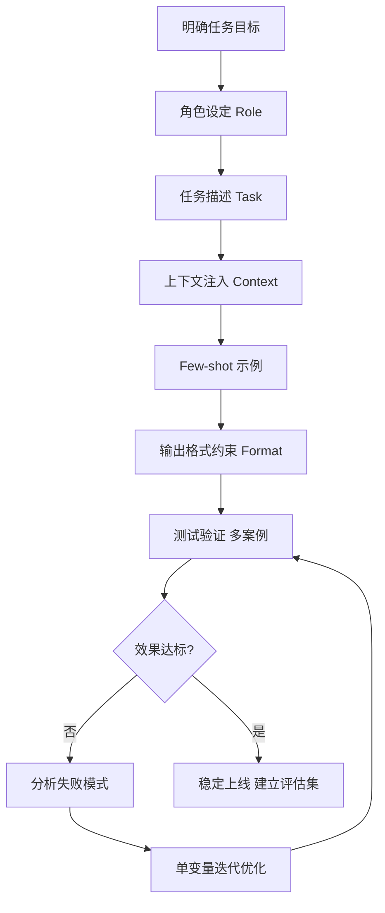

# Prompt 工程进阶

> 从入门到精通的 Prompt 工程指南：核心原则、高级技巧、模式设计、评估优化、实战案例。

## 概述

Prompt 工程是通过设计和优化输入文本，引导大语言模型（LLM）产生高质量、可控输出的技术。它是 AI 应用开发的核心技能，直接决定模型输出的质量和稳定性。

**Prompt 工程的三个层次**：
```text
入门级：会写 Prompt，能让模型完成基本任务
进阶级：掌握技巧，能稳定输出高质量结果
专家级：设计模式，能构建复杂的 Prompt 系统
```

**为什么 Prompt 工程重要**：
- 同一个模型，好的 Prompt 和差的 Prompt 输出质量可能差 10 倍
- Prompt 是最便宜的优化方式（不需要微调模型，不需要更多算力）
- 好的 Prompt 可以减少幻觉、提高准确性、保证格式一致性
- AI 应用的核心竞争力往往在于 Prompt 设计，而非模型本身
> 🔍 **知识点深度解析**
>
> **作用**：Prompt 工程通过设计和优化输入文本，引导 LLM 产生高质量、可控输出，是 AI 应用开发中成本最低、见效最快的优化手段，直接决定模型输出的质量和稳定性。
>
> **原理**：LLM 本质是预测下一个 Token 的概率模型，其输出高度依赖输入上下文。Prompt 工程通过角色设定锚定模型行为、任务描述明确目标、上下文提供背景信息、示例（Few-shot）展示期望格式、思维链（CoT）引导逐步推理、输出格式约束结构化结果，从而将模型的概率生成引导向确定性的高质量输出。核心原理是上下文学习（In-context Learning）——模型在推理时根据 Prompt 中的示例和指令调整输出分布，无需更新参数。
>
> **用法要点**：① 明确性优先——用清晰无歧义的语言描述任务，避免模糊词汇 ② 结构化组织——用分隔符/标题/列表/XML标签组织Prompt，让模型清楚各部分作用 ③ Few-shot示例——给2-3个高质量示例比纯指令效果好，示例要覆盖边界情况 ④ CoT推理——复杂问题要求逐步思考，显著提升推理准确率 ⑤ 迭代优化——每次只改一个变量，建立测试集评估效果 ⑥ 输出格式约束——明确指定JSON/Markdown/表格等格式，减少后处理 ⑦ 温度参数——创造性任务用0.7-1.0，确定性任务用0-0.3

<div style="background:linear-gradient(135deg,#f093fb,#f5576c);border-radius:16px;padding:20px;margin:16px 0;font-family:-apple-system,'Segoe UI','PingFang SC','Microsoft YaHei',sans-serif;color:#fff;overflow:hidden;box-shadow:0 8px 28px rgba(0,0,0,.14),0 3px 10px rgba(0,0,0,.08)">
<style>@keyframes flow{0%{transform:translateX(-10px);opacity:0}15%{transform:translateX(0);opacity:1}85%{transform:translateX(0);opacity:1}100%{transform:translateX(10px);opacity:0}}.flow-step{display:inline-block;background:rgba(255,255,255,.2);border:2px solid rgba(255,255,255,.5);border-radius:8px;padding:10px 14px;margin:4px;text-align:center;font-weight:600;font-size:13px;animation:flow 4s ease-in-out infinite;min-width:90px}.flow-step:nth-child(2){animation-delay:.5s}.flow-step:nth-child(4){animation-delay:1s}.flow-step:nth-child(6){animation-delay:1.5s}.flow-step:nth-child(8){animation-delay:2s}.flow-arrow{display:inline-block;font-size:20px;animation:flow 4s ease-in-out infinite;vertical-align:middle}.flow-code{background:rgba(0,0,0,.2);border-radius:6px;padding:8px 12px;margin-top:10px;font-family:monospace;font-size:12px;text-align:center}</style>
<div style="text-align:center;font-size:15px;font-weight:700;margin-bottom:14px;padding-bottom:10px;border-bottom:1.5px solid rgba(255,255,255,.22);letter-spacing:1px">📝 Prompt 工程优化迭代流程</div>
<div style="text-align:center;white-space:nowrap;overflow-x:auto">
<span class="flow-step">明确任务</span><span class="flow-arrow">→</span><span class="flow-step">设计Prompt</span><span class="flow-arrow">→</span><span class="flow-step">测试输出</span><span class="flow-arrow">→</span><span class="flow-step">分析问题</span><span class="flow-arrow">→</span><span class="flow-step">迭代优化</span><span class="flow-arrow">→</span><span class="flow-step">稳定上线</span>
</div>
<div class="flow-code">任务定义→角色+指令+示例→多案例测试→定位失败模式→单变量迭代→评估集验证</div>
</div>


---

> 💡 **深度讲解**：本章建立了全文的概念基础和问题意识。理解一个技术的第一步是明确它解决什么问题、适用于什么场景，而非急于学习API用法。概述中的核心定义、痛点分析和适用边界，为后续原理和实操提供了认知锚点。建议在阅读后续章节时反复回顾概述中的定义，确保对技术本质的理解不偏离。
>
> **📝 精简总结**：本章定义了核心概念，分析了技术解决的痛点问题，明确了适用场景与边界，为全文奠定认知基础。

## 原理

### Prompt 设计与优化流程



### Prompt 的核心结构

一个完整的 Prompt 通常包含以下部分（按需组合）：

```text
1. 角色设定（Role）：你是谁，你的专业背景
2. 任务描述（Task）：你要做什么
3. 上下文（Context）：背景信息、相关数据
4. 输入（Input）：需要处理的具体内容
5. 输出格式（Format）：期望的输出结构
6. 约束条件（Constraints）：限制、要求、注意事项
7. 示例（Examples）：Few-shot 示例
8. 思考链（Chain of Thought）：引导推理过程
```

### 核心原则

#### 1. 明确性（Clarity）
- 用清晰、无歧义的语言描述任务
- 避免模糊词汇（"尽量"、"大概"、"差不多"）
- 明确输出格式和长度要求

#### 2. 具体性（Specificity）
- 给出具体的标准和要求，而非笼统描述
- 坏例子："写一篇好文章"
- 好例子："写一篇800字的技术文章，面向初中级开发者，主题是React Hooks，包含3个代码示例"

#### 3. 结构化（Structure）
- 用分隔符、标题、列表组织 Prompt
- 用 XML 标签或 Markdown 分隔不同部分
- 让模型清楚知道每部分的作用

#### 4. 迭代优化（Iteration）
- Prompt 不是一次写好的，需要不断测试和优化
- 每次只改一个变量，观察效果
- 建立测试集，评估修改效果

### 高级技巧

#### 1. 思维链（Chain of Thought, CoT）
引导模型逐步推理，而非直接给出答案。

```text
基础版：
问题：一个商品原价100元，先涨价20%，再打8折，最终价格是多少？
答案：

CoT版：
问题：一个商品原价100元，先涨价20%，再打8折，最终价格是多少？
请逐步思考：
1. 涨价20%后的价格是多少？
2. 再打8折后的价格是多少？
3. 最终答案是多少？
```

适用场景：数学推理、逻辑推理、多步骤问题、复杂决策。

#### 2. 少样本学习（Few-shot Learning）
给模型几个示例，让它学习模式。

```text
将以下文本转换为JSON格式：

示例1：
输入：张三，25岁，工程师
输出：{"name": "张三", "age": 25, "job": "工程师"}

示例2：
输入：李四，30岁，产品经理
输出：{"name": "李四", "age": 30, "job": "产品经理"}

现在处理：
输入：王五，28岁，设计师
输出：
```

要点：示例要覆盖各种情况，示例的格式要一致，3-5个示例通常足够。

#### 3. 角色设定（Role Prompting）
给模型设定专业角色，提高输出的专业性。

```text
你是一位有10年经验的资深Java架构师，精通微服务架构和性能优化。
你的回答风格是：
- 技术深入，不流于表面
- 给出具体的代码示例和配置
- 分析优缺点和适用场景
- 引用最佳实践和行业标准

现在请回答以下问题：
...
```

#### 4. 自我一致性（Self-Consistency）
让模型多次推理，取多数答案。

```text
请用3种不同的推理路径解决以下问题，然后比较结果，给出最终答案：
问题：...
```

适用场景：数学题、逻辑题、有确定答案的问题。

#### 5. 思维树（Tree of Thoughts）
让模型探索多个推理分支，评估后选择最优。

```text
解决以下问题，请：
1. 生成3个可能的解决方案
2. 评估每个方案的优缺点
3. 选择最优方案并详细说明
问题：...
```

#### 6. 反思与修正（Reflection）
让模型检查自己的输出并修正。

```text
请完成以下任务，然后：
1. 检查你的回答是否满足所有要求
2. 找出可能的错误或不足
3. 给出修正后的最终版本
任务：...
```

#### 7. 知识生成（Generated Knowledge）
先让模型生成相关知识，再基于知识回答。

```text
请先列出关于"微服务分布式事务"的5个关键知识点，然后基于这些知识回答以下问题：
问题：...
```

#### 8. 分步提示（Step-by-step Prompting）
将复杂任务拆分为多个步骤，逐步引导。

```text
请按以下步骤完成任务：
步骤1：分析用户需求，列出关键要点
步骤2：基于要点，设计系统架构
步骤3：给出核心代码实现
步骤4：分析潜在问题和优化方案

任务：设计一个高并发秒杀系统
```

### Prompt 模式设计

#### 模式1：RAG 问答 Prompt
```text
你是一个专业的技术助手，请基于以下参考资料回答用户问题。

要求：
1. 只使用参考资料中的信息，不要编造
2. 如果参考资料中没有答案，明确说"参考资料中未找到相关信息"
3. 回答末尾标注引用来源（[1][2]）
4. 用简洁专业的语言回答

参考资料：
[1] {文档1内容}
[2] {文档2内容}

用户问题：{问题}
```

#### 模式2：代码审查 Prompt
你是一位资深代码审查专家，请审查以下代码。

审查维度：
1. 功能正确性：是否有逻辑错误或边界问题
2. 性能：是否有性能瓶颈或可优化点
3. 安全性：是否有安全漏洞（注入、越权等）
4. 可读性：命名、注释、结构是否清晰
5. 最佳实践：是否符合行业最佳实践

输出格式：

---

> 💡 **深度讲解**：原理部分是技术笔记的核心价值所在。理解底层机制不仅能帮助正确使用技术，更能在遇到边界情况和性能问题时做出正确判断。本章的架构图、工作流程和关键技术细节，揭示了技术'为什么这样设计'而非仅仅'是什么'。建议结合架构图反复阅读，建立从宏观到微观的完整认知。
>
> **📝 精简总结**：本章深入解析了技术的底层原理、架构设计、工作流程和关键实现细节，通过架构图和对比分析揭示了设计背后的考量。

## 总体评价
（总体评分和概述）


---

> 💡 **深度讲解**：本章围绕总体评价展开，涵盖了核心概念、关键技术和实践要点。建议结合前文内容理解本章的定位，形成完整的知识体系。
>
> **📝 精简总结**：本章系统讲解了总体评价的核心内容，包括关键概念、技术细节和实践要点。

## 问题清单
| 严重程度 | 位置 | 问题描述 | 修复建议 |
|---------|------|---------|---------|
| 高/中/低 | 行号 | 问题 | 建议 |


---

> 💡 **深度讲解**：问题排查部分是生产环境经验的浓缩。每个问题都遵循'现象→原因→方案'的结构，不仅给出解决方案，更解释了根因。性能优化和安全防护部分提供了可量化的优化策略和具体的防护措施。建议将本章作为速查表，在遇到实际问题时快速定位和参考。
>
> **📝 精简总结**：本章系统梳理了常见错误、性能瓶颈、安全风险和生产踩坑，每个问题都包含原因分析和可执行的解决方案。

## 优化后的代码
（完整的优化后代码）

代码：
{代码内容}

### 模式3：摘要生成 Prompt
```text
请对以下文章生成摘要，要求：
1. 总字数控制在300字以内
2. 分为3个部分：核心观点、关键论据、实践建议
3. 用简洁的语言，不要冗余
4. 保留原文的关键数据和结论

文章：
{文章内容}
```


---

> 💡 **深度讲解**：本章围绕优化后的代码展开，涵盖了核心概念、关键技术和实践要点。建议结合前文内容理解本章的定位，形成完整的知识体系。
>
> **📝 精简总结**：本章系统讲解了优化后的代码的核心内容，包括关键概念、技术细节和实践要点。

## 实操

### 1. Prompt 模板管理（Python）

```python
from string import Template

# RAG 问答模板
RAG_PROMPT = Template("""你是一个专业的技术助手，请基于以下参考资料回答用户问题。

要求：
1. 只使用参考资料中的信息，不要编造
2. 如果参考资料中没有答案，明确说"参考资料中未找到相关信息"
3. 回答末尾标注引用来源
4. 用简洁专业的语言回答

参考资料：
$context

用户问题：$question
""")

# 使用
prompt = RAG_PROMPT.substitute(
    context="[1] RAG是检索增强生成技术...\n[2] RAG的核心流程是...",
    question="什么是RAG？"
)
```

### 2. 结构化输出（JSON 模式）

```css
# 方法1：Prompt 约束 JSON 格式
prompt = """请将以下用户信息提取为JSON格式，只输出JSON，不要其他内容：
```

用户信息：张三，25岁，软件工程师，擅长Java和Python

JSON格式：
{"name": "", "age": 0, "job": "", "skills": []}
"""

```css
# 方法2：使用 Function Calling（推荐）
tools = [{
```
    "type": "function",
    "function": {
        "name": "extract_user_info",
        "description": "提取用户信息",
        "parameters": {
            "type": "object",
            "properties": {
                "name": {"type": "string", "description": "姓名"},
                "age": {"type": "integer", "description": "年龄"},
                "job": {"type": "string", "description": "职业"},
                "skills": {"type": "array", "items": {"type": "string"}, "description": "技能列表"}
```json
            },
            "required": ["name", "age", "job"]
        }
    }
}]
```

### 3. Prompt 评估方法

```python
# 建立测试集
test_cases = [
    {"input": "什么是RAG？", "expected_keywords": ["检索", "增强", "生成", "向量"]},
    {"input": "如何优化RAG检索效果？", "expected_keywords": ["分块", "Embedding", "重排", "混合检索"]},
    # ...
]

# 评估函数
def evaluate_prompt(prompt_template, test_cases, llm_client):
    results = []
    for case in test_cases:
        prompt = prompt_template.format(question=case["input"])
        response = llm_client.chat([{"role": "user", "content": prompt}])
        # 检查关键词覆盖率
        covered = sum(1 for kw in case["expected_keywords"] if kw in response)
        coverage = covered / len(case["expected_keywords"])
        results.append({"input": case["input"], "coverage": coverage, "response": response})
    avg_coverage = sum(r["coverage"] for r in results) / len(results)
    return avg_coverage, results
```


---

> 💡 **深度讲解**：实操部分是将理论转化为能力的关键环节。代码示例遵循从简单到复杂的递进原则，每个示例都配有说明和注释。最佳实践部分凝聚了生产环境的经验教训，能帮助避免常见陷阱。建议动手运行每个示例，而非仅阅读代码——亲手操作带来的理解深度远超被动阅读。
>
> **📝 精简总结**：本章提供了环境搭建、快速上手、核心用法、最佳实践和完整项目示例，代码可运行且配有详细注释。

## 问题

| 问题 | 原因 | 解决方案 |
|------|------|---------|
| 模型输出格式不稳定 | Prompt约束不够 / 模型能力不足 | 用Function Calling / 给出明确的格式示例 / 后处理校验 |
| 模型幻觉（编造信息） | 没有提供上下文 / Prompt约束不够 | 用RAG提供上下文 / 要求只基于资料回答 / 加"不知道就说不知道" |
| 输出太长或太短 | 没有明确长度要求 | 明确字数/段落数要求 / 给出长度范围 |
| 不同输入效果差异大 | Prompt不够鲁棒 / 测试不充分 | 建立测试集 / 迭代优化 / 用Few-shot覆盖各种情况 |
| 中文回答夹杂英文 | 没有明确语言要求 | 明确要求"用中文回答" / 角色设定中说明语言偏好 |
| 代码示例有错误 | 模型知识截止 / 复杂代码容易错 | 要求简单可运行的示例 / 加"代码需要可直接运行" / 人工审查 |
| Prompt太长导致成本高 | 上下文冗余 / 示例太多 | 精简Prompt / 只保留必要示例 / 用更短的描述 |
| 换模型后效果变差 | 不同模型对Prompt敏感度不同 | 针对每个模型优化Prompt / 用通用技巧（CoT/Few-shot）/ 建立模型适配层 |


---

> 💡 **深度讲解**：问题排查部分是生产环境经验的浓缩。每个问题都遵循'现象→原因→方案'的结构，不仅给出解决方案，更解释了根因。性能优化和安全防护部分提供了可量化的优化策略和具体的防护措施。建议将本章作为速查表，在遇到实际问题时快速定位和参考。
>
> **📝 精简总结**：本章系统梳理了常见错误、性能瓶颈、安全风险和生产踩坑，每个问题都包含原因分析和可执行的解决方案。

## 拓展

**深入学习方向**：
1. **Prompt 模式库**：收集和整理各种场景的 Prompt 模板
2. **自动 Prompt 优化**：用 LLM 自动优化 Prompt（APE、PromptEngineer）
3. **Prompt 安全**：防止 Prompt 注入、越狱、数据泄露
4. **多模态 Prompt**：图文混合输入的 Prompt 设计
5. **Agent Prompt**：复杂 Agent 系统的 Prompt 设计（ReAct、Plan-and-Execute）
6. **Prompt 版本管理**：像代码一样管理 Prompt 的版本、测试、回滚

**相关笔记**：
- [[AI应用开发入门]]
- [[大模型应用开发实战]]
- [[RAG架构设计与流程]]
- [[AI Agent开发框架知识点系统梳理_优化版]]
- [[大模型推理优化]]
- [[流式响应与SSE]]

**推荐资源**：
- OpenAI Prompt Engineering Guide：https://platform.openai.com/docs/guides/prompt-engineering
- 《Prompt Engineering for Generative AI》
- Anthropic Prompt Engineering：https://docs.anthropic.com/claude/docs/introduction-to-prompt-design
- Prompt 模板库：https://prompts.chat/
- 论文：《Chain-of-Thought Prompting》《Tree of Thoughts》《Self-Consistency》

**面试高频考点**：
1. 什么是 Prompt 工程，为什么重要
2. Chain of Thought 的原理和适用场景
3. Few-shot 和 Zero-shot 的区别
4. 如何减少模型幻觉
5. 如何保证输出格式的一致性
6. RAG 系统的 Prompt 如何设计
7. Prompt 优化的方法论
8. Function Calling 的原理和优势

---

[[MOC-AI与效率工具|← 返回板块 MOC]] | [[知识库仪表盘|📊 仪表盘]] | [[Home|🏠 返回首页]]


---

> 💡 **深度讲解**：拓展部分为深入学习指明了方向。生态工具和周边库的介绍帮助了解技术全景，行业应用案例展示了技术的实际价值，学习资源推荐为持续学习提供了高质量入口。建议根据个人兴趣和工作需求选择性深入，不必全部掌握——拓展部分的价值在于'知道有什么'，而非'全部学会'。
>
> **📝 精简总结**：本章介绍了进阶特性、生态工具、技术集成、行业应用和学习资源，为深入学习和实践拓展提供方向。

---

## 🔗 关联笔记

- [[Agent工具调用FunctionCalling]] — 工具调用协议与实现
- [[Agent核心概念-ReAct规划]] — Agent推理循环与规划
- [[Agent记忆机制设计]] — 记忆系统设计
- [[Agent安全与护栏设计]] — 安全防护体系
- [[多Agent协作模式]] — 多智能体协作

## 📖 前置知识

- [[LLM大模型入门概念]]
- [[Agent工具调用FunctionCalling]]

## 🏷️ 相关标签

`#AI应用` `#AI工程化` `#Agent` `#LLM`

---

[[Home|🏠 返回首页]] · [[MOC-AI与效率工具|📚 返回分类]]
