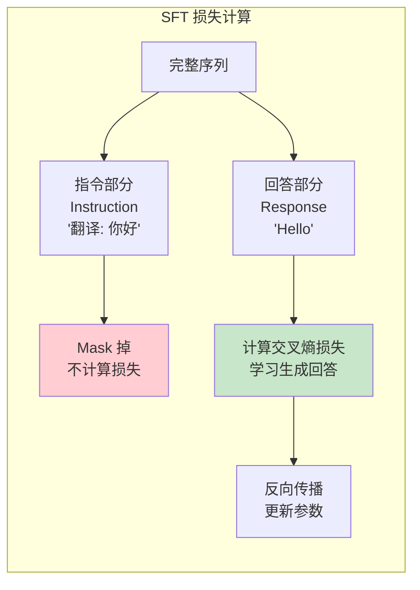
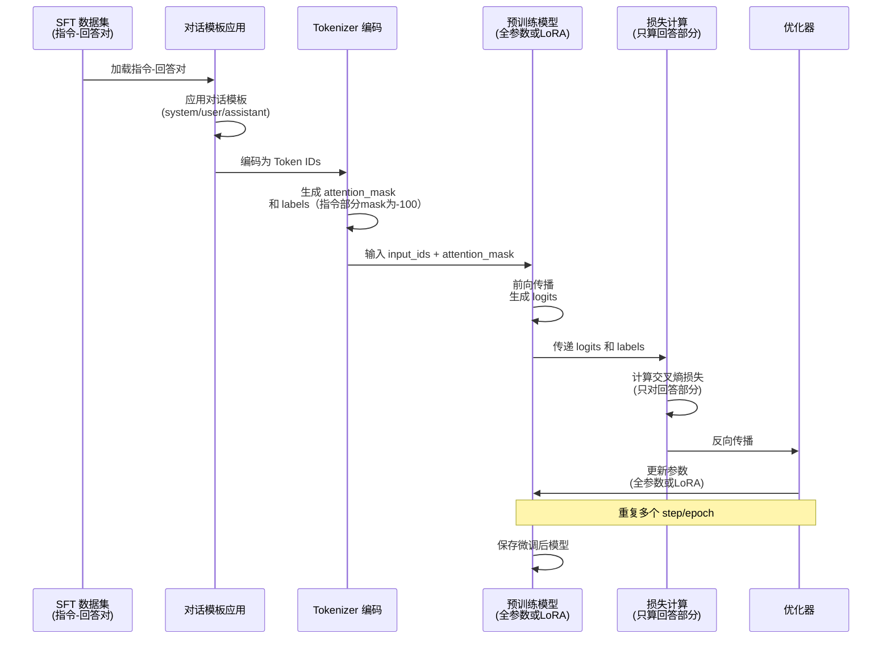
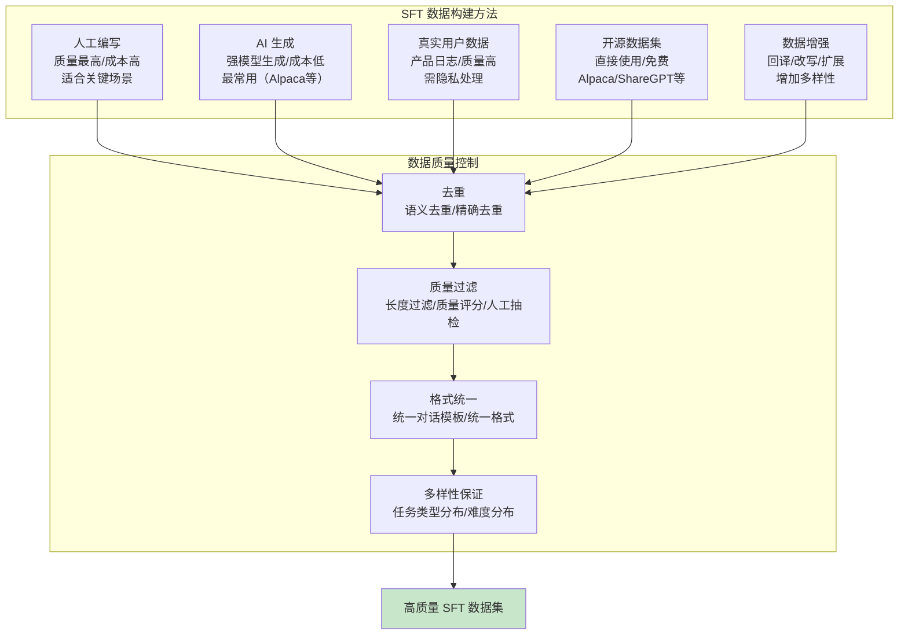

# SFT 监督微调实战

> **一句话定义**：SFT（Supervised Fine-Tuning，监督微调）是在预训练模型基础上，用高质量的指令-回答对（instruction-response pairs）进行有监督训练，让模型学会遵循指令、以对话格式回答问题，是大模型从"文本续写模型"变成"对话助手"的关键步骤。
>
> **核心价值**：将预训练模型的通用语言能力转化为可用的任务能力——学会遵循指令、理解对话格式、输出有用回答，是 LLM 应用开发中最常用的定制手段，也是 RLHF/DPO 对齐的前置步骤。
>
> **适用场景**：对话机器人、指令遵循、领域适配（医疗/法律/金融）、风格定制、代码生成、多轮对话、企业知识库问答、Agent 能力增强。

---

## 一、概述

### 1.1 SFT 在 LLM 训练流程中的位置

```mermaid
graph TB
    subgraph LLM 训练全流程
        PT[预训练 Pre-training<br/>海量无标注文本<br/>自监督学习<br/>获得通用语言能力] --> SFT[SFT 监督微调<br/>指令-回答对<br/>有监督学习<br/>学会遵循指令/对话格式]
        SFT --> ALIGN[对齐 Alignment<br/>RLHF/DPO<br/>偏好数据<br/>对齐人类价值观]
        ALIGN --> DEPLOY[部署应用<br/>API/自部署<br/>RAG/Agent/微调]
    end

    Note over PT: 成本极高（数百万美元）<br/>只有大公司能做
    Note over SFT: 成本中等（数千~数万美元）<br/>小团队可做（LoRA）
    Note over ALIGN: 成本中低（数千美元）<br/>小团队可做

    style SFT fill:#c8e6c9
```

### 1.2 核心概念

| 概念 | 说明 |
|------|------|
| **SFT（Supervised Fine-Tuning）** | 监督微调，用标注数据（指令-回答对）对预训练模型进行有监督训练，适配特定任务 |
| **指令（Instruction）** | 用户的请求或任务描述，如"翻译以下文本为英文"、"写一首关于春天的诗" |
| **回答（Response/Completion）** | 模型应该输出的目标文本，即"正确答案"或"示范回答" |
| **指令-回答对（Instruction-Response Pair）** | SFT 的训练数据格式，包含一条指令和对应的理想回答 |
| **对话模板（Chat Template）** | 定义多轮对话的格式，包括 system/user/assistant 角色的标记方式，不同模型有不同模板 |
| **System Prompt** | 系统提示，定义模型的角色、行为准则、输出格式等，在对话开始时设置 |
| **因果语言建模（Causal LM）** | SFT 的训练目标——给定前面的 Token，预测下一个 Token，与预训练目标相同 |
| **只计算回答部分损失** | SFT 的关键技巧——只对回答（response）部分计算损失，指令（instruction）部分不计算损失（mask），避免模型学习"重复指令" |
| **数据质量 > 数据数量** | SFT 的核心原则——高质量的小数据集（1万~10万条）通常比低质量的大数据集效果更好 |
| **学习率** | SFT 的关键超参数，全参数微调用 1e-5~5e-5，LoRA 用 1e-4~3e-4 |
| **Epoch** | 训练轮数，SFT 通常 2-3 个 epoch，太多容易过拟合 |
| **灾难性遗忘（Catastrophic Forgetting）** | 微调后模型的通用能力下降，是 SFT 需要警惕的问题 |

### 1.3 SFT vs 预训练 vs 对齐

| 维度 | 预训练（PT） | 监督微调（SFT） | 对齐（RLHF/DPO） |
|------|-------------|----------------|-----------------|
| **目标** | 通用语言能力 | 遵循指令、对话格式 | 有用、无害、诚实 |
| **数据** | 海量无标注文本（万亿 Token） | 指令-回答对（1万~100万） | 偏好数据（1万~10万对） |
| **学习方式** | 自监督（预测下一个 Token） | 有监督（交叉熵损失） | 强化学习/偏好优化 |
| **成本** | 极高（数百万美元） | 中等（数千~数万美元） | 中低（数千美元） |
| **效果** | 语言建模能力 | 任务能力、指令遵循 | 人类偏好对齐 |
| **谁能做** | 大公司 | 小团队（LoRA） | 小团队（LoRA） |
| **训练时间** | 数周~数月 | 数小时~数天 | 数小时~数天 |


<div style="background:linear-gradient(135deg,#f093fb,#f5576c);border-radius:16px;padding:20px;margin:16px 0;font-family:-apple-system,'Segoe UI','PingFang SC','Microsoft YaHei',sans-serif;color:#fff;overflow:hidden;box-shadow:0 8px 28px rgba(0,0,0,.14),0 3px 10px rgba(0,0,0,.08)">
<style>@keyframes flow{0%{transform:translateX(-10px);opacity:0}15%{transform:translateX(0);opacity:1}85%{transform:translateX(0);opacity:1}100%{transform:translateX(10px);opacity:0}}.flow-step{display:inline-block;background:rgba(255,255,255,.2);border:2px solid rgba(255,255,255,.5);border-radius:8px;padding:10px 14px;margin:4px;text-align:center;font-weight:600;font-size:13px;animation:flow 4s ease-in-out infinite;min-width:90px}.flow-step:nth-child(2){animation-delay:.5s}.flow-step:nth-child(4){animation-delay:1s}.flow-step:nth-child(6){animation-delay:1.5s}.flow-step:nth-child(8){animation-delay:2s}.flow-arrow{display:inline-block;font-size:20px;animation:flow 4s ease-in-out infinite;vertical-align:middle}.flow-code{background:rgba(0,0,0,.2);border-radius:6px;padding:8px 12px;margin-top:10px;font-family:monospace;font-size:12px;text-align:center}</style>
<div style="text-align:center;font-size:15px;font-weight:700;margin-bottom:14px;padding-bottom:10px;border-bottom:1.5px solid rgba(255,255,255,.22);letter-spacing:1px">📚 SFT 监督微调全流程</div>
<div style="text-align:center;white-space:nowrap;overflow-x:auto">
<span class="flow-step">数据收集</span><span class="flow-arrow">→</span><span class="flow-step">数据清洗</span><span class="flow-arrow">→</span><span class="flow-step">对话模板</span><span class="flow-arrow">→</span><span class="flow-step">训练配置</span><span class="flow-arrow">→</span><span class="flow-step">微调训练</span><span class="flow-arrow">→</span><span class="flow-step">评估部署</span>
</div>
<div class="flow-code">指令-回答对→去重/质量过滤→apply_chat_template→LoRA/学习率/epoch→SFTTrainer训练→领域+通用双评估</div>
</div>
> 🔍 **知识点深度解析**
>
> **作用**：SFT 是将预训练模型从"文本续写器"转变为"对话助手"的关键步骤——预训练模型只会"续写文本"（给定前缀预测后续），不会"回答问题"或"遵循指令"；SFT 通过指令-回答对的训练，让模型学会理解指令、以对话格式输出有用回答。
>
> **原理**：SFT 的训练目标与预训练相同——因果语言建模（预测下一个 Token），但数据和计算方式不同。数据是指令-回答对（而非无标注文本），计算损失时只对回答部分计算交叉熵损失（指令部分 mask 掉），这样模型学习的是"给定指令后如何生成回答"，而非"重复指令"。SFT 本质上是在预训练模型的参数空间中，向"指令遵循"方向做梯度下降，使模型在保持通用语言能力的同时，获得任务能力。
>
> **用法要点**：① 数据质量是关键——高质量的 1 万条数据通常比低质量的 100 万条效果好，数据需要多样化（覆盖各种任务类型）、高质量（回答准确有用）、格式统一 ② 对话模板必须正确——不同模型（Llama/Qwen/ChatGLM）有不同的对话模板，用错模板会导致模型行为异常 ③ 只计算回答部分损失——用 SFTTrainer 或手动 mask 指令部分，避免模型学习重复指令 ④ 学习率要小——全参数 1e-5~5e-5，LoRA 1e-4~3e-4，学习率太大会破坏预训练能力 ⑤ Epoch 2-3 个——太多容易过拟合，用验证集早停 ⑥ 混合通用数据——在 SFT 数据中混合 10-30% 的通用指令数据，防止灾难性遗忘 ⑦ 评估要全面——在领域任务和通用任务（MMLU/GSM8K）上同时评估 ⑧ LoRA 优先——大多数场景用 LoRA/QLoRA 即可，成本低效果接近全参数

---

> 💡 **深度讲解**：SFT（监督微调）是大模型应用开发中最常用的定制手段，它的核心思想非常简单——用"问题-答案"对来教模型如何回答问题。但 SFT 的细节和技巧很多，数据质量、对话模板、损失计算、超参数选择等都会显著影响最终效果。SFT 的必要性来自于预训练模型的"能力错位"——预训练模型在海量文本上学习了"预测下一个词"，它擅长续写文本、补全句子，但不擅长"回答问题"。当你问预训练模型"什么是人工智能？"时，它可能会续写"什么是人工智能？人工智能是计算机科学的一个分支..."（把问题当作前缀来续写），而不是以助手的身份直接回答。SFT 通过大量的指令-回答对训练，让模型学会"看到指令后，以助手的身份生成回答"，完成从"文本续写器"到"对话助手"的转变。SFT 的数据是核心——InstructGPT 论文表明，高质量的小数据集（仅 1.3 万条）就能带来显著的效果提升，而低质量的大数据集反而可能损害模型能力。SFT 数据的质量要求包括：① 回答准确有用——不能有错误信息、不能答非所问；② 格式统一——所有数据使用相同的对话模板；③ 多样化——覆盖各种任务类型（问答、写作、编程、推理、翻译等）、各种难度、各种风格；④ 长度适中——回答不能太短（信息量不足）也不能太长（浪费计算、可能过拟合）；⑤ 无重复——去重，避免模型记忆特定样本。SFT 数据的构建方法有多种：① 人工编写——质量最高但成本高，适合关键场景；② AI 生成——用强模型（GPT-4o/Claude）生成指令-回答对，成本低质量尚可，是目前最常用的方法（如 Alpaca、GPT4-LLM、OpenHermes 等数据集都是 AI 生成的）；③ 真实用户数据——从产品日志中收集真实的用户问题和人工回答，质量高且贴合场景，但需要隐私处理；④ 开源数据集——直接使用开源的 SFT 数据集（如 Alpaca、ShareGPT、OpenHermes、UltraChat 等），在此基础上补充领域数据。对话模板是 SFT 中容易被忽视但非常重要的细节——不同的模型使用不同的对话模板来标记角色（system/user/assistant），如果训练和推理时使用的模板不一致，模型行为会异常（可能输出角色标记、回答格式混乱等）。常见的对话模板包括：① Llama 3 模板（<|begin_of_text|><|start_header_id|>system<|end_header_id|>...）；② ChatML（<|im_start|>system...<|im_end|>）；③ Qwen 模板（<|im_start|>system...）；④ 自定义模板。HuggingFace 的 apply_chat_template 方法可以自动应用模型对应的模板，推荐使用。损失计算是 SFT 的另一个关键细节——SFT 不应该对整个序列（指令+回答）计算损失，而应该只对回答部分计算损失，指令部分 mask 掉（不计算梯度）。这是因为我们希望模型学习"给定指令后如何生成回答"，而不是"学习重复指令"。如果对指令部分也计算损失，模型可能会学会重复用户的指令（这是预训练模型的自然行为），而不是直接回答。TRL 库的 SFTTrainer 默认会处理这个（通过 response_template 或 formatting_func），但自定义训练时需要注意手动 mask。超参数选择对 SFT 效果影响很大——学习率是最重要的超参数，全参数微调用 1e-5 到 5e-5（比预训练小很多，因为只需要微调而非从头学习），LoRA 用 1e-4 到 3e-4（因为参数少需要更大步长）。Epoch 通常 2-3 个，太多容易过拟合（特别是小数据集时）。Batch size 根据显存调整，梯度累积可以模拟大 batch。学习率调度器用 cosine 或 linear，warmup 比例 3-5%。灾难性遗忘是 SFT 需要警惕的问题——微调后模型的通用能力（知识、推理、代码等）可能下降。缓解策略包括：① 用 LoRA 而非全参数微调（LoRA 的遗忘通常更小）；② 减小学习率和 epoch；③ 在 SFT 数据中混合 10-30% 的通用指令数据（如 Alpaca 数据）；④ 在通用任务上持续评估，发现下降及时调整；⑤ 用知识蒸馏（在损失中加入对基础模型输出的 KL 约束）。
>
> **📝 精简总结**：SFT（监督微调）用指令-回答对对预训练模型进行有监督训练，让模型从"文本续写器"变成"对话助手"，学会遵循指令和对话格式；是LLM训练流程（PT→SFT→对齐→部署）中的关键第二步，成本中等（数千~数万美元），小团队可用LoRA完成；核心概念包括指令（Instruction）、回答（Response）、指令-回答对、对话模板（Chat Template，不同模型不同）、System Prompt（角色/行为/格式）、因果语言建模（训练目标=预测下一个Token）、只计算回答部分损失（指令部分mask，避免学重复指令）、数据质量>数量（1万高质量>100万低质量）、学习率（全参数1e-5~5e-5/LoRA 1e-4~3e-4）、Epoch（2-3个防过拟合）、灾难性遗忘（微调后通用能力下降）；与预训练/对齐对比：PT（海量无标注/自监督/极高成本/通用语言）、SFT（指令回答对/有监督/中等成本/指令遵循）、对齐（偏好数据/RL或DPO/中低成本/人类价值观）；核心原理是因果语言建模+只算回答损失+数据驱动的梯度下降；用法要点是数据质量（准确/格式统一/多样化/长度适中/去重）、正确对话模板（apply_chat_template）、只算回答损失（SFTTrainer或手动mask）、小学习率、2-3 epoch、混合10-30%通用数据防遗忘、领域+通用双评估、LoRA优先。

---

## 二、原理

### 2.1 SFT 训练目标

SFT 的训练目标是因果语言建模（Causal Language Modeling），与预训练相同：

```text
$$
\mathcal{L}_{SFT} = -\sum_{t=1}^{N} \mathbb{1}[t \in \text{response}] \cdot \log P_\theta(x_t | x_1, x_2, ..., x_{t-1})
$$
```

其中：
- $\mathbb{1}[t \in \text{response}]$：指示函数，只有当 Token t 属于回答部分时才计算损失
- $P_\theta(x_t | x_{<t})$：模型在给定前文时生成 Token t 的概率
- 指令部分（instruction）的损失被 mask 掉（不计算梯度）



**为什么只计算回答部分损失？**
- 模型应该学习"给定指令后如何生成回答"，而非"学习重复指令"
- 如果对指令部分也计算损失，模型可能学会重复用户指令（预训练模型的自然行为）
- 只计算回答部分损失，训练更高效，效果更好

### 2.2 对话模板

对话模板定义了多轮对话的格式，不同模型有不同的模板。训练和推理时必须使用相同的模板。

```mermaid
graph TB
    subgraph 对话模板结构
        S[System Prompt<br/>角色定义/行为准则] --> U1[User 1<br/>用户问题]
        U1 --> A1[Assistant 1<br/>模型回答]
        A1 --> U2[User 2<br/>追问]
        U2 --> A2[Assistant 2<br/>模型回答]
    end

    subgraph 常见模板格式
        T1[Llama 3<br/><|begin_of_text|><|start_header_id|>system<|end_header_id|>...]
        T2[ChatML<br/><|im_start|>system...<|im_end|>]
        T3[Qwen<br/><|im_start|>system...<|im_end|>]
        T4[自定义<br/>### 系统\n...### 用户\n...### 助手\n...]
    end
```

**Llama 3 模板示例**：
```text
<|begin_of_text|><|start_header_id|>system<|end_header_id|>

你是一个 helpful 的助手<|eot_id|><|start_header_id|>user<|end_header_id|>

什么是人工智能？<|eot_id|><|start_header_id|>assistant<|end_header_id|>

人工智能（AI）是计算机科学的一个分支...<|eot_id|>
```

**ChatML 模板示例**：
```text
<|im_start|>system
你是一个 helpful 的助手<|im_end|>
<|im_start|>user
什么是人工智能？<|im_end|>
<|im_start|>assistant
人工智能（AI）是计算机科学的一个分支...<|im_end|>
```

### 2.3 SFT 训练流程



### 2.4 数据构建方法



---

> 💡 **深度讲解**：SFT 的原理可以用"三个关键"来概括——因果语言建模目标、只计算回答部分损失、对话模板统一。因果语言建模是 SFT 的训练目标，与预训练完全相同——给定前面的 Token，预测下一个 Token。这意味着 SFT 不需要新的训练目标或架构，只需要在预训练模型的基础上继续训练，但用不同的数据（指令-回答对而非无标注文本）。这种"相同目标、不同数据"的设计使得 SFT 非常稳定——不会出现训练目标不匹配导致的训练崩溃，模型能够平滑地从预训练状态过渡到微调状态。只计算回答部分损失是 SFT 区别于预训练的关键细节——预训练对所有 Token 计算损失（因为所有 Token 都是"要预测的目标"），而 SFT 只对回答部分计算损失，指令部分被 mask 掉（label 设为 -100，PyTorch 的 CrossEntropyLoss 会忽略 -100 的位置）。这样做的原因是：SFT 的目标是让模型学会"给定指令后生成回答"，而不是"学会重复指令"。如果对指令部分也计算损失，模型会同时学习"如何生成指令"和"如何生成回答"，但"如何生成指令"不是我们想要的（用户会提供指令，模型不需要生成指令）。只计算回答部分损失，训练更高效（梯度信号更集中），效果更好（模型不会学会重复指令）。对话模板统一是 SFT 容易被忽视但非常重要的细节——对话模板定义了 system/user/assistant 角色的标记方式，模型在 SFT 时学会了"看到 <|im_start|>user 标记后，生成用户问题；看到 <|im_start|>assistant 标记后，生成助手回答"。如果推理时使用不同的模板（如训练用 ChatML，推理用 Llama 3 模板），模型会"看不懂"输入格式，可能输出角色标记、回答格式混乱、甚至不回答。因此，训练和推理时必须使用完全相同的对话模板。HuggingFace 的 apply_chat_template 方法可以自动应用模型对应的模板（从 tokenizer 的 chat_template 属性读取），推荐使用，避免手动拼接模板出错。SFT 的数据构建是影响效果的最关键因素——InstructGPT 论文的一个重要发现是"数据质量 > 数据数量"，仅 1.3 万条高质量的人工标注数据就能带来显著的效果提升。SFT 数据的质量要求包括：① 回答准确有用——不能有错误信息、不能答非所问、不能有有害内容；② 格式统一——所有数据使用相同的对话模板和格式；③ 多样化——覆盖各种任务类型（问答、写作、编程、推理、翻译、摘要等）、各种难度（简单到复杂）、各种风格（正式到随意）；④ 长度适中——回答不能太短（信息量不足，如"好的"、"是的"）也不能太长（浪费计算、可能过拟合、降低训练效率），通常 50-1000 字；⑤ 无重复——精确去重和语义去重，避免模型记忆特定样本；⑥ 无噪声——过滤低质量数据（如乱码、不完整、格式错误）。AI 生成是目前最常用的 SFT 数据构建方法——用强模型（GPT-4o/Claude 3.5）生成指令和回答，成本低、质量尚可、规模可控。Alpaca（5.2万条，GPT-3.5生成）、GPT4-LLM（100万条，GPT-4生成）、OpenHermes（90万条，混合）、UltraChat（28万条多轮对话）等知名数据集都是 AI 生成的。AI 生成数据的质量控制很重要——需要过滤低质量回答（如"我无法回答"、重复、不完整），可以用强模型作为"质量评估器"打分，过滤低分数据。SFT 的超参数选择对效果影响很大——学习率是最重要的超参数，全参数微调用 1e-5 到 5e-5（比预训练的 1e-4 到 3e-4 小很多，因为只需要微调而非从头学习），LoRA 用 1e-4 到 3e-4（因为 LoRA 只训练少量参数，需要更大步长才能有效更新）。Epoch 通常 2-3 个，太多容易过拟合（特别是小数据集时），可以用验证集早停。Batch size 根据显存调整，梯度累积可以模拟大 batch（如 batch_size=4, gradient_accumulation_steps=8 等效于 batch_size=32）。学习率调度器用 cosine（最常用）或 linear，warmup 比例 3-5%（防止训练初期梯度不稳定）。灾难性遗忘是 SFT 需要警惕的问题——微调后模型的通用能力（知识、推理、代码等）可能下降，因为微调在一定程度上"覆盖"了预训练学到的通用知识。缓解策略包括：① 用 LoRA 而非全参数微调（LoRA 只更新少量参数，对原权重的干扰小，遗忘通常更小）；② 减小学习率和 epoch（减少参数更新幅度）；③ 在 SFT 数据中混合 10-30% 的通用指令数据（如 Alpaca 数据），保持模型的通用能力；④ 在通用任务上持续评估（MMLU/GSM8K/HumanEval），发现下降及时调整；⑤ 用知识蒸馏（在损失中加入对基础模型输出的 KL 散度约束，防止策略偏离太远）；⑥ 选择性微调（只在注意力层加 LoRA，不加 MLP 层，减少对知识存储的干扰）。
>
> **📝 精简总结**：SFT 训练目标是因果语言建模（与预训练相同），公式 L=-Σ 1[t∈response]·log Pθ(xt|x<t)，关键是只对回答部分计算损失（指令部分mask为-100），避免模型学重复指令，训练更高效效果更好；对话模板定义system/user/assistant角色标记，不同模型不同（Llama 3/ChatML/Qwen/自定义），训练和推理必须用相同模板，推荐用 apply_chat_template 自动应用；SFT训练流程是加载指令回答对→应用对话模板→Tokenizer编码（生成input_ids/attention_mask/labels，指令部分label=-100）→模型前向→计算交叉熵损失（只算回答）→反向传播更新参数（全参数或LoRA）→保存模型；数据构建方法包括人工编写（最高质量高成本）、AI生成（强模型生成低成本最常用，Alpaca/GPT4-LLM/OpenHermes）、真实用户数据（产品日志高质量需隐私处理）、开源数据集（Alpaca/ShareGPT直接用）、数据增强（回译/改写/扩展）；数据质量控制包括去重（精确+语义）、质量过滤（长度/质量评分/人工抽检）、格式统一（对话模板/格式）、多样性保证（任务类型/难度分布）；数据质量要求是回答准确有用/格式统一/多样化/长度适中50-1000字/无重复/无噪声；超参数选择——学习率（全参数1e-5~5e-5，LoRA 1e-4~3e-4）、Epoch 2-3个防过拟合、Batch size按显存+梯度累积、学习率调度cosine/linear、warmup 3-5%；灾难性遗忘缓解——LoRA优先、减小学习率epoch、混合10-30%通用数据、通用任务持续评估、知识蒸馏KL约束、选择性微调只注意力层；核心原理是因果语言建模+只算回答损失+对话模板统一+数据质量驱动。

---

## 三、实操

### 3.1 使用 TRL SFTTrainer 进行微调

```python
# pip install transformers datasets trl peft accelerate bitsandbytes

import torch
from datasets import load_dataset
from transformers import (
    AutoModelForCausalLM,
    AutoTokenizer,
    TrainingArguments,
    BitsAndBytesConfig,
)
from peft import LoraConfig, get_peft_model, prepare_model_for_kbit_training
from trl import SFTTrainer, SFTConfig

# 1. 加载模型和分词器
model_name = "Qwen/Qwen2.5-7B-Instruct"
tokenizer = AutoTokenizer.from_pretrained(model_name)
tokenizer.pad_token = tokenizer.eos_token

# 2. 4bit 量化配置（QLoRA，可选）
bnb_config = BitsAndBytesConfig(
    load_in_4bit=True,
    bnb_4bit_quant_type="nf4",
    bnb_4bit_compute_dtype=torch.bfloat16,
    bnb_4bit_use_double_quant=True,
)

# 3. 加载模型
model = AutoModelForCausalLM.from_pretrained(
    model_name,
    quantization_config=bnb_config,  # 注释掉此行则为全参数/LoRA（非QLoRA）
    device_map="auto",
    trust_remote_code=True,
)
model = prepare_model_for_kbit_training(model)

# 4. LoRA 配置
lora_config = LoraConfig(
    r=16,
    lora_alpha=32,
    lora_dropout=0.05,
    bias="none",
    task_type="CAUSAL_LM",
    target_modules=["q_proj", "k_proj", "v_proj", "o_proj",
                    "gate_proj", "up_proj", "down_proj"],
)
model = get_peft_model(model, lora_config)
model.print_trainable_parameters()

# 5. 加载数据集
# 数据格式：JSONL，每行 {"messages": [{"role": "system", "content": "..."}, {"role": "user", "content": "..."}, {"role": "assistant", "content": "..."}]}
dataset = load_dataset("json", data_files="sft_data.jsonl", split="train")

# 6. 训练配置
training_args = SFTConfig(
    output_dir="./sft-output",
    num_train_epochs=3,
    per_device_train_batch_size=4,
    gradient_accumulation_steps=4,
    learning_rate=2e-4,              # LoRA 学习率
    # learning_rate=2e-5,            # 全参数学习率
    lr_scheduler_type="cosine",
    warmup_ratio=0.03,
    logging_steps=10,
    save_steps=100,
    save_total_limit=3,
    bf16=True,
    gradient_checkpointing=True,
    optim="paged_adamw_8bit",
    report_to="none",
    max_seq_length=2048,
    dataset_text_field=None,         # 使用 messages 格式时设为 None
)

# 7. 创建 Trainer
trainer = SFTTrainer(
    model=model,
    args=training_args,
    train_dataset=dataset,
    tokenizer=tokenizer,
    # SFTTrainer 会自动处理对话模板和损失mask
)

# 8. 训练
trainer.train()

# 9. 保存模型
trainer.save_model("./sft-final")
tokenizer.save_pretrained("./sft-final")
```

### 3.2 SFT 数据格式与构建

```python
import json
import random

# 格式1：messages 格式（推荐，TRL SFTTrainer 原生支持）
sft_data_messages = [
    {
        "messages": [
            {"role": "system", "content": "你是一个 helpful 的编程助手"},
            {"role": "user", "content": "用 Python 写一个快速排序"},
            {"role": "assistant", "content": "```python\ndef quick_sort(arr):\n    if len(arr) <= 1:\n        return arr\n    pivot = arr[len(arr) // 2]\n    left = [x for x in arr if x < pivot]\n    middle = [x for x in arr if x == pivot]\n    right = [x for x in arr if x > pivot]\n    return quick_sort(left) + middle + quick_sort(right)\n```\n\n时间复杂度：平均 O(n log n)，最坏 O(n²)"}
        ]
    },
    {
        "messages": [
            {"role": "system", "content": "你是一个 helpful 的助手"},
            {"role": "user", "content": "什么是大语言模型？"},
            {"role": "assistant", "content": "大语言模型（LLM）是基于 Transformer 架构、在海量文本上预训练的大规模神经网络模型..."}
        ]
    }
]

# 格式2：纯文本格式（需要手动应用模板）
sft_data_text = [
    {"text": "<|im_start|>system\n你是一个 helpful 的助手<|im_end|>\n<|im_start|>user\n你好<|im_end|>\n<|im_start|>assistant\n你好！有什么可以帮助你的？<|im_end|>"},
]

# 保存为 JSONL
def save_jsonl(data, path):
    with open(path, 'w', encoding='utf-8') as f:
        for item in data:
            f.write(json.dumps(item, ensure_ascii=False) + '\n')

save_jsonl(sft_data_messages, "sft_data.jsonl")

# 使用 AI 生成 SFT 数据
def generate_sft_data_with_ai(prompts: list, model: str = "gpt-4o") -> list:
    """用 AI 模型生成指令-回答对"""
    from openai import OpenAI
    client = OpenAI()

    sft_data = []
    for prompt in prompts:
        response = client.chat.completions.create(
            model=model,
            messages=[
                {"role": "system", "content": "你是一个 helpful 的助手，请用中文详细回答用户的问题"},
                {"role": "user", "content": prompt}
            ],
            temperature=0.7
        )
        answer = response.choices[0].message.content
        sft_data.append({
            "messages": [
                {"role": "system", "content": "你是一个 helpful 的助手"},
                {"role": "user", "content": prompt},
                {"role": "assistant", "content": answer}
            ]
        })
    return sft_data

# 数据质量过滤
def filter_sft_data(data: list, min_length: int = 20, max_length: int = 2000) -> list:
    """过滤低质量 SFT 数据"""
    filtered = []
    for item in data:
        messages = item["messages"]
        # 找到 assistant 回答
        answer = next((m["content"] for m in messages if m["role"] == "assistant"), "")

        # 长度过滤
        if len(answer) < min_length or len(answer) > max_length:
            continue

        # 过滤拒绝回答
        if any(kw in answer for kw in ["我无法回答", "我不能回答", "作为AI", "抱歉，我"]):
            continue

        # 过滤重复
        if answer in [x for x in filtered]:
            continue

        filtered.append(item)
    return filtered

# 数据去重（语义去重需要 Embedding，这里用简单的精确去重）
def deduplicate_sft_data(data: list) -> list:
    """SFT 数据去重"""
    seen = set()
    unique = []
    for item in data:
        messages = item["messages"]
        user_msg = next((m["content"] for m in messages if m["role"] == "user"), "")
        if user_msg not in seen:
            seen.add(user_msg)
            unique.append(item)
    return unique
```

### 3.3 使用 Axolotl 进行 SFT 训练（生产环境推荐）

```yaml
# axolotl SFT 配置文件 sft_config.yaml
base_model: Qwen/Qwen2.5-7B-Instruct
model_type: AutoModelForCausalLM
tokenizer_type: AutoTokenizer

# LoRA 配置（注释掉则为全参数微调）
adapter: lora
lora_r: 16
lora_alpha: 32
lora_dropout: 0.05
lora_target_modules:
  - q_proj
  - k_proj
  - v_proj
  - o_proj
  - gate_proj
  - up_proj
  - down_proj

# QLoRA 4bit 量化（注释掉则为 16bit）
load_in_4bit: true
bnb_4bit_quant_type: nf4
bnb_4bit_compute_dtype: bfloat16
bnb_4bit_use_double_quant: true

# 数据集（messages 格式）
datasets:
  - path: ./sft_data.jsonl
    type: chat_template
    chat_template: chatml
    split: train

# 训练参数
num_epochs: 3
batch_size: 4
gradient_accumulation_steps: 4
learning_rate: 2.0e-4            # LoRA 用 2e-4，全参数用 2e-5
lr_scheduler: cosine
warmup_steps: 100

# 长度
sequence_len: 2048

# 精度和优化
bf16: true
gradient_checkpointing: true
optimizer: paged_adamw_8bit

# 日志和保存
logging_steps: 10
save_steps: 100
eval_steps: 100
output_dir: ./sft-output
```

## 单卡训练
accelerate launch -m axolotl.cli.train sft_config.yaml

## 多卡分布式训练
accelerate launch --num_processes 4 -m axolotl.cli.train sft_config.yaml

### 3.4 自定义训练循环（手动 mask 回答部分）

```python
# 如果不用 SFTTrainer，需要手动处理对话模板和损失 mask
import torch
from torch.utils.data import Dataset, DataLoader
from transformers import AutoModelForCausalLM, AutoTokenizer

class SFTDataset(Dataset):
    """SFT 数据集，手动处理对话模板和损失 mask"""

    def __init__(self, data, tokenizer, max_length=2048):
        self.data = data
        self.tokenizer = tokenizer
        self.max_length = max_length

    def __len__(self):
        return len(self.data)

    def __getitem__(self, idx):
        item = self.data[idx]
        messages = item["messages"]

        # 应用对话模板
        text = self.tokenizer.apply_chat_template(
            messages, tokenize=False, add_generation_prompt=False
        )

        # 编码
        encoding = self.tokenizer(
            text,
            truncation=True,
            max_length=self.max_length,
            padding="max_length",
            return_tensors="pt",
        )

        input_ids = encoding["input_ids"].squeeze()
        attention_mask = encoding["attention_mask"].squeeze()

        # 创建 labels：默认复制 input_ids
        labels = input_ids.clone()

        # 找到 assistant 回答的起始位置，mask 掉之前的部分（指令部分）
        # 不同模型的 assistant 标记不同，这里用 ChatML 的 <|im_start|>assistant
        assistant_token = self.tokenizer.encode("<|im_start|>assistant\n", add_special_tokens=False)
        assistant_start = None

        # 简单方法：找到第一个 assistant 标记的位置
        for i in range(len(input_ids) - len(assistant_token)):
            if input_ids[i:i+len(assistant_token)].tolist() == assistant_token:
                assistant_start = i + len(assistant_token)
                break

        if assistant_start is not None:
            # mask 掉 assistant 回答之前的所有 Token（包括 system 和 user）
            labels[:assistant_start] = -100

        # mask 掉 padding 部分
        labels[attention_mask == 0] = -100

        return {
            "input_ids": input_ids,
            "attention_mask": attention_mask,
            "labels": labels,
        }

# 使用自定义数据集
model_name = "Qwen/Qwen2.5-7B-Instruct"
tokenizer = AutoTokenizer.from_pretrained(model_name)
model = AutoModelForCausalLM.from_pretrained(
    model_name, torch_dtype=torch.bfloat16, device_map="auto"
)

# 加载数据
import json
with open("sft_data.jsonl", 'r', encoding='utf-8') as f:
    data = [json.loads(line) for line in f]

train_dataset = SFTDataset(data, tokenizer, max_length=2048)
train_loader = DataLoader(train_dataset, batch_size=4, shuffle=True)

# 训练循环
optimizer = torch.optim.AdamW(model.parameters(), lr=2e-5)
model.train()

for epoch in range(3):
    for batch in train_loader:
        input_ids = batch["input_ids"].to("cuda")
        attention_mask = batch["attention_mask"].to("cuda")
        labels = batch["labels"].to("cuda")

        outputs = model(
            input_ids=input_ids,
            attention_mask=attention_mask,
            labels=labels,
        )
        loss = outputs.loss

        loss.backward()
        optimizer.step()
        optimizer.zero_grad()

        print(f"Epoch {epoch}, Loss: {loss.item():.4f}")
```

### 3.5 SFT 模型评估

```python
# SFT 模型评估：领域任务 + 通用任务
import torch
from transformers import AutoModelForCausalLM, AutoTokenizer

def evaluate_sft_model(
    model_path: str,
    eval_data: list,
    base_model_path: str = None
):
    """评估 SFT 模型效果"""

    model = AutoModelForCausalLM.from_pretrained(
        model_path, torch_dtype=torch.bfloat16, device_map="auto"
    )
    tokenizer = AutoTokenizer.from_pretrained(model_path)
    model.eval()

    results = {
        "instruction_following": [],   # 指令遵循率
        "answer_quality": [],          # 回答质量（1-5分）
        "response_length": [],         # 回答长度
        "refusal_rate": [],            # 拒绝率
    }

    for item in eval_data:
        messages = item["messages"]
        # 只取 system 和 user，去掉 assistant（让模型生成）
        eval_messages = [m for m in messages if m["role"] != "assistant"]

        text = tokenizer.apply_chat_template(
            eval_messages, tokenize=False, add_generation_prompt=True
        )
        inputs = tokenizer(text, return_tensors="pt").to("cuda")

        with torch.no_grad():
            outputs = model.generate(
                **inputs,
                max_new_tokens=512,
                temperature=0.7,
                do_sample=True,
                top_p=0.9,
            )

        response = tokenizer.decode(
            outputs[0][inputs["input_ids"].shape[1]:],
            skip_special_tokens=True
        )

        # 评估指标（实际可用 LLM-as-Judge 自动评估）
        results["response_length"].append(len(response))
        # 指令遵循率：是否回答了问题（非拒绝）
        # results["instruction_following"].append(1 if "无法" not in response else 0)
        # 回答质量：可用 LLM 打分
        # results["answer_quality"].append(score_response(response, item["reference"]))

    avg_length = sum(results["response_length"]) / len(results["response_length"])
    print(f"平均回答长度: {avg_length:.1f}")
    # print(f"指令遵循率: {sum(results['instruction_following'])/len(...):.2%}")
    # print(f"平均质量分: {sum(results['answer_quality'])/len(...):.2f}")

    return results

# LLM-as-Judge：用强模型评估 SFT 模型输出
def evaluate_with_llm_judge(
    question: str,
    answer: str,
    reference: str = None,
    judge_model: str = "gpt-4o"
) -> dict:
    """用 LLM 作为评判者评估回答质量"""
    from openai import OpenAI
    client = OpenAI()

    prompt = f"""请评估以下 AI 回答的质量，从准确性、有用性、相关性、完整性四个维度打分（1-5分）。

问题：{question}

AI 回答：{answer}

{f"参考回答：{reference}" if reference else ""}

请以 JSON 格式输出：
{{
  "accuracy": 1-5,
  "helpfulness": 1-5,
  "relevance": 1-5,
  "completeness": 1-5,
  "overall": 1-5,
  "reason": "简短评价"
}}"""

    response = client.chat.completions.create(
        model=judge_model,
        messages=[{"role": "user", "content": prompt}],
        temperature=0
    )

    import json
    try:
        result = json.loads(response.choices[0].message.content)
        return result
    except:
        return {"error": "解析失败", "raw": response.choices[0].message.content}
```

---

> 💡 **深度讲解**：SFT 的实操核心是"数据 + 配置 + 评估"。数据是 SFT 效果的决定性因素——垃圾进垃圾出，如果 SFT 数据质量差（回答错误、格式混乱、重复、噪声多），再强的模型和再好的配置也无法产出好效果。SFT 数据的构建流程应该是：① 确定数据需求——明确要让模型学会什么任务、什么风格、什么领域；② 收集/生成数据——人工编写（高质量高成本）、AI 生成（低成本最常用）、真实用户数据（高质量需隐私处理）、开源数据集（免费直接用）；③ 数据清洗——去重（精确+语义）、过滤（长度/质量/拒绝回答/噪声）、格式统一（对话模板/角色标记）；④ 数据增强——回译、改写、扩展，增加多样性；⑤ 质量评估——人工抽检、LLM-as-Judge 自动评估，确保数据质量达标；⑥ 划分训练/验证集——通常 95% 训练，5% 验证，用于早停和效果监控。TRL 的 SFTTrainer 是 SFT 微调的推荐工具——它封装了对话模板应用、损失 mask、训练循环等细节，使用简单。关键配置包括：① 模型和 tokenizer 加载（支持 4bit 量化 QLoRA）；② LoRA 配置（r/alpha/target_modules/dropout）；③ 数据集格式（messages 格式推荐，SFTTrainer 原生支持）；④ 训练参数（学习率/epoch/batch/调度器/精度/优化器）。SFTTrainer 会自动处理"只计算回答部分损失"——通过 tokenizer 的 chat_template 和 response template 识别回答部分，自动 mask 指令部分的损失。如果用自定义训练循环，需要手动处理：① 应用对话模板将 messages 转为文本；② 编码为 input_ids；③ 创建 labels（复制 input_ids）；④ 找到 assistant 回答的起始位置，将之前的 label 设为 -100（mask）；⑤ 将 padding 部分的 label 设为 -100；⑥ 用 CrossEntropyLoss 计算损失（PyTorch 会自动忽略 -100 的位置）。超参数配置对 SFT 效果影响很大——学习率是最重要的超参数，全参数微调用 1e-5 到 5e-5（比预训练小，因为只微调），LoRA 用 1e-4 到 3e-4（参数少需要大步长）。Epoch 通常 2-3 个，太多容易过拟合，用验证集早停。Batch size 根据显存调整，梯度累积模拟大 batch。学习率调度器用 cosine（最常用），warmup 3-5%。精度用 bf16（推荐，动态范围大不易溢出）而非 fp16。优化器用 AdamW 或 paged_adamw_8bit（节省显存）。评估是 SFT 中容易被忽视但非常重要的环节——需要在领域任务（微调目标）和通用任务（MMLU/GSM8K/HumanEval）上同时评估，警惕过拟合和灾难性遗忘。评估方法包括：① 人工评估——最准确但成本高，适合小规模验证集；② LLM-as-Judge——用强模型（GPT-4o/Claude）评估 SFT 模型的输出，打分（准确性/有用性/相关性/完整性），成本低可扩展，是目前最常用的自动评估方法；③ 自动指标——困惑度（PPL）、BLEU/ROUGE（与参考回答的重叠度，但与人类相关性不高）；④ 基准测试——MMLU（知识）、GSM8K（数学）、HumanEval（代码）、MT-Bench（对话）等标准基准。评估流程应该是：① 构建领域验证集（50-200 条，覆盖各种任务类型）；② 训练前用基础模型在验证集上评估（基线）；③ 训练过程中定期在验证集上评估（每 100-500 step）；④ 训练后在领域任务和通用任务上全面评估；⑤ 对比基线，确认效果提升且通用能力未显著下降；⑥ 收集 bad case，分析原因，迭代优化数据和配置。生产环境的 SFT 训练推荐用 Axolotl——它提供 YAML 配置文件，支持 LoRA/QLoRA/全参数、多种模型、分布式训练、日志和监控，是生产级 SFT 训练的首选框架。LLaMA-Factory 提供 WebUI，适合不熟悉命令行的用户。Unsloth 提供优化的训练速度（2x 速度，减少显存）。
>
> **📝 精简总结**：TRL SFTTrainer 微调——加载模型+tokenizer（pad_token=eos_token）+4bit NF4量化（可选QLoRA）+prepare_model_for_kbit_training+LoraConfig（r16/alpha32/dropout0.05/target_modules全注意力+MLP）+get_peft_model+load_dataset（JSONL messages格式）+SFTConfig（lr2e-4 LoRA/2e-5全参数，cosine，3epoch，batch4，grad_accum4，bf16，gradient_checkpointing，paged_adamw_8bit，max_seq_length2048）+SFTTrainer（自动处理对话模板和损失mask）+train()+save_model；SFT数据格式——messages格式推荐（system/user/assistant角色列表，TRL原生支持），纯文本格式需手动应用模板；保存为JSONL；AI生成数据用强模型（gpt-4o）生成指令回答对；数据质量过滤（长度20-2000/过滤拒绝回答/去重）；数据去重（精确去重user消息，语义去重需Embedding）；Axolotl生产训练——YAML配置（base_model/adapter=lora/lora配置/load_in_4bit量化/datasets messages格式/训练参数）+accelerate launch启动，支持多卡分布式；自定义训练循环——SFTDataset类（apply_chat_template→编码→labels复制input_ids→找assistant起始位置→之前label=-100→padding label=-100），DataLoader，训练循环（前向→loss→backward→step→zero_grad）；SFT模型评估——领域任务（指令遵循率/回答质量/回答长度/拒绝率）+通用任务（MMLU/GSM8K/HumanEval），生成回答用model.generate（max_new_tokens512/temperature0.7/top_p0.9）；LLM-as-Judge用gpt-4o评估（准确性/有用性/相关性/完整性1-5分，JSON输出）；实操核心是数据（需求→收集生成→清洗→增强→质量评估→划分训练验证）+配置（模型/LoRA/数据格式/训练参数，SFTTrainer自动处理mask）+评估（领域+通用双评估，人工/LLM-as-Judge/自动指标/基准测试，训练前基线+训练中定期+训练后全面+bad case迭代）。

---

## 四、问题

### 4.1 常见错误与排查

| 问题 | 原因 | 解决方案 |
|------|------|---------|
| **训练损失不下降** | 学习率太小 / 数据格式错误 / 对话模板不匹配 / 全mask了 | 增大学习率，检查数据格式和对话模板，验证 labels 不是全 -100 |
| **损失下降但模型不回答** | 对话模板错误 / 推理时模板不匹配 / 回答部分被mask | 确保训练和推理用相同模板，检查 response_template 配置 |
| **模型重复用户指令** | 对指令部分也计算了损失 / 未正确mask | 只计算回答部分损失，用 SFTTrainer 或手动 mask 指令部分 |
| **微调后效果差** | 数据质量差 / 学习率不当 / epoch太少 / r太小 / 目标模块少 | 提升数据质量，调学习率，增加epoch，增大r，增加目标模块（全注意力+MLP） |
| **过拟合（训练好验证差）** | 数据量小 / epoch太多 / r太大 / 学习率太大 / 无dropout | 增加数据，减少epoch，减小r，降低学习率，加lora_dropout=0.05-0.1，早停 |
| **灾难性遗忘（通用能力下降）** | 学习率太大 / epoch太多 / 数据分布偏移 / 全参数微调 | 减小学习率/epoch，混合10-30%通用数据，用LoRA，知识蒸馏，评估通用任务 |
| **显存不足（OOM）** | 模型太大 / batch太大 / 未用4bit量化 / 未用梯度检查点 | 用QLoRA 4bit，减小batch，开启gradient_checkpointing，用paged_adamw_8bit，减序列长度 |
| **对话模板不匹配** | 训练用ChatML推理用Llama模板 / 手动拼接错误 | 用 apply_chat_template 自动应用，确保训练和推理用相同模板和tokenizer |
| **数据格式错误** | JSONL格式错误 / 缺少assistant消息 / 角色名错误 | 验证JSONL格式，确保每条有user和assistant消息，角色名正确（system/user/assistant） |
| **训练速度慢** | 未用GPU / 未用混合精度 / batch太小 / 未用梯度累积 | GPU加速，bf16混合精度，增大batch/梯度累积，用Flash Attention 2，用Axolotl/Unsloth优化 |
| **生成回答乱码** | tokenizer不匹配 / 特殊字符处理错误 / 模型损坏 | 确保用相同tokenizer，检查特殊字符，重新保存/加载模型，验证保存的模型 |
| **多轮对话效果差** | 数据缺少多轮对话 / 序列长度不够 / 上下文管理差 | 增加多轮对话数据，增大max_seq_length，用对话模板正确处理多轮 |
| **评估结果不可靠** | 验证集太小 / 评估方法主观 / 未对比基线 | 增大验证集（50-200条），用LLM-as-Judge自动评估，训练前评估基线做对比 |
| **SFT后无法做DPO** | SFT模型格式问题 / 未保存完整模型 / LoRA未合并 | SFT后保存完整模型（或合并LoRA），确保DPO能正确加载，SFT是DPO的前置步骤 |

### 4.2 性能优化策略

| 优化点 | 策略 | 预期效果 |
|--------|------|---------|
| **显存优化** | QLoRA 4bit NF4、双重量化、分页优化器、梯度检查点、Flash Attention 2 | 显存降低75%+，7B单卡可训 |
| **训练速度** | 增大batch/梯度累积、bf16混合精度、数据预取、多卡分布式、Flash Attention 2 | 训练速度提升2-8倍 |
| **数据效率** | 高质量数据、数据增强、主动学习、课程学习、AI生成+人工筛选 | 数据需求降低50-70% |
| **参数效率** | LoRA/QLoRA、合适r、精选目标模块、Alpha优化 | 参数减少99%，成本降低90%+ |
| **推理加速** | 合并LoRA、vLLM/TGI推理、连续批处理、PagedAttention、量化 | 推理吞吐量提升5-20倍 |
| **超参数优化** | 学习率扫描、r扫描、早停、验证集选择 | 找到最优配置，避免过拟合 |
| **分布式训练** | DeepSpeed/FSDP、多卡数据并行、张量并行、流水线并行 | 支持更大模型，训练速度提升 |
| **缓存优化** | KV缓存、前缀缓存、数据缓存、Embedding缓存 | 训练/推理速度提升20-50% |
| **模型选择** | 合适大小模型（不是越大越好）、领域预训练模型、指令预训练模型 | 成本降低，效果提升 |
| **训练精度** | bf16（推荐）vs fp16（可能溢出）、混合精度、损失缩放 | 训练稳定，速度提升 |
| **评估效率** | 自动化评估、小规模验证集、早停、持续监控 | 评估成本降低，及时发现问题 |
| **数据流水线** | 数据预处理缓存、动态填充、多进程数据加载 | 数据加载速度提升，减少GPU空闲 |

### 4.3 安全风险与防护

| 风险 | 说明 | 防护措施 |
|------|------|---------|
| **数据投毒** | SFT数据被恶意注入，导致模型行为异常 | 数据审核、来源验证、异常检测、人工抽检、数据清洗 |
| **隐私泄露** | SFT数据包含敏感信息，模型可能记忆并输出 | 数据脱敏、隐私过滤、差分隐私、记忆检测、合规审查 |
| **模型滥用** | 微调后的模型被用于恶意目的（诈骗、虚假信息、有害内容） | 使用限制、访问控制、速率限制、滥用检测、内容溯源 |
| **偏见放大** | SFT数据中的偏见被模型放大 | 偏见检测、去偏数据、公平性评估、多样化数据、人工审核 |
| **知识产权** | SFT数据可能包含受版权保护的内容 | 数据版权审查、合理使用评估、来源标注、输出查重 |
| **有害内容学习** | SFT数据包含有害内容，模型学会生成有害内容 | 内容过滤、安全对齐、数据审核、输出审核、滥用检测 |
| **供应链安全** | 依赖第三方模型/库/数据可能有安全漏洞 | 供应商审查、版本锁定、安全扫描、漏洞监控、应急响应 |
| **合规风险** | AI应用可能违反数据保护法（GDPR/个保法）、行业监管 | 合规评估、数据治理、用户同意、可解释性、审计日志 |
| **模型窃取** | 微调后的模型被竞争对手窃取 | 访问控制、模型水印、API限流、异常检测、法律保护 |
| **对齐税** | SFT后模型安全对齐能力下降（更容易生成有害内容） | 混合安全数据、安全评估、持续对齐、输出过滤、红队测试 |

### 4.4 生产环境踩坑记录

**踩坑1：对话模板不匹配导致模型输出乱码**
- **现象**：SFT 训练完成后，推理时模型输出乱码——重复角色标记（如"<|im_start|>"）、回答格式混乱、甚至不回答问题
- **原因**：① 训练时用了 ChatML 模板（<|im_start|>system...），但推理时用了 Llama 3 模板（<|start_header_id|>system...），模型"看不懂"输入格式；② 手动拼接对话模板时出错（缺少结束标记、角色名拼写错误）；③ 训练时用的 tokenizer 和推理时不同（一个有 chat_template 属性，一个没有）；④ SFT 数据中混合了多种模板格式，模型学到了混乱的格式
- **方案**：① 确保训练和推理使用完全相同的对话模板——用 tokenizer.apply_chat_template() 自动应用模板（从 tokenizer 的 chat_template 属性读取），不要手动拼接；② 确保训练和推理用相同的 tokenizer（从同一个路径加载）；③ SFT 数据统一使用一种模板格式，不要混合；④ 推理时验证模板应用是否正确——打印 apply_chat_template 后的文本，确认格式正确；⑤ 如果需要切换模板（如从 ChatML 切换到 Llama 3），需要用新模板重新 SFT（或用模板转换数据重新训练）；⑥ 用 SFTTrainer 时，确保 dataset 的 type 配置正确（chat_template），它会自动处理模板

**踩坑2：SFT 数据质量差导致模型学会"拒绝回答"**
- **现象**：SFT 微调后，模型对很多问题都回答"我无法回答这个问题"、"作为AI语言模型..."、"抱歉，我不能..."，即使是简单的常识问题也拒绝回答
- **原因**：① SFT 数据中包含大量"拒绝回答"的样本（从 ShareGPT 等开源数据集中引入，这些数据包含模型拒绝回答有害问题的样本）；② 没有过滤拒绝回答的样本，模型学到了"拒绝"是一种常见的回答方式；③ 数据中安全相关的样本比例过高，模型过度保守；④ 没有在 SFT 数据中混合足够的"正常回答"样本，模型的回答模式偏向拒绝
- **方案**：① 过滤 SFT 数据中的拒绝回答样本——检测回答中是否包含"我无法回答"、"我不能回答"、"作为AI"、"抱歉，我"等关键词，过滤掉这些样本（除非是安全训练的目的）；② 确保 SFT 数据中"正常回答"的比例 > 95%，拒绝回答的样本 < 5%（且只用于安全训练）；③ 如果需要安全能力，用专门的安全对齐（RLHF/DPO）而非 SFT，SFT 主要教指令遵循和对话格式；④ 在 SFT 数据中混合通用指令数据（如 Alpaca、OpenHermes），确保模型学会正常回答各种问题；⑤ 训练后评估拒绝率——在验证集上统计模型拒绝回答的比例，如果 > 5% 说明有问题；⑥ 收集 bad case，分析是数据问题还是训练问题，迭代优化

**踩坑3：全参数微调导致灾难性遗忘，模型"只会领域任务"**
- **现象**：用医疗数据全参数微调 7B 模型后，医疗问答准确率提升了 20%，但通用知识测试（MMLU）下降了 15%，数学推理（GSM8K）下降了 12%，代码能力（HumanEval）下降了 10%，模型变得"只会医疗，其他都不会"
- **原因**：① 全参数微调更新了所有参数，包括存储通用知识的 MLP 层和注意力层，导致通用知识被"覆盖"；② 学习率太大（5e-5，对于全参数微调偏大），参数更新过猛；③ epoch 太多（5 个），过拟合医疗数据；④ 训练数据只有医疗数据，没有混合通用数据，数据分布严重偏移；⑤ 没有在通用任务上评估，只关注医疗任务，发现问题时已经严重过拟合
- **方案**：① 用 LoRA/QLoRA 而非全参数微调——LoRA 只更新少量参数（0.1-1%），对原权重的干扰小，灾难性遗忘通常更小；② 如果必须全参数微调，减小学习率到 1e-5 到 2e-5，减少 epoch 到 2-3 个；③ 在 SFT 数据中混合 10-30% 的通用指令数据（如 Alpaca、OpenHermes、GPT4-LLM），保持模型的通用能力；④ 用知识蒸馏——在 SFT 损失中加入对基础模型输出的 KL 散度约束，防止策略偏离太远；⑤ 选择性微调——只在注意力层加 LoRA，不加 MLP 层（MLP 层存储了大量知识，不更新可以减少遗忘）；⑥ 训练过程中定期评估通用任务（MMLU/GSM8K/HumanEval），发现下降及时停止或调整；⑦ 用持续学习方法——Elastic Weight Consolidation（EWC）保护重要参数，或经验回放（Replay）混合旧数据；⑧ 如果已经过拟合，可以用基础模型 + LoRA 重新微调（而非全参数），或在通用数据上继续微调恢复通用能力

---

> 💡 **深度讲解**：SFT 生产环境的核心挑战是"数据质量、训练稳定性、效果保持"。数据质量是 SFT 的生命线——InstructGPT 论文证明了"数据质量 > 数据数量"，1.3 万条高质量人工标注数据的效果超过了 100 万条低质量 AI 生成数据。SFT 数据的质量问题包括：① 回答错误（事实错误、逻辑错误）——模型会学到错误知识；② 格式混乱（对话模板不统一、角色标记错误）——模型学到混乱的输出格式；③ 重复数据（相同或相似的指令-回答对）——模型过拟合特定样本；④ 噪声数据（乱码、不完整、无关内容）——模型学到噪声；⑤ 拒绝回答过多——模型学会拒绝而非回答；⑥ 分布偏移（数据只覆盖特定任务类型）——模型在其他任务上表现下降。数据质量控制的流程应该是：① 来源验证——确保数据来源可靠（人工编写、强模型生成、可信开源数据集）；② 自动过滤——长度过滤（太短/太长）、质量过滤（拒绝回答、噪声、乱码）、格式校验（JSONL 格式、对话模板）、去重（精确+语义）；③ 人工抽检——随机抽取 5-10% 的数据人工审核，确保质量达标；④ LLM-as-Judge——用强模型自动评估数据质量（回答准确性、有用性、相关性），过滤低分数据；⑤ 多样性检查——统计任务类型分布、难度分布、长度分布，确保多样化；⑥ 持续迭代——收集训练后的 bad case，追溯到数据问题，迭代优化数据。训练稳定性是 SFT 的基本要求——训练过程不能频繁崩溃，损失不能震荡发散。稳定性保障包括：① 正确的量化配置（NF4/bfloat16/双重量化）；② 合理的学习率（全参数 1e-5~5e-5，LoRA 1e-4~3e-4）；③ 充分的 warmup（3-5% steps，防止训练初期梯度不稳定）；④ 梯度裁剪（max_grad_norm=1.0，防止梯度爆炸）；⑤ 检查点保存和恢复（每 100-500 step 保存，训练中断后能恢复）；⑥ 日志和监控（损失、学习率、梯度范数、显存使用，及时发现异常）；⑦ 稳定的优化器（AdamW，不要用容易发散的优化器）。效果保持是 SFT 的核心目标——微调后模型应该在目标任务上提升，同时保持通用能力不显著下降。效果保持涉及：① 过拟合防控（验证集早停、dropout、数据增强、减小 r/epoch/学习率）；② 灾难性遗忘防控（LoRA 优先、混合通用数据、知识蒸馏、选择性微调、通用任务持续评估）；③ 全面评估（领域任务+通用任务，人工评估+LLM-as-Judge+基准测试，训练前基线+训练中定期+训练后全面）；④ bad case 分析（收集效果差的样本，分析是数据问题、配置问题还是模型能力问题，迭代优化）。对话模板是 SFT 中最容易踩坑的细节——训练和推理的模板必须完全一致，否则模型行为异常。最佳实践是：① 用 tokenizer.apply_chat_template() 自动应用模板，不要手动拼接；② 确保训练和推理用同一个 tokenizer（从同一路径加载）；③ SFT 数据统一使用一种模板；④ 推理时打印模板应用结果验证格式；⑤ 切换模板需要重新训练。SFT 后的模型通常还需要对齐（RLHF/DPO）——SFT 教会模型遵循指令和对话格式，但不一定能保证输出有用、无害、诚实。对齐是 SFT 的后续步骤，用偏好数据进一步优化模型的行为。生产环境的完整流程通常是：预训练模型 → SFT（指令遵循）→ DPO/RLHF（人类对齐）→ 部署。
>
> **📝 精简总结**：常见问题包括损失不下降（学习率/数据格式/模板不匹配/labels全mask）、模型不回答（模板错误/推理不匹配/回答被mask）、重复用户指令（指令部分也算了损失/未正确mask，只算回答部分用SFTTrainer或手动mask）、效果差（数据质量/学习率/epoch/r/目标模块，提升数据+调参+增r+增模块）、过拟合（数据小/epoch多/r大/学习率大/无dropout，增数据+减epoch+减r+降学习率+加dropout+早停）、灾难性遗忘（学习率大/epoch多/数据偏移/全参数，减学习率epoch+混合10-30%通用数据+LoRA+知识蒸馏+选择性微调+评估通用任务）、显存OOM（QLoRA 4bit/减batch/梯度检查点/paged_adamw_8bit/减序列长度）、对话模板不匹配（训练ChatML推理Llama/手动拼接错，用apply_chat_template自动应用+相同tokenizer+统一模板+验证格式）、数据格式错误（JSONL错/缺assistant/角色名错，验证格式+确保user+assistant+角色名正确）、训练速度慢（无GPU/无混合精度/batch小，GPU+bf16+增batch+FlashAttention2+Axolotl/Unsloth）、生成乱码（tokenizer不匹配/特殊字符/模型损坏，相同tokenizer+检查特殊字符+重存模型+验证）、多轮对话差（数据缺多轮/序列长度不够/上下文管理差，增多轮数据+增max_seq_length+正确模板）、评估不可靠（验证集小/主观/未对比基线，增验证集50-200条+LLM-as-Judge+训练前基线对比）、SFT后无法DPO（模型格式/未保存完整/LoRA未合并，保存完整模型或合并LoRA+确保DPO能加载）；性能优化采用显存优化（QLoRA/双重量化/分页优化器/梯度检查点/FlashAttention2，降75%+）、训练速度（增batch/梯度累积/bf16/数据预取/多卡/FlashAttention2，2-8倍）、数据效率（高质量/增强/主动学习/课程学习/AI生成+人工筛选，降50-70%）、参数效率（LoRA/QLoRA/合适r/精选模块/Alpha，减99%成本降90%+）、推理加速（合并LoRA/vLLM/TGI/连续批处理/PagedAttention/量化，5-20倍）、超参数优化（学习率扫描/r扫描/早停/验证集）、分布式训练（DeepSpeed/FSDP/多卡/张量并行/流水线并行）、缓存优化（KV/前缀/数据/Embedding，20-50%）、模型选择（合适大小/领域预训练/指令预训练）、训练精度（bf16推荐/混合精度）、评估效率（自动化/小规模验证集/早停/监控）、数据流水线（预处理缓存/动态填充/多进程加载）；安全风险包括数据投毒（审核/验证/检测/抽检/清洗）、隐私泄露（脱敏/过滤/差分隐私/记忆检测/合规）、模型滥用（限制/访问控制/速率/检测/溯源）、偏见放大（检测/去偏/公平评估/多样化）、知识产权（版权审查/合理使用/标注/查重）、有害内容学习（过滤/安全对齐/审核/输出审核）、供应链安全（审查/版本锁定/扫描/监控）、合规风险（评估/治理/同意/可解释/审计）、模型窃取（访问控制/水印/限流/检测/法律）、对齐税（混合安全数据/安全评估/持续对齐/输出过滤/红队）；生产踩坑集中在对话模板不匹配乱码（用apply_chat_template自动应用+相同tokenizer+统一模板+验证+切换需重训+SFTTrainer正确配置）、数据质量差学会拒绝回答（过滤拒绝样本关键词/正常回答>95%/安全用RLHF/DPO而非SFT/混合通用数据/评估拒绝率<5%/bad case迭代）、全参数微调灾难性遗忘（LoRA优先/全参数减学习率1e-5~2e-5减epoch2-3/混合10-30%通用数据/知识蒸馏KL约束/选择性只注意力层/定期评估通用任务/持续学习EWC+回放/过拟合后用LoRA重训或通用数据恢复）；核心挑战是数据质量（来源验证/自动过滤/人工抽检/LLM-as-Judge/多样性检查/持续迭代）、训练稳定性（正确量化/合理学习率/充分warmup/梯度裁剪/检查点/日志监控/稳定优化器）、效果保持（过拟合防控/灾难性遗忘防控/全面评估/bad case分析），完整流程是预训练→SFT→DPO/RLHF→部署。

---

## 五、拓展

### 5.1 SFT 进阶技术

| 技术 | 说明 | 改进点 | 适用场景 |
|------|------|--------|---------|
| **多任务 SFT** | 在多个任务数据上联合微调 | 提升泛化能力，减少过拟合 | 通用助手、多任务模型 |
| **课程学习 SFT** | 按难度排序数据，从简单到复杂训练 | 训练更稳定，效果更好 | 复杂任务、推理能力 |
| **主动学习 SFT** | 选择模型不确定的样本标注 | 数据效率提升，标注成本降低 | 数据标注成本高的场景 |
| **对比 SFT** | 结合对比学习和 SFT | 提升表示质量，减少幻觉 | 知识密集型任务 |
| **SFT+RL 混合** | SFT 预训练 + RL 微调 | 结合两者优势 | 高质量对话模型 |
| **多轮对话 SFT** | 专门针对多轮对话的数据和训练 | 提升多轮对话能力 | 对话机器人、客服 |
| **代码 SFT** | 专门针对代码的数据和训练 | 提升代码生成能力 | 代码助手、编程工具 |
| **数学 SFT** | 专门针对数学推理的数据（CoT） | 提升推理能力 | 数学推理、逻辑推理 |
| **领域 SFT** | 专门针对特定领域（医疗/法律/金融） | 提升领域能力 | 领域专家模型 |
| **安全 SFT** | 专门针对安全对齐的数据 | 提升安全性，减少有害输出 | 安全敏感场景 |
| **个性化 SFT** | 针对用户偏好的个性化微调 | 提升用户体验 | 个性化助手、推荐 |
| **持续 SFT** | 持续用新数据微调，保持模型更新 | 适应新数据、新知识 | 动态场景、知识更新 |

### 5.2 SFT 数据集推荐

| 数据集 | 规模 | 语言 | 特点 | 适用场景 |
|--------|------|------|------|---------|
| **Alpaca** | 5.2万 | 英文 | Stanford，GPT-3.5生成，经典SFT数据集 | 通用指令微调 |
| **GPT4-LLM** | 100万 | 英文/中文 | GPT-4生成，规模大，质量尚可 | 大规模SFT |
| **OpenHermes** | 90万 | 英文 | 混合多个数据集，质量高，社区维护 | 通用助手 |
| **ShareGPT** | 9万 | 多语言 | 真实用户对话，多轮对话，质量参差 | 多轮对话 |
| **UltraChat** | 28万 | 英文/中文 | 多轮对话，多样化，高质量 | 多轮对话助手 |
| **WizardLM** | 几十万 | 英文 | Evol-Instruct，指令进化，难度递增 | 复杂推理 |
| **CodeAlpaca** | 2万 | 英文 | 代码生成，Stanford | 代码助手 |
| **MedicalGPT** | 几十万 | 中文 | 医疗领域，中文医疗对话 | 医疗助手 |
| **Lawyer LLaMA** | 几万 | 中文 | 法律领域，中文法律问答 | 法律助手 |
| **Firefly** | 120万 | 中文 | 中文指令数据，多样化 | 中文通用SFT |
| **BELLE** | 几百万 | 中文 | 中文指令数据，多种类型 | 中文通用SFT |
| **COIG** | 几十万 | 中文 | 中文开放指令集，高质量 | 中文通用SFT |
| **Llama3 指令数据** | 1万+ | 多语言 | Meta官方，高质量，多轮对话 | 高质量SFT |

### 5.3 SFT 与其他训练方法的关系

```mermaid
graph TB
    subgraph LLM 训练方法谱系
        PT[预训练 PT<br/>海量无标注/自监督<br/>通用语言能力] --> SFT[SFT 监督微调<br/>指令回答对/有监督<br/>指令遵循/对话格式]
        SFT --> RLHF[RLHF 强化学习<br/>偏好数据/PPO<br/>人类价值观对齐]
        SFT --> DPO[DPO 直接偏好优化<br/>偏好数据/对比损失<br/>简化对齐]
        SFT --> RLHF
        DPO --> DEPLOY[部署应用]
        RLHF --> DEPLOY

        PT --> PT2[继续预训练 CPT<br/>领域数据/自监督<br/>领域知识注入]
        PT2 --> SFT

        SFT --> EVAL[评估<br/>领域任务+通用任务<br/>人工+LLM-as-Judge+基准]
    end

    Note over PT: 成本极高，大公司
    Note over SFT: 成本中等，小团队可做
    Note over RLHF,DPO: 成本中低，小团队可做

    style SFT fill:#c8e6c9
```

### 5.4 学习资源

- [InstructGPT 论文](https://arxiv.org/abs/2203.02155) 🔗 — Training language models to follow instructions
- [Alpaca 论文](https://crfm.stanford.edu/2023/03/13/alpaca.html) 🔗 — Stanford Alpaca
- [TRL 库文档](https://huggingface.co/docs/trl/sft_trainer) 🔗 — SFTTrainer 使用指南
- [Axolotl GitHub](https://github.com/axolotl-ai-cloud/axolotl) 🔗 — 开箱即用微调框架
- [LLaMA-Factory GitHub](https://github.com/hiyouga/LLaMA-Factory) 🔗 — WebUI 微调框架
- [Unsloth GitHub](https://github.com/unslothai/unsloth) 🔗 — 优化的 LoRA 微调
- [HuggingFace PEFT 文档](https://huggingface.co/docs/peft) 🔗 — PEFT 库
- [LLM-as-Judge 论文](https://arxiv.org/abs/2306.05685) 🔗 — 用 LLM 评估 LLM
- [[大模型训练范式-PT-SFT-RLHF]] — 训练范式全景
- [[LoRA-QLoRA参数高效微调]] — 参数高效微调（SFT 常用）
- [[DPO直接偏好优化]] — DPO 对齐（SFT 的后续步骤）
- [[LLM大模型入门概念]] — LLM 基础
- [[Transformer架构核心]] — Transformer 架构
- [[注意力机制详解]] — 注意力机制
- [[主流开源模型架构对比]] — 主流模型对比
- [[AI Agent开发框架知识点系统梳理_优化版]] — Agent 开发框架
- [[生成式AI原理与应用知识点系统梳理_优化版]] — 生成式 AI 系统梳理

---

> 💡 **深度讲解**：SFT 的未来发展方向是"更高效、更智能、更自动化"。更高效——数据高效 SFT 是重要方向，主动学习（Active Learning）选择模型不确定的样本进行标注，用更少的数据达到更好的效果；课程学习（Curriculum Learning）按难度排序数据，从简单到复杂训练，提升训练稳定性和效果；数据增强（回译、改写、扩展）用有限的数据生成更多多样化的训练样本。这些方法使得在数据有限的场景下也能获得好的 SFT 效果。更智能——多任务 SFT（Multi-task SFT）在多个任务数据上联合微调，提升泛化能力；对比 SFT（Contrastive SFT）结合对比学习和监督学习，提升表示质量，减少幻觉；SFT+RL 混合（SFT 预训练 + RL 微调）结合监督学习的稳定性和强化学习的对齐效果；领域 SFT（医疗/法律/金融）针对特定领域的数据和知识，提升领域专业能力。这些方法使得 SFT 不仅能教指令遵循，还能提升更深层次的能力。更自动化——自动化 SFT 是未来趋势，AI 生成数据（用强模型生成指令-回答对）已经成为主流，未来可能实现"全自动 SFT"——AI 自动生成数据、自动过滤质量、自动训练、自动评估、自动迭代。LLM-as-Judge（用强模型评估 SFT 模型输出）已经广泛应用于自动评估，未来可能实现完全自动化的 SFT 流水线。SFT 数据集的生态也在快速发展——从早期的 Alpaca（5.2万，GPT-3.5生成）到现在的 OpenHermes（90万，混合高质量数据）、UltraChat（28万多轮对话）、Llama3 官方指令数据（高质量多轮），数据集的规模和质量都在提升。中文 SFT 数据集也在快速发展——Firefly（120万）、BELLE（几百万）、COIG（几十万高质量）、MedicalGPT（医疗）、Lawyer LLaMA（法律）等，覆盖了通用和领域场景。选择 SFT 数据集时需要考虑：① 语言（中文场景优先中文数据集，或混合中英文）；② 质量（优先高质量数据集，如 OpenHermes、Llama3 官方数据）；③ 任务类型（根据目标任务选择，如代码用 CodeAlpaca，多轮用 UltraChat）；④ 领域（领域场景用领域数据集，如医疗用 MedicalGPT）；⑤ 许可证（确保数据集的许可证允许商用）。SFT 与其他训练方法的关系是一个完整的谱系——预训练（PT）获得通用语言能力，继续预训练（CPT）注入领域知识，SFT 教会指令遵循和对话格式，RLHF/DPO 对齐人类价值观，最后部署应用。SFT 是连接"预训练能力"和"可用产品"的关键桥梁——没有 SFT，预训练模型只是"文本续写器"；有了 SFT，模型变成"对话助手"。对于大多数应用场景，SFT 是必要的步骤（除非使用已经经过 SFT 的指令微调模型，如 Llama-3-Instruct、Qwen2.5-Instruct）。如果使用基础模型（非指令微调），必须先做 SFT 才能获得好的对话效果；如果使用指令微调模型，可以直接使用，也可以用领域数据继续 SFT 提升领域能力。SFT 的最佳实践正在形成共识——① 数据质量优先（高质量小数据 > 低质量大数据）；② LoRA/QLoRA 优先（成本低、效果接近全参数、遗忘小）；③ 混合通用数据（防止灾难性遗忘）；④ 全面评估（领域+通用，人工+LLM-as-Judge+基准）；⑤ 对话模板统一（训练和推理一致）；⑥ 只算回答损失（避免学重复指令）；⑦ 小学习率+少 epoch（防过拟合）；⑧ 持续迭代（bad case 分析→数据优化→重新训练）。
>
> **📝 精简总结**：SFT进阶技术包括多任务SFT（联合微调提升泛化）、课程学习SFT（难度排序训练更稳定效果好）、主动学习SFT（选不确定样本标注，数据效率提升降标注成本）、对比SFT（对比学习+SFT提升表示质量减幻觉）、SFT+RL混合（结合稳定性和对齐效果）、多轮对话SFT（专门多轮数据提升多轮能力）、代码SFT（代码数据提升代码能力）、数学SFT（CoT数据提升推理）、领域SFT（医疗/法律/金融提升领域能力）、安全SFT（安全数据提升安全性）、个性化SFT（用户偏好提升体验）、持续SFT（新数据持续微调适应新知识）；SFT数据集推荐——Alpaca（5.2万英文经典）、GPT4-LLM（100万英中规模大）、OpenHermes（90万英文高质量混合）、ShareGPT（9万多语言真实用户多轮）、UltraChat（28万英中多轮对话高质量）、WizardLM（几十万Evol-Instruct难度递增）、CodeAlpaca（2万代码）、MedicalGPT（几十万中文医疗）、Lawyer LLaMA（几万中文法律）、Firefly（120万中文）、BELLE（几百万中文）、COIG（几十万中文高质量）、Llama3官方数据（1万+多语言高质量多轮）；选择数据集考虑语言/质量/任务类型/领域/许可证；SFT与其他方法关系——预训练PT（通用语言能力）→继续预训练CPT（领域知识）→SFT（指令遵循对话格式）→RLHF/DPO（人类对齐）→部署，SFT是连接预训练能力和可用产品的关键桥梁；用基础模型必须先SFT，用指令微调模型可直接用或领域SFT；学习资源包括 InstructGPT/Alpaca论文、TRL/Axolotl/LLaMA-Factory/Unsloth/PEFT文档、LLM-as-Judge论文和本知识库相关专题；发展方向是更高效（主动学习/课程学习/数据增强）、更智能（多任务/对比/SFT+RL/领域SFT）、更自动化（AI生成数据/LLM-as-Judge/全自动流水线）；最佳实践是数据质量优先/LoRA优先/混合通用数据/全面评估/对话模板统一/只算回答损失/小学习率少epoch/持续迭代。

---

## 🔗 关联笔记

- [[大模型训练范式-PT-SFT-RLHF]] — 训练范式全景（PT→SFT→RLHF/DPO）
- [[LoRA-QLoRA参数高效微调]] — 参数高效微调（SFT 常用方法）
- [[DPO直接偏好优化]] — DPO 对齐（SFT 的后续步骤）
- [[LLM大模型入门概念]] — LLM 基础概念
- [[Transformer架构核心]] — Transformer 架构
- [[注意力机制详解]] — 注意力机制
- [[位置编码进阶-RoPE-ALiBi]] — 位置编码
- [[Tokenization与词表]] — Tokenization
- [[主流开源模型架构对比]] — 主流模型对比
- [[模型量化-GPTQ-AWQ-GGUF]] — 模型量化（QLoRA 基础）
- [[AI Agent开发框架知识点系统梳理_优化版]] — Agent 开发框架
- [[生成式AI原理与应用知识点系统梳理_优化版]] — 生成式 AI 系统梳理

## 📖 前置知识

- [[LLM大模型入门概念]]
- [[Transformer架构核心]]
- [[注意力机制详解]]
- [[大模型训练范式-PT-SFT-RLHF]]
- [[LoRA-QLoRA参数高效微调]]

## 🏷️ 相关标签

`#AI应用` `#AI工程化` `#LLM` `#效率工具`

---

[[Home|🏠 返回首页]] · [[MOC-AI与效率工具|📚 返回分类]]
