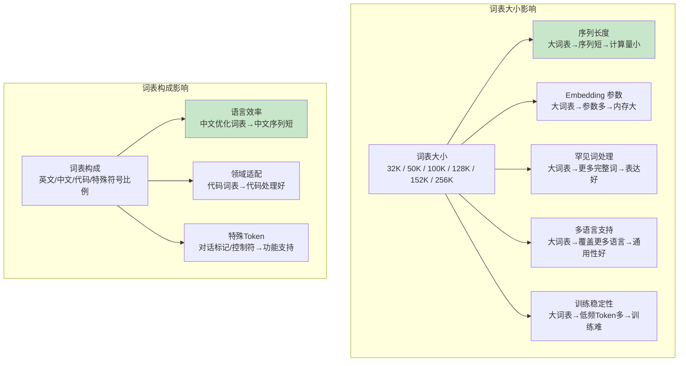

# Tokenization 与词表

> **一句话定义**：Tokenization（分词/标记化）是将原始文本转换为模型可处理的 Token（子词单元）序列的过程，词表（Vocabulary）定义了所有可能的 Token 集合，是 LLM 的输入处理基础，直接影响模型效率、效果和多语言能力。
>
> **核心价值**：将无限的文本空间映射到有限的 Token 集合，使模型能够高效处理文本；合理的 Tokenization 可以减少序列长度（提升效率）、改善罕见词处理（提升效果）、支持多语言（提升通用性）。
>
> **适用场景**：LLM 训练和推理、文本预处理、多语言处理、词表构建、模型效率优化、跨模型兼容性。

---

## 一、概述

### 1.1 Tokenization 在 LLM 中的位置

```mermaid
graph TB
    subgraph 文本处理流程
        A[原始文本<br/>"你好世界"] --> B[Tokenization 分词]
        B --> C[Token 序列<br/>["你", "好", "世", "界"]]
        C --> D[Token ID<br/>[1234, 5678, 9012, 3456]]
        D --> E[Embedding 层<br/>转换为向量]
        E --> F[Transformer 模型]
    end

    Note over B: 词表定义了所有可能的 Token<br/>BPE/SentencePiece/WordPiece
    style B fill:#c8e6c9
```

### 1.2 核心概念

| 概念 | 说明 |
|------|------|
| **Token（标记/词元）** | 模型处理文本的基本单位，不是字也不是词，而是子词（subword）单元 |
| **Tokenization（分词）** | 将原始文本分割为 Token 序列的过程 |
| **词表（Vocabulary）** | 所有可能 Token 的集合，常见大小 32K/50K/100K/128K/256K |
| **Token ID** | 每个 Token 在词表中的唯一整数编号，模型实际输入的是 Token ID |
| **子词（Subword）** | 介于字和词之间的单位，如"unhappiness"→"un"+"happ"+"iness" |
| **BPE（Byte Pair Encoding）** | 字节对编码，最常用的子词分词算法，通过迭代合并高频字符对构建词表 |
| **WordPiece** | Google 提出的分词算法，用于 BERT，基于似然度合并而非频率 |
| **SentencePiece** | Google 开源的分词工具，支持 BPE 和 Unigram，独立于语言（不依赖空格分词） |
| **Unigram** | 基于概率的分词算法，SentencePiece 支持，从大词表开始逐步移除低概率 Token |
| **特殊 Token** | 词表中预留的特殊标记，如 <[BOS_never_used_51bce0c785ca2f68081bfa7d91973934]>、[SEP]、[PAD]、[UNK]、<|im_start|>、<|endoftext|> |
| **1 Token ≈** | 英文约 0.75 个单词 / 4 个字符；中文约 1-2 个字符；代码约 0.5-1 个词 |
| **序列长度** | Token 序列的长度，直接影响计算量（注意力 O(n²)）和显存 |

### 1.3 分词方法对比

| 方法 | 原理 | 优点 | 缺点 | 代表模型 |
|------|------|------|------|---------|
| **词级（Word）** | 按空格和标点分词 | 序列短，效率高 | 词表巨大，罕见词/OOV 问题，无法处理形态变化 | 早期 NLP |
| **字级（Character）** | 按字符分词 | 词表小，无 OOV | 序列很长，效率低，丢失词级信息 | 极少数模型 |
| **子词（Subword）** | 介于字和词之间，高频为词，低频为字 | 平衡词表大小和序列长度，处理罕见词，无 OOV | 分词不直观，需要训练词表 | 大多数 LLM |
| **BPE** | 迭代合并高频字节对 | 简单高效，确定性分词 | 合并基于频率而非语义，可能产生不直观的分割 | GPT-2/3/4、Llama、GPT-Neo |
| **WordPiece** | 基于似然度合并 | 比 BPE 更智能，考虑语言模型概率 | 实现稍复杂 | BERT、DistilBERT |
| **Unigram** | 基于概率，从大词表逐步移除 | 分词更灵活，支持多种分割方式 | 计算量大，非确定性 | T5、ALBERT、SentencePiece |
| **字节级 BPE** | 以字节为基础单位，不依赖编码 | 完全无 OOV，支持所有语言/字符 | 词表可能包含奇怪的字节组合 | GPT-2、RoBERTa、Llama、GPT-4 |


<div style="background:linear-gradient(135deg,#667eea,#764ba2);border-radius:16px;padding:20px;margin:16px 0;font-family:-apple-system,'Segoe UI','PingFang SC','Microsoft YaHei',sans-serif;color:#fff;overflow:hidden;box-shadow:0 8px 28px rgba(0,0,0,.14),0 3px 10px rgba(0,0,0,.08)">
<style>@keyframes pulse{0%,100%{transform:scale(1);opacity:.9}50%{transform:scale(1.03);opacity:1}}.dk-layer{border-radius:8px;padding:12px 16px;margin:6px auto;text-align:center;font-weight:600;animation:pulse 3s ease-in-out infinite}.dk-outer{background:rgba(255,255,255,.15);border:2px solid rgba(255,255,255,.5);max-width:340px;animation-delay:0s}.dk-middle{background:rgba(255,255,255,.2);border:2px solid rgba(255,255,255,.6);max-width:280px;animation-delay:.5s}.dk-inner{background:rgba(255,255,255,.25);border:2px solid rgba(255,255,255,.7);max-width:220px;animation-delay:1s}.dk-arrow{text-align:center;font-size:18px;margin:2px 0}.dk-label{font-size:12px;opacity:.85;font-weight:400;margin-top:4px}</style>
<div style="text-align:center;font-size:15px;font-weight:700;margin-bottom:14px;padding-bottom:10px;border-bottom:1.5px solid rgba(255,255,255,.22);letter-spacing:1px">🔤 Tokenization 分词体系</div>
<div class="dk-layer dk-outer">应用层 · 输入编码/输出解码<div class="dk-label">文本→Token ID序列→模型输入/生成Token→文本</div></div>
<div class="dk-arrow">▼ 包含</div>
<div class="dk-layer dk-middle">算法层 · BPE/WordPiece/Unigram<div class="dk-label">字节对编码/词片/一元语言模型三种主流算法</div></div>
<div class="dk-arrow">▼ 包含</div>
<div class="dk-layer dk-inner">基础层 · 词表/Vocab/特殊Token<div class="dk-label">32K-128K词表/子词单元/BOS-EOS-PAD-UNK</div></div>
</div>
> 🔍 **知识点深度解析**
>
> **作用**：Tokenization 是 LLM 的输入处理基础——将原始文本转换为模型可处理的 Token ID 序列，词表定义了所有可能的 Token 集合。它直接影响模型的效率（序列长度→计算量）、效果（罕见词处理→表达能力）和多语言能力（词表覆盖→语言支持）。
>
> **原理**：Tokenization 的核心思想是"子词分割"——不按词（词表太大、OOV 问题）也不按字（序列太长、效率低），而是按子词分割：高频的完整词作为一个 Token，低频词拆分为更小的子词单元，极罕见词拆分为字符甚至字节。BPE（字节对编码）是最常用的算法：① 初始词表包含所有单个字符（或字节）；② 统计所有相邻字符对的频率；③ 将频率最高的字符对合并为一个新 Token，加入词表；④ 重复②③直到词表达到目标大小。这种方法简单高效，能自动学习语言的形态结构（前缀、后缀、词根）。
>
> **用法要点**：① 不同模型用不同的分词器——GPT 系列用 tiktoken（BPE），Llama 用 SentencePiece（BPE），BERT 用 WordPiece，不能混用 ② 中文分词效率——中文每个字通常是 1-2 个 Token（比英文效率低），选择中文优化的词表（如 Qwen 的 152K 词表）可以提升中文效率 ③ 特殊 Token——不同模型有不同的特殊 Token（结束符、对话标记），推理时必须正确使用 ④ Token 计数——API 按 Token 计费，需要准确计算输入输出的 Token 数 ⑤ 词表大小——大词表（100K+）序列更短效率更高，但 Embedding 层参数更多，小词表（32K）反之 ⑥ 跨模型兼容性——不同模型的分词器不同，同一文本在不同模型中的 Token 序列可能不同，不能直接迁移 ⑦ 流式分词——推理时需要增量分词，处理部分生成的文本

---

> 💡 **深度讲解**：Tokenization 是 LLM 中最容易被忽视但非常重要的环节——它是文本进入模型的第一道关卡，直接影响模型的效率、效果和多语言能力。很多人以为 Tokenization 就是"分词"，但实际上它涉及词表构建、子词算法、特殊 Token 设计、多语言处理等多个方面，对模型性能有显著影响。Tokenization 的核心挑战是"词表大小 vs 序列长度"的权衡——词表越大，每个 Token 包含的信息越多，序列越短，计算效率越高（因为注意力的计算量是 O(n²)，序列长度减半计算量减为 1/4）；但词表越大，Embedding 层和输出层的参数越多（词表大小 × 隐藏维度），模型参数量越大，训练和推理的内存开销越大。例如，词表从 32K 增加到 128K，Embedding 层参数增加 4 倍，但序列长度可能减少 30-50%，总体计算量可能降低。现代 LLM 倾向于用大词表——Llama 3 用 128K 词表，Qwen 2.5 用 152K 词表，GPT-4 用约 100K 词表，因为大词表在效率上的优势超过了参数增加的开销。子词（Subword）分词是现代 LLM 的标准做法——它结合了词级分词（序列短）和字级分词（无 OOV）的优点。核心思想是：高频的完整词作为一个 Token（如"hello"、"world"），低频词拆分为更小的子词单元（如"unhappiness"→"un"+"happ"+"iness"），极罕见词和未知词拆分为字符甚至字节（完全无 OOV）。这种方法能有效处理形态变化丰富的语言（如英语的前缀后缀、德语的复合词）和罕见词（如专业术语、人名）。BPE（Byte Pair Encoding）是最常用的子词分词算法，由 GPT-2 引入 NLP 领域。BPE 的算法非常简单：① 初始词表包含所有单个字节（或字符）；② 在训练语料上统计所有相邻字节对的出现频率；③ 将频率最高的字节对合并为一个新 Token，加入词表；④ 重复②③直到词表达到目标大小（如 50K）。BPE 的优势是简单、高效、确定性（同一文本总是得到相同的分词结果），缺点是合并基于频率而非语义，可能产生不直观的分割（如把"the"拆成"t"+"he"如果"th"频率更高）。字节级 BPE（Byte-level BPE）是 GPT-2 引入的改进——不以字符为初始单位，而以字节（UTF-8 编码的字节）为初始单位。这样做的优势是：① 完全无 OOV——任何 Unicode 字符都可以用字节表示，不需要 UNK 标记；② 支持所有语言和字符——包括生僻字、emoji、特殊符号；③ 词表大小可控——基础词表只有 256 个字节，通过合并达到目标大小。字节级 BPE 是目前大多数 LLM（GPT-2/3/4、Llama、GPT-Neo、Claude）的标准分词方法。SentencePiece 是 Google 开源的分词工具，支持 BPE 和 Unigram 两种算法，特别适合多语言场景。SentencePiece 的一个重要特性是"语言无关"——它不依赖空格分词（把空格也当作普通字符处理），因此可以直接处理中文、日文等不使用空格分词的语言，不需要预先分词。Llama 系列、T5、ALBERT 等模型都使用 SentencePiece。中文分词是 LLM 的一个特殊挑战——中文不使用空格分词，每个汉字的信息量比英文单词大，但传统 BPE 词表（主要在英文上训练）对中文的效率较低（每个中文字通常需要 1-2 个 Token，而英文每个词约 1.3 个 Token）。为了提升中文效率，中文优化的模型通常使用更大的词表（Qwen 2.5 用 152K，包含大量中文词组和常用搭配），或者在中文语料上训练词表。选择中文优化的分词器可以显著提升中文处理效率（序列长度减少 20-40%）。特殊 Token 是词表中预留的特殊标记，用于标记文本的结构和控制模型行为。常见的特殊 Token 包括：① 序列开始/结束（<[BOS_never_used_51bce0c785ca2f68081bfa7d91973934]>、<|endoftext|>、</s>）；② 填充（[PAD]）；③ 未知（[UNK]，字节级 BPE 通常不需要）；④ 分隔（[SEP]）；⑤ 对话标记（<|im_start|>、<|im_end|>、<|start_header_id|>、<|end_header_id|>）；⑥ 其他控制标记（如 <|padding|>、<|fim_prefix|> 用于代码填充）。不同模型有不同的特殊 Token 设计，推理时必须正确使用，否则模型行为会异常。
>
> **📝 精简总结**：Tokenization 将原始文本转换为 Token（子词单元）序列，词表定义所有可能 Token 集合，是 LLM 输入处理基础，直接影响效率（序列长度→计算量O(n²)）、效果（罕见词处理）、多语言能力；核心概念包括 Token（子词单元非字非词）、词表（32K/50K/100K/128K/256K）、Token ID（整数编号）、子词（高频为词低频为字）、BPE（迭代合并高频字节对，最常用）、WordPiece（基于似然度合并，BERT用）、SentencePiece（Google开源支持BPE/Unigram，语言无关，Llama用）、Unigram（基于概率从大词表移除，T5用）、特殊Token（序列开始/结束/填充/对话标记等）、1Token≈0.75英文词/4英文字符/1-2中文字；分词方法对比——词级（序列短但词表大OOV）、字级（词表小无OOV但序列长）、子词（平衡，大多数LLM用）、BPE（简单高效确定性，GPT/Llama用）、WordPiece（更智能考虑概率，BERT用）、Unigram（灵活非确定性，T5用）、字节级BPE（完全无OOV支持所有语言，GPT-2/Llama/GPT-4用）；核心原理是子词分割+词表大小与序列长度的权衡（大词表序列短效率高但Embedding参数多，现代LLM倾向大词表128K+）；用法要点包括不同模型用不同分词器不能混用、中文选优化词表提升效率、特殊Token正确使用、Token计数（API计费）、词表大小选择、跨模型不兼容、流式增量分词。

---

## 二、原理

### 2.1 BPE 算法原理

```mermaid
graph TB
    subgraph BPE 训练过程
        A[初始词表<br/>所有单个字节/字符<br/>a,b,c,d,...] --> B[统计相邻对频率<br/>"ab":100, "th":80, ...]
        B --> C[合并最高频对<br/>"ab" → 新Token "ab"]
        C --> D[更新词表<br/>加入 "ab"]
        D --> B
        B --> E{词表达到<br/>目标大小?}
        E -->|否| C
        E -->|是| F[最终词表<br/>如 50K Token]
    end

    subgraph BPE 分词过程
        G[输入文本<br/>"unhappiness"] --> H[按字符分割<br/>u n h a p p i n e s s]
        H --> I[应用合并规则<br/>un + happ + iness]
        I --> J[Token 序列<br/>["un", "happ", "iness"]]
    end

    style F fill:#c8e6c9
    style J fill:#c8e6c9
```

**BPE 算法步骤**：

1. **初始化**：词表包含所有单个字符（或字节），加上特殊 Token
2. **统计频率**：在训练语料上统计所有相邻字符对（bigram）的出现频率
3. **合并最高频对**：将频率最高的字符对合并为一个新 Token，加入词表
4. **重复**：重复步骤 2-3，直到词表达到目标大小（如 50K）
5. **分词**：对新文本，先按字符分割，然后按训练时学到的合并规则，从高频到低频依次合并

**BPE 的关键特性**：
- **确定性**：同一文本总是得到相同的分词结果（合并规则固定）
- **贪心算法**：每次合并频率最高的对，不考虑全局最优
- **无 OOV**：字节级 BPE 完全没有未知词（任何字符都可以用字节表示）
- **语言无关**：可以处理任何语言，不需要预先分词

### 2.2 字节级 BPE（GPT-2/Llama/GPT-4）

字节级 BPE 以 UTF-8 字节为初始单位，而非字符：

```mermaid
graph LR
    subgraph 字符级 BPE
        A1["你好"] --> B1["你", "好"] --> C1[2 Token]
    end
    subgraph 字节级 BPE
        A2["你好"] --> B2["E4 BD A0", "E5 A5 BD"] --> C2[6 字节]
        C2 --> D2[合并高频字节对<br/>可能合并为 2-4 Token]
    end

    Note over B2: UTF-8 编码：你=E4 BD A0，好=E5 A5 BD
    Note over D2: 大词表中常见中文搭配可能合并为完整词
```

**字节级 BPE 的优势**：
1. **完全无 OOV**：任何 Unicode 字符（包括生僻字、emoji、特殊符号）都可以用字节表示
2. **支持所有语言**：不需要为每种语言设计特殊处理
3. **词表大小可控**：基础词表只有 256 个字节，通过合并达到目标大小
4. **一致性**：不需要处理 Unicode 规范化、大小写等问题

**tiktoken（OpenAI 开源）**：
- OpenAI 开源的 BPE 分词库，用于 GPT-3.5/GPT-4
- 用 Rust 实现，速度极快
- 支持多种编码（cl100k_base、o200k_base 等）
- 可以准确计算 Token 数（API 计费）

### 2.3 SentencePiece（Llama/T5）

SentencePiece 是 Google 开源的分词工具，核心特性是"语言无关"：

```mermaid
graph TB
    subgraph SentencePiece 特性
        S1[语言无关<br/>不依赖空格分词<br/>空格也当作普通字符] --> S[SentencePiece]
        S2[支持 BPE 和 Unigram<br/>两种分词算法] --> S
        S3[直接处理原始文本<br/>不需要预先分词<br/>适合中日文] --> S
        S4[训练和推理一致<br/>确定性分词] --> S
    end

    subgraph 与传统分词对比
        T1[传统: "hello world" → "hello", "world"<br/>按空格分词]
        T2[SentencePiece: "hello world" → "▁hello", "▁world"<br/>空格用 ▁ 标记，作为 Token 的一部分]
    end

    style S fill:#c8e6c9
```

**SentencePiece 的关键设计**：
1. **空格作为字符**：把空格（space）也当作普通字符，用特殊符号 ▁ 表示，因此不需要依赖空格分词
2. **直接输入原始文本**：可以直接输入中文、日文等不使用空格的文本，不需要预先分词
3. **支持 BPE 和 Unigram**：可以选择两种算法，BPE 更常用，Unigram 更灵活
4. **训练和推理一致**：训练词表和推理分词使用相同的算法，保证一致性

**Llama 系列使用 SentencePiece**：
- Llama 1/2/3 都使用 SentencePiece（BPE 模式）
- Llama 3 词表 128K（比 Llama 2 的 32K 大很多，提升多语言和代码效率）
- 特殊 Token：<|begin_of_text|>、<|end_of_text|>、<|start_header_id|>、<|end_header_id|>、<|eot_id|>

### 2.4 词表设计对模型的影响



| 词表大小 | 代表模型 | 序列长度（相对） | Embedding 参数（7B模型） | 适用场景 |
|---------|---------|----------------|------------------------|---------|
| **32K** | Llama 2、BERT | 100%（基准） | 32K×4096×2 ≈ 268M | 英文为主，资源受限 |
| **50K** | GPT-2、GPT-3 | 85-90% | 50K×4096×2 ≈ 410M | 通用英文 |
| **100K** | GPT-4（估计）、Claude | 70-80% | 100K×4096×2 ≈ 819M | 通用多语言 |
| **128K** | Llama 3 | 65-75% | 128K×4096×2 ≈ 1.05B | 多语言+代码 |
| **152K** | Qwen 2.5 | 60-70%（中文更短） | 152K×4096×2 ≈ 1.25B | 中文优化+多语言 |
| **256K** | 部分大模型 | 55-65% | 256K×4096×2 ≈ 2.1B | 极致效率，超大模型 |

---

> 💡 **深度讲解**：BPE（Byte Pair Encoding）的原理非常简洁——它本质上是一个数据压缩算法，通过迭代合并高频的相邻单元来减少序列长度。在 NLP 中，BPE 的初始单元是字符（或字节），然后在训练语料上统计所有相邻字符对的频率，将频率最高的合并为一个新单元，重复这个过程直到词表达到目标大小。这个算法的精妙之处在于：它不需要任何语言学知识，完全数据驱动，能自动发现语言中的高频模式（常见词、前缀、后缀、词根等）。例如，在英文语料上，BPE 会先合并"th"（频率最高），然后是"he"、"in"、"er"等，最终合并出"the"、"and"、"ing"等常见词和词缀。在中文语料上，BPE 会合并常见的中文词组（如"我们"、"你好"、"什么"）。BPE 的分词过程是训练的逆过程——先将文本按字符分割，然后按训练时学到的合并规则（从高频到低频）依次合并，直到不能再合并。这个过程是确定性的（同一文本总是得到相同结果），且非常高效（可以用缓存加速）。字节级 BPE（Byte-level BPE）是 GPT-2 引入的重要改进——它不以字符为初始单位，而以 UTF-8 编码的字节为初始单位。这样做的原因是：字符级 BPE 面临 OOV（Out-of-Vocabulary）问题——如果文本中包含词表中没有的字符（如生僻字、emoji、特殊符号），就需要 UNK 标记，丢失信息。而字节级 BPE 的初始词表只有 256 个字节（所有可能的 UTF-8 字节），任何 Unicode 字符都可以用字节序列表示，因此完全没有 OOV 问题。例如，中文"你"的 UTF-8 编码是 E4 BD A0（3 个字节），即使"你"不在词表中，也可以用这 3 个字节 Token 表示。字节级 BPE 是目前绝大多数 LLM（GPT-2/3/4、Llama、GPT-Neo、Claude、Mistral）的标准分词方法。SentencePiece 是 Google 开源的分词工具，它的核心创新是"语言无关"设计——传统分词器（如 BERT 的 WordPiece）依赖空格分词（先按空格把文本分成词，再对每个词做子词分割），这对于中文、日文等不使用空格分词的语言需要额外的预处理（先分词再子词分割）。SentencePiece 把空格也当作普通字符处理（用特殊符号 ▁ 表示空格），因此可以直接输入原始文本，不需要预先分词，非常适合多语言场景。SentencePiece 支持 BPE 和 Unigram 两种算法——BPE 是确定性的贪心合并，Unigram 是基于概率的（从大词表开始，逐步移除低概率 Token，分词时选择概率最高的分割方式）。Llama 系列、T5、ALBERT 等模型都使用 SentencePiece。词表设计是模型架构的重要决策——词表大小和构成直接影响模型的效率、效果和多语言能力。大词表的优势是序列更短（计算量 O(n²)，序列减半计算量减为 1/4）、罕见词处理更好（更多完整词）、多语言支持更好（覆盖更多语言的字符和词组）；劣势是 Embedding 层和输出层参数更多（词表大小 × 隐藏维度 × 2，因为输入 Embedding 和输出 LM Head 通常共享或各一份）、低频 Token 多导致训练不稳定（低频 Token 的梯度噪声大）。现代 LLM 倾向于用大词表——Llama 3 从 Llama 2 的 32K 增加到 128K，Qwen 2.5 用 152K（中文优化），因为大词表在效率上的优势超过了参数增加的开销，特别是对于长上下文和多语言场景。词表构成也很重要——中文优化的词表（如 Qwen）包含大量中文词组和常用搭配，可以显著缩短中文序列（比英文词表短 20-40%）；代码优化的词表包含更多代码关键字和常用模式，提升代码处理效率；特殊 Token 的设计（对话标记、控制符）影响模型的功能支持。跨模型的分词器不兼容是一个实际问题——不同模型用不同的分词器（GPT 用 tiktoken，Llama 用 SentencePiece，BERT 用 WordPiece），同一文本在不同模型中的 Token 序列可能不同，因此不能直接迁移 Token ID 或序列长度。在多模型场景中，需要为每个模型单独分词。
>
> **📝 精简总结**：BPE算法原理——初始化（所有单个字节/字符+特殊Token）→统计相邻对频率→合并最高频对为新Token→重复直到词表达目标大小→分词时按字符分割再按合并规则从高频到低频合并；关键特性是确定性（同文本同结果）、贪心算法（每次合并最高频）、无OOV（字节级）、语言无关；字节级BPE（GPT-2/Llama/GPT-4）以UTF-8字节为初始单位（256个基础字节），完全无OOV支持所有语言和字符（生僻字/emoji/特殊符号），词表大小可控，不需要Unicode处理；tiktoken是OpenAI开源Rust实现的BPE库，速度快，支持cl100k_base/o200k_base编码，准确计算Token数；SentencePiece（Llama/T5）是Google开源分词工具，语言无关（空格当作普通字符用▁标记，不依赖空格分词），支持BPE和Unigram两种算法，直接处理原始文本适合中日文，训练推理一致；Llama 3用SentencePiece 128K词表（比Llama2 32K大很多提升多语言和代码效率），特殊Token包括<|begin_of_text|>/<|end_of_text|>/<|start_header_id|>/<|end_header_id|>/<|eot_id|>；词表设计影响——大词表（128K+）序列短计算量小（O(n²)序列减半计算量1/4）、罕见词处理好、多语言支持好，但Embedding参数多（词表×隐藏维度×2）、低频Token多训练不稳定；小词表（32K）反之；现代LLM倾向大词表（Llama3 128K/Qwen2.5 152K）因为效率优势超过参数开销；词表构成影响语言效率（中文优化词表中文序列短20-40%）、领域适配（代码词表）、特殊Token功能；词表大小对比——32K（Llama2/BERT，英文为主资源受限）、50K（GPT-2/3，通用英文）、100K（GPT-4/Claude估计，通用多语言）、128K（Llama3，多语言+代码）、152K（Qwen2.5，中文优化+多语言）、256K（极致效率超大模型）；跨模型分词器不兼容（GPT用tiktoken/Llama用SentencePiece/BERT用WordPiece），同一文本Token序列可能不同，不能直接迁移，多模型场景需为每个模型单独分词。

---

## 三、实操

### 3.1 使用 tiktoken（GPT 系列分词器）

```python
# pip install tiktoken
import tiktoken

# 1. 加载分词器
# GPT-3.5/GPT-4 用 cl100k_base
# GPT-4o 用 o200k_base
enc = tiktoken.get_encoding("cl100k_base")
# 或按模型名自动选择
enc = tiktoken.encoding_for_model("gpt-4o")

# 2. 编码（文本 → Token ID）
text = "你好，世界！Hello, World!"
token_ids = enc.encode(text)
print(f"文本: {text}")
print(f"Token IDs: {token_ids}")
print(f"Token 数量: {len(token_ids)}")

# 3. 解码（Token ID → 文本）
decoded_text = enc.decode(token_ids)
print(f"解码后: {decoded_text}")

# 4. 查看单个 Token
tokens = [enc.decode([t]) for t in token_ids]
print(f"单个 Token: {tokens}")

# 5. 计算 API 成本
def calculate_api_cost(text: str, model: str = "gpt-4o") -> dict:
    """计算文本的 Token 数和 API 成本"""
    enc = tiktoken.encoding_for_model(model)
    token_count = len(enc.encode(text))

    # 价格表（每 1000 Token，美元，2024年参考）
    pricing = {
        "gpt-4o": {"input": 0.005, "output": 0.015},
        "gpt-4o-mini": {"input": 0.00015, "output": 0.0006},
        "gpt-3.5-turbo": {"input": 0.0005, "output": 0.0015},
    }

    if model in pricing:
        input_cost = (token_count / 1000) * pricing[model]["input"]
        return {
            "token_count": token_count,
            "input_cost": f"${input_cost:.6f}",
            "model": model
        }
    return {"token_count": token_count, "model": model}

# 示例
print(calculate_api_cost("你好，世界！" * 100, "gpt-4o"))

# 6. 批量编码
texts = ["文本1", "文本2", "文本3"]
batch_ids = enc.encode_batch(texts)
for i, ids in enumerate(batch_ids):
    print(f"文本{i+1}: {len(ids)} tokens")

# 7. 特殊 Token
# tiktoken 可以处理特殊 Token
special_tokens = enc.encode("<|endoftext|>", allowed_special="all")
print(f"endoftext Token ID: {special_tokens}")
```

### 3.2 使用 HuggingFace Tokenizers

```python
# pip install transformers
from transformers import AutoTokenizer

# 1. 加载分词器（自动选择对应模型的分词器）
model_name = "Qwen/Qwen2.5-7B-Instruct"
tokenizer = AutoTokenizer.from_pretrained(model_name)

# 2. 基本编码
text = "你好，世界！"
encoding = tokenizer(text, return_tensors="pt")
print(f"input_ids: {encoding['input_ids']}")
print(f"attention_mask: {encoding['attention_mask']}")
print(f"Token 数量: {len(encoding['input_ids'][0])}")

# 3. 查看 Token
tokens = tokenizer.tokenize(text)
print(f"Tokens: {tokens}")
print(f"Token 数量: {len(tokens)}")

# 4. 批量编码
texts = ["文本1", "文本2", "文本3"]
batch_encoding = tokenizer(
    texts,
    padding=True,        # 填充到最长
    truncation=True,     # 截断到 max_length
    max_length=512,
    return_tensors="pt"
)
print(f"批量编码 shape: {batch_encoding['input_ids'].shape}")

# 5. 对话模板（Chat Template）
messages = [
    {"role": "system", "content": "你是一个 helpful 的助手"},
    {"role": "user", "content": "你好"},
    {"role": "assistant", "content": "你好！有什么可以帮助你的？"},
    {"role": "user", "content": "什么是大语言模型？"},
]

# 应用对话模板
formatted_text = tokenizer.apply_chat_template(
    messages,
    tokenize=False,           # False 返回文本，True 返回 Token ID
    add_generation_prompt=True  # 添加生成提示（assistant 开始标记）
)
print(f"对话模板文本:\n{formatted_text}")

# 编码对话
chat_encoding = tokenizer.apply_chat_template(
    messages,
    tokenize=True,
    add_generation_prompt=True,
    return_tensors="pt"
)
print(f"对话 Token 数量: {chat_encoding.shape[1]}")

# 6. 解码
decoded = tokenizer.decode(encoding['input_ids'][0], skip_special_tokens=True)
print(f"解码后: {decoded}")

# 7. 查看词表信息
print(f"词表大小: {tokenizer.vocab_size}")
print(f"特殊 Token: {tokenizer.special_tokens_map}")
print(f"pad_token: {tokenizer.pad_token}")
print(f"eos_token: {tokenizer.eos_token}")
print(f"bos_token: {tokenizer.bos_token}")

# 8. 保存和加载分词器
tokenizer.save_pretrained("./my-tokenizer")
loaded_tokenizer = AutoTokenizer.from_pretrained("./my-tokenizer")
```

### 3.3 使用 SentencePiece（Llama 系列）

```python
# pip install sentencepiece
import sentencepiece as spm

# 方法1：使用 HuggingFace 的 Llama 分词器（推荐，更简单）
from transformers import AutoTokenizer
llama_tokenizer = AutoTokenizer.from_pretrained("meta-llama/Meta-Llama-3-8B-Instruct")

text = "你好，世界！Hello, World!"
tokens = llama_tokenizer.tokenize(text)
print(f"Llama Tokens: {tokens}")
print(f"Token 数量: {len(tokens)}")

# 方法2：直接使用 SentencePiece（需要 .model 文件）
# sp = spm.SentencePieceProcessor()
# sp.Load("tokenizer.model")
#
# # 编码
# ids = sp.Encode("你好，世界！")
# print(f"IDs: {ids}")
#
# # 解码
# decoded = sp.Decode(ids)
# print(f"解码: {decoded}")
#
# # 查看 Token
# pieces = sp.EncodeAsPieces("你好，世界！")
# print(f"Pieces: {pieces}")

# 训练自己的 SentencePiece 分词器
# spm.SentencePieceTrainer.Train(
#     input="training_corpus.txt",
#     model_prefix="my_tokenizer",
#     vocab_size=32000,
#     model_type="bpe",  # bpe 或 unigram
#     character_coverage=0.9995,  # 字符覆盖率
# )
```

### 3.4 训练自定义 BPE 分词器

```python
# 使用 HuggingFace Tokenizers 库训练自定义分词器
# pip install tokenizers
from tokenizers import Tokenizer
from tokenizers.models import BPE
from tokenizers.trainers import BpeTrainer
from tokenizers.pre_tokenizers import ByteLevel
from tokenizers.decoders import ByteLevel as ByteLevelDecoder
from tokenizers.processors import TemplateProcessing

# 1. 创建 BPE 分词器（字节级）
tokenizer = Tokenizer(BPE(unk_token="<|unk|>"))
tokenizer.pre_tokenizer = ByteLevel(add_prefix_space=True)
tokenizer.decoder = ByteLevelDecoder()

# 2. 配置训练器
trainer = BpeTrainer(
    vocab_size=50000,               # 词表大小
    special_tokens=[
        "<|endoftext|>",
        "<|padding|>",
        "<|unk|>",
        "<|im_start|>",
        "<|im_end|>",
    ],
    initial_alphabet=ByteLevel.alphabet(),  # 字节级初始字母表
    min_frequency=2,               # 最小频率
    show_progress=True,
)

# 3. 训练（需要训练语料文件）
# tokenizer.train(files=["training_corpus.txt"], trainer=trainer)

# 4. 添加后处理（模板）
# tokenizer.post_processor = TemplateProcessing(
#     single="<|endoftext|> $A <|endoftext|>",
#     pair="<|endoftext|> $A <|endoftext|> $B:1 <|endoftext|>:1",
#     special_tokens=[("<|endoftext|>", 0)],
# )

# 5. 保存
# tokenizer.save("my_bpe_tokenizer.json")

# 6. 加载和使用
# loaded_tokenizer = Tokenizer.from_file("my_bpe_tokenizer.json")
# output = loaded_tokenizer.encode("你好，世界！")
# print(f"IDs: {output.ids}")
# print(f"Tokens: {output.tokens}")

# 使用 HuggingFace 包装器（与 transformers 兼容）
# from tokenizers.implementations import ByteLevelBPETokenizer
# from tokenizers.processors import BertProcessing
#
# # 训练
# tokenizer = ByteLevelBPETokenizer()
# tokenizer.train(
#     files=["training_corpus.txt"],
#     vocab_size=50000,
#     min_frequency=2,
#     special_tokens=["<|endoftext|>", "<|padding|>"],
# )
# tokenizer.save_model("./my-tokenizer")
```

### 3.5 Token 计数与成本优化

```python
import tiktoken

# 不同模型的 Token 效率对比
def compare_token_efficiency(texts: list):
    """比较不同分词器的 Token 效率"""
    encoders = {
        "GPT-4o (o200k_base)": tiktoken.get_encoding("o200k_base"),
        "GPT-3.5 (cl100k_base)": tiktoken.get_encoding("cl100k_base"),
    }

    results = {}
    for name, enc in encoders.items():
        total_tokens = sum(len(enc.encode(text)) for text in texts)
        results[name] = total_tokens

    print("Token 效率对比:")
    for name, count in results.items():
        print(f"  {name}: {count} tokens")

    return results

# 中文文本的 Token 效率
chinese_texts = [
    "你好，世界！",
    "大语言模型是人工智能的重要突破。",
    "深度学习使用神经网络模型进行训练。",
    "今天天气真好，适合出去散步。",
]
compare_token_efficiency(chinese_texts)

# 优化 Prompt 长度的技巧
prompt_optimization = {
    "精简指令": "去除冗余的修饰词，保留核心指令",
    "紧凑示例": "Few-shot 示例用最简洁的格式",
    "避免重复": "不要在 Prompt 中重复相同信息",
    "用缩写": "在不影响理解的前提下使用缩写",
    "批量处理": "多个任务合并到一个 Prompt 中",
    "缓存": "重复查询缓存结果，避免重复 Token",
    "选择模型": "选择词表大、Token 效率高的模型",
    "截断历史": "多轮对话只保留最近 N 轮，早期对话摘要",
}

# 计算多轮对话的 Token 数
def count_chat_tokens(messages: list, model: str = "gpt-4o") -> int:
    """计算多轮对话的总 Token 数（近似）"""
    enc = tiktoken.encoding_for_model(model)
    total = 0
    for msg in messages:
        # 每个消息有额外的格式 Token（角色标记等）
        total += 4  # 每条消息的固定开销（近似）
        total += len(enc.encode(msg["content"]))
        total += len(enc.encode(msg["role"]))
    total += 3  # 系统级开销
    return total

# 示例对话
messages = [
    {"role": "system", "content": "你是一个 helpful 的助手"},
    {"role": "user", "content": "什么是大语言模型？"},
    {"role": "assistant", "content": "大语言模型是..."},
    {"role": "user", "content": "它有什么应用？"},
]
print(f"对话 Token 数（近似）: {count_chat_tokens(messages)}")
```

---

> 💡 **深度讲解**：Tokenization 的实操核心是"正确使用分词器 + 优化 Token 效率"。不同模型使用不同的分词器，这是最容易踩坑的地方——GPT 系列用 tiktoken（BPE，cl100k_base/o200k_base 编码），Llama 系列用 SentencePiece（BPE），BERT 用 WordPiece，Qwen 用自定义的 BPE（基于 tiktoken 格式）。这些分词器的词表、算法、特殊 Token 都不同，同一文本在不同分词器中的 Token 序列和数量可能差异很大（特别是中文和代码）。因此，使用模型时必须用该模型对应的分词器，不能混用——用 GPT 的分词器处理 Llama 的输入会导致 Token ID 不匹配，模型无法理解。tiktoken 是 OpenAI 开源的 BPE 分词库，用 Rust 实现，速度极快，是 GPT-3.5/GPT-4/GPT-4o 的官方分词器。tiktoken 的核心功能包括：① encode（文本→Token ID）；② decode（Token ID→文本）；③ encode_batch（批量编码）；④ 按模型名自动选择分词器（encoding_for_model）。tiktoken 对于 API 计费非常重要——OpenAI API 按 Token 计费，需要准确计算输入和输出的 Token 数，tiktoken 可以准确计算（与 API 端的分词器完全一致）。HuggingFace Tokenizers 是更通用的分词库，支持 BPE、WordPiece、Unigram、SentencePiece 等多种算法，与 transformers 库深度集成。AutoTokenizer.from_pretrained(model_name) 可以自动加载对应模型的分词器，不需要关心具体算法。HuggingFace 分词器的核心功能包括：① __call__（编码，返回 input_ids/attention_mask）；② tokenize（文本→Token 列表）；③ decode（Token ID→文本）；④ apply_chat_template（应用对话模板，将 messages 格式转为模型期望的文本格式）；⑤ save_pretrained/from_pretrained（保存/加载）。apply_chat_template 是一个非常重要的功能——不同模型有不同的对话模板（Llama 3 用 <|start_header_id|>，ChatML 用 <|im_start|>，Qwen 用 <|im_start|>），手动拼接容易出错，apply_chat_template 会自动应用模型对应的模板，确保格式正确。训练自定义分词器在某些场景下是必要的——例如，领域专用模型（医疗/法律/代码）可能需要在领域语料上训练分词器，以提升领域术语的处理效率；多语言模型可能需要更大的词表来覆盖更多语言；特定应用可能需要特殊 Token。训练自定义 BPE 分词器可以用 HuggingFace Tokenizers 库——创建 BPE 模型、配置 ByteLevel 预分词器、设置词表大小和特殊 Token、在训练语料上训练、保存为 JSON 文件。训练分词器需要大量的训练语料（通常数百万到数亿字符），且词表大小需要根据场景选择（太大导致低频 Token 多，太小导致序列长）。Token 效率优化是实际应用中的重要课题——API 按 Token 计费，序列长度直接影响成本和延迟。优化技巧包括：① 精简 Prompt（去除冗余、保留核心）；② 紧凑的 Few-shot 示例；③ 避免重复信息；④ 多轮对话管理（只保留最近 N 轮，早期对话摘要）；⑤ 缓存重复查询；⑥ 选择 Token 效率高的模型（大词表模型通常 Token 效率更高，特别是中文）；⑦ 批量处理（多个任务合并到一个 Prompt，减少系统级 Token 开销）。中文的 Token 效率是一个特殊问题——传统 BPE 词表（主要在英文上训练）对中文的效率较低，每个中文字通常需要 1-2 个 Token（而英文每个词约 1.3 个 Token，每个字节约 0.25 个 Token）。中文优化的模型（如 Qwen 2.5 的 152K 词表，包含大量中文词组和常用搭配）可以显著提升中文效率（比通用词表短 20-40%）。在中文场景中，选择中文优化的分词器和模型可以显著降低成本和提升效率。
>
> **📝 精简总结**：tiktoken（GPT系列）——tiktoken.get_encoding("cl100k_base"/"o200k_base")或encoding_for_model("gpt-4o")，encode文本→Token ID，decode Token ID→文本，tokenize查看单个Token，encode_batch批量，allowed_special处理特殊Token；Rust实现速度极快，准确计算Token数用于API计费；calculate_api_cost函数计算token_count和输入成本；HuggingFace Tokenizers——AutoTokenizer.from_pretrained(model_name)自动加载对应分词器，__call__编码返回input_ids/attention_mask，tokenize文本→Token列表，decode解码，批量编码（padding=True/truncation=True/max_length/return_tensors），apply_chat_template应用对话模板（messages→模型期望格式，tokenize=False/True，add_generation_prompt），vocab_size/special_tokens_map/pad_token/eos_token/bos_token查看词表信息，save_pretrained/from_pretrained保存加载；SentencePiece（Llama系列）——推荐用HuggingFace AutoTokenizer加载Llama分词器（更简单），或直接用sentencepiece库（需要.model文件，Encode/Decode/EncodeAsPieces），训练自定义分词器用SentencePieceTrainer.Train（input/model_prefix/vocab_size/model_type=bpe或unigram/character_coverage）；训练自定义BPE——用tokenizers库，创建Tokenizer(BPE)+ByteLevel预分词器+ByteLevelDecoder，BpeTrainer配置vocab_size/special_tokens/initial_alphabet/min_frequency，tokenizer.train(files, trainer)，TemplateProcessing后处理，tokenizer.save保存JSON，ByteLevelBPETokenizer简化接口；Token计数与成本优化——compare_token_efficiency比较不同分词器，count_chat_tokens计算多轮对话Token数（每条消息4固定开销+内容+角色），优化技巧包括精简指令/紧凑示例/避免重复/缩写/批量处理/缓存/选择大词表模型/截断历史摘要；实操核心是正确使用对应模型的分词器（不能混用，GPT用tiktoken/Llama用SentencePiece/BERT用WordPiece/Qwen自定义BPE）+优化Token效率（精简Prompt/对话管理/缓存/选中文优化模型），中文场景选Qwen等中文优化词表可缩短20-40%。

---

## 四、问题

### 4.1 常见错误与排查

| 问题 | 原因 | 解决方案 |
|------|------|---------|
| **分词器不匹配** | 用 A 模型的分词器处理 B 模型的输入 | 确保用对应模型的分词器，AutoTokenizer.from_pretrained(model_name) |
| **Token 计数不准确** | 用错误的分词器计算 / 未计算特殊 Token / 未计算对话模板开销 | 用模型对应的分词器，用 apply_chat_template 后再计数，考虑系统级开销 |
| **中文 Token 效率低** | 用英文优化的词表 / 词表太小 | 用中文优化的模型（Qwen 152K词表），大词表模型 |
| **特殊 Token 处理错误** | 手动拼接对话模板 / 未正确添加结束符 / 角色标记错误 | 用 apply_chat_template 自动应用模板，确认 eos_token/pad_token 正确 |
| **OOV（未知词）** | 用字级/词级分词器 / 词表覆盖不足 | 用字节级 BPE（完全无 OOV），大词表，SentencePiece |
| **分词结果不确定** | 用 Unigram 算法（非确定性）/ 随机种子 | 用 BPE（确定性），固定随机种子，理解 Unigram 的概率分词 |
| **序列长度超出限制** | 文本太长 / 未截断 / 未设置 max_length | 设置 truncation=True 和 max_length，长文本分段，用长上下文模型 |
| **padding 不正确** | 未设置 padding / pad_token 为 None / 左右 padding 错误 | 设置 padding=True/longest/max_length，设置 pad_token=eos_token，确认 attention_mask |
| **训练分词器失败** | 训练语料太小 / 词表大小设置不当 / 特殊 Token 冲突 | 增大训练语料（百万+字符），调整词表大小，检查特殊 Token 不冲突 |
| **跨模型迁移失败** | 直接迁移 Token ID / 假设分词器相同 | 为每个模型单独分词，不要迁移 Token ID，用文本作为中间格式迁移 |
| **流式分词错误** | 增量分词时边界处理错误 / 部分 Token 未完成 | 用分词器的增量分词功能，处理部分生成的文本，注意多字节字符的边界 |
| **代码分词效率低** | 词表缺少代码关键字和模式 / 未用代码优化分词器 | 用代码优化的模型（CodeLlama、Qwen-Coder），大词表包含代码模式 |
| **多语言分词不一致** | 不同语言的分词效率差异大 / 词表偏向特定语言 | 用多语言优化的模型（Llama 3 128K、Qwen 152K），评估各语言效率 |
| **API 计费争议** | 自算 Token 数与 API 计费不一致 | 用官方分词器（tiktoken）准确计算，考虑消息格式和特殊 Token 的开销 |

### 4.2 性能优化策略

| 优化点 | 策略 | 预期效果 |
|--------|------|---------|
| **分词速度** | 用 tiktoken（Rust实现）/ HuggingFace Tokenizers（Rust实现）/ 批量编码 / 缓存 | 分词速度提升 10-100 倍 |
| **Token 效率** | 大词表模型 / 中文优化词表 / 精简 Prompt / 紧凑格式 / 避免重复 | 序列长度减少 20-50%，成本降低 |
| **内存优化** | 懒加载分词器 / 共享分词器实例 / 不需要时卸载 / 用小词表 | 内存占用减少 30-70% |
| **批量处理** | encode_batch / 批量编码 / 动态 padding（到 batch 内最长） | 吞吐量提升 2-10 倍 |
| **缓存** | 缓存常见文本的 Token 序列 / 缓存对话模板结果 / LRU 缓存 | 重复文本分词延迟降低 90%+ |
| **流式处理** | 增量分词 / 流式编码 / 边生成边分词 | 降低首 token 延迟，适合流式输出 |
| **模型选择** | 选择 Token 效率高的模型（大词表、中文优化）/ 匹配场景的模型 | 成本降低 20-50%，效果提升 |
| **训练优化** | 用大规模语料训练分词器 / 优化词表大小 / 领域自适应训练 | 分词质量提升，领域效率提升 |
| **多语言优化** | 用多语言词表 / 分别评估各语言 / 语言特定优化 | 多语言效率均衡，避免某些语言效率极低 |
| **特殊 Token 优化** | 合理设计特殊 Token / 避免过多特殊 Token / 复用特殊 Token | 减少无效 Token，提升有效信息密度 |
| **量化压缩** | 词表剪枝（移除低频 Token）/ 词表蒸馏 / 共享 Embedding | 词表减小 30-50%，参数减少 |
| **硬件加速** | GPU 分词（部分库支持）/ SIMD 优化 / 多线程批量 | 分词速度提升 2-5 倍 |

### 4.3 安全风险与防护

| 风险 | 说明 | 防护措施 |
|------|------|---------|
| **Token 注入** | 恶意文本包含特殊 Token，操纵模型行为 | 输入过滤、特殊 Token 转义、指令隔离、输出审核 |
| **隐私泄露** | 分词器训练语料包含敏感信息，词表可能泄露 | 训练数据脱敏、隐私过滤、词表审计、合规审查 |
| **拒绝服务** | 恶意构造长文本或特殊字符，导致分词器崩溃或极慢 | 输入长度限制、超时控制、速率限制、异常字符过滤 |
| **词表投毒** | 恶意修改词表或分词器，导致模型行为异常 | 分词器来源验证、完整性校验、签名、访问控制 |
| **偏见放大** | 分词器在某些语言/群体上效率低，导致模型表现差异 | 多语言评估、公平性测试、词表平衡、去偏训练 |
| **知识产权** | 分词器训练语料可能包含受版权保护的内容 | 训练数据版权审查、合理使用评估、来源标注 |
| **供应链安全** | 依赖第三方分词器库可能有安全漏洞 | 供应商审查、版本锁定、安全扫描、漏洞监控 |
| **合规风险** | 分词处理可能涉及数据跨境、个人信息保护等合规问题 | 合规评估、数据本地化、用户同意、审计日志 |

### 4.4 生产环境踩坑记录

**踩坑1：用 GPT 分词器计算 Llama 的 Token 数导致成本估算错误**
- **现象**：用 tiktoken（GPT 的分词器）计算输入文本的 Token 数来估算 Llama API 的成本，实际计费比估算高了 30%
- **原因**：① 不同模型的分词器不同——GPT 用 cl100k_base（100K 词表），Llama 2 用 32K 词表的 SentencePiece，同一文本在 Llama 中的 Token 数比 GPT 多（特别是中文和代码）；② 对话模板不同——GPT 的 ChatML 模板和 Llama 的模板格式不同，特殊 Token 的数量和类型不同；③ 没有考虑消息格式的开销——每条消息有角色标记、开始/结束标记等额外 Token
- **方案**：① 用对应模型的分词器计算 Token 数——GPT 用 tiktoken，Llama 用 SentencePiece（HuggingFace AutoTokenizer），Qwen 用对应分词器；② 用 apply_chat_template 将 messages 转为模型期望的文本格式后再计数，确保包含所有特殊 Token 和格式开销；③ 考虑每条消息的固定开销（角色标记、开始/结束标记，通常 3-5 个 Token/消息）；④ 成本估算时留 10-20% 的余量，因为实际计费可能包含额外的处理 Token；⑤ 用 API 返回的 usage 字段（prompt_tokens/completion_tokens/total_tokens）作为实际计费依据，自算 Token 数仅用于估算

**踩坑2：中文场景用 Llama 2（32K 词表）导致 Token 效率极低，成本超预算**
- **现象**：用 Llama 2 7B 处理中文客服对话，发现中文输入的 Token 数是英文的 2-3 倍，API/推理成本远超预算，且长中文对话频繁超出上下文窗口
- **原因**：① Llama 2 的 32K 词表主要在英文上训练，对中文的覆盖不足——每个中文字通常需要 1-2 个 Token（而中文每个字的信息量比英文单词大），导致中文序列比英文长很多；② 词表中缺少中文常用词组和搭配，无法将常见中文短语合并为一个 Token；③ 没有选择中文优化的模型和分词器
- **方案**：① 换用中文优化的模型——Qwen 2.5（152K 词表，包含大量中文词组，中文 Token 效率比 Llama 2 高 30-50%）、Llama 3（128K 词表，多语言优化，比 Llama 2 中文效率高）、GLM（智谱，中文优化）；② 如果必须用 Llama 2，可以在中文语料上继续训练分词器（扩展词表），但需要重新训练模型 Embedding 层，成本较高；③ 优化中文 Prompt——用更简洁的中文表达，避免冗余，减少输入长度；④ 长中文对话用摘要管理，只保留最近 N 轮，早期对话摘要，避免超出上下文窗口；⑤ 成本监控——按中文字符数估算 Token 数（1 中文字 ≈ 1.5-2 Token，具体取决于模型），留足预算余量

**踩坑3：手动拼接对话模板导致模型输出乱码和角色混乱**
- **现象**：手动拼接 Llama 3 的对话模板（字符串拼接 system/user/assistant 内容），推理时模型输出乱码——重复角色标记、回答格式混乱、甚至把用户输入当作系统指令执行
- **原因**：① 手动拼接时遗漏了特殊 Token——Llama 3 的模板需要 <|begin_of_text|>、<|start_header_id|>、<|end_header_id|>、<|eot_id|> 等特殊 Token，手动拼接容易遗漏或拼写错误；② 特殊 Token 的顺序和格式错误——Llama 3 的模板格式非常严格（<|start_header_id|>system<|end_header_id|>\n\n{内容}<|eot_id|>），任何格式错误都会导致模型无法正确识别角色；③ 没有添加生成提示（add_generation_prompt）——推理时需要在最后添加 <|start_header_id|>assistant<|end_header_id|>\n\n 来提示模型开始生成，缺少这个会导致模型继续用户的话而非回答
- **方案**：① 永远不要手动拼接对话模板——用 tokenizer.apply_chat_template(messages, tokenize=False, add_generation_prompt=True) 自动应用模型对应的模板，确保格式完全正确；② apply_chat_template 会从 tokenizer 的 chat_template 属性读取模板定义（每个模型都有自己的模板），自动处理所有特殊 Token 和格式；③ 如果需要查看模板内容，可以打印 tokenizer.chat_template 或 apply_chat_template 的结果，确认格式正确；④ 推理时务必设置 add_generation_prompt=True，这会在最后添加 assistant 的开始标记，提示模型生成回答；⑤ 不同模型的模板不同（Llama 3、ChatML、Qwen、GLM 各有差异），切换模型时用 apply_chat_template 自动适配，不要假设模板格式相同；⑥ 如果自定义模板，需要在 tokenizer 中设置 chat_template 属性，确保 apply_chat_template 使用自定义模板

---

> 💡 **深度讲解**：Tokenization 生产环境的核心挑战是"分词器兼容性、Token 效率、成本控制"。分词器兼容性是最容易踩坑的——不同模型用不同的分词器（算法、词表、特殊 Token 都不同），同一文本在不同分词器中的 Token 序列和数量可能差异很大。最常见的错误是"用 A 模型的分词器处理 B 模型的输入"——例如用 tiktoken（GPT 的分词器）编码文本，然后把 Token ID 喂给 Llama 模型，这会导致模型完全无法理解输入（因为 Token ID 在不同词表中的含义不同）。正确的做法是为每个模型用对应的分词器——HuggingFace 的 AutoTokenizer.from_pretrained(model_name) 会自动加载对应模型的分词器，不需要关心具体算法。另一个常见错误是"手动拼接对话模板"——不同模型有不同的对话模板（Llama 3 用 <|start_header_id|>，ChatML 用 <|im_start|>，Qwen 用 <|im_start|> 但格式略有差异），手动拼接容易遗漏特殊 Token 或格式错误，导致模型输出异常。正确的做法是用 tokenizer.apply_chat_template() 自动应用模板。Token 效率直接影响成本和延迟——API 按 Token 计费，序列长度越长成本越高，且注意力的计算量是 O(n²)，序列长度加倍计算量增为 4 倍。中文场景的 Token 效率尤其需要关注——传统英文优化的词表（如 Llama 2 的 32K）对中文效率较低（每个中文字 1-2 Token），而中文优化的大词表（如 Qwen 2.5 的 152K）可以显著缩短中文序列（20-50%）。选择 Token 效率高的模型是成本控制的关键。成本控制的其他技巧包括：① 精简 Prompt（去除冗余、保留核心）；② 多轮对话管理（只保留最近 N 轮，早期对话摘要）；③ 缓存重复查询；④ 批量处理（减少系统级 Token 开销）；⑤ 准确估算 Token 数（用对应分词器，考虑对话模板开销）。Token 计数的准确性对于成本估算和控制非常重要——很多人用错误的分词器计算 Token 数，导致成本估算偏差 20-50%。正确的做法是：① 用对应模型的分词器（GPT 用 tiktoken，Llama 用 SentencePiece）；② 用 apply_chat_template 将 messages 转为模型期望的文本格式后再计数（包含所有特殊 Token）；③ 考虑每条消息的固定开销（角色标记、开始/结束标记）；④ 用 API 返回的 usage 字段作为实际计费依据。分词器的训练和自定义在某些场景下是必要的，但需要谨慎——训练一个好的分词器需要大量高质量的训练语料（通常数百万到数亿字符），且词表大小需要仔细选择（太大导致低频 Token 多训练不稳定，太小导致序列长效率低）。如果只是使用现有模型，不需要训练分词器；如果是训练自己的模型或领域专用模型，可以考虑在领域语料上训练分词器以提升领域效率。安全方面，Tokenization 也有一些需要注意的风险——Token 注入（恶意文本包含特殊 Token 操纵模型）、词表投毒（恶意修改分词器）、拒绝服务（构造特殊文本导致分词器崩溃或极慢）等。防护措施包括输入过滤、特殊 Token 转义、来源验证、完整性校验、长度限制、超时控制等。
>
> **📝 精简总结**：常见问题包括分词器不匹配（用A模型分词器处理B模型，用对应模型AutoTokenizer）、Token计数不准确（错误分词器/未算特殊Token/对话模板开销，用对应分词器+apply_chat_template后计数+考虑消息开销）、中文Token效率低（英文词表/词表小，用Qwen 152K/Llama3 128K等中文优化大词表）、特殊Token处理错误（手动拼接模板/结束符/角色标记，用apply_chat_template自动应用+确认eos/pad）、OOV未知词（字/词级分词器/覆盖不足，用字节级BPE完全无OOV+大词表+SentencePiece）、分词结果不确定（Unigram非确定性/随机种子，用BPE确定性+固定种子）、序列长度超限制（文本太长/未截断/未设max_length，设truncation+max_length+长文本分段+长上下文模型）、padding不正确（未设padding/pad_token=None/左右padding，设padding=True+pad_token=eos_token+确认attention_mask）、训练分词器失败（语料太小/词表大小不当/特殊Token冲突，增大语料百万+字符/调整词表/检查特殊Token）、跨模型迁移失败（直接迁移TokenID/假设分词器相同，为每个模型单独分词+用文本作为中间格式）、流式分词错误（增量边界处理/部分Token未完成，用增量分词功能+处理多字节字符边界）、代码分词效率低（词表缺代码模式/未用代码优化分词器，用CodeLlama/Qwen-Coder+大词表）、多语言分词不一致（不同语言效率差异大/词表偏向特定语言，用多语言优化模型+评估各语言）、API计费争议（自算与API不一致，用官方tiktoken+考虑消息格式+以API usage为准）；性能优化采用分词速度（tiktoken/HF Tokenizers Rust实现/批量编码/缓存，10-100倍）、Token效率（大词表/中文优化/精简Prompt/紧凑格式/避免重复，减20-50%）、内存优化（懒加载/共享实例/卸载/小词表，减30-70%）、批量处理（encode_batch/动态padding，2-10倍）、缓存（常见文本/对话模板/LRU，重复延迟降90%+）、流式处理（增量分词/流式编码，降首token延迟）、模型选择（大词表/中文优化/匹配场景，成本降20-50%）、训练优化（大规模语料/优化词表/领域自适应，提升质量和领域效率）、多语言优化（多语言词表/分别评估/语言特定优化）、特殊Token优化（合理设计/避免过多/复用）、量化压缩（词表剪枝/蒸馏/共享Embedding，词表减30-50%）、硬件加速（GPU分词/SIMD/多线程，2-5倍）；安全风险包括Token注入（输入过滤/特殊Token转义/指令隔离/输出审核）、隐私泄露（训练数据脱敏/隐私过滤/词表审计/合规）、拒绝服务（长度限制/超时/速率限制/异常字符过滤）、词表投毒（来源验证/完整性校验/签名/访问控制）、偏见放大（多语言评估/公平性测试/词表平衡/去偏）、知识产权（版权审查/合理使用/来源标注）、供应链安全（供应商审查/版本锁定/安全扫描/漏洞监控）、合规风险（合规评估/数据本地化/用户同意/审计日志）；生产踩坑集中在用GPT分词器算Llama Token导致成本估算错30%（用对应模型分词器+apply_chat_template后计数+考虑每条消息3-5Token开销+留10-20%余量+以API usage为准）、中文用Llama2 32K词表效率极低成本超预算（换Qwen 152K/Llama3 128K中文优化大词表/精简中文Prompt/摘要管理长对话/中文字符估1.5-2Token留余量）、手动拼接对话模板导致输出乱码角色混乱（永远用apply_chat_template自动应用+add_generation_prompt=True+查看chat_template验证+切换模型自动适配+自定义模板设chat_template属性）；核心挑战是分词器兼容性（对应模型/不混用/apply_chat_template）、Token效率（大词表/中文优化/精简Prompt）、成本控制（准确计数/对话管理/缓存/批量）。

---

## 五、拓展

### 5.1 前沿 Tokenization 技术

| 技术 | 说明 | 改进点 | 代表模型/研究 |
|------|------|--------|--------------|
| **超大词表** | 200K+ 词表，进一步缩短序列 | 序列更短，多语言更好 | GPT-4o (o200k_base)、Llama 4 |
| **字节对 BPE 改进** | 更智能的合并策略（考虑语义/概率） | 分词质量提升，减少不直观分割 | 研究中 |
| **无分词器（Tokenizer-free）** | 直接用字节或字符作为输入，不需要分词器 | 完全无 OOV，简化流程，消除分词器偏差 | ByT5、Canine、字节级模型 |
| **学习型分词** | 分词器与模型联合训练，端到端优化 | 分词与模型目标一致，效果更好 | 研究中 |
| **多语言均衡分词** | 确保各语言的 Token 效率均衡 | 避免某些语言效率极低 | 研究中 |
| **领域自适应分词** | 分词器根据领域动态调整 | 领域术语处理更好 | 研究中 |
| **Token 合并/剪枝** | 训练后合并或剪枝 Token，优化词表 | 减少无效 Token，提升效率 | 研究中 |
| **语义感知分词** | 分词考虑语义边界（词/短语/句子） | 更符合语言结构，表达更好 | 研究中 |
| **压缩 Token** | 多个 Token 压缩为一个，缩短序列 | 序列更短，效率更高 | 研究中（Token Merging） |
| **统一多模态分词** | 文本/图像/音频统一分词和词表 | 多模态处理更统一 | GPT-4o、Gemini |

### 5.2 各模型分词器对比

| 模型 | 分词器 | 算法 | 词表大小 | 中文效率 | 特殊 Token |
|------|--------|------|---------|---------|-----------|
| **GPT-3.5** | tiktoken | BPE (cl100k_base) | ~100K | 中等 | <|endoftext|> |
| **GPT-4o** | tiktoken | BPE (o200k_base) | ~200K | 较好 | <|endoftext|> |
| **Llama 2** | SentencePiece | BPE | 32K | 较差 | </s>, <s> |
| **Llama 3** | SentencePiece | BPE | 128K | 中等 | <|begin_of_text|>, <|eot_id|> |
| **Qwen 2.5** | 自定义 (tiktoken格式) | BPE | 152K | 很好 | <|endoftext|>, <|im_start|> |
| **Mistral** | SentencePiece | BPE | 32K | 较差 | </s> |
| **BERT** | WordPiece | WordPiece | 30K | 中等（中文用字） | <[BOS_never_used_51bce0c785ca2f68081bfa7d91973934]>, [SEP], [MASK] |
| **T5** | SentencePiece | Unigram | 32K | 中等 | </s>, <pad> |
| **GLM-4** | 自定义 | BPE | 128K | 很好 | <|endoftext|>, <|user|>, <|assistant|> |
| **Claude** | 自定义 | BPE | ~100K | 中等 |  |

### 5.3 Tokenization 与模型效率的关系

```mermaid
graph TB
    subgraph Tokenization 影响模型效率
        T[Tokenization 设计] --> E1[序列长度<br/>→ 计算量 O(n²)]
        T --> E2[Embedding 参数<br/>→ 模型大小/内存]
        T --> E3[罕见词处理<br/>→ 表达能力/效果]
        T --> E4[多语言支持<br/>→ 通用性/公平性]
        T --> E5[特殊 Token<br/>→ 功能支持/控制]
    end

    subgraph 效率权衡
        E1 --> W1[大词表→序列短→计算快<br/>但 Embedding 参数多]
        E2 --> W1
        E3 --> W2[大词表→罕见词好→效果好<br/>但低频 Token 多训练难]
        E4 --> W3[大多语言词表→通用性好<br/>但某些语言可能效率低]
    end

    Note over W1,W3: 现代 LLM 倾向大词表（128K+）<br/>因为效率优势超过参数开销
```

### 5.4 学习资源

- [tiktoken GitHub](https://github.com/openai/tiktoken) 🔗 — OpenAI 开源 BPE 分词器
- [HuggingFace Tokenizers](https://huggingface.co/docs/tokenizers) 🔗 — 快速分词库
- [SentencePiece GitHub](https://github.com/google/sentencepiece) 🔗 — Google 开源分词工具
- [BPE 原始论文](https://arxiv.org/abs/1508.07909) 🔗 — Neural Machine Translation of Rare Words with Subword Units
- [GPT-2 字节级 BPE](https://d4data.github.io/2019/11/22/byte-pair-encoding.html) 🔗 — 字节级 BPE 介绍
- [LLM 可视化 Tokenization](https://bbycroft.net/llm) 🔗 — 可视化 LLM Tokenization
- [[LLM大模型入门概念]] — LLM 基础概念
- [[Transformer架构核心]] — Transformer 架构
- [[注意力机制详解]] — 注意力机制
- [[位置编码进阶-RoPE-ALiBi]] — 位置编码
- [[主流开源模型架构对比]] — 主流模型对比
- [[大模型训练范式-PT-SFT-RLHF]] — 训练范式
- [[生成式AI原理与应用知识点系统梳理_优化版]] — 生成式 AI 系统梳理

---

> 💡 **深度讲解**：Tokenization 的未来发展方向是"更大词表、更智能分词、无分词器、多模态统一"。更大词表是当前的明确趋势——从 GPT-2 的 50K，到 Llama 2 的 32K，到 Llama 3 的 128K，到 Qwen 2.5 的 152K，到 GPT-4o 的 200K（o200k_base），词表大小持续增长。大词表的优势是序列更短（计算量 O(n²)，序列减半计算量减为 1/4）、罕见词处理更好、多语言支持更好；劣势是 Embedding 层参数更多、低频 Token 多训练不稳定。但随着模型规模增大和训练技术进步，大词表的优势超过了劣势，特别是对于长上下文和多语言场景。未来词表可能继续增大到 256K、512K 甚至更大。更智能的分词是研究方向——当前的 BPE 是基于频率的贪心算法，合并策略不考虑语义和模型目标，可能产生不直观的分割。更智能的分词包括：① 语义感知分词（考虑词/短语/句子的语义边界）；② 学习型分词（分词器与模型联合训练，端到端优化）；③ 领域自适应分词（根据领域动态调整）；④ 多语言均衡分词（确保各语言效率均衡）。这些方法有望提升分词质量和模型效果，但计算复杂度更高，目前还在研究阶段。无分词器（Tokenizer-free）是一个激进的方向——直接用字节或字符作为模型输入，不需要分词器，完全消除 OOV 和分词器偏差。ByT5、Canine 等模型已经验证了字节级输入的可行性，但序列长度显著增加（文本长度 = 字节数，比 Token 序列长 3-5 倍），计算量大幅增加。未来随着模型效率提升和硬件进步，无分词器可能成为一个可行的方向。多模态统一分词是另一个趋势——GPT-4o、Gemini 等多模态模型需要统一处理文本、图像、音频等多种模态，统一的分词和词表可以简化多模态处理。图像通常用 VQ-VAE 或 Vision Encoder 转换为 Token，音频用 Audio Encoder 转换为 Token，未来可能实现文本/图像/音频的统一词表和分词。Tokenization 与模型效率的关系是一个重要的设计决策——词表大小直接影响序列长度（→计算量 O(n²)）、Embedding 参数（→模型大小/内存）、罕见词处理（→表达能力）、多语言支持（→通用性）。现代 LLM 倾向于用大词表（128K+），因为大词表在效率上的优势（序列短→计算快）超过了参数增加的开销（Embedding 层参数多），特别是对于长上下文场景（序列长度对计算量的影响是平方级的）。对于从业者来说，Tokenization 的最佳实践包括：① 永远用对应模型的分词器，不要混用；② 用 apply_chat_template 自动应用对话模板，不要手动拼接；③ 用对应分词器准确计算 Token 数（特别是 API 计费）；④ 中文场景选择中文优化的大词表模型（Qwen、Llama 3、GLM）；⑤ 精简 Prompt 和管理多轮对话来控制 Token 成本；⑥ 理解不同分词器的差异，在多模型场景中为每个模型单独处理。
>
> **📝 精简总结**：前沿Tokenization技术包括超大词表（200K+进一步缩短序列，GPT-4o o200k_base/Llama4）、字节对BPE改进（更智能合并策略考虑语义概率）、无分词器Tokenizer-free（直接字节/字符输入，完全无OOV消除偏差，ByT5/Canine但序列长计算量大）、学习型分词（分词器与模型联合训练端到端优化）、多语言均衡分词（确保各语言Token效率均衡）、领域自适应分词（根据领域动态调整）、Token合并/剪枝（训练后优化词表减少无效Token）、语义感知分词（考虑语义边界词/短语/句子）、压缩Token（多Token压缩为一个，Token Merging）、统一多模态分词（文本/图像/音频统一，GPT-4o/Gemini）；各模型分词器对比——GPT-3.5（tiktoken/BPE cl100k/~100K/中文中等/<|endoftext|>）、GPT-4o（tiktoken/BPE o200k/~200K/中文较好/<|endoftext|>）、Llama2（SentencePiece/BPE/32K/中文差/</s><s>）、Llama3（SentencePiece/BPE/128K/中文中等/<|begin_of_text|><|eot_id|>）、Qwen2.5（自定义tiktoken格式/BPE/152K/中文很好/<|endoftext|><|im_start|>）、Mistral（SentencePiece/BPE/32K/中文差/</s>）、BERT（WordPiece/WordPiece/30K/中文中等<[BOS_never_used_51bce0c785ca2f68081bfa7d91973934]>[SEP][MASK]）、T5（SentencePiece/Unigram/32K/中文中等/</s><pad>）、GLM-4（自定义/BPE/128K/中文很好/<|endoftext|><|user|><|assistant|>）、Claude（自定义/BPE/~100K/中文中等）；Tokenization与模型效率关系——影响序列长度（→计算量O(n²)）、Embedding参数（→模型大小内存）、罕见词处理（→表达能力效果）、多语言支持（→通用性公平性）、特殊Token（→功能支持控制）；权衡是大词表序列短计算快但Embedding参数多、罕见词好但低频Token多训练难、大多语言词表通用性好但某些语言可能效率低；现代LLM倾向大词表128K+因为效率优势超过参数开销；学习资源包括 tiktoken/HF Tokenizers/SentencePiece GitHub、BPE原始论文、GPT-2字节级BPE介绍、LLM可视化Tokenization和本知识库相关专题；发展方向是更大词表（256K/512K）、更智能分词（语义感知/学习型/领域自适应/多语言均衡）、无分词器（字节/字符直接输入）、多模态统一（文本图像音频统一词表）；最佳实践是永远用对应模型分词器不混用、apply_chat_template自动应用模板不手动拼接、用对应分词器准确计Token数、中文选中文优化大词表模型、精简Prompt+对话管理控制成本、理解不同分词器差异多模型单独处理。

---

## 🔗 关联笔记

- [[LLM大模型入门概念]] — LLM 基础概念（Token 是 LLM 的输入单位）
- [[Transformer架构核心]] — Transformer 架构（Embedding 层是 Tokenization 的下游）
- [[注意力机制详解]] — 注意力机制（序列长度影响注意力计算量 O(n²)）
- [[位置编码进阶-RoPE-ALiBi]] — 位置编码（Token 序列的位置信息）
- [[主流开源模型架构对比]] — 主流模型对比（各模型分词器不同）
- [[大模型训练范式-PT-SFT-RLHF]] — 训练范式
- [[SFT监督微调实战]] — SFT 微调（对话模板和 Tokenization）
- [[LoRA-QLoRA参数高效微调]] — 参数高效微调
- [[Embedding模型选型]] — Embedding 模型
- [[生成式AI原理与应用知识点系统梳理_优化版]] — 生成式 AI 系统梳理
- [[主流大模型与AI工具知识点系统梳理_优化版]] — 大模型与工具系统梳理

## 📖 前置知识

- [[LLM大模型入门概念]]
- [[Transformer架构核心]]

## 🏷️ 相关标签

`#AI应用` `#AI工程化` `#LLM` `#效率工具`

---

[[Home|🏠 返回首页]] · [[MOC-AI与效率工具|📚 返回分类]]
