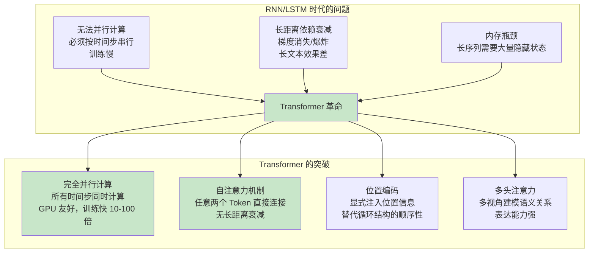
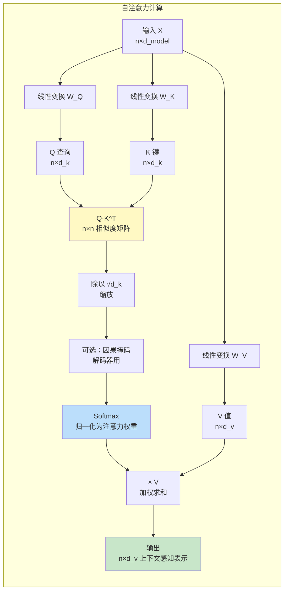
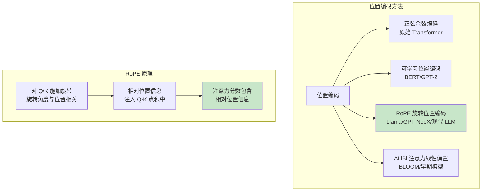

# Transformer 架构核心

> **一句话定义**：Transformer 是 2017 年 Google 提出的基于自注意力机制的神经网络架构，完全摒弃了 RNN 的循环结构，通过并行计算和长距离依赖建模，成为现代大语言模型（GPT、Llama、BERT 等）的基础架构。
>
> **核心价值**：解决了 RNN 无法并行计算和长距离依赖衰减的问题，实现了训练的高度并行化（GPU 友好）和超长距离依赖建模，是当前几乎所有大模型的基础架构，直接催生了 LLM 革命。
>
> **适用场景**：大语言模型、文本生成、机器翻译、文本理解、多模态模型、语音处理、代码生成、几乎所有现代 NLP 任务。

---

## 一、概述

### 1.1 Transformer 的革命性意义



### 1.2 核心概念

| 概念 | 说明 |
|------|------|
| **Transformer** | 基于自注意力机制的神经网络架构，2017 年由 Google 在《Attention is All You Need》中提出 |
| **自注意力（Self-Attention）** | 序列中每个 Token 与所有其他 Token 计算注意力权重，捕获上下文语义关系 |
| **多头注意力（Multi-Head Attention）** | 将 Q/K/V 分成多个头，每个头学习不同类型的注意力模式，最后拼接 |
| **位置编码（Positional Encoding）** | 显式注入 Token 的位置信息，因为 Transformer 本身没有顺序概念 |
| **前馈网络（Feed-Forward Network, FFN）** | 每个位置独立的两层全连接网络，进行非线性变换和知识存储 |
| **残差连接（Residual Connection）** | 将输入直接加到输出上，缓解梯度消失，支持深层网络训练 |
| **Layer Normalization** | 层归一化，稳定训练，加速收敛 |
| **编码器（Encoder）** | Transformer 的编码部分，双向注意力，用于理解任务（BERT） |
| **解码器（Decoder）** | Transformer 的解码部分，因果注意力（只能看到前面的 Token），用于生成任务（GPT） |
| **因果掩码（Causal Mask）** | 解码器中使用的掩码，防止 Token 看到未来的信息，保证自回归生成 |
| **交叉注意力（Cross-Attention）** | 编码器-解码器注意力，解码器的 Q 与编码器的 K/V 计算注意力，用于翻译等 seq2seq 任务 |
| **层数（Layers）** | Transformer 的堆叠层数，常见 12/24/32/64/96/128 层，层数越多能力越强 |
| **隐藏维度（d_model）** | Token 的向量维度，常见 512/768/1024/2048/4096/8192 |
| **参数量** | 模型的可训练参数总数，从几百万到数千亿 |

### 1.3 Transformer 架构总览

```mermaid
graph TB
    subgraph 完整 Transformer（编码器-解码器）
        subgraph 编码器 Encoder N×
            E1[输入 Embedding<br/>+ 位置编码] --> E2[多头自注意力<br/>双向]
            E2 --> E3[残差 + LayerNorm]
            E3 --> E4[前馈网络 FFN]
            E4 --> E5[残差 + LayerNorm]
        end

        subgraph 解码器 Decoder N×
            D1[输出 Embedding<br/>+ 位置编码] --> D2[掩码多头自注意力<br/>因果]
            D2 --> D3[残差 + LayerNorm]
            D3 --> D4[交叉注意力<br/>Q来自解码器<br/>K/V来自编码器]
            D4 --> D5[残差 + LayerNorm]
            D5 --> D6[前馈网络 FFN]
            D6 --> D7[残差 + LayerNorm]
        end

        E5 --> D4
        D7 --> OUT[线性层 + Softmax<br/>输出概率]
    end

    Note over E2: 编码器：双向注意力<br/>所有 Token 互相关注
    Note over D2: 解码器：因果注意力<br/>只能关注前面的 Token
    Note over D4: 交叉注意力：连接编码器和解码器<br/>用于 seq2seq 任务

    style E2 fill:#bbdefb
    style D2 fill:#c8e6c9
    style D4 fill:#fff9c4
```

**三种 Transformer 变体**：

| 变体 | 架构 | 注意力 | 代表模型 | 适用任务 |
|------|------|--------|---------|---------|
| **编码器-only** | 只有编码器 | 双向自注意力 | BERT、RoBERTa、DeBERTa | 文本理解、分类、抽取、NER |
| **解码器-only** | 只有解码器 | 因果自注意力 | GPT 系列、Llama、Claude、Qwen | 文本生成、对话、代码、通用 LLM |
| **编码器-解码器** | 完整 Transformer | 编码器双向 + 解码器因果 + 交叉注意力 | T5、BART、原始 Transformer | 翻译、摘要、seq2seq 任务 |


<div style="background:linear-gradient(135deg,#667eea,#764ba2);border-radius:16px;padding:20px;margin:16px 0;font-family:-apple-system,'Segoe UI','PingFang SC','Microsoft YaHei',sans-serif;color:#fff;overflow:hidden;box-shadow:0 8px 28px rgba(0,0,0,.14),0 3px 10px rgba(0,0,0,.08)">
<style>@keyframes pulse{0%,100%{transform:scale(1);opacity:.9}50%{transform:scale(1.03);opacity:1}}.dk-layer{border-radius:8px;padding:12px 16px;margin:6px auto;text-align:center;font-weight:600;animation:pulse 3s ease-in-out infinite}.dk-outer{background:rgba(255,255,255,.15);border:2px solid rgba(255,255,255,.5);max-width:340px;animation-delay:0s}.dk-middle{background:rgba(255,255,255,.2);border:2px solid rgba(255,255,255,.6);max-width:280px;animation-delay:.5s}.dk-inner{background:rgba(255,255,255,.25);border:2px solid rgba(255,255,255,.7);max-width:220px;animation-delay:1s}.dk-arrow{text-align:center;font-size:18px;margin:2px 0}.dk-label{font-size:12px;opacity:.85;font-weight:400;margin-top:4px}</style>
<div style="text-align:center;font-size:15px;font-weight:700;margin-bottom:14px;padding-bottom:10px;border-bottom:1.5px solid rgba(255,255,255,.22);letter-spacing:1px">⚡ Transformer 架构三层体系</div>
<div class="dk-layer dk-outer">模型层 · Encoder/Decoder/Encoder-Decoder<div class="dk-label">BERT双向编码/GPT自回归解码/T5序列到序列</div></div>
<div class="dk-arrow">▼ 包含</div>
<div class="dk-layer dk-middle">层内层 · 注意力+FFN+残差+Norm<div class="dk-label">多头自注意力/前馈网络/残差连接/层归一化</div></div>
<div class="dk-arrow">▼ 包含</div>
<div class="dk-layer dk-inner">基础层 · Embedding+位置编码<div class="dk-label">Token嵌入/正弦或学习位置编码/因果掩码</div></div>
</div>
> 🔍 **知识点深度解析**
>
> **作用**：Transformer 是现代大语言模型的基础架构，通过自注意力机制实现了完全并行计算和长距离依赖建模，解决了 RNN/LSTM 时代的核心瓶颈，直接催生了 LLM 革命。
>
> **原理**：Transformer 的核心是自注意力机制——给定序列中的每个 Token，通过线性变换生成 Q（查询）、K（键）、V（值）三个向量，然后计算 Q 与所有 K 的点积（相似度），用 Softmax 归一化为注意力权重，最后用权重加权求和 V，得到该 Token 的上下文感知表示。这种机制让任意两个 Token 之间都有直接连接（距离为 1），不存在长距离依赖衰减。多头注意力将 Q/K/V 分成多个头，每个头学习不同类型的语义关系（语法、语义、指代等），最后拼接。位置编码显式注入 Token 的位置信息（因为注意力本身是置换不变的，没有顺序概念）。前馈网络对每个位置独立进行非线性变换，存储和处理知识。残差连接和 LayerNorm 支持深层网络（几十到上百层）的稳定训练。
>
> **用法要点**：① 解码器-only（GPT/Llama）是当前 LLM 的主流架构，用于生成任务 ② 理解注意力计算——Q·K^T/√d_k → Softmax → ×V，这是 Transformer 的核心公式 ③ 因果掩码——解码器中必须用掩码防止看到未来 Token，保证自回归生成 ④ 位置编码——原始用正弦余弦，现代用 RoPE（旋转位置编码）或 ALiBi（注意力线性偏置）⑤ 参数量估算——≈ 12 × 层数 × 隐藏维度²（经验公式）⑥ 注意力复杂度——O(n²)，n 是序列长度，这是长上下文的瓶颈 ⑦ 推理优化——KV 缓存、Flash Attention、PagedAttention 等技术提升推理效率 ⑧ 理解 FFN 的作用——FFN 存储了大部分知识（占参数 2/3），注意力主要负责上下文混合

---

> 💡 **深度讲解**：Transformer 的出现是深度学习领域的里程碑——在 Transformer 之前，RNN（循环神经网络）和 LSTM 是序列建模的主流架构，但它们有两个致命缺陷：① 无法并行计算——RNN 必须按时间步串行计算（第 t 步依赖第 t-1 步的隐藏状态），无法利用 GPU 的并行计算能力，训练非常慢；② 长距离依赖衰减——RNN 的梯度需要沿着时间步反向传播，长序列中梯度会指数级衰减（梯度消失）或爆炸（梯度爆炸），导致模型难以学习长距离依赖（如文章开头和结尾的关联）。LSTM 通过门控机制缓解了梯度消失，但仍然无法并行计算，且超长距离依赖仍然困难。Transformer 用自注意力机制彻底解决了这两个问题：① 完全并行——所有 Token 的注意力可以同时计算（没有时间步依赖），充分利用 GPU 并行能力，训练速度比 RNN 快 10-100 倍；② 无长距离衰减——任意两个 Token 之间都有直接的注意力连接（距离为 1），不存在梯度沿时间步衰减的问题，可以轻松建模超长距离依赖。自注意力机制的数学形式非常优雅——每个 Token 通过线性变换生成 Q（查询，表示"我在找什么"）、K（键，表示"我包含什么"）、V（值，表示"我的实际内容"），然后计算 Q 与所有 K 的点积（相似度），除以 √d_k 缩放（防止点积过大导致 Softmax 饱和），用 Softmax 归一化为注意力权重，最后用权重加权求和 V，得到该 Token 的上下文感知表示。这个过程可以理解为：每个 Token 都在"查询"序列中所有其他 Token，根据相关性（注意力权重）从其他 Token"提取"信息（V 的加权和），从而获得丰富的上下文表示。多头注意力进一步增强了表达能力——将 Q/K/V 分成多个头（如 8/16/32 个头），每个头独立计算注意力，学习不同类型的语义关系（有的头关注语法关系，有的头关注语义相似，有的头关注指代消解），最后将所有头的输出拼接并线性变换。多头注意力让模型可以同时从多个视角建模语义关系，表达能力显著强于单头注意力。位置编码是 Transformer 的一个关键设计——因为自注意力本身是置换不变的（打乱 Token 顺序，注意力计算结果不变），模型本身没有顺序概念，必须显式注入位置信息。原始 Transformer 使用正弦余弦位置编码（不同频率的正弦/余弦函数），现代 LLM 更多使用 RoPE（旋转位置编码，通过旋转 Q/K 注入相对位置）或 ALiBi（注意力线性偏置，在注意力分数上加上距离惩罚）。位置编码的选择直接影响模型的长上下文能力——RoPE 和 ALiBi 比原始正弦编码更适合长上下文。前馈网络（FFN）是 Transformer 中另一个重要组件——每个位置独立的两层全连接网络（通常 d_model → 4×d_model → d_model），进行非线性变换。FFN 占了 Transformer 约 2/3 的参数，研究表明 FFN 存储了模型的大部分知识（可以看作是键值对存储器），而注意力主要负责上下文混合（将不同 Token 的信息聚合）。理解 FFN 和注意力的分工对于理解 Transformer 的工作机制很重要。残差连接和 LayerNorm 是深层 Transformer 稳定训练的关键——残差连接将输入直接加到输出上（x + Sublayer(x)），让梯度可以直接回传，缓解梯度消失；LayerNorm 对每个样本的特征维度归一化，稳定训练分布，加速收敛。Post-LN（原始 Transformer，LN 在残差之后）和 Pre-LN（现代 LLM，LN 在残差之前）是两种常见的布局，Pre-LN 训练更稳定，是现代 LLM 的主流选择。Transformer 的三种变体（编码器-only、解码器-only、编码器-解码器）各有适用场景——编码器-only（BERT）用双向注意力，适合文本理解任务（分类、抽取、NER）；解码器-only（GPT/Llama）用因果注意力，适合文本生成，是当前通用 LLM 的主流架构；编码器-解码器（T5/BART）结合两者，适合 seq2seq 任务（翻译、摘要）。理解这三种变体的区别和适用场景对于选择模型很重要。
>
> **📝 精简总结**：Transformer 是2017年Google提出的基于自注意力的神经网络架构，摒弃RNN循环结构，实现完全并行计算（GPU友好训练快10-100倍）和长距离依赖建模（任意两Token直接连接无衰减），是现代LLM基础架构；核心概念包括自注意力（每个Token与所有其他Token计算注意力权重）、多头注意力（Q/K/V分多头学习不同模式最后拼接）、位置编码（显式注入位置信息，正弦/RoPE/ALiBi）、前馈网络FFN（每位置独立两层全连接，占参数2/3存储知识）、残差连接（缓解梯度消失支持深层）、LayerNorm（稳定训练加速收敛）、编码器（双向注意力理解任务BERT）、解码器（因果注意力生成任务GPT/Llama）、因果掩码（防止看到未来Token）、交叉注意力（编码器-解码器连接seq2seq）、层数（12-128）、隐藏维度（512-8192）；架构总览是输入Embedding+位置编码→多头自注意力→残差+LN→FFN→残差+LN，堆叠N层；三种变体——编码器-only（BERT双向/理解任务）、解码器-only（GPT/Llama因果/生成任务，当前LLM主流）、编码器-解码器（T5/BART/翻译摘要seq2seq）；核心原理是自注意力公式 Attention(Q,K,V)=softmax(QK^T/√d_k)V，Q查询/K键/V值，点积算相似度→Softmax归一化→加权求和V，多头多视角建模，位置编码注入顺序，FFN存储知识，残差+LN支持深层；用法要点包括解码器-only是主流、理解注意力公式、因果掩码保证自回归、位置编码选择（RoPE/ALiBi适合长上下文）、参数量估算≈12×层数×隐藏维度²、注意力复杂度O(n²)是长上下文瓶颈、推理优化（KV缓存/FlashAttention/PagedAttention）、理解FFN存知识注意力负责上下文混合。

---

## 二、原理

### 2.1 自注意力机制详解

#### 自注意力计算流程



#### 自注意力数学公式

```text
$$
\text{Attention}(Q, K, V) = \text{softmax}\left(\frac{QK^T}{\sqrt{d_k}}\right)V
$$
```

**详细步骤**：

1. **线性变换**：输入 X（n×d_model）通过三个权重矩阵 W_Q、W_K、W_V 线性变换，得到 Q（n×d_k）、K（n×d_k）、V（n×d_v）
2. **相似度计算**：Q·K^T 得到 n×n 的相似度矩阵，每个元素 (i,j) 表示 Token i 对 Token j 的关注程度
3. **缩放**：除以 √d_k，防止点积过大导致 Softmax 饱和（梯度消失）
4. **掩码（可选）**：解码器中使用因果掩码，将未来位置的注意力分数设为 -∞（Softmax 后为 0）
5. **Softmax**：对每一行做 Softmax，归一化为注意力权重（每行和为 1）
6. **加权求和**：注意力权重 × V，得到每个 Token 的上下文感知表示

#### 缩放因子 √d_k 的作用

当 d_k 较大时，Q 和 K 的点积可能很大（方差为 d_k），导致 Softmax 进入饱和区（梯度接近 0）。除以 √d_k 将点积的方差归一化为 1，保证 Softmax 有健康的梯度。

### 2.2 多头注意力

```mermaid
graph TB
    subgraph 多头注意力
        X[输入 X] --> SPLIT[分成 h 个头]
        SPLIT --> H1[Head 1<br/>Q1,K1,V1<br/>注意力1]
        SPLIT --> H2[Head 2<br/>Q2,K2,V2<br/>注意力2]
        SPLIT --> H3[...]
        SPLIT --> Hh[Head h<br/>Qh,Kh,Vh<br/>注意力h]
        H1 --> CONCAT[拼接 Concat<br/>n×(h×d_v)]
        H2 --> CONCAT
        H3 --> CONCAT
        Hh --> CONCAT
        CONCAT --> WO[线性变换 W_O<br/>n×d_model]
        WO --> OUT[多头注意力输出]
    end

    Note over H1,Hh: 每个头学习不同类型的注意力模式<br/>语法/语义/指代/位置等

    style CONCAT fill:#fff9c4
    style OUT fill:#c8e6c9
```

#### 多头注意力公式

$$
\text{MultiHead}(Q, K, V) = \text{Concat}(\text{head}_1, ..., \text{head}_h) W_O
```text
$$

$$
```
\text{head}_i = \text{Attention}(QW_i^Q, KW_i^K, VW_i^V)
$$

其中：
- h：头数（常见 8/12/16/32/48/64/128）
- d_k = d_v = d_model / h（每个头的维度）
- W_i^Q, W_i^K, W_i^V：第 i 个头的线性变换矩阵
- W_O：输出线性变换矩阵

**多头注意力的优势**：
1. **多视角建模**：每个头可以学习不同类型的语义关系（语法、语义、指代、位置等）
2. **表达能力强**：多个头的组合比单头注意力有更强的表达能力
3. **计算效率**：多头的总计算量与单头相同（因为每个头的维度是 d_model/h）
4. **可解释性**：可以可视化每个头的注意力模式，理解模型在关注什么

### 2.3 位置编码



#### 正弦余弦位置编码（原始 Transformer）

```text
$$
PE_{(pos, 2i)} = \sin(pos / 10000^{2i/d_{model}})
```
```text
$$
$$
```
PE_{(pos, 2i+1)} = \cos(pos / 10000^{2i/d_{model}})
$$

不同频率的正弦/余弦函数，低频对应位置的粗粒度信息，高频对应细粒度信息。

#### RoPE（旋转位置编码，Rotary Position Embedding）

RoPE 是现代 LLM 最常用的位置编码方法，核心思想是对 Q 和 K 施加旋转：

$$
q_m^T k_n = (R_m q)^T (R_n k) = q^T R_{n-m} k
$$

其中 R_m 是位置 m 的旋转矩阵，旋转角度与位置相关。Q·K 的点积中自然包含了相对位置（n-m）的信息。

**RoPE 的优势**：
1. **相对位置**：自然编码相对位置信息（而非绝对位置）
2. **长上下文友好**：外推性好，适合长上下文
3. **实现简单**：只需要旋转 Q/K，不需要额外的位置向量
4. **效果好**：在多个基准上优于正弦编码和可学习编码

#### ALiBi（注意力线性偏置，Attention with Linear Biases）

ALiBi 不向输入添加位置编码，而是在注意力分数上加上与距离成正比的偏置：

```text
$$
\text{AlibiAttention}(Q,K,V) = \text{softmax}(QK^T/\sqrt{d_k} + m \cdot M) V
$$

其中 M 是距离矩阵（M[i,j] = -(j-i) 对于因果注意力），m 是每个头的斜率。
```

**ALiBi 的优势**：长上下文外推性极好，不需要训练位置编码参数。

### 2.4 前馈网络（FFN）

```mermaid
graph LR
    subgraph 前馈网络 FFN
        X[输入<br/>d_model] --> FC1[全连接层 1<br/>d_model → 4×d_model]
        FC1 --> ACT[激活函数<br/>ReLU/GELU/SiLU/SwiGLU]
        ACT --> FC2[全连接层 2<br/>4×d_model → d_model]
        FC2 --> OUT[输出<br/>d_model]
    end

    Note over FC1,FC2: FFN 占 Transformer 约 2/3 的参数<br/>研究表明 FFN 存储了大部分知识

    style ACT fill:#fff9c4
```

#### FFN 公式

原始 Transformer 使用 ReLU：
$$
\text{FFN}(x) = \max(0, xW_1 + b_1) W_2 + b_2
$$

现代 LLM 常用 GELU 或 SiLU（SwiGLU）：

**SwiGLU**（Llama、PaLM 等现代 LLM 使用）：
$$
\text{SwiGLU}(x) = (\text{SiLU}(xW_1) \otimes xW_2) W_3
$$

SwiGLU 用门控机制（SiLU 激活 × 线性变换）替代简单的激活函数，表达能力更强，是现代 LLM 的主流选择。

**FFN 的作用**：
1. **知识存储**：研究表明 FFN 存储了模型的大部分事实性知识（可以看作键值对存储器）
2. **非线性变换**：对每个位置的表示进行非线性变换，提升表达能力
3. **特征提取**：从注意力输出的上下文表示中提取和转换特征
4. **参数主体**：FFN 占 Transformer 约 2/3 的参数（d_model → 4×d_model → d_model）

### 2.5 残差连接与 LayerNorm

```mermaid
graph TB
    subgraph Pre-LN（现代 LLM 主流）
        X[输入 x] --> LN1[LayerNorm]
        LN1 --> MHA[多头注意力]
        MHA --> ADD1[+ x 残差连接]
        X --> ADD1
        ADD1 --> LN2[LayerNorm]
        LN2 --> FFN[前馈网络]
        FFN --> ADD2[+ 残差连接]
        ADD1 --> ADD2
        ADD2 --> OUT[输出]
    end

    subgraph Post-LN（原始 Transformer）
        X2[输入 x] --> MHA2[多头注意力]
        MHA2 --> ADD3[+ x 残差]
        X2 --> ADD3
        ADD3 --> LN3[LayerNorm]
        LN3 --> FFN2[前馈网络]
        FFN2 --> ADD4[+ 残差]
        LN3 --> ADD4
        ADD4 --> LN4[LayerNorm]
        LN4 --> OUT2[输出]
    end

    Note over Pre-LN: Pre-LN 训练更稳定<br/>深层网络更容易训练
    Note over Post-LN: Post-LN 效果可能略好<br/>但训练不稳定，需要 warmup

    style LN1 fill:#bbdefb
    style LN2 fill:#bbdefb
```

**残差连接**：
$$
\text{输出} = x + \text{Sublayer}(x)
$$
将输入直接加到子层输出上，让梯度可以直接回传，缓解梯度消失，支持深层网络（几十到上百层）。

**Layer Normalization**：
```text
$$
\text{LN}(x) = \gamma \cdot \frac{x - \mu}{\sqrt{\sigma^2 + \epsilon}} + \beta
$$
```
对每个样本的特征维度归一化（均值 0，方差 1），再用可学习的缩放 γ 和平移 β 调整。稳定训练分布，加速收敛。

**Pre-LN vs Post-LN**：
- **Pre-LN**：LayerNorm 在子层之前（x → LN → Sublayer → +x），训练更稳定，是现代 LLM（GPT-2+、Llama、GPT-3）的主流选择
- **Post-LN**：LayerNorm 在残差之后（x → Sublayer → +x → LN），原始 Transformer 使用，效果可能略好但训练不稳定，需要 careful warmup

### 2.6 解码器与因果注意力

```mermaid
graph TB
    subgraph 因果注意力（解码器）
        Q[Q 查询] --> DOT[Q·K^T 相似度]
        K[K 键] --> DOT
        DOT --> MASK[因果掩码 Causal Mask<br/>上三角设为 -∞]
        MASK --> SOFTMAX[Softmax]
        SOFTMAX --> MUL[× V]
        V[V 值] --> MUL
        MUL --> OUT[输出<br/>每个位置只能看到<br/>自己和前面的位置]
    end

    subgraph 因果掩码示例（n=5）
        M1[1 0 0 0 0] 
        M2[1 1 0 0 0]
        M3[1 1 1 0 0]
        M4[1 1 1 1 0]
        M5[1 1 1 1 1]
    end

    Note over M1,M5: 1=可以关注，0=被掩码（-∞）<br/>位置 i 只能关注位置 ≤ i
    style MASK fill:#ffcdd2
    style OUT fill:#c8e6c9
```

**因果掩码（Causal Mask）**：
解码器中使用的掩码，确保每个位置只能关注自己和前面的位置，不能看到未来的信息。这保证了自回归生成的正确性——生成第 t 个 Token 时只能用前 t-1 个 Token。

掩码实现：将相似度矩阵的上三角（j > i）设为 -∞，Softmax 后这些位置的注意力权重为 0。

**解码器-only 架构（GPT/Llama）**：
现代 LLM 通常只使用 Transformer 的解码器部分，堆叠 N 层解码器，每层包含：
1. 因果多头自注意力（带因果掩码）
2. 残差连接 + LayerNorm
3. 前馈网络（FFN）
4. 残差连接 + LayerNorm

最后通过线性层 + Softmax 输出下一个 Token 的概率分布。

---

> 💡 **深度讲解**：自注意力机制是 Transformer 的灵魂，它的数学形式简洁而深刻。让我们深入理解每一步的含义：Q（查询）可以理解为"当前 Token 在找什么"——它是当前 Token 的"需求表示"；K（键）可以理解为"每个 Token 包含什么"——它是每个 Token 的"标签表示"；V（值）可以理解为"每个 Token 的实际内容"——它是每个 Token 的"内容表示"。注意力计算的过程是：当前 Token 用自己的 Q 去和所有 Token 的 K 做点积（"我的需求和你的标签匹配吗？"），得到相似度分数，然后 Softmax 归一化为权重（"我应该多关注每个 Token"），最后用权重加权求和所有 Token 的 V（"从每个 Token 提取相应比例的内容"）。这个过程让每个 Token 都能根据上下文动态聚合信息——在"苹果"这个词在"我吃了一个苹果"和"苹果发布了新手机"中，因为上下文不同，注意力权重不同，最终得到的表示也不同（前者是水果，后者是公司）。这就是自注意力的强大之处——动态上下文感知。缩放因子 √d_k 是一个精妙的设计——当 d_k 较大时，Q 和 K 是高维向量，它们的点积的方差与 d_k 成正比（假设 Q 和 K 的每个元素方差为 1，则点积方差为 d_k）。如果点积太大，Softmax 会进入饱和区（最大概率接近 1，其他接近 0），梯度接近 0，训练困难。除以 √d_k 将点积的方差归一化为 1，保证 Softmax 有健康的梯度分布。这个简单的缩放对训练稳定性至关重要。多头注意力的设计哲学是"分而治之"——如果只有一个注意力头，模型只能学习一种注意力模式（可能是某种平均的模式）。多头注意力将 Q/K/V 分成多个头，每个头独立计算注意力，可以学习不同类型的语义关系——有的头可能关注语法关系（主谓宾），有的头关注语义相似（同义词），有的头关注指代消解（代词指向哪个名词），有的头关注位置关系（相邻词）。最后将所有头的输出拼接，模型可以同时利用多种注意力模式，表达能力显著增强。值得注意的是，多头注意力的总计算量与单头相同——因为每个头的维度是 d_model/h，h 个头的总维度还是 d_model，计算量不变。所以多头注意力是"免费的午餐"——不增加计算量但提升表达能力。位置编码是 Transformer 的一个关键但容易被忽视的组件。因为自注意力是置换不变的（打乱 Token 顺序，Q·K^T 的结果只是行列重排，最终每个 Token 的输出不变），模型本身没有顺序概念——它不知道"猫追狗"和"狗追猫"的区别。必须显式注入位置信息。原始 Transformer 使用正弦余弦编码——不同频率的正弦/余弦函数，低频变化慢（编码粗粒度位置），高频变化快（编码细粒度位置），这种设计让模型可以通过线性变换学习相对位置（sin(a+b)=sin a cos b + cos a sin b）。但正弦编码的长上下文外推性不好。可学习位置编码（BERT/GPT-2）直接为每个位置学习一个向量，简单有效但无法外推到训练时未见过的长度。RoPE（旋转位置编码）是现代 LLM 的主流选择——它的核心思想是对 Q 和 K 施加旋转，旋转角度与位置成正比。这样 Q·K 的点积中自然包含了相对位置信息（因为旋转的差只与相对位置有关）。RoPE 的优势是相对位置编码、长上下文外推性好、实现简单（只旋转 Q/K）、效果好。Llama、GPT-NeoX、PaLM、Qwen 等现代 LLM 都使用 RoPE。ALiBi（注意力线性偏置）是另一种方法——不在输入上加位置编码，而是在注意力分数上加上与距离成正比的偏置（越远的位置惩罚越大），这种方法长上下文外推性极好，但在某些任务上效果略逊于 RoPE。前馈网络（FFN）是 Transformer 中"沉默的大多数"——它占了约 2/3 的参数，但受到的关注远少于注意力。近年来的研究表明，FFN 实际上存储了模型的大部分知识——可以把 FFN 看作是一个键值对存储器，第一层全连接的神经元可以看作是"键"（检测特定的输入模式），第二层可以看作是"值"（输出对应的知识）。当输入激活特定的神经元时，就"检索"到了对应的知识。例如，某些神经元可能在输入"法国的首都"时被激活，然后输出"巴黎"。这种"键值记忆"的视角解释了为什么 FFN 占了大部分参数——它需要存储大量的事实性知识。注意力则主要负责"上下文混合"——将不同 Token 的信息聚合在一起，让每个 Token 都能获得上下文信息。理解 FFN 和注意力的分工对于理解 Transformer 的工作机制和优化方向很重要——如果需要提升模型的知识容量，应该增大 FFN 的中间维度；如果需要提升上下文理解，应该增加注意力头数或层数。激活函数的选择也在演进——原始 Transformer 使用 ReLU，GPT-2 使用 GELU（高斯误差线性单元，更平滑），现代 LLM（Llama、PaLM）使用 SwiGLU（门控线性单元，用 SiLU 激活 × 线性变换的门控机制）。SwiGLU 的表达能力更强，在多个基准上优于 ReLU 和 GELU，是现代 LLM 的主流选择。残差连接和 LayerNorm 是深层 Transformer 稳定训练的关键。残差连接的核心作用是"梯度高速公路"——让梯度可以直接从输出层回传到输入层，不需要经过每一层的权重矩阵，从而缓解梯度消失。没有残差连接，几十层的网络几乎无法训练。LayerNorm 的作用是"稳定分布"——对每个样本的特征维度归一化，防止层间分布漂移（内部协变量偏移），加速收敛。Pre-LN（LayerNorm 在子层之前）比 Post-LN（LayerNorm 在残差之后）训练更稳定，因为 Pre-LN 保证了每个子层的输入分布都是归一化的，而 Post-LN 的残差路径上分布可能漂移。现代 LLM（GPT-2 之后的几乎所有模型）都使用 Pre-LN。解码器的因果掩码是自回归生成的基础——它确保生成第 t 个 Token 时，模型只能看到前 t-1 个 Token，不能"偷看"未来的信息。这是通过将相似度矩阵的上三角设为 -∞ 实现的（Softmax(-∞)=0）。因果掩码让解码器可以并行训练——训练时，整个序列的所有位置可以同时计算注意力（因为掩码已经防止了信息泄露），不需要像 RNN 那样串行。这是 Transformer 训练效率高的重要原因。推理时则必须串行（生成第 t 个 Token 依赖前 t-1 个），但可以用 KV 缓存优化——缓存之前计算的 K 和 V，不需要重新计算。
>
> **📝 精简总结**：自注意力计算流程——输入X→线性变换W_Q/W_K/W_V得Q/K/V→Q·K^T得n×n相似度矩阵→除以√d_k缩放防Softmax饱和→可选因果掩码（解码器）→Softmax归一化为注意力权重→×V加权求和得上下文感知表示；公式 Attention(Q,K,V)=softmax(QK^T/√d_k)V；Q查询"我在找什么"/K键"我包含什么"/V值"我的实际内容"，点积算匹配度→Softmax权重→加权提取内容；缩放因子√d_k将点积方差归一化为1保证健康梯度；多头注意力——Q/K/V分h头，每头独立计算注意力学习不同模式（语法/语义/指代/位置），拼接Concat→线性变换W_O输出；公式 MultiHead=Concat(head1...headh)W_O，head_i=Attention(QW_i^Q,KW_i^K,VW_i^V)；优势是多视角建模/表达能力强/计算量与单头相同（免费午餐）/可解释性；位置编码——正弦余弦（原始Transformer，不同频率正弦余弦，低频粗粒度高频细粒度）、可学习（BERT/GPT-2，每位置学向量但无法外推）、RoPE旋转位置编码（现代LLM主流，对Q/K施加旋转角度与位置相关，Q·K点积自然包含相对位置，优势是相对位置/长上下文友好/实现简单/效果好，Llama/PaLM/Qwen用）、ALiBi注意力线性偏置（注意力分数加距离惩罚，长上下文外推极好）；前馈网络FFN——每位置独立两层全连接d_model→4×d_model→d_model，占参数约2/3；公式原始ReLU FFN(x)=max(0,xW1+b1)W2+b2，现代SwiGLU（SiLU(xW1)⊗xW2)W3，门控机制表达更强，Llama/PaLM用；作用是知识存储（大部分事实知识，键值对存储器）/非线性变换/特征提取/参数主体；残差连接——输出=x+Sublayer(x)，梯度高速公路缓解梯度消失支持深层；LayerNorm——LN(x)=γ(x-μ)/√(σ²+ε)+β，特征维度归一化稳定分布加速收敛；Pre-LN（x→LN→Sublayer→+x，现代LLM主流，训练更稳定）vs Post-LN（x→Sublayer→+x→LN，原始Transformer，效果略好但不稳定需warmup）；解码器因果注意力——因果掩码将相似度上三角j>i设为-∞，Softmax后为0，确保每位置只能看到自己和前面，保证自回归生成正确性；训练时全序列并行计算（掩码防泄露），推理时串行+KV缓存优化；解码器-only架构（GPT/Llama）堆叠N层解码器（因果自注意力+残差LN+FFN+残差LN），最后线性+Softmax输出下一个Token，是现代通用LLM主流。

---

## 三、实操

### 3.1 使用 PyTorch 实现简化版 Transformer

```python
import torch
import torch.nn as nn
import torch.nn.functional as F
import math

class SelfAttention(nn.Module):
    """自注意力机制"""
    def __init__(self, d_model, n_heads):
        super().__init__()
        self.d_model = d_model
        self.n_heads = n_heads
        self.d_k = d_model // n_heads

        self.W_Q = nn.Linear(d_model, d_model)
        self.W_K = nn.Linear(d_model, d_model)
        self.W_V = nn.Linear(d_model, d_model)
        self.W_O = nn.Linear(d_model, d_model)

    def forward(self, x, mask=None):
        batch_size, seq_len, _ = x.shape

        # 线性变换得到 Q, K, V
        Q = self.W_Q(x).view(batch_size, seq_len, self.n_heads, self.d_k).transpose(1, 2)
        K = self.W_K(x).view(batch_size, seq_len, self.n_heads, self.d_k).transpose(1, 2)
        V = self.W_V(x).view(batch_size, seq_len, self.n_heads, self.d_k).transpose(1, 2)

        # 计算注意力分数: Q·K^T / √d_k
        scores = torch.matmul(Q, K.transpose(-2, -1)) / math.sqrt(self.d_k)

        # 应用掩码（因果掩码或 padding 掩码）
        if mask is not None:
            scores = scores.masked_fill(mask == 0, -1e9)

        # Softmax 归一化
        attention_weights = F.softmax(scores, dim=-1)

        # 加权求和 V
        context = torch.matmul(attention_weights, V)

        # 拼接多头输出
        context = context.transpose(1, 2).contiguous().view(batch_size, seq_len, self.d_model)

        # 输出线性变换
        output = self.W_O(context)
        return output, attention_weights


class FeedForward(nn.Module):
    """前馈网络"""
    def __init__(self, d_model, d_ff, activation='gelu'):
        super().__init__()
        self.fc1 = nn.Linear(d_model, d_ff)
        self.fc2 = nn.Linear(d_ff, d_model)
        self.activation = nn.GELU() if activation == 'gelu' else nn.ReLU()

    def forward(self, x):
        return self.fc2(self.activation(self.fc1(x)))


class TransformerDecoderLayer(nn.Module):
    """Transformer 解码器层（Pre-LN）"""
    def __init__(self, d_model, n_heads, d_ff, dropout=0.1):
        super().__init__()
        self.attention = SelfAttention(d_model, n_heads)
        self.ffn = FeedForward(d_model, d_ff)
        self.norm1 = nn.LayerNorm(d_model)
        self.norm2 = nn.LayerNorm(d_model)
        self.dropout = nn.Dropout(dropout)

    def forward(self, x, mask=None):
        # Pre-LN: 先 LayerNorm 再注意力，残差连接
        attn_output, _ = self.attention(self.norm1(x), mask)
        x = x + self.dropout(attn_output)

        # Pre-LN: 先 LayerNorm 再 FFN，残差连接
        ffn_output = self.ffn(self.norm2(x))
        x = x + self.dropout(ffn_output)

        return x


class TransformerLM(nn.Module):
    """基于 Transformer 解码器的语言模型"""
    def __init__(self, vocab_size, d_model=512, n_heads=8, n_layers=6, d_ff=2048, max_seq_len=512, dropout=0.1):
        super().__init__()
        self.d_model = d_model

        # Token Embedding
        self.token_embedding = nn.Embedding(vocab_size, d_model)

        # 位置编码（简化版：可学习位置编码）
        self.position_embedding = nn.Embedding(max_seq_len, d_model)

        # Transformer 解码器层堆叠
        self.layers = nn.ModuleList([
            TransformerDecoderLayer(d_model, n_heads, d_ff, dropout)
            for _ in range(n_layers)
        ])

        # 最终 LayerNorm
        self.final_norm = nn.LayerNorm(d_model)

        # 输出层（语言模型头）
        self.lm_head = nn.Linear(d_model, vocab_size, bias=False)

        # 权重共享（输入 Embedding 和输出 LM Head 共享权重）
        self.token_embedding.weight = self.lm_head.weight

        self.dropout = nn.Dropout(dropout)

    def forward(self, input_ids, mask=None):
        batch_size, seq_len = input_ids.shape

        # 生成位置索引
        positions = torch.arange(seq_len, device=input_ids.device).unsqueeze(0)

        # Token Embedding + 位置 Embedding
        x = self.token_embedding(input_ids) + self.position_embedding(positions)
        x = self.dropout(x)

        # 生成因果掩码（如果没有提供）
        if mask is None:
            mask = torch.triu(torch.ones(seq_len, seq_len, device=input_ids.device), diagonal=1).bool()
            mask = mask.unsqueeze(0).unsqueeze(0)  # [1, 1, seq_len, seq_len]
            mask = ~mask  # 反转：下三角为 True（可以关注）

        # 通过所有 Transformer 层
        for layer in self.layers:
            x = layer(x, mask)

        # 最终 LayerNorm
        x = self.final_norm(x)

        # 输出 logits
        logits = self.lm_head(x)
        return logits


# 使用示例
model = TransformerLM(
    vocab_size=32000,
    d_model=512,
    n_heads=8,
    n_layers=6,
    d_ff=2048,
    max_seq_len=512,
)

input_ids = torch.randint(0, 32000, (2, 128))  # batch=2, seq_len=128
logits = model(input_ids)
print(f"输入形状: {input_ids.shape}")
print(f"输出形状: {logits.shape}")  # [2, 128, 32000]
print(f"模型参数量: {sum(p.numel() for p in model.parameters()):,}")
```

### 3.2 因果掩码实现

```python
import torch

def create_causal_mask(seq_len, device='cpu'):
    """创建因果掩码（下三角为 1，上三角为 0）"""
    # torch.triu 创建上三角矩阵（包含对角线），diagonal=1 排除对角线
    mask = torch.triu(torch.ones(seq_len, seq_len, device=device), diagonal=1)
    # 反转：下三角为 1（可以关注），上三角为 0（被掩码）
    mask = mask == 0
    return mask  # [seq_len, seq_len]

# 示例
mask = create_causal_mask(5)
print("因果掩码（1=可以关注，0=被掩码）:")
print(mask.int())
# 输出:
# tensor([[1, 0, 0, 0, 0],
#         [1, 1, 0, 0, 0],
#         [1, 1, 1, 0, 0],
#         [1, 1, 1, 1, 0],
#         [1, 1, 1, 1, 1]])

def create_padding_mask(attention_mask, seq_len):
    """创建 padding 掩码（padding 位置为 0）"""
    # attention_mask: [batch, seq_len], 1=有效, 0=padding
    padding_mask = attention_mask.unsqueeze(1).unsqueeze(2)  # [batch, 1, 1, seq_len]
    return padding_mask

def combine_masks(causal_mask, padding_mask):
    """合并因果掩码和 padding 掩码"""
    # causal_mask: [1, 1, seq_len, seq_len]
    # padding_mask: [batch, 1, 1, seq_len]
    combined = causal_mask & padding_mask
    return combined

# 在注意力中应用掩码
def attention_with_mask(Q, K, V, mask=None):
    """带掩码的注意力计算"""
    d_k = Q.size(-1)
    scores = torch.matmul(Q, K.transpose(-2, -1)) / (d_k ** 0.5)

    if mask is not None:
        # 将被掩码的位置设为 -inf，Softmax 后为 0
        scores = scores.masked_fill(mask == 0, float('-inf'))

    attention_weights = torch.softmax(scores, dim=-1)
    output = torch.matmul(attention_weights, V)
    return output, attention_weights
```

### 3.3 RoPE 旋转位置编码实现

```python
import torch
import torch.nn as nn

class RotaryPositionalEmbedding(nn.Module):
    """RoPE 旋转位置编码"""
    def __init__(self, d_model, max_seq_len=4096, base=10000.0):
        super().__init__()
        # 计算旋转角度
        inv_freq = 1.0 / (base ** (torch.arange(0, d_model, 2).float() / d_model))
        self.register_buffer('inv_freq', inv_freq)

        # 预计算所有位置的正弦余弦
        t = torch.arange(max_seq_len).float()
        freqs = torch.einsum('i,j->ij', t, self.inv_freq)
        emb = torch.cat([freqs, freqs], dim=-1)
        self.register_buffer('cos_cached', emb.cos()[None, None, :, :])
        self.register_buffer('sin_cached', emb.sin()[None, None, :, :])

    def forward(self, x, seq_len=None):
        """
        x: [batch, n_heads, seq_len, d_k]
        返回旋转后的 x
        """
        if seq_len is None:
            seq_len = x.size(2)

        return (
            x * self.cos_cached[:, :, :seq_len, ...].to(x.device)
            + self.rotate_half(x) * self.sin_cached[:, :, :seq_len, ...].to(x.device)
        )

    @staticmethod
    def rotate_half(x):
        """将向量的后半部分取负并交换"""
        x1 = x[..., : x.shape[-1] // 2]
        x2 = x[..., x.shape[-1] // 2 :]
        return torch.cat((-x2, x1), dim=-1)


# 在注意力中使用 RoPE
class RoPESelfAttention(nn.Module):
    """带 RoPE 的自注意力"""
    def __init__(self, d_model, n_heads, max_seq_len=4096):
        super().__init__()
        self.d_k = d_model // n_heads
        self.n_heads = n_heads
        self.W_Q = nn.Linear(d_model, d_model)
        self.W_K = nn.Linear(d_model, d_model)
        self.W_V = nn.Linear(d_model, d_model)
        self.W_O = nn.Linear(d_model, d_model)
        self.rope = RotaryPositionalEmbedding(self.d_k, max_seq_len)

    def forward(self, x, mask=None):
        batch_size, seq_len, _ = x.shape

        Q = self.W_Q(x).view(batch_size, seq_len, self.n_heads, self.d_k).transpose(1, 2)
        K = self.W_K(x).view(batch_size, seq_len, self.n_heads, self.d_k).transpose(1, 2)
        V = self.W_V(x).view(batch_size, seq_len, self.n_heads, self.d_k).transpose(1, 2)

        # 对 Q 和 K 应用 RoPE
        Q = self.rope(Q)
        K = self.rope(K)

        # 注意力计算（同前）
        scores = torch.matmul(Q, K.transpose(-2, -1)) / (self.d_k ** 0.5)
        if mask is not None:
            scores = scores.masked_fill(mask == 0, -1e9)
        attention_weights = torch.softmax(scores, dim=-1)
        context = torch.matmul(attention_weights, V)
        context = context.transpose(1, 2).contiguous().view(batch_size, seq_len, -1)
        return self.W_O(context)
```

### 3.4 使用 HuggingFace Transformers

```python
from transformers import AutoModelForCausalLM, AutoTokenizer
import torch

# 加载预训练 Transformer 模型
model_name = "Qwen/Qwen2.5-1.5B-Instruct"
tokenizer = AutoTokenizer.from_pretrained(model_name)
model = AutoModelForCausalLM.from_pretrained(
    model_name,
    torch_dtype=torch.bfloat16,
    device_map="auto",
)

# 查看模型架构
print(model)
# 可以看到：
# - model.embed_tokens: Embedding(152K, 1536) — Token Embedding
# - model.layers: ModuleList — 28 层 Transformer 解码器
#   - input_layernorm: LayerNorm
#   - self_attn: Attention (QKV 投影、RoPE、输出投影)
#   - post_attention_layernorm: LayerNorm
#   - mlp: MLP (SwiGLU FFN)
# - model.norm: LayerNorm — 最终 LayerNorm
# - lm_head: Linear — 语言模型头

# 查看模型配置
print(f"层数: {model.config.num_hidden_layers}")
print(f"隐藏维度: {model.config.hidden_size}")
print(f"注意力头数: {model.config.num_attention_heads}")
print(f"FFN 中间维度: {model.config.intermediate_size}")
print(f"词表大小: {model.config.vocab_size}")
print(f"位置编码类型: {model.config.rope_theta}")  # RoPE theta

# 计算参数量
total_params = sum(p.numel() for p in model.parameters())
trainable_params = sum(p.numel() for p in model.parameters() if p.requires_grad)
print(f"总参数量: {total_params:,}")
print(f"可训练参数量: {trainable_params:,}")

# 推理
messages = [
    {"role": "system", "content": "你是一个 helpful 的助手"},
    {"role": "user", "content": "什么是 Transformer？"}
]
text = tokenizer.apply_chat_template(messages, tokenize=False, add_generation_prompt=True)
inputs = tokenizer(text, return_tensors="pt").to(model.device)

with torch.no_grad():
    outputs = model.generate(**inputs, max_new_tokens=200, temperature=0.7)

response = tokenizer.decode(outputs[0][inputs["input_ids"].shape[1]:], skip_special_tokens=True)
print(response)

# 可视化注意力（需要 model.output_attentions=True）
# outputs = model(**inputs, output_attentions=True)
# attentions = outputs.attentions  # 每层的注意力权重
# print(f"层数: {len(attentions)}, 每层形状: {attentions[0].shape}")
```

### 3.5 参数量估算与模型规模

```python
def estimate_transformer_params(n_layers, d_model, n_heads, d_ff, vocab_size):
    """
    估算 Transformer 解码器-only 模型的参数量
    公式：≈ 12 × n_layers × d_model²（经验公式，d_ff=4×d_model）
    精确计算：
    - Embedding: vocab_size × d_model
    - LM Head: vocab_size × d_model（通常与 Embedding 共享）
    - 每层注意力: 4 × d_model²（QKV 3个 + 输出 1个）
    - 每层 FFN: 2 × d_model × d_ff ≈ 8 × d_model²（d_ff=4×d_model）
    - 每层 LayerNorm: 2 × 2 × d_model（可忽略）
    """
    # Embedding + LM Head（共享权重，只算一次）
    embedding_params = vocab_size * d_model

    # 每层参数
    attention_params = 4 * d_model * d_model  # Q, K, V, O 投影
    ffn_params = 2 * d_model * d_ff  # 两个全连接层
    layernorm_params = 4 * d_model  # 两个 LayerNorm，每个有 gamma 和 beta
    layer_params = attention_params + ffn_params + layernorm_params

    # 总参数
    total_params = embedding_params + n_layers * layer_params

    # 经验公式验证
    empirical = 12 * n_layers * d_model * d_model

    return {
        "总参数量": total_params,
        "Embedding参数": embedding_params,
        "每层参数": layer_params,
        "注意力参数/层": attention_params,
        "FFN参数/层": ffn_params,
        "经验公式估算": empirical,
        "经验公式误差": f"{abs(total_params - empirical) / total_params * 100:.1f}%",
        "参数量(十亿)": f"{total_params / 1e9:.2f}B",
    }

# 常见模型规模对比
models = {
    "GPT-2 small": {"n_layers": 12, "d_model": 768, "n_heads": 12, "d_ff": 3072, "vocab_size": 50257},
    "GPT-2 medium": {"n_layers": 24, "d_model": 1024, "n_heads": 16, "d_ff": 4096, "vocab_size": 50257},
    "GPT-2 large": {"n_layers": 36, "d_model": 1280, "n_heads": 20, "d_ff": 5120, "vocab_size": 50257},
    "GPT-2 XL": {"n_layers": 48, "d_model": 1600, "n_heads": 25, "d_ff": 6400, "vocab_size": 50257},
    "Llama 2 7B": {"n_layers": 32, "d_model": 4096, "n_heads": 32, "d_ff": 11008, "vocab_size": 32000},
    "Llama 2 13B": {"n_layers": 40, "d_model": 5120, "n_heads": 40, "d_ff": 13824, "vocab_size": 32000},
    "Llama 3 8B": {"n_layers": 32, "d_model": 4096, "n_heads": 32, "d_ff": 14336, "vocab_size": 128256},
    "Llama 3 70B": {"n_layers": 80, "d_model": 8192, "n_heads": 64, "d_ff": 28672, "vocab_size": 128256},
    "Qwen 2.5 7B": {"n_layers": 28, "d_model": 3584, "n_heads": 28, "d_ff": 18944, "vocab_size": 152064},
    "Qwen 2.5 72B": {"n_layers": 64, "d_model": 8192, "n_heads": 64, "d_ff": 29568, "vocab_size": 152064},
}

print("模型参数量对比:")
print(f"{'模型':<20} {'层数':<6} {'隐藏维度':<8} {'头数':<6} {'参数量':<12} {'经验公式':<12}")
print("-" * 70)
for name, config in models.items():
    result = estimate_transformer_params(**config)
    print(f"{name:<20} {config['n_layers']:<6} {config['d_model']:<8} {config['n_heads']:<6} {result['参数量(十亿)']:<12} {result['经验公式估算']/1e9:.2f}B")

# 显存估算
def estimate_memory(n_params, batch_size, seq_len, d_model, n_layers, precision="fp16"):
    """估算训练显存（参数 + 梯度 + 优化器状态 + 激活值）"""
    bytes_per_param = {"fp32": 4, "fp16": 2, "bf16": 2, "int8": 1, "int4": 0.5}[precision]

    # 参数 + 梯度（推理时只有参数）
    param_memory = n_params * bytes_per_param
    gradient_memory = n_params * bytes_per_param  # 训练时

    # 优化器状态（Adam: m + v，fp32）
    optimizer_memory = n_params * 4 * 2  # Adam 状态

    # 激活值（粗略估算：batch × seq_len × d_model × n_layers × 系数）
    activation_memory = batch_size * seq_len * d_model * n_layers * bytes_per_param * 4

    total_training = param_memory + gradient_memory + optimizer_memory + activation_memory
    total_inference = param_memory + activation_memory * 0.1  # 推理时激活值少很多

    return {
        "训练显存(GB)": f"{total_training / 1e9:.1f}",
        "推理显存(GB)": f"{total_inference / 1e9:.1f}",
        "参数显存(GB)": f"{param_memory / 1e9:.1f}",
    }
```

---

> 💡 **深度讲解**：Transformer 的实现核心是"注意力 + FFN + 残差 + LN"的堆叠。让我们深入理解实现中的关键细节。自注意力的实现中，Q/K/V 的形状变换是最容易出错的地方——输入 x 的形状是 [batch, seq_len, d_model]，通过 W_Q 线性变换后还是 [batch, seq_len, d_model]，然后需要 reshape 为 [batch, seq_len, n_heads, d_k] 再 transpose 为 [batch, n_heads, seq_len, d_k]，这样每个头的 Q/K/V 是 [batch, n_heads, seq_len, d_k]，可以独立计算注意力。注意力分数 Q·K^T 的形状是 [batch, n_heads, seq_len, seq_len]，每个元素 (i,j) 表示第 i 个位置对第 j 个位置的关注程度。因果掩码的形状也是 [seq_len, seq_len]，通过广播与注意力分数相加（masked_fill）。Softmax 是对最后一维（seq_len 维）做的，每个位置对所有位置的注意力权重和为 1。最后加权求和 V 得到 [batch, n_heads, seq_len, d_k]，再 transpose + reshape 回 [batch, seq_len, d_model]，通过 W_O 输出。RoPE 的实现中，旋转操作是关键——RoPE 不对 V 旋转，只对 Q 和 K 旋转（因为位置信息只需要存在于 Q·K 的点积中，V 是内容表示不需要位置信息）。旋转的实现是：将向量分成两半，前半部分和后半部分分别乘以 cos 和 sin（旋转矩阵的形式），即 x_rotated = x * cos + rotate_half(x) * sin，其中 rotate_half(x) = [-x2, x1]（后半部分取负并交换到前半）。这种实现比真正的矩阵乘法更高效。RoPE 的角度计算使用 inv_freq = 1 / (base ^ (i / d_k))，i 是维度索引，这样低维度用低频旋转（变化慢），高维度用高频旋转（变化快），与正弦编码的思想一致。位置 t 的旋转角度是 t * inv_freq，所以相对位置 (t2 - t1) 的旋转角度差自然出现在 Q·K 的点积中（因为旋转的差只与角度差有关）。因果掩码的实现中，torch.triu 创建上三角矩阵，diagonal=1 表示不包含对角线（即 j > i 的位置为 1），然后取反得到下三角为 1 的掩码（i >= j 的位置可以关注）。在注意力中用 masked_fill 将掩码为 0 的位置设为 -1e9（或 -inf），Softmax 后这些位置的权重为 0。需要注意的是，掩码的形状需要正确广播——因果掩码是 [seq_len, seq_len]，需要 unsqueeze 为 [1, 1, seq_len, seq_len] 才能与 [batch, n_heads, seq_len, seq_len] 的注意力分数广播。padding 掩码是 [batch, seq_len]，需要 unsqueeze 为 [batch, 1, 1, seq_len]。参数量估算是理解 Transformer 规模的重要技能——经验公式 12 × n_layers × d_model² 来自于：每层注意力 4 × d_model²（Q/K/V/O 四个投影，每个 d_model × d_model），每层 FFN 8 × d_model²（d_ff=4×d_model，两个全连接层 d_model × 4d_model + 4d_model × d_model = 8d_model²），所以每层 12 × d_model²，乘以 n_layers。这个公式在 d_ff=4×d_model 时非常准确（误差 <5%），但如果 d_ff 不是 4×d_model（如 Llama 用 SwiGLU 的 14336 而非 4×4096=16384），需要用精确公式。Embedding 参数 vocab_size × d_model 在小模型中占比较大（如 GPT-2 small 的 Embedding 占约 30%），但在大模型中占比较小（7B 模型的 Embedding 占约 5%），因为 n_layers × d_model² 增长更快。显存估算是训练和部署的重要参考——训练时需要存储参数（fp16/bf16）、梯度（同参数精度）、优化器状态（Adam 的 m 和 v，通常 fp32，是参数的 2 倍）、激活值（前向传播的中间结果，反向传播需要，与 batch × seq_len × d_model × n_layers 成正比）。所以训练显存 ≈ 参数 × (2 + 2 + 8) = 参数 × 12 字节（fp16 参数+梯度 + fp32 优化器状态）+ 激活值。例如 7B 模型训练需要约 7B × 12 = 84GB + 激活值，通常需要 2-4 张 A100。推理时只需要参数 + 少量激活值（KV 缓存），7B 模型 fp16 推理约 14GB + KV 缓存，可以在单张 24GB 显卡上运行。量化（4bit/8bit）可以显著降低推理显存。理解 Transformer 的实现细节对于模型优化、调试、性能调优非常重要——注意力的形状变换、掩码的广播、RoPE 的旋转、参数量和显存的估算，这些都是实际工作中经常遇到的问题。
>
> **📝 精简总结**：PyTorch实现简化Transformer——SelfAttention类（W_Q/W_K/W_V/W_O线性变换，reshape+transpose分多头，Q·K^T/√d_k算分数，masked_fill应用掩码，Softmax归一化，×V加权求和，transpose+reshape拼接多头，W_O输出）；FeedForward类（fc1 d_model→d_ff，GELU/ReLU激活，fc2 d_ff→d_model）；TransformerDecoderLayer类（Pre-LN：norm1→attention→残差+dropout；norm2→ffn→残差+dropout）；TransformerLM类（token_embedding+position_embedding可学习位置编码，n_layers层Decoder堆叠，final_norm，lm_head输出，Embedding与LM Head权重共享，因果掩码自动生成）；使用示例（vocab32K/d_model512/8头/6层，输入[2,128]输出[2,128,32K]）；因果掩码实现——create_causal_mask用torch.triu(diagonal=1)创建上三角，取反得下三角为1（可关注）上三角为0（被掩码）；create_padding_mask从attention_mask生成[batch,1,1,seq_len]；combine_masks因果掩码&padding掩码；attention_with_mask中masked_fill(mask==0, -inf)，Softmax后为0；RoPE实现——RotaryPositionalEmbedding类（inv_freq=1/(base^(i/d_k))，预计算所有位置cos/sin缓存，forward中x*cos+rotate_half(x)*sin，rotate_half将后半取负交换）；RoPESelfAttention对Q和K应用rope（不对V），然后正常注意力计算；HuggingFace Transformers使用——AutoModelForCausalLM+AutoTokenizer加载模型，print(model)查看架构（embed_tokens/layers×N/self_attn(含RoPE)/mlp(SwiGLU)/norm/lm_head），model.config查看num_hidden_layers/hidden_size/num_attention_heads/intermediate_size/vocab_size/rope_theta，参数量计算sum(p.numel())，推理用apply_chat_template+generate，output_attentions=True可可视化注意力；参数量估算——精确公式：Embedding vocab×d_model + 每层(注意力4d²+FFN 2d×d_ff+LN 4d) × n_layers；经验公式≈12×n_layers×d_model²（d_ff=4d时准确<5%误差）；常见模型对比（GPT-2 124M/355M/774M/1.5B，Llama2 7B/13B，Llama3 8B/70B，Qwen2.5 7B/72B）；显存估算——训练=参数(fp16)+梯度(fp16)+优化器状态(fp32 Adam m+v=2倍)+激活值(batch×seq×d×layers×系数)，约参数×12字节+激活；推理=参数+少量激活(KV缓存)，7B fp16约14GB可单卡24GB；量化4bit/8bit显著降显存；实现关键是注意力形状变换、掩码广播、RoPE旋转只对Q/K、参数量显存估算。

---

## 四、问题

### 4.1 常见错误与排查

| 问题 | 原因 | 解决方案 |
|------|------|---------|
| **注意力形状错误** | reshape/transpose 顺序错误 / 多头维度处理错误 | 仔细检查 Q/K/V 的形状变换，用 print 调试每步形状，确保 [batch, heads, seq, d_k] |
| **因果掩码错误** | 掩码形状不对 / 上三角下三角搞反 / 未广播 | 用 torch.triu(diagonal=1) 创建上三角，取反得下三角为1，unsqueeze到[1,1,seq,seq]广播 |
| **训练不收敛** | 学习率太大 / 未用 warmup / Post-LN 不稳定 / 初始化问题 | 降低学习率，加 warmup（3-5% steps），用 Pre-LN，检查初始化（Xavier/He），梯度裁剪 |
| **梯度消失/爆炸** | 层数太深 / 未用残差连接 / 学习率太大 / 未用 LayerNorm | 确保残差连接正确，用 Pre-LN，梯度裁剪（max_norm=1.0），降低学习率，加 warmup |
| **OOM（显存不足）** | batch_size 太大 / seq_len 太长 / 模型太大 / 未用梯度检查点 | 减小 batch_size/seq_len，用梯度检查点（gradient_checkpointing），梯度累积，混合精度，模型并行 |
| **位置编码错误** | 位置索引越界 / 未正确注入位置 / RoPE 只应用到 Q 未应用 K | 确保 max_seq_len 足够，RoPE 同时应用到 Q 和 K（不对 V），检查位置索引从0开始 |
| **输出重复/循环** | 训练数据问题 / 温度太低 / 未用 repetition_penalty / 过拟合 | 增大 temperature，加 repetition_penalty=1.1-1.2，检查训练数据去重，减少 epoch，加 dropout |
| **推理速度慢** | 未用 KV 缓存 / 未用 Flash Attention / batch 太小 / 未量化 | 实现 KV 缓存，用 Flash Attention 2，增大 batch，模型量化（4bit/8bit），用 vLLM/TGI |
| **长上下文效果差** | 位置编码外推性差 / 注意力稀释 / 训练时未见过长序列 | 用 RoPE/ALiBi（长上下文友好），用滑动窗口注意力，长上下文微调，NTK 缩放 RoPE |
| **多语言效果差** | 词表偏向英文 / 训练数据英文为主 / 位置编码不适合多语言 | 用多语言词表（大词表），多语言训练数据，多语言评估，用 mBERT/XLM-R 等多语言模型 |
| **FFN 维度不匹配** | d_ff 设置错误 / SwiGLU 维度计算错误 | 确保 d_ff=4×d_model（标准）或按模型配置，SwiGLU 用 2/3×4×d_model（Llama 风格） |
| **权重共享错误** | Embedding 和 LM Head 未共享 / 共享后维度不匹配 | 确保 token_embedding.weight = lm_head.weight，两者维度相同（vocab × d_model） |
| **注意力可视化错误** | 未设置 output_attentions / 注意力权重形状理解错误 | 用 model(output_attentions=True)，注意力形状 [batch, heads, seq, seq]，按层按头可视化 |

### 4.2 性能优化策略

| 优化点 | 策略 | 预期效果 |
|--------|------|---------|
| **注意力加速** | Flash Attention 2、Flash Decoding、PagedAttention | 注意力速度提升 2-4 倍，显存降低 |
| **推理加速** | KV 缓存、连续批处理（continuous batching）、投机解码 | 推理吞吐量提升 5-20 倍 |
| **训练加速** | 混合精度（bf16）、梯度累积、梯度检查点、数据并行 | 训练速度提升 2-4 倍，显存降低 30-50% |
| **模型压缩** | 量化（4bit/8bit GPTQ/AWQ/GGUF）、剪枝、知识蒸馏 | 显存降低 50-75%，推理速度提升 2-4 倍 |
| **长上下文优化** | 滑动窗口注意力、线性注意力、Ring Attention、NTK RoPE 缩放 | 支持更长上下文，降低注意力 O(n²) 复杂度 |
| **分布式训练** | 张量并行（TP）、流水线并行（PP）、数据并行（DP/FSDP）、ZeRO | 支持更大模型，训练速度提升 |
| **内存优化** | 梯度检查点、CPU offload、优化器状态分片、激活重计算 | 显存降低 50-70%，支持更大 batch |
| **硬件利用** | GPU 亲和性、NVLink、InfiniBand、混合精度、内核融合 | 硬件利用率提升 20-50% |
| **数据流水线** | 数据预取、多进程数据加载、动态 padding、缓存 | 数据加载速度提升，减少 GPU 空闲 |
| **超参数优化** | 学习率调度（cosine）、warmup、权重衰减、梯度裁剪 | 训练更稳定，效果提升 |
| **MoE 架构** | 混合专家（MoE）、稀疏激活、路由机制 | 相同计算量下模型容量提升 3-8 倍 |
| **算子优化** | 融合算子（FusedAdam、FusedLayerNorm）、自定义 CUDA 内核 | 计算速度提升 10-30% |

### 4.3 安全风险与防护

| 风险 | 说明 | 防护措施 |
|------|------|---------|
| **模型窃取** | Transformer 模型参数被窃取或逆向工程 | 访问控制、模型水印、API 限流、异常检测、法律保护 |
| **数据投毒** | 训练数据被恶意注入，导致模型行为异常 | 数据审核、来源验证、异常检测、人工抽检、数据清洗 |
| **隐私泄露** | 训练数据中的隐私信息被模型记忆并输出 | 数据脱敏、差分隐私、记忆检测、隐私过滤、合规审查 |
| **对抗攻击** | 精心构造的输入导致模型输出错误或有害内容 | 对抗训练、输入过滤、异常检测、输出审核、红队测试 |
| **模型偏见** | Transformer 放大训练数据中的社会偏见 | 偏见检测、去偏训练、公平性评估、多样化数据、人工审核 |
| **供应链安全** | 依赖第三方模型/库/数据可能有安全漏洞 | 供应商审查、版本锁定、安全扫描、漏洞监控、应急响应 |
| **滥用风险** | Transformer 被用于生成虚假信息、诈骗、恶意代码 | 使用限制、内容审核、滥用检测、速率限制、用户认证 |
| **知识产权** | 训练数据可能包含受版权保护的内容 | 数据版权审查、合理使用评估、来源标注、输出查重 |

### 4.4 生产环境踩坑记录

**踩坑1：注意力掩码广播错误导致模型训练完全不收敛**
- **现象**：实现自定义 Transformer 训练语言模型，损失完全不下降（一直停留在初始值 ln(vocab_size)），模型输出随机噪声
- **原因**：① 因果掩码的形状错误——创建了 [seq_len, seq_len] 的掩码，但没有 unsqueeze 到 [1, 1, seq_len, seq_len]，导致与注意力分数 [batch, n_heads, seq_len, seq_len] 广播时出错；② masked_fill 的条件搞反了——应该是 mask == 0 的位置设为 -inf（被掩码），但写成了 mask == 1；③ 注意力分数的缩放错误——忘记除以 √d_k，导致 Softmax 饱和
- **方案**：① 确保因果掩码的形状正确——用 mask = mask.unsqueeze(0).unsqueeze(0) 扩展到 [1, 1, seq_len, seq_len]，这样可以正确广播到 [batch, n_heads, seq_len, seq_len]；② 确认掩码逻辑——下三角（i >= j）为 1（可以关注），上三角（i < j）为 0（被掩码），用 masked_fill(mask == 0, -1e9) 将上三角设为 -inf；③ 确认缩放——注意力分数必须除以 √d_k，即 scores = torch.matmul(Q, K.transpose(-2, -1)) / math.sqrt(self.d_k)；④ 用 print 调试每步的形状和值——print(Q.shape, K.shape, scores.shape, mask.shape, scores[0,0,:5,:5])，确认每步正确；⑤ 先用小模型（1层、小隐藏维度）和小数据验证训练能收敛，再扩大规模

**踩坑2：RoPE 实现错误导致长上下文效果极差**
- **现象**：实现 RoPE 后，短上下文（<512）效果正常，但长上下文（>2048）效果急剧下降，困惑度飙升，模型无法处理长文档
- **原因**：① RoPE 只应用到了 Q，没有应用到 K——RoPE 需要同时旋转 Q 和 K，这样 Q·K 的点积中才包含相对位置信息；只旋转 Q 会导致位置信息不匹配；② 旋转维度错误——RoPE 应该对每个头的 d_k 维度旋转，但错误地对整个 d_model 维度旋转，导致维度不匹配；③ cos/sin 缓存的形状错误——预计算的 cos/sin 形状是 [max_seq_len, d_k]，但没有正确 unsqueeze 到 [1, 1, max_seq_len, d_k]，广播出错；④ 位置索引错误——位置索引从 1 开始而非 0，或者没有考虑 batch 内不同序列的位置
- **方案**：① 确保 RoPE 同时应用到 Q 和 K——Q = rope(Q), K = rope(K)，不对 V 应用；② 确认旋转维度——在 reshape 为 [batch, n_heads, seq_len, d_k] 之后应用 RoPE，旋转的是最后一维 d_k；③ 确认 cos/sin 缓存的形状——预计算后用 [None, None, :, :] 扩展到 [1, 1, max_seq_len, d_k]，forward 时取 [:seq_len]；④ 确认位置索引——用 torch.arange(seq_len) 从 0 开始，每个 batch 共享相同的位置索引；⑤ 验证 RoPE 的正确性——可以测试：相同内容不同位置的 Q·K 应该只与相对位置有关（Q_pos1 · K_pos2 = Q_pos1+delta · K_pos2+delta），用这个性质验证实现；⑥ 长上下文外推——如果需要超过训练时的 max_seq_len，用 NTK 缩放（调整 base 参数）或长上下文微调

**踩坑3：FP16 混合精度训练导致梯度下溢（Underflow），模型训练不稳定**
- **现象**：用 FP16 混合精度训练深层 Transformer（32层+），损失偶尔出现 NaN，训练不稳定，需要频繁重启；同样的配置用 FP32 训练正常
- **原因**：① FP16 的动态范围有限（最小正数约 6e-8），深层网络的梯度可能非常小（特别是 LayerNorm 之前的梯度），导致下溢（Underflow）变为 0，训练不稳定；② 损失缩放（Loss Scaling）设置不当——缩放因子太小导致梯度下溢，太大导致梯度上溢（Overflow）；③ 某些算子（如 Softmax、LayerNorm）在 FP16 下数值不稳定；④ 学习率太大，梯度爆炸后变为 NaN
- **方案**：① 用 BF16 而非 FP16——BF16 的动态范围与 FP32 相同（8 位指数），不会下溢，是训练 Transformer 的推荐精度；② 如果必须用 FP16，启用自动混合精度（torch.cuda.amp），它会自动处理损失缩放和算子精度（某些算子自动用 FP32）；③ 设置合理的损失缩放——用动态损失缩放（GradScaler），它会自动调整缩放因子，避免下溢和上溢；④ 确保 LayerNorm 和 Softmax 用 FP32 计算（PyTorch 的 autocast 会自动处理，但自定义实现需要手动转换）；⑤ 降低学习率，加梯度裁剪（max_norm=1.0），防止梯度爆炸；⑥ 加 warmup（3-5% steps），训练初期学习率小，梯度稳定后再增大；⑦ 用 Pre-LN 而非 Post-LN——Pre-LN 训练更稳定，梯度更健康

---

> 💡 **深度讲解**：Transformer 生产环境的核心挑战是"训练稳定性、推理效率、长上下文"。训练稳定性是深层 Transformer 的核心挑战——几十层的网络容易出现梯度消失/爆炸、训练不稳定、损失 NaN 等问题。关键保障措施包括：① Pre-LN（LayerNorm 在子层之前）——比 Post-LN 训练更稳定，是现代 LLM 的标准；② 残差连接——确保梯度可以直接回传，缓解梯度消失；③ 合理的初始化——Xavier/He 初始化，注意力输出投影初始化为小值（防止训练初期注意力权重过于均匀）；④ Warmup——训练初期学习率线性增大，避免初期梯度不稳定；⑤ 梯度裁剪——max_norm=1.0，防止梯度爆炸；⑥ BF16 混合精度——比 FP16 动态范围大，不会下溢；⑦ 学习率调度——cosine 调度，训练后期学习率衰减；⑧ 稳定的优化器——AdamW（权重衰减解耦），不要用容易发散的优化器。推理效率是部署的核心——Transformer 推理的瓶颈是注意力的 O(n²) 复杂度和 KV 缓存的内存开销。关键优化包括：① KV 缓存——缓存之前计算的 K 和 V，生成新 Token 时不需要重新计算整个序列的注意力，将每步计算从 O(n²) 降到 O(n)；② Flash Attention 2——IO 感知的注意力实现，减少 HBM 访问，速度提升 2-4 倍，显存降低；③ 连续批处理（Continuous Batching）——动态组合不同长度的请求，提升 GPU 利用率，吞吐量提升 5-20 倍；④ PagedAttention（vLLM）——分页管理 KV 缓存，减少内存碎片，提升显存利用率；⑤ 投机解码（Speculative Decoding）——用小模型生成草稿，大模型验证，速度提升 2-3 倍；⑥ 模型量化——4bit/8bit 量化（GPTQ/AWQ/GGUF），显存降低 50-75%，速度提升 2-4 倍；⑦ 推理引擎——用 vLLM/TGI 等优化的推理引擎，不要用原生 HuggingFace generate。长上下文是现代 LLM 的重要方向——从 4K 到 8K、32K、128K、1M，上下文长度持续增长。长上下文的挑战包括：① 注意力 O(n²) 复杂度——序列长度加倍，计算量增为 4 倍，KV 缓存内存也加倍；② 注意力稀释——长序列中每个 Token 能分配到的注意力权重减少，"中间遗忘"问题（序列中间的信息容易被忽略）；③ 位置编码外推——训练时的上下文长度有限，推理时超过训练长度效果下降。长上下文优化包括：① RoPE/ALiBi 位置编码——比正弦编码外推性好；② NTK RoPE 缩放——调整 RoPE 的 base 参数，扩展有效上下文长度；③ 滑动窗口注意力（Sliding Window Attention）——每个 Token 只关注窗口内的 Token，将复杂度降到 O(n×w)；④ 线性注意力——用核函数近似注意力，复杂度 O(n)；⑤ Ring Attention——分布式计算注意力，支持超长上下文；⑥ 长上下文微调——在长序列数据上继续训练，让模型适应长上下文；⑦ 检索增强（RAG）——不需要把所有信息都塞进上下文，用检索动态获取相关信息。理解 Transformer 的这些挑战和优化方法对于实际生产部署非常重要——不同的场景（训练/推理、短上下文/长上下文、小模型/大模型）需要不同的优化策略，没有"万能"的配置，需要根据具体需求选择合适的方法。
>
> **📝 精简总结**：常见问题包括注意力形状错误（reshape/transpose顺序/多头维度，print调试每步形状确保[batch,heads,seq,d_k]）、因果掩码错误（形状/上下三角搞反/未广播，torch.triu(diagonal=1)取反+unsqueeze[1,1,seq,seq]+masked_fill(mask==0,-inf)）、训练不收敛（学习率大/无warmup/Post-LN不稳定/初始化，降学习率+warmup+Pre-LN+Xavier/He初始化+梯度裁剪）、梯度消失爆炸（层深/无残差/学习率大/无LN，确保残差+Pre-LN+梯度裁剪max_norm1.0+降学习率+warmup）、OOM（batch大/seq长/模型大/无梯度检查点，减batch/seq+梯度检查点+梯度累积+混合精度+模型并行）、位置编码错误（位置越界/未注入/RoPE只Q未K，max_seq_len足够+RoPE同时Q和K不对V+位置从0开始）、输出重复循环（数据问题/温度低/无repetition_penalty/过拟合，增temperature+repetition_penalty1.1-1.2+数据去重+减epoch+dropout）、推理速度慢（无KV缓存/无FlashAttention/batch小/未量化，KV缓存+FlashAttention2+增batch+量化+vLLM/TGI）、长上下文效果差（位置编码外推差/注意力稀释/未见过长序列，RoPE/ALiBi+滑动窗口+长上下文微调+NTK缩放）、多语言效果差（词表偏英文/数据英文为主，大多语言词表+多语言数据+mBERT/XLM-R）、FFN维度不匹配（d_ff错误/SwiGLU维度，d_ff=4×d_model或按配置/SwiGLU用2/3×4d）、权重共享错误（Embedding/LM Head未共享/维度不匹配，token_embedding.weight=lm_head.weight）、注意力可视化错误（未设output_attentions/形状理解，model(output_attentions=True)+形状[batch,heads,seq,seq]按层按头可视化）；性能优化采用注意力加速（Flash Attention2/Flash Decoding/PagedAttention，2-4倍降显存）、推理加速（KV缓存/连续批处理/投机解码，5-20倍）、训练加速（bf16/梯度累积/梯度检查点/数据并行，2-4倍降显存30-50%）、模型压缩（量化4bit/8bit GPTQ/AWQ/GGUF/剪枝/蒸馏，显存降50-75%速度2-4倍）、长上下文优化（滑动窗口/线性注意力/Ring Attention/NTK RoPE，支持更长降O(n²)）、分布式训练（TP/PP/DP/FSDP/ZeRO，支持更大模型）、内存优化（梯度检查点/CPU offload/优化器分片/激活重计算，显存降50-70%）、硬件利用（GPU亲和/NVLink/InfiniBand/混合精度/内核融合，利用率20-50%）、数据流水线（数据预取/多进程加载/动态padding/缓存）、超参数优化（cosine/warmup/权重衰减/梯度裁剪）、MoE架构（混合专家/稀疏激活/路由，容量3-8倍）、算子优化（融合算子FusedAdam/FusedLayerNorm/自定义CUDA，10-30%）；安全风险包括模型窃取（访问控制/水印/API限流/异常检测/法律）、数据投毒（审核/验证/检测/抽检/清洗）、隐私泄露（脱敏/差分隐私/记忆检测/过滤/合规）、对抗攻击（对抗训练/输入过滤/异常检测/输出审核/红队）、模型偏见（检测/去偏/公平评估/多样化数据/审核）、供应链安全（审查/版本锁定/扫描/监控/应急）、滥用风险（使用限制/内容审核/滥用检测/速率限制/用户认证）、知识产权（版权审查/合理使用/标注/查重）；生产踩坑集中在注意力掩码广播错误不收敛（掩码形状unsqueeze[1,1,seq,seq]+逻辑下三角1上三角0+masked_fill(mask==0,-inf)+缩放除以√d_k+print调试+小模型验证）、RoPE实现错误长上下文差（同时应用Q和K不对V+旋转维度d_k+cos/sin形状[1,1,max,d_k]+位置索引从0+验证相对位置性质+NTK缩放外推）、FP16混合精度梯度下溢不稳定（用BF16替代FP16+自动混合精度torch.cuda.amp+动态损失缩放GradScaler+LayerNorm/Softmax用FP32+降学习率+梯度裁剪+warmup+Pre-LN）；核心挑战是训练稳定性（Pre-LN/残差/初始化/warmup/梯度裁剪/BF16/cosine/AdamW）、推理效率（KV缓存/FlashAttention/连续批处理/PagedAttention/投机解码/量化/vLLM）、长上下文（RoPE/ALiBi/NTK缩放/滑动窗口/线性注意力/Ring Attention/长上下文微调/RAG）。

---

## 五、拓展

### 5.1 Transformer 架构演进

| 架构/变体 | 说明 | 改进点 | 代表模型 |
|-----------|------|--------|---------|
| **原始 Transformer** | 编码器-解码器，正弦位置编码，Post-LN，ReLU | 基础架构 | Transformer (2017) |
| **GPT** | 解码器-only，因果注意力，可学习位置编码 | 生成式预训练 | GPT-1/2/3 |
| **BERT** | 编码器-only，双向注意力，MLM 预训练 | 理解式预训练 | BERT、RoBERTa |
| **T5** | 编码器-解码器，文本到文本统一框架 | 统一 seq2seq | T5、FLAN-T5 |
| **Transformer-XL** | 段级循环 + 相对位置编码 | 长上下文 | Transformer-XL |
| **Reformer** | 局部敏感哈希注意力 + 可逆层 | 长上下文/效率 | Reformer |
| **Longformer** | 滑动窗口 + 全局注意力 | 长文档 | Longformer |
| **Linformer** | 线性注意力（低秩 K/V） | 长上下文效率 | Linformer |
| **Performer** | 随机特征注意力（FAVOR+） | 线性复杂度 | Performer |
| **Swin Transformer** | 分层窗口注意力（视觉） | 视觉任务 | Swin Transformer |
| **ViT** | 图像分块 + 标准 Transformer | 视觉任务 | ViT、CLIP |
| **Conformer** | Transformer + CNN 混合 | 语音识别 | Conformer、Whisper |
| **Mamba/SSM** | 状态空间模型替代注意力 | 线性复杂度长上下文 | Mamba |
| **MoE Transformer** | 混合专家（稀疏 FFN） | 大模型效率 | GShard、Switch Transformer、Mixtral |
| **Multi-Query Attention** | 多查询共享 K/V | 推理效率 | PaLM、StarCoder |
| **Grouped-Query Attention** | 分组查询共享 K/V | 推理效率+质量 | Llama 2、Llama 3 |
| **Flash Attention** | IO 感知注意力实现 | 速度+显存 | Flash Attention 1/2 |

### 5.2 注意力机制变体

| 注意力类型 | 说明 | 复杂度 | 优势 | 劣势 |
|-----------|------|--------|------|------|
| **全注意力** | 所有 Token 互相关注 | O(n²) | 表达能力最强 | 计算/内存开销大 |
| **因果注意力** | 只能关注前面的 Token | O(n²) | 自回归生成 | 不能看到未来 |
| **局部/窗口注意力** | 只关注窗口内 Token | O(n×w) | 高效，长上下文 | 长距离依赖弱 |
| **全局+局部注意力** | 部分 Token 全局，其余局部 | O(n×w + n×g) | 平衡效率和长距离 | 需要设计全局 Token |
| **稀疏注意力** | 按模式稀疏关注（如跨步/轴） | O(n√n) | 比全注意力高效 | 模式固定，不灵活 |
| **线性注意力** | 核函数近似 softmax 注意力 | O(n) | 极高效，长上下文 | 近似有精度损失 |
| **多查询注意力 MQA** | 多头共享 K/V | O(n²)（计算），内存少 | 推理 KV 缓存少 | 质量略有下降 |
| **分组查询注意力 GQA** | 分组共享 K/V | O(n²)，内存中等 | 平衡质量和效率 | 比 MQA 稍复杂 |
| **交叉注意力** | Q 来自一个序列，K/V 来自另一个 | O(n×m) | 序列间信息交互 | 需要两个序列 |
| **自注意力** | Q/K/V 来自同一序列 | O(n²) | 上下文建模 | 计算开销大 |

### 5.3 Transformer 在多模态中的应用

| 模态 | 架构 | 说明 | 代表模型 |
|------|------|------|---------|
| **文本** | 标准 Transformer 解码器 | 文本生成/理解 | GPT、Llama、BERT |
| **图像** | ViT（图像分块 + Transformer） | 图像分类/检测 | ViT、Swin、CLIP |
| **文本+图像** | CLIP（对比学习，文本/图像编码器） | 图文检索/零样本分类 | CLIP、ALIGN |
| **文本+图像** | BLIP/BLIP-2（Q-Former 桥接） | 图文对话/VQA | BLIP、BLIP-2、InstructBLIP |
| **文本+图像** | Flamingo（Perceiver Resampler + 交叉注意力） | 少样本多模态 | Flamingo、OpenFlamingo |
| **文本+图像** | LLaVA（视觉编码器 + 投影层 + LLM） | 多模态对话 | LLaVA、LLaVA-1.5/NeXT |
| **文本+图像** | GPT-4o（统一多模态 Transformer） | 实时多模态 | GPT-4o、Gemini |
| **语音** | Conformer（CNN + Transformer 混合） | 语音识别 | Whisper、Conformer |
| **语音+文本** | SpeechLLM（语音编码器 + LLM） | 语音对话 | AudioPaLM、SpeechGPT |
| **视频** | Video Transformer（时间+空间注意力） | 视频理解 | VideoMAE、VideoCLIP |
| **多模态统一** | 统一 Transformer（所有模态同一架构） | 通用多模态 | GPT-4o、Gemini、ImageBind |

### 5.4 学习资源

- [Transformer 原始论文](https://arxiv.org/abs/1706.03762) 🔗 — Attention Is All You Need
- [The Annotated Transformer](https://nlp.seas.harvard.edu/annotated-transformer/) 🔗 — 逐行注释 Transformer 实现
- [Illustrated Transformer](https://jalammar.github.io/illustrated-transformer/) 🔗 — 可视化图解 Transformer
- [Flash Attention 论文](https://arxiv.org/abs/2205.14135) 🔗 — IO 感知注意力
- [RoPE 论文](https://arxiv.org/abs/2104.09864) 🔗 — 旋转位置编码
- [HuggingFace Transformers 文档](https://huggingface.co/docs/transformers) 🔗
- [PyTorch Transformer 教程](https://pytorch.org/tutorials/beginner/transformer_tutorial.html) 🔗
- [[注意力机制详解]] — 注意力机制深入
- [[位置编码进阶-RoPE-ALiBi]] — 位置编码
- [[LLM大模型入门概念]] — LLM 基础
- [[大模型训练范式-PT-SFT-RLHF]] — 训练范式
- [[主流开源模型架构对比]] — 主流模型对比
- [[模型量化-GPTQ-AWQ-GGUF]] — 模型量化
- [[多模态模型原理-VLM]] — 多模态模型
- [[生成式AI原理与应用知识点系统梳理_优化版]] — 生成式 AI 系统梳理
- [[主流大模型与AI工具知识点系统梳理_优化版]] — 大模型与工具系统梳理

---

> 💡 **深度讲解**：Transformer 的演进方向是"更高效、更长上下文、多模态统一、新架构探索"。更高效——Flash Attention 通过 IO 感知的实现（减少 HBM 访问，将注意力计算融合到 SRAM 中）将注意力速度提升 2-4 倍，同时降低显存；Multi-Query Attention（MQA）和 Grouped-Query Attention（GQA）通过共享 K/V 减少推理时的 KV 缓存内存，提升推理效率；混合精度（BF16/FP8）、算子融合、内核优化等持续提升训练和推理效率。这些效率提升使得更大的模型和更长的上下文成为可能。更长上下文——从原始 Transformer 的 512，到 GPT-3 的 2K，到 GPT-4 的 32K/128K，到 Gemini 的 1M，上下文长度持续增长。长上下文的技术包括：① 更好的位置编码（RoPE/ALiBi，外推性好）；② NTK 缩放（调整 RoPE base 参数，扩展有效长度）；③ 稀疏注意力（滑动窗口、局部+全局、线性注意力，降低 O(n²) 复杂度）；④ 分布式注意力（Ring Attention，跨设备计算）；⑤ 长上下文微调（在长序列数据上继续训练）。长上下文使得模型可以处理整本书、整个代码库、长时间对话等场景。多模态统一——Transformer 的统一架构使得多模态成为可能。从早期的 CLIP（文本和图像分别编码，对比学习对齐），到 BLIP-2（Q-Former 桥接视觉编码器和 LLM），到 LLaVA（简单的投影层连接视觉编码器和 LLM），到 GPT-4o/Gemini（统一的多模态 Transformer，文本/图像/音频在同一架构中处理），多模态模型的架构越来越统一和高效。Transformer 的自注意力机制天然适合多模态——不同模态的 Token（文本 Token、图像 Patch、音频 Frame）可以在同一注意力空间中交互，实现跨模态理解和生成。新架构探索——虽然 Transformer 是当前的主流架构，但研究者也在探索替代方案：① 状态空间模型（SSM，如 Mamba）——线性复杂度，长上下文效率高，在某些任务上接近 Transformer；② 线性注意力——用核函数近似 Softmax 注意力，O(n) 复杂度；③ 混合架构（Transformer + SSM，如 Jamba）——结合注意力的表达能力和 SSM 的效率；④ 递归架构的改进（如 RWKV）——结合 RNN 的效率和 Transformer 的表达能力。虽然这些新架构目前还没有全面超越 Transformer，但在长上下文和效率方面有独特优势，未来可能与 Transformer 共存或融合。MoE（混合专家）是另一个重要方向——将 FFN 替换为多个专家 FFN，每个 Token 只激活部分专家（路由选择），这样可以在相同计算量下大幅增加模型容量（总参数量大但激活参数量小）。Mixtral 8x7B 用 8 个专家，每个 Token 激活 2 个，总参数 47B 但激活参数只有 13B，效果接近 Llama 2 70B 但推理速度快 3 倍。MoE 是大模型效率的重要方向，GPT-4 传闻也使用了 MoE 架构。理解 Transformer 的演进和前沿对于技术选型和未来规划很重要——不同的场景（效率优先/长上下文/多模态/研究探索）适合不同的架构变体，没有"最好"的架构，只有"最适合"的架构。对于大多数应用场景，标准的解码器-only Transformer（GPT/Llama 风格，RoPE 位置编码，GQA 注意力，SwiGLU FFN，Pre-LN）是经过验证的可靠选择。
>
> **📝 精简总结**：Transformer架构演进——原始Transformer（编码器-解码器/正弦编码/Post-LN/ReLU，2017基础）、GPT（解码器-only/因果注意力/可学习位置，生成式预训练）、BERT（编码器-only/双向注意力/MLM，理解式预训练）、T5（编码器-解码器/文本到文本统一，统一seq2seq）、Transformer-XL（段级循环+相对位置，长上下文）、Reformer（LSH注意力+可逆层，长上下文效率）、Longformer（滑动窗口+全局注意力，长文档）、Linformer（线性注意力低秩K/V，长上下文效率）、Performer（随机特征注意力FAVOR+，线性复杂度）、Swin Transformer（分层窗口注意力，视觉）、ViT（图像分块+标准Transformer，视觉）、Conformer（Transformer+CNN混合，语音识别Whisper）、Mamba/SSM（状态空间模型替代注意力，线性复杂度长上下文）、MoE Transformer（混合专家稀疏FFN，大模型效率Mixtral/GShard）、Multi-Query Attention（多头共享K/V，推理效率PaLM）、Grouped-Query Attention（分组共享K/V，平衡质量效率Llama2/3）、Flash Attention（IO感知注意力实现，速度+显存）；注意力机制变体——全注意力O(n²)表达最强开销大、因果注意力O(n²)自回归不能看未来、局部/窗口注意力O(n×w)高效长距离弱、全局+局部注意力O(n×w+n×g)平衡效率长距离、稀疏注意力O(n√n)高效模式固定、线性注意力O(n)极高效有精度损失、MQA多头共享K/V推理内存少质量略降、GQA分组共享K/V平衡质量效率、交叉注意力Q来自一序列K/V来自另一序列序列间交互、自注意力Q/K/V同序列上下文建模开销大；多模态应用——文本标准解码器GPT/Llama/BERT、图像ViT/Swin/CLIP、文本+图像CLIP对比学习/BLIP-2 Q-Former/Flamingo Perceiver/LLaVA投影层+LLM/GPT-4o统一多模态、语音Conformer/Whisper、语音+文本SpeechLLM/AudioPaLM、视频Video Transformer/VideoMAE、多模态统一GPT-4o/Gemini/ImageBind；学习资源包括 Transformer原始论文/Annotated Transformer/Illustrated Transformer/Flash Attention/RoPE论文/HuggingFace文档/PyTorch教程和本知识库相关专题；发展方向是更高效（FlashAttention/MQA/GQA/混合精度/算子融合）、更长上下文（RoPE/ALiBi/NTK缩放/稀疏注意力/Ring Attention/长上下文微调）、多模态统一（CLIP→BLIP-2→LLaVA→GPT-4o，统一架构跨模态交互）、新架构探索（SSM/Mamba/线性注意力/混合架构Jamba/RWKV，与Transformer共存融合）、MoE混合专家（多专家稀疏激活，相同计算量大幅增容量Mixtral 8x7B）；标准选择是解码器-only Transformer（RoPE/GQA/SwiGLU/Pre-LN）是经过验证的可靠选择。

---

## 🔗 关联笔记

- [[注意力机制详解]] — 注意力机制深入（Transformer 核心组件）
- [[位置编码进阶-RoPE-ALiBi]] — 位置编码（RoPE/ALiBi 详解）
- [[LLM大模型入门概念]] — LLM 基础概念
- [[Tokenization与词表]] — Tokenization（Transformer 输入处理）
- [[大模型训练范式-PT-SFT-RLHF]] — 训练范式
- [[SFT监督微调实战]] — SFT 微调
- [[LoRA-QLoRA参数高效微调]] — 参数高效微调
- [[模型量化-GPTQ-AWQ-GGUF]] — 模型量化（推理优化）
- [[主流开源模型架构对比]] — 主流模型对比
- [[多模态模型原理-VLM]] — 多模态模型（Transformer 多模态应用）
- [[Embedding模型选型]] — Embedding 模型
- [[生成式AI原理与应用知识点系统梳理_优化版]] — 生成式 AI 系统梳理
- [[主流大模型与AI工具知识点系统梳理_优化版]] — 大模型与工具系统梳理

## 📖 前置知识

- [[LLM大模型入门概念]]
- [[Tokenization与词表]]

## 🏷️ 相关标签

`#AI应用` `#AI工程化` `#LLM` `#效率工具`

---

[[Home|🏠 返回首页]] · [[MOC-AI与效率工具|📚 返回分类]]
