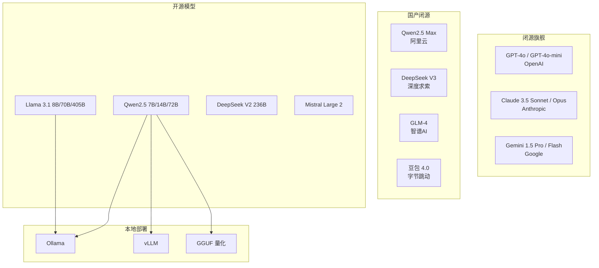
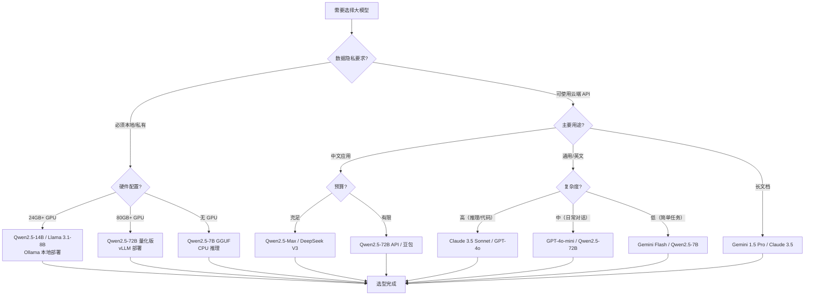

# 主流大模型对比与选型

> **文档说明**：系统对比 2026 年主流大语言模型（GPT-4o、Claude 3.5 Sonnet、Gemini 1.5 Pro、Qwen2.5、DeepSeek V3、Llama 3.1、GLM-4 等），从能力维度（推理/代码/中文/多模态/长上下文）、价格、API 可用性、开源协议、部署方式、适用场景等维度做深度对比，含选型决策树、各场景推荐模型、成本估算和本地部署方案。
>
> **适用人群**：AI 应用开发者、需要选择 LLM 的技术负责人、关注大模型生态的全栈工程师
>
> **前置知识**：[[大模型训练范式-PT-SFT-RLHF]]、[[模型量化-GPTQ-AWQ-GGUF]]、[[Ollama-本地模型部署]]

---

## 一、概述

<div style="background:linear-gradient(135deg,#fa709a,#fee140);border-radius:16px;padding:20px;margin:16px 0;font-family:-apple-system,'Segoe UI','PingFang SC','Microsoft YaHei',sans-serif;color:#fff;overflow:hidden;box-shadow:0 8px 28px rgba(0,0,0,.14),0 3px 10px rgba(0,0,0,.08)">
<style>@keyframes highlight{0%,100%{box-shadow:0 0 0 rgba(255,255,255,0)}50%{box-shadow:0 0 20px rgba(255,255,255,.4)}}.hl-box{background:rgba(255,255,255,.2);border-radius:10px;padding:14px 18px;margin:10px 0;animation:highlight 3s ease-in-out infinite;border-left:4px solid rgba(255,255,255,.6)}.hl-formula{font-family:monospace;font-size:14px;text-align:center;background:rgba(0,0,0,.15);border-radius:8px;padding:12px;margin:10px 0}</style>
<div style="text-align:center;font-size:15px;font-weight:700;margin-bottom:14px;padding-bottom:10px;border-bottom:1.5px solid rgba(255,255,255,.22);letter-spacing:1px;text-shadow:0 1px 3px rgba(0,0,0,.12)">📌 主流大模型对比与选型</div>
<div class="hl-box">系统对比 2026 年主流大语言模型（GPT-4o、Claude 3.5 Sonnet、Gemini 1.5 Pro、Qwen2.5、DeepSeek V3、Llama 3.1、GLM-4 等），从能力维度（推理/代码/中文/多模态/长上下文）、价格、API 可用性、开源协议、部署方式、适用场景等维...</div>
<div class="hl-formula">需求分析 → 模型评估 → 性能测试 → 成本核算 → 选型决策</div>
<div style="font-size:13px;opacity:.9;margin-top:8px">💡 选对工具、用对方法，效率提升十倍</div>
</div>

> 🔍 **知识点深度解析**
>
> **作用**：主流大模型对比与选型 是 AI 工具应用领域的重要内容，帮助开发者和知识工作者选择合适的 AI 工具并掌握高效使用方法，适用于提升编程、写作、分析等各类工作的效率。
>
> **原理**：AI 工具通过大模型的理解和生成能力，辅助人类完成复杂的认知工作，关键在于清晰的需求表达、合理的工具选择和有效的人机协作流程。
>
> **用法要点**：① 明确任务需求再选择工具 ② 学习高效的 Prompt 表达技巧 ③ 建立 AI 辅助的工作流而非简单替代 ④ 持续关注工具更新和最佳实践

2026 年大模型市场已经形成"闭源旗舰 + 开源追赶"的格局。闭源模型（GPT-4o、Claude 3.5、Gemini）在综合能力上领先，开源模型（Qwen2.5、Llama 3.1、DeepSeek）在性价比和可定制性上优势明显。选择合适的模型需要综合考虑能力需求、成本、数据隐私、部署方式等因素。

### 1. 模型生态格局



### 2. 核心对比维度

| 维度 | 说明 | 重要性 |
|------|------|--------|
| **推理能力** | 数学、逻辑、复杂问题解决 | ⭐⭐⭐⭐⭐ |
| **代码能力** | 代码生成、调试、重构 | ⭐⭐⭐⭐⭐ |
| **中文能力** | 中文理解和生成质量 | ⭐⭐⭐⭐（国内用户） |
| **长上下文** | 支持的最大 token 数 | ⭐⭐⭐⭐ |
| **多模态** | 图片/音频/视频理解 | ⭐⭐⭐ |
| **速度** | 首 token 延迟和生成速度 | ⭐⭐⭐⭐ |
| **价格** | 输入/输出 token 费用 | ⭐⭐⭐⭐⭐ |
| **API 稳定性** | 国内可访问性、SLA | ⭐⭐⭐⭐ |
| **开源协议** | 是否可商用、可修改 | ⭐⭐⭐ |
| **部署灵活性** | 本地/私有云部署 | ⭐⭐⭐ |

---

---

> 💡 **深度讲解**：本节围绕，深入剖析其应用场景与实践技巧，帮助读者充分发挥 AI 工具的价值。
>
> **📝 精简总结**：本节介绍了，掌握这些内容是高效应用 AI 工具的重要基础。

## 二、底层原理

### 1. 模型能力评估基准

| 基准 | 测试内容 | 满分 |
|------|---------|------|
| **MMLU** | 多学科知识（57个科目） | 100 |
| **HumanEval** | 代码生成（Python） | 100 |
| **GSM8K** | 小学数学推理 | 100 |
| **MATH** | 竞赛数学 | 100 |
| **GPQA** | 研究生级科学问答 | 100 |
| **C-Eval** | 中文综合能力 | 100 |
| **LongBench** | 长上下文理解 | 100 |

### 2. 价格模型

大模型 API 按 token 计费：
- **输入 token**：用户发送的文本（包括上下文）
- **输出 token**：模型生成的文本
- 1000 token ≈ 700 个英文单词 ≈ 500 个中文字

价格差异巨大：GPT-4o 是 Qwen2.5-72B 的 10-20 倍。

---

---

> 💡 **深度讲解**：本节围绕，深入剖析其应用场景与实践技巧，帮助读者充分发挥 AI 工具的价值。
>
> **📝 精简总结**：本节介绍了，掌握这些内容是高效应用 AI 工具的重要基础。

## 三、实操

### 1. 主流模型详细对比

| 模型 | 参数量 | 上下文 | MMLU | HumanEval | C-Eval | 输入价格/1M | 输出价格/1M | 开源 | 中文 |
|------|--------|--------|------|-----------|--------|------------|------------|------|------|
| **GPT-4o** | 未公开 | 128K | 88.7 | 90.2 | 82.5 | $2.50 | $10.00 | ❌ | ⭐⭐⭐⭐ |
| **GPT-4o-mini** | 未公开 | 128K | 82.0 | 87.2 | 75.0 | $0.15 | $0.60 | ❌ | ⭐⭐⭐⭐ |
| **Claude 3.5 Sonnet** | 未公开 | 200K | 88.7 | 92.0 | 80.0 | $3.00 | $15.00 | ❌ | ⭐⭐⭐⭐ |
| **Claude 3.5 Haiku** | 未公开 | 200K | 82.0 | 88.0 | 73.0 | $0.80 | $4.00 | ❌ | ⭐⭐⭐ |
| **Gemini 1.5 Pro** | 未公开 | 1M | 85.5 | 84.1 | 78.0 | $1.25 | $5.00 | ❌ | ⭐⭐⭐ |
| **Gemini 1.5 Flash** | 未公开 | 1M | 77.7 | 78.0 | 70.0 | $0.075 | $0.30 | ❌ | ⭐⭐⭐ |
| **Qwen2.5-72B** | 72B | 128K | 84.6 | 87.2 | 87.0 | $0.18 | $0.36 | ✅ Apache2.0 | ⭐⭐⭐⭐⭐ |
| **Qwen2.5-14B** | 14B | 128K | 79.8 | 78.0 | 82.5 | $0.07 | $0.14 | ✅ Apache2.0 | ⭐⭐⭐⭐⭐ |
| **Qwen2.5-7B** | 7B | 128K | 75.5 | 72.0 | 77.0 | $0.04 | $0.08 | ✅ Apache2.0 | ⭐⭐⭐⭐ |
| **DeepSeek V3** | 671B(MoE) | 128K | 86.5 | 90.5 | 85.0 | $0.14 | $0.28 | ❌ | ⭐⭐⭐⭐⭐ |
| **Llama 3.1-70B** | 70B | 128K | 82.5 | 80.5 | 68.0 | $0.20 | $0.40 | ✅ Llama3 | ⭐⭐⭐ |
| **GLM-4-Plus** | 未公开 | 128K | 80.0 | 78.0 | 80.0 | ¥0.10 | ¥0.20 | ❌ | ⭐⭐⭐⭐ |
| **豆包 4.0** | 未公开 | 256K | 81.0 | 76.0 | 83.0 | ¥0.08 | ¥0.16 | ❌ | ⭐⭐⭐⭐⭐ |

### 2. 各场景推荐模型

| 场景 | 推荐模型 | 理由 |
|------|---------|------|
| **通用对话/助手** | GPT-4o-mini / Qwen2.5-72B | 性价比高，能力足够 |
| **复杂推理/数学** | Claude 3.5 Sonnet / GPT-4o / DeepSeek V3 | 推理能力最强 |
| **代码生成** | Claude 3.5 Sonnet / GPT-4o / DeepSeek V3 | HumanEval 最高 |
| **中文应用** | Qwen2.5-72B / 豆包 4.0 / DeepSeek V3 | 中文能力最强，国内可访问 |
| **长文档处理** | Gemini 1.5 Pro / Claude 3.5 Sonnet | 1M/200K 长上下文 |
| **高并发/低成本** | GPT-4o-mini / Qwen2.5-14B / Gemini Flash | 价格最低 |
| **本地部署** | Qwen2.5-14B / Llama 3.1-8B | 开源，硬件要求适中 |
| **数据隐私** | Qwen2.5-72B（本地）/ Llama 3.1-70B | 完全本地运行 |
| **多模态** | GPT-4o / Gemini 1.5 Pro | 图片/音频理解强 |
| **Agent/工具调用** | GPT-4o / Claude 3.5 / Qwen2.5-72B | Function Calling 成熟 |
| **国内 API** | 通义千问 / 豆包 / DeepSeek / GLM | 国内可访问，价格低 |

### 3. 选型决策树



### 4. 成本估算

以一个 RAG 应用为例（日均 1000 次查询，每次输入 2000 token + 输出 500 token）：

| 模型 | 日成本 | 月成本 | 年成本 |
|------|--------|--------|--------|
| GPT-4o | $2.50 + $5.00 = $7.50 | $225 | $2,737 |
| GPT-4o-mini | $0.15 + $0.30 = $0.45 | $13.5 | $164 |
| Claude 3.5 Sonnet | $3.00 + $7.50 = $10.50 | $315 | $3,832 |
| Qwen2.5-72B API | $0.18 + $0.18 = $0.36 | $10.8 | $131 |
| Qwen2.5-14B 本地 | 电费约 $0.5/天 | $15 | $182 |
| DeepSeek V3 | $0.14 + $0.14 = $0.28 | $8.4 | $102 |

**结论**：开源模型 API 的成本是闭源旗舰的 1/10-1/20，本地部署在大规模使用时更划算。

### 5. 本地部署推荐配置

| 模型 | 量化 | 显存需求 | 推理速度 | 推荐硬件 |
|------|------|---------|---------|---------|
| Qwen2.5-7B | Q4_K_M | 5GB | 30-50 tok/s | RTX 3060 12GB |
| Qwen2.5-14B | Q4_K_M | 9GB | 20-30 tok/s | RTX 4070 12GB |
| Qwen2.5-32B | Q4_K_M | 20GB | 10-20 tok/s | RTX 4090 24GB |
| Qwen2.5-72B | Q4_K_M | 40GB | 5-10 tok/s | A100 40GB / 双 4090 |
| Llama 3.1-8B | Q4_K_M | 5GB | 30-50 tok/s | RTX 3060 |
| Llama 3.1-70B | Q4_K_M | 40GB | 5-10 tok/s | A100 |

```bash
# Ollama 一键部署
ollama pull qwen2.5:14b
ollama run qwen2.5:14b
```

## 验证
```bash
curl http://localhost:11434/v1/chat/completions \
  -H "Content-Type: application/json" \
```
  -d '{"model": "qwen2.5:14b", "messages": [{"role": "user", "content": "你好"}]}'

### 6. 多模型路由策略

生产环境通常不只用一个模型，而是按任务路由：

```mermaid
# model_router.py — 按任务选择模型
class ModelRouter:
    def __init__(self):
        self.models = {
            "complex_reasoning": "claude-3-5-sonnet",
            "code_generation": "gpt-4o",
            "chinese_chat": "qwen2.5-72b",
            "simple_task": "gpt-4o-mini",
            "long_context": "gemini-1.5-pro",
            "local_private": "qwen2.5:14b",  # Ollama
        }

    def route(self, task_type: str, content_length: int = 0,
              sensitive: bool = False) -> str:
        if sensitive:
            return self.models["local_private"]
        if content_length > 100000:
            return self.models["long_context"]
        return self.models.get(task_type, self.models["simple_task"])


router = ModelRouter()
# 复杂推理用 Claude
model = router.route("complex_reasoning")
# 敏感数据用本地
model = router.route("chinese_chat", sensitive=True)
```

---

---

> 💡 **深度讲解**：本节围绕，深入剖析其应用场景与实践技巧，帮助读者充分发挥 AI 工具的价值。
>
> **📝 精简总结**：本节介绍了，掌握这些内容是高效应用 AI 工具的重要基础。

## 四、常见问题与排查

| 问题现象 | 原因分析 | 解决方案 |
|---------|---------|---------|
| 国内无法访问 OpenAI/Anthropic API | 网络限制，API 端点被墙 | 用国内模型（通义千问/豆包/DeepSeek/GLM）；或用 API 代理；或本地部署开源模型 |
| 开源模型中文回答质量差 | 用了非中文优化模型（如 Llama） | 用 Qwen2.5/DeepSeek/GLM 等中文优化模型；中文 Prompt 明确要求用中文回答 |
| 本地模型推理太慢 | 模型太大或未量化 | 用 Q4_K_M 量化；换更小的模型（14B→7B）；用 vLLM 替代 Ollama 提升吞吐 |
| API 调用频繁超时 | 模型负载高或网络不稳定 | 加重试机制（指数退避）；切换到更稳定的模型；设置合理超时 |
| 长上下文模型效果不如预期 | 长上下文存在"中间遗忘"问题 | 用 RAG 检索相关片段而非塞入全文；用 "Lost in the Middle" 优化策略 |
| 模型输出格式不稳定（JSON） | 未使用结构化输出功能 | 用 JSON Mode / Function Calling 强制格式；Prompt 中给输出示例；后处理校验 |
| 不同模型回答差异大 | 模型能力和训练数据不同 | 关键任务用强模型；简单任务用便宜模型；建立评估集对比模型效果 |
| 本地部署显存 OOM | 模型量化不够或并发太高 | 降低量化等级（Q4→Q3）；限制并发数；用张量并行（多 GPU）；换更小模型 |
| API 成本超预算 | 未做成本控制，用了贵模型 | 实现模型路由（简单任务用便宜模型）；缓存常见查询；设置用量告警和预算上限 |
| 模型更新后行为变化 | 模型版本迭代导致输出变化 | 固定模型版本（如 gpt-4o-2024-08-06）；建立回归测试集；关注模型更新公告 |

---

---

> 💡 **深度讲解**：本节围绕，深入剖析其应用场景与实践技巧，帮助读者充分发挥 AI 工具的价值。
>
> **📝 精简总结**：本节介绍了，掌握这些内容是高效应用 AI 工具的重要基础。

## 五、进阶与最佳实践

### 1. 模型选型原则

- **够用就好**：不要所有任务都用 GPT-4o，80% 的任务 GPT-4o-mini 或 Qwen2.5-14B 就能搞定
- **按任务路由**：复杂推理用强模型，简单分类用小模型，敏感数据用本地模型
- **成本优先**：先算 TCO（总拥有成本），API 费用 + 开发成本 + 维护成本
- **可替换性**：用 OpenAI 兼容接口，模型可随时切换
- **评估驱动**：建立任务评估集，用数据选择模型而非凭感觉

### 2. 模型评估方法

```python
# evaluate_models.py — 模型对比评估
import openai
import json

models = ["gpt-4o-mini", "claude-3-5-sonnet", "qwen2.5-72b", "deepseek-chat"]
test_cases = [
    {"input": "解释 Transformer 的自注意力机制", "expected_quality": "high"},
    {"input": "写一个 Python 快速排序", "expected_quality": "code"},
    {"input": "总结红楼梦的主题思想", "expected_quality": "chinese"},
]

results = {}
for model in models:
    scores = []
    for case in test_cases:
        # 调用模型
        # 用 rubric 评分（或人工评估）
        scores.append(score)
    results[model] = {"avg_score": sum(scores)/len(scores), "latency": avg_latency, "cost": total_cost}

# 输出对比
for model, r in sorted(results.items(), key=lambda x: x[1]["avg_score"], reverse=True):
    print(f"{model}: 得分={r['avg_score']:.1f}, 延迟={r['latency']:.1f}s, 成本=${r['cost']:.4f}")
```

### 3. 2026 年趋势

- **开源模型逼近闭源**：Qwen2.5-72B 在多数任务上已接近 GPT-4o，差距缩小到 5% 以内
- **MoE 架构普及**：DeepSeek V3 用 671B MoE 实现 37B 激活参数，性价比极高
- **长上下文标配**：128K 成为标配，1M 上下文不再是独家
- **多模态融合**：文本+图片+音频+视频统一模型
- **端侧模型**：手机/PC 本地运行 7B-14B 模型成为常态
- **Agent 优化**：模型原生支持工具调用、多步推理、自我反思

### 4. 国内模型推荐（2026）

| 需求 | 首选 | 备选 |
|------|------|------|
| 综合能力最强 | DeepSeek V3 | Qwen2.5-Max |
| 性价比最高 | Qwen2.5-72B API | 豆包 4.0 |
| 中文理解最好 | 豆包 4.0 | Qwen2.5-72B |
| 代码能力 | DeepSeek V3 | Qwen2.5-Coder |
| 本地部署 | Qwen2.5-14B | GLM-4-9B |
| 长上下文 | Qwen2.5-72B (128K) | 豆包 4.0 (256K) |
| 免费额度 | 豆包 / 通义千问 | GLM-4 |

---

---

> 💡 **深度讲解**：本节围绕，深入剖析其应用场景与实践技巧，帮助读者充分发挥 AI 工具的价值。
>
> **📝 精简总结**：本节介绍了，掌握这些内容是高效应用 AI 工具的重要基础。

## 六、关联笔记

### 大模型技术
- [[大模型训练范式-PT-SFT-RLHF]] · [[模型量化-GPTQ-AWQ-GGUF]] · [[主流开源模型架构对比]]
- [[多模态生成工具链]] · [[LoRA-QLoRA参数高效微调]]

### 推理与服务
- [[Ollama-本地模型部署]] · [[vLLM-高吞吐推理引擎]] · [[Text-Generation-Inference]]
- [[GPU显存优化与批处理]] · [[模型服务化-OpenAI兼容API]]

### AI 工具应用
- [[AI编程助手深度使用]] · [[提示词工程核心技巧]] · [[上下文工程-Context-Engineering]]
- [[主流大模型与AI工具知识点系统梳理_优化版]]

### 导航
- [[MOC-AI与效率工具]] · [[全栈+AI工程双轨融合学习路线图]]

> **学习路径建议**：先掌握 [[大模型训练范式-PT-SFT-RLHF]] 理解模型原理 → 学习本文模型对比和选型 → 根据场景选择模型（云端 API 或 [[Ollama-本地模型部署]]）→ 实践 [[提示词工程核心技巧]] 优化输出 → 参考 [[模型量化-GPTQ-AWQ-GGUF]] 做本地部署优化。

---

## 📖 前置知识


## 🏷️ 相关标签

`#LLM` `#AI应用` `#模型选型` `#效率工具`

---

[[Home|🏠 返回首页]] · [[MOC-AI工程化-四级展开|📚 返回分类]]

