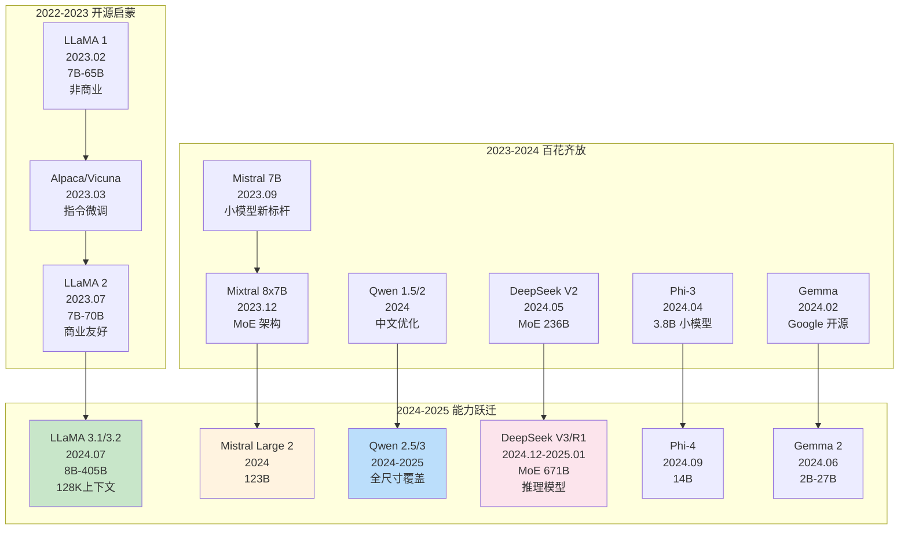
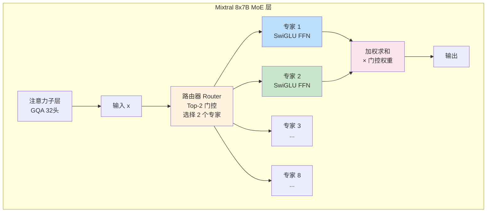
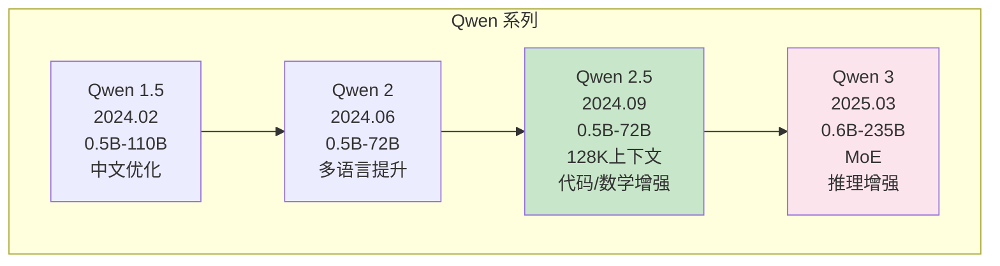
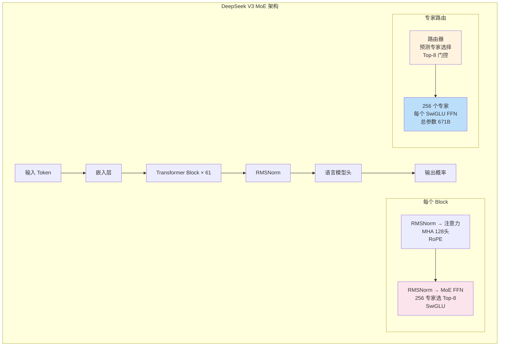
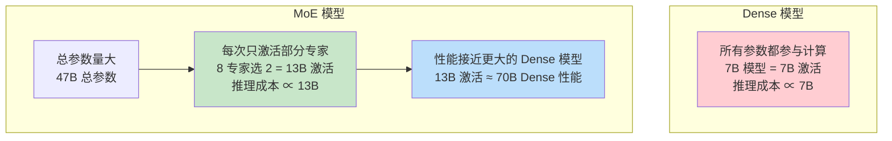
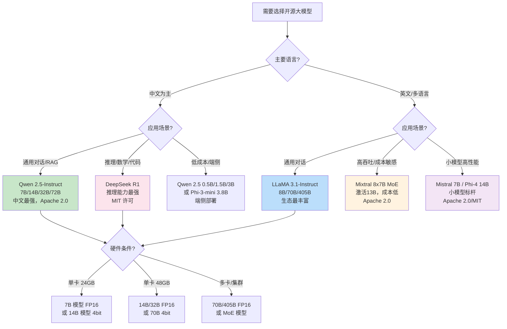

# 主流开源模型架构对比

> **一句话定义**：系统对比当前主流开源大语言模型（LLaMA、Mistral/Mixtral、Qwen、DeepSeek、Phi、Gemma 等）的架构设计差异，包括注意力机制、位置编码、MLP 架构、归一化、MoE 设计、上下文长度、训练数据与许可证，为开源模型选型、微调和部署提供决策依据。
>
> **核心价值**：开源大模型百花齐放，不同模型在架构设计、性能、效率、许可证上各有取舍。理解各模型的架构差异和适用场景，是进行模型选型、私有化部署、微调定制和应用开发的基础——选错模型可能导致性能不足、成本过高或许可证风险。
>
> **适用场景**：开源大模型选型、私有化部署方案设计、模型微调（SFT/LoRA）、推理优化、RAG/Agent 应用开发、多模型对比评估、技术架构决策。

---

## 一、概述

### 1.1 开源大模型发展全景



### 1.2 核心架构维度

对比开源模型需要关注以下架构维度：

| 维度 | 说明 | 影响 |
|------|------|------|
| **注意力机制** | MHA（多头）/ GQA（分组查询）/ MQA（多查询） | 推理速度、KV 缓存显存、性能 |
| **位置编码** | RoPE（旋转位置编码）/ ALiBi（线性偏置）/ NoPE | 长上下文能力、外推性 |
| **MLP 架构** | SwiGLU / GEGLU / ReLU / GeLU | 表达能力、参数量、训练稳定性 |
| **归一化** | RMSNorm / LayerNorm / DeepNorm | 训练稳定性、收敛速度 |
| **归一化位置** | Pre-LN / Post-LN | 训练稳定性（现代均用 Pre-LN） |
| **激活函数** | SiLU / GeLU / ReGLU | 非线性表达能力 |
| **架构类型** | Dense（稠密）/ MoE（混合专家） | 参数量、推理成本、性能 |
| **上下文长度** | 4K / 8K / 32K / 128K / 1M | 长文档处理、RAG 效果 |
| **词表大小** | 32K / 128K / 152K | 分词效率、多语言支持、参数量 |
| **训练数据** | 数据量、来源、多语言比例 | 知识广度、语言能力、偏见 |
| **许可证** | Apache 2.0 / MIT / Llama 许可 / 非商业 | 商业使用限制、修改分发权限 |

> 🔍 **知识点深度解析**
>
> **作用**：主流开源模型架构对比帮助开发者在众多开源大模型中选择最适合自身需求的模型，综合考虑性能、效率、成本、许可证和适用场景，是大模型应用开发和私有化部署的基础决策。
>
> **原理**：现代开源大模型基本都基于 Transformer 解码器架构，但在具体设计上各有取舍。核心差异包括：① 注意力机制——MHA（标准多头，性能最好但 KV 缓存大）、GQA（分组查询，平衡性能和效率，Llama 2 70B/LLaMA 3 采用）、MQA（多查询，所有头共享 KV，效率最高但性能略降，PaLM 采用）；② 位置编码——RoPE（旋转位置编码，通过旋转 Q/K 注入相对位置，外推性好，几乎所有现代模型采用）、ALiBi（注意力线性偏置，在注意力分数上加距离惩罚，长上下文外推好）、NoPE（无位置编码，靠注意力自然学习位置）；③ MLP 架构——SwiGLU（Swish + GLU 的组合，表达能力强，几乎所有现代模型采用）、GEGLU（GeLU + GLU）、标准 ReLU/GeLU；④ 归一化——RMSNorm（简化的 LayerNorm，去掉均值中心化，计算更快，现代模型标准）、LayerNorm（原始 Transformer）；⑤ 架构类型——Dense（所有参数都参与计算，简单稳定）、MoE（混合专家，每次只激活部分专家，用更多参数量换取更低的推理成本，Mixtral/DeepSeek V3 采用）。这些设计选择共同决定了模型的性能、推理速度、显存占用和适用场景。
>
> **用法要点**：① 中文场景首选 Qwen 系列（阿里，中文优化最好）或 DeepSeek（中文能力强） ② 通用场景首选 LLaMA 3 系列（Meta，生态最丰富，性能均衡） ③ 低成本/边缘部署选 Mistral 7B、Phi-3/4、Gemma 2（小模型高性能） ④ 高吞吐/大参数量选 MoE 模型（Mixtral 8x7B、DeepSeek V3）——激活参数少，推理成本低 ⑤ 长上下文场景选 LLaMA 3.1（128K）、Qwen 2.5（128K）、Mistral Large 2（128K） ⑥ 商业使用注意许可证——LLaMA 有商业使用门槛（月活 >7 亿需申请），Mistral/Qwen/DeepSeek/Phi 多为 Apache 2.0 或更宽松许可 ⑦ 推理成本估算——Dense 模型推理成本 ≈ 2×参数量×输出 Token 数，MoE 模型 ≈ 2×激活参数量×输出 Token 数 ⑧ 微调选择——7B 模型可在单卡 24GB 显存上 LoRA 微调，70B 需要多卡或量化 ⑨ 模型评估不要只看 MMLU——要结合自身任务（中文、代码、推理、长文本）做针对性评测 ⑩ 关注模型更新——开源模型迭代很快，Qwen/DeepSeek 等几乎每季度都有新版本，选型时关注最新发布。

---

> 💡 **深度讲解**：开源大模型的爆发始于 2023 年 2 月 Meta 发布 LLaMA 1——虽然 LLaMA 1 只允许非商业使用，但它的泄露和后续的 Alpaca、Vicuna 等微调版本点燃了开源大模型的浪潮，证明了开源模型可以接近甚至达到闭源模型的水平。2023 年 7 月 LLaMA 2 的发布（允许商业使用）是另一个里程碑，它成为了开源大模型的事实标准，催生了庞大的生态（无数微调版本、量化版本、应用框架）。2023 年 9 月 Mistral 7B 的发布震惊了业界——一个 7B 的小模型在多项基准上超过了 LLaMA 2 13B，证明了架构设计和数据质量的重要性，开启了"小模型高性能"的趋势。2023 年 12 月 Mixtral 8x7B 首次将 MoE（混合专家）架构带入主流开源模型，用 47B 总参数但只激活 13B 的方式，在性能上接近 LLaMA 2 70B 但推理成本低得多。2024 年是开源大模型百花齐放的一年——Qwen 2（阿里）在中文和多语言上表现优异，DeepSeek V2 用 MoE 架构实现了 236B 参数但只激活 21B，Phi-3 用 3.8B 参数实现了接近 7B 模型的性能（证明了训练数据和方法的重要性），Gemma 2 则是 Google 首次开源的高质量大模型。2024 年 7 月 LLaMA 3.1 的发布（8B/70B/405B，128K 上下文）再次树立了开源模型的标杆，405B 模型在多项基准上接近 GPT-4。2024 年底 DeepSeek V3（671B MoE，激活 37B）和 DeepSeek R1（推理模型）的发布再次震惊业界——R1 在推理任务上接近 OpenAI o1，而且完全开源免费，证明了开源模型在推理能力上也能达到顶尖水平。当前开源大模型的趋势是：① 全尺寸覆盖——从 1B 以下的端侧模型到数千亿的旗舰模型，每个尺寸都有优秀选择；② MoE 成为主流——越来越多的旗舰模型采用 MoE 架构，用更低的推理成本实现更高的性能；③ 长上下文标准化——128K 上下文成为旗舰模型的标配；④ 推理模型兴起——DeepSeek R1 等专门优化推理能力的模型成为新热点；⑤ 多模态融合——文本模型扩展为多模态模型（LLaMA 3.2 视觉、Qwen-VL、MiniCPM-V 等）。理解开源大模型的发展脉络和架构差异，对于在众多模型中做出正确选择至关重要。
>
> **📝 精简总结**：开源大模型从 LLaMA 1（2023）发展到 LLaMA 3.1、DeepSeek V3/R1（2024-2025），经历了启蒙、百花齐放、能力跃迁三个阶段。核心架构差异在注意力（MHA/GQA/MQA）、位置编码（RoPE/ALiBi）、MLP（SwiGLU）、归一化（RMSNorm）、架构类型（Dense/MoE）。中文选 Qwen/DeepSeek，通用选 LLaMA 3，低成本选 Mistral/Phi/Gemma，高吞吐选 MoE。

---

## 二、原理

### 2.1 各模型系列架构详解

#### 2.1.1 LLaMA 系列（Meta）

LLaMA 是开源大模型的事实标准，生态最丰富。

```mermaid
graph TB
    subgraph LLaMA 系列演进
        L1[LLaMA 1<br/>2023.02<br/>7B/13B/33B/65B<br/>非商业<br/>2K上下文]
        L2[LLaMA 2<br/>2023.07<br/>7B/13B/70B<br/>商业友好<br/>4K上下文<br/>GQA(70B)]
        L3[LLaMA 3<br/>2024.04<br/>8B/70B<br/>128K词表<br/>GQA]
        L4[LLaMA 3.1<br/>2024.07<br/>8B/70B/405B<br/>128K上下文<br/>多语言]
        L5[LLaMA 3.2<br/>2024.09<br/>1B/3B(文本)<br/>11B/90B(视觉)<br/>多模态]
    end

    L1 --> L2 --> L3 --> L4 --> L5

    style L4 fill:#c8e6c9
    style L5 fill:#bbdefb
```

**LLaMA 3.1 架构参数**：

| 参数 | 8B | 70B | 405B |
|------|-----|-----|------|
| 层数 | 32 | 80 | 126 |
| 隐藏维度 | 4096 | 8192 | 16384 |
| 注意力头数（Q） | 32 | 64 | 128 |
| KV 头数（GQA） | 8 | 8 | 8 |
| FFN 中间维度 | 14336 | 28672 | 53248 |
| 词表大小 | 128,256 | 128,256 | 128,256 |
| 上下文长度 | 128K | 128K | 128K |
| 位置编码 | RoPE | RoPE | RoPE |
| 归一化 | RMSNorm | RMSNorm | RMSNorm |
| MLP | SwiGLU | SwiGLU | SwiGLU |
| 训练数据 | 15T+ tokens | 15T+ tokens | 15T+ tokens |

**LLaMA 系列的关键设计**：
- **RMSNorm**：替代 LayerNorm，计算更快，训练更稳定
- **SwiGLU 激活**：替代标准 ReLU，表达能力更强
- **RoPE 位置编码**：旋转位置编码，外推性好
- **GQA（分组查询注意力）**：70B/405B 使用 GQA 减少 KV 缓存，8B 也使用 GQA（8 个 KV 头）
- **128K 词表**：LLaMA 3 从 32K 扩大到 128K，提升多语言和代码分词效率
- **Pre-LN**：归一化在子层之前（现代标准）

#### 2.1.2 Mistral / Mixtral 系列（Mistral AI）

Mistral 以小模型高性能和 MoE 架构著称。

**Mistral 7B 架构**：
- 层数：32，隐藏维度：4096，注意力头：32，KV 头：8（GQA）
- FFN 中间维度：14336（SwiGLU）
- 上下文：32K（滑动窗口注意力 SWA，窗口大小 4096）
- 位置编码：RoPE，归一化：RMSNorm
- 词表：32K

**Mixtral 8x7B（MoE）架构**：
- 总参数量：46.7B，每次激活：~12.9B（2 个专家）
- 层数：32，每层 8 个专家，每 Token 选择 Top-2 专家
- 隐藏维度：4096，注意力头：32，KV 头：8（GQA）
- 上下文：32K（SWA），位置编码：RoPE
- 性能：接近 LLaMA 2 70B，推理成本约 1/3



**Mistral 系列的关键设计**：
- **滑动窗口注意力（SWA）**：每个 Token 只关注前 4096 个 Token，降低长序列计算量
- **GQA**：32 个 Q 头，8 个 KV 头，减少 KV 缓存
- **MoE（Mixtral）**：8 专家选 2，用 47B 总参数实现 13B 激活的推理成本
- **Rolling Buffer KV 缓存**：配合 SWA，KV 缓存只保留窗口内的 Token
- **高效推理**：Mistral 7B 在相同性能下推理速度比 LLaMA 2 13B 快

#### 2.1.3 Qwen 系列（阿里通义千问）

Qwen 是中文能力最强的开源模型系列，全尺寸覆盖。



**Qwen 2.5 架构参数**：

| 参数 | 7B | 14B | 32B | 72B |
|------|-----|-----|-----|-----|
| 层数 | 28 | 48 | 64 | 80 |
| 隐藏维度 | 3584 | 5120 | 5120 | 8192 |
| 注意力头数 | 28 | 40 | 40 | 64 |
| KV 头数 | 4 | 8 | 8 | 8 |
| FFN 中间维度 | 18944 | 27648 | 27648 | 29568 |
| 词表大小 | 152,064 | 152,064 | 152,064 | 152,064 |
| 上下文长度 | 128K | 128K | 128K | 128K |
| 位置编码 | RoPE | RoPE | RoPE | RoPE |
| 归一化 | RMSNorm | RMSNorm | RMSNorm | RMSNorm |
| MLP | SwiGLU | SwiGLU | SwiGLU | SwiGLU |

**Qwen 系列的关键设计**：
- **152K 大词表**：比 LLaMA 的 128K 更大，中文分词更高效（中文平均 1.2 Token/字 vs LLaMA 的 1.5+）
- **GQA**：所有尺寸都使用 GQA，KV 头数少（4-8），推理效率高
- **中文优化**：训练数据中中文比例高，中文理解和生成能力是开源模型中最强的
- **全尺寸覆盖**：从 0.5B（端侧）到 72B（旗舰），每个尺寸都有优秀模型
- **多模态**：Qwen-VL 系列支持图文理解，Qwen-Audio 支持语音
- **代码和数学增强**：Qwen 2.5 专门增强了代码和数学推理能力
- **Apache 2.0 许可证**：完全开源免费，商业使用无限制

#### 2.1.4 DeepSeek 系列（深度求索）

DeepSeek 以 MoE 架构和推理能力著称，DeepSeek R1 是开源推理模型的标杆。

**DeepSeek V3 架构**：
- 总参数量：671B，激活参数量：~37B
- 层数：61，隐藏维度：7168
- 注意力头：128，KV 头：128（MHA，非 GQA）
- 专家数：256，每 Token 选择 Top-8 专家
- 词表：128K，上下文：128K
- 位置编码：RoPE，归一化：RMSNorm，MLP：SwiGLU
- 训练数据：14.8T tokens
- 辅助损失：蒸馏辅助损失（用自身模型作为教师）

**DeepSeek R1（推理模型）**：
- 基于 DeepSeek V3 架构，通过强化学习（GRPO 算法）训练推理能力
- 在数学、代码、逻辑推理任务上接近 OpenAI o1
- 支持长思维链（CoT）推理
- 完全开源免费（MIT 许可证）



**DeepSeek 系列的关键设计**：
- **大规模 MoE**：256 专家选 8，是最大规模的开源 MoE 模型
- **MHA（非 GQA）**：V3 使用标准 MHA（128 个 KV 头），因为激活参数少，KV 缓存不是主要瓶颈
- **蒸馏辅助损失**：训练时用自身模型作为教师，辅助稳定 MoE 训练
- **GRPO 强化学习**：R1 使用 Group Relative Policy Optimization 算法训练推理能力，不需要额外的奖励模型
- **MIT 许可证**：完全开源免费，商业使用无限制
- **中文能力强**：训练数据中中文比例高，中文推理和生成能力优秀

#### 2.1.5 Phi 系列（微软）

Phi 系列以"小模型高性能"著称，证明了训练数据质量的重要性。

**Phi-3 架构**：
- Phi-3-mini：3.8B，32 层，3072 隐藏维度，32 注意力头，GQA（32 Q / 8 KV）
- Phi-3-small：7B，32 层，4096 隐藏维度，32 注意力头，GQA
- Phi-3-medium：14B，40 层，5120 隐藏维度，40 注意力头，GQA
- 上下文：128K（Phi-3 支持），位置编码：RoPE，归一化：RMSNorm，MLP：SwiGLU
- 词表：32K（Phi-3）/ 128K（Phi-4）

**Phi-4 架构**：
- 14B 参数，40 层，5120 隐藏维度，32 注意力头，GQA（32 Q / 8 KV）
- 词表：128K，上下文：16K（原生）/ 128K（扩展）
- 训练数据：5.8T tokens，重点关注数据质量
- MIT 许可证

**Phi 系列的关键设计**：
- **数据质量优先**：Phi 系列的核心创新不是架构，而是训练数据——使用"教科书级"高质量数据（合成数据 + 精选网页数据），用更少的数据训练出更强的模型
- **小模型高性能**：Phi-3 3.8B 在多项基准上接近 LLaMA 2 7B，证明了数据质量 > 数据量
- **端侧优化**：Phi 系列针对端侧部署优化，支持 INT4 量化，可在手机上运行
- **合成数据**：大量使用 GPT-4 生成的合成数据（代码、数学、推理），提升小模型的推理能力

#### 2.1.6 Gemma 系列（Google）

Gemma 是 Google 开源的大模型，基于 Gemini 技术。

**Gemma 2 架构参数**：

| 参数 | 2B | 9B | 27B |
|------|-----|-----|-----|
| 层数 | 26 | 42 | 46 |
| 隐藏维度 | 2304 | 3584 | 4608 |
| 注意力头数 | 8 | 16 | 32 |
| KV 头数 | 4 | 8 | 16 |
| FFN 中间维度 | 9216 | 14336 | 36864 |
| 词表大小 | 256,000 | 256,000 | 256,000 |
| 上下文长度 | 8K | 8K | 8K |
| 位置编码 | RoPE | RoPE | RoPE |
| 归一化 | RMSNorm | RMSNorm | RMSNorm |
| MLP | GeGLU | GeGLU | GeGLU |
| 注意力 | MHA | GQA | GQA |

**Gemma 系列的关键设计**：
- **256K 大词表**：所有开源模型中最大的词表，多语言分词效率高
- **GeGLU 激活**：使用 GeLU + GLU 而非 SwiGLU（与其他模型不同）
- **Gemma 2 9B 特殊设计**：使用了"logit softcapping"和"attention softcapping"技术，稳定训练
- **基于 Gemini 技术**：Gemma 继承了 Gemini 的训练技术和数据筛选方法
- **允许商业使用**：Gemma 许可证允许商业使用，但有使用限制（不可用于某些用途）
- **小模型竞争力强**：Gemma 2 9B 在多项基准上超过 LLaMA 3 8B

### 2.2 架构对比总表

| 维度 | LLaMA 3.1 | Mistral 7B | Mixtral 8x7B | Qwen 2.5 | DeepSeek V3 | Phi-4 | Gemma 2 |
|------|-----------|------------|--------------|----------|-------------|-------|---------|
| **参数量** | 8B/70B/405B | 7B | 47B(激活13B) | 0.5B-72B | 671B(激活37B) | 14B | 2B/9B/27B |
| **架构类型** | Dense | Dense | MoE | Dense | MoE | Dense | Dense |
| **注意力** | GQA | GQA | GQA | GQA | MHA | GQA | GQA(9B/27B) |
| **Q头/KV头** | 32/8, 64/8, 128/8 | 32/8 | 32/8 | 28/4 ~ 64/8 | 128/128 | 32/8 | 16/8, 32/16 |
| **位置编码** | RoPE | RoPE | RoPE | RoPE | RoPE | RoPE | RoPE |
| **MLP** | SwiGLU | SwiGLU | SwiGLU | SwiGLU | SwiGLU | SwiGLU | GeGLU |
| **归一化** | RMSNorm | RMSNorm | RMSNorm | RMSNorm | RMSNorm | RMSNorm | RMSNorm |
| **词表大小** | 128K | 32K | 32K | 152K | 128K | 128K | 256K |
| **上下文** | 128K | 32K(SWA) | 32K(SWA) | 128K | 128K | 16K/128K | 8K |
| **训练数据** | 15T+ | 未知 | 未知 | 18T+ | 14.8T | 5.8T | 未知 |
| **许可证** | Llama(商业有门槛) | Apache 2.0 | Apache 2.0 | Apache 2.0 | MIT | MIT | Gemma(商业允许) |
| **中文能力** | ⭐⭐⭐ | ⭐⭐ | ⭐⭐ | ⭐⭐⭐⭐⭐ | ⭐⭐⭐⭐⭐ | ⭐⭐ | ⭐⭐ |
| **代码能力** | ⭐⭐⭐⭐ | ⭐⭐⭐ | ⭐⭐⭐⭐ | ⭐⭐⭐⭐ | ⭐⭐⭐⭐⭐ | ⭐⭐⭐⭐ | ⭐⭐⭐ |
| **推理能力** | ⭐⭐⭐⭐ | ⭐⭐⭐ | ⭐⭐⭐⭐ | ⭐⭐⭐⭐ | ⭐⭐⭐⭐⭐(R1) | ⭐⭐⭐⭐ | ⭐⭐⭐⭐ |

### 2.3 MoE 架构深度解析

#### 2.3.1 MoE 的核心思想

混合专家（Mixture of Experts, MoE）的核心思想是：用更多的参数量，但每次只激活部分参数。



#### 2.3.2 MoE 的关键组件

| 组件 | 说明 |
|------|------|
| **专家（Expert）** | 通常是一个 FFN 层（SwiGLU），每个专家是独立的 FFN 参数 |
| **路由器（Router/Gate）** | 一个线性层，根据输入 Token 计算每个专家的门控分数，选择 Top-K 专家 |
| **Top-K 选择** | 每 Token 选择 K 个专家（通常 K=2 或 K=8），只有被选中的专家参与计算 |
| **专家平衡损失** | 防止所有 Token 都路由到少数几个专家，确保专家负载均衡 |
| **容量因子** | 每个专家的最大处理 Token 数 = (总 Token 数 × K) / 专家数 × 容量因子 |

#### 2.3.3 MoE 的优缺点

<div style="background:linear-gradient(135deg,#4facfe,#00f2fe);border-radius:16px;padding:20px;margin:16px 0;font-family:-apple-system,'Segoe UI','PingFang SC','Microsoft YaHei',sans-serif;color:#fff;overflow:hidden;box-shadow:0 8px 28px rgba(0,0,0,.14),0 3px 10px rgba(0,0,0,.08)">
<style>@keyframes fadeIn{from{opacity:0;transform:translateY(10px)}to{opacity:1;transform:translateY(0)}}.cmp-col{display:inline-block;width:45%;vertical-align:top;padding:12px;margin:0 2%;background:rgba(255,255,255,.15);border-radius:10px;animation:fadeIn .8s ease-out}.cmp-col h4{margin:0 0 8px 0;text-align:center;border-bottom:1px solid rgba(255,255,255,.3);padding-bottom:6px}.cmp-col ul{margin:0;padding-left:18px;font-size:13px;line-height:1.8}.cmp-vs{display:inline-block;width:4%;text-align:center;font-size:24px;font-weight:700;vertical-align:middle;animation:fadeIn 1s ease-out}</style>
<div style="text-align:center;font-size:15px;font-weight:700;margin-bottom:14px;padding-bottom:10px;border-bottom:1.5px solid rgba(255,255,255,.22);letter-spacing:1px;text-shadow:0 1px 3px rgba(0,0,0,.12)">MoE vs Dense 架构对比</div>
<div style="text-align:center">
<div class="cmp-col"><h4>MoE 混合专家</h4><ul><li>优点：总参数量大，知识容量大</li><li>优点：激活参数少，推理成本低</li><li>优点：性能/成本比高</li><li>缺点：训练复杂，需专家平衡</li><li>缺点：显存占用大（需加载全部专家）</li><li>缺点：批处理效率低（专家负载不均）</li><li>适用：高吞吐、大知识量场景</li></ul></div>
<div class="cmp-vs">VS</div>
<div class="cmp-col"><h4>Dense 稠密</h4><ul><li>优点：架构简单，训练稳定</li><li>优点：推理可预测，批处理高效</li><li>优点：显存占用与参数量成正比</li><li>缺点：推理成本 ∝ 总参数量</li><li>缺点：大模型推理成本高</li><li>缺点：参数利用率不如 MoE</li><li>适用：低延迟、小批量场景</li></ul></div>
</div>
<div style="text-align:center;font-size:12px;opacity:.85;margin-top:10px">MoE 用更多总参数换取更低的激活成本，Dense 用简单换取稳定和可预测</div>
</div>

---

> 💡 **深度讲解**：主流开源模型虽然都基于 Transformer 解码器架构，但在具体设计上各有特色和取舍。LLaMA 系列是最"标准"的现代 Transformer——RMSNorm + SwiGLU + RoPE + GQA + Pre-LN，几乎成为了其他模型的参考基准。LLaMA 3 的最大改进是将词表从 32K 扩大到 128K，这显著提升了多语言和代码的分词效率（更多的词表意味着更少的 Token 数，推理更快）。Mistral 系列的特色是滑动窗口注意力（SWA）——每个 Token 只关注前 4096 个 Token，这大幅降低了长序列的计算量和 KV 缓存，但也意味着模型无法建模超过窗口大小的长距离依赖（不过通过滚动缓冲区和全局注意力的组合可以缓解）。Mixtral 8x7B 是第一个主流的开源 MoE 模型，它用 47B 总参数但只激活 13B 的方式，在性能上接近 LLaMA 2 70B 但推理成本只有约 1/3，这展示了 MoE 架构的巨大优势。Qwen 系列的最大优势是中文能力——152K 的大词表对中文分词特别友好（中文平均 1.2 Token/字，而 LLaMA 需要 1.5+），加上训练数据中高比例的中文，Qwen 在中文理解和生成上是开源模型中最强的。Qwen 2.5 还专门增强了代码和数学能力，是一个非常均衡的全尺寸系列。DeepSeek V3 是目前最大的开源 MoE 模型——671B 总参数，256 个专家选 8，激活只有 37B，但性能接近 GPT-4。DeepSeek V3 的一个特殊设计是使用 MHA（而非 GQA），因为激活参数少，KV 缓存不是主要瓶颈，用 MHA 可以获得更好的性能。DeepSeek R1 则是通过 GRPO 强化学习训练的推理模型，在数学、代码、逻辑推理上接近 OpenAI o1，而且完全开源免费（MIT），这是 2025 年初最令人震撼的开源模型。Phi 系列的核心创新不是架构，而是训练数据——微软用"教科书级"的高质量数据（大量 GPT-4 合成数据）训练小模型，Phi-3 3.8B 就能接近 LLaMA 2 7B 的性能，证明了数据质量比数据量更重要。Gemma 2 的特色是 256K 的超大词表和 GeGLU 激活（而非其他模型常用的 SwiGLU），Gemma 2 9B 在多项基准上超过了 LLaMA 3 8B，是一个被低估的优秀模型。MoE 架构是当前大模型的重要趋势——它的核心思想是"用更多的参数量，但每次只激活部分参数"，这样可以在不增加推理成本的前提下扩大模型的知识容量。但 MoE 也有挑战：训练不稳定（需要专家平衡损失）、显存占用大（需要加载全部专家参数）、批处理效率低（不同 Token 路由到不同专家导致负载不均）。DeepSeek V3 用蒸馏辅助损失来稳定 MoE 训练，是一个重要的技术创新。理解各模型的架构差异和适用场景，是进行模型选型的基础——没有"最好"的模型，只有"最适合"的模型。
>
> **📝 精简总结**：LLaMA 3 是标准标杆（GQA+RoPE+SwiGLU+RMSNorm+128K词表），Mistral 特色是 SWA 和 MoE，Qwen 中文最强（152K词表），DeepSeek V3/R1 是最大最强 MoE/推理模型，Phi 小模型高性能（数据质量优先），Gemma 2 大词表+GeGLU。MoE 用更多总参数换更低激活成本，Dense 简单稳定。选型按场景：中文选 Qwen/DeepSeek，通用选 LLaMA 3，低成本选 Mistral/Phi，高吞吐选 MoE。

---

## 三、实操

### 3.1 环境搭建

```python
# 创建虚拟环境
python -m venv .venv
source .venv/bin/activate  # Windows: .venv\Scripts\activate

# 核心依赖
pip install torch transformers accelerate sentencepiece
pip install bitsandbytes        # 量化（4bit/8bit）
pip install scipy               # 某些模型需要

# 推理框架
pip install vllm                # 高速推理（GPU）
pip install llama-cpp-python    # CPU/端侧推理（GGUF 格式）
pip install ollama              # 本地模型管理（需安装 Ollama 应用）

# 微调
pip install peft trl datasets   # LoRA/SFT 微调
pip install flash-attn --no-build-isolation  # FlashAttention（可选）

# 评估
pip install lm-eval             # 语言模型评估工具
pip install opencompass         # 司南评测平台（中文友好）

# 验证
python -c "import torch; print(f'PyTorch {torch.__version__}, CUDA: {torch.cuda.is_available()}')"
python -c "import transformers; print(f'transformers {transformers.__version__}')"
```

### 3.2 使用 HuggingFace Transformers 加载模型

```python
from transformers import AutoModelForCausalLM, AutoTokenizer
import torch

# ============ 3.2.1 基础加载（以 Qwen 2.5 7B 为例） ============
model_name = "Qwen/Qwen2.5-7B-Instruct"

tokenizer = AutoTokenizer.from_pretrained(model_name, trust_remote_code=True)
model = AutoModelForCausalLM.from_pretrained(
    model_name,
    torch_dtype=torch.bfloat16,      # BF16 推理（Ampere+ GPU）
    device_map="auto",                # 自动分配设备
    trust_remote_code=True,
)

# 对话生成
messages = [
    {"role": "system", "content": "你是一个有帮助的AI助手。"},
    {"role": "user", "content": "请用Python写一个快速排序算法"},
]

text = tokenizer.apply_chat_template(messages, tokenize=False, add_generation_prompt=True)
inputs = tokenizer(text, return_tensors="pt").to(model.device)

outputs = model.generate(
    **inputs,
    max_new_tokens=512,
    temperature=0.7,
    top_p=0.9,
    do_sample=True,
)

response = tokenizer.decode(outputs[0][inputs["input_ids"].shape[1]:], skip_special_tokens=True)
print(response)


# ============ 3.2.2 4bit 量化加载（节省显存） ============
from transformers import BitsAndBytesConfig

bnb_config = BitsAndBytesConfig(
    load_in_4bit=True,
    bnb_4bit_quant_type="nf4",           # NF4 量化（比 FP4 更好）
    bnb_4bit_compute_dtype=torch.bfloat16,  # 计算时用 BF16
    bnb_4bit_use_double_quant=True,      # 双重量化（进一步节省）
)

model_4bit = AutoModelForCausalLM.from_pretrained(
    "Qwen/Qwen2.5-14B-Instruct",
    quantization_config=bnb_config,
    device_map="auto",
    trust_remote_code=True,
)
# 14B 模型 4bit 量化后只需 ~8GB 显存，可在单卡 24GB 上运行


# ============ 3.2.3 加载不同模型对比 ============
def load_and_generate(model_name, prompt, max_tokens=256):
    """通用模型加载和生成函数"""
    print(f"\n{'='*60}")
    print(f"模型: {model_name}")
    print(f"{'='*60}")

    tokenizer = AutoTokenizer.from_pretrained(model_name, trust_remote_code=True)
    model = AutoModelForCausalLM.from_pretrained(
        model_name,
        torch_dtype=torch.bfloat16,
        device_map="auto",
        trust_remote_code=True,
    )

    messages = [{"role": "user", "content": prompt}]
    text = tokenizer.apply_chat_template(messages, tokenize=False, add_generation_prompt=True)
    inputs = tokenizer(text, return_tensors="pt").to(model.device)

    outputs = model.generate(**inputs, max_new_tokens=max_tokens, temperature=0.7)
    response = tokenizer.decode(outputs[0][inputs["input_ids"].shape[1]:], skip_special_tokens=True)
    print(f"回复: {response[:200]}...")

    # 清理显存
    del model
    torch.cuda.empty_cache()

    return response


# 对比不同模型（注意：需要足够显存，或用 4bit 量化）
# models_to_compare = [
#     "Qwen/Qwen2.5-7B-Instruct",
#     "meta-llama/Meta-Llama-3.1-8B-Instruct",
#     "mistralai/Mistral-7B-Instruct-v0.3",
#     "microsoft/Phi-3.5-mini-instruct",
# ]
# for m in models_to_compare:
#     load_and_generate(m, "解释什么是Transformer架构")
```

### 3.3 使用 vLLM 高速推理

```python
# ============ 3.3.1 vLLM 离线推理 ============
from vllm import LLM, SamplingParams

# 初始化模型（vLLM 自动使用 PagedAttention，显存利用率高）
llm = LLM(
    model="Qwen/Qwen2.5-7B-Instruct",
    dtype="bfloat16",
    gpu_memory_utilization=0.9,      # GPU 显存利用率
    max_model_len=8192,               # 最大上下文长度
    trust_remote_code=True,
)

# 采样参数
sampling_params = SamplingParams(
    temperature=0.7,
    top_p=0.9,
    max_tokens=512,
    frequency_penalty=0.0,
)

# 批量生成（vLLM 的优势：连续批处理，高吞吐）
prompts = [
    "解释什么是机器学习",
    "用Python写一个二分查找",
    "写一首关于秋天的诗",
    "解释量子计算的基本原理",
]

# 使用对话模板
from vllm import LLM
outputs = llm.chat(
    [{"role": "user", "content": p} for p in prompts],
    sampling_params=sampling_params,
)

for i, output in enumerate(outputs):
    print(f"\n--- 提示 {i+1} ---")
    print(f"回复: {output.outputs[0].text}")


# ============ 3.3.2 vLLM 在线服务（OpenAI 兼容 API） ============
# 命令行启动（在终端中运行）：
# python -m vllm.entrypoints.openai.api_server \
#     --model Qwen/Qwen2.5-7B-Instruct \
#     --dtype bfloat16 \
#     --port 8000 \
#     --gpu-memory-utilization 0.9 \
#     --max-model-len 8192

# 然后可以用 OpenAI SDK 调用：
# from openai import OpenAI
# client = OpenAI(base_url="http://localhost:8000/v1", api_key="dummy")
# response = client.chat.completions.create(
#     model="Qwen/Qwen2.5-7B-Instruct",
#     messages=[{"role": "user", "content": "你好"}],
# )
# print(response.choices[0].message.content)


# ============ 3.3.3 MoE 模型推理（Mixtral/DeepSeek） ============
# MoE 模型在 vLLM 中需要专家并行
llm_moe = LLM(
    model="mistralai/Mixtral-8x7B-Instruct-v0.1",
    dtype="bfloat16",
    tensor_parallel_size=2,          # 2 卡张量并行
    gpu_memory_utilization=0.9,
    max_model_len=8192,
)

# DeepSeek V3（需要更多显存，建议多卡）
# llm_ds = LLM(
#     model="deepseek-ai/DeepSeek-V3",
#     dtype="bfloat16",
#     tensor_parallel_size=4,         # 4 卡
#     max_model_len=32768,
# )
```

### 3.4 使用 Ollama 本地运行模型

**Ollama 命令行操作**

安装 Ollama（Windows/macOS/Linux），下载地址: https://ollama.com

#### 拉取模型
```bash
ollama pull qwen2.5:7b            # Qwen 2.5 7B
ollama pull llama3.1:8b            # LLaMA 3.1 8B
ollama pull mistral:7b             # Mistral 7B
ollama pull phi3:14b               # Phi-3 14B
ollama pull gemma2:9b              # Gemma 2 9B
ollama pull mixtral:8x7b           # Mixtral 8x7B MoE
ollama pull deepseek-r1:14b        # DeepSeek R1 14B
```

#### 列出已安装模型
```bash
ollama list
```

#### 运行模型（交互式）
```bash
ollama run qwen2.5:7b
```

#### 运行模型（单次提问）
```bash
ollama run qwen2.5:7b "解释什么是大语言模型"
```

#### 查看模型信息（架构、参数量等）
```bash
ollama show qwen2.5:7b
```

#### 删除模型
```bash
ollama rm qwen2.5:7b
```

#### 启动 API 服务（默认端口 11434）
```bash
ollama serve
```

**Ollama Python API**

```python
import requests
import json

def ollama_chat(model, prompt, system="你是一个有帮助的AI助手。"):
    """使用 Ollama API 进行对话"""
    url = "http://localhost:11434/api/chat"

    payload = {
        "model": model,
        "messages": [
            {"role": "system", "content": system},
            {"role": "user", "content": prompt},
        ],
        "stream": False,
        "options": {
            "temperature": 0.7,
            "num_predict": 512,
        },
    }

    response = requests.post(url, json=payload)
    result = response.json()
    return result["message"]["content"]


# 对比不同模型
models = ["qwen2.5:7b", "llama3.1:8b", "mistral:7b", "phi3:14b"]
prompt = "用一句话解释什么是注意力机制"

for model in models:
    try:
        response = ollama_chat(model, prompt)
        print(f"\n【{model}】")
        print(f"  {response}")
    except Exception as e:
        print(f"\n【{model}】错误: {e}")
```

### 3.5 模型微调（LoRA / QLoRA）

#### 3.5.1 QLoRA 微调（4bit 量化 + LoRA）

```python
from transformers import (
    AutoModelForCausalLM, AutoTokenizer, BitsAndBytesConfig,
    TrainingArguments, Trainer, DataCollatorForLanguageModeling,
)
from peft import LoraConfig, get_peft_model, prepare_model_for_kbit_training
from datasets import load_dataset
import torch

# 1. 4bit 量化配置
bnb_config = BitsAndBytesConfig(
    load_in_4bit=True,
    bnb_4bit_quant_type="nf4",
    bnb_4bit_compute_dtype=torch.bfloat16,
    bnb_4bit_use_double_quant=True,
)

# 2. 加载模型
model_name = "Qwen/Qwen2.5-7B-Instruct"
tokenizer = AutoTokenizer.from_pretrained(model_name, trust_remote_code=True)
model = AutoModelForCausalLM.from_pretrained(
    model_name,
    quantization_config=bnb_config,
    device_map="auto",
    trust_remote_code=True,
)
model = prepare_model_for_kbit_training(model)

# 3. LoRA 配置
lora_config = LoraConfig(
    r=16,                          # LoRA 秩
    lora_alpha=32,                 # LoRA alpha
    target_modules=["q_proj", "k_proj", "v_proj", "o_proj",
                    "gate_proj", "up_proj", "down_proj"],  # 目标模块
    lora_dropout=0.05,
    bias="none",
    task_type="CAUSAL_LM",
)
model = get_peft_model(model, lora_config)
model.print_trainable_parameters()
# 输出: trainable params: ~40M || all params: ~7B || trainable%: 0.5%


# 4. 加载和处理数据集
def format_example(example):
    """格式化为对话模板"""
    messages = [
        {"role": "system", "content": "你是一个专业的技术助手。"},
        {"role": "user", "content": example["instruction"]},
        {"role": "assistant", "content": example["output"]},
    ]
    text = tokenizer.apply_chat_template(messages, tokenize=False)
    return {"text": text}

# 加载数据集（示例：用自己的数据集替换）
# dataset = load_dataset("json", data_files="train_data.jsonl")
# tokenized_dataset = dataset.map(
#     lambda x: tokenizer(x["text"], truncation=True, max_length=1024),
#     batched=True, remove_columns=dataset["train"].column_names,
# )

# 5. 训练参数
training_args = TrainingArguments(
    # output_dir="./qwen2.5-7b-lora",
    num_train_epochs=3,
    # per_device_train_batch_size=4,
    gradient_accumulation_steps=4,
    learning_rate=2e-4,
    warmup_ratio=0.03,
    logging_steps=10,
    save_strategy="epoch",
    bf16=True,
    optim="paged_adamw_8bit",
    report_to="none",
)

# 6. 开始训练
# trainer = Trainer(
#     model=model,
#     args=training_args,
#     train_dataset=tokenized_dataset["train"],
#     data_collator=DataCollatorForLanguageModeling(tokenizer, mlm=False),
# )
# trainer.train()

# 7. 保存 LoRA 权重
# model.save_pretrained("./qwen2.5-7b-lora-final")
# tokenizer.save_pretrained("./qwen2.5-7b-lora-final")
```
#### 3.5.2 加载 LoRA 权重进行推理

```python
from peft import PeftModel

base_model = AutoModelForCausalLM.from_pretrained(
    model_name,
    torch_dtype=torch.bfloat16,
    device_map="auto",
    trust_remote_code=True,
)

# 加载 LoRA 权重
finetuned_model = PeftModel.from_pretrained(base_model, "./qwen2.5-7b-lora-final")

# 合并 LoRA 权重到基础模型（可选，用于部署）
# merged_model = finetuned_model.merge_and_unload()
```

### 3.6 模型评估与对比

#### 3.6.1 使用 lm-eval 评估

命令行运行：
```bash
lm_eval --model hf \
  --model_args pretrained=Qwen/Qwen2.5-7B-Instruct,dtype=bfloat16 \
  --tasks mmlu,gsm8k,hellaswag,arc_challenge \
  --batch_size auto \
  --output_path ./eval_results
```

中文评估（使用 opencompass 或自定义任务）：
```bash
pip install opencompass
python run.py --models hf_qwen2_5_7b --datasets ceval,cmmlu,mmlu_zh
```


```python
# ============ 3.6.2 自定义评估脚本 ============
import torch
import time
from transformers import AutoModelForCausalLM, AutoTokenizer

def evaluate_model(model_name, test_cases):
    """
    自定义模型评估：准确率 + 速度 + 显存
    """
    print(f"\n{'='*60}")
    print(f"评估模型: {model_name}")
    print(f"{'='*60}")

    tokenizer = AutoTokenizer.from_pretrained(model_name, trust_remote_code=True)
    model = AutoModelForCausalLM.from_pretrained(
        model_name,
        torch_dtype=torch.bfloat16,
        device_map="auto",
        trust_remote_code=True,
    )

    results = []
    total_tokens = 0
    total_time = 0

    for i, case in enumerate(test_cases):
        messages = [{"role": "user", "content": case["prompt"]}]
        text = tokenizer.apply_chat_template(messages, tokenize=False, add_generation_prompt=True)
        inputs = tokenizer(text, return_tensors="pt").to(model.device)

        # 计时
        start = time.time()
        with torch.no_grad():
            outputs = model.generate(
                **inputs,
                max_new_tokens=case.get("max_tokens", 256),
                temperature=0.0,  # 贪心解码，可复现
                do_sample=False,
            )
        elapsed = time.time() - start

        response = tokenizer.decode(outputs[0][inputs["input_ids"].shape[1]:], skip_special_tokens=True)
        n_tokens = outputs.shape[1] - inputs["input_ids"].shape[1]
        total_tokens += n_tokens
        total_time += elapsed

        # 简单的正确性检查（根据测试用例定义）
        correct = case["check"](response) if "check" in case else None
        results.append({
            "case": i+1,
            "response": response[:100],
            "tokens": n_tokens,
            "time": elapsed,
            "tokens_per_sec": n_tokens / elapsed,
            "correct": correct,
        })

    # 汇总
    avg_speed = total_tokens / total_time
    accuracy = sum(1 for r in results if r["correct"]) / len(results) if any(r["correct"] is not None for r in results) else None

    print(f"\n评估结果:")
    print(f"  平均速度: {avg_speed:.1f} tokens/sec")
    print(f"  总 Token 数: {total_tokens}")
    print(f"  总时间: {total_time:.1f}s")
    if accuracy is not None:
        print(f"  准确率: {accuracy:.1%}")

    # 显存使用
    if torch.cuda.is_available():
        print(f"  显存峰值: {torch.cuda.max_memory_allocated() / 1e9:.1f} GB")

    del model
    torch.cuda.empty_cache()

    return results


# 测试用例示例
test_cases = [
    {
        "prompt": "2+2等于多少？只回答数字。",
        "check": lambda r: "4" in r,
        "max_tokens": 10,
    },
    {
        "prompt": "中国的首都是哪里？只回答城市名。",
        "check": lambda r: "北京" in r,
        "max_tokens": 10,
    },
    {
        "prompt": "写一个Python函数判断素数。",
        "max_tokens": 256,
    },
]

# evaluate_model("Qwen/Qwen2.5-7B-Instruct", test_cases)
```

---

> 💡 **深度讲解**：开源模型的实操中，最常用的工具链是 HuggingFace Transformers（模型加载和微调）+ vLLM（高速推理）+ Ollama（本地快速体验）。HuggingFace Transformers 是最通用的模型加载框架，支持几乎所有开源模型，`AutoModelForCausalLM` 和 `AutoTokenizer` 可以自动识别模型架构。推理时使用 `torch_dtype=torch.bfloat16` 可以在几乎不损失精度的前提下将显存减半并加速（Ampere 及以上 GPU 支持 BF16）。对于显存不足的场景，4bit 量化（NF4 + 双重量化）可以将 7B 模型的显存需求从 ~14GB 降到 ~4GB，14B 模型降到 ~8GB，而且精度损失很小（<1%）。BitsAndBytes 库提供了简单的量化配置。vLLM 是目前最快的 LLM 推理框架，它的核心技术是 PagedAttention——类似操作系统的虚拟内存分页，将 KV 缓存分成固定大小的块，按需分配和释放，消除了内部碎片，显存利用率从 ~40% 提升到 ~90%+。vLLM 还支持连续批处理（Continuous Batching）——当一个请求生成完成后，立即在同一个 batch 中加入新的请求，而不是等待所有请求都完成，这大幅提升了吞吐量。vLLM 还提供了 OpenAI 兼容的 API 服务，可以无缝替换 OpenAI API。Ollama 是本地运行大模型的最简单方式——它将模型打包为 GGUF 格式（针对 CPU/端侧优化），一行命令就能拉取和运行模型，支持 Windows/macOS/Linux。Ollama 还提供了简单的 REST API，可以方便地集成到应用中。对于中文用户，Ollama 上的 qwen2.5、deepseek-r1 等模型都非常好用。微调是定制模型行为的重要手段，QLoRA（4bit 量化 + LoRA）是目前最主流的微调方法——它可以在单卡 24GB 显存上微调 7B 模型，在单卡 48GB 上微调 14B/32B 模型。LoRA 的核心思想是在原始模型的权重旁添加低秩矩阵（秩 r=8/16/32），只训练这些低秩矩阵（可训练参数只有原始模型的 0.1-1%），训练完成后可以将 LoRA 权重合并到基础模型中。目标模块通常选择注意力的 Q/K/V/O 投影和 MLP 的 gate/up/down 投影，这样可以获得最好的微调效果。模型评估是选型的重要环节，不要只看官方的 MMLU 分数——要结合自身任务做针对性评估。lm-eval 是最常用的评估框架，支持上百种任务；中文评估可以用 opencompass（司南，支持 C-Eval、CMMLU 等中文基准）。除了准确率，还要评估推理速度（tokens/sec）、显存占用、延迟等实际部署指标。
>
> **📝 精简总结**：实操工具链：HuggingFace Transformers（加载/微调）+ vLLM（高速推理/PagedAttention）+ Ollama（本地体验/GGUF）。推理用 BF16/4bit 量化节省显存，QLoRA 单卡微调 7B 模型。评估不要只看 MMLU，要结合自身任务和部署指标（速度/显存/延迟）。

---

## 四、问题

### 4.1 常见错误与排查方案

| 问题 | 原因 | 解决方案 |
|------|------|---------|
| **模型下载失败/慢** | HuggingFace 访问受限；网络不稳定 | 使用镜像源（hf-mirror.com）；设置 `HF_ENDPOINT`；用 `huggingface-cli download` 断点续传；手动下载模型文件 |
| **显存不足（OOM）** | 模型太大；batch size 太大；上下文太长 | 使用 4bit/8bit 量化；减小 batch size；减小 max_model_len；使用 vLLM（PagedAttention 更省显存）；多卡张量并行 |
| **推理速度慢** | CPU 推理；未使用 FlashAttention；batch size 小 | 使用 GPU；安装 flash-attn；使用 vLLM（连续批处理）；增大 batch size；使用 BF16/FP16；模型量化 |
| **中文输出乱码/质量差** | 模型不支持中文；词表对中文不友好；prompt 格式错误 | 选择中文优化模型（Qwen/DeepSeek）；使用正确的对话模板（apply_chat_template）；在 system prompt 中指定用中文回答 |
| **输出重复/死循环** | temperature 太低；repetition_penalty 未设置；模型训练问题 | 设置 temperature>0.3；设置 repetition_penalty=1.1；使用 top_p/top_k 采样；检查 prompt 是否有重复内容 |
| **MoE 模型加载失败** | 显存不足；不支持的框架版本；专家并行配置错误 | 使用 vLLM（对 MoE 支持好）；多卡张量并行；更新 transformers/vllm 版本；设置 tensor_parallel_size |
| **微调后效果变差** | 学习率太大；训练数据质量差；过拟合；LoRA 配置不当 | 降低学习率（2e-5 ~ 2e-4）；清洗训练数据；增加训练数据量；减小 LoRA rank；使用 early stopping；设置 weight_decay |
| **LoRA 合并后精度下降** | 量化模型合并；dtype 不匹配 | 在 FP16/BF16 基础模型上合并（不要在 4bit 量化模型上合并）；合并后验证精度；使用 `merge_and_unload()` |
| **不同模型输出格式不一致** | 对话模板不同；特殊 token 不同 | 使用 `apply_chat_template()` 自动处理模板；不要手动拼接 prompt；检查 tokenizer 的 chat_template |
| **长上下文效果差** | 模型原生上下文短；位置编码外推差；"中间迷失"现象 | 选择原生长上下文模型（128K）；使用 RoPE scaling（NTK-aware）；重要信息放在开头/结尾；使用 RAG 替代超长上下文 |

### 4.2 性能优化策略

| 优化方向 | 策略 | 预期效果 |
|---------|------|---------|
| **推理速度** | vLLM（PagedAttention + 连续批处理）；FlashAttention；BF16/FP16；批量推理 | 吞吐量提升 5-20× |
| **显存占用** | 4bit/8bit 量化（NF4）；PagedAttention；KV 缓存量化（FP8）；GQA/MQA 模型 | 显存降低 50-75% |
| **延迟** | 投机解码（Speculative Decoding）；Medusa；更小模型；前缀缓存 | 首 Token 延迟降低 2-3× |
| **长上下文** | RoPE scaling（NTK-aware/YaRN）；滑动窗口注意力；RAG 检索增强 | 支持 4-8× 原生长度 |
| **部署成本** | 模型量化（INT4/INT8）；模型蒸馏；MoE 模型（激活参数少）；CPU 推理（llama.cpp） | 成本降低 50-90% |
| **微调效率** | QLoRA（4bit + LoRA）；梯度检查点；混合精度；DeepSpeed ZeRO | 单卡可微调 7-14B 模型 |

### 4.3 许可证与合规问题

| 模型系列 | 许可证 | 商业使用 | 修改/分发 | 注意事项 |
|---------|--------|---------|----------|---------|
| **LLaMA 3** | Llama 3 社区许可 | 允许（月活<7亿） | 允许（需保留许可） | 月活 >7 亿需向 Meta 申请；不可用于某些受限用途 |
| **Mistral** | Apache 2.0 | 完全允许 | 完全允许 | 最宽松的开源许可，无使用限制 |
| **Mixtral** | Apache 2.0 | 完全允许 | 完全允许 | 同上 |
| **Qwen** | Apache 2.0（Qwen 2.5+） | 完全允许 | 完全允许 | Qwen 1 有商业限制，Qwen 2+ 为 Apache 2.0 |
| **DeepSeek** | MIT | 完全允许 | 完全允许 | 最宽松，无任何限制 |
| **Phi** | MIT | 完全允许 | 完全允许 | Phi-3 为 MIT，Phi-4 为 MIT |
| **Gemma** | Gemma 许可 | 允许 | 允许（有条件） | 不可用于某些用途（如大规模监控）；需遵守 Google 的使用政策 |

> ⚠️ **重要提示**：使用开源模型前务必仔细阅读许可证。LLaMA 系列的许可证有商业使用门槛（月活用户超过 7 亿需要向 Meta 申请额外授权），Gemma 有使用限制。Apache 2.0 和 MIT 是最宽松的许可证，允许商业使用、修改和分发。如果是商业项目，建议优先选择 Apache 2.0/MIT 许可的模型（Qwen、DeepSeek、Mistral、Phi），避免许可证风险。

---

> 💡 **深度讲解**：开源模型在实际使用中最常见的问题是显存不足和推理速度慢。显存不足的解决方案包括：① 量化——4bit NF4 量化可以将显存需求降低 75%（7B 模型从 14GB 降到 3.5GB），而且精度损失很小；② vLLM 的 PagedAttention——通过分页管理 KV 缓存，消除内部碎片，显存利用率从 ~40% 提升到 ~90%+；③ 选择 GQA/MQA 架构的模型——KV 头数少，KV 缓存更小；④ KV 缓存量化——将 KV 缓存从 FP16 降到 FP8/INT8，再减半。推理速度慢的解决方案包括：① 使用 vLLM——PagedAttention + 连续批处理 + 自定义 CUDA kernel，吞吐量比 HuggingFace 高 5-20 倍；② FlashAttention——减少注意力计算的显存访问，速度提升 2-4 倍；③ BF16/FP16 推理——比 FP32 快 2 倍，显存减半；④ 批量推理——增大 batch size 提高吞吐量（但会增加延迟）。模型选型时最容易犯的错误是"只看参数量"——参数量不等于性能，训练数据质量、架构设计、对齐方法都很重要。Phi-3 3.8B 就能接近 LLaMA 2 7B 的性能，证明了数据质量的重要性。另一个常见错误是"只看 MMLU"——MMLU 是英文多选问答基准，不能完全代表模型在中文、代码、推理、长文本等任务上的表现。选型时应该结合自身任务做针对性评估。微调时最常见的问题是"微调后效果变差"——通常是因为学习率太大（QLoRA 推荐 2e-4，全参数微调推荐 2e-5）、训练数据质量差（有噪声、有重复、格式不一致）、过拟合（训练轮数太多）。LoRA 的 rank 不是越大越好——r=8/16 通常足够，r=64 可能导致过拟合和训练不稳定。目标模块的选择也很重要——只微调注意力的 Q/V 投影效果有限，同时微调 Q/K/V/O 和 MLP 的 gate/up/down 效果更好。许可证问题是商业项目必须关注的——LLaMA 系列虽然是"开源"的，但许可证有商业使用门槛（月活 >7 亿需申请），Gemma 有使用限制。如果是商业项目，优先选择 Apache 2.0/MIT 许可的模型（Qwen 2.5、DeepSeek、Mistral、Phi-4），这些模型在性能上也不逊色于 LLaMA 3。长上下文是另一个常见需求——不要盲目追求 128K 上下文，因为：① 长上下文推理成本高（注意力 O(n²)）；② 模型在长上下文中存在"中间迷失"现象（中间位置的信息容易被忽略）；③ 很多任务不需要超长上下文，用 RAG（检索增强生成）更高效。如果确实需要长上下文，选择原生支持 128K 的模型（LLaMA 3.1、Qwen 2.5），并将重要信息放在开头和结尾。
>
> **📝 精简总结**：常见问题包括显存不足（4bit量化+vLLM PagedAttention）、推理慢（vLLM+FlashAttention+BF16）、中文质量差（选Qwen/DeepSeek+正确模板）、微调效果差（学习率/数据/LoRA配置）、长上下文效果差（选原生128K+RAG）。许可证注意：商业项目优先 Apache 2.0/MIT（Qwen/DeepSeek/Mistral/Phi），LLaMA/Gemma 有使用限制。

---

## 五、拓展

### 5.1 模型选型决策树


### 5.2 各场景推荐模型

| 场景 | 推荐模型 | 理由 |
|------|---------|------|
| **中文通用对话** | Qwen 2.5-7B/14B-Instruct | 中文能力最强，Apache 2.0，全尺寸覆盖 |
| **中文推理/数学** | DeepSeek R1 14B/32B | 推理能力接近 o1，MIT 许可，中文优化 |
| **中文代码** | Qwen 2.5-Coder / DeepSeek-Coder V2 | 专门训练的代码模型，中文文档支持好 |
| **英文通用对话** | LLaMA 3.1-8B/70B-Instruct | 生态最丰富，性能均衡，社区支持好 |
| **高吞吐部署** | Mixtral 8x7B / DeepSeek V3 | MoE 架构，激活参数少，推理成本低 |
| **低成本/端侧** | Mistral 7B / Phi-3.5-mini / Qwen 2.5 3B | 小模型高性能，可在手机/边缘设备运行 |
| **长上下文（128K）** | LLaMA 3.1 / Qwen 2.5 / Mistral Large 2 | 原生支持 128K 上下文 |
| **多模态（图文）** | Qwen-VL / LLaVA 1.6 / MiniCPM-V | 开源图文理解模型，Qwen-VL 中文好 |
| **研究/实验** | LLaMA 3.1 / Mistral | 论文最多，社区工具最丰富，易复现 |
| **商业项目（许可证安全）** | Qwen 2.5 / DeepSeek / Mistral / Phi | Apache 2.0/MIT 许可，无商业使用限制 |

### 5.3 前沿趋势

#### 5.3.1 推理模型（Reasoning Models）
- DeepSeek R1 开创了开源推理模型的新时代，通过 GRPO 强化学习训练长思维链推理
- 后续：Qwen QwQ、Kimi K1.5、Llama 4 Scout 等推理模型
- 特点：先思考后回答，思维链可达数千 Token，在数学/代码/逻辑上显著提升

#### 5.3.2 端侧小模型
- Phi-3、Qwen 2.5 0.5B/1.5B、Gemma 2 2B 等小模型性能持续提升
- 量化技术（INT4/INT3/INT2）让小模型可在手机、PC 上运行
- 应用：离线助手、隐私计算、嵌入式 AI

#### 5.3.3 多模态融合
- 文本模型扩展为多模态模型：LLaMA 3.2 视觉、Qwen-VL、MiniCPM-V、Gemma 3 多模态
- 统一架构处理文本、图像、音频、视频
- 原生多模态模型（从头训练多模态）优于后期拼接

#### 5.3.4 状态空间模型（SSM）的挑战
- Mamba、Jamba（SSM + Transformer 混合）等架构挑战纯注意力架构
- SSM 有 O(n) 复杂度，长上下文更高效
- 混合架构（浅层 SSM + 深层注意力）可能成为趋势

#### 5.3.5 模型合并与融合
- Model Merging（模型合并）：将多个微调模型的权重合并，获得多任务能力
- SLERP、TIES、DARE 等合并方法
- 无需重新训练即可组合模型能力

### 5.4 学习资源

| 资源 | 类型 | 说明 |
|------|------|------|
| **HuggingFace 文档** | 文档 | huggingface.co/docs，Transformers/PEFT/Accelerate 官方文档 |
| **vLLM 文档** | 文档 | docs.vllm.ai，高速推理框架官方文档 |
| **Ollama 文档** | 文档 | ollama.com，本地模型管理工具 |
| **LLaMA 3 模型卡** | 论文/文档 | Meta 官方发布的 LLaMA 3 技术报告和模型卡 |
| **DeepSeek V3/R1 技术报告** | 论文 | DeepSeek 官方发布的技术报告，MoE 和 GRPO 详解 |
| **Mixtral 博客** | 博客 | Mistral AI 官方博客，MoE 架构详解 |
| **Phi-3 技术报告** | 论文 | 微软发布，小模型训练方法和数据质量 |
| **Open LLM Leaderboard** | 排行榜 | huggingface.co/spaces/HuggingFaceH4/open_llm_leaderboard，开源模型排名 |
| **C-Eval 排行榜** | 排行榜 | 中文大模型评测排行榜 |
| **Artificial Analysis** | 对比工具 | artificialanalysis.ai，模型性能/速度/价格对比 |
| **LM Studio** | 工具 | 本地运行大模型的 GUI 工具，类似 Ollama |

---

> 💡 **深度讲解**：开源大模型的选型没有"最好"的模型，只有"最适合"的模型。决策时需要综合考虑：① 语言——中文场景首选 Qwen/DeepSeek，英文/多语言场景 LLaMA 3 生态最好；② 任务——通用对话选 Instruct 版本，推理选 R1/QwQ，代码选 Coder 版本，长文本选 128K 版本；③ 硬件——单卡 24GB 选 7B FP16 或 14B 4bit，单卡 48GB 选 14B/32B FP16，多卡可选 70B+；④ 成本——MoE 模型（Mixtral/DeepSeek V3）的推理成本更低（激活参数少），但需要更大的显存加载全部专家；⑤ 许可证——商业项目优先 Apache 2.0/MIT（Qwen/DeepSeek/Mistral/Phi），避免 LLaMA/Gemma 的使用限制；⑥ 生态——LLaMA 3 的微调版本、量化版本、工具支持最丰富，Qwen 的中文生态在快速追赶。推理模型是 2025 年最重要的趋势——DeepSeek R1 证明了开源模型通过强化学习可以在推理任务上接近甚至超过闭源模型（GPT-4o、Claude 3.5），而且完全免费。推理模型的特点是"先思考后回答"——它们会生成很长的思维链（CoT）来分析问题，然后给出最终答案，这在数学、代码、逻辑推理等复杂任务上效果显著。但推理模型也有缺点——推理时间长（思维链可能有几千 Token）、输出格式不固定（需要解析思维链提取最终答案）、不适合简单任务（简单任务不需要长思考）。端侧小模型是另一个重要趋势——随着量化技术的进步和小模型训练方法的改进，3B/7B 级别的模型已经可以在手机和 PC 上流畅运行，这为离线 AI、隐私计算、嵌入式 AI 打开了大门。Phi 系列证明了"数据质量 > 数据量"——用高质量的精选数据和合成数据训练的小模型，可以超过用海量低质量数据训练的大模型。多模态融合是大模型的未来——纯文本模型正在被原生多模态模型取代，LLaMA 3.2、Qwen-VL、Gemma 3 等都支持图文理解，未来还会扩展到音频和视频。原生多模态模型（从头训练多模态）比后期拼接（文本模型+视觉编码器）的效果更好，因为多模态信息在底层就开始融合。状态空间模型（SSM）如 Mamba 是 Transformer 的潜在挑战者——它有 O(n) 的时间和空间复杂度，在长上下文场景比注意力更高效。目前的趋势是混合架构（如 Jamba）——在浅层用 SSM 处理长距离依赖，在深层用注意力进行精细交互，结合两者的优势。模型合并（Model Merging）是一个有趣的前沿方向——将多个微调模型的权重通过 SLERP/TIES/DARE 等方法合并，可以在不重新训练的情况下组合多个模型的能力（如一个模型擅长代码，一个擅长数学，合并后两者都擅长）。这为低成本定制模型提供了新的思路。
>
> **📝 精简总结**：选型决策：中文选 Qwen/DeepSeek，通用选 LLaMA 3，高吞吐选 MoE，端侧选 Mistral/Phi，商业优先 Apache 2.0/MIT。前沿趋势：推理模型（R1）、端侧小模型、多模态融合、SSM 混合架构、模型合并。关注 Open LLM Leaderboard 和 C-Eval 排行榜获取最新模型性能。

---

## 🔗 关联笔记

- [[Transformer架构核心]] — Transformer 架构，所有开源模型的基础
- [[注意力机制详解]] — 注意力机制，MHA/GQA/MQA 的核心原理
- [[位置编码进阶-RoPE-ALiBi]] — 位置编码，RoPE 是现代模型的标准
- [[LLM大模型入门概念]] — 大模型基础概念
- [[语音识别与语音合成]] — 语音技术，多模态模型的重要组成
- [[多模态模型原理-VLM]] — 视觉语言模型，多模态融合

## 📖 前置知识

- [[Transformer架构核心]]
- [[LLM大模型入门概念]]
- [[位置编码进阶-RoPE-ALiBi]]
- Python 编程基础
- 深度学习基础（神经网络、反向传播）
- GPU/显存基本概念

## 🏷️ 相关标签

`#AI应用` `#AI工程化` `#LLM` `#大模型` `#模型选型` `#开源模型` `#LLaMA` `#Qwen` `#DeepSeek` `#Mistral` `#MoE`

---

[[Home|🏠 返回首页]] · [[MOC-AI与效率工具|📚 返回分类]]
