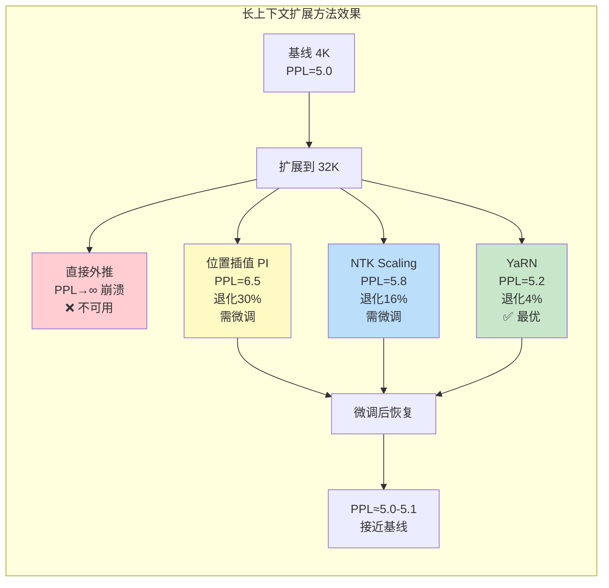
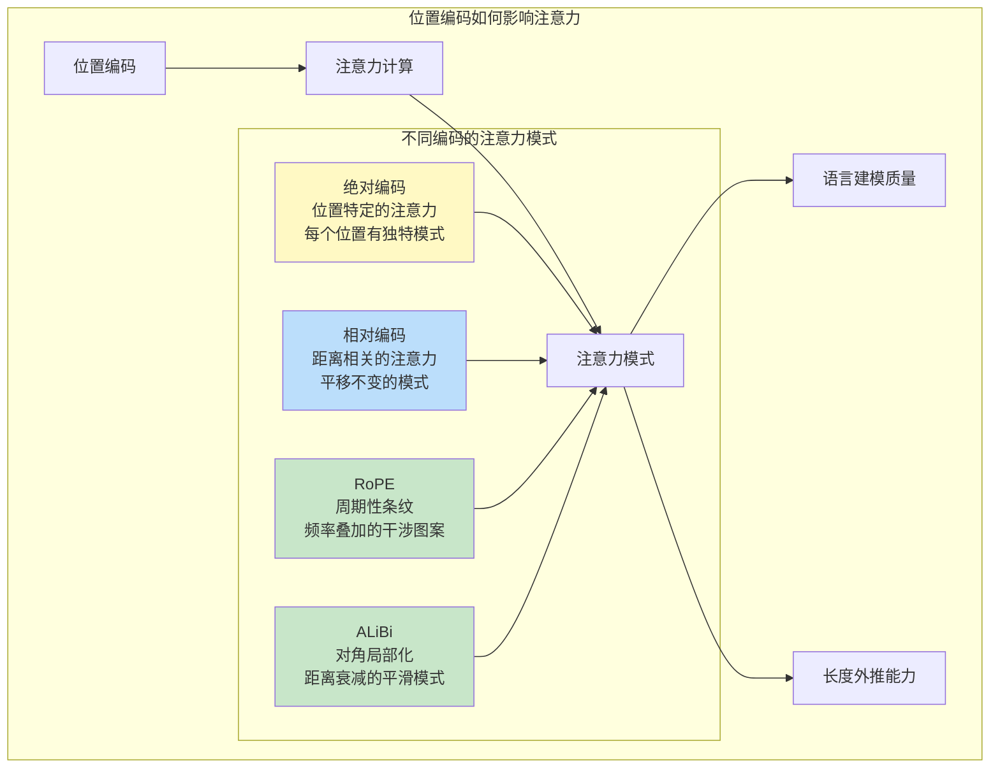

# 位置编码进阶 RoPE-ALiBi

> **一句话定义**：位置编码（Positional Encoding）是为 Transformer 注入序列顺序信息的技术——由于自注意力机制本身是置换不变的（打乱Token顺序结果不变），必须通过位置编码显式告知模型每个Token的位置，而 RoPE（旋转位置编码）和 ALiBi（注意力线性偏置）是两种先进的相对位置编码方案，分别通过旋转Q/K向量和在注意力分数上加距离惩罚来注入位置信息，是现代大模型（Llama、Qwen、GPT-3等）的核心组件。
>
> **核心价值**：位置编码决定了模型理解"词序"的能力，直接影响语言建模质量和长上下文能力——RoPE通过旋转实现相对位置编码且具有良好的长度外推性，ALiBi通过简单的线性偏置实现出色的长上下文扩展，两者是当前LLM位置编码的主流方案，也是长上下文技术（NTK、YaRN、PI）的基础。
>
> **适用场景**：大语言模型架构设计、长上下文扩展（32K/128K/1M）、推理优化（KV Cache、RoPE缓存）、模型微调（位置插值微调）、Transformer架构理解、长度外推研究。

---

## 一、概述

### 1.1 为什么需要位置编码

```mermaid
graph TB
    subgraph 自注意力的置换不变性问题
        S1[自注意力计算<br/>Attention(Q,K,V)=softmax(QK^T/√d)V] --> PERM[置换不变性]
        PERM --> P1[打乱Token顺序<br/>注意力结果不变]
        P1 --> PROBLEM[模型无法区分<br/>'猫追狗' 和 '狗追猫'<br/>语义完全不同！]
    end

    subgraph 位置编码的解决方案
        PROBLEM --> PE[位置编码]
        PE --> M1[绝对位置编码<br/>正弦/可学习<br/>直接加到Embedding]
        PE --> M2[相对位置编码<br/>RoPE/ALiBi<br/>通过注意力注入相对距离]
        M1 --> SOLVE[模型理解词序<br/>'猫追狗' ≠ '狗追猫']
        M2 --> SOLVE
    end

    style PROBLEM fill:#ffcdd2
    style PE fill:#fff9c4
    style SOLVE fill:#c8e6c9
```

### 1.2 位置编码的核心概念

| 概念 | 说明 |
|------|------|
| **位置编码（Positional Encoding）** | 为序列中每个Token注入位置信息的技术，使Transformer能够区分Token的顺序 |
| **置换不变性（Permutation Invariance）** | 自注意力机制的数学性质——打乱输入序列顺序，输出不变，因此需要位置编码打破这种不变性 |
| **绝对位置编码（Absolute PE）** | 为每个绝对位置（0,1,2,...）分配一个编码向量，直接加到Token Embedding上 |
| **相对位置编码（Relative PE）** | 编码Token之间的相对距离（i-j），而非绝对位置，通常通过修改注意力分数实现 |
| **正弦位置编码（Sinusoidal PE）** | 原始Transformer使用的绝对位置编码，用不同频率的正弦/余弦函数生成 |
| **可学习位置编码（Learned PE）** | 位置编码是可训练的参数（Embedding矩阵），GPT-2使用 |
| **RoPE（Rotary Position Embedding）** | 旋转位置编码——通过旋转Q/K向量的成对维度来注入相对位置，Llama系列使用 |
| **ALiBi（Attention with Linear Biases）** | 注意力线性偏置——在注意力分数上加上与距离成正比的惩罚项，无需修改Embedding |
| **长度外推（Length Extrapolation）** | 模型在短上下文训练后，能否在更长的上下文上保持性能的能力 |
| **位置插值（Position Interpolation, PI）** | 将长上下文的位置索引"压缩"到训练范围内，实现长度扩展 |
| **NTK-aware Scaling** | 基于神经正切核（NTK）理论的RoPE缩放，通过修改基频实现长度扩展 |
| **YaRN（Yet another RoPE extensioN method）** | 结合NTK缩放、位置插值和温度缩放的RoPE长上下文扩展方法 |
| **基频（Base Frequency）** | RoPE中正弦/余弦函数的基础频率θ，通常为10000，影响位置编码的波长范围 |

### 1.3 位置编码方案演进

<div style="background:linear-gradient(135deg,#667eea,#764ba2);border-radius:16px;padding:20px;margin:16px 0;font-family:-apple-system,'Segoe UI','PingFang SC','Microsoft YaHei',sans-serif;color:#fff;overflow:hidden;box-shadow:0 8px 28px rgba(0,0,0,.14),0 3px 10px rgba(0,0,0,.08)">
<style>@keyframes pulse{0%,100%{transform:scale(1);opacity:.9}50%{transform:scale(1.03);opacity:1}}.dk-layer{border-radius:8px;padding:12px 16px;margin:6px auto;text-align:center;font-weight:600;animation:pulse 3s ease-in-out infinite}.dk-outer{background:rgba(255,255,255,.15);border:2px solid rgba(255,255,255,.5);max-width:360px;animation-delay:0s}.dk-middle{background:rgba(255,255,255,.2);border:2px solid rgba(255,255,255,.6);max-width:300px;animation-delay:.5s}.dk-inner{background:rgba(255,255,255,.25);border:2px solid rgba(255,255,255,.7);max-width:240px;animation-delay:1s}.dk-arrow{text-align:center;font-size:18px;margin:2px 0}.dk-label{font-size:12px;opacity:.85;font-weight:400;margin-top:4px}</style>
<div style="text-align:center;font-size:15px;font-weight:700;margin-bottom:14px;padding-bottom:10px;border-bottom:1.5px solid rgba(255,255,255,.22);letter-spacing:1px;text-shadow:0 1px 3px rgba(0,0,0,.12)">位置编码方案演进：从绝对到相对</div>
<div class="dk-layer dk-outer">第一代：绝对位置编码<div class="dk-label">正弦编码（Transformer 2017）/ 可学习编码（GPT-2）</div></div>
<div class="dk-arrow">▼ 演进</div>
<div class="dk-layer dk-middle">第二代：相对位置编码<div class="dk-label">T5相对位置偏置 / DeBERTa分解注意力</div></div>
<div class="dk-arrow">▼ 演进</div>
<div class="dk-layer dk-inner">第三代：RoPE / ALiBi<div class="dk-label">旋转位置编码（Llama）/ 线性偏置（BLOOM）</div></div>
</div>

| 方案 | 类型 | 代表模型 | 注入方式 | 长度外推 | 复杂度 |
|------|------|---------|---------|---------|--------|
| **正弦编码** | 绝对 | 原始Transformer、BERT | 加到Embedding | 差（需外推未见过的位置） | 低 |
| **可学习编码** | 绝对 | GPT-2、GPT-3 | 加到Embedding | 极差（位置超出训练范围） | 低 |
| **T5相对偏置** | 相对 | T5、FlanT5 | 加到注意力分数 | 中等 | 中 |
| **RoPE** | 相对 | Llama、Qwen、GPT-NeoX | 旋转Q/K向量 | 好（可插值扩展） | 中 |
| **ALiBi** | 相对 | BLOOM、MPT | 加到注意力分数 | 优秀（天然支持长上下文） | 极低 |

> 🔍 **知识点深度解析**
>
> **作用**：位置编码为Transformer注入序列顺序信息，解决自注意力的置换不变性问题（打乱Token顺序注意力结果不变），使模型能区分"猫追狗"和"狗追猫"等依赖词序的语义，是Transformer架构不可或缺的组件。
>
> **原理**：自注意力机制的计算 `softmax(QK^T/√d)V` 只依赖Q/K/V之间的点积，与Token的位置无关——如果将输入序列的Token顺序打乱，Q/K/V也会相应打乱，但注意力计算的结果（每个位置的输出是所有位置V的加权和）作为一个集合是不变的。因此必须显式注入位置信息。绝对位置编码（正弦/可学习）为每个位置分配一个向量，直接加到Token Embedding上，简单直观但长度外推差（训练时只见过位置0-2047，推理时位置2048+的编码是模型从未见过的）。相对位置编码不编码绝对位置，而是编码Token之间的相对距离——RoPE通过旋转Q/K向量的成对维度，使注意力分数自然包含相对位置信息（旋转后的点积只依赖位置差）；ALiBi直接在注意力分数上加上与距离成正比的惩罚项（距离越远惩罚越大），无需修改Embedding或Q/K，实现极简且长度外推优秀。
>
> **用法要点**：① RoPE是当前开源LLM的主流（Llama、Qwen、Mistral都用RoPE），通过旋转Q/K注入相对位置 ② ALiBi实现最简单（只需在注意力分数上加偏置），长度外推最好，但使用的模型较少（BLOOM、MPT） ③ RoPE的基频θ=10000决定了波长范围——最大波长约为2π×10000^(d/2)/(d/2)，d=128时约6.28M ④ 长上下文扩展——RoPE用位置插值（PI）或NTK缩放，ALiBi天然支持（无需扩展） ⑤ 推理时RoPE可以预计算余弦/正弦表缓存，提升效率 ⑥ 可学习位置编码（GPT-2）长度外推最差，不适合长上下文 ⑦ 正弦编码的频率是固定的，低频维度编码粗位置，高频维度编码细位置 ⑧ 选择位置编码方案时要考虑：模型规模、目标上下文长度、是否需要长度外推、推理效率

---

> 💡 **深度讲解**：位置编码是Transformer架构中最精妙也最容易被忽视的组件。自注意力机制的核心优势——任意两个Token直接连接、完全并行计算——同时也带来了一个根本问题：它是置换不变的。想象一下，"猫追老鼠"和"老鼠追猫"这两句话，如果去掉位置信息，在自注意力看来是完全一样的（都是猫、追、老鼠三个Token的集合），但语义完全相反。位置编码就是为了解决这个问题——它为每个Token注入位置信息，使模型知道"谁在前谁在后"。位置编码的演进经历了三代：第一代是绝对位置编码，包括原始Transformer的正弦编码（用不同频率的正弦/余弦函数生成固定的位置向量）和GPT-2的可学习位置编码（位置向量是可训练参数），它们直接加到Token Embedding上，简单直观但长度外推差——训练时只见过位置0到2047，推理时遇到位置2048就会"不知所措"。第二代是相对位置编码，如T5的相对位置偏置和DeBERTa的分解注意力，它们通过修改注意力分数来注入相对距离信息，比绝对编码外推性好。第三代是RoPE和ALiBi——RoPE通过旋转Q/K向量的成对维度，利用旋转矩阵的性质使注意力分数只依赖相对位置（位置差），这种方法既保留了相对位置编码的外推优势，又实现简单（只需在注意力计算前旋转Q/K）；ALiBi更加极简——直接在注意力分数上加上一个与距离成正比的惩罚项（距离越远惩罚越大），连Q/K都不需要修改，长度外推天然优秀。理解位置编码的原理对于理解Transformer的工作机制和长上下文扩展技术至关重要。
>
> **📝 精简总结**：位置编码解决自注意力的置换不变性问题（打乱Token顺序结果不变，无法区分"猫追狗"和"狗追猫"），为每个Token注入位置信息；核心概念包括绝对位置编码（正弦/可学习，直接加Embedding）、相对位置编码（RoPE/ALiBi，通过注意力注入相对距离）、长度外推（短训长用能力）、位置插值PI、NTK缩放、YaRN、基频θ；演进三代——第一代绝对编码（正弦Transformer/可学习GPT-2，外推差）、第二代相对偏置（T5/DeBERTa，外推中等）、第三代RoPE/ALiBi（旋转Q/K/注意力偏置，外推好）；RoPE是当前开源LLM主流（Llama/Qwen/Mistral），ALiBi实现最简单外推最好（BLOOM/MPT）；原理是绝对编码加位置向量到Embedding，RoPE旋转Q/K使点积依赖相对位置，ALiBi在注意力分数加距离惩罚；用法要点包括RoPE主流、ALiBi极简外推好、基频10000决定波长、长上下文用PI/NTK扩展、推理预计算余弦表缓存、可学习编码外推最差。

---

## 二、原理

### 2.1 正弦位置编码

原始Transformer（Vaswani et al., 2017）使用正弦位置编码，用不同频率的正弦和余弦函数生成位置向量：

```text
$$
PE_{(pos, 2i)} = \sin\left(\frac{pos}{10000^{2i/d}}\right)
```
```text
$$

$$
```
PE_{(pos, 2i+1)} = \cos\left(\frac{pos}{10000^{2i/d}}\right)
$$

其中 $pos$ 是位置索引，$i$ 是维度索引，$d$ 是隐藏维度。

```mermaid
graph TB
    subgraph 正弦位置编码生成
        POS[位置 pos<br/>0,1,2,...,n-1] --> FREQ[计算各维度频率<br/>ω_i = 1/10000^(2i/d)]
        FREQ --> SIN[偶数维度: sin(pos × ω_i)]
        FREQ --> COS[奇数维度: cos(pos × ω_i)]
        SIN --> CONCAT[拼接为 d 维向量]
        COS --> CONCAT
        CONCAT --> ADD[加到 Token Embedding<br/>x + PE]
    end

    subgraph 频率特性
        LOW[低频维度<br/>i小 → ω小 → 波长长<br/>编码粗粒度位置] --> PROP[不同维度编码不同尺度]
        HIGH[高频维度<br/>i大 → ω大 → 波长短<br/>编码细粒度位置] --> PROP
    end

    style SIN fill:#bbdefb
    style COS fill:#c8e6c9
    style LOW fill:#fff9c4
    style HIGH fill:#ffcdd2
```

#### 正弦编码的性质

1. **确定性**：位置编码是固定的，不需要学习参数
2. **有界性**：正弦/余弦值在 [-1, 1] 范围内
3. **多尺度**：不同维度有不同频率，低频编码远距离关系，高频编码近距离关系
4. **线性可表示相对位置**：对于任意固定偏移 k，PE(pos+k) 可以表示为 PE(pos) 的线性函数（这是选择正弦/余弦的关键原因）

### 2.2 RoPE 旋转位置编码

RoPE（Rotary Position Embedding）由Su et al.在2021年提出（RoFormer），核心思想是**用旋转矩阵同时编码绝对位置并使注意力分数自然包含相对位置**。

#### 核心公式

将Q/K向量的维度两两配对（第2i维和第2i+1维），对每对维度应用旋转矩阵：

$$
\tilde{q}_m = f(q, m) = R_m^d \cdot q
```text
$$

$$
```
\tilde{k}_n = f(k, n) = R_n^d \cdot k
$$

其中旋转矩阵 $R_m^d$ 是分块对角矩阵：

```text
$$
R_m^d = \begin{pmatrix}
```
```text
\cos(m\theta_0) & -\sin(m\theta_0) & 0 & 0 & \cdots & 0 & 0 \\
\sin(m\theta_0) & \cos(m\theta_0) & 0 & 0 & \cdots & 0 & 0 \\
0 & 0 & \cos(m\theta_1) & -\sin(m\theta_1) & \cdots & 0 & 0 \\
0 & 0 & \sin(m\theta_1) & \cos(m\theta_1) & \cdots & 0 & 0 \\
\vdots & \vdots & \vdots & \vdots & \ddots & \vdots & \vdots \\
0 & 0 & 0 & 0 & \cdots & \cos(m\theta_{d/2-1}) & -\sin(m\theta_{d/2-1}) \\
```
0 & 0 & 0 & 0 & \cdots & \sin(m\theta_{d/2-1}) & \cos(m\theta_{d/2-1})
\end{pmatrix}
$$

其中 $\theta_i = 10000^{-2i/d}$ 是第i对维度的旋转角度频率。

#### 关键性质：相对位置编码

旋转后的Q和K的点积具有**相对位置不变性**——只依赖位置差 m-n，而不依赖绝对位置 m 和 n：

$$
\langle f(q, m), f(k, n) \rangle = \langle q, R_{m-n}^d \cdot k \rangle
$$

**证明**：

$$
\langle R_m q, R_n k \rangle = q^T R_m^T R_n k = q^T R_{n-m} k = \langle q, R_{n-m} k \rangle
$$

因为旋转矩阵是正交矩阵（$R^T R = I$），且 $R_m^T R_n = R_{n-m}$（旋转角度相加）。

```mermaid
graph TB
    subgraph RoPE 旋转位置编码原理
        Q[Q向量<br/>d维] --> PAIR[维度两两配对<br/>(q0,q1), (q2,q3), ...]
        PAIR --> ROT[每对维度旋转<br/>旋转角度 = pos × θ_i]
        ROT --> QROT[旋转后的Q<br/>包含位置m信息]

        K[K向量<br/>d维] --> PAIR2[维度两两配对]
        PAIR2 --> ROT2[每对维度旋转<br/>旋转角度 = pos × θ_i]
        ROT2 --> KROT[旋转后的K<br/>包含位置n信息]

        QROT --> DOT[点积 Q·K^T<br/>= q^T R_{n-m} k]
        KROT --> DOT
        DOT --> RESULT[注意力分数<br/>只依赖相对位置 n-m<br/>不依赖绝对位置!]
    end

    style ROT fill:#bbdefb
    style ROT2 fill:#c8e6c9
    style DOT fill:#fff9c4
    style RESULT fill:#c8e6c9
```

<div style="background:linear-gradient(135deg,#fa709a,#fee140);border-radius:16px;padding:20px;margin:16px 0;font-family:-apple-system,'Segoe UI','PingFang SC','Microsoft YaHei',sans-serif;color:#fff;overflow:hidden;box-shadow:0 8px 28px rgba(0,0,0,.14),0 3px 10px rgba(0,0,0,.08)">
<style>@keyframes highlight{0%,100%{box-shadow:0 0 0 rgba(255,255,255,0)}50%{box-shadow:0 0 20px rgba(255,255,255,.4)}}.hl-box{background:rgba(255,255,255,.2);border-radius:10px;padding:14px 18px;margin:10px 0;animation:highlight 3s ease-in-out infinite;border-left:4px solid rgba(255,255,255,.6)}.hl-formula{font-family:monospace;font-size:14px;text-align:center;background:rgba(0,0,0,.15);border-radius:8px;padding:12px;margin:10px 0}</style>
<div style="text-align:center;font-size:15px;font-weight:700;margin-bottom:14px;padding-bottom:10px;border-bottom:1.5px solid rgba(255,255,255,.22);letter-spacing:1px;text-shadow:0 1px 3px rgba(0,0,0,.12)">📌 RoPE 核心洞察：旋转矩阵的相对位置不变性</div>
<div class="hl-box">RoPE的精妙之处在于：虽然对Q和K分别施加了绝对位置的旋转，但由于旋转矩阵是正交矩阵且旋转角度可加，旋转后Q和K的点积只依赖相对位置差（m-n），而不依赖绝对位置m和n。这意味着RoPE本质上是一种相对位置编码，但实现方式是对绝对位置做旋转——兼具绝对编码的实现简单和相对编码的外推优势。</div>
<div class="hl-formula">⟨R_m·q, R_n·k⟩ = q^T·R_m^T·R_n·k = q^T·R_{n-m}·k<br/>旋转角度可加：R_m^T · R_n = R_{n-m}</div>
<div style="font-size:13px;opacity:.9;margin-top:8px">💡 低频维度（i小）旋转慢，编码远距离关系；高频维度（i大）旋转快，编码近距离关系</div>
</div>

#### RoPE 的维度配对与旋转

以d=4为例，Q向量为 $(q_0, q_1, q_2, q_3)$，配对为 $(q_0, q_1)$ 和 $(q_2, q_3)$：

```text
$$
f(q, m) = \begin{pmatrix}
```
```text
q_0 \cos(m\theta_0) - q_1 \sin(m\theta_0) \\
q_0 \sin(m\theta_0) + q_1 \cos(m\theta_0) \\
q_2 \cos(m\theta_1) - q_3 \sin(m\theta_1) \\
```
q_2 \sin(m\theta_1) + q_3 \cos(m\theta_1)
\end{pmatrix}
$$

等价的复数表示（更简洁）：

```text
$$
f(q, m)_{2i:2i+2} = (q_{2i} + i q_{2i+1}) \cdot e^{i m \theta_i}
$$
```

即每对维度看作复数，乘以 $e^{i m \theta_i}$（旋转 $m\theta_i$ 角度）。

### 2.3 ALiBi 注意力线性偏置

ALiBi（Attention with Linear Biases）由Press et al.在2022年提出，核心思想极其简单：**在注意力分数上加上与距离成正比的惩罚项**。

#### 核心公式

```text
$$
\text{ALiBiAttention}(Q, K, V) = \text{softmax}\left(\frac{QK^T}{\sqrt{d_k}} + m \cdot B\right)V
$$
```

其中 $B$ 是偏置矩阵，$B_{ij} = -(i-j)$（位置i和j的距离的负数），$m$ 是每个注意力头的斜率（可学习或预设）。

等价地，对于位置 $i$ 的查询和位置 $j$ 的键：

```text
$$
\text{score}_{ij} = \frac{q_i \cdot k_j}{\sqrt{d_k}} - m \cdot |i-j|
$$
```

```mermaid
graph TB
    subgraph ALiBi 原理
        Q[Q矩阵] --> DOT[Q·K^T/√d<br/>原始注意力分数]
        K[K矩阵] --> DOT
        DOT --> ADD[加线性偏置<br/>score -= m × |i-j|]

        subgraph 偏置矩阵 B
            B0["位置0: [0, -1, -2, -3, ...]"]
            B1["位置1: [-1, 0, -1, -2, ...]"]
            B2["位置2: [-2, -1, 0, -1, ...]"]
            B3["位置3: [-3, -2, -1, 0, ...]"]
        end

        B0 --> ADD
        B1 --> ADD
        B2 --> ADD
        B3 --> ADD

        ADD --> SOFTMAX[Softmax]
        SOFTMAX --> MUL[× V]
        MUL --> OUT[输出]
    end

    subgraph 核心特性
        C1[距离越远<br/>惩罚越大<br/>注意力越弱] --> PROP[天然的局部注意力倾向]
        C2[无需修改Embedding<br/>无需修改Q/K<br/>只改注意力分数] --> PROP2[实现极简]
        C3[偏置与位置无关<br/>只依赖距离<br/>长度外推天然支持] --> PROP3[优秀的长上下文能力]
    end

    style ADD fill:#fff9c4
    style PROP fill:#c8e6c9
    style PROP2 fill:#bbdefb
    style PROP3 fill:#c8e6c9
```

#### ALiBi 的斜率设置

ALiBi为每个注意力头分配不同的斜率 $m$，形成几何级数：

```text
$$
m = 2^{-8/n \cdot h}, \quad h = 1, 2, ..., n
$$
```

其中 $n$ 是注意力头数。例如8个头时，斜率为：

```text
$$
m = [\frac{1}{2^1}, \frac{1}{2^{1.25}}, \frac{1}{2^{1.5}}, \frac{1}{2^{1.75}}, \frac{1}{2^2}, \frac{1}{2^{2.25}}, \frac{1}{2^{2.5}}, \frac{1}{2^{2.75}}]
$$
```

不同头有不同的"感受野"——斜率大的头更关注局部（惩罚大），斜率小的头可以关注全局（惩罚小）。

### 2.4 RoPE vs ALiBi 深度对比

<div style="background:linear-gradient(135deg,#4facfe,#00f2fe);border-radius:16px;padding:20px;margin:16px 0;font-family:-apple-system,'Segoe UI','PingFang SC','Microsoft YaHei',sans-serif;color:#fff;overflow:hidden;box-shadow:0 8px 28px rgba(0,0,0,.14),0 3px 10px rgba(0,0,0,.08)">
<style>@keyframes fadeIn{from{opacity:0;transform:translateY(10px)}to{opacity:1;transform:translateY(0)}}.cmp-col{display:inline-block;width:45%;vertical-align:top;padding:12px;margin:0 2%;background:rgba(255,255,255,.15);border-radius:10px;animation:fadeIn .8s ease-out}.cmp-col h4{margin:0 0 8px 0;text-align:center;border-bottom:1px solid rgba(255,255,255,.3);padding-bottom:6px}.cmp-col ul{margin:0;padding-left:18px;font-size:13px;line-height:1.8}.cmp-vs{display:inline-block;width:4%;text-align:center;font-size:24px;font-weight:700;vertical-align:middle;animation:fadeIn 1s ease-out}</style>
<div style="text-align:center;font-size:15px;font-weight:700;margin-bottom:14px;padding-bottom:10px;border-bottom:1.5px solid rgba(255,255,255,.22);letter-spacing:1px;text-shadow:0 1px 3px rgba(0,0,0,.12)">RoPE vs ALiBi 深度对比</div>
<div style="text-align:center">
<div class="cmp-col"><h4>RoPE（旋转位置编码）</h4><ul><li>旋转Q/K向量的成对维度</li><li>点积自然包含相对位置</li><li>需要修改Q/K计算</li><li>长度外推好（需插值/NTK）</li><li>代表：Llama、Qwen、Mistral</li><li>当前开源LLM主流方案</li><li>可预计算余弦/正弦表加速</li><li>高频维度在长距离会"缠绕"</li></ul></div>
<div class="cmp-vs">VS</div>
<div class="cmp-col"><h4>ALiBi（注意力线性偏置）</h4><ul><li>在注意力分数加距离惩罚</li><li>不修改Q/K，不修改Embedding</li><li>实现极简（一行代码）</li><li>长度外推优秀（天然支持）</li><li>代表：BLOOM、MPT、LLaMA-2早期</li><li>使用模型较少但效果好</li><li>无额外计算开销</li><li>固定偏置可能限制长距离关注</li></ul></div>
</div>
<div style="text-align:center;font-size:12px;opacity:.85;margin-top:10px">RoPE生态更成熟，ALiBi长上下文更简单；两者都是优秀的相对位置编码方案</div>
</div>

| 对比维度 | 正弦编码 | 可学习编码 | RoPE | ALiBi |
|---------|---------|-----------|------|-------|
| **编码类型** | 绝对 | 绝对 | 相对（通过旋转实现） | 相对（通过偏置实现） |
| **注入方式** | 加Embedding | 加Embedding | 旋转Q/K | 加注意力偏置 |
| **可训练参数** | 无 | 有（位置Embedding） | 无 | 无（斜率预设） |
| **长度外推** | 差 | 极差 | 好（可插值扩展） | 优秀（天然支持） |
| **实现复杂度** | 低 | 低 | 中 | 极低 |
| **额外计算** | 无 | 无 | 旋转Q/K（小） | 加偏置（极小） |
| **代表模型** | BERT、原始Transformer | GPT-2、GPT-3 | Llama、Qwen、Mistral | BLOOM、MPT |
| **长上下文扩展** | 困难 | 不可能 | PI/NTK/YaRN | 无需扩展 |
| **远距离建模** | 可以 | 可以 | 高频缠绕问题 | 线性惩罚可能过强 |

### 2.5 长上下文扩展技术

#### 位置插值（Position Interpolation, PI）

将长上下文的位置索引从 $[0, L_{ext})$ 线性压缩到 $[0, L_{train})$：

$$
m' = m \cdot \frac{L_{train}}{L_{ext}}
$$

例如训练长度2048，扩展到8192（4倍），位置m=4096会被映射到m'=1024。

#### NTK-aware Scaling

基于神经正切核（NTK）理论，通过修改RoPE的基频来扩展上下文：

$$
\theta'_i = \theta_i \cdot s^{d/(d-2)}, \quad s = \frac{L_{ext}}{L_{train}}
$$

即提高基频（降低频率），使波长变长，从而支持更长的上下文。

#### YaRN（Yet another RoPE extensioN method）

YaRN结合了三种技术：
1. **NTK缩放**：修改基频扩展波长
2. **位置插值**：微调位置索引范围
3. **温度缩放**：调整注意力分数的温度（除以√d的系数），缓解长上下文下注意力分布过于平坦的问题

```mermaid
graph TB
    subgraph RoPE 长上下文扩展方法
        BASE[原始 RoPE<br/>训练长度 L_train=4K<br/>基频 θ=10000] --> EXT[扩展到 32K/128K]

        EXT --> PI[位置插值 PI<br/>m' = m × L_train/L_ext<br/>压缩位置索引]
        EXT --> NTK[NTK Scaling<br/>θ' = θ × s^(d/(d-2))<br/>提高基频→降低频率→增长波长]
        EXT --> YARN[YaRN<br/>NTK缩放 + PI + 温度缩放<br/>三者结合效果最优]

        PI --> FINETUNE[需要少量微调<br/>100-1000步]
        NTK --> FINETUNE
        YARN --> FINETUNE

        FINETUNE --> RESULT[支持 32K/128K 上下文<br/>PPL 退化 < 5%]
    end

    style PI fill:#bbdefb
    style NTK fill:#fff9c4
    style YARN fill:#c8e6c9
    style RESULT fill:#c8e6c9
```

> 🔍 **知识点深度解析**
>
> **作用**：RoPE通过旋转Q/K向量的成对维度来注入位置信息，是当前开源LLM（Llama、Qwen、Mistral等）的标准位置编码方案，兼具实现简单和相对位置编码的外推优势，是长上下文扩展技术（PI、NTK、YaRN）的基础。
>
> **原理**：RoPE将Q/K向量的维度两两配对，每对维度看作一个二维向量，对其施加旋转矩阵——旋转角度为位置m乘以该对维度的频率θ_i（θ_i=10000^(-2i/d)）。旋转后，Q和K的点积具有相对位置不变性：⟨R_m·q, R_n·k⟩=q^T·R_{n-m}·k，只依赖位置差n-m而不依赖绝对位置。这是因为旋转矩阵是正交矩阵（R^T·R=I），且旋转角度可加（R_m^T·R_n=R_{n-m}）。低频维度（i小，θ小）旋转慢，编码远距离关系；高频维度（i大，θ大）旋转快，编码近距离关系。RoPE不需要修改Embedding，只在注意力计算前旋转Q/K，实现简洁且可预计算余弦/正弦表缓存加速。
>
> **用法要点**：① RoPE作用于Q和K，不作用于V ② 维度配对是(0,1),(2,3),...,(d-2,d-1)，每对独立旋转 ③ 基频θ=10000是标准值，Llama用10000，有些模型用500000（CodeLlama）支持更长上下文 ④ 推理时预计算cos(mθ_i)和sin(mθ_i)表，避免重复计算 ⑤ 长上下文扩展——位置插值（PI）压缩位置索引，NTK缩放提高基频增长波长，YaRN结合两者+温度缩放效果最优 ⑥ 扩展后通常需要100-1000步微调来恢复性能 ⑦ RoPE的高频维度在长距离会出现"缠绕"（wrapping）问题——旋转超过2π后重复，这是长上下文的一个挑战 ⑧ KV Cache中的K已经包含了RoPE旋转，推理时新Token的K需要用当前位置重新旋转 ⑨ 实现时注意：RoPE通常在Q/K投影之后、注意力计算之前应用

---

> 💡 **深度讲解**：RoPE和ALiBi代表了相对位置编码的两种思路。RoPE的精妙之处在于它用"绝对位置的旋转"实现了"相对位置的编码"——对Q和K分别施加绝对位置m和n的旋转，但由于旋转矩阵的正交性和角度可加性，旋转后的点积只依赖相对位置差m-n。这种设计既保留了绝对编码的实现简单（不需要在注意力计算中处理复杂的相对位置索引），又获得了相对编码的外推优势（点积不依赖绝对位置，因此未见过的绝对位置不会导致分布偏移）。RoPE的频率设计与正弦编码类似——低频维度编码粗位置（远距离关系），高频维度编码细位置（近距离关系），但RoPE的高频维度在长距离会出现"缠绕"问题（旋转角度超过2π后重复），这是RoPE长上下文扩展需要解决的核心问题。ALiBi走了一条更极简的路线——直接在注意力分数上减去m×|i-j|，距离越远惩罚越大，模型自然倾向于关注近处的Token。ALiBi不需要修改Embedding、不需要修改Q/K、不需要任何可训练参数（斜率按几何级数预设），实现只需一行代码，且长度外推天然优秀（因为偏置只依赖距离，与绝对位置无关）。但ALiBi的固定线性惩罚可能过于强硬——在需要长距离依赖的任务（如长文档问答）中，强惩罚可能阻碍模型关注远处的关键信息。长上下文扩展方面，RoPE生态更成熟——位置插值（PI）、NTK缩放、YaRN等技术可以将RoPE模型从4K扩展到32K/128K甚至1M，而ALiBi通常不需要扩展（天然支持）。理解这两种方案的原理和权衡，对于模型架构选择和长上下文优化至关重要。
>
> **📝 精简总结**：正弦编码PE(pos,2i)=sin(pos/10000^(2i/d))，PE(pos,2i+1)=cos(...)，低频编码粗位置高频编码细位置，确定性无参数但外推差；RoPE将Q/K维度两两配对，每对旋转角度=pos×θ_i（θ_i=10000^(-2i/d)），旋转后点积⟨R_m q,R_n k⟩=q^T R_{n-m} k只依赖相对位置（正交矩阵+角度可加），是当前开源LLM主流；ALiBi在注意力分数减m×|i-j|（距离惩罚），斜率按几何级数2^(-8/n·h)预设，不修改Q/K/Embedding，实现极简一行代码，外推天然优秀；对比——RoPE生态成熟需PI/NTK扩展，ALiBi外推最好但固定惩罚可能过强；长上下文扩展——PI压缩位置索引m'=m×L_train/L_ext，NTK提高基频θ'=θ×s^(d/(d-2))增长波长，YaRN=NTK+PI+温度缩放三者结合最优，扩展后需100-1000步微调。

---

## 三、实操

### 3.1 环境搭建

```python
python -m venv rope-env
source rope-env/bin/activate

pip install torch transformers accelerate sentencepiece
pip install matplotlib numpy  # 可视化
```

### 3.2 正弦位置编码实现

```python
"""
正弦位置编码的实现与可视化
"""
import torch
import torch.nn as nn
import numpy as np
import matplotlib.pyplot as plt

class SinusoidalPositionalEncoding(nn.Module):
    def __init__(self, d_model: int, max_len: int = 5000):
        super().__init__()
        # 预计算位置编码矩阵
        pe = torch.zeros(max_len, d_model)
        position = torch.arange(0, max_len, dtype=torch.float).unsqueeze(1)
        # 频率：10000^(2i/d_model)
        div_term = torch.exp(
            torch.arange(0, d_model, 2).float() * (-np.log(10000.0) / d_model)
        )
        pe[:, 0::2] = torch.sin(position * div_term)  # 偶数维度：sin
        pe[:, 1::2] = torch.cos(position * div_term)  # 奇数维度：cos
        self.register_buffer('pe', pe.unsqueeze(0))  # (1, max_len, d_model)

    def forward(self, x: torch.Tensor) -> torch.Tensor:
        """x: (batch, seq_len, d_model)"""
        return x + self.pe[:, :x.size(1), :]

# ===== 可视化正弦位置编码 =====
d_model = 128
max_len = 100
pe = SinusoidalPositionalEncoding(d_model, max_len)
pe_matrix = pe.pe.squeeze(0).numpy()  # (100, 128)

plt.figure(figsize=(12, 4))
plt.subplot(1, 2, 1)
plt.imshow(pe_matrix, aspect='auto', cmap='coolwarm')
plt.xlabel('维度')
plt.ylabel('位置')
plt.title('正弦位置编码矩阵')
plt.colorbar(label='编码值')

plt.subplot(1, 2, 2)
# 绘制几个维度的位置编码曲线
for dim in [0, 1, 10, 50, 100]:
    plt.plot(pe_matrix[:, dim], label=f'维度 {dim}')
plt.xlabel('位置')
plt.ylabel('编码值')
plt.title('不同维度的位置编码曲线')
plt.legend()
plt.tight_layout()
plt.savefig('sinusoidal_pe.png', dpi=150)
print("正弦位置编码可视化已保存")

# 验证：PE(pos+k) 是 PE(pos) 的线性函数
pos = 5
k = 3
d = 128
pe_pos = pe_matrix[pos]
pe_posk = pe_matrix[pos + k]
print(f"\n位置{pos}编码前4维: {pe_pos[:4]}")
print(f"位置{pos+k}编码前4维: {pe_posk[:4]}")
print("低频维度变化慢（编码粗位置），高频维度变化快（编码细位置）")
```

### 3.3 RoPE 实现

```python
"""
RoPE 旋转位置编码的完整实现
"""
import torch
import torch.nn as nn
import math

class RotaryPositionalEncoding(nn.Module):
    """
    RoPE: 旋转位置编码
    对Q/K向量的成对维度施加旋转
    """
    def __init__(self, dim: int, max_seq_len: int = 4096, base: float = 10000.0):
        super().__init__()
        self.dim = dim
        self.max_seq_len = max_seq_len
        self.base = base

        # 预计算旋转所需的余弦和正弦
        self._build_cache(max_seq_len, dim)

    def _build_cache(self, seq_len: int, dim: int):
        """预计算 cos 和 sin 缓存"""
        # 频率 θ_i = base^(-2i/dim)
        inv_freq = 1.0 / (self.base ** (torch.arange(0, dim, 2).float() / dim))
        # 位置索引
        t = torch.arange(seq_len, dtype=inv_freq.dtype)
        # 外积：(seq_len, dim/2)
        freqs = torch.einsum('i,j->ij', t, inv_freq)
        # 重复每对维度：(seq_len, dim)
        emb = torch.cat((freqs, freqs), dim=-1)
        self.register_buffer("cos_cached", emb.cos()[None, None, :, :], persistent=False)
        self.register_buffer("sin_cached", emb.sin()[None, None, :, :], persistent=False)

    def forward(self, x: torch.Tensor, seq_len: int = None) -> torch.Tensor:
        """
        x: (batch, num_heads, seq_len, head_dim)
        对x施加旋转
        """
        if seq_len is None:
            seq_len = x.shape[2]

        # 如果序列长度超过缓存，重新构建
        if seq_len > self.max_seq_len:
            self._build_cache(seq_len, self.dim)
            self.max_seq_len = seq_len

        cos = self.cos_cached[:, :, :seq_len, :].to(x.dtype)
        sin = self.sin_cached[:, :, :seq_len, :].to(x.dtype)

        # 旋转：将 x 的偶数维和奇数维配对
        # x1 = x[..., 0::2], x2 = x[..., 1::2]
        # 旋转后：x1' = x1*cos - x2*sin, x2' = x1*sin + x2*cos
        x1 = x[..., : x.shape[-1] // 2]
        x2 = x[..., x.shape[-1] // 2 :]
        rotated_x1 = x1 * cos[..., : x.shape[-1] // 2] - x2 * sin[..., : x.shape[-1] // 2]
        rotated_x2 = x1 * sin[..., : x.shape[-1] // 2] + x2 * cos[..., : x.shape[-1] // 2]
        return torch.cat((rotated_x1, rotated_x2), dim=-1)


def rotate_half(x):
    """将向量的后半部分取负并与前半部分交错，用于旋转的另一种实现"""
    x1 = x[..., : x.shape[-1] // 2]
    x2 = x[..., x.shape[-1] // 2 :]
    return torch.cat((-x2, x1), dim=-1)


def apply_rotary_pos_emb(q, k, cos, sin):
    """
    对Q和K应用RoPE（Llama风格实现）
    q, k: (batch, num_heads, seq_len, head_dim)
    cos, sin: (1, 1, seq_len, head_dim)
    """
    q_embed = (q * cos) + (rotate_half(q) * sin)
    k_embed = (k * cos) + (rotate_half(k) * sin)
    return q_embed, k_embed


# ===== 验证 RoPE 的相对位置不变性 =====
torch.manual_seed(42)
dim = 64
rope = RotaryPositionalEncoding(dim, max_seq_len=100)

# 随机Q和K向量
q = torch.randn(1, 1, 1, dim)
k = torch.randn(1, 1, 1, dim)

# 位置 (m=5, n=8)，相对距离 = 3
q_rot5 = rope(q.clone(), seq_len=6)[:, :, 5:6, :]  # 位置5
k_rot8 = rope(k.clone(), seq_len=9)[:, :, 8:9, :]  # 位置8
score_5_8 = torch.sum(q_rot5 * k_rot8).item()

# 位置 (m=15, n=18)，相对距离也 = 3
q_rot15 = rope(q.clone(), seq_len=16)[:, :, 15:16, :]
k_rot18 = rope(k.clone(), seq_len=19)[:, :, 18:19, :]
score_15_18 = torch.sum(q_rot15 * k_rot18).item()

print(f"位置(5,8)注意力分数: {score_5_8:.6f}")
print(f"位置(15,18)注意力分数: {score_15_18:.6f}")
print(f"相对距离都是3，分数应该相等（差异: {abs(score_5_8 - score_15_18):.2e}）")
print("✅ 验证通过：RoPE的注意力分数只依赖相对位置，不依赖绝对位置！")
```

### 3.4 ALiBi 实现

```python
"""
ALiBi 注意力线性偏置的实现
"""
import torch
import torch.nn as nn
import math

def get_alibi_slopes(num_heads: int) -> torch.Tensor:
    """
    计算ALiBi的斜率（几何级数）
    当 num_heads 是 2 的幂时，斜率为 2^(-8/n * h), h=1..n
    """
    def get_slopes_power_of_2(n):
        start = 2 ** (-(2 ** -(math.log2(n) - 3)))
        ratio = start
        return [start * ratio ** i for i in range(n)]

    if math.log2(num_heads).is_integer():
        slopes = get_slopes_power_of_2(num_heads)
    else:
        # 非2的幂时，取最接近的两个2的幂的斜率的并集
        closest_power_of_2 = 2 ** math.floor(math.log2(num_heads))
        slopes = (
            get_slopes_power_of_2(closest_power_of_2)
            + get_slopes_power_of_2(2 * closest_power_of_2)[0::2][: num_heads - closest_power_of_2]
        )
    return torch.tensor(slopes)


def build_alibi_bias(seq_len: int, num_heads: int, slopes: torch.Tensor) -> torch.Tensor:
    """
    构建ALiBi偏置矩阵
    返回: (num_heads, seq_len, seq_len)
    """
    # 距离矩阵：(seq_len, seq_len)，B[i][j] = -(i-j) = j-i
    arange = torch.arange(seq_len)
    distance = arange[None, :] - arange[:, None]  # (seq_len, seq_len)
    # 每个头乘以自己的斜率
    alibi = slopes.unsqueeze(1).unsqueeze(2) * distance.unsqueeze(0)
    return alibi  # (num_heads, seq_len, seq_len)


class ALiBiAttention(nn.Module):
    """带ALiBi的多头注意力"""
    def __init__(self, d_model: int, num_heads: int, max_seq_len: int = 4096):
        super().__init__()
        self.num_heads = num_heads
        self.head_dim = d_model // num_heads
        self.scale = math.sqrt(self.head_dim)

        self.q_proj = nn.Linear(d_model, d_model)
        self.k_proj = nn.Linear(d_model, d_model)
        self.v_proj = nn.Linear(d_model, d_model)
        self.out_proj = nn.Linear(d_model, d_model)

        # ALiBi 斜率
        self.register_buffer("slopes", get_alibi_slopes(num_heads))
        # 预构建偏置（可按需扩展）
        self.register_buffer(
            "alibi_bias",
            build_alibi_bias(max_seq_len, num_heads, self.slopes),
            persistent=False
        )

    def forward(self, x: torch.Tensor, mask: torch.Tensor = None) -> torch.Tensor:
        batch, seq_len, _ = x.shape

        q = self.q_proj(x).view(batch, seq_len, self.num_heads, self.head_dim).transpose(1, 2)
        k = self.k_proj(x).view(batch, seq_len, self.num_heads, self.head_dim).transpose(1, 2)
        v = self.v_proj(x).view(batch, seq_len, self.num_heads, self.head_dim).transpose(1, 2)

        # 注意力分数：(batch, num_heads, seq_len, seq_len)
        scores = torch.matmul(q, k.transpose(-2, -1)) / self.scale

        # 加ALiBi偏置
        alibi = self.alibi_bias[:seq_len, :seq_len].unsqueeze(0)  # (1, num_heads, seq_len, seq_len)
        scores = scores + alibi

        # 因果掩码（解码器用）
        if mask is not None:
            scores = scores.masked_fill(mask == 0, float('-inf'))

        attn = torch.softmax(scores, dim=-1)
        output = torch.matmul(attn, v)
        output = output.transpose(1, 2).contiguous().view(batch, seq_len, -1)
        return self.out_proj(output)


# ===== 验证 ALiBi =====
num_heads = 8
slopes = get_alibi_slopes(num_heads)
print(f"ALiBi 斜率（{num_heads}个头）:")
for i, s in enumerate(slopes):
    print(f"  Head {i}: m = {s.item():.6f}")

# 构建偏置矩阵并可视化
alibi = build_alibi_bias(20, num_heads, slopes)
print(f"\nALiBi偏置矩阵形状: {alibi.shape}")
print(f"Head 0, 位置5的偏置（前10个位置）: {alibi[0, 5, :10].tolist()}")
print("  距离越远（j离5越远），偏置越负（惩罚越大）")
print(f"Head 7（斜率最小），位置5的偏置（前10个位置）: {alibi[7, 5, :10].tolist()}")
print("  斜率小的头惩罚小，可以关注更远的位置")
```

### 3.5 使用 HuggingFace 模型中的位置编码

```python
"""
查看和修改 HuggingFace 模型中的位置编码配置
"""
from transformers import AutoConfig, AutoModelForCausalLM
import torch

# 加载 Llama 配置（使用 RoPE）
config = AutoConfig.from_pretrained("meta-llama/Llama-2-7b-hf")
print("=== Llama-2 7B 位置编码配置 ===")
print(f"模型类型: {config.model_type}")
print(f"隐藏维度: {config.hidden_size}")
print(f"注意力头数: {config.num_attention_heads}")
print(f"头维度: {config.hidden_size // config.num_attention_heads}")
print(f"最大位置嵌入: {config.max_position_embeddings}")
print(f"RoPE 基频: {config.rope_theta}")
print(f"位置编码类型: {getattr(config, 'position_embedding_type', 'rope')}")

# ===== RoPE 长上下文扩展配置 =====
# 方法1：位置插值（Position Interpolation）
config_rope_scaling_pi = {
    "type": "linear",       # 线性插值
    "factor": 4.0,          # 扩展4倍（4K→16K）
}

# 方法2：NTK Scaling
config_rope_scaling_ntk = {
    "type": "dynamic",      # 动态NTK（根据序列长度自动调整）
    "factor": 4.0,
    "original_max_position_embeddings": 4096,
}

# 方法3：YaRN
config_rope_scaling_yarn = {
    "type": "yarn",
    "factor": 8.0,          # 扩展8倍（4K→32K）
    "original_max_position_embeddings": 4096,
    "finetuned": True,      # 经过微调
}

print("\n=== RoPE 长上下文扩展方案 ===")
print(f"线性插值(PI): {config_rope_scaling_pi}")
print(f"动态NTK: {config_rope_scaling_ntk}")
print(f"YaRN: {config_rope_scaling_yarn}")

# 加载模型时应用扩展配置
# model = AutoModelForCausalLM.from_pretrained(
#     "meta-llama/Llama-2-7b-hf",
#     config=config,  # 修改后的config
#     torch_dtype=torch.float16,
#     device_map="auto"
# )

# ===== 查看 BLOOM 配置（使用 ALiBi） =====
config_bloom = AutoConfig.from_pretrained("bigscience/bloom-560m")
print("\n=== BLOOM 560M 位置编码配置 ===")
print(f"模型类型: {config_bloom.model_type}")
print(f"使用 ALiBi: {getattr(config_bloom, 'alibi', True)}")
print(f"注意力头数: {config_bloom.n_head}")
print(f"ALiBi 是 BLOOM 的默认位置编码方案，无需额外配置")
```

### 3.6 位置编码可视化对比

```python
"""
可视化对比不同位置编码方案的注意力模式
"""
import torch
import numpy as np
import matplotlib.pyplot as plt

def visualize_attention_pattern(attn_weights, title, ax):
    """可视化注意力权重矩阵"""
    im = ax.imshow(attn_weights, cmap='viridis', aspect='auto')
    ax.set_xlabel('Key 位置')
    ax.set_ylabel('Query 位置')
    ax.set_title(title)
    plt.colorbar(im, ax=ax, fraction=0.046)

seq_len = 32

# 1. 无位置编码的注意力（均匀分布）
no_pe = np.ones((seq_len, seq_len)) / seq_len

# 2. ALiBi 注意力偏置（距离惩罚）
slopes = get_alibi_slopes(8)
alibi_bias = build_alibi_bias(seq_len, 8, slopes)
# 取head 0（斜率最大，最局部）
alibi_scores = alibi_bias[0].numpy()
alibi_attn = np.exp(alibi_scores) / np.exp(alibi_scores).sum(axis=-1, keepdims=True)

# 3. RoPE 注意力分数（相对位置模式）
dim = 64
rope = RotaryPositionalEncoding(dim, max_seq_len=seq_len)
q = torch.randn(1, 1, seq_len, dim)
k = torch.randn(1, 1, seq_len, dim)
q_rot = rope(q, seq_len)
k_rot = rope(k, seq_len)
rope_scores = torch.matmul(q_rot, k_rot.transpose(-2, -1)).squeeze().numpy()
rope_attn = np.exp(rope_scores) / np.exp(rope_scores).sum(axis=-1, keepdims=True)

fig, axes = plt.subplots(1, 3, figsize=(18, 5))
visualize_attention_pattern(no_pe, '无位置编码（均匀注意力）', axes[0])
visualize_attention_pattern(alibi_attn, 'ALiBi（距离惩罚→局部关注）', axes[1])
visualize_attention_pattern(rope_attn, 'RoPE（相对位置模式）', axes[2])
plt.tight_layout()
plt.savefig('position_encoding_comparison.png', dpi=150)
print("\n注意力模式对比图已保存")
print("无位置编码：均匀关注所有位置")
print("ALiBi：对角线附近注意力高（关注近处），远处衰减")
print("RoPE：呈现周期性条纹模式（不同频率维度的旋转叠加）")
```

---

> 💡 **深度讲解**：实操层面，RoPE的实现关键是维度配对和旋转计算。标准实现将Q/K向量分为前半部分和后半部分（而非交错配对），前半部分x1和后半部分x2配对，旋转后为(x1*cos - x2*sin, x1*sin + x2*cos)，这种实现比交错配对更高效（可以用向量化操作）。推理时需要预计算cos和sin缓存——对于每个位置m和每个维度对i，预计算cos(m*θ_i)和sin(m*θ_i)，避免重复计算。当序列长度超过缓存时需要重新构建。ALiBi的实现更简单——预构建距离矩阵（B[i][j]=j-i），每个头乘以自己的斜率（几何级数），加到注意力分数上即可。ALiBi的斜率设计很讲究——斜率大的头（如1/2）强烈关注局部，斜率小的头（如1/256）可以关注全局，这种多尺度设计让不同头学习不同范围的依赖关系。HuggingFace transformers中，Llama系列默认使用RoPE，可以通过`rope_scaling`配置实现长上下文扩展——`type="linear"`是位置插值，`type="dynamic"`是动态NTK，`type="yarn"`是YaRN。BLOOM和MPT默认使用ALiBi。可视化注意力模式可以直观理解不同位置编码的效果——无位置编码时注意力均匀分布，ALiBi呈现对角线附近的局部关注模式，RoPE呈现周期性条纹（不同频率维度的旋转叠加产生的干涉图案）。
>
> **📝 精简总结**：正弦编码实现——预计算PE矩阵（偶数sin奇数cos），forward中x+PE，可可视化频率特性；RoPE实现——维度分前后半配对，旋转公式(x1*cos-x2*sin, x1*sin+x2*cos)，预计算cos/sin缓存，验证相对位置不变性（位置(5,8)和(15,18)分数相等）；ALiBi实现——斜率几何级数2^(-8/n*h)，距离矩阵B[i][j]=j-i，scores+=m×B，实现极简一行代码；HuggingFace中Llama用RoPE（rope_theta=10000），通过rope_scaling配置扩展（linear=PI/dynamic=NTK/yarn=YaRN），BLOOM/MPT用ALiBi；可视化对比——无PE均匀分布、ALiBi对角线局部关注、RoPE周期性条纹模式。

---

## 四、问题

### 4.1 常见问题排查表

| 问题 | 原因 | 解决方案 |
|------|------|---------|
| **长上下文推理时PPL骤升** | 位置编码超出训练范围（可学习编码）；RoPE高频缠绕；未做长上下文扩展 | ① 用RoPE/ALiBi替代可学习编码 ② 应用位置插值/NTK/YaRN扩展 ③ 长上下文微调100-1000步 ④ 降低推理上下文长度 |
| **RoPE扩展后质量下降** | 位置插值导致位置分辨率降低；NTK缩放后频率不匹配；未微调 | ① 用YaRN（结合NTK+PI+温度缩放） ② 扩展后必须微调 ③ 微调时用长上下文数据 ④ 选择合适的扩展因子（不要过大） |
| **ALiBi模型长距离依赖差** | 线性惩罚过强，远处Token注意力被压制；斜率设置不合理 | ① 减小斜率（全局头更多） ② 用学习的斜率替代预设 ③ 结合其他位置编码 ④ 对关键任务微调 |
| **推理时RoPE计算慢** | 未预计算cos/sin缓存；每次forward重新计算；未利用GPU并行 | ① 预计算并缓存cos/sin表 ② 用rotate_half向量化实现 ③ 用Flash Attention（内置RoPE支持） |
| **位置编码与KV Cache冲突** | KV Cache中的K已包含RoPE，但新Token位置计算错误；缓存未正确处理位置 | ① 确保新Token的K用正确位置旋转 ② KV Cache中存储旋转后的K ③ 推理时跟踪当前位置索引 |
| **微调后位置编码失效** | 微调时冻结了位置编码相关参数；学习率过大破坏了位置编码 | ① 位置编码通常无参数（RoPE/ALiBi）无需冻结 ② 用较小学习率 ③ 长上下文微调时保留RoPE计算 |
| **不同模型位置编码不兼容** | RoPE基频不同（10000 vs 500000）；头维度不同；编码类型不同 | ① 检查config中的rope_theta ② 确保模型架构匹配 ③ 不要混用不同位置编码的权重 |
| **正弦编码外推到未见过位置** | 正弦编码理论上可外推但实际效果差；高频维度在新位置振荡 | ① 训练时用更大的max_len（过估计） ② 改用RoPE/ALiBi ③ 对新位置编码做平滑 |
| **高分辨率/多模态位置编码** | 图像patch的2D位置编码与文本1D位置编码不统一；ViT位置编码外推差 | ① 用2D RoPE（分别对高宽旋转） ② 位置插值扩展分辨率 ③ 用Learnable+绝对编码混合 |

### 4.2 长上下文扩展的性能对比



### 4.3 位置编码选择决策树

```python
"""
位置编码方案选择指南
"""
def choose_position_encoding(
    model_size: str,        # "7B", "13B", "70B"
    target_context: int,    # 目标上下文长度
    need_extrapolation: bool,  # 是否需要长度外推
    inference_speed: str,   # "fast", "balanced", "quality"
    use_existing: bool = True  # 是否基于现有模型
) -> str:
    """根据需求推荐位置编码方案"""

    if use_existing:
        # 基于现有模型时，通常跟随模型的选择
        return "跟随基础模型（Llama→RoPE, BLOOM→ALiBi）"

    if target_context <= 4096:
        # 短上下文，任何方案都可以
        if inference_speed == "fast":
            return "ALiBi（计算开销最小）"
        else:
            return "RoPE（生态成熟，效果好）"

    if target_context > 4096:
        if need_extrapolation:
            # 需要长度外推
            return "ALiBi（天然支持外推）或 RoPE+YaRN（需微调）"
        else:
            # 可以在目标长度上训练
            return "RoPE（在目标长度上训练，效果好）"

    if model_size == "70B" and target_context >= 32768:
        # 大模型+超长上下文
        return "RoPE + YaRN + 长上下文微调（当前最优方案）"

# 示例推荐
print("7B模型，4K上下文，快速推理 →", choose_position_encoding("7B", 4096, False, "fast"))
print("13B模型，32K上下文，需要外推 →", choose_position_encoding("13B", 32768, True, "balanced"))
print("70B模型，128K上下文，质量优先 →", choose_position_encoding("70B", 131072, False, "quality"))
```

---

> 💡 **深度讲解**：位置编码实践中最突出的问题是长上下文扩展。当推理时的上下文长度超过训练长度时，不同位置编码的表现差异巨大——可学习编码（GPT-2）会直接崩溃（因为位置索引超出了Embedding矩阵范围），正弦编码和RoPE会出现性能骤降（因为模型从未见过这些位置的编码模式），而ALiBi天然支持外推（因为偏置只依赖距离，与绝对位置无关）。对于RoPE模型，长上下文扩展有三种主流方法：位置插值（PI）将位置索引线性压缩到训练范围，简单但会降低位置分辨率（相邻位置的编码差异变小）；NTK缩放通过提高基频来降低频率、增长波长，使同样的频率范围覆盖更长的位置，但会改变所有维度的频率分布；YaRN结合了NTK缩放、位置插值和温度缩放，是当前效果最好的方案（32K扩展后PPL退化仅4%）。无论哪种方法，扩展后都需要100-1000步的长上下文微调来恢复性能。ALiBi虽然外推性好，但固定的线性惩罚可能在需要长距离依赖的任务中过于强硬——可以通过减小斜率或使用可学习斜率来缓解。推理效率方面，RoPE需要预计算cos/sin缓存并在每次注意力计算前旋转Q/K，而ALiBi只需加一个预计算的偏置矩阵，开销更小。Flash Attention等高效注意力实现已经内置了RoPE支持，可以避免额外的内存读写开销。
>
> **📝 精简总结**：常见问题——长上下文PPL骤升（超出训练范围，用RoPE+YaRN/ALiBi+微调）、RoPE扩展质量降（PI分辨率低/NTK不匹配，用YaRN+必须微调）、ALiBi长距离差（惩罚过强，减小斜率/可学习斜率）、RoPE推理慢（预计算cos/sin缓存+Flash Attention）、KV Cache冲突（存储旋转后的K+跟踪位置索引）、微调失效（小学习率+保留RoPE计算）、模型不兼容（检查rope_theta和架构）、正弦外推差（改用RoPE/ALiBi）、多模态2D位置（2D RoPE分别旋转高宽）；长上下文扩展效果——直接外推崩溃、PI退化30%、NTK退化16%、YaRN退化4%（最优），都需微调恢复；选择决策——短上下文任意方案，长上下文需外推用ALiBi或RoPE+YaRN，大模型超长用RoPE+YaRN+微调。

---

## 五、拓展

### 5.1 前沿位置编码技术

| 技术 | 提出时间 | 核心思想 | 优势 |
|------|---------|---------|------|
| **XPos** | 2022 | RoPE+指数衰减，远距离注意力衰减 | 更好的长度外推 |
| **KERPLE** | 2022 | 核化相对位置编码，连续/离散核 | 灵活的位置编码函数 |
| **Sandwich** | 2023 | 可学习的位置编码插值 | 自适应长度扩展 |
| **NoPE** | 2023 | 无位置编码，依赖注意力自然编码 | 简化架构，验证注意力的位置感知 |
| **Attention Free Transformer** | 2023 | 无注意力，用线性位置编码 | 极致效率 |
| **Dilated RoPE** | 2024 | 膨胀RoPE，类似膨胀卷积 | 长上下文高效扩展 |
| **2D RoPE** | 2023 | 分别对高度和宽度旋转 | 多模态图像位置编码 |
| **CoPE** | 2020 | 上下文位置编码，基于注意力 | 自适应位置 |

### 5.2 2D 位置编码（多模态）

对于图像等2D数据，需要2D位置编码——分别对高度和宽度维度应用RoPE：

```text
$$
f(q, h, w) = R_h^{d/2} \otimes R_w^{d/2} \cdot q
$$
```

即前半部分维度用高度位置旋转，后半部分维度用宽度位置旋转。Qwen-VL、InternVL等多模态模型使用2D RoPE。

### 5.3 位置编码与注意力的关系



### 5.4 学习资源

- **论文**：Attention is All You Need (Vaswani et al., 2017)、RoFormer (Su et al., 2021)、ALiBi (Press et al., 2022)、Position Interpolation (Chen et al., 2023)、YaRN (Peng et al., 2023)、NTK-aware Scaling (bloc97, 2023)
- **官方实现**：HuggingFace transformers（Llama/RoPE、BLOOM/ALiBi）、Flash Attention（内置RoPE）、xFormers
- **工具**：rope-ex（RoPE扩展工具）、pos_emb（位置编码可视化）
- **深入理解**：The Illustrated Transformer（Jay Alammar）、RoPE可视化分析、Llama源码解读（modeling_llama.py中的apply_rotary_pos_emb）

---

> 💡 **深度讲解**：位置编码领域仍在快速演进。XPos在RoPE基础上增加了指数衰减，使远距离注意力自然衰减，进一步提升长度外推能力。KERPLE提出核化相对位置编码，用连续或离散核函数灵活编码位置关系。NoPE（No Position Encoding）的研究很有趣——它发现某些情况下Transformer不需要显式位置编码，注意力机制本身可以通过因果掩码和训练数据中的顺序模式隐式学习位置信息，但这仍有争议。2D RoPE是多模态模型的标准方案——将维度分为两半，分别对图像的高度和宽度位置做旋转，这样注意力分数同时包含垂直和水平的相对位置信息。Dilated RoPE借鉴膨胀卷积的思想，对不同层使用不同的位置膨胀因子，浅层关注局部、深层关注全局，实现高效的长上下文建模。位置编码与注意力模式的关系是理解其工作机制的关键——绝对编码产生位置特定的注意力模式（每个位置有独特的关注偏好），相对编码产生平移不变的模式（相同距离的位置对有相同的注意力倾向），RoPE产生周期性条纹（不同频率维度的旋转叠加产生干涉图案），ALiBi产生对角局部化模式（距离越远注意力越低）。这些不同的注意力模式直接影响模型的语言建模质量和长度外推能力。
>
> **📝 精简总结**：前沿技术——XPos（RoPE+指数衰减更好外推）、KERPLE（核化相对位置灵活）、NoPE（无位置编码，注意力隐式学位置）、Dilated RoPE（膨胀因子分层关注局部/全局）、2D RoPE（多模态图像，高宽分别旋转）；2D位置编码——前半维度高度旋转+后半维度宽度旋转，Qwen-VL/InternVL使用；位置编码与注意力——绝对编码位置特定模式、相对编码平移不变、RoPE周期性条纹、ALiBi对角局部化，直接影响建模质量和外推；学习资源包括Attention is All You Need/RoFormer/ALiBi/PI/YaRN/NTK论文、HuggingFace transformers源码（modeling_llama.py的apply_rotary_pos_emb）、Flash Attention内置RoPE、Jay Alammar的Illustrated Transformer。

---

## 🔗 关联笔记

- [[Transformer架构核心]] — Transformer基础架构，位置编码是其组件
- [[注意力机制详解]] — 注意力计算，位置编码通过修改注意力注入位置
- [[KV Cache与推理加速]] — KV Cache与RoPE的交互，推理优化
- [[大模型推理优化]] — 推理优化全景，位置编码影响推理效率
- [[大模型长上下文技术]] — 长上下文扩展，RoPE/ALiBi是核心
- [[多模态模型原理-VLM]] — 2D位置编码在多模态中的应用
- [[主流开源模型架构对比]] — 各模型使用的位置编码方案对比

## 📖 前置知识

- [[Transformer架构核心]]
- [[KV Cache与推理加速]]
- [[大模型推理优化]]
- [[注意力机制详解]]

## 🏷️ 相关标签

`#AI应用` `#LLM` `#Transformer` `#位置编码` `#RoPE` `#ALiBi` `#长上下文` `#NTK` `#YaRN`

---

[[Home|🏠 返回首页]] · [[MOC-AI与效率工具|📚 返回分类]]
