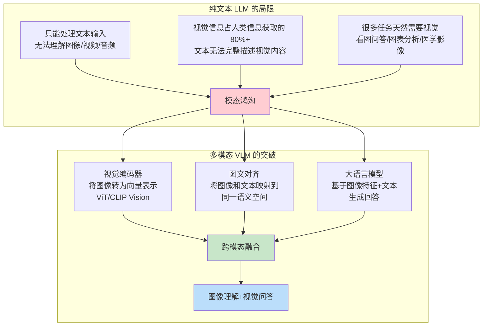
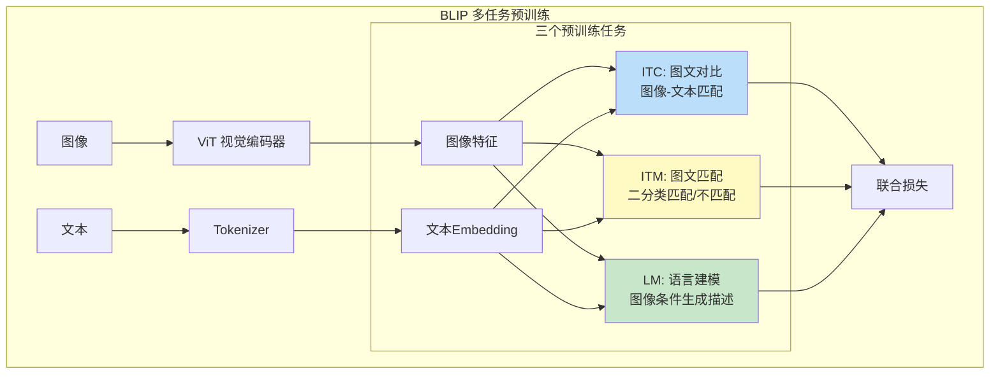
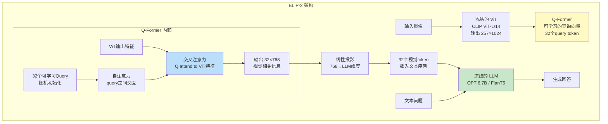
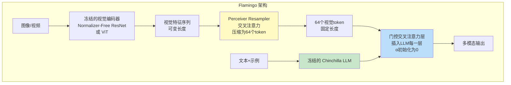
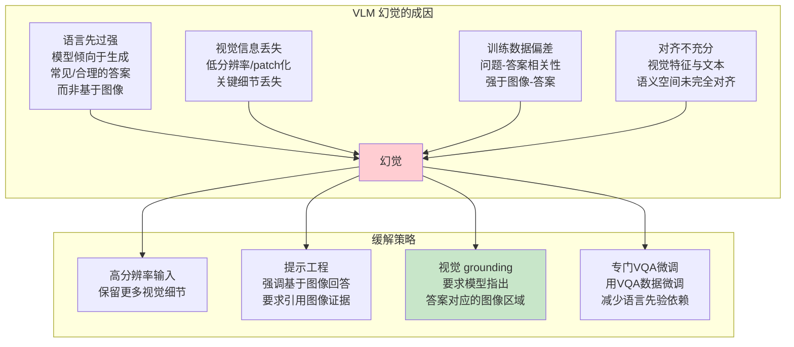
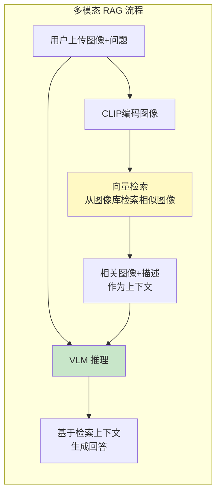

# 图像理解与视觉问答

> **一句话定义**：图像理解与视觉问答（Visual Question Answering, VQA）是多模态大模型（Vision-Language Model, VLM）的核心能力——模型同时接收图像和文本问题，理解图像内容并生成自然语言回答，实现"看懂图片并回答问题"的跨模态推理。
>
> **核心价值**：打破了纯文本大模型的信息边界，使AI能够理解视觉世界（图片、图表、截图、医学影像、遥感图像等），是多模态AI的基石，直接催生了GPT-4V、Gemini、Qwen-VL等视觉语言大模型的广泛应用。
>
> **适用场景**：图像问答、图文检索、图像描述生成、OCR+理解、图表分析、医学影像辅助诊断、自动驾驶感知、电商商品理解、内容审核、教育辅导、视觉推理。

---

## 一、概述

### 1.1 从纯文本到多模态的跨越



### 1.2 核心概念与术语

| 概念 | 说明 |
|------|------|
| **VQA（Visual Question Answering）** | 视觉问答——给定图像和自然语言问题，模型生成自然语言答案的任务 |
| **VLM（Vision-Language Model）** | 视觉语言模型——同时处理图像和文本的多模态大模型 |
| **多模态（Multimodal）** | 涉及多种数据模态（文本、图像、音频、视频等）的AI系统 |
| **视觉编码器（Vision Encoder）** | 将图像像素转换为语义向量的神经网络，通常基于ViT（Vision Transformer） |
| **图文对齐（Image-Text Alignment）** | 将图像特征和文本特征映射到同一语义空间，使相似语义的图像和文本在向量空间中接近 |
| **对比学习（Contrastive Learning）** | 通过拉近正样本对、推远负样本对来学习表示的方法，CLIP的核心 |
| **Q-Former（Querying Transformer）** | BLIP-2中用于从视觉特征中提取与文本相关信息的可学习查询向量模块 |
| **Perceiver Resampler** | Flamingo中用于将可变长度视觉特征压缩为固定数量token的交叉注意力模块 |
| **图像Token化（Image Tokenization）** | 将图像分割为patch并映射为token序列，类似文本的tokenization |
| **交叉注意力（Cross-Attention）** | 一种注意力机制，Q来自一个模态，K/V来自另一个模态，用于跨模态融合 |
| **零样本迁移（Zero-shot Transfer）** | 模型在未见过的任务上直接表现良好，无需微调，CLIP的核心能力 |
| **图像描述（Image Captioning）** | 给定图像生成自然语言描述的任务，是VQA的基础能力 |
| **图文检索（Image-Text Retrieval）** | 给定文本检索相关图像（或反之），评估图文对齐质量的核心任务 |

### 1.3 VQA 任务分类

<div style="background:linear-gradient(135deg,#f093fb,#f5576c);border-radius:16px;padding:20px;margin:16px 0;font-family:-apple-system,'Segoe UI','PingFang SC','Microsoft YaHei',sans-serif;color:#fff;overflow:hidden;box-shadow:0 8px 28px rgba(0,0,0,.14),0 3px 10px rgba(0,0,0,.08)">
<style>@keyframes flow{0%{transform:translateX(-10px);opacity:0}15%{transform:translateX(0);opacity:1}85%{transform:translateX(0);opacity:1}100%{transform:translateX(10px);opacity:0}}.flow-step{display:inline-block;background:rgba(255,255,255,.2);border:2px solid rgba(255,255,255,.5);border-radius:8px;padding:10px 14px;margin:4px;text-align:center;font-weight:600;font-size:13px;animation:flow 4s ease-in-out infinite;min-width:100px}.flow-step:nth-child(2){animation-delay:.5s}.flow-step:nth-child(4){animation-delay:1s}.flow-step:nth-child(6){animation-delay:1.5s}.flow-arrow{display:inline-block;font-size:20px;animation:flow 4s ease-in-out infinite;vertical-align:middle}.flow-code{background:rgba(0,0,0,.2);border-radius:6px;box-shadow:0 2px 8px rgba(0,0,0,.06);padding:8px 12px;margin-top:10px;font-family:monospace;font-size:12px;text-align:center}</style>
<div style="text-align:center;font-size:15px;font-weight:700;margin-bottom:14px;padding-bottom:10px;border-bottom:1.5px solid rgba(255,255,255,.22);letter-spacing:1px;text-shadow:0 1px 3px rgba(0,0,0,.12)">VQA 任务难度递进</div>
<div style="text-align:center;white-space:nowrap;overflow-x:auto">
<span class="flow-step">识别检测<br/>"图中有什么？"</span><span class="flow-arrow">→</span><span class="flow-step">属性理解<br/>"什么颜色？"</span><span class="flow-arrow">→</span><span class="flow-step">关系推理<br/>"谁在左边？"</span><span class="flow-arrow">→</span><span class="flow-step">复杂推理<br/>"为什么会这样？"</span>
</div>
<div class="flow-code">从感知 → 认知 → 推理，难度逐级提升</div>
</div>

| 任务类型 | 示例问题 | 难度 | 核心能力 |
|---------|---------|------|---------|
| **目标识别** | "图中有什么动物？" | ⭐ | 物体检测、分类 |
| **属性识别** | "这辆车是什么颜色？" | ⭐⭐ | 属性提取、细粒度识别 |
| **空间关系** | "猫在沙发的左边还是右边？" | ⭐⭐ | 空间理解、关系推理 |
| **OCR理解** | "图片中的文字写了什么？" | ⭐⭐ | 文字检测、识别 |
| **计数** | "图中有几个人？" | ⭐⭐⭐ | 目标检测、计数推理 |
| **图表分析** | "这个柱状图显示了什么趋势？" | ⭐⭐⭐ | 图表理解、数据分析 |
| **常识推理** | "这个人为什么穿雨衣？" | ⭐⭐⭐⭐ | 视觉理解+常识推理 |
| **文本推理** | "这道数学题的答案是什么？" | ⭐⭐⭐⭐ | OCR+数学推理 |
| **医学/专业** | "这张X光片有什么异常？" | ⭐⭐⭐⭐⭐ | 专业知识+精细视觉 |

> 🔍 **知识点深度解析**
>
> **作用**：图像理解与视觉问答（VQA）使AI能够"看懂"图像并回答关于图像的自然语言问题，是多模态AI的核心能力，打破了纯文本LLM的信息边界，使AI能处理人类信息获取中占比80%以上的视觉信息。
>
> **原理**：VQA系统通常由三部分组成——①视觉编码器（ViT/CLIP Vision）将图像分割为patch（如16×16像素），通过Transformer编码为语义向量序列；②图文对齐模块将图像特征和文本特征映射到同一语义空间（CLIP通过对比学习，BLIP-2通过Q-Former，Flamingo通过Perceiver Resampler）；③大语言模型接收图像特征（作为特殊token或前缀）和文本问题，通过自回归生成答案。核心挑战是"模态鸿沟"——图像是连续的二维像素信号，文本是离散的符号序列，需要通过视觉编码器和对齐模块将两者桥接。CLIP用4亿对图文数据做对比学习，实现了强大的零样本图文检索和分类能力；BLIP-2用可学习的Q-Former从冻结的视觉编码器中提取与文本相关的信息，再输入冻结的LLM，实现了高效的多模态能力；Flamingo用Perceiver Resampler将视觉特征压缩为固定数量的token，插入LLM的每一层。
>
> **用法要点**：① 视觉编码器选择——CLIP ViT-L/14是最常用的预训练视觉编码器，OpenCLIP提供开源替代 ② 对齐方式——Q-Former（BLIP-2）和Perceiver Resampler（Flamingo）是两种主流的高效对齐方案，比直接拼接视觉特征更高效 ③ 输入格式——图像通常被编码为32-256个视觉token，与文本token拼接后输入LLM ④ 分辨率——高分辨率图像（如448×448或672×672）能提升OCR和细节理解能力，但计算量增加 ⑤ 评估指标——VQA准确率、CIDEr（描述质量）、Recall@K（检索）、人类评估 ⑥ 应用时注意——VLM可能产生"幻觉"（编造图像中不存在的内容），关键场景需验证 ⑦ 主流开源模型——LLaVA、Qwen-VL、InternVL、CogVLM、BLIP-2 ⑧ 闭源API——GPT-4V、Gemini、Claude 3（支持图像输入）

---

> 💡 **深度讲解**：图像理解与视觉问答是AI从"文本智能"走向"世界智能"的关键一步。人类通过视觉获取约80%的环境信息，纯文本LLM虽然在语言理解上达到了惊人的水平，但无法直接处理视觉信息——你不能给GPT-3看一张图片问"这是什么"。多模态VLM通过视觉编码器将图像转换为语义向量，再通过图文对齐模块将视觉信息"翻译"成LLM能理解的语言，最终由LLM生成回答。这个过程的核心挑战是"模态鸿沟"（Modality Gap）——图像是连续的、高维的、空间结构化的像素信号，而文本是离散的、低维的、序列结构化的符号序列，两者的表示空间完全不同。早期方法（如Visual7W、VQA数据集时代）用CNN提取图像特征后直接与文本特征拼接，效果有限。CLIP的出现是里程碑——它用4亿对从互联网收集的图文数据做对比学习，将图像和文本映射到同一语义空间，实现了惊人的零样本迁移能力（在ImageNet上零样本分类达到ResNet-50水平）。但CLIP只能做检索和分类，不能生成文本回答。BLIP-2进一步提出Q-Former——一组可学习的查询向量，通过交叉注意力从冻结的视觉编码器中"提取"与文本相关的信息，输出固定数量的视觉token，再输入冻结的LLM，这种"两头冻结中间学习"的方案既高效又强大。Flamingo则用Perceiver Resampler将可变长度的视觉特征压缩为固定数量的token，并通过交叉注意力插入LLM的每一层，实现了强大的少样本多模态能力。现代VLM（如LLaVA、Qwen-VL）通常采用"视觉编码器+投影层+LLM"的简单架构，通过大规模图文指令微调实现了优秀的VQA能力。
>
> **📝 精简总结**：VQA（视觉问答）是多模态VLM的核心能力——输入图像+文本问题，输出自然语言答案，打破纯文本LLM的信息边界，使AI能理解占人类信息80%的视觉内容；核心概念包括视觉编码器（ViT将图像分patch编码为向量）、图文对齐（图像和文本映射到同一语义空间）、对比学习（CLIP核心，拉近正样本推远负样本）、Q-Former（BLIP-2可学习查询向量提取视觉信息）、Perceiver Resampler（Flamingo压缩视觉特征为固定token）、交叉注意力（跨模态融合）、零样本迁移；任务从识别→属性→关系→OCR→计数→图表→常识→专业推理逐级递进；原理是视觉编码器编码图像→对齐模块桥接模态鸿沟→LLM生成答案，CLIP用4亿图文对比学习实现零样本，BLIP-2用Q-Former两头冻结中间学习，Flamingo用Perceiver Resampler插入每层；用法要点包括CLIP ViT-L/14常用视觉编码器、Q-Former/Perceiver高效对齐、图像编码为32-256个token、高分辨率提升OCR、VQA准确率/CIDEr/Recall@K评估、注意幻觉问题、主流开源LLaVA/Qwen-VL/InternVL。

---

## 二、原理

### 2.1 CLIP：对比学习的图文对齐

CLIP（Contrastive Language-Image Pre-training）由OpenAI在2021年提出，是多模态学习的里程碑。

#### 核心架构

```mermaid
graph TB
    subgraph CLIP 对比学习架构
        subgraph 图像端
            IMG[输入图像<br/>224×224×3] --> VENC[视觉编码器<br/>ViT-B/32 或 ResNet50]
            VENC --> VFEAT[图像特征<br/>512维]
            VFEAT --> VPROJ[投影层<br/>线性变换]
            VPROJ --> VNORM[L2归一化<br/>单位向量]
        end

        subgraph 文本端
            TXT[输入文本<br/>"一只猫在沙发上"] --> TENC[文本编码器<br/>Transformer 12层]
            TENC --> TFEAT[文本特征<br/>EOS位置 512维]
            TFEAT --> TPROJ[投影层<br/>线性变换]
            TPROJ --> TNORM[L2归一化<br/>单位向量]
        end

        VNORM --> SIM[相似度矩阵<br/>余弦相似度 N×N]
        TNORM --> SIM

        SIM --> LOSS[对比损失<br/>InfoNCE Loss<br/>对角线为正样本]
    end

    style VENC fill:#bbdefb
    style TENC fill:#c8e6c9
    style SIM fill:#fff9c4
    style LOSS fill:#ffcdd2
```

#### 对比学习损失函数

CLIP使用InfoNCE对比损失，对于一个batch中的N对图文：

```text
$$
\mathcal{L} = -\frac{1}{2N}\sum_{i=1}^{N}\left[\log\frac{\exp(s_{ii}/\tau)}{\sum_{j=1}^{N}\exp(s_{ij}/\tau)} + \log\frac{\exp(s_{ii}/\tau)}{\sum_{j=1}^{N}\exp(s_{ji}/\tau)}\right]
$$
```

其中 $s_{ij} = \cos(I_i, T_j)$ 是图像i和文本j的余弦相似度，$\tau$ 是可学习的温度参数。第一项是图像检索文本的损失，第二项是文本检索图像的损失（对称损失）。

#### CLIP 的零样本分类

```mermaid
graph LR
    subgraph 零样本分类流程
        IMG[输入图像] --> VENC[CLIP视觉编码器]
        VENC --> VFEAT[图像向量]

        LABELS["类别名<br/>'狗' '猫' '鸟'"] --> TEMPL[提示模板<br/>'一张{类别}的照片']
        TEMPL --> PROMPTS["提示文本<br/>'一张狗的照片'<br/>'一张猫的照片'"]
        PROMPTS --> TENC[CLIP文本编码器]
        TENC --> TFEAT[文本向量矩阵]

        VFEAT --> SIM[余弦相似度]
        TFEAT --> SIM
        SIM --> MAX[取相似度最高的类别]
        MAX --> PRED[预测结果]
    end

    style SIM fill:#fff9c4
    style MAX fill:#c8e6c9
```

### 2.2 ViT：视觉Transformer

ViT（Vision Transformer）将Transformer架构应用于图像，是当前VLM视觉编码器的主流选择。

#### 图像分块与编码

```mermaid
graph TB
    subgraph ViT 图像编码流程
        IMG[输入图像<br/>224×224×3] --> PATCH[分割为patch<br/>16×16×3<br/>共14×14=196个]
        PATCH --> FLATTEN[展平每个patch<br/>16×16×3=768维]
        FLATTEN --> LINEAR[线性投影<br/>768→768维<br/>patch embedding]
        LINEAR --> POS[加位置编码<br/>可学习的位置embedding]
        POS --> CLS[插入 <[BOS_never_used_51bce0c785ca2f68081bfa7d91973934]> token]
        CLS --> TRANS[Transformer Encoder<br/>12层多头注意力]
        TRANS --> OUT[输出序列<br/>197×768<br/>CLS用于分类<br/>序列用于VQA]
    end

    style PATCH fill:#bbdefb
    style LINEAR fill:#fff9c4
    style TRANS fill:#c8e6c9
```

#### ViT 关键参数

| 参数 | ViT-Base | ViT-Large | ViT-Huge | 说明 |
|------|----------|-----------|----------|------|
| 层数 | 12 | 24 | 32 | Transformer Encoder层数 |
| 隐藏维度 | 768 | 1024 | 1280 | patch embedding维度 |
| 头数 | 12 | 16 | 16 | 多头注意力头数 |
| Patch大小 | 16×16 | 14×14 | 14×14 | 每个patch的像素大小 |
| 参数量 | 86M | 307M | 632M | 模型参数量 |
| 序列长度 | 197 | 257 | 257 | <[BOS_never_used_51bce0c785ca2f68081bfa7d91973934]> + patch数 |

### 2.3 BLIP / BLIP-2：引导式多模态

#### BLIP 架构

BLIP（Bootstrapping Language-Image Pre-training）由Salesforce在2022年提出，核心是**多任务统一预训练**和**标题自举（Caption Bootstrapping）**。



#### BLIP-2：Q-Former 架构

BLIP-2在2023年提出，核心创新是**Q-Former（Querying Transformer）**，实现了"冻结视觉编码器+冻结LLM，只训练中间模块"的高效方案。



<div style="background:linear-gradient(135deg,#fa709a,#fee140);border-radius:16px;padding:20px;margin:16px 0;font-family:-apple-system,'Segoe UI','PingFang SC','Microsoft YaHei',sans-serif;color:#fff;overflow:hidden;box-shadow:0 8px 28px rgba(0,0,0,.14),0 3px 10px rgba(0,0,0,.08)">
<style>@keyframes highlight{0%,100%{box-shadow:0 0 0 rgba(255,255,255,0)}50%{box-shadow:0 0 20px rgba(255,255,255,.4)}}.hl-box{background:rgba(255,255,255,.2);border-radius:10px;padding:14px 18px;margin:10px 0;animation:highlight 3s ease-in-out infinite;border-left:4px solid rgba(255,255,255,.6)}.hl-formula{font-family:monospace;font-size:14px;text-align:center;background:rgba(0,0,0,.15);border-radius:8px;padding:12px;margin:10px 0}</style>
<div style="text-align:center;font-size:15px;font-weight:700;margin-bottom:14px;padding-bottom:10px;border-bottom:1.5px solid rgba(255,255,255,.22);letter-spacing:1px;text-shadow:0 1px 3px rgba(0,0,0,.12)">📌 BLIP-2 核心公式：Q-Former 交叉注意力</div>
<div class="hl-box">Q-Former用32个可学习的查询向量（Query），通过交叉注意力从ViT输出的257个视觉特征中"查询"与文本相关的信息，输出32个紧凑的视觉token。这比直接使用257个视觉特征高效得多（减少87%的token数），且查询向量经过训练后能自动聚焦于与当前文本任务最相关的视觉区域。</div>
<div class="hl-formula">Attention(Q, K, V) = softmax(Q·K^T/√d)·V<br/>其中 Q=可学习查询向量, K=V=ViT视觉特征</div>
<div style="font-size:13px;opacity:.9;margin-top:8px">💡 关键优势：视觉编码器和LLM都冻结，只训练Q-Former（约188M参数），训练成本降低约50倍</div>
</div>

### 2.4 Flamingo：小样本多模态

Flamingo由DeepMind在2022年提出，核心是**Perceiver Resampler**和**门控交叉注意力层**，实现了强大的少样本（few-shot）多模态能力。



#### 门控交叉注意力

Flamingo在LLM的每一层插入门控交叉注意力层：

$$
h' = h + \alpha \cdot \text{CrossAttn}(h, V)
$$

其中 $h$ 是LLM层的隐藏状态，$V$ 是视觉token，$\alpha$ 是可学习的门控参数（初始化为0），确保训练开始时模型退化为纯文本LLM，训练稳定。

### 2.5 现代 VLM 架构对比

| 模型 | 视觉编码器 | 对齐方式 | LLM | 训练数据 | 特点 |
|------|-----------|---------|-----|---------|------|
| **CLIP** | ViT/ResNet | 对比学习投影 | 无（仅检索） | 4亿图文对 | 零样本分类/检索，不生成 |
| **BLIP** | ViT | 多任务统一 | 自建解码器 | 1.29亿（含自举） | 标题生成+检索+VQA |
| **BLIP-2** | 冻结ViT | Q-Former | 冻结OPT/FlanT5 | 1.29亿 | 两头冻结中间训练，高效 |
| **Flamingo** | 冻结NFResNet | Perceiver Resampler | 冻结Chinchilla | 1.85亿图文+4300万视频 | 少样本能力强 |
| **LLaVA** | 冻结CLIP ViT | 线性投影 | LLaMA/Vicuna | 558K指令数据 | 简单高效，开源标杆 |
| **Qwen-VL** | 自研ViT | 交叉注意力 | Qwen-7B | 大规模多模态 | 中文优秀，OCR强 |
| **InternVL** | 冻结ViT | MLP投影 | InternLM | 大规模+高分辨率 | 高分辨率，性能领先 |
| **GPT-4V** | 未知 | 未知 | GPT-4 | 未知 | 闭源SOTA，能力全面 |

> 🔍 **知识点深度解析**
>
> **作用**：CLIP通过4亿对图文数据的对比学习，将图像和文本映射到同一语义空间，实现了强大的零样本图文检索和分类能力，是几乎所有现代VLM的视觉编码器基础（BLIP-2、LLaVA等都用CLIP ViT做视觉编码器）。
>
> **原理**：CLIP的核心是对比学习——在一个batch中，有N对匹配的图文（正样本对）和N×(N-1)对不匹配的图文（负样本对）。图像和文本分别通过各自的编码器编码为向量，经投影层和L2归一化后计算余弦相似度矩阵（N×N）。训练目标是让对角线（正样本对）的相似度最大化，非对角线（负样本对）的相似度最小化，使用InfoNCE损失（对称的图像→文本和文本→图像两个方向）。温度参数τ控制相似度分布的尖锐程度。经过大规模对比学习后，图像和文本被映射到同一语义空间——"一张狗的照片"的文本向量与狗的图像向量在空间中接近，与猫的图像向量远离。这使得CLIP能做零样本分类：将类别名用提示模板（"一张{类别}的照片"）编码为文本向量，计算图像向量与各类别文本向量的相似度，取最高者为预测结果。
>
> **用法要点**：① CLIP ViT-L/14@336px是最常用的视觉编码器，比ViT-B/32精度高很多 ② OpenCLIP提供开源的CLIP实现和预训练权重（laion2b_s34b_b79k等） ③ 零样本分类的提示模板很重要——"a photo of a {label}"比直接用类别名效果好，prompt ensembling（多模板平均）进一步提升 ④ CLIP不擅长生成文本，只能做检索和分类，需要结合LLM才能做VQA ⑤ CLIP对分布偏移鲁棒，但对细粒度分类（如不同品种的鸟）和OCR能力有限 ⑥ 在VLM中，CLIP ViT通常被冻结，只训练投影层或Q-Former来对齐LLM ⑦ 高分辨率版本（336px/448px）能提升细节理解和OCR能力 ⑧ 中文CLIP（CN-CLIP、Chinese-CLIP）在中文图文任务上表现更好

---

> 💡 **深度讲解**：理解VQA的原理需要掌握三条技术路线的演进。第一条是CLIP代表的对比学习路线——用大规模图文对做对比学习，将图像和文本映射到同一语义空间，实现零样本检索和分类。CLIP的成功证明了"用互联网规模的图文对做对比学习"可以学到强大的通用视觉表示，它的视觉编码器（ViT）成为后续几乎所有VLM的基础组件。但CLIP只能做检索和分类，不能生成自然语言回答。第二条是BLIP/BLIP-2代表的"视觉编码器+对齐模块+LLM"路线——BLIP用多任务统一预训练（图文对比+图文匹配+语言建模）提升了多模态能力，BLIP-2进一步提出Q-Former，用可学习的查询向量从冻结的视觉编码器中提取与文本相关的信息，实现了"两头冻结中间训练"的高效方案，训练成本比端到端低约50倍。第三条是Flamingo代表的"少样本多模态"路线——用Perceiver Resampler将可变长度视觉特征压缩为固定数量token，通过门控交叉注意力插入LLM每一层，门控参数初始化为0确保训练稳定，实现了强大的少样本能力（给几个示例就能完成新任务）。现代开源VLM（如LLaVA）通常采用更简单的架构——冻结的CLIP ViT + 线性投影层 + 开源LLM（LLaMA/Qwen），通过大规模图文指令微调实现优秀的VQA能力，这种简单架构在充足数据下效果很好。理解这些架构的原理和权衡，对于选择和应用VLM至关重要。
>
> **📝 精简总结**：CLIP用4亿图文对做对比学习（InfoNCE损失，N×N相似度矩阵，对角线正样本最大化），将图像文本映射到同一语义空间，实现零样本分类（提示模板"一张{类别}的照片"），是VLM视觉编码器基础；ViT将图像分16×16patch→线性投影→加位置编码→Transformer编码，ViT-L/14常用（24层1024维307M参数）；BLIP多任务统一预训练（ITC对比+ITM匹配+LM生成），BLIP-2用Q-Former（32个可学习query通过交叉注意力从ViT提取信息，输出32视觉token）实现两头冻结中间训练（省50倍成本）；Flamingo用Perceiver Resampler压缩为64token+门控交叉注意力（α初始化为0）插入LLM每层，少样本能力强；现代VLM（LLaVA/Qwen-VL/InternVL）采用冻结ViT+投影+LLM+指令微调的简单架构；对比——CLIP仅检索不生成，BLIP-2高效训练，Flamingo少样本强，LLaVA简单开源效果好。

---

## 三、实操

### 3.1 环境搭建

```python
# 创建环境
python -m venv vlm-env
source vlm-env/bin/activate  # Linux/Mac

# 安装核心依赖
pip install torch torchvision --index-url https://download.pytorch.org/whl/cu121
pip install transformers accelerate pillow requests
pip install datasets evaluate  # 数据集和评估

# 安装 CLIP（OpenAI 官方）
pip install git+https://github.com/openai/CLIP.git

# 或安装 OpenCLIP（开源，更多模型选择）
pip install open_clip_torch

# 安装 BLIP-2 依赖（transformers已内置）
pip install sentencepiece protobuf

# 安装 LLaVA
pip install llava

# 安装评估指标
pip install pycocoevalcap  # CIDEr, BLEU, METEOR
```

### 3.2 CLIP 零样本分类实操

```python
"""
CLIP 零样本图像分类
"""
import torch
import clip
from PIL import Image
import requests

# 加载模型
device = "cuda" if torch.cuda.is_available() else "cpu"
model, preprocess = clip.load("ViT-L/14", device=device)

# 加载图像
url = "https://upload.wikimedia.org/wikipedia/commons/thumb/3/3a/Cat03.jpg/1200px-Cat03.jpg"
image = preprocess(Image.open(requests.get(url, stream=True).raw)).unsqueeze(0).to(device)

# 定义类别（零样本：无需训练，直接定义类别名）
labels = ["cat", "dog", "bird", "car", "tree", "building"]
# 使用提示模板（prompt engineering对CLIP很重要）
text_inputs = torch.cat([
    clip.tokenize(f"a photo of a {label}") for label in labels
]).to(device)

# 前向传播
with torch.no_grad():
    image_features = model.encode_image(image)
    text_features = model.encode_text(text_inputs)

    # 计算相似度
    image_features /= image_features.norm(dim=-1, keepdim=True)
    text_features /= text_features.norm(dim=-1, keepdim=True)
    similarity = (100.0 * image_features @ text_features.T).softmax(dim=-1)

# 输出结果
print("零样本分类结果：")
for i, (label, prob) in enumerate(zip(labels, similarity[0])):
    print(f"  {label:12s}: {prob.item()*100:.2f}%")

# 提示模板集成（Prompt Ensembling）——进一步提升精度
templates = [
    "a photo of a {}.",
    "a photo of the {}.",
    "a photo of a small {}.",
    "a photo of a large {}.",
    "this is a photo of a {}.",
]

with torch.no_grad():
    text_features_list = []
    for template in templates:
        text_inputs = torch.cat([
            clip.tokenize(template.format(label)) for label in labels
        ]).to(device)
        tf = model.encode_text(text_inputs)
        tf /= tf.norm(dim=-1, keepdim=True)
        text_features_list.append(tf)
    # 平均所有模板的文本特征
    text_features_ensembled = torch.stack(text_features_list).mean(dim=0)
    text_features_ensembled /= text_features_ensembled.norm(dim=-1, keepdim=True)
    similarity_ensembled = (100.0 * image_features @ text_features_ensembled.T).softmax(dim=-1)

print("\n提示模板集成后：")
for i, (label, prob) in enumerate(zip(labels, similarity_ensembled[0])):
    print(f"  {label:12s}: {prob.item()*100:.2f}%")
```

### 3.3 BLIP-2 视觉问答实操

```python
"""
BLIP-2 视觉问答（VQA）
使用 HuggingFace transformers
"""
from transformers import Blip2Processor, Blip2ForConditionalGeneration
import torch
from PIL import Image
import requests

device = "cuda" if torch.cuda.is_available() else "cpu"

# 加载 BLIP-2 模型（OPT-2.7B 版本，也可用 FlanT5 版本）
processor = Blip2Processor.from_pretrained("Salesforce/blip2-opt-2.7b")
model = Blip2ForConditionalGeneration.from_pretrained(
    "Salesforce/blip2-opt-2.7b",
    torch_dtype=torch.float16,
    device_map="auto"
)

# 加载图像
url = "https://upload.wikimedia.org/wikipedia/commons/thumb/3/3a/Cat03.jpg/1200px-Cat03.jpg"
image = Image.open(requests.get(url, stream=True).raw).convert("RGB")

# ===== 任务1：图像描述生成（Image Captioning） =====
inputs = processor(images=image, return_tensors="pt").to(device, torch.float16)
generated_ids = model.generate(**inputs, max_new_tokens=50)
generated_text = processor.batch_decode(generated_ids, skip_special_tokens=True)[0].strip()
print(f"图像描述: {generated_text}")

# ===== 任务2：视觉问答（VQA） =====
question = "What animal is in this picture?"
inputs = processor(images=image, text=question, return_tensors="pt").to(device, torch.float16)
generated_ids = model.generate(**inputs, max_new_tokens=20)
answer = processor.batch_decode(generated_ids, skip_special_tokens=True)[0].strip()
print(f"Q: {question}")
print(f"A: {answer}")

# ===== 任务3：多轮对话式 VQA =====
conversation = [
    "Question: What animal is in this picture? Answer:",
    "Question: What color is it? Answer:",
    "Question: What is it doing? Answer:",
]

for prompt in conversation:
    inputs = processor(images=image, text=prompt, return_tensors="pt").to(device, torch.float16)
    generated_ids = model.generate(**inputs, max_new_tokens=20)
    answer = processor.batch_decode(generated_ids, skip_special_tokens=True)[0].strip()
    print(f"{prompt} {answer}")
```

### 3.4 LLaVA 视觉问答实操

```python
"""
LLaVA-1.5 视觉问答
开源VLM的标杆模型
"""
from transformers import LlavaNextProcessor, LlavaNextForConditionalGeneration
import torch
from PIL import Image
import requests

device = "cuda" if torch.cuda.is_available() else "cpu"

# 加载 LLaVA-1.5 7B
processor = LlavaNextProcessor.from_pretrained("llava-hf/llava-1.5-7b-hf")
model = LlavaNextForConditionalGeneration.from_pretrained(
    "llava-hf/llava-1.5-7b-hf",
    torch_dtype=torch.float16,
    device_map="auto"
)

# 加载图像
url = "https://upload.wikimedia.org/wikipedia/commons/thumb/3/3a/Cat03.jpg/1200px-Cat03.jpg"
image = Image.open(requests.get(url, stream=True).raw)

# LLaVA 的对话格式
conversation = [
    {
        "role": "user",
        "content": [
            {"type": "image"},
            {"type": "text", "text": "请详细描述这张图片中的内容，包括动物种类、颜色、姿态和环境。"},
        ],
    },
]

prompt = processor.apply_chat_template(conversation, add_generation_prompt=True)
inputs = processor(images=image, text=prompt, return_tensors="pt").to(device)

# 生成回答
with torch.no_grad():
    output = model.generate(**inputs, max_new_tokens=300, temperature=0.7)

response = processor.decode(output[0], skip_special_tokens=True)
# 提取助手回复
response = response.split("ASSISTANT:")[-1].strip()
print(f"LLaVA 回答:\n{response}")

# ===== 图表分析示例 =====
chart_url = "https://upload.wikimedia.org/wikipedia/commons/thumb/7/72/PIA23680_-_Mars_Annual_Temperature.jpg/640px-PIA23680_-_Mars_Annual_Temperature.jpg"
chart_image = Image.open(requests.get(chart_url, stream=True).raw)

conversation = [
    {
        "role": "user",
        "content": [
            {"type": "image"},
            {"type": "text", "text": "这张图表显示了什么数据？有什么趋势？请用中文回答。"},
        ],
    },
]
prompt = processor.apply_chat_template(conversation, add_generation_prompt=True)
inputs = processor(images=chart_image, text=prompt, return_tensors="pt").to(device)
output = model.generate(**inputs, max_new_tokens=300)
response = processor.decode(output[0], skip_special_tokens=True).split("ASSISTANT:")[-1].strip()
print(f"\n图表分析:\n{response}")
```

### 3.5 图文检索实操

```python
"""
图文检索：用 CLIP 实现以文搜图和以图搜文
"""
import torch
import clip
from PIL import Image
import numpy as np
from sklearn.metrics.pairwise import cosine_similarity

device = "cuda" if torch.cuda.is_available() else "cpu"
model, preprocess = clip.load("ViT-B/32", device=device)

# 模拟图像库
image_urls = [
    "https://upload.wikimedia.org/wikipedia/commons/thumb/3/3a/Cat03.jpg/320px-Cat03.jpg",
    "https://upload.wikimedia.org/wikipedia/commons/thumb/2/26/YellowLabradorLooking_new.jpg/320px-YellowLabradorLooking_new.jpg",
    "https://upload.wikimedia.org/wikipedia/commons/thumb/4/45/Eopsaltria_australis_-_Mogo_Campground%2C_Mogo%2C_New_South_Wales%2C_Australia_-_adult.jpg/320px-Eopsaltria_australis_-_Mogo_Campground%2C_Mogo%2C_New_South_Wales%2C_Australia_-_adult.jpg",
]
image_captions = ["一只猫", "一只黄色拉布拉多犬", "一只鸟"]

# 编码图像库
image_features_list = []
for url in image_urls:
    img = preprocess(Image.open(requests.get(url, stream=True).raw)).unsqueeze(0).to(device)
    with torch.no_grad():
        feat = model.encode_image(img)
        feat /= feat.norm(dim=-1, keepdim=True)
    image_features_list.append(feat.cpu().numpy())
image_features = np.concatenate(image_features_list, axis=0)

# ===== 以文搜图 =====
query_text = "一只可爱的猫咪"
text_input = clip.tokenize([query_text]).to(device)
with torch.no_grad():
    text_feature = model.encode_text(text_input)
    text_feature /= text_feature.norm(dim=-1, keepdim=True)
text_feature = text_feature.cpu().numpy()

# 计算相似度并排序
similarities = cosine_similarity(text_feature, image_features)[0]
ranked_indices = np.argsort(similarities)[::-1]

print(f"查询文本: '{query_text}'")
print("检索结果（按相似度排序）：")
for rank, idx in enumerate(ranked_indices):
    print(f"  {rank+1}. {image_captions[idx]} (相似度: {similarities[idx]:.4f})")

# ===== 以图搜文 =====
# 用第一张图搜索文本
text_descriptions = ["一只猫在睡觉", "一只狗在跑步", "一只鸟在飞翔", "一辆汽车"]
text_inputs = torch.cat([clip.tokenize(d) for d in text_descriptions]).to(device)
with torch.no_grad():
    text_feats = model.encode_text(text_inputs)
    text_feats /= text_feats.norm(dim=-1, keepdim=True)
text_feats = text_feats.cpu().numpy()

query_image_feature = image_features[0:1]
similarities = cosine_similarity(query_image_feature, text_feats)[0]
ranked_indices = np.argsort(similarities)[::-1]

print(f"\n查询图像: '{image_captions[0]}'")
print("文本检索结果：")
for rank, idx in enumerate(ranked_indices):
    print(f"  {rank+1}. {text_descriptions[idx]} (相似度: {similarities[idx]:.4f})")
```

### 3.6 VQA 评估指标

```python
"""
VQA 模型评估：VQA准确率、CIDEr、BLEU、ROUGE
"""
from evaluate import load
import numpy as np

# 加载评估指标
vqa_metric = load("vqa")  # VQA 准确率（需要 pycocoevalcap）
cider_metric = load("cider")
bleu_metric = load("bleu")
rouge_metric = load("rouge")

# 模拟预测结果
predictions = [
    {"prediction": "cat", "reference": "cat", "question_id": 1},
    {"prediction": "two", "reference": "2", "question_id": 2},
    {"prediction": "red", "reference": "red", "question_id": 3},
    {"prediction": "a dog", "reference": "dog", "question_id": 4},
]

# VQA 准确率评估（VQA v2 标准：多人答案匹配）
# VQA准确率 = 10人标注中至少3人匹配的比例
vqa_references = {
    "answers": [
        ["cat", "cat", "cat", "kitten", "cat", "cat", "cat", "cat", "cat", "feline"],
        ["2", "two", "2", "two", "2", "two", "2", "two", "2", "two"],
        ["red", "red", "red", "red", "red", "red", "red", "red", "red", "red"],
        ["dog", "dog", "dog", "puppy", "dog", "dog", "dog", "dog", "dog", "canine"],
    ],
    "question_type": ["what", "how many", "what color", "what"],
    "answer_type": ["other", "number", "other", "other"],
}

# CIDEr（图像描述质量，常用于Image Captioning）
cider_predictions = ["a cat sitting on a couch", "a dog running in the park"]
cider_references = [
    ["a cat on a sofa", "a cat sitting on a couch", "cat resting on furniture"],
    ["a dog running outside", "dog in the park", "a dog playing outdoors"],
]
cider_score = cider_metric.compute(predictions=cider_predictions, references=cider_references)
print(f"CIDEr score: {cider_score['CIDEr']:.4f}")

# BLEU
bleu_score = bleu_metric.compute(predictions=cider_predictions, references=cider_references)
print(f"BLEU-1: {bleu_score['bleu']:.4f}")

# ROUGE
rouge_score = rouge_metric.compute(predictions=cider_predictions, references=cider_references)
print(f"ROUGE-L: {rouge_score['rougeL']:.4f}")

print("\n评估指标说明：")
print("  VQA Acc:  VQA标准准确率，考虑多人标注（10人中≥3人匹配得1分）")
print("  CIDEr:    图像描述质量，TF-IDF加权n-gram相似度（0-10）")
print("  BLEU:     n-gram精确率，机器翻译指标")
print("  ROUGE-L:  最长公共子序列，召回导向")
print("  Recall@K: 图文检索中前K个结果包含正确项的比例")
```

---

> 💡 **深度讲解**：实操层面，CLIP是最容易上手的多模态工具——加载预训练模型后直接做零样本分类和图文检索，无需任何微调。CLIP的提示工程很重要——用"a photo of a {label}"比直接用类别名效果好，提示模板集成（多个模板平均）能进一步提升1-5%的准确率。BLIP-2通过HuggingFace transformers可以直接调用，支持图像描述和视觉问答，OPT-2.7B版本在单张RTX 3090上即可运行。LLaVA-1.5是开源VLM的标杆，采用简单的"CLIP ViT+线性投影+Vicuna"架构，通过558K条指令数据微调，VQA能力优秀，且支持中文。LLaVA的对话格式需要注意——必须用`apply_chat_template`构建正确的prompt格式，包含`<image>`特殊token。图文检索是CLIP的核心应用场景——将图像库预编码为向量，查询时只需编码查询文本/图像，计算余弦相似度即可，检索速度极快（百万级图像库可在毫秒级完成）。评估方面，VQA任务用VQA准确率（考虑多人标注的模糊性），图像描述用CIDEr（比BLEU更适合描述质量评估），图文检索用Recall@K。实际应用中需要注意VLM的"幻觉"问题——模型可能编造图像中不存在的内容，关键场景（如医学影像、法律文档）需要人工验证或使用专门的领域模型。
>
> **📝 精简总结**：环境搭建需安装transformers、clip/open_clip_torch、pillow、datasets、evaluate、pycocoevalcap；CLIP零样本分类——加载ViT-L/14→图像预处理→类别名用提示模板"a photo of {label}"→编码计算余弦相似度→softmax输出概率，提示模板集成可提升精度；BLIP-2 VQA——Blip2Processor+Blip2ForConditionalGeneration，支持图像描述（无文本输入）和视觉问答（文本问题输入），OPT-2.7B单卡可运行；LLaVA-1.5——LlavaNextProcessor+对话格式（user包含image+text），apply_chat_template构建prompt，支持中文和详细描述；图文检索——预编码图像库为向量，查询时编码文本/图像计算余弦相似度排序；评估指标——VQA准确率（多人标注匹配）、CIDEr（描述质量0-10）、BLEU/ROUGE（n-gram）、Recall@K（检索）；注意VLM幻觉问题，关键场景需验证。

---

## 四、问题

### 4.1 常见问题排查表

| 问题 | 原因 | 解决方案 |
|------|------|---------|
| **VQA回答与图像内容不符（幻觉）** | 模型依赖语言先验而非视觉内容；训练数据中问题-答案相关性强于图像-答案；低分辨率丢失细节 | ① 使用高分辨率输入（448+） ② 提示词中强调"根据图像回答" ③ 对关键答案做验证 ④ 使用专门的VQA模型而非通用VLM |
| **OCR能力差，无法识别图中文字** | 视觉编码器分辨率不足；训练数据中文字图像少；patch过大丢失小字 | ① 使用高分辨率版本（448px/672px） ② 先用OCR工具（PaddleOCR/Tesseract）提取文字再输入LLM ③ 选择OCR强的模型（Qwen-VL、InternVL） |
| **CLIP零样本分类准确率低** | 类别名不具体；提示模板不合适；分布偏移大；模型规模小 | ① 用更具体的类别描述（"金毛寻回犬"而非"狗"） ② 使用提示模板集成 ③ 用更大的模型（ViT-L/14而非ViT-B/32） ④ 少量样本微调 |
| **BLIP-2加载OOM** | 模型太大（OPT-6.7B/FlanT5-XXL）；图像分辨率高；未使用梯度检查点 | ① 用小版本（OPT-2.7B） ② 降低图像分辨率 ③ 使用device_map="auto"多卡 ④ 用INT8/INT4量化加载 |
| **图表/数据图理解错误** | 模型缺乏图表推理能力；坐标轴文字OCR错误；数值计算错误 | ① 先用OCR提取图表数据 ② 用代码解析图表（matplotlib/plotly） ③ 选择图表理解强的模型 ④ 提示中要求逐步推理 |
| **计数不准（"图中有几个人"）** | 目标检测能力不足；密集小目标漏检；重复计数 | ① 先用目标检测模型（YOLO/DETR）计数 ② 高分辨率输入 ③ 提示中要求"逐个标记再计数" ④ 专用计数模型 |
| **空间关系理解错误（左/右/上/下）** | ViT的patch化丢失空间信息；模型左右概念混淆 | ① 高分辨率输入保留空间细节 ② 在图像中添加坐标标记 ③ 提示中明确参考系 ④ 用空间关系专用模型 |
| **多轮对话中图像信息丢失** | 模型只在第一轮关注图像，后续轮次依赖文本历史；视觉token被文本"淹没" | ① 每轮重新提供图像 ② 在系统提示中强调参考图像 ③ 使用支持多轮VQA的模型（LLaVA-1.6+） |
| **医学/专业图像理解差** | 通用VLM缺乏专业知识；专业图像与自然图像分布差异大 | ① 使用领域微调模型（Med-PaLM、BioViL） ② 专业知识RAG增强 ③ 人工审核关键诊断 |
| **推理速度慢** | 视觉编码器计算量大；高分辨率图像patch多；LLM生成慢 | ① 降低分辨率（224→够用即可） ② 用INT4/INT8量化 ③ vLLM部署加速 ④ 批量处理 |

### 4.2 VLM 幻觉问题深度分析



### 4.3 性能优化策略

```python
"""
VLM 推理性能优化
"""
import torch
from transformers import Blip2Processor, Blip2ForConditionalGeneration

# ===== 优化1：量化加载 =====
model = Blip2ForConditionalGeneration.from_pretrained(
    "Salesforce/blip2-opt-2.7b",
    torch_dtype=torch.float16,       # FP16 推理
    device_map="auto",
    load_in_8bit=True,               # INT8 量化（需 bitsandbytes）
)

# ===== 优化2：批量处理 =====
def batch_vqa(model, processor, images, questions, batch_size=4):
    """批量VQA推理，提升吞吐量"""
    results = []
    for i in range(0, len(images), batch_size):
        batch_images = images[i:i+batch_size]
        batch_questions = questions[i:i+batch_size]
        inputs = processor(
            images=batch_images,
            text=batch_questions,
            return_tensors="pt",
            padding=True
        ).to(model.device, torch.float16)

        with torch.no_grad():
            outputs = model.generate(**inputs, max_new_tokens=30)
        batch_answers = processor.batch_decode(outputs, skip_special_tokens=True)
        results.extend([a.strip() for a in batch_answers])
    return results

# ===== 优化3：vLLM 部署（支持多模态的版本） =====
# from vllm import LLM
# llm = LLM(model="llava-hf/llava-1.5-7b-hf", max_model_len=4096)
# outputs = llm.generate(prompts)  # 高吞吐量批量推理
```

---

> 💡 **深度讲解**：VQA实践中最突出的问题是"幻觉"（Hallucination）——模型生成图像中不存在的内容或错误答案。幻觉的根源有四个：①语言先验过强——VLM通常由强大的LLM初始化，LLM倾向于生成统计上常见的答案而非基于图像内容（如被问到"图中有什么动物"时倾向于回答"狗"，因为狗在训练数据中更常见）；②视觉信息丢失——低分辨率输入和ViT的patch化可能丢失关键细节；③训练数据偏差——很多VQA训练数据中问题-答案的相关性强于图像-答案（如"什么颜色"的问题答案通常是常见颜色），模型学会了"猜"答案而非"看"图像；④对齐不充分——视觉特征和文本语义空间未完全对齐，模型可能"误解"视觉特征。缓解策略包括高分辨率输入、提示工程（强调"根据图像回答"）、视觉grounding（要求模型指出答案对应的图像区域）、以及专门的VQA微调。OCR和计数是VQA的两个传统弱项——OCR需要高分辨率和专门的文字识别能力，计数需要精确的目标检测，通用VLM在这两方面往往不如专用模型。实际应用中，最佳实践是"VLM+专用工具"的混合方案——OCR用PaddleOCR，目标检测用YOLO，计数用DETR，然后将结果交给LLM做推理和回答，这种方案比纯VLM更可靠。
>
> **📝 精简总结**：常见问题——幻觉（语言先验过强/视觉丢失/数据偏差，用高分辨率+提示强调+视觉grounding+VQA微调缓解）、OCR差（分辨率不足/训练少，用高分辨率+专用OCR工具+Qwen-VL）、CLIP分类低（类别名不具体/模板不合适，用具体描述+提示集成+大模型）、OOM（模型大，用小版本+量化+多卡）、图表理解差（OCR错误+推理弱，先用OCR提取数据+代码解析）、计数不准（检测不足，先用YOLO/DETR+高分辨率+逐个标记）、空间关系错（patch化丢空间信息，高分辨率+坐标标记）、多轮丢图像（每轮重传图像+强调参考）、专业图像差（领域微调模型+RAG+人工审核）、速度慢（降分辨率+量化+vLLM批量）；幻觉成因四要素——语言先验过强、视觉信息丢失、训练数据偏差、对齐不充分；最佳实践是VLM+专用工具混合方案（OCR/检测/计数用专用模型，LLM做推理）。

---

## 五、拓展

### 5.1 多模态大模型最新进展

| 模型 | 发布方 | 时间 | 核心特点 |
|------|--------|------|---------|
| **GPT-4V(ision)** | OpenAI | 2023.09 | 闭源SOTA，支持高分辨率图像、多图、截图理解 |
| **Gemini Pro/Ultra** | Google | 2023.12 | 原生多模态，支持图像/视频/音频，长上下文 |
| **Claude 3** | Anthropic | 2024.03 | 支持图像输入，Opus版本视觉理解强 |
| **LLaVA-1.6/Next** | 开源社区 | 2024 | 高分辨率（672px），改进OCR和细节理解 |
| **Qwen-VL-Max** | 阿里 | 2024 | 中文VQA SOTA，OCR和图表理解强 |
| **InternVL 2.0** | 上海AI Lab | 2024 | 高分辨率+动态分辨率，开源性能领先 |
| **CogVLM2** | 清华 | 2024 | 视觉专家模型+LLM，视觉 grounding 强 |
| **Gemini 2.0** | Google | 2024 | 原生多模态，支持实时视频理解 |
| **GPT-4o** | OpenAI | 2024.05 | 全模态（文本/图像/音频），实时交互 |

### 5.2 视频理解扩展

VQA技术可扩展到视频理解——将视频抽帧后用视觉编码器编码，结合时间维度建模。

```python
"""
视频理解：抽帧 + VQA
"""
import cv2
from PIL import Image

def extract_frames(video_path, num_frames=8):
    """从视频中均匀抽取帧"""
    cap = cv2.VideoCapture(video_path)
    total_frames = int(cap.get(cv2.CAP_PROP_FRAME_COUNT))
    frame_indices = np.linspace(0, total_frames-1, num_frames, dtype=int)

    frames = []
    for idx in frame_indices:
        cap.set(cv2.CAP_PROP_POS_FRAMES, idx)
        ret, frame = cap.read()
        if ret:
            frame_rgb = cv2.cvtColor(frame, cv2.COLOR_BGR2RGB)
            frames.append(Image.fromarray(frame_rgb))
    cap.release()
    return frames

# 使用支持多图的VLM（如LLaVA-1.6、GPT-4V）
# 将8帧作为多图输入，提问"这个视频中发生了什么？"
# frames = extract_frames("video.mp4", num_frames=8)
# 多图VQA...
```

### 5.3 多模态 RAG

将VQA与RAG结合，实现基于图像知识库的问答。



### 5.4 学习资源

- **论文**：CLIP (Radford et al., 2021)、BLIP (Li et al., 2022)、BLIP-2 (Li et al., 2023)、Flamingo (Alayrac et al., 2022)、LLaVA (Liu et al., 2023)、ViT (Dosovitskiy et al., 2020)
- **官方库**：OpenAI CLIP、OpenCLIP、HuggingFace transformers（BLIP-2/LLaVA）、LLaVA官方仓库
- **数据集**：COCO（图像描述）、VQA v2（视觉问答）、TextVQA（OCR+VQA）、ChartQA（图表问答）、DocVQA（文档VQA）
- **基准**：MMBench、SEED-Bench、MME、MM-Vet、MathVista（多模态能力综合评估）

---

> 💡 **深度讲解**：多模态大模型正在快速演进。GPT-4o和Gemini 2.0代表了"原生多模态"的方向——模型从架构上就支持文本、图像、音频、视频的统一处理，而非"视觉编码器+LLM"的拼接方案。高分辨率是另一个重要趋势——从224px到336px、448px、672px甚至1000px+，高分辨率显著提升OCR、细粒度识别和图表理解能力，但计算量也随之增加（patch数与分辨率平方成正比）。动态分辨率（如InternVL 2.0）根据图像内容自适应选择分辨率，在效率和效果间取得平衡。视频理解是下一个前沿——将VQA扩展到视频需要时间维度建模，当前方案包括均匀抽帧+多图VQA、视频Transformer（如VideoMAE）、以及时间注意力机制。多模态RAG将VQA与检索增强结合——用CLIP编码图像库，用户上传图像后检索相似图像及其描述作为上下文，提升回答的准确性和可追溯性。评估方面，MMBench、SEED-Bench等综合基准从多个维度（感知、推理、OCR、知识、数学）评估VLM能力，比单一VQA准确率更全面。
>
> **📝 精简总结**：最新进展——GPT-4o/Gemini 2.0原生全模态（文本/图像/音频/视频实时交互）、LLaVA-1.6/Next高分辨率672px、Qwen-VL-Max中文OCR强、InternVL 2.0动态分辨率、CogVLM2视觉grounding强；视频理解——均匀抽帧（8-16帧）+多图VQA，或视频Transformer+时间注意力；多模态RAG——CLIP编码图像库→用户图像检索相似图+描述→VLM基于上下文回答；学习资源包括CLIP/BLIP/BLIP-2/Flamingo/LLaVA/ViT论文、OpenAI CLIP/OpenCLIP/HuggingFace官方库、COCO/VQA v2/TextVQA/ChartQA/DocVQA数据集、MMBench/SEED-Bench/MME综合基准；趋势是原生多模态、高分辨率、动态分辨率、视频理解、多模态RAG。

---

## 🔗 关联笔记

- [[多模态模型原理-VLM]] — VLM架构原理全景
- [[多模态生成工具链]] — 多模态工具链和应用
- [[多模态RAG实现]] — 多模态检索增强生成
- [[Embedding词向量与语义检索]] — 向量检索基础，图文检索的核心
- [[提示词工程核心技巧]] — VLM提示词工程
- [[大模型应用开发实战]] — LLM应用开发基础
- [[Transformer架构核心]] — ViT和LLM的基础架构

## 📖 前置知识

- [[大模型应用开发实战]]
- [[Embedding词向量与语义检索]]
- [[提示词工程核心技巧]]
- [[Transformer架构核心]]

## 🏷️ 相关标签

`#AI应用` `#多模态` `#VLM` `#视觉问答` `#VQA` `#CLIP` `#BLIP` `#图像理解` `#图文对齐`

---

[[Home|🏠 返回首页]] · [[MOC-AI与效率工具|📚 返回分类]]
