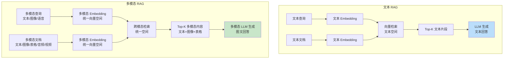

# 多模态 RAG 实现

> **一句话定义**：多模态 RAG（Multimodal Retrieval-Augmented Generation）是传统文本 RAG 的扩展，支持图像、音频、视频、表格等多种模态的检索和生成，通过多模态 Embedding 将不同模态映射到统一向量空间，实现跨模态检索和多模态内容生成。
>
> **核心价值**：突破纯文本 RAG 的局限，能够处理包含图像、图表、截图、PDF 图文混排、音频转录、视频帧等多模态内容，是企业知识库、图文问答、视觉问答、多模态 Agent 的核心技术。
>
> **适用场景**：图文混排知识库（PDF/PPT/网页）、产品图片问答、图表数据分析、截图问题解答、医学影像问答、视频内容检索、多模态文档理解、视觉问答 VQA。

---

## 一、概述

### 1.1 多模态 RAG vs 文本 RAG



### 1.2 核心概念

| 概念 | 说明 |
|------|------|
| **多模态 RAG** | 支持多种模态（文本/图像/音频/视频/表格）的检索增强生成，是文本 RAG 的扩展 |
| **多模态 Embedding** | 将不同模态（文本/图像/音频）映射到统一向量空间的模型，使跨模态检索成为可能 |
| **跨模态检索（Cross-Modal Retrieval）** | 用一种模态查询检索另一种模态的内容，如用文本查询检索图像，用图像查询检索文本 |
| **CLIP** | OpenAI 提出的对比语言-图像预训练模型，是多模态 Embedding 的基础，将文本和图像映射到统一空间 |
| **BLIP/BLIP-2** | Salesforce 提出的多模态模型，支持图文检索和视觉问答，BLIP-2 用 Q-Former 桥接视觉编码器和 LLM |
| **ColPali** | 基于 ViT 的文档页面 Embedding 模型，直接对 PDF 页面图像生成 Embedding，是文档多模态 RAG 的新范式 |
| **多模态 LLM（VLM）** | 支持图像输入的大语言模型，如 GPT-4o、Claude 3、LLaVA、Qwen-VL、Gemini，能理解图像并生成图文回答 |
| **文档解析（Document Parsing）** | 将 PDF/PPT/Word 等文档解析为文本、图像、表格等结构化元素，是多模态 RAG 的前置步骤 |
| **图文混排（Rich Document）** | 包含文本、图像、图表、公式等多种元素的文档，如技术文档、产品手册、研究报告 |
| **视觉问答（VQA）** | 给定图像和问题，生成关于图像内容的回答，是多模态 RAG 的核心能力之一 |
| **图像描述（Image Captioning）** | 为图像生成文本描述，可作为图像的文本表示，用于文本检索 |
| **OCR（光学字符识别）** | 从图像中提取文本，是处理截图、扫描文档、图像中文字的关键技术 |
| **表格理解（Table Understanding）** | 理解表格结构和内容，支持表格数据问答，是多模态 RAG 的难点之一 |

### 1.3 多模态 RAG 架构类型

| 架构类型 | 说明 | 优点 | 缺点 | 适用场景 |
|---------|------|------|------|---------|
| **文本中心化** | 将所有模态转为文本（图像描述/OCR），用文本 RAG 处理 | 简单，复用文本 RAG 技术栈 | 丢失视觉信息，图像描述质量受限 | 简单图文问答，图像内容主要是文字 |
| **多向量混合** | 文本用文本 Embedding，图像用图像 Embedding，分别检索后融合 | 保留各模态特性，检索质量高 | 实现复杂，需要融合策略 | 通用多模态知识库 |
| **统一向量空间** | 用多模态 Embedding（CLIP）将所有模态映射到统一空间，跨模态检索 | 真正的跨模态检索，实现相对简单 | 多模态 Embedding 质量要求高 | 图文检索，跨模态搜索 |
| **页面级 Embedding** | 直接对文档页面图像生成 Embedding（ColPali），页面级检索 | 保留原始排版，处理图文混排效果好 | 页面级粒度粗，需要二次定位 | PDF/PPT 等图文混排文档 |
| **原生多模态** | 用多模态 LLM 直接理解多模态内容，端到端处理 | 最强大，能理解复杂多模态内容 | 计算成本高，延迟大 | 复杂视觉问答，多模态推理 |


<div style="background:linear-gradient(135deg,#f093fb,#f5576c);border-radius:16px;padding:20px;margin:16px 0;font-family:-apple-system,'Segoe UI','PingFang SC','Microsoft YaHei',sans-serif;color:#fff;overflow:hidden;box-shadow:0 8px 28px rgba(0,0,0,.14),0 3px 10px rgba(0,0,0,.08)">
<style>@keyframes flow{0%{transform:translateX(-10px);opacity:0}15%{transform:translateX(0);opacity:1}85%{transform:translateX(0);opacity:1}100%{transform:translateX(10px);opacity:0}}.flow-step{display:inline-block;background:rgba(255,255,255,.2);border:2px solid rgba(255,255,255,.5);border-radius:8px;padding:10px 14px;margin:4px;text-align:center;font-weight:600;font-size:13px;animation:flow 4s ease-in-out infinite;min-width:90px}.flow-step:nth-child(2){animation-delay:.5s}.flow-step:nth-child(4){animation-delay:1s}.flow-step:nth-child(6){animation-delay:1.5s}.flow-step:nth-child(8){animation-delay:2s}.flow-arrow{display:inline-block;font-size:20px;animation:flow 4s ease-in-out infinite;vertical-align:middle}.flow-code{background:rgba(0,0,0,.2);border-radius:6px;padding:8px 12px;margin-top:10px;font-family:monospace;font-size:12px;text-align:center}</style>
<div style="text-align:center;font-size:15px;font-weight:700;margin-bottom:14px;padding-bottom:10px;border-bottom:1.5px solid rgba(255,255,255,.22);letter-spacing:1px">🖼️ 多模态 RAG 检索增强流程</div>
<div style="text-align:center;white-space:nowrap;overflow-x:auto">
<span class="flow-step">多模态数据接入</span><span class="flow-arrow">→</span><span class="flow-step">文档解析分段</span><span class="flow-arrow">→</span><span class="flow-step">向量化索引</span><span class="flow-arrow">→</span><span class="flow-step">多模态检索</span><span class="flow-arrow">→</span><span class="flow-step">上下文组装</span><span class="flow-arrow">→</span><span class="flow-step">VLM生成回答</span>
</div>
<div class="flow-code">PDF/图片/表格→OCR+布局分析→文本+图像向量→跨模态检索→文本+图像上下文→视觉语言模型生成</div>
</div>
> 🔍 **知识点深度解析**
>
> **作用**：多模态 RAG 突破纯文本 RAG 的局限，能够处理包含图像、图表、截图、PDF 图文混排、音频、视频等多种模态的内容，通过多模态 Embedding 将不同模态映射到统一向量空间实现跨模态检索，用多模态 LLM 生成图文回答，是企业知识库、图文问答、视觉问答的核心技术。
>
> **原理**：多模态 RAG 的核心是"统一向量空间"和"多模态理解"。统一向量空间通过多模态 Embedding 模型（如 CLIP）实现——用对比学习训练，将文本和图像映射到同一个向量空间，使语义相似的文本和图像在向量空间中距离相近，从而实现跨模态检索（用文本查询检索图像，用图像查询检索文本）。多模态理解通过多模态 LLM（VLM，如 GPT-4o、LLaVA、Qwen-VL）实现——将图像编码为视觉特征，与文本 Token 一起输入 LLM，使 LLM 能够理解图像内容并生成图文回答。多模态 RAG 的流程是：① 文档解析（将 PDF/PPT/图像解析为文本、图像、表格等元素）；② 多模态 Embedding（对文本和图像分别生成向量，或用统一模型生成）；③ 索引和检索（向量数据库存储多模态向量，查询时跨模态检索 Top-K）；④ 多模态生成（将检索到的文本和图像一起输入多模态 LLM，生成图文回答）。
>
> **用法要点**：① 选择合适的架构——简单场景用文本中心化（图像描述+OCR），通用场景用多向量混合或统一向量空间，PDF/PPT 用页面级 Embedding（ColPali），复杂视觉问答用原生多模态 ② 多模态 Embedding 选择——图文检索用 CLIP/BLIP，文档页面用 ColPali，中文场景用 Chinese-CLIP/AltCLIP ③ 文档解析是关键——用 Unstructured/LlamaParse/PaddleOCR 等工具解析 PDF/PPT，提取文本、图像、表格、布局信息 ④ 图像处理——图像需要预处理（resize/归一化），大图像需要切块（patch），截图需要 OCR 提取文字 ⑤ 多模态 LLM 选择——闭源用 GPT-4o/Claude 3（能力强但成本高），开源用 LLaVA/Qwen-VL/InternVL（可自部署，中文效果好） ⑥ 检索融合——多向量检索需要融合策略（RRF 倒数排名融合、加权融合、重排序） ⑦ 表格处理——表格需要特殊处理（表格转文本/Markdown、表格 Embedding、表格问答） ⑧ 评估——多模态 RAG 的评估需要多模态评估集（如 DocVQA、ChartQA、MultimodalQA），不能只用文本评估指标

---

> 💡 **深度讲解**：多模态 RAG 是文本 RAG 的自然扩展，也是 RAG 技术的重要发展方向。传统文本 RAG 只能处理纯文本内容，但现实世界的信息大部分是多模态的——技术文档包含截图和图表，产品手册包含产品图片，研究报告包含数据可视化，网页包含图文混排，会议包含音频和视频。纯文本 RAG 在处理这些多模态内容时会丢失大量信息（图像内容、图表数据、排版结构），导致检索和回答质量下降。多模态 RAG 通过多模态 Embedding 和多模态 LLM 解决了这个问题。多模态 RAG 的核心挑战是"模态对齐"——不同模态（文本/图像/音频）的数据形式差异巨大，如何将它们映射到统一的表示空间，使跨模态检索和理解成为可能。CLIP（Contrastive Language-Image Pre-training）是模态对齐的里程碑——通过对比学习，将文本和图像映射到同一个向量空间，使"一张狗的图片"和"一只狗的文本描述"在向量空间中距离相近。CLIP 的训练方法是：给定一批（图像, 文本描述）对，让匹配对的向量相似度高，不匹配对的相似度低，通过对比损失学习统一的向量空间。CLIP 的出现使得跨模态检索成为可能——用文本查询可以检索图像，用图像查询可以检索文本。BLIP/BLIP-2 在 CLIP 基础上进一步发展，BLIP 用多任务预训练（图文对比+图文匹配+图像描述）提升多模态理解能力，BLIP-2 用 Q-Former（Querying Transformer）作为视觉编码器和 LLM 之间的桥梁，用少量可训练参数（Q-Former）将视觉特征转换为 LLM 能理解的格式，实现了高效的多模态 LLM 训练。多模态 LLM（VLM，Vision Language Model）是多模态 RAG 的生成核心——传统 LLM 只能处理文本 Token，VLM 通过视觉编码器将图像转换为视觉 Token，与文本 Token 一起输入 LLM，使 LLM 能够理解图像内容并生成回答。GPT-4o、Claude 3、Gemini 是闭源 VLM 的代表，能力强大但成本高、需要 API；LLaVA、Qwen-VL、InternVL、CogVLM 是开源 VLM 的代表，可以自部署，中文效果好，成本可控。多模态 RAG 的架构有多种选择，从简单到复杂：① 文本中心化——最简单的方法，将所有模态转为文本（图像用图像描述模型生成 caption，截图用 OCR 提取文字，表格转 Markdown），然后用传统文本 RAG 处理。这种方法简单，复用文本 RAG 技术栈，但丢失了视觉信息（图像的视觉内容无法完全用文本描述），且图像描述和 OCR 的质量直接影响效果。适用于简单场景（图像主要包含文字，或对视觉细节要求不高）。② 多向量混合——文本用文本 Embedding（如 BGE），图像用图像 Embedding（如 CLIP），分别建立索引，查询时分别检索，然后用融合策略（RRF 倒数排名融合、加权融合）合并结果。这种方法保留了各模态的特性，检索质量高，但实现复杂，需要设计融合策略和重排序。适用于通用多模态知识库。③ 统一向量空间——用多模态 Embedding（如 CLIP/BLIP）将文本和图像都映射到同一个向量空间，建立统一索引，查询时直接跨模态检索（文本查询可以同时检索文本和图像）。这种方法实现相对简单，真正的跨模态检索，但对多模态 Embedding 的质量要求高（需要同时支持文本和图像的高质量表示）。适用于图文检索、跨模态搜索。④ 页面级 Embedding——直接对文档页面图像（PDF 页面渲染为图像）生成 Embedding，用页面级向量进行检索。ColPali 是这种方法的代表——基于 ViT（Vision Transformer）的文档页面 Embedding 模型，直接对页面图像生成向量，保留了原始排版和图文混排信息。这种方法在处理图文混排的 PDF/PPT 时效果很好（不需要复杂的文档解析），但页面级粒度较粗（一个页面一个向量），检索到页面后可能需要二次定位具体内容。适用于 PDF/PPT 等图文混排文档。⑤ 原生多模态——用多模态 LLM 直接理解多模态内容，端到端处理（将查询和相关图像一起输入 VLM，直接生成回答）。这种方法最强大，能理解复杂的多模态内容（图表、截图、复杂图像），但计算成本高、延迟大，且需要处理长上下文（多图像+长文本）。适用于复杂视觉问答、多模态推理。实际应用中通常是多种架构的组合——文档解析提取文本和图像，文本用文本 Embedding，图像用图像 Embedding，检索后融合，生成时用多模态 LLM。文档解析是多模态 RAG 的前置步骤，也是难点之一——PDF/PPT/Word 等文档包含复杂的排版结构（分栏、图文混排、表格、公式、页眉页脚），需要专门的工具解析。常用的文档解析工具有：Unstructured（开源，支持多种格式，提取文本/图像/表格/布局）、LlamaParse（LlamaIndex 的商业解析服务，解析质量高）、PaddleOCR（百度开源，中文 OCR 效果好，支持版面分析）、MinerU（开源，PDF 解析，支持公式/表格/图文混排）、Marker（开源，PDF 转 Markdown，保留排版）。文档解析的质量直接影响多模态 RAG 的效果——解析错误（文字识别错误、表格结构错误、图像提取错误）会导致检索和回答质量下降。多模态 RAG 的评估也是一个挑战——传统文本 RAG 的评估指标（Recall@K、NDCG、答案准确性）不能完全适用于多模态场景。多模态 RAG 需要多模态评估集，如 DocVQA（文档视觉问答）、ChartQA（图表问答）、MultimodalQA（多模态问答）、InfoVQA（信息图表问答）。评估时需要同时评估检索质量（是否检索到相关的文本和图像）和生成质量（回答是否准确、是否正确引用图像内容）。多模态 RAG 是一个快速发展的领域，新的模型和方法不断涌现——ColPali 等页面级 Embedding 简化了文档多模态 RAG，GPT-4o 等原生多模态 LLM 提升了多模态理解能力，多模态 RAG 的技术栈正在快速成熟。对于企业和开发者来说，多模态 RAG 是构建高质量知识库和问答系统的必要技术——特别是处理图文混排的技术文档、产品手册、研究报告等场景。
>
> **📝 精简总结**：多模态RAG是文本RAG的扩展，支持图像/音频/视频/表格等多模态检索和生成，通过多模态Embedding统一向量空间实现跨模态检索，用多模态LLM生成图文回答；核心价值是突破纯文本RAG局限，处理图文混排/截图/图表/PDF/音频/视频等多模态内容，是企业知识库/图文问答/视觉问答核心技术；核心概念包括多模态Embedding（CLIP/BLIP统一向量空间）、跨模态检索（文本查图像/图像查文本）、CLIP（对比语言图像预训练，多模态Embedding基础）、BLIP/BLIP-2（Q-Former桥接视觉和LLM）、ColPali（ViT文档页面Embedding，PDF多模态RAG新范式）、多模态LLM/VLM（GPT-4o/LLaVA/Qwen-VL，理解图像生成图文回答）、文档解析（Unstructured/LlamaParse/PaddleOCR提取文本/图像/表格/布局）、图文混排、视觉问答VQA、图像描述Image Captioning、OCR、表格理解；架构类型——文本中心化（所有模态转文本图像描述+OCR，简单复用文本RAG但丢视觉信息，简单场景）、多向量混合（文本+图像分别Embedding分别检索融合，保留模态特性质量高但实现复杂，通用知识库）、统一向量空间（CLIP统一映射跨模态检索，实现简单真正跨模态但Embedding质量要求高，图文检索）、页面级Embedding（ColPali直接对页面图像Embedding，保留排版处理图文混排好但粒度粗，PDF/PPT）、原生多模态（VLM端到端理解，最强大但成本高延迟大，复杂视觉问答）；核心原理是统一向量空间（CLIP对比学习，文本图像映射同一空间，语义相似距离相近，实现跨模态检索）+多模态理解（VLM视觉编码器转视觉Token+文本Token一起输入LLM，理解图像生成回答）；流程是文档解析→多模态Embedding→索引检索→多模态生成；用法要点包括选合适架构（简单文本中心化/通用多向量或统一/PDF页面级/复杂原生多模态）、Embedding选择（图文CLIP/BLIP，文档ColPali，中文Chinese-CLIP/AltCLIP）、文档解析关键（Unstructured/LlamaParse/PaddleOCR/MinerU，提取文本图像表格布局）、图像处理（预处理resize/切块patch/OCR）、VLM选择（闭源GPT-4o/Claude3强但贵，开源LLaVA/Qwen-VL/InternVL可部署中文好）、检索融合（RRF/加权/重排序）、表格特殊处理（转Markdown/表格Embedding/表格问答）、多模态评估（DocVQA/ChartQA/MultimodalQA，不能只用文本指标）。

---

## 二、原理

### 2.1 多模态 RAG 完整流程

```mermaid
graph TB
    subgraph 索引阶段（离线）
        A1[多模态文档<br/>PDF/PPT/图像/音频/视频] --> A2[文档解析<br/>提取文本/图像/表格/音频转录]
        A2 --> A3[文本分段<br/>语义分段/重叠]
        A2 --> A4[图像处理<br/>resize/切块/图像描述]
        A3 --> A5[文本 Embedding<br/>BGE/GTE]
        A4 --> A6[图像 Embedding<br/>CLIP/BLIP/ColPali]
        A5 --> A7[向量数据库<br/>多模态索引]
        A6 --> A7
    end

    subgraph 查询阶段（在线）
        B1[用户查询<br/>文本/图像/语音] --> B2[查询 Embedding<br/>多模态 Embedding]
        B2 --> B3[跨模态检索<br/>Top-K 文本+图像]
        A7 --> B3
        B3 --> B4[结果融合<br/>RRF/加权/重排序]
        B4 --> B5[上下文构建<br/>文本+图像+表格]
        B5 --> B6[多模态 LLM<br/>VLM 生成图文回答]
        B6 --> B7[返回回答<br/>文本+引用图像]
    end

    style A7 fill:#fff9c4
    style B6 fill:#c8e6c9
```

### 2.2 多模态 Embedding 原理（CLIP）

```mermaid
graph TB
    subgraph CLIP 对比学习训练
        subgraph 图像编码器
            I1[图像] --> I2[ViT/ResNet<br/>视觉编码器]
            I2 --> I3[图像向量<br/>I_t]
        end
        subgraph 文本编码器
            T1[文本描述] --> T2[Transformer<br/>文本编码器]
            T2 --> T3[文本向量<br/>T_t]
        end
        I3 --> SIM[相似度矩阵<br/>I·T^T]
        T3 --> SIM
        SIM --> LOSS[对比损失<br/>匹配对相似度高<br/>不匹配对相似度低]
        LOSS --> UPDATE[更新编码器参数]
    end

    subgraph 推理：统一向量空间
        Q[查询文本] --> QE[文本编码器] --> QV[查询向量]
        D1[图像1] --> IE1[图像编码器] --> IV1[图像向量1]
        D2[图像2] --> IE2[图像编码器] --> IV2[图像向量2]
        D3[文本3] --> TE3[文本编码器] --> TV3[文本向量3]
        QV --> SEARCH[向量空间检索<br/>余弦相似度]
        IV1 --> SEARCH
        IV2 --> SEARCH
        TV3 --> SEARCH
        SEARCH --> RESULT[Top-K 相似内容<br/>文本+图像]
    end

    Note over SIM,LOSS: 对比学习：匹配对（图像, 对应文本）相似度高<br/>不匹配对相似度低，学习统一向量空间
    style SIM fill:#fff9c4
    style RESULT fill:#c8e6c9
```

#### CLIP 对比损失

```text
$$
\mathcal{L}_{CLIP} = -\frac{1}{N} \sum_{i=1}^{N} \left[ \log \frac{\exp(sim(I_i, T_i)/\tau)}{\sum_{j=1}^{N} \exp(sim(I_i, T_j)/\tau)} + \log \frac{\exp(sim(I_i, T_i)/\tau)}{\sum_{j=1}^{N} \exp(sim(I_j, T_i)/\tau)} \right]
$$
```

其中：
- $I_i$：第 i 个图像的向量
- $T_i$：第 i 个文本的向量
- $sim$：余弦相似度
- $\tau$：可学习的温度参数
- N：batch size

CLIP 同时优化图像到文本和文本到图像的对比损失，学习统一的向量空间。

#### CLIP 的关键特性

1. **统一向量空间**：文本和图像映射到同一个空间，跨模态检索成为可能
2. **零样本能力**：训练后可以零样本迁移到新任务（用文本提示分类图像）
3. **训练数据**：4 亿（图像, 文本描述）对，从互联网爬取
4. **模型架构**：图像编码器（ViT-B/32, ViT-L/14, RN50 等）+ 文本编码器（Transformer）
5. **中文 CLIP**：Chinese-CLIP、AltCLIP、Taiyi 等中文多模态 Embedding 模型

### 2.3 多模态 LLM（VLM）原理

```mermaid
graph TB
    subgraph VLM 架构
        subgraph 视觉编码
            V1[输入图像] --> V2[视觉编码器<br/>ViT/CLIP ViT]
            V2 --> V3[视觉特征<br/>图像 Patch 序列]
        end
        subgraph 投影/桥接
            V3 --> P1[投影层/Q-Former<br/>视觉特征→LLM Token]
            P1 --> P2[视觉 Token 序列]
        end
        subgraph LLM
            T1[文本 Token] --> CONCAT[拼接<br/>视觉 Token + 文本 Token]
            P2 --> CONCAT
            CONCAT --> L1[Transformer LLM<br/>多层解码器]
            L1 --> L2[输出 logits]
            L2 --> L3[生成回答<br/>文本+图像引用]
        end
    end

    Note over P1: 投影层将视觉特征转换为<br/>LLM 能理解的 Token 格式
    Note over L1: LLM 同时处理视觉 Token 和文本 Token<br/>理解图像内容，生成回答
    style P1 fill:#fff9c4
    style L3 fill:#c8e6c9
```

#### VLM 架构类型

| 架构 | 说明 | 代表模型 | 特点 |
|------|------|---------|------|
| **端到端训练** | 视觉编码器和 LLM 一起从头训练 | Gemini、GPT-4V（推测） | 效果最好，但训练成本极高 |
| **冻结 LLM + 投影层** | 冻结预训练 LLM，只训练视觉编码器和投影层 | LLaVA-1.0、MiniGPT-4 | 训练成本低，效果尚可 |
| **冻结 LLM + Q-Former** | 用 Q-Former 作为桥接，冻结 LLM 和视觉编码器 | BLIP-2、InstructBLIP | 训练参数少，灵活，效果好 |
| **全参数微调** | 视觉编码器+投影层+LLM 全参数微调 | LLaVA-1.5/NeXT、Qwen-VL | 效果最好，但需要大 GPU |
| **原生多模态** | 从架构上统一多模态，文本图像统一处理 | GPT-4o、Gemini | 最强大，实时多模态 |

#### LLaVA 架构（最流行的开源 VLM）

1. **视觉编码器**：CLIP ViT-L/14（冻结），将图像编码为 Patch 序列
2. **投影层**：简单的线性层（或 MLP），将视觉特征投影到 LLM 的隐藏维度
3. **LLM**：Vicuna/Llama/Qwen（指令微调的 LLM），处理视觉 Token + 文本 Token
4. **训练**：两阶段——① 预训练投影层（冻结 LLM 和视觉编码器，用图像-文本对训练投影层）；② 指令微调（全参数或部分参数，用多模态指令数据微调）

### 2.4 文档多模态 RAG 原理（ColPali）

```mermaid
graph TB
    subgraph 传统文档 RAG
        A1[PDF 文档] --> A2[文档解析<br/>提取文本/图像]
        A2 --> A3[文本分段]
        A3 --> A4[文本 Embedding]
        A4 --> A5[文本检索]
        A5 --> A6[问题：丢失排版/图像/表格信息]
    end

    subgraph ColPali 页面级 RAG
        B1[PDF 文档] --> B2[渲染为页面图像<br/>每页一张图]
        B2 --> B3[ColPali 模型<br/>ViT 页面编码器]
        B3 --> B4[页面级 Embedding<br/>保留排版/图文/表格]
        B4 --> B5[页面级检索<br/>查询文本→检索相关页面]
        B5 --> B6[VLM 理解页面<br/>生成回答]
    end

    Note over A6: 传统方法解析复杂<br/>丢失视觉和排版信息
    Note over B4: ColPali 直接对页面图像编码<br/>保留原始排版和多模态内容
    style B4 fill:#c8e6c9
```

#### ColPali 原理

1. **页面渲染**：将 PDF 每页渲染为图像（如 2K 分辨率）
2. **ViT 编码**：用 ViT（Vision Transformer）对页面图像编码，生成 Patch 级向量序列
3. **后期交互（Late Interaction）**：查询文本的向量与页面 Patch 向量分别计算相似度，取最大值（MaxSim）作为页面相似度
4. **页面级检索**：用查询检索最相关的页面
5. **VLM 理解**：将检索到的页面图像输入 VLM，生成回答

#### ColPali 的优势

1. **不需要文档解析**：直接对页面图像编码，避免了解析错误和信息丢失
2. **保留排版**：页面图像保留了原始排版、图文混排、表格、公式等信息
3. **处理图文混排**：天然支持图文混排文档，不需要分别处理文本和图像
4. **实现简单**：不需要复杂的文档解析管线，渲染+编码即可
5. **检索质量高**：在文档问答任务上（DocVQA）表现优秀

#### ColPali 的局限

1. **页面级粒度粗**：一个页面一个向量，检索到页面后可能需要二次定位
2. **长文档效率**：长文档页面多，检索和存储成本高
3. **计算成本**：ViT 编码页面图像比文本 Embedding 计算量大
4. **中文支持**：原始 ColPali 主要在英文文档上训练，中文文档效果可能受限（有中文适配版本）

---

> 💡 **深度讲解**：多模态 RAG 的原理可以用"统一表示 + 跨模态检索 + 多模态生成"三个核心来理解。统一表示是多模态 RAG 的基础——不同模态（文本/图像/音频）的数据形式差异巨大，需要将它们映射到统一的向量空间才能进行相似度计算和检索。CLIP 通过对比学习实现了文本和图像的统一表示——训练时给定一批（图像, 文本描述）对，让匹配对的向量相似度高，不匹配对的相似度低，通过对称的对比损失（图像到文本 + 文本到图像）学习统一的向量空间。训练后的 CLIP 模型可以将任何文本和图像映射到同一个向量空间，语义相似的文本和图像距离相近，从而实现跨模态检索。CLIP 的零样本能力也很强大——训练后可以用文本提示作为类别名，零样本分类图像（如用"一张狗的照片"、"一张猫的照片"作为类别，计算图像与各类别文本的相似度，取最高的作为预测类别）。CLIP 的局限是主要在英文数据上训练，中文效果有限，因此有 Chinese-CLIP、AltCLIP、Taiyi 等中文多模态 Embedding 模型。跨模态检索是多模态 RAG 的核心能力——用一种模态查询检索另一种模态的内容。例如，用文本查询"产品外观"检索产品图片，用产品图片检索相关的产品描述文本，用"如图所示"的查询检索包含相关图表的页面。跨模态检索的实现依赖于统一向量空间——查询和文档都映射到同一空间后，就可以用余弦相似度计算跨模态的相关性。多模态 RAG 中通常有多种检索策略：① 文本到文本（文本查询检索文本片段）；② 文本到图像（文本查询检索图像）；③ 图像到文本（图像查询检索文本）；④ 图像到图像（图像查询检索相似图像）；⑤ 统一检索（文本和图像在同一索引中，查询同时检索两种模态）。多模态生成是多模态 RAG 的输出环节——传统文本 RAG 用文本 LLM 生成文本回答，多模态 RAG 用多模态 LLM（VLM）生成图文回答。VLM 的核心是将图像编码为视觉 Token，与文本 Token 一起输入 LLM，使 LLM 能够"看到"图像内容并生成回答。VLM 的架构有多种——端到端训练（Gemini/GPT-4V，效果最好但成本极高）、冻结 LLM+投影层（LLaVA-1.0/MiniGPT-4，训练成本低）、冻结 LLM+Q-Former（BLIP-2，训练参数少灵活）、全参数微调（LLaVA-1.5/Qwen-VL，效果好需要大 GPU）。LLaVA 是最流行的开源 VLM 架构——用 CLIP ViT 作为视觉编码器（冻结），简单线性层作为投影（将视觉特征投影到 LLM 隐藏维度），Vicuna/Llama/Qwen 作为 LLM，两阶段训练（先预训练投影层，再指令微调）。LLaVA-1.5/NeXT、Qwen-VL、InternVL、CogVLM 等开源 VLM 的效果已经接近甚至在某些任务上超过闭源模型，且可以自部署，中文效果好。文档多模态 RAG 是多模态 RAG 的重要应用场景——企业中的大量文档（技术文档、产品手册、研究报告、合同）是图文混排的 PDF/PPT，包含截图、图表、公式、复杂排版。传统文本 RAG 处理这些文档时需要复杂的文档解析（提取文本、图像、表格、公式、排版结构），且解析质量不稳定（特别是复杂排版和扫描文档），导致大量信息丢失。ColPali 提出了一种新范式——直接对 PDF 页面图像生成 Embedding，不需要文档解析，保留了原始排版和多模态内容。ColPali 用 ViT 对页面图像编码，生成 Patch 级向量序列，用"后期交互"（Late Interaction）计算查询与页面的相似度（查询向量与每个 Patch 向量的相似度取最大值）。ColPali 在文档问答任务上表现优秀，且实现简单（渲染+编码，不需要复杂解析管线）。ColPali 的局限是页面级粒度粗（一个页面一个向量），长文档效率低，计算成本比文本 Embedding 高。实际应用中可以结合页面级检索和页面内定位（检索到页面后用 VLM 在页面内定位具体内容）。多模态 RAG 的文档解析是前置难点——PDF/PPT/Word 等文档的排版结构复杂（分栏、图文混排、表格、公式、页眉页脚、脚注），需要专门的工具解析。常用工具包括 Unstructured（开源，支持多种格式，提取文本/图像/表格/布局，可扩展性好）、LlamaParse（LlamaIndex 的商业解析服务，解析质量高，支持复杂排版和表格）、PaddleOCR（百度开源，中文 OCR 效果好，支持版面分析和表格识别）、MinerU（开源，PDF 解析，支持公式/表格/图文混排，中文效果好）、Marker（开源，PDF 转 Markdown，保留排版结构）。文档解析的质量直接影响多模态 RAG 的效果——解析错误会导致检索和回答质量下降。多模态 RAG 的评估需要多模态评估集——传统文本 RAG 的评估指标（Recall@K、NDCG、答案准确性）不能完全适用于多模态场景。常用的多模态评估集包括 DocVQA（文档视觉问答，评估对文档图像的问答能力）、ChartQA（图表问答，评估对图表数据的理解）、MultimodalQA（多模态问答，综合评估）、InfoVQA（信息图表问答）、TextVQA（文本视觉问答，评估图像中文字的理解）。评估时需要同时评估检索质量（是否检索到相关的文本和图像）和生成质量（回答是否准确、是否正确引用图像内容、是否有视觉幻觉）。多模态 RAG 是一个快速发展的领域——新的模型（ColPali、GPT-4o、Qwen-VL、InternVL）和方法（页面级 Embedding、原生多模态、多模态 Agent）不断涌现，技术栈正在快速成熟。对于企业和开发者来说，多模态 RAG 是构建高质量知识库和问答系统的必要技术。
>
> **📝 精简总结**：多模态RAG完整流程——索引阶段（多模态文档PDF/PPT/图像/音频/视频→文档解析提取文本/图像/表格/音频转录→文本分段语义分段+重叠/图像处理resize+切块+图像描述→文本Embedding BGE/GTE+图像Embedding CLIP/BLIP/ColPali→向量数据库多模态索引）；查询阶段（用户查询文本/图像/语音→查询Embedding多模态→跨模态检索Top-K文本+图像→结果融合RRF/加权/重排序→上下文构建文本+图像+表格→多模态LLM VLM生成图文回答→返回回答文本+引用图像）；多模态Embedding原理CLIP——对比学习训练（图像编码器ViT/ResNet+文本编码器Transformer→相似度矩阵I·T^T→对比损失匹配对高不匹配对低→更新编码器），对称对比损失L=-1/N Σ[log exp(sim(Ii,Ti)/τ)/Σ exp(sim(Ii,Tj)/τ) + 文本到图像方向]，τ可学习温度参数；关键特性是统一向量空间/零样本能力/4亿图文对训练/ViT+Transformer架构/中文CLIP（Chinese-CLIP/AltCLIP/Taiyi）；多模态LLM VLM原理——视觉编码（ViT/CLIP ViT→视觉特征Patch序列）→投影/桥接（线性层/Q-Former将视觉特征转LLM Token）→拼接（视觉Token+文本Token）→Transformer LLM→输出logits→生成回答；架构类型——端到端训练（Gemini/GPT-4V效果最好成本极高）、冻结LLM+投影层（LLaVA-1.0/MiniGPT-4训练低成本尚可）、冻结LLM+Q-Former（BLIP-2/InstructBLIP训练参数少灵活效果好）、全参数微调（LLaVA-1.5/Qwen-VL效果好需大GPU）、原生多模态（GPT-4o/Gemini最强大实时多模态）；LLaVA架构（CLIP ViT-L/14冻结视觉编码器+线性/MLP投影层+Vicuna/Llama/Qwen LLM，两阶段训练预训练投影层+指令微调）；文档多模态RAG原理ColPali——传统文档RAG（PDF→文档解析提取文本图像→文本分段→文本Embedding→文本检索，问题是解析复杂丢失排版/图像/表格信息）；ColPali页面级RAG（PDF→渲染为页面图像→ColPali ViT页面编码器→页面级Embedding保留排版/图文/表格→页面级检索查询文本检索相关页面→VLM理解页面生成回答）；原理是页面渲染→ViT编码Patch级向量序列→后期交互Late Interaction查询向量与Patch向量MaxSim→页面级检索→VLM理解；优势是不需要文档解析/保留排版/天然支持图文混排/实现简单/ DocVQA表现好；局限是页面级粒度粗/长文档效率低/计算成本高/中文支持有限；核心原理是统一表示（CLIP对比学习文本图像同一空间）+跨模态检索（文本到文本/文本到图像/图像到文本/图像到图像/统一检索）+多模态生成（VLM视觉Token+文本Token一起输入LLM）；文档解析工具（Unstructured/LlamaParse/PaddleOCR/MinerU/Marker，质量直接影响效果）；评估用多模态评估集（DocVQA/ChartQA/MultimodalQA/InfoVQA/TextVQA，同时评估检索质量和生成质量，警惕视觉幻觉）。

---

## 三、实操

### 3.1 多模态 RAG 完整实现（LlamaIndex + CLIP + LLaVA）

```python
# pip install llama-index llama-index-embeddings-clip llama-index-multi-modal-llms-llava
# pip install llama-index-vector-stores-qdrant qdrant-client
# pip install unstructured pdf2image pillow

import os
from llama_index.core import SimpleDirectoryReader, VectorStoreIndex, StorageContext
from llama_index.core.node_parser import SentenceSplitter
from llama_index.embeddings.clip import ClipEmbedding
from llama_index.multi_modal_llms.llava import LlavaMultiModal
from llama_index.vector_stores.qdrant import QdrantVectorStore
from llama_index.core.indices.multi_modal import MultiModalVectorStoreIndex
from llama_index.core import Settings
import qdrant_client

# 1. 配置多模态 Embedding（CLIP）
clip_embedding = ClipEmbedding(model_name="ViT-L/14")

# 2. 配置多模态 LLM（LLaVA，本地部署或用 API）
# 本地部署 LLaVA：参考 https://github.com/haotian-liu/LLaVA
# 或用 OpenAI GPT-4o（支持图像输入）
llava_llm = LlavaMultiModal(
    model_path="liuhaotian/llava-v1.6-vicuna-13b",
    device_map="auto",
    # 或用 OpenAI GPT-4o：
    # from llama_index.multi_modal_llms.openai import OpenAIMultiModal
    # llm = OpenAIMultiModal(model="gpt-4o", max_new_tokens=1000)
)

# 3. 配置 Settings
Settings.embed_model = clip_embedding
Settings.chunk_size = 512
Settings.chunk_overlap = 50

# 4. 加载多模态文档（PDF/图像/PPT）
# SimpleDirectoryReader 会自动提取 PDF 中的文本和图像
documents = SimpleDirectoryReader(
    input_dir="./multimodal_docs",
    required_exts=[".pdf", ".png", ".jpg", ".jpeg", ".pptx"],
    file_extractor={
        ".pdf": "UnstructuredReader",  # 用 Unstructured 解析 PDF
    },
).load_data()

print(f"加载了 {len(documents)} 个文档节点")

# 5. 文本分段
text_parser = SentenceSplitter(chunk_size=512, chunk_overlap=50)
text_nodes = text_parser.get_nodes_from_documents(
    [doc for doc in documents if doc.metadata.get("type") != "image"]
)
image_nodes = [doc for doc in documents if doc.metadata.get("type") == "image"]

print(f"文本节点: {len(text_nodes)}, 图像节点: {len(image_nodes)}")

# 6. 创建多模态向量索引（文本和图像分别存储）
# Qdrant 客户端
client = qdrant_client.QdrantClient(url="http://localhost:6333")

# 文本向量存储
text_store = QdrantVectorStore(
    client=client, collection_name="multimodal_text"
)
# 图像向量存储
image_store = QdrantVectorStore(
    client=client, collection_name="multimodal_image"
)

# 存储上下文
storage_context = StorageContext.from_defaults(
    vector_store=text_store,
    image_store=image_store,
)

# 创建多模态索引
index = MultiModalVectorStoreIndex(
    nodes=text_nodes + image_nodes,
    storage_context=storage_context,
)

# 7. 查询引擎
query_engine = index.as_query_engine(
    llm=llava_llm,
    similarity_top_k=3,       # 检索 Top-3 文本
    image_similarity_top_k=2, # 检索 Top-2 图像
)

# 8. 多模态问答
response = query_engine.query(
    "根据文档中的图表，解释一下模型的架构？"
)

print(f"回答: {response.response}")
print(f"引用的文本: {[node.node.text[:100] for node in response.source_nodes]}")
print(f"引用的图像: {[node.node.metadata.get('file_path') for node in response.metadata.get('image_nodes', [])]}")
```

### 3.2 文档解析与多模态提取

```python
# 使用 Unstructured 解析 PDF，提取文本、图像、表格
# pip install unstructured unstructured[pdf] pdf2image

from unstructured.partition.pdf import partition_pdf
from unstructured.documents.elements import Text, Image, Table, Title, NarrativeText
import os

def parse_pdf_multimodal(pdf_path: str, output_dir: str = "./extracted") -> dict:
    """
    解析 PDF，提取文本、图像、表格
    返回: {"texts": [...], "images": [...], "tables": [...], "structure": [...]}
    """
    os.makedirs(output_dir, exist_ok=True)

    # 分区 PDF（提取所有元素）
    elements = partition_pdf(
        filename=pdf_path,
        extract_images_in_pdf=True,        # 提取 PDF 中的图像
        extract_image_block_types=["Image", "Table"],  # 提取图像和表格
        image_output_dir_path=output_dir,  # 图像保存目录
        strategy="hi_res",                  # 高分辨率策略（适合图文混排）
        infer_table_structure=True,         # 推断表格结构
    )

    result = {"texts": [], "images": [], "tables": [], "structure": []}

    for element in elements:
        if isinstance(element, (Title, NarrativeText, Text)):
            result["texts"].append({
                "text": str(element),
                "type": type(element).__name__,
                "page": element.metadata.page_number,
            })
        elif isinstance(element, Image):
            result["images"].append({
                "image_path": element.metadata.image_path,
                "page": element.metadata.page_number,
                "text": str(element),  # 图像的 OCR 文本
            })
        elif isinstance(element, Table):
            result["tables"].append({
                "text": str(element),  # 表格的 HTML/文本表示
                "html": element.metadata.text_as_html,  # 表格 HTML
                "page": element.metadata.page_number,
            })
        result["structure"].append({
            "type": type(element).__name__,
            "text": str(element)[:100],
            "page": element.metadata.page_number,
        })

    return result

# 使用示例
pdf_result = parse_pdf_multimodal("technical_doc.pdf", "./extracted")
print(f"文本块: {len(pdf_result['texts'])}")
print(f"图像: {len(pdf_result['images'])}")
print(f"表格: {len(pdf_result['tables'])}")

# 表格转 Markdown（用于文本检索）
def table_to_markdown(table_html: str) -> str:
    """将表格 HTML 转为 Markdown"""
    try:
        import pandas as pd
        dfs = pd.read_html(table_html)
        if dfs:
            return dfs[0].to_markdown(index=False)
    except:
        pass
    return table_html  # 失败则返回原始文本

# 图像描述（用于文本检索）
def describe_image(image_path: str, model: str = "gpt-4o") -> str:
    """用多模态 LLM 为图像生成描述"""
    import base64
    from openai import OpenAI

    client = OpenAI()

    with open(image_path, "rb") as f:
        image_base64 = base64.b64encode(f.read()).decode()

    response = client.chat.completions.create(
        model=model,
        messages=[{
            "role": "user",
            "content": [
                {"type": "text", "text": "请详细描述这张图片的内容，包括文字、图表、数据等所有信息。"},
                {"type": "image_url", "image_url": {"url": f"data:image/jpeg;base64,{image_base64}"}}
            ]
        }],
        max_tokens=500,
    )
    return response.choices[0].message.content
```

### 3.3 ColPali 页面级多模态 RAG

```python
# pip install colpali-engine byaldi qdrant-client
# ColPali：直接对 PDF 页面图像生成 Embedding，不需要文档解析

from byaldi import RAGMultiModalModel
from byaldi.colpali import ColPaliModel
import os

# 1. 加载 ColPali 模型
# ColPali 基于 ViT，对文档页面图像生成 Embedding
RAG = RAGMultiModalModel.from_pretrained("vidore/colpali")

# 2. 索引 PDF 文档（自动渲染页面+生成 Embedding）
RAG.index(
    input_path="./pdf_docs",           # PDF 文档目录
    index_name="multimodal_docs",      # 索引名称
    store_collection_with_index=True,   # 存储页面图像（用于 VLM 理解）
    overwrite=True,
)

# 3. 检索相关页面
query = "根据文档中的架构图，解释系统的工作流程"
results = RAG.search(query, k=3)  # 返回 Top-3 相关页面

print("检索结果:")
for result in results:
    print(f"  文档: {result['metadata']['filename']}, 页面: {result['page_num']}, 分数: {result['score']:.4f}")

# 4. 用 VLM 理解检索到的页面，生成回答
from openai import OpenAI
import base64

client = OpenAI()

def answer_with_colpali(query: str, rag_model, k: int = 3) -> str:
    """用 ColPali 检索 + GPT-4o 理解页面生成回答"""
    # 检索相关页面
    results = rag_model.search(query, k=k)

    # 准备页面图像（base64）
    images_content = []
    for result in results:
        page_image = result['image']  # PIL Image
        import io
        buffered = io.BytesIO()
        page_image.save(buffered, format="JPEG")
        img_base64 = base64.b64encode(buffered.getvalue()).decode()
        images_content.append({
            "type": "image_url",
            "image_url": {"url": f"data:image/jpeg;base64,{img_base64}"}
        })

    # 用 GPT-4o 理解页面并回答
    response = client.chat.completions.create(
        model="gpt-4o",
        messages=[{
            "role": "user",
            "content": [
                {"type": "text", "text": f"根据以下文档页面，回答问题：{query}\n\n请引用页面中的具体内容。"},
            ] + images_content
        }],
        max_tokens=1000,
    )

    return response.choices[0].message.content

# 使用
answer = answer_with_colpali(query, RAG, k=3)
print(f"回答: {answer}")

# 5. 中文 ColPali（如果需要更好的中文支持）
# 有中文适配的 ColPali 版本，如 ColPali 中文微调版
# RAG = RAGMultiModalModel.from_pretrained("colpali-chinese")
```

### 3.4 多模态 Embedding 与跨模态检索

```python
# 使用 CLIP 进行多模态 Embedding 和跨模态检索
# pip install transformers torch pillow qdrant-client

from transformers import CLIPProcessor, CLIPModel
from PIL import Image
import torch
import numpy as np

# 1. 加载 CLIP 模型和处理器
model_name = "openai/clip-vit-large-patch14"  # 或 Chinese-CLIP
model = CLIPModel.from_pretrained(model_name)
processor = CLIPProcessor.from_pretrained(model_name)
model.eval()

# 2. 文本 Embedding
def get_text_embedding(text: str) -> np.ndarray:
    """获取文本 Embedding"""
    inputs = processor(text=text, return_tensors="pt", padding=True, truncation=True)
    with torch.no_grad():
        text_features = model.get_text_features(**inputs)
    # 归一化
    text_features = text_features / text_features.norm(dim=-1, keepdim=True)
    return text_features.numpy()[0]

# 3. 图像 Embedding
def get_image_embedding(image_path: str) -> np.ndarray:
    """获取图像 Embedding"""
    image = Image.open(image_path).convert("RGB")
    inputs = processor(images=image, return_tensors="pt")
    with torch.no_grad():
        image_features = model.get_image_features(**inputs)
    image_features = image_features / image_features.norm(dim=-1, keepdim=True)
    return image_features.numpy()[0]

# 4. 中文 CLIP（更好的中文支持）
# pip install chinese-clip
# from chinese_clip import ChineseCLIP
# model = ChineseCLIP.from_pretrained("OFA-Sys/chinese-clip-vit-large-patch14")

# 5. 跨模态检索示例
# 索引：文本和图像都用 CLIP Embedding，存在同一向量空间
documents = [
    {"type": "text", "content": "这是一张猫的照片", "embedding": get_text_embedding("这是一张猫的照片")},
    {"type": "image", "content": "cat.jpg", "embedding": get_image_embedding("cat.jpg")},
    {"type": "text", "content": "一只狗在公园里跑", "embedding": get_text_embedding("一只狗在公园里跑")},
    {"type": "image", "content": "dog.jpg", "embedding": get_image_embedding("dog.jpg")},
]

# 查询：用文本检索图像（跨模态）
query = "猫的图片"
query_embedding = get_text_embedding(query)

# 计算相似度（余弦相似度，已归一化所以点积=余弦）
similarities = [(doc, np.dot(query_embedding, doc["embedding"])) for doc in documents]
similarities.sort(key=lambda x: x[1], reverse=True)

print(f"查询: {query}")
for doc, sim in similarities:
    print(f"  相似度 {sim:.4f}: [{doc['type']}] {doc['content'][:50]}")

# 查询：用图像检索文本（跨模态）
query_image = "cat.jpg"
query_image_embedding = get_image_embedding(query_image)

similarities = [(doc, np.dot(query_image_embedding, doc["embedding"])) for doc in documents]
similarities.sort(key=lambda x: x[1], reverse=True)

print(f"\n查询图像: {query_image}")
for doc, sim in similarities:
    print(f"  相似度 {sim:.4f}: [{doc['type']}] {doc['content'][:50]}")

# 6. 零样本图像分类
def zero_shot_classify(image_path: str, categories: list) -> str:
    """用 CLIP 零样本分类图像"""
    image = Image.open(image_path).convert("RGB")
    inputs = processor(
        text=categories,
        images=image,
        return_tensors="pt",
        padding=True
    )
    with torch.no_grad():
        outputs = model(**inputs)
        logits_per_image = outputs.logits_per_image
        probs = logits_per_image.softmax(dim=1)

    predicted_idx = probs.argmax().item()
    return categories[predicted_idx], probs[0].tolist()

# 使用
categories = ["一张猫的照片", "一张狗的照片", "一张鸟的照片"]
predicted, probs = zero_shot_classify("cat.jpg", categories)
print(f"\n零样本分类: {predicted} (概率: {dict(zip(categories, probs))})")
```

### 3.5 多模态 RAG 评估

```python
# 多模态 RAG 评估：使用 DocVQA/ChartQA 等评估集
# pip install datasets

from datasets import load_dataset
import numpy as np

# 1. 加载 DocVQA 评估集（文档视觉问答）
# DocVQA 包含文档图像和关于文档内容的问答
eval_dataset = load_dataset("lmms-lab/DocVQA", split="validation[:100]")  # 取100条评估

print(f"评估集大小: {len(eval_dataset)}")
print(f"样本: {eval_dataset[0].keys()}")

# 2. 评估函数
def evaluate_multimodal_rag(
    rag_query_engine,
    eval_dataset,
    metrics=["accuracy", "retrieval_recall", "answer_relevance"]
):
    """评估多模态 RAG 系统"""
    results = {
        "correct": 0,
        "total": 0,
        "retrieval_hit": 0,
        "answers": [],
    }

    for sample in eval_dataset:
        question = sample["question"]
        answer = sample["answers"]  # 可能有多个参考答案
        image = sample["image"]    # 文档图像

        # 用 RAG 系统回答
        response = rag_query_engine.query(question)
        predicted_answer = response.response

        # 评估准确性（简单匹配，实际可用 LLM-as-Judge）
        is_correct = any(
            ans.lower() in predicted_answer.lower()
            for ans in answer if ans
        )
        if is_correct:
            results["correct"] += 1

        # 评估检索召回（是否检索到相关页面/内容）
        # retrieval_hit = check if relevant page is in retrieved results
        # results["retrieval_hit"] += 1 if retrieval_hit else 0

        results["total"] += 1
        results["answers"].append({
            "question": question,
            "predicted": predicted_answer,
            "reference": answer,
            "correct": is_correct,
        })

    # 计算指标
    accuracy = results["correct"] / results["total"] if results["total"] > 0 else 0
    retrieval_recall = results["retrieval_hit"] / results["total"] if results["total"] > 0 else 0

    return {
        "accuracy": accuracy,
        "retrieval_recall": retrieval_recall,
        "total": results["total"],
        "correct": results["correct"],
        "details": results["answers"],
    }

# 3. LLM-as-Judge 评估（更准确的答案质量评估）
def evaluate_answer_quality(
    question: str,
    predicted: str,
    reference: str,
    judge_model: str = "gpt-4o"
) -> dict:
    """用 LLM 评估回答质量（准确性、完整性、相关性）"""
    from openai import OpenAI
    client = OpenAI()

    eval_prompt = f"""请评估以下问答对的质量，从准确性、完整性、相关性三个维度打分（1-5分）。

问题：{question}
参考回答：{reference}
模型回答：{predicted}

请以 JSON 格式输出：
{{
  "accuracy": 1-5,
  "completeness": 1-5,
  "relevance": 1-5,
  "overall": 1-5,
  "reason": "简短评价"
}}"""

    response = client.chat.completions.create(
        model=judge_model,
        messages=[{"role": "user", "content": eval_prompt}],
        temperature=0,
    )

    import json
    try:
        return json.loads(response.choices[0].message.content)
    except:
        return {"error": "解析失败", "raw": response.choices[0].message.content}

# 4. 多模态评估集列表
multimodal_datasets = {
    "DocVQA": "文档视觉问答（文档图像+问答）",
    "ChartQA": "图表问答（图表图像+问答）",
    "TextVQA": "文本视觉问答（包含文字的图像+问答）",
    "InfoVQA": "信息图表问答",
    "MultimodalQA": "多模态问答（综合）",
    "GQA": "视觉问答（真实图像+问答）",
    "VQAv2": "视觉问答 v2",
    "AI2D": "AI2 图表问答",
}

print("多模态评估集:")
for name, desc in multimodal_datasets.items():
    print(f"  {name}: {desc}")
```

---

> 💡 **深度讲解**：多模态 RAG 的实操核心是"文档解析 + 多模态 Embedding + 跨模态检索 + 多模态生成"。文档解析是多模态 RAG 的第一步也是难点——PDF/PPT/Word 等文档包含复杂的排版结构，需要提取文本、图像、表格、公式、布局等信息。Unstructured 是最常用的开源文档解析工具，支持多种格式（PDF/PPT/Word/HTML/图片等），可以提取文本、图像、表格、布局信息，且可扩展性好（支持自定义分区策略）。LlamaParse 是 LlamaIndex 的商业解析服务，解析质量高，特别适合复杂排版和表格。PaddleOCR 是百度开源的 OCR 工具，中文效果好，支持版面分析、表格识别、关键信息抽取，适合处理扫描文档和截图。MinerU 是开源的 PDF 解析工具，支持公式、表格、图文混排，中文效果好，适合学术论文和技术文档。Marker 是 PDF 转 Markdown 的工具，保留排版结构，适合将 PDF 转为结构化文本。文档解析的质量直接影响多模态 RAG 的效果——解析错误（文字识别错误、表格结构错误、图像提取错误、排版结构错误）会导致检索和回答质量下降。对于图文混排的复杂文档，ColPali 提供了一种更简单的方法——直接对页面图像生成 Embedding，不需要文档解析，避免了解析错误和信息丢失。多模态 Embedding 是跨模态检索的基础——CLIP 是最常用的多模态 Embedding 模型，将文本和图像映射到统一向量空间。CLIP 的使用很简单——用 CLIPProcessor 处理文本和图像，用 CLIPModel 的 get_text_features 和 get_image_features 获取向量，归一化后用点积计算余弦相似度。中文场景推荐用 Chinese-CLIP、AltCLIP、Taiyi 等中文多模态 Embedding 模型，中文效果比原始 CLIP 好。BLIP/BLIP-2 也是多模态 Embedding 的选择，BLIP 用多任务预训练（图文对比+图文匹配+图像描述），BLIP-2 用 Q-Former 桥接，效果好但计算量比 CLIP 大。跨模态检索的实现——将文本和图像都用多模态 Embedding 编码，存在同一个向量空间（或分别存储但用同一模型编码），查询时用查询的向量检索所有模态的内容。向量数据库（Qdrant/Weaviate/Milvus）支持多模态向量存储和检索。检索结果需要融合——文本检索结果和图像检索结果用 RRF（Reciprocal Rank Fusion，倒数排名融合）或加权融合合并，然后用重排序模型（Cross-Encoder）精排。多模态生成是输出环节——用多模态 LLM（VLM）理解检索到的文本和图像，生成图文回答。闭源 VLM 用 GPT-4o、Claude 3（能力强，支持图像输入，按 Token 计费）；开源 VLM 用 LLaVA-1.5/NeXT、Qwen-VL、InternVL、CogVLM（可自部署，中文效果好，成本可控）。VLM 的使用方式——将图像编码为 base64 或 URL，与文本 Prompt 一起输入 VLM，VLM 输出文本回答（可以引用图像内容）。LlamaIndex 和 LangChain 都提供了多模态 RAG 的封装——LlamaIndex 的 MultiModalVectorStoreIndex 支持文本和图像的分别索引和检索，ClipEmbedding 提供 CLIP Embedding，LlavaMultiModal 和 OpenAIMultiModal 提供多模态 LLM 封装。LangChain 的 MultiVectorRetriever 支持多向量检索，MultiModalLLM 支持多模态 LLM。这些封装大大简化了多模态 RAG 的实现，但对于复杂场景（自定义文档解析、特殊检索策略、定制 VLM）可能需要自己实现。多模态 RAG 的评估需要多模态评估集——DocVQA（文档视觉问答）、ChartQA（图表问答）、TextVQA（文本视觉问答）、InfoVQA（信息图表问答）、MultimodalQA（多模态问答）、GQA/VQAv2（通用视觉问答）。评估指标包括检索质量（Recall@K、是否检索到相关页面/内容）和生成质量（答案准确性、完整性、相关性，可用 LLM-as-Judge 评估）。多模态 RAG 的常见问题包括：① 视觉幻觉——VLM 编造图像中不存在的内容，需要用检索到的图像约束 VLM，要求引用具体内容；② 检索粒度——页面级检索粒度粗，需要页面内二次定位；③ 图像质量——低分辨率图像影响 VLM 理解，需要高分辨率渲染和预处理；④ 表格理解——表格结构复杂，需要专门的表格解析和表格问答；⑤ 长文档——长文档页面多，检索和存储成本高，需要分层索引和高效检索。多模态 RAG 是一个快速发展的领域，新的模型和方法不断涌现，建议关注 ColPali、GPT-4o、Qwen-VL、InternVL 等最新进展。
>
> **📝 精简总结**：多模态RAG完整实现——LlamaIndex+CLIP+LLaVA方案：配置ClipEmbedding(ViT-L/14)+LlavaMultiModal(本地或GPT-4o)→Settings配置embed_model/chunk_size→SimpleDirectoryReader加载PDF/图像/PPT自动提取文本图像→SentenceSplitter文本分段→Qdrant文本存储+图像存储→MultiModalVectorStoreIndex多模态索引→as_query_engine(llm, similarity_top_k文本, image_similarity_top_k图像)→query查询返回回答+引用文本+引用图像；文档解析与多模态提取——Unstructured partition_pdf（extract_images_in_pdf=True/extract_image_block_types/image_output_dir/strategy=hi_res/infer_table_structure），提取Text/Title/NarrativeText文本、Image图像（含OCR文本）、Table表格（含HTML），按类型分类；table_to_markdown用pandas read_html转Markdown；describe_image用GPT-4o为图像生成详细描述用于文本检索；ColPali页面级多模态RAG——byaldi库RAGMultiModalModel.from_pretrained("vidore/colpali")→index(input_path PDF目录/index_name/store_collection_with_index)→search(query, k=3)返回相关页面（文件名/页码/分数/页面图像）→用GPT-4o理解页面图像生成回答（页面图像base64+文本Prompt一起输入）；中文ColPali有中文微调版；多模态Embedding与跨模态检索——transformers CLIPModel+CLIPProcessor（openai/clip-vit-large-patch14或Chinese-CLIP）→get_text_features文本Embedding/get_image_features图像Embedding→归一化后点积=余弦相似度→跨模态检索（文本查图像/图像查文本/统一检索）→零样本分类（文本类别名+图像算相似度取最高）；中文用Chinese-CLIP/OFA-Sys/chinese-clip-vit-large-patch14；多模态RAG评估——加载DocVQA/ChartQA/TextVQA/InfoVQA/MultimodalQA/GQA/VQAv2评估集→evaluate_multimodal_rag（accuracy简单匹配/retrieval_recall检索召回/answers详情）→LLM-as-Judge evaluate_answer_quality（准确性/完整性/相关性/总体1-5分+理由，用gpt-4o）→多模态评估集列表；实操核心是文档解析（Unstructured/LlamaParse/PaddleOCR/MinerU/Marker，质量直接影响效果）+多模态Embedding（CLIP/Chinese-CLIP/BLIP，统一向量空间）+跨模态检索（同一向量空间/分别存储+融合RRF/重排序）+多模态生成（GPT-4o/Claude3闭源或LLaVA/Qwen-VL/InternVL开源，图像base64+文本输入）；LlamaIndex MultiModalVectorStoreIndex/ClipEmbedding/LlavaMultiModal封装简化实现；常见问题包括视觉幻觉（用检索图像约束VLM要求引用）、检索粒度粗（页面内二次定位）、图像质量（高分辨率渲染预处理）、表格理解（专门表格解析+表格问答）、长文档（分层索引高效检索）；关注ColPali/GPT-4o/Qwen-VL/InternVL最新进展。

---

## 四、问题

### 4.1 常见错误与排查

| 问题 | 原因 | 解决方案 |
|------|------|---------|
| **图像检索不到相关内容** | CLIP 模型中文效果差 / 图像 Embedding 质量低 / 查询与图像语义不匹配 | 用 Chinese-CLIP/AltCLIP，用图像描述+OCR 文本辅助检索，调整查询表述，用 BLIP/BLIP-2 替代 CLIP |
| **VLM 产生视觉幻觉** | VLM 编造图像中不存在的内容 / 上下文不足 / 模型能力限制 | 用检索到的图像约束 VLM，要求"只根据图像内容回答"，要求引用具体内容，用更强的 VLM（GPT-4o），人工审核 |
| **文档解析质量差** | PDF 排版复杂 / 扫描文档 / 表格公式复杂 / 解析工具能力有限 | 用更强的解析工具（LlamaParse/MinerU），扫描文档用 OCR（PaddleOCR），表格用专门表格识别，用 ColPali 绕过解析 |
| **图文混排检索效果差** | 文本和图像分别检索，丢失上下文关联 / 页面结构丢失 | 用页面级 Embedding（ColPali），保留页面结构，用布局感知分段，图文联合检索 |
| **表格问答效果差** | 表格结构解析错误 / 表格转文本丢失结构 / VLM 表格理解能力有限 | 用专门的表格解析（TableTransformer/PaddleOCR表格），表格转 Markdown/HTML 保留结构，用表格专用 VLM，表格数据转 SQL 查询 |
| **多模态检索延迟高** | 图像 Embedding 计算慢 / 图像检索慢 / VLM 推理慢 | 预计算图像 Embedding 并缓存，用小模型（ViT-B/32），批量处理，用量化 VLM，用更快的 VLM（GPT-4o mini） |
| **长文档多模态 RAG 效果差** | 页面太多检索不精准 / 上下文太长 VLM 处理不了 / 存储成本高 | 分层索引（文档级→页面级→片段级），先检索文档再检索页面，用长上下文 VLM，页面摘要辅助检索 |
| **OCR 文字识别错误** | 图像质量差 / 字体特殊 / 中文识别模型能力有限 | 用更强的 OCR（PaddleOCR/GPT-4o OCR），图像预处理（增强对比度/去噪/超分辨率），人工校对关键内容 |
| **图像描述质量差** | 图像描述模型能力有限 / 复杂图像描述不完整 | 用更强的 VLM（GPT-4o）生成描述，要求详细描述（文字/图表/数据/布局），多轮追问补充细节 |
| **跨模态检索精度低** | CLIP 对细粒度语义区分能力有限 / 向量空间不够 discriminative | 用更强的多模态 Embedding（BLIP-2/ALIGN），用重排序（Cross-Encoder），用领域微调的多模态 Embedding |
| **多模态 RAG 成本高** | VLM API 费用高 / 图像 Embedding 计算成本高 / 存储成本高 | 用开源 VLM 自部署，用小 CLIP 模型，缓存 Embedding，用页面级 Embedding 减少数量，用低成本 VLM 处理简单查询 |
| **PDF 图像提取失败** | PDF 图像编码特殊 / 加密 PDF / 矢量图 | 用 PDF 渲染为图像（pdf2image）替代提取，解密 PDF，矢量图渲染为位图 |
| **评估结果不可靠** | 评估集太小 / 评估指标不合适 / 人工评估主观 | 用标准多模态评估集（DocVQA/ChartQA），增大评估集，用 LLM-as-Judge + 人工复核，多次评估取平均 |

### 4.2 性能优化策略

| 优化点 | 策略 | 预期效果 |
|--------|------|---------|
| **Embedding 加速** | 用小模型（ViT-B/32）、GPU 加速、批量编码、预计算缓存 | Embedding 速度提升 2-5 倍 |
| **检索加速** | 向量数据库 ANN 索引（HNSW）、减少检索数量、分页检索、预过滤 | 检索延迟降低 50-80% |
| **VLM 推理加速** | 用小 VLM（7B）、量化（4bit/8bit）、vLLM 推理、批量处理、KV 缓存 | 推理速度提升 2-10 倍 |
| **文档解析加速** | 并行解析、缓存解析结果、用更快的解析工具、跳过非必要解析 | 解析速度提升 2-5 倍 |
| **存储优化** | 页面级 Embedding 减少数量、向量量化（PQ）、图像压缩、冷热分层 | 存储降低 50-75% |
| **成本优化** | 开源 VLM 自部署、小模型处理简单查询、缓存回答、批量 API 调用 | 成本降低 50-90% |
| **检索质量** | 重排序（Cross-Encoder）、RRF 融合、查询改写、多查询融合、混合检索 | 检索精度提升 10-30% |
| **长文档优化** | 分层索引、文档摘要、页面摘要、渐进式检索、滑动窗口 | 长文档效果提升，检索更精准 |
| **图像优化** | 图像预处理（resize/裁剪/增强）、图像切块、高分辨率渲染、图像压缩 | VLM 理解更准确，存储降低 |
| **表格优化** | 表格转 Markdown/HTML、表格 Embedding、表格问答专用模型、SQL 查询 | 表格问答效果显著提升 |
| **多模态融合** | 后期交互（ColPali）、跨模态注意力、图文联合编码、多模态重排序 | 跨模态检索精度提升 |
| **缓存策略** | Embedding 缓存、检索结果缓存、回答缓存、图像缓存、解析结果缓存 | 重复查询延迟降低 90%+ |
| **硬件优化** | GPU 加速、多卡分布式、合适 GPU（A10G/A100/H100）、GPU 利用率监控 | 吞吐量提升 2-8 倍 |
| **模型选择** | 任务匹配模型（简单用小模型/复杂用大模型）、领域适配模型、中文优化模型 | 成本降低，效果提升 |

### 4.3 安全风险与防护

| 风险 | 说明 | 防护措施 |
|------|------|---------|
| **视觉幻觉误导** | VLM 编造图像中不存在的内容，导致错误回答 | 要求 VLM 引用具体内容、人工审核关键回答、用检索图像约束、置信度标注 |
| **敏感图像泄露** | 文档中的敏感图像（身份证/银行卡/机密图表）被检索和输出 | 图像内容审核、敏感图像过滤、访问控制、图像脱敏、水印 |
| **数据投毒** | 恶意文档/图像被注入知识库，操纵检索结果 | 文档审核、来源验证、异常检测、人工抽检、索引权限控制 |
| **隐私泄露** | 文档中的个人隐私信息被模型记忆并输出 | 数据脱敏、隐私过滤、差分隐私、记忆检测、合规审查 |
| **版权问题** | 受版权保护的图像/文档被用于检索和生成 | 版权审查、合理使用评估、来源标注、输出查重、用户授权 |
| **模型偏见** | 多模态模型放大社会偏见（性别/种族/地域） | 偏见检测、去偏训练、公平性评估、多样化数据、人工审核 |
| **滥用风险** | 多模态 RAG 被用于恶意目的（深度伪造/虚假信息/侵权） | 使用限制、访问控制、速率限制、滥用检测、内容审核、法律条款 |
| **供应链安全** | 依赖第三方模型/库/数据有安全漏洞 | 供应商审查、版本锁定、安全扫描、漏洞监控、应急响应、模型签名 |
| **合规风险** | 多模态数据处理违反数据保护法/行业监管 | 合规评估、数据治理、用户同意、可解释性、审计日志、本地化部署 |
| **OCR 错误风险** | OCR 识别错误导致检索和回答错误，关键信息误读 | OCR 质量校验、人工校对关键内容、多 OCR 交叉验证、置信度标注 |

### 4.4 生产环境踩坑记录

**踩坑1：用 CLIP 做中文图文检索效果极差**
- **现象**：用原始 CLIP（openai/clip-vit-large-patch14）做中文图文检索，用中文查询"产品外观设计图"检索产品图片，检索结果完全不相关，召回率不到 10%
- **原因**：① 原始 CLIP 主要在英文图文对上训练（4 亿对主要是英文），中文文本的表示能力很差——中文查询的向量与图像向量不在同一个语义空间（或者说中文查询的向量质量差）；② CLIP 的文本编码器用的是 BPE 分词，中文被拆成单个字符，丢失了中文词语的语义信息；③ 没有用中文微调的 CLIP 模型
- **方案**：① 换用中文 CLIP 模型——Chinese-CLIP（OFA-Sys/chinese-clip-vit-large-patch14，在中文图文对上微调）、AltCLIP（IDEA-CCNL/AltCLIP，多语言对比学习）、Taiyi（IDEA-CCNL/Taiyi-CLIP，中文多模态），中文图文检索效果提升 3-5 倍；② 如果必须用原始 CLIP，可以将中文查询翻译成英文再检索（用翻译 API 或 LLM 翻译），但效果不如中文 CLIP；③ 用 BLIP/BLIP-2 替代 CLIP——BLIP 用 BERT 分词器（对中文支持比 CLIP 的 BPE 好），且有中文微调版本；④ 用图像描述辅助检索——先用 VLM（GPT-4o）为所有图像生成中文描述，将图像描述文本用中文文本 Embedding（BGE/GTE）编码，查询时同时检索图像描述文本和图像向量，融合结果；⑤ 评估时用中文多模态评估集（如 Chinese-Image-Text Retrieval），不要用英文评估集评估中文效果

**踩坑2：PDF 文档解析丢失大量图像和表格信息**
- **现象**：用传统文本 RAG 处理技术文档 PDF（包含大量架构图、流程图、数据表格），解析后只提取了文本，图像和表格信息完全丢失，用户问"根据架构图解释系统设计"时，检索不到相关内容，回答完全不相关
- **原因**：① 传统文档解析（PyPDF2/pdfplumber）只提取文本，不提取图像和表格；② 即使用 Unstructured 提取了图像，也只存储了图像文件路径，没有对图像内容生成 Embedding，检索时无法检索图像内容；③ 表格被当作纯文本提取，丢失了表格结构（行列关系），表格数据检索质量差；④ 图文混排的上下文关联丢失——文本中提到的"如图所示"与对应的图像没有关联
- **方案**：① 用支持多模态的文档解析——Unstructured（extract_images_in_pdf=True, extract_image_block_types=["Image","Table"], infer_table_structure=True）、LlamaParse（专门的多模态解析服务）、MinerU（支持公式/表格/图文混排），提取文本、图像、表格、布局信息；② 对提取的图像生成多模态 Embedding（CLIP/Chinese-CLIP），存储到图像向量索引，实现图像检索；③ 对图像生成中文描述（用 GPT-4o/VLM），将图像描述文本用文本 Embedding 编码，辅助文本检索；④ 表格转 Markdown/HTML（保留行列结构），用文本 Embedding 编码，或用表格专用 Embedding；⑤ 用页面级 Embedding（ColPali）——直接对 PDF 页面渲染图像生成 Embedding，保留页面的图文混排和排版结构，不需要复杂的文档解析，特别适合图文混排文档；⑥ 检索时同时检索文本和图像，用 RRF 融合结果；⑦ 生成时用多模态 LLM（GPT-4o/LLaVA/Qwen-VL），将检索到的文本和图像一起输入，生成图文回答；⑧ 建立文本与图像的关联——在文本节点中引用相关图像（如图像路径、图像描述），在图像节点中存储周围文本上下文

**踩坑3：VLM 产生严重视觉幻觉，编造图像中不存在的数据**
- **现象**：用 LLaVA-1.5 理解图表并回答问题，图表中明明是"2023年销售额 1000万"，VLM 却回答"2023年销售额 1500万，同比增长 20%"，完全编造了不存在的数据，用户误以为是图表中的真实数据
- **原因**：① LLaVA-1.5 等开源 VLM 的图表理解能力有限，特别是复杂数据图表（柱状图/折线图/饼图），无法准确读取图表中的精确数值；② VLM 倾向于生成"看起来合理"的回答，当无法准确读取图表数据时，会根据常识编造数据；③ Prompt 没有约束 VLM 只能根据图像内容回答，VLM 自由发挥导致幻觉；④ 没有要求 VLM 引用图像中的具体内容，无法验证回答是否基于图像；⑤ 用了能力较弱的 VLM（LLaVA-1.5 13B），复杂图表理解能力不如 GPT-4o
- **方案**：① 用更强的 VLM——GPT-4o/Claude 3 Opus 的图表理解能力显著强于开源 VLM，复杂图表优先用闭源 VLM；开源 VLM 用 Qwen-VL-Max/InternVL-Chat/LLaVA-NeXT（图表理解能力比 LLaVA-1.5 强）；② Prompt 约束——明确告诉 VLM"只根据图像中的内容回答，如果图像中没有相关信息，请说'根据图像无法确定'，不要编造数据"，要求"引用图像中的具体数值和标签"；③ 图表数据提取——对于数据图表，先用图表数据提取工具（ChartOCR/ChartQA模型/GPT-4o with function calling）将图表数据提取为结构化数据（JSON/CSV），然后用文本 RAG 检索结构化数据，避免 VLM 直接读图表；④ 表格直接解析——对于表格图像，用 OCR + 表格结构识别（PaddleOCR表格/TableTransformer）提取表格数据为 Markdown/CSV，用文本检索；⑤ 答案验证——对 VLM 的回答进行事实核查，与图表中的数据对比，标注置信度，关键数据要求 VLM 引用具体位置（如"如图表左上角所示"）；⑥ 人工审核——关键场景（财务数据/医疗数据/法律文件）的回答需要人工审核，不能完全信任 VLM；⑦ 多 VLM 交叉验证——用多个 VLM 回答同一问题，取一致的答案，不一致的标记为低置信度

---

> 💡 **深度讲解**：多模态 RAG 生产环境的核心挑战是"多模态理解质量、检索精度、成本控制"。多模态理解质量是多模态 RAG 的生命线——如果 VLM 不能准确理解图像/图表/表格内容，检索到再多相关内容也无法生成准确回答。视觉幻觉是多模态理解的最大敌人——VLM 倾向于生成"看起来合理"的回答，当无法准确读取图像内容时，会根据常识和训练数据编造内容。特别是复杂数据图表（柱状图/折线图/饼图/散点图），VLM 往往无法准确读取精确数值，容易编造数据。缓解视觉幻觉的策略包括：① 用更强的 VLM（GPT-4o/Claude 3 Opus/Qwen-VL-Max/InternVL）；② Prompt 约束（只根据图像回答，不知道就说不知道，要求引用具体内容）；③ 图表数据提取（用专门工具提取图表数据为结构化数据，用文本 RAG 处理）；④ 答案验证（事实核查、置信度标注、人工审核）；⑤ 多 VLM 交叉验证。检索精度是多模态 RAG 的另一个核心挑战——多模态检索比纯文本检索更难，因为需要跨模态的语义匹配。中文多模态检索尤其困难——原始 CLIP 主要在英文数据上训练，中文表示能力差，需要用中文 CLIP（Chinese-CLIP/AltCLIP/Taiyi）。检索精度优化包括：① 选择合适的多模态 Embedding 模型（中文用 Chinese-CLIP，文档用 ColPali，通用用 BLIP-2）；② 多向量混合检索（文本 Embedding + 图像 Embedding + 图像描述文本 Embedding，分别检索后融合）；③ 重排序（用 Cross-Encoder 或 VLM 对候选结果精排）；④ 查询改写（将用户查询改写为更可能匹配图像的查询，如"产品外观"→"产品设计图/产品照片"）；⑤ 混合检索（向量检索 + 关键词检索，OCR 文本的关键词匹配）；⑥ 页面级 Embedding（ColPali 保留页面结构，适合图文混排）。成本控制是生产环境的重要考量——多模态 RAG 的成本比纯文本 RAG 高很多：① 图像 Embedding 计算成本高（ViT 编码图像比文本 Embedding 计算量大）；② VLM API 费用高（GPT-4o 的图像输入按 Token 计费，一张高分辨率图像可能相当于 1000+ Token）；③ 存储成本高（图像文件 + 图像向量 + 文本向量，存储量是纯文本的 5-10 倍）；④ 推理延迟高（VLM 理解图像比纯文本生成慢）。成本优化策略包括：① 开源 VLM 自部署（LLaVA/Qwen-VL/InternVL，一次性成本 vs 持续 API 费用，大规模使用更划算）；② 模型路由（简单查询用小 VLM/纯文本 LLM，复杂查询用大 VLM）；③ 缓存（Embedding 缓存、检索结果缓存、回答缓存，重复查询直接返回缓存）；④ 图像压缩（降低图像分辨率、压缩图像文件，减少存储和计算）；⑤ 页面级 Embedding（ColPali 减少 Embedding 数量，一个页面一个向量而非每个图像一个向量）；⑥ 批量处理（批量 Embedding、批量 VLM 推理，提升吞吐量降低单位成本）；⑦ 预计算（离线预计算所有图像 Embedding 和描述，在线只做检索和生成）。文档解析是多模态 RAG 的前置难点——PDF/PPT 等文档的排版结构复杂，传统文本解析工具只提取文本，丢失图像和表格信息。多模态文档解析需要提取文本、图像、表格、公式、布局结构。Unstructured 是最常用的开源工具，LlamaParse 是高质量商业服务，PaddleOCR 适合中文 OCR 和扫描文档，MinerU 适合学术论文和复杂排版。对于图文混排的复杂文档，ColPali 提供了一种更简单的范式——直接对页面图像生成 Embedding，不需要文档解析，避免了解析错误和信息丢失，但页面级粒度较粗。多模态 RAG 的评估需要多模态评估集和评估方法——DocVQA（文档视觉问答）、ChartQA（图表问答）、TextVQA（文本视觉问答）、InfoVQA（信息图表问答）、MultimodalQA（综合多模态问答）。评估指标包括检索质量（Recall@K、是否检索到相关页面/内容）和生成质量（答案准确性、完整性、相关性，可用 LLM-as-Judge 评估）。多模态 RAG 的评估比纯文本 RAG 更难，因为需要同时评估文本和图像的检索质量，以及 VLM 的多模态理解质量。多模态 RAG 是一个快速发展的领域——新的模型（ColPali、GPT-4o、Qwen-VL、InternVL）、新的方法（页面级 Embedding、原生多模态、多模态 Agent）、新的工具（LlamaIndex 多模态、LangChain 多模态、Byaldi）不断涌现。对于企业和开发者来说，多模态 RAG 是构建高质量知识库和问答系统的必要技术，特别是处理图文混排的技术文档、产品手册、研究报告等场景。建议从简单架构开始（文本中心化：图像描述+OCR+文本 RAG），验证需求后逐步升级到多向量混合和页面级 Embedding，用 GPT-4o 等强 VLM 保证生成质量，持续评估和优化。
>
> **📝 精简总结**：常见问题包括图像检索不到（CLIP中文差/图像Embedding质量低/查询不匹配，用Chinese-CLIP/AltCLIP+图像描述OCR辅助+调整查询+BLIP替代）、VLM视觉幻觉（编造图像不存在内容/上下文不足/能力限制，用检索图像约束VLM要求引用+更强VLM GPT-4o+人工审核）、文档解析质量差（PDF排版复杂/扫描文档/表格公式/工具能力，用LlamaParse/MinerU+OCR PaddleOCR+专门表格识别+ColPali绕过解析）、图文混排检索差（文本图像分别检索丢上下文/页面结构丢，用ColPali页面级+布局感知分段+图文联合检索）、表格问答差（表格解析错/转文本丢结构/VLM表格理解弱，用TableTransformer/PaddleOCR表格+转Markdown/HTML+表格专用VLM+表格转SQL）、多模态检索延迟高（图像Embedding慢/图像检索慢/VLM推理慢，预计算缓存+小模型ViT-B/32+批量+量化VLM+更快VLM）、长文档效果差（页面太多检索不精/上下文太长/存储高，分层索引文档级→页面级→片段级+长上下文VLM+页面摘要辅助检索）、OCR识别错误（图像质量差/字体特殊/中文模型能力，用PaddleOCR/GPT-4o OCR+图像预处理增强对比度去噪超分+人工校对关键内容）、图像描述质量差（描述模型能力有限/复杂图像不完整，用GPT-4o+要求详细描述文字图表数据布局+多轮追问补充）、跨模态检索精度低（CLIP细粒度区分弱/向量空间不discriminative，用BLIP-2/ALIGN+重排序Cross-Encoder+领域微调多模态Embedding）、多模态RAG成本高（VLM API贵/图像Embedding计算高/存储高，开源VLM自部署+小CLIP+缓存+页面级Embedding减少数量+低成本VLM处理简单查询）、PDF图像提取失败（PDF图像编码特殊/加密/矢量图，用pdf2image渲染为图像替代+解密PDF+矢量图渲染为位图）、评估不可靠（评估集小/指标不合适/人工主观，用标准多模态评估集DocVQA/ChartQA+增大评估集+LLM-as-Judge+人工复核+多次评估）；性能优化采用Embedding加速（小模型ViT-B/32/GPU/批量/预计算缓存，2-5倍）、检索加速（ANN HNSW/减检索数量/分页/预过滤，延迟降50-80%）、VLM推理加速（小VLM 7B/量化4bit8bit/vLLM/批量/KV缓存，2-10倍）、文档解析加速（并行/缓存/更快工具/跳非必要，2-5倍）、存储优化（页面级Embedding减数量/向量量化PQ/图像压缩/冷热分层，降50-75%）、成本优化（开源自部署/小模型处理简单/缓存回答/批量API，降50-90%）、检索质量（重排序Cross-Encoder/RRF融合/查询改写/多查询融合/混合检索，精度升10-30%）、长文档优化（分层索引/文档摘要/页面摘要/渐进式检索/滑动窗口）、图像优化（预处理resize裁剪增强/切块/高分辨率渲染/压缩）、表格优化（转Markdown/HTML/表格Embedding/表格专用模型/SQL查询）、多模态融合（后期交互ColPali/跨模态注意力/图文联合编码/多模态重排序）、缓存策略（Embedding/检索结果/回答/图像/解析结果缓存，重复查询延迟降90%+）、硬件优化（GPU加速/多卡分布式/合适GPU A10G/A100/H100/利用率监控，2-8倍）、模型选择（任务匹配/领域适配/中文优化）；安全风险包括视觉幻觉误导（要求引用/人工审核/检索约束/置信度标注）、敏感图像泄露（内容审核/敏感过滤/访问控制/脱敏/水印）、数据投毒（文档审核/来源验证/异常检测/人工抽检/索引权限）、隐私泄露（脱敏/过滤/差分隐私/记忆检测/合规）、版权问题（版权审查/合理使用/来源标注/输出查重/用户授权）、模型偏见（检测/去偏/公平评估/多样化数据/审核）、滥用风险（使用限制/访问控制/速率限制/滥用检测/内容审核/法律条款）、供应链安全（供应商审查/版本锁定/安全扫描/漏洞监控/应急响应/模型签名）、合规风险（合规评估/数据治理/用户同意/可解释性/审计日志/本地化）、OCR错误风险（质量校验/人工校对关键/多OCR交叉验证/置信度标注）；生产踩坑集中在CLIP中文图文检索极差（用Chinese-CLIP/AltCLIP/Taiyi中文模型提升3-5倍/或翻译中文为英文/BLIP替代/图像描述辅助检索/中文评估集）、PDF解析丢失图像表格信息（用Unstructured/LlamaParse/MinerU多模态解析提取文本图像表格布局+图像多模态Embedding+图像中文描述+表格转Markdown+ColPali页面级Embedding绕过解析+RRF融合文本图像+多模态LLM生成+建立图文关联）、VLM严重视觉幻觉编造数据（用更强VLM GPT-4o/Claude3/Qwen-VL-Max/InternVL+Prompt约束只根据图像回答不知道就说不知道+要求引用具体数值标签+图表数据提取为结构化数据用文本RAG+表格OCR直接解析+答案验证事实核查置信度标注+人工审核关键场景+多VLM交叉验证）；核心挑战是多模态理解质量（视觉幻觉是最大敌人，强VLM+Prompt约束+数据提取+验证+交叉验证）、检索精度（中文多模态难，中文CLIP+多向量混合+重排序+查询改写+混合检索+ColPali）、成本控制（比纯文本高5-10倍，开源自部署+模型路由+缓存+图像压缩+页面级Embedding+批量+预计算）；建议从简单架构文本中心化开始验证需求，逐步升级到多向量混合和页面级Embedding，用强VLM保证生成质量，持续评估优化。

---

## 五、拓展

### 5.1 多模态 RAG 前沿技术

| 技术 | 说明 | 改进点 | 代表工作 |
|------|------|--------|---------|
| **页面级 Embedding** | 直接对文档页面图像生成 Embedding | 不需要文档解析，保留排版 | ColPali、ColPali+、VisRAG |
| **原生多模态 LLM** | 从架构上统一文本和图像，端到端多模态 | 最强大的多模态理解能力 | GPT-4o、Gemini、Qwen-VL-Max |
| **多模态 Agent** | 多模态 RAG + Agent，自主规划和执行多模态任务 | 能处理复杂多模态任务 | GPT-4o Advanced、多模态 Agent 框架 |
| **视频 RAG** | 扩展到视频内容，视频帧检索和理解 | 支持视频内容检索和问答 | Video-RAG、Video-LLaVA |
| **音频 RAG** | 扩展到音频内容，语音转录和音频检索 | 支持音频/会议内容检索 | Audio-RAG、Whisper + RAG |
| **3D RAG** | 扩展到 3D 内容，3D 模型检索和理解 | 支持 3D 内容/场景问答 | 3D-RAG、3D-LLM |
| **多模态重排序** | 用多模态模型对检索结果精排 | 提升检索精度 | Cross-Encoder、多模态 Reranker |
| **多模态查询改写** | 用 LLM 改写多模态查询，提升检索匹配 | 提升召回率 | Query Rewriting、HyDE 多模态版 |
| **知识图谱 + 多模态 RAG** | 结合知识图谱和多模态 RAG | 结构化知识 + 多模态内容 | GraphRAG + 多模态 |
| **主动检索多模态 LLM** | LLM 自主决定何时检索、检索什么 | 更智能的检索策略 | 主动检索、Self-RAG 多模态版 |
| **多模态 RAG 评估** | 专门的多模态 RAG 评估框架和基准 | 更准确的评估 | MultimodalRAG-Bench、RAGAS 多模态版 |
| **端侧多模态 RAG** | 在端侧设备（手机/PC）运行多模态 RAG | 隐私保护、低延迟、离线可用 | 端侧 VLM、量化多模态模型 |

### 5.2 多模态 RAG 应用场景

| 场景 | 说明 | 关键技术 | 价值 |
|------|------|---------|------|
| **企业知识库** | 图文混排的技术文档/产品手册/研究报告问答 | 文档解析、页面级 Embedding、VLM | 提升知识检索和问答质量 |
| **产品图片问答** | 产品图片识别、产品信息查询、外观对比 | 图像检索、多模态 Embedding、VLM | 提升产品搜索和推荐体验 |
| **图表数据分析** | 数据图表理解、图表数据问答、图表生成 | 图表数据提取、表格理解、VLM | 降低数据分析门槛 |
| **截图问题解答** | 用户截图提问，根据截图内容解答问题 | OCR、图像理解、多模态 RAG | 提升技术支持和客服效率 |
| **医学影像问答** | 医学影像（X光/CT/MRI）辅助诊断和问答 | 医学 VLM、医学多模态 Embedding | 辅助医疗诊断，提升效率 |
| **合同文档审查** | 合同文档（图文混排）审查、条款提取、风险识别 | 文档解析、表格理解、法律 VLM | 提升法律审查效率和准确性 |
| **教育课件问答** | 课件（PPT/PDF）内容问答、知识点解释 | 文档解析、页面级 Embedding、VLM | 提升学习效率和体验 |
| **视频内容检索** | 视频内容检索、视频问答、视频摘要 | 视频帧提取、视频 Embedding、视频 LLM | 提升视频内容利用效率 |
| **会议记录问答** | 会议录音/录像的内容检索和问答 | 语音转录、音频 Embedding、多模态 RAG | 提升会议信息利用效率 |
| **电商图文搜索** | 电商平台的图文混合搜索和推荐 | 多模态检索、图像理解、推荐系统 | 提升搜索精度和用户体验 |
| **设计素材检索** | 设计素材（图像/图标/模板）的语义检索 | 图像检索、多模态 Embedding | 提升素材检索效率 |
| **多模态客服** | 支持图像/语音/文本的智能客服 | 多模态理解、多模态 RAG、Agent | 提升客服体验和效率 |

### 5.3 多模态模型对比

| 模型 | 类型 | 多模态能力 | 中文支持 | 部署方式 | 特点 |
|------|------|-----------|---------|---------|------|
| **GPT-4o** | 闭源 VLM | 图像/音频/视频，实时多模态 | 很好 | API | 最强多模态能力，实时交互 |
| **Claude 3 Opus** | 闭源 VLM | 图像理解，长文档 | 好 | API | 长上下文，分析能力强 |
| **Gemini 1.5 Pro** | 闭源 VLM | 图像/音频/视频，超长上下文 | 好 | API | 1M 上下文，多模态统一 |
| **Qwen-VL-Max** | 闭源 VLM | 图像理解，OCR 强 | 很好 | API | 中文多模态，OCR 能力强 |
| **LLaVA-1.5/NeXT** | 开源 VLM | 图像理解，视觉问答 | 中（NeXT 有中文） | 自部署 | 最流行开源 VLM，生态好 |
| **Qwen-VL-Chat** | 开源 VLM | 图像理解，OCR，中文 | 很好 | 自部署 | 中文多模态，可自部署 |
| **InternVL-Chat** | 开源 VLM | 图像理解，高分辨率 | 好 | 自部署 | 效果接近 GPT-4V，开源最强 |
| **CogVLM** | 开源 VLM | 图像理解，视觉 grounding | 中 | 自部署 | 清华开源，grounding 能力强 |
| **MiniGPT-4** | 开源 VLM | 图像理解，图像描述 | 中 | 自部署 | 简单架构，易于部署 |
| **BLIP-2** | 开源多模态 | 图文检索，视觉问答 | 中 | 自部署/Embedding | Q-Former 架构，灵活高效 |
| **CLIP** | 开源多模态 Embedding | 图文检索，零样本分类 | 差（中文 CLIP 好） | 自部署/Embedding | 多模态 Embedding 基础 |
| **Chinese-CLIP** | 开源中文多模态 Embedding | 中文图文检索 | 很好 | 自部署/Embedding | 中文多模态检索首选 |
| **ColPali** | 开源文档多模态 Embedding | 文档页面检索 | 中（有中文适配） | 自部署 | 页面级 Embedding，文档 RAG 新范式 |

### 5.4 学习资源

- [CLIP 论文](https://arxiv.org/abs/2103.00020) 🔗 — Learning Transferable Visual Models From Natural Language Supervision
- [BLIP-2 论文](https://arxiv.org/abs/2301.12597) 🔗 — Bootstrapping Language-Image Pre-training
- [LLaVA 论文](https://arxiv.org/abs/2304.08485) 🔗 — Visual Instruction Tuning
- [ColPali 论文](https://arxiv.org/abs/2407.01449) 🔗 — Efficient Document Retrieval with Vision Language Models
- [Byaldi GitHub](https://github.com/AnswerDotAI/byaldi) 🔗 — ColPali 实现库
- [LlamaIndex 多模态文档](https://docs.llamaindex.ai/en/stable/use_cases/multimodal/) 🔗
- [LangChain 多模态文档](https://python.langchain.com/docs/concepts/multimodality/) 🔗
- [Unstructured 文档](https://docs.unstructured.io/) 🔗 — 文档解析工具
- [Chinese-CLIP GitHub](https://github.com/OFA-Sys/Chinese-CLIP) 🔗 — 中文多模态 Embedding
- [DocVQA 数据集](https://www.docvqa.org/) 🔗 — 文档视觉问答评估
- [[多模态模型原理-VLM]] — 多模态 LLM 原理详解
- [[图像理解与视觉问答]] — 图像理解和 VQA
- [[多模态生成工具链]] — 多模态生成工具
- [[语音识别与语音合成]] — 音频处理
- [[Embedding模型选型]] — Embedding 模型
- [[RAG架构设计与流程]] — RAG 架构理论
- [[LLM大模型入门概念]] — LLM 基础
- [[Transformer架构核心]] — Transformer 架构
- [[主流开源模型架构对比]] — 主流模型对比
- [[生成式AI原理与应用知识点系统梳理_优化版]] — 生成式 AI 系统梳理

---

> 💡 **深度讲解**：多模态 RAG 的未来发展方向是"原生多模态、全模态覆盖、Agent 化、端侧化"。原生多模态是多模态 RAG 的终极形态——当前的多模态 RAG 大多是"文本 RAG + 多模态扩展"的架构（文本检索为主，图像作为补充），而原生多模态 RAG 从架构上统一所有模态（文本/图像/音频/视频/3D），用统一的多模态 Embedding 和统一的多模态 LLM 端到端处理。GPT-4o、Gemini 等原生多模态 LLM 的出现使得原生多模态 RAG 成为可能——这些模型从架构上统一了文本和图像（甚至音频/视频），可以直接理解多模态输入并生成多模态输出。原生多模态 RAG 的优势是更强大的多模态理解能力、更简单的架构（不需要分别处理不同模态）、更好的跨模态推理能力。全模态覆盖是多模态 RAG 的扩展方向——当前多模态 RAG 主要覆盖文本和图像，未来将扩展到音频（语音转录/音频检索/语音问答）、视频（视频帧检索/视频问答/视频摘要）、3D（3D 模型检索/3D 场景问答）、传感器数据（IoT 数据/时间序列数据）等所有模态。全模态 RAG 能够处理现实世界中的所有信息形式，是真正的"通用信息检索和问答系统"。视频 RAG 是近期的热点——视频内容爆炸式增长，但视频内容的检索和利用效率很低。视频 RAG 的技术包括视频帧提取（关键帧/均匀采样/场景分割）、视频 Embedding（VideoCLIP/VideoMAE）、视频 LLM（Video-LLaVA/GPT-4o video），能够实现视频内容检索、视频问答、视频摘要等功能。音频 RAG 也是重要方向——会议录音、播客、语音消息等音频内容需要转录和检索，Whisper 等语音识别模型 + 文本 RAG 是当前的主流方案，未来音频 Embedding（CLAP/CLAP）将实现音频内容的直接检索。Agent 化是多模态 RAG 的智能化方向——当前的多模态 RAG 大多是"检索-生成"的固定流程，而多模态 Agent 能够自主规划和执行复杂的多模态任务——自主决定何时检索、检索什么模态、如何融合多模态信息、是否需要调用工具（OCR/图表数据提取/图像编辑）。GPT-4o Advanced、多模态 Agent 框架（如多模态版 LangGraph/AutoGen）是这一方向的代表。多模态 Agent 能够处理更复杂的任务（如"分析这份 100 页的技术报告，生成包含图表的摘要 PPT"），是多模态 RAG 的高级形态。端侧化是多模态 RAG 的普及方向——当前多模态 RAG 大多依赖云端大模型（GPT-4o API），成本高、延迟大、有隐私风险。端侧多模态 RAG 在用户设备（手机/PC/边缘设备）上运行，使用量化的端侧 VLM（如 Qwen-VL 量化版、LLaVA 量化版、端侧多模态模型），实现隐私保护、低延迟、离线可用。随着端侧 AI 芯片（苹果 M 系列/高通骁龙 X Elite/联发科天玑）的发展和端侧模型的优化，端侧多模态 RAG 将成为个人知识管理和隐私敏感场景的重要方案。多模态 RAG 的评估也在快速发展——当前的评估主要依赖 DocVQA/ChartQA 等多模态问答数据集，但这些数据集主要评估 VLM 的问答能力，不能完全评估多模态 RAG 系统的端到端质量（包括检索质量、融合策略、生成质量）。专门的多模态 RAG 评估框架（如 MultimodalRAG-Bench、RAGAS 多模态版）正在发展，将提供更全面的多模态 RAG 评估指标（检索召回率、引用准确性、视觉幻觉率、回答完整性等）。多模态 RAG 是一个充满活力的领域，新的模型、方法、工具、应用不断涌现。对于企业和开发者来说，多模态 RAG 是构建下一代智能知识库和问答系统的核心技术——从纯文本 RAG 升级到多模态 RAG 能够显著提升知识利用效率和用户体验，特别是在图文混排、图表数据、截图问题、产品图片等场景。建议关注 ColPali（页面级 Embedding 简化文档多模态 RAG）、GPT-4o/Qwen-VL-Max/InternVL（强大多模态理解）、多模态 Agent（智能化）、端侧多模态（隐私和低延迟）等前沿方向，根据业务需求选择合适的技术栈，从简单架构开始逐步升级。
>
> **📝 精简总结**：多模态RAG前沿技术——页面级Embedding（ColPali/ColPali+/VisRAG，不需要文档解析保留排版）、原生多模态LLM（GPT-4o/Gemini/Qwen-VL-Max，架构统一文本图像端到端）、多模态Agent（GPT-4o Advanced/多模态Agent框架，自主规划执行复杂多模态任务）、视频RAG（Video-RAG/Video-LLaVA，视频帧检索和理解）、音频RAG（Audio-RAG/Whisper+RAG，语音转录和音频检索）、3D RAG（3D-RAG/3D-LLM，3D模型检索和理解）、多模态重排序（Cross-Encoder/多模态Reranker，提升检索精度）、多模态查询改写（Query Rewriting/HyDE多模态版，提升召回率）、知识图谱+多模态RAG（GraphRAG+多模态，结构化知识+多模态内容）、主动检索多模态LLM（主动检索/Self-RAG多模态版，智能检索策略）、多模态RAG评估（MultimodalRAG-Bench/RAGAS多模态版，更全面评估）、端侧多模态RAG（端侧VLM/量化多模态模型，隐私保护低延迟离线可用）；应用场景——企业知识库（图文混排技术文档/产品手册/研究报告问答，文档解析+页面级Embedding+VLM，提升知识检索问答质量）、产品图片问答（产品图片识别/信息查询/外观对比，图像检索+多模态Embedding+VLM，提升产品搜索推荐）、图表数据分析（数据图表理解/数据问答/图表生成，图表数据提取+表格理解+VLM，降低数据分析门槛）、截图问题解答（用户截图提问/根据截图解答，OCR+图像理解+多模态RAG，提升技术支持客服效率）、医学影像问答（X光/CT/MRI辅助诊断问答，医学VLM+医学多模态Embedding，辅助医疗诊断）、合同文档审查（图文混排合同审查/条款提取/风险识别，文档解析+表格理解+法律VLM，提升法律审查效率准确性）、教育课件问答（PPT/PDF课件内容问答/知识点解释，文档解析+页面级Embedding+VLM，提升学习效率）、视频内容检索（视频检索/问答/摘要，视频帧提取+视频Embedding+视频LLM，提升视频内容利用）、会议记录问答（录音/录像内容检索问答，语音转录+音频Embedding+多模态RAG，提升会议信息利用）、电商图文搜索（图文混合搜索推荐，多模态检索+图像理解+推荐系统，提升搜索精度用户体验）、设计素材检索（图像/图标/模板语义检索，图像检索+多模态Embedding，提升素材检索效率）、多模态客服（图像/语音/文本智能客服，多模态理解+多模态RAG+Agent，提升客服体验效率）；多模态模型对比——闭源VLM（GPT-4o最强实时多模态/Claude3 Opus长上下文分析/Gemini 1.5 Pro 1M上下文多模态统一/Qwen-VL-Max中文OCR强，API调用）、开源VLM（LLaVA-1.5/NeXT最流行生态好/Qwen-VL-Chat中文好可自部署/InternVL-Chat开源最强接近GPT-4V/CogVLM清华grounding强/MiniGPT-4简单易部署，自部署）、多模态Embedding（BLIP-2 Q-Former灵活高效/CLIP多模态Embedding基础/Chinese-CLIP中文多模态检索首选/ColPali页面级文档RAG新范式，自部署/Embedding）；学习资源包括 CLIP/BLIP-2/LLaVA/ColPali论文、Byaldi GitHub、LlamaIndex/LangChain多模态文档、Unstructured文档解析、Chinese-CLIP、DocVQA数据集和本知识库大量相关专题；发展方向是原生多模态（架构统一所有模态端到端，GPT-4o/Gemini）、全模态覆盖（文本/图像/音频/视频/3D/传感器，视频RAG/音频RAG近期热点）、Agent化（自主规划执行复杂多模态任务，多模态Agent框架）、端侧化（手机/PC/边缘设备运行，隐私保护低延迟离线可用，端侧AI芯片+量化模型）、评估发展（专门多模态RAG评估框架MultimodalRAG-Bench/RAGAS多模态版，检索召回率/引用准确性/视觉幻觉率/回答完整性）；核心价值是构建下一代智能知识库和问答系统，从纯文本RAG升级到多模态RAG显著提升知识利用效率和用户体验，建议关注ColPali/强VLM/多模态Agent/端侧多模态前沿方向，从简单架构开始逐步升级。

---

## 🔗 关联笔记

- [[多模态模型原理-VLM]] — 多模态 LLM（VLM）原理详解
- [[图像理解与视觉问答]] — 图像理解和 VQA 技术
- [[多模态生成工具链]] — 多模态生成工具和框架
- [[语音识别与语音合成]] — 音频处理（ASR/TTS）
- [[Embedding模型选型]] — Embedding 模型选型（多模态 Embedding）
- [[RAG架构设计与流程]] — RAG 架构理论（文本 RAG 基础）
- [[LLM大模型入门概念]] — LLM 基础概念
- [[Transformer架构核心]] — Transformer 架构（ViT 基础）
- [[注意力机制详解]] — 注意力机制
- [[主流开源模型架构对比]] — 主流开源模型对比
- [[Agent工具调用FunctionCalling]] — Function Calling（多模态 Agent 工具调用）
- [[生成式AI原理与应用知识点系统梳理_优化版]] — 生成式 AI 系统梳理
- [[主流大模型与AI工具知识点系统梳理_优化版]] — 大模型与工具系统梳理

## 📖 前置知识

- [[LLM大模型入门概念]]
- [[Transformer架构核心]]
- [[Embedding模型选型]]
- [[RAG架构设计与流程]]
- [[多模态模型原理-VLM]]

## 🏷️ 相关标签

`#AI应用` `#AI工程化` `#LLM` `#多模态` `#效率工具`

---

[[Home|🏠 返回首页]] · [[MOC-AI与效率工具|📚 返回分类]]
