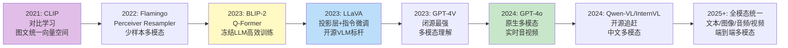

# 多模态模型原理 VLM

> **一句话定义**：VLM（Vision Language Model，视觉语言模型）是将视觉编码器与大语言模型结合，能够同时理解图像和文本并生成文本回答的多模态大模型，通过将图像编码为视觉 Token 与文本 Token 一起输入 LLM，实现图像理解、视觉问答、图文推理等能力。
>
> **核心价值**：突破纯文本 LLM 只能处理文字的局限，赋予模型"看懂图像"的能力，是多模态 RAG、视觉问答、图文生成、多模态 Agent、自动驾驶、医学影像分析等应用的核心技术。
>
> **适用场景**：视觉问答 VQA、图文理解、图像描述、OCR、图表理解、多模态 RAG、多模态 Agent、医学影像分析、自动驾驶感知、图文生成指导。

---

## 一、概述

### 1.1 VLM 核心架构

```mermaid
graph TB
    subgraph VLM 整体架构
        subgraph 视觉编码模块
            V1[输入图像] --> V2[视觉编码器<br/>ViT/CLIP ViT/SigLIP]
            V2 --> V3[视觉特征<br/>Patch Token 序列]
        end
        subgraph 桥接模块
            V3 --> B1[投影层/Q-Former<br/>视觉特征→LLM 隐藏维度]
            B1 --> B2[视觉 Token 序列]
        end
        subgraph 语言模型模块
            T1[文本 Token] --> CONCAT[Token 拼接<br/>视觉 Token + 文本 Token]
            B2 --> CONCAT
            CONCAT --> L1[LLM 解码器<br/>Transformer Decoder]
            L1 --> L2[输出 logits]
            L2 --> L3[生成文本回答]
        end
    end

    Note over V2: 视觉编码器将图像编码为<br/>Patch 级特征序列
    Note over B1: 桥接模块将视觉特征转换为<br/>LLM 能理解的 Token 格式
    Note over L1: LLM 同时处理视觉 Token 和文本 Token<br/>理解图像内容，生成回答
    style V2 fill:#bbdefb
    style B1 fill:#fff9c4
    style L1 fill:#c8e6c9
```

### 1.2 VLM 发展历程



### 1.3 核心概念

| 概念 | 说明 |
|------|------|
| **VLM（Vision Language Model）** | 视觉语言模型，结合视觉编码器和 LLM，能理解图像并生成文本回答的多模态大模型 |
| **MLLM（Multimodal LLM）** | 多模态大模型，VLM 的更宽泛说法，可能包含音频/视频等更多模态 |
| **视觉编码器（Vision Encoder）** | 将图像编码为视觉特征的神经网络，通常用 ViT（Vision Transformer）或 CLIP ViT |
| **ViT（Vision Transformer）** | 视觉 Transformer，将图像切分为 Patch，用 Transformer 编码器处理，是 VLM 视觉编码器的主流选择 |
| **CLIP ViT** | CLIP 训练的 ViT，通过对比学习将图像和文本映射到统一空间，作为 VLM 的视觉编码器效果好 |
| **投影层（Projection Layer）** | 将视觉特征投影到 LLM 隐藏维度的线性层或 MLP，是最简单的视觉-语言桥接方式（LLaVA 采用） |
| **Q-Former（Querying Transformer）** | BLIP-2 提出的桥接模块，用一组可学习的 Query 从视觉特征中提取信息，转换为 LLM 能理解的 Token，冻结 LLM 训练 |
| **Perceiver Resampler** | Flamingo 提出的桥接模块，用交叉注意力将视觉特征压缩为固定数量的 Token |
| **视觉 Token（Visual Token）** | 图像经过视觉编码器和桥接模块后得到的 Token 序列，与文本 Token 一起输入 LLM |
| **多模态指令微调（Multimodal Instruction Tuning）** | 用多模态指令数据（图像+指令+回答）微调 VLM，让模型学会遵循多模态指令 |
| **视觉问答（VQA）** | 给定图像和问题，生成关于图像内容的回答，是 VLM 的核心能力 |
| **图像描述（Image Captioning）** | 为图像生成文本描述，是 VLM 的基础能力 |
| **OCR（光学字符识别）** | 从图像中提取文字，VLM 的端到端 OCR 能力是重要应用 |
| **视觉 Grounding** | 根据文本描述定位图像中的区域（如"指出猫的位置"），是 VLM 的高级能力 |
| **视觉幻觉（Visual Hallucination）** | VLM 编造图像中不存在的内容，是 VLM 的主要问题之一 |
| **多模态预训练（Multimodal Pre-training）** | 在大规模图文对上预训练 VLM，学习视觉-语言对齐 |
| **原生多模态（Native Multimodal）** | 从架构上统一文本和图像（甚至音频/视频），不是简单拼接，如 GPT-4o、Gemini |

### 1.4 VLM 架构类型对比

| 架构类型 | 桥接方式 | 训练方式 | 代表模型 | 优点 | 缺点 |
|---------|---------|---------|---------|------|------|
| **端到端训练** | 无独立桥接，视觉和语言统一架构 | 从头联合训练 | Gemini、GPT-4V（推测） | 效果最好，模态融合最充分 | 训练成本极高，数据需求大 |
| **投影层** | 线性层/MLP 投影 | 冻结 LLM，训练投影层+微调 | LLaVA-1.0/1.5、MiniGPT-4 | 简单高效，训练成本低 | 桥接能力有限，信息损失 |
| **Q-Former** | Querying Transformer | 冻结 LLM 和视觉编码器，训练 Q-Former | BLIP-2、InstructBLIP | 训练参数少，灵活，效果好 | 架构复杂，推理多一步 |
| **Perceiver Resampler** | 交叉注意力重采样 | 冻结 LLM，训练 Resampler | Flamingo、OpenFlamingo | 压缩视觉 Token，少样本能力强 | 实现复杂，开源生态弱 |
| **交叉注意力** | 在 LLM 层间插入交叉注意力 | 冻结 LLM，训练交叉注意力层 | Flamingo 系列 | 模态融合深入，少样本好 | 实现复杂，推理慢 |
| **全参数微调** | 投影层/Q-Former | 视觉编码器+桥接+LLM 全参数微调 | LLaVA-1.5、Qwen-VL | 效果最好，能力释放充分 | 需要大 GPU，训练成本高 |
| **原生多模态** | 统一 Tokenizer 和 Transformer | 端到端多模态预训练 | GPT-4o、Gemini | 最强大，实时多模态，统一处理 | 闭源，训练成本极高 |


<div style="background:linear-gradient(135deg,#667eea,#764ba2);border-radius:16px;padding:20px;margin:16px 0;font-family:-apple-system,'Segoe UI','PingFang SC','Microsoft YaHei',sans-serif;color:#fff;overflow:hidden;box-shadow:0 8px 28px rgba(0,0,0,.14),0 3px 10px rgba(0,0,0,.08)">
<style>@keyframes pulse{0%,100%{transform:scale(1);opacity:.9}50%{transform:scale(1.03);opacity:1}}.dk-layer{border-radius:8px;padding:12px 16px;margin:6px auto;text-align:center;font-weight:600;animation:pulse 3s ease-in-out infinite}.dk-outer{background:rgba(255,255,255,.15);border:2px solid rgba(255,255,255,.5);max-width:340px;animation-delay:0s}.dk-middle{background:rgba(255,255,255,.2);border:2px solid rgba(255,255,255,.6);max-width:280px;animation-delay:.5s}.dk-inner{background:rgba(255,255,255,.25);border:2px solid rgba(255,255,255,.7);max-width:220px;animation-delay:1s}.dk-arrow{text-align:center;font-size:18px;margin:2px 0}.dk-label{font-size:12px;opacity:.85;font-weight:400;margin-top:4px}</style>
<div style="text-align:center;font-size:15px;font-weight:700;margin-bottom:14px;padding-bottom:10px;border-bottom:1.5px solid rgba(255,255,255,.22);letter-spacing:1px">👁️ VLM 视觉语言模型架构</div>
<div class="dk-layer dk-outer">输出层 · 文本生成/图像理解/对话<div class="dk-label">图像描述/VQA/多轮对话/图文推理</div></div>
<div class="dk-arrow">▼ 包含</div>
<div class="dk-layer dk-middle">融合层 · Cross-Attention/Perceiver/Projection<div class="dk-label">交叉注意力融合/感知器压缩/线性投影对齐</div></div>
<div class="dk-arrow">▼ 包含</div>
<div class="dk-layer dk-inner">编码层 · ViT视觉编码器+LLM语言模型<div class="dk-label">CLIP ViT提取图像特征+预训练LLM处理语言</div></div>
</div>
> 🔍 **知识点深度解析**
>
> **作用**：VLM（视觉语言模型）将视觉编码器与大语言模型结合，通过将图像编码为视觉 Token 与文本 Token 一起输入 LLM，赋予模型"看懂图像"的能力，实现图像理解、视觉问答、图文推理、OCR、图表理解等功能，是多模态 RAG、多模态 Agent、医学影像分析、自动驾驶等应用的核心技术。
>
> **原理**：VLM 的核心原理是"视觉特征的语言化"——将图像转换为 LLM 能理解的 Token 格式，然后用 LLM 的强大语言理解和推理能力处理视觉信息。具体分为三步：① 视觉编码——用视觉编码器（通常是 ViT 或 CLIP ViT）将输入图像编码为 Patch 级的视觉特征序列（类似文本的 Token 序列）；② 桥接/投影——用投影层（线性层/MLP）或 Q-Former 将视觉特征投影/转换到 LLM 的隐藏维度，得到视觉 Token 序列，这一步是视觉和语言之间的"翻译器"；③ 语言建模——将视觉 Token 与文本 Token 拼接在一起，输入 LLM 解码器，LLM 同时处理视觉和文本信息，通过自注意力机制实现跨模态交互，最终生成文本回答。VLM 的训练通常分为两阶段：① 预训练/对齐——在大规模图文对上训练，让视觉编码器和桥接模块学会将视觉信息转换为 LLM 能理解的格式（这一阶段通常冻结 LLM，只训练视觉编码器和桥接模块）；② 指令微调——用多模态指令数据（图像+指令+回答）微调，让模型学会遵循多模态指令，生成高质量回答（这一阶段可能全参数微调或部分参数微调）。
>
> **用法要点**：① 模型选择——闭源用 GPT-4o（最强，实时多模态，API 调用）、Claude 3（长上下文，分析能力强）、Gemini（1M 上下文，多模态统一）；开源用 LLaVA-1.5/NeXT（最流行，生态好）、Qwen-VL（中文好，OCR 强）、InternVL（开源最强，接近 GPT-4V）、CogVLM（grounding 能力强） ② 部署——开源 VLM 用 vLLM/LMDeploy 推理加速，4bit/8bit 量化降低显存，7B 模型单卡可部署，13B+ 需多卡 ③ Prompt 设计——明确告诉 VLM 任务类型（描述/问答/OCR/分析），要求引用图像中的具体内容，对复杂图像可以分步骤提问 ④ 视觉幻觉防控——要求 VLM"只根据图像内容回答，不知道就说不知道"，关键数据用 OCR/图表提取工具验证，人工审核关键场景 ⑤ 高分辨率——VLM 对小文字和细节理解有限，用高分辨率输入（如 1024×1024 以上），或图像切块分别处理 ⑥ 评估——用 VQAv2/GQA/DocVQA/ChartQA/TextVQA 等标准评估集，评估准确性/完整性/幻觉率 ⑦ 微调——领域 VLM 用 LoRA/QLoRA 在领域多模态数据上微调，成本低效果好 ⑧ 成本——闭源 API 按 Token 计费（图像输入相当于数百到数千 Token），开源自部署一次性成本适合大规模使用

---

> 💡 **深度讲解**：VLM（视觉语言模型）是多模态 AI 的核心技术，它的出现打破了纯文本 LLM 的局限，赋予了模型"看懂世界"的能力。VLM 的发展可以追溯到 CLIP（2021）——CLIP 通过对比学习将文本和图像映射到统一向量空间，证明了视觉和语言可以在同一个表示空间中对齐。CLIP 虽然强大，但它只能做图文检索和零样本分类，不能生成关于图像的文本回答。Flamingo（2022）是第一个真正意义上的 VLM——它在冻结的 LLM 中插入 Perceiver Resampler 和交叉注意力层，用少量可训练参数将视觉信息注入 LLM，实现了少样本多模态学习。但 Flamingo 闭源，且架构复杂。BLIP-2（2023）提出了 Q-Former——用一组可学习的 Query 通过交叉注意力从视觉特征中提取信息，转换为固定数量的 Token，然后输入冻结的 LLM。Q-Former 的优势是训练参数少（只训练 Q-Former，冻结 LLM 和视觉编码器），且效果好，成为 VLM 的重要架构。LLaVA（2023）是开源 VLM 的里程碑——它用最简单的架构（CLIP ViT + 线性投影层 + Vicuna LLM）和两阶段训练（先预训练投影层，再指令微调），达到了接近闭源模型的效果，且完全开源。LLaVA 的简单架构和良好效果激发了开源 VLM 的爆发，LLaVA-1.5（全参数微调 + 更高分辨率）、LLaVA-NeXT（更好的视觉编码器和更大的 LLM）持续改进。GPT-4V（2023）和 GPT-4o（2024）是闭源 VLM 的代表——GPT-4V 展示了强大的多模态理解能力，GPT-4o 进一步实现了原生多模态（文本/图像/音频统一处理，实时交互）。开源 VLM 也在快速追赶——Qwen-VL（阿里，中文 OCR 强）、InternVL（上海 AI Lab，开源最强，接近 GPT-4V）、CogVLM（清华，grounding 能力强）、MiniGPT-4（简单易部署）等。VLM 的核心架构挑战是"视觉-语言桥接"——如何将视觉特征（连续的、二维的、Patch 级的）转换为 LLM 能理解的 Token 格式（离散的、一维的、序列的）。主要的桥接方式有：① 投影层（Projection）——最简单的方式，用线性层或 MLP 将视觉特征直接投影到 LLM 的隐藏维度，LLaVA 采用这种方式。优点是简单高效，缺点是桥接能力有限，可能丢失视觉细节。② Q-Former——用一组可学习的 Query（如 32 个）通过交叉注意力从视觉特征中"查询"信息，输出固定数量的 Token，BLIP-2 采用。优点是训练参数少、灵活、效果好，缺点是架构复杂，推理多一步。③ Perceiver Resampler——用交叉注意力将任意数量的视觉特征压缩为固定数量的 Token，Flamingo 采用。优点是压缩视觉 Token（减少 LLM 计算量），少样本能力强，缺点是实现复杂。④ 交叉注意力——在 LLM 的每一层插入视觉-语言交叉注意力，让 LLM 的每一层都能直接关注视觉特征，Flamingo 系列采用。优点是模态融合深入，缺点是实现复杂，推理慢。⑤ 端到端/原生多模态——从架构上统一视觉和语言，没有独立的桥接模块，视觉和文本用同一个 Tokenizer 和 Transformer 处理，GPT-4o/Gemini 采用。优点是效果最好，模态融合最充分，缺点是训练成本极高。VLM 的训练通常分为两到三个阶段：① 视觉-语言预训练/对齐——在大规模图文对上（如 LAION-400M、CC12M）训练，让视觉编码器和桥接模块学会将视觉信息转换为 LLM 能理解的格式。这一阶段通常冻结 LLM（利用 LLM 已有的语言能力），只训练视觉编码器和桥接模块（或只训练桥接模块）。训练目标是图文对比学习（CLIP 式）或图像描述（让 LLM 根据视觉 Token 生成图像描述）。② 多模态指令微调——用多模态指令数据（图像+指令+回答，如 LLaVA-Instruct-150K，用 GPT-4 生成）微调，让模型学会遵循多模态指令，生成高质量回答。这一阶段可能全参数微调（LLaVA-1.5）或部分参数微调（LoRA）。③ （可选）高质量对齐——用 RLHF/DPO 或更高质量的指令数据进一步对齐，提升回答质量和安全性。VLM 的能力评估需要多模态评估集——VQAv2（通用视觉问答）、GQA（基于场景图的问答）、TextVQA（图像中文字的问答）、DocVQA（文档视觉问答）、ChartQA（图表问答）、InfoVQA（信息图表问答）、MMBench（综合多模态基准）、MME（多模态理解评估）、SEED-Bench（多模态综合评估）。评估指标包括准确率（开放式问答用精确匹配或 F1）、完整性、相关性、幻觉率（编造图像中不存在内容的比例）。VLM 的主要问题是视觉幻觉——VLM 倾向于生成"看起来合理"的回答，当无法准确理解图像时会编造内容。特别是复杂数据图表（柱状图/折线图/饼图），VLM 往往无法准确读取精确数值，容易编造数据。缓解视觉幻觉的策略包括：① 用更强的 VLM（GPT-4o/InternVL）；② Prompt 约束（只根据图像回答，不知道就说不知道，要求引用具体内容）；③ 图表数据提取（用专门工具提取图表数据为结构化数据，用文本 RAG 处理）；④ 答案验证（事实核查、置信度标注、人工审核）；⑤ 多 VLM 交叉验证。VLM 是一个快速发展的领域——新的模型（GPT-4o、Qwen-VL-Max、InternVL 2.5）、新的架构（原生多模态、全模态统一）、新的能力（视频理解、音频理解、3D 理解、实时交互）不断涌现。对于企业和开发者来说，VLM 是构建多模态应用的核心技术——从视觉问答到多模态 RAG，从多模态 Agent 到医学影像分析，VLM 的应用场景不断扩展。建议根据业务需求选择合适的 VLM（简单场景用开源 VLM 自部署，复杂场景用 GPT-4o API），关注视觉幻觉问题，持续评估和优化。
>
> **📝 精简总结**：VLM视觉语言模型将视觉编码器与LLM结合，图像编码为视觉Token与文本Token一起输入LLM，实现图像理解/视觉问答/图文推理/OCR/图表理解，是多模态RAG/多模态Agent/医学影像/自动驾驶核心技术；核心架构是视觉编码模块（ViT/CLIP ViT/SigLIP→视觉特征Patch序列）+桥接模块（投影层/Q-Former→视觉Token序列）+语言模型模块（文本Token+视觉Token拼接→LLM解码器→生成回答）；发展历程——2021 CLIP对比学习图文统一空间→2022 Flamingo Perceiver Resampler少样本多模态→2023 BLIP-2 Q-Former冻结LLM高效训练→2023 LLaVA投影层+指令微调开源标杆→2023 GPT-4V闭源最强→2024 GPT-4o原生多模态实时音视频→2024 Qwen-VL/InternVL开源追赶中文多模态→2025+全模态统一端到端；核心概念包括VLM/MLLM、视觉编码器、ViT视觉Transformer、CLIP ViT、投影层Projection、Q-Former、Perceiver Resampler、视觉Token、多模态指令微调、视觉问答VQA、图像描述Image Captioning、OCR、视觉Grounding、视觉幻觉Visual Hallucination、多模态预训练、原生多模态Native Multimodal；架构类型对比——端到端训练（无独立桥接统一架构，从头联合训练，Gemini/GPT-4V，效果最好但成本极高）、投影层（线性/MLP投影，冻结LLM训练投影+微调，LLaVA/MiniGPT-4，简单高效但桥接能力有限）、Q-Former（Querying Transformer，冻结LLM+视觉编码器训练Q-Former，BLIP-2/InstructBLIP，训练参数少灵活效果好但架构复杂）、Perceiver Resampler（交叉注意力重采样，冻结LLM训练Resampler，Flamingo/OpenFlamingo，压缩Token少样本强但实现复杂）、交叉注意力（LLM层间插入交叉注意力，冻结LLM训练注意力层，Flamingo系列，模态融合深入但实现复杂推理慢）、全参数微调（投影/Q-Former，视觉+桥接+LLM全参数微调，LLaVA-1.5/Qwen-VL，效果最好但需大GPU）、原生多模态（统一Tokenizer和Transformer，端到端多模态预训练，GPT-4o/Gemini，最强大实时多模态但闭源成本极高）；核心原理是视觉特征的语言化——视觉编码（ViT/CLIP ViT将图像编码为Patch级视觉特征序列）→桥接投影（投影层/Q-Former将视觉特征转换到LLM隐藏维度得到视觉Token）→语言建模（视觉Token+文本Token拼接输入LLM解码器，自注意力实现跨模态交互，生成文本回答）；训练两阶段——预训练对齐（大规模图文对，冻结LLM训练视觉编码器+桥接，目标图文对比或图像描述）→指令微调（多模态指令数据图像+指令+回答，全参数或LoRA微调，学会遵循多模态指令）→可选高质量对齐（RLHF/DPO）；用法要点包括模型选择（闭源GPT-4o最强实时/Claude3长上下文/Gemini 1M上下文，开源LLaVA最流行生态好/Qwen-VL中文OCR强/InternVL开源最强接近GPT-4V/CogVLM grounding强）、部署（vLLM/LMDeploy加速+4bit/8bit量化，7B单卡13B+多卡）、Prompt设计（明确任务类型+要求引用具体内容+复杂图像分步骤）、视觉幻觉防控（只根据图像回答+不知道就说不知道+关键数据OCR验证+人工审核）、高分辨率（1024×1024以上+图像切块）、评估（VQAv2/GQA/DocVQA/ChartQA/TextVQA/MMBench/MME，准确率/完整性/幻觉率）、微调（LoRA/QLoRA领域多模态数据）、成本（闭源按Token图像相当于数百数千Token，开源自部署适合大规模）；主要问题是视觉幻觉（编造图像不存在内容，复杂图表数值读取不准，缓解用强VLM+Prompt约束+图表数据提取+答案验证+多VLM交叉验证）；发展方向是原生多模态/全模态统一（文本图像音频视频3D）/实时交互/端侧部署，建议根据业务选合适VLM，关注视觉幻觉，持续评估优化。

---

## 二、原理

### 2.1 视觉编码器原理（ViT）

```mermaid
graph TB
    subgraph ViT 视觉编码器
        V1[输入图像<br/>224×224×3] --> V2[图像切分<br/>16×16 Patch<br/>14×14=196个Patch]
        V2 --> V3[Patch 展平<br/>每个Patch 768维<br/>16×16×3=768]
        V3 --> V4[线性投影<br/>Patch Embedding<br/>768→768]
        V4 --> V5[+位置编码<br/>可学习/正弦位置编码]
        V5 --> V6[ <[BOS_never_used_51bce0c785ca2f68081bfa7d91973934]> Token<br/>分类用特殊Token]
        V6 --> V7[Transformer 编码器<br/>多层自注意力+MLP]
        V7 --> V8[输出特征<br/>197×768<br/><[BOS_never_used_51bce0c785ca2f68081bfa7d91973934]>+196个Patch特征]
    end

    Note over V2: 将图像切分为固定大小的 Patch<br/>类似文本的 Token
    Note over V7: Transformer 编码器通过自注意力<br/>建模 Patch 之间的空间关系
    style V7 fill:#bbdefb
    style V8 fill:#c8e6c9
```

#### ViT 工作流程

1. **图像切分**：将输入图像（如 224×224×3）切分为固定大小的 Patch（如 16×16），得到 14×14=196 个 Patch
2. **Patch 展平**：每个 Patch 展平为一维向量（16×16×3=768 维）
3. **线性投影**：用线性层将 Patch 向量投影到模型隐藏维度（如 768 维），得到 Patch Embedding
4. **位置编码**：为每个 Patch 添加位置编码（可学习或正弦），保留空间位置信息
5. **<[BOS_never_used_51bce0c785ca2f68081bfa7d91973934]> Token**：在序列开头添加一个特殊的 <[BOS_never_used_51bce0c785ca2f68081bfa7d91973934]> Token，用于聚合全局信息（分类任务）
6. **Transformer 编码器**：通过多层 Transformer 编码器（自注意力 + MLP）处理 Patch 序列，自注意力机制建模 Patch 之间的空间关系
7. **输出特征**：输出 <[BOS_never_used_51bce0c785ca2f68081bfa7d91973934]> Token 的特征（全局表示）或所有 Patch 的特征序列（用于 VLM 的视觉 Token）

#### ViT vs CNN

| 特性 | ViT | CNN（ResNet） |
|------|-----|--------------|
| **架构** | Transformer 自注意力 | 卷积 + 池化 |
| **感受野** | 全局（自注意力） | 局部（卷积核），逐层扩大 |
| **归纳偏置** | 弱（需要大量数据） | 强（平移不变性、局部性） |
| **数据需求** | 大（JFT-300M 级） | 中（ImageNet 即可） |
| **可扩展性** | 好（Scaling Law） | 中 |
| **VLM 适配** | 好（输出 Token 序列） | 中（需要特殊处理） |
| **代表** | ViT、CLIP ViT、SigLIP | ResNet、EfficientNet |

### 2.2 桥接模块原理

```mermaid
graph TB
    subgraph 投影层（LLaVA）
        P1[视觉特征<br/>N×D_v] --> P2[线性层/MLP<br/>D_v → D_llm]
        P2 --> P3[视觉 Token<br/>N×D_llm]
    end

    subgraph Q-Former（BLIP-2）
        Q1[可学习 Query<br/>32×D_q] --> Q2[交叉注意力<br/>Query 关注视觉特征]
        Q3[视觉特征<br/>N×D_v] --> Q2
        Q2 --> Q4[自注意力<br/>Query 之间交互]
        Q4 --> Q5[线性投影<br/>D_q → D_llm]
        Q5 --> Q6[视觉 Token<br/>32×D_llm]
    end

    subgraph Perceiver Resampler（Flamingo）
        R1[可学习 Latent<br/>64×D_l] --> R2[交叉注意力<br/>Latent 关注视觉特征]
        R3[视觉特征<br/>N×D_v] --> R2
        R2 --> R4[Transformer 层<br/>自注意力+MLP]
        R4 --> R5[线性投影<br/>D_l → D_llm]
        R5 --> R6[视觉 Token<br/>64×D_llm]
    end

    Note over P1,P3: 最简单：直接线性投影<br/>每个视觉特征对应一个 Token
    Note over Q1,Q6: 用 Query 从视觉特征中提取信息<br/>输出固定数量 Token，冻结 LLM 训练
    Note over R1,R6: 用 Latent 压缩视觉特征<br/>固定数量 Token，减少 LLM 计算量
    style P2 fill:#bbdefb
    style Q2 fill:#fff9c4
    style R2 fill:#c8e6c9
```

#### 三种桥接方式对比

| 特性 | 投影层（LLaVA） | Q-Former（BLIP-2） | Perceiver Resampler（Flamingo） |
|------|----------------|-------------------|-------------------------------|
| **原理** | 线性/MLP 直接投影 | Query 交叉注意力提取 | Latent 交叉注意力压缩 |
| **输出 Token 数** | = 视觉特征数（如 576） | 固定（如 32） | 固定（如 64） |
| **训练参数** | 投影层（少） | Q-Former（中） | Resampler（中） |
| **是否冻结 LLM** | 是（预训练阶段） | 是 | 是 |
| **信息损失** | 少（保留所有 Patch） | 中（压缩到 32 Token） | 中（压缩到 64 Token） |
| **LLM 计算量** | 大（576 视觉 Token） | 小（32 Token） | 小（64 Token） |
| **实现复杂度** | 低 | 中 | 中高 |
| **效果** | 好（全参数微调后） | 好 | 很好（少样本） |
| **代表模型** | LLaVA、MiniGPT-4 | BLIP-2、InstructBLIP | Flamingo、OpenFlamingo |

### 2.3 VLM 训练流程

```mermaid
graph TB
    subgraph 阶段1：视觉-语言预训练
        S1[大规模图文对<br/>LAION/CC12M<br/>数百万~数亿] --> S2[冻结 LLM<br/>利用已有语言能力]
        S2 --> S3[训练视觉编码器+桥接<br/>或只训练桥接]
        S3 --> S4[目标：图像描述<br/>根据视觉 Token 生成描述]
        S4 --> S5[对齐后的视觉编码器+桥接]
    end

    subgraph 阶段2：多模态指令微调
        T1[多模态指令数据<br/>图像+指令+回答<br/>LLaVA-Instruct-150K] --> T2[全参数微调<br/>或 LoRA 微调]
        T2 --> T3[目标：指令遵循<br/>根据图像+指令生成回答]
        T3 --> T4[指令微调后的 VLM]
    end

    subgraph 阶段3：高质量对齐（可选）
        A1[高质量多模态数据<br/>/ 偏好数据] --> A2[RLHF/DPO<br/>/ 继续指令微调]
        A2 --> A3[对齐后的 VLM<br/>更安全/更高质量]
    end

    S5 --> T1
    T4 --> A1

    Note over S1,S5: 冻结 LLM，只训练视觉和桥接<br/>学习视觉-语言对齐
    Note over T1,T4: 全参数或 LoRA 微调<br/>学习遵循多模态指令
    style S5 fill:#bbdefb
    style T4 fill:#fff9c4
    style A3 fill:#c8e6c9
```

#### 阶段1：视觉-语言预训练

- **数据**：大规模图文对（LAION-400M、CC12M、COCO 等），数百万到数亿对
- **冻结**：LLM 冻结（利用 LLM 已有的语言理解和推理能力），视觉编码器可能冻结（CLIP ViT 预训练好）或微调
- **训练**：只训练桥接模块（投影层/Q-Former），或同时训练视觉编码器和桥接
- **目标**：图像描述（Image Captioning）——根据视觉 Token 生成图像的文本描述，让桥接模块学会将视觉信息转换为 LLM 能理解的格式
- **损失**：因果语言建模损失（只对描述部分计算损失）

#### 阶段2：多模态指令微调

- **数据**：多模态指令数据（图像 + 指令 + 回答），如 LLaVA-Instruct-150K（用 GPT-4 基于 COCO 图像生成）
- **训练**：全参数微调（LLaVA-1.5）或 LoRA 微调（低成本）
- **目标**：指令遵循——根据图像和用户指令生成高质量回答，学会各种多模态任务（问答、描述、OCR、分析等）
- **损失**：因果语言建模损失（只对回答部分计算损失）

#### 阶段3：高质量对齐（可选）

- **方法1**：更高质量的多模态指令数据继续微调（如 LLaVA-1.5 用 LLaVA-Instruct-665K）
- **方法2**：RLHF/DPO 对齐（用多模态偏好数据优化回答质量和安全性）
- **方法3**：高质量人类标注数据微调（如 GPT-4V 的内部对齐）

### 2.4 注意力机制中的跨模态交互

```mermaid
graph TB
    subgraph 输入序列
        I1[视觉 Token 1] --> CONCAT
        I2[视觉 Token 2] --> CONCAT
        I3[...] --> CONCAT
        I4[视觉 Token N] --> CONCAT
        I5[文本 Token 1] --> CONCAT
        I6[文本 Token 2] --> CONCAT
        I7[...] --> CONCAT
        I8[文本 Token M] --> CONCAT
    end

    CONCAT --> ATTENTION[多头自注意力<br/>Q = W_q·X, K = W_k·X, V = W_v·X]

    subgraph 注意力交互
        ATTENTION --> A1[文本 Token 关注视觉 Token<br/>理解图像内容]
        ATTENTION --> A2[视觉 Token 关注文本 Token<br/>视觉信息与问题对齐]
        ATTENTION --> A3[视觉 Token 之间关注<br/>建模空间关系]
        ATTENTION --> A4[文本 Token 之间关注<br/>语言理解和推理]
    end

    A1 --> MLP[FFN 前馈网络]
    A2 --> MLP
    A3 --> MLP
    A4 --> MLP

    MLP --> OUTPUT[输出特征<br/>融合视觉和语言信息]

    Note over A1: 关键：文本 Token 通过自注意力<br/>直接关注视觉 Token，实现跨模态理解
    style ATTENTION fill:#fff9c4
    style A1 fill:#c8e6c9
```

#### 跨模态注意力的工作原理

当视觉 Token 和文本 Token 拼接在一起输入 LLM 时，自注意力机制允许：

1. **文本 Token 关注视觉 Token**：回答生成时，文本 Token 可以直接关注相关的视觉 Token，理解图像内容。例如，回答"图中有几只猫？"时，文本 Token 关注图像中猫的区域对应的视觉 Token
2. **视觉 Token 关注文本 Token**：视觉 Token 可以关注问题文本，将视觉信息与问题对齐。例如，问题问"颜色"时，视觉 Token 更关注颜色相关的区域
3. **视觉 Token 之间关注**：视觉 Patch 之间通过自注意力建模空间关系，理解图像的整体结构
4. **文本 Token 之间关注**：文本 Token 之间的自注意力实现语言理解和推理

这种统一的自注意力机制使得 VLM 能够自然地实现跨模态交互，不需要额外的跨模态注意力模块（这也是投影层架构简单但效果好的原因）。

---

> 💡 **深度讲解**：VLM 的原理可以用"视觉编码 → 桥接投影 → 语言建模"三个核心步骤来理解，每个步骤都有其技术细节和设计选择。视觉编码是 VLM 的第一步——将图像转换为机器能处理的特征表示。ViT（Vision Transformer）是当前 VLM 视觉编码器的主流选择，它将图像切分为固定大小的 Patch（如 16×16），每个 Patch 展平后通过线性投影得到 Patch Embedding，加上位置编码后输入 Transformer 编码器。ViT 的自注意力机制能够建模 Patch 之间的全局空间关系，这是 ViT 相比 CNN 的优势（CNN 的感受野是局部的，需要逐层扩大）。但 ViT 的归纳偏置比 CNN 弱（没有平移不变性和局部性的先验），因此需要更多的训练数据。CLIP ViT 是 VLM 中最常用的视觉编码器——它通过对比学习在 4 亿图文对上训练，将图像和文本映射到统一向量空间，作为 VLM 的视觉编码器时，已经具备了良好的视觉-语言对齐能力，因此 VLM 通常冻结 CLIP ViT（或只做轻微微调），专注于训练桥接模块和 LLM。SigLIP 是 CLIP 的改进版本，用 Sigmoid 损失替代 Softmax 损失，训练更稳定，效果更好，最新的 VLM（如 LLaVA-NeXT、InternVL）开始使用 SigLIP 作为视觉编码器。桥接模块是 VLM 的核心设计——它决定了视觉信息如何转换为 LLM 能理解的格式。主要有三种桥接方式：① 投影层（Projection）——最简单的方式，用线性层或 2 层 MLP 将视觉特征直接投影到 LLM 的隐藏维度。LLaVA 采用这种方式，每个视觉 Patch 对应一个视觉 Token（如 24×24=576 个 Token）。投影层的优点是简单高效、信息损失少（保留所有 Patch 信息），缺点是视觉 Token 数量多（增加 LLM 计算量）、桥接能力有限（线性投影的表达能力不如 Q-Former）。但 LLaVA-1.5 证明了，在全参数微调后，简单的投影层也能达到很好的效果。② Q-Former——BLIP-2 提出的桥接模块，用一组可学习的 Query（如 32 个）通过交叉注意力从视觉特征中"查询"信息，然后通过自注意力在 Query 之间交互，最后线性投影到 LLM 隐藏维度，输出固定数量（32 个）的视觉 Token。Q-Former 的优点是训练参数少（只训练 Q-Former，冻结 LLM 和视觉编码器）、灵活（可以用不同的 LLM）、视觉 Token 数量少（减少 LLM 计算量），缺点是架构复杂、推理多一步、信息有损失（压缩到 32 Token）。BLIP-2 和 InstructBLIP 采用 Q-Former。③ Perceiver Resampler——Flamingo 提出的桥接模块，用可学习的 Latent（如 64 个）通过交叉注意力从视觉特征中提取信息，然后用 Transformer 层处理，输出固定数量的视觉 Token。与 Q-Former 类似，但 Perceiver Resampler 更强调压缩视觉特征（减少 LLM 计算量）和少样本能力。Flamingo 和 OpenFlamingo 采用。桥接模块的选择是 VLM 架构设计的核心决策——投影层简单但 Token 多，Q-Former/Perceiver 压缩 Token 但复杂。最新的趋势是投影层 + 全参数微调（LLaVA 路线），因为简单且效果好；而 Q-Former 路线在冻结 LLM 的场景下更有优势。语言建模是 VLM 的第三步——将视觉 Token 与文本 Token 拼接在一起输入 LLM 解码器，LLM 通过自注意力机制同时处理视觉和文本信息，实现跨模态交互，最终生成文本回答。这里的关键洞察是：一旦视觉信息被转换为 LLM 能理解的 Token 格式，LLM 就可以用其强大的语言理解和推理能力处理视觉信息，不需要额外的跨模态处理模块。自注意力机制自然地实现了跨模态交互——文本 Token 可以关注视觉 Token（理解图像内容），视觉 Token 可以关注文本 Token（与问题对齐），视觉 Token 之间可以关注（建模空间关系），文本 Token 之间可以关注（语言推理）。这种统一的自注意力机制是 VLM 简单而强大的原因。VLM 的训练分为两到三个阶段——视觉-语言预训练（对齐）、多模态指令微调（学会遵循指令）、可选的高质量对齐（RLHF/DPO）。预训练阶段冻结 LLM，只训练视觉编码器和桥接模块，目标是图像描述，让桥接模块学会将视觉信息转换为 LLM 能理解的格式。指令微调阶段用多模态指令数据（图像+指令+回答）全参数或 LoRA 微调，让模型学会遵循多模态指令，生成高质量回答。VLM 的评估需要多模态评估集——VQAv2（通用视觉问答）、GQA（场景图问答）、TextVQA（图像文字问答）、DocVQA（文档问答）、ChartQA（图表问答）、MMBench（综合基准）、MME（多模态理解）等。VLM 的主要问题是视觉幻觉——编造图像中不存在的内容，特别是复杂图表的数值。缓解策略包括强 VLM、Prompt 约束、图表数据提取、答案验证、多 VLM 交叉验证。VLM 是多模态 AI 的核心技术，正在快速发展——从图像理解到视频理解、音频理解、3D 理解，从闭源到开源，从云端到端侧，VLM 的能力和应用场景不断扩展。
>
> **📝 精简总结**：视觉编码器ViT原理——输入图像224×224×3→图像切分16×16 Patch得到14×14=196个→Patch展平每个768维16×16×3→线性投影Patch Embedding 768→768→+位置编码可学习/正弦→<[BOS_never_used_51bce0c785ca2f68081bfa7d91973934]> Token特殊分类Token→Transformer编码器多层自注意力+MLP→输出特征197×768（<[BOS_never_used_51bce0c785ca2f68081bfa7d91973934]>+196 Patch）；ViT vs CNN——ViT（Transformer自注意力/全局感受野/归纳偏置弱需大数据/可扩展性好/VLM适配好/ViT CLIP ViT SigLIP），CNN（卷积+池化/局部感受野逐层扩大/归纳偏置强平移不变局部性/数据需求中/可扩展性中/VLM适配中/ResNet EfficientNet）；桥接模块原理——投影层LLaVA（视觉特征N×D_v→线性/MLP D_v→D_llm→视觉Token N×D_llm，最简单直接投影每个特征对应Token）、Q-Former BLIP-2（可学习Query 32×D_q+视觉特征→交叉注意力Query关注视觉→自注意力Query交互→线性投影D_q→D_llm→视觉Token 32×D_llm，用Query提取信息输出固定Token冻结LLM训练）、Perceiver Resampler Flamingo（可学习Latent 64×D_l+视觉特征→交叉注意力Latent关注视觉→Transformer层自注意力+MLP→线性投影→视觉Token 64×D_llm，用Latent压缩视觉特征固定Token减少LLM计算）；三种桥接对比——投影层（原理线性/MLP直接投影/输出Token=视觉特征数576/训练参数投影层少/冻结LLM是/信息损失少/LLM计算量大/实现低/效果好全参数微调后/LLaVA MiniGPT-4）、Q-Former（Query交叉注意力提取/固定32/训练参数中/冻结LLM是/信息损失中/LLM计算量小/实现中/效果好/BLIP-2 InstructBLIP）、Perceiver Resampler（Latent交叉注意力压缩/固定64/训练参数中/冻结LLM是/信息损失中/LLM计算量小/实现中高/效果很好少样本/Flamingo OpenFlamingo）；VLM训练流程——阶段1视觉-语言预训练（大规模图文对LAION/CC12M数百万-数亿→冻结LLM利用语言能力→训练视觉编码器+桥接或只训练桥接→目标图像描述根据视觉Token生成描述→对齐后的视觉编码器+桥接）；阶段2多模态指令微调（多模态指令数据图像+指令+回答LLaVA-Instruct-150K→全参数或LoRA微调→目标指令遵循根据图像+指令生成回答→指令微调后的VLM）；阶段3高质量对齐可选（高质量多模态数据/偏好数据→RLHF/DPO或继续指令微调→对齐后的VLM更安全更高质量）；预训练细节（数据大规模图文对/冻结LLM/训练视觉+桥接或只桥接/目标图像描述/损失因果LM只算描述部分）；指令微调细节（数据多模态指令/全参数或LoRA/目标指令遵循/损失因果LM只算回答部分）；注意力机制跨模态交互——输入序列（视觉Token 1..N + 文本Token 1..M拼接）→多头自注意力Q=W_q·X,K=W_k·X,V=W_v·X→四种交互（文本Token关注视觉Token理解图像内容/视觉Token关注文本Token与问题对齐/视觉Token之间关注建模空间关系/文本Token之间关注语言理解推理）→FFN前馈网络→输出特征融合视觉语言；关键是文本Token通过自注意力直接关注视觉Token实现跨模态理解，统一自注意力自然实现跨模态交互不需要额外模块；核心原理三步骤——视觉编码（ViT/CLIP ViT/SigLIP将图像编码为Patch级特征序列）→桥接投影（投影层/Q-Former/Perceiver将视觉特征转换到LLM隐藏维度得到视觉Token）→语言建模（视觉Token+文本Token拼接输入LLM解码器，自注意力实现跨模态交互，生成文本回答）；训练两阶段——预训练对齐（冻结LLM训练视觉+桥接，图像描述目标）→指令微调（全参数或LoRA，多模态指令数据）→可选RLHF/DPO；评估用VQAv2/GQA/TextVQA/DocVQA/ChartQA/MMBench/MME；主要问题视觉幻觉（强VLM+Prompt约束+图表提取+验证+交叉验证）；发展方向视频/音频/3D理解+原生多模态+端侧部署。

---

## 三、实操

### 3.1 使用开源 VLM（LLaVA）

```python
# pip install llava torch transformers accelerate pillow
# 使用 LLaVA-1.5 进行视觉问答

from llava.constants import IMAGE_TOKEN_INDEX, DEFAULT_IMAGE_TOKEN, DEFAULT_IM_START_TOKEN, DEFAULT_IM_END_TOKEN
from llava.conversation import conv_templates, SeparatorStyle
from llava.model.builder import load_pretrained_model
from llava.utils import disable_torch_init
from llava.mm_utils import process_images, tokenizer_image_token, get_model_name_from_path
import torch
from PIL import Image
import requests

# 1. 加载模型
disable_torch_init()
model_path = "liuhaotian/llava-v1.5-13b"  # 或 7b 版本
model_name = get_model_name_from_path(model_path)
tokenizer, model, image_processor, context_len = load_pretrained_model(
    model_path, None, model_name, load_4bit=True, device_map="auto"
)

# 2. 准备图像和问题
image = Image.open("test_image.jpg").convert("RGB")
question = "请详细描述这张图片的内容"

# 3. 构建对话
conv_mode = "llava_v1"
conv = conv_templates[conv_mode].copy()
if "mpt" in model_name.lower():
    roles = ('user', 'assistant')
else:
    roles = conv.roles

# 处理图像
image_tensor = process_images([image], image_processor, model.config)
if type(image_tensor) is list:
    image_tensor = [image.to(model.device, dtype=torch.float16) for image in image_tensor]
else:
    image_tensor = image_tensor.to(model.device, dtype=torch.float16)

# 构建输入
if model.config.mm_use_im_start_end:
    inp = DEFAULT_IM_START_TOKEN + DEFAULT_IMAGE_TOKEN + DEFAULT_IM_END_TOKEN + '\n' + question
else:
    inp = DEFAULT_IMAGE_TOKEN + '\n' + question

conv.append_message(conv.roles[0], inp)
conv.append_message(conv.roles[1], None)
prompt = conv.get_prompt()

input_ids = tokenizer_image_token(prompt, tokenizer, IMAGE_TOKEN_INDEX, return_tensors='pt').unsqueeze(0).to(model.device)

# 4. 生成回答
with torch.inference_mode():
    output_ids = model.generate(
        input_ids,
        images=image_tensor,
        do_sample=True,
        temperature=0.7,
        max_new_tokens=1024,
        use_cache=True,
    )

outputs = tokenizer.batch_decode(output_ids[:, input_ids.shape[1]:], skip_special_tokens=True)[0]
outputs = outputs.strip()
print(f"回答: {outputs}")
```

```text
### 3.2 使用 Qwen-VL（中文 VLM）
```

```python
# pip install qwen-vl-utils transformers accelerate torch
# 使用 Qwen-VL-Chat，中文 OCR 和多模态理解能力强

from transformers import AutoModelForCausalLM, AutoTokenizer
from qwen_vl_utils import process_vision_info
import torch

# 1. 加载模型
model_path = "Qwen/Qwen-VL-Chat"  # 或 Qwen2-VL-7B-Instruct
tokenizer = AutoTokenizer.from_pretrained(model_path, trust_remote_code=True)
model = AutoModelForCausalLM.from_pretrained(
    model_path,
    device_map="auto",
    trust_remote_code=True,
    torch_dtype=torch.bfloat16,
).eval()

# 2. 视觉问答
messages = [
    {
        "role": "user",
        "content": [
            {"type": "image", "image": "test_image.jpg"},
            {"type": "text", "text": "这张图片里有什么？请详细描述。"},
        ],
    }
]

# 处理输入
text = tokenizer.apply_chat_template(messages, tokenize=False, add_generation_prompt=True)
image_inputs, video_inputs = process_vision_info(messages)
inputs = tokenizer(
    text=[text],
    images=image_inputs,
    videos=video_inputs,
    padding=True,
    return_tensors="pt",
).to("cuda")

# 生成
with torch.no_grad():
    generated_ids = model.generate(**inputs, max_new_tokens=512, do_sample=False)
generated_ids_trimmed = [
    out_ids[len(in_ids):] for in_ids, out_ids in zip(inputs.input_ids, generated_ids)
]
output_text = tokenizer.batch_decode(generated_ids_trimmed, skip_special_tokens=True, clean_up_tokenization_spaces=False)[0]
print(f"回答: {output_text}")

# 3. OCR（文字识别）
messages_ocr = [
    {
        "role": "user",
        "content": [
            {"type": "image", "image": "screenshot.png"},
            {"type": "text", "text": "请提取图片中的所有文字，保持原始格式。"},
        ],
    }
]
text_ocr = tokenizer.apply_chat_template(messages_ocr, tokenize=False, add_generation_prompt=True)
image_inputs_ocr, _ = process_vision_info(messages_ocr)
inputs_ocr = tokenizer(text=[text_ocr], images=image_inputs_ocr, padding=True, return_tensors="pt").to("cuda")
with torch.no_grad():
    generated_ids_ocr = model.generate(**inputs_ocr, max_new_tokens=1024)
generated_ids_trimmed_ocr = [out_ids[len(in_ids):] for in_ids, out_ids in zip(inputs_ocr.input_ids, generated_ids_ocr)]
ocr_text = tokenizer.batch_decode(generated_ids_trimmed_ocr, skip_special_tokens=True)[0]
print(f"OCR 结果: {ocr_text}")

# 4. 多图理解
messages_multi = [
    {
        "role": "user",
        "content": [
            {"type": "image", "image": "image1.jpg"},
            {"type": "image", "image": "image2.jpg"},
            {"type": "text", "text": "比较这两张图片的差异。"},
        ],
    }
]
```

### 3.3 使用 GPT-4o API（闭源最强 VLM）

```python
# pip install openai
# 使用 GPT-4o API，最强多模态理解能力

from openai import OpenAI
import base64

client = OpenAI()

def encode_image(image_path: str) -> str:
    """将图像编码为 base64"""
    with open(image_path, "rb") as f:
        return base64.b64encode(f.read()).decode('utf-8')

def vlm_query(
    image_path: str,
    question: str,
    model: str = "gpt-4o",
    max_tokens: int = 1000,
    detail: str = "high"  # low/high/auto
) -> str:
    """
    用 GPT-4o 进行视觉问答
    detail: low=512token, high=详细分析(最多1105token), auto=自动
    """
    base64_image = encode_image(image_path)

    response = client.chat.completions.create(
        model=model,
        messages=[
            {
                "role": "user",
                "content": [
                    {"type": "text", "text": question},
                    {
                        "type": "image_url",
                        "image_url": {
                            "url": f"data:image/jpeg;base64,{base64_image}",
                            "detail": detail
                        }
                    },
                ],
            }
        ],
        max_tokens=max_tokens,
        temperature=0.7,
    )
    return response.choices[0].message.content

# 1. 图像描述
description = vlm_query(
    "product.jpg",
    "请详细描述这张产品图片，包括产品外观、颜色、材质、品牌标识等。"
)
print(f"图像描述: {description}")

# 2. 视觉问答
answer = vlm_query(
    "chart.png",
    "根据这个图表，2023年的销售额是多少？同比增长率是多少？"
)
print(f"图表问答: {answer}")

# 3. OCR
ocr_result = vlm_query(
    "screenshot.png",
    "请提取图片中的所有文字，保持原始格式和排版。"
)
print(f"OCR: {ocr_result}")

# 4. 防幻觉 Prompt
safe_answer = vlm_query(
    "complex_chart.png",
    """请根据图表内容回答以下问题。
重要规则：
1. 只根据图表中实际存在的数据回答
2. 如果图表中没有相关信息，请明确说"根据图表无法确定"
3. 引用具体的数值和标签时，请说明在图表中的位置
4. 不要编造或推测图表中不存在的数据

问题：2024年Q1的利润是多少？"""
)
print(f"安全回答: {safe_answer}")

# 5. 多图理解
def vlm_multi_image_query(image_paths: list, question: str) -> str:
    """多图理解"""
    content = [{"type": "text", "text": question}]
    for path in image_paths:
        base64_image = encode_image(path)
        content.append({
            "type": "image_url",
            "image_url": {"url": f"data:image/jpeg;base64,{base64_image}"}
        })

    response = client.chat.completions.create(
        model="gpt-4o",
        messages=[{"role": "user", "content": content}],
        max_tokens=1000,
    )
    return response.choices[0].message.content

comparison = vlm_multi_image_query(
    ["design_v1.jpg", "design_v2.jpg"],
    "比较这两个设计版本的差异，哪个更好？为什么？"
)
print(f"设计对比: {comparison}")
```

### 3.4 VLM 微调（LoRA）

```python
# pip install peft transformers accelerate trl datasets pillow
# 用 LoRA 微调 VLM（以 LLaVA 为例）

import torch
from datasets import load_dataset
from transformers import AutoTokenizer, BitsAndBytesConfig
from peft import LoraConfig, get_peft_model, prepare_model_for_kbit_training
from trl import SFTTrainer, SFTConfig
from llava.model.builder import load_pretrained_model

# 1. 加载基础 VLM 模型（4bit 量化）
model_path = "liuhaotian/llava-v1.5-7b"
bnb_config = BitsAndBytesConfig(
    load_in_4bit=True,
    bnb_4bit_quant_type="nf4",
    bnb_4bit_compute_dtype=torch.bfloat16,
    bnb_4bit_use_double_quant=True,
)

tokenizer, model, image_processor, context_len = load_pretrained_model(
    model_path, None, "llava-v1.5-7b",
    load_4bit=True, device_map="auto"
)
model = prepare_model_for_kbit_training(model)

# 2. LoRA 配置（只微调 LLM 部分，视觉编码器和投影层冻结）
lora_config = LoraConfig(
    r=16,
    lora_alpha=32,
    lora_dropout=0.05,
    bias="none",
    task_type="CAUSAL_LM",
    target_modules=["q_proj", "k_proj", "v_proj", "o_proj",
                    "gate_proj", "up_proj", "down_proj"],
)
model = get_peft_model(model, lora_config)
model.print_trainable_parameters()

# 3. 加载领域多模态数据
# 数据格式: {"image": "path/to/image.jpg", "question": "...", "answer": "..."}
dataset = load_dataset("json", data_files="domain_vlm_data.jsonl", split="train")

def format_vlm_example(example):
    """格式化为 LLaVA 对话格式"""
    conv = f"USER: <image>\n{example['question']}\nASSISTANT: {example['answer']}"
    return {"text": conv, "image": example["image"]}

dataset = dataset.map(format_vlm_example)

# 4. 训练配置
training_args = SFTConfig(
    output_dir="./vlm-lora-output",
    num_train_epochs=3,
    per_device_train_batch_size=2,
    gradient_accumulation_steps=8,
    learning_rate=2e-4,
    lr_scheduler_type="cosine",
    warmup_ratio=0.03,
    logging_steps=10,
    save_steps=100,
    bf16=True,
    gradient_checkpointing=True,
    optim="paged_adamw_8bit",
    dataset_text_field="text",
    max_seq_length=2048,
    report_to="none",
)

# 5. 训练
trainer = SFTTrainer(
    model=model,
    args=training_args,
    train_dataset=dataset,
    tokenizer=tokenizer,
)
trainer.train()
trainer.save_model("./vlm-lora-final")

print("VLM LoRA 微调完成！")

# 6. 推理时加载 LoRA 适配器
# from peft import PeftModel
# base_model = AutoModelForCausalLM.from_pretrained(model_path, ...)
# model = PeftModel.from_pretrained(base_model, "./vlm-lora-final")
```

### 3.5 VLM 评估

```python
# VLM 评估：使用标准评估集和 LLM-as-Judge

from datasets import load_dataset
import torch

# 1. 加载评估集（VQAv2 验证集）
eval_dataset = load_dataset("HuggingFaceM4/VQAv2", split="validation[:100]")
print(f"评估集大小: {len(eval_dataset)}")

# 2. 评估函数
def evaluate_vlm(vlm_model, tokenizer, eval_dataset, model_type="llava"):
    """评估 VLM 在 VQAv2 上的准确率"""
    correct = 0
    total = 0
    results = []

    for sample in eval_dataset:
        image = sample["image"]
        question = sample["question"]
        answers = sample["answers"]  # 多个参考答案

        # 用 VLM 回答
        if model_type == "llava":
            predicted = query_llava(vlm_model, tokenizer, image, question)
        elif model_type == "qwen_vl":
            predicted = query_qwen_vl(vlm_model, tokenizer, image, question)
        elif model_type == "gpt4o":
            predicted = query_gpt4o(image, question)

        # 评估准确性（VQAv2 标准：至少 3 个标注者同意算对）
        answer_counts = {}
        for ans in answers:
            ans_lower = ans["answer"].lower().strip()
            answer_counts[ans_lower] = answer_counts.get(ans_lower, 0) + 1

        predicted_lower = predicted.lower().strip()
        # 简单匹配：预测答案在参考答案中且至少出现 3 次
        is_correct = answer_counts.get(predicted_lower, 0) >= 3

        if is_correct:
            correct += 1
        total += 1

        results.append({
            "question": question,
            "predicted": predicted,
            "reference": list(answer_counts.keys()),
            "correct": is_correct,
        })

    accuracy = correct / total if total > 0 else 0
    return {"accuracy": accuracy, "correct": correct, "total": total, "details": results}

# 3. LLM-as-Judge 评估（更通用的回答质量评估）
def evaluate_answer_quality(
    question: str,
    image_path: str,
    predicted: str,
    reference: str,
    judge_model: str = "gpt-4o"
) -> dict:
    """用 LLM 评估 VLM 回答质量（准确性、完整性、相关性、幻觉率）"""
    from openai import OpenAI
    import base64

    client = OpenAI()
    base64_image = encode_image(image_path)

    eval_prompt = f"""请评估以下视觉问答的质量，从四个维度打分（1-5分），并检测是否有视觉幻觉。

问题：{question}
参考回答：{reference}
模型回答：{predicted}

评分维度：
1. accuracy（准确性）：回答是否与图像内容一致
2. completeness（完整性）：回答是否完整覆盖了问题
3. relevance（相关性）：回答是否与问题相关
4. hallucination（幻觉率）：是否编造了图像中不存在的内容（1=无幻觉，5=严重幻觉）

请以 JSON 格式输出：
{{
  "accuracy": 1-5,
  "completeness": 1-5,
  "relevance": 1-5,
  "hallucination": 1-5,
  "overall": 1-5,
  "has_hallucination": true/false,
  "reason": "简短评价"
}}"""

    response = client.chat.completions.create(
        model=judge_model,
        messages=[{
            "role": "user",
            "content": [
                {"type": "text", "text": eval_prompt},
                {"type": "image_url", "image_url": {"url": f"data:image/jpeg;base64,{base64_image}"}}
            ]
        }],
        temperature=0,
        max_tokens=500,
    )

    import json
    try:
        return json.loads(response.choices[0].message.content)
    except:
        return {"error": "解析失败", "raw": response.choices[0].message.content}

# 4. 多模态评估集列表
vlm_datasets = {
    "VQAv2": "通用视觉问答（真实图像）",
    "GQA": "基于场景图的视觉问答",
    "TextVQA": "图像中文字的视觉问答",
    "DocVQA": "文档视觉问答",
    "ChartQA": "图表数据问答",
    "InfoVQA": "信息图表问答",
    "AI2D": "AI2 图表问答",
    "MMBench": "综合多模态基准",
    "MME": "多模态理解评估（感知+认知）",
    "SEED-Bench": "多模态综合评估",
    "MM-Vet": "多模态能力评估",
    "LLaVA-Bench": "LLaVA 团队的评估基准",
    "POPE": "幻觉评估（Polling-based Object Probing）",
}

print("VLM 评估集:")
for name, desc in vlm_datasets.items():
    print(f"  {name}: {desc}")
```

---

> 💡 **深度讲解**：VLM 的实操核心是"模型选择、部署推理、Prompt 设计、微调定制、评估优化"。模型选择是 VLM 应用的第一步——根据业务需求、预算、部署条件选择合适的 VLM。闭源 VLM 用 API 调用，能力强但成本高、有数据隐私顾虑：GPT-4o 是当前最强的多模态模型，支持文本/图像/音频/视频，实时交互，适合复杂场景；Claude 3 Opus 长上下文能力强（200K），分析能力强，适合长文档和复杂分析；Gemini 1.5 Pro 支持 1M 上下文，多模态统一，适合超长上下文场景；Qwen-VL-Max 中文 OCR 能力强，适合中文场景。开源 VLM 可以自部署，成本可控、数据隐私好，但需要 GPU 资源：LLaVA-1.5/NeXT 是最流行的开源 VLM，生态好，社区活跃，LLaVA-NeXT 用更好的视觉编码器（SigLIP）和更大的 LLM，效果接近 GPT-4V；Qwen-VL-Chat/Qwen2-VL 阿里开源，中文 OCR 能力强，支持高分辨率和多图；InternVL-Chat 上海 AI Lab 开源，当前开源最强 VLM 之一，效果接近 GPT-4V，支持高分辨率；CogVLM 清华开源，视觉 grounding 能力强，适合需要定位图像区域的场景；MiniGPT-4 简单易部署，适合入门。模型大小选择——7B 模型单卡（24GB）可部署（4bit 量化），适合大多数场景；13B+ 模型需要多卡或大显存 GPU，效果更好但成本更高。部署推理是 VLM 应用的关键环节——开源 VLM 的推理需要 GPU 加速和显存优化。vLLM 和 LMDeploy 是常用的 VLM 推理加速框架，支持 PagedAttention、连续批处理、量化推理，吞吐量比原生 transformers 高 5-20 倍。4bit/8bit 量化（GPTQ/AWQ/GGUF）可以将显存需求降低 50-75%，7B 模型 4bit 量化后只需 6-8GB 显存，可以在消费级显卡上运行。高分辨率输入是 VLM 的重要优化——VLM 对小文字和细节理解有限，高分辨率输入（如 1024×1024 以上）可以显著提升 OCR 和细节理解能力，但会增加视觉 Token 数量和计算量。LLaVA-NeXT、Qwen2-VL、InternVL 等最新 VLM 支持高分辨率输入（最高 4K+）。图像切块是处理大图像的策略——将大图像切分为多个块，分别输入 VLM 处理，然后融合结果，可以提升细节理解能力，但增加了推理次数和复杂度。Prompt 设计对 VLM 的效果影响很大——好的 Prompt 可以显著提升回答质量、减少幻觉。VLM Prompt 设计要点：① 明确任务类型（描述/问答/OCR/分析/比较）；② 要求引用图像中的具体内容（"请指出图像中...的位置"、"引用具体数值"）；③ 对复杂图像分步骤提问（先描述整体，再问细节）；④ 防幻觉约束（"只根据图像内容回答"、"不知道就说不知道"、"不要编造"）；⑤ 提供输出格式（JSON/Markdown/列表）；⑥ 对图表要求读取精确数值（"请读取图表中的具体数值，不要估算"）。微调定制是领域 VLM 的重要手段——通用 VLM 在特定领域（医疗/法律/金融/工业）可能效果不佳，需要在领域多模态数据上微调。LoRA/QLoRA 是 VLM 微调的首选——只训练少量参数（0.1-1%），显存需求低（7B 模型单卡可微调），效果接近全参数微调。VLM 微调通常只微调 LLM 部分（视觉编码器和投影层冻结），因为视觉编码器已经预训练好，微调 LLM 可以让模型学会领域的语言和推理模式。领域多模态数据的构建是微调的关键——可以用 GPT-4o 基于领域图像生成指令-回答对，或从领域文档中提取图文对。评估优化是 VLM 应用的持续工作——需要用标准评估集和业务评估集持续评估 VLM 的效果，发现问题并优化。标准评估集包括 VQAv2（通用视觉问答）、GQA（场景图问答）、TextVQA（图像文字问答）、DocVQA（文档问答）、ChartQA（图表问答）、MMBench（综合基准）、MME（多模态理解）、POPE（幻觉评估）。LLM-as-Judge 是更灵活的评估方法——用 GPT-4o 等强模型评估 VLM 回答的准确性、完整性、相关性、幻觉率。幻觉检测是 VLM 评估的重点——POPE（Polling-based Object Probing）专门评估 VLM 的物体幻觉，通过询问图像中是否存在某个物体（存在/不存在）来检测幻觉率。VLM 的优化是持续迭代的过程——根据评估结果优化 Prompt、微调模型、升级 VLM 版本、优化图像预处理。VLM 是一个快速发展的领域，新的模型和方法不断涌现，建议关注最新进展，定期评估和升级。
>
> **📝 精简总结**：使用开源VLM LLaVA——load_pretrained_model(liuhaotian/llava-v1.5-13b, load_4bit=True, device_map=auto)→准备图像+问题→构建对话conv_mode=llava_v1+DEFAULT_IMAGE_TOKEN→process_images处理图像→tokenizer_image_token构建input_ids→model.generate(do_sample=True, temperature=0.7, max_new_tokens=1024)→tokenizer.batch_decode输出；使用Qwen-VL中文VLM——AutoTokenizer+AutoModelForCausalLM(Qwen/Qwen-VL-Chat或Qwen2-VL-7B-Instruct, trust_remote_code=True, bfloat16)→messages格式[{role:user, content:[{type:image,image:路径},{type:text,text:问题}]}]→apply_chat_template+process_vision_info→tokenizer→model.generate(do_sample=False)→batch_decode；支持OCR（提取所有文字保持格式）、多图理解（多个image+比较问题）；使用GPT-4o API——encode_image base64→vlm_query(image_path, question, model=gpt-4o, max_tokens=1000, detail=high/low/auto)→client.chat.completions.create(messages content包含text+image_url(data:image/jpeg;base64, detail))；应用场景包括图像描述/视觉问答/OCR/防幻觉Prompt（只根据图像/不知道说不知道/引用位置/不编造）/多图理解（多image+比较）；VLM微调LoRA——加载基础VLM 4bit NF4量化→prepare_model_for_kbit_training→LoRA配置r16 target_modules所有注意力+MLP（只微调LLM部分视觉+投影冻结）→get_peft_model→加载领域多模态数据{image,question,answer}→format为LLaVA对话格式USER:<image>\n问题\nASSISTANT:回答→SFTConfig学习率2e-4/cosine/3epoch/bf16/梯度检查点/paged_adamw_8bit/max_seq2048→SFTTrainer训练→保存；推理时PeftModel.from_pretrained加载适配器；VLM评估——加载VQAv2验证集→evaluate_vlm（对每个样本用VLM回答→VQAv2标准评估至少3个标注者同意算对→统计accuracy/correct/total/details）；LLM-as-Judge evaluate_answer_quality（用gpt-4o评估准确性/完整性/相关性/幻觉率1-5分+是否有幻觉+理由，同时输入图像+问题+预测+参考）；多模态评估集——VQAv2通用/GQA场景图/TextVQA图像文字/DocVQA文档/ChartQA图表/InfoVQA信息图表/AI2D图表/MMBench综合/MME感知+认知/SEED-Bench综合/MM-Vet能力/LLaVA-Bench/POPE幻觉评估；实操核心是模型选择（闭源GPT-4o最强/Claude3长上下文/Gemini 1M/Qwen-VL-Max中文OCR，API调用成本高隐私顾虑；开源LLaVA最流行/Qwen-VL中文好/InternVL开源最强/CogVLM grounding强/MiniGPT-4简单，自部署成本可控需GPU；7B单卡24GB 4bit可部署，13B+多卡）、部署推理（vLLM/LMDeploy加速PagedAttention+连续批处理+量化，5-20倍；4bit/8bit量化降显存50-75%，7B 4bit只需6-8GB；高分辨率输入提升OCR和细节；图像切块处理大图像）、Prompt设计（明确任务类型/要求引用具体内容/复杂图像分步骤/防幻觉约束/输出格式/图表要求精确数值）、微调定制（LoRA/QLoRA只微调LLM部分视觉+投影冻结，7B单卡可微调；领域多模态数据用GPT-4o生成或文档提取）、评估优化（标准评估集VQAv2/GQA/TextVQA/DocVQA/ChartQA/MMBench/MME/POPE；LLM-as-Judge评估准确性/完整性/相关性/幻觉率；幻觉检测POPE；持续迭代优化Prompt/微调/升级/预处理）。

---

## 四、问题

### 4.1 常见错误与排查

| 问题 | 原因 | 解决方案 |
|------|------|---------|
| **VLM 产生视觉幻觉** | 模型编造图像中不存在的内容 / 复杂图表数值读取不准 / Prompt 无约束 | 用更强 VLM（GPT-4o/InternVL），Prompt 约束（只根据图像/不知道说不知道/要求引用），图表数据提取工具，答案验证，多 VLM 交叉验证，POPE 评估幻觉率 |
| **OCR 文字识别错误** | 图像分辨率低 / 文字小 / 字体特殊 / 中文识别模型能力有限 | 高分辨率输入（1024+），图像预处理（增强对比度/去噪/超分辨率），用 OCR 强的 VLM（Qwen-VL/GPT-4o），专用 OCR 工具（PaddleOCR），多 OCR 交叉验证，人工校对关键内容 |
| **图表数据读取不准** | VLM 无法准确读取图表精确数值 / 图表复杂 / 数据密集 | 用图表数据提取工具（ChartOCR/ChartQA模型），将图表数据转为结构化 JSON/CSV，用文本 RAG 处理，Prompt 要求读取精确数值不要估算，用 GPT-4o 等强 VLM |
| **小目标/细节理解差** | 图像分辨率低 / 视觉编码器感受野有限 / 小目标占比小 | 高分辨率输入，图像切块分别处理，目标检测预处理（先检测目标区域再放大），用高分辨率 VLM（LLaVA-NeXT/Qwen2-VL/InternVL），注意力可视化验证 |
| **多图理解效果差** | 视觉 Token 太多 / 图像之间关系复杂 / 模型多图能力有限 | 用支持多图的 VLM（Qwen2-VL/GPT-4o/InternVL），减少图像数量（精选关键图），分步骤提问（先每张图描述再比较），图像拼接为一张图，Prompt 明确图像编号 |
| **长文档图像理解差** | 文档页面多 / 文字密集 / 排版复杂 / VLM 上下文有限 | 用文档 VLM（DocVQA 微调模型），页面级检索（ColPali）先定位相关页面，高分辨率输入，OCR 辅助提取文字，分页面处理，用长上下文 VLM |
| **VLM 推理速度慢** | 视觉 Token 多 / 模型大 / 未用推理加速 / 未量化 | 用 vLLM/LMDeploy 推理加速，4bit/8bit 量化，减小图像分辨率（减少视觉 Token），用小模型（7B），批量处理，GPU 加速，KV 缓存 |
| **VLM 部署显存不足（OOM）** | 模型大 / 未量化 / 图像分辨率高（视觉 Token 多） / batch 大 | 4bit/8bit 量化（GPTQ/AWQ/GPTQ），用小模型（7B），降低图像分辨率，减小 batch，梯度检查点（训练时），CPU offload，多卡推理 |
| **VLM 微调效果差** | 领域数据质量差 / 数据量少 / 学习率不当 / epoch 不当 / 只微调 LLM 不够 | 提升数据质量（GPT-4o 生成/人工审核），增加数据量，调学习率（LoRA 1e-4~3e-4），调 epoch（2-3），同时微调投影层，全参数微调（如果资源允许），用更好的基础 VLM |
| **VLM 微调后灾难性遗忘** | 全参数微调 / 学习率大 / epoch 多 / 数据分布偏移 | 用 LoRA 而非全参数，降低学习率和 epoch，混合通用数据，知识蒸馏（KL 约束），评估通用能力（VQAv2 等），选择性微调（只 LLM 层） |
| **VLM 回答不遵循指令** | 指令微调不充分 / Prompt 不清晰 / 模型能力限制 | 增加指令微调数据，明确 Prompt（任务/格式/约束），用指令微调好的 VLM（LLaVA-1.5/Qwen-VL-Chat），few-shot 示例，后处理校验 |
| **VLM 对中文理解差** | 训练数据中文少 / 中文分词差 / 用英文 VLM | 用中文 VLM（Qwen-VL/InternVL/Chinese-LLaVA），中文 Prompt，中文多模态数据微调，用 GPT-4o（中文好），中文评估集评估 |
| **VLM API 成本高** | 图像输入 Token 多 / 调用频繁 / 用大模型 / detail=high | 用 detail=low（简单图像），降低图像分辨率，缓存重复查询，用开源 VLM 自部署，用小模型处理简单查询，批量调用，图像压缩 |
| **VLM 评估结果不可靠** | 评估集太小 / 评估指标不合适 / 人工评估主观 / 未对比基线 | 用标准评估集（VQAv2/MMBench/MME），增大评估集，LLM-as-Judge + 人工复核，训练前评估基线，多次评估取平均，POPE 评估幻觉率 |
| **VLM 图像输入格式错误** | 图像格式不支持 / 图像太大 / base64 编码错误 / URL 无效 | 用支持的格式（JPEG/PNG/WebP），压缩图像（<2MB），正确 base64 编码（data:image/jpeg;base64,），用可访问的 URL，检查图像是否损坏 |

### 4.2 性能优化策略

| 优化点 | 策略 | 预期效果 |
|--------|------|---------|
| **推理加速** | vLLM/LMDeploy、PagedAttention、连续批处理、量化推理、CUDA 优化 | 吞吐量提升 5-20 倍 |
| **显存优化** | 4bit/8bit 量化（GPTQ/AWQ/GGUF）、CPU offload、KV 缓存量化、减小图像分辨率 | 显存降低 50-75% |
| **视觉 Token 优化** | 图像压缩、降低分辨率、Q-Former 压缩 Token、图像切块精选 | 视觉 Token 减少 50-80%，推理加速 |
| **模型选择** | 任务匹配（简单用 7B，复杂用 13B+/GPT-4o）、领域微调模型、中文优化模型 | 成本降低 50%+，效果提升 |
| **批量处理** | 批量推理、动态批处理、请求合并、异步处理 | 吞吐量提升 2-5 倍 |
| **缓存策略** | KV 缓存、前缀缓存、回答缓存、图像 Embedding 缓存 | 重复查询延迟降低 90%+ |
| **高分辨率优化** | 动态分辨率（简单图低分辨率/复杂图高分辨率）、图像切块、超分辨率预处理 | 细节理解提升，成本可控 |
| **Prompt 优化** | 明确指令、防幻觉约束、few-shot 示例、输出格式约束、分步骤提问 | 回答质量提升 10-30%，幻觉减少 |
| **微调优化** | LoRA/QLoRA、领域数据、学习率搜索、早停、混合通用数据 | 领域效果提升 10-30%，遗忘减少 |
| **评估优化** | 自动化评估、LLM-as-Judge、POPE 幻觉评估、持续监控、A/B 测试 | 评估成本降低 80%+，及时发现问题 |
| **成本优化** | 开源自部署、模型路由（简单用小模型/复杂用大模型）、缓存、量化、批量 | 成本降低 50-90% |
| **多模态融合** | VLM + OCR 工具、VLM + 图表提取、VLM + 目标检测、VLM + 文本 RAG | 复杂场景效果显著提升 |
| **硬件优化** | GPU 加速、多卡推理、合适 GPU（A10G/A100/H100）、GPU 利用率监控、TensorRT 加速 | 推理速度提升 2-8 倍 |
| **持续学习** | 用户反馈收集、bad case 分析、数据迭代、模型持续微调、版本管理 | 模型持续提升，适应新场景 |

### 4.3 安全风险与防护

| 风险 | 说明 | 防护措施 |
|------|------|---------|
| **视觉幻觉误导** | VLM 编造图像中不存在的内容，导致错误决策 | Prompt 约束、答案验证、置信度标注、人工审核关键场景、POPE 评估、多 VLM 交叉验证 |
| **敏感图像泄露** | 用户上传的敏感图像（身份证/银行卡/机密）被存储或泄露 | 图像内容审核、敏感图像过滤、访问控制、图像不存储/即时删除、加密传输/存储、水印 |
| **数据投毒** | 恶意图像/图文对被注入微调数据，操纵模型行为 | 数据审核、来源验证、异常检测、人工抽检、微调数据权限控制、模型签名验证 |
| **隐私泄露** | VLM 记忆训练数据中的敏感信息并输出 | 数据脱敏、隐私过滤、差分隐私、记忆检测、合规审查、用户数据不用于训练 |
| **深度伪造** | VLM 被用于生成虚假图像描述/虚假证据/虚假信息 | 使用限制、内容水印、来源验证、虚假信息检测、法律条款、滥用监控 |
| **偏见放大** | VLM 放大社会偏见（性别/种族/地域/外貌） | 偏见检测、去偏训练、公平性评估、多样化数据、人工审核、持续监控 |
| **模型滥用** | VLM 被用于恶意目的（破解验证码/识别敏感信息/非法内容分析） | 使用限制、访问控制、速率限制、滥用检测、内容审核、用户认证、法律条款 |
| **OCR 错误风险** | OCR 识别错误导致关键信息误读，造成损失 | OCR 质量校验、人工校对关键内容、多 OCR 交叉验证、置信度标注、关键字段二次确认 |
| **版权问题** | 受版权保护的图像被用于训练或输出 | 版权审查、合理使用评估、来源标注、输出查重、用户授权、合规审查 |
| **供应链安全** | 依赖第三方 VLM/库/数据有安全漏洞 | 供应商审查、版本锁定、安全扫描、漏洞监控、应急响应、模型签名验证、私有化部署 |
| **合规风险** | 多模态数据处理违反数据保护法/行业监管 | 合规评估、数据治理、用户同意、可解释性、审计日志、本地化部署、行业合规认证、DPIA |
| **儿童安全** | VLM 被用于儿童相关的不当内容生成/分析 | 儿童保护机制、内容过滤、年龄验证、家长控制、合规审查、特殊保护策略 |

### 4.4 生产环境踩坑记录

**踩坑1：用 LLaVA-1.5 做中文 OCR 效果极差**
- **现象**：用 LLaVA-1.5-13B 处理中文截图 OCR，简单的中文菜单都识别错误率超过 50%，很多中文字符被识别为乱码或英文，完全无法使用
- **原因**：① LLaVA-1.5 的视觉编码器是 CLIP ViT-L，主要在英文图文对上训练，中文字符的视觉表示能力差；② LLaVA-1.5 的 LLM 是 Vicuna（基于 LLaMA），中文语料占比低，中文理解和生成能力有限；③ LLaVA-1.5 的训练数据（LLaVA-Instruct-150K）主要是英文，几乎没有中文 OCR 数据；④ 输入分辨率较低（336×336），中文字符小，细节丢失
- **方案**：① 换用中文优化的 VLM——Qwen-VL-Chat/Qwen2-VL（阿里，中文 OCR 能力强，视觉编码器在中文数据上训练，LLM 是 Qwen 中文能力强）、InternVL-Chat（上海 AI Lab，中文效果好，支持高分辨率）、Chinese-LLaVA（中文微调的 LLaVA）；② 用 GPT-4o API——GPT-4o 的中文 OCR 能力很强，支持高分辨率，适合对 OCR 质量要求高的场景（但成本高，有隐私顾虑）；③ 专用 OCR 工具 + VLM 混合——用 PaddleOCR（百度开源，中文 OCR 效果最好）先提取文字，然后将 OCR 文本 + 图像一起输入 VLM，VLM 基于 OCR 文本和图像理解内容，OCR 负责精确文字识别，VLM 负责语义理解和推理，两者互补；④ 高分辨率输入——Qwen2-VL/InternVL/LLaVA-NeXT 支持高分辨率输入（1024+），中文字符更清晰，OCR 准确率显著提升；⑤ 中文 OCR 数据微调——如果必须用 LLaVA，可以收集中文 OCR 数据（截图+文字），用 LoRA 微调 LLaVA，提升中文 OCR 能力；⑥ 评估时用中文 OCR 评估集（如 Chinese-TextVQA、ICDAR 中文 OCR 数据集），不要用英文评估集评估中文效果

**踩坑2：VLM 读取图表数据严重幻觉，编造不存在的数值**
- **现象**：用 VLM 回答数据图表问题，图表中明明是"2023年销售额 1200万"，VLM 却回答"2023年销售额 1500万，同比增长 25%"，完全编造了不存在的数据，用户误以为是图表中的真实数据，导致决策错误
- **原因**：① VLM（特别是开源 VLM）对复杂数据图表的精确数值读取能力有限——柱状图/折线图/饼图的数值需要精确读取坐标和刻度，VLM 往往只能估算，无法精确读取；② VLM 倾向于生成"看起来合理"的回答，当无法准确读取数值时，会根据图表的大致趋势和常识编造数据；③ Prompt 没有约束 VLM 只能根据图像内容回答，VLM 自由发挥导致幻觉；④ 没有要求 VLM 引用图像中的具体数值和位置，无法验证回答是否基于图像；⑤ 用了能力较弱的 VLM（LLaVA-1.5 7B），图表理解能力不如 GPT-4o
- **方案**：① 用更强的 VLM——GPT-4o/Claude 3 Opus 的图表理解能力显著强于开源 VLM，复杂图表优先用闭源 VLM；开源 VLM 用 Qwen-VL-Max/InternVL 2.5/LLaVA-NeXT（图表理解能力比 LLaVA-1.5 强）；② Prompt 约束——明确告诉 VLM"只根据图表中的实际数据回答，如果图表中没有相关信息，请说'根据图表无法确定'，不要编造或估算数据"，要求"引用具体的数值和标签，并说明在图表中的位置（如'如图表左上角的图例所示'）"；③ 图表数据提取——对于数据图表，先用图表数据提取工具将图表数据转为结构化数据：ChartOCR（图表文字和数据识别）、ChartQA 模型（专门的图表问答模型）、GPT-4o with function calling（让 GPT-4o 输出图表数据的 JSON）、Unstructured（图表提取），然后将结构化数据（JSON/CSV）用文本 RAG 检索和处理，避免 VLM 直接读图表；④ 表格直接解析——对于表格图像，用 OCR + 表格结构识别（PaddleOCR 表格识别/TableTransformer/MinerU）提取表格数据为 Markdown/CSV，用文本检索，表格数据比图表更容易精确提取；⑤ 答案验证——对 VLM 的回答进行事实核查，与图表中的数据对比（可以用另一个 VLM 或工具验证），标注置信度，关键数据要求 VLM 引用具体位置；⑥ 人工审核——关键场景（财务数据/医疗数据/法律文件/商业决策）的图表问答需要人工审核，不能完全信任 VLM；⑦ 多 VLM 交叉验证——用多个 VLM（GPT-4o + Claude 3 + Qwen-VL）回答同一问题，取一致的答案，不一致的标记为低置信度需要人工确认；⑧ POPE 幻觉评估——用 POPE（Polling-based Object Probing）评估 VLM 的幻觉率，选择幻觉率低的 VLM

**踩坑3：VLM 部署时显存不足，7B 模型 4bit 量化仍然 OOM**
- **现象**：在 24GB 显存的 RTX 3090 上部署 LLaVA-1.5-7B 4bit 量化版本，处理高分辨率图像（1024×1024）时 OOM（Out of Memory），低分辨率（336×336）可以运行但速度很慢
- **原因**：① 视觉 Token 数量太多——高分辨率图像（1024×1024）切分为 16×16 Patch 后有 64×64=4096 个视觉 Token，加上文本 Token，总序列长度超过 4K，KV 缓存占用大量显存；② 4bit 量化只量化了模型权重，KV 缓存仍然是 FP16/BF16，长序列的 KV 缓存占用大（4096 序列 × 7B 模型 × 32 层 × 2（K+V）× 2 字节 ≈ 数 GB）；③ 图像处理器（CLIP ViT-L）本身也占用显存（约 1GB），且高分辨率图像的视觉编码计算量大；④ vLLM 的 PagedAttention 块大小设置不当，块数量太多导致显存碎片；⑤ 没有启用 CPU offload，所有张量都在 GPU 上
- **方案**：① 降低图像分辨率——大多数场景 336×336 或 512×512 足够，高分辨率（1024+）只在需要 OCR 或细节理解时使用，动态分辨率（简单图低分辨率/复杂图高分辨率）；② 用 Q-Former 架构的 VLM——BLIP-2/InstructBLIP 用 Q-Former 将视觉特征压缩为固定数量（32 个）的 Token，不管图像分辨率多大，视觉 Token 都是 32 个，大大减少 KV 缓存；③ KV 缓存量化——用 vLLM 的 FP8 KV 缓存或 KV 缓存量化，将 KV 缓存从 FP16 降为 FP8/INT8，显存减半；④ 用更小的视觉编码器——LLaVA-NeXT 用 SigLIP-B（比 CLIP ViT-L 小），视觉编码器显存占用减少；⑤ CPU offload——用 vLLM 的 CPU offload 或 accelerate 的 device_map="auto"，将部分张量放到 CPU 内存（速度会慢一些，但可以运行更大的模型）；⑥ 减小 batch——推理时 batch_size=1，避免多个请求的 KV 缓存同时占用；⑦ 用 GGUF 量化 + llama.cpp——llama.cpp 支持 VLM 的 GGUF 量化和 CPU/GPU 混合推理，显存占用更低，适合资源受限场景；⑧ 用专门的 VLM 推理框架——LMDeploy（支持 VLM 推理优化，KV 缓存量化，高分辨率优化）比原生 transformers 更高效；⑨ 升级硬件——如果预算允许，用 40GB+ 显存的 GPU（A100 40GB/A6000 48GB/H100 80GB），或多卡推理；⑩ 图像切块——将大图像切分为多个小块分别处理，每次只输入一个小块，减少单次推理的视觉 Token 数量，然后融合结果

---

> 💡 **深度讲解**：VLM 生产环境的核心挑战是"视觉幻觉、多模态理解质量、部署成本、数据隐私"。视觉幻觉是 VLM 最大的生产环境问题——VLM 倾向于生成"看起来合理"的回答，当无法准确理解图像时会编造内容。特别是复杂数据图表（柱状图/折线图/饼图），VLM 往往无法准确读取精确数值，容易编造数据。视觉幻觉在生产环境中可能导致严重后果——财务数据错误、医疗诊断错误、法律文件误读、商业决策错误。缓解视觉幻觉的策略是多层次的：① 模型层面——用更强的 VLM（GPT-4o/InternVL 2.5/Qwen-VL-Max），这些模型的幻觉率比小模型低很多；② Prompt 层面——明确约束"只根据图像内容回答"、"不知道就说不知道"、"要求引用具体内容和位置"；③ 工具层面——对图表和表格用专门的数据提取工具（ChartOCR/PaddleOCR 表格/MinerU）转为结构化数据，用文本 RAG 处理，避免 VLM 直接读图表；④ 验证层面——答案验证（事实核查、置信度标注）、多 VLM 交叉验证、POPE 幻觉评估；⑤ 流程层面——关键场景人工审核，不能完全信任 VLM。多模态理解质量是 VLM 的核心能力——不同 VLM 在不同任务上的表现差异很大。通用视觉问答（VQAv2）GPT-4o 最强，开源 VLM 中 InternVL/LLaVA-NeXT 接近；OCR（文字识别）Qwen-VL/GPT-4o 最强，中文 OCR Qwen-VL 比 LLaVA 好很多；图表理解（ChartQA）GPT-4o/Claude 3 最强，开源 VLM 差距较大；文档理解（DocVQA）GPT-4o 最强，开源 VLM 中 Qwen-VL/InternVL 较好；高分辨率理解 Qwen2-VL/InternVL/LLaVA-NeXT 支持较好。生产环境中应该根据主要任务选择最合适的 VLM，或者用多个 VLM 组合（模型路由：简单任务用小模型，复杂任务用大模型）。部署成本是 VLM 大规模应用的关键考量——VLM 的推理成本比纯文本 LLM 高很多，因为视觉 Token 数量多（一张高分辨率图像可能有数千个视觉 Token），且视觉编码器也需要计算。闭源 VLM API 按 Token 计费，一张高分辨率图像的输入可能相当于 1000+ Token（GPT-4o detail=high 最多 1105 Token），频繁调用成本很高。开源 VLM 自部署需要 GPU 资源——7B 模型 4bit 量化需要 6-8GB 显存（低分辨率），高分辨率可能需要 12-16GB；13B 模型需要 12-16GB（低分辨率）或 20-24GB（高分辨率）。部署成本优化策略包括：① 模型路由（简单查询用小模型/低成本 API，复杂查询用大模型）；② 动态分辨率（简单图用低分辨率，复杂图用高分辨率）；③ 缓存（重复查询的回答缓存，图像 Embedding 缓存）；④ 量化（4bit/8bit 权重量化，FP8 KV 缓存量化）；⑤ 批量处理（合并多个请求批量推理）；⑥ 开源自部署（大规模使用时自部署比 API 便宜）；⑦ Q-Former 架构（视觉 Token 固定 32 个，不随分辨率增加）。数据隐私是 VLM 应用的重要考量——用户可能上传敏感图像（身份证、银行卡、合同、医疗影像、机密文档），使用闭源 API 时这些图像会发送到第三方服务器，存在数据泄露和隐私风险。生产环境中对隐私敏感的场景应该：① 用开源 VLM 私有化部署（数据不出本地）；② 图像内容审核和敏感信息过滤（上传时检测敏感图像，拒绝或脱敏）；③ 图像不存储（即时处理即时删除，不持久化）；④ 加密传输和存储（HTTPS 传输，加密存储）；⑤ 合规审查（GDPR/个保法/行业监管）；⑥ 用户同意和数据处理协议。VLM 的评估是生产环境的重要环节——需要用标准评估集和业务评估集持续评估 VLM 的效果。标准评估集包括 VQAv2（通用视觉问答）、GQA（场景图问答）、TextVQA（图像文字问答）、DocVQA（文档问答）、ChartQA（图表问答）、MMBench（综合基准）、MME（多模态理解）、POPE（幻觉评估）。LLM-as-Judge 是更灵活的评估方法——用 GPT-4o 评估 VLM 回答的准确性、完整性、相关性、幻觉率。业务评估集应该根据实际场景构建（如产品图片问答、截图问题解答、图表数据分析），用真实用户问题评估。持续监控 VLM 的效果（准确率、幻觉率、用户满意度），定期 A/B 测试不同 VLM 和 Prompt，持续优化。VLM 是一个快速发展的领域——新的模型（GPT-4o、Qwen2-VL、InternVL 2.5）、新的能力（视频理解、音频理解、3D 理解、实时交互）、新的优化（量化、推理加速、高分辨率）不断涌现。对于企业和开发者来说，VLM 是构建多模态应用的核心技术，建议根据业务需求选择合适的技术栈，关注视觉幻觉和数据隐私，持续评估和优化。
>
> **📝 精简总结**：常见问题包括视觉幻觉（编造图像不存在内容/复杂图表数值不准/Prompt无约束，用强VLM GPT-4o/InternVL+Prompt约束只根据图像/不知道说不知道/要求引用+图表数据提取工具+答案验证+多VLM交叉验证+POPE评估）、OCR识别错误（分辨率低/文字小/字体特殊/中文模型能力，高分辨率1024+图像预处理增强对比度去噪超分+OCR强VLM Qwen-VL/GPT-4o+PaddleOCR专用工具+多OCR交叉验证+人工校对关键）、图表数据读取不准（VLM无法精确读取/图表复杂/数据密集，图表数据提取工具ChartOCR/ChartQA/GPT-4o function calling转JSON/CSV+文本RAG+Prompt要求精确数值不估算+强VLM）、小目标细节理解差（分辨率低/感受野有限/小目标占比小，高分辨率输入+图像切块+目标检测预处理放大+高分辨率VLM LLaVA-NeXT/Qwen2-VL/InternVL+注意力可视化）、多图理解差（视觉Token太多/图像关系复杂/模型能力，支持多图VLM Qwen2-VL/GPT-4o/InternVL+精选关键图+分步骤提问+图像拼接+Prompt明确编号）、长文档图像理解差（页面多/文字密/排版复杂/上下文有限，文档VLM DocVQA微调+页面级检索ColPali先定位+高分辨率+OCR辅助+分页面+长上下文VLM）、推理速度慢（视觉Token多/模型大/未加速/未量化，vLLM/LMDeploy+4bit/8bit量化+减小分辨率+小模型7B+批量+GPU+KV缓存）、部署显存OOM（模型大/未量化/高分辨率视觉Token多/batch大，4bit/8bit量化+小模型+降分辨率+减batch+梯度检查点+CPU offload+多卡）、微调效果差（数据质量差/量少/学习率/epoch不当/只微调LLM不够，提升数据质量GPT-4o生成+增数据量+调学习率LoRA 1e-4~3e-4+epoch 2-3+同时微调投影层+全参数+更好基础VLM）、微调后灾难性遗忘（全参数/学习率大/epoch多/数据偏移，LoRA优先+降学习率epoch+混合通用数据+知识蒸馏KL约束+评估通用能力VQAv2+选择性只LLM层）、回答不遵循指令（指令微调不充分/Prompt不清晰/能力限制，增指令数据+明确Prompt任务格式约束+指令微调好VLM LLaVA-1.5/Qwen-VL+few-shot+后处理校验）、中文理解差（训练数据中文少/分词差/用英文VLM，中文VLM Qwen-VL/InternVL/Chinese-LLaVA+中文Prompt+中文数据微调+GPT-4o+中文评估集）、API成本高（图像Token多/调用频繁/大模型/detail=high，detail=low简单图像+降分辨率+缓存+开源自部署+小模型处理简单+批量+图像压缩）、评估不可靠（评估集小/指标不合适/人工主观/未对比基线，标准评估集VQAv2/MMBench/MME+增大评估集+LLM-as-Judge+人工复核+评估基线+多次评估+POPE幻觉）、图像输入格式错误（格式不支持/太大/base64错误/URL无效，JPEG/PNG/WebP+压缩<2MB+正确base64 data:image/jpeg;base64,+可访问URL+检查损坏）；性能优化采用推理加速（vLLM/LMDeploy/PagedAttention/连续批处理/量化推理/CUDA，5-20倍）、显存优化（4bit/8bit GPTQ/AWQ/GGUF/CPU offload/KV缓存量化/降分辨率，降50-75%）、视觉Token优化（图像压缩/降分辨率/Q-Former压缩/切块精选，减50-80%）、模型选择（任务匹配7B/13B+/领域微调/中文优化，成本降50%+）、批量处理（批量/动态批/请求合并/异步，2-5倍）、缓存策略（KV/前缀/回答/图像Embedding，重复查询延迟降90%+）、高分辨率优化（动态分辨率/切块/超分预处理）、Prompt优化（明确指令/防幻觉/few-shot/输出格式/分步骤，质量升10-30%幻觉减）、微调优化（LoRA/QLoRA/领域数据/学习率搜索/早停/混合通用，领域效果升10-30%遗忘减）、评估优化（自动化/LLM-as-Judge/POPE/持续监控/A/B测试，成本降80%+）、成本优化（开源自部署/模型路由/缓存/量化/批量，降50-90%）、多模态融合（VLM+OCR/图表提取/目标检测/文本RAG，复杂场景显著提升）、硬件优化（GPU/多卡/合适GPU A10G/A100/H100/利用率/TensorRT，2-8倍）、持续学习（用户反馈/bad case/数据迭代/持续微调/版本管理）；安全风险包括视觉幻觉误导（Prompt约束/答案验证/置信度/人工审核/POPE/交叉验证）、敏感图像泄露（内容审核/敏感过滤/访问控制/不存储即时删除/加密/水印）、数据投毒（数据审核/来源验证/异常检测/人工抽检/权限控制/模型签名）、隐私泄露（脱敏/过滤/差分隐私/记忆检测/合规/用户数据不训练）、深度伪造（使用限制/水印/来源验证/虚假检测/法律条款/滥用监控）、偏见放大（检测/去偏/公平评估/多样化数据/审核/监控）、模型滥用（使用限制/访问控制/速率限制/滥用检测/内容审核/认证/法律条款）、OCR错误风险（质量校验/人工校对/多OCR交叉/置信度/关键字段二次确认）、版权问题（版权审查/合理使用/来源标注/输出查重/用户授权/合规）、供应链安全（供应商审查/版本锁定/安全扫描/漏洞监控/应急响应/模型签名/私有化部署）、合规风险（合规评估/数据治理/用户同意/可解释性/审计日志/本地化/行业认证/DPIA）、儿童安全（保护机制/内容过滤/年龄验证/家长控制/合规/特殊保护）；生产踩坑集中在LLaVA中文OCR极差（换中文VLM Qwen-VL/InternVL/Chinese-LLaVA+GPT-4o+PaddleOCR专用OCR+VLM混合+高分辨率输入+中文OCR数据微调+中文评估集）、VLM图表数据严重幻觉（强VLM GPT-4o/Claude3+Prompt约束只根据实际数据/不知道说无法确定/引用数值位置+图表数据提取工具ChartOCR/ChartQA/GPT-4o function calling转结构化JSON/CSV+文本RAG+表格OCR直接解析+答案验证事实核查+人工审核关键场景+多VLM交叉验证+POPE幻觉评估）、部署显存不足7B 4bit仍OOM（降分辨率大多数336/512足够动态分辨率+Q-Former架构固定32 Token+KV缓存量化FP8+更小视觉编码器SigLIP-B+CPU offload+batch=1+GGUF llama.cpp+LMDeploy专用VLM推理+升级硬件40GB+图像切块分别处理）；核心挑战是视觉幻觉（多层次缓解模型/Prompt/工具/验证/流程）、多模态理解质量（按任务选VLM或模型路由）、部署成本（模型路由/动态分辨率/缓存/量化/批量/自部署/Q-Former）、数据隐私（私有化部署/内容审核/不存储/加密/合规）；评估用标准评估集+LLM-as-Judge+业务评估集+持续监控+A/B测试；建议关注视觉幻觉和数据隐私，持续评估优化。

---

## 五、拓展

### 5.1 VLM 前沿技术

| 技术 | 说明 | 改进点 | 代表工作 |
|------|------|--------|---------|
| **原生多模态** | 从架构上统一文本/图像/音频/视频，端到端多模态 | 最强大的多模态理解，实时交互 | GPT-4o、Gemini、Qwen2-VL |
| **视频理解** | 扩展到视频内容，视频帧理解和视频问答 | 支持视频内容检索和问答 | Video-LLaVA、GPT-4o video、Gemini video |
| **音频理解** | 扩展到音频内容，语音理解和音频问答 | 支持音频/会议内容理解 | GPT-4o audio、Qwen-Audio、Gemini audio |
| **3D 理解** | 扩展到 3D 内容，3D 模型和场景理解 | 支持 3D 内容/场景问答 | 3D-LLM、Point-Bind |
| **高分辨率 VLM** | 支持超高分辨率图像输入（4K+） | 小文字和细节理解能力提升 | LLaVA-NeXT、Qwen2-VL、InternVL 2.5 |
| **任意分辨率** | 动态处理任意分辨率图像，不固定 resize | 保留原始分辨率，细节更准确 | Qwen2-VL、InternVL 2.5 |
| **视觉 Grounding** | 根据文本描述定位图像中的区域（框/点） | 精确定位，可交互 | CogVLM、InternVL、Shikra |
| **多图理解** | 同时理解多张图像，比较/推理 | 支持多图比较和跨图推理 | Qwen2-VL、GPT-4o、InternVL |
| **文档 VLM** | 专门优化文档理解（PDF/表格/公式） | 文档问答和信息提取 | DocLLM、LayoutLM、ColPali |
| **端侧 VLM** | 在端侧设备（手机/PC）运行的轻量 VLM | 隐私保护、低延迟、离线 | Qwen2-VL-2B、MiniCPM-V、端侧量化 |
| **VLM Agent** | VLM + Agent，自主规划和执行视觉任务 | 能处理复杂视觉任务 | GPT-4o Advanced、视觉 Agent 框架 |
| **思维链 VLM** | 视觉任务的思维链推理，分步推理 | 复杂视觉推理能力提升 | 视觉 CoT、LLaVA-CoT |
| **自我修正 VLM** | VLM 自我检查和修正回答，减少幻觉 | 幻觉率降低，回答更准确 | 自我修正、反思 VLM |
| **多模态 RAG** | VLM + RAG，检索相关图像/文档辅助回答 | 知识密集型视觉问答 | 多模态 RAG、ColPali |

### 5.2 VLM 应用场景

| 场景 | 说明 | 关键技术 | 价值 |
|------|------|---------|------|
| **视觉问答 VQA** | 给定图像和问题，生成回答 | VLM、高分辨率、防幻觉 | 通用图像理解和问答 |
| **图像描述** | 为图像生成文本描述 | VLM、图像理解 | 图像检索、无障碍、内容理解 |
| **OCR 文字识别** | 从图像中提取文字 | VLM OCR、高分辨率、PaddleOCR | 文档数字化、截图文字提取 |
| **图表理解** | 理解数据图表，回答图表问题 | 图表数据提取、VLM、结构化数据 | 数据分析、商业智能 |
| **文档理解** | 理解图文混排文档（PDF/PPT） | 文档 VLM、ColPali、OCR、多模态 RAG | 企业知识库、文档问答 |
| **医学影像分析** | 医学影像（X光/CT/MRI）辅助诊断 | 医学 VLM、领域微调、医学知识 | 辅助医疗诊断、提升效率 |
| **自动驾驶感知** | 自动驾驶场景理解和决策 | 实时 VLM、多摄像头、3D 理解 | 自动驾驶感知和决策 |
| **工业质检** | 工业产品缺陷检测和分类 | VLM、少样本学习、异常检测 | 提升质检效率和准确性 |
| **电商图文搜索** | 电商平台的图文混合搜索和推荐 | 多模态检索、VLM、推荐系统 | 提升搜索精度和用户体验 |
| **教育辅助** | 课件/教材内容问答，作业批改 | 文档 VLM、OCR、教育知识 | 个性化学习、智能辅导 |
| **法律文档审查** | 合同/法律文件审查和条款提取 | 文档 VLM、OCR、法律知识 | 提升法律审查效率 |
| **金融文档分析** | 财报/研报/图表数据分析 | 图表理解、文档 VLM、金融知识 | 金融分析和决策支持 |
| **多模态客服** | 支持图像/语音/文本的智能客服 | VLM、ASR/TTS、多模态 RAG、Agent | 提升客服体验和效率 |
| **内容审核** | 图像/视频内容审核（违规/敏感/版权） | VLM、多模态分类、异常检测 | 内容安全和合规 |
| **无障碍辅助** | 为视障用户描述图像/视频内容 | VLM、实时描述、TTS | 提升无障碍体验 |
| **创意设计辅助** | 设计稿分析、设计建议、设计比较 | VLM、设计知识、多模态生成 | 提升设计效率和质量 |

### 5.3 VLM 模型对比

| 模型 | 开源/闭源 | 大小 | 中文 | 高分辨率 | OCR | 图表 | 文档 | 多图 | 特点 |
|------|----------|------|------|---------|-----|------|------|------|------|
| **GPT-4o** | 闭源 | - | 很好 | 支持 | 很强 | 很强 | 很强 | 支持 | 最强多模态，实时音视频 |
| **Claude 3 Opus** | 闭源 | - | 好 | 支持 | 强 | 强 | 强 | 支持 | 长上下文，分析能力强 |
| **Gemini 1.5 Pro** | 闭源 | - | 好 | 支持 | 强 | 强 | 强 | 支持 | 1M 上下文，多模态统一 |
| **Qwen-VL-Max** | 闭源 | - | 很好 | 支持 | 很强 | 强 | 强 | 支持 | 中文 OCR 强，阿里 |
| **LLaVA-1.5** | 开源 | 7B/13B | 中 | 336 | 中 | 中 | 中 | 有限 | 最流行，生态好 |
| **LLaVA-NeXT** | 开源 | 7B/13B/34B | 中 | 任意 | 中强 | 中强 | 中强 | 支持 | SigLIP 视觉编码器，高分辨率 |
| **Qwen-VL-Chat** | 开源 | 7B/14B/72B | 很好 | 支持 | 很强 | 中强 | 中强 | 支持 | 中文 OCR 强，可自部署 |
| **Qwen2-VL** | 开源 | 2B/7B/72B | 很好 | 任意分辨率 | 很强 | 强 | 强 | 支持 | 最新，任意分辨率，视频 |
| **InternVL-Chat** | 开源 | 1B/2B/8B/26B/78B | 好 | 高分辨率 | 强 | 强 | 强 | 支持 | 开源最强，接近 GPT-4V |
| **InternVL 2.5** | 开源 | 1B/2B/7B/8B/26B/78B | 好 | 任意分辨率 | 很强 | 很强 | 很强 | 支持 | 最新开源最强，视频 |
| **CogVLM** | 开源 | 7B/17B | 中 | 支持 | 中 | 中 | 中 | 有限 | 视觉 grounding 强，清华 |
| **MiniGPT-4** | 开源 | 7B/13B | 中 | 224 | 中 | 中 | 中 | 有限 | 简单易部署，入门 |
| **BLIP-2** | 开源 | - | 中 | 224 | 中 | 中 | 中 | 有限 | Q-Former 架构，灵活 |
| **InstructBLIP** | 开源 | - | 中 | 224 | 中 | 中 | 中 | 有限 | BLIP-2 指令微调版 |
| **Flamingo** | 闭源 | - | 差 | 224 | 中 | 中 | 中 | 有限 | 少样本多模态，DeepMind |
| **MiniCPM-V** | 开源 | 2B/4B | 好 | 高分辨率 | 强 | 中 | 中 | 支持 | 端侧轻量 VLM，面壁 |
| **Phi-3-Vision** | 开源 | 4B/14B | 中 | 支持 | 中 | 中 | 中 | 支持 | 微软轻量 VLM |

### 5.4 学习资源

- [LLaVA 论文](https://arxiv.org/abs/2304.08485) 🔗 — Visual Instruction Tuning
- [LLaVA-1.5 论文](https://arxiv.org/abs/2310.03744) 🔗 — Improved Baselines with Visual Instruction Tuning
- [BLIP-2 论文](https://arxiv.org/abs/2301.12597) 🔗 — Bootstrapping Language-Image Pre-training
- [Flamingo 论文](https://arxiv.org/abs/2204.14198) 🔗 — Visual Language Model for Few-Shot Learning
- [ViT 论文](https://arxiv.org/abs/2010.11929) 🔗 — An Image is Worth 16x16 Words
- [CLIP 论文](https://arxiv.org/abs/2103.00020) 🔗 — Learning Transferable Visual Models
- [Qwen-VL 论文](https://arxiv.org/abs/2308.12966) 🔗 — Qwen-VL 技术报告
- [InternVL 论文](https://arxiv.org/abs/2312.14238) 🔗 — InternVL 技术报告
- [GPT-4V 系统卡](https://openai.com/research/gpt-4v-system-card) 🔗 — GPT-4V 系统卡
- [LLaVA GitHub](https://github.com/haotian-liu/LLaVA) 🔗 — LLaVA 官方实现
- [Qwen-VL GitHub](https://github.com/QwenLM/Qwen-VL) 🔗 — Qwen-VL 官方实现
- [InternVL GitHub](https://github.com/OpenGVLab/InternVL) 🔗 — InternVL 官方实现
- [HuggingFace VLM 文档](https://huggingface.co/docs/transformers/model_doc/llava) 🔗
- [VQAv2 数据集](https://visualqa.org/) 🔗 — 视觉问答评估
- [MMBench 评估](https://mmbench.opencompass.org.cn/) 🔗 — 多模态综合基准
- [[多模态RAG实现]] — 多模态 RAG（VLM + RAG）
- [[图像理解与视觉问答]] — 图像理解和 VQA 详细
- [[多模态生成工具链]] — 多模态生成工具
- [[语音识别与语音合成]] — 音频处理（ASR/TTS）
- [[Transformer架构核心]] — Transformer 架构（ViT/LLM 基础）
- [[注意力机制详解]] — 注意力机制（自注意力/跨模态注意力）
- [[位置编码进阶-RoPE-ALiBi]] — 位置编码
- [[主流开源模型架构对比]] — 主流模型对比
- [[生成式AI原理与应用知识点系统梳理_优化版]] — 生成式 AI 系统梳理
- [[主流大模型与AI工具知识点系统梳理_优化版]] — 大模型与工具系统梳理

---

> 💡 **深度讲解**：VLM 的未来发展方向是"原生多模态、全模态覆盖、高分辨率、端侧化、Agent 化"。原生多模态是 VLM 的终极形态——当前大多数 VLM 是"视觉编码器 + 桥接 + LLM"的拼接架构（视觉和语言是两个独立的模块，通过桥接连接），而原生多模态 VLM 从架构上统一文本和图像（甚至音频/视频），用同一个 Tokenizer 和同一个 Transformer 处理所有模态。GPT-4o 是原生多模态的代表——它支持文本、图像、音频的统一输入和实时交互，模态之间的融合更深入，能力更强大。原生多模态的优势是更强大的跨模态推理能力、更简单的架构（不需要独立的视觉编码器和桥接）、更好的实时交互能力。未来的 VLM 将越来越多地采用原生多模态架构。全模态覆盖是 VLM 的扩展方向——当前 VLM 主要覆盖文本和图像，未来将扩展到音频（语音理解、音频分类、音乐理解）、视频（视频理解、视频问答、视频摘要、动作识别）、3D（3D 模型理解、3D 场景理解、点云理解）、传感器数据（IoT 数据、时间序列、雷达/激光雷达）等所有模态。全模态 VLM 能够处理现实世界中的所有信息形式，是真正的"通用感知和推理系统"。视频理解是近期的热点——视频内容爆炸式增长，但视频内容的理解和利用效率很低。视频 VLM 的技术包括视频帧提取（关键帧/均匀采样/场景分割/时空采样）、视频时空编码（TimeSformer/VideoMAE/VideoCLIP）、视频 LLM（Video-LLaVA/GPT-4o video/Gemini video/InternVL video），能够实现视频内容问答、视频摘要、动作识别、视频描述等功能。Qwen2-VL 和 InternVL 2.5 已经支持视频理解。音频理解也是重要方向——语音识别（ASR）已经比较成熟，但音频理解（说话人识别、情感识别、音频事件检测、音乐理解）还需要 VLM 的能力。GPT-4o audio、Qwen-Audio、Gemini audio 支持音频输入和理解，未来音频 VLM 将在会议记录、客服质检、音乐分析等场景发挥重要作用。高分辨率是 VLM 的重要发展方向——传统 VLM 将图像 resize 到固定分辨率（如 224×224 或 336×336），丢失了大量细节信息（小文字、小目标、精细结构）。高分辨率 VLM 支持更高的输入分辨率（1024×1024 以上，甚至 4K），显著提升 OCR、小目标检测、细节理解能力。LLaVA-NeXT、Qwen2-VL、InternVL 2.5 支持高分辨率和任意分辨率输入（动态处理任意分辨率图像，不固定 resize，保留原始分辨率的细节）。高分辨率 VLM 的挑战是视觉 Token 数量随分辨率平方增长（1024×1024 有 4096 个 16×16 Patch），增加计算量和显存需求，需要通过 Q-Former 压缩、动态分辨率、图像切块等技术优化。端侧化是 VLM 的普及方向——当前 VLM 主要依赖云端大模型（GPT-4o API）或大 GPU 服务器（开源 VLM 自部署），成本高、延迟大、有隐私风险。端侧 VLM 在用户设备（手机/PC/边缘设备）上运行，使用轻量模型（2B-4B）和量化技术（4bit/8bit），实现隐私保护、低延迟、离线可用。MiniCPM-V（面壁智能，2B/4B，端侧 VLM 标杆）、Qwen2-VL-2B（阿里，2B 轻量 VLM）、Phi-3-Vision（微软，4B/14B 轻量 VLM）是端侧 VLM 的代表。随着端侧 AI 芯片（苹果 M 系列/高通骁龙 X Elite/联发科天玑/华为麒麟）的发展和端侧模型的优化，端侧 VLM 将成为个人知识管理、隐私敏感场景、离线应用的重要方案。Agent 化是 VLM 的智能化方向——当前 VLM 主要是"问答式"（用户提问，VLM 回答），而 VLM Agent 能够自主规划和执行复杂的视觉任务——自主决定何时看图像、何时调用工具（OCR/图表提取/图像编辑/搜索）、何时分步推理、何时验证答案。GPT-4o Advanced、视觉 Agent 框架（如多模态版 LangGraph/AutoGen）是这一方向的代表。VLM Agent 能够处理更复杂的任务（如"分析这份 100 页的技术报告，生成包含图表的摘要 PPT"、"浏览这个网站，找到产品价格并比较"），是 VLM 的高级形态。VLM 的评估也在快速发展——当前的评估主要依赖 VQAv2/MMBench/MME 等标准数据集，但这些数据集主要评估 VLM 的感知和认知能力，不能完全评估 VLM 的实际应用效果（幻觉率、鲁棒性、公平性、安全性）。专门的 VLM 评估框架（如 POPE 幻觉评估、MM-Vet 能力评估、SEED-Bench 综合评估、多模态安全评估）正在发展，将提供更全面的 VLM 评估。VLM 是一个充满活力的领域，新的模型、方法、应用不断涌现。对于企业和开发者来说，VLM 是构建下一代多模态应用的核心技术——从视觉问答到多模态 RAG，从多模态 Agent 到医学影像分析，VLM 的应用场景不断扩展。建议关注原生多模态、高分辨率、端侧 VLM、VLM Agent 等前沿方向，根据业务需求选择合适的技术栈，重视视觉幻觉和数据隐私问题，持续评估和优化。
>
> **📝 精简总结**：VLM前沿技术——原生多模态（GPT-4o/Gemini/Qwen2-VL，架构统一文本图像音频视频端到端，最强大实时交互）、视频理解（Video-LLaVA/GPT-4o video/Gemini video，视频帧理解和问答）、音频理解（GPT-4o audio/Qwen-Audio/Gemini audio，语音理解和音频问答）、3D理解（3D-LLM/Point-Bind，3D模型和场景理解）、高分辨率VLM（LLaVA-NeXT/Qwen2-VL/InternVL 2.5，4K+输入小文字细节提升）、任意分辨率（Qwen2-VL/InternVL 2.5，动态处理任意分辨率不固定resize保留原始细节）、视觉Grounding（CogVLM/InternVL/Shikra，根据文本定位图像区域框点精确定位可交互）、多图理解（Qwen2-VL/GPT-4o/InternVL，同时理解多张图像比较推理）、文档VLM（DocLLM/LayoutLM/ColPali，专门优化PDF/表格/公式文档理解）、端侧VLM（Qwen2-VL-2B/MiniCPM-V/Phi-3-Vision，手机PC运行轻量VLM隐私保护低延迟离线）、VLM Agent（GPT-4o Advanced/视觉Agent框架，自主规划执行视觉任务复杂视觉任务）、思维链VLM（视觉CoT/LLaVA-CoT，视觉任务分步推理复杂视觉推理提升）、自我修正VLM（自我修正/反思VLM，自我检查修正回答减少幻觉）、多模态RAG（多模态RAG/ColPali，检索相关图像文档辅助回答知识密集型视觉问答）；应用场景——视觉问答VQA（通用图像理解问答）、图像描述（图像检索/无障碍/内容理解）、OCR文字识别（文档数字化/截图文字提取）、图表理解（数据分析/商业智能）、文档理解（企业知识库/文档问答，文档VLM+ColPali+OCR+多模态RAG）、医学影像分析（辅助医疗诊断/提升效率，医学VLM+领域微调+医学知识）、自动驾驶感知（自动驾驶感知决策，实时VLM+多摄像头+3D理解）、工业质检（提升质检效率准确性，VLM+少样本+异常检测）、电商图文搜索（提升搜索精度用户体验，多模态检索+VLM+推荐）、教育辅助（个性化学习/智能辅导，文档VLM+OCR+教育知识）、法律文档审查（提升法律审查效率，文档VLM+OCR+法律知识）、金融文档分析（金融分析决策支持，图表理解+文档VLM+金融知识）、多模态客服（提升客服体验效率，VLM+ASR/TTS+多模态RAG+Agent）、内容审核（内容安全合规，VLM+多模态分类+异常检测）、无障碍辅助（提升无障碍体验，VLM+实时描述+TTS）、创意设计辅助（提升设计效率质量，VLM+设计知识+多模态生成）；VLM模型对比——闭源（GPT-4o最强实时多模态/Claude3 Opus长上下文分析/Gemini 1.5 Pro 1M上下文多模态统一/Qwen-VL-Max中文OCR强，API调用）；开源（LLaVA-1.5最流行生态好7B/13B中文中分辨率336/LLaVA-NeXT SigLIP高分辨率任意分辨率/Qwen-VL-Chat中文OCR强7B/14B/72B/Qwen2-VL最新任意分辨率视频支持2B/7B/72B/InternVL-Chat开源最强接近GPT-4V/InternVL 2.5最新开源最强视频支持/CogVLM视觉grounding强清华/MiniGPT-4简单易部署入门/BLIP-2 Q-Former架构灵活/InstructBLIP指令微调版/Flamingo少样本多模态DeepMind闭源/MiniCPM-V端侧轻量面壁/Phi-3-Vision微软轻量）；学习资源包括 LLaVA/LLaVA-1.5/BLIP-2/Flamingo/ViT/CLIP/Qwen-VL/InternVL论文、GPT-4V系统卡、LLaVA/Qwen-VL/InternVL GitHub、HuggingFace VLM文档、VQAv2/MMBench评估集和本知识库大量相关专题；发展方向是原生多模态（架构统一所有模态，GPT-4o/Gemini，跨模态推理更强大架构更简单实时交互更好）、全模态覆盖（文本/图像/音频/视频/3D/传感器，视频VLM Qwen2-VL/InternVL 2.5/音频VLM GPT-4o audio/Qwen-Audio）、高分辨率（1024+甚至4K，OCR小目标细节提升，LLaVA-NeXT/Qwen2-VL/InternVL 2.5任意分辨率，挑战视觉Token平方增长需Q-Former压缩/动态分辨率/切块）、端侧化（2B-4B轻量+4bit/8bit量化，手机PC边缘设备运行，MiniCPM-V/Qwen2-VL-2B/Phi-3-Vision，隐私保护低延迟离线，端侧AI芯片发展）、Agent化（自主规划执行复杂视觉任务，GPT-4o Advanced/多模态Agent框架，复杂任务如分析报告生成PPT/浏览网站比较价格）、评估发展（POPE幻觉/MM-Vet能力/SEED-Bench综合/安全评估，更全面评估实际应用效果幻觉率/鲁棒性/公平性/安全性）；核心价值是构建下一代多模态应用，建议关注原生多模态/高分辨率/端侧VLM/VLM Agent前沿，重视视觉幻觉和数据隐私，持续评估优化。

---

## 🔗 关联笔记

- [[多模态RAG实现]] — 多模态 RAG（VLM + RAG 架构）
- [[图像理解与视觉问答]] — 图像理解和 VQA 技术详解
- [[多模态生成工具链]] — 多模态生成工具和框架
- [[语音识别与语音合成]] — 音频处理（ASR/TTS）
- [[Transformer架构核心]] — Transformer 架构（ViT/LLM 基础）
- [[注意力机制详解]] — 注意力机制（自注意力/跨模态注意力）
- [[位置编码进阶-RoPE-ALiBi]] — 位置编码（ViT 位置编码）
- [[Embedding模型选型]] — Embedding 模型（CLIP/多模态 Embedding）
- [[主流开源模型架构对比]] — 主流开源模型对比
- [[LLM大模型入门概念]] — LLM 基础
- [[大模型训练范式-PT-SFT-RLHF]] — 训练范式（VLM 训练）
- [[Agent工具调用FunctionCalling]] — Function Calling（VLM Agent）
- [[生成式AI原理与应用知识点系统梳理_优化版]] — 生成式 AI 系统梳理
- [[主流大模型与AI工具知识点系统梳理_优化版]] — 大模型与工具系统梳理

## 📖 前置知识

- [[Transformer架构核心]]
- [[注意力机制详解]]
- [[LLM大模型入门概念]]
- [[Embedding模型选型]]

## 🏷️ 相关标签

`#AI应用` `#AI工程化` `#LLM` `#多模态` `#效率工具`

---

[[Home|🏠 返回首页]] · [[MOC-AI与效率工具|📚 返回分类]]
