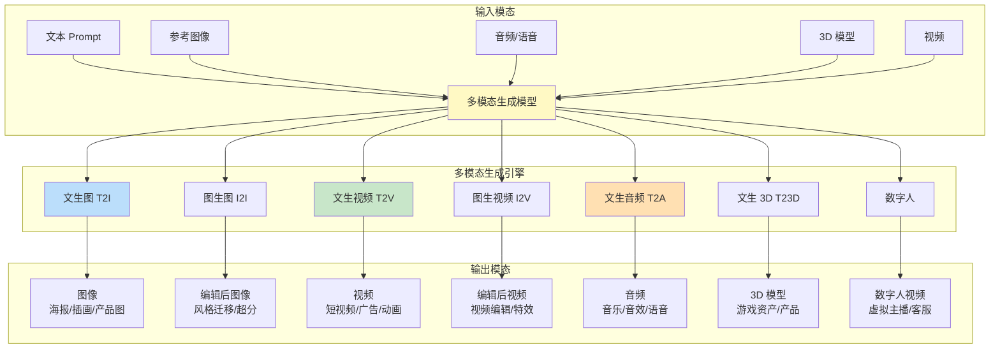

# 多模态生成工具链

> **一句话定义**：多模态生成工具链是指从文本/图像/音频等输入生成图像、视频、音频、3D 模型等多模态内容的 AI 工具和技术栈集合，涵盖文生图、图生图、文生视频、文生音频、文生 3D、数字人等生成能力，以及模型、API、框架、工作流等完整工具链。
>
> **核心价值**：将 AI 的生成能力从文本扩展到图像、视频、音频、3D 等所有模态，是 AIGC（AI 生成内容）的核心技术栈，广泛应用于设计、营销、娱乐、教育、游戏、影视等领域，极大提升内容生产效率。
>
> **适用场景**：文生图（海报/插画/产品图）、图生图（风格迁移/图像编辑/超分辨率）、文生视频（短视频/广告/动画）、文生音频（音乐/音效/语音）、文生 3D（游戏资产/产品建模）、数字人（虚拟主播/客服/教师）、AI 工作流（自动化内容生产）。

---

## 一、概述

### 1.1 多模态生成全景



### 1.2 核心概念

| 概念 | 说明 |
|------|------|
| **文生图（Text-to-Image, T2I）** | 根据文本 Prompt 生成图像，是多模态生成最成熟的领域 |
| **图生图（Image-to-Image, I2I）** | 根据参考图像和文本 Prompt 生成/编辑图像，包括风格迁移、图像编辑、超分辨率 |
| **文生视频（Text-to-Video, T2V）** | 根据文本 Prompt 生成视频，是当前快速发展的领域 |
| **图生视频（Image-to-Video, I2V）** | 根据参考图像生成视频（让图像动起来） |
| **文生音频（Text-to-Audio, T2A）** | 根据文本生成音频，包括音乐生成、音效生成、语音合成（TTS） |
| **文生 3D（Text-to-3D, T23D）** | 根据文本生成 3D 模型，用于游戏、产品设计、元宇宙 |
| **数字人（Digital Human）** | AI 驱动的虚拟人物，包括形象生成、语音合成、表情驱动、动作生成 |
| **扩散模型（Diffusion Model）** | 当前文生图/文生视频的主流生成模型，通过逐步去噪生成高质量内容 |
| **Stable Diffusion** | 最流行的开源文生图模型，生态丰富，支持 LoRA/ControlNet 等扩展 |
| **Midjourney** | 最流行的闭源文生图工具，艺术风格强，通过 Discord 使用 |
| **DALL·E 3** | OpenAI 的文生图模型，集成在 ChatGPT 中，Prompt 理解能力强 |
| **Sora** | OpenAI 的文生视频模型，能生成长达 60 秒的高质量视频 |
| **Runway / Pika** | 流行的文生视频工具，支持文生视频和图生视频 |
| **Suno / Udio** | 流行的 AI 音乐生成工具，根据文本描述生成完整歌曲 |
| **ControlNet** | 图像生成的控制模型，通过边缘/深度/姿态等条件精确控制生成结果 |
| **LoRA（Low-Rank Adaptation）** | 图像生成模型的轻量微调方法，用于学习特定风格/角色/概念 |
| **Prompt 工程** | 设计有效的文本 Prompt 来控制生成结果，是多模态生成的核心技能 |
| **Negative Prompt** | 负面 Prompt，指定不希望出现在生成结果中的内容 |
| **采样器（Sampler）** | 扩散模型的去噪采样算法，影响生成质量和速度（Euler/DPM++/DDIM 等） |
| **CFG Scale（Classifier-Free Guidance）** | 引导强度，控制生成结果与 Prompt 的贴合程度 |
| **工作流（Workflow）** | 多模态生成的自动化流程，将多个生成/编辑步骤串联，如 ComfyUI 工作流 |

### 1.3 多模态生成模型对比

| 模态 | 开源模型 | 闭源模型/工具 | 成熟度 | 特点 |
|------|---------|--------------|--------|------|
| **文生图** | Stable Diffusion XL/3、Flux、Kandinsky | Midjourney、DALL·E 3、Imagen 3、Firefly | ⭐⭐⭐⭐⭐ 非常成熟 | 生态丰富，质量高，可控性强 |
| **图生图** | Stable Diffusion + ControlNet/Inpaint、Flux | Midjourney Vary、DALL·E 编辑、Photoshop AI | ⭐⭐⭐⭐⭐ 非常成熟 | 编辑能力强，控制精确 |
| **文生视频** | Stable Video Diffusion、CogVideoX、Open-Sora、HunyuanVideo | Sora、Runway Gen-3、Pika、Kling、Vidu | ⭐⭐⭐⭐ 快速发展 | 质量快速提升，时长和一致性仍有限 |
| **图生视频** | Stable Video Diffusion、CogVideoX I2V | Runway、Pika、Kling、Vidu、Luma Dream Machine | ⭐⭐⭐⭐ 快速发展 | 让图像动起来，应用广泛 |
| **文生音频（音乐）** | MusicGen、AudioLDM、Stable Audio | Suno、Udio、ElevenLabs Music | ⭐⭐⭐⭐ 较成熟 | 能生成完整歌曲，质量接近人类 |
| **文生音频（音效）** | AudioLDM 2、CLAP | ElevenLabs Sound Effects、Adobe AI | ⭐⭐⭐ 发展中 | 音效生成质量尚可 |
| **语音合成 TTS** | Coqui TTS、Bark、ChatTTS、CosyVoice | ElevenLabs、OpenAI TTS、Azure TTS、Google TTS | ⭐⭐⭐⭐⭐ 非常成熟 | 语音自然，支持克隆和多语言 |
| **文生 3D** | DreamFusion、Instant3D、TripoSR、Hunyuan3D | Meshy、Luma AI、Rodin | ⭐⭐⭐ 发展中 | 质量和拓扑结构仍有限 |
| **数字人** | SadTalker、Wav2Lip、HeyGen 开源版 | HeyGen、D-ID、Synthesia、腾讯智影 | ⭐⭐⭐⭐ 较成熟 | 口型同步和表情自然度提升 |
| **图像编辑** | InstructPix2Pix、Prompt-to-Prompt、SEED | Photoshop AI、Canva AI、Midjourney Editor | ⭐⭐⭐⭐⭐ 非常成熟 | 指令式编辑，精确控制 |
| **超分辨率** | Real-ESRGAN、SwinIR、Stable Diffusion Upscaler | Topaz Gigapixel、Adobe Super Resolution | ⭐⭐⭐⭐⭐ 非常成熟 | 图像放大和细节增强 |


<div style="background:linear-gradient(135deg,#f093fb,#f5576c);border-radius:16px;padding:20px;margin:16px 0;font-family:-apple-system,'Segoe UI','PingFang SC','Microsoft YaHei',sans-serif;color:#fff;overflow:hidden;box-shadow:0 8px 28px rgba(0,0,0,.14),0 3px 10px rgba(0,0,0,.08)">
<style>@keyframes flow{0%{transform:translateX(-10px);opacity:0}15%{transform:translateX(0);opacity:1}85%{transform:translateX(0);opacity:1}100%{transform:translateX(10px);opacity:0}}.flow-step{display:inline-block;background:rgba(255,255,255,.2);border:2px solid rgba(255,255,255,.5);border-radius:8px;padding:10px 14px;margin:4px;text-align:center;font-weight:600;font-size:13px;animation:flow 4s ease-in-out infinite;min-width:90px}.flow-step:nth-child(2){animation-delay:.5s}.flow-step:nth-child(4){animation-delay:1s}.flow-step:nth-child(6){animation-delay:1.5s}.flow-step:nth-child(8){animation-delay:2s}.flow-arrow{display:inline-block;font-size:20px;animation:flow 4s ease-in-out infinite;vertical-align:middle}.flow-code{background:rgba(0,0,0,.2);border-radius:6px;padding:8px 12px;margin-top:10px;font-family:monospace;font-size:12px;text-align:center}</style>
<div style="text-align:center;font-size:15px;font-weight:700;margin-bottom:14px;padding-bottom:10px;border-bottom:1.5px solid rgba(255,255,255,.22);letter-spacing:1px">🎨 多模态生成工具链流程</div>
<div style="text-align:center;white-space:nowrap;overflow-x:auto">
<span class="flow-step">文本生成</span><span class="flow-arrow">→</span><span class="flow-step">图像生成</span><span class="flow-arrow">→</span><span class="flow-step">语音合成</span><span class="flow-arrow">→</span><span class="flow-step">视频生成</span><span class="flow-arrow">→</span><span class="flow-step">多模态编排</span>
</div>
<div class="flow-code">GPT/Claude→SD/Midjourney→TTS→Sora/可灵→Agent统一调度多模态输出</div>
</div>
> 🔍 **知识点深度解析**
>
> **作用**：多模态生成工具链将 AI 的生成能力从文本扩展到图像、视频、音频、3D、数字人等所有模态，是 AIGC（AI 生成内容）的核心技术栈，涵盖文生图、图生图、文生视频、文生音频、文生 3D、数字人等生成能力，以及模型、API、框架、工作流等完整工具链，广泛应用于设计、营销、娱乐、教育、游戏、影视等领域，极大提升内容生产效率。
>
> **原理**：多模态生成的核心是扩散模型（Diffusion Model）——通过前向过程逐步向数据添加噪声，然后学习逆向过程（去噪）来生成数据。文生图用文本编码器（CLIP/T5）将 Prompt 编码为条件，引导扩散模型的去噪过程，生成与 Prompt 匹配的图像。文生视频在文生图基础上扩展到时空维度，用 3D 卷积或时空 Transformer 建模视频的时序一致性。文生音频用扩散模型或自回归模型在音频频谱上生成，文本条件引导音频生成。文生 3D 用 2D 文生图模型作为指导（SDS 损失）优化 3D 表示（NeRF/网格）。数字人结合语音合成（TTS）、口型驱动（Wav2Lip/SadTalker）、表情和动作生成。控制机制包括 ControlNet（通过边缘/深度/姿态等条件控制生成）、LoRA（轻量微调学习特定风格/角色）、Inpainting（局部重绘）、Outpainting（外扩）、CFG（引导强度控制）。
>
> **用法要点**：① 模型选择——文生图用 Stable Diffusion XL/3（开源可控）或 Midjourney（艺术风格强）或 DALL·E 3（Prompt 理解强）；文生视频用 Sora/Runway/Kling（高质量）或 Stable Video Diffusion/CogVideoX（开源）；音乐用 Suno/Udio；语音用 ElevenLabs/OpenAI TTS；3D 用 Meshy/TripoSR ② 工具选择——本地部署用 ComfyUI（工作流强大）/Automatic1111（易用）/Stable Diffusion WebUI；API 调用用 OpenAI/Replicate/Stability AI/HuggingFace；在线工具用 Midjourney/Runway/Suno/HeyGen ③ Prompt 工程——描述主体（什么）+ 细节（长什么样）+ 风格（艺术风格/媒介）+ 构图（视角/光线/氛围）+ 质量词（高质量/8K/细节丰富），Negative Prompt 指定不想要的内容 ④ 参数调优——CFG Scale 7-12（太高过拟合，太低不遵循），Steps 20-50（更多更精细但更慢），Sampler 选 DPM++ 2M Karras/Euler a，分辨率匹配模型训练分辨率 ⑤ 控制生成——ControlNet 控制构图/姿态/边缘，LoRA 学习特定风格/角色，Inpainting 局部修改，Reference Only 参考风格 ⑥ 工作流——ComfyUI 搭建自动化工作流，串联生成→放大→修脸→背景替换→输出，批量处理 ⑦ 版权和合规——注意生成内容的版权（训练数据版权争议）、人物肖像权、商用授权，商用建议用有明确商用授权的模型（Stable Diffusion/Adobe Firefly） ⑧ 成本——本地部署一次性硬件成本（RTX 4090 约 1.5 万），API 按次/按 Token 计费（Midjourney $10-60/月，Suno $10/月），大规模生产用本地部署+开源模型更划算

---

> 💡 **深度讲解**：多模态生成工具链是 AIGC（AI 生成内容）的核心技术栈，它的发展彻底改变了内容生产的方式。在多模态生成技术成熟之前，内容生产（图像设计、视频制作、音乐创作、3D 建模）需要专业技能和大量时间——一张专业插画可能需要数小时到数天，一个短视频需要数天到数周，一首歌曲需要数周到数月。多模态生成技术将内容生产的时间从小时/天级压缩到秒/分钟级，从专业人员才能做变成人人都能做，极大地提升了内容生产效率，降低了内容创作门槛。多模态生成的核心技术是扩散模型（Diffusion Model）——它通过前向过程逐步向数据添加高斯噪声（从数据到纯噪声），然后学习逆向过程（从纯噪声逐步去噪恢复数据）。训练时，模型学习在给定噪声水平和条件（文本 Prompt）下预测噪声，推理时从纯噪声开始，逐步去噪生成与条件匹配的数据。扩散模型相比 GAN（生成对抗网络）的优势是训练更稳定、生成质量更高、模式崩溃更少，因此成为当前文生图/文生视频的主流模型。Stable Diffusion 是扩散模型的里程碑——它由 Stability AI 于 2022 年开源，采用 Latent Diffusion（在潜空间而非像素空间进行扩散，大大降低计算量），用 CLIP 文本编码器作为条件，UNet 作为去噪网络，VAE 进行潜空间和像素空间的转换。Stable Diffusion 的开源催生了极其丰富的生态——LoRA（轻量微调，学习特定风格/角色/概念，数千个开源 LoRA）、ControlNet（通过边缘/深度/姿态/分割等条件精确控制生成）、Inpainting/Outpainting（局部重绘/外扩）、Textual Inversion（概念学习）、Hypernetwork（风格微调）、ComfyUI（节点式工作流）、Automatic1111 WebUI（易用的 Web 界面）、Civitai（模型分享社区）等。Stable Diffusion XL（SDXL）和 Stable Diffusion 3（SD3，采用 MM-DiT 架构）进一步提升了生成质量和文本渲染能力。Flux（Black Forest Labs，由 Stable Diffusion 原团队创立）是最新的开源文生图模型，采用更大的模型（12B）和更好的架构，生成质量接近 Midjourney，支持 100 万×100 万 token 的分辨率，正在成为开源文生图的新标杆。闭源文生图工具中，Midjourney 是最流行的——它通过 Discord 使用，艺术风格非常强（特别是插画、概念艺术、奇幻风格），V6 版本提升了真实感和文本渲染能力，Niji 版本专门针对动漫风格。DALL·E 3（OpenAI）集成在 ChatGPT 中，最大的优势是 Prompt 理解能力强——用户不需要精心设计 Prompt，ChatGPT 会自动优化 Prompt 再传给 DALL·E 3，且能生成包含准确文字的图像。Google Imagen 3 和 Adobe Firefly 也是重要的闭源文生图模型——Firefly 用 Adobe 自有版权的素材训练，商用版权清晰，适合商业设计。文生视频是当前多模态生成最热门的领域——Sora（OpenAI）展示了惊人的视频生成能力（长达 60 秒，复杂场景，镜头运动，时序一致性），但目前仅限特定用户使用。Runway Gen-3、Pika、Kling（快手）、Vidu（生数科技）、Luma Dream Machine 是可用的文生视频工具，支持文生视频和图生视频，质量快速提升，但时长通常在 5-10 秒，长视频的时序一致性和物理合理性仍有限。开源文生视频模型包括 Stable Video Diffusion（图生视频）、CogVideoX（智谱，文生视频+图生视频）、Open-Sora（开源 Sora 复现）、HunyuanVideo（腾讯，开源文生视频）。文生视频的技术挑战是时序一致性（帧与帧之间的一致性）、物理合理性（物体运动和交互符合物理规律）、长视频生成（超过 10 秒的视频）、计算成本（视频生成比图像生成贵很多）。文生音频包括音乐生成、音效生成、语音合成（TTS）。音乐生成是近期的热点——Suno 和 Udio 能根据文本描述（风格、主题、情绪）生成完整的歌曲（包括歌词、旋律、编曲、人声），质量接近人类创作，支持多种语言和风格。开源音乐生成模型包括 MusicGen（Meta）、AudioLDM 2、Stable Audio（Stability AI）。语音合成（TTS）已经非常成熟——ElevenLabs 是最流行的 TTS 服务，语音自然度极高，支持语音克隆（用几秒音频克隆声音）、多语言、情绪控制；OpenAI TTS（集成在 API 中）支持 6 种预设声音和语音克隆；开源 TTS 包括 Coqui TTS、Bark、ChatTTS（中文对话式 TTS）、CosyVoice（阿里，支持零样本语音克隆和多语言）。文生 3D 是发展中的领域——DreamFusion 开创了用 2D 文生图模型指导 3D 生成的方法（SDS 损失，Score Distillation Sampling），Instant3D、TripoSR（Stability AI）、Hunyuan3D（腾讯）能在几秒到几分钟内生成 3D 模型，但质量和拓扑结构（特别是边缘和拓扑）仍有限，主要用于概念设计和游戏资产的快速原型。闭源 3D 生成工具包括 Meshy、Luma AI、Rodin（微软）。数字人结合了多种生成技术——形象生成（文生图生成虚拟人物形象）、语音合成（TTS 生成语音）、口型驱动（Wav2Lip/SadTalker 根据音频驱动口型）、表情和动作生成（生成自然的面部表情和身体动作）。HeyGen、D-ID、Synthesia、腾讯智影是流行的数字人工具，支持自定义形象、语音克隆、多语言，应用于虚拟主播、在线教育、企业培训、客服等场景。多模态生成的工具链非常丰富——本地部署工具包括 ComfyUI（节点式工作流，功能强大，适合高级用户和自动化）、Automatic1111 Stable Diffusion WebUI（易用的 Web 界面，插件丰富，适合初学者）、Fooocus（极简界面，专注生成质量）；API 服务包括 Replicate（托管多种 AI 模型 API）、Stability AI API、HuggingFace Inference API、OpenAI API（DALL·E 3/TTS）；在线工具包括 Midjourney（Discord）、Runway（视频）、Suno（音乐）、HeyGen（数字人）、Canva AI（设计）、Adobe Firefly（设计）。工作流是多模态生成的高级用法——ComfyUI 允许用户用节点式界面搭建自动化工作流，将多个生成/编辑步骤串联（如：文生图 → 放大 → 面部修复 → 背景替换 → 风格迁移 → 输出），支持批量处理和变量控制，极大提升生产效率。Prompt 工程是多模态生成的核心技能——好的 Prompt 能显著提升生成质量。文生图 Prompt 的结构通常是：主体（什么物体/人物/场景）+ 细节（外观/颜色/材质/表情/动作）+ 环境（背景/场景/时间/天气）+ 风格（艺术风格/媒介/艺术家/参考）+ 构图（视角/镜头/构图/光线/氛围）+ 质量词（高质量/8K/细节丰富/锐利）。Negative Prompt 指定不希望出现的内容（如低质量、模糊、变形、多余手指、水印、文字等）。参数调优也很重要——CFG Scale（引导强度，7-12 常用，太高会过拟合和色彩过饱和，太低会不遵循 Prompt）、Steps（采样步数，20-50 常用，更多更精细但更慢）、Sampler（采样器，DPM++ 2M Karras 是质量和速度的好平衡，Euler a 适合艺术风格，DDIM 适合确定性生成）、Seed（随机种子，固定 Seed 可复现结果，改变 Seed 探索不同结果）、分辨率（匹配模型训练分辨率，SDXL 用 1024×1024，SD1.5 用 512×512，太高会出现重复元素）。多模态生成的版权和合规是重要考量——训练数据的版权争议（Stable Diffusion 等模型用互联网图像训练，涉及版权问题，已有艺术家起诉 Stability AI）、人物肖像权（生成真实人物的图像可能涉及肖像权）、商用授权（不同模型的商用授权不同，Stable Diffusion 用 Creative ML Open RAIL-M 许可证允许商用，Midjourney 付费版允许商用，免费版不允许商用，Adobe Firefly 用自有版权素材训练，商用版权最清晰）。建议商用场景用有明确商用授权的模型，并对生成内容进行审核。多模态生成是一个快速发展的领域，新的模型和工具不断涌现——文生图已经非常成熟，文生视频正在快速发展，文生 3D 和数字人在持续进步。对于内容创作者和企业来说，多模态生成工具链是提升内容生产效率、降低创作门槛、探索创意可能性的强大工具。建议根据需求选择合适的工具（简单生成用在线工具，精细控制用本地部署+ComfyUI，大规模生产用 API+工作流自动化），学习 Prompt 工程和参数调优，关注版权合规，持续探索新的模型和工具。
>
> **📝 精简总结**：多模态生成工具链是AIGC核心技术栈，从文本/图像/音频等输入生成图像/视频/音频/3D/数字人等多模态内容，涵盖文生图T2I/图生图I2I/文生视频T2V/图生视频I2V/文生音频T2A/文生3D T23D/数字人，以及模型/API/框架/工作流完整工具链，应用于设计/营销/娱乐/教育/游戏/影视，极大提升内容生产效率降低创作门槛；核心概念包括文生图T2I/图生图I2I/文生视频T2V/图生视频I2V/文生音频T2A（音乐/音效/TTS）/文生3D T23D/数字人Digital Human/扩散模型Diffusion Model/Stable Diffusion/Midjourney/DALL·E 3/Sora/Runway/Pika/Suno/Udio/ControlNet/LoRA/Prompt工程/Negative Prompt/采样器Sampler/CFG Scale/工作流Workflow；模型对比——文生图（开源Stable Diffusion XL/3/Flux/Kandinsky，闭源Midjourney/DALL·E 3/Imagen 3/Firefly，非常成熟生态丰富质量高可控性强）、图生图（开源SD+ControlNet/Inpaint/Flux，闭源Midjourney Vary/DALL·E编辑/Photoshop AI，非常成熟编辑能力强）、文生视频（开源Stable Video Diffusion/CogVideoX/Open-Sora/HunyuanVideo，闭源Sora/Runway Gen-3/Pika/Kling/Vidu，快速发展质量快速提升时长一致性有限）、图生视频（开源SVD/CogVideoX I2V，闭源Runway/Pika/Kling/Vidu/Luma Dream Machine，快速发展让图像动起来）、文生音频音乐（开源MusicGen/AudioLDM/Stable Audio，闭源Suno/Udio/ElevenLabs Music，较成熟能生成完整歌曲质量接近人类）、文声音效（开源AudioLDM 2/CLAP，闭源ElevenLabs SFX/Adobe AI，发展中质量尚可）、语音合成TTS（开源Coqui TTS/Bark/ChatTTS/CosyVoice，闭源ElevenLabs/OpenAI TTS/Azure/Google，非常成熟语音自然支持克隆多语言）、文生3D（开源DreamFusion/Instant3D/TripoSR/Hunyuan3D，闭源Meshy/Luma AI/Rodin，发展中质量拓扑有限）、数字人（开源SadTalker/Wav2Lip，闭源HeyGen/D-ID/Synthesia/腾讯智影，较成熟口型同步表情自然）、图像编辑（开源InstructPix2Pix/Prompt-to-Prompt/SEED，闭源Photoshop AI/Canva AI/Midjourney Editor，非常成熟指令式编辑精确控制）、超分辨率（开源Real-ESRGAN/SwinIR/SD Upscaler，闭源Topaz Gigapixel/Adobe SR，非常成熟图像放大细节增强）；核心原理是扩散模型（前向加噪+逆向去噪，文本条件CLIP/T5引导去噪生成匹配图像），文生视频扩展时空维度3D卷积/时空Transformer时序一致性，文生音频扩散或自回归在频谱生成，文生3D用2D T2I指导SDS损失优化NeRF/网格，数字人结合TTS+口型驱动Wav2Lip/SadTalker+表情动作生成，控制机制包括ControlNet（边缘/深度/姿态条件控制）/LoRA（轻量微调风格角色）/Inpainting局部重绘/Outpainting外扩/CFG引导强度；用法要点包括模型选择（文生图SD XL/3开源可控或Midjourney艺术强或DALL·E 3 Prompt理解强；文生视频Sora/Runway/Kling高质量或SVD/CogVideoX开源；音乐Suno/Udio；语音ElevenLabs/OpenAI TTS；3D Meshy/TripoSR）、工具选择（本地ComfyUI工作流强/Automatic1111易用/SD WebUI；API OpenAI/Replicate/Stability/HF；在线Midjourney/Runway/Suno/HeyGen）、Prompt工程（主体+细节+环境+风格+构图+质量词，Negative Prompt指定不想要内容）、参数调优（CFG 7-12/Steps 20-50/Sampler DPM++ 2M Karras/分辨率匹配训练分辨率）、控制生成（ControlNet控制构图姿态边缘/LoRA学习风格角色/Inpainting局部修改/Reference Only参考风格）、工作流（ComfyUI自动化串联生成→放大→修脸→背景替换→输出批量处理）、版权合规（注意训练数据版权/人物肖像权/商用授权，商用建议有明确授权的模型SD/Adobe Firefly）、成本（本地一次性硬件RTX 4090约1.5万/API按次按Token Midjourney $10-60月Suno $10月/大规模生产本地+开源更划算）；发展趋势是文生图已成熟/文生视频快速发展/文生3D和数字人持续进步，建议简单生成用在线工具/精细控制用本地ComfyUI/大规模生产用API+工作流自动化，学习Prompt工程和参数调优，关注版权合规，持续探索新模型工具。

---

## 二、原理

### 2.1 扩散模型原理

```mermaid
graph TB
    subgraph 前向过程（加噪）
        F1[x0 原始数据<br/>真实图像] --> F2[加噪 Step 1<br/>x1 = √(1-β1)·x0 + √β1·ε1]
        F2 --> F3[加噪 Step 2<br/>x2 = √(1-β2)·x1 + √β2·ε2]
        F3 --> F4[... 逐步加噪 ...]
        F4 --> F5[xT 纯噪声<br/>T步后接近高斯噪声]
    end

    subgraph 逆向过程（去噪/生成）
        R1[xT 纯噪声] --> R2[去噪 Step T<br/>预测噪声 εθ(xT, t, c)]
        R2 --> R3[x_{T-1} 去噪一步]
        R3 --> R4[... 逐步去噪 ...]
        R4 --> R5[x1 接近真实数据]
        R5 --> R6[x0 生成图像]
    end

    subgraph 条件引导
        C1[文本 Prompt] --> C2[文本编码器<br/>CLIP/T5]
        C2 --> C3[条件嵌入 c]
        C3 --> R2
    end

    Note over F1,F5: 前向过程：逐步添加高斯噪声<br/>从真实数据到纯噪声（固定，不需要学习）
    Note over R1,R6: 逆向过程：逐步去噪<br/>从纯噪声生成真实数据（需要学习神经网络）
    Note over C1,C3: 文本条件引导去噪过程<br/>生成与 Prompt 匹配的图像
    style F5 fill:#fff9c4
    style R6 fill:#c8e6c9
    style C3 fill:#bbdefb
```

#### 扩散模型数学原理

**前向过程（加噪）**：
```text
$$
q(x_t | x_{t-1}) = \mathcal{N}(x_t; \sqrt{1-\beta_t} x_{t-1}, \beta_t \mathbf{I})
$$

逐步添加高斯噪声，$\beta_t$ 是噪声调度（noise schedule），控制每步添加的噪声量。
```

可以直接从 $x_0$ 采样任意 $x_t$：
```text
$$
x_t = \sqrt{\bar{\alpha}_t} x_0 + \sqrt{1-\bar{\alpha}_t} \epsilon, \quad \epsilon \sim \mathcal{N}(0, \mathbf{I})
$$
```

其中 $\bar{\alpha}_t = \prod_{s=1}^{t} (1-\beta_s)$。

**逆向过程（去噪）**：
```text
$$
p_\theta(x_{t-1} | x_t) = \mathcal{N}(x_{t-1}; \mu_\theta(x_t, t), \Sigma_\theta(x_t, t))
$$
```

神经网络学习预测噪声 $\epsilon_\theta(x_t, t)$，然后计算均值：
```text
$$
\mu_\theta(x_t, t) = \frac{1}{\sqrt{\alpha_t}} \left( x_t - \frac{\beta_t}{\sqrt{1-\bar{\alpha}_t}} \epsilon_\theta(x_t, t) \right)
$$
```

**训练目标**：
```text
$$
\mathcal{L} = \mathbb{E}_{x_0, \epsilon, t} \left[ \| \epsilon - \epsilon_\theta(x_t, t, c) \|^2 \right]
$$
```

简单的 MSE 损失——预测的噪声与真实噪声的均方误差。$c$ 是条件（文本 Prompt 嵌入）。

**Classifier-Free Guidance (CFG)**：
$$
\hat{\epsilon}_\theta(x_t, t, c) = \epsilon_\theta(x_t, t, \emptyset) + s \cdot (\epsilon_\theta(x_t, t, c) - \epsilon_\theta(x_t, t, \emptyset))
$$

其中 $s$ 是引导强度（CFG Scale），$\emptyset$ 是无条件（空 Prompt）。CFG 同时训练有条件和无条件预测，推理时用两者的差放大条件信号，提升生成结果与 Prompt 的贴合度。

### 2.2 Stable Diffusion 架构（Latent Diffusion）

```mermaid
graph TB
    subgraph Stable Diffusion 架构
        subgraph 文本编码
            T1[文本 Prompt] --> T2[CLIP 文本编码器]
            T2 --> T3[文本嵌入 c<br/>77×768]
        end

        subgraph 潜空间扩散
            L1[纯噪声 zT<br/>64×64×4] --> L2[UNet 去噪网络<br/>交叉注意力条件]
            T3 --> L2
            L2 --> L3[去噪后的潜变量 z0<br/>64×64×4]
        end

        subgraph VAE 解码
            L3 --> V1[VAE 解码器<br/>潜空间→像素空间]
            V1 --> V2[生成图像<br/>512×512×3]
        end
    end

    Note over L1,L3: 在潜空间（64×64×4）进行扩散<br/>比像素空间（512×512×3）计算量小很多
    Note over T3: 交叉注意力将文本条件注入 UNet<br/>控制生成内容
    style L2 fill:#fff9c4
    style V2 fill:#c8e6c9
```

#### Stable Diffusion 核心组件

| 组件 | 说明 | 作用 |
|------|------|------|
| **VAE（变分自编码器）** | 编码器将图像压缩到潜空间，解码器将潜变量恢复为图像 | 降维，减少扩散计算量（512×512×3 → 64×64×4，计算量降 48 倍） |
| **UNet（去噪网络）** | 预测噪声的神经网络，包含 ResNet 块、自注意力、交叉注意力 | 核心去噪网络，通过交叉注意力接收文本条件 |
| **文本编码器** | CLIP ViT-L/14 文本编码器（SD1.5）或 OpenCLIP（SDXL） | 将文本 Prompt 编码为条件嵌入 |
| **噪声调度器** | DDIM/DDPM/Euler/DPM++ 等采样器 | 控制去噪过程，影响生成质量和速度 |
| **交叉注意力** | UNet 中的交叉注意力层，文本嵌入作为 Key/Value，潜变量作为 Query | 将文本条件注入去噪过程，控制生成内容 |

#### Latent Diffusion 的优势

1. **计算效率**：在潜空间（64×64×4）而非像素空间（512×512×3）进行扩散，计算量降低约 48 倍
2. **语义压缩**：VAE 压缩了感知冗余，潜空间更关注语义信息
3. **通用架构**：同一扩散模型可以通过不同的 VAE 处理不同模态（图像/视频/音频）
4. **可控性**：潜空间的编辑（Inpainting/ControlNet）比像素空间更高效

### 2.3 ControlNet 原理

```mermaid
graph TB
    subgraph ControlNet 架构
        subgraph 条件处理
            C1[条件图<br/>边缘/深度/姿态/分割] --> C2[小型网络<br/>卷积编码]
            C2 --> C3[条件特征]
        end

        subgraph 零卷积
            C3 --> Z1[零卷积 1<br/>权重初始化为0]
            Z1 --> Z2[零卷积 2<br/>权重初始化为0]
        end

        subgraph 主 UNet（冻结）
            I1[噪声潜变量] --> U1[UNet 编码器块 1]
            U1 --> U2[UNet 编码器块 2]
            U2 --> U3[... 中间块 ...]
            U3 --> U4[UNet 解码器块 1]
            U4 --> U5[UNet 解码器块 2]
            U5 --> U6[输出]
        end

        Z1 --> U1
        Z2 --> U4

        Note over Z1,Z2: 零卷积初始权重为0<br/>训练初期不影响预训练模型<br/>逐步学习注入条件控制
    end

    style C3 fill:#fff9c4
    style U6 fill:#c8e6c9
```

#### ControlNet 工作原理

1. **条件图输入**：边缘图（Canny）、深度图、姿态图（OpenPose）、分割图、线稿等
2. **小型编码网络**：将条件图编码为特征图（与 UNet 编码器块的分辨率对应）
3. **零卷积（Zero Convolution）**：1×1 卷积，权重初始化为 0，训练初期输出为 0，不影响预训练 UNet
4. **注入主 UNet**：将条件特征通过零卷积加到主 UNet 的编码器和解码器块
5. **训练**：冻结主 UNet（保留预训练的生成能力），只训练 ControlNet 的小型网络和零卷积
6. **推理**：条件图控制生成结果的构图/姿态/边缘/深度等

#### ControlNet 常用条件类型

| 条件类型 | 说明 | 控制效果 |
|---------|------|---------|
| **Canny（边缘）** | Canny 边缘检测图 | 控制物体轮廓和构图 |
| **Depth（深度）** | 深度图（MiDaS 生成） | 控制场景的空间深度和 3D 结构 |
| **OpenPose（姿态）** | 人体姿态骨架图 | 控制人物的姿势和动作 |
| **Segmentation（分割）** | 语义分割图 | 控制场景中物体的类别和布局 |
| **Lineart（线稿）** | 手绘线稿 | 控制线稿，适合插画和上色 |
| **Scribble（涂鸦）** | 简单涂鸦 | 粗略控制构图，适合快速原型 |
| **Normal Map（法线）** | 表面法线图 | 控制物体表面的几何形状 |
| **MLSD（直线）** | 直线检测图 | 控制建筑和直线结构 |
| **Reference Only** | 参考图像 | 控制风格和色彩（不控制构图） |
| **IP-Adapter** | 参考图像 | 控制风格/角色/构图（更灵活的参考控制） |

### 2.4 文生视频原理

```mermaid
graph TB
    subgraph 文生视频架构
        subgraph 文本编码
            T1[文本 Prompt] --> T2[文本编码器<br/>T5/CLIP]
            T2 --> T3[文本嵌入]
        end

        subgraph 时空扩散
            V1[纯噪声视频<br/>T×H×W×C] --> V2[时空 UNet<br/>3D卷积/时空注意力]
            T3 --> V2
            V2 --> V3[去噪后的视频潜变量]
        end

        subgraph VAE 解码
            V3 --> D1[时空 VAE 解码器]
            D1 --> D2[生成视频<br/>T帧×H×W×3]
        end
    end

    Note over V1,V3: 在时空潜空间进行扩散<br/>同时建模空间和时间维度
    Note over V2: 时空 UNet 用 3D 卷积或时空注意力<br/>保证帧间时序一致性
    style V2 fill:#fff9c4
    style D2 fill:#c8e6c9
```

#### 文生视频关键技术

| 技术 | 说明 | 作用 |
|------|------|------|
| **时空 UNet** | 3D 卷积或时空 Transformer，同时处理空间和时间维度 | 建模视频的时空结构，保证帧间一致性 |
| **时空 VAE** | 将视频压缩到时空潜空间（T×H/8×W/8×C） | 降维，减少扩散计算量 |
| **帧间注意力** | 时间维度的自注意力，让相邻帧互相参考 | 提升时序一致性，减少闪烁 |
| **运动建模** | 显式建模物体运动（光流/运动轨迹） | 提升运动的自然度和物理合理性 |
| **长视频生成** | 滑动窗口/自回归帧生成/分层生成 | 生成长视频（超过模型训练时长） |
| **音频同步** | 视频生成与音频生成联合（数字人/口型同步） | 音视频同步 |

#### 文生视频的挑战

1. **时序一致性**：帧与帧之间的物体外观、位置、颜色保持一致（减少闪烁和变形）
2. **物理合理性**：物体运动、交互、碰撞符合物理规律
3. **长视频生成**：生成超过 10 秒的视频，保持故事连贯性
4. **计算成本**：视频生成比图像生成贵 10-100 倍（帧数 × 每帧计算量）
5. **文本理解**：准确理解复杂的视频描述（多物体、多动作、镜头运动）
6. **可控性**：精确控制镜头运动、物体动作、场景转换

---

> 💡 **深度讲解**：多模态生成的原理核心是扩散模型——它是当前文生图、文生视频、文生音频的主流生成模型，相比 GAN 训练更稳定、生成质量更高、模式崩溃更少。扩散模型的思想非常优雅：前向过程逐步向数据添加高斯噪声（从真实数据到纯噪声，这个过程是固定的，不需要学习），逆向过程学习逐步去噪（从纯噪声恢复真实数据，这个过程需要学习神经网络）。训练时，随机采样一个时间步 t，给真实数据 x0 添加对应水平的噪声得到 xt，让神经网络预测添加的噪声 ε，用简单的 MSE 损失训练。推理时，从纯噪声 xT 开始，逐步用神经网络预测噪声并去噪，经过 T 步（通常 20-50 步）得到生成的数据 x0。扩散模型的条件引导是关键——文生图需要文本 Prompt 作为条件引导去噪过程，生成与 Prompt 匹配的图像。条件注入通常用交叉注意力——文本嵌入作为 Key 和 Value，潜变量作为 Query，通过交叉注意力让潜变量"关注"文本信息。Classifier-Free Guidance（CFG）是提升条件引导效果的重要技术——训练时随机丢弃条件（10-50% 概率用空 Prompt），让模型同时学习有条件和无条件的预测；推理时用有条件预测和无条件预测的差放大条件信号（引导强度 s 控制放大倍数），CFG Scale 通常设为 7-12，太高会过拟合和色彩过饱和，太低会不遵循 Prompt。Stable Diffusion 采用 Latent Diffusion 架构——这是扩散模型的重要优化，它不在像素空间（512×512×3）进行扩散，而是用 VAE（变分自编码器）将图像压缩到潜空间（64×64×4），在潜空间进行扩散，计算量降低约 48 倍，同时 VAE 压缩了感知冗余，潜空间更关注语义信息。Stable Diffusion 的核心组件包括：VAE（编码器压缩图像到潜空间，解码器将潜变量恢复为图像）、UNet（去噪网络，包含 ResNet 块、自注意力、交叉注意力，交叉注意力接收文本条件）、文本编码器（CLIP 文本编码器，将 Prompt 编码为条件嵌入）、噪声调度器（DDIM/Euler/DPM++ 等采样器，控制去噪过程）。Stable Diffusion 的开源催生了极其丰富的生态——LoRA（轻量微调，用低秩矩阵学习特定风格/角色/概念，训练成本低，文件小，数千个开源 LoRA）、ControlNet（通过边缘/深度/姿态/分割等条件精确控制生成结果，冻结主 UNet 只训练小型控制网络）、Inpainting/Outpainting（局部重绘/外扩，编辑图像的特定区域）、Textual Inversion（学习特定概念的文本嵌入）、Hypernetwork（风格微调）、ComfyUI（节点式工作流，自动化生成流程）、Civitai（模型分享社区）。ControlNet 的原理很巧妙——它将条件图（边缘/深度/姿态等）通过小型编码网络编码为特征，然后通过"零卷积"（1×1 卷积，权重初始化为 0）加到主 UNet 的编码器和解码器块。零卷积的初始权重为 0，所以训练初期 ControlNet 的输出为 0，完全不影响预训练 UNet 的生成能力；随着训练进行，零卷积的权重逐步学习，将条件控制信号注入主 UNet。ControlNet 冻结主 UNet（保留预训练的生成能力），只训练小型控制网络和零卷积，训练成本低，且不会破坏主模型的生成能力。ControlNet 的常用条件类型包括 Canny（边缘，控制轮廓和构图）、Depth（深度，控制空间结构）、OpenPose（姿态，控制人物姿势）、Segmentation（分割，控制物体布局）、Lineart（线稿，适合插画上色）、Reference Only/IP-Adapter（参考图像，控制风格和角色）。文生视频在文生图基础上扩展到时空维度——用时空 UNet（3D 卷积或时空 Transformer）同时处理空间和时间维度，时空 VAE 将视频压缩到时空潜空间，帧间注意力保证时序一致性。文生视频的挑战比文生图大很多——时序一致性（帧与帧之间的物体外观/位置/颜色保持一致，减少闪烁）、物理合理性（物体运动/交互/碰撞符合物理规律）、长视频生成（超过 10 秒的视频保持故事连贯）、计算成本（视频生成比图像生成贵 10-100 倍）。Sora（OpenAI）展示了惊人的视频生成能力（长达 60 秒，复杂场景，镜头运动，时序一致性），它采用 DiT（Diffusion Transformer）架构和时空补丁（spacetime patches），将视频视为时空数据统一处理。Runway、Pika、Kling、Vidu、Luma Dream Machine 是可用的文生视频工具，开源模型包括 Stable Video Diffusion、CogVideoX、Open-Sora、HunyuanVideo。文生音频包括音乐生成、音效生成、语音合成。音乐生成用扩散模型或自回归模型在音频频谱上生成，文本条件引导音乐的风格/主题/情绪，Suno 和 Udio 能生成完整歌曲（歌词+旋律+编曲+人声）。语音合成（TTS）已经非常成熟，ElevenLabs 支持语音克隆和多语言，开源 TTS 包括 ChatTTS（中文对话式）、CosyVoice（零样本克隆）。文生 3D 用 2D 文生图模型作为指导（SDS 损失，Score Distillation Sampling）优化 3D 表示（NeRF/网格），DreamFusion 开创了这个方向，Instant3D、TripoSR、Hunyuan3D 能快速生成 3D 模型，但质量和拓扑结构仍有限。数字人结合形象生成、语音合成、口型驱动（Wav2Lip/SadTalker）、表情动作生成，HeyGen/D-ID/Synthesia 是流行的数字人工具。多模态生成的工具链非常丰富——本地部署用 ComfyUI（工作流强大）/Automatic1111（易用），API 用 Replicate/Stability AI/OpenAI，在线工具用 Midjourney/Runway/Suno/HeyGen。工作流是高级用法——ComfyUI 节点式界面搭建自动化流程，串联生成→放大→修脸→背景替换→风格迁移→输出，支持批量处理。Prompt 工程是核心技能——主体+细节+环境+风格+构图+质量词，Negative Prompt 指定不想要的内容，参数调优（CFG/Steps/Sampler/Seed/分辨率）。版权合规是重要考量——训练数据版权争议、人物肖像权、商用授权（Stable Diffusion/Adobe Firefly 商用授权清晰，Midjourney 付费版允许商用），建议商用场景用有明确授权的模型并审核生成内容。多模态生成是快速发展的领域，文生图已成熟，文生视频快速发展，文生 3D 和数字人持续进步，建议根据需求选择工具，学习 Prompt 工程，关注版权合规，持续探索新模型。
>
> **📝 精简总结**：扩散模型原理——前向过程加噪q(xt|xt-1)=N(xt;√(1-βt)xt-1, βtI)，逐步加高斯噪声从真实数据到纯噪声固定不学习；可直接采样xt=√(ᾱt)x0+√(1-ᾱt)ε；逆向过程去噪pθ(xt-1|xt)=N(xt-1;μθ(xt,t),Σθ(xt,t))，神经网络预测噪声εθ(xt,t)，均值μθ=1/√αt(xt-βt/√(1-ᾱt)·εθ)；训练目标L=E[||ε-εθ(xt,t,c)||²]简单MSE预测噪声与真实噪声均方误差c是条件；CFG Classifier-Free Guidance：ε̂=εθ(∅)+s·(εθ(c)-εθ(∅))，s引导强度CFG Scale 7-12，同时训练有条件无条件，推理用差放大条件信号；Stable Diffusion架构Latent Diffusion——文本编码（Prompt→CLIP文本编码器→文本嵌入77×768）；潜空间扩散（纯噪声zT 64×64×4→UNet去噪网络交叉注意力条件→去噪潜变量z0 64×64×4）；VAE解码（z0→VAE解码器潜空间→像素空间→生成图像512×512×3）；核心组件VAE（编码器压缩解码器恢复，降维计算量降48倍语义压缩）、UNet（ResNet+自注意力+交叉注意力，核心去噪交叉注意力接收文本条件）、文本编码器（CLIP ViT-L/14 SD1.5或OpenCLIP SDXL）、噪声调度器（DDIM/Euler/DPM++控制去噪）、交叉注意力（文本嵌入Key/Value潜变量Query注入条件）；Latent Diffusion优势是计算效率（潜空间vs像素空间计算量降48倍）、语义压缩（VAE压缩感知冗余关注语义）、通用架构（不同VAE处理不同模态）、可控性（潜空间编辑更高效）；ControlNet原理——条件处理（条件图边缘/深度/姿态/分割→小型网络卷积编码→条件特征）→零卷积（1×1卷积权重初始化为0，训练初期输出0不影响预训练模型逐步学习注入条件）→注入主UNet（冻结主UNet保留生成能力，条件特征通过零卷积加到编码器和解码器块）；常用条件Canny边缘控制轮廓构图/Depth深度控制空间3D结构/OpenPose姿态控制人物姿势/Segmentation分割控制物体布局/Lineart线稿适合插画上色/Scribble涂鸦粗略控制/Normal Map法线控制表面几何/MLSD直线控制建筑/Reference Only参考控制风格色彩/IP-Adapter更灵活参考控制风格角色构图；文生视频原理——文本编码（Prompt→T5/CLIP→文本嵌入）、时空扩散（纯噪声视频T×H×W×C→时空UNet 3D卷积/时空注意力→去噪视频潜变量）、VAE解码（时空VAE解码器→生成视频T帧×H×W×3）；关键技术时空UNet（3D卷积或时空Transformer同时处理空间时间建模时空结构保证帧间一致）、时空VAE（压缩到时空潜空间T×H/8×W/8×C降维）、帧间注意力（时间维度自注意力相邻帧互相参考减少闪烁）、运动建模（光流/运动轨迹提升运动自然度物理合理性）、长视频生成（滑动窗口/自回归/分层生成超过训练时长）、音频同步（视频+音频联合数字人口型同步）；挑战是时序一致性（帧间物体外观位置颜色一致减少闪烁）、物理合理性（运动交互碰撞符合物理）、长视频生成（超过10秒故事连贯）、计算成本（比图像贵10-100倍）、文本理解（复杂视频描述多物体多动作镜头运动）、可控性（镜头运动物体动作场景转换）；文生音频包括音乐生成（扩散或自回归在频谱生成Suno/Udio完整歌曲）、音效生成（AudioLDM 2）、语音合成TTS（ElevenLabs语音克隆多语言/开源ChatTTS中文对话/CosyVoice零样本克隆）；文生3D用2D T2I指导SDS损失优化NeRF/网格（DreamFusion/Instant3D/TripoSR/Hunyuan3D，质量拓扑有限）；数字人结合形象生成+TTS+口型驱动Wav2Lip/SadTalker+表情动作生成（HeyGen/D-ID/Synthesia）；工具链包括本地ComfyUI工作流强/Automatic1111易用、API Replicate/Stability/OpenAI、在线Midjourney/Runway/Suno/HeyGen；工作流ComfyUI节点式自动化串联生成→放大→修脸→背景替换→风格迁移→输出批量处理；Prompt工程主体+细节+环境+风格+构图+质量词+Negative Prompt；参数调优CFG 7-12/Steps 20-50/Sampler DPM++ 2M Karras/Seed固定复现/分辨率匹配训练；版权合规注意训练数据版权/肖像权/商用授权（SD/Adobe Firefly清晰，Midjourney付费版商用）。

---

## 三、实操

### 3.1 Stable Diffusion 本地部署（ComfyUI）

```python
# ComfyUI 安装（Windows）
# 1. 安装 Python 3.10+ 和 Git
# 2. 克隆 ComfyUI
git clone https://github.com/comfyanonymous/ComfyUI.git
cd ComfyUI

# 3. 创建虚拟环境
python -m venv venv
venv\Scripts\activate

# 4. 安装依赖
pip install torch torchvision torchaudio --index-url https://download.pytorch.org/whl/cu121
pip install -r requirements.txt

# 5. 下载模型（放到 models/checkpoints/ 目录）
# Stable Diffusion XL: https://huggingface.co/stabilityai/stable-diffusion-xl-base-1.0
# Flux: https://huggingface.co/black-forest-labs/FLUX.1-dev
# 也可以从 Civitai 下载社区微调模型

# 6. 启动 ComfyUI
python main.py --listen 0.0.0.0 --port 8188

# 7. 浏览器打开 http://127.0.0.1:8188
```

## ComfyUI 工作流示例（JSON 格式，可直接导入）
```css
# 基础文生图工作流
workflow = {
```
    "3": {
        "class_type": "KSampler",
        "inputs": {
            "seed": 42,
            "steps": 30,
            "cfg": 7.0,
            "sampler_name": "dpmpp_2m",
            "scheduler": "karras",
            "denoise": 1.0,
```json
            "model": ["4", 0],
            "positive": ["6", 0],
            "negative": ["7", 0],
            "latent_image": ["5", 0]
        }
    },
```
    "4": {
        "class_type": "CheckpointLoaderSimple",
        "inputs": {
            "ckpt_name": "sd_xl_base_1.0.safetensors"
```text
        }
    },
```
    "5": {
        "class_type": "EmptyLatentImage",
        "inputs": {
            "width": 1024,
            "height": 1024,
            "batch_size": 1
```text
        }
    },
```
    "6": {
        "class_type": "CLIPTextEncode",
        "inputs": {
            "text": "a beautiful sunset over the ocean, golden hour, dramatic clouds, "
                    "photorealistic, 8k, highly detailed, professional photography",
```json
            "clip": ["4", 1]
        }
    },
```
    "7": {
        "class_type": "CLIPTextEncode",
        "inputs": {
            "text": "low quality, blurry, distorted, ugly, watermark, text, "
                    "deformed, bad anatomy, extra fingers, missing fingers",
```json
            "clip": ["4", 1]
        }
    },
```
    "8": {
        "class_type": "VAEDecode",
        "inputs": {
```json
            "samples": ["3", 0],
            "vae": ["4", 2]
        }
    },
```
    "9": {
        "class_type": "SaveImage",
        "inputs": {
            "filename_prefix": "ComfyUI",
```json
            "images": ["8", 0]
        }
    }
}
```

## 将此 JSON 保存为 workflow.json，在 ComfyUI 中拖拽导入

### 3.2 API 调用文生图（OpenAI DALL·E 3 / Stability AI）

```python
# pip install openai stability-sdk

# 1. OpenAI DALL·E 3
from openai import OpenAI
client = OpenAI()

def generate_image_dalle(
    prompt: str,
    size: str = "1024x1024",  # 1024x1024, 1792x1024, 1024x1792
    quality: str = "standard",  # standard, hd
    n: int = 1,
    style: str = "vivid"  # vivid, natural
) -> list:
    """用 DALL·E 3 生成图像"""
    response = client.images.generate(
        model="dall-e-3",
        prompt=prompt,
        size=size,
        quality=quality,
        n=n,
        style=style,
    )
    return [item.url for item in response.data]

# 使用
image_urls = generate_image_dalle(
    prompt="一只可爱的橘猫坐在窗台上，窗外是雨天，温暖的室内灯光，"
           "摄影风格，浅景深，高细节",
    size="1024x1024",
    quality="hd",
    style="natural"
)
print(f"生成的图像 URL: {image_urls}")

# 2. Stability AI API
import os
from stability_sdk import client
import stability_sdk.interfaces.gooseai.generation.generation_pb2 as generation

os.environ['STABILITY_HOST'] = 'grpc.stability.ai:443'
os.environ['STABILITY_KEY'] = 'your-api-key'

stability_api = client.StabilityInference(
    key=os.environ['STABILITY_KEY'],
    verbose=True,
    engine="stable-diffusion-xl-1024-v1-0",
)

def generate_image_stability(
    prompt: str,
    negative_prompt: str = "",
    width: int = 1024,
    height: int = 1024,
    steps: int = 30,
    cfg_scale: float = 7.0,
    samples: int = 1,
    seed: int = 42
) -> list:
    """用 Stability AI 生成图像"""
    answers = stability_api.generate(
        prompt=prompt,
        negative_prompt=negative_prompt,
        seed=seed,
        steps=steps,
        cfg_scale=cfg_scale,
        width=width,
        height=height,
        samples=samples,
        sampler=generation.SAMPLER_K_DPMPP_2M,
    )

    image_paths = []
    for resp in answers:
        for artifact in resp.artifacts:
            if artifact.type == generation.ARTIFACT_IMAGE:
                path = f"output_{artifact.seed}.png"
                with open(path, 'wb') as f:
                    f.write(artifact.binary)
                image_paths.append(path)
    return image_paths

# 3. Replicate API（支持多种模型）
# pip install replicate
import replicate

def generate_image_replicate(
    model: str = "stability-ai/sdxl:39ed52f2a78e934b3ba6e2a89f5b1c712de7dfea53552325b1cc0dd4ae2291c",
    prompt: str = "",
    **kwargs
) -> list:
    """用 Replicate 生成图像（支持 SDXL/Flux/各种开源模型）"""
    output = replicate.run(
        model,
        input={"prompt": prompt, **kwargs}
    )
    return output

# Flux 模型（最新开源文生图）
flux_urls = generate_image_replicate(
    model="black-forest-labs/flux-1.1-pro",
    prompt="a futuristic city at night, neon lights, cyberpunk style, "
           "highly detailed, cinematic lighting",
    aspect_ratio="1:1",
    output_format="png",
)
```

### 3.3 Prompt 工程实战

## 文生图 Prompt 工程模板和示例

```json
# 1. Prompt 结构模板
prompt_template = """
{主体}，{细节描述}，{环境背景}，{艺术风格}，{构图光线}，{质量词}
```

示例：
一只橘猫，毛茸茸的，绿色眼睛，坐在窗台上，
窗外是雨天，温暖的室内灯光，
摄影风格，浅景深，黄金时刻光线，
8k，高细节，专业摄影，锐利聚焦
"""

```css
# 2. 高质量 Prompt 示例
good_prompts = {
```
    "人像摄影": (
        "portrait of a young woman, flowing red hair, freckles, "
        "soft natural light, window light, shallow depth of field, "
        "photorealistic, 85mm lens, f/1.8, highly detailed skin texture, "
        "professional photography, color graded",
        "low quality, blurry, distorted, ugly, deformed, bad anatomy, "
        "extra fingers, watermark, text, cartoon, 3d render"
    ),
    "概念艺术": (
        "concept art of a fantasy castle on a floating island, "
        "waterfalls cascading into clouds, magical glowing crystals, "
        "epic scale, dramatic lighting, sunset, "
        "art by Greg Rutkowski and Alphonse Mucha, "
        "highly detailed, matte painting, trending on artstation",
        "low quality, blurry, simple, boring, text, watermark, "
        "photorealistic, photo"
    ),
    "产品摄影": (
        "product photography of a luxury watch, stainless steel, "
        "black leather strap, studio lighting, reflective surface, "
        "white background, commercial photography, "
        "highly detailed, 8k, sharp focus, professional retouching",
        "low quality, blurry, distorted, ugly, watermark, text, "
        "cartoon, hand, finger"
    ),
    "动漫插画": (
        "anime illustration of a girl in a kimono, cherry blossoms, "
        "spring season, warm sunlight, vibrant colors, "
        "style of Makoto Shinkai, detailed background, "
        "high quality, masterpiece, best quality, ultra detailed",
        "low quality, worst quality, blurry, distorted, ugly, "
        "deformed, bad anatomy, extra fingers, watermark, text"
    ),
```css
}

# 3. Negative Prompt 常用词
negative_prompt_common = (
```
    "low quality, worst quality, blurry, out of focus, "
    "distorted, deformed, ugly, bad anatomy, bad proportions, "
    "extra limbs, extra fingers, missing fingers, fused fingers, "
    "mutated hands, malformed limbs, watermark, text, signature, "
    "cropped, out of frame, jpeg artifacts, duplicate, "
    "morbid, mutilated, disfigured"
)

```css
# 4. 风格关键词库
style_keywords = {
```
    "艺术风格": ["oil painting", "watercolor", "acrylic", "ink wash painting",
                "ukiyo-e", "art nouveau", "impressionism", "surrealism",
                "cyberpunk", "steampunk", "fantasy art", "sci-fi art"],
    "媒介": ["digital painting", "matte painting", "concept art",
            "illustration", "photography", "3d render", "pixel art",
            "vector art", "line art", "sketch"],
    "艺术家参考": ["Greg Rutkowski", "Alphonse Mucha", "Makoto Shinkai",
                  "Hayao Miyazaki", "Syd Mead", "H.R. Giger",
                  "Beksinski", "Moebius"],
    "光线": ["golden hour", "blue hour", "studio lighting", "soft light",
            "dramatic lighting", "rim lighting", "backlight",
            "volumetric lighting", "neon lights", "candlelight"],
    "构图": ["close-up", "portrait", "wide shot", "bird's eye view",
            "low angle", "symmetrical composition", "rule of thirds",
            "centered", "dutch angle", "panoramic"],
    "质量": ["8k", "4k", "highly detailed", "masterpiece", "best quality",
            "sharp focus", "professional", "award winning",
            "trending on artstation", "cinematic"],
```python
}

# 5. Prompt 优化工具（用 LLM 优化 Prompt）
def optimize_prompt(user_prompt: str, style: str = "photorealistic") -> str:
```
    """用 LLM 优化文生图 Prompt"""
    optimization_prompt = f"""请将以下简单描述优化为高质量的文生图 Prompt。

要求：
1. 详细描述主体（外观、颜色、材质、表情、动作）
2. 描述环境和背景
3. 添加{style}风格关键词
4. 添加光线和构图描述
5. 添加质量词（8k, highly detailed, professional）
6. 用英文输出（Stable Diffusion 对英文理解更好）
7. 只输出 Prompt，不要解释

原始描述：{user_prompt}

优化后的 Prompt："""

```text
    response = client.chat.completions.create(
        model="gpt-4o",
        messages=[{"role": "user", "content": optimization_prompt}],
        temperature=0.7,
```
    )
    return response.choices[0].message.content

## 使用
```python
optimized = optimize_prompt("一只猫在阳台上", "photorealistic")
print(f"优化后的 Prompt: {optimized}")
```

### 3.4 ControlNet 精确控制生成

```python
# ControlNet 使用示例（ComfyUI 工作流 + Python 预处理）

# 1. 条件图预处理
import cv2
import numpy as np
from PIL import Image

def preprocess_canny(image_path: str, low_threshold: int = 100, high_threshold: int = 200) -> Image.Image:
    """Canny 边缘检测预处理"""
    image = cv2.imread(image_path)
    image = cv2.cvtColor(image, cv2.COLOR_BGR2RGB)
    edges = cv2.Canny(image, low_threshold, high_threshold)
    edges_colored = cv2.cvtColor(edges, cv2.COLOR_GRAY2RGB)
    return Image.fromarray(edges_colored)

def preprocess_depth(image_path: str) -> Image.Image:
    """深度图预处理（用 MiDaS）"""
    # pip install timm
    import torch
    model_type = "DPT_Large"
    midas = torch.hub.load("intel-isl/MiDaS", model_type)
    device = torch.device("cuda" if torch.cuda.is_available() else "cpu")
    midas.to(device)
    midas.eval()

    midas_transforms = torch.hub.load("intel-isl/MiDaS", "transforms")
    transform = midas_transforms.dpt_transform

    img = cv2.imread(image_path)
    img = cv2.cvtColor(img, cv2.COLOR_BGR2RGB)
    input_batch = transform(img).to(device)

    with torch.no_grad():
        prediction = midas(input_batch)
        prediction = torch.nn.functional.interpolate(
            prediction.unsqueeze(1),
            size=img.shape[:2],
            mode="bicubic",
            align_corners=False,
        ).squeeze()

    depth = prediction.cpu().numpy()
    depth_normalized = (depth - depth.min()) / (depth.max() - depth.min())
    depth_colored = (depth_normalized * 255).astype(np.uint8)
    depth_colored = cv2.applyColorMap(depth_colored, cv2.COLORMAP_INFERNO)
    return Image.fromarray(cv2.cvtColor(depth_colored, cv2.COLOR_BGR2RGB))

def preprocess_pose(image_path: str) -> Image.Image:
    """人体姿态预处理（用 OpenPose / ControlNet 自带 openpose）"""
    # 使用 controlnet-aux 库
    # pip install controlnet-aux
    from controlnet_aux import OpenposeDetector
    from PIL import Image

    openpose = OpenposeDetector.from_pretrained("lllyasviel/ControlNet")
    image = Image.open(image_path)
    pose = openpose(image)
    return pose

# 2. ComfyUI ControlNet 工作流（关键节点）
controlnet_workflow = {
    # 加载 ControlNet 模型
    "10": {
        "class_type": "ControlNetLoader",
        "inputs": {
            "control_net_name": "control_v11p_sd15_canny.pth"  # canny/depth/openpose
        }
    },
    # 应用 ControlNet
    "11": {
        "class_type": "ControlNetApply",
        "inputs": {
            "strength": 0.8,  # 控制强度 0-1
            "conditioning": ["6", 0],  # 正向条件
            "control_net": ["10", 0],
            "image": ["12", 0]  # 条件图（Canny/Depth/Pose）
        }
    },
    # 加载条件图
    "12": {
        "class_type": "LoadImage",
        "inputs": {
            "image": "canny_edge.png"
        }
    },
    # KSampler 使用 ControlNet 条件
    "3": {
        "class_type": "KSampler",
        "inputs": {
            "positive": ["11", 0],  # 使用 ControlNet 后的条件
            # ... 其他参数
        }
    }
}

# 3. ControlNet 强度调优指南
controlnet_strength_guide = """
ControlNet Strength 调优：
- 0.3-0.5: 弱控制，主要影响构图，保留更多模型创意
- 0.5-0.7: 中等控制，平衡控制和创意（推荐）
- 0.7-0.9: 强控制，严格遵循条件图
- 0.9-1.0: 极强控制，几乎完全复制条件图结构

不同 ControlNet 类型的推荐强度：
- Canny: 0.6-0.8（边缘控制）
- Depth: 0.5-0.7（深度控制，太大会僵硬）
- OpenPose: 0.7-0.9（姿态控制，需要精确）
- Lineart: 0.6-0.8（线稿控制）
- Reference Only: 0.5-0.7（风格参考）
"""
```

### 3.5 文生视频和音乐生成 API

```python
# 1. 文生视频 API（Runway / Pika / Kling）

# Runway API
# pip install runwayml
from runwayml import RunwayML
runway = RunwayML(api_key="your-api-key")

def generate_video_runway(
    prompt: str,
    model: str = "gen3a_turbo",  # gen3a_turbo, gen3a
    duration: int = 5,  # 5 or 10 秒
    ratio: str = "16:9",  # 16:9, 9:16, 1:1
    seed: int = 42
) -> str:
    """用 Runway 生成视频"""
    task = runway.tasks.create(
        model=model,
        input={
            "promptText": prompt,
            "duration": duration,
            "ratio": ratio,
            "seed": seed,
        }
    )
    # 等待完成
    task = runway.tasks.wait(task.id)
    return task.output[0]  # 视频 URL

# 2. 图生视频（让图像动起来）
def image_to_video_runway(
    image_url: str,
    prompt: str = "",
    model: str = "gen3a_turbo",
    duration: int = 5,
    motion: int = 5  # 运动强度 1-10
) -> str:
    """用 Runway 图生视频"""
    task = runway.tasks.create(
        model=model,
        input={
            "promptImage": image_url,
            "promptText": prompt,
            "duration": duration,
            "motion": motion,
        }
    )
    task = runway.tasks.wait(task.id)
    return task.output[0]

# 3. AI 音乐生成（Suno API）
# Suno 目前没有官方 API，可以用第三方封装或网站
# 第三方 API 示例（需确认可用性）
def generate_music_suno(
    prompt: str,
    style: str = "pop",
    title: str = "AI Generated Song",
    make_instrumental: bool = False,
    wait_audio: bool = True
) -> dict:
    """用 Suno 生成音乐（通过第三方 API）"""
    # pip install suno-api
    from suno import Suno
    suno = Suno(cookie="your-cookie", token="your-token")

    songs = suno.generate(
        prompt=prompt,
        model="chirp-v3.5",
        is_instrumental=make_instrumental,
        wait_audio=wait_audio,
    )

    return {
        "title": songs[0].title,
        "audio_url": songs[0].audio_url,
        "image_url": songs[0].image_url,
        "lyrics": songs[0].lyrics,
        "duration": songs[0].duration,
    }

# 使用
song = generate_music_suno(
    prompt="一首关于夏天的轻快流行歌曲，描述海边度假的快乐时光，"
           "有吉他和鼓点，旋律朗朗上口",
    style="pop, upbeat, summer, beach",
    title="Summer Vibes"
)
print(f"生成的歌曲: {song['title']}")
print(f"音频 URL: {song['audio_url']}")
print(f"歌词: {song['lyrics'][:200]}...")

# 4. 语音合成（OpenAI TTS / ElevenLabs）
def text_to_speech_openai(
    text: str,
    voice: str = "alloy",  # alloy, echo, fable, onyx, nova, shimmer
    model: str = "tts-1-hd",  # tts-1, tts-1-hd
    output_path: str = "output.mp3"
) -> str:
    """用 OpenAI TTS 合成语音"""
    response = client.audio.speech.create(
        model=model,
        voice=voice,
        input=text,
    )
    response.stream_to_file(output_path)
    return output_path

# 语音克隆（ElevenLabs）
def clone_voice_elevenlabs(
    name: str,
    audio_files: list,
    description: str = ""
) -> str:
    """用 ElevenLabs 克隆声音"""
    # pip install elevenlabs
    from elevenlabs import clone, generate, play

    voice = clone(
        name=name,
        description=description,
        files=audio_files,  # 至少 1 分钟清晰语音
    )

    audio = generate(text="你好，这是我克隆的声音。", voice=voice)
    play(audio)
    return voice.voice_id

# 5. 数字人生成（HeyGen API）
def generate_digital_human_heygen(
    avatar_id: str,
    voice_id: str,
    script: str,
    background_color: str = "#FFFFFF",
    ratio: str = "16:9"
) -> str:
    """用 HeyGen 生成数字人视频"""
    # pip install heygen
    from heygen import HeyGen
    heygen = HeyGen(api_key="your-api-key")

    video = heygen.video.generate({
        "video_inputs": [{
            "character": {
                "type": "avatar",
                "avatar_id": avatar_id,
                "avatar_style": "normal"
            },
            "voice": {
                "type": "text",
                "voice_id": voice_id,
                "input_text": script
            }
        }],
        "background": {
            "type": "color",
            "value": background_color
        },
        "ratio": ratio,
        "test": True
    })

    # 等待视频生成
    video_id = video["video_id"]
    status = heygen.video.get_status(video_id)
    while status["status"] != "completed":
        import time
        time.sleep(5)
        status = heygen.video.get_status(video_id)

    return status["video_url"]
```

---

> 💡 **深度讲解**：多模态生成的实操核心是"模型选择、工具部署、Prompt 工程、参数调优、工作流自动化"。模型选择是多模态生成的第一步——根据需求（质量、可控性、成本、商用授权）选择合适的模型。文生图的选择：Stable Diffusion XL/3（开源，完全可控，支持 LoRA/ControlNet，本地部署，商用授权清晰，适合需要精细控制和批量生产的场景）、Flux（最新开源模型，12B 参数，生成质量接近 Midjourney，支持高分辨率，是开源文生图的新标杆）、Midjourney（闭源，艺术风格最强，特别是插画/概念艺术/奇幻风格，V6 提升了真实感和文本渲染，通过 Discord 使用，付费版允许商用，适合追求艺术效果的场景）、DALL·E 3（OpenAI，集成在 ChatGPT 中，Prompt 理解能力最强——用户不需要精心设计 Prompt，ChatGPT 会自动优化，能生成包含准确文字的图像，适合快速生成和非专业用户）、Adobe Firefly（Adobe，用自有版权素材训练，商用版权最清晰，集成在 Photoshop/Illustrator 中，适合商业设计）。文生视频的选择：Sora（OpenAI，质量最高，60 秒长视频，复杂场景，但仅限特定用户）、Runway Gen-3（专业视频生成工具，支持文生视频和图生视频，质量高，适合专业创作者）、Kling（快手，中文理解好，质量高，支持长视频）、Vidu（生数科技，质量好）、Pika（简单易用，适合快速生成）、开源模型 Stable Video Diffusion（图生视频）、CogVideoX（智谱，文生视频+图生视频，开源可部署）、HunyuanVideo（腾讯，开源）。音乐生成：Suno（最流行，能生成完整歌曲，质量高，支持多语言）、Udio（质量高，风格多样）、开源 MusicGen（Meta）。语音合成：ElevenLabs（最自然，支持语音克隆和多语言）、OpenAI TTS（集成 API，6 种声音+克隆）、开源 ChatTTS（中文对话式）、CosyVoice（阿里，零样本克隆）。工具部署是多模态生成的关键环节——本地部署用 ComfyUI（节点式工作流，功能最强大，适合高级用户和自动化生产，学习曲线较陡）、Automatic1111 Stable Diffusion WebUI（易用的 Web 界面，插件丰富，适合初学者和日常使用）、Fooocus（极简界面，专注生成质量，适合不想调参数的用户）。ComfyUI 的安装很简单——克隆仓库、安装 PyTorch 和依赖、下载模型到 models/checkpoints/、启动即可。ComfyUI 的工作流用节点式界面搭建，每个节点完成一个操作（加载模型、编码 Prompt、采样、解码、保存），节点之间连线传递数据，工作流可以保存为 JSON 并导入导出，非常适合自动化和批量处理。API 调用适合集成到应用和自动化流程——OpenAI API（DALL·E 3/TTS）、Stability AI API（SDXL）、Replicate（托管多种开源模型 API，包括 Flux/SDXL/各种视频模型）、Runway API（视频）、ElevenLabs API（TTS/语音克隆）、HeyGen API（数字人）。在线工具适合快速生成和非技术用户——Midjourney（Discord）、Runway（视频）、Suno（音乐）、HeyGen（数字人）、Canva AI（设计）。Prompt 工程是多模态生成的核心技能——好的 Prompt 能显著提升生成质量。文生图 Prompt 的结构：主体（什么物体/人物/场景，越具体越好）+ 细节（外观/颜色/材质/表情/动作/服装）+ 环境（背景/场景/时间/天气/氛围）+ 风格（艺术风格/媒介/艺术家参考/参考图）+ 构图（视角/镜头/构图/光线/景深）+ 质量词（8k/4k/highly detailed/masterpiece/best quality/sharp focus/professional/cinematic）。Negative Prompt 指定不希望出现的内容（low quality/blurry/distorted/ugly/bad anatomy/extra fingers/watermark/text/cropped/jpeg artifacts）。Stable Diffusion 对英文 Prompt 理解更好，建议用英文写 Prompt（可以用 LLM 翻译和优化）。Prompt 优化可以用 LLM——将简单描述输入 GPT-4o，让它优化为详细的高质量 Prompt（添加细节、风格、光线、构图、质量词）。不同风格的 Prompt 有不同的关键词库——人像摄影（portrait/85mm lens/f/1.8/soft natural light/shallow depth of field/skin texture）、概念艺术（concept art/epic scale/dramatic lighting/matte painting/trending on artstation/Greg Rutkowski）、产品摄影（product photography/studio lighting/reflective surface/white background/commercial photography/professional retouching）、动漫插画（anime illustration/vibrant colors/Makoto Shinkai style/masterpiece/best quality/ultra detailed）。参数调优对生成质量影响很大——CFG Scale（引导强度，7-12 常用，太高会过拟合和色彩过饱和，太低会不遵循 Prompt，SDXL 推荐 5-8）、Steps（采样步数，20-50 常用，更多更精细但更慢，DPM++ 2M 20-30 步就够，Euler a 需要更多步）、Sampler（采样器，DPM++ 2M Karras 是质量和速度的好平衡，Euler a 适合艺术风格和探索，DDIM 适合确定性生成和 Inpainting，DPM++ SDE Karras 质量高但慢）、Seed（随机种子，固定 Seed 可复现结果，改变 Seed 探索不同结果，-1 为随机）、分辨率（匹配模型训练分辨率，SDXL 用 1024×1024 或 768×1344/1344×768，SD1.5 用 512×512 或 512×768，太高会出现重复元素和畸形，太高可以先生成低分辨率再放大）、Denoising strength（图生图/Inpainting 的重绘强度，0.3-0.5 弱修改保留原图，0.5-0.7 中等修改，0.7-0.9 强修改接近重新生成）。ControlNet 是精确控制生成的关键工具——通过边缘/深度/姿态/分割等条件图控制生成结果的构图和结构。ControlNet 的使用流程：预处理条件图（Canny 边缘检测/Depth 深度图/OpenPose 姿态图/Lineart 线稿）→ 加载对应 ControlNet 模型 → 设置控制强度（0.5-0.8 推荐）→ 生成。ControlNet 可以多个叠加使用（如 Canny + Depth + OpenPose 同时控制边缘、深度、姿态），也可以与 LoRA 叠加使用（ControlNet 控制构图，LoRA 控制风格/角色）。工作流自动化是提升生产效率的高级用法——ComfyUI 允许搭建复杂的自动化工作流，如：文生图 → 放大（ESRGAN/4x-UltraSharp）→ 面部修复（CodeFormer/GFPGAN）→ 背景替换（Inpainting）→ 风格迁移（ControlNet Reference）→ 批量输出。工作流可以用变量和循环实现批量处理（如批量生成 100 张产品图，自动换 Prompt 和背景），也可以用 API 触发实现自动化生产。版权和合规是商用场景必须考虑的——训练数据版权（Stable Diffusion 用互联网图像训练，涉及版权争议，已有诉讼；Adobe Firefly 用自有版权素材训练，商用最清晰；Midjourney 付费版允许商用但有争议）、人物肖像权（生成真实人物的图像可能涉及肖像权，特别是公众人物）、商用授权（仔细阅读模型许可证，Stable Diffusion 用 Creative ML Open RAIL-M 允许商用，Midjourney 付费版允许商用，免费版不允许，Flux dev 版非商用，pro 版商用）。建议商用场景：① 用有明确商用授权的模型（Adobe Firefly/Stable Diffusion/Flux pro）；② 避免生成真实人物（特别是公众人物）；③ 对生成内容进行审核（避免侵权和不当内容）；④ 保留生成记录（Prompt/Seed/模型，用于版权追溯）；⑤ 咨询法律专业人士（特别是大规模商用）。多模态生成是快速发展的领域，建议持续关注新模型（Flux、Sora、Qwen2-VL）、新工具（ComfyUI 新节点、新 API）、新应用（多模态 Agent、AI 视频生成），根据需求选择合适的技术栈，学习 Prompt 工程和参数调优，建立自动化工作流，关注版权合规，持续探索创意可能性。
>
> **📝 精简总结**：Stable Diffusion本地部署ComfyUI——安装（git clone ComfyUI→venv→pip install torch cu121+requirements→下载模型到models/checkpoints SDXL/Flux/Civitai社区模型→python main.py --listen --port 8188→浏览器打开）；工作流JSON（KSampler seed42/steps30/cfg7/dpmpp_2m/karras+CheckpointLoaderSimple sd_xl_base+EmptyLatentImage 1024×1024+CLIPTextEncode正向Prompt+CLIPTextEncode负向Prompt+VAEDecode+SaveImage，保存JSON拖拽导入）；API调用文生图——OpenAI DALL·E 3（client.images.generate model=dall-e-3/prompt/size 1024×1024或1792×1024/quality standard或hd/n=1/style vivid或natural，返回URL列表）；Stability AI API（stability_sdk client StabilityInference engine=stable-diffusion-xl-1024-v1-0，generate prompt/negative_prompt/seed/steps/cfg/width/height/samples/sampler DPM++2M，保存PNG）；Replicate API（replicate.run model black-forest-labs/flux-1.1-pro或stability-ai/sdxl，input prompt+aspect_ratio+output_format，支持多种开源模型）；Prompt工程实战——结构模板（主体+细节描述+环境背景+艺术风格+构图光线+质量词）；高质量示例（人像摄影portrait/85mm/f1.8/soft light/shallow DOF/skin texture+负向low quality/blurry/distorted/extra fingers；概念艺术concept art/floating island/waterfalls/magical crystals/epic scale/Greg Rutkowski/matte painting/artstation；产品摄影product photography/luxury watch/studio lighting/white background/commercial/professional retouching；动漫插画anime illustration/kimono/cherry blossoms/Makoto Shinkai/masterpiece/best quality/ultra detailed）；Negative Prompt常用词（low quality/worst quality/blurry/out of focus/distorted/deformed/ugly/bad anatomy/extra limbs/extra fingers/missing fingers/fused fingers/mutated hands/watermark/text/signature/cropped/jpeg artifacts/duplicate）；风格关键词库（艺术风格oil/watercolor/ukiyo-e/art nouveau/cyberpunk/steampunk；媒介digital painting/matte painting/concept art/illustration/photography/3d render/pixel art；艺术家Greg Rutkowski/Alphonse Mucha/Makoto Shinkai/Hayao Miyazaki/Syd Mead；光线golden hour/blue hour/studio/soft/dramatic/rim/volumetric/neon；构图close-up/portrait/wide shot/bird's eye/low angle/symmetrical/rule of thirds；质量8k/4k/highly detailed/masterpiece/best quality/sharp focus/professional/award winning/cinematic）；Prompt优化工具（用GPT-4o将简单描述优化为详细英文Prompt，添加细节/环境/风格/光线/构图/质量词）；ControlNet精确控制——条件图预处理（Canny边缘cv2.Canny low100 high200；Depth深度MiDaS DPT_Large+INFERNO colormap；OpenPose姿态controlnet-aux OpenposeDetector）；ComfyUI工作流（ControlNetLoader加载control_v11p_sd15_canny.pth→ControlNetApply strength0.8+正向条件+control_net+条件图→LoadImage加载canny_edge.png→KSampler使用ControlNet条件）；强度调优（0.3-0.5弱控制保留创意/0.5-0.7中等平衡推荐/0.7-0.9强控制严格遵循/0.9-1.0极强几乎复制；Canny 0.6-0.8/Depth 0.5-0.7/OpenPose 0.7-0.9/Lineart 0.6-0.8/Reference 0.5-0.7；可多个叠加Canny+Depth+OpenPose，可与LoRA叠加）；文生视频和音乐生成API——Runway文生视频（runwayml RunwayML，tasks.create model gen3a_turbo input promptText+duration 5或10+ratio 16:9/9:16/1:1+seed，tasks.wait等待，返回视频URL）；Runway图生视频（promptImage图像URL+promptText+duration+motion运动强度1-10，让图像动起来）；Suno音乐生成（suno-api Suno cookie+token，generate prompt/model chirp-v3.5/is_instrumental/wait_audio，返回title/audio_url/image_url/lyrics/duration，能生成完整歌曲歌词+旋律+编曲+人声）；OpenAI TTS（client.audio.speech.create model tts-1-hd/voice alloy echo fable onyx nova shimmer/input text，stream_to_file保存mp3）；ElevenLabs语音克隆（clone name+description+files至少1分钟清晰语音，generate text+voice，play播放，返回voice_id）；HeyGen数字人（heygen HeyGen api_key，video.generate video_inputs character avatar_id+avatar_style+voice voice_id+input_text script+background color+ratio+test，get_status轮询等待completed，返回video_url，应用虚拟主播/教育/客服）；实操核心是模型选择（文生图SD XL/3开源可控/Flux最新开源接近Midjourney/Midjourney艺术最强/DALL·E 3 Prompt理解强/Adobe Firefly商用最清晰；文生视频Sora最高/Runway专业/Kling中文好/Vidu/Pika简单/开源SVD+CogVideoX+HunyuanVideo；音乐Suno/Udio；TTS ElevenLabs/OpenAI/开源ChatTTS+CosyVoice；3D Meshy/TripoSR/Hunyuan3D；数字人HeyGen/D-ID/Synthesia）、工具部署（本地ComfyUI工作流强/Automatic1111易用/Fooocus极简；API OpenAI/Stability/Replicate/Runway/ElevenLabs/HeyGen；在线Midjourney/Runway/Suno/HeyGen/Canva）、Prompt工程（主体+细节+环境+风格+构图+质量词+Negative Prompt，英文Prompt更好，LLM优化Prompt，风格关键词库）、参数调优（CFG 7-12 SDXL 5-8/Steps 20-50/Sampler DPM++2M Karras或Euler a或DDIM/Seed固定复现/分辨率匹配训练SDXL 1024 SD1.5 512/Denoising图生图0.3-0.9）、ControlNet（Canny/Depth/OpenPose/Segmentation/Lineart，强度0.5-0.8，多叠加）、工作流自动化（ComfyUI串联生成→放大→修脸→背景替换→风格迁移→输出，批量处理，API触发）、版权合规（训练数据版权/肖像权/商用授权，商用建议Adobe Firefly/SD/Flux pro，避免真实人物，审核内容，保留记录，咨询法律）；建议持续关注新模型Flux/Sora/Qwen2-VL、新工具、新应用多模态Agent/AI视频，学习Prompt工程和参数调优，建立自动化工作流，关注版权合规。

---

## 四、问题

### 4.1 常见错误与排查

| 问题 | 原因 | 解决方案 |
|------|------|---------|
| **生成图像模糊/低质量** | Steps 太少 / CFG 太高 / 模型质量差 / 分辨率不匹配 | 增加 Steps（20-50），降低 CFG（5-8），用高质量模型（SDXL/Flux），分辨率匹配训练分辨率，用放大模型（ESRGAN）后处理 |
| **生成图像与 Prompt 不匹配** | Prompt 太模糊 / CFG 太低 / 模型能力有限 / Negative Prompt 冲突 | 详细描述 Prompt（主体+细节+风格），提高 CFG（7-12），用更强模型（SDXL/Flux/Midjourney），检查 Negative Prompt 是否矛盾 |
| **人物手指畸形/多余** | 模型通病 / 分辨率太低 / Prompt 未指定 | 用 SDXL/Flux（手指更好），提高分辨率，加 Negative Prompt（extra fingers, missing fingers, fused fingers, mutated hands），用面部修复（CodeFormer），后期修图 |
| **图像出现重复元素/拼接感** | 分辨率太高（超过模型训练分辨率）/ 模型训练分辨率不匹配 | 降低分辨率到训练分辨率（SDXL 1024，SD1.5 512），先生成低分辨率再放大，用 SDXL 而非 SD1.5 生成高分辨率 |
| **文本渲染乱码/错误** | SD1.5 文本能力差 / Prompt 未指定字体 | 用 SDXL/Flux/DALL·E 3（文本渲染更好），Prompt 指定清晰的无衬线字体，用 ControlNet 控制文字，后期加文字（不要依赖 AI 渲染文字） |
| **风格不符合预期** | 风格关键词不准确 / 模型训练数据限制 / LoRA 未加载 | 用具体的风格词（oil painting/watercolor/cyberpunk），参考艺术家（by Greg Rutkowski），加载对应风格 LoRA，用 Midjourney（艺术风格强），用 ControlNet Reference 参考风格 |
| **ControlNet 控制效果差** | 条件图质量差 / 强度太低 / ControlNet 模型不匹配 / 预处理不当 | 提高条件图质量（清晰的边缘/深度/姿态），提高强度（0.6-0.8），用匹配的 ControlNet 模型（canny 对应 canny 模型），调整预处理参数（Canny 阈值） |
| **生成速度慢** | Steps 太多 / 模型太大 / 未用 GPU / 未用快速采样器 | 减少 Steps（20-30），用小模型（SD1.5/SDXL），用 GPU（CUDA），用快速采样器（DPM++ 2M/Euler a），用 TensorRT/Flash Attention 加速 |
| **显存不足（OOM）** | 模型太大 / 分辨率太高 / batch 太大 / 未用梯度检查点 | 用小模型（SD1.5），降低分辨率，减小 batch（1），用 --medvram/--lowvram 参数，用梯度检查点，用 CPU offload，用 4bit 量化（ComfyUI 可选） |
| **LoRA 效果不明显** | LoRA 强度太低 / LoRA 与模型不匹配 / Prompt 未触发 | 提高 LoRA 权重（0.6-1.0），确认 LoRA 与基础模型匹配（SD1.5 LoRA 用于 SD1.5，SDXL LoRA 用于 SDXL），在 Prompt 中添加触发词（LoRA 描述中的关键词） |
| **Inpainting 边缘不自然** | Denoising 太高 / 蒙版边缘太硬 / 未用 Inpainting 模型 | 降低 Denoising（0.5-0.7），羽化蒙版边缘（feather），用专门的 Inpainting 模型（SDXL inpainting），用 ControlNet Inpaint，后期融合 |
| **视频生成时序不一致/闪烁** | 模型能力限制 / 运动太剧烈 / 分辨率太高 | 用更强的视频模型（Runway Gen-3/Sora/Kling），降低运动强度（motion 5-7），降低分辨率，用图生视频（比文生视频一致性好），后期稳定（视频稳定算法） |
| **音乐生成歌词不匹配** | Prompt 太模糊 / 模型理解限制 / 语言问题 | 详细描述风格和主题，用 Suno/Udio（歌词生成好），指定语言（中文/英文），用自定义歌词（Suno 支持自定义歌词），后期编辑 |
| **语音合成不自然/机械感** | 模型质量差 / 文本有特殊符号 / 语速不当 | 用高质量 TTS（ElevenLabs/OpenAI TTS），清理文本（去除特殊符号/缩写），调整语速（正常 1.0），用语音克隆（自然度高），加标点和停顿 |
| **数字人口型不同步** | 音频质量差 / 模型限制 / 语速太快 | 用高质量音频（清晰无噪声），用更强的数字人模型（HeyGen/D-ID），降低语速，用口型同步模型（Wav2Lip/SadTalker）后期处理，选择口型同步好的数字人 |
| **API 调用失败/超时** | API Key 错误 / 网络问题 / 请求太频繁 / 服务器负载 | 检查 API Key，检查网络（VPN/代理），降低请求频率（速率限制），重试（指数退避），检查服务状态，用本地部署替代 |
| **生成内容有版权风险** | 模型训练数据版权 / 生成真实人物 / 风格模仿艺术家 | 用商用授权清晰的模型（Adobe Firefly/Stable Diffusion/Flux pro），避免生成真实人物，避免直接模仿在世艺术家风格，审核生成内容，咨询法律专业人士 |

### 4.2 性能优化策略

| 优化点 | 策略 | 预期效果 |
|--------|------|---------|
| **生成速度** | 减少 Steps（20-30）、快速采样器（DPM++ 2M）、TensorRT 加速、Flash Attention、批量生成 | 速度提升 2-5 倍 |
| **显存优化** | 小模型（SD1.5）、低分辨率、batch=1、--medvram/--lowvram、梯度检查点、CPU offload、4bit 量化 | 显存降低 50-75% |
| **生成质量** | 高质量模型（SDXL/Flux）、详细 Prompt、CFG 5-8、Steps 30-50、高分辨率匹配、放大后处理 | 质量显著提升 |
| **批量生产** | ComfyUI 工作流自动化、批量 Prompt、批量 Seed、API 批量调用、并行生成 | 生产效率提升 5-20 倍 |
| **存储优化** | 模型压缩（FP16/INT8）、Safetensors 格式、清理未用模型、云端存储模型 | 存储降低 50%+ |
| **成本优化** | 本地部署（一次性成本）、开源模型（免费）、批量 API（折扣）、缓存重复生成、小模型处理简单任务 | 成本降低 50-90% |
| **工作流优化** | ComfyUI 节点式工作流、预设模板、常用工作流保存、快捷键、自定义节点 | 工作效率提升 2-5 倍 |
| **Prompt 优化** | Prompt 模板库、风格关键词库、Negative Prompt 模板、LLM 自动优化 Prompt、Prompt 收藏 | 生成质量和效率提升 |
| **模型管理** | 模型分类（基础/风格/LoRA/ControlNet）、模型标签、Civitai 管理工具、版本控制 | 模型查找效率提升 |
| **后处理优化** | 自动放大（ESRGAN）、面部修复（CodeFormer）、背景移除、色彩校正、批量后处理 | 最终质量提升，减少手动修图 |
| **视频优化** | 图生视频（比文生视频一致性好）、低运动强度、短片段生成再拼接、视频稳定、帧率提升 | 视频质量提升，减少闪烁 |
| **推理加速** | vLLM/TensorRT 推理、模型量化（INT8/FP8）、连续批处理、PagedAttention、GPU 优化 | 推理吞吐量提升 5-20 倍 |
| **云端部署** | 自动扩缩容、Spot 实例、按需 GPU、模型预热、负载均衡 | 云端成本降低 30-60% |
| **持续学习** | 关注新模型（Flux/Sora）、新工具（ComfyUI 节点）、新技巧（Prompt/ControlNet）、社区（Civitai/Reddit） | 持续提升能力和效果 |

### 4.3 安全风险与防护

| 风险 | 说明 | 防护措施 |
|------|------|---------|
| **版权侵权** | 生成内容侵犯版权（训练数据/风格/人物） | 用商用授权清晰的模型，避免真实人物，避免模仿在世艺术家，审核内容，保留生成记录，法律咨询 |
| **深度伪造** | 生成虚假人物/视频/语音，用于诈骗/造谣 | 内容水印（C2PA），来源验证，虚假信息检测，使用限制，法律条款，滥用监控 |
| **不当内容** | 生成色情/暴力/仇恨等不当内容 | 内容过滤（NSFW 检测），使用限制，访问控制，用户认证，内容审核，举报机制 |
| **隐私泄露** | 生成内容包含个人隐私信息（训练数据记忆） | 数据脱敏，隐私过滤，差分隐私，记忆检测，用户数据不用于训练，合规审查 |
| **偏见放大** | 生成内容放大社会偏见（性别/种族/地域/外貌） | 偏见检测，去偏训练，公平性评估，多样化 Prompt，人工审核，持续监控 |
| **模型滥用** | 模型被用于恶意目的（诈骗/虚假信息/恶意内容生成） | 使用限制，访问控制，速率限制，滥用检测，内容审核，用户认证，法律条款，API 监控 |
| **API 安全** | API Key 泄露/盗用，未授权访问 | API Key 加密存储，环境变量，访问控制，速率限制，使用监控，定期轮换 Key，最小权限 |
| **供应链安全** | 依赖第三方模型/库/工具包含恶意代码 | 供应商审查，版本锁定，安全扫描，漏洞监控，应急响应，模型签名验证，只从可信来源下载模型 |
| **合规风险** | AI 生成内容违反数据保护法/行业监管/内容法规 | 合规评估，数据治理，用户同意，可解释性，审计日志，本地化部署，行业合规认证，内容标识（AI 生成） |
| **儿童安全** | AI 生成涉及儿童的不当内容 | 儿童保护机制，内容过滤，年龄验证，家长控制，合规审查，特殊保护策略，严格的内容审核 |
| **职业影响** | AI 生成内容影响创作者就业/收入 | 人机协作（AI 辅助而非替代），技能培训，创作者权益，版权保护，公平使用，行业自律 |
| **信息污染** | AI 生成内容充斥互联网，影响信息真实性 | 内容标识（AI 生成标签），来源验证，虚假信息检测，平台治理，用户教育，质量评估 |

### 4.4 生产环境踩坑记录

**踩坑1：Stable Diffusion 生成高分辨率图像出现重复元素和畸形**
- **现象**：用 Stable Diffusion 1.5 生成 1024×1024 图像，结果出现重复的物体（两张脸、三个手臂）、拼接感强、人物畸形，完全无法使用
- **原因**：① SD1.5 的训练分辨率是 512×512，生成 1024×1024 超过了训练分辨率，模型的自注意力无法有效处理长序列，导致重复元素和拼接感；② SD1.5 的架构（UNet 下采样 8 倍）在高分辨率下计算量增大，且训练数据中高分辨率图像少；③ 没有用 SDXL（训练分辨率 1024×1024，专门优化了高分辨率生成）
- **方案**：① 用 SDXL 生成高分辨率图像——SDXL 的训练分辨率是 1024×1024，高分辨率生成质量远好于 SD1.5，文本渲染和手指也更好；② 如果必须用 SD1.5，先生成 512×512 或 512×768（匹配训练分辨率），然后用放大模型（ESRGAN 4x-UltraSharp/Real-ESRGAN）放大到 1024×1024 或更高，放大后可以用 SD 的高分辨率修复（Hires.fix，denoising 0.3-0.5）进一步优化细节；③ 用 SDXL 的高分辨率修复——先生成 1024×1024，然后用 Hires.fix 放大到 2048×2048（denoising 0.3-0.4，采样器 DPM++ 2M，放大模型 4x-UltraSharp），既保持构图又提升细节；④ 用 Flux——Flux 支持更高分辨率（最高 100 万×100 万 token），高分辨率生成质量好，没有重复元素问题；⑤ 用 Tiled Diffusion（ComfyUI 插件）——将大图像分块生成，每块在训练分辨率内，然后拼接，适合生成超大分辨率图像（4K+）；⑥ 避免生成分辨率超过模型训练分辨率太多——SD1.5 最多 768×768，SDXL 最多 1536×1536（超过需要 Hires.fix 或放大）

**踩坑2：ControlNet OpenPose 控制人物姿态但生成的人物面部和服装完全不对**
- **现象**：用 ControlNet OpenPose 控制人物姿态（从参考图提取姿态骨架），生成的人物姿态确实匹配，但面部是随机的陌生人、服装完全不同、背景也不对，无法生成"特定人物的特定姿态"
- **原因**：① ControlNet OpenPose 只控制姿态（骨架），不控制人物身份（面部/发型）、服装、背景——这些由 Prompt 和基础模型决定；② 要控制人物身份需要用 IP-Adapter（参考图像控制人物/风格）或 LoRA（训练特定人物的 LoRA），ControlNet 本身不控制身份；③ Prompt 中没有详细描述人物的面部、服装、背景特征；④ 只用了一个 ControlNet（OpenPose），没有叠加其他控制（如 IP-Adapter 控制身份，Depth 控制空间）
- **方案**：① 用 ControlNet + IP-Adapter 组合——OpenPose 控制姿态，IP-Adapter（参考图像）控制人物身份和风格，两者叠加使用，既能控制姿态又能保持人物身份；② 训练特定人物的 LoRA——用该人物的 10-20 张照片训练 LoRA（Kohya_ss/ComfyUI），然后用 LoRA + OpenPose 生成，LoRA 控制人物身份，OpenPose 控制姿态；③ 详细描述 Prompt——在 Prompt 中详细描述人物的面部特征（棕色长发/蓝色眼睛/雀斑）、服装（红色连衣裙/高跟鞋）、背景（海边/日落），让基础模型生成符合描述的人物；④ 用 Reference Only ControlNet——参考图像控制风格和色彩（不控制姿态），与 OpenPose 叠加，OpenPose 控制姿态，Reference 控制风格；⑤ 用 Inpainting 局部修改——先生成姿态正确的人物，然后用 Inpainting 局部修改面部和服装（蒙版面部，Prompt 指定特定面部特征）；⑥ 用 IP-Adapter FaceID——专门的人脸 IP-Adapter，用参考人脸控制生成人物的面部身份，与 OpenPose 叠加效果最好；⑦ 多 ControlNet 叠加——OpenPose（姿态）+ IP-Adapter（身份）+ Depth（空间）+ Canny（轮廓），多个 ControlNet 协同控制，每个控制一个维度，强度分别设置（OpenPose 0.7，IP-Adapter 0.6，Depth 0.5）

**踩坑3：用 AI 生成的图片用于电商产品图，被平台检测为 AI 生成并下架**
- **现象**：用 Stable Diffusion 生成的产品图片用于电商平台（淘宝/亚马逊），被平台检测为 AI 生成内容，商品被下架，账号被警告
- **原因**：① 电商平台开始检测 AI 生成内容（特别是产品图），AI 生成的图像有特定的统计特征（纹理/噪声/细节），可以被检测模型识别；② 生成的产品图有明显的 AI 痕迹（手指畸形/文字乱码/不自然的光影/重复纹理），人工也能识别；③ 平台政策要求产品图必须是真实拍摄，AI 生成的产品图可能误导消费者（产品实际外观与生成图不符）；④ 没有对生成图像进行后期处理和真实化，直接上传
- **方案**：① 用 AI 辅助而非完全 AI 生成——用真实产品照片作为基础，用 AI 进行背景替换（Inpainting 换背景）、色彩校正、瑕疵修复、场景合成（产品放在真实场景中），产品本身是真实的，AI 只做辅助，这样既提升效率又避免 AI 检测；② 用 AI 生成草图/概念图，然后用真实拍摄或 3D 渲染制作最终产品图——AI 生成用于创意探索，最终产品图用真实拍摄；③ 对 AI 生成图像进行真实化后处理——添加真实噪声（胶片颗粒）、色彩校正（匹配真实相机色彩）、轻微模糊/锐化、添加镜头畸变、用真实照片的纹理叠加，破坏 AI 生成的统计特征；④ 用 3D 渲染替代 AI 生成——建立产品的 3D 模型，用 Blender/C4D 渲染产品图，3D 渲染的图像不是 AI 生成，平台不会检测，且可以精确控制产品外观；⑤ 遵守平台政策——仔细阅读电商平台的 AI 生成内容政策，有些平台允许 AI 生成但需要标注，有些平台禁止 AI 生成产品图，按政策执行；⑥ 混合真实和 AI——产品主体用真实拍摄，背景/场景/道具用 AI 生成或 3D 渲染，合成后产品是真实的，不容易被检测；⑦ 用 AI 生成产品图用于非产品展示场景——如营销海报、社交媒体配图、广告创意（这些场景通常允许 AI 生成），产品详情页用真实拍摄；⑧ 关注平台检测技术的发展——AI 检测技术在不断进步，今天能绕过的方法明天可能被检测，建议优先用真实拍摄+AI 辅助的方式，而不是试图绕过检测

---

> 💡 **深度讲解**：多模态生成生产环境的核心挑战是"生成质量、可控性、生产效率、版权合规"。生成质量是多模态生成的基本要求——低质量、模糊、畸形的生成内容无法使用。影响生成质量的因素包括模型选择（SDXL/Flux 比 SD1.5 质量好，Midjourney/DALL·E 3 比开源模型质量好）、Prompt 质量（详细具体的 Prompt 比模糊的 Prompt 生成质量高）、参数调优（CFG/Steps/Sampler/Seed/分辨率）、后处理（放大/面部修复/色彩校正）。常见的质量问题包括模糊（Steps 太少/CFG 太高/模型差）、与 Prompt 不匹配（Prompt 模糊/CFG 太低/模型能力有限）、手指畸形（SD1.5 通病，SDXL/Flux 改善）、重复元素（分辨率超过训练分辨率）、文本乱码（SD1.5 文本能力差，SDXL/Flux/DALL·E 3 改善）。解决质量问题的策略是用高质量模型+详细 Prompt+合理参数+后处理。可控性是多模态生成的核心痛点——AI 生成是随机的，很难精确控制生成结果的构图、姿态、风格、人物身份。ControlNet 是精确控制的主要工具——通过边缘/深度/姿态/分割等条件图控制生成结果的结构和构图。但 ControlNet 只控制结构（姿态/边缘/深度），不控制身份（人物面部/服装）和风格。要控制身份需要用 IP-Adapter（参考图像控制）或 LoRA（训练特定人物/风格）。要控制风格需要用风格关键词、参考艺术家、风格 LoRA、ControlNet Reference。生产环境中通常需要多个控制工具叠加——ControlNet OpenPose（姿态）+ IP-Adapter（身份）+ Depth（空间）+ LoRA（风格），每个控制一个维度，协同工作。Prompt 工程也是可控性的重要部分——详细的 Prompt 能显著提升生成结果与预期的匹配度，Negative Prompt 能排除不想要的内容，Prompt 模板库和关键词库能提升生产效率。生产效率是大规模应用的关键——单张生成可能只需要几秒到几分钟，但批量生产数百数千张时，效率就是核心问题。提升生产效率的策略包括：① 工作流自动化——ComfyUI 节点式工作流将生成→放大→修脸→背景替换→输出串联，一键批量处理；② 批量生成——批量 Prompt、批量 Seed、并行生成（多 GPU/多实例）；③ 模板和预设——常用工作流保存为模板，Prompt 模板库，参数预设，减少重复工作；④ API 集成——将生成能力集成到业务系统，自动化触发；⑤ 模型管理——模型分类、标签、快速切换；⑥ 后处理自动化——自动放大、面部修复、色彩校正、格式转换。生产效率提升 5-20 倍是完全可能的。版权合规是商用场景必须面对的挑战——AI 生成内容的版权问题复杂且在不断演变。主要风险包括：① 训练数据版权——Stable Diffusion 等模型用互联网图像训练，涉及版权争议，已有艺术家起诉 Stability AI；② 生成内容版权——AI 生成内容的版权归属在不同国家/地区有不同规定（美国版权局不保护纯 AI 生成内容，中国有相关规定）；③ 人物肖像权——生成真实人物（特别是公众人物）的图像可能涉及肖像权；④ 风格模仿——模仿在世艺术家的独特风格可能涉及版权或不正当竞争；⑤ 平台政策——电商/社交媒体平台对 AI 生成内容有不同政策（有些要求标注，有些禁止）。版权合规的策略：① 用商用授权清晰的模型——Adobe Firefly（用自有版权素材训练，商用最清晰）、Stable Diffusion（Creative ML Open RAIL-M 许可证允许商用）、Flux pro 版（商用授权）；② 避免生成真实人物——特别是公众人物，用虚构人物或获得授权的人物；③ 避免直接模仿在世艺术家风格——用通用风格词（oil painting/watercolor）而非特定艺术家名字；④ 审核生成内容——避免侵权和不当内容；⑤ 保留生成记录——Prompt/Seed/模型/时间，用于版权追溯；⑥ 标注 AI 生成——按平台和法规要求标注；⑦ 咨询法律专业人士——特别是大规模商用和高风险场景；⑧ 优先用真实拍摄+AI 辅助——产品图等关键内容用真实拍摄，AI 只做辅助（背景替换/色彩校正/瑕疵修复），避免完全 AI 生成的版权和检测问题。多模态生成的安全风险还包括深度伪造（生成虚假人物/视频/语音用于诈骗/造谣）、不当内容（色情/暴力/仇恨）、隐私泄露（训练数据记忆个人信息）、偏见放大（性别/种族/地域偏见）、模型滥用（恶意目的）、API 安全（Key 泄露）、供应链安全（第三方模型/库包含恶意代码）、合规风险（数据保护法/行业监管）、儿童安全（涉及儿童的不当内容）。防护措施包括内容过滤、访问控制、速率限制、滥用检测、用户认证、内容审核、举报机制、数据脱敏、隐私过滤、差分隐私、偏见检测、公平性评估、供应商审查、版本锁定、安全扫描、合规评估、用户同意、可解释性、审计日志、内容标识（AI 生成标签/C2PA 水印）、虚假信息检测。多模态生成是一个快速发展且影响深远的技术，它在提升内容生产效率、降低创作门槛、探索创意可能性的同时，也带来了版权、安全、伦理、就业等挑战。对于企业和创作者来说，应该在利用多模态生成提升效率的同时，重视版权合规和内容质量，优先用"真实+AI 辅助"的方式而非完全 AI 生成，建立自动化工作流提升生产效率，持续关注新技术和政策变化，负责任地使用 AI 生成技术。
>
> **📝 精简总结**：常见问题包括图像模糊低质量（Steps少/CFG高/模型差/分辨率不匹配，增Steps 20-50+降CFG 5-8+高质量模型SDXL/Flux+分辨率匹配+放大ESRGAN）、与Prompt不匹配（Prompt模糊/CFG低/模型有限/Negative冲突，详细Prompt主体+细节+风格+提CFG 7-12+更强模型+检查Negative矛盾）、手指畸形多余（模型通病/分辨率低/Prompt未指定，用SDXL/Flux+提分辨率+Negative extra fingers/missing fingers/fused fingers+CodeFormer面部修复+后期修图）、重复元素拼接感（分辨率太高超训练分辨率/模型不匹配，降分辨率到训练分辨率SDXL 1024 SD1.5 512+先低分辨率再放大+用SDXL+Hires.fix+Flux+Tiled Diffusion分块）、文本渲染乱码（SD1.5文本差/Prompt未指定字体，用SDXL/Flux/DALL·E 3+Prompt指定无衬线字体+ControlNet控制文字+后期加文字不依赖AI）、风格不符合预期（风格词不准/模型限制/LoRA未加载，用具体风格词oil/watercolor/cyberpunk+参考艺术家by Greg Rutkowski+加载风格LoRA+Midjourney+ControlNet Reference）、ControlNet效果差（条件图质量差/强度低/模型不匹配/预处理不当，提条件图质量+提强度0.6-0.8+匹配ControlNet模型+调预处理参数Canny阈值）、生成速度慢（Steps多/模型大/未用GPU/采样器慢，减Steps 20-30+小模型SD1.5/SDXL+GPU CUDA+快速采样器DPM++2M/Euler a+TensorRT/Flash Attention）、显存OOM（模型大/分辨率高/batch大/未优化，小模型SD1.5+降分辨率+batch=1+--medvram/--lowvram+梯度检查点+CPU offload+4bit量化）、LoRA效果不明显（强度低/模型不匹配/Prompt未触发，提权重0.6-1.0+确认匹配SD1.5 LoRA用于SD1.5+Prompt加触发词）、Inpainting边缘不自然（Denoising高/蒙版硬/未用Inpainting模型，降Denoising 0.5-0.7+羽化蒙版feather+专门Inpainting模型SDXL inpainting+ControlNet Inpaint+后期融合）、视频时序不一致闪烁（模型限制/运动剧烈/分辨率高，更强视频模型Runway/Sora/Kling+降运动强度motion 5-7+降分辨率+图生视频比文生一致性好+后期视频稳定）、音乐歌词不匹配（Prompt模糊/模型限制/语言问题，详细描述风格主题+Suno/Udio+指定语言+自定义歌词+后期编辑）、TTS不自然机械感（模型差/特殊符号/语速不当，高质量TTS ElevenLabs/OpenAI+清理文本去特殊符号缩写+调语速正常1.0+语音克隆+加标点停顿）、数字人口型不同步（音频差/模型限制/语速快，高质量音频清晰无噪声+更强模型HeyGen/D-ID+降语速+Wav2Lip/SadTalker后期+选口型好的数字人）、API失败超时（Key错误/网络/请求频繁/服务器负载，检查Key+网络VPN代理+降频率速率限制+重试指数退避+检查服务状态+本地部署替代）、版权风险（训练数据版权/真实人物/风格模仿艺术家，商用授权清晰模型Adobe Firefly/SD/Flux pro+避免真实人物+避免模仿在世艺术家+审核内容+咨询法律）；性能优化采用生成速度（减Steps/快速采样器/TensorRT/Flash Attention/批量，2-5倍）、显存优化（小模型/低分辨率/batch=1/medvram/梯度检查点/CPU offload/4bit，降50-75%）、生成质量（高质量模型SDXL/Flux/详细Prompt/CFG5-8/Steps30-50/高分辨率匹配/放大后处理）、批量生产（ComfyUI工作流自动化/批量Prompt/批量Seed/API批量/并行生成，5-20倍）、存储优化（模型压缩FP16/INT8/Safetensors/清理未用/云端存储，降50%+）、成本优化（本地部署一次性/开源模型免费/批量API折扣/缓存重复/小模型简单任务，降50-90%）、工作流优化（ComfyUI节点式/预设模板/保存常用/快捷键/自定义节点，2-5倍）、Prompt优化（模板库/风格关键词库/Negative模板/LLM自动优化/收藏，质量效率提升）、模型管理（分类基础/风格/LoRA/ControlNet/标签/Civitai管理/版本控制，查找效率提升）、后处理优化（自动放大ESRGAN/面部修复CodeFormer/背景移除/色彩校正/批量后处理，质量提升减少手动）、视频优化（图生视频/低运动强度/短片段拼接/视频稳定/帧率提升）、推理加速（vLLM/TensorRT/量化INT8/FP8/连续批处理/PagedAttention/GPU优化，5-20倍）、云端部署（自动扩缩容/Spot实例/按需GPU/模型预热/负载均衡，降30-60%）、持续学习（关注新模型Flux/Sora/新工具ComfyUI节点/新技巧/社区Civitai/Reddit）；安全风险包括版权侵权（商用授权清晰模型/避免真实人物/避免模仿在世艺术家/审核内容/保留记录/法律咨询）、深度伪造（C2PA水印/来源验证/虚假信息检测/使用限制/法律条款/滥用监控）、不当内容（NSFW检测/使用限制/访问控制/用户认证/内容审核/举报机制）、隐私泄露（数据脱敏/隐私过滤/差分隐私/记忆检测/用户数据不训练/合规审查）、偏见放大（偏见检测/去偏训练/公平性评估/多样化Prompt/人工审核/持续监控）、模型滥用（使用限制/访问控制/速率限制/滥用检测/内容审核/用户认证/法律条款/API监控）、API安全（Key加密存储/环境变量/访问控制/速率限制/使用监控/定期轮换/最小权限）、供应链安全（供应商审查/版本锁定/安全扫描/漏洞监控/应急响应/模型签名/可信来源）、合规风险（合规评估/数据治理/用户同意/可解释性/审计日志/本地化部署/行业认证/内容标识AI生成）、儿童安全（保护机制/内容过滤/年龄验证/家长控制/合规审查/特殊保护/严格审核）、职业影响（人机协作AI辅助/技能培训/创作者权益/版权保护/公平使用/行业自律）、信息污染（AI生成标签/来源验证/虚假检测/平台治理/用户教育/质量评估）；生产踩坑集中在SD1.5高分辨率重复元素畸形（用SDXL训练分辨率1024/SD1.5先512生成再ESRGAN放大+Hires.fix denoising0.3-0.5/Flux高分辨率/Tiled Diffusion分块4K+/避免超训练分辨率太多SD1.5最多768 SDXL最多1536）、ControlNet OpenPose只控姿态不控身份（ControlNet+IP-Adapter组合OpenPose控姿态+IP-Adapter控身份/训练特定人物LoRA 10-20张照片+LoRA控身份/详细Prompt描述面部服装背景/Reference Only ControlNet控风格/Inpainting局部修改面部服装/IP-Adapter FaceID专门人脸/多ControlNet叠加OpenPose+IP-Adapter+Depth+Canny各控维度强度分别设置）、电商AI产品图被检测下架（AI辅助而非完全AI生成真实照片基础+AI背景替换/色彩校正/瑕疵修复/场景合成，产品本身真实/AI生成草图概念图然后真实拍摄或3D渲染/真实化后处理加胶片颗粒+色彩校正+轻微模糊锐化+镜头畸变+真实纹理叠加破坏AI统计特征/3D渲染替代Blender/C4D渲染不是AI生成/遵守平台政策有些允许需标注有些禁止/混合真实产品主体+AI背景场景道具/AI生成用于营销海报社交媒体广告创意非产品展示/关注检测技术发展优先真实拍摄+AI辅助而非绕过检测）；核心挑战是生成质量（模型+Prompt+参数+后处理）、可控性（ControlNet控结构+IP-Adapter/LoRA控身份风格+Prompt工程+多工具叠加）、生产效率（工作流自动化+批量生成+模板预设+API集成+模型管理+后处理自动化，5-20倍）、版权合规（商用授权清晰模型+避免真实人物+避免模仿在世艺术家+审核内容+保留记录+标注AI生成+法律咨询+真实拍摄+AI辅助优先）；建议负责任地使用AI生成技术，在提升效率的同时重视版权合规和内容质量。

---

## 五、拓展

### 5.1 多模态生成前沿技术

| 技术 | 说明 | 改进点 | 代表工作 |
|------|------|--------|---------|
| **DiT（Diffusion Transformer）** | 用 Transformer 替代 UNet 作为扩散模型的去噪网络 | 更适合大规模扩展，质量更高 | Sora、Stable Diffusion 3、Flux |
| **流匹配（Flow Matching）** | 替代扩散模型的新生成范式，训练更简单，采样更快 | 训练稳定，采样步数少（1-4步） | Flux、Stable Diffusion 3 |
| **一致性模型（Consistency Model）** | 一步生成，不需要多步去噪 | 生成速度极快（一步） | Consistency Models、LCM |
| **高分辨率生成** | 支持 4K+ 分辨率生成，细节丰富 | 高分辨率，细节丰富 | Flux（1M token）、SDXL、Midjourney V6 |
| **长视频生成** | 生成 1 分钟以上的长视频，故事连贯 | 长视频，故事性 | Sora（60秒）、Runway Gen-3 |
| **可控视频生成** | 精确控制视频的镜头运动、物体动作、场景转换 | 精确控制，可编辑 | Runway、Pika、Kling、ControlNet Video |
| **3D 生成质量提升** | 生成高质量 3D 模型，拓扑结构合理，纹理清晰 | 高质量 3D，可用 | Hunyuan3D、TripoSR 2.0、Meshy |
| **实时生成** | 实时生成图像/视频，延迟 < 1 秒 | 低延迟，交互式 | LCM、Turbo、实时渲染 |
| **个性化生成** | 学习个人风格/角色，生成个性化内容 | 个性化，身份保持 | InstantID、IP-Adapter、PhotoMaker |
| **多模态统一生成** | 一个模型统一生成图像/视频/音频/3D | 统一模型，多模态 | Gemini、GPT-4o、原生多模态 |
| **AI 视频编辑** | 用 AI 编辑视频（换背景/换衣服/换动作/特效） | 视频编辑，创意 | Runway、Pika、Kling、Adobe |
| **生成式 AI 工作流** | 自动化内容生产工作流，从创意到成品 | 自动化，高效率 | ComfyUI、N8n、Make、AI 工作流平台 |
| **AI 生成内容检测** | 检测 AI 生成的图像/视频/音频/文本 | 真实性验证 | C2PA、AI 检测工具、水印 |
| **端侧生成** | 在手机/PC 端运行生成模型，离线可用 | 隐私，低延迟，离线 | Stable Diffusion 手机版、Quantized Models、NPU 加速 |
| **生成式 AI Agent** | AI Agent 自主规划和执行多模态生成任务 | 自动化，复杂任务 | GPT-4o Advanced、多模态 Agent |

### 5.2 多模态生成应用场景

| 场景 | 说明 | 关键技术 | 价值 |
|------|------|---------|------|
| **商业设计** | 海报/Logo/包装/UI 设计 | 文生图、ControlNet、LoRA、图生图 | 提升设计效率，降低成本，快速迭代 |
| **电商产品图** | 产品主图/场景图/细节图/营销图 | 产品摄影、背景替换、场景合成、3D 渲染 | 提升产品图质量，降低拍摄成本，快速生成多场景 |
| **营销广告** | 广告创意/社交媒体配图/横幅/视频广告 | 文生图、文生视频、风格迁移、批量生成 | 提升营销内容生产效率，快速 A/B 测试 |
| **游戏开发** | 游戏角色/场景/道具/概念图/3D 资产 | 概念艺术、文生图、文生 3D、风格统一 | 提升游戏美术生产效率，降低外包成本，快速原型 |
| **影视制作** | 概念设计/分镜/场景/特效/视频生成 | 概念艺术、文生视频、视频编辑、特效生成 | 提升前期制作效率，降低特效成本，创意探索 |
| **建筑设计** | 建筑效果图/室内设计/景观/概念方案 | 文生图、ControlNet（线稿转效果图）、风格迁移 | 提升设计效率，快速可视化，客户沟通 |
| **教育内容** | 教材插图/课件/教学视频/互动内容 | 文生图、文生视频、数字人、个性化生成 | 提升教育内容生产效率，个性化学习，降低成本 |
| **出版传媒** | 书籍插图/封面/漫画/新闻配图 | 文生图、风格迁移、批量生成、编辑 | 提升内容生产效率，降低插画成本，快速出稿 |
| **时尚设计** | 服装设计/面料图案/模特图/时尚大片 | 文生图、虚拟模特、风格迁移、图案生成 | 提升设计效率，虚拟试衣，降低模特拍摄成本 |
| **艺术创作** | 数字艺术/插画/概念艺术/NFT/实验艺术 | 文生图、风格迁移、创意探索、AI 协作 | 拓展艺术创作边界，新的艺术形式，创意工具 |
| **数字人/虚拟主播** | 虚拟主播/虚拟客服/虚拟教师/数字员工 | 数字人生成、语音合成、口型驱动、动作生成 | 24 小时服务，降低人力成本，品牌形象统一 |
| **音乐创作** | 歌曲创作/配乐/音效/背景音乐 | 文生音乐、音乐生成、音效生成、人声合成 | 降低音乐创作门槛，快速生成配乐，个性化音乐 |
| **视频创作** | 短视频/广告/动画/电影/视频编辑 | 文生视频、图生视频、视频编辑、AI 特效 | 降低视频创作门槛，快速生成视频，创意探索 |
| **3D 内容创作** | 3D 模型/场景/动画/虚拟现实/增强现实 | 文生 3D、3D 编辑、纹理生成、场景生成 | 降低 3D 创作门槛，快速生成 3D 资产，元宇宙内容 |
| **个性化内容** | 个性化头像/壁纸/贺卡/礼物/纪念品 | 个性化生成、风格学习、身份保持、定制 | 个性化体验，情感连接，定制化产品 |
| **无障碍辅助** | 图像描述/视频描述/语音合成/手语生成 | 图像描述、视频描述、TTS、数字人手语 | 提升无障碍体验，帮助视障/听障人士 |

### 5.3 多模态生成模型对比

| 模型 | 类型 | 开源/闭源 | 质量 | 速度 | 可控性 | 商用授权 | 特点 |
|------|------|----------|------|------|--------|---------|------|
| **Stable Diffusion XL** | 文生图 | 开源 | ⭐⭐⭐⭐ | ⭐⭐⭐⭐ | ⭐⭐⭐⭐⭐ | ✅ 允许 | 生态最丰富，完全可控 |
| **Stable Diffusion 3** | 文生图 | 开源/闭源 | ⭐⭐⭐⭐⭐ | ⭐⭐⭐⭐ | ⭐⭐⭐⭐ | ✅ 允许（非商业免费） | DiT 架构，文本渲染好 |
| **Flux** | 文生图 | 开源/闭源 | ⭐⭐⭐⭐⭐ | ⭐⭐⭐⭐ | ⭐⭐⭐⭐ | dev非商用/pro商用 | 最新开源最强，高分辨率 |
| **Midjourney V6** | 文生图 | 闭源 | ⭐⭐⭐⭐⭐ | ⭐⭐⭐⭐ | ⭐⭐⭐ | ✅ 付费版允许 | 艺术风格最强 |
| **DALL·E 3** | 文生图 | 闭源 | ⭐⭐⭐⭐⭐ | ⭐⭐⭐⭐ | ⭐⭐⭐ | ✅ 允许 | Prompt 理解最强 |
| **Adobe Firefly** | 文生图 | 闭源 | ⭐⭐⭐⭐ | ⭐⭐⭐⭐ | ⭐⭐⭐⭐ | ✅ 商用最清晰 | 版权最安全，Adobe 集成 |
| **Imagen 3** | 文生图 | 闭源 | ⭐⭐⭐⭐⭐ | ⭐⭐⭐⭐ | ⭐⭐⭐ | ✅ 允许 | Google，文本渲染好 |
| **Sora** | 文生视频 | 闭源 | ⭐⭐⭐⭐⭐ | ⭐⭐⭐ | ⭐⭐⭐ | 有限 | 60 秒长视频，质量最高 |
| **Runway Gen-3** | 文生视频 | 闭源 | ⭐⭐⭐⭐ | ⭐⭐⭐⭐ | ⭐⭐⭐⭐ | ✅ 允许 | 专业视频生成工具 |
| **Kling** | 文生视频 | 闭源 | ⭐⭐⭐⭐ | ⭐⭐⭐⭐ | ⭐⭐⭐⭐ | ✅ 允许 | 快手，中文好，长视频 |
| **Pika** | 文生视频 | 闭源 | ⭐⭐⭐⭐ | ⭐⭐⭐⭐ | ⭐⭐⭐ | ✅ 允许 | 简单易用，创意 |
| **Stable Video Diffusion** | 图生视频 | 开源 | ⭐⭐⭐ | ⭐⭐⭐⭐ | ⭐⭐⭐ | ✅ 允许 | 开源图生视频 |
| **CogVideoX** | 文生/图生视频 | 开源 | ⭐⭐⭐⭐ | ⭐⭐⭐ | ⭐⭐⭐⭐ | ✅ 允许 | 智谱开源视频模型 |
| **HunyuanVideo** | 文生视频 | 开源 | ⭐⭐⭐⭐ | ⭐⭐⭐ | ⭐⭐⭐⭐ | ✅ 允许 | 腾讯开源视频模型 |
| **Suno** | 文生音乐 | 闭源 | ⭐⭐⭐⭐⭐ | ⭐⭐⭐⭐ | ⭐⭐⭐ | ✅ 允许（有限） | 完整歌曲生成 |
| **Udio** | 文生音乐 | 闭源 | ⭐⭐⭐⭐⭐ | ⭐⭐⭐⭐ | ⭐⭐⭐ | ✅ 允许 | 高质量音乐生成 |
| **MusicGen** | 文生音乐 | 开源 | ⭐⭐⭐ | ⭐⭐⭐⭐ | ⭐⭐⭐⭐ | ✅ 允许 | Meta 开源音乐生成 |
| **ElevenLabs** | TTS/语音克隆 | 闭源 | ⭐⭐⭐⭐⭐ | ⭐⭐⭐⭐⭐ | ⭐⭐⭐⭐ | ✅ 允许 | 最自然 TTS，语音克隆 |
| **OpenAI TTS** | TTS | 闭源 | ⭐⭐⭐⭐ | ⭐⭐⭐⭐⭐ | ⭐⭐⭐ | ✅ 允许 | API 集成，6 种声音 |
| **ChatTTS** | 中文 TTS | 开源 | ⭐⭐⭐⭐ | ⭐⭐⭐⭐ | ⭐⭐⭐ | ✅ 允许 | 中文对话式 TTS |
| **CosyVoice** | TTS/零样本克隆 | 开源 | ⭐⭐⭐⭐ | ⭐⭐⭐⭐ | ⭐⭐⭐⭐ | ✅ 允许 | 阿里，零样本语音克隆 |
| **HeyGen** | 数字人 | 闭源 | ⭐⭐⭐⭐⭐ | ⭐⭐⭐⭐ | ⭐⭐⭐⭐ | ✅ 允许 | 最流行数字人工具 |
| **D-ID** | 数字人 | 闭源 | ⭐⭐⭐⭐ | ⭐⭐⭐⭐ | ⭐⭐⭐ | ✅ 允许 | 数字人视频生成 |
| **Meshy** | 文生 3D | 闭源 | ⭐⭐⭐ | ⭐⭐⭐⭐ | ⭐⭐⭐ | ✅ 允许 | 3D 模型生成 |
| **TripoSR** | 图生 3D | 开源 | ⭐⭐⭐ | ⭐⭐⭐⭐⭐ | ⭐⭐⭐ | ✅ 允许 | 快速 3D 生成 |
| **Hunyuan3D** | 文生/图生 3D | 开源 | ⭐⭐⭐⭐ | ⭐⭐⭐ | ⭐⭐⭐⭐ | ✅ 允许 | 腾讯，高质量 3D |

### 5.4 学习资源

- [Stable Diffusion 论文](https://arxiv.org/abs/2112.10752) 🔗 — High-Resolution Image Synthesis with Latent Diffusion Models
- [Denoising Diffusion Probabilistic Models](https://arxiv.org/abs/2006.11239) 🔗 — DDPM 论文
- [ControlNet 论文](https://arxiv.org/abs/2302.05543) 🔗 — Adding Conditional Control to Text-to-Image Diffusion Models
- [LoRA 论文](https://arxiv.org/abs/2106.09685) 🔗 — Low-Rank Adaptation
- [Flux 技术报告](https://blackforestlabs.ai/announcing-black-forest-labs/) 🔗 — Flux 模型
- [Sora 技术报告](https://openai.com/sora) 🔗 — OpenAI 文生视频
- [ComfyUI GitHub](https://github.com/comfyanonymous/ComfyUI) 🔗 — 节点式工作流
- [Automatic1111 WebUI GitHub](https://github.com/AUTOMATIC1111/stable-diffusion-webui) 🔗 — 易用 WebUI
- [Civitai](https://civitai.com/) 🔗 — 模型分享社区
- [HuggingFace Diffusers](https://huggingface.co/docs/diffusers) 🔗 — 扩散模型库
- [Replicate](https://replicate.com/) 🔗 — AI 模型 API 平台
- [Midjourney 文档](https://docs.midjourney.com/) 🔗 — Midjourney 使用指南
- [Runway 文档](https://help.runwayml.com/) 🔗 — Runway 视频生成
- [Suno](https://suno.com/) 🔗 — AI 音乐生成
- [ElevenLabs](https://elevenlabs.io/) 🔗 — 语音合成和克隆
- [HeyGen](https://www.heygen.com/) 🔗 — 数字人视频生成
- [[多模态模型原理-VLM]] — VLM 原理（多模态理解）
- [[图像理解与视觉问答]] — 图像理解和 VQA
- [[多模态RAG实现]] — 多模态 RAG（生成+检索）
- [[语音识别与语音合成]] — TTS 详细原理
- [[LLM大模型入门概念]] — LLM 基础
- [[Transformer架构核心]] — Transformer 架构（DiT 基础）
- [[注意力机制详解]] — 注意力机制
- [[生成式AI原理与应用知识点系统梳理_优化版]] — 生成式 AI 系统梳理
- [[主流大模型与AI工具知识点系统梳理_优化版]] — 大模型与工具系统梳理

---

> 💡 **深度讲解**：多模态生成的未来发展方向是"更高质量、更强可控、更快速度、更低成本、更全模态、更负责任"。更高质量是多模态生成的持续追求——文生图已经接近甚至超过人类摄影师/插画师的水平（Midjourney V6/Flux/SD3），但在细节一致性（手指/文字/复杂场景）、逻辑合理性（物理规律/因果关系）、长视频连贯性（超过 10 秒的视频）等方面仍有提升空间。DiT（Diffusion Transformer）架构（Sora/SD3/Flux 采用）比传统 UNet 更适合大规模扩展，随着模型规模增大，生成质量持续提升。流匹配（Flow Matching）和一致性模型（Consistency Model）等新生成范式可能进一步提升质量和速度。更强可控是多模态生成的核心痛点——当前的生成仍然是"随机的"，很难精确控制生成结果的每个细节。ControlNet 解决了结构控制（姿态/边缘/深度），IP-Adapter/LoRA 解决了身份/风格控制，但精确的物体位置、属性、关系控制仍然困难。未来的可控生成方向包括：① 更精细的 ControlNet（控制物体位置/属性/关系）；② 布局引导生成（先用布局模型生成场景布局，再根据布局生成图像）；③ 指令式编辑（InstructPix2Pix 类，用自然语言指令编辑图像）；④ 3D 感知生成（生成具有一致 3D 结构的图像/视频，可以换视角）；⑤ 视频可控编辑（精确控制视频的镜头运动/物体动作/场景转换）。更快速度是多模态生成的重要方向——当前的扩散模型需要 20-50 步去噪，生成一张图像需要几秒到几十秒，视频需要更长。速度优化方向包括：① 少步生成（LCM/LCM-LoRA 实现 1-4 步生成，速度提升 10 倍）；② 一致性模型（一步生成）；③ 蒸馏（用大模型蒸馏小模型，速度提升）；④ 硬件加速（TensorRT/Flash Attention/量化）；⑤ 实时生成（延迟 < 1 秒，支持交互式生成）。更低成本是多模态生成普及的关键——当前的生成成本（API 费用/硬件成本）仍然较高，特别是视频生成。成本优化方向包括：① 开源模型（免费使用，本地部署）；② 模型压缩（量化/蒸馏/剪枝，降低硬件需求）；③ 端侧部署（手机/PC 端运行，不需要云端）；④ 批量生成（提升吞吐量，降低单位成本）；⑤ 工作流自动化（提升生产效率，降低人力成本）。更全模态是多模态生成的扩展方向——当前的生成主要覆盖图像和视频，未来将扩展到音频（音乐/音效/语音）、3D（模型/场景/动画）、4D（3D+时间）、多模态统一生成（一个模型生成所有模态）。GPT-4o/Gemini 等原生多模态模型已经展示了统一多模态理解的能力，未来统一多模态生成（一个模型同时生成图像/视频/音频/3D）也将成为可能。3D 生成是当前的热点和难点——TripoSR/Hunyuan3D/Meshy 能快速生成 3D 模型，但质量和拓扑结构（特别是边缘和拓扑）仍有限，主要用于概念设计和快速原型，未来 3D 生成质量将持续提升，可能改变游戏/影视/建筑/产品设计的生产方式。更负责任是多模态生成的社会要求——多模态生成在带来巨大价值的同时，也带来了版权、深度伪造、不当内容、隐私、偏见、就业等社会挑战。负责任的 AI 生成包括：① 版权合规（用商用授权清晰的模型，尊重创作者权益）；② 内容标识（AI 生成内容标注/C2PA 水印）；③ 虚假信息检测（深度伪造检测）；④ 内容过滤（NSFW/暴力/仇恨内容过滤）；⑤ 隐私保护（不生成真实人物/不泄露个人隐私）；⑥ 公平性（减少偏见/歧视）；⑦ 透明度（披露 AI 生成内容的使用）；⑧ 人机协作（AI 辅助而非替代人类，提升人类创造力）。多模态生成是一个快速发展且影响深远的技术，它正在改变内容生产的方式，降低创作门槛，拓展创意边界。对于企业和创作者来说，应该积极拥抱多模态生成技术，用它提升效率、降低成本、探索创意，同时重视版权合规和内容质量，负责任地使用 AI 生成技术，建立"真实+AI 辅助"的生产方式，持续关注新技术和政策变化，在 AI 时代保持竞争力。
>
> **📝 精简总结**：多模态生成前沿技术——DiT扩散Transformer（Sora/SD3/Flux，Transformer替代UNet更适合大规模扩展质量更高）、流匹配Flow Matching（Flux/SD3，替代扩散训练更简单采样更快1-4步）、一致性模型Consistency Model（LCM，一步生成速度极快）、高分辨率生成（Flux 1M token/SDXL/Midjourney V6，4K+细节丰富）、长视频生成（Sora 60秒/Runway Gen-3，1分钟+故事连贯）、可控视频生成（Runway/Pika/Kling/ControlNet Video，精确控制镜头运动物体动作场景转换）、3D生成质量提升（Hunyuan3D/TripoSR 2.0/Meshy，高质量3D拓扑合理纹理清晰）、实时生成（LCM/Turbo/实时渲染，延迟<1秒交互式）、个性化生成（InstantID/IP-Adapter/PhotoMaker，学习个人风格角色身份保持）、多模态统一生成（Gemini/GPT-4o/原生多模态，一个模型统一生成图像视频音频3D）、AI视频编辑（Runway/Pika/Kling/Adobe，换背景换衣服换动作特效）、生成式AI工作流（ComfyUI/N8n/Make/AI工作流平台，自动化内容生产从创意到成品）、AI生成内容检测（C2PA/AI检测工具/水印，真实性验证）、端侧生成（Stable Diffusion手机版/量化模型/NPU加速，手机PC端运行离线可用隐私低延迟）、生成式AI Agent（GPT-4o Advanced/多模态Agent，自主规划执行多模态生成任务）；应用场景——商业设计（海报Logo包装UI，文生图+ControlNet+LoRA+图生图，提升设计效率降本快速迭代）、电商产品图（主图场景图细节图营销图，产品摄影+背景替换+场景合成+3D渲染，提升产品图质量降拍摄成本多场景）、营销广告（广告创意社交媒体配图横幅视频广告，文生图+文生视频+风格迁移+批量生成，提升内容生产效率快速A/B测试）、游戏开发（角色场景道具概念图3D资产，概念艺术+文生图+文生3D+风格统一，提升美术效率降外包成本快速原型）、影视制作（概念设计分镜场景特效视频生成，概念艺术+文生视频+视频编辑+特效，提升前期制作效率降特效成本创意探索）、建筑设计（效果图室内设计景观概念方案，文生图+ControlNet线稿转效果图+风格迁移，提升设计效率快速可视化客户沟通）、教育内容（教材插图课件教学视频互动内容，文生图+文生视频+数字人+个性化生成，提升教育内容生产效率个性化学习降本）、出版传媒（书籍插图封面漫画新闻配图，文生图+风格迁移+批量生成+编辑，提升内容生产效率降插画成本快速出稿）、时尚设计（服装设计面料图案模特图时尚大片，文生图+虚拟模特+风格迁移+图案生成，提升设计效率虚拟试衣降模特拍摄成本）、艺术创作（数字艺术插画概念艺术NFT实验艺术，文生图+风格迁移+创意探索+AI协作，拓展艺术边界新艺术形式创意工具）、数字人虚拟主播（虚拟主播客服教师数字员工，数字人生成+语音合成+口型驱动+动作生成，24小时服务降人力成本品牌形象统一）、音乐创作（歌曲创作配乐音效背景音乐，文生音乐+音乐生成+音效生成+人声合成，降音乐创作门槛快速生成配乐个性化音乐）、视频创作（短视频广告动画电影视频编辑，文生视频+图生视频+视频编辑+AI特效，降视频创作门槛快速生成视频创意探索）、3D内容创作（3D模型场景动画虚拟现实增强现实，文生3D+3D编辑+纹理生成+场景生成，降3D创作门槛快速生成3D资产元宇宙内容）、个性化内容（头像壁纸贺卡礼物纪念品，个性化生成+风格学习+身份保持+定制，个性化体验情感连接定制化产品）、无障碍辅助（图像描述视频描述语音合成手语生成，图像描述+视频描述+TTS+数字人手语，提升无障碍体验帮助视障听障人士）；模型对比——文生图（SDXL开源质量4星速度4星可控5星商用✅生态最丰富完全可控/SD3开源闭源质量5星DiT架构文本渲染好/Flux开源闭源质量5星最新开源最强高分辨率dev非商用pro商用/Midjourney V6闭源质量5星艺术风格最强付费版商用/DALL·E 3闭源质量5星Prompt理解最强/Adobe Firefly闭源质量4星版权最安全Adobe集成/Imagen 3闭源质量5星Google文本渲染好）、文生视频（Sora闭源质量5星60秒长视频质量最高有限商用/Runway Gen-3闭源质量4星专业视频工具/Kling闭源质量4星快手中文好长视频/Pika闭源质量4星简单易用创意/SVD开源质量3星开源图生视频/CogVideoX开源质量4星智谱开源/HunyuanVideo开源质量4星腾讯开源）、音乐（Suno闭源质量5星完整歌曲/Udio闭源质量5星高质量/MusicGen开源质量3星Meta开源）、TTS（ElevenLabs闭源质量5星最自然语音克隆/OpenAI TTS闭源质量4星API集成6声音/ChatTTS开源质量4星中文对话式/CosyVoice开源质量4星阿里零样本克隆）、数字人（HeyGen闭源质量5星最流行/D-ID闭源质量4星数字人视频）、3D（Meshy闭源质量3星/TripoSR开源质量3星快速/Hunyuan3D开源质量4星腾讯高质量）；学习资源包括 Stable Diffusion/DDPM/ControlNet/LoRA论文、Flux/Sora技术报告、ComfyUI/Automatic1111 GitHub、Civitai模型社区、HuggingFace Diffusers、Replicate API平台、Midjourney/Runway/Suno/ElevenLabs/HeyGen文档和本知识库大量相关专题；发展方向是更高质量（DiT架构/流匹配/一致性模型，细节一致性逻辑合理性长视频连贯性持续提升）、更强可控（精细ControlNet/布局引导/指令式编辑/3D感知生成/视频可控编辑）、更快速度（少步生成LCM 1-4步/一致性模型一步/蒸馏/硬件加速/实时生成<1秒）、更低成本（开源模型/模型压缩量化蒸馏剪枝/端侧部署/批量生成/工作流自动化）、更全模态（音频/3D/4D/多模态统一生成，3D生成热点难点TripoSR/Hunyuan3D/Meshy质量持续提升改变游戏影视建筑产品设计）、更负责任（版权合规/内容标识C2PA水印/虚假信息检测/内容过滤/隐私保护/公平性/透明度/人机协作AI辅助而非替代）；核心价值是改变内容生产方式降低创作门槛拓展创意边界，建议积极拥抱技术提升效率降本探索创意，重视版权合规和内容质量，负责任使用AI生成，建立真实+AI辅助生产方式，持续关注新技术和政策变化，在AI时代保持竞争力。

---

## 🔗 关联笔记

- [[多模态模型原理-VLM]] — VLM 原理（多模态理解，生成的基础）
- [[图像理解与视觉问答]] — 图像理解和 VQA
- [[多模态RAG实现]] — 多模态 RAG（生成+检索结合）
- [[语音识别与语音合成]] — TTS 语音合成详细原理
- [[LLM大模型入门概念]] — LLM 基础概念
- [[Transformer架构核心]] — Transformer 架构（DiT/扩散模型基础）
- [[注意力机制详解]] — 注意力机制（自注意力/交叉注意力）
- [[位置编码进阶-RoPE-ALiBi]] — 位置编码
- [[主流开源模型架构对比]] — 主流开源模型对比
- [[大模型训练范式-PT-SFT-RLHF]] — 训练范式（生成模型训练）
- [[生成式AI原理与应用知识点系统梳理_优化版]] — 生成式 AI 系统梳理
- [[主流大模型与AI工具知识点系统梳理_优化版]] — 大模型与工具系统梳理
- [[AI Agent核心概念与架构知识点系统梳理_优化版]] — Agent 核心概念（生成式 Agent）

## 📖 前置知识

- [[LLM大模型入门概念]]
- [[Transformer架构核心]]
- [[注意力机制详解]]
- [[多模态模型原理-VLM]]

## 🏷️ 相关标签

`#AI应用` `#AI工程化` `#LLM` `#多模态` `#效率工具`

---

[[Home|🏠 返回首页]] · [[MOC-AI与效率工具|📚 返回分类]]
