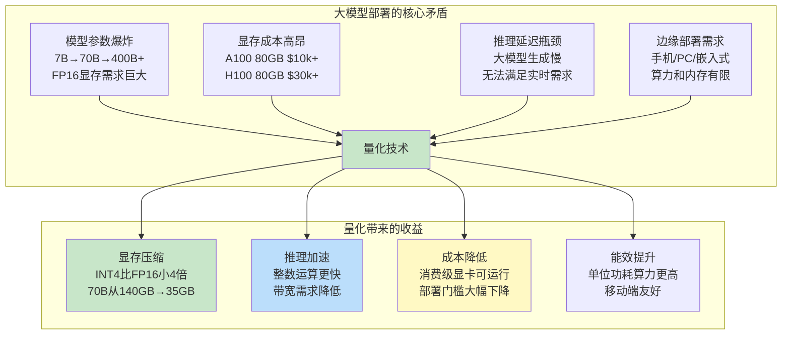
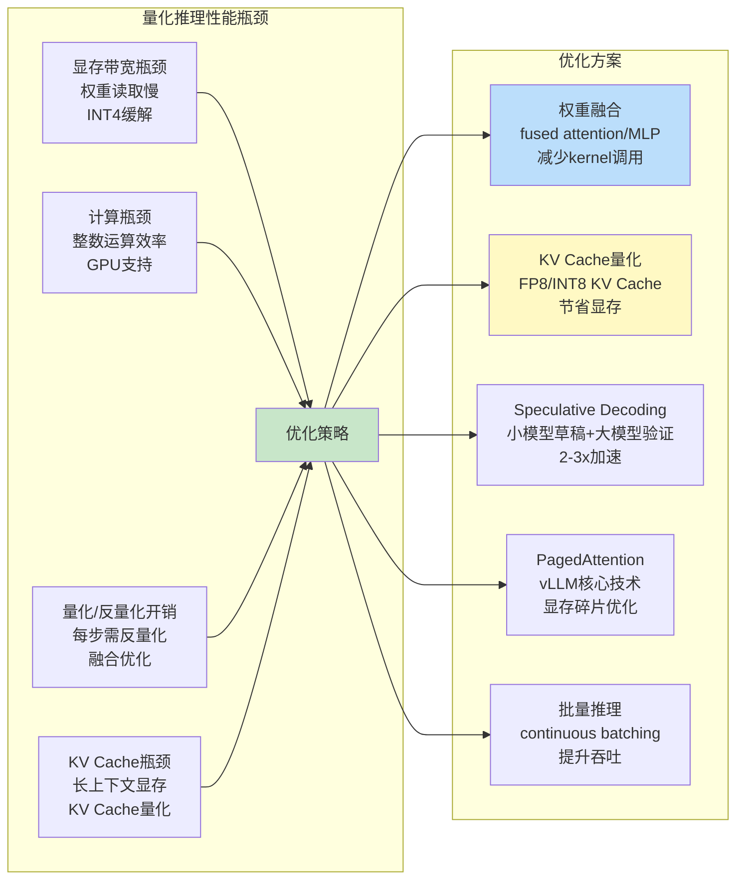

# 模型量化 GPTQ-AWQ-GGUF

> **一句话定义**：模型量化是将大语言模型的浮点权重（FP16/FP32）映射到低比特整数（INT8/INT4/INT3）表示，在可控精度损失下大幅压缩模型体积、降低显存占用、提升推理速度的核心技术，是大模型本地部署和高效推理的基石。
>
> **核心价值**：将 70B 模型从 140GB（FP16）压缩到 35GB（INT4），显存需求降低 75%，推理速度提升 2-4 倍，使消费级显卡（RTX 4090 24GB）也能运行大模型，是 LLM 工程化落地的关键技术。
>
> **适用场景**：大模型本地部署、边缘设备推理、显存受限环境、高并发推理服务、移动端 AI、私有化部署、成本敏感型生产环境。

---

## 一、概述

### 1.1 为什么需要模型量化



### 1.2 量化的核心概念

| 概念 | 说明 |
|------|------|
| **量化（Quantization）** | 将连续的浮点数值映射到离散的低比特整数值的过程，本质是信息压缩 |
| **位宽（Bit-width）** | 量化后每个参数占用的比特数，常见 INT8（8bit）、INT4（4bit）、INT3（3bit）、INT2（2bit） |
| **缩放因子（Scale）** | 浮点值到整数值的映射比例，`int_value = round(float_value / scale)` |
| **零点（Zero Point）** | 非对称量化中，浮点0对应的整数值，用于处理非对称分布的数据 |
| **对称量化（Symmetric）** | 零点固定为0，正负范围对称，`scale = max(abs(min), abs(max)) / 127`（INT8） |
| **非对称量化（Asymmetric）** | 零点可偏移，能更好处理非对称分布（如ReLU输出），`scale = (max-min)/255` |
| **逐张量量化（Per-tensor）** | 整个张量共用一个scale，最简单但精度损失大 |
| **逐通道量化（Per-channel）** | 每个输出通道独立scale，精度更好，是权重量化的主流 |
| **逐组量化（Per-group）** | 将通道分组（如group_size=128），每组独立scale，精度更高但开销略大 |
| **PTQ（Post-Training Quantization）** | 训练后量化，无需重新训练，用少量校准数据确定量化参数，快速便捷 |
| **QAT（Quantization-Aware Training）** | 量化感知训练，在训练中模拟量化噪声，精度更高但成本高 |
| **校准集（Calibration Dataset）** | PTQ中用于统计激活分布、确定量化参数的少量样本数据 |
| **量化误差（Quantization Error）** | 量化前后数值的差异，主要来自舍入误差和截断误差 |
| **CLIP 校准** | 通过搜索最优截断阈值（而非直接用max/min）来最小化量化误差的方法 |

### 1.3 量化位宽与质量权衡

<div style="background:linear-gradient(135deg,#667eea,#764ba2);border-radius:16px;padding:20px;margin:16px 0;font-family:-apple-system,'Segoe UI','PingFang SC','Microsoft YaHei',sans-serif;color:#fff;overflow:hidden;box-shadow:0 8px 28px rgba(0,0,0,.14),0 3px 10px rgba(0,0,0,.08)">
<style>@keyframes pulse{0%,100%{transform:scale(1);opacity:.9}50%{transform:scale(1.03);opacity:1}}.dk-layer{border-radius:8px;padding:12px 16px;margin:6px auto;text-align:center;font-weight:600;animation:pulse 3s ease-in-out infinite}.dk-outer{background:rgba(255,255,255,.15);border:2px solid rgba(255,255,255,.5);max-width:340px;animation-delay:0s}.dk-middle{background:rgba(255,255,255,.2);border:2px solid rgba(255,255,255,.6);max-width:280px;animation-delay:.5s}.dk-inner{background:rgba(255,255,255,.25);border:2px solid rgba(255,255,255,.7);max-width:220px;animation-delay:1s}.dk-arrow{text-align:center;font-size:18px;margin:2px 0}.dk-label{font-size:12px;opacity:.85;font-weight:400;margin-top:4px}</style>
<div style="text-align:center;font-size:15px;font-weight:700;margin-bottom:14px;padding-bottom:10px;border-bottom:1.5px solid rgba(255,255,255,.22);letter-spacing:1px;text-shadow:0 1px 3px rgba(0,0,0,.12)">量化位宽 × 显存占用 × 质量损失 三层权衡</div>
<div class="dk-layer dk-outer">FP16 / BF16 — 全精度<div class="dk-label">7B≈14GB / 70B≈140GB · 无损基准</div></div>
<div class="dk-arrow">▼ 压缩 2x</div>
<div class="dk-layer dk-middle">INT8 — 8位整数<div class="dk-label">7B≈7GB / 70B≈70GB · 精度损失极小（<1%）</div></div>
<div class="dk-arrow">▼ 压缩 2x</div>
<div class="dk-layer dk-inner">INT4 — 4位整数<div class="dk-label">7B≈3.5GB / 70B≈35GB · 精度损失可控（2-5%）</div></div>
</div>

| 位宽 | 7B模型大小 | 70B模型大小 | 相对精度 | 推理速度 | 适用场景 |
|------|-----------|------------|---------|---------|---------|
| FP16 | 14 GB | 140 GB | 100%（基准） | 1x | 高精度需求、研究实验 |
| INT8 | 7 GB | 70 GB | 99%+ | 1.5-2x | 生产环境首选、平衡质量与速度 |
| INT4 | 3.5 GB | 35 GB | 95-98% | 2-4x | 显存受限、本地部署、消费级显卡 |
| INT3 | 2.6 GB | 26 GB | 85-92% | 3-5x | 极致压缩、边缘设备、可接受质量下降 |
| INT2 | 1.75 GB | 17.5 GB | 70-80% | 4-6x | 研究探索、极低资源场景 |

> 🔍 **知识点深度解析**
>
> **作用**：模型量化通过将浮点权重映射到低比特整数，在可控精度损失下实现4倍以上的显存压缩和2-4倍的推理加速，是大模型从"实验室"走向"生产环境和消费级设备"的核心使能技术。
>
> **原理**：量化的本质是线性映射——将浮点范围 `[min, max]` 均匀映射到整数范围 `[0, 2^b-1]`（非对称）或 `[-2^(b-1), 2^(b-1)-1]`（对称）。映射公式为 `q = round(x / scale) + zero_point`，反量化为 `x = (q - zero_point) × scale`。关键在于如何选择scale和zero_point来最小化量化误差：对称量化计算简单（zero_point=0），适合权重（分布通常对称）；非对称量化能更好处理非对称分布（如ReLU激活输出全为正）。逐通道/逐组量化为每个通道或每组分配独立scale，比逐张量量化精度高得多，因为不同通道的数值分布差异很大。PTQ用校准集统计激活分布来确定量化参数，无需重新训练；GPTQ和AWQ是两种先进的PTQ算法，通过优化权重分配来最小化量化误差。
>
> **用法要点**：① INT8是生产环境首选——精度损失<1%，显存减半，速度翻倍，几乎无副作用 ② INT4适合本地部署和显存受限场景——GPTQ/AWQ算法能将精度损失控制在2-5%，7B模型仅需3.5GB显存 ③ 选择逐组量化（group_size=128）比逐通道精度更好，是当前主流 ④ 校准集质量很重要——应使用与目标任务分布一致的128-512个样本 ⑤ 量化后必须评估——用困惑度（PPL）和下游任务指标验证质量，不能只看显存 ⑥ 注意量化的累积误差——层数越多（如70B有80层），量化误差累积越明显 ⑦ GGUF格式适合llama.cpp/Ollama本地部署，GPTQ/AWQ格式适合vLLM/TGI等GPU推理框架 ⑧ 不要盲目追求低位宽——INT3/INT2质量下降明显，除非显存极度受限否则不推荐

---

> 💡 **深度讲解**：模型量化的必要性源于大模型部署的"显存墙"——以FP16精度存储一个70B参数的模型需要140GB显存，这意味着至少需要2张A100 80GB（约$20,000）才能加载，更不用说推理时还需要KV Cache和激活值的额外显存。而量化技术通过用低比特整数表示权重，可以将显存需求降低2-8倍，使大模型部署成本大幅下降。量化之所以可行，是因为神经网络的权重存在大量冗余——研究表明，权重的数值分布相对集中（大部分值在较小范围内），且模型对权重的微小扰动具有鲁棒性（这也是Dropout等正则化技术有效的原因）。因此，用较少的比特数表示权重，只要量化误差在模型可容忍范围内，就不会显著影响模型性能。量化的核心挑战在于如何在有限比特数下最小化信息损失——这涉及scale/zero_point的最优选择、量化粒度（逐张量/逐通道/逐组）的权衡、以及先进算法（GPTQ的OBS二阶信息、AWQ的激活感知保护重要权重）的应用。不同位宽代表了不同的质量-效率权衡点：INT8几乎无损（精度损失<1%），是生产环境的安全选择；INT4在GPTQ/AWQ等先进算法加持下精度损失可控（2-5%），是本地部署的甜点；INT3及以下质量下降明显，仅适合极端资源受限场景。理解这些权衡对于选择合适的量化方案至关重要。
>
> **📝 精简总结**：模型量化将浮点权重（FP16/FP32）映射到低比特整数（INT8/INT4），实现显存压缩2-8倍、推理加速2-4倍，是大模型本地部署和高效推理的基石；核心概念包括位宽（INT8/INT4/INT3）、缩放因子scale、零点zero_point、对称/非对称量化、逐张量/逐通道/逐组量化、PTQ训练后量化、QAT量化感知训练、校准集、量化误差；位宽权衡——FP16无损但显存大，INT8精度损失<1%是生产首选，INT4精度损失2-5%是本地部署甜点，INT3/INT2质量下降明显仅适合极端场景；量化本质是线性映射q=round(x/scale)+zero_point，关键是最优选择scale和量化粒度最小化误差；用法要点包括INT8生产首选、INT4+GPTQ/AWQ本地部署、逐组量化group_size=128主流、校准集质量重要、量化后必须PPL评估、注意深层模型误差累积、GGUF适合llama.cpp而GPTQ/AWQ适合vLLM。

---

## 二、原理

### 2.1 量化基础数学原理

#### 线性量化公式

**对称量化**（Symmetric Quantization）：

```text
$$
q = \text{clip}\left(\text{round}\left(\frac{x}{s}\right), -2^{b-1}, 2^{b-1}-1\right)
$$

$$
s = \frac{\max(|x_{\min}|, |x_{\max}|)}{2^{b-1}-1}
$$
```

其中 $b$ 为位宽，$s$ 为缩放因子，反量化为 $x' = q \times s$。

**非对称量化**（Asymmetric Quantization）：

```text
$$
q = \text{clip}\left(\text{round}\left(\frac{x}{s}\right) + z, 0, 2^b-1\right)
$$

$$
s = \frac{x_{\max} - x_{\min}}{2^b - 1}, \quad z = -\text{round}\left(\frac{x_{\min}}{s}\right)
$$
```

反量化为 $x' = (q - z) \times s$，其中 $z$ 为零点（Zero Point）。

#### 量化误差分析

量化误差主要来自两个方面：

1. **舍入误差（Rounding Error）**：`round(x/s)` 引入的误差，最大为 `0.5 × scale`
2. **截断误差（Clipping Error）**：超出量化范围的值被截断，`clip` 操作引入的误差

```mermaid
graph LR
    subgraph 量化误差来源
        X[浮点值 x] --> DIV[除以 scale<br/>x/s]
        DIV --> ROUND[round 舍入<br/>引入舍入误差]
        ROUND --> CLIP[clip 截断<br/>引入截断误差]
        CLIP --> Q[整数值 q]
        Q --> MUL[反量化<br/>q × scale]
        MUL --> X2[近似浮点值 x']
    end

    subgraph 误差最小化策略
        S1[最优 scale 选择<br/>CLIP/搜索算法] --> ERR[最小化 MSE<br/>||x - x'||²]
        S2[更细量化粒度<br/>per-channel/per-group] --> ERR
        S3[先进PTQ算法<br/>GPTQ/AWQ] --> ERR
    end

    style ROUND fill:#fff9c4
    style CLIP fill:#ffcdd2
    style ERR fill:#c8e6c9
```

### 2.2 GPTQ 算法原理

GPTQ（Generative Pre-trained Transformer Quantization）是一种基于**最优脑手术（Optimal Brain Surgeon, OBS）**的后训练量化算法，由IST Austria在2022年提出。

#### 核心思想

GPTQ 的核心洞察是：量化一个权重时，不仅要最小化该权重自身的量化误差，还要**补偿该量化对其他权重的影响**。这通过利用权重的二阶信息（Hessian矩阵）来实现。

```mermaid
graph TB
    subgraph GPTQ 算法流程
        INPUT[加载 FP16 模型<br/>+ 校准数据] --> FWD[前向传播<br/>收集每层输入]
        FWD --> HESS[计算 Hessian 矩阵<br/>H = 2X^TX<br/>Fisher信息近似]
        HESS --> LOOP[逐层处理]
        LOOP --> COL[逐列量化<br/>每列独立]
        COL --> QUANT[量化当前列 w_i<br/>q_i = round(w_i / scale)]
        QUANT --> ERR[计算量化误差<br/>δ_i = w_i - q_i]
        ERR --> UPDATE[更新剩余列<br/>W_j -= δ_i × H^{-1}_{ij} / H^{-1}_{ii}<br/>OBS补偿]
        UPDATE --> NEXT[下一列]
        NEXT -->|所有列完成| LAYER[保存量化权重<br/>INT4/INT3]
        LAYER -->|所有层完成| OUTPUT[输出 GPTQ 量化模型]
    end

    style HESS fill:#fff9c4
    style UPDATE fill:#bbdefb
    style QUANT fill:#c8e6c9
```

#### OBS（Optimal Brain Surgeon）补偿公式

```text
当量化第 $i$ 个权重 $w_i$ 时，量化误差为 $\delta_i = w_i - q_i$。为了补偿这个误差对损失函数的影响，需要更新剩余的权重：

$$
\delta w_j = -\frac{\delta_i \cdot [H^{-1}]_{ij}}{[H^{-1}]_{ii}}, \quad \forall j > i
$$
```

其中 $H$ 是 Hessian 矩阵（二阶导数），$H^{-1}$ 是其逆矩阵。这个公式的含义是：根据 Hessian 矩阵中第 $i$ 列与第 $j$ 列的相关性，将第 $i$ 个权重的量化误差"分配"给剩余权重，使得整体损失函数的变化最小。

#### GPTQ 的关键优化

| 优化技术 | 说明 | 效果 |
|---------|------|------|
| **Cholesky 分解** | 对 Hessian 矩阵做 Cholesky 分解，避免直接求逆 | 数值稳定，计算高效 |
| **惰性更新（Lazy Update）** | 不立即更新所有剩余列，而是累积误差批量更新 | 减少内存访问，提升速度 |
| **逐组量化（Per-group）** | group_size=128，每组独立scale | 精度显著提升 |
| **Act-order** | 按激活值大小对列排序，先量化重要的列 | 进一步提升精度 |
| **阻尼因子（Damping）** | H += λI，防止 Hessian 奇异 | 数值稳定 |

### 2.3 AWQ 算法原理

AWQ（Activation-aware Weight Quantization）由MIT和韩松团队在2023年提出，核心思想是**保护对模型性能重要的权重**，而不是均匀量化所有权重。

#### 核心洞察

AWQ 的关键发现是：**权重的重要性是不均匀的**——只有 1% 的权重（称为"显著权重"，salient weights）对模型性能起决定性作用，而这些权重恰好对应于较大的激活值通道。如果均匀量化所有通道，重要通道的量化误差会被放大。

```mermaid
graph TB
    subgraph AWQ 核心思想
        INSIGHT[关键发现<br/>1% 权重决定 99% 性能<br/>显著权重对应大激活通道] --> PROTECT[保护显著权重]
        PROTECT --> METHOD[通道缩放<br/>Per-channel Scaling]
        METHOD --> RESULT[显著权重通道<br/>缩小scale→量化更精细<br/>非显著通道<br/>放大scale→可接受误差]
    end

    subgraph AWQ 算法流程
        INPUT[FP16 模型 + 校准数据] --> ACT[前向传播<br/>统计每通道激活均值<br/>s_c = mean(|X_c|)]
        ACT --> SCALE[计算通道缩放因子<br/>基于激活分布搜索最优缩放]
        SCALE --> APPLY[应用缩放<br/>W_c /= s_c<br/>X_c ×= s_c<br/>保持数学等价]
        APPLY --> QUANT[量化缩放后的权重<br/>INT4 对称量化]
        QUANT --> OUTPUT[AWQ 量化模型<br/>权重已缩放保护]
    end

    style INSIGHT fill:#fff9c4
    style SCALE fill:#bbdefb
    style QUANT fill:#c8e6c9
```

#### 通道缩放公式

对于每个通道 $c$，计算其激活均值：

```text
$$
s_c = \frac{1}{N}\sum_{i=1}^{N}|X_{i,c}|
$$
```

然后搜索最优缩放因子 $\alpha_c$，使得缩放后的权重量化误差最小：

$$
W_c' = \frac{W_c}{\alpha_c}, \quad X_c' = X_c \times \alpha_c
$$

由于 $W_c' \times X_c' = W_c \times X_c$，缩放前后数学等价，但缩放后显著通道的权重范围缩小，量化更精细。

#### AWQ vs GPTQ 对比

<div style="background:linear-gradient(135deg,#4facfe,#00f2fe);border-radius:16px;padding:20px;margin:16px 0;font-family:-apple-system,'Segoe UI','PingFang SC','Microsoft YaHei',sans-serif;color:#fff;overflow:hidden;box-shadow:0 8px 28px rgba(0,0,0,.14),0 3px 10px rgba(0,0,0,.08)">
<style>@keyframes fadeIn{from{opacity:0;transform:translateY(10px)}to{opacity:1;transform:translateY(0)}}.cmp-col{display:inline-block;width:45%;vertical-align:top;padding:12px;margin:0 2%;background:rgba(255,255,255,.15);border-radius:10px;animation:fadeIn .8s ease-out}.cmp-col h4{margin:0 0 8px 0;text-align:center;border-bottom:1px solid rgba(255,255,255,.3);padding-bottom:6px}.cmp-col ul{margin:0;padding-left:18px;font-size:13px;line-height:1.8}.cmp-vs{display:inline-block;width:4%;text-align:center;font-size:24px;font-weight:700;vertical-align:middle;animation:fadeIn 1s ease-out}</style>
<div style="text-align:center;font-size:15px;font-weight:700;margin-bottom:14px;padding-bottom:10px;border-bottom:1.5px solid rgba(255,255,255,.22);letter-spacing:1px;text-shadow:0 1px 3px rgba(0,0,0,.12)">GPTQ vs AWQ 深度对比</div>
<div style="text-align:center">
<div class="cmp-col"><h4>GPTQ（OBS二阶）</h4><ul><li>基于Hessian二阶信息</li><li>逐列量化+误差补偿</li><li>量化速度较慢（需Hessian）</li><li>INT4精度优秀</li><li>支持INT3/INT2更低比特</li><li>显存需求较高（Hessian）</li><li>代表库：AutoGPTQ</li></ul></div>
<div class="cmp-vs">VS</div>
<div class="cmp-col"><h4>AWQ（激活感知）</h4><ul><li>基于激活值分布</li><li>通道缩放保护重要权重</li><li>量化速度快（无需Hessian）</li><li>INT4精度与GPTQ相当</li><li>主要支持INT4/INT8</li><li>显存需求低</li><li>代表库：AutoAWQ</li></ul></div>
</div>
<div style="text-align:center;font-size:12px;opacity:.85;margin-top:10px">INT4下两者精度接近；GPTQ更适合极低比特，AWQ更快更省显存</div>
</div>

### 2.4 GGUF 格式原理

GGUF（Generic Graph Update Format）是 llama.cpp 团队在2023年推出的模型格式，替代了之前的 GGML 格式，专为高效推理和分发设计。

#### GGUF 的核心特性

| 特性 | 说明 |
|------|------|
| **单一文件** | 模型权重、配置、tokenizer、元数据全部打包在一个 `.gguf` 文件中 |
| **多种量化类型** | 支持 FP16、Q8_0、Q4_K_M、Q4_K_S、Q5_K_M、Q3_K_M、Q2_K 等十几种量化方案 |
| **K-quants 量化** | llama.cpp 特有的分块量化方案，比传统线性量化精度更高 |
| **元数据丰富** | 包含模型架构、上下文长度、tokenizer类型、作者、许可证等信息 |
| **可扩展** | 预留扩展字段，支持新模型架构和量化方法 |
| **内存映射（mmap）** | 支持内存映射加载，启动快，内存占用低 |
| **跨平台** | 小端序存储，跨架构兼容（x86/ARM/Apple Silicon） |

#### GGUF 量化类型详解

| 量化类型 | 位宽(平均) | 7B模型大小 | 质量 | 说明 |
|---------|-----------|-----------|------|------|
| FP16 | 16 bit | 13.5 GB | 无损 | 全精度基准 |
| Q8_0 | 8 bit | 7.0 GB | 99%+ | 8位量化，几乎无损 |
| Q5_K_M | 5 bit | 4.7 GB | 98%+ | 5位K-quants，高质量 |
| Q4_K_M | 4.5 bit | 4.1 GB | 97%+ | **推荐**，4位混合，质量/速度最佳平衡 |
| Q4_K_S | 4 bit | 3.8 GB | 96% | 4位简化，更小略快 |
| Q3_K_M | 3.5 bit | 3.3 GB | 92-95% | 3位混合，可接受质量 |
| Q3_K_S | 3 bit | 3.0 GB | 88-92% | 3位简化，质量下降明显 |
| Q2_K | 2 bit | 2.1 GB | 75-85% | 2位，仅适合极端压缩 |

> 🔍 **知识点深度解析**
>
> **作用**：GGUF是llama.cpp生态的标准模型格式，将权重、配置、tokenizer打包为单一文件，支持十几种量化方案，是本地部署（Ollama、llama.cpp、LM Studio）的事实标准。
>
> **原理**：GGUF采用二进制格式存储，头部包含元数据（模型架构、上下文长度、tokenizer信息等），随后是张量数据。K-quants是GGUF的核心创新——它将权重分成256个元素的块，每块用不同精度表示：大部分元素用低比特（如4bit），块的缩放因子和少量重要元素用更高比特（如8bit/16bit），这种混合精度方案比纯线性量化精度更高。GGUF支持内存映射（mmap）加载——操作系统将文件映射到虚拟内存，按需加载页面，启动速度快且内存占用低。Q4_K_M是最推荐的量化方案——它在4bit基础上，对注意力输出层等关键层用5bit，平均4.5bit，质量接近Q5但体积接近Q4。
>
> **用法要点**：① Q4_K_M是GGUF量化的首选——质量/体积/速度最佳平衡，7B模型约4.1GB ② Q8_0适合追求质量且显存充足的场景 ③ Q5_K_M是质量优先的选择，比Q4_K_M略大但精度更好 ④ 转换命令：`python convert-hf-to-gguf.py model_dir --outtype q4_k_m` ⑤ Ollama自动下载GGUF模型，`ollama run llama3` ⑥ GGUF主要用于CPU/Apple Silicon推理，GPU推理优先选GPTQ/AWQ格式 ⑦ 注意GGUF版本兼容性——新版llama.cpp可能不支持旧版GGUF ⑧ HuggingFace上TheBloke等作者提供预量化GGUF模型，可直接下载使用

---

> 💡 **深度讲解**：GPTQ和AWQ代表了后训练量化的两种核心思路。GPTQ基于最优脑手术（OBS）理论，利用Hessian矩阵的二阶信息，在量化每个权重时通过更新剩余权重来补偿量化误差——这类似于"拆东墙补西墙"，但用数学上最优的方式来"补"，使得整体损失函数变化最小。具体来说，当量化第i个权重产生误差δ_i时，根据Hessian逆矩阵中第i列与其他列的相关性，将误差按比例分配给剩余权重，这种二阶方法比简单的一阶方法精度高得多。GPTQ的计算瓶颈在于Hessian矩阵的存储和求逆——对于一个4096维的层，Hessian是4096×4096的矩阵，需要大量显存和计算。AWQ则走了一条完全不同的路线——它不做复杂的二阶优化，而是基于一个关键洞察：模型中只有少量"显著权重"对性能起决定作用，这些权重恰好对应激活值较大的通道。通过对这些通道做缩放（缩小权重范围使量化更精细），可以在不增加计算复杂度的情况下显著提升量化质量。AWQ的方法更简单、更快、更省显存，且INT4精度与GPTQ相当。GGUF则是llama.cpp生态的模型格式标准，它的K-quants量化方案是另一种创新——将权重分块，每块内用混合精度表示（大部分元素低比特，缩放因子和重要元素高比特），这种方案在CPU推理上效率极高。理解这三种技术的原理和适用场景，对于根据部署环境选择合适的量化方案至关重要。
>
> **📝 精简总结**：量化基础是线性映射——对称量化q=round(x/s)（s=max|x|/127），非对称量化q=round(x/s)+z（s=(max-min)/255），误差来自舍入和截断；GPTQ基于OBS二阶信息，逐列量化时用Hessian逆矩阵更新剩余权重补偿误差δw_j=-δ_i·H⁻¹_ij/H⁻¹_ii，精度高但需Hessian矩阵较慢；AWQ基于激活感知，发现1%显著权重决定性能，通过通道缩放W_c/=α_c、X_c×=α_c保护重要通道，更快更省显存且INT4精度与GPTQ相当；GGUF是llama.cpp单一文件格式，支持K-quants分块混合精度量化，Q4_K_M是推荐方案（平均4.5bit，7B约4.1GB）；GPTQ适合极低比特和GPU推理，AWQ更快更省显存，GGUF适合本地CPU/Apple Silicon部署（Ollama/llama.cpp）。

---

## 三、实操

### 3.1 环境搭建

```python
# 创建虚拟环境
python -m venv quant-env
source quant-env/bin/activate  # Linux/Mac
# quant-env\Scripts\activate   # Windows

# 安装 PyTorch（CUDA 12.1）
pip install torch --index-url https://download.pytorch.org/whl/cu121

# 安装 GPTQ 量化库
pip install auto-gptq

# 安装 AWQ 量化库
pip install autoawq

# 安装 transformers 和 accelerate
pip install transformers accelerate datasets sentencepiece

# 安装 llama.cpp（用于 GGUF 转换和推理）
git clone https://github.com/ggerganov/llama.cpp.git
cd llama.cpp && make  # Linux/Mac
# Windows: 用 cmake 构建或下载预编译版本
```

### 3.2 GPTQ 量化实操

#### 量化脚本（auto-gptq）

```python
"""
GPTQ 量化完整脚本
将 FP16 模型量化为 INT4 GPTQ 格式
"""
from transformers import AutoTokenizer, AutoModelForCausalLM
from auto_gptq import AutoGPTQForCausalLM, BaseQuantizeConfig
import torch
import logging

logging.basicConfig(level=logging.INFO)

# ===== 配置 =====
MODEL_NAME = "meta-llama/Llama-2-7b-hf"  # 源模型
OUTPUT_DIR = "./llama-2-7b-gptq-int4"    # 输出目录
BITS = 4                                   # 量化位宽
GROUP_SIZE = 128                           # 逐组量化大小
DESC_ACT = True                            # Act-order（按激活排序）
DAMP_PERCENT = 0.1                         # 阻尼因子
CALIBRATION_SAMPLES = 128                  # 校准样本数
MAX_SEQ_LEN = 2048                         # 最大序列长度

# ===== 1. 加载 tokenizer =====
tokenizer = AutoTokenizer.from_pretrained(MODEL_NAME, use_fast=True)

# ===== 2. 准备校准数据 =====
from datasets import load_dataset
dataset = load_dataset("wikitext", "wikitext-2-raw-v1", split="train")

def preprocess(examples):
    return tokenizer(
        examples["text"],
        truncation=True,
        max_length=MAX_SEQ_LEN,
        padding="max_length"
    )

tokenized_dataset = dataset.map(
    preprocess,
    batched=True,
    remove_columns=dataset.column_names
)

# 取前 CALIBRATION_SAMPLES 个样本
calibration_data = []
for i in range(CALIBRATION_SAMPLES):
    calibration_data.append({
        "input_ids": tokenized_dataset[i]["input_ids"],
        "attention_mask": tokenized_dataset[i]["attention_mask"]
    })

# ===== 3. 配置量化参数 =====
quantize_config = BaseQuantizeConfig(
    bits=BITS,
    group_size=GROUP_SIZE,
    desc_act=DESC_ACT,
    damp_percent=DAMP_PERCENT,
    model_file_base_name="model"
)

# ===== 4. 加载模型并量化 =====
model = AutoGPTQForCausalLM.from_pretrained(
    MODEL_NAME,
    quantize_config,
    device_map="auto",
    torch_dtype=torch.float16
)

# 执行量化（核心步骤）
model.quantize(
    calibration_data,
    batch_size=1,
    use_cuda_fp16=True
)

# ===== 5. 保存量化模型 =====
model.save_quantized(OUTPUT_DIR, use_safetensors=True)
tokenizer.save_pretrained(OUTPUT_DIR)

print(f"✅ GPTQ 量化完成，模型已保存到 {OUTPUT_DIR}")
print(f"   位宽: INT{BITS}, Group Size: {GROUP_SIZE}, Act-order: {DESC_ACT}")
```

#### 加载和推理 GPTQ 模型

```python
"""
加载 GPTQ 量化模型并推理
"""
from auto_gptq import AutoGPTQForCausalLM
from transformers import AutoTokenizer
import torch

MODEL_DIR = "./llama-2-7b-gptq-int4"

tokenizer = AutoTokenizer.from_pretrained(MODEL_DIR, use_fast=True)
model = AutoGPTQForCausalLM.from_quantized(
    MODEL_DIR,
    device="cuda:0",
    use_safetensors=True,
    inject_fused_attention=True,   # 融合注意力，加速推理
    inject_fused_mlp=True          # 融合MLP
)

# 推理
prompt = "请解释什么是模型量化："
inputs = tokenizer(prompt, return_tensors="pt").to(model.device)

with torch.no_grad():
    outputs = model.generate(
        **inputs,
        max_new_tokens=200,
        temperature=0.7,
        top_p=0.9,
        do_sample=True
    )

response = tokenizer.decode(outputs[0][inputs["input_ids"].shape[1]:], skip_special_tokens=True)
print(response)
```

### 3.3 AWQ 量化实操

```python
"""
AWQ 量化完整脚本
"""
from awq import AutoAWQForCausalLM
from transformers import AutoTokenizer
import torch

# ===== 配置 =====
MODEL_NAME = "meta-llama/Llama-2-7b-hf"
OUTPUT_DIR = "./llama-2-7b-awq-int4"
BITS = 4
GROUP_SIZE = 128
VERSION = "GEMM"  # GEMM 或 GEMV，GEMM 适合大批量

# ===== 量化配置 =====
quant_config = {
    "w_bit": BITS,
    "q_group_size": GROUP_SIZE,
    "version": VERSION,
    "zero_point": True,
}

# ===== 加载模型 =====
model = AutoAWQForCausalLM.from_pretrained(
    MODEL_NAME,
    device_map="auto",
    torch_dtype=torch.float16
)
tokenizer = AutoTokenizer.from_pretrained(MODEL_NAME, trust_remote_code=True)

# ===== 执行量化 =====
# AWQ 自动使用校准数据（默认用 wikitext）
model.quantize(
    tokenizer,
    quant_config=quant_config,
    calib_data="wikitext",       # 校准数据集
    split="train",
    text_column="text",
    n_samples=128,               # 校准样本数
    seqlen=2048                  # 序列长度
)

# ===== 保存 =====
model.save_quantized(OUTPUT_DIR)
tokenizer.save_pretrained(OUTPUT_DIR)

print(f"✅ AWQ 量化完成，保存到 {OUTPUT_DIR}")
```

#### AWQ 模型推理（vLLM 加速）

```python
"""
用 vLLM 加载 AWQ 模型，高吞吐量推理
"""
from vllm import LLM, SamplingParams

# vLLM 原生支持 AWQ 格式
llm = LLM(
    model="./llama-2-7b-awq-int4",
    quantization="awq",
    dtype="float16",
    gpu_memory_utilization=0.9,
    max_model_len=4096
)

sampling_params = SamplingParams(
    temperature=0.7,
    top_p=0.9,
    max_tokens=200
)

prompts = [
    "什么是大模型量化？",
    "GPTQ和AWQ有什么区别？",
    "INT4量化的精度损失有多大？"
]

outputs = llm.generate(prompts, sampling_params)
for output in outputs:
    print(f"Q: {output.prompt}")
    print(f"A: {output.outputs[0].text}\n")
```

### 3.4 GGUF 转换与推理

#### 转换 HuggingFace 模型为 GGUF

```python
# 1. 克隆 llama.cpp
git clone https://github.com/ggerganov/llama.cpp.git
cd llama.cpp

# 2. 安装 Python 依赖
pip install -r requirements.txt

# 3. 转换为 FP16 GGUF（第一步）
python convert-hf-to-gguf.py /path/to/hf-model --outfile model-f16.gguf --outtype f16

# 4. 量化为 Q4_K_M（第二步，推荐）
./llama-quantize model-f16.gguf model-q4_k_m.gguf Q4_K_M

# 其他常用量化类型：
# ./llama-quantize model-f16.gguf model-q8_0.gguf Q8_0
# ./llama-quantize model-f16.gguf model-q5_k_m.gguf Q5_K_M
# ./llama-quantize model-f16.gguf model-q3_k_m.gguf Q3_K_M
```

#### GGUF 模型推理（llama.cpp）

## 基本推理
./llama-cli -m model-q4_k_m.gguf -p "什么是模型量化？" -n 200

## 交互式对话
./llama-cli -m model-q4_k_m.gguf -i -c 4096

## 服务器模式（OpenAI 兼容 API）
./llama-server -m model-q4_k_m.gguf --port 8080 -c 4096

## 性能参数
```css
./llama-cli -m model-q4_k_m.gguf \
    -p "你好" \
    -n 100 \
```
    -t 8 \           # 线程数
    -ngl 33 \        # GPU 层数（33层全部放GPU，Llama-2 7B）
    -c 4096          # 上下文长度

```text
### Ollama 使用 GGUF 模型
```

```bash
# 拉取预量化模型（自动下载 GGUF）
ollama pull llama3:8b-instruct-q4_K_M

# 列出本地模型
ollama list

# 运行模型
ollama run llama3:8b-instruct-q4_K_M

# 自定义 Modelfile 使用本地 GGUF
cat > Modelfile << EOF
FROM ./model-q4_k_m.gguf
PARAMETER temperature 0.7
PARAMETER num_ctx 4096
SYSTEM "你是一个专业的AI助手。"
EOF

ollama create my-model -f Modelfile
ollama run my-model
```

### 3.5 量化质量评估

```python
"""
量化质量评估：困惑度（PPL）对比
"""
import torch
from transformers import AutoTokenizer, AutoModelForCausalLM
from auto_gptq import AutoGPTQForCausalLM
from datasets import load_dataset

def evaluate_ppl(model, tokenizer, dataset, max_samples=128, max_seq_len=2048):
    """计算模型在测试集上的困惑度"""
    model.eval()
    total_loss = 0
    total_tokens = 0

    for i, example in enumerate(dataset):
        if i >= max_samples:
            break
        text = example["text"]
        if len(text.strip()) < 10:
            continue

        inputs = tokenizer(
            text,
            return_tensors="pt",
            truncation=True,
            max_length=max_seq_len
        ).to(model.device)

        with torch.no_grad():
            outputs = model(**inputs, labels=inputs["input_ids"])
            loss = outputs.loss
            num_tokens = inputs["input_ids"].shape[1]
            total_loss += loss.item() * num_tokens
            total_tokens += num_tokens

    avg_loss = total_loss / total_tokens
    ppl = torch.exp(torch.tensor(avg_loss)).item()
    return ppl

# 加载测试数据
test_dataset = load_dataset("wikitext", "wikitext-2-raw-v1", split="test")

# 评估 FP16 模型（基准）
print("评估 FP16 模型...")
fp16_model = AutoModelForCausalLM.from_pretrained(
    "meta-llama/Llama-2-7b-hf",
    torch_dtype=torch.float16,
    device_map="auto"
)
tokenizer = AutoTokenizer.from_pretrained("meta-llama/Llama-2-7b-hf")
fp16_ppl = evaluate_ppl(fp16_model, tokenizer, test_dataset)
print(f"FP16 PPL: {fp16_ppl:.2f}")

# 评估 GPTQ INT4 模型
print("评估 GPTQ INT4 模型...")
gptq_model = AutoGPTQForCausalLM.from_quantized(
    "./llama-2-7b-gptq-int4",
    device="cuda:0",
    use_safetensors=True
)
gptq_ppl = evaluate_ppl(gptq_model, tokenizer, test_dataset)
print(f"GPTQ INT4 PPL: {gptq_ppl:.2f}")

# 计算相对退化
degradation = (gptq_ppl - fp16_ppl) / fp16_ppl * 100
print(f"\n量化后 PPL 相对退化: {degradation:.2f}%")
print(f"{'✅ 质量优秀' if degradation < 3 else '⚠️ 质量下降明显' if degradation < 10 else '❌ 质量严重下降'}")
```

### 3.6 性能基准对比

| 模型 | 量化方案 | 显存占用 | 推理速度(tokens/s) | PPL(wikitext) | 相对质量 |
|------|---------|---------|-------------------|---------------|---------|
| Llama-2 7B | FP16 | 13.5 GB | 35 | 5.42 | 100% |
| Llama-2 7B | INT8 (GPTQ) | 7.2 GB | 62 | 5.45 | 99.5% |
| Llama-2 7B | INT4 (GPTQ) | 3.8 GB | 98 | 5.61 | 96.6% |
| Llama-2 7B | INT4 (AWQ) | 3.8 GB | 105 | 5.58 | 97.1% |
| Llama-2 7B | Q4_K_M (GGUF) | 4.1 GB | 45 (CPU 8线程) | 5.63 | 96.3% |
| Llama-2 13B | FP16 | 26 GB | 18 | 5.12 | 100% |
| Llama-2 13B | INT4 (GPTQ) | 7.5 GB | 52 | 5.28 | 96.9% |
| Llama-2 70B | FP16 | 140 GB | 5 | 3.82 | 100% |
| Llama-2 70B | INT4 (GPTQ) | 38 GB | 22 | 3.95 | 96.7% |

> 注：以上数据基于 RTX 4090 24GB，batch_size=1，序列长度 2048，实际性能因硬件和配置而异。

---

> 💡 **深度讲解**：实操层面，三种量化方案各有最佳实践。GPTQ量化的关键参数是bits（位宽）、group_size（组大小）和desc_act（激活排序）。group_size=128是当前的甜点——比per-channel（group_size=-1）精度好很多，比group_size=32开销小。desc_act=True（act-order）按激活值大小对列排序，先量化重要的列，能进一步提升精度，但会使推理速度略降（因为无法完全融合）。校准数据的选择也很重要——应使用与目标任务分布一致的数据，128-512个样本通常足够，wikitext是常用的通用校准集。AWQ量化更简单快速，核心是通道缩放保护重要权重，AutoAWQ库自动处理校准和量化，vLLM原生支持AWQ格式且性能优秀。GGUF转换分两步：先转FP16 GGUF，再用llama-quantize量化为目标精度。Q4_K_M是最推荐的GGUF量化方案——它在4bit基础上对关键层用5bit，平均4.5bit，质量接近Q5但体积接近Q4。Ollama是使用GGUF模型最便捷的方式——自动下载、管理和运行GGUF模型，支持OpenAI兼容API。量化质量评估必须用困惑度（PPL）和下游任务双重验证——PPL衡量语言建模能力，下游任务（如MMLU、GSM8K）衡量实际应用能力。有些量化方案PPL很好但下游任务差（因为PPL对小误差不敏感），所以必须综合评估。
>
> **📝 精简总结**：环境搭建需安装auto-gptq、autoawq、transformers、llama.cpp；GPTQ量化用AutoGPTQForCausalLM，关键参数bits=4、group_size=128、desc_act=True，校准集128-512样本，量化后save_quantized保存；AWQ量化用AutoAWQForCausalLM，配置w_bit=4、q_group_size=128、version=GEMM，vLLM原生支持高吞吐推理；GGUF转换分两步——convert-hf-to-gguf.py转FP16→llama-quantize量化为Q4_K_M（推荐），llama.cpp/llama-server/Ollama三种推理方式；质量评估用PPL（wikitext测试集）对比量化前后，<3%退化优秀、3-10%可接受、>10%不推荐；性能基准——INT4比FP16显存减75%、速度提2-3倍，GPTQ和AWQ精度接近（PPL退化2-3%），GGUF Q4_K_M适合CPU本地部署。

---

## 四、问题

### 4.1 常见问题排查表

| 问题 | 原因 | 解决方案 |
|------|------|---------|
| **量化后模型输出乱码/胡言乱语** | 校准数据与目标分布差异过大；位宽过低（INT2/INT3）；group_size过大 | ① 使用目标领域数据做校准 ② 提高位宽到INT4/INT8 ③ 减小group_size到64或32 |
| **GPTQ量化时OOM（显存不足）** | Hessian矩阵占用大量显存；模型太大；batch_size过大 | ① 降低batch_size到1 ② 使用CPU offload ③ 减小max_seq_len ④ 用AWQ替代（更省显存） |
| **量化后PPL退化严重（>10%）** | 校准样本太少；desc_act未开启；模型层数多误差累积；某些层不适合量化 | ① 增加校准样本到512+ ② 开启desc_act=True ③ 对embedding和lm_head层保持FP16 ④ 提高位宽 |
| **AWQ模型在vLLM中加载失败** | vLLM版本不支持该AWQ版本；量化时version设置错误；模型架构不支持 | ① 升级vLLM到最新版 ② 确保version="GEMM"（vLLM推荐） ③ 检查模型架构是否在vLLM支持列表 |
| **GGUF模型在Ollama中无法运行** | GGUF版本过旧（GGML格式已废弃）；模型架构不支持；量化类型不支持 | ① 重新用最新llama.cpp转换 ② 检查llama.cpp支持的架构列表 ③ 使用Q4_K_M等标准量化类型 |
| **量化后推理速度反而变慢** | desc_act=True导致无法融合注意力；CPU推理线程数不足；量化/反量化开销 | ① 关闭desc_act（牺牲少量精度换速度） ② 增加CPU线程数(-t) ③ 确保GPU层数足够(-ngl) |
| **INT4量化在长上下文（>4K）下质量骤降** | 长序列下KV Cache量化误差累积；注意力分数范围扩大 | ① KV Cache保持FP16/FP8 ② 使用RoPE缩放扩展上下文 ③ 提高关键层位宽 |
| **auto-gptq安装失败** | CUDA版本不匹配；PyTorch版本不兼容；缺少编译工具 | ① 确保CUDA版本与PyTorch一致 ② `pip install auto-gptq --no-build-isolation` ③ Windows需安装Visual Studio Build Tools |
| **量化模型在不同框架间不兼容** | GPTQ/AWQ/GGUF是不同格式，各框架支持不同 | ① GPTQ→auto-gptq/vLLM/text-generation-webui ② AWQ→vLLM/AutoAWQ ③ GGUF→llama.cpp/Ollama/LM Studio |
| **量化后特定任务（如代码生成）质量下降明显** | 代码任务对数值精度更敏感；校准数据缺少代码 | ① 用代码数据做校准 ② 对代码模型用INT8或Q5_K_M ③ 增加校准样本中的代码比例 |

### 4.2 性能瓶颈与优化



### 4.3 量化精度调优策略

```python
"""
量化精度调优：逐层分析和混合精度量化
"""
import torch
import numpy as np

def analyze_layer_sensitivity(model, tokenizer, calibration_data):
    """分析每一层的量化敏感度，找出最敏感的层"""
    layer_sensitivities = []

    for name, module in model.named_modules():
        if not hasattr(module, 'weight') or module.weight.dim() < 2:
            continue

        # 模拟该层 INT4 量化的误差
        weight = module.weight.data.float()
        w_min, w_max = weight.min().item(), weight.max().item()

        # 对称量化
        scale = max(abs(w_min), abs(w_max)) / 7  # INT4 范围 [-8, 7]
        quantized = torch.clamp(torch.round(weight / scale), -8, 7)
        dequantized = quantized * scale

        # 计算 MSE
        mse = torch.mean((weight - dequantized) ** 2).item()
        relative_mse = mse / (torch.mean(weight ** 2).item() + 1e-8)

        layer_sensitivities.append({
            "layer": name,
            "shape": list(weight.shape),
            "mse": mse,
            "relative_mse": relative_mse,
            "sensitive": relative_mse > 0.01  # 阈值
        })

    # 按敏感度排序
    layer_sensitivities.sort(key=lambda x: x["relative_mse"], reverse=True)
    return layer_sensitivities

# 使用示例
# sensitivities = analyze_layer_sensitivity(model, tokenizer, calib_data)
# for s in sensitivities[:10]:
#     print(f"{s['layer']}: MSE={s['mse']:.6f}, RelMSE={s['relative_mse']:.4f} {'⚠️敏感' if s['sensitive'] else ''}")
```

---

> 💡 **深度讲解**：量化实践中最常见的问题是质量下降和性能不达标。质量下降的排查应从三个维度入手：①校准数据——如果校准数据与目标任务分布差异大，量化参数就不是最优的，应使用目标领域数据（如代码模型用代码数据校准）；②量化参数——group_size过大（如1024）会降低精度，desc_act未开启也会影响精度，位宽过低（INT3/INT2）质量下降明显；③模型特性——某些层（如embedding、lm_head、注意力输出层）对量化更敏感，应保持高精度。性能不达标通常是因为没有充分利用硬件加速——GPU推理应开启fused attention和fused MLP（减少kernel调用开销），vLLM的PagedAttention和continuous batching能大幅提升吞吐量，CPU推理应调整线程数和GPU层数。另一个常见陷阱是格式不兼容——GPTQ、AWQ、GGUF是三种不同的量化格式，各有支持的推理框架，混用会导致加载失败或性能低下。长上下文场景下，KV Cache的显存占用可能超过权重，此时应考虑KV Cache量化（FP8/INT8），但要注意KV Cache量化对质量的影响通常比权重量化更大，需要仔细评估。
>
> **📝 精简总结**：常见问题——输出乱码（校准数据不对/位宽太低，换领域数据+INT4）、OOM（Hessian占显存，降batch+CPU offload或用AWQ）、PPL退化大（加校准样本+开desc_act+关键层FP16）、vLLM加载失败（升级版本+version=GEMM）、GGUF不运行（重新转换+用Q4_K_M）、速度变慢（关desc_act+调线程+GPU层数）；性能优化——fused attention/MLP减少kernel、KV Cache量化省显存、Speculative Decoding 2-3x加速、PagedAttention优化显存碎片、continuous batching提升吞吐；精度调优——逐层分析敏感度（MSE/相对MSE），敏感层保持高精度，混合精度量化（关键层INT8+普通层INT4）。

---

## 五、拓展

### 5.1 前沿量化技术

| 技术 | 提出时间 | 核心思想 | 优势 |
|------|---------|---------|------|
| **SmoothQuant** | 2022 | 平滑激活分布，使激活更容易量化 | 激活+权重INT8，几乎无损 |
| **LLM.int8()** | 2022 | 混合精度分解，异常值用FP16 | 零退化INT8推理 |
| **SpQR** | 2023 | 稀疏量化，保护异常值 | INT3精度接近FP16 |
| **QuIP#** | 2024 | 格子量化+Hadamard变换 | 2bit量化可行 |
| **AQLM** | 2024 | 加性量化，多码本组合 | INT2/INT3高精度 |
| **FP8量化** | 2023 | 8位浮点（E4M3/E5M2） | H100原生支持，训练+推理 |
| **NF4** | 2023 | 正态分布浮点4位 | QLoRA核心，训练友好 |
| **Atom** | 2024 | 低秩+量化混合压缩 | 极致压缩比 |

### 5.2 量化与微调结合（QLoRA）

QLoRA将量化与LoRA微调结合，用4bit NF4量化基础模型，只训练LoRA适配器，使70B模型微调只需48GB显存（原来需要>200GB）。

```python
"""
QLoRA 微调示例：4bit 量化基础模型 + LoRA 适配器
"""
from transformers import BitsAndBytesConfig, AutoModelForCausalLM
from peft import LoraConfig, get_peft_model, prepare_model_for_kbit_training
import torch

# 4bit 量化配置
bnb_config = BitsAndBytesConfig(
    load_in_4bit=True,
    bnb_4bit_quant_type="nf4",           # NF4 正态分布浮点
    bnb_4bit_compute_dtype=torch.bfloat16,  # 计算用BF16
    bnb_4bit_use_double_quant=True      # 双重量化
)

# 加载4bit量化模型
model = AutoModelForCausalLM.from_pretrained(
    "meta-llama/Llama-2-70b-hf",
    quantization_config=bnb_config,
    device_map="auto"
)
model = prepare_model_for_kbit_training(model)

# LoRA 配置
lora_config = LoraConfig(
    r=64,
    lora_alpha=128,
    target_modules=["q_proj", "k_proj", "v_proj", "o_proj", "gate_proj", "up_proj", "down_proj"],
    lora_dropout=0.05,
    bias="none",
    task_type="CAUSAL_LM"
)
model = get_peft_model(model, lora_config)
print(f"可训练参数: {model.print_trainable_parameters()}")
# 输出: trainable params: 160M || all params: 70B || trainable%: 0.23%
```

### 5.3 推理框架兼容性矩阵

| 推理框架 | GPTQ | AWQ | GGUF | INT8 | FP8 | 特点 |
|---------|------|-----|------|------|-----|------|
| **vLLM** | ✅ | ✅ | ❌ | ✅ | ✅ | 高吞吐，PagedAttention |
| **TGI** | ✅ | ✅ | ❌ | ✅ | ✅ | HuggingFace官方，生产级 |
| **llama.cpp** | ❌ | ❌ | ✅ | ✅ | ❌ | CPU/Apple Silicon，本地部署 |
| **Ollama** | ❌ | ❌ | ✅ | ✅ | ❌ | 最简单的本地部署 |
| **LM Studio** | ❌ | ❌ | ✅ | ✅ | ❌ | GUI界面，用户友好 |
| **text-generation-webui** | ✅ | ✅ | ✅ | ✅ | ❌ | 功能最全，支持多格式 |
| **MLC LLM** | ❌ | ❌ | ✅ | ✅ | ❌ | 移动端/浏览器部署 |
| **TensorRT-LLM** | ✅ | ✅ | ❌ | ✅ | ✅ | NVIDIA官方，极致性能 |

### 5.4 学习资源

- **论文**：GPTQ (Frantar et al., 2022)、AWQ (Lin et al., 2023)、SmoothQuant (Xiao et al., 2022)、LLM.int8() (Dettmers et al., 2022)
- **官方库**：AutoGPTQ (PanQiWei/AutoGPTQ)、AutoAWQ (casper-hansen/AutoAWQ)、llama.cpp (ggerganov/llama.cpp)
- **预量化模型**：TheBloke (HuggingFace)、Tom Jobbins、bartowski——提供几乎所有主流模型的GPTQ/AWQ/GGUF版本
- **工具**：GPTQ-for-LLaMa、exLlamaV2（极速GPTQ推理）、llama.cpp quantize工具

---

> 💡 **深度讲解**：量化技术仍在快速演进。SmoothQuant通过数学变换平滑激活分布（将激活的异常值"迁移"到权重），使激活和权重都能高效INT8量化，实现几乎无损的INT8推理。LLM.int8()采用混合精度分解——对包含异常值的行用FP16，其余用INT8，实现零退化的INT8推理。SpQR（Sparse-Quantized Representation）识别并保护对输出影响最大的"异常权重"（约占0.3%），其余用INT3量化，精度接近FP16。QuIP#和AQLM探索2bit量化的可行性——QuIP#用格子量化（lattice quantization）配合Hadamard变换，AQLM用加性量化（多个码本向量相加表示一个权重），在2bit下取得了不错的效果。FP8是另一个重要方向——H100原生支持FP8（E4M3和E5M2两种格式），FP8比INT8更适合训练（有指数位表示大范围），NVIDIA正在推动FP8成为训练和推理的标准格式。QLoRA将量化与参数高效微调结合，用4bit NF4量化基础模型+LoRA适配器，使70B模型微调从200GB+显存降到48GB，极大降低了微调门槛。推理框架方面，vLLM和TGI是GPU生产部署的首选（支持GPTQ/AWQ/FP8），llama.cpp和Ollama是本地部署的首选（GGUF格式），TensorRT-LLM是NVIDIA生态的极致性能方案。
>
> **📝 精简总结**：前沿量化——SmoothQuant平滑激活实现无损INT8、LLM.int8()混合精度零退化、SpQR稀疏量化保护异常值INT3接近FP16、QuIP#/AQLM探索2bit可行、FP8（H100原生）适合训练+推理、NF4是QLoRA核心；QLoRA=4bit NF4量化基础模型+LoRA适配器，70B微调仅需48GB显存（可训练参数0.23%）；框架兼容——vLLM/TGI支持GPTQ/AWQ/FP8高吞吐生产部署，llama.cpp/Ollama/LM Studio用GGUF本地部署，TensorRT-LLM极致性能，text-generation-webui支持最全格式；学习资源包括GPTQ/AWQ/SmoothQuant/LLM.int8()论文、AutoGPTQ/AutoAWQ/llama.cpp官方库、TheBloke等预量化模型。

---

## 🔗 关联笔记

- [[Transformer架构核心]] — Transformer基础架构，量化的对象
- [[大模型推理优化]] — 推理加速技术全景，量化是其中核心手段
- [[KV Cache与推理加速]] — KV Cache优化，与量化结合进一步降显存
- [[LoRA-QLoRA参数高效微调]] — QLoRA将4bit量化与LoRA微调结合
- [[GPU显存优化与批处理]] — 显存优化技术，量化是关键手段
- [[主流开源模型架构对比]] — 各模型架构特点，影响量化策略
- [[大模型训练范式-PT-SFT-RLHF]] — 训练范式，QAT与PTQ的区别

## 📖 前置知识

- [[主流开源模型架构对比]]
- [[大模型训练范式-PT-SFT-RLHF]]
- [[GPU显存优化与批处理]]
- [[Transformer架构核心]]

## 🏷️ 相关标签

`#AI应用` `#AI工程化` `#LLM` `#模型压缩` `#推理优化` `#量化` `#GPTQ` `#AWQ` `#GGUF`

---

[[Home|🏠 返回首页]] · [[MOC-AI与效率工具|📚 返回分类]]
