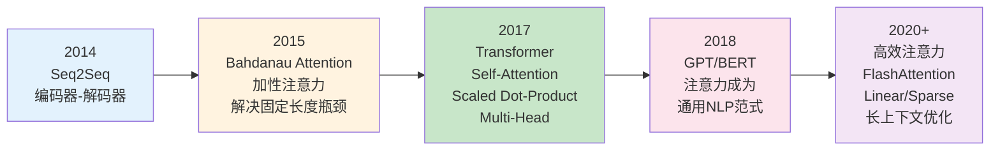
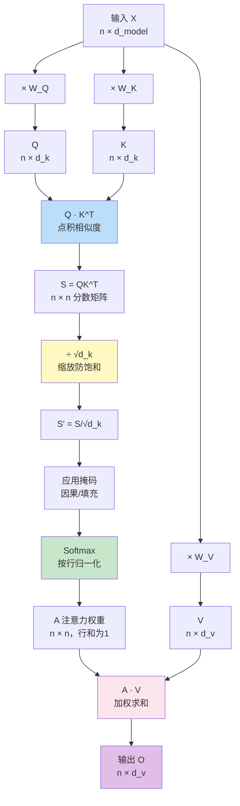

# 注意力机制详解

> **一句话定义**：注意力机制（Attention Mechanism）是一种让模型在处理每个输入元素时，动态地关注序列中其他相关元素并加权聚合信息的计算机制，核心公式为 `Attention(Q,K,V) = Softmax(Q·K^T / √d_k) · V`，是 Transformer 及现代大语言模型的核心运算单元。
>
> **核心价值**：解决了 RNN/LSTM 无法并行计算和长距离依赖衰减的根本瓶颈，实现了 O(1) 距离的任意 Token 间直接交互，是 Transformer 架构、GPT/Llama/BERT 等几乎所有现代大模型的运算基石。
>
> **适用场景**：大语言模型、文本生成、机器翻译、多模态模型（VLM）、语音识别、图像理解（ViT）、代码生成、推荐系统、几乎所有现代深度学习序列建模任务。

---

## 一、概述

### 1.1 注意力机制的演进历程

注意力机制并非 Transformer 首创，它经历了从"机器翻译中的对齐机制"到"自注意力成为通用计算范式"的完整演进：



**关键里程碑**：

| 时间 | 工作 | 贡献 | 注意力类型 |
|------|------|------|-----------|
| 2014 | Seq2Seq (Sutskever) | 编码器-解码器框架，固定长度上下文向量 | 无显式注意力 |
| 2015 | Bahdanau Attention | 首次引入注意力，动态对齐源语言和目标语言 | 加性注意力（Additive） |
| 2015 | Luong Attention | 简化注意力计算，提出全局/局部注意力 | 点积注意力（Dot-Product） |
| 2017 | Transformer (Vaswani) | 自注意力 + 多头注意力 + 缩放点积，完全摒弃RNN | Scaled Dot-Product Self-Attention |
| 2018 | GPT-1 / BERT | 证明注意力架构在生成和理解任务上的通用性 | 因果/双向自注意力 |
| 2020 | Performer / Linformer | 线性注意力，降低 O(n²) 复杂度 | 线性/低秩注意力 |
| 2022 | FlashAttention (Dao) | IO 感知的精确注意力，无近似，速度提升 2-4× | 分块精确注意力 |
| 2023 | FlashAttention-2/3 | 进一步优化，支持 H100，长上下文训练 | 分块精确注意力 v2/v3 |

### 1.2 为什么需要注意力机制

在注意力机制出现之前，序列建模面临三个根本性问题：

```mermaid
graph TB
    subgraph RNN/LSTM 时代的三大瓶颈
        R1[瓶颈1：无法并行计算<br/>时间步 t 依赖 t-1 的隐藏状态<br/>必须串行计算，GPU 利用率低<br/>训练速度慢 10-100 倍]
        R2[瓶颈2：长距离依赖衰减<br/>梯度沿时间步反向传播<br/>长序列中梯度指数级衰减<br/>文章首尾关联难以学习]
        R3[瓶颈3：固定长度信息瓶颈<br/>Seq2Seq 编码器将整个输入<br/>压缩为单一固定长度向量<br/>长输入信息丢失严重]
    end

    subgraph 注意力机制的三大突破
        B1[突破1：完全并行<br/>所有 Token 同时计算注意力<br/>无时间步依赖<br/>GPU 友好，训练快 10-100×]
        B2[突破2：O(1) 距离交互<br/>任意两个 Token 直接连接<br/>注意力权重直接计算<br/>无长距离衰减]
        B3[突破3：动态上下文<br/>每个 Token 获得专属上下文表示<br/>根据相关性动态加权聚合<br/>无信息瓶颈]
    end

    R1 --> B1
    R2 --> B2
    R3 --> B3

    style R1 fill:#ffcdd2
    style R2 fill:#ffcdd2
    style R3 fill:#ffcdd2
    style B1 fill:#c8e6c9
    style B2 fill:#c8e6c9
    style B3 fill:#c8e6c9
```

### 1.3 核心概念与术语

| 概念 | 符号 | 说明 |
|------|------|------|
| **查询（Query）** | Q | 当前 Token 的"搜索意图"，表示"我在找什么信息"，形状 `[batch, seq_len, d_k]` |
| **键（Key）** | K | 每个 Token 的"内容标签"，表示"我包含什么信息"，形状 `[batch, seq_len, d_k]` |
| **值（Value）** | V | 每个 Token 的"实际内容"，表示"我的真实信息是什么"，形状 `[batch, seq_len, d_v]` |
| **注意力分数** | scores | Q 与 K 的点积相似度，`scores = Q·K^T`，形状 `[batch, seq_len, seq_len]` |
| **缩放因子** | √d_k | 对点积分数的缩放，防止分数过大导致 Softmax 饱和，`d_k` 是 K 的维度 |
| **注意力权重** | attn_weights | Softmax 归一化后的概率分布，`attn_weights = Softmax(scores / √d_k)`，每行和为 1 |
| **注意力输出** | output | 用注意力权重加权求和 V，`output = attn_weights · V`，形状 `[batch, seq_len, d_v]` |
| **自注意力** | Self-Attention | Q/K/V 来自同一序列的注意力，用于捕获序列内部的上下文关系 |
| **交叉注意力** | Cross-Attention | Q 来自一个序列，K/V 来自另一个序列的注意力，用于 seq2seq 任务（翻译、VLM） |
| **多头注意力** | Multi-Head Attention | 将 Q/K/V 分成多个头独立计算注意力，最后拼接，多视角建模语义关系 |
| **因果掩码** | Causal Mask | 解码器中使用的下三角掩码，防止 Token 看到未来信息，保证自回归生成 |
| **填充掩码** | Padding Mask | 对序列中填充位置（padding）的掩码，防止注意力关注无效填充 Token |
| **注意力复杂度** | O(n²·d) | 标准注意力的时间和空间复杂度，n 是序列长度，d 是隐藏维度 |

> 🔍 **知识点深度解析**
>
> **作用**：注意力机制是现代深度学习的核心计算范式，让模型在处理每个输入元素时动态关注序列中其他相关元素，通过加权聚合获得上下文感知的表示，解决了 RNN 时代无法并行计算和长距离依赖衰减的根本瓶颈。
>
> **原理**：注意力的核心是"查询-键-值"（Q-K-V）三元组机制——每个 Token 通过线性变换生成 Q（查询，表示"我在找什么"）、K（键，表示"我有什么"）、V（值，表示"我的内容"）。计算 Q 与所有 K 的点积得到相似度分数，除以 √d_k 缩放后用 Softmax 归一化为注意力权重（概率分布），最后用权重加权求和 V 得到该 Token 的上下文表示。这个过程可以理解为：每个 Token 都在"查询"序列中所有其他 Token，根据相关性从其他 Token"提取"信息，从而获得丰富的上下文表示。自注意力中 Q/K/V 来自同一序列，交叉注意力中 Q 来自一个序列而 K/V 来自另一个序列。
>
> **用法要点**：① 核心公式 `Attention(Q,K,V) = Softmax(Q·K^T/√d_k)·V` 必须牢记 ② Q 和 K 的维度必须相同（d_k），V 的维度可以不同（d_v） ③ 缩放因子 √d_k 至关重要——d_k 较大时点积会很大，导致 Softmax 梯度极小（饱和），缩放后梯度更稳定 ④ 注意力权重是一个 n×n 的矩阵，空间复杂度 O(n²)，这是长上下文的主要瓶颈 ⑤ 因果掩码是下三角矩阵，位置 (i,j) 当 j>i 时被 mask（设为 -∞），保证第 i 个 Token 只能看到前 i 个 Token ⑥ 多头注意力中每个头的维度是 d_model/n_heads，最后拼接后线性变换回 d_model ⑦ 推理时使用 KV 缓存——缓存之前 Token 的 K 和 V，新 Token 只需计算与缓存 K/V 的注意力，避免重复计算 ⑧ FlashAttention 通过分块计算和重计算避免实例化完整的 n×n 注意力矩阵，在不损失精度的前提下大幅提升速度和降低显存。

---

> 💡 **深度讲解**：注意力机制的诞生源于机器翻译中一个朴素的观察——在翻译"我喜欢吃苹果"为英文时，生成"apple"这个词时，模型应该更多地关注源语言中的"苹果"，而不是"我"或"喜欢"。Bahdanau 在 2015 年首次将这个想法形式化：解码器在生成每个目标词时，不是只依赖编码器最后的固定向量，而是动态地计算与所有源语言词的"对齐分数"（注意力权重），然后加权聚合源语言的隐藏状态。这个简单的想法彻底改变了序列建模——它打破了"固定长度信息瓶颈"，让模型可以根据当前生成的内容动态地从源序列中提取相关信息。2017 年 Transformer 更进一步：既然注意力这么好用，为什么还需要 RNN？直接用注意力来做序列建模！于是自注意力（Self-Attention）诞生了——Q/K/V 都来自同一序列，每个 Token 直接与所有其他 Token 计算注意力，完全不需要循环结构。这带来了两个革命性的好处：① 完全并行——所有 Token 的注意力可以同时计算（没有时间步依赖），充分利用 GPU 并行能力；② O(1) 距离——任意两个 Token 之间都有直接的注意力连接，不存在 RNN 中梯度沿时间步衰减的问题。自注意力的数学形式非常优雅，但也有一个明显的代价：注意力权重是一个 n×n 的矩阵，时间和空间复杂度都是 O(n²)，当序列很长时（如 100K Token），这个矩阵会非常大（100K×100K = 100 亿个元素），计算和存储都非常昂贵。这催生了大量高效注意力的研究——线性注意力（用核函数近似 Softmax，将复杂度降到 O(n)）、稀疏注意力（只计算部分位置的注意力）、FlashAttention（通过分块和 IO 感知避免实例化完整矩阵，精确无近似）等。其中 FlashAttention 是目前最成功的方案，它不改变注意力的数学结果，只是通过更聪明的计算顺序（分块计算 + 重计算）来减少 GPU 显存访问，在 H100 上可以实现 2-4 倍的速度提升和显著的显存降低，已经成为现代大模型训练和推理的标准实现。理解注意力机制的数学原理、计算瓶颈和优化方案，是深入理解 Transformer 和大模型的基础。
>
> **📝 精简总结**：注意力机制通过 Q-K-V 三元组动态计算 Token 间的相关性并加权聚合信息，核心公式为 `Softmax(Q·K^T/√d_k)·V`。它解决了 RNN 无法并行和长距离衰减的问题，是 Transformer 的核心。标准注意力复杂度 O(n²)，FlashAttention 等优化通过分块计算在不损失精度的前提下大幅提升效率。

---

## 二、原理

### 2.1 缩放点积注意力的完整数学推导

缩放点积注意力（Scaled Dot-Product Attention）是 Transformer 的核心运算，下面进行完整的数学推导。

#### 2.1.1 输入与线性变换

给定输入序列的嵌入表示矩阵 $X \in \mathbb{R}^{n \times d_{\text{model}}}$，其中 $n$ 是序列长度，$d_{\text{model}}$ 是隐藏维度。通过三个可学习的线性变换矩阵生成 Q、K、V：

```text
$$
Q = X W_Q, \quad K = X W_K, \quad V = X W_V
$$
```

其中：
- $W_Q \in \mathbb{R}^{d_{\text{model}} \times d_k}$：查询投影矩阵
- $W_K \in \mathbb{R}^{d_{\text{model}} \times d_k}$：键投影矩阵
- $W_V \in \mathbb{R}^{d_{\text{model}} \times d_v}$：值投影矩阵
- 在标准 Transformer 中，$d_k = d_v = d_{\text{model}}$（多头时每个头的维度为 $d_{\text{model}}/h$）

#### 2.1.2 注意力分数计算

计算 Q 与 K 的点积，得到注意力分数矩阵：

```text
$$
S = Q K^\top \in \mathbb{R}^{n \times n}
$$
```

其中 $S_{ij} = q_i^\top k_j$ 表示第 $i$ 个 Token 的查询与第 $j$ 个 Token 的键之间的相似度。

**为什么用点积？** 点积是衡量两个向量相似度的最简单方式——当两个向量方向一致时点积大，方向相反时点积小（或负）。点积计算可以通过矩阵乘法高效实现（GPU 优化的 GEMM 运算）。

#### 2.1.3 缩放的必要性

点积的期望值和方差分析：假设 $q_i$ 和 $k_j$ 的每个分量都是独立同分布的随机变量，均值为 0，方差为 1，则：

```text
$$
\mathbb{E}[q_i^\top k_j] = \sum_{m=1}^{d_k} \mathbb{E}[q_{im} k_{jm}] = 0
```
```text
$$

$$
```
```text
\text{Var}(q_i^\top k_j) = \sum_{m=1}^{d_k} \text{Var}(q_{im} k_{jm}) = d_k
$$

因此点积的标准差为 $\sqrt{d_k}$。当 $d_k$ 较大时（如 512），点积的绝对值会很大（标准差约 22.6），这会导致 Softmax 函数进入饱和区——Softmax 的输入很大时，输出接近 one-hot 分布（一个位置接近 1，其余接近 0），此时梯度极小（接近 0），训练困难。

**缩放因子**：将点积除以 $\sqrt{d_k}$，使分数的方差回到 1：

$$
S' = \frac{Q K^\top}{\sqrt{d_k}}
$$
```

此时 $\text{Var}(S'_{ij}) = 1$，Softmax 的输入分布更合理，梯度更稳定。

<div style="background:linear-gradient(135deg,#fa709a,#fee140);border-radius:16px;padding:20px;margin:16px 0;font-family:-apple-system,'Segoe UI','PingFang SC','Microsoft YaHei',sans-serif;color:#fff;overflow:hidden;box-shadow:0 8px 28px rgba(0,0,0,.14),0 3px 10px rgba(0,0,0,.08)">
<style>@keyframes highlight{0%,100%{box-shadow:0 0 0 rgba(255,255,255,0)}50%{box-shadow:0 0 20px rgba(255,255,255,.4)}}.hl-box{background:rgba(255,255,255,.2);border-radius:10px;padding:14px 18px;margin:10px 0;animation:highlight 3s ease-in-out infinite;border-left:4px solid rgba(255,255,255,.6)}.hl-formula{font-family:monospace;font-size:16px;text-align:center;background:rgba(0,0,0,.15);border-radius:8px;padding:12px;margin:10px 0}</style>
<div style="text-align:center;font-size:15px;font-weight:700;margin-bottom:14px;padding-bottom:10px;border-bottom:1.5px solid rgba(255,255,255,.22);letter-spacing:1px;text-shadow:0 1px 3px rgba(0,0,0,.12)">📌 缩放点积注意力核心公式</div>
<div class="hl-box">缩放因子 √d_k 是 Transformer 最精妙的设计之一——它不是随意选择的，而是基于点积方差的严格数学推导。没有缩放，大维度下 Softmax 会饱和，梯度消失，模型无法训练。</div>
<div class="hl-formula">Attention(Q,K,V) = Softmax( Q·K^T / √d_k ) · V</div>
<div style="font-size:13px;opacity:.9;margin-top:8px">💡 记忆技巧：QK点积算相似度 → 除以√d_k防饱和 → Softmax归一化为权重 → 加权求和V得输出</div>
</div>

#### 2.1.4 Softmax 归一化

对缩放后的分数按行（每个 Query 对应的所有 Key）应用 Softmax：

```text
$$
A = \text{Softmax}(S') = \text{Softmax}\left(\frac{Q K^\top}{\sqrt{d_k}}\right)
$$
```

其中第 $i$ 行第 $j$ 列的元素为：

```text
$$
A_{ij} = \frac{\exp(S'_{ij})}{\sum_{m=1}^{n} \exp(S'_{im})}
```
```text
$$

$A_{ij}$ 表示第 $i$ 个 Token 对第 $j$ 个 Token 的注意力权重，满足 $\sum_{j=1}^{n} A_{ij} = 1$（每行是一个概率分布）。
```

#### 2.1.5 加权求和

最后用注意力权重加权求和 V：

```text
$$
O = A V = \text{Softmax}\left(\frac{Q K^\top}{\sqrt{d_k}}\right) V \in \mathbb{R}^{n \times d_v}
$$
```

其中第 $i$ 个 Token 的输出为：

```text
$$
o_i = \sum_{j=1}^{n} A_{ij} v_j
$$
```

即第 $i$ 个 Token 的输出是所有 Token 的值向量按注意力权重的加权和。

#### 2.1.6 完整计算流程图



### 2.2 多头注意力（Multi-Head Attention）

#### 2.2.1 为什么需要多头

单头注意力的问题：一个注意力头只能学习一种类型的关注模式。但在自然语言中，一个 Token 可能同时需要关注多种关系——语法关系（主谓宾）、语义关系（同义词）、指代关系（代词指向）、位置关系（相邻词）等。单头注意力难以同时建模这么多不同类型的关系。

多头注意力的核心思想：将 Q/K/V 分成多个头（head），每个头独立计算注意力，学习不同类型的关注模式，最后将所有头的输出拼接并线性变换。

#### 2.2.2 数学定义

给定 $h$ 个注意力头，将 Q/K/V 按最后一个维度分成 $h$ 份：

```text
$$
Q = [Q_1, Q_2, \ldots, Q_h], \quad K = [K_1, K_2, \ldots, K_h], \quad V = [V_1, V_2, \ldots, V_h]
$$
```

其中 $Q_i \in \mathbb{R}^{n \times d_k'}$，$d_k' = d_k / h$（每个头的维度）。

每个头独立计算缩放点积注意力：

$$
\text{head}_i = \text{Attention}(Q_i W_i^Q, K_i W_i^K, V_i W_i^V)
```text
$$

在实际实现中，更高效的方式是先将 Q/K/V 投影到 $d_{\text{model}}$ 维度，然后 reshape 为 $[n, h, d_k']$，再转置为 $[h, n, d_k']$ 进行批量计算。
```

拼接所有头的输出：

$$
\text{MultiHead}(Q,K,V) = \text{Concat}(\text{head}_1, \ldots, \text{head}_h) W^O
$$

其中 $W^O \in \mathbb{R}^{h \cdot d_v' \times d_{\text{model}}}$ 是输出投影矩阵。

#### 2.2.3 多头注意力的计算流程

```mermaid
graph TB
    subgraph 输入
        X[输入 X<br/>batch × n × d_model]
    end

    X --> QPROJ[Q 投影<br/>d_model → d_model]
    X --> KPROJ[K 投影<br/>d_model → d_model]
    X --> VPROJ[V 投影<br/>d_model → d_model]

    QPROJ --> QSPLIT[分割为 h 个头<br/>reshape: [b,n,h,d'] → [b,h,n,d']]
    KPROJ --> KSPLIT[分割为 h 个头]
    VPROJ --> VSPLIT[分割为 h 个头]

    subgraph h 个注意力头并行计算
        H1[头 1<br/>Attention(Q₁,K₁,V₁)]
        H2[头 2<br/>Attention(Q₂,K₂,V₂)]
        HDOT[...]
        HH[头 h<br/>Attention(Qₕ,Kₕ,Vₕ)]
    end

    QSPLIT --> H1
    KSPLIT --> H1
    VSPLIT --> H1
    QSPLIT --> H2
    KSPLIT --> H2
    VSPLIT --> H2
    QSPLIT --> HH
    KSPLIT --> HH
    VSPLIT --> HH

    H1 --> CAT[拼接 Concat<br/>[b,h,n,d'] → [b,n,h·d']]
    H2 --> CAT
    HH --> CAT
    CAT --> OPROJ[输出投影 W^O<br/>d_model → d_model]
    OPROJ --> OUT[输出<br/>batch × n × d_model]

    style H1 fill:#e3f2fd
    style H2 fill:#fff3e0
    style HH fill:#f3e5f5
    style CAT fill:#c8e6c9
    style OUT fill:#fce4ec
```

#### 2.2.4 不同头学习到的模式

研究表明（Vig 2019, "Analyzing the Structure of Attention in a Transformer"），不同的注意力头确实学习到了不同类型的关注模式：

| 头类型 | 关注模式 | 典型行为 |
|--------|---------|---------|
| **语法头** | 关注语法依赖关系 | 动词关注主语/宾语，形容词关注被修饰的名词 |
| **指代头** | 关注指代消解 | 代词（it/they）关注其指代的名词 |
| **位置头** | 关注相邻/位置关系 | 关注前一个/后一个 Token，或特定距离的 Token |
| **语义头** | 关注语义相似性 | 关注同义词、相关词、同一主题的词 |
| **分隔符头** | 关注特殊标记 | 关注 <[BOS_never_used_51bce0c785ca2f68081bfa7d91973934]>、[SEP]、句号等分隔标记 |
| **重复头** | 关注自身 | 主要关注自己（对角线注意力） |

> 🔍 **知识点深度解析**
>
> **作用**：多头注意力通过将 Q/K/V 分成多个独立的注意力头，让模型可以同时从多个视角建模 Token 间的语义关系，每个头学习不同类型的关注模式（语法、指代、语义、位置等），最后拼接融合，显著增强表达能力。
>
> **原理**：多头注意力的核心是"分而治之"——将 d_model 维度的 Q/K/V 分成 h 个头，每个头的维度是 d_model/h。每个头独立计算缩放点积注意力（Q_i·K_i^T/√d_k' → Softmax → ×V_i），学习不同的关注模式。最后将所有头的输出在特征维度上拼接（Concat），通过输出投影矩阵 W^O 线性变换回 d_model 维度。多头注意力的参数量和计算量与单头基本相同（因为每个头的维度缩小了 h 倍，总维度不变），但表达能力显著增强。
>
> **用法要点**：① 头数 h 通常是 2 的幂（8/16/32/64/128），必须能整除 d_model ② 每个头的维度 d_k' = d_model/h，常见 64/128 ③ 头数不是越多越好——太多头会导致每个头维度太小，表达能力不足；GPT-3 用 96 头（每头 128 维），Llama 用 32 头（每头 128 维）④ 实际实现中用 reshape + transpose 实现"分割"，而不是真的分割成 h 个矩阵——这样可以用一次批量矩阵乘法同时计算所有头 ⑤ 注意力可视化工具（如 BertViz）可以展示每个头的关注模式，帮助理解模型行为 ⑥ GQA（分组查询注意力）和 MQA（多查询注意力）是多头注意力的变体——减少 K/V 的头数以降低推理显存和计算量，Llama 2 70B 和 GPT-3.5 都使用了 GQA ⑦ 多头注意力中不同头的关注模式是自动学习的，不需要人工指定——训练过程中不同头会自然分化出不同的功能。

### 2.3 掩码机制（Masking）

掩码是注意力机制中的关键技术，用于控制哪些位置可以被关注。

#### 2.3.1 因果掩码（Causal Mask / Look-ahead Mask）

**用途**：解码器中的自注意力，防止 Token 看到未来的信息，保证自回归生成的正确性。

**原理**：构造一个下三角矩阵，位置 (i, j) 当 j > i 时被掩码（设为 -∞），Softmax 后这些位置的权重为 0。

```text
$$
\text{Mask}_{ij} = \begin{cases} 0 & \text{if } j \leq i \\ -\infty & \text{if } j > i \end{cases}
$$
```

对于长度为 5 的序列，因果掩码矩阵为：

```text
$$
\begin{pmatrix}
```
```text
0 & -\infty & -\infty & -\infty & -\infty \\
0 & 0 & -\infty & -\infty & -\infty \\
0 & 0 & 0 & -\infty & -\infty \\
0 & 0 & 0 & 0 & -\infty \\
```
0 & 0 & 0 & 0 & 0
\end{pmatrix}
$$

即第 1 个 Token 只能看到自己，第 2 个 Token 可以看到第 1、2 个，……，第 5 个 Token 可以看到全部 5 个。

#### 2.3.2 填充掩码（Padding Mask）

**用途**：当批次中序列长度不一致时，短序列会被填充（padding）到相同长度。填充掩码防止注意力关注这些无意义的填充 Token。

**原理**：对填充位置的 Key 对应的注意力分数设为 -∞，Softmax 后权重为 0。

#### 2.3.3 掩码的实现方式

掩码通过在 Softmax 之前将被掩码位置的分数设为 -∞（或一个极大的负数，如 -1e9）来实现：

$$
\tilde{S}_{ij} = S'_{ij} + \text{Mask}_{ij}
```text
$$

$$
A = \text{Softmax}(\tilde{S})
$$
```

当 Mask = -∞ 时，$\exp(-\infty) = 0$，对应位置的注意力权重为 0。

<div style="background:linear-gradient(135deg,#667eea,#764ba2);border-radius:16px;padding:20px;margin:16px 0;font-family:-apple-system,'Segoe UI','PingFang SC','Microsoft YaHei',sans-serif;color:#fff;overflow:hidden;box-shadow:0 8px 28px rgba(0,0,0,.14),0 3px 10px rgba(0,0,0,.08)">
<style>@keyframes pulse{0%,100%{transform:scale(1);opacity:.9}50%{transform:scale(1.03);opacity:1}}.dk-layer{border-radius:8px;padding:12px 16px;margin:6px auto;text-align:center;font-weight:600;animation:pulse 3s ease-in-out infinite}.dk-outer{background:rgba(255,255,255,.15);border:2px solid rgba(255,255,255,.5);max-width:360px;animation-delay:0s}.dk-middle{background:rgba(255,255,255,.2);border:2px solid rgba(255,255,255,.6);max-width:300px;animation-delay:.5s}.dk-inner{background:rgba(255,255,255,.25);border:2px solid rgba(255,255,255,.7);max-width:240px;animation-delay:1s}.dk-arrow{text-align:center;font-size:18px;margin:2px 0}.dk-label{font-size:12px;opacity:.85;font-weight:400;margin-top:4px}</style>
<div style="text-align:center;font-size:15px;font-weight:700;margin-bottom:14px;padding-bottom:10px;border-bottom:1.5px solid rgba(255,255,255,.22);letter-spacing:1px;text-shadow:0 1px 3px rgba(0,0,0,.12)">【因果掩码的三层可见性】</div>
<div class="dk-layer dk-outer">第 5 个 Token<div class="dk-label">可见：Token 1,2,3,4,5（全部）</div></div>
<div class="dk-arrow">▼ 逐步收窄可见范围</div>
<div class="dk-layer dk-middle">第 3 个 Token<div class="dk-label">可见：Token 1,2,3</div></div>
<div class="dk-arrow">▼ 逐步收窄可见范围</div>
<div class="dk-layer dk-inner">第 1 个 Token<div class="dk-label">可见：仅 Token 1（自己）</div></div>
</div>

### 2.4 交叉注意力（Cross-Attention）

#### 2.4.1 定义与用途

交叉注意力中，Q 来自一个序列（目标序列/解码器），K 和 V 来自另一个序列（源序列/编码器）。

```text
$$
\text{CrossAttention}(Q_{\text{dec}}, K_{\text{enc}}, V_{\text{enc}}) = \text{Softmax}\left(\frac{Q_{\text{dec}} K_{\text{enc}}^\top}{\sqrt{d_k}}\right) V_{\text{enc}}
$$
```

**典型应用场景**：
- **机器翻译**：解码器的 Q 关注编码器的 K/V，实现源语言到目标语言的对齐
- **图像描述（Image Captioning）**：文本解码器的 Q 关注图像编码器的 K/V
- **视觉语言模型（VLM）**：文本 Token 的 Q 关注图像 Patch 的 K/V，实现图文融合
- **语音识别**：文本解码器的 Q 关注语音编码器的 K/V
- **Stable Diffusion**：文本条件的 Q 关注图像特征的 K/V（实际上是反过来）

#### 2.4.2 自注意力 vs 交叉注意力

| 维度 | 自注意力（Self-Attention） | 交叉注意力（Cross-Attention） |
|------|---------------------------|-------------------------------|
| Q 来源 | 同一序列 | 序列 A（目标/解码器） |
| K/V 来源 | 同一序列 | 序列 B（源/编码器） |
| 注意力矩阵形状 | n_A × n_A | n_A × n_B |
| 用途 | 捕获序列内部上下文关系 | 捕获两个序列间的对齐/融合关系 |
| 掩码 | 因果掩码（解码器）或无（编码器） | 通常无因果掩码（可关注全部源序列） |
| 典型位置 | Transformer 编码器/解码器的自注意力层 | Transformer 解码器的编码器-解码器注意力层 |

### 2.5 注意力复杂度分析

#### 2.5.1 标准注意力的复杂度

| 操作 | 时间复杂度 | 空间复杂度 | 说明 |
|------|-----------|-----------|------|
| Q/K/V 线性投影 | O(n · d²) | O(n · d) | 三个矩阵乘法 |
| Q·K^T 点积 | O(n² · d) | O(n²) | 生成 n×n 分数矩阵 |
| Softmax | O(n²) | O(n²) | 按行归一化 |
| A·V 加权求和 | O(n² · d) | O(n · d) | 加权求和 |
| **总计** | **O(n² · d + n · d²)** | **O(n² + n · d)** | n=序列长，d=隐藏维度 |

当 n 较大时（长上下文），O(n² · d) 项主导，时间和空间复杂度都是 O(n²) 级别。

#### 2.5.2 不同序列长度的计算量估算

以 d_model = 4096、单头注意力为例：

| 序列长度 n | 注意力矩阵元素数 | 点积 FLOPs | 相对计算量 |
|-----------|----------------|------------|-----------|
| 1K | 100 万 | 40 亿 | 1× |
| 4K | 1600 万 | 640 亿 | 16× |
| 16K | 2.56 亿 | 1.024 万亿 | 256× |
| 64K | 40.96 亿 | 16.38 万亿 | 4096× |
| 128K | 163.84 亿 | 65.5 万亿 | 16384× |

可以看到，序列长度从 1K 增加到 128K（128 倍），注意力计算量增加了 16384 倍（128²），这就是 O(n²) 复杂度的代价。

#### 2.5.3 高效注意力变体对比

```mermaid
graph TB
    subgraph 标准注意力 O(n²)
        STD[Full Attention<br/>Softmax(QK^T/√d)V<br/>精确，O(n²) 时间空间]
    end

    subgraph 近似注意力 O(n) 或 O(n log n)
        LIN[Linear Attention<br/>核函数近似 Softmax<br/>O(n) 时间空间<br/>代表：Performer, Linear Transformer]
        SPA[Sparse Attention<br/>只计算部分位置<br/>O(n·k) k=稀疏度<br/>代表：Longformer, BigBird]
        LOW[Low-Rank Attention<br/>低秩分解 K/V<br/>O(n·k) k=秩<br/>代表：Linformer]
    end

    subgraph 精确优化 O(n²) 但常数更小
        FLASH[FlashAttention<br/>分块计算 + 重计算<br/>IO 感知，不实例化完整矩阵<br/>精确无近似，速度 2-4×]
        FLASH2[FlashAttention-2/3<br/>进一步优化并行和 IO<br/>H100 优化，支持 FP8]
    end

    STD --> LIN
    STD --> SPA
    STD --> LOW
    STD --> FLASH
    FLASH --> FLASH2

    style STD fill:#ffcdd2
    style LIN fill:#c8e6c9
    style SPA fill:#c8e6c9
    style LOW fill:#c8e6c9
    style FLASH fill:#bbdefb
    style FLASH2 fill:#bbdefb
```

| 方法 | 复杂度 | 精确性 | 代表模型/工作 | 适用场景 |
|------|--------|--------|-------------|---------|
| **标准注意力** | O(n²) | 精确 | 原始 Transformer | 短序列（<4K） |
| **FlashAttention** | O(n²) 时间，O(n) 空间 | 精确 | GPT-J, Llama, 几乎所有现代模型 | 通用，当前标准 |
| **线性注意力** | O(n) | 近似 | Performer, Linear Transformer | 超长序列（>100K） |
| **稀疏注意力** | O(n·k) | 精确（稀疏位置） | Longformer, BigBird | 文档级长文本 |
| **低秩注意力** | O(n·k) | 近似 | Linformer | 固定长度长序列 |
| **MQA/GQA** | O(n²) 时间，减少 KV 缓存 | 精确 | PaLM, Llama 2 70B, GPT-3.5 | 推理优化（减少 KV 缓存） |

### 2.6 FlashAttention 原理详解

FlashAttention 是目前最成功的注意力优化技术，由 Tri Dao 等人在 2022 年提出。它不改变注意力的数学结果（精确无近似），但通过 IO 感知的分块计算大幅减少 GPU 显存访问，实现 2-4 倍速度提升和显著显存降低。

#### 2.6.1 核心问题：GPU 显存层次

GPU 的计算速度远快于显存（HBM）访问速度。标准注意力需要实例化完整的 n×n 注意力矩阵（存储在 HBM 中），然后读取进行 Softmax 和加权求和。当 n 很大时，这个矩阵的读写成为瓶颈（IO 瓶颈，而非计算瓶颈）。

#### 2.6.2 FlashAttention 的核心思想

1. **分块计算（Tiling）**：将 Q、K、V 分成小块，在 SRAM（GPU 片上高速缓存）中计算每个块的注意力，避免将完整的 n×n 矩阵写入 HBM。
2. **在线 Softmax（Online Softmax）**：标准 Softmax 需要先看到所有元素才能计算（需要最大值和求和），FlashAttention 使用在线 Softmax 算法，可以逐块计算并维护运行时的最大值和归一化因子，最后合并。
3. **重计算（Recomputation）**：反向传播时不存储注意力矩阵（节省显存），而是在前向传播的输出基础上重新计算注意力权重（用计算换显存）。

#### 2.6.3 在线 Softmax 算法

标准 Softmax：$S(x) = \frac{\exp(x_i - m)}{\sum_j \exp(x_j - m)}$，其中 $m = \max_j x_j$。

在线 Softmax 逐块处理，维护两个运行时变量：
- $m$：当前看到的最大值
- $l$：当前看到的指数和（减去当前最大值后）

处理新块时更新：
$$
m' = \max(m, m_{\text{new}})
```text
$$
$$
```
l' = l \cdot \exp(m - m') + l_{\text{new}} \cdot \exp(m_{\text{new}} - m')
$$

最后输出 = 加权和 / l'。

> 🔍 **知识点深度解析**
>
> **作用**：FlashAttention 通过 IO 感知的分块计算和在线 Softmax，在不改变注意力数学结果（精确无近似）的前提下，将注意力矩阵的空间复杂度从 O(n²) 降到 O(n)，同时减少 HBM 访问，实现 2-4 倍速度提升，是现代大模型训练和推理的标准注意力实现。
>
> **原理**：FlashAttention 的核心洞察是——标准注意力的瓶颈不是计算量（FLOPs），而是 GPU 显存（HBM）访问。标准实现需要将完整的 n×n 注意力矩阵写入 HBM，再读取进行 Softmax 和加权求和，大量时间花在数据搬运上。FlashAttention 将 Q/K/V 分成小块，在 GPU 片上高速缓存（SRAM）中完成每个块的注意力计算，避免将完整矩阵写入 HBM。关键技术是在线 Softmax——标准 Softmax 需要先看到所有元素（求最大值和求和），无法分块；在线 Softmax 维护运行时的最大值和归一化因子，可以逐块计算并合并。反向传播时不存储注意力矩阵（节省 O(n²) 显存），而是通过重计算（recomputation）从输出恢复注意力权重，用少量额外计算换取大量显存。
>
> **用法要点**：① FlashAttention 是精确的——输出与标准注意力完全一致（数值误差在浮点精度范围内），不是近似 ② 使用方式：PyTorch 中 `F.scaled_dot_product_attention` 会自动选择 FlashAttention 后端（如果安装了 flash-attn），或直接 `import flash_attn` ③ FlashAttention-2 在 2023 年发布，进一步优化了并行策略和 IO，在 A100/H100 上速度更快 ④ FlashAttention-3 在 2024 年发布，针对 H100 的 FP8 和 TMA 优化，支持更长序列 ⑤ FlashAttention 不支持所有注意力模式——如任意稀疏注意力、自定义掩码模式可能不支持，需要回退到标准实现 ⑥ 显存节省主要来自不存储完整注意力矩阵——对于 32K 序列、4096 维度，标准注意力矩阵需要 32K×32K×2字节 = 2GB（FP16），FlashAttention 只需要 O(n) 的中间变量 ⑦ 训练时 FlashAttention 的重计算会增加约 15-25% 的前向计算量，但大幅减少显存和 HBM 访问，整体仍然更快 ⑧ 推理时 FlashAttention 与 KV 缓存配合使用——新 Token 的 Q 与缓存的 K/V 计算注意力，序列长度是缓存长度，FlashAttention 同样适用。

---

> 💡 **深度讲解**：注意力机制的数学原理看似简单（QK^T → Softmax → ×V），但其中每一步都有深刻的设计考量。缩放因子 √d_k 不是随意选择的——它基于点积方差的严格推导：当 Q 和 K 的分量是均值 0 方差 1 的随机变量时，d_k 维点积的方差是 d_k，除以 √d_k 后方差回到 1，避免 Softmax 进入饱和区（梯度消失）。多头注意力的设计也很精妙——它的参数量和计算量与单头基本相同（因为每个头的维度缩小了 h 倍），但通过让不同头学习不同的关注模式（语法、指代、语义、位置等），表达能力显著增强。这是一种"用相同的计算量换取更强表达能力"的设计。掩码机制是注意力在生成任务中正确工作的关键——因果掩码是一个下三角矩阵，确保第 i 个 Token 只能看到前 i 个 Token，这是自回归生成的基础。如果没有因果掩码，模型在训练时会"看到答案"（未来的 Token），导致训练和推理不一致（训练时可以看到全部，推理时只能看到之前的）。交叉注意力则是连接两个不同模态/序列的桥梁——Q 来自一个序列，K/V 来自另一个序列，实现两个序列间的信息对齐和融合。在 VLM（视觉语言模型）中，文本 Token 的 Q 关注图像 Patch 的 K/V，让文本理解图像内容；在机器翻译中，目标语言的 Q 关注源语言的 K/V，实现翻译对齐。注意力的 O(n²) 复杂度是长上下文的主要瓶颈——当序列长度从 1K 增加到 128K 时，计算量增加 16384 倍。FlashAttention 通过 IO 感知的分块计算巧妙地解决了这个问题——它不改变数学结果（精确无近似），但通过在 GPU 片上 SRAM 中分块计算、使用在线 Softmax 避免实例化完整矩阵、反向传播时重计算而非存储注意力矩阵，将空间复杂度从 O(n²) 降到 O(n)，同时减少 HBM 访问，实现 2-4 倍速度提升。FlashAttention 的成功说明——在深度学习系统优化中，IO 优化往往比算法优化（减少 FLOPs）更重要，因为现代 GPU 的计算速度远快于显存访问速度，瓶颈通常在数据搬运而非计算。理解注意力的完整数学推导、多头机制、掩码、交叉注意力、复杂度分析和 FlashAttention 优化，是深入理解 Transformer 和大模型的基础。
>
> **📝 精简总结**：缩放点积注意力的核心是 `Softmax(QK^T/√d_k)V`，缩放因子防止 Softmax 饱和。多头注意力用相同计算量换取多视角建模能力。因果掩码保证自回归生成的正确性。交叉注意力连接两个序列。标准注意力 O(n²) 复杂度，FlashAttention 通过分块计算和在线 Softmax 在精确无近似的前提下大幅提升效率。

---

## 三、实操

### 3.1 环境搭建

```python
# 创建虚拟环境
python -m venv .venv
source .venv/bin/activate  # Windows: .venv\Scripts\activate

# 安装 PyTorch（选择对应 CUDA 版本）
pip install torch torchvision --index-url https://download.pytorch.org/whl/cu121

# 安装可视化和工具库
pip install matplotlib numpy seaborn

# 安装 FlashAttention（可选，需要 CUDA 环境，编译较慢）
pip install flash-attn --no-build-isolation

# 验证安装
python -c "import torch; print(f'PyTorch {torch.__version__}, CUDA: {torch.cuda.is_available()}')"
```

### 3.2 从零实现缩放点积注意力

```python
import torch
import torch.nn as nn
import torch.nn.functional as F
import math


class ScaledDotProductAttention(nn.Module):
    """
    缩放点积注意力的完整实现
    公式: Attention(Q, K, V) = Softmax(Q · K^T / √d_k) · V
    """

    def __init__(self, dropout: float = 0.0):
        super().__init__()
        self.dropout = nn.Dropout(dropout)

    def forward(
        self,
        q: torch.Tensor,       # [batch, n_heads, seq_len_q, d_k]
        k: torch.Tensor,       # [batch, n_heads, seq_len_k, d_k]
        v: torch.Tensor,       # [batch, n_heads, seq_len_v, d_v]
        mask: torch.Tensor = None,  # [batch, 1, seq_len_q, seq_len_k] 或可广播形状
        return_attn: bool = False,
    ):
        d_k = q.size(-1)

        # 步骤1: 计算 Q · K^T，得到注意力分数
        # [batch, n_heads, seq_q, d_k] × [batch, n_heads, d_k, seq_k]
        # → [batch, n_heads, seq_q, seq_k]
        scores = torch.matmul(q, k.transpose(-2, -1))

        # 步骤2: 缩放，除以 √d_k，防止 Softmax 饱和
        scores = scores / math.sqrt(d_k)

        # 步骤3: 应用掩码（因果掩码/填充掩码）
        # 被掩码位置设为 -inf，Softmax 后权重为 0
        if mask is not None:
            scores = scores.masked_fill(mask == 0, float('-inf'))

        # 步骤4: Softmax 归一化，得到注意力权重
        attn_weights = F.softmax(scores, dim=-1)

        # 步骤5: Dropout（训练时）
        attn_weights = self.dropout(attn_weights)

        # 步骤6: 用注意力权重加权求和 V
        # [batch, n_heads, seq_q, seq_k] × [batch, n_heads, seq_v, d_v]
        # → [batch, n_heads, seq_q, d_v]
        output = torch.matmul(attn_weights, v)

        if return_attn:
            return output, attn_weights
        return output


# ============ 测试 ============
if __name__ == "__main__":
    torch.manual_seed(42)

    batch_size = 2
    n_heads = 4
    seq_len = 10
    d_k = 64
    d_v = 64

    # 随机生成 Q, K, V
    q = torch.randn(batch_size, n_heads, seq_len, d_k)
    k = torch.randn(batch_size, n_heads, seq_len, d_k)
    v = torch.randn(batch_size, n_heads, seq_len, d_v)

    # 创建因果掩码（下三角矩阵）
    causal_mask = torch.tril(torch.ones(seq_len, seq_len)).unsqueeze(0).unsqueeze(0)
    # [1, 1, seq_len, seq_len]

    attention = ScaledDotProductAttention(dropout=0.0)
    output, attn_weights = attention(q, k, v, mask=causal_mask, return_attn=True)

    print(f"输入 Q 形状: {q.shape}")
    print(f"输入 K 形状: {k.shape}")
    print(f"输入 V 形状: {v.shape}")
    print(f"输出形状: {output.shape}")
    print(f"注意力权重形状: {attn_weights.shape}")
    print(f"注意力权重行和（应为1）: {attn_weights[0, 0, 5].sum().item():.6f}")
    print(f"因果掩码验证（第0行应只有第0列非零）: {attn_weights[0, 0, 0]}")
```

### 3.3 完整的多头注意力实现

```python
class MultiHeadAttention(nn.Module):
    """
    完整的多头注意力实现
    包含 Q/K/V 投影、多头分割、注意力计算、输出投影
    """

    def __init__(
        self,
        d_model: int,       # 模型隐藏维度
        n_heads: int,       # 注意力头数
        dropout: float = 0.1,
        bias: bool = True,
    ):
        super().__init__()
        assert d_model % n_heads == 0, "d_model 必须能被 n_heads 整除"

        self.d_model = d_model
        self.n_heads = n_heads
        self.d_k = d_model // n_heads  # 每个头的维度

        # Q/K/V 投影矩阵（合并为一个矩阵提高效率）
        self.q_proj = nn.Linear(d_model, d_model, bias=bias)
        self.k_proj = nn.Linear(d_model, d_model, bias=bias)
        self.v_proj = nn.Linear(d_model, d_model, bias=bias)

        # 输出投影
        self.o_proj = nn.Linear(d_model, d_model, bias=bias)

        # 注意力计算
        self.attention = ScaledDotProductAttention(dropout=dropout)

        self.dropout = nn.Dropout(dropout)

    def forward(
        self,
        x: torch.Tensor,          # [batch, seq_len, d_model]
        mask: torch.Tensor = None, # 注意力掩码
        return_attn: bool = False,
    ):
        batch_size, seq_len, _ = x.shape

        # 步骤1: Q/K/V 投影
        q = self.q_proj(x)  # [batch, seq_len, d_model]
        k = self.k_proj(x)
        v = self.v_proj(x)

        # 步骤2: 分割为多个头
        # [batch, seq_len, d_model] → [batch, seq_len, n_heads, d_k]
        # → [batch, n_heads, seq_len, d_k]
        q = q.view(batch_size, seq_len, self.n_heads, self.d_k).transpose(1, 2)
        k = k.view(batch_size, seq_len, self.n_heads, self.d_k).transpose(1, 2)
        v = v.view(batch_size, seq_len, self.n_heads, self.d_k).transpose(1, 2)

        # 步骤3: 计算多头注意力
        if return_attn:
            output, attn_weights = self.attention(q, k, v, mask=mask, return_attn=True)
        else:
            output = self.attention(q, k, v, mask=mask)

        # 步骤4: 拼接所有头
        # [batch, n_heads, seq_len, d_k] → [batch, seq_len, n_heads, d_k]
        # → [batch, seq_len, d_model]
        output = output.transpose(1, 2).contiguous().view(batch_size, seq_len, self.d_model)

        # 步骤5: 输出投影 + Dropout
        output = self.o_proj(output)
        output = self.dropout(output)

        if return_attn:
            return output, attn_weights
        return output


# ============ 测试多头注意力 ============
if __name__ == "__main__":
    torch.manual_seed(42)

    d_model = 512
    n_heads = 8
    batch_size = 4
    seq_len = 20

    mha = MultiHeadAttention(d_model=d_model, n_heads=n_heads, dropout=0.0)
    x = torch.randn(batch_size, seq_len, d_model)

    # 因果掩码
    causal_mask = torch.tril(torch.ones(seq_len, seq_len)).unsqueeze(0).unsqueeze(0)

    output, attn = mha(x, mask=causal_mask, return_attn=True)

    print(f"输入形状: {x.shape}")
    print(f"输出形状: {output.shape}")
    print(f"注意力权重形状: {attn.shape}")
    print(f"参数量: {sum(p.numel() for p in mha.parameters()):,}")

    # 验证输出维度不变（残差连接需要）
    assert output.shape == x.shape, "输出形状应与输入相同"
    print("✅ 形状验证通过")
```

### 3.4 交叉注意力实现

```python
class CrossAttention(nn.Module):
    """
    交叉注意力：Q 来自一个序列，K/V 来自另一个序列
    用于 seq2seq 任务、VLM 图文融合等
    """

    def __init__(self, d_model: int, n_heads: int, dropout: float = 0.1):
        super().__init__()
        self.n_heads = n_heads
        self.d_k = d_model // n_heads

        # Q 来自目标序列（解码器）
        self.q_proj = nn.Linear(d_model, d_model)
        # K/V 来自源序列（编码器）
        self.k_proj = nn.Linear(d_model, d_model)
        self.v_proj = nn.Linear(d_model, d_model)
        self.o_proj = nn.Linear(d_model, d_model)

        self.attention = ScaledDotProductAttention(dropout=dropout)

    def forward(
        self,
        x_q: torch.Tensor,    # Q 来源序列 [batch, seq_q, d_model]
        x_kv: torch.Tensor,   # K/V 来源序列 [batch, seq_kv, d_model]
        mask: torch.Tensor = None,
    ):
        batch_size = x_q.size(0)
        seq_q = x_q.size(1)
        seq_kv = x_kv.size(1)

        # Q 投影（来自目标序列）
        q = self.q_proj(x_q).view(batch_size, seq_q, self.n_heads, self.d_k).transpose(1, 2)
        # K/V 投影（来自源序列）
        k = self.k_proj(x_kv).view(batch_size, seq_kv, self.n_heads, self.d_k).transpose(1, 2)
        v = self.v_proj(x_kv).view(batch_size, seq_kv, self.n_heads, self.d_k).transpose(1, 2)

        # 交叉注意力计算
        output = self.attention(q, k, v, mask=mask)

        # 拼接 + 输出投影
        output = output.transpose(1, 2).contiguous().view(batch_size, seq_q, -1)
        output = self.o_proj(output)
        return output


# ============ 测试交叉注意力（模拟 VLM 图文融合） ============
if __name__ == "__main__":
    torch.manual_seed(42)

    d_model = 768
    n_heads = 12

    cross_attn = CrossAttention(d_model=d_model, n_heads=n_heads)

    # 模拟：文本 Token（Q 来源）关注图像 Patch（K/V 来源）
    text_tokens = torch.randn(2, 32, d_model)    # 2 个样本，32 个文本 Token
    image_patches = torch.randn(2, 196, d_model)  # 2 个样本，196 个图像 Patch（14×14）

    output = cross_attn(text_tokens, image_patches)
    print(f"文本 Token 形状: {text_tokens.shape}")
    print(f"图像 Patch 形状: {image_patches.shape}")
    print(f"交叉注意力输出形状: {output.shape}")
    print(f"✅ 文本 Token 融合了图像信息，输出形状与文本序列一致")
```

### 3.5 使用 PyTorch 内置 SDPA 和 FlashAttention

```python
import torch
import torch.nn.functional as F


def attention_with_flash(
    q: torch.Tensor,  # [batch, n_heads, seq_q, d_k]
    k: torch.Tensor,  # [batch, n_heads, seq_k, d_k]
    v: torch.Tensor,  # [batch, n_heads, seq_v, d_v]
    is_causal: bool = True,
    dropout_p: float = 0.0,
) -> torch.Tensor:
    """
    使用 PyTorch 内置的 scaled_dot_product_attention
    自动选择最优后端：FlashAttention > MemoryEfficient > Math
    """
    # PyTorch 2.0+ 的 SDPA 会自动选择最快的后端
    # 如果安装了 flash-attn，会优先使用 FlashAttention
    output = F.scaled_dot_product_attention(
        q, k, v,
        attn_mask=None,           # 自定义掩码（与 is_causal 互斥）
        dropout_p=dropout_p,      # Dropout 概率
        is_causal=is_causal,      # 自动应用因果掩码
        scale=None,               # 默认 1/√d_k
    )
    return output


# 查看可用的注意力后端
def check_attention_backends():
    print("PyTorch SDPA 可用后端：")
    print(f"  FlashAttention:      {torch.backends.cuda.flash_sdp_enabled()}")
    print(f"  Memory Efficient:    {torch.backends.cuda.mem_efficient_sdp_enabled()}")
    print(f"  Math (标准实现):     {torch.backends.cuda.math_sdp_enabled()}")

    # 可以手动启用/禁用后端
    # torch.backends.cuda.enable_flash_sdp(True)
    # torch.backends.cuda.enable_mem_efficient_sdp(True)


if __name__ == "__main__":
    check_attention_backends()

    # 测试 SDPA
    if torch.cuda.is_available():
        device = "cuda"
        q = torch.randn(1, 32, 4096, 128, device=device, dtype=torch.float16)
        k = torch.randn(1, 32, 4096, 128, device=device, dtype=torch.float16)
        v = torch.randn(1, 32, 4096, 128, device=device, dtype=torch.float16)

        # 预热
        for _ in range(3):
            _ = attention_with_flash(q, k, v, is_causal=True)

        # 计时
        torch.cuda.synchronize()
        import time
        start = time.time()
        for _ in range(10):
            output = attention_with_flash(q, k, v, is_causal=True)
        torch.cuda.synchronize()
        elapsed = (time.time() - start) / 10

        print(f"\n4096 序列长度，32 头，128 维/头，FP16")
        print(f"平均耗时: {elapsed*1000:.2f} ms")
        print(f"输出形状: {output.shape}")
    else:
        print("CUDA 不可用，跳过性能测试")
        q = torch.randn(1, 8, 128, 64)
        k = torch.randn(1, 8, 128, 64)
        v = torch.randn(1, 8, 128, 64)
        output = attention_with_flash(q, k, v, is_causal=True)
        print(f"输出形状: {output.shape}")
```

### 3.6 注意力权重可视化

```python
import matplotlib.pyplot as plt
import numpy as np
import seaborn as sns


def visualize_attention_weights(
    attn_weights: np.ndarray,  # [n_heads, seq_len, seq_len]
    tokens: list = None,       # Token 列表
    n_heads_to_show: int = 4,
    title: str = "Attention Weights Visualization",
    save_path: str = None,
):
    """
    可视化多头注意力权重热力图
    """
    n_heads = attn_weights.shape[0]
    n_show = min(n_heads_to_show, n_heads)

    fig, axes = plt.subplots(1, n_show, figsize=(5 * n_show, 5))
    if n_show == 1:
        axes = [axes]

    for i, ax in enumerate(axes):
        sns.heatmap(
            attn_weights[i],
            ax=ax,
            cmap="YlOrRd",
            cbar=True,
            xticklabels=tokens if tokens else "auto",
            yticklabels=tokens if tokens else "auto",
            vmin=0,
            vmax=1,
        )
        ax.set_title(f"Head {i+1}", fontsize=14, fontweight="bold")
        ax.set_xlabel("Key (被关注)", fontsize=11)
        ax.set_ylabel("Query (关注者)", fontsize=11)
        if tokens:
            ax.tick_params(axis="x", rotation=45, labelsize=8)
            ax.tick_params(axis="y", rotation=0, labelsize=8)

    plt.suptitle(title, fontsize=16, fontweight="bold", y=1.02)
    plt.tight_layout()

    if save_path:
        plt.savefig(save_path, dpi=150, bbox_inches="tight")
        print(f"已保存到: {save_path}")
    plt.show()


# ============ 可视化示例 ============
if __name__ == "__main__":
    # 模拟一个句子的注意力权重
    sentence = ["The", "cat", "sat", "on", "the", "mat", "and", "looked", "at", "me"]
    seq_len = len(sentence)
    n_heads = 4

    # 构造有意义的注意力模式（模拟）
    np.random.seed(42)
    attn = np.random.dirichlet(np.ones(seq_len), size=(n_heads, seq_len))

    # 头1：模拟语法头（动词关注主语）
    attn[0, 2, :] = 0  # "sat"
    attn[0, 2, 1] = 0.7  # 关注 "cat"（主语）
    attn[0, 2, 2] = 0.3
    attn[0] = attn[0] / attn[0].sum(axis=-1, keepdims=True)

    # 头2：模拟指代头
    attn[1, 9, :] = 0  # "me"
    attn[1, 9, 0] = 0.5  # 关注 "The"
    attn[1, 9, 9] = 0.5
    attn[1] = attn[1] / attn[1].sum(axis=-1, keepdims=True)

    visualize_attention_weights(
        attn,
        tokens=sentence,
        n_heads_to_show=4,
        title="多头注意力权重可视化（模拟）",
    )
```

### 3.7 完整 Transformer Block 中的注意力

```python
class TransformerBlock(nn.Module):
    """
    完整的 Transformer 解码器 Block
    包含：因果掩码多头自注意力 + 残差 + RMSNorm + FFN + 残差 + RMSNorm
    """

    def __init__(
        self,
        d_model: int = 4096,
        n_heads: int = 32,
        n_kv_heads: int = None,  # GQA：K/V 头数，None 表示与 Q 头数相同
        d_ff: int = None,        # FFN 中间维度，默认 4×d_model
        dropout: float = 0.1,
        norm_eps: float = 1e-5,
    ):
        super().__init__()
        self.d_model = d_model
        self.n_heads = n_heads
        self.n_kv_heads = n_kv_heads or n_heads
        self.d_k = d_model // n_heads
        d_ff = d_ff or 4 * d_model

        # 预归一化（Pre-LN）：现代 LLM 的标准
        self.input_layernorm = nn.RMSNorm(d_model, eps=norm_eps)

        # 自注意力（支持 GQA）
        self.q_proj = nn.Linear(d_model, n_heads * self.d_k, bias=False)
        self.k_proj = nn.Linear(d_model, self.n_kv_heads * self.d_k, bias=False)
        self.v_proj = nn.Linear(d_model, self.n_kv_heads * self.d_k, bias=False)
        self.o_proj = nn.Linear(n_heads * self.d_k, d_model, bias=False)

        # 后注意力归一化
        self.post_attention_layernorm = nn.RMSNorm(d_model, eps=norm_eps)

        # FFN（SwiGLU 激活，现代 LLM 标准）
        self.gate_proj = nn.Linear(d_model, d_ff, bias=False)
        self.up_proj = nn.Linear(d_model, d_ff, bias=False)
        self.down_proj = nn.Linear(d_ff, d_model, bias=False)

        self.dropout = nn.Dropout(dropout)

    def forward(
        self,
        x: torch.Tensor,
        attention_mask: torch.Tensor = None,
        position_ids: torch.Tensor = None,
    ):
        batch_size, seq_len, _ = x.shape

        # ===== 自注意力子层 =====
        residual = x
        x = self.input_layernorm(x)

        # Q/K/V 投影
        q = self.q_proj(x).view(batch_size, seq_len, self.n_heads, self.d_k).transpose(1, 2)
        k = self.k_proj(x).view(batch_size, seq_len, self.n_kv_heads, self.d_k).transpose(1, 2)
        v = self.v_proj(x).view(batch_size, seq_len, self.n_kv_heads, self.d_k).transpose(1, 2)

        # GQA：重复 K/V 头以匹配 Q 头数
        if self.n_kv_heads != self.n_heads:
            repeat = self.n_heads // self.n_kv_heads
            k = k.repeat_interleave(repeat, dim=1)
            v = v.repeat_interleave(repeat, dim=1)

        # 使用 PyTorch SDPA（自动选择 FlashAttention）
        attn_output = F.scaled_dot_product_attention(
            q, k, v,
            attn_mask=attention_mask,
            is_causal=(attention_mask is None),
            dropout_p=self.dropout.p if self.training else 0.0,
        )

        # 拼接 + 输出投影
        attn_output = attn_output.transpose(1, 2).contiguous().view(batch_size, seq_len, -1)
        attn_output = self.o_proj(attn_output)
        attn_output = self.dropout(attn_output)

        # 残差连接
        x = residual + attn_output

        # ===== FFN 子层 =====
        residual = x
        x = self.post_attention_layernorm(x)

        # SwiGLU: down_proj(SiLU(gate_proj(x)) * up_proj(x))
        gate = F.silu(self.gate_proj(x))
        up = self.up_proj(x)
        x = self.down_proj(gate * up)
        x = self.dropout(x)

        # 残差连接
        x = residual + x

        return x


# ============ 测试 Transformer Block ============
if __name__ == "__main__":
    torch.manual_seed(42)

    # Llama 风格的配置
    block = TransformerBlock(
        d_model=4096,
        n_heads=32,
        n_kv_heads=8,   # GQA：8 个 KV 头，32 个 Q 头
        d_ff=11008,     # Llama 的 FFN 维度
        dropout=0.0,
    )

    x = torch.randn(1, 128, 4096)
    output = block(x)

    print(f"输入形状: {x.shape}")
    print(f"输出形状: {output.shape}")
    print(f"Block 参数量: {sum(p.numel() for p in block.parameters()):,}")
    print(f"  - 注意力参数量: {sum(p.numel() for n,p in block.named_parameters() if 'proj' in n and 'gate' not in n and 'up' not in n and 'down' not in n):,}")
    print(f"  - FFN 参数量: {sum(p.numel() for n,p in block.named_parameters() if any(k in n for k in ['gate','up','down'])):,}")
    print("✅ Transformer Block 前向传播成功")
```

---

> 💡 **深度讲解**：从零实现注意力机制是理解其工作原理的最佳方式。核心实现只有六步：Q·K^T 点积 → ÷√d_k 缩放 → 应用掩码 → Softmax 归一化 → Dropout → ×V 加权求和。其中最容易出错的是维度变换——多头注意力需要将 [batch, seq_len, d_model] reshape 为 [batch, n_heads, seq_len, d_k]，计算完注意力后再 transpose 回来并 contiguous（确保内存连续）再 view 回 [batch, seq_len, d_model]。忘记 contiguous 会导致运行时错误或性能下降。因果掩码的实现也很简单——用 `torch.tril(torch.ones(n, n))` 生成下三角矩阵，然后用 `masked_fill(mask == 0, float('-inf'))` 将上三角位置设为 -∞。注意在 FP16/BF16 下不要用 `float('-inf')`（可能溢出），应该用一个很大的负数如 `-1e9` 或 `torch.finfo(dtype).min`。交叉注意力的实现与自注意力几乎相同，唯一区别是 Q 来自一个序列而 K/V 来自另一个序列——这意味着注意力矩阵的形状是 [seq_q, seq_kv] 而非 [seq_q, seq_q]。在 VLM 中，文本 Token（Q）关注图像 Patch（K/V），实现图文融合。实际项目中不需要自己实现注意力——PyTorch 2.0+ 的 `F.scaled_dot_product_attention` 会自动选择最优后端（FlashAttention > MemoryEfficient > Math），在支持的硬件上自动使用 FlashAttention，比手动实现快 2-4 倍且更省显存。但理解手动实现对于调试、自定义注意力变体（如线性注意力、稀疏注意力）和面试都很重要。完整的 Transformer Block 中，注意力只是其中一个子层——还包括预归一化（RMSNorm）、残差连接、FFN（SwiGLU 激活）。现代 LLM 普遍使用 Pre-LN（归一化在子层之前）而非原始 Transformer 的 Post-LN，因为 Pre-LN 训练更稳定，不需要学习率 warmup。GQA（分组查询注意力）是另一个重要优化——减少 K/V 的头数（如 32 个 Q 头只用 8 个 KV 头），大幅减少推理时的 KV 缓存显存，而对性能影响很小。Llama 2 70B、GPT-3.5、Mistral 等都使用了 GQA。
>
> **📝 精简总结**：注意力实现六步：QK^T → ÷√d_k → 掩码 → Softmax → Dropout → ×V。多头注意力通过 reshape/transpose 实现头部分割。交叉注意力 Q 与 K/V 来源不同。实际项目用 PyTorch SDPA 自动选择 FlashAttention。完整 Transformer Block 包含 Pre-LN + 注意力 + 残差 + FFN(SwiGLU) + 残差。

---

## 四、问题

### 4.1 常见错误与排查方案

| 问题 | 原因 | 解决方案 |
|------|------|---------|
| **注意力权重全是 one-hot** | d_k 较大时未缩放，点积值过大导致 Softmax 饱和 | 确保除以 √d_k；检查 Q/K 的初始化是否合理 |
| **训练时 loss 不下降** | 因果掩码错误，模型看到了未来 Token（训练-推理不一致） | 检查掩码是否为下三角矩阵；验证 `masked_fill` 的位置是否正确 |
| **输出包含 NaN** | 掩码使用了 `float('-inf')`，在 FP16 下溢出；或全被掩码的行 Softmax 输出 NaN | 使用 `torch.finfo(dtype).min` 代替 `-inf`；确保每行至少有一个未被掩码的位置 |
| **维度不匹配错误** | Q 和 K 的 d_k 不同；或多头 reshape 时维度计算错误 | 确保 `d_model % n_heads == 0`；打印每一步的 shape 进行调试 |
| **显存不足（OOM）** | 长序列时 n×n 注意力矩阵占用大量显存；或未使用 FlashAttention | 使用 FlashAttention（`F.scaled_dot_product_attention`）；梯度检查点；降低 batch size；使用序列并行 |
| **推理速度慢** | 未使用 KV 缓存，每次都重新计算全部 Token 的注意力 | 实现 KV 缓存：缓存之前 Token 的 K/V，新 Token 只计算与缓存的注意力 |
| **多头注意力效果不如单头** | 头数过多导致每个头维度太小，表达能力不足；或头数不能整除 d_model | 选择合适的头数（通常 d_k=64 或 128）；确保 d_model 能被 n_heads 整除 |
| **FlashAttention 不生效** | 未安装 flash-attn；或使用了不支持的掩码模式/数据类型 | 安装 `flash-attn`；使用 `is_causal=True` 而非自定义掩码；使用 FP16/BF16 |
| **注意力可视化全是均匀分布** | 模型未训练好，注意力权重接近均匀；或可视化了错误的层/头 | 确保模型已收敛；选择合适的层（中间层注意力模式更明显）和头 |
| **交叉注意力输出形状错误** | Q 和 K/V 的 batch_size 不同；或 seq 维度混淆 | 确保 Q 和 K/V 的 batch_size 相同；注意输出形状是 [batch, seq_q, d_model] |

### 4.2 性能瓶颈与优化策略

| 瓶颈 | 分析 | 优化策略 | 预期提升 |
|------|------|---------|---------|
| **注意力计算 O(n²)** | 长序列时 n×n 矩阵计算和存储成为瓶颈 | FlashAttention（分块计算）；线性注意力（近似）；稀疏注意力 | 速度 2-4×，显存大幅降低 |
| **KV 缓存显存** | 推理时缓存所有 Token 的 K/V，长上下文显存占用大 | GQA/MQA（减少 KV 头数）；PagedAttention（分页管理 KV 缓存）；量化 KV 缓存（FP8/INT4） | 显存降低 2-8× |
| **自回归解码慢** | 每次只能生成一个 Token，无法批量计算 | 投机解码（Speculative Decoding）；连续批处理（Continuous Batching）；Medusa 多头 | 吞吐量 2-3× |
| **数据类型精度** | FP32 计算慢且显存占用大 | FP16/BF16 混合精度训练；FP8 推理（H100）；INT4/INT8 量化 | 速度 2×，显存减半 |
| **长上下文训练** | 完整序列注意力计算量巨大 | 序列并行（Sequence Parallelism）；环注意力（Ring Attention）；上下文并行 | 支持更长序列训练 |

### 4.3 注意力相关的安全与对齐问题

| 问题 | 说明 | 防护措施 |
|------|------|---------|
| **注意力泄露隐私** | 注意力权重可能揭示训练数据中的敏感信息（成员推理攻击） | 差分隐私训练；注意力权重不对外暴露；定期清理缓存 |
| **提示注入通过注意力传播** | 恶意指令通过注意力机制在上下文中传播，影响模型输出 | 输入过滤；系统提示与用户输入隔离；注意力掩码隔离 |
| **长上下文注意力稀释** | 上下文过长时，关键信息的注意力权重被稀释（"中间迷失"现象） | 重要信息放在开头或结尾；使用信息检索增强（RAG）；注意力重加权 |

---

> 💡 **深度讲解**：注意力机制在实际使用中最常见的问题是训练不稳定和显存不足。训练不稳定通常与掩码错误有关——如果因果掩码不正确，模型在训练时会看到未来的 Token，导致训练时 loss 很低但推理时效果很差（训练-推理不一致）。调试掩码的一个简单方法是打印注意力权重矩阵，验证它是否是下三角的（第 i 行只有前 i 列非零）。另一个常见问题是 NaN——在 FP16 下使用 `float('-inf')` 作为掩码值会导致溢出，应该用 `torch.finfo(dtype).min`（FP16 下是 -65504）。显存不足是长上下文场景下的核心问题——标准注意力需要实例化 n×n 的矩阵，对于 32K 序列、FP16，这个矩阵就需要 2GB 显存。FlashAttention 通过分块计算避免了这个问题，它在 GPU 片上 SRAM 中计算每个块，不将完整矩阵写入 HBM，空间复杂度从 O(n²) 降到 O(n)。PyTorch 2.0+ 的 `F.scaled_dot_product_attention` 会自动选择 FlashAttention 后端，不需要手动安装 flash-attn（虽然安装后效果更好）。推理时的 KV 缓存是另一个显存大户——每个 Token 的 K/V 都需要缓存，对于 70B 模型、32K 上下文，KV 缓存可能需要几十 GB 显存。GQA（分组查询注意力）通过减少 K/V 的头数（如 32 个 Q 头只用 8 个 KV 头）可以将 KV 缓存减少 4 倍，而对模型性能影响很小。PagedAttention（vLLM 提出）则通过分页管理 KV 缓存（类似 OS 的虚拟内存），减少内部碎片，进一步提高显存利用率。理解这些优化技术对于部署大模型至关重要。
>
> **📝 精简总结**：常见问题包括掩码错误导致训练-推理不一致、FP16 下 -inf 溢出导致 NaN、长序列显存不足。优化策略：FlashAttention 降低注意力显存、GQA 减少 KV 缓存、PagedAttention 提高显存利用率、FP16/FP8 降低计算和显存。

---

## 五、拓展

### 5.1 注意力机制的前沿变体

#### 5.1.1 线性注意力（Linear Attention）

用核函数 $\phi$ 近似 Softmax，将复杂度从 O(n²) 降到 O(n)：

```text
$$
\text{LinearAttention}(Q,K,V) = \frac{\phi(Q)(\phi(K)^\top V)}{\phi(Q)(\phi(K)^\top \mathbf{1})}
$$
```

代表工作：Performer（随机傅里叶特征核）、Linear Transformer（ELU+1 核）。

#### 5.1.2 稀疏注意力（Sparse Attention）

只计算部分位置的注意力，将复杂度降到 O(n·k)：
- **局部窗口注意力**：每个 Token 只关注前后 w 个 Token（Longformer）
- **全局+局部注意力**：部分 Token 可以全局关注，其余只局部关注（BigBird）
- **扩张注意力**：类似膨胀卷积，关注间隔位置的 Token

#### 5.1.3 MQA / GQA

- **MQA（Multi-Query Attention）**：所有 Q 头共享同一组 K/V，KV 缓存最小
- **GQA（Grouped-Query Attention）**：Q 头分成若干组，每组共享一组 K/V，在性能和效率间平衡

#### 5.1.4 滑动窗口注意力（Sliding Window Attention）

Mistral 模型使用，每个 Token 只关注前 W 个 Token（W=4096），结合滚动缓存（Rolling Buffer）实现高效的长上下文处理。

### 5.2 注意力机制在其他领域的应用

| 领域 | 应用方式 | 代表工作 |
|------|---------|---------|
| **计算机视觉** | 将图像分成 Patch，用自注意力建模 Patch 间关系 | ViT、Swin Transformer、DETR |
| **语音处理** | 语音帧的自注意力建模时序关系；交叉注意力对齐语音和文本 | Whisper、Conformer、S2T |
| **多模态** | 文本 Q 关注图像 K/V（交叉注意力），实现图文融合 | CLIP、BLIP、LLaVA、GPT-4V |
| **推荐系统** | 用户行为序列的自注意力建模兴趣演化 | SASRec、BERT4Rec |
| **蛋白质结构** | 氨基酸序列的自注意力建模空间结构 | AlphaFold2（Evoformer） |
| **代码生成** | 代码 Token 的自注意力建模语法和语义依赖 | CodeLlama、StarCoder |

### 5.3 学习资源与延伸阅读

| 资源 | 类型 | 说明 | 适用人群 |
|------|------|------|---------|
| **Attention is All You Need** (Vaswani et al., 2017) | 论文 | Transformer 原始论文，注意力机制的奠基之作 | 所有人 |
| **FlashAttention** (Dao et al., 2022) | 论文 | IO 感知的精确注意力优化，现代标准实现 | 高级/系统优化 |
| **FlashAttention-2/3** | 论文/博客 | Tri Dao 的博客和论文，深入讲解实现细节 | 高级/系统优化 |
| **The Illustrated Transformer** (Jay Alammar) | 博客 | 图文并茂的 Transformer 讲解，注意力可视化 | 入门 |
| **Attention Visualization** (BertViz) | 工具 | 交互式注意力可视化工具，支持 BERT/GPT2 等 | 所有人 |
| **Llama 2 论文** | 论文 | GQA、RMSNorm、SwiGLU 等现代 LLM 注意力设计 | 进阶 |
| **Efficient Transformers: A Survey** (Tay et al., 2020) | 综述 | 系统梳理各种高效注意力变体 | 进阶/研究 |
| **Peter Bloem: Transformers from Scratch** | 博客 | 从零实现 Transformer，代码+解释 | 进阶 |

### 5.4 注意力机制的未来方向

1. **状态空间模型（SSM）的挑战**：Mamba 等 SSM 以 O(n) 复杂度实现了接近注意力的性能，可能在长上下文场景替代注意力
2. **混合架构**：注意力 + SSM + 线性注意力的混合，在不同层/不同头使用不同机制
3. **硬件协同设计**：为注意力优化的专用硬件（如 TPU 的 systolic array），进一步降低 IO 瓶颈
4. **可解释性**：通过注意力权重理解模型的决策过程，实现更可控的 AI 系统
5. **长上下文突破**：支持百万级 Token 上下文的高效注意力，实现真正的长文档理解和记忆

---

> 💡 **深度讲解**：注意力机制虽然是当前的主流，但并非没有挑战者。状态空间模型（SSM）如 Mamba 以 O(n) 的时间和空间复杂度实现了接近 Transformer 的性能，在长上下文场景（>100K Token）中比注意力更高效。Mamba 的核心是选择性状态空间模型——它可以根据输入内容动态调整状态转移，这让它具备了类似注意力的"内容感知"能力，同时保持了 RNN 的 O(n) 效率。目前的趋势是混合架构——在浅层用 SSM 处理长距离依赖，在深层用注意力进行精细的信息交互，结合两者的优势。另一个重要方向是注意力的可解释性——注意力权重直观地展示了模型"关注了什么"，这为理解模型决策提供了一个窗口。但需要注意的是，注意力权重并不完全等同于模型的"推理过程"——有研究表明，注意力权重和模型的实际决策之间并不总是一致的（注意力可能是" epi-phenomenon"）。尽管如此，注意力可视化仍然是理解模型行为的有用工具。在系统优化层面，FlashAttention 的成功展示了 IO 优化的重要性——现代 GPU 的计算速度（FLOPs）远快于显存访问速度（HBM bandwidth），瓶颈通常在数据搬运而非计算。FlashAttention-3 针对 H100 的 FP8 和 TMA（Tensor Memory Accelerator）进一步优化，支持更长的序列和更快的速度。未来的注意力优化可能会与硬件更紧密地协同设计——为注意力的特定访问模式优化的存储层次、专用的矩阵乘法单元等。理解注意力机制的原理、优化和前沿发展，不仅是理解 Transformer 和大模型的基础，也是把握 AI 架构演进方向的关键。
>
> **📝 精简总结**：注意力前沿包括线性注意力、稀疏注意力、GQA/MQA、滑动窗口注意力等高效变体。Mamba 等 SSM 是潜在挑战者，混合架构是趋势。FlashAttention 展示了 IO 优化的重要性。注意力在视觉、语音、多模态、推荐等领域广泛应用。

---

## 🔗 关联笔记

- [[Transformer架构核心]] — Transformer 完整架构，注意力是其核心运算单元
- [[位置编码进阶-RoPE-ALiBi]] — 位置编码与注意力的配合，RoPE 通过旋转 Q/K 注入相对位置
- [[主流开源模型架构对比]] — 各模型在注意力设计上的差异（MHA/GQA/MQA、头数等）
- [[LLM大模型入门概念]] — 大模型基础概念，注意力是 LLM 的核心
- [[多模态模型原理-VLM]] — 交叉注意力在视觉语言模型中的应用
- [[语音识别与语音合成]] — 注意力在语音处理中的应用（Conformer、Whisper）

## 📖 前置知识

- [[Transformer架构核心]]
- [[LLM大模型入门概念]]
- 线性代数基础（矩阵乘法、Softmax）
- 深度学习基础（神经网络、反向传播）

## 🏷️ 相关标签

`#AI应用` `#AI工程化` `#LLM` `#深度学习` `#Transformer` `#注意力机制` `#Self-Attention` `#FlashAttention`

---

[[Home|🏠 返回首页]] · [[MOC-AI与效率工具|📚 返回分类]]
