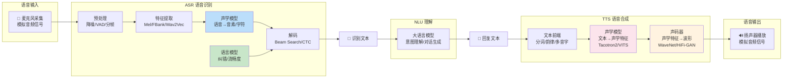
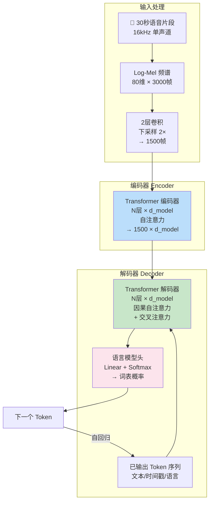
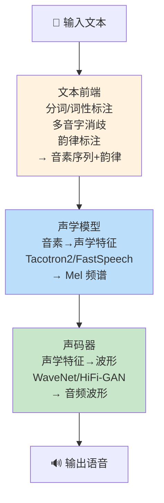

# 🎙️ 语音识别 ASR 与语音合成 TTS

> **一句话定义**：语音识别（ASR）将语音信号转换为文本，语音合成（TTS）将文本转换为自然语音，两者构成语音交互的"听"与"说"两大核心能力，是构建 AI 语音助手、智能客服、有声读物、实时翻译等语音应用的基础技术。
>
> **核心价值**：ASR 让机器"听懂"人类语音，TTS 让机器"说出"自然语音，两者结合实现了人机语音交互的完整闭环。基于深度学习的端到端模型（Whisper、VITS 等）大幅提升了识别准确率和合成自然度，使语音交互从"能用"走向"好用"。
>
> **适用场景**：AI 语音助手、智能客服、语音转写（会议/采访/课堂）、实时翻译、有声读物/播客生成、视频配音、无障碍辅助（视障/听障）、车载语音、智能家居语音控制、语音克隆。

---

## 一、概述

### 1.1 语音交互的完整链路



### 1.2 ASR 与 TTS 的核心概念

| 概念 | 说明 |
|------|------|
| **ASR（Automatic Speech Recognition）** | 自动语音识别，将语音信号转换为文本的技术 |
| **TTS（Text-to-Speech）** | 语音合成，将文本转换为自然语音的技术 |
| **声学模型（Acoustic Model）** | ASR 中将语音特征映射到音素/字符的模型，是 ASR 的核心 |
| **语言模型（Language Model）** | ASR 中对识别结果进行语言约束和纠错的模型，提升流畅度和准确率 |
| **声码器（Vocoder）** | TTS 中将声学特征（如 Mel 频谱）转换为波形的模型 |
| **音素（Phoneme）** | 语音的最小发音单位，如 /a/、/b/、/sh/ |
| **Mel 频谱（Mel Spectrogram）** | 基于人耳听觉特性的频谱表示，将频率转换为 Mel 刻度，是 ASR/TTS 最常用的特征 |
| **MFCC（Mel-Frequency Cepstral Coefficients）** | Mel 频率倒谱系数，传统 ASR 的常用特征 |
| **FBank（Filter Bank）** | 滤波器组特征，比 MFCC 保留更多信息，现代 ASR 常用 |
| **CTC（Connectionist Temporal Classification）** | 连接时序分类，解决语音和文本对齐问题的损失函数，无需帧级标注 |
| **端到端（End-to-End）** | 直接从语音到文本（ASR）或文本到语音（TTS）的单一模型，无需中间组件 |
| **流式识别（Streaming ASR）** | 边说边识别，低延迟，适用于实时对话场景 |
| **语音克隆（Voice Cloning）** | 用少量语音样本合成特定说话人声音的技术 |
| **MOS（Mean Opinion Score）** | 平均意见分，TTS 语音质量的主观评价指标，1-5 分 |
| **WER（Word Error Rate）** | 词错误率，ASR 准确率的核心指标，越低越好 |

### 1.3 技术演进历程

| 时代 | ASR 技术 | TTS 技术 | 特点 |
|------|---------|---------|------|
| **传统时代（~2010）** | GMM-HMM（高斯混合模型-隐马尔可夫） | 拼接合成（Unit Selection） | 需大量人工标注，效果有限 |
| **深度学习早期（2010-2017）** | DNN-HMM、CNN、RNN | 参数合成（HMM-based）、WaveNet | 深度学习提升准确率，WaveNet 开启神经声码器时代 |
| **端到端时代（2017-2020）** | DeepSpeech、Transformer-Transducer、Conformer | Tacotron2、FastSpeech、Transformer-TTS | 端到端简化流程，效果大幅提升 |
| **大模型时代（2020+）** | Whisper、Wav2Vec2、HuBERT | VITS、Neural HMM、零样本语音克隆（YourTTS、XTTS） | 大规模预训练，多语言，零样本，自然度接近真人 |


<div style="background:linear-gradient(135deg,#4facfe,#00f2fe);border-radius:16px;padding:20px;margin:16px 0;font-family:-apple-system,'Segoe UI','PingFang SC','Microsoft YaHei',sans-serif;color:#fff;overflow:hidden;box-shadow:0 8px 28px rgba(0,0,0,.14),0 3px 10px rgba(0,0,0,.08)">
<style>@keyframes fadeIn{from{opacity:0;transform:translateY(10px)}to{opacity:1;transform:translateY(0)}}.cmp-col{display:inline-block;width:45%;vertical-align:top;padding:12px;margin:0 2%;background:rgba(255,255,255,.15);border-radius:10px;animation:fadeIn .8s ease-out}.cmp-col h4{margin:0 0 8px 0;text-align:center;border-bottom:1px solid rgba(255,255,255,.3);padding-bottom:6px}.cmp-col ul{margin:0;padding-left:18px;font-size:13px;line-height:1.8}.cmp-vs{display:inline-block;width:4%;text-align:center;font-size:24px;font-weight:700;vertical-align:middle;animation:fadeIn 1s ease-out}</style>
<div style="text-align:center;font-size:15px;font-weight:700;margin-bottom:14px;padding-bottom:10px;border-bottom:1.5px solid rgba(255,255,255,.22);letter-spacing:1px">🎙️ ASR语音识别 vs TTS语音合成对比</div>
<div style="text-align:center">
<div class="cmp-col"><h4>ASR 自动语音识别</h4><ul><li>语音→文本（Speech-to-Text）</li><li>模型：Whisper/Conformer/Wenet</li><li>输入：音频波形（16kHz/16bit）</li><li>输出：文本+时间戳+说话人</li><li>应用：字幕/会议纪要/语音助手</li></ul></div>
<div class="cmp-vs">VS</div>
<div class="cmp-col"><h4>TTS 文本转语音</h4><ul><li>文本→语音（Text-to-Speech）</li><li>模型：VITS/ChatTTS/CosyVoice</li><li>输入：文本+情感/音色控制</li><li>输出：音频波形+韵律</li><li>应用：有声书/导航/数字人配音</li></ul></div>
</div>
<div style="text-align:center;font-size:12px;opacity:.85;margin-top:10px">ASR解决听懂问题，TTS解决会说问题，两者结合构成完整语音交互闭环</div>
</div>
> 🔍 **知识点深度解析**
>
> **作用**：ASR（语音识别）和 TTS（语音合成）是语音交互的两大核心技术——ASR 负责"听"（语音→文本），TTS 负责"说"（文本→语音），两者结合大语言模型（负责"想"）构成了完整的 AI 语音助手技术栈。
>
> **原理**：ASR 的核心是声学模型+语言模型的组合——声学模型将语音特征（Mel 频谱）映射为音素或字符序列，语言模型对识别结果进行语言约束和纠错。传统 ASR 使用 GMM-HMM 架构，需要单独训练声学模型、语言模型和发音词典，流程复杂。现代端到端 ASR（如 Whisper、Wav2Vec2）用单一模型直接从语音到文本，使用 CTC 或 Transducer 损失解决对齐问题，大幅简化了流程。TTS 的核心是文本前端+声学模型+声码器的三级架构——文本前端处理分词、韵律标注、多音字等语言学问题，声学模型将文本转换为声学特征（Mel 频谱），声码器将声学特征转换为波形。传统 TTS 使用拼接合成或参数合成，自然度有限。现代神经 TTS（如 Tacotron2、VITS）用深度学习生成声学特征和波形，自然度大幅提升，VITS 等端到端模型甚至将声学模型和声码器合并为单一模型。
>
> **用法要点**：① ASR 首选 OpenAI Whisper——多语言、准确率高、开源免费、支持长音频转写 ② 轻量级/私有化 ASR 可选 Wav2Vec2（HuggingFace）或 FunASR（阿里，中文优化）③ TTS 快速上手用 edge-tts（微软 Edge 语音，免费、高质量、多语言）④ 高质量/可定制 TTS 用 Coqui TTS（开源、支持语音克隆、多模型）或 VITS ⑤ 实时语音对话需要流式 ASR（低延迟）+ 流式 TTS（首包延迟低）⑥ ASR 评估指标是 WER（词错误率，越低越好），TTS 评估指标是 MOS（主观评分，1-5 分）和实时率（RTF）⑦ 语音克隆需要注意伦理和法律风险——未经授权克隆他人声音可能违法 ⑧ 中文 ASR/TTS 需要特别处理多音字、韵律、儿化音等语言学问题 ⑨ 部署时注意音频格式（采样率通常 16kHz ASR、22.05kHz/24kHz TTS）和音频预处理（降噪、VAD）⑩  Whisper 的 large-v3 模型在中文上效果很好，但需要 ~10GB 显存，可根据硬件选择 small/medium 模型。

---

> 💡 **深度讲解**：语音交互是人机交互最自然的方式——人类通过语音交流的历史比文字长得多，语音也是最便捷的输入输出方式（不需要打字、不需要看屏幕）。但语音交互的技术难度非常高，因为语音信号包含了丰富的信息——语义、说话人身份、情感、语速、口音、背景噪音等，机器需要从复杂的声学信号中准确提取语义内容（ASR），并将文本转换为自然、有表现力的语音（TTS）。ASR 的核心挑战在于语音的"变异性"——同一个词由不同人说、在不同语境下、以不同语速和口音说，声学特征都不同，模型需要学会从这种变异性中提取不变的语义内容。传统 ASR 使用 GMM-HMM 架构，将问题分解为声学模型（GMM 建模音素的声学特征）、发音词典（音素到词的映射）、语言模型（n-gram 建模词序列概率）三个独立组件，需要大量人工标注和专家知识，流程复杂且效果有限。深度学习的出现彻底改变了 ASR——DNN 替代 GMM 提升声学模型准确率，RNN/CNN 更好地建模时序关系，端到端模型（DeepSpeech、Transformer-Transducer）用 CTC 或 Transducer 损失直接从语音到文本，省去了发音词典和强制对齐，大幅简化了流程。2022 年 OpenAI 发布的 Whisper 是 ASR 的里程碑——它用 68 万小时的多语言弱标注数据训练，在多种语言和噪音条件下都达到了接近人类的准确率，而且开源免费，成为了 ASR 的事实标准。TTS 的核心挑战是"自然度"——合成语音需要在音质、韵律、情感、连贯性上都接近真人，任何不自然的地方都会被人耳敏锐地察觉。传统 TTS 使用拼接合成（从录音库中选择最匹配的语音单元拼接）或参数合成（HMM 生成声学参数再用声码器合成），自然度有限，听起来有明显的"机器感"。2016 年 DeepMind 发布的 WaveNet 开启了神经声码器时代——它用自回归卷积网络直接生成波形，音质大幅提升，但推理速度极慢（比实时慢 1000 倍）。随后 Tacotron2（2017）将声学模型（Tacotron2 生成 Mel 频谱）和声码器（WaveNet）结合，实现了端到端的高质量 TTS。FastSpeech（2019）用非自回归架构大幅提升了合成速度。VITS（2021）将声学模型和声码器合并为单一的端到端模型，使用变分自编码器（VAE）和对抗训练，实现了高质量、高自然度的语音合成，是当前开源 TTS 的主流架构。大模型时代的 TTS 进一步发展——零样本语音克隆（YourTTS、XTTS v2）只需几秒语音样本就能克隆说话人声音，多语言 TTS 支持上百种语言，情感 TTS 可以合成不同情感的语音。语音交互的未来是"端到端语音大模型"——直接从语音输入到语音输出，不需要中间的文本表示，这样可以保留语音中的情感、韵律等非语言信息，实现更自然的人机对话。
>
> **📝 精简总结**：ASR 将语音转文本（声学模型+语言模型），TTS 将文本转语音（文本前端+声学模型+声码器）。现代端到端模型（Whisper、VITS）大幅提升效果。ASR 用 WER 评估，TTS 用 MOS 评估。Whisper 是 ASR 首选，edge-tts/Coqui TTS 是 TTS 首选。

---

## 二、原理

### 2.1 ASR 原理：声学模型 + 语言模型

#### 2.1.1 传统 ASR 架构（GMM-HMM）

传统 ASR 将语音识别分解为三个独立组件：

```mermaid
graph TB
    AUDIO[🎤 输入语音] --> FEAT[特征提取<br/>MFCC/FBank<br/>13维/40维]
    FEAT --> AM[声学模型 GMM-HMM<br/>帧→音素<br/>P(声学特征\|音素)]
    AM --> PRON[发音词典<br/>音素→词<br/>映射表]
    PRON --> LM[语言模型 n-gram<br/>词序列概率<br/>P(词\|前文)]
    LM --> DECODE[解码器<br/>Beam Search<br/>寻找最优词序列]
    DECODE --> TEXT[📝 识别文本]

    style AM fill:#bbdefb
    style LM fill:#c8e6c9
    style DECODE fill:#fff3e0
```

**贝叶斯公式**：ASR 的目标是找到给定语音特征 O 时最可能的词序列 W：

$$
\hat{W} = \arg\max_W P(W|O) = \arg\max_W P(O|W) \cdot P(W)
$$

其中：
- $P(O|W)$：声学模型得分（给定词序列时语音特征的概率）
- $P(W)$：语言模型得分（词序列的先验概率）

#### 2.1.2 端到端 ASR 架构

现代端到端 ASR 用单一模型直接从语音到文本，主要有三种范式：

| 范式 | 代表模型 | 核心机制 | 特点 |
|------|---------|---------|------|
| **CTC** | DeepSpeech | 连接时序分类，引入 blank 符号解决对齐 | 训练简单，推理快，但缺乏语言模型内置 |
| **RNN-T / Transducer** | Conformer-Transducer、Whisper（部分） | 预测网络+转录网络+联合网络，自回归输出 | 流式友好，内置语言模型，效果好 |
| **Seq2Seq + Attention** | Listen Attend Spell (LAS) | 编码器-解码器+注意力，自回归输出 | 效果最好，但不适合流式，推理慢 |

#### 2.1.3 Whisper 架构详解

Whisper 是 OpenAI 2022 年发布的多语言 ASR 模型，采用编码器-解码器 Transformer 架构：



**Whisper 的关键设计**：
- **多语言**：支持 99 种语言，包括中文
- **弱监督训练**：68 万小时的网络音频+自动字幕，无需人工标注
- **多任务**：语音识别、语言检测、语音翻译（翻成英文）、时间戳预测
- **鲁棒性**：对噪音、口音、语速变化有很强的鲁棒性
- **模型规格**：tiny(39M) / base(74M) / small(244M) / medium(769M) / large-v3(1.55B)

### 2.2 TTS 原理：三级架构

#### 2.2.1 传统三级架构



#### 2.2.2 文本前端（Text Frontend）

文本前端处理语言学问题，将原始文本转换为音素序列和韵律标注：

| 处理步骤 | 说明 | 中文难点 |
|---------|------|---------|
| **文本规范化** | 数字、缩写、符号转文字 | "123"→"一百二十三"还是"一二三"？ |
| **分词** | 将句子切分为词 | 中文无空格，分词歧义（"南京市长江大桥"） |
| **词性标注** | 标注每个词的词性 | 多词性词（"学习"可作动词/名词） |
| **多音字消歧** | 根据语境确定正确读音 | "重"→zhòng/chóng，"长"→cháng/zhǎng |
| **韵律标注** | 标注停顿、重音、语调 | 中文韵律复杂，儿化音、轻声 |
| **音素转换** | 词→音素序列 | 中文音素体系（声母+韵母+声调） |

#### 2.2.3 声学模型：Tacotron2

Tacotron2 是 Google 2017 年提出的端到端声学模型，将字符序列直接转换为 Mel 频谱：

```mermaid
graph TB
    subgraph 编码器
        CHARS[字符嵌入] --> ENCCONV[3层卷积<br/>+ Bi-LSTM<br/>→ 编码表示]
    end

    subgraph 解码器（自回归）
        PREV[上一帧 Mel<br/>或起始帧] --> DECPRE[PreNet<br/>2层全连接+Dropout]
        DECPRE --> DECLSTM[2层 LSTM<br/>1024维]
        ENCCONV --> ATTENTION[位置敏感注意力<br/>Location-Sensitive Attention]
        DECLSTM --> ATTENTION
        ATTENTION --> CONCAT[注意力上下文<br/>+ LSTM输出]
        CONCAT --> PROJ[线性投影<br/>→ Mel 频谱帧]
        PROJ --> POSTNET[5层后处理网络<br/>残差连接<br/>优化 Mel 细节]
        POSTNET --> MEL[输出 Mel 频谱帧]
        PROJ -->|自回归| PREV
    end

    style ENCCONV fill:#bbdefb
    style ATTENTION fill:#fff3e0
    style POSTNET fill:#c8e6c9
```

**Tacotron2 的特点**：
- 端到端：字符→Mel 频谱，无需中间音素标注
- 自回归：逐帧生成 Mel 频谱，每帧依赖之前的帧
- 注意力机制：位置敏感注意力，解决对齐问题
- 自然度高：与 WaveNet 声码器结合，MOS 接近真人
- 缺点：自回归推理慢，不适合实时场景

#### 2.2.4 声学模型：VITS（端到端 TTS）

VITS（2021）是当前最先进的开源 TTS 架构，将声学模型和声码器合并为单一端到端模型：

```mermaid
graph TB
    subgraph 文本编码器
        TEXT[文本/音素] --> TENC[Transformer 编码器<br/>→ 文本表示]
    end

    subgraph 随机时长预测
        TENC --> DUR[时长预测器<br/>预测每个音素的帧数<br/>+ 随机时长采样]
    end

    subgraph 条件 VAE
        DUR --> UPSAMPLE[上采样<br/>文本表示→帧级]
        UPSAMPLE --> PRIOR[先验编码器<br/>Posterior Encoder<br/>→ 潜在变量 z]
        AUDIO --> SPEC[Mel 频谱] --> POST[后验编码器<br/>训练时使用]
        POST --> PRIOR
        PRIOR --> FLOW[归一化流<br/>Normalizing Flow<br/>→ 改进潜在分布]
    end

    subgraph 解码器（声码器）
        FLOW --> DEC[反卷积解码器<br/>HiFi-GAN 风格<br/>→ 波形]
        DEC --> WAVE[🔊 输出波形]
    end

    subgraph 对抗训练
        WAVE --> DISC[多周期判别器<br/>Multi-Period Discriminator]
        REAL[真实语音] --> DISC
        DISC -->|对抗损失| DEC
    end

    style PRIOR fill:#bbdefb
    style FLOW fill:#fff3e0
    style DEC fill:#c8e6c9
    style DISC fill:#fce4ec
```

**VITS 的核心创新**：
- **端到端**：文本直接到波形，不需要单独的声码器
- **条件 VAE**：使用变分自编码器建模语音的随机性（同一文本可以有多种发音方式）
- **归一化流**：改进潜在变量的分布，提升合成质量
- **对抗训练**：多周期多尺度判别器，提升波形自然度
- **随机时长预测**：训练时从真实时长分布采样，推理时预测时长，增加韵律多样性
- **自然度高**：MOS 评分超过 Tacotron2+WaveNet，接近真人

#### 2.2.5 声码器对比

| 声码器 | 类型 | 质量 | 速度 | 特点 |
|--------|------|------|------|------|
| **WaveNet** | 自回归 | ⭐⭐⭐⭐⭐ | 极慢（比实时慢 1000×） | 开山之作，音质最好但太慢 |
| **Parallel WaveNet** | 逆自回归 | ⭐⭐⭐⭐⭐ | 快（实时） | WaveNet 的学生模型，需要蒸馏 |
| **WaveGlow** | 基于流 | ⭐⭐⭐⭐ | 较快 | Glow 架构，基于归一化流 |
| **MelGAN** | 对抗生成 | ⭐⭐⭐ | 很快（>100×实时） | GAN 架构，轻量快速 |
| **HiFi-GAN** | 对抗生成 | ⭐⭐⭐⭐⭐ | 很快（>100×实时） | 当前最佳开源声码器，多周期判别器 |
| **BigVGAN** | 对抗生成 | ⭐⭐⭐⭐⭐ | 快 | 大规模 GAN 声码器，通用语音合成 |

### 2.3 评估指标

#### 2.3.1 ASR 评估：WER（词错误率）

$$
\text{WER} = \frac{S + D + I}{N} \times 100\%
$$

其中：
- $S$：替换错误数（识别错的词）
- $D$：删除错误数（漏识别的词）
- $I$：插入错误数（多识别的词）
- $N$：参考文本的总词数

WER 越低越好，0% 表示完美识别。中文通常用 CER（字错误率）。

#### 2.3.2 TTS 评估

| 指标 | 类型 | 说明 | 范围 |
|------|------|------|------|
| **MOS** | 主观 | 平均意见分，多人对语音质量打分 | 1-5 分，>4.0 为高质量 |
| **CMOS** | 主观 | 比较 MOS，对比两个系统的相对质量 | -3 到 +3 |
| **MCD** | 客观 | Mel 倒谱失真，合成语音与真实语音的频谱差异 | 越低越好 |
| **RTF（实时率）** | 效率 | 合成时间 / 语音时长，<1 表示比实时快 | 越低越好 |
| **说话人相似度** | 主观/客观 | 语音克隆中合成声音与目标说话人的相似度 | 0-100% |

---

> 💡 **深度讲解**：ASR 和 TTS 的原理虽然方向相反（语音↔文本），但都遵循"特征提取→序列建模→输出生成"的基本范式。ASR 的核心挑战是"对齐"——语音是连续的帧序列（每秒 50-100 帧），而文本是离散的词/字符序列，两者之间没有明确的对齐关系（一个音素可能对应多帧，一帧可能包含多个音素的过渡）。CTC（连接时序分类）通过引入一个特殊的 blank 符号巧妙地解决了这个问题——模型在每一帧输出一个标签（可以是音素或 blank），然后通过"合并重复+去除 blank"的规则将帧序列压缩为文本序列。CTC 的损失函数可以在不知道对齐的情况下训练，这是端到端 ASR 的关键突破。RNN-T（Transducer）在 CTC 的基础上增加了一个预测网络（类似语言模型），可以更好地建模文本的上下文依赖，同时支持流式识别（逐帧输出），是当前工业界的主流架构。Whisper 则采用了更简单的编码器-解码器+注意力架构——编码器将语音编码为上下文表示，解码器自回归地生成文本（类似翻译模型），这种架构效果最好但不适合流式（需要等语音输入完成后才能开始解码）。TTS 的核心挑战是"自然度"——合成语音需要在音质、韵律、情感上都接近真人。Tacotron2 用编码器-解码器+注意力将文本转换为 Mel 频谱，再用 WaveNet 声码器将 Mel 频谱转换为波形，这种两级架构虽然效果好但推理慢（自回归）。FastSpeech 用非自回归架构（一次性生成所有帧）大幅提升了速度，但需要额外的时长预测器。VITS 是当前的集大成者——它将声学模型和声码器合并为单一的端到端模型，使用条件 VAE 建模语音的随机性（同一文本可以有多种发音方式），归一化流改进潜在分布，对抗训练提升波形自然度，实现了高质量、高自然度、较快速度的语音合成。理解 ASR/TTS 的原理对于选择合适的模型、优化识别/合成效果、排查问题都很重要。
>
> **📝 精简总结**：ASR 核心是声学模型+语言模型，端到端模型用 CTC/Transducer/Seq2Seq 解决对齐问题，Whisper 是当前最佳。TTS 核心是文本前端+声学模型+声码器，VITS 是端到端集大成者。ASR 用 WER 评估，TTS 用 MOS 评估。

---

## 三、实操

### 3.1 环境搭建

```python
# 创建虚拟环境
python -m venv .venv
source .venv/bin/activate  # Windows: .venv\Scripts\activate

# ASR 相关
pip install openai-whisper        # OpenAI Whisper
pip install transformers torchaudio  # HuggingFace Wav2Vec2
pip install funasr modelscope     # 阿里 FunASR（中文优化）

# TTS 相关
pip install edge-tts               # 微软 Edge TTS（免费）
pip install TTS                     # Coqui TTS（开源、可定制）
pip install gTTS                    # Google TTS（简单）

# 音频处理
pip install pydub librosa soundfile numpy
pip install matplotlib              # 可视化

# 系统依赖（Linux）
# sudo apt install ffmpeg            # Whisper/edge-tts 需要
# macOS: brew install ffmpeg
# Windows: 下载 ffmpeg 并加入 PATH

# 验证
python -c "import whisper; print(f'Whisper {whisper.__version__}')"
python -c "import edge_tts; print('edge-tts OK')"
```

### 3.2 ASR 实操：OpenAI Whisper

```python
import whisper

# ============ 3.2.1 基础用法 ============
# 加载模型（根据硬件选择）
# tiny(39M)/base(74M)/small(244M)/medium(769M)/large-v3(1.55B)
model = whisper.load_model("small")  # 中文推荐 medium 或 large-v3

# 转录音频（自动检测语言，自动分段）
result = model.transcribe("audio.mp3", language="zh")

# 输出完整文本
print(result["text"])

# 输出带时间戳的分段
for seg in result["segments"]:
    print(f"[{seg['start']:.1f}s - {seg['end']:.1f}s] {seg['text']}")


# ============ 3.2.2 高级配置 ============
result = model.transcribe(
    "audio.mp3",
    language="zh",              # 指定语言（不指定则自动检测）
    task="transcribe",          # transcribe=识别原语言, translate=翻译成英文
    beam_size=5,                # Beam Search 宽度，越大越准确但越慢
    best_of=5,                  # 采样次数
    temperature=0.0,            # 温度，0=贪心解码，>0=随机采样
    condition_on_previous_text=True,  # 用前文作为条件，提升连贯性
    initial_prompt="以下是普通话的句子。",  # 初始提示，引导识别风格
    verbose=False,              # 是否打印调试信息
    fp16=True,                  # 使用 FP16 加速（GPU）
)


# ============ 3.2.3 流式/低延迟识别（逐段） ============
import numpy as np

def transcribe_streaming(audio_path, chunk_duration=30):
    """
    将长音频分段转录，模拟流式识别
    Whisper 本身是 30 秒窗口的非流式模型
    """
    import librosa

    # 加载音频（16kHz 单声道，Whisper 要求）
    audio, sr = librosa.load(audio_path, sr=16000, mono=True)
    total_duration = len(audio) / sr

    results = []
    for start in range(0, int(total_duration), chunk_duration):
        end = min(start + chunk_duration, total_duration)
        chunk = audio[int(start*sr):int(end*sr)]

        # Whisper 要求 30 秒，不足则补零
        if len(chunk) < 30 * sr:
            chunk = np.pad(chunk, (0, 30 * sr - len(chunk)))

        result = model.transcribe(chunk, language="zh", fp16=True)
        results.append((start, end, result["text"]))
        print(f"[{start:.0f}s-{end:.0f}s] {result['text']}")

    return results


# ============ 3.2.4 提取音频特征（Mel 频谱可视化） ============
import matplotlib.pyplot as plt

def plot_mel_spectrogram(audio_path):
    """绘制 Whisper 使用的 Log-Mel 频谱"""
    audio = whisper.load_audio(audio_path)
    audio = whisper.pad_or_trim(audio)  # 填充/裁剪到 30 秒
    mel = whisper.log_mel_spectrogram(audio)  # [80, 3000]

    plt.figure(figsize=(12, 4))
    plt.imshow(mel, aspect="auto", origin="lower", cmap="viridis")
    plt.colorbar(label="dB")
    plt.xlabel("Time Frame")
    plt.ylabel("Mel Band")
    plt.title("Whisper Log-Mel Spectrogram (80 bands)")
    plt.tight_layout()
    plt.savefig("mel_spectrogram.png", dpi=150)
    plt.show()


if __name__ == "__main__":
    # 基础转录
    result = model.transcribe("test_audio.mp3", language="zh")
    print("识别结果:", result["text"])
```

### 3.3 ASR 实操：HuggingFace Wav2Vec2

```python
from transformers import Wav2Vec2ForCTC, Wav2Vec2Processor
import torch
import librosa

# ============ 3.3.1 加载中文 Wav2Vec2 模型 ============
# 中文模型推荐：jonatasgrosman/wav2vec2-large-xlsr-53-chinese-zh-cn
processor = Wav2Vec2Processor.from_pretrained(
    "jonatasgrosman/wav2vec2-large-xlsr-53-chinese-zh-cn"
)
model = Wav2Vec2ForCTC.from_pretrained(
    "jonatasgrosman/wav2vec2-large-xlsr-53-chinese-zh-cn"
)
model.eval()

# ============ 3.3.2 转录音频 ============
def transcribe_wav2vec2(audio_path):
    # 加载音频（16kHz 单声道）
    audio, sr = librosa.load(audio_path, sr=16000, mono=True)

    # 预处理
    inputs = processor(audio, sampling_rate=16000, return_tensors="pt", padding=True)

    # 推理
    with torch.no_grad():
        logits = model(inputs.input_values).logits  # [1, seq_len, vocab_size]

    # 解码（CTC 贪心解码）
    predicted_ids = torch.argmax(logits, dim=-1)
    transcription = processor.batch_decode(predicted_ids)[0]

    return transcription


# ============ 3.3.3 带语言模型的解码（提升准确率） ============
# 安装: pip install pyctcdecode kenlm
# 下载中文语言模型: https://huggingface.co/...
from pyctcdecode import build_ctcdecoder

def transcribe_with_lm(audio_path, lm_path):
    # 获取词表
    vocab_dict = processor.tokenizer.get_vocab()
    sorted_vocab = sorted(vocab_dict.items(), key=lambda x: x[1])
    vocab = [token for token, _ in sorted_vocab]

    # 构建带语言模型的解码器
    decoder = build_ctcdecoder(
        labels=vocab,
        kenlm_model_path=lm_path,  # 中文 n-gram 语言模型
        alpha=0.5,   # 语言模型权重
        beta=1.5,    # 词插入惩罚
    )

    # 推理
    audio, sr = librosa.load(audio_path, sr=16000, mono=True)
    inputs = processor(audio, sampling_rate=16000, return_tensors="pt")
    with torch.no_grad():
        logits = model(inputs.input_values).logits.numpy()[0]

    # 带 LM 解码
    text = decoder.decode(logits)
    return text


if __name__ == "__main__":
    text = transcribe_wav2vec2("test.wav")
    print("Wav2Vec2 识别结果:", text)
```

### 3.4 TTS 实操：edge-tts（免费、高质量）

```python
import asyncio
import edge_tts

# ============ 3.4.1 基础合成 ============
async def text_to_speech(text, output_path, voice="zh-CN-XiaoxiaoNeural"):
    """
    使用微软 Edge TTS 合成语音
    中文语音列表：
    - zh-CN-XiaoxiaoNeural: 晓晓（女声，自然）
    - zh-CN-YunxiNeural: 云希（男声，自然）
    - zh-CN-YunjianNeural: 云健（男声，沉稳）
    - zh-CN-XiaoyiNeural: 晓伊（女声，温柔）
    - zh-CN-YunyangNeural: 云扬（男声，新闻播报）
    """
    communicate = edge_tts.Communicate(text, voice)
    await communicate.save(output_path)
    print(f"✅ 已保存到: {output_path}")


# ============ 3.4.2 高级配置（语速、音调、音量） ============
async def tts_advanced(text, output_path, voice="zh-CN-XiaoxiaoNeural"):
    # rate: 语速，+20% 表示快 20%，-20% 表示慢 20%
    # volume: 音量，+50% 表示音量增加 50%
    # pitch: 音调，+10Hz 表示音调升高
    communicate = edge_tts.Communicate(
        text,
        voice,
        rate="+10%",        # 语速加快 10%
        volume="+0%",       # 音量不变
        pitch="+0Hz",       # 音调不变
    )
    await communicate.save(output_path)


# ============ 3.4.3 流式合成（边生成边播放） ============
async def tts_streaming(text, voice="zh-CN-XiaoxiaoNeural"):
    """
    流式合成：逐 chunk 获取音频数据，可实时播放
    """
    communicate = edge_tts.Communicate(text, voice)
    audio_chunks = []

    async for chunk in communicate.stream():
        if chunk["type"] == "audio":
            audio_chunks.append(chunk["data"])
            # 这里可以实时播放 chunk["data"]
            print(f"收到音频块: {len(chunk['data'])} bytes")
        elif chunk["type"] == "WordBoundary":
            print(f"词边界: {chunk['text']}")

    # 合并所有块
    with open("streaming_output.mp3", "wb") as f:
        for chunk in audio_chunks:
            f.write(chunk)


# ============ 3.4.4 列出所有可用语音 ============
async def list_voices():
    voices = await edge_tts.list_voices()
    # 筛选中文语音
    zh_voices = [v for v in voices if v["Locale"].startswith("zh")]
    for v in zh_voices:
        print(f"{v['ShortName']:30s} | {v['Gender']:6s} | {v['Locale']:10s} | {v['FriendlyName']}")


# 运行
if __name__ == "__main__":
    asyncio.run(text_to_speech(
        "你好，这是一段使用 Edge TTS 合成的语音测试。今天天气真好，适合出去散步。",
        "output.mp3",
        voice="zh-CN-XiaoxiaoNeural"
    ))
    # asyncio.run(list_voices())  # 列出所有中文语音
```

### 3.5 TTS 实操：Coqui TTS（开源、可定制、语音克隆）

```python
from TTS.api import TTS
import torch

# ============ 3.5.1 基础合成（VITS 模型） ============
# 列出所有可用模型
# print(TTS().list_models())

# 加载 VITS 英文模型
tts = TTS(model_name="tts_models/en/ljspeech/vits", progress_bar=False)

# 合成语音
tts.tts_to_file(text="Hello, this is a test of Coqui TTS with VITS.", file_path="coqui_output.wav")


# ============ 3.5.2 多语言模型（YourTTS） ============
# YourTTS 支持多语言合成和零样本语音克隆
tts_yourtts = TTS(model_name="tts_models/multilingual/multi-dataset/your_tts", progress_bar=False)

# 合成英文
tts_yourtts.tts_to_file(
    text="This is a multilingual TTS test.",
    file_path="yourtts_en.wav",
    speaker="female-en-5",
    language="en",
)

# 合成（需下载对应语言模型）
# tts_yourtts.tts_to_file(text="这是中文测试。", file_path="yourtts_zh.wav", language="zh")


# ============ 3.5.3 零样本语音克隆 ============
def voice_clone(text, reference_audio, output_path):
    """
    用参考音频克隆说话人声音（零样本）
    reference_audio: 参考语音文件路径（建议 6-10 秒，清晰单人语音）
    """
    tts_yourtts.tts_to_file(
        text=text,
        file_path=output_path,
        speaker_wav=reference_audio,  # 参考语音
        language="en",
    )
    print(f"✅ 语音克隆完成: {output_path}")


# ============ 3.5.4 中文 TTS（使用社区模型） ============
# Coqui TTS 官方中文模型较少，可使用社区训练的模型
# 或使用 XTTS v2（支持中文）
def tts_xtts(text, output_path, speaker_wav=None, language="zh"):
    """
    使用 XTTS v2 多语言模型（支持中文、语音克隆）
    XTTS v2 是 Coqui 的旗舰模型，支持 17 种语言
    """
    tts_xtts_model = TTS(
        model_name="tts_models/multilingual/multi-dataset/xtts_v2",
        progress_bar=False,
    )

    kwargs = {
        "text": text,
        "file_path": output_path,
        "language": language,
    }
    if speaker_wav:
        kwargs["speaker_wav"] = speaker_wav  # 语音克隆
    else:
        kwargs["speaker"] = "Ana Florence"   # 使用内置说话人

    tts_xtts_model.tts_to_file(**kwargs)
    print(f"✅ XTTS 合成完成: {output_path}")


if __name__ == "__main__":
    # 基础 VITS 合成
    tts = TTS(model_name="tts_models/en/ljspeech/vits", progress_bar=False)
    tts.tts_to_file(text="Hello world from Coqui TTS!", file_path="test.wav")
```

### 3.6 完整语音对话系统（ASR + LLM + TTS）

```python
import asyncio
import whisper
import edge_tts
import tempfile
import os

# ============ 完整语音对话流水线 ============
class VoiceAssistant:
    """
    完整的语音助手：语音输入 → ASR → LLM → TTS → 语音输出
    这里 LLM 用简单的规则回复，实际可接入 OpenAI/本地大模型
    """

    def __init__(self, asr_model="small", tts_voice="zh-CN-XiaoxiaoNeural"):
        print("🔄 加载 ASR 模型...")
        self.asr = whisper.load_model(asr_model)
        self.tts_voice = tts_voice
        print("✅ 语音助手就绪")

    def listen(self, audio_path):
        """ASR：语音→文本"""
        result = self.asr.transcribe(audio_path, language="zh")
        text = result["text"].strip()
        print(f"👂 识别: {text}")
        return text

    def think(self, text):
        """LLM：文本→回复文本（示例用简单规则，实际接入大模型）"""
        # 这里可以替换为 OpenAI API / 本地 LLM / 其他大模型
        if "你好" in text or "hello" in text.lower():
            reply = "你好！很高兴见到你，有什么我可以帮助你的吗？"
        elif "天气" in text:
            reply = "今天天气晴朗，气温 25 度，适合外出活动。"
        elif "时间" in text:
            from datetime import datetime
            reply = f"现在是 {datetime.now().strftime('%H点%M分')}。"
        else:
            reply = f"你说的是「{text}」，这是一个很有趣的话题！"
        print(f"💭 回复: {reply}")
        return reply

    async def speak(self, text, output_path=None):
        """TTS：文本→语音"""
        if output_path is None:
            output_path = tempfile.mktemp(suffix=".mp3")
        communicate = edge_tts.Communicate(text, self.tts_voice)
        await communicate.save(output_path)
        print(f"🔊 合成: {output_path}")
        return output_path

    async def converse(self, audio_path):
        """完整对话流程"""
        # 1. ASR
        user_text = self.listen(audio_path)
        if not user_text:
            return None

        # 2. LLM
        reply_text = self.think(user_text)

        # 3. TTS
        output_audio = await self.speak(reply_text)
        return output_audio


# ============ 运行 ============
async def main():
    assistant = VoiceAssistant(asr_model="base")

    # 处理一个语音文件
    output = await assistant.converse("user_input.wav")
    if output:
        print(f"\n✅ 对话完成，回复语音: {output}")


if __name__ == "__main__":
    asyncio.run(main())
```

### 3.7 音频预处理与可视化

```python
import librosa
import librosa.display
import matplotlib.pyplot as plt
import numpy as np
from pydub import AudioSegment

# ============ 3.7.1 音频格式转换 ============
def convert_audio(input_path, output_path, target_sr=16000, target_channels=1):
    """将音频转换为 ASR 所需格式（16kHz 单声道 WAV）"""
    audio = AudioSegment.from_file(input_path)
    audio = audio.set_frame_rate(target_sr)
    audio = audio.set_channels(target_channels)
    audio.export(output_path, format="wav")
    print(f"✅ 转换完成: {output_path} ({target_sr}Hz, {target_channels}ch)")


# ============ 3.7.2 VAD（语音活动检测） ============
def simple_vad(audio_path, top_db=30):
    """
    简单的 VAD：基于能量阈值检测语音片段
    更精确的 VAD 可使用 WebRTC VAD 或 Silero VAD
    """
    audio, sr = librosa.load(audio_path, sr=16000, mono=True)

    # 基于 librosa 的非语音帧检测
    intervals = librosa.effects.split(audio, top_db=top_db)

    print(f"检测到 {len(intervals)} 个语音片段:")
    for i, (start, end) in enumerate(intervals):
        start_sec = start / sr
        end_sec = end / sr
        duration = end_sec - start_sec
        print(f"  片段 {i+1}: {start_sec:.1f}s - {end_sec:.1f}s (时长 {duration:.1f}s)")

    return intervals


# ============ 3.7.3 音频特征可视化 ============
def visualize_audio(audio_path):
    """可视化波形、Mel 频谱、MFCC"""
    audio, sr = librosa.load(audio_path, sr=16000, mono=True)
    duration = len(audio) / sr

    fig, axes = plt.subplots(3, 1, figsize=(14, 10))

    # 波形
    times = np.linspace(0, duration, len(audio))
    axes[0].plot(times, audio, linewidth=0.5)
    axes[0].set_title("Waveform（波形）")
    axes[0].set_xlabel("Time (s)")
    axes[0].set_ylabel("Amplitude")

    # Mel 频谱
    mel = librosa.feature.melspectrogram(y=audio, sr=sr, n_mels=80)
    mel_db = librosa.power_to_db(mel, ref=np.max)
    img = librosa.display.specshow(mel_db, sr=sr, x_axis="time", y_axis="mel", ax=axes[1])
    axes[1].set_title("Mel Spectrogram（Mel 频谱）")
    fig.colorbar(img, ax=axes[1], format="%+2.0f dB")

    # MFCC
    mfcc = librosa.feature.mfcc(y=audio, sr=sr, n_mfcc=13)
    img2 = librosa.display.specshow(mfcc, sr=sr, x_axis="time", ax=axes[2])
    axes[2].set_title("MFCC（13维）")
    axes[2].set_ylabel("MFCC Coeff")
    fig.colorbar(img2, ax=axes[2])

    plt.tight_layout()
    plt.savefig("audio_visualization.png", dpi=150)
    plt.show()


if __name__ == "__main__":
    visualize_audio("test_audio.wav")
```

---

> 💡 **深度讲解**：ASR 和 TTS 的实操中，最常用的组合是 Whisper（ASR）+ edge-tts（TTS）——两者都是免费、高质量、多语言、易于使用。Whisper 的使用非常简单，一行 `model.transcribe()` 就能完成转录，但需要注意几个要点：① 模型选择——tiny/base 适合快速测试，small/medium 适合一般使用，large-v3 适合高精度场景（中文推荐 medium 以上）；② 语言指定——不指定语言时 Whisper 会自动检测前 30 秒的语言，如果音频开头是静音或噪音可能检测错误，建议显式指定 `language="zh"`；③ 长音频处理——Whisper 内部用 30 秒窗口处理，长音频会自动分段，但分段边界可能出现识别错误，可以用 `initial_prompt` 引导或后处理合并；④ FP16 加速——GPU 上使用 `fp16=True` 可以加速 2 倍左右，CPU 上必须用 `fp16=False`。edge-tts 是微软 Edge 浏览器的在线 TTS 服务，通过逆向 API 实现，完全免费且质量极高（和 Azure TTS 同款语音），支持上百种语音和多种语言。使用 edge-tts 时注意：① 需要网络连接（调用微软服务器）；② 中文语音有多种风格可选（晓晓=自然女声、云希=自然男声、云健=沉稳男声、云扬=新闻播报等）；③ 支持语速、音调、音量调整；④ 支持流式合成（逐 chunk 返回音频数据），适合实时对话。Coqui TTS 是开源的 TTS 框架，支持多种模型（VITS、YourTTS、XTTS v2 等），可以本地部署、自定义训练、语音克隆。XTTS v2 是 Coqui 的旗舰模型，支持 17 种语言（包括中文）和零样本语音克隆（只需 6 秒参考音频）。语音克隆需要注意伦理和法律风险——未经授权克隆他人声音可能违反隐私权和肖像权，在商业使用中必须获得授权。完整的语音对话系统需要将 ASR、LLM、TTS 串联起来，关键是延迟优化——ASR 的首字延迟、LLM 的首 Token 延迟、TTS 的首包延迟之和决定了对话的响应速度，实时对话要求总延迟 < 500ms。
>
> **📝 精简总结**：ASR 首选 Whisper（免费、多语言、高精度），TTS 首选 edge-tts（免费、高质量、多语音）。本地部署/语音克隆用 Coqui TTS（XTTS v2）。完整语音对话=ASR+LLM+TTS，关键是延迟优化。音频预处理注意 16kHz 单声道格式和 VAD。

---

## 四、问题

### 4.1 常见错误与排查方案

| 问题 | 原因 | 解决方案 |
|------|------|---------|
| **Whisper 识别全是英文/乱码** | 语言检测错误（音频开头静音/噪音）；模型太小 | 显式指定 `language="zh"`；使用 medium/large-v3 模型；确保音频开头有语音 |
| **Whisper 识别结果重复/死循环** | 温度设置不当；condition_on_previous_text 导致错误累积 | 设置 `temperature=0.0`（贪心解码）；设置 `condition_on_previous_text=False`；使用 `compression_ratio_threshold` 检测重复 |
| **Whisper 长音频分段错误** | 30 秒窗口边界切断词语；分段间无上下文 | 使用 `initial_prompt` 传递前文；后处理合并相邻分段；使用 VAD 按句子分段 |
| **edge-tts 报错 NoAudioReceived** | 网络问题；文本为空；语音名称错误 | 检查网络连接；确保文本非空；用 `list_voices()` 确认语音名称 |
| **edge-tts 合成中文有英文口音** | 语音选择了非中文语音；文本中混有英文 | 使用 `zh-CN-*` 语音；英文部分用英文语音单独合成后拼接 |
| **Coqui TTS 模型下载失败** | 网络问题；HuggingFace 访问受限 | 使用镜像源；手动下载模型文件；设置 `TTS_HOME` 环境变量 |
| **TTS 合成语音不自然/有杂音** | 模型质量低；文本前端处理错误；声码器问题 | 使用 VITS/XTTS 高质量模型；检查文本规范化（数字/符号）；使用 HiFi-GAN 声码器 |
| **语音克隆效果差** | 参考音频质量差（噪音/多人/太短）；模型不支持该语言 | 使用 6-10 秒清晰单人语音；使用 XTTS v2（支持中文）；参考音频避免背景音乐和混响 |
| **ASR 中文识别准确率低** | 模型太小；口音重；噪音大；专业术语 | 使用 large-v3 模型；添加专业术语到 initial_prompt；先做降噪处理；使用针对中文优化的模型（FunASR） |
| **音频格式错误** | 采样率不是 16kHz；多声道；格式不支持 | 用 ffmpeg/librosa 转换为 16kHz 单声道 WAV；检查音频文件完整性 |
| **显存不足（OOM）** | Whisper large 模型太大；batch size 太大 | 使用 small/medium 模型；CPU 推理（慢但不占显存）；使用 FP16/INT8 量化 |
| **实时对话延迟高** | ASR 非流式；LLM 推理慢；TTS 非流式 | 使用流式 ASR（FunASR 流式）；使用更小更快的 LLM；使用流式 TTS（edge-tts stream） |

### 4.2 性能优化策略

| 优化方向 | 策略 | 预期效果 |
|---------|------|---------|
| **ASR 速度** | 使用更小模型（base/small）；FP16 推理；GPU 加速；批量处理 | 速度提升 2-10× |
| **ASR 准确率** | 使用 large-v3；添加 initial_prompt；Beam Search（beam_size=5）；语言模型重打分 | WER 降低 20-50% |
| **TTS 速度** | edge-tts（云端，快）；非自回归模型（FastSpeech）；批量合成；GPU 加速 | 实时率 < 0.1 |
| **TTS 质量** | VITS/XTTS v2；高质量声码器（HiFi-GAN）；文本前端优化；参考音频质量 | MOS 提升 0.3-0.8 |
| **端到端延迟** | 流式 ASR + 流式 LLM + 流式 TTS；首包优化；并行处理 | 端到端延迟 < 500ms |
| **部署成本** | 模型量化（INT8/INT4）；模型蒸馏；CPU 优化（ONNX Runtime）；边缘部署 | 成本降低 50-80% |

### 4.3 安全与伦理问题

| 问题 | 说明 | 防护措施 |
|------|------|---------|
| **语音克隆滥用** | 未经授权克隆他人声音进行诈骗、伪造 | 获得明确授权；添加水印；使用声纹验证；遵守法律法规 |
| **语音数据隐私** | ASR 处理用户语音可能泄露隐私 | 本地部署（不上传云端）；数据加密；及时删除临时文件；隐私政策告知 |
| **深度伪造（Deepfake）** | TTS + 语音克隆可伪造他人语音 | 检测技术（合成语音检测）；平台审核；法律规制 |
| **偏见与歧视** | ASR 对少数族裔口音/方言准确率低 | 多口音训练数据；公平性评估；方言适配 |
| **无障碍误用** | 语音交互可能排除残障人士 | 提供多模态交互（文字+语音）；无障碍设计标准 |

---

> 💡 **深度讲解**：ASR/TTS 在实际使用中最常见的问题是准确率/自然度不足和部署成本高。Whisper 的中文识别在 large-v3 模型下已经非常准确，但在专业领域（医疗、法律、技术）和口音较重的场景下仍然会出错。提升准确率的方法包括：使用更大的模型、添加专业术语到 initial_prompt（引导模型识别特定词汇）、使用语言模型重打分（对识别结果进行后处理纠错）、先做音频降噪（使用 noisereduce 或 RNNoise）。对于中文，FunASR（阿里开源）在中文上的优化比 Whisper 更好，支持流式识别和中文标点恢复，是中文 ASR 的优秀选择。TTS 的自然度问题主要来自文本前端处理——数字读法（"123"是"一百二十三"还是"一二三"）、多音字（"重"是 zhòng 还是 chóng）、韵律停顿（在哪里断句）、儿化音和轻声等，这些语言学问题处理不好会导致合成语音不自然。edge-tts 因为使用了微软成熟的文本前端，中文合成效果很好；Coqui TTS 的中文文本前端相对简单，可能需要额外处理。部署成本是另一个核心问题——Whisper large-v3 需要 ~10GB 显存，Coqui TTS 的 XTTS v2 也需要 ~4GB 显存，在没有 GPU 的环境下推理很慢。优化方法包括：模型量化（INT8 可以减少 50% 显存，速度提升 2-3×，精度损失很小）、模型蒸馏（用大模型训练小模型）、ONNX Runtime 优化（CPU 上速度提升 2-5×）、云端 API（Whisper API、Azure TTS，按调用付费，无需本地部署）。对于实时语音对话，延迟是关键指标——从用户说完到 AI 开始回复的时间应该 < 500ms，否则用户会感到明显的延迟。优化延迟需要全链路优化：流式 ASR（边说边识别，首字延迟 < 200ms）、流式 LLM（边生成边输出，首 Token 延迟 < 300ms）、流式 TTS（边生成边播放，首包延迟 < 200ms）。语音克隆的伦理和法律风险需要特别注意——2023 年以来，利用 AI 语音克隆进行诈骗的案件频发（克隆亲友声音借钱），许多国家和地区正在立法规范语音克隆的使用。在商业项目中使用语音克隆必须获得说话人的明确授权，并建议在合成语音中添加不可感知的水印以便溯源。
>
> **📝 精简总结**：常见问题包括 Whisper 语言检测错误、识别重复、长音频分段错误；edge-tts 网络问题；Coqui TTS 模型下载；语音克隆效果差。优化策略：更大模型+initial_prompt 提升 ASR 准确率，VITS/XTTS 提升 TTS 质量，量化/蒸馏降低部署成本，流式处理降低延迟。注意语音克隆的伦理法律风险。

---

## 五、拓展

### 5.1 前沿技术方向

#### 5.1.1 端到端语音大模型

直接从语音输入到语音输出，不需要中间文本表示，保留语音中的情感、韵律、说话人特征：
- **GPT-4o**：OpenAI 的多模态模型，支持实时语音对话，端到端语音输入输出
- **VALL-E**：微软的语音语言模型，用音频离散 token 建模，支持零样本语音克隆
- **AudioLM**：Google 的音频生成模型，统一语音合成、音乐生成、音效生成
- **SpeechGPT**：将语音作为离散 token 输入 LLM，实现端到端语音对话

#### 5.1.2 零样本语音克隆

只需几秒参考音频就能克隆任意说话人声音：
- **XTTS v2**（Coqui）：17 种语言，6 秒参考音频，开源
- **YourTTS**（Coqui）：多语言零样本克隆
- **VALL-E / VALL-E X**（微软）：3 秒参考音频，支持多语言和情感控制
- **OpenVoice**（MyShell）：零样本语音克隆，支持音色和风格分离

#### 5.1.3 情感与风格 TTS

合成具有特定情感、风格、韵律的语音：
- **情感 TTS**：合成高兴、悲伤、愤怒、惊讶等情感
- **风格迁移**：将一种说话风格迁移到另一个说话人
- **韵律控制**：精确控制语速、停顿、重音、语调
- **歌唱合成（SVS）**：将歌词和旋律合成为歌声（DiffSinger、So-VITS-SVC）

### 5.2 生态工具与平台

| 类别 | 工具/平台 | 说明 |
|------|----------|------|
| **ASR 开源** | Whisper、Wav2Vec2、FunASR、NeMo、ESPnet | 开源 ASR 模型和框架 |
| **ASR 云服务** | OpenAI Whisper API、Azure Speech、Google Speech-to-Text、阿里云语音、腾讯云语音 | 云端 ASR API，按调用付费 |
| **TTS 开源** | Coqui TTS、ESPnet、NeMo、PaddleSpeech、MeloTTS | 开源 TTS 框架和模型 |
| **TTS 云服务** | Azure TTS、Google Text-to-Speech、AWS Polly、阿里云语音、腾讯云语音 | 云端 TTS API，高质量多语音 |
| **语音克隆** | Coqui XTTS、OpenVoice、Resemble AI、ElevenLabs | 语音克隆平台和工具 |
| **实时对话** | RealtimeSTT、VoiceLoop、Daily.co、LiveKit | 实时语音对话框架 |
| **音频处理** | librosa、pydub、torchaudio、FFmpeg、noisereduce | 音频处理和降噪工具 |
| **可视化** | SpeechBrain、BertViz（注意力）、librosa.display | 语音和模型可视化 |

### 5.3 行业应用案例

| 行业 | 应用 | 技术要点 |
|------|------|---------|
| **智能客服** | 语音客服、语音质检、坐席辅助 | 实时 ASR + 对话理解 + TTS，低延迟，高准确率 |
| **会议转写** | 实时会议记录、会议摘要、说话人分离 | 长音频 ASR + 说话人分离（Speaker Diarization）+ 摘要 |
| **有声读物** | 小说/文章转有声书、多角色配音 | 高质量 TTS + 情感控制 + 多说话人 |
| **视频配音** | 视频自动配音、多语言配音、AI 主播 | TTS + 唇形同步（Lip Sync）+ 情感匹配 |
| **实时翻译** | 语音实时翻译、跨语言通话 | ASR（源语言）+ MT（翻译）+ TTS（目标语言） |
| **无障碍** | 屏幕阅读器（视障）、实时字幕（听障） | TTS（自然朗读）+ ASR（实时字幕） |
| **车载语音** | 车载助手、语音导航、语音控制 | 离线 ASR/TTS（无网络）、低延迟、抗噪 |
| **教育** | 语言学习发音评估、课文朗读、AI 口语教练 | ASR（发音评估）+ TTS（标准朗读）+ 反馈 |

### 5.4 学习资源

| 资源 | 类型 | 说明 |
|------|------|------|
| **Whisper 官方仓库** | 代码/文档 | github.com/openai/whisper，ASR 入门首选 |
| **Coqui TTS 文档** | 文档 | coqui.ai/tts，开源 TTS 框架 |
| **SpeechBrain** | 工具包 | 开源语音处理工具包，ASR/TTS/说话人识别 |
| **ESPnet** | 工具包 | 端到端语音处理工具包，学术研究常用 |
| **CMU Speech Courses** | 课程 | 卡内基梅隆大学语音处理课程（11-492/11-692） |
| **Speech and Language Processing** (Jurafsky) | 书籍 | 经典语音和 NLP 教材，第 3 版免费在线 |
| **Attention Is All You Need** | 论文 | Transformer 论文，ASR/TTS 模型基础 |
| **Whisper 论文** (Radford et al., 2022) | 论文 | Robust Speech Recognition via Large-Scale Weak Supervision |
| **VITS 论文** (Kim et al., 2021) | 论文 | Conditional Variational Autoencoder with Adversarial Learning |
| **Tacotron2 论文** (Shen et al., 2018) | 论文 | Natural TTS Synthesis by Conditioning WaveNet on Mel Spectrogram |

---

> 💡 **深度讲解**：语音技术的未来是"端到端语音大模型"——当前的语音对话系统通常是 ASR→LLM→TTS 的三级流水线，每一级都有信息损失（ASR 丢失了韵律和情感，TTS 无法还原说话人的个性），而且三级串联导致延迟累积。端到端语音大模型直接从语音输入到语音输出，用统一的模型处理语音的理解和生成，可以保留语音中的所有信息（语义、情感、韵律、说话人特征），实现更自然的人机对话。GPT-4o 已经展示了端到端语音对话的能力——它可以实时对话、理解用户的情感和语气、用自然的语音回复，延迟很低。VALL-E、AudioLM 等工作则展示了用音频离散 token 训练语言模型的思路——将语音编码为离散 token（类似文本的词元），然后用 LLM 建模语音 token 的序列，实现语音理解和生成的统一。零样本语音克隆是另一个快速发展的方向——XTTS v2、VALL-E、OpenVoice 等模型只需 3-6 秒参考音频就能克隆任意说话人的声音，而且支持多语言和情感控制。这为个性化语音助手、有声读物、视频配音等应用带来了巨大的可能性，但也带来了深度伪造的风险——需要技术（水印、检测）和法律（授权、规制）的双重防护。情感和风格 TTS 是提升合成语音自然度的关键——当前的 TTS 大多只能合成"中性"语音，缺乏情感和表现力。情感 TTS 可以合成高兴、悲伤、愤怒等情感，风格迁移可以将一种说话风格（如新闻播报、故事讲述）迁移到另一个说话人，韵律控制可以精确调整语速、停顿、重音。这些技术让合成语音从"能听懂"走向"有感染力"。歌唱合成（SVS）是 TTS 的一个特殊分支——将歌词和旋律合成为歌声，DiffSinger、So-VITS-SVC 等模型已经可以合成接近真人的歌声，在音乐创作和娱乐领域有广泛应用。理解语音技术的前沿发展对于把握 AI 交互的未来方向很重要——语音是最自然的人机交互方式，随着端到端语音大模型的成熟，语音交互可能成为 AI 应用的主流交互方式。
>
> **📝 精简总结**：前沿方向包括端到端语音大模型（GPT-4o、VALL-E）、零样本语音克隆（XTTS v2、OpenVoice）、情感风格 TTS、歌唱合成。生态工具丰富（Whisper、Coqui TTS、SpeechBrain、云服务）。行业应用广泛（客服、会议、有声书、翻译、无障碍、车载、教育）。

---

## 🔗 关联笔记

- [[多模态模型原理-VLM]] — 视觉语言模型，语音是多模态的重要组成部分
- [[主流开源模型架构对比]] — 大模型架构对比，语音大模型是重要分支
- [[注意力机制详解]] — 注意力机制，ASR/TTS 模型（Whisper、Tacotron2）的核心运算
- [[Transformer架构核心]] — Transformer 架构，现代 ASR/TTS 模型的基础
- [[Python-多模态AI应用开发]] — 多模态应用开发，语音交互是重要场景

## 📖 前置知识

- [[多模态模型原理-VLM]]
- [[Python-多模态AI应用开发]]
- Python 编程基础
- 信号处理基础（可选）
- 深度学习基础（神经网络、CNN/RNN/Transformer）

## 🏷️ 相关标签

`#AI应用` `#多模态` `#语音处理` `#ASR` `#TTS` `#Whisper` `#语音合成` `#语音识别` `#语音克隆`

---

[[Home|🏠 返回首页]] · [[MOC-AI与效率工具|📚 返回分类]]
