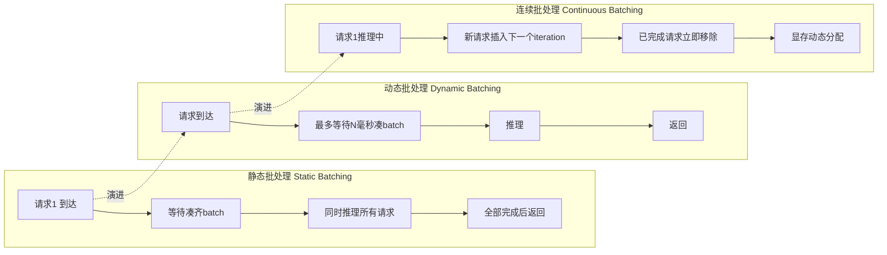
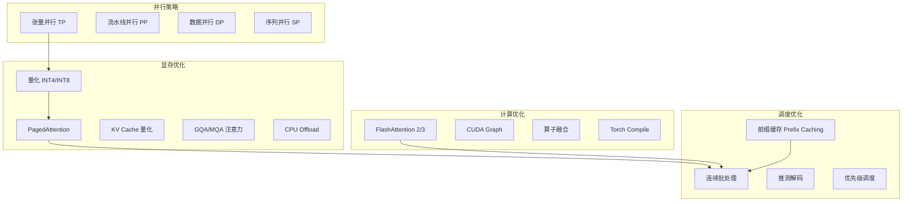
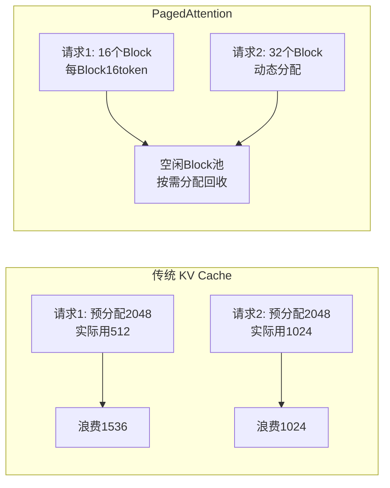
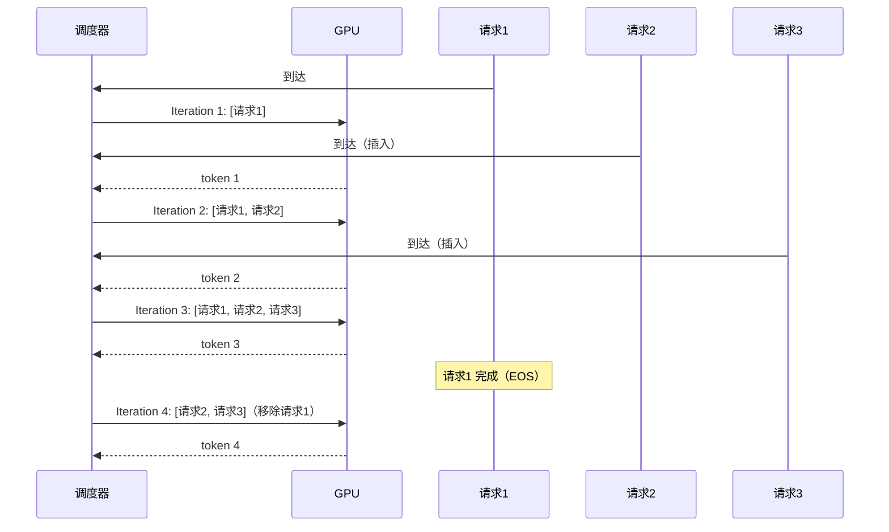

# GPU 显存优化与批处理

> **文档说明**：系统讲解 LLM 推理时的 GPU 显存优化与批处理技术，涵盖显存构成分析（权重/KV Cache/激活值）、PagedAttention 分页注意力、连续批处理（Continuous Batching）、FlashAttention、量化推理、张量并行与流水线并行、梯度检查点、CUDA Graph、显存碎片管理，含 vLLM/TGI 配置调优、显存计算公式、性能基准对比和生产部署最佳实践。
>
> **适用人群**：AI 应用开发者、需要部署高吞吐 LLM 推理服务的全栈工程师、关注 GPU 成本优化的技术负责人
>
> **前置知识**：[[模型量化-GPTQ-AWQ-GGUF]]、[[vLLM-高吞吐推理引擎]]、[[主流开源模型架构对比]]

---

## 一、概述

LLM 推理的核心瓶颈不是计算（FLOPs），而是**显存带宽**和**显存容量**。一个 70B 模型 FP16 权重就占 140GB，加上 KV Cache 和激活值，单卡 A100 80GB 根本跑不起来。GPU 显存优化与批处理的目标是：在有限显存下跑更大的模型、服务更多的并发请求、实现更高的吞吐量。

### 1. LLM 推理显存构成

| 显存占用项 | 计算公式（7B 模型, batch=32, seq=2048） | 占比 | 优化手段 |
|-----------|--------------------------------------|------|---------|
| **模型权重** | 参数量 × 字节数（FP16=2, INT4=0.5） | ~60-70% | 量化（INT4/INT8）、张量并行 |
| **KV Cache** | 2 × layers × batch × seq × hidden × 字节数 | ~20-30% | PagedAttention、GQA/MQA、KV Cache 量化 |
| **激活值** | batch × seq × hidden × 中间层大小 | ~5-10% | FlashAttention、梯度检查点（推理用不到） |
| **框架开销** | CUDA context、临时缓冲区 | ~2-5% | 减少框架 overhead、CUDA Graph |

**7B 模型 FP16, batch=32, seq=2048 显存估算**：
- 权重：7B × 2 bytes = 14 GB
- KV Cache：2 × 32层 × 32 × 2048 × 4096 × 2 bytes ≈ 34 GB（MHA）/ 8.5 GB（GQA）
- 激活值：约 2-4 GB
- 总计：约 50-55 GB（MHA）/ 25-30 GB（GQA）

### 2. 批处理演进



| 批处理方式 | 原理 | 吞吐 | 延迟 | 代表框架 |
|-----------|------|------|------|---------|
| **静态批处理** | 凑齐固定 batch 才推理 | 低（等待时间长） | 高 | 原始 HF Transformers |
| **动态批处理** | 等待固定时间凑 batch | 中 | 中 | TGI、TensorRT-LLM |
| **连续批处理** | 每个 token 迭代后动态增删请求 | 高（2-10x） | 低 | vLLM、SGLang |

### 3. 优化技术全景




<div style="background:linear-gradient(135deg,#f093fb,#f5576c);border-radius:16px;padding:20px;margin:16px 0;font-family:-apple-system,'Segoe UI','PingFang SC','Microsoft YaHei',sans-serif;color:#fff;overflow:hidden;box-shadow:0 8px 28px rgba(0,0,0,.14),0 3px 10px rgba(0,0,0,.08)">
<style>@keyframes flow{0%{transform:translateX(-10px);opacity:0}15%{transform:translateX(0);opacity:1}85%{transform:translateX(0);opacity:1}100%{transform:translateX(10px);opacity:0}}.flow-step{display:inline-block;background:rgba(255,255,255,.2);border:2px solid rgba(255,255,255,.5);border-radius:8px;padding:10px 14px;margin:4px;text-align:center;font-weight:600;font-size:13px;animation:flow 4s ease-in-out infinite;min-width:90px}.flow-step:nth-child(2){animation-delay:.5s}.flow-step:nth-child(4){animation-delay:1s}.flow-step:nth-child(6){animation-delay:1.5s}.flow-step:nth-child(8){animation-delay:2s}.flow-arrow{display:inline-block;font-size:20px;animation:flow 4s ease-in-out infinite;vertical-align:middle}.flow-code{background:rgba(0,0,0,.2);border-radius:6px;padding:8px 12px;margin-top:10px;font-family:monospace;font-size:12px;text-align:center}</style>
<div style="text-align:center;font-size:15px;font-weight:700;margin-bottom:14px;padding-bottom:10px;border-bottom:1.5px solid rgba(255,255,255,.22);letter-spacing:1px">💾 GPU 显存优化与批处理策略</div>
<div style="text-align:center;white-space:nowrap;overflow-x:auto">
<span class="flow-step">模型量化</span><span class="flow-arrow">→</span><span class="flow-step">KV Cache优化</span><span class="flow-arrow">→</span><span class="flow-step">梯度检查点</span><span class="flow-arrow">→</span><span class="flow-step">混合精度</span><span class="flow-arrow">→</span><span class="flow-step">连续批处理</span><span class="flow-arrow">→</span><span class="flow-step">并行策略</span>
</div>
<div class="flow-code">INT8/INT4压缩权重→分页/量化/前缀共享→重计算换显存→FP16/BF16→动态调度→TP/PP/DP</div>
</div>

> 🔍 **知识点深度解析**
>
> **作用**：GPU 显存优化和批处理是 LLM 训练和推理的核心工程技术，通过量化、混合精度、梯度检查点、KV Cache 管理、连续批处理、并行策略等手段，在有限显存下最大化模型规模和吞吐量。
>
> **原理**：LLM 的显存占用主要来自三部分：模型权重（参数×字节数）、激活值/KV Cache（随序列和批次增长）、优化器状态（训练时，是权重的2-4倍）。优化策略分层：权重层面用量化（FP8/INT8/INT4）和混合精度（BF16/FP16）降低权重占用；激活层面用梯度检查点（重计算换显存）和激活量化；KV Cache 用分页管理（PagedAttention）、量化、前缀共享；批处理用连续批处理替代静态批处理，动态加入/移出请求提升GPU利用率；多卡用张量并行（TP）、流水线并行（PP）、数据并行（DP）切分模型和数据。
>
> **用法要点**：① 推理优先量化：FP16→INT8→INT4，注意精度权衡 ② 训练用 BF16 混合精度+梯度检查点 ③ KV Cache 用 PagedAttention 或量化减少碎片 ④ 批处理用连续批处理，设置 max_batch_size 和 max_batch_prefill_tokens ⑤ 多卡推理用张量并行（TP），训练用 TP+PP+DP 组合 ⑥ 监控显存利用率，目标 85-95%（太低浪费，太高OOM） ⑦ OOM 排查顺序：减小batch→减小max_seq_len→降低量化位宽→增加GPU ⑧ 生产环境用 vLLM/TGI 自动管理显存和批处理

> 💡 **深度讲解**：LLM 推理的显存瓶颈本质是"状态膨胀"问题——模型权重是静态的，但 KV Cache 随序列长度和并发数线性增长，在长上下文和高并发场景下远超权重占用。批处理的演进（静态→动态→连续）本质是 GPU 利用率的不断提升：静态批处理受限于"最慢请求"，动态批处理受限于"等待窗口"，连续批处理通过 token 级调度实现 GPU 永不空闲。优化技术全景中，显存优化解决"能不能跑"，计算优化解决"跑得快不快"，并行策略解决"能不能跑大模型"，调度优化解决"能不能服务更多用户"，四层协同才能实现生产级推理服务。
>
> **📝 精简总结**：LLM 推理显存 = 权重(60-70%) + KV Cache(20-30%) + 激活值(5-10%) + 开销；批处理从静态演进到连续批处理，吞吐提升 2-10x；优化分四层——显存、计算、并行、调度。

---

## 二、底层原理

### 1. PagedAttention 原理

传统 KV Cache 为每个请求预分配连续显存，导致内部碎片（请求实际长度 < 预分配长度）和外部碎片（请求结束后显存不连续）。PagedAttention 借鉴操作系统的虚拟内存分页思想：



**关键机制**：
- KV Cache 被分成固定大小的 Block（通常 16 token）
- 每个请求维护一个 Block Table（逻辑块 → 物理块映射）
- 新请求从空闲 Block 池分配，请求结束后 Block 回收
- Block 不需要物理连续，通过 Block Table 索引
- 显存利用率从 40-60% 提升到 90%+

### 2. 连续批处理原理



每个 iteration（生成一个 token）后，调度器检查：
- 已完成的请求（生成 EOS）→ 移除，释放 KV Cache Block
- 新到达的请求 → 加入，分配 KV Cache Block
- 显存不足时 → 等待或拒绝

### 3. FlashAttention 原理

FlashAttention 通过**分块计算 + 不实例化注意力矩阵**来减少显存访问：

```text
传统注意力: O = softmax(QK^T / √d) V
  - 实例化 N×N 注意力矩阵 → O(N²) 显存
  - 多次 HBM（显存）读写

FlashAttention:
  - 将 Q/K/V 分块，逐块计算
  - 在线 softmax（不存储完整矩阵）
  - 只在 SRAM（高速缓存）中计算
  - 显存复杂度 O(N) 而非 O(N²)
  - 速度提升 2-4x
```

### 4. 张量并行原理

张量并行将模型权重按维度切分到多卡：

```mermaid
graph LR
    subgraph 张量并行 TP=2
        GPU0[GPU 0<br/>权重前半部分]
        GPU1[GPU 1<br/>权重后半部分]
    end
    INPUT[输入] --> GPU0
    INPUT --> GPU1
    GPU0 -->|all-reduce| OUT[输出]
    GPU1 -->|all-reduce| OUT
```

- **行并行**：权重矩阵按行切分，每卡计算部分结果，最后 all-reduce 求和
- **列并行**：权重矩阵按列切分，每卡输出部分隐藏状态，最后拼接
- 通信开销：每层需要一次 all-reduce，适合 NVLink 高速互联

> 💡 **深度讲解**：PagedAttention 的核心洞察是"KV Cache 的访问模式与虚拟内存高度相似"——都是逻辑连续、物理离散、按需分配、用完回收。传统 KV Cache 的预分配策略导致内部碎片（请求短于预分配长度）和外部碎片（请求结束后显存不连续），显存利用率仅 40-60%。PagedAttention 通过 Block Table 实现逻辑-物理映射，将利用率提升到 90%+，这是 vLLM 吞吐远超 HF 原生的根本原因。连续批处理与 PagedAttention 是"天作之合"——连续批处理需要动态增删请求，PagedAttention 的 Block 池化分配恰好支持这种动态性。FlashAttention 则从计算角度优化，通过分块计算和在线 softmax 将注意力复杂度从 O(N²) 显存降到 O(N)，同时减少 HBM 访问次数实现加速。张量并行是"用空间换规模"——通过多卡切分权重支持超大模型，但每层的 all-reduce 通信开销使其高度依赖 NVLink 等高速互联，PCIe 环境下张量并行效率会显著下降。
>
> **📝 精简总结**：PagedAttention 借鉴虚拟内存分页，KV Cache 利用率从 50%→90%+；连续批处理实现 token 级动态调度；FlashAttention 分块计算降显存提速度；张量并行切分权重到多卡，需高速互联。

---

## 三、实操

### 1. vLLM 显存与批处理调优

```python
# deploy/vllm_optimized.py — vLLM 优化部署
from vllm import LLM, SamplingParams
from vllm.config import VllmConfig

# 优化配置
llm = LLM(
    model="Qwen/Qwen2.5-7B-Instruct",

    # === 显存优化 ===
    quantization="awq",               # AWQ 4bit 量化，权重显存减 75%
    gpu_memory_utilization=0.90,      # GPU 显存使用率（留 10% 给框架）
    max_model_len=8192,               # 限制最大序列长度，省 KV Cache
    enforce_eager=False,              # 启用 CUDA Graph 加速

    # === 批处理优化 ===
    max_num_seqs=256,                 # 最大并发序列数（连续批处理）
    max_num_batched_tokens=8192,      # 单 iteration 最大 token 数
    enable_chunked_prefill=True,      # 分块预填充（长 prompt 不阻塞）
    max_num_partial_prefills=1,       # 同时预填充的请求数

    # === KV Cache 优化 ===
    kv_cache_dtype="fp8",             # KV Cache 用 FP8，再省 50% 显存
    enable_prefix_caching=True,       # 前缀缓存（相同 system prompt 复用）

    # === 并行 ===
    tensor_parallel_size=1,           # 单卡；70B 模型设为 2/4/8

    # === 其他 ===
    trust_remote_code=True,
    disable_log_stats=False,
)

# 推理
sampling = SamplingParams(
    temperature=0.7,
    max_tokens=512,
    top_p=0.9,
)

# 批量推理（vLLM 自动连续批处理）
prompts = [f"问题 {i}: 解释一下{x}" for i, x in enumerate(
    ["Transformer", "注意力机制", "RAG", "LoRA", "强化学习"] * 10)]
outputs = llm.generate(prompts, sampling)
for output in outputs[:5]:
    print(f"Q: {output.prompt[:30]}... A: {output.outputs[0].text[:50]}...")
```

### 2. 显存用量精确计算

```python
# utils/memory_calculator.py — LLM 显存计算器
def estimate_llm_memory(
    params_billion: float,      # 模型参数量（B）
    batch_size: int,            # 并发请求数
    seq_length: int,            # 序列长度
    num_layers: int,            # Transformer 层数
    hidden_size: int,           # 隐藏层维度
    num_kv_heads: int,          # KV 头数（GQA）
    head_dim: int = 128,        # 每个头的维度
    weight_bits: int = 16,      # 权重量化位宽
    kv_bits: int = 16,          # KV Cache 位宽
) -> dict:
    """估算 LLM 推理显存用量（GB）"""

    bytes_per_weight = weight_bits / 8
    bytes_per_kv = kv_bits / 8

    # 1. 模型权重
    weight_memory = params_billion * 1e9 * bytes_per_weight / (1024**3)

    # 2. KV Cache: 2(K和V) × layers × batch × seq × kv_heads × head_dim × bytes
    kv_memory = (2 * num_layers * batch_size * seq_length
                 * num_kv_heads * head_dim * bytes_per_kv / (1024**3))

    # 3. 激活值（估算，约为 hidden 的几倍）
    activation_memory = batch_size * seq_length * hidden_size * 4 * bytes_per_kv / (1024**3)

    # 4. 框架开销（CUDA context + 临时缓冲）
    overhead = 2.0  # GB，经验值

    total = weight_memory + kv_memory + activation_memory + overhead

    return {
        "权重 (GB)": round(weight_memory, 2),
        "KV Cache (GB)": round(kv_memory, 2),
        "激活值 (GB)": round(activation_memory, 2),
        "框架开销 (GB)": round(overhead, 2),
        "总计 (GB)": round(total, 2),
        "单卡可行(80GB)": total <= 80,
        "单卡可行(40GB)": total <= 40,
        "单卡可行(24GB)": total <= 24,
    }


# 计算不同配置
configs = [
    # (参数B, batch, seq, layers, hidden, kv_heads, weight_bits, kv_bits)
    (7, 32, 2048, 32, 4096, 8, 16, 16),    # 7B FP16, GQA
    (7, 32, 2048, 32, 4096, 8, 4, 8),      # 7B AWQ + KV FP8
    (70, 16, 4096, 80, 8192, 8, 4, 8),     # 70B AWQ + KV FP8
    (14, 64, 8192, 48, 5120, 8, 4, 8),     # 14B AWQ, 大batch长序列
]

for cfg in configs:
    result = estimate_llm_memory(*cfg)
    print(f"\n配置: {cfg[0]}B, batch={cfg[1]}, seq={cfg[2]}, "
          f"权重{cfg[6]}bit, KV{cfg[7]}bit")
    for k, v in result.items():
        print(f"  {k}: {v}")
```

### 3. TGI（Text Generation Inference）优化配置

```bash
# TGI Docker 启动命令（优化版）
docker run -d --gpus all \
  -p 8080:80 \
  -v $PWD/data:/data \
  ghcr.io/huggingface/text-generation-inference:latest \
  --model-id Qwen/Qwen2.5-7B-Instruct \
  --quantize awq \
  --dtype float16 \
  --max-input-length 4096 \
  --max-total-tokens 6144 \
  --max-batch-prefill-tokens 4096 \
  --max-batch-total-tokens 32768 \
  --max-concurrent-requests 128 \
  --cuda-memory-fraction 0.9 \
  --flash-attention \
```
  --trust-remote-code

### 4. 多卡张量并行部署（70B 模型）

```python
# vLLM 70B 模型 2 卡张量并行
python -m vllm.entrypoints.openai.api_server \
  --model meta-llama/Meta-Llama-3.1-70B-Instruct \
  --quantization awq \
  --tensor-parallel-size 2 \
  --gpu-memory-utilization 0.9 \
  --max-model-len 32768 \
  --max-num-seqs 64 \
  --kv-cache-dtype fp8 \
  --enable-prefix-caching \
  --enable-chunked-prefill \
  --port 8000

# 70B 模型 4 卡（更大 batch）
python -m vllm.entrypoints.openai.api_server \
  --model meta-llama/Meta-Llama-3.1-70B-Instruct \
  --quantization awq \
  --tensor-parallel-size 4 \
  --gpu-memory-utilization 0.9 \
  --max-model-len 65536 \
  --max-num-seqs 128 \
  --kv-cache-dtype fp8 \
  --port 8000
```

### 5. 性能基准测试脚本

```python
# eval/benchmark_throughput.py — 推理性能基准
import time
import statistics
from openai import OpenAI

client = OpenAI(base_url="http://localhost:8000/v1", api_key="dummy")


def benchmark_concurrent(num_concurrent: int, prompt: str, max_tokens: int = 256):
    """测试并发吞吐量"""
    import concurrent.futures

    def single_request():
        t0 = time.time()
        resp = client.chat.completions.create(
            model="Qwen/Qwen2.5-7B-Instruct",
            messages=[{"role": "user", "content": prompt}],
            max_tokens=max_tokens,
            temperature=0.7,
        )
        latency = time.time() - t0
        tokens = resp.usage.completion_tokens
        return {"latency": latency, "tokens": tokens, "tps": tokens / latency}

    t0 = time.time()
    with concurrent.futures.ThreadPoolExecutor(max_workers=num_concurrent) as executor:
        results = list(executor.map(lambda _: single_request(), range(num_concurrent)))
    total_time = time.time() - t0

    total_tokens = sum(r["tokens"] for r in results)
    return {
        "并发数": num_concurrent,
        "总耗时(s)": round(total_time, 2),
        "总输出token": total_tokens,
        "系统吞吐(tok/s)": round(total_tokens / total_time, 1),
        "平均延迟(s)": round(statistics.mean(r["latency"] for r in results), 2),
        "P95延迟(s)": round(sorted(r["latency"] for r in results)[int(0.95 * len(results)) - 1], 2),
        "平均单请求吞吐(tok/s)": round(statistics.mean(r["tps"] for r in results), 1),
    }


# 不同并发级别测试
prompt = "请详细解释深度学习中的反向传播算法，包括链式法则和梯度计算过程。"
for n in [1, 4, 16, 32, 64, 128]:
    try:
        result = benchmark_concurrent(n, prompt)
        print(f"\n并发 {n}:")
        for k, v in result.items():
            print(f"  {k}: {v}")
    except Exception as e:
        print(f"并发 {n}: 错误 - {e}")
        break
```

> 💡 **深度讲解**：vLLM 调优的核心是"显存预算分配"——`gpu_memory_utilization` 决定给推理分配多少显存（留 10% 给框架和 CUDA context），`max_model_len` 决定 KV Cache 的最大长度，`max_num_seqs` 决定并发数，三者共同决定了服务的吞吐-延迟-并发权衡。`enable_chunked_prefill` 是长 prompt 场景的关键——没有它，一个 8k token 的 prompt 会在 prefill 阶段阻塞所有解码请求数秒；分块预填充将长 prompt 切成多个 chunk 与解码请求交替执行，避免"饿死"短请求。KV Cache FP8 量化是"几乎免费的显存优化"——在 Hopper/Ada 架构上 FP8 计算有硬件加速，精度损失极小，显存直接减半。多卡张量并行时，TP 大小的选择需要权衡：TP=2 适合 70B 模型在 2 卡 A100 上，TP=4/8 适合更大模型或更高并发，但通信开销随 TP 增大而增加，NVLink 是多卡高效并行的前提。
>
> **📝 精简总结**：vLLM 调优核心是显存预算分配（gpu_memory_utilization/max_model_len/max_num_seqs 三角权衡）；chunked prefill 解决长 prompt 阻塞；KV FP8 几乎免费减半显存；多卡 TP 需 NVLink 支撑。

---

## 四、常见问题与排查

| 问题现象 | 原因分析 | 解决方案 |
|---------|---------|---------|
| vLLM 启动报 "CUDA out of memory" | `gpu_memory_utilization` 设太高，或 `max_model_len` 太大 | 降低 `gpu_memory_utilization` 到 0.85；减小 `max_model_len`；启用量化 `quantization="awq"`；用 `kv_cache_dtype="fp8"` |
| 并发高时延迟急剧上升 | KV Cache 不足，请求被排队；或 max_num_seqs 太小 | 增大 `max_num_seqs`；减小 `max_model_len` 释放 KV Cache；启用 `enable_chunked_prefill`；监控 `gpu_cache_usage` 指标 |
| 吞吐量上不去（< 10 tok/s） | 未启用连续批处理，或 batch 太小，或用了 HF 原生推理 | 用 vLLM/SGLang 而非 HF pipeline；增大 `max_num_batched_tokens`；启用 FlashAttention；检查是否被 CPU 预处理瓶颈 |
| 长 prompt 请求阻塞其他请求 | 预填充（prefill）阶段占用全部计算资源，解码请求等待 | 启用 `enable_chunked_prefill=True`；设置 `max_num_partial_prefills`；限制 `max_input_length`；长请求路由到专用实例 |
| 多卡张量并行时速度反而慢 | 卡间通信带宽不足（PCIe 而非 NVLink），或 TP 粒度过细 | 确保 GPU 间有 NVLink；70B 用 TP=2 而非 TP=8；减少不必要的 all-reduce；用流水线并行替代部分张量并行 |
| KV Cache 显存占用远超预期 | 用了 MHA 而非 GQA/MQA，或 seq_length 设太大 | 选择 GQA 架构模型（LLaMA 3/Qwen 2.5）；减小 `max_model_len`；用 `kv_cache_dtype="fp8"` 或 `"auto"` |
| 量化后吞吐没有提升 | 量化减少了权重显存但计算仍用 FP16 kernel，或 GPU 不支持 INT8 tensor core | 用 vLLM 的 AWQ 专用 kernel（自动启用）；确保 GPU 支持 INT8（Ampere+）；量化主要省显存，吞吐提升来自更大 batch |
| 前缀缓存不生效 | 请求的前缀不完全相同（有微小差异），或未启用 | 确保 `enable_prefix_caching=True`；相同的 system prompt 放在最前面；vLLM 自动 hash 前缀，完全相同才命中 |
| GPU 显存碎片化严重 | 频繁创建销毁推理实例，或动态分配导致碎片 | 用 vLLM 的 PagedAttention（自动管理碎片）；服务常驻不重启；用 CUDA 统一内存；设置 `gpu_memory_utilization` 预留空间 |
| 推测解码反而变慢 | 草稿模型质量差，接受率低（< 50%），额外开销大于收益 | 用同系列小模型作为草稿（如 Qwen2.5-0.5B 草稿 + 7B 验证）；接受率 > 70% 才有收益；短输出（< 32 token）不用推测解码 |

> 💡 **深度讲解**：LLM 推理服务的故障排查需要建立"显存-计算-调度"三维诊断思维。OOM 问题本质是显存预算超支——需要区分是权重太大（量化/多卡）、KV Cache 太多（降并发/降长度/FP8）、还是框架开销（降 gpu_memory_utilization）。延迟问题需要区分 TTFT（首 token 延迟，受 prefill 计算量和排队影响）和 TPOT（每 token 延迟，受 decode 计算和 batch 大小影响）——TTFT 高通常是 prefill 瓶颈（用 FlashAttention/chunked prefill），TPOT 高通常是 decode 瓶颈（用量化/推测解码/CUDA Graph）。吞吐问题本质是 GPU 利用率不足——连续批处理是最有效的手段，但需要 PagedAttention 配合才能实现动态增删。量化后吞吐不提升是常见误区——量化主要减少显存占用，吞吐提升来自于更大的 batch 带来的更高 GPU 利用率，而非计算本身变快（INT8 kernel 在某些 GPU 上反而比 FP16 慢）。
>
> **📝 精简总结**：排查需三维诊断——OOM 查显存预算（权重/KV/开销），延迟分 TTFT（prefill）和 TPOT（decode），吞吐查 GPU 利用率（连续批处理）；量化主要省显存，吞吐提升来自更大 batch。

---

## 五、进阶与最佳实践

### 1. 生产部署配置推荐

| 模型 | GPU | 量化 | TP | max_num_seqs | 预估吞吐 |
|------|-----|------|-----|-------------|---------|
| 7B | 1× A100 80GB | AWQ 4bit | 1 | 256 | 3000+ tok/s |
| 7B | 1× RTX 4090 24GB | AWQ 4bit | 1 | 64 | 800+ tok/s |
| 14B | 1× A100 80GB | AWQ 4bit | 1 | 128 | 2000+ tok/s |
| 32B | 1× A100 80GB | AWQ 4bit | 1 | 64 | 1000+ tok/s |
| 70B | 2× A100 80GB | AWQ 4bit | 2 | 64 | 1500+ tok/s |
| 70B | 4× A100 80GB | FP16 | 4 | 128 | 3000+ tok/s |

### 2. 显存优化优先级

按投入产出比排序：
1. **量化（INT4）**：显存减 75%，质量损失 < 3%，性价比最高
2. **GQA/MQA 模型**：KV Cache 减 50-75%，无质量损失（选模型时决定）
3. **PagedAttention**：KV Cache 利用率从 50% → 90%，无质量损失
4. **KV Cache FP8**：KV Cache 再减 50%，质量损失极小
5. **连续批处理**：吞吐提升 2-10x，无质量损失
6. **FlashAttention**：速度提升 2-4x，显存减少
7. **前缀缓存**：相同前缀的请求复用 KV Cache，省 30-50% 计算
8. **张量并行**：支持更大模型，但有通信开销

### 3. 监控指标

生产环境必须监控：
- `gpu_cache_usage`：KV Cache 使用率（> 90% 说明需要扩容或降并发）
- `num_requests_running` / `num_requests_waiting`：运行中/等待中请求数
- `time_to_first_token`：首 token 延迟（TTFT）
- `time_per_output_token`：每 token 延迟（TPOT）
- `request_success_rate`：请求成功率
- `gpu_utilization`：GPU 利用率（应 > 70%，否则 batch 太小）

### 4. 成本优化策略

- **按流量分实例**：小流量用 7B 单卡，大流量用 70B 多卡，通过网关路由
- **弹性伸缩**：基于队列长度自动扩缩容 vLLM 实例
- **混合精度**：高峰用 FP16 保质量，低峰用 INT4 省成本
- **请求批处理窗口**：低延迟要求设小 batch（1-4），高吞吐要求设大 batch（32-128）
- **冷启动优化**：用 CUDA Graph + 模型预加载，减少启动时间

> 💡 **深度讲解**：生产部署的显存优化需要遵循"性价比优先"原则——量化（INT4）以 < 3% 的质量损失换取 75% 显存减少，是投入产出比最高的优化；GQA/MQA 架构在模型选型时决定，KV Cache 减少 50-75% 且无质量损失；PagedAttention 和连续批处理是 vLLM 的"免费午餐"，切换框架即可获得 2-10x 吞吐提升。监控体系中，`gpu_cache_usage` 是最关键的领先指标——当 KV Cache 使用率超过 90% 时，新请求会被排队，延迟开始急剧上升，需要提前扩容或降并发。成本优化的核心是"按价值分配算力"——简单任务用小模型（7B），复杂任务用大模型（70B），通过 AI 网关自动路由，可在保证质量的前提下降低 50-90% 成本。弹性伸缩基于队列长度而非 GPU 利用率——因为 GPU 利用率在连续批处理下通常已经很高，队列长度才是真正的拥塞信号。
>
> **📝 精简总结**：优化优先级：量化(INT4) > GQA架构 > PagedAttention > KV FP8 > 连续批处理 > FlashAttention > 前缀缓存 > 张量并行；监控 gpu_cache_usage 是领先指标；成本优化核心是按价值分配算力（小模型路由+弹性伸缩）。

---

## 🔗 关联笔记

- [[vLLM-高吞吐推理引擎]] — PagedAttention 与连续批处理的核心实现，高吞吐推理引擎
- [[KV Cache与推理加速]] — KV Cache 原理、内存计算、推理加速技术体系
- [[推测解码与Speculative Decoding]] — 草稿模型+验证机制的解码加速技术
- [[模型量化-GPTQ-AWQ-GGUF]] — 模型量化原理与工具链，显存优化基础
- [[模型服务化-OpenAI兼容API]] — 推理服务的 API 标准化与多模型统一接口

## 📖 前置知识

- [[模型量化-GPTQ-AWQ-GGUF]] — 理解权重量化原理
- [[vLLM-高吞吐推理引擎]] — 理解 PagedAttention 和连续批处理
- [[主流开源模型架构对比]] — 理解 GQA/MQA 等架构差异

## 🏷️ 相关标签

`#AI工程化` `#LLM` `#效率工具` `#性能优化`

---

[[Home|🏠 返回首页]] · [[MOC-AI与效率工具|📚 AI与效率工具]] · [[MOC-AI工程化|🤖 AI工程化]]
