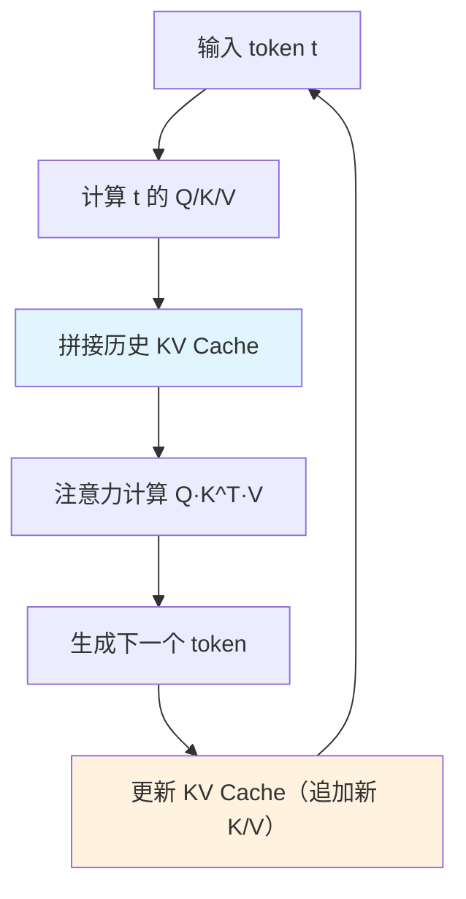

# KV Cache与推理加速

> **文档说明**：系统讲解大语言模型推理中的 KV Cache 原理、内存计算、各种推理加速技术（量化、FlashAttention、PagedAttention、投机采样、连续批处理），以及主流推理框架和显存优化策略。
>
> **适用人群**：AI 工程师、后端开发者、需要部署和优化大模型推理的开发者
>
> **前置知识**：[[Transformer架构核心]]、[[大模型推理优化]]、[[位置编码进阶-RoPE-ALiBi]]

---

## 一、概述

### 1. 大模型推理的挑战

```text
LLM 推理的核心挑战：
- 自回归生成：逐 token 生成，延迟高
- 显存瓶颈：KV Cache 随序列长度线性增长
- 计算瓶颈：注意力计算复杂度 O(n²)
- 吞吐瓶颈：单请求 GPU 利用率低
- 成本高昂：GPU 资源昂贵

推理优化方向：
1. 计算优化：FlashAttention、算子融合
2. 显存优化：KV Cache 管理、量化、分页
3. 调度优化：连续批处理、投机采样
4. 算法优化：模型压缩、蒸馏、剪枝
```

### 2. 推理阶段 vs 训练阶段

| 维度 | 训练 | 推理 |
|------|------|------|
| **计算模式** | 前向+反向 | 仅前向 |
| **序列长度** | 固定（padding） | 动态增长 |
| **批大小** | 大 | 小/动态 |
| **显存占用** | 梯度+优化器状态 | KV Cache |
| **延迟要求** | 不敏感 | 高敏感 |
| **吞吐目标** | 高吞吐 | 低延迟+高吞吐 |


<div style="background:linear-gradient(135deg,#f093fb,#f5576c);border-radius:16px;padding:20px;margin:16px 0;font-family:-apple-system,'Segoe UI','PingFang SC','Microsoft YaHei',sans-serif;color:#fff;overflow:hidden;box-shadow:0 8px 28px rgba(0,0,0,.14),0 3px 10px rgba(0,0,0,.08)">
<style>@keyframes flow{0%{transform:translateX(-10px);opacity:0}15%{transform:translateX(0);opacity:1}85%{transform:translateX(0);opacity:1}100%{transform:translateX(10px);opacity:0}}.flow-step{display:inline-block;background:rgba(255,255,255,.2);border:2px solid rgba(255,255,255,.5);border-radius:8px;padding:10px 14px;margin:4px;text-align:center;font-weight:600;font-size:13px;animation:flow 4s ease-in-out infinite;min-width:90px}.flow-step:nth-child(2){animation-delay:.5s}.flow-step:nth-child(4){animation-delay:1s}.flow-step:nth-child(6){animation-delay:1.5s}.flow-step:nth-child(8){animation-delay:2s}.flow-arrow{display:inline-block;font-size:20px;animation:flow 4s ease-in-out infinite;vertical-align:middle}.flow-code{background:rgba(0,0,0,.2);border-radius:6px;padding:8px 12px;margin-top:10px;font-family:monospace;font-size:12px;text-align:center}</style>
<div style="text-align:center;font-size:15px;font-weight:700;margin-bottom:14px;padding-bottom:10px;border-bottom:1.5px solid rgba(255,255,255,.22);letter-spacing:1px">🚀 LLM 推理优化技术全景</div>
<div style="text-align:center;white-space:nowrap;overflow-x:auto">
<span class="flow-step">KV Cache缓存</span><span class="flow-arrow">→</span><span class="flow-step">量化压缩</span><span class="flow-arrow">→</span><span class="flow-step">FlashAttention</span><span class="flow-arrow">→</span><span class="flow-step">PagedAttention</span><span class="flow-arrow">→</span><span class="flow-step">连续批处理</span><span class="flow-arrow">→</span><span class="flow-step">投机解码</span>
</div>
<div class="flow-code">缓存历史K/V避免重算→4/8bit降低显存→IO优化注意力→分页管理显存→动态调度→小模型草稿加速</div>
</div>

> 🔍 **知识点深度解析**
>
> **作用**：KV Cache 通过缓存历史 token 的 Key/Value 向量避免重复计算，将每步注意力计算从 O(n²) 降到 O(n)，是 LLM 推理最基础的优化技术；但 KV Cache 随序列长度线性增长，成为推理显存的主要瓶颈。
>
> **原理**：自回归生成中，每个新 token 的注意力计算需要所有历史 token 的 K/V。若无缓存，每生成一个 token 都要重新计算全部历史 K/V，计算量随序列长度平方增长。KV Cache 将已计算的 K/V 保存在显存中，每步只需计算新 token 的 K/V 并拼接历史缓存，将每步计算降为线性。但缓存本身占用大量显存（7B模型约512KB/token），长上下文和高并发场景下远超模型权重，催生了量化、分页、前缀共享等优化技术。
>
> **用法要点**：① KV Cache 是推理标配，所有框架默认开启 ② 显存不足时优先用 KV Cache 量化（FP8/INT8/INT4） ③ 长上下文用 PagedAttention 或 FlashAttention 减少显存碎片 ④ 相同前缀多请求场景开启前缀缓存（Prefix Caching） ⑤ 监控 KV Cache 显存占用，设置 max_seq_len 合理上限 ⑥ 批处理时注意不同长度序列的 padding 浪费 ⑦ 推理优化优先级：KV Cache>量化>FlashAttention>连续批处理>投机解码

> 💡 **深度讲解**：LLM 推理与训练的本质差异在于"状态管理"——训练时序列长度固定、batch 固定，可以通过 padding 和梯度累积最大化 GPU 利用率；推理时序列长度动态增长（自回归生成）、请求到达时间随机，传统的静态批处理会导致 GPU 大量空闲。KV Cache 是推理特有的优化技术，它将每步计算的 Key 和 Value 缓存起来，避免重复计算历史 token 的注意力，将每步计算量从 O(n²) 降到 O(n)。但 KV Cache 本身成为新的瓶颈——它随序列长度和并发数线性增长，在长上下文和高并发场景下远超模型权重占用。推理优化的四个方向（计算/显存/调度/算法）本质上都是围绕"如何在有限显存下服务更多并发请求"展开的。
>
> **📝 精简总结**：推理 vs 训练的核心差异是动态序列和随机请求；KV Cache 将每步计算从 O(n²) 降到 O(n)，但自身成为显存瓶颈；优化分计算/显存/调度/算法四方向。

---

## 二、KV Cache 原理

### 1. 为什么需要 KV Cache

```text
自回归生成过程：
输入: "我喜欢" → 生成 "吃"
输入: "我喜欢吃" → 生成 "苹果"
输入: "我喜欢吃苹果" → 生成 "。"

问题：
- 每生成一个 token，都要重新计算所有历史 token 的 K 和 V
- "我喜欢" 这部分的 K/V 在每一步都重复计算
- 计算量随序列长度线性增长

解决方案：KV Cache
- 缓存历史 token 的 Key 和 Value
- 每步只计算新 token 的 K/V
- 拼接历史 K/V 一起做注意力
- 计算量从 O(n²) 降到 O(n)（每步）
```

### 2. KV Cache 工作流程



```text
第 1 步（prefill）：
输入 "我喜欢吃"
- 计算所有 4 个 token 的 K/V
- 保存到 KV Cache: [K1,K2,K3,K4], [V1,V2,V3,V4]
- 生成第 5 个 token "苹果"

第 2 步（decode）：
输入 "苹果"
- 只计算 "苹果" 的 K/V: [K5], [V5]
- 拼接历史: [K1..K5], [V1..V5]
- 注意力计算用完整的 K/V
- 生成第 6 个 token
- 追加到 KV Cache
```

### 3. KV Cache 内存计算

```text
KV Cache 大小公式：
KV_Cache = 2 × num_layers × num_heads × head_dim × seq_len × batch_size × bytes_per_element

参数说明：
- 2：K 和 V 各一份
- num_layers：Transformer 层数
- num_heads × head_dim = hidden_size
- seq_len：序列长度
- batch_size：并发请求数
- bytes_per_element：FP16=2, INT8=1, INT4=0.5

示例：LLaMA-2 7B
- num_layers = 32
- hidden_size = 4096
- seq_len = 4096
- batch_size = 1
- FP16 (2 bytes)

KV_Cache = 2 × 32 × 4096 × 4096 × 1 × 2
         = 2 × 32 × 4096 × 4096 × 2
         = 2,147,483,648 bytes
         = 2 GB（单请求！）

batch_size=32 时：64 GB（远超单卡显存）
```

### 4. KV Cache 是显存瓶颈

```text
模型参数 vs KV Cache：
- LLaMA-2 7B 参数（FP16）：14 GB
- 单请求 KV Cache（4096 长度）：2 GB
- 32 并发 KV Cache：64 GB

结论：
- 长序列+高并发时，KV Cache 远超模型参数
- KV Cache 是推理显存的主要瓶颈
- 优化 KV Cache 是提升吞吐的关键
```

> 💡 **深度讲解**：KV Cache 的工作流程分为 prefill（预填充）和 decode（解码）两个阶段，两者的计算特征截然不同。prefill 阶段一次性计算所有 prompt token 的 K/V，计算密集型（O(n²) 注意力），但只需一次；decode 阶段每步只计算一个新 token 的 K/V，内存密集型（需要读取全部历史 K/V），需要重复 N 次。这种"计算-内存"不对称性是推理优化的关键洞察——prefill 优化用 FlashAttention 减少 HBM 访问，decode 优化用 KV Cache 量化减少数据量、用连续批处理提升 GPU 利用率。KV Cache 的内存公式揭示了优化杠杆：减少层数（模型架构决定）、减少 KV 头数（GQA/MQA）、减少序列长度（业务限制）、减少位宽（量化）、减少并发（限流），其中量化和 GQA 是投入产出比最高的手段。PagedAttention 则从管理角度优化，将显存利用率从 50% 提升到 90%+。
>
> **📝 精简总结**：KV Cache 分 prefill（计算密集，一次）和 decode（内存密集，N次）两阶段；内存公式揭示优化杠杆：量化、GQA、限长度、降并发；PagedAttention 提升显存利用率到 90%+。

---

## 三、推理加速技术

### 1. 量化（Quantization）

```text
量化原理：
- 用低精度表示权重和 KV Cache
- FP16 → INT8 → INT4
- 减少显存占用，提升计算速度

量化类型：
1. 权重量化：只量化模型权重
2. KV Cache 量化：量化 KV Cache（显存优化显著）
3. 激活量化：量化激活值（计算优化）

量化方法：
- RTN（Round To Nearest）：简单，质量损失小
- GPTQ：训练后量化，精度高
- AWQ：激活感知量化，保护重要权重
- SmoothQuant：平滑激活，INT8 推理
```

```python
# 量化示例（bitsandbytes）
from transformers import AutoModelForCausalLM, BitsAndBytesConfig

bnb_config = BitsAndBytesConfig(
    load_in_4bit=True,
    bnb_4bit_quant_type="nf4",
    bnb_4bit_compute_dtype=torch.float16,
    bnb_4bit_use_double_quant=True,
)

model = AutoModelForCausalLM.from_pretrained(
    "meta-llama/Llama-2-7b",
    quantization_config=bnb_config,
    device_map="auto",
)
# 7B 模型 FP16 需 14GB，4bit 只需约 4GB
```

### 2. FlashAttention

```text
FlashAttention 原理：
- 标准注意力：O(n²) 显存，多次 HBM 读写
- FlashAttention：分块计算，O(n) 显存，减少 HBM 读写
- 利用 SRAM（高速缓存）做计算
- 不改变数学结果，只是计算顺序优化

版本：
- FlashAttention-1：IO 感知，2-4x 加速
- FlashAttention-2：更好的并行，2x 于 v1
- FlashAttention-3：Hopper 架构优化

效果：
- 训练：2-4x 加速，显存减少
- 推理：prefill 阶段加速明显
- 支持：A100、H100、RTX 30/40 系列
```

### 3. PagedAttention（vLLM）

```text
PagedAttention 原理：
- 借鉴操作系统虚拟内存和分页
- KV Cache 分成固定大小的块（block）
- 每个请求的 KV Cache 是块的逻辑连续序列
- 物理块可以不连续，按需分配

解决的问题：
- 传统 KV Cache：预分配最大长度，内部碎片严重
- PagedAttention：按需分配，碎片率 <4%
- 支持共享前缀（多请求共享相同 prompt 的 KV）

效果：
- 显存利用率从 40-60% 提升到 90%+
- 吞吐提升 2-4x
- 是 vLLM 的核心技术
```

```text
传统 KV Cache（连续内存）：
请求1: [K1 K2 K3 _ _ _]  预分配 6，只用 3，浪费 50%
请求2: [K1 K2 _ _ _ _]  预分配 6，只用 2，浪费 67%

PagedAttention（分页）：
Block 大小 = 2
请求1: Block1[K1,K2] → Block2[K3,_]  只用 1.5 块
请求2: Block3[K1,K2]  只用 1 块
按需分配，几乎无浪费
```

### 4. 投机采样（Speculative Decoding）

```text
投机采样原理：
- 用小模型（草稿模型）快速生成多个候选 token
- 用大模型（目标模型）一次验证所有候选
- 接受正确的，拒绝错误的
- 减少大模型的串行调用次数

过程：
1. 小模型生成 γ 个候选 token（如 γ=5）
2. 大模型一次前向验证这 γ 个 token
3. 接受前 n 个匹配的 token
4. 从第 n+1 个重新开始

效果：
- 延迟降低 2-3x
- 输出分布不变（数学等价）
- 需要一个小的草稿模型
- 适用于自回归解码阶段
```

### 5. 连续批处理（Continuous Batching）

```text
传统批处理（Static Batching）：
- 一批请求一起开始，一起结束
- 短请求要等长请求完成
- GPU 利用率低

连续批处理（Continuous Batching / In-flight Batching）：
- 请求完成立即离开，新请求立即加入
- 每一步动态调整 batch
- GPU 始终满负荷

实现框架：
- vLLM：连续批处理 + PagedAttention
- TensorRT-LLM：in-flight batching
- Text Generation Inference：continuous batching

效果：
- 吞吐提升 10-100x（高并发场景）
- 平均延迟降低
```

### 6. 其他加速技术

| 技术 | 原理 | 效果 |
|------|------|------|
| **算子融合** | 多个算子合并，减少内存读写 | 1.5-2x 加速 |
| **CUDA Graph** | 捕获 GPU 操作图，减少启动开销 | 小 batch 延迟降低 |
| **Torch.compile** | 自动编译优化计算图 | 1.2-1.5x 加速 |
| **模型并行** | 张量/流水线并行，多卡分摊 | 支持超大模型 |
| **KV Cache 量化** | KV Cache 用 INT8/INT4 | 显存减半/减 3/4 |
| **前缀缓存** | 缓存系统提示的 KV，多请求共享 | 重复 prompt 加速 |
| **分块预填充** | 长 prompt 分块计算，避免峰值 | 支持超长上下文 |

> 💡 **深度讲解**：六大推理加速技术可以按"优化层级"分类理解。量化是"数据表示层"优化——用更少的 bit 表示相同的信息，FP16→INT4 可减少 75% 显存，但需要处理精度损失（GPTQ/AWQ 通过校准数据保护重要权重）。FlashAttention 是"计算模式层"优化——不改变数学结果，只改变计算顺序，通过分块计算和在线 softmax 将注意力显存从 O(N²) 降到 O(N)，同时减少 HBM 访问实现加速。PagedAttention 是"内存管理层"优化——借鉴操作系统虚拟内存，解决 KV Cache 的碎片问题。推测解码是"算法层"优化——用小模型草稿+大模型验证，数学等价于大模型直接生成，但减少大模型的串行调用次数，接受率 > 70% 时才有收益。连续批处理是"调度层"优化——token 级动态增删请求，将 GPU 利用率从 30% 提升到 90%+。这些技术不是互斥的，生产环境通常组合使用：vLLM = PagedAttention + 连续批处理 + FlashAttention + 量化，实现端到端的推理优化。
>
> **📝 精简总结**：加速技术分五层——量化(数据表示)、FlashAttention(计算模式)、PagedAttention(内存管理)、推测解码(算法)、连续批处理(调度)；生产环境组合使用，vLLM 是集大成者。

---

## 四、推理框架对比

### 1. 主流框架

| 框架 | 特点 | 适用场景 |
|------|------|---------|
| **vLLM** | PagedAttention、连续批处理、高性能 | 生产部署、高吞吐 |
| **TensorRT-LLM** | NVIDIA 官方、极致优化、C++ | 极致性能、NVIDIA GPU |
| **llama.cpp** | 纯 C/C++、CPU/GPU、量化 | 本地部署、边缘设备 |
| **Text Generation Inference** | HuggingFace 官方、生产级 | HF 生态、生产部署 |
| **Ollama** | 简单易用、一键部署 | 本地开发、快速体验 |
| **DeepSpeed-MII** | 微软、DeepSpeed 生态 | 微软生态、多模型 |
| **MLC LLM** | 跨平台、移动端 | 移动端、跨平台 |

### 2. vLLM 部署示例

```python
# 安装
pip install vllm

# 启动服务
python -m vllm.entrypoints.openai.api_server \
    --model meta-llama/Llama-2-7b \
    --host 0.0.0.0 \
    --port 8000 \
    --tensor-parallel-size 1 \
    --gpu-memory-utilization 0.9 \
    --max-model-len 4096 \
    --quantization awq  # 可选量化

# 调用（OpenAI 兼容 API）
curl http://localhost:8000/v1/chat/completions \
  -H "Content-Type: application/json" \
  -d '{
    "model": "meta-llama/Llama-2-7b",
    "messages": [{"role": "user", "content": "你好"}],
    "max_tokens": 100,
    "temperature": 0.7
  }'
```

### 3. llama.cpp 本地部署

```bash
# 克隆编译
git clone https://github.com/ggerganov/llama.cpp
cd llama.cpp && make

# 下载量化模型（GGUF 格式）
# 从 HuggingFace 下载 .gguf 文件

# 运行
./main -m models/llama-2-7b.Q4_K_M.gguf \
    -p "你好" \
    -n 100 \
    --temp 0.7 \
    -ngl 32  # GPU 层数

# 启动 API 服务
./server -m models/llama-2-7b.Q4_K_M.gguf --port 8080
```

---

## 五、显存优化策略

### 1. 显存占用分析

```text
推理总显存 = 模型权重 + KV Cache + 激活值 + 框架开销

优化手段：
1. 模型权重：量化（FP16→INT8→INT4）
2. KV Cache：PagedAttention、量化、限制长度
3. 激活值：FlashAttention、算子融合
4. 框架开销：选择轻量框架
```

### 2. 不同配置的显存需求（7B 模型）

| 配置 | 权重 | KV Cache(4k) | 总计 |
|------|------|-------------|------|
| FP16 | 14GB | 2GB/请求 | 16GB+ |
| INT8 | 7GB | 1GB/请求 | 8GB+ |
| INT4 | 3.5GB | 0.5GB/请求 | 4GB+ |
| INT4 + PagedAttention | 3.5GB | 按需分配 | 4-8GB |

### 3. 显存优化清单

- [ ] **权重量化**：4bit/8bit 量化，显存减半或更多
- [ ] **KV Cache 量化**：FP8/INT8 KV Cache
- [ ] **PagedAttention**：用 vLLM，显存利用率 90%+
- [ ] **限制最大长度**：根据业务设置合理 max_model_len
- [ ] **限制并发数**：max_num_seqs 控制并发
- [ ] **GPU 显存利用率**：设置 gpu_memory_utilization（0.85-0.95）
- [ ] **前缀共享**：系统提示共享 KV Cache
- [ ] **模型并行**：多卡分摊大模型

---

## 六、性能指标与调优

### 1. 关键指标

```text
延迟指标：
- TTFT（Time To First Token）：首 token 延迟，影响体验
- TPOT（Time Per Output Token）：每 token 延迟
- 端到端延迟：总生成时间

吞吐指标：
- Tokens/s：每秒生成 token 数
- Requests/s：每秒处理请求数
- 并发数：同时处理的请求数

效率指标：
- GPU 利用率：MFU（Model FLOPs Utilization）
- 显存利用率：已用/总显存
- 每 token 成本：GPU 时间 / token 数
```

### 2. 调优参数（vLLM）

## 关键参数
--max-model-len 4096        # 最大序列长度
--max-num-seqs 256          # 最大并发请求数
--gpu-memory-utilization 0.9  # GPU 显存利用率
--tensor-parallel-size 2    # 张量并行卡数
--quantization awq          # 量化方式
--enable-prefix-caching     # 前缀缓存
--enable-chunked-prefill    # 分块预填充
--max-num-batched-tokens 8192  # 每步最大 token 数

### 3. 调优建议

```text
低延迟场景（对话）：
- 小 batch、短序列
- 投机采样降低延迟
- 限制 max_num_seqs
- 关注 TTFT

高吞吐场景（批处理）：
- 大 batch、连续批处理
- PagedAttention 提升显存利用
- 关注 Tokens/s
- 适当增大 max_num_batched_tokens

长文本场景（RAG/摘要）：
- 分块预填充避免峰值
- KV Cache 量化
- 限制 max_model_len
- 关注显存 OOM
```

---

## 七、最佳实践

### 1. 模型选择

- [ ] **选合适大小**：7B 能解决就不用 70B
- [ ] **用 instruct 版本**：对话场景用 chat/instruct 模型
- [ ] **考虑量化版本**：AWQ/GPTQ 量化模型，质量损失小
- [ ] **上下文长度**：根据业务选 4k/8k/32k/128k
- [ ] **许可证**：注意商用许可（Llama、Qwen、Mistral）

### 2. 部署规范

- [ ] **用 vLLM/TensorRT-LLM**：生产环境用高性能框架
- [ ] **开启量化**：4bit/8bit 量化，显存和速度双赢
- [ ] **连续批处理**：高并发场景必须开启
- [ ] **前缀缓存**：系统提示固定时开启
- [ ] **监控指标**：TTFT、TPOT、吞吐、显存、GPU 利用率
- [ ] **限流降级**：过载时返回排队或降级
- [ ] **多副本部署**：负载均衡，高可用

### 3. 成本优化

- [ ] **按需伸缩**：根据流量调整副本数
- [ ] **Spot 实例**：容错任务用竞价实例
- [ ] **模型缓存**：常用模型预热，避免冷启动
- [ ] **请求批处理**：合并小请求
- [ ] **输出长度限制**：合理设置 max_tokens
- [ ] **缓存常见回答**：重复问题直接返回缓存

---

## 八、常见问题与排查

| 问题 | 原因 | 解决方案 |
|------|------|---------|
| **OOM（显存不足）** | 模型大/序列长/并发高 | 量化、减小 max-model-len、减小并发、多卡 |
| **TTFT 高** | prefill 计算量大 | FlashAttention、分块预填充、小模型 |
| **TPOT 高** | decode 慢 | 量化、投机采样、CUDA Graph |
| **吞吐低** | batch 小/显存碎片 | 连续批处理、PagedAttention、增大并发 |
| **输出质量差** | 量化过度/采样参数 | 提高量化位宽、调整 temperature/top_p |
| **长文本慢** | 注意力 O(n²) | FlashAttention、线性注意力、分块 |
| **GPU 利用率低** | batch 太小/请求间隔 | 连续批处理、增大并发、预热 |
| **首 token 卡顿** | 模型加载/冷启动 | 模型常驻、预热、多副本 |
| **KV Cache 不准** | 位置编码处理错误 | 检查 RoPE/ALiBi 实现、cache 位置 |
| **量化后精度低** | 量化方法不合适 | 用 GPTQ/AWQ、调整量化配置 |
| **多卡速度没提升** | 通信瓶颈/并行策略不对 | 调整张量并行、用 NVLink、优化并行 |
| **请求排队** | 并发超过 max_num_seqs | 增大 max_num_seqs、多副本、限流 |
| **重复计算** | 未用 KV Cache/前缀缓存 | 确保 KV Cache 开启、开启 prefix caching |
| **内存泄漏** | KV Cache 未释放 | 用 PagedAttention、检查请求完成后清理 |
| **版本不兼容** | 框架/模型/CUDA 版本 | 查兼容矩阵、用官方推荐版本 |

---

## 🔗 关联笔记

- [[GPU显存优化与批处理]] — GPU 显存构成分析、PagedAttention、连续批处理调优
- [[vLLM-高吞吐推理引擎]] — PagedAttention 与连续批处理的生产级实现
- [[推测解码与Speculative Decoding]] — 草稿模型+验证机制的解码加速
- [[模型量化-GPTQ-AWQ-GGUF]] — 量化原理与工具链，KV Cache 量化基础
- [[RAG检索增强生成]] — 长上下文推理的典型应用场景

## 📖 前置知识

- [[Transformer架构核心]] — 自注意力机制、Q/K/V 计算
- [[位置编码进阶-RoPE-ALiBi]] — 位置编码与 KV Cache 的交互

## 🏷️ 相关标签

`#AI工程化` `#LLM` `#效率工具` `#性能优化`

---

[[Home|🏠 返回首页]] · [[MOC-AI与效率工具|📚 AI与效率工具]] · [[MOC-AI工程化|🤖 AI工程化]]
