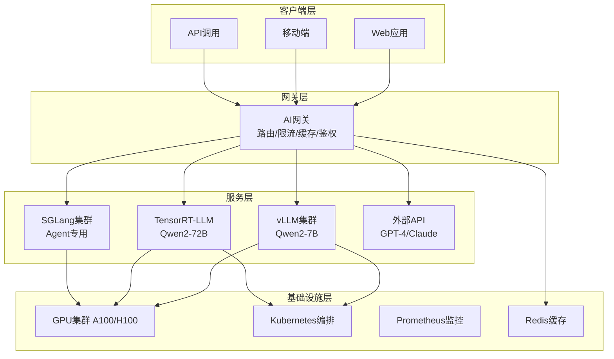

# 🧠 LLM 服务架构

> LLM（大语言模型）服务架构是将大语言模型从模型权重转化为可扩展、高可用、高性能的在线服务的完整架构体系，覆盖模型部署、推理优化、服务化、负载均衡、可观测性、成本优化等核心领域，是 AI 应用从原型到生产的关键基础设施。

---

## 一、LLM 服务架构概述

### 什么是 LLM 服务架构




LLM 服务架构是将大语言模型（如 GPT、LLaMA、Qwen、ChatGLM 等）部署为在线推理服务的完整技术体系，解决模型推理的性能、成本、可扩展性、可用性等核心问题。

### LLM 服务的挑战
| 挑战 | 说明 |
|------|------|
| **计算密集** | LLM 推理需要大量 GPU 计算，单卡显存和算力有限 |
| **显存占用大** | 7B 模型需要 ~14GB 显存，70B 模型需要 ~140GB 显存 |
| **推理延迟高** | 自回归生成，每个 token 都需要一次前向计算 |
| **吞吐量有限** | 单卡每秒只能生成有限数量的 token |
| **成本高昂** | GPU 资源昂贵，推理成本占 AI 应用成本的主要部分 |
| **可扩展性** | 需要支持动态扩缩容，应对流量波动 |
| **高可用性** | 需要保证服务稳定运行，故障自动恢复 |
| **模型管理** | 需要支持多模型、多版本、A/B 测试 |

### LLM 服务架构演进
```text
第一代：单模型单卡部署（简单 API 包装）
   ↓
第二代：模型并行 + 批处理（Tensor Parallel + Continuous Batching）
   ↓
第三代：推理框架优化（vLLM、TensorRT-LLM、SGLang）
   ↓
第四代：服务化架构（模型网关 + 多模型路由 + 自动扩缩容）
   ↓
第五代：AI 原生平台（Serverless 推理 + 边缘部署 + 混合云）
```

---


<div style="background:linear-gradient(135deg,#667eea,#764ba2);border-radius:16px;padding:20px;margin:16px 0;font-family:-apple-system,'Segoe UI','PingFang SC','Microsoft YaHei',sans-serif;color:#fff;overflow:hidden;box-shadow:0 8px 28px rgba(0,0,0,.14),0 3px 10px rgba(0,0,0,.08)">
<style>@keyframes pulse{0%,100%{transform:scale(1);opacity:.9}50%{transform:scale(1.03);opacity:1}}.dk-layer{border-radius:8px;padding:12px 16px;margin:6px auto;text-align:center;font-weight:600;animation:pulse 3s ease-in-out infinite}.dk-outer{background:rgba(255,255,255,.15);border:2px solid rgba(255,255,255,.5);max-width:340px;animation-delay:0s}.dk-middle{background:rgba(255,255,255,.2);border:2px solid rgba(255,255,255,.6);max-width:280px;animation-delay:.5s}.dk-inner{background:rgba(255,255,255,.25);border:2px solid rgba(255,255,255,.7);max-width:220px;animation-delay:1s}.dk-arrow{text-align:center;font-size:18px;margin:2px 0}.dk-label{font-size:12px;opacity:.85;font-weight:400;margin-top:4px}</style>
<div style="text-align:center;font-size:15px;font-weight:700;margin-bottom:14px;padding-bottom:10px;border-bottom:1.5px solid rgba(255,255,255,.22);letter-spacing:1px">🏗️ LLM 服务四层架构</div>
<div class="dk-layer dk-outer">接入层 · AI网关+负载均衡<div class="dk-label">路由/限流/缓存/鉴权/多模型分发</div></div>
<div class="dk-arrow">▼ 包含</div>
<div class="dk-layer dk-middle">服务层 · 推理引擎集群<div class="dk-label">vLLM/TensorRT-LLM/SGLang多引擎并存</div></div>
<div class="dk-arrow">▼ 包含</div>
<div class="dk-layer dk-inner">基础设施层 · GPU+K8s+监控<div class="dk-label">GPU集群/Kubernetes编排/Prometheus监控/Redis缓存</div></div>
</div>

> 🔍 **知识点深度解析**
>
> **作用**：LLM 服务架构将大模型从权重文件转化为可扩展、高可用、高性能的在线服务，覆盖模型部署、推理优化、服务化、负载均衡、可观测性、成本优化，是 AI 应用从原型到生产的关键基础设施。
>
> **原理**：采用分层架构：客户端层（Web/移动/API）→ 网关层（AI网关负责路由、限流、缓存、鉴权）→ 服务层（多推理引擎集群，vLLM处理通用请求、TensorRT-LLM处理极致性能、SGLang处理Agent场景、外部API处理溢出）→ 基础设施层（GPU集群、K8s编排、监控、缓存）。核心挑战是计算密集、显存大、延迟高、成本高，通过推理优化（PagedAttention/量化/投机解码）、弹性伸缩、请求路由、成本优化（小模型优先/缓存命中/批处理）来平衡性能与成本。
>
> **用法要点**：① 生产环境用 vLLM 或 TensorRT-LLM 作为推理引擎 ② 部署 AI 网关统一入口，实现限流/缓存/路由/鉴权 ③ 多模型场景按任务类型路由（简单任务小模型，复杂任务大模型） ④ 开启 KV Cache 前缀缓存提升重复请求命中率 ⑤ 用 K8s + GPU 节点池实现弹性扩缩容 ⑥ 监控 TTFT/TPOT/吞吐量/显存利用率/成本 ⑦ 成本优化：小模型优先、缓存命中、批处理、定时扩缩容 ⑧ 高可用：多副本、健康检查、自动故障转移

> 💡 **深度讲解**：LLM 服务架构的核心挑战是"将概率性的模型推理转化为确定性的在线服务"。传统 Web 服务的输入输出是确定的，可以通过水平扩展提升吞吐；但 LLM 推理具有显存密集、延迟高、输出长度不确定等特点，传统的负载均衡和扩缩容策略无法直接套用。架构演进的五代路径本质上是"抽象层级不断提升"的过程：第一代关注"能不能跑起来"，第二代关注"能不能跑大模型"，第三代关注"能不能跑得快"，第四代关注"能不能稳定服务"，第五代关注"能不能弹性经济地服务"。理解这个演进路径有助于在不同业务阶段选择合适的架构复杂度——初创团队用第一代即可，中型团队需要第三代，大型企业需要第四五代。
>
> **📝 精简总结**：LLM 服务架构解决模型推理的性能、成本、可扩展性、可用性问题；架构演进五代：单卡→并行→框架优化→服务化→AI原生平台；不同业务阶段选择不同架构复杂度。

## 二、LLM 推理优化技术

### 1. 模型量化
模型量化是降低模型显存占用和推理延迟的核心技术，通过降低权重和激活的数值精度来减少计算量和显存占用。

| 量化方式 | 精度 | 显存占用 | 推理速度 | 精度损失 | 适用场景 |
|---------|------|---------|---------|---------|---------|
| FP16/BF16 | 16位 | 100% | 1x | 无 | 高精度需求 |
| INT8 | 8位 | ~50% | ~1.5x | 小 | 通用场景 |
| INT4 | 4位 | ~25% | ~2x | 中等 | 成本敏感 |
| GPTQ | 4位 | ~25% | ~2x | 小 | 通用场景 |
| AWQ | 4位 | ~25% | ~2x | 很小 | 高精度需求 |
| GGUF | 4/8位 | ~25-50% | ~1.5-2x | 小 | 本地部署 |

**量化工具**
- **GPTQ**：基于二阶信息的权重量化，支持 AutoGPTQ、ExLlama
- **AWQ**：Activation-aware Weight Quantization，激活感知的权重量化
- **GGUF**：llama.cpp 使用的量化格式，支持多种精度
- **TensorRT-LLM**：NVIDIA 的推理优化框架，支持 INT8/INT4 量化
- **bitsandbytes**：HuggingFace 的量化库，支持 8bit/4bit 量化

### 2. 模型并行
模型并行是将大模型拆分到多个 GPU 上进行推理的技术，解决单卡显存不足的问题。

| 并行方式 | 说明 | 适用场景 | 通信开销 |
|---------|------|---------|---------|
| **Tensor Parallel (TP)** | 按层内张量切分，每层拆分到多卡 | 单节点多卡 | 高（每层通信） |
| **Pipeline Parallel (PP)** | 按层切分，不同层在不同卡 | 多节点 | 中（流水线气泡） |
| **Data Parallel (DP)** | 完整模型复制到多卡，不同数据 | 高吞吐 | 低（仅梯度同步） |
| **Expert Parallel (EP)** | MoE 模型按专家切分 | MoE 模型 | 中 |

**典型配置**
- 7B 模型：单卡（FP16）或 2 卡 TP
- 13B 模型：2 卡 TP 或 单卡 INT4
- 34B 模型：4 卡 TP 或 2 卡 PP+TP
- 70B 模型：8 卡 TP 或 4 卡 PP+TP

### 3. 批处理优化
批处理（Batching）是提升 LLM 推理吞吐量的关键技术，通过同时处理多个请求来提升 GPU 利用率。

| 批处理方式 | 说明 | 优缺点 |
|-----------|------|--------|
| **静态批处理（Static Batching）** | 固定 batch size，等待凑够一批再处理 | 实现简单，但延迟高，GPU 利用率低 |
| **动态批处理（Dynamic Batching）** | 设置最大等待时间，动态凑批 | 平衡延迟和吞吐，但仍有等待 |
| **连续批处理（Continuous Batching）** | 请求完成立即替换为新请求，GPU 永不空闲 | 高吞吐、低延迟，实现复杂 |

**连续批处理框架**
- **vLLM**：PagedAttention + Continuous Batching，高吞吐
- **TensorRT-LLM**：NVIDIA 官方，In-flight Batching
- **SGLang**：RadixAttention + Continuous Batching，结构化输出优化
- **Text Generation Inference (TGI)**：HuggingFace 官方，Continuous Batching

### 4. 显存优化
| 技术 | 说明 | 效果 |
|------|------|------|
| **PagedAttention** | 分页管理 KV Cache，减少显存碎片 | 显存利用率提升 2-4x |
| **KV Cache 量化** | KV Cache 使用 INT8/FP8 存储 | 显存占用减少 50% |
| **Prefix Caching** | 缓存公共前缀（系统提示、Few-shot） | 重复请求延迟降低 |
| **RadixAttention** | 前缀树缓存，自动复用公共前缀 | 结构化输出场景加速 |
| **CPU Offload** | 部分权重或 KV Cache 放到 CPU 内存 | 降低显存需求，速度降低 |
| **Swap** | 请求排队时将 KV Cache 交换到 CPU | 支持更多并发请求 |

### 5. 推理加速技术
| 技术 | 说明 | 效果 |
|------|------|------|
| **FlashAttention** | 优化 Attention 计算，减少显存访问 | 速度提升 2-4x，显存减少 |
| **FlashDecoding** | 针对长序列的 Attention 优化 | 长序列推理加速 |
| **Speculative Decoding** | 小模型草稿 + 大模型验证 | 解码速度提升 2-3x |
| **Medusa** | 多预测头并行预测多个 token | 解码速度提升 2-3x |
| **Lookahead** | 预取下一个 token 的候选 | 解码速度提升 |
| **FP8 推理** | 使用 FP8 精度进行推理 | 速度提升 1.5-2x，精度损失小 |
| **TensorRT 优化** | 编译优化，算子融合 | 速度提升 1.5-3x |

---

> 💡 **深度讲解**：推理优化技术可以按"权重-计算-显存-调度"四个维度理解。权重量化是"用精度换空间"——FP16→INT4 减少 75% 显存，GPTQ/AWQ 通过校准数据将精度损失控制在 1% 以内。模型并行是"用空间换规模"——张量并行切分层内权重（低延迟高通信），流水线并行切分层（高吞吐有气泡），两者组合用于超大模型。批处理优化是"用延迟换吞吐"——连续批处理通过 token 级调度将 GPU 利用率从 30% 提升到 90%+。显存优化是"用管理换容量"——PagedAttention 消除碎片、KV Cache 量化减少占用、前缀缓存复用计算。推理加速是"用算法换速度"——FlashAttention 减少 HBM 访问、推测解码减少串行调用、FP8 利用硬件加速。这四个维度不是孤立的，生产环境需要组合使用才能达到最优性价比。
>
> **📝 精简总结**：推理优化分四维：权重量化(精度换空间)、模型并行(空间换规模)、批处理(延迟换吞吐)、显存+加速(管理+算法换性能)；生产环境组合使用。

## 三、主流 LLM 推理框架

### 1. vLLM
**特点**
- PagedAttention 技术，显存利用率高
- Continuous Batching，高吞吐量
- 支持多种模型（LLaMA、Qwen、ChatGLM、Mistral 等）
- 支持 Tensor Parallel、Pipeline Parallel
- OpenAI 兼容 API
- 支持流式输出、函数调用

**部署示例**
```python
# 启动 vLLM 服务
python -m vllm.entrypoints.openai.api_server \
  --model Qwen/Qwen2-7B-Instruct \
  --tensor-parallel-size 1 \
  --gpu-memory-utilization 0.9 \
  --max-model-len 8192 \
  --port 8000

# 调用 API
curl http://localhost:8000/v1/chat/completions \
  -H "Content-Type: application/json" \
  -d '{
    "model": "Qwen/Qwen2-7B-Instruct",
    "messages": [{"role": "user", "content": "你好"}],
    "temperature": 0.7,
    "max_tokens": 100,
    "stream": true
  }'
```

```text
### 2. TensorRT-LLM
**特点**
```
- NVIDIA 官方推理优化框架
- 极致性能，支持 FP8、INT4 量化
- In-flight Batching（连续批处理）
- 支持 Tensor Parallel、Pipeline Parallel
- 支持多种模型（LLaMA、Qwen、ChatGLM、Baichuan 等）
- 支持 Triton Inference Server 集成

```text
**部署示例**
## 构建 TensorRT-LLM 引擎
```
```bash
python build.py \
  --model_dir ./Qwen2-7B-Instruct \
  --dtype float16 \
  --use_gpt_attention_plugin float16 \
  --use_gemm_plugin float16 \
  --max_batch_size 32 \
  --max_input_len 4096 \
  --max_output_len 2048 \
```
  --output_dir ./trt_engines/qwen2-7b

## 启动服务
```bash
python run.py \
  --engine_dir ./trt_engines/qwen2-7b \
  --max_output_len 2048 \
```
  --port 8000

### 3. SGLang
**特点**
- RadixAttention 技术，前缀缓存优化
- Continuous Batching，高吞吐量
- 结构化输出优化（JSON、正则、约束解码）
- 支持多种模型
- OpenAI 兼容 API
- 支持函数调用、多模态

**部署示例**
```python
# 启动 SGLang 服务
python -m sglang.launch_server \
  --model-path Qwen/Qwen2-7B-Instruct \
  --tensor-parallel-size 1 \
  --port 30000 \
  --mem-fraction-static 0.85

# 调用 API
curl http://localhost:30000/v1/chat/completions \
  -H "Content-Type: application/json" \
  -d '{
    "model": "Qwen/Qwen2-7B-Instruct",
    "messages": [{"role": "user", "content": "你好"}],
    "temperature": 0.7,
    "max_tokens": 100
  }'
```

```text
### 4. Text Generation Inference (TGI)
**特点**
```
- HuggingFace 官方推理框架
- Continuous Batching，高吞吐量
- 支持多种模型
- OpenAI 兼容 API
- 支持量化（bitsandbytes、GPTQ）
- 支持 Tensor Parallel
- 生产级稳定性

**部署示例**
```bash
# Docker 启动 TGI
docker run -d \
  --gpus all \
  -p 8080:80 \
  -v $PWD/data:/data \
  ghcr.io/huggingface/text-generation-inference:latest \
  --model-id Qwen/Qwen2-7B-Instruct \
  --quantize bitsandbytes-nf4 \
  --max-input-length 4096 \
  --max-total-tokens 6144 \
  --max-batch-prefill-tokens 4096

# 调用 API
curl http://localhost:8080/v1/chat/completions \
  -H "Content-Type: application/json" \
  -d '{
    "model": "Qwen/Qwen2-7B-Instruct",
    "messages": [{"role": "user", "content": "你好"}],
    "max_tokens": 100
  }'
```

### 5. Ollama（本地部署）
**特点**
- 本地部署，一键启动
- 支持 GGUF 量化模型
- 支持多种模型（LLaMA、Qwen、Mistral、Phi 等）
- OpenAI 兼容 API
- 支持多模型管理
- 适合本地开发和原型验证

**部署示例**
```bash
# 安装 Ollama
curl -fsSL https://ollama.com/install.sh | sh

# 拉取并运行模型
ollama run qwen2:7b

# API 调用
curl http://localhost:11434/v1/chat/completions \
  -H "Content-Type: application/json" \
  -d '{
    "model": "qwen2:7b",
    "messages": [{"role": "user", "content": "你好"}]
  }'
```

### 6. 框架对比
| 框架 | 吞吐量 | 延迟 | 量化支持 | 模型并行 | 结构化输出 | 适用场景 |
|------|--------|------|---------|---------|-----------|---------|
| **vLLM** | ⭐⭐⭐⭐⭐ | ⭐⭐⭐⭐ | GPTQ/AWQ/INT8 | TP/PP | 基础 | 通用高吞吐 |
| **TensorRT-LLM** | ⭐⭐⭐⭐⭐ | ⭐⭐⭐⭐⭐ | FP8/INT4/INT8 | TP/PP | 基础 | NVIDIA 极致性能 |
| **SGLang** | ⭐⭐⭐⭐⭐ | ⭐⭐⭐⭐ | GPTQ/AWQ | TP | ⭐⭐⭐⭐⭐ | 结构化输出/Agent |
| **TGI** | ⭐⭐⭐⭐ | ⭐⭐⭐⭐ | bitsandbytes/GPTQ | TP | 基础 | HuggingFace 生态 |
| **Ollama** | ⭐⭐ | ⭐⭐⭐ | GGUF | 单卡 | 基础 | 本地开发/原型 |
| **llama.cpp** | ⭐⭐ | ⭐⭐⭐ | GGUF | 单卡/多卡 | 基础 | CPU/边缘部署 |

---

> 💡 **深度讲解**：推理框架的选型本质是"性能-易用性-生态"的三角权衡。vLLM 是目前最均衡的选择——PagedAttention+连续批处理提供业界领先的吞吐，OpenAI 兼容 API 降低接入成本，活跃的社区支持最新模型。TensorRT-LLM 是性能极限的选择——NVIDIA 官方优化，FP8/INT4 量化 kernel 深度调优，In-flight Batching，但部署复杂度高（需要编译引擎）、模型支持滞后。SGLang 是 Agent 场景的最优选择——RadixAttention 前缀缓存在多轮对话和工具调用场景下性能超越 vLLM，结构化生成（JSON/正则约束）是 Agent 的刚需。TGI 是 HuggingFace 生态的选择——与 Transformers 深度集成，生产级稳定性，但性能略逊于 vLLM。Ollama 是本地开发的选择——一键部署、模型管理简单，但不适合生产高吞吐场景。选型建议：通用高吞吐用 vLLM，Agent/多轮对话用 SGLang，极致性能用 TensorRT-LLM，本地开发用 Ollama。
>
> **📝 精简总结**：框架选型是性能-易用性-生态三角权衡：vLLM 最均衡(通用高吞吐)、SGLang 擅长 Agent(前缀缓存+结构化输出)、TensorRT-LLM 极致性能、TGI HF生态、Ollama 本地开发。

## 四、LLM 服务化架构

### 1. 单体服务架构
```text
客户端 → LLM 推理服务（单模型、单实例）→ GPU
```
**适用场景**：原型开发、低流量、内部工具

### 2. 负载均衡架构
```text
客户端 → 负载均衡器（Nginx/HAProxy）→ LLM 推理服务实例 1 → GPU 0
                                      → LLM 推理服务实例 2 → GPU 1
                                      → LLM 推理服务实例 3 → GPU 2
```
**适用场景**：中等流量、高可用需求

### 3. 模型网关架构
```text
客户端 → AI 网关（模型路由、负载均衡、限流、缓存、鉴权）
            ├── LLM 服务集群 A（Qwen2-7B，3 实例）
            ├── LLM 服务集群 B（Qwen2-72B，2 实例）
            ├── LLM 服务集群 C（GPT-4，外部 API）
            └── 缓存层（Redis，缓存常见请求）
```
**适用场景**：多模型、多版本、高流量、生产环境

### 4. 云原生架构
```text
客户端 → Ingress/Gateway → Kubernetes
                              ├── Namespace: production
                              │   ├── Deployment: qwen2-7b (3 replicas)
                              │   ├── Deployment: qwen2-72b (2 replicas)
                              │   └── HPA: 自动扩缩容
                              ├── Namespace: staging
                              │   └── Deployment: qwen2-7b (1 replica)
                              └── Monitoring: Prometheus + Grafana
```
**适用场景**：企业级、大规模、云原生

### 5. AI 网关核心功能
| 功能 | 说明 |
|------|------|
| **模型路由** | 根据模型名称、成本、延迟、可用性路由到对应后端 |
| **负载均衡** | 多实例负载均衡，支持轮询、最少连接、一致性哈希 |
| **限流熔断** | 按用户/API Key 限流，故障熔断，降级策略 |
| **缓存** | 缓存常见请求响应，降低成本和延迟 |
| **鉴权** | API Key、JWT、OAuth2 认证授权 |
| **可观测性** | 请求日志、指标、Trace、成本统计 |
| **流式转发** | 支持 SSE 流式响应转发 |
| **多模型管理** | 统一管理多个模型提供商（OpenAI、Anthropic、本地模型） |
| **A/B 测试** | 按比例分流到不同模型版本，进行 A/B 测试 |
| **成本控制** | 按模型、用户、时间统计 Token 消耗和成本 |

**开源 AI 网关**
- **LiteLLM**：统一 100+ LLM API，支持负载均衡、限流、缓存
- **One API**：OpenAI 接口管理和分发系统，支持多种渠道
- **New API**：One API 的增强分支，更多功能
- **Portkey**：AI 网关，支持缓存、重试、负载均衡、可观测性
- **Helicone**：LLM 可观测性平台，支持日志、指标、成本分析

---

> 💡 **深度讲解**：服务化架构的演进是"关注点分离"的过程。单体服务将所有逻辑耦合在一起，适合原型开发但无法扩展。负载均衡架构引入流量分发，解决高可用问题但无法管理多模型。模型网关架构是生产级的核心——它将模型路由、负载均衡、限流熔断、缓存、鉴权、可观测性等横切关注点从推理服务中剥离出来，让推理服务专注于"算得快"，网关专注于"管得好"。AI 网关的核心价值是"模型无关性"——通过 OpenAI 兼容 API 统一接口，上层应用无需关心底层是 vLLM、TensorRT-LLM 还是外部 API，可以灵活切换和组合模型。云原生架构在此基础上引入 Kubernetes 编排、HPA 自动扩缩容、Prometheus 监控，实现企业级的可运维性。选型建议：中小团队用负载均衡+单体服务，中大型团队必须引入模型网关，企业级需要云原生架构。
>
> **📝 精简总结**：服务化架构演进是关注点分离：单体→负载均衡→模型网关(核心)→云原生；AI网关实现模型无关性，统一接口+横切关注点；中小团队用负载均衡，中大型必须用网关。

## 五、LLM 服务性能优化

### 1. 延迟优化
| 优化方向 | 技术 | 效果 |
|---------|------|------|
| **首 token 延迟（TTFT）** | 前缀缓存、批处理优化、模型量化 | 降低 30-70% |
| **每 token 延迟（TPOT）** | FlashAttention、FP8/INT4 量化、Speculative Decoding | 降低 30-60% |
| **总延迟** | 连续批处理、动态批处理、模型并行 | 降低 20-50% |
| **网络延迟** | 就近部署、边缘计算、gRPC 替代 HTTP | 降低 10-50% |

### 2. 吞吐量优化
| 优化方向 | 技术 | 效果 |
|---------|------|------|
| **批处理** | Continuous Batching、In-flight Batching | 提升 2-10x |
| **显存管理** | PagedAttention、KV Cache 量化 | 提升 2-4x 并发 |
| **模型量化** | INT4/INT8 量化 | 提升 1.5-2x |
| **模型并行** | Tensor Parallel、Pipeline Parallel | 线性扩展（多卡） |
| **前缀缓存** | Prefix Caching、RadixAttention | 重复请求提升 5-10x |

### 3. 成本优化
| 优化方向 | 技术 | 效果 |
|---------|------|------|
| **模型选型** | 小模型优先、任务适配模型 | 降低 50-90% |
| **模型量化** | INT4/INT8 量化 | 降低 50-75% 显存 |
| **批处理** | 连续批处理，提升 GPU 利用率 | 降低 30-60% 单请求成本 |
| **缓存** | 缓存常见请求，避免重复计算 | 降低 20-80% |
| **自动扩缩容** | 根据流量动态扩缩容 | 降低 30-70% |
| **Spot 实例** | 使用竞价实例，降低 GPU 成本 | 降低 50-80% |
| **Token 优化** | 优化 Prompt，减少上下文长度 | 降低 10-50% |

### 4. 高可用优化
| 优化方向 | 技术 | 说明 |
|---------|------|------|
| **多实例部署** | 多副本部署，负载均衡 | 单实例故障不影响服务 |
| **健康检查** | 存活探针、就绪探针 | 自动检测故障实例，流量切换 |
| **自动恢复** | 容器重启、故障转移 | 故障自动恢复 |
| **多可用区部署** | 跨可用区部署 | 单可用区故障不影响服务 |
| **降级策略** | 大模型故障降级到小模型 | 保证基本服务可用 |
| **限流熔断** | 过载保护，防止雪崩 | 保护后端服务 |
| **灰度发布** | 逐步切换流量，降低风险 | 新版本发布风险可控 |

---

> 💡 **深度讲解**：性能优化需要建立"延迟-吞吐-成本"三维度量体系。延迟优化要区分 TTFT（首 token 延迟）和 TPOT（每 token 延迟）——TTFT 受 prefill 计算量和排队影响，优化手段是前缀缓存、FlashAttention、分块预填充；TPOT 受 decode 计算和 batch 大小影响，优化手段是量化、推测解码、CUDA Graph。吞吐优化的核心是 GPU 利用率——连续批处理将利用率从 30% 提升到 90%+，PagedAttention 让更大 batch 成为可能，量化进一步释放显存空间。成本优化的核心是"按价值分配算力"——小模型处理简单任务、大模型处理复杂任务（模型路由）、缓存常见请求（避免重复计算）、弹性伸缩（按负载调整资源）、Spot 实例（降低 GPU 成本）。高可用优化的核心是"故障隔离和快速恢复"——多实例部署、健康检查、自动恢复、降级策略（大模型故障降级到小模型）、限流熔断（防止雪崩）。
>
> **📝 精简总结**：性能优化分三维：延迟(TTFT用前缀缓存/FlashAttention，TPOT用量化/推测解码)、吞吐(连续批处理+PagedAttention提升GPU利用率)、成本(模型路由+缓存+弹性伸缩+Spot)；高可用靠多实例+降级+限流。

## 六、LLM 服务可观测性

### 1. 核心指标
| 指标类别 | 具体指标 | 说明 |
|---------|---------|------|
| **性能指标** | QPS、延迟（TTFT/TPOT/总延迟）、吞吐量（token/s） | 服务性能 |
| **资源指标** | GPU 利用率、显存使用率、CPU 使用率、内存使用率 | 资源使用 |
| **业务指标** | 请求量、成功/失败率、Token 消耗量、平均成本 | 业务统计 |
| **模型指标** | 缓存命中率、批处理大小、队列长度、KV Cache 使用率 | 模型推理 |
| **质量指标** | 用户满意度、评分、反馈率、重试率 | 输出质量 |

### 2. 监控工具
| 工具 | 说明 |
|------|------|
| **Prometheus + Grafana** | 指标采集和可视化，开源标准方案 |
| **DCGM Exporter** | NVIDIA GPU 指标采集（温度、功耗、显存、利用率） |
| **Langfuse** | LLM 应用可观测性，Trace、评估、成本统计 |
| **Helicone** | LLM 日志和可观测性平台 |
| **Portkey** | AI 网关，内置可观测性 |
| **OpenTelemetry** | 分布式追踪标准，支持 LLM 语义约定 |
| **Jaeger/Zipkin** | 分布式追踪系统 |
| **ELK/Loki** | 日志收集和分析 |

### 3. 告警规则
| 告警 | 条件 | 级别 |
|------|------|------|
| 服务不可用 | 健康检查失败 > 1 分钟 | P0 |
| 延迟过高 | P95 延迟 > 阈值（如 10s） | P1 |
| 错误率过高 | 错误率 > 5% | P1 |
| GPU 利用率过低 | GPU 利用率 < 30% 持续 10 分钟 | P2 |
| 显存不足 | 显存使用率 > 90% | P1 |
| 队列堆积 | 请求队列长度 > 阈值 | P2 |
| 成本异常 | 日成本 > 预算 120% | P2 |

---

## 七、LLM 服务安全

### 1. 安全风险
| 风险 | 说明 | 防护措施 |
|------|------|---------|
| **Prompt 注入** | 恶意输入诱导模型输出有害内容 | 输入过滤、输出过滤、系统提示加固 |
| **数据泄露** | 模型输出训练数据或敏感信息 | 输出过滤、敏感信息检测、数据脱敏 |
| **越权访问** | 未授权用户访问服务 | API Key、JWT、OAuth2、RBAC |
| **滥用攻击** | 恶意用户大量调用，消耗资源 | 限流、配额、异常检测 |
| **模型窃取** | 通过大量查询窃取模型能力 | 限流、输出水印、异常检测 |
| **拒绝服务** | 恶意请求导致服务不可用 | 限流、熔断、WAF |
| **供应链安全** | 依赖库或模型存在漏洞 | 依赖扫描、模型扫描、最小权限 |

### 2. 安全最佳实践
- ✅ 使用 API Key 或 JWT 进行认证授权
- ✅ 按用户/API Key 设置限流和配额
- ✅ 输入过滤，防止 Prompt 注入
- ✅ 输出过滤，防止敏感信息泄露和有害内容
- ✅ 敏感数据脱敏，不将敏感信息传入模型
- ✅ 日志脱敏，不在日志中记录敏感信息
- ✅ 网络隔离，模型服务不直接暴露公网
- ✅ HTTPS 加密传输
- ✅ 定期安全审计和漏洞扫描
- ✅ 模型版本管理，支持快速回滚

---

## 八、LLM 服务部署实践

### 1. 单机部署（开发/测试）
```bash
# 使用 vLLM 部署 7B 模型
docker run -d \
  --gpus all \
  -p 8000:8000 \
  -v $PWD/models:/models \
  vllm/vllm-openai:latest \
  --model /models/Qwen2-7B-Instruct \
  --tensor-parallel-size 1 \
  --gpu-memory-utilization 0.9 \
  --max-model-len 8192
```

### 2. 多机部署（生产）
```python
# 主节点启动 Ray
ray start --head --port=6379

# 工作节点加入
ray start --address=<master-ip>:6379

# 使用 vLLM + Ray 部署 72B 模型（8 卡）
python -m vllm.entrypoints.openai.api_server \
  --model Qwen/Qwen2-72B-Instruct \
  --tensor-parallel-size 8 \
  --pipeline-parallel-size 1 \
  --gpu-memory-utilization 0.9 \
  --max-model-len 8192 \
  --port 8000
```

### 3. Kubernetes 部署
```yaml
# deployment.yaml
apiVersion: apps/v1
kind: Deployment
metadata:
  name: qwen2-7b
  namespace: llm
spec:
  replicas: 3
  selector:
    matchLabels:
      app: qwen2-7b
  template:
    metadata:
      labels:
        app: qwen2-7b
    spec:
      containers:
        - name: vllm
          image: vllm/vllm-openai:latest
          args:
            - --model
            - /models/Qwen2-7B-Instruct
            - --tensor-parallel-size
            - "1"
            - --gpu-memory-utilization
            - "0.9"
            - --max-model-len
            - "8192"
          ports:
            - containerPort: 8000
          resources:
            limits:
              nvidia.com/gpu: 1
          volumeMounts:
            - name: models
              mountPath: /models
          readinessProbe:
            httpGet:
              path: /health
              port: 8000
            initialDelaySeconds: 60
            periodSeconds: 10
          livenessProbe:
            httpGet:
              path: /health
              port: 8000
            initialDelaySeconds: 120
            periodSeconds: 30
      volumes:
        - name: models
          persistentVolumeClaim:
            claimName: models-pvc
---
apiVersion: v1
kind: Service
metadata:
  name: qwen2-7b
  namespace: llm
spec:
  selector:
    app: qwen2-7b
  ports:
    - port: 8000
      targetPort: 8000
---
apiVersion: autoscaling/v2
kind: HorizontalPodAutoscaler
metadata:
  name: qwen2-7b-hpa
  namespace: llm
spec:
  scaleTargetRef:
    apiVersion: apps/v1
    kind: Deployment
    name: qwen2-7b
  minReplicas: 2
  maxReplicas: 10
  metrics:
    - type: Pods
      pods:
        metric:
          name: gpu_utilization
        target:
          type: AverageValue
          averageValue: "80"
```

### 4. 模型网关部署（LiteLLM）
```yaml
# docker-compose.yaml
version: '3.8'
services:
  litellm:
    image: ghcr.io/berriai/litellm:main-latest
    ports:
      - "4000:4000"
    environment:
      - DATABASE_URL=postgresql://user:pass@db:5432/litellm
      - MASTER_KEY=sk-your-master-key
    volumes:
      - ./litellm_config.yaml:/app/config.yaml
    command: ["--config", "/app/config.yaml", "--port", "4000"]
    depends_on:
      - db

  db:
    image: postgres:15
    environment:
      - POSTGRES_USER=user
      - POSTGRES_PASSWORD=pass
      - POSTGRES_DB=litellm
    volumes:
      - postgres-data:/var/lib/postgresql/data

volumes:
  postgres-data:
```

```yaml
# litellm_config.yaml
model_list:
  - model_name: qwen2-7b
    litellm_params:
      model: openai/qwen2-7b
      api_base: http://qwen2-7b-internal:8000/v1
      api_key: dummy

  - model_name: qwen2-72b
    litellm_params:
      model: openai/qwen2-72b
      api_base: http://qwen2-72b-internal:8000/v1
      api_key: dummy

  - model_name: gpt-4
    litellm_params:
      model: gpt-4
      api_key: sk-your-openai-key

router_settings:
  num_retries: 2
  timeout: 60
  allowed_fails: 3
  cooldown_time: 60

general_settings:
  master_key: sk-your-master-key
```

---

## 🔗 关联笔记

- [[vLLM-高吞吐推理引擎]] — PagedAttention 与连续批处理的高吞吐推理引擎
- [[SGLang高效推理框架]] — RadixAttention 前缀缓存，Agent 场景最优
- [[TensorRT-LLM推理加速]] — NVIDIA 极致推理优化，FP8/INT4 量化
- [[模型服务化-OpenAI兼容API]] — 推理服务 API 标准化与多模型统一接口
- [[模型服务网格与多模型管理]] — 模型路由、负载均衡、版本管理、A/B 测试
- [[AI网关与多模型路由设计]] — 统一 AI 网关、多模型路由、限流熔断

## 📖 前置知识

- [[vLLM-高吞吐推理引擎]]
- [[模型量化-GPTQ-AWQ-GGUF]]

## 🏷️ 相关标签

`#AI工程化` `#LLM` `#效率工具` `#架构设计`

---

[[Home|🏠 返回首页]] · [[MOC-AI与效率工具|📚 AI与效率工具]] · [[MOC-AI工程化|🤖 AI工程化]]