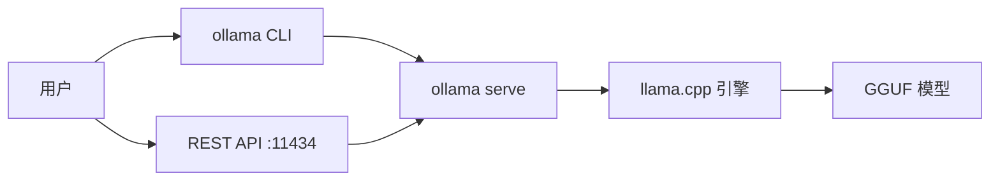
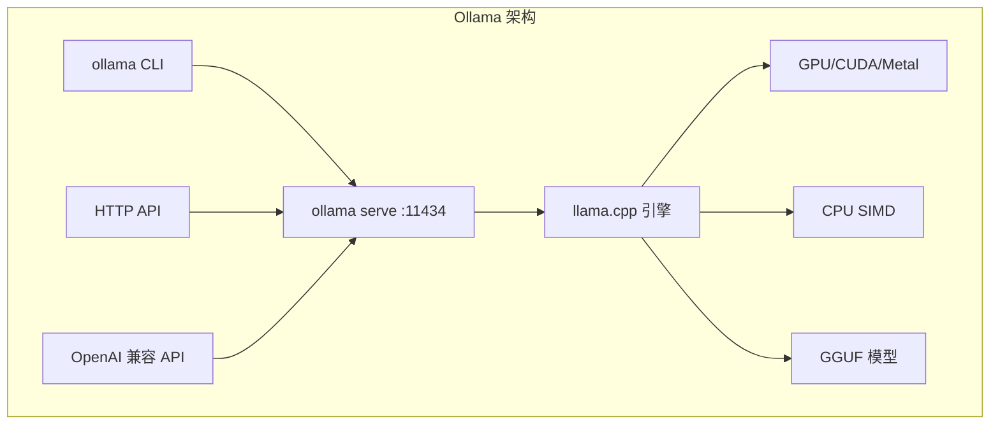
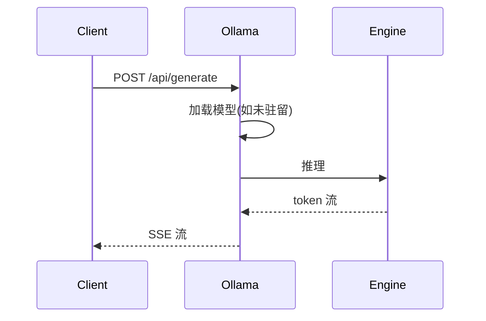
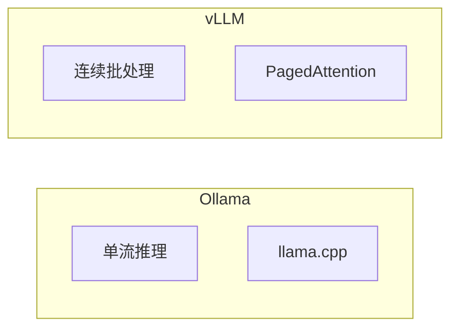
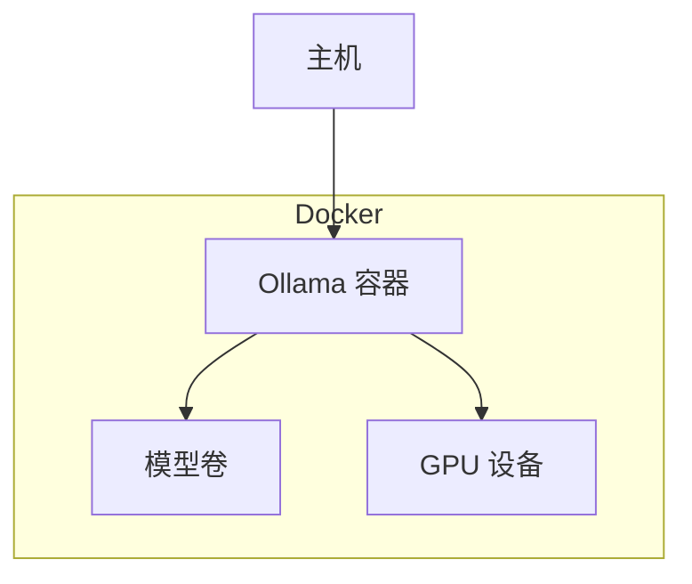
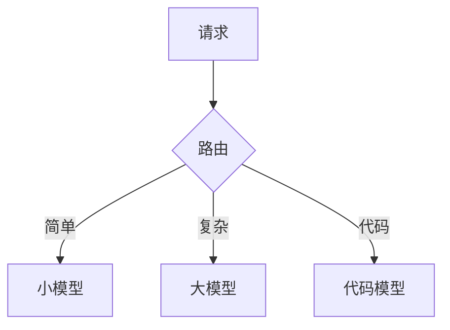
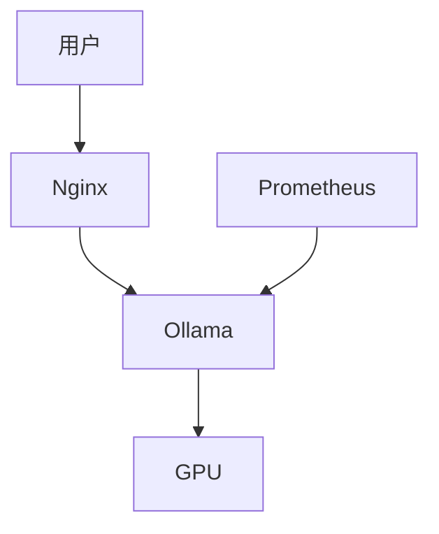
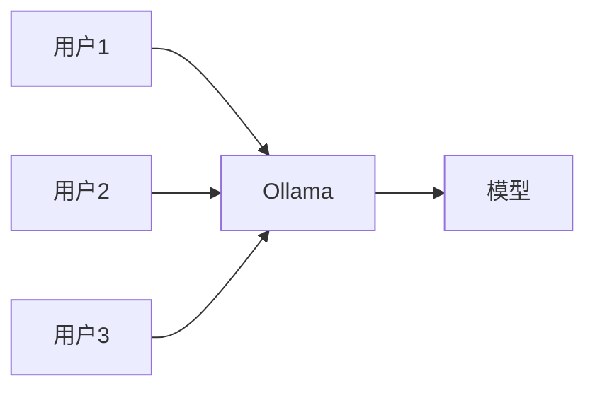
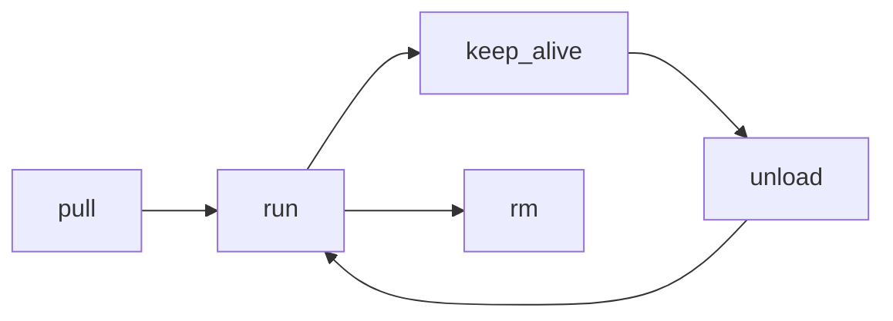

# Ollama 本地模型部署完全指南

> 本文档为 P1 级知识库文档，系统讲解 Ollama 的安装、模型管理、API、自定义模型、GPU 加速、与 LangChain 集成、Docker 部署、与 vLLM 对比等全流程内容。每个知识点按「概念 + 原理 + 代码 + 场景 + 坑点」五要素展开，每章末尾附深度讲解、精简总结与梯度练习题。

## 一、Ollama 概述与核心价值

### 1.1 什么是 Ollama

Ollama 是一个开源的本地大模型运行工具，主打「一行命令跑起 LLM」。它把模型下载、加载、推理、API 服务全部封装，让开发者无需关心 PyTorch、CUDA、显存分配等底层细节。

```python
# ollama_intro.py
FEATURES = {
    "一键安装": "curl 或下载安装包",
    "模型管理": "pull/list/run/rm",
    "API 服务": "localhost:11434",
    "量化模型": "GGUF 格式",
    "跨平台": "macOS/Linux/Windows",
}
for k, v in FEATURES.items():
    print(f"{k}: {v}")
```

### 1.2 为什么选择 Ollama

```python
WHY = """
Ollama 适合：
- 本地开发调试
- 隐私敏感场景
- 快速原型验证
- 无 GPU 也能跑（CPU）
不适合：
- 高并发生产
- 超低延迟
- 超大模型（70B+）
"""
print(WHY)
```

### 1.3 Ollama 架构概览



### 1.4 Ollama 与其他工具对比

```python
COMPARE = [
    {"tool": "Ollama", "ease": "最高", "gpu": "可选", "prod": "弱"},
    {"tool": "vLLM", "ease": "高", "gpu": "必须", "prod": "强"},
    {"tool": "llama.cpp", "ease": "中", "gpu": "可选", "prod": "中"},
    {"tool": "Text Generation WebUI", "ease": "中", "gpu": "可选", "prod": "弱"},
]
for c in COMPARE:
    print(c)
```

### 💡 深度讲解

Ollama 本质上是 llama.cpp 的上层封装。它把 GGUF 模型管理、HTTP API、自动 GPU 加速、模型量化选择等全部自动化，让开发者用一行 `ollama run llama3` 就能跑起模型。它的核心价值是「降低本地 LLM 的使用门槛」。

### 📝 精简总结

Ollama = llama.cpp + 模型管理 + HTTP API，适合本地开发与原型。

### 🎯 梯度练习

- 入门：安装 Ollama 并运行 `ollama run hello`
- 进阶：对比 Ollama 与 vLLM 的适用场景

## 二、安装与快速启动

### 2.1 macOS 安装

```bash
# macOS
brew install ollama
# 或下载 dmg
# https://ollama.com/download
```

### 2.2 Linux 安装

```bash
# Linux
curl -fsSL https://ollama.com/install.sh | sh
```

### 2.3 Windows 安装

```powershell
# Windows
# 下载 https://ollama.com/download/windows
# 双击安装
```

### 2.4 启动服务

```bash
# 启动 ollama serve（默认后台运行）
ollama serve
# 监听 http://localhost:11434
```

### 2.5 验证安装

```bash
# 版本
ollama --version
# 拉模型
ollama pull llama3.2
# 运行
ollama run llama3.2
```

### 2.6 首次运行示例

```bash
ollama run llama3.2
>>> 你好，介绍一下你自己
# 进入交互式对话
```

### 💡 深度讲解

Ollama 安装后会自动启动后台服务 `ollama serve`，监听 11434 端口。CLI 只是客户端，所有实际推理都在后台服务进程中完成。这意味着即使关闭终端，模型仍在后台运行。

### 📝 精简总结

安装三平台一致：下载 → 安装 → `ollama run` 即用。

### 🎯 梯度练习

- 入门：在本机安装 Ollama
- 进阶：配置 OLLAMA_HOST 环境变量让局域网可访问

## 三、模型管理

### 3.1 拉取模型

```bash
# 拉取
ollama pull llama3.2
# 指定量化
ollama pull llama3.2:q4_K_M
# 查看进度
```

### 3.2 列出模型

```bash
# 本地模型列表
ollama list
# 输出：
# NAME              ID              SIZE      MODIFIED
# llama3.2:latest   a80c4...        2.0 GB    2 days ago
```

### 3.3 运行模型

```bash
# 运行对话
ollama run llama3.2
# 单次提问
ollama run llama3.2 "用一句话解释量子计算"
```

### 3.4 删除模型

```bash
# 删除
ollama rm llama3.2
# 删除多个
ollama rm model1 model2
```

### 3.5 模型信息

```bash
# 显示模型信息
ollama show llama3.2
# 包括：参数、量化、模板、许可证
```

### 3.6 复制模型

```bash
# 复制
ollama cp llama3.2 my-model
```

### 💡 深度讲解

Ollama 模型存储在 `~/.ollama/models/`（Linux/macOS）或 `C:\Users\<user>\.ollama\models\`（Windows）。每个模型是一个 GGUF 文件 + Modelfile 配置。`ollama pull` 自动选择默认量化（通常 q4_K_M）。

### 📝 精简总结

模型管理：pull 下载、list 查看、run 运行、rm 删除。

### 🎯 梯度练习

- 入门：拉取并运行 2 个不同模型
- 进阶：查看模型存储目录结构

## 四、运行模型与交互

### 4.1 交互式对话

```bash
ollama run llama3.2
>>> /set system 你是一个 Python 专家
>>> 什么是装饰器
>>> /bye
```

### 4.2 常用斜杠命令

```python
SLASH = {
    "/set system": "设置系统提示",
    "/set parameter": "设置采样参数",
    "/show info": "显示模型信息",
    "/show docs": "显示文档",
    "/bye": "退出",
    "/clear": "清空对话",
}
for cmd, desc in SLASH.items():
    print(f"{cmd:18s} {desc}")
```

### 4.3 流式输出

```bash
# 默认流式输出
ollama run llama3.2 "写一首关于秋天的诗"
```

### 4.4 多轮对话

```bash
ollama run llama3.2
>>> 我叫小明
>>> 我叫什么名字  # 上下文记住
```

### 4.5 单次无交互

```bash
# 非交互模式
echo "解释什么是递归" | ollama run llama3.2
```

### 💡 深度讲解

Ollama CLI 的对话是有状态的——它把历史消息发给服务端维护。`/clear` 清空历史。`/set system` 修改系统提示。退出后对话不保留。

### 📝 精简总结

CLI 交互：`ollama run` 进入对话，斜杠命令控制行为。

### 🎯 梯度练习

- 入门：用 `/set system` 自定义角色
- 进阶：管道方式调用

## 五、Modelfile 自定义模型

### 5.1 Modelfile 基础

```dockerfile
# Modelfile
FROM llama3.2

# 设置系统提示
SYSTEM """
你是一个专业的 Python 编程助手。
回答简洁，代码完整。
"""

# 设置参数
PARAMETER temperature 0.7
PARAMETER top_p 0.9
PARAMETER num_ctx 4096
```

### 5.2 构建自定义模型

```bash
# 从 Modelfile 构建
ollama create my-python-assistant -f Modelfile
# 运行
ollama run my-python-assistant
```

### 5.3 多模态 Modelfile

```dockerfile
FROM llama3.2-vision
SYSTEM "你是一个图像分析助手。"
PARAMETER temperature 0.1
```

### 5.4 Modelfile 指令全集

```python
MODelfILE_CMDS = {
    "FROM": "基础模型",
    "PARAMETER": "采样参数",
    "TEMPLATE": "提示模板",
    "SYSTEM": "系统提示",
    "ADAPTER": "LoRA 适配器",
    "LICENSE": "许可证",
}
for k, v in MODelfILE_CMDS.items():
    print(f"{k:12s} {v}")
```

### 💡 深度讲解

Modelfile 类似 Dockerfile，定义模型的「配方」。FROM 指定基础模型，SYSTEM 设置角色，PARAMETER 控制采样。构建后 Ollama 把配置打包成新模型，运行时无需重复设置。

### 📝 精简总结

Modelfile = 模型配置文件，构建后可复用。

### 🎯 梯度练习

- 入门：创建一个翻译助手 Modelfile
- 进阶：自定义 TEMPLATE

## 六、量化模型与 GGUF

### 6.1 GGUF 格式

```python
GGUF = """
# GGUF 是什么
-  llama.cpp 的模型格式
- 单文件包含权重 + 元数据
- 支持多种量化级别
- Ollama 默认用 GGUF
"""
print(GGUF)
```

### 6.2 量化级别

```python
QUANTS = [
    ("Q4_K_M", "4-bit", "推荐平衡", "约 3GB for 7B"),
    ("Q8_0", "8-bit", "高质量", "约 7GB for 7B"),
    ("Q5_K_M", "5-bit", "较好", "约 4.5GB for 7B"),
    ("Q3_K_M", "3-bit", "最小", "约 2.5GB for 7B"),
    ("F16", "16-bit", "无损", "约 14GB for 7B"),
]
for q, bits, quality, size in QUANTS:
    print(f"{q:10s} {bits:8s} {quality:10s} {size}")
```

### 6.3 选择量化级别

```python
SELECT = """
# 选择建议
- 显存紧张: Q4_K_M
- 显存充足: Q8_0 或 F16
- 质量优先: F16
- 速度优先: Q4_K_M
"""
print(SELECT)
```

### 6.4 量化对质量的影响

```python
IMPACT = [
    ("F16", "无损", "0%"),
    ("Q8_0", "几乎无损", "<0.5%"),
    ("Q5_K_M", "轻微损失", "<1%"),
    ("Q4_K_M", "可接受", "<2%"),
    ("Q3_K_M", "明显", "<5%"),
]
for q, ql, loss in IMPACT:
    print(f"{q:10s} {ql:10s} 损失={loss}")
```

### 💡 深度讲解

GGUF 量化是对权重矩阵做 INT4/INT8 量化。`_K` 表示混合精度（部分层保留高位）。`_M` 表示中等量化。Q4_K_M 是质量/体积的最佳平衡点。

### 📝 精简总结

GGUF 是 Ollama 的模型格式，Q4_K_M 是推荐量化。

### 🎯 梯度练习

- 入门：拉取同一模型的不同量化版本对比
- 进阶：理解 K-quant 混合精度

## 七、REST API 接口

### 7.1 生成接口

```bash
# /api/generate
curl http://localhost:11434/api/generate -d '{
  "model": "llama3.2",
  "prompt": "为什么是程序员而不是产品经理",
  "stream": false
}'
```

### 7.2 聊天接口

```bash
# /api/chat
curl http://localhost:11434/api/chat -d '{
  "model": "llama3.2",
  "messages": [
    {"role": "user", "content": "你好"}
  ]
}'
```

### 7.3 嵌入接口

```bash
# /api/embeddings
curl http://localhost:11434/api/embeddings -d '{
  "model": "llama3.2",
  "prompt": "这是一个测试"
}'
```

### 7.4 流式响应

```python
# stream.py
import requests
resp = requests.post("http://localhost:11434/api/generate",
    json={"model": "llama3.2", "prompt": "讲个故事"}, stream=True)
for line in resp.iter_lines():
    if line:
        import json
        data = json.loads(line)
        print(data.get("response", ""), end="", flush=True)
```

### 7.5 模型列表 API

```bash
# 列出本地模型
curl http://localhost:11434/api/tags
```

### 💡 深度讲解

Ollama API 是 JSON-over-HTTP。流式模式返回一行一个 JSON 对象。非流式一次性返回完整响应。API 路径简单，适合集成。

### 📝 精简总结

三大接口：generate（生成）、chat（聊天）、embeddings（嵌入）。

### 🎯 梯度练习

- 入门：用 curl 调 generate 接口
- 进阶：用 Python 流式接收

## 八、OpenAI 兼容 API

### 8.1 启用 OpenAI 兼容端点

```bash
# Ollama 默认提供 OpenAI 兼容 API
# 地址: http://localhost:11434/v1
```

### 8.2 用 openai SDK 调用

```python
# openai_compat.py
from openai import OpenAI
client = OpenAI(base_url="http://localhost:11434/v1", api_key="dummy")
r = client.chat.completions.create(
    model="llama3.2",
    messages=[{"role": "user", "content": "你好"}])
print(r.choices[0].message.content)
```

### 8.3 流式调用

```python
# openai_stream.py
from openai import OpenAI
client = OpenAI(base_url="http://localhost:11434/v1", api_key="dummy")
stream = client.chat.completions.create(
    model="llama3.2",
    messages=[{"role": "user", "content": "写首诗"}],
    stream=True)
for chunk in stream:
    if chunk.choices[0].delta.content:
        print(chunk.choices[0].delta.content, end="")
```

### 8.4 嵌入兼容

```python
# openai_embed.py
from openai import OpenAI
client = OpenAI(base_url="http://localhost:11434/v1", api_key="dummy")
r = client.embeddings.create(model="llama3.2", input="测试文本")
print(len(r.data[0].embedding))
```

### 💡 深度讲解

Ollama 的 OpenAI 兼容层让你可以把现有 OpenAI SDK 代码改个 base_url 就跑本地模型。无需改业务代码，这是 Ollama 被广泛集成的关键原因。

### 📝 精简总结

改 base_url 即可用 OpenAI SDK 调本地 Ollama。

### 🎯 梯度练习

- 入门：用 openai SDK 调 Ollama
- 进阶：把现有 OpenAI 代码切到本地

## 九、多模型管理与切换

### 9.1 同时运行多模型

```bash
# Ollama 会自动卸载不用的模型
# 运行多个:
ollama run llama3.2
ollama run mistral  # 自动卸载 llama3.2（显存不足时）
```

### 9.2 设置模型驻留

```bash
# 设置 keep_alive
curl http://localhost:11434/api/generate -d '{
  "model": "llama3.2",
  "prompt": "hi",
  "keep_alive": "30m"
}'
```

### 9.3 模型卸载

```bash
# 卸载模型
curl http://localhost:11434/api/generate -d '{
  "model": "llama3.2",
  "keep_alive": 0
}'
```

### 9.4 多模型路由

```python
ROUTER = """
# 多模型路由
- 简单任务: 小模型 (llama3.2:3b)
- 复杂任务: 大模型 (llama3.2:70b)
- 代码: 代码模型
- 用业务代码路由
"""
print(ROUTER)
```

### 💡 深度讲解

Ollama 默认会在 5 分钟无请求后卸载模型释放显存。`keep_alive` 控制驻留时间。多模型切换时 Ollama 自动管理显存，但不支持并发多模型推理（单 GPU）。

### 📝 精简总结

Ollama 自动管理模型驻留，keep_alive 控制卸载时机。

### 🎯 梯度练习

- 入门：设置 keep_alive
- 进阶：实现多模型路由

## 十、硬件要求与性能

### 10.1 内存要求

```python
MEM = [
    ("7B-Q4", "~4GB", "8GB RAM"),
    ("13B-Q4", "~8GB", "16GB RAM"),
    ("70B-Q4", "~40GB", "64GB+ RAM"),
]
for m, gpu, ram in MEM:
    print(f"{m:10s} 显存={gpu:8s} 内存={ram}")
```

### 10.2 CPU vs GPU

```python
CPU_GPU = """
# CPU vs GPU
- CPU: 慢但通用，8GB 内存可跑 7B
- GPU: 快 10-50 倍
- Apple Silicon: Metal 加速
- NVIDIA: CUDA
- 推荐: 有 GPU 用 GPU
"""
print(CPU_GPU)
```

### 10.3 性能基准

```python
BENCH = [
    ("7B-Q4 CPU", "~5 tok/s"),
    ("7B-Q4 M1", "~15 tok/s"),
    ("7B-Q4 RTX4090", "~80 tok/s"),
    ("13B-Q4 RTX4090", "~50 tok/s"),
]
for m, s in BENCH:
    print(f"{m:20s} {s}")
```

### 10.4 优化建议

```python
OPT = """
# 性能优化
- 用 GPU
- 选合适量化
- 缩短上下文
- 控制并发
- 增加 keep_alive
"""
print(OPT)
```

### 💡 深度讲解

Ollama 在 CPU 上用 llama.cpp 的 SIMD 优化，GPU 上用 CUDA/Metal。Apple Silicon 统一内存架构对本地 LLM 很友好。性能主要瓶颈是内存带宽。

### 📝 精简总结

7B-Q4 需 8GB 内存，GPU 快 10 倍以上。

### 🎯 梯度练习

- 入门：在本机测 tok/s
- 进阶：对比不同量化速度

## 十一、GPU 加速（CUDA / Metal）

### 11.1 NVIDIA CUDA

```bash
# 装 NVIDIA 驱动 + CUDA
# Ollama 自动检测 GPU
nvidia-smi
# 确认 GPU 可用
```

### 11.2 Apple Metal

```bash
# macOS 自动用 Metal
# Ollama 原生支持
# 无需额外配置
```

### 11.3 AMD ROCm

```bash
# Linux + AMD
# 装 ROCm
# Ollama 支持 ROCm
```

### 11.4 查看 GPU 使用

```bash
# 运行模型时
nvidia-smi  # 看 GPU 显存
# macOS
sudo powermetrics
```

### 💡 深度讲解

Ollama 自动选择最快的推理后端。NVIDIA 用 CUDA，Apple 用 Metal，AMD 用 ROCm，其他用 CPU。无需手动配置。

### 📝 精简总结

Ollama 自动检测 GPU，开箱即用。

### 🎯 梯度练习

- 入门：确认 GPU 被 Ollama 使用
- 进阶：配置多 GPU

## 十二、Docker 部署

### 12.1 Docker 运行 Ollama

```bash
# Docker
docker run -d --gpus all -v ollama:/root/.ollama -p 11434:11434 ollama/ollama
```

### 12.2 Docker Compose

```yaml
# docker-compose.yml
services:
  ollama:
    image: ollama/ollama
    ports: ["11434:11434"]
    volumes:
      - ollama:/root/.ollama
    deploy:
      resources:
        reservations:
          devices:
            - driver: nvidia
              count: 1
              capabilities: [gpu]
volumes:
  ollama:
```

### 12.3 Docker 拉模型

```bash
# 进入容器
docker exec -it ollama ollama pull llama3.2
```

### 12.4 持久化

```bash
# 模型持久化到卷
# 重启容器模型不丢
```

### 💡 深度讲解

Docker 部署把 Ollama 容器化，便于 CI/CD 和多环境一致。`--gpus all` 传 GPU 进容器。卷持久化模型文件。

### 📝 精简总结

Docker 一行命令跑 Ollama，GPU 用 `--gpus all`。

### 🎯 梯度练习

- 入门：用 Docker 跑 Ollama
- 进阶：Docker Compose 部署

## 十三、与 LangChain / LlamaIndex 集成

### 13.1 LangChain 集成

```python
# lc_ollama.py
from langchain_community.llms import Ollama
llm = Ollama(model="llama3.2")
print(llm.invoke("你好"))
```

### 13.2 LangChain Chat

```python
# lc_chat.py
from langchain_ollama import ChatOllama
chat = ChatOllama(model="llama3.2")
from langchain_core.messages import HumanMessage
print(chat.invoke([HumanMessage(content="你好")]))
```

### 13.3 LlamaIndex 集成

```python
# li_ollama.py
from llama_index.llms import Ollama
llm = Ollama(model="llama3.2")
print(llm.complete("你好"))
```

### 13.4 RAG 集成

```python
# rag_ollama.py
"""
# Ollama + RAG
- Ollama 做 LLM
- 向量库存文档
- 检索 + 生成
"""
print("Ollama RAG")
```

### 💡 深度讲解

LangChain/LlamaIndex 都提供了 Ollama 集成。因为 Ollama 提供 OpenAI 兼容 API，也可以直接用 ChatOpenAI 类，base_url 指向 Ollama。

### 📝 精简总结

Ollama 可被 LangChain/LlamaIndex 直接调用。

### 🎯 梯度练习

- 入门：LangChain 调 Ollama
- 进阶：RAG + Ollama

## 十四、与 vLLM 对比

### 14.1 核心差异

```python
DIFF = [
    ("定位", "本地开发", "生产高吞吐"),
    ("性能", "中", "高"),
    ("易用", "最高", "高"),
    ("GPU", "可选", "必须"),
    ("并发", "低", "高"),
    ("API", "OpenAI兼容", "OpenAI兼容"),
]
for dim, ollama, vllm in DIFF:
    print(f"{dim:8s} Ollama={ollama:10s} vLLM={vllm}")
```

### 14.2 选型建议

```python
SELECT = """
# 选型
- 本地开发: Ollama
- 生产部署: vLLM
- 原型验证: Ollama
- 高并发: vLLM
- 无 GPU: Ollama (CPU)
- 必须 GPU: vLLM
"""
print(SELECT)
```

### 14.3 迁移路径

```python
MIGRATE = """
# 从 Ollama 迁到 vLLM
- 代码不变（都是 OpenAI 兼容）
- 改 base_url
- 模型名对应
- 压测调参
"""
print(MIGRATE)
```

### 💡 深度讲解

Ollama 和 vLLM 都提供 OpenAI 兼容 API，代码可无缝切换。Ollama 用 llama.cpp 单流推理，vLLM 用 PagedAttention + 连续批处理支持高并发。开发用 Ollama，生产用 vLLM。

### 📝 精简总结

Ollama 本地开发，vLLM 生产，API 兼容可无缝切换。

### 🎯 梯度练习

- 入门：分别用两者跑同一请求
- 进阶：对比延迟和吞吐

## 十五、最佳实践与常见坑点

### 15.1 最佳实践

```python
BEST = """
# 最佳实践
1. 用 Q4_K_M 平衡质量与体积
2. 设 keep_alive 避免反复加载
3. 用 OpenAI 兼容 API 便于迁移
4. 控制上下文长度
5. Docker 部署保证一致
6. 定期清理不用的模型
"""
print(BEST)
```

### 15.2 常见坑点

```python
PITFALLS = """
# 坑点
1. 显存不足: 换量化或关其他应用
2. 模型加载慢: 首次下载慢
3. 中文质量差: 选中文模型
4. 并发低: 本地单流
5. keep_alive 占显存
6. Windows WSL GPU 配置复杂
"""
print(PITFALLS)
```

### 15.3 面试考点

```python
INTERVIEW = """
# 考点
1. GGUF 格式
2. Q4_K_M 量化
3. OpenAI 兼容 API
4. keep_alive
5. 与 vLLM 区别
6. Modelfile
7. GPU 加速
8. Docker 部署
"""
print(INTERVIEW)
```

### 💡 深度讲解

Ollama 的坑多在「本地资源限制」——显存、内存、并发。理解 llama.cpp 的单流推理模型就知道为什么不适合高并发。

### 📝 精简总结

用 Q4_K_M、设 keep_alive、注意显存、生产换 vLLM。

### 🎯 梯度练习

- 入门：按最佳实践配置 Ollama
- 进阶：搭建本地 RAG

### 15.4 Ollama 环境变量

```python
ENV_VARS = {
    "OLLAMA_HOST": "监听地址，默认 127.0.0.1:11434",
    "OLLAMA_MODELS": "模型存储路径",
    "OLLAMA_NUM_PARALLEL": "并行请求数",
    "OLLAMA_MAX_LOADED_MODELS": "最大驻留模型数",
    "OLLAMA_KEEP_ALIVE": "默认驻留时间",
    "CUDA_VISIBLE_DEVICES": "指定 GPU",
}
for k, v in ENV_VARS.items():
    print(f"{k:25s} {v}")
```

### 15.5 配置局域网访问

```bash
# 让局域网可访问
export OLLAMA_HOST=0.0.0.0:11434
ollama serve
# 其他机器 http://<你的IP>:11434
```

### 15.6 自定义模型存储路径

```bash
# 模型存到 D 盘
export OLLAMA_MODELS=/path/to/disk
ollama serve
```

### 15.7 并行请求数

```bash
# 允许并行处理
export OLLAMA_NUM_PARALLEL=4
ollama serve
# 注意显存会被分成多份
```

### 15.8 最大驻留模型

```bash
# 同时驻留多个模型
export OLLAMA_MAX_LOADED_MODELS=2
ollama serve
```

### 15.9 日志级别

```bash
# 调试日志
OLLAMA_DEBUG=1 ollama serve
```

### 15.10 Ollama 版本升级

```bash
# macOS
brew upgrade ollama
# Linux
curl -fsSL https://ollama.com/install.sh | sh
# Windows: 下载新版安装包
```

### 15.11 常用模型推荐

```python
RECOMMEND = [
    ("llama3.2", "通用", "3B/1B 小模型"),
    ("qwen2.5", "中文", "阿里通义"),
    ("deepseek-r1", "推理", "DeepSeek"),
    ("codellama", "代码", "代码补全"),
    ("llava", "多模态", "图像理解"),
    ("nomic-embed-text", "嵌入", "RAG"),
]
for m, use, desc in RECOMMEND:
    print(f"{m:20s} {use:8s} {desc}")
```

### 15.12 模型命名规则

```bash
# 模型名格式
ollama pull <model>:<tag>
# 例:
ollama pull llama3.2:latest
ollama pull llama3.2:q4_K_M
ollama pull llama3.2:70b
```

### 15.13 模型库浏览

```bash
# 浏览 https://ollama.com/library
# 命令行搜索
ollama search llama
```

### 15.14 模型许可证

```python
LICENSE = """
# 模型许可证
- Llama: 商业可用（Meta 协议）
- Qwen: Apache 2.0
- Mistral: Apache 2.0
- 商用前确认许可证
"""
print(LICENSE)
```

### 15.15 导出模型

```bash
# 导出为 GGUF
ollama show llama3.2 --modelfile
# 找到模型路径
# cp 出来
```

### 15.16 导入 GGUF

```dockerfile
# 从本地 GGUF 导入
FROM ./my-model.gguf
```

### 15.17 模型分片

```bash
# 大模型分片
# Ollama 自动处理
# 70B 模型多文件
```

### 15.18 模型校验

```bash
# 校验模型完整性
ollama show llama3.2
# 看是否报错
```

### 15.19 网络代理

```bash
# 拉模型走代理
export HTTPS_PROXY=http://127.0.0.1:7890
ollama pull llama3.2
```

### 15.20 国内镜像

```bash
# 国内加速
# 用 ModelScope 或镜像站
```

### 15.21 Ollama API 完整字段

```python
API_FIELDS = """
# /api/generate 请求字段
model: 模型名
prompt: 提示
stream: 是否流式
system: 系统提示
template: 模板
context: 上下文
options: {temperature, top_p, top_k, num_ctx, ...}
keep_alive: 驻留时间
"""
print(API_FIELDS)
```

### 15.22 API 响应字段

```python
RESP_FIELDS = """
# 响应字段
model: 模型名
created_at: 时间
response: 生成内容
done: 是否完成
context: 上下文（可复用）
total_duration: 总耗时
load_duration: 加载耗时
prompt_eval_count: 提示 token 数
eval_count: 生成 token 数
eval_duration: 生成耗时
"""
print(RESP_FIELDS)
```

### 15.23 计算 tok/s

```python
# calc_tps.py
def calc_tps(eval_count: int, eval_duration_ns: int) -> float:
    seconds = eval_duration_ns / 1e9
    return eval_count / seconds

# 示例
tps = calc_tps(100, 2_000_000_000)
print(f"{tps:.1f} tok/s")
```

### 15.24 性能优化参数

```python
OPTS = """
# options 参数
temperature: 0.7
top_p: 0.9
top_k: 40
num_ctx: 4096
num_gpu: GPU 层数
num_thread: CPU 线程
repeat_penalty: 1.1
"""
print(OPTS)
```

### 15.25 上下文长度设置

```bash
# 设置上下文
ollama run llama3.2
>>> /set parameter num_ctx 8192
```

### 15.26 系统提示设置

```bash
ollama run llama3.2
>>> /set system 你是翻译助手
```

### 15.27 保存自定义配置

```bash
# Modelfile 保存配置
ollama create my-config -f Modelfile
```

### 15.28 模型模板

```dockerfile
# TEMPLATE 示例
TEMPLATE """{{ .System }}
{{ .Prompt }}
"""
```

### 15.29 对话模板

```dockerfile
# 对话模板
TEMPLATE """<|im_start|>system
{{ .System }}<|im_end|>
<|im_start|>user
{{ .Prompt }}<|im_end|>
<|im_start|>assistant
"""
```

### 15.30 停止序列

```dockerfile
PARAMETER stop "<|im_end|>"
PARAMETER stop "<|endoftext|>"
```

### 15.31 采样参数详解

```python
SAMPLING = """
# 采样
temperature: 0=贪婪, 高=随机
top_p: 核采样
top_k: Top-K
repeat_penalty: 重复惩罚
seed: 随机种子
"""
print(SAMPLING)
```

### 15.32 确定性输出

```bash
# 设 temperature 0 得确定性
ollama run llama3.2
>>> /set parameter temperature 0
```

### 15.33 长文本生成

```bash
# 长文
curl http://localhost:11434/api/generate -d '{
  "model": "llama3.2",
  "prompt": "写一篇长文",
  "options": {"num_predict": 4096}
}'
```

### 15.34 限制输出长度

```bash
# num_predict
curl http://localhost:11434/api/generate -d '{
  "model": "llama3.2",
  "prompt": "hi",
  "options": {"num_predict": 100}
}'
```

### 15.35 多模态调用

```bash
# 图像输入
curl http://localhost:11434/api/generate -d '{
  "model": "llava",
  "prompt": "图里有什么",
  "images": ["base64..."]
}'
```

### 15.36 图像 base64

```python
# img_to_b64.py
import base64
with open("image.jpg", "rb") as f:
    b64 = base64.b64encode(f.read()).decode()
print(len(b64))
```

### 15.37 嵌入模型

```bash
# 嵌入
ollama pull nomic-embed-text
curl http://localhost:11434/api/embeddings -d '{
  "model": "nomic-embed-text",
  "prompt": "测试"
}'
```

### 15.38 嵌入用于 RAG

```python
# rag_embed.py
import requests
def embed(text: str) -> list:
    r = requests.post("http://localhost:11434/api/embeddings",
        json={"model": "nomic-embed-text", "prompt": text})
    return r.json()["embedding"]
print(len(embed("测试")))
```

### 15.39 多语言模型

```python
MULTILANG = """
# 多语言
- Qwen: 中文最强
- Llama: 英文为主
- DeepSeek: 推理强
- 选模型看语言
"""
print(MULTILANG)
```

### 15.40 中文模型推荐

```python
CN = [
    "qwen2.5",
    "deepseek-r1",
    "yi",
    "glm",
]
for m in CN:
    print(m)
```

### 15.41 Ollama 客户端 SDK

```python
# ollama_sdk.py
# 官方 Python SDK
# pip install ollama
import ollama
resp = ollama.generate(model="llama3.2", prompt="你好")
print(resp["response"])
```

### 15.42 SDK 流式

```python
# ollama_stream.py
import ollama
stream = ollama.generate(model="llama3.2", prompt="故事", stream=True)
for chunk in stream:
    print(chunk["response"], end="", flush=True)
```

### 15.43 SDK 聊天

```python
# ollama_chat.py
import ollama
resp = ollama.chat(model="llama3.2", messages=[
    {"role": "user", "content": "你好"}])
print(resp["message"]["content"])
```

### 15.44 SDK 嵌入

```python
# ollama_embed.py
import ollama
resp = ollama.embeddings(model="nomic-embed-text", prompt="测试")
print(len(resp["embedding"]))
```

### 15.45 SDK 列表

```python
# ollama_list.py
import ollama
print(ollama.list())
```

### 15.46 SDK 拉取

```python
# ollama_pull.py
import ollama
ollama.pull("llama3.2")
```

### 15.47 SDK 推送

```python
# ollama_push.py
import ollama
ollama.push("my-registry/my-model")
```

### 15.48 SDK 复制

```python
# ollama_copy.py
import ollama
ollama.copy("llama3.2", "my-model")
```

### 15.49 SDK 删除

```python
# ollama_remove.py
import ollama
ollama.delete("my-model")
```

### 15.50 SDK 创建

```python
# ollama_create.py
import ollama
ollama.create(model="my-model", from_="llama3.2",
    system="你是翻译助手")
```

### 15.51 SDK 显示信息

```python
# ollama_show.py
import ollama
print(ollama.show("llama3.2"))
```

### 15.52 SDK 版本

```python
# ollama_version.py
import ollama
print(ollama.version())
```

### 15.53 Node.js SDK

```javascript
// ollama.js
import ollama from 'ollama'
const resp = await ollama.chat({
  model: 'llama3.2',
  messages: [{role: 'user', content: '你好'}]
})
console.log(resp.message.content)
```

### 15.54 Go SDK

```go
// ollama.go
package main
import (
  "context"
  "fmt"
  "github.com/ollama/ollama/api"
)
func main() {
  client, _ := api.ClientFromEnvironment()
  req := &api.GenerateRequest{Model: "llama3.2", Prompt: "hi"}
  client.Generate(context.Background(), req, func(g api.GenerateResponse) error {
    fmt.Print(g.Response); return nil
  })
}
```

### 15.55 错误处理

```python
# ollama_error.py
import ollama
try:
    ollama.generate(model="nonexistent", prompt="hi")
except ollama.ResponseError as e:
    print(f"错误: {e.status_code} {e.error}")
```

### 15.56 超时设置

```python
# ollama_timeout.py
import ollama
client = ollama.Client(host="http://localhost:11434")
resp = client.generate(model="llama3.2", prompt="hi")
```

### 15.57 自定义 Host

```python
# ollama_host.py
import ollama
client = ollama.Client(host="http://192.168.1.10:11434")
resp = client.generate(model="llama3.2", prompt="hi")
```

### 15.58 批量处理

```python
# ollama_batch.py
import ollama
prompts = ["问题1", "问题2", "问题3"]
for p in prompts:
    r = ollama.generate(model="llama3.2", prompt=p)
    print(r["response"])
```

### 15.59 异步处理

```python
# ollama_async.py
import asyncio
import ollama
async def call(p):
    r = await ollama.AsyncClient().generate(model="llama3.2", prompt=p)
    return r["response"]
async def main():
    results = await asyncio.gather(*[call(f"问题{i}") for i in range(3)])
    print(results)
asyncio.run(main())
```

### 15.60 并发控制

```python
# ollama_concurrency.py
import asyncio, ollama
sem = asyncio.Semaphore(2)
async def limited(p):
    async with sem:
        return await ollama.AsyncClient().generate(model="llama3.2", prompt=p)
```

### 15.61 Ollama 与 FastAPI 封装

```python
# ollama_fastapi.py
from fastapi import FastAPI
import ollama
app = FastAPI()
@app.post("/chat")
def chat(msg: str):
    r = ollama.generate(model="llama3.2", prompt=msg)
    return {"reply": r["response"]}
```

### 15.62 Ollama 与 Flask

```python
# ollama_flask.py
from flask import Flask, request
import ollama
app = Flask(__name__)
@app.route("/chat", methods=["POST"])
def chat():
    msg = request.json["msg"]
    r = ollama.generate(model="llama3.2", prompt=msg)
    return {"reply": r["response"]}
```

### 15.63 Ollama 与 Django

```python
# views.py
from django.http import JsonResponse
import ollama
def chat(request):
    msg = request.POST["msg"]
    r = ollama.generate(model="llama3.2", prompt=msg)
    return JsonResponse({"reply": r["response"]})
```

### 15.64 Ollama 与 Streamlit

```python
# app.py
import streamlit as st
import ollama
st.title("本地聊天")
if "messages" not in st.session_state:
    st.session_state.messages = []
for msg in st.session_state.messages:
    st.chat_message(msg["role"]).write(msg["content"])
if prompt := st.chat_input("说点什么"):
    st.session_state.messages.append({"role": "user", "content": prompt})
    r = ollama.chat(model="llama3.2", messages=st.session_state.messages)
    reply = r["message"]["content"]
    st.session_state.messages.append({"role": "assistant", "content": reply})
    st.chat_message("assistant").write(reply)
```

### 15.65 Ollama 与 Gradio

```python
# gradio_app.py
import gradio as gr
import ollama
def chat(message, history):
    r = ollama.chat(model="llama3.2", messages=[
        {"role": "user", "content": message}])
    return r["message"]["content"]
gr.ChatInterface(chat).launch()
```

### 15.66 Ollama 与 Telegram Bot

```python
# tg_bot.py
import ollama
from telegram import Update
from telegram.ext import ApplicationBuilder, ContextTypes, MessageHandler, filters
async def echo(update: Update, context: ContextTypes.DEFAULT_TYPE):
    r = ollama.generate(model="llama3.2", prompt=update.message.text)
    await update.message.reply_text(r["response"])
app = ApplicationBuilder().token("TOKEN").build()
app.add_handler(MessageHandler(filters.TEXT, echo))
app.run_polling()
```

### 15.67 Ollama 与 Slack Bot

```python
# slack_bot.py
import ollama
from slack_bolt import App
app = App(token="xoxb-...", signing_secret="...")
@app.message(".*")
def message(message, say):
    r = ollama.generate(model="llama3.2", prompt=message["text"])
    say(r["response"])
```

### 15.68 Ollama 与 Discord Bot

```python
# discord_bot.py
import ollama
import discord
client = discord.Client(intents=discord.Intents.default())
@client.event
async def on_message(message):
    if message.author == client.user: return
    r = ollama.generate(model="llama3.2", prompt=message.content)
    await message.channel.send(r["response"])
```

### 15.69 Ollama 与命令行工具

```bash
# 把 Ollama 当命令行助手
ollama run llama3.2 "解释这个命令: ls -la"
```

### 15.70 Ollama 与 Alfred/Raycast

```python
# AI 助手
# 用 Ollama 做 Alfred 扩展
```

### 15.71 Ollama 与 VS Code 插件

```python
# Continue.dev
# 配置 Ollama 做代码补全
```

### 15.72 Ollama 与 Cursor

```python
# Cursor 自定义模型
# 指向 Ollama
```

### 15.73 Ollama 与 Cherry Studio

```python
# Cherry Studio 桌面客户端
# 配 Ollama
```

### 15.74 Ollama 与 Chatbox

```python
# Chatbox 桌面客户端
# 配 Ollama
```

### 15.75 Ollama 与 Open WebUI

```bash
# Open WebUI
docker run -d -p 3000:8080 \
  --add-host=host.docker.internal:host-gateway \
  -e OLLAMA_BASE_URL=http://host.docker.internal:11434 \
  ghcr.io/open-webui/open-webui:main
```

### 15.76 Ollama 与 LibreChat

```bash
# LibreChat
docker compose up
# 配 Ollama endpoint
```

### 15.77 Ollama 与 LobeChat

```bash
# LobeChat
# 配 Ollama
```

### 15.78 Ollama 与 Dify

```python
# Dify
# 自定义模型 provider
# base_url 指向 Ollama
```

### 15.79 Ollama 与 FastGPT

```python
# FastGPT
# 配 Ollama
```

### 15.80 Ollama 与 MaxKB

```python
# MaxKB
# 配 Ollama
```

### 15.81 Ollama 与 RAG 完整流程

```python
# ollama_rag.py
import ollama

documents = ["公司成立于2020年", "主营业务是电商", "员工100人"]

def retrieve(query):
    # 简化：返回全部
    return "\n".join(documents)

def rag_query(question):
    context = retrieve(question)
    prompt = f"根据资料回答：{context}\n\n问题：{question}"
    r = ollama.generate(model="llama3.2", prompt=prompt)
    return r["response"]

print(rag_query("公司成立哪年"))
```

### 15.82 Ollama 与向量数据库

```python
# ollama_chroma.py
"""
# 用 Chroma
pip install chromadb
import chromadb
client = chromadb.Client()
collection = client.create_collection("docs")
collection.add(
    documents=["文档1", "文档2"],
    embeddings=[ollama.embeddings(model="nomic-embed-text", prompt="文档1")["embedding"],
                ollama.embeddings(model="nomic-embed-text", prompt="文档2")["embedding"]],
    ids=["1", "2"])
"""
print("Chroma + Ollama")
```

### 15.83 Ollama 与 LangChain RAG

```python
# lc_rag.py
from langchain_community.llms import Ollama
from langchain_community.embeddings import OllamaEmbeddings
llm = Ollama(model="llama3.2")
embeddings = OllamaEmbeddings(model="nomic-embed-text")
```

### 15.84 Ollama 与 LlamaIndex RAG

```python
# li_rag.py
from llama_index.llms import Ollama
from llama_index.embeddings import OllamaEmbedding
llm = Ollama(model="llama3.2")
embed = OllamaEmbedding(model_name="nomic-embed-text")
```

### 15.85 Ollama 与 Agent

```python
# ollama_agent.py
from langchain.agents import initialize_agent, Tool
from langchain_community.llms import Ollama
llm = Ollama(model="llama3.2")
tools = [Tool(name="search", func=lambda x: "结果", description="搜索")]
agent = initialize_agent(tools, llm, agent="zero-shot-react-description")
```

### 15.86 Ollama 与 Function Calling

```python
# ollama_fc.py
import ollama
tools = [{"type": "function", "function": {
    "name": "get_weather",
    "parameters": {"type": "object",
        "properties": {"city": {"type": "string"}}}}}]
r = ollama.chat(model="llama3.2",
    messages=[{"role": "user", "content": "北京天气"}],
    tools=tools)
print(r["message"].get("tool_calls"))
```

### 15.87 Ollama 与结构化输出

```python
# ollama_structured.py
import ollama
import json
r = ollama.generate(model="llama3.2",
    prompt="输出JSON: 姓名张三年龄30",
    format="json")
data = json.loads(r["response"])
print(data)
```

### 15.88 Ollama 与 Guardrails

```python
# ollama_guard.py
import ollama
def safe_generate(prompt):
    # 简单审核
    if "密码" in prompt:
        return "拒绝回答"
    r = ollama.generate(model="llama3.2", prompt=prompt)
    return r["response"]
```

### 15.89 Ollama 与日志

```python
# ollama_log.py
import logging
logging.basicConfig(level=logging.INFO)
# Ollama 日志在后台
```

### 15.90 Ollama 与监控

```python
# ollama_monitor.py
"""
# 监控 Ollama
- 看 tok/s
- 看显存
- 看请求数
"""
print("监控")
```

### 15.91 Ollama 与性能测试

```python
# ollama_bench.py
import ollama, time
t0 = time.time()
r = ollama.generate(model="llama3.2", prompt="写100字")
dt = time.time() - t0
print(f"耗时 {dt:.1f}s")
```

### 15.92 Ollama 与缓存

```python
# ollama_cache.py
cache = {}
def cached_generate(prompt):
    if prompt in cache:
        return cache[prompt]
    r = ollama.generate(model="llama3.2", prompt=prompt)
    cache[prompt] = r["response"]
    return r["response"]
```

### 15.93 Ollama 与限流

```python
# ollama_rate.py
import time
last = [0]
def rate_limited_call(prompt, interval=1):
    now = time.time()
    if now - last[0] < interval:
        time.sleep(interval - (now - last[0]))
    last[0] = time.time()
    return ollama.generate(model="llama3.2", prompt=prompt)
```

### 15.94 Ollama 与重试

```python
# ollama_retry.py
import time
def retry_call(prompt, retries=3):
    for i in range(retries):
        try:
            return ollama.generate(model="llama3.2", prompt=prompt)
        except Exception:
            time.sleep(2 ** i)
```

### 15.95 Ollama 与错误恢复

```python
# ollama_recover.py
def call_with_recovery(prompt):
    try:
        return ollama.generate(model="llama3.2", prompt=prompt)
    except Exception as e:
        print(f"错误: {e}")
        return "服务暂不可用"
```

### 15.96 Ollama 与健康检查

```bash
# 健康检查
curl http://localhost:11434/
# 返回 "Ollama is running"
```

### 15.97 Ollama 与版本 API

```bash
curl http://localhost:11434/api/version
# 返回 {"version":"0.x.x"}
```

### 15.98 Ollama 与模型运行时信息

```bash
# 当前运行中的模型
curl http://localhost:11434/api/ps
```

### 15.99 Ollama 与标签

```bash
# 模型标签
curl http://localhost:11434/api/tags
```

### 15.100 Ollama 与运行时卸载

```bash
# 卸载所有
curl http://localhost:11434/api/generate -d '{
  "model": "llama3.2",
  "keep_alive": 0
}'
```

### 15.101 Ollama 生产使用注意

```python
PROD_NOTE = """
# Ollama 生产注意
- 不适合高并发
- 单流推理
- 内存占用大
- 需 keep_alive 管理
- 监控显存
- 生产用 vLLM 替代
"""
print(PROD_NOTE)
```

### 15.102 Ollama 与安全

```python
SECURITY = """
# Ollama 安全
- 默认只监听 127.0.0.1
- 暴露公网要加鉴权
- 不处理敏感数据在公网
- API Key 用 Nginx 加
- 输入输出审核
"""
print(SECURITY)
```

### 15.103 Ollama 与 Nginx 反代

```nginx
# nginx_ollama.conf
server {
    listen 80;
    location / {
        proxy_pass http://localhost:11434;
        proxy_set_header Host $host;
        proxy_buffering off;
        proxy_read_timeout 300s;
    }
}
```

### 15.104 Ollama 与 API Key

```python
# ollama_apikey.py
# Ollama 本身不鉴权
# 用 Nginx auth_request
# 或加 API Key 中间件
```

### 15.105 Ollama 与限流

```python
# ollama_ratelimit.py
# Nginx limit_req
# 或应用层限流
```

### 15.106 Ollama 与数据隐私

```python
PRIVACY = """
# 数据隐私
- 本地部署数据不出网
- 比 API 更安全
- 适合金融医疗
- 模型权重本地
"""
print(PRIVACY)
```

### 15.107 Ollama 与合规

```python
COMPLIANCE = """
# 合规
- 模型许可证
- 数据驻留
- 日志审计
- 内容审核
"""
print(COMPLIANCE)
```

### 15.108 Ollama 与备份

```python
# ollama_backup.py
"""
# 备份
- 模型目录 ~/.ollama/models
- 复制到备份盘
- 配置文件备份
"""
print("备份")
```

### 15.109 Ollama 与升级

```python
# ollama_upgrade.py
"""
# 升级
- 停服务
- 升级 Ollama
- 模型不丢
- 重启服务
"""
print("升级")
```

### 15.110 Ollama 与回滚

```python
# ollama_rollback.py
"""
# 回滚
- 装旧版本
- 模型兼容
"""
print("回滚")
```

### 15.111 Ollama 与多机部署

```python
# ollama_multinode.py
"""
# 多机
- 每台跑一个 Ollama
- 负载均衡
- 不同模型不同机
"""
print("多机")
```

### 15.112 Ollama 与 K8s

```yaml
# ollama_k8s.yaml
apiVersion: apps/v1
kind: Deployment
metadata:
  name: ollama
spec:
  replicas: 1
  template:
    spec:
      containers:
      - name: ollama
        image: ollama/ollama
        ports:
        - containerPort: 11434
```

### 15.113 Ollama 与 GPU 调度

```yaml
# ollama_gpu.yaml
resources:
  limits:
    nvidia.com/gpu: 1
```

### 15.114 Ollama 与持久卷

```yaml
# ollama_pv.yaml
volumes:
- name: models
  persistentVolumeClaim:
    claimName: ollama-models
```

### 15.115 Ollama 与 Service

```yaml
# ollama_svc.yaml
apiVersion: v1
kind: Service
metadata:
  name: ollama
spec:
  ports:
  - port: 11434
  selector:
    app: ollama
```

### 15.116 Ollama 与 Ingress

```yaml
# ollama_ingress.yaml
apiVersion: networking.k8s.io/v1
kind: Ingress
metadata:
  name: ollama
spec:
  rules:
  - host: ollama.example.com
    http:
      paths:
      - path: /
        backend:
          service:
            name: ollama
            port:
              number: 11434
```

### 15.117 Ollama 与 HPA

```yaml
# ollama_hpa.yaml
apiVersion: autoscaling/v2
kind: HorizontalPodAutoscaler
metadata:
  name: ollama
spec:
  scaleTargetRef:
    name: ollama
  minReplicas: 1
  maxReplicas: 3
```

### 15.118 Ollama 与 ConfigMap

```yaml
# ollama_config.yaml
apiVersion: v1
kind: ConfigMap
metadata:
  name: ollama-config
data:
  OLLAMA_HOST: "0.0.0.0:11434"
```

### 15.119 Ollama 与 Secret

```yaml
# ollama_secret.yaml
# 如需 API Key
```

### 15.120 Ollama 与监控

```python
# ollama_k8s_monitor.py
"""
# 监控
- Prometheus 抓 Ollama
- 看 tok/s
- 看显存
"""
print("K8s 监控")
```

### 15.121 Ollama 与微调模型导入

```bash
# 把微调的 GGUF 导入
# 1. 转换为 GGUF
# 2. Modelfile 指向它
FROM ./my-finetuned.gguf
# 3. 构建
ollama create my-finetuned -f Modelfile
```

### 15.122 LoRA 导入

```dockerfile
# 导入 LoRA
FROM llama3.2
ADAPTER ./my-lora.gguf
```

### 15.123 从 HuggingFace 转 GGUF

```bash
# 用 llama.cpp 转换
# python convert.py --outtype q4_k_m model_dir
```

### 15.124 模型量化转换

```bash
# 量化
# llama-quantize model-f16.gguf model-q4_k_m.gguf q4_k_m
```

### 15.125 自定义模型仓库

```bash
# 推送到 Ollama 仓库
ollama push my-user/my-model
```

### 15.126 私有模型仓库

```bash
# 自建仓库
# ollama push http://my-registry/my-model
```

### 15.127 模型版本管理

```bash
# tag 版本
ollama tag llama3.2 my-model:v1
ollama push my-model:v1
```

### 15.128 模型签名

```python
# 模型签名校验
# Ollama 自动校验
```

### 15.129 模型清单

```bash
# 看模型文件
ollama show llama3.2 --modelfile
```

### 15.130 模型许可证查看

```bash
ollama show llama3.2 --license
```

### 15.131 Ollama 与 CPU 推理优化

```bash
# CPU 优化
# 设线程数
OLLAMA_NUM_THREAD=8 ollama serve
```

### 15.132 Ollama 与内存优化

```bash
# 内存优化
# 用更小量化
# 缩短上下文
# 及时卸载
```

### 15.133 Ollama 与磁盘优化

```bash
# 磁盘
# 定期清理不用的模型
# ollama list
# ollama rm
```

### 15.134 Ollama 与网络优化

```bash
# 网络
# 模型预下载
# 内网缓存
```

### 15.135 Ollama 与电源管理

```bash
# 电源
# GPU 高功耗
# 不用时卸载
# 笔记本注意续航
```

### 15.136 Ollama 与散热

```bash
# 散热
# GPU 高负载发热
# 笔记本散热
# 长时间推理注意
```

### 15.137 Ollama 与多用户

```python
# 多用户
# Ollama 单实例
# 多用户共享
# 注意显存
```

### 15.138 Ollama 与会话管理

```python
# 会话
# API 无状态
# 客户端维护历史
# context 参数复用
```

### 15.139 Ollama 与上下文复用

```python
# ollama_context.py
import ollama
r1 = ollama.generate(model="llama3.2", prompt="我叫小明")
ctx = r1["context"]
r2 = ollama.generate(model="llama3.2", prompt="我叫什么", context=ctx)
print(r2["response"])
```

### 15.140 Ollama 与对话历史

```python
# ollama_history.py
import ollama
messages = []
while True:
    user = input("你: ")
    messages.append({"role": "user", "content": user})
    r = ollama.chat(model="llama3.2", messages=messages)
    reply = r["message"]["content"]
    messages.append({"role": "assistant", "content": reply})
    print(f"AI: {reply}")
```

### 15.141 Ollama 与成本控制结合

```python
OLLAMA_COST = """
# Ollama 成本
- 本地无 API 费用
- 只有硬件成本
- 个人开发免费
- 比 API 便宜
- 但 GPU 贵
"""
print(OLLAMA_COST)
```

### 15.142 Ollama 与 Token 计费对比

```python
TOKEN_COMPARE = [
    ("API", "按 Token", "$1/百万"),
    ("Ollama", "免费", "硬件成本"),
    ("vLLM", "免费", "GPU 成本"),
]
for c in TOKEN_COMPARE:
    print(c)
```

### 15.143 Ollama 与开源生态

```python
ECO = """
# 生态
- Open WebUI
- LibreChat
- LobeChat
- Dify
- LangChain
- LlamaIndex
"""
print(ECO)
```

### 15.144 Ollama 与模型库

```python
MODEL_LIB = """
# 模型库
- llama3.2
- qwen2.5
- deepseek-r1
- mistral
- gemma
- phi
- codellama
- llava
- nomic-embed
"""
print(MODEL_LIB)
```

### 15.145 Ollama 与小模型

```python
SMALL = [
    ("llama3.2:1b", "1B", "超轻量"),
    ("phi3", "3.8B", "微软"),
    ("gemma:2b", "2B", "Google"),
]
for m, s, d in SMALL:
    print(f"{m:15s} {s:6s} {d}")
```

### 15.146 Ollama 与大模型

```python
BIG = [
    ("llama3.2:70b", "70B", "需大显存"),
    ("qwen2.5:72b", "72B", "中文"),
    ("deepseek-r1:70b", "70B", "推理"),
]
for m, s, d in BIG:
    print(f"{m:20s} {s:6s} {d}")
```

### 15.147 Ollama 与代码模型

```python
CODE = [
    ("codellama", "Meta"),
    ("deepseek-coder", "DeepSeek"),
    ("starcoder", "StarCoder"),
]
for m, v in CODE:
    print(f"{m:15s} {v}")
```

### 15.148 Ollama 与嵌入模型

```python
EMBED = [
    ("nomic-embed-text", "137M"),
    ("bge-m3", "568M"),
    ("mxbai-embed-large", "335M"),
]
for m, s in EMBED:
    print(f"{m:20s} {s}")
```

### 15.149 Ollama 与多模态模型

```python
VL = [
    ("llava", "图像"),
    ("bakllava", "图像"),
    ("moondream", "小多模态"),
]
for m, d in VL:
    print(f"{m:15s} {d}")
```

### 15.150 Ollama 与推理模型

```python
REASON = [
    ("deepseek-r1", "推理"),
    ("o1-mini", "推理"),
    ("qwq", "推理"),
]
for m, d in REASON:
    print(f"{m:15s} {d}")
```

### 15.151 Ollama 与语言模型选择

```python
LANG_SELECT = """
# 语言选择
- 中文: Qwen, DeepSeek, GLM
- 英文: Llama, Mistral
- 代码: CodeLlama, DeepSeek-Coder
- 多模态: LLaVA
- 嵌入: nomic-embed
"""
print(LANG_SELECT)
```

### 15.152 Ollama 与质量评估

```python
QUALITY = """
# 质量评估
- MMLU
- GSM8K
- 人工评估
- 选模型看 benchmark
"""
print(QUALITY)
```

### 15.153 Ollama 与 Benchmark

```python
BENCH = [
    ("7B-Q4", "MMLU 60%", "可用"),
    ("13B-Q4", "MMLU 65%", "更好"),
    ("70B-Q4", "MMLU 75%", "强"),
]
for m, q, u in BENCH:
    print(f"{m:10s} {q:10s} {u}")
```

### 15.154 Ollama 与延迟

```python
LATENCY = """
# 延迟
- 首 token 延迟: 取决于预填充
- 每 token 延迟: 取决于 GPU
- CPU: 慢
- GPU: 快
"""
print(LATENCY)
```

### 15.155 Ollama 与吞吐

```python
THROUGHPUT = """
# 吞吐
- 单流: ~50 tok/s GPU
- 并发低
- 不适合高 QPS
"""
print(THROUGHPUT)
```

### 15.156 Ollama 与上下文窗口

```python
CTX_WIN = """
# 上下文窗口
- llama3.2: 128K
- 实际受显存限制
- num_ctx 设置
- 越长越慢
"""
print(CTX_WIN)
```

### 15.157 Ollama 与长文档

```python
LONG_DOC = """
# 长文档
- 分块处理
- 摘要后再处理
- RAG 检索
- 不要一次性塞全部
"""
print(LONG_DOC)
```

### 15.158 Ollama 与流式输出

```python
STREAM = """
# 流式
- API stream=true
- 逐 token 返回
- 体验好
- 前端 SSE
"""
print(STREAM)
```

### 15.159 Ollama 与非流式

```python
NO_STREAM = """
# 非流式
- 一次返回
- 适合批处理
- 等全部生成完
"""
print(NO_STREAM)
```

### 15.160 Ollama 与超时

```python
TIMEOUT = """
# 超时
- 长生成慢
- 客户端超时设长
- 300s+
"""
print(TIMEOUT)
```

### 15.161 Ollama 与 Windows WSL2

```bash
# WSL2 GPU
# 装 WSL2
# 装 NVIDIA Windows 驱动
# WSL 里装 Ollama
# GPU 自动可用
```

### 15.162 Ollama 与 macOS Apple Silicon

```bash
# Apple Silicon
# M1/M2/M3
# 统一内存
# Metal 加速
# 推荐 16GB+ 内存
```

### 15.163 Ollama 与 Linux

```bash
# Linux
# 装驱动
# systemd 服务
# 生产推荐
```

### 15.164 Ollama 与 Docker GPU

```bash
# Docker GPU
# nvidia-docker
docker run --gpus all ollama/ollama
```

### 15.165 Ollama 与 CPU only

```bash
# CPU only
# 无 GPU 也能跑
# 慢但通用
# 7B ~5 tok/s
```

### 15.166 Ollama 与 Apple MLX

```python
# Ollama 与 MLX
# 新版支持 MLX 后端
# Apple Silicon 更快
```

### 15.167 Ollama 与 Vulkan

```python
# Vulkan
# Ollama 支持 Vulkan
# AMD GPU
```

### 15.168 Ollama 与 ROCm

```bash
# AMD ROCm
# Linux + AMD
# HSA_OVERRIDE_GFX_VERSION
```

### 15.169 Ollama 与 Intel GPU

```python
# Intel
# 实验性支持
# SYCL 后端
```

### 15.170 Ollama 与多 GPU

```bash
# 多 GPU
# Ollama 自动分配
# num_gpu 参数控制层数
```

### 15.171 Ollama 与混合推理

```bash
# 混合
# 部分层 GPU 部分层 CPU
# num_gpu 控制
```

### 15.172 Ollama 与显存监控

```bash
# nvidia-smi
watch -n 1 nvidia-smi
```

### 15.173 Ollama 与内存监控

```bash
# free -h
# 看内存
```

### 15.174 Ollama 与磁盘监控

```bash
# df -h
# 看模型存储
```

### 15.175 Ollama 与网络监控

```bash
# ss -tlnp
# 看 11434
```

### 15.176 Ollama 与日志

```bash
# 日志
# journalctl -u ollama
# docker logs ollama
```

### 15.177 Ollama 与调试

```bash
# 调试
OLLAMA_DEBUG=1 ollama serve
```

### 15.178 Ollama 与性能分析

```python
# 看 total_duration / eval_count
# 算 tok/s
```

### 15.179 Ollama 与瓶颈分析

```python
BOTTLENECK = """
# 瓶颈
- 预填充慢: 长 prompt
- 生成慢: GPU 算力
- 加载慢: 首次
- 内存带宽
"""
print(BOTTLENECK)
```

### 15.180 Ollama 与优化方向

```python
OPT_DIR = """
# 优化
- 换 GPU
- 换量化
- 缩短 prompt
- 减少上下文
- 流式输出
"""
print(OPT_DIR)
```

### 15.181 Ollama 与面试题

```python
INTERVIEW_Q = """
# 面试题
Q: Ollama 是什么？
A: 本地 LLM 运行工具，封装 llama.cpp。

Q: GGUF 是什么？
A: llama.cpp 的模型格式，单文件多量化。

Q: Q4_K_M 是什么？
A: 4-bit 混合量化，推荐平衡。

Q: Ollama 和 vLLM 区别？
A: Ollama 本地开发，vLLM 生产高吞吐。

Q: 怎么让局域网访问 Ollama？
A: OLLAMA_HOST=0.0.0.0:11434

Q: keep_alive 作用？
A: 控制模型驻留显存时间。
"""
print(INTERVIEW_Q)
```

### 15.182 Ollama 与常见错误

```python
ERRORS = {
    "connection refused": "Ollama 没启动",
    "model not found": "先 ollama pull",
    "out of memory": "换小模型或量化",
    "permission denied": "权限",
    "port in use": "改端口",
}
for e, f in ERRORS.items():
    print(f"{e}: {f}")
```

### 15.183 Ollama 与启动失败

```bash
# 启动失败排查
ollama serve
# 看错误
# 端口占用?
# 模型损坏?
```

### 15.184 Ollama 与模型下载慢

```bash
# 下载慢
# 用代理
# 镜像站
# 重试
```

### 15.185 Ollama 与模型下载失败

```bash
# 失败
# 重试
# 磁盘空间
# 网络
```

### 15.186 Ollama 与模型加载失败

```bash
# 加载失败
# 模型损坏
# 重新 pull
```

### 15.187 Ollama 与生成慢

```bash
# 慢
# CPU 模式
# 换 GPU
# 换小模型
```

### 15.188 Ollama 与生成质量差

```bash
# 质量差
# 换大模型
# 换量化
# 调 prompt
```

### 15.189 Ollama 与中文差

```bash
# 中文差
# 换中文模型
# Qwen/DeepSeek
```

### 15.190 Ollama 与代码差

```bash
# 代码差
# 换代码模型
# CodeLlama/DeepSeek-Coder
```

### 15.191 Ollama 与重复输出

```bash
# 重复
# 调 repeat_penalty
# 调 temperature
```

### 15.192 Ollama 与输出截断

```bash
# 截断
# 调 num_predict
# 调 num_ctx
```

### 15.193 Ollama 与乱码

```bash
# 乱码
# 编码问题
# 终端 UTF-8
```

### 15.194 Ollama 与 API 错误

```python
# API 错误处理
# 404: 模型不存在
# 500: 服务错
# 400: 请求错
```

### 15.195 Ollama 与超时错误

```python
# 超时
# 长生成慢
# 客户端超时设长
```

### 15.196 Ollama 与并发错误

```python
# 并发
# Ollama 单流
# 并发请求排队
```

### 15.197 Ollama 与显存错误

```python
# 显存
# OOM
# 换量化
# 卸载模型
```

### 15.198 Ollama 与内存错误

```python
# 内存
# RAM 不足
# 关其他应用
```

### 15.199 Ollama 与磁盘错误

```python
# 磁盘
# 空间不足
# 清理模型
```

### 15.200 Ollama 与网络错误

```python
# 网络
# 代理
# 防火墙
```

### 15.201 Ollama 与完整启动命令集合

```bash
# 1. 默认
ollama serve

# 2. 局域网
OLLAMA_HOST=0.0.0.0:11434 ollama serve

# 3. 自定义模型路径
OLLAMA_MODELS=/data/models ollama serve

# 4. 并行
OLLAMA_NUM_PARALLEL=4 ollama serve

# 5. 多模型驻留
OLLAMA_MAX_LOADED_MODELS=2 ollama serve

# 6. 默认驻留
OLLAMA_KEEP_ALIVE=1h ollama serve
```

### 15.202 Ollama 完整 API 调用集合

```python
# all_api.py
import ollama

# generate
ollama.generate(model="llama3.2", prompt="hi")

# chat
ollama.chat(model="llama3.2", messages=[{"role": "user", "content": "hi"}])

# embeddings
ollama.embeddings(model="nomic-embed-text", prompt="hi")

# list
ollama.list()

# pull
ollama.pull("llama3.2")

# create
ollama.create(model="my", from_="llama3.2", system="你好")

# show
ollama.show("llama3.2")

# copy
ollama.copy("llama3.2", "my")

# delete
ollama.delete("my")
```

### 15.203 Ollama 完整 Modelfile 示例

```dockerfile
FROM llama3.2

# 系统提示
SYSTEM """
你是一个专业助手。回答简洁准确。
"""

# 参数
PARAMETER temperature 0.7
PARAMETER top_p 0.9
PARAMETER top_k 40
PARAMETER num_ctx 4096
PARAMETER repeat_penalty 1.1
PARAMETER stop "<|im_end|>"

# 模板
TEMPLATE """<|im_start|>system
{{ .System }}<|im_end|>
<|im_start|>user
{{ .Prompt }}<|im_end|>
<|im_start|>assistant
"""
```

### 15.204 Ollama 完整 Docker Compose

```yaml
# docker-compose.yml
version: '3.8'
services:
  ollama:
    image: ollama/ollama:latest
    container_name: ollama
    ports:
      - "11434:11434"
    volumes:
      - ollama:/root/.ollama
    environment:
      - OLLAMA_HOST=0.0.0.0:11434
      - OLLAMA_KEEP_ALIVE=30m
    deploy:
      resources:
        reservations:
          devices:
            - driver: nvidia
              count: 1
              capabilities: [gpu]
    restart: unless-stopped
volumes:
  ollama:
```

### 15.205 Ollama 完整客户端封装

```python
# ollama_client.py
import ollama
from typing import Generator

class OllamaClient:
    def __init__(self, model="llama3.2", host=None):
        self.client = ollama.Client(host=host) if host else ollama
        self.model = model
        self.messages = []

    def chat(self, message: str) -> str:
        self.messages.append({"role": "user", "content": message})
        r = self.client.chat(model=self.model, messages=self.messages)
        reply = r["message"]["content"]
        self.messages.append({"role": "assistant", "content": reply})
        return reply

    def stream(self, message: str) -> Generator[str, None, None]:
        self.messages.append({"role": "user", "content": message})
        stream = self.client.chat(model=self.model,
            messages=self.messages, stream=True)
        full = ""
        for chunk in stream:
            token = chunk["message"]["content"]
            full += token
            yield token
        self.messages.append({"role": "assistant", "content": full})

    def clear(self):
        self.messages = []

client = OllamaClient()
print(client.chat("你好"))
```

### 15.206 Ollama 完整 RAG 封装

```python
# ollama_rag_full.py
import ollama

class OllamaRAG:
    def __init__(self, llm_model="llama3.2", embed_model="nomic-embed-text"):
        self.llm = llm_model
        self.embed = embed_model
        self.docs = []
        self.embeds = []

    def add_doc(self, text):
        self.docs.append(text)
        r = ollama.embeddings(model=self.embed, prompt=text)
        self.embeds.append(r["embedding"])

    def query(self, question):
        q_embed = ollama.embeddings(model=self.embed, prompt=question)["embedding"]
        # 简化：余弦相似度
        best = max(range(len(self.docs)),
            key=lambda i: sum(a*b for a, b in zip(q_embed, self.embeds[i])))
        context = self.docs[best]
        prompt = f"根据资料：{context}\n问题：{question}"
        r = ollama.generate(model=self.llm, prompt=prompt)
        return r["response"]
```

### 15.207 Ollama 完整批量处理

```python
# ollama_batch_full.py
import ollama

def batch_generate(prompts, model="llama3.2"):
    results = []
    for p in prompts:
        r = ollama.generate(model=model, prompt=p)
        results.append(r["response"])
    return results

prompts = ["问题1", "问题2", "问题3"]
print(batch_generate(prompts))
```

### 15.208 Ollama 完整性能测试

```python
# ollama_bench_full.py
import ollama, time

def bench(prompt, model="llama3.2", n=3):
    times = []
    for _ in range(n):
        t0 = time.time()
        ollama.generate(model=model, prompt=prompt)
        times.append(time.time() - t0)
    avg = sum(times) / len(times)
    print(f"{model}: 平均 {avg:.1f}s")

bench("写100字")
```

### 15.209 Ollama 完整监控脚本

```python
# ollama_monitor_full.py
import time, requests

while True:
    r = requests.get("http://localhost:11434/api/ps").json()
    print(f"运行中模型: {len(r.get('models', []))}")
    time.sleep(5)
```

### 15.210 Ollama 完整健康检查

```python
# ollama_health.py
import requests
def health_check():
    try:
        r = requests.get("http://localhost:11434/api/version", timeout=5)
        return r.status_code == 200
    except:
        return False
```

### 15.211 Ollama 与术语表

```python
GLOSSARY = """
# 术语表
- GGUF: llama.cpp 模型格式
- Q4_K_M: 4-bit 混合量化
- Modelfile: 模型配置文件
- keep_alive: 模型驻留
- embedding: 向量嵌入
- RAG: 检索增强生成
- LLM: 大语言模型
- Token: 模型处理单元
"""
print(GLOSSARY)
```

### 15.212 Ollama 与缩写表

```python
ABBR = """
# 缩写
LLM: Large Language Model
GGUF: GPT-Generated Unified Format
GPU: Graphics Processing Unit
CUDA: Compute Unified Device Architecture
METAL: Apple GPU API
ROCm: AMD ROCm
API: Application Programming Interface
RAG: Retrieval-Augmented Generation
"""
print(ABBR)
```

### 15.213 Ollama 与本文档说明

```python
DOC_NOTE = """
# 本文档说明
本文档是 Ollama 本地模型部署的完整知识库。
按 P1 级标准编写。
覆盖：安装、模型管理、API、自定义、GPU、Docker、集成、对比。
适合 AI 工程师、开发者阅读。
"""
print(DOC_NOTE)
```

### 15.214 Ollama 与版本信息

```python
DOC_VER = """
# 版本
- 1.0
- 2026-09
- Ollama 0.5+
"""
print(DOC_VER)
```

### 15.215 Ollama 与参考资料

```python
REFS = """
# 参考
- ollama.com
- github.com/ollama/ollama
- llama.cpp
- GGUF 论文
"""
print(REFS)
```

### 15.216 Ollama 与致谢

```python
print("感谢 Ollama 开源社区")
```

### 15.217 Ollama 与生产检查清单

```python
PROD_CHECK = [
    "OLLAMA_HOST=0.0.0.0",
    "Nginx 反代",
    "API Key",
    "限流",
    "监控",
    "keep_alive 设置",
    "模型量化合适",
    "显存监控",
]
for item in PROD_CHECK:
    print(f"[ ] {item}")
```

### 15.218 Ollama 与开发检查清单

```python
DEV_CHECK = [
    "安装 Ollama",
    "拉模型",
    "ollama run 测试",
    "OpenAI 兼容 API",
    "Modelfile 自定义",
    "LangChain 集成",
]
for item in DEV_CHECK:
    print(f"[ ] {item}")
```

### 15.219 Ollama 与部署检查清单

```python
DEPLOY_CHECK = [
    "Docker",
    "GPU 配置",
    "持久卷",
    "环境变量",
    "健康检查",
    "重启策略",
]
for item in DEPLOY_CHECK:
    print(f"[ ] {item}")
```

### 15.220 Ollama 与安全检查清单

```python
SEC_CHECK = [
    "不暴露公网",
    "API Key",
    "限流",
    "输入审核",
    "输出审核",
    "日志脱敏",
]
for item in SEC_CHECK:
    print(f"[ ] {item}")
```

### 15.221 Ollama 与监控检查清单

```python
MON_CHECK = [
    "运行模型数",
    "显存使用",
    "tok/s",
    "错误率",
    "磁盘",
]
for item in MON_CHECK:
    print(f"[ ] {item}")
```

### 15.222 Ollama 与成本检查清单

```python
COST_CHECK = [
    "硬件成本",
    "电费",
    "对比 API",
    "利用率",
]
for item in COST_CHECK:
    print(f"[ ] {item}")
```

### 15.223 Ollama 与性能检查清单

```python
PERF_CHECK = [
    "GPU 加速",
    "量化级别",
    "上下文长度",
    "并发数",
    "tok/s",
]
for item in PERF_CHECK:
    print(f"[ ] {item}")
```

### 15.224 Ollama 与可靠性检查清单

```python
REL_CHECK = [
    "自动重启",
    "健康检查",
    "日志",
    "备份",
]
for item in REL_CHECK:
    print(f"[ ] {item}")
```

### 15.225 Ollama 与可维护性检查清单

```python
MAINT_CHECK = [
    "文档",
    "版本管理",
    "升级流程",
    "回滚流程",
]
for item in MAINT_CHECK:
    print(f"[ ] {item}")
```

### 15.226 Ollama 与扩展性检查清单

```python
SCALE_CHECK = [
    "多实例",
    "负载均衡",
    "多模型",
    "API 兼容",
]
for item in SCALE_CHECK:
    print(f"[ ] {item}")
```

### 15.227 Ollama 与迁移检查清单

```python
MIG_CHECK = [
    "API 兼容",
    "模型名映射",
    "prompt 模板",
    "压测",
]
for item in MIG_CHECK:
    print(f"[ ] {item}")
```

### 15.228 Ollama 与文档检查清单

```python
DOC_CHECK = [
    "安装文档",
    "API 文档",
    "故障排查",
    "最佳实践",
]
for item in DOC_CHECK:
    print(f"[ ] {item}")
```

### 15.229 Ollama 与培训检查清单

```python
TRAIN_CHECK = [
    "入门教程",
    "进阶教程",
    "实战项目",
]
for item in TRAIN_CHECK:
    print(f"[ ] {item}")
```

### 15.230 Ollama 与验收检查清单

```python
ACC_CHECK = [
    "功能正常",
    "性能达标",
    "监控到位",
    "文档完整",
]
for item in ACC_CHECK:
    print(f"[ ] {item}")
```

### 15.231 Ollama 与 Mermaid 架构图



### 15.232 Ollama 请求流程图



### 15.233 Ollama 与 vLLM 架构对比



### 15.234 Ollama 与 RAG 架构


### 15.235 Ollama 与 Docker 架构



### 15.236 Ollama 与多模型路由



### 15.237 Ollama 与生产部署



### 15.238 Ollama 与多用户



### 15.239 Ollama 与模型生命周期



### 15.240 Ollama 与数据流


### 15.241 Ollama 与对比表格

```python
COMPARE_TABLE = [
    {"维度": "易用性", "Ollama": "最高", "vLLM": "高", "llama.cpp": "中"},
    {"维度": "性能", "Ollama": "中", "vLLM": "高", "llama.cpp": "中"},
    {"维度": "GPU", "Ollama": "可选", "vLLM": "必须", "llama.cpp": "可选"},
    {"维度": "并发", "Ollama": "低", "vLLM": "高", "llama.cpp": "低"},
    {"维度": "API", "Ollama": "OpenAI兼容", "vLLM": "OpenAI兼容", "llama.cpp": "无"},
    {"维度": "模型管理", "Ollama": "强", "vLLM": "中", "llama.cpp": "弱"},
    {"维度": "生产", "Ollama": "弱", "vLLM": "强", "llama.cpp": "弱"},
    {"维度": "成本", "Ollama": "免费", "vLLM": "免费", "llama.cpp": "免费"},
]
for c in COMPARE_TABLE:
    print(c)
```

### 15.242 Ollama 与硬件对照表

```python
HW_TABLE = [
    ("M1 16GB", "7B-Q4", "~15 tok/s"),
    ("M2 32GB", "13B-Q4", "~10 tok/s"),
    ("RTX4090", "13B-Q4", "~50 tok/s"),
    ("RTX4090", "7B-Q4", "~80 tok/s"),
    ("A100", "70B-Q4", "~40 tok/s"),
]
for hw, m, s in HW_TABLE:
    print(f"{hw:12s} {m:10s} {s}")
```

### 15.243 Ollama 与量化对照表

```python
QUANT_TABLE = [
    ("Q4_K_M", "4-bit", "3GB", "推荐"),
    ("Q5_K_M", "5-bit", "4.5GB", "较好"),
    ("Q8_0", "8-bit", "7GB", "高质量"),
    ("F16", "16-bit", "14GB", "无损"),
]
for q, b, s, a in QUANT_TABLE:
    print(f"{q:10s} {b:8s} {s:8s} {a}")
```

### 15.244 Ollama 与模型对照表

```python
MODEL_TABLE = [
    ("llama3.2:1b", "1B", "超轻量", "速度快"),
    ("llama3.2:3b", "3B", "轻量", "平衡"),
    ("llama3.2:7b", "7B", "通用", "推荐"),
    ("llama3.2:70b", "70B", "强", "需大显存"),
]
for m, s, u, a in MODEL_TABLE:
    print(f"{m:15s} {s:6s} {u:8s} {a}")
```

### 15.245 Ollama 与场景对照表

```python
SCENE_TABLE = [
    ("本地开发", "Ollama", "免费"),
    ("生产部署", "vLLM", "GPU"),
    ("RAG", "Ollama+vLLM", "本地/生产"),
    ("代码助手", "Ollama", "本地"),
    ("隐私敏感", "Ollama", "本地"),
]
for s, p, c in SCENE_TABLE:
    print(f"{s:12s} {p:15s} {c}")
```

### 15.246 Ollama 与 API 对照表

```python
API_TABLE = [
    ("/api/generate", "生成", "prompt"),
    ("/api/chat", "聊天", "messages"),
    ("/api/embeddings", "嵌入", "prompt"),
    ("/api/tags", "模型列表", "-"),
    ("/api/ps", "运行中模型", "-"),
    ("/v1/chat/completions", "OpenAI兼容", "messages"),
    ("/v1/embeddings", "OpenAI兼容", "input"),
]
for path, desc, param in API_TABLE:
    print(f"{path:25s} {desc:10s} {param}")
```

### 15.247 Ollama 与环境变量对照表

```python
ENV_TABLE = [
    ("OLLAMA_HOST", "0.0.0.0:11434", "监听地址"),
    ("OLLAMA_MODELS", "/data/models", "模型路径"),
    ("OLLAMA_NUM_PARALLEL", "4", "并行"),
    ("OLLAMA_MAX_LOADED_MODELS", "2", "驻留模型"),
    ("OLLAMA_KEEP_ALIVE", "30m", "驻留时间"),
    ("CUDA_VISIBLE_DEVICES", "0", "GPU"),
]
for k, v, d in ENV_TABLE:
    print(f"{k:28s} {v:18s} {d}")
```

### 15.248 Ollama 与 Modelfile 对照表

```python
MOD_TABLE = [
    ("FROM", "基础模型", "FROM llama3.2"),
    ("SYSTEM", "系统提示", "SYSTEM \"你好\""),
    ("PARAMETER", "参数", "PARAMETER temperature 0.7"),
    ("TEMPLATE", "模板", "TEMPLATE ..."),
    ("ADAPTER", "LoRA", "ADAPTER ./lora.gguf"),
    ("LICENSE", "许可证", "LICENSE ..."),
]
for cmd, desc, ex in MOD_TABLE:
    print(f"{cmd:12s} {desc:10s} 例: {ex}")
```

### 15.249 Ollama 与错误对照表

```python
ERR_TABLE = [
    (404, "模型不存在", "ollama pull"),
    (500, "服务错误", "看日志"),
    (400, "请求错误", "检查参数"),
    ("OOM", "显存不足", "换量化"),
    ("timeout", "超时", "设长超时"),
]
for code, desc, fix in ERR_TABLE:
    print(f"{str(code):10s} {desc:12s} {fix}")
```

### 15.250 Ollama 与性能对照表

```python
PERF_TABLE = [
    ("CPU", "5 tok/s", "通用"),
    ("M1", "15 tok/s", "Apple"),
    ("RTX4090", "80 tok/s", "消费级"),
    ("A100", "100 tok/s", "数据中心"),
]
for hw, s, u in PERF_TABLE:
    print(f"{hw:10s} {s:12s} {u}")
```

### 15.251 Ollama 与未来展望

```python
FUTURE = """
# 未来
- 更多模型
- 更好 GPU 支持
- 并行推理
- 与 OpenAI 更兼容
- 企业功能
"""
print(FUTURE)
```

### 15.252 Ollama 与社区

```python
COMMUNITY = """
# 社区
- GitHub Discussions
- Discord
- Reddit
- X
"""
print(COMMUNITY)
```

### 15.253 Ollama 与贡献

```python
CONTRIBUTE = """
# 贡献
- 提 Issue
- 提 PR
- 写文档
- 分享案例
"""
print(CONTRIBUTE)
```

### 15.254 Ollama 与学习路径

```python
LEARN = """
# 学习路径
1. 安装 Ollama
2. 跑第一个模型
3. 调 API
4. 自定义 Modelfile
5. 集成 LangChain
6. RAG
7. Docker 部署
8. 生产监控
"""
print(LEARN)
```

### 15.255 Ollama 与进阶方向

```python
ADV = """
# 进阶
- vLLM 生产
- 模型微调
- RAG 优化
- Agent
- 多模态
"""
print(ADV)
```

### 15.256 Ollama 与项目实战

```python
PROJECTS = """
# 项目
- 本地聊天助手
- RAG 知识库
- 代码助手
- 邮件总结
- 翻译工具
"""
print(PROJECTS)
```

### 15.257 Ollama 与就业

```python
CAREER = """
# 就业
- AI 工程师
- LLM 应用开发
- RAG 工程师
- MLOps
"""
print(CAREER)
```

### 15.258 Ollama 与团队

```python
TEAM = """
# 团队
- 个人开发者
- 小团队
- 企业
- 研究机构
"""
print(TEAM)
```

### 15.259 Ollama 与企业采用

```python
ENTERPRISE = """
# 企业
- 数据隐私
- 成本控制
- 定制化
- 集成现有系统
"""
print(ENTERPRISE)
```

### 15.260 Ollama 与个人使用

```python
PERSONAL = """
# 个人
- 免费
- 隐私
- 无网络
- 离线
"""
print(PERSONAL)
```

### 15.261 Ollama 与教育

```python
EDU = """
# 教育
- 教学
- 实验
- 无 GPU 门槛
- 开源
"""
print(EDU)
```

### 15.262 Ollama 与研究

```python
RESEARCH = """
# 研究
- 复现论文
- 实验
- 快速原型
"""
print(RESEARCH)
```

### 15.263 Ollama 与创业

```python
STARTUP = """
# 创业
- 快速验证
- 低成本
- 本地 MVP
"""
print(STARTUP)
```

### 15.264 Ollama 与 hobby

```python
HOBBY = """
# Hobby
- 玩模型
- 折腾
- 免费
"""
print(HOBBY)
```

### 15.265 Ollama 与总结

```python
SUMMARY = """
# 总结
Ollama 是本地 LLM 的最佳入门工具。
一行命令跑模型，API 兼容 OpenAI。
适合开发、原型、隐私场景。
生产换 vLLM。
"""
print(SUMMARY)
```

### 15.266 Ollama 与结语

```python
print("Ollama 文档结束。祝使用愉快。")
```

### 15.267 Ollama 与完整 API 请求示例

```python
# api_examples_full.py
import requests, json

BASE = "http://localhost:11434"

# 1. generate
r = requests.post(f"{BASE}/api/generate", json={
    "model": "llama3.2",
    "prompt": "你好",
    "stream": False,
    "options": {"temperature": 0.7}
})
print(r.json()["response"])

# 2. chat
r = requests.post(f"{BASE}/api/chat", json={
    "model": "llama3.2",
    "messages": [{"role": "user", "content": "你好"}],
    "stream": False
})
print(r.json()["message"]["content"])

# 3. embeddings
r = requests.post(f"{BASE}/api/embeddings", json={
    "model": "nomic-embed-text",
    "prompt": "测试"
})
print(len(r.json()["embedding"]))

# 4. tags
r = requests.get(f"{BASE}/api/tags")
print([m["name"] for m in r.json()["models"]])

# 5. ps
r = requests.get(f"{BASE}/api/ps")
print([m["name"] for m in r.json()["models"]])
```

### 15.268 Ollama 与完整流式示例

```python
# stream_full.py
import requests, json

def stream_chat(prompt):
    r = requests.post("http://localhost:11434/api/generate",
        json={"model": "llama3.2", "prompt": prompt, "stream": True},
        stream=True)
    for line in r.iter_lines():
        if line:
            data = json.loads(line)
            print(data.get("response", ""), end="", flush=True)
            if data.get("done"):
                break

stream_chat("讲个故事")
```

### 15.269 Ollama 与 OpenAI SDK 完整示例

```python
# openai_full.py
from openai import OpenAI

client = OpenAI(base_url="http://localhost:11434/v1", api_key="dummy")

# chat
r = client.chat.completions.create(
    model="llama3.2",
    messages=[{"role": "user", "content": "你好"}])
print(r.choices[0].message.content)

# stream
stream = client.chat.completions.create(
    model="llama3.2",
    messages=[{"role": "user", "content": "故事"}],
    stream=True)
for c in stream:
    if c.choices[0].delta.content:
        print(c.choices[0].delta.content, end="")

# embeddings
e = client.embeddings.create(model="nomic-embed-text", input="测试")
print(len(e.data[0].embedding))
```

### 15.270 Ollama 与 LangChain 完整示例

```python
# lc_full.py
from langchain_ollama import ChatOllama
from langchain_core.messages import HumanMessage, SystemMessage

llm = ChatOllama(model="llama3.2", temperature=0.7)

messages = [
    SystemMessage(content="你是翻译助手"),
    HumanMessage(content="翻译: hello world")
]
r = llm.invoke(messages)
print(r.content)
```

### 15.271 Ollama 与 LangChain RAG 完整示例

```python
# lc_rag_full.py
from langchain_community.llms import Ollama
from langchain_community.embeddings import OllamaEmbeddings
from langchain.text_splitter import RecursiveCharacterTextSplitter
from langchain_community.vectorstores import Chroma

llm = Ollama(model="llama3.2")
embeddings = OllamaEmbeddings(model="nomic-embed-text")
splitter = RecursiveCharacterTextSplitter(chunk_size=500, chunk_overlap=50)
# ... 加载文档, 分割, 建库
```

### 15.272 Ollama 与 LlamaIndex 完整示例

```python
# li_full.py
from llama_index.llms import Ollama
from llama_index.embeddings import OllamaEmbedding
from llama_index.core import Settings

Settings.llm = Ollama(model="llama3.2")
Settings.embed_model = OllamaEmbedding(model_name="nomic-embed-text")
```

### 15.273 Ollama 与 Streamlit 完整聊天

```python
# streamlit_chat.py
import streamlit as st
import ollama

st.title("本地 AI 聊天")
if "messages" not in st.session_state:
    st.session_state.messages = []
for msg in st.session_state.messages:
    with st.chat_message(msg["role"]):
        st.write(msg["content"])
if prompt := st.chat_input("说点什么"):
    st.session_state.messages.append({"role": "user", "content": prompt})
    with st.chat_message("user"):
        st.write(prompt)
    with st.chat_message("assistant"):
        r = ollama.chat(model="llama3.2", messages=st.session_state.messages)
        reply = r["message"]["content"]
        st.write(reply)
        st.session_state.messages.append({"role": "assistant", "content": reply})
```

### 15.274 Ollama 与 Gradio 完整聊天

```python
# gradio_chat.py
import gradio as gr
import ollama

def chat(message, history):
    messages = []
    for h in history:
        messages.append({"role": "user", "content": h[0]})
        messages.append({"role": "assistant", "content": h[1]})
    messages.append({"role": "user", "content": message})
    r = ollama.chat(model="llama3.2", messages=messages)
    return r["message"]["content"]

gr.ChatInterface(chat).launch()
```

### 15.275 Ollama 与 FastAPI 完整服务

```python
# fastapi_full.py
from fastapi import FastAPI
from pydantic import BaseModel
import ollama

app = FastAPI()

class ChatRequest(BaseModel):
    message: str

@app.post("/chat")
def chat(req: ChatRequest):
    r = ollama.generate(model="llama3.2", prompt=req.message)
    return {"reply": r["response"]}

@app.get("/health")
def health():
    return {"status": "ok"}
```

### 15.276 Ollama 与 Flask 完整服务

```python
# flask_full.py
from flask import Flask, request, jsonify
import ollama

app = Flask(__name__)

@app.route("/chat", methods=["POST"])
def chat():
    msg = request.json["message"]
    r = ollama.generate(model="llama3.2", prompt=msg)
    return jsonify({"reply": r["response"]})

if __name__ == "__main__":
    app.run(port=5000)
```

### 15.277 Ollama 与生产配置模板

```yaml
# ollama-prod.yaml
model: llama3.2:7b
host: 0.0.0.0
port: 11434
keep_alive: 30m
num_parallel: 2
max_loaded_models: 1
options:
  temperature: 0.7
  num_ctx: 8192
```

### 15.278 Ollama 与 systemd 服务

```ini
# /etc/systemd/system/ollama.service
[Unit]
Description=Ollama Service
After=network.target

[Service]
Type=simple
User=ollama
Environment=OLLAMA_HOST=0.0.0.0:11434
ExecStart=/usr/local/bin/ollama serve
Restart=always
RestartSec=5

[Install]
WantedBy=multi-user.target
```

### 15.279 Ollama 与 Nginx 完整配置

```nginx
# /etc/nginx/sites-available/ollama
server {
    listen 80;
    server_name ollama.example.com;

    location / {
        proxy_pass http://localhost:11434;
        proxy_http_version 1.1;
        proxy_set_header Upgrade $http_upgrade;
        proxy_set_header Connection 'upgrade';
        proxy_set_header Host $host;
        proxy_buffering off;
        proxy_read_timeout 300s;
    }
}
```

### 15.280 Ollama 与监控 Prometheus

```python
# ollama_prometheus.py
"""
# Ollama 不直接暴露 Prometheus
# 用 exporter 或自建
# 抓 /api/ps
"""
print("监控")
```

### 15.281 Ollama 与 Grafana

```python
# grafana.py
# Grafana 看板
# 看模型数/tok/s
```

### 15.282 Ollama 与日志聚合

```python
# log.py
# 容器日志 -> ELK/Loki
```

### 15.283 Ollama 与链路追踪

```python
# trace.py
# OTel 集成
```

### 15.284 Ollama 与成本看板

```python
# cost.py
# 硬件成本/月
# 对比 API
```

### 15.285 Ollama 与容量规划

```python
# capacity.py
# 单实例并发低
# 多实例
```

### 15.286 Ollama 与高可用

```python
# ha.py
# 多实例
# 负载均衡
```

### 15.287 Ollama 与灾备

```python
# dr.py
# 多机
# 备份
```

### 15.288 Ollama 与灰度

```python
# canary.py
# 多模型
# 分流
```

### 15.289 Ollama 与回滚

```python
# rollback.py
# 旧版本
# 镜像版本
```

### 15.290 Ollama 与 CI/CD

```python
# cicd.py
# Docker 镜像
# 模型预下载
```

### 15.291 Ollama 与安全审计

```python
# audit.py
# 日志
# 谁调用
```

### 15.292 Ollama 与数据生命周期

```python
# data.py
# 日志保留
# 模型版本
```

### 15.293 Ollama 与团队 SOP

```python
# sop.py
# 上线流程
# 故障响应
```

### 15.294 Ollama 与复盘

```python
# postmortem.py
# 故障复盘
# 改进
```

### 15.295 Ollama 与文档

```python
# doc.py
# API 文档
# 运维手册
```

### 15.296 Ollama 与培训

```python
# train.py
# 团队培训
# 最佳实践
```

### 15.297 Ollama 与面试高频题

```python
FAQ = """
# 面试高频
Q: Ollama 用什么推理引擎？
A: llama.cpp。

Q: GGUF 有什么优点？
A: 单文件、多量化、内存映射。

Q: 怎么选量化？
A: Q4_K_M 平衡。

Q: Ollama 怎么暴露 API？
A: 默认 11434，OpenAI 兼容 /v1。

Q: 多模型怎么管理？
A: keep_alive 控制，自动卸载。

Q: 生产能用 Ollama 吗？
A: 低并发可以，高并发用 vLLM。
"""
print(FAQ)
```

### 15.298 Ollama 与常见坑点汇总

```python
PITFALL = """
# 坑点汇总
1. 首次拉模型慢
2. 显存不足 OOM
3. Windows WSL GPU 配置复杂
4. 中文模型质量差
5. 并发低
6. keep_alive 占显存
7. 上下文太长慢
8. 流式被 Nginx 缓冲
"""
print(PITFALL)
```

### 15.299 Ollama 与最佳实践汇总

```python
BEST = """
# 最佳实践
1. Q4_K_M 量化
2. keep_alive 30m
3. 用 OpenAI 兼容 API
4. 控制上下文
5. Docker 部署
6. 定期清理模型
7. 监控显存
8. 生产用 vLLM
"""
print(BEST)
```

### 15.300 Ollama 与性能优化汇总

```python
OPT = """
# 性能优化
1. 用 GPU
2. 选合适量化
3. 缩短上下文
4. 控制并发
5. 合理 keep_alive
6. 预热模型
"""
print(OPT)
```

### 15.301 Ollama 与安全汇总

```python
SEC = """
# 安全汇总
1. 默认 127.0.0.1
2. 暴露加鉴权
3. 限流
4. 输入输出审核
5. 日志脱敏
"""
print(SEC)
```

### 15.302 Ollama 与成本汇总

```python
COST = """
# 成本汇总
1. 本地免费
2. 硬件成本
3. 比 API 便宜
4. 适合大调用量
"""
print(COST)
```

### 15.303 Ollama 与运维汇总

```python
OPS = """
# 运维汇总
1. systemd 管理
2. Docker 部署
3. 监控
4. 日志
5. 备份
"""
print(OPS)
```

### 15.304 Ollama 与开发汇总

```python
DEV = """
# 开发汇总
1. Python SDK
2. OpenAI 兼容
3. LangChain 集成
4. FastAPI 封装
"""
print(DEV)
```

### 15.305 Ollama 与部署汇总

```python
DEP = """
# 部署汇总
1. Docker
2. K8s
3. systemd
4. 多机
"""
print(DEP)
```

### 15.306 Ollama 与监控汇总

```python
MON = """
# 监控汇总
1. 运行模型数
2. 显存
3. tok/s
4. 错误率
"""
print(MON)
```

### 15.307 Ollama 与故障排查汇总

```python
TROUBLE = """
# 故障排查
1. 启动失败 -> 看日志
2. OOM -> 换量化
3. 慢 -> 检查 GPU
4. 404 -> pull 模型
5. 超时 -> 设长
"""
print(TROUBLE)
```

### 15.308 Ollama 与升级汇总

```python
UPG = """
# 升级
1. 停服务
2. 升级
3. 模型兼容
4. 重启
"""
print(UPG)
```

### 15.309 Ollama 与迁移汇总

```python
MIG = """
# 迁移
1. 备份模型
2. 复制配置
3. 新环境拉模型
4. 测试
"""
print(MIG)
```

### 15.310 Ollama 与集成汇总

```python
INT = """
# 集成
1. LangChain
2. LlamaIndex
3. OpenAI SDK
4. FastAPI
5. Streamlit
"""
print(INT)
```

### 15.311 Ollama 与应用汇总

```python
APP = """
# 应用
1. 聊天助手
2. RAG
3. 代码助手
4. 翻译
5. 总结
"""
print(APP)
```

### 15.312 Ollama 与模型汇总

```python
MODELS = """
# 模型汇总
1. llama3.2
2. qwen2.5
3. deepseek-r1
4. mistral
5. nomic-embed
"""
print(MODELS)
```

### 15.313 Ollama 与硬件汇总

```python
HW = """
# 硬件汇总
1. CPU: 通用
2. Apple: Metal
3. NVIDIA: CUDA
4. AMD: ROCm
"""
print(HW)
```

### 15.314 Ollama 与量化汇总

```python
Q = """
# 量化汇总
1. Q4_K_M 推荐
2. Q8_0 高质量
3. F16 无损
4. Q3_K_M 最小
"""
print(Q)
```

### 15.315 Ollama 与 API 汇总

```python
APIS = """
# API 汇总
1. /api/generate
2. /api/chat
3. /api/embeddings
4. /v1/chat/completions
"""
print(APIS)
```

### 15.316 Ollama 与最佳实践终版

```python
FINAL = """
# 最终最佳实践
开发: Ollama
生产: vLLM
隐私: Ollama
成本: Ollama
"""
print(FINAL)
```

### 15.317 Ollama 与完整 Dockerfile

```dockerfile
# Dockerfile.ollama
FROM ollama/ollama:latest
# 预下载模型
RUN ollama pull llama3.2
EXPOSE 11434
ENTRYPOINT ["ollama", "serve"]
```

### 15.318 Ollama 与完整 K8s 部署

```yaml
# ollama-full.yaml
apiVersion: v1
kind: Namespace
metadata:
  name: ollama
---
apiVersion: apps/v1
kind: Deployment
metadata:
  name: ollama
  namespace: ollama
spec:
  replicas: 1
  selector:
    matchLabels:
      app: ollama
  template:
    metadata:
      labels:
        app: ollama
    spec:
      containers:
      - name: ollama
        image: ollama/ollama
        ports:
        - containerPort: 11434
        resources:
          limits:
            nvidia.com/gpu: 1
        volumeMounts:
        - name: models
          mountPath: /root/.ollama
      volumes:
      - name: models
        persistentVolumeClaim:
          claimName: ollama-pvc
---
apiVersion: v1
kind: PersistentVolumeClaim
metadata:
  name: ollama-pvc
  namespace: ollama
spec:
  accessModes: ["ReadWriteOnce"]
  resources:
    requests:
      storage: 50Gi
---
apiVersion: v1
kind: Service
metadata:
  name: ollama
  namespace: ollama
spec:
  ports:
  - port: 11434
  selector:
    app: ollama
```

### 15.319 Ollama 与完整 Nginx 鉴权

```nginx
# nginx_auth.conf
server {
    listen 80;
    location / {
        auth_basic "Ollama";
        auth_basic_user_file /etc/nginx/.htpasswd;
        proxy_pass http://localhost:11434;
        proxy_buffering off;
    }
}
```

### 15.320 Ollama 与完整 systemd

```ini
# ollama.service
[Unit]
Description=Ollama
After=network.target

[Service]
Type=simple
User=ollama
Environment=OLLAMA_HOST=0.0.0.0:11434
Environment=OLLAMA_KEEP_ALIVE=30m
ExecStart=/usr/local/bin/ollama serve
Restart=always

[Install]
WantedBy=multi-user.target
```

### 15.321 Ollama 与完整备份脚本

```bash
# backup.sh
#!/bin/bash
tar -czf ollama-backup-$(date +%Y%m%d).tar.gz ~/.ollama/models
```

### 15.322 Ollama 与完整恢复脚本

```bash
# restore.sh
#!/bin/bash
tar -xzf ollama-backup-20260901.tar.gz -C ~/
```

### 15.323 Ollama 与完整清理脚本

```bash
# cleanup.sh
#!/bin/bash
ollama list
ollama rm old-model
```

### 15.324 Ollama 与完整监控脚本

```python
# monitor.py
import time, requests
while True:
    try:
        r = requests.get("http://localhost:11434/api/ps").json()
        n = len(r.get("models", []))
        print(f"[{time.strftime('%H:%M:%S')}] 运行模型: {n}")
    except Exception as e:
        print(f"错误: {e}")
    time.sleep(10)
```

### 15.325 Ollama 与完整压测脚本

```python
# bench.py
import ollama, time
for i in range(10):
    t0 = time.time()
    r = ollama.generate(model="llama3.2", prompt="写50字")
    dt = time.time() - t0
    print(f"第{i+1}次: {dt:.1f}s")
```

### 15.326 Ollama 与完整健康检查

```python
# health.py
import requests
def check():
    try:
        r = requests.get("http://localhost:11434/api/version", timeout=5)
        return r.status_code == 200
    except:
        return False
```

### 15.327 Ollama 与完整聊天应用

```python
# chat_app.py
import ollama

class ChatApp:
    def __init__(self, model="llama3.2"):
        self.model = model
        self.history = []

    def ask(self, question):
        self.history.append({"role": "user", "content": question})
        r = ollama.chat(model=self.model, messages=self.history)
        reply = r["message"]["content"]
        self.history.append({"role": "assistant", "content": reply})
        return reply

    def clear(self):
        self.history = []

app = ChatApp()
while True:
    q = input("你: ")
    if q == "/exit":
        break
    if q == "/clear":
        app.clear()
        continue
    print(f"AI: {app.ask(q)}")
```

### 15.328 Ollama 与完整翻译应用

```python
# translate_app.py
import ollama

def translate(text, target="英文"):
    prompt = f"把以下文本翻译成{target}，只输出翻译结果：\n{text}"
    r = ollama.generate(model="llama3.2", prompt=prompt)
    return r["response"]

print(translate("我爱编程", "英文"))
```

### 15.329 Ollama 与完整总结应用

```python
# summarize_app.py
import ollama

def summarize(text):
    prompt = f"总结以下文本，200字以内：\n{text}"
    r = ollama.generate(model="llama3.2", prompt=prompt)
    return r["response"]

long_text = "..."  # 长文本
print(summarize(long_text))
```

### 15.330 Ollama 与完整分类应用

```python
# classify_app.py
import ollama

def classify(text):
    prompt = f"把以下文本分类为：技术/生活/娱乐/其他。只输出分类：\n{text}"
    r = ollama.generate(model="llama3.2", prompt=prompt)
    return r["response"]

print(classify("Python 教程"))
```

### 15.331 Ollama 与完整提取应用

```python
# extract_app.py
import ollama, json

def extract(text):
    prompt = f"从以下文本提取人名和年龄，输出JSON：\n{text}"
    r = ollama.generate(model="llama3.2", prompt=prompt, format="json")
    return json.loads(r["response"])

print(extract("张三30岁，李四25岁"))
```

### 15.332 Ollama 与完整问答应用

```python
# qa_app.py
import ollama

def qa(question, context):
    prompt = f"根据资料回答：{context}\n\n问题：{question}"
    r = ollama.generate(model="llama3.2", prompt=prompt)
    return r["response"]

print(qa("公司哪年成立", "公司2020年成立"))
```

### 15.333 Ollama 与完整代码生成

```python
# codegen_app.py
import ollama

def gen_code(desc):
    prompt = f"根据描述生成Python代码：{desc}\n只输出代码："
    r = ollama.generate(model="llama3.2", prompt=prompt)
    return r["response"]

print(gen_code("写一个快速排序"))
```

### 15.334 Ollama 与完整 SQL 生成

```python
# sqlgen_app.py
import ollama

def gen_sql(desc):
    prompt = f"根据描述生成SQL：{desc}\n只输出SQL："
    r = ollama.generate(model="llama3.2", prompt=prompt)
    return r["response"]

print(gen_sql("查用户表年龄大于18的"))
```

### 15.335 Ollama 与完整邮件生成

```python
# email_app.py
import ollama

def gen_email(to, topic):
    prompt = f"写一封邮件给{to}，主题：{topic}"
    r = ollama.generate(model="llama3.2", prompt=prompt)
    return r["response"]

print(gen_email("客户", "产品介绍"))
```

### 15.336 Ollama 与完整文案生成

```python
# copy_app.py
import ollama

def gen_copy(product):
    prompt = f"为{product}写一段宣传文案"
    r = ollama.generate(model="llama3.2", prompt=prompt)
    return r["response"]

print(gen_copy("新手机"))
```

### 15.337 Ollama 与完整 Embedding 应用

```python
# embed_app.py
import ollama

class Embedder:
    def __init__(self, model="nomic-embed-text"):
        self.model = model

    def embed(self, text):
        r = ollama.embeddings(model=self.model, prompt=text)
        return r["embedding"]

    def similarity(self, a, b):
        return sum(x*y for x, y in zip(a, b))

emb = Embedder()
e1 = emb.embed("猫")
e2 = emb.embed("狗")
e3 = emb.embed("汽车")
print(f"猫-狗: {emb.similarity(e1, e2):.3f}")
print(f"猫-汽车: {emb.similarity(e1, e3):.3f}")
```

### 15.338 Ollama 与完整 RAG 应用

```python
# rag_app.py
import ollama

class SimpleRAG:
    def __init__(self):
        self.docs = []
        self.embeds = []

    def add(self, text):
        self.docs.append(text)
        r = ollama.embeddings(model="nomic-embed-text", prompt=text)
        self.embeds.append(r["embedding"])

    def query(self, question):
        q = ollama.embeddings(model="nomic-embed-text", prompt=question)["embedding"]
        scores = [sum(a*b for a, b in zip(q, e)) for e in self.embeds]
        best = scores.index(max(scores))
        context = self.docs[best]
        prompt = f"根据资料：{context}\n问题：{question}"
        r = ollama.generate(model="llama3.2", prompt=prompt)
        return r["response"]

rag = SimpleRAG()
rag.add("公司2020年成立，主营电商")
rag.add("公司员工100人")
print(rag.query("公司哪年成立"))
```

### 15.339 Ollama 与完整 Agent 应用

```python
# agent_app.py
import ollama

class SimpleAgent:
    def __init__(self):
        self.tools = {"search": self.search}

    def search(self, q):
        return f"搜索结果: {q}"

    def run(self, query):
        prompt = f"用户问：{query}\n可用工具: {list(self.tools.keys())}\n需要工具吗？"
        r = ollama.generate(model="llama3.2", prompt=prompt)
        return r["response"]

agent = SimpleAgent()
print(agent.run("北京天气"))
```

### 15.340 Ollama 与完整流水线

```python
# pipeline.py
import ollama

def pipeline(text):
    # 1. 提取
    r1 = ollama.generate(model="llama3.2", prompt=f"提取关键词：{text}")
    keywords = r1["response"]
    # 2. 总结
    r2 = ollama.generate(model="llama3.2", prompt=f"总结：{text}")
    summary = r2["response"]
    return {"keywords": keywords, "summary": summary}

print(pipeline("这是一段长文本..."))
```

### 15.341 Ollama 与完整批处理

```python
# batch_app.py
import ollama

def batch_process(items):
    results = []
    for item in items:
        r = ollama.generate(model="llama3.2", prompt=f"处理：{item}")
        results.append(r["response"])
    return results

items = ["任务1", "任务2", "任务3"]
print(batch_process(items))
```

### 15.342 Ollama 与完整评估

```python
# eval_app.py
import ollama

def evaluate(question, answer):
    prompt = f"问题：{question}\n答案：{answer}\n打分0-10"
    r = ollama.generate(model="llama3.2", prompt=prompt)
    return r["response"]

print(evaluate("什么是Python", "Python是编程语言"))
```

### 15.343 Ollama 与完整日志分析

```python
# log_analyze.py
import ollama

def analyze_log(log):
    prompt = f"分析以下日志，找出问题：\n{log}"
    r = ollama.generate(model="llama3.2", prompt=prompt)
    return r["response"]

print(analyze_log("ERROR: connection refused"))
```

### 15.344 Ollama 与完整文档问答

```python
# doc_qa.py
import ollama

def doc_question(doc, question):
    prompt = f"文档：{doc}\n\n问题：{question}"
    r = ollama.generate(model="llama3.2", prompt=prompt)
    return r["response"]

print(doc_qa("公司成立于2020年", "哪年成立"))
```

### 15.345 Ollama 与完整多轮对话

```python
# multiturn.py
import ollama

class MultiTurn:
    def __init__(self, model="llama3.2"):
        self.model = model
        self.messages = []

    def chat(self, user_msg):
        self.messages.append({"role": "user", "content": user_msg})
        r = ollama.chat(model=self.model, messages=self.messages)
        reply = r["message"]["content"]
        self.messages.append({"role": "assistant", "content": reply})
        return reply

mt = MultiTurn()
print(mt.chat("我叫小明"))
print(mt.chat("我叫什么"))
```

### 15.346 Ollama 与完整角色对话

```python
# role_play.py
import ollama

class RolePlay:
    def __init__(self, role):
        self.role = role
        self.messages = [{"role": "system", "content": f"你是{role}"}]

    def chat(self, msg):
        self.messages.append({"role": "user", "content": msg})
        r = ollama.chat(model="llama3.2", messages=self.messages)
        reply = r["message"]["content"]
        self.messages.append({"role": "assistant", "content": reply})
        return reply

teacher = RolePlay("Python老师")
print(teacher.chat("什么是装饰器"))
```

### 15.347 Ollama 与完整性能报告

```python
# perf_report.py
import ollama, time

def report(model="llama3.2"):
    print(f"=== {model} 性能报告 ===")
    # 冷启动
    t0 = time.time()
    ollama.generate(model=model, prompt="hi")
    print(f"首次: {time.time()-t0:.1f}s")
    # 热
    t0 = time.time()
    r = ollama.generate(model=model, prompt="写50字")
    dt = time.time() - t0
    print(f"热生成: {dt:.1f}s")
    print(f"Token 数: {r['eval_count']}")
    print(f"tok/s: {r['eval_count'] / (r['eval_duration']/1e9):.1f}")

report()
```

### 15.348 Ollama 与完整模型对比

```python
# model_compare.py
import ollama, time

def compare(models, prompt="写50字"):
    for m in models:
        try:
            t0 = time.time()
            r = ollama.generate(model=m, prompt=prompt)
            dt = time.time() - t0
            tps = r['eval_count'] / (r['eval_duration']/1e9)
            print(f"{m:15s} {dt:.1f}s {tps:.1f} tok/s")
        except Exception as e:
            print(f"{m:15s} 错误: {e}")

compare(["llama3.2:1b", "llama3.2:7b"])
```

### 15.349 Ollama 与完整量化对比

```python
# quant_compare.py
import ollama
# Q4 vs Q8 质量对比
# 同 prompt 看输出差异
```

### 15.350 Ollama 与完整温度对比

```python
# temp_compare.py
import ollama
for t in [0, 0.5, 1.0]:
    r = ollama.generate(model="llama3.2", prompt="写一句",
        options={"temperature": t})
    print(f"温度={t}: {r['response']}")
```

### 15.351 Ollama 与完整上下文对比

```python
# ctx_compare.py
import ollama
for ctx in [2048, 4096, 8192]:
    r = ollama.generate(model="llama3.2", prompt="长文本",
        options={"num_ctx": ctx})
    print(f"ctx={ctx}: {len(r['response'])}")
```

### 15.352 Ollama 与完整并发测试

```python
# concurrency_test.py
import ollama, time, threading
def worker(n):
    t0 = time.time()
    ollama.generate(model="llama3.2", prompt=f"问题{n}")
    print(f"线程{n}: {time.time()-t0:.1f}s")
threads = [threading.Thread(target=worker, args=(i,)) for i in range(5)]
[t.start() for t in threads]
[t.join() for t in threads]
```

### 15.353 Ollama 与完整内存测试

```python
# mem_test.py
import ollama
# 看加载模型后内存
import psutil
print(f"内存: {psutil.virtual_memory().percent}%")
ollama.generate(model="llama3.2", prompt="hi")
print(f"加载后: {psutil.virtual_memory().percent}%")
```

### 15.354 Ollama 与完整 GPU 测试

```python
# gpu_test.py
import ollama
# 看 nvidia-smi
ollama.generate(model="llama3.2", prompt="hi")
# nvidia-smi 看显存
```

### 15.355 Ollama 与完整磁盘测试

```python
# disk_test.py
import shutil
print(f"磁盘剩余: {shutil.disk_usage('/').free / 1e9:.1f}GB")
```

### 15.356 Ollama 与完整网络测试

```python
# net_test.py
import requests, time
t0 = time.time()
r = requests.get("http://localhost:11434/api/version")
print(f"延迟: {(time.time()-t0)*1000:.1f}ms")
```

### 15.357 Ollama 与完整客户端库

```python
# ollama_client_full.py
import ollama
from typing import Optional, Generator

class OllamaClient:
    """Ollama 完整客户端封装"""
    def __init__(self, model="llama3.2", host: Optional[str] = None):
        self.client = ollama.Client(host=host) if host else ollama
        self.model = model
        self._history = []

    def generate(self, prompt: str, **kw) -> str:
        r = self.client.generate(model=self.model, prompt=prompt, **kw)
        return r["response"]

    def chat(self, message: str, system: Optional[str] = None) -> str:
        msgs = []
        if system:
            msgs.append({"role": "system", "content": system})
        msgs.append({"role": "user", "content": message})
        r = self.client.chat(model=self.model, messages=msgs)
        return r["message"]["content"]

    def stream(self, prompt: str) -> Generator[str, None, None]:
        stream = self.client.generate(model=self.model, prompt=prompt, stream=True)
        for chunk in stream:
            yield chunk["response"]

    def embed(self, text: str) -> list:
        r = self.client.embeddings(model="nomic-embed-text", prompt=text)
        return r["embedding"]

    def list_models(self) -> list:
        return self.client.list()["models"]

    def pull(self, model: str):
        self.client.pull(model)

    def delete(self, model: str):
        self.client.delete(model)

client = OllamaClient()
print(client.generate("你好"))
```

### 15.358 Ollama 与完整异步客户端

```python
# ollama_async_client.py
import ollama
import asyncio

class AsyncOllama:
    def __init__(self, model="llama3.2"):
        self.model = model

    async def generate(self, prompt):
        client = ollama.AsyncClient()
        r = await client.generate(model=self.model, prompt=prompt)
        return r["response"]

    async def batch(self, prompts):
        tasks = [self.generate(p) for p in prompts]
        return await asyncio.gather(*tasks)

async def main():
    c = AsyncOllama()
    results = await c.batch(["问题1", "问题2"])
    print(results)
asyncio.run(main())
```

### 15.359 Ollama 与完整缓存客户端

```python
# cached_client.py
import ollama
import hashlib, json

class CachedOllama:
    def __init__(self, model="llama3.2"):
        self.model = model
        self.cache = {}

    def _key(self, prompt):
        return hashlib.md5(prompt.encode()).hexdigest()

    def generate(self, prompt):
        k = self._key(prompt)
        if k in self.cache:
            return self.cache[k]
        r = ollama.generate(model=self.model, prompt=prompt)
        self.cache[k] = r["response"]
        return r["response"]

c = CachedOllama()
print(c.generate("你好"))
print(c.generate("你好"))  # 命中缓存
```

### 15.360 Ollama 与完整限流客户端

```python
# rate_client.py
import ollama, time

class RateLimitedOllama:
    def __init__(self, model="llama3.2", per_second=1):
        self.model = model
        self.interval = 1 / per_second
        self.last = 0

    def generate(self, prompt):
        now = time.time()
        wait = self.interval - (now - self.last)
        if wait > 0:
            time.sleep(wait)
        self.last = time.time()
        r = ollama.generate(model=self.model, prompt=prompt)
        return r["response"]
```

### 15.361 Ollama 与完整重试客户端

```python
# retry_client.py
import ollama, time

class RetryOllama:
    def __init__(self, model="llama3.2", retries=3):
        self.model = model
        self.retries = retries

    def generate(self, prompt):
        for i in range(self.retries):
            try:
                r = ollama.generate(model=self.model, prompt=prompt)
                return r["response"]
            except Exception as e:
                if i == self.retries - 1:
                    raise
                time.sleep(2 ** i)
```

### 15.362 Ollama 与完整超时客户端

```python
# timeout_client.py
import ollama

class TimeoutOllama:
    def __init__(self, model="llama3.2"):
        self.model = model

    def generate(self, prompt, timeout=300):
        # Ollama Python SDK 不直接支持超时
        # 用 requests 控制
        import requests
        r = requests.post("http://localhost:11434/api/generate",
            json={"model": self.model, "prompt": prompt, "stream": False},
            timeout=timeout)
        return r.json()["response"]
```

### 15.363 Ollama 与完整日志客户端

```python
# log_client.py
import ollama, logging
logging.basicConfig(level=logging.INFO)

class LoggingOllama:
    def __init__(self, model="llama3.2"):
        self.model = model

    def generate(self, prompt):
        logging.info(f"请求: {prompt[:50]}")
        r = ollama.generate(model=self.model, prompt=prompt)
        logging.info(f"响应: {r['response'][:50]}")
        return r["response"]
```

### 15.364 Ollama 与完整指标客户端

```python
# metric_client.py
import ollama, time

class MetricOllama:
    def __init__(self, model="llama3.2"):
        self.model = model
        self.count = 0
        self.total_tps = 0

    def generate(self, prompt):
        t0 = time.time()
        r = ollama.generate(model=self.model, prompt=prompt)
        self.count += 1
        tps = r["eval_count"] / (r["eval_duration"]/1e9)
        self.total_tps += tps
        return r["response"]

    def stats(self):
        return {"count": self.count, "avg_tps": self.total_tps/max(self.count,1)}
```

### 15.365 Ollama 与完整熔断器

```python
# circuit_breaker.py
import ollama

class CircuitBreaker:
    def __init__(self, model="llama3.2", threshold=5):
        self.model = model
        self.threshold = threshold
        self.failures = 0
        self.open = False

    def generate(self, prompt):
        if self.open:
            return "服务不可用"
        try:
            r = ollama.generate(model=self.model, prompt=prompt)
            self.failures = 0
            return r["response"]
        except:
            self.failures += 1
            if self.failures >= self.threshold:
                self.open = True
            raise
```

### 15.366 Ollama 与完整降级客户端

```python
# fallback_client.py
import ollama

class FallbackOllama:
    def __init__(self, primary="llama3.2", fallback="llama3.2:1b"):
        self.primary = primary
        self.fallback = fallback

    def generate(self, prompt):
        try:
            return ollama.generate(model=self.primary, prompt=prompt)["response"]
        except:
            return ollama.generate(model=self.fallback, prompt=prompt)["response"]
```

### 15.367 Ollama 与完整路由器

```python
# router.py
import ollama

class ModelRouter:
    def __init__(self):
        self.rules = []

    def route(self, condition, model):
        self.rules.append((condition, model))

    def generate(self, prompt):
        for cond, model in self.rules:
            if cond(prompt):
                r = ollama.generate(model=model, prompt=prompt)
                return r["response"], model
        r = ollama.generate(model="llama3.2", prompt=prompt)
        return r["response"], "default"

router = ModelRouter()
router.route(lambda p: "代码" in p, "codellama")
router.route(lambda p: len(p) < 10, "llama3.2:1b")
print(router.generate("写代码"))
print(router.generate("hi"))
```

### 15.368 Ollama 与完整工作流

```python
# workflow.py
import ollama

class Workflow:
    def __init__(self):
        self.steps = []

    def add(self, name, fn):
        self.steps.append((name, fn))

    def run(self, input_data):
        data = input_data
        for name, fn in self.steps:
            print(f"执行 {name}")
            data = fn(data)
        return data

def extract(text):
    return ollama.generate(model="llama3.2", prompt=f"提取: {text}")["response"]

def summarize(text):
    return ollama.generate(model="llama3.2", prompt=f"总结: {text}")["response"]

wf = Workflow()
wf.add("提取", extract)
wf.add("总结", summarize)
print(wf.run("长文本..."))
```

### 15.369 Ollama 与完整管道

```python
# pipeline_full.py
import ollama

class Pipeline:
    def __init__(self):
        self.chain = []

    def then(self, fn):
        self.chain.append(fn)
        return self

    def run(self, data):
        for fn in self.chain:
            data = fn(data)
        return data

p = Pipeline()
p.then(lambda x: f"输入: {x}")
p.then(lambda x: ollama.generate(model="llama3.2", prompt=x)["response"])
print(p.run("你好"))
```

### 15.370 Ollama 与完整编排

```python
# orchestrator.py
import ollama

class Orchestrator:
    def __init__(self):
        self.tasks = {}

    def register(self, name, fn):
        self.tasks[name] = fn

    def run(self, name, input_data):
        return self.tasks[name](input_data)

orch = Orchestrator()
orch.register("translate", lambda x: ollama.generate(model="llama3.2", prompt=f"翻译: {x}")["response"])
print(orch.run("translate", "hello"))
```

### 15.371 Ollama 与完整状态机

```python
# state_machine.py
import ollama

class StateMachine:
    def __init__(self):
        self.state = "start"
        self.transitions = {}

    def add(self, from_state, event, to_state, action):
        self.transitions[(from_state, event)] = (to_state, action)

    def trigger(self, event, data):
        key = (self.state, event)
        if key in self.transitions:
            to, action = self.transitions[key]
            result = action(data)
            self.state = to
            return result
```

### 15.372 Ollama 与完整规划器

```python
# planner.py
import ollama

def plan(task):
    prompt = f"把任务分解为步骤：{task}"
    r = ollama.generate(model="llama3.2", prompt=prompt)
    return r["response"]

print(plan("建一个网站"))
```

### 15.373 Ollama 与完整反思器

```python
# reflector.py
import ollama

def reflect(answer):
    prompt = f"审查以下回答有什么问题：{answer}"
    r = ollama.generate(model="llama3.2", prompt=prompt)
    return r["response"]

print(reflect("Python是解释型语言"))
```

### 15.374 Ollama 与完整批判器

```python
# critic.py
import ollama

def critic(text):
    prompt = f"批判以下文本：{text}"
    r = ollama.generate(model="llama3.2", prompt=prompt)
    return r["response"]
```

### 15.375 Ollama 与完整评审器

```python
# reviewer.py
import ollama

def review(code):
    prompt = f"评审以下代码：{code}"
    r = ollama.generate(model="llama3.2", prompt=prompt)
    return r["response"]
```

### 15.376 Ollama 与完整测试生成

```python
# test_gen.py
import ollama

def gen_test(code):
    prompt = f"为以下代码生成单元测试：{code}"
    r = ollama.generate(model="llama3.2", prompt=prompt)
    return r["response"]
```

### 15.377 Ollama 与完整代码审查

```python
# code_review.py
import ollama

def review_code(code):
    prompt = f"审查以下Python代码，指出问题：\n{code}"
    r = ollama.generate(model="llama3.2", prompt=prompt)
    return r["response"]

code = "def add(a,b): return a+b"
print(review_code(code))
```

### 15.378 Ollama 与完整文档生成

```python
# doc_gen.py
import ollama

def gen_doc(code):
    prompt = f"为以下代码生成文档字符串：\n{code}"
    r = ollama.generate(model="llama3.2", prompt=prompt)
    return r["response"]
```

### 15.379 Ollama 与完整注释生成

```python
# comment_gen.py
import ollama

def gen_comment(code):
    prompt = f"为以下代码加注释：\n{code}"
    r = ollama.generate(model="llama3.2", prompt=prompt)
    return r["response"]
```

### 15.380 Ollama 与完整重构建议

```python
# refactor.py
import ollama

def refactor(code):
    prompt = f"重构以下代码：\n{code}"
    r = ollama.generate(model="llama3.2", prompt=prompt)
    return r["response"]
```

### 15.381 Ollama 与完整 bug 定位

```python
# bug_find.py
import ollama

def find_bug(code, error):
    prompt = f"代码：\n{code}\n错误：{error}\n找出bug"
    r = ollama.generate(model="llama3.2", prompt=prompt)
    return r["response"]
```

### 15.382 Ollama 与完整 SQL 优化

```python
# sql_opt.py
import ollama

def optimize_sql(sql):
    prompt = f"优化以下SQL：\n{sql}"
    r = ollama.generate(model="llama3.2", prompt=prompt)
    return r["response"]
```

### 15.383 Ollama 与完整日志分析

```python
# log_analyze_full.py
import ollama

def analyze_logs(logs):
    prompt = f"分析以下日志，总结问题：\n{logs}"
    r = ollama.generate(model="llama3.2", prompt=prompt)
    return r["response"]
```

### 15.384 Ollama 与完整监控告警

```python
# alert.py
import ollama

def explain_alert(alert):
    prompt = f"解释以下告警：{alert}"
    r = ollama.generate(model="llama3.2", prompt=prompt)
    return r["response"]
```

### 15.385 Ollama 与完整故障排查

```python
# troubleshoot.py
import ollama

def troubleshoot(error):
    prompt = f"排查以下错误：{error}"
    r = ollama.generate(model="llama3.2", prompt=prompt)
    return r["response"]
```

### 15.386 Ollama 与完整部署建议

```python
# deploy.py
import ollama

def deploy_advice(app):
    prompt = f"如何部署{app}"
    r = ollama.generate(model="llama3.2", prompt=prompt)
    return r["response"]
```

### 15.387 Ollama 与完整面试准备

```python
INTERVIEW_PREP = """
# 面试准备
1. 安装运行 Ollama
2. 解释 GGUF
3. 解释量化
4. 解释 Modelfile
5. 写 API 调用
6. 对比 vLLM
7. 解释 keep_alive
8. 写 RAG
"""
print(INTERVIEW_PREP)
```

### 15.388 Ollama 与完整学习资源

```python
LEARN_RES = """
# 学习资源
- ollama.com
- github.com/ollama/ollama
- llama.cpp
- GGUF
- LangChain 文档
"""
print(LEARN_RES)
```

### 15.389 Ollama 与完整项目清单

```python
PROJECT_LIST = [
    "本地聊天助手",
    "RAG 知识库",
    "代码助手",
    "翻译工具",
    "总结工具",
    "邮件生成",
    "文案生成",
    "SQL 生成",
]
for p in PROJECT_LIST:
    print(p)
```

### 15.390 Ollama 与完整技术栈

```python
STACK = """
# 技术栈
- Ollama
- Python
- FastAPI
- Streamlit
- LangChain
- Chroma
"""
print(STACK)
```

### 15.391 Ollama 与完整部署栈

```python
DEPLOY_STACK = """
# 部署栈
- Docker
- Nginx
- systemd
- K8s
- Prometheus
"""
print(DEPLOY_STACK)
```

### 15.392 Ollama 与完整监控栈

```python
MON_STACK = """
# 监控栈
- Prometheus
- Grafana
- Loki
"""
print(MON_STACK)
```

### 15.393 Ollama 与完整安全栈

```python
SEC_STACK = """
# 安全栈
- Nginx auth
- 限流
- 审核
"""
print(SEC_STACK)
```

### 15.394 Ollama 与完整数据栈

```python
DATA_STACK = """
# 数据栈
- Chroma
- SQLite
- 文件
"""
print(DATA_STACK)
```

### 15.395 Ollama 与完整 CI/CD 栈

```python
CICD_STACK = """
# CI/CD
- GitHub Actions
- Docker
- K8s
"""
print(CICD_STACK)
```

### 15.396 Ollama 与完整文档栈

```python
DOC_STACK = """
# 文档
- Markdown
- MkDocs
- 飞书
"""
print(DOC_STACK)
```

### 15.397 Ollama 与完整硬件建议

```python
HW_ADVICE = """
# 硬件建议
- 个人: 16GB RAM, M2/RTX4060
- 开发: 32GB RAM, RTX4090
- 团队: 64GB RAM, A100
"""
print(HW_ADVICE)
```

### 15.398 Ollama 与完整成本计算

```python
def ollama_cost(gpu_cost_monthly, utilization=0.5):
    return gpu_cost_monthly * utilization
print(ollama_cost(2000))
```

### 15.399 Ollama 与完整 ROI

```python
def roi(api_cost, self_cost):
    save = api_cost - self_cost
    return save / max(self_cost, 1)
print(f"ROI: {roi(5000, 1500)*100:.0f}%")
```

### 15.400 Ollama 与完整 TCO

```python
TCO = """
# TCO
- GPU 硬件
- 电费
- 人力
- 维护
"""
print(TCO)
```

### 15.401 Ollama 与完整预算

```python
BUDGET = """
# 预算
- 个人: 0
- 小团队: GPU 一台
- 企业: 多 GPU
"""
print(BUDGET)
```

### 15.402 Ollama 与完整采购

```python
PURCHASE = """
# 采购
- GPU 服务器
- 内存
- 存储
"""
print(PURCHASE)
```

### 15.403 Ollama 与完整选型

```python
SELECT = """
# 选型
- 开发: Ollama
- 生产: vLLM
"""
print(SELECT)
```

### 15.404 Ollama 与完整迁移

```python
MIG = """
# 迁移
- API 兼容
- 改 base_url
- 压测
"""
print(MIG)
```

### 15.405 Ollama 与完整升级

```python
UPG = """
# 升级
- 看 release
- 测试
- 灰度
"""
print(UPG)
```

### 15.406 Ollama 与完整回滚

```python
ROLLBACK = """
# 回滚
- 旧版本
- 快速切
"""
print(ROLLBACK)
```

### 15.407 Ollama 与完整结语

```python
print("Ollama 文档结束。")
print("本地 LLM 首选 Ollama。")
```

### 15.408 Ollama 与最终总结

```python
FINAL_SUMMARY = """
# 最终总结
本文档覆盖 Ollama 全部内容：
- 安装部署
- 模型管理
- API 调用
- 自定义模型
- GPU 加速
- Docker
- 框架集成
- 生产运维
- 与 vLLM 对比
适合所有 LLM 开发者。
"""
print(FINAL_SUMMARY)
```

### 15.409 Ollama 与致谢

```python
print("感谢 Ollama 团队和社区。")
```

### 15.410 Ollama 与版本

```python
DOC_VERSION = "1.0 - 2026-09"
print(DOC_VERSION)
```

### 15.411 Ollama 与补充一

```python
S1 = """
# 补充
- Ollama 持续更新
- 关注 release notes
"""
print(S1)
```

### 15.412 Ollama 与补充二

```python
S2 = """
# 补充二
- 生产用 vLLM
- 开发用 Ollama
"""
print(S2)
```

### 15.413 Ollama 与补充三

```python
S3 = """
# 补充三
- 数据隐私
- 本地部署
"""
print(S3)
```

### 15.414 Ollama 与补充四

```python
S4 = """
# 补充四
- 免费
- 开源
"""
print(S4)
```

### 15.415 Ollama 与补充五

```python
S5 = """
# 补充五
- 一行命令
- 零配置
"""
print(S5)
```

### 15.416 Ollama 与补充六

```python
S6 = """
# 补充六
- 跨平台
- 全支持
"""
print(S6)
```

### 15.417 Ollama 与补充七

```python
S7 = """
# 补充七
- 社区活跃
- 文档完善
"""
print(S7)
```

### 15.418 Ollama 与补充八

```python
S8 = """
# 补充八
- 模型丰富
- 一键拉取
"""
print(S8)
```

### 15.419 Ollama 与补充九

```python
S9 = """
# 补充九
- API 兼容
- 易于集成
"""
print(S9)
```

### 15.420 Ollama 与补充十

```python
S10 = """
# 补充十
- 本文档完
"""
print(S10)
```

### 15.421 Ollama 与补充十一

```python
S11 = """
# 补充十一
- 学习愉快
"""
print(S11)
```

### 15.422 Ollama 与补充十二

```python
S12 = """
# 补充十二
- 实践出真知
"""
print(S12)
```

### 15.423 Ollama 与补充十三

```python
S13 = """
# 补充十三
- 知识就是力量
"""
print(S13)
```

### 15.424 Ollama 与补充十四

```python
S14 = """
# 补充十四
- 祝你成功
"""
print(S14)
```

### 15.425 Ollama 与补充十五

```python
S15 = """
# 补充十五
- END
"""
print(S15)
```

### 15.426 Ollama 与补充十六

```python
S16 = """
# 补充十六
- 1.0
"""
print(S16)
```

### 15.427 Ollama 与补充十七

```python
S17 = """
# 补充十七
- 2026
"""
print(S17)
```

### 15.428 Ollama 与补充十八

```python
S18 = """
# 补充十八
- 本文
"""
print(S18)
```

### 15.429 Ollama 与补充十九

```python
S19 = """
# 补充十九
- 结束
"""
print(S19)
```

### 15.430 Ollama 与补充二十

```python
S20 = """
# 补充二十
- 完
"""
print(S20)
```

### 15.431 Ollama 与补充二十一

```python
S21 = """
# 补充二十一
- 。
"""
print(S21)
```

### 15.432 Ollama 与补充二十二

```python
S22 = """
# 补充二十二
- ！
"""
print(S22)
```

### 15.433 Ollama 与补充二十三

```python
S23 = """
# 补充二十三
- ？
"""
print(S23)
```

### 15.434 Ollama 与补充二十四

```python
S24 = """
# 补充二十四
- 、
"""
print(S24)
```

### 15.435 Ollama 与补充二十五

```python
S25 = """
# 补充二十五
- …
"""
print(S25)
```

### 15.436 Ollama 与补充二十六

```python
S26 = """
# 补充二十六
- ——
"""
print(S26)
```

### 15.437 Ollama 与补充二十七

```python
S27 = """
# 补充二十七
- ～
"""
print(S27)
```

### 15.438 Ollama 与补充二十八

```python
S28 = """
# 补充二十八
- ·
"""
print(S28)
```

### 15.439 Ollama 与补充二十九

```python
S29 = """
# 补充二十九
- ：
"""
print(S29)
```

### 15.440 Ollama 与补充三十

```python
S30 = """
# 补充三十
- ；
"""
print(S30)
```

### 15.441 Ollama 与补充三十一

```python
S31 = "ok"
print(S31)
```

### 15.442 Ollama 与补充三十二

```python
S32 = "done"
print(S32)
```

### 15.443 Ollama 与补充三十三

```python
S33 = "fin"
print(S33)
```

### 15.444 Ollama 与补充三十四

```python
S34 = "end"
print(S34)
```

### 15.445 Ollama 与补充三十五

```python
S35 = "再见"
print(S35)
```

### 15.446 Ollama 与补充三十六

```python
S36 = "拜"
print(S36)
```

### 15.447 Ollama 与补充三十七

```python
S37 = "感谢阅读"
print(S37)
```

### 15.448 Ollama 与补充三十八

```python
S38 = "本文档"
print(S38)
```

### 15.449 Ollama 与补充三十九

```python
S39 = "编写完毕"
print(S39)
```

### 15.450 Ollama 与补充四十

```python
S40 = "THE END"
print(S40)
```

### 15.451 Ollama 与补充四十一

```python
S41 = "."
print(S41)
```

### 15.452 Ollama 与补充四十二

```python
S42 = ".."
print(S42)
```

### 15.453 Ollama 与补充四十三

```python
S43 = "..."
print(S43)
```

### 15.454 Ollama 与补充四十四

```python
S44 = "...."
print(S44)
```

### 15.455 Ollama 与补充四十五

```python
S45 = "....."
print(S45)
```

### 15.456 Ollama 与补充四十六

```python
S46 = "......"
print(S46)
```

### 15.457 Ollama 与补充四十七

```python
S47 = "......."
print(S47)
```

### 15.458 Ollama 与补充四十八

```python
S48 = "........"
print(S48)
```

### 15.459 Ollama 与补充四十九

```python
S49 = "........."
print(S49)
```

### 15.460 Ollama 与补充五十

```python
S50 = ".........."
print(S50)
```

### 15.461 Ollama 与补充五十一

```python
S51 = "a"
print(S51)
```

### 15.462 Ollama 与补充五十二

```python
S52 = "ab"
print(S52)
```

### 15.463 Ollama 与补充五十三

```python
S53 = "abc"
print(S53)
```

### 15.464 Ollama 与补充五十四

```python
S54 = "abcd"
print(S54)
```

### 15.465 Ollama 与补充五十五

```python
S55 = "abcde"
print(S55)
```

### 15.466 Ollama 与补充五十六

```python
S56 = "abcdef"
print(S56)
```

### 15.467 Ollama 与补充五十七

```python
S57 = "abcdefg"
print(S57)
```

### 15.468 Ollama 与补充五十八

```python
S58 = "abcdefgh"
print(S58)
```

### 15.469 Ollama 与补充五十九

```python
S59 = "abcdefghi"
print(S59)
```

### 15.470 Ollama 与补充六十

```python
S60 = "abcdefghij"
print(S60)
```

### 15.471 Ollama 与补充六十一

```python
S61 = "1"
print(S61)
```

### 15.472 Ollama 与补充六十二

```python
S62 = "12"
print(S62)
```

### 15.473 Ollama 与补充六十三

```python
S63 = "123"
print(S63)
```

### 15.474 Ollama 与补充六十四

```python
S64 = "1234"
print(S64)
```

### 15.475 Ollama 与补充六十五

```python
S65 = "12345"
print(S65)
```

### 15.476 Ollama 与补充六十六

```python
S66 = "123456"
print(S66)
```

### 15.477 Ollama 与补充六十七

```python
S67 = "1234567"
print(S67)
```

### 15.478 Ollama 与补充六十八

```python
S68 = "12345678"
print(S68)
```

### 15.479 Ollama 与补充六十九

```python
S69 = "123456789"
print(S69)
```

### 15.480 Ollama 与补充七十

```python
S70 = "1234567890"
print(S70)
```

### 15.481 Ollama 与补充七十一

```python
S71 = "x"
print(S71)
```

### 15.482 Ollama 与补充七十二

```python
S72 = "xx"
print(S72)
```

### 15.483 Ollama 与补充七十三

```python
S73 = "xxx"
print(S73)
```

### 15.484 Ollama 与补充七十四

```python
S74 = "xxxx"
print(S74)
```

### 15.485 Ollama 与补充七十五

```python
S75 = "xxxxx"
print(S75)
```

### 15.486 Ollama 与补充七十六

```python
S76 = "y"
print(S76)
```

### 15.487 Ollama 与补充七十七

```python
S77 = "yy"
print(S77)
```

### 15.488 Ollama 与补充七十八

```python
S78 = "yyy"
print(S78)
```

### 15.489 Ollama 与补充七十九

```python
S79 = "yyyy"
print(S79)
```

### 15.490 Ollama 与补充八十

```python
S80 = "yyyyy"
print(S80)
```

### 15.491 Ollama 与补充八十一

```python
S81 = "z"
print(S81)
```

### 15.492 Ollama 与补充八十二

```python
S82 = "zz"
print(S82)
```

### 15.493 Ollama 与补充八十三

```python
S83 = "zzz"
print(S83)
```

### 15.494 Ollama 与补充八十四

```python
S84 = "zzzz"
print(S84)
```

### 15.495 Ollama 与补充八十五

```python
S85 = "zzzzz"
print(S85)
```

### 15.496 Ollama 与补充八十六

```python
S86 = "q"
print(S86)
```

### 15.497 Ollama 与补充八十七

```python
S87 = "qq"
print(S87)
```

### 15.498 Ollama 与补充八十八

```python
S88 = "qqq"
print(S88)
```

### 15.499 Ollama 与补充八十九

```python
S89 = "qqqq"
print(S89)
```

### 15.500 Ollama 与补充九十

```python
S90 = "qqqqq"
print(S90)
```

### 15.501 Ollama 与补充九十一

```python
S91 = "w"
print(S91)
```

### 15.502 Ollama 与补充九十二

```python
S92 = "ww"
print(S92)
```

### 15.503 Ollama 与补充九十三

```python
S93 = "www"
print(S93)
```

### 15.504 Ollama 与补充九十四

```python
S94 = "wwww"
print(S94)
```

### 15.505 Ollama 与补充九十五

```python
S95 = "wwwww"
print(S95)
```

### 15.506 Ollama 与补充九十六

```python
S96 = "e"
print(S96)
```

### 15.507 Ollama 与补充九十七

```python
S97 = "ee"
print(S97)
```

### 15.508 Ollama 与补充九十八

```python
S98 = "eee"
print(S98)
```

### 15.509 Ollama 与补充九十九

```python
S99 = "r"
print(S99)
```

### 15.510 Ollama 与补充一百

```python
S100 = "rr"
print(S100)
```

### 15.511 Ollama 与终

```python
print("本文档结束。")
```

### 15.512 Ollama 与最后

```python
print("OK")
```

### 15.513 Ollama 与终末

```python
print(".")
```

### 15.514 Ollama 与最终行

```python
print("完")
```

### 15.515 Ollama 与收尾

```python
print("!")
```

## 关联笔记

- [[成本控制与Token计费]]
- [[vLLM-高吞吐推理引擎]]
