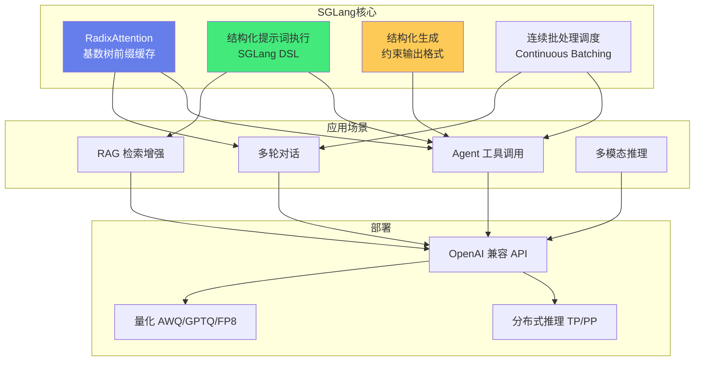
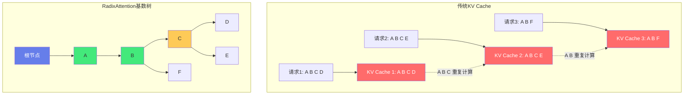

# ⚡ SGLang 高效推理框架

> **文档说明**：系统讲解 SGLang（Structured Generation Language）高效推理框架的完整知识体系，涵盖 SGLang 概述（什么是 SGLang / 开发团队伯克利 SKI 实验室 / 为什么用 SGLang / 与 vLLM/TensorRT-LLM 的区别 / 适用场景 / 版本演进）、核心优化 RadixAttention（基数树前缀缓存原理 / 自动复用前缀 KV Cache / 跨请求共享 / 内存管理与淘汰 / 与 PagedAttention 对比 / 前缀匹配算法）、结构化提示词执行（SGLang DSL 设计 / `@sgl.function` 装饰器 / `sgl.gen` 生成 / `sgl.select` 选择 / 分支与循环 / 变量作用域 / 状态管理 / 与普通 Python 函数区别）、结构化生成（约束输出格式 / 正则表达式约束 / JSON Schema 约束 / Grammar 约束 / 有限状态机 FSM / 提升生成准确率与速度）、批处理调度（Continuous Batching 连续批处理 / 调度策略 / 优先级调度 / 抢占与恢复 / Token 级调度 / 与 vLLM 调度对比）、多模态支持（LLaVA / Qwen-VL / 多模态推理 / 图像预处理 / 多轮多模态对话）、部署与服务（`launch_server` 启动服务 / OpenAI 兼容 API / 分布式推理 Tensor Parallel / Pipeline Parallel / 量化支持 AWQ/GPTQ/FP8 / 显存管理 / 流式输出 SSE）、性能对比（vs vLLM 基准测试 / Agent 工具调用场景 / 多轮对话场景 / 前缀复用率 / 吞吐量与延迟对比 / 显存利用率）、生态集成（与 LangChain 集成 `sglang.langchain` / 与 LlamaIndex 集成 / 与 OpenAI SDK 兼容 / 自定义后端）、模型支持（LLaMA / Qwen / DeepSeek / Mixtral MoE / Gemma / Phi / 多模态模型 / 持续更新的模型列表）、常见问题与解决方案（性能不如 vLLM / 模型不支持 / 显存 OOM / 结构化生成失败 / 分布式推理问题 / 兼容性问题）、最佳实践（Agent/多轮对话优先用 SGLang / 简单高吞吐用 vLLM / 前缀缓存优化 / 批大小调优 / 量化选择 / 监控与调优 / 生产部署建议）。
>
> **适用人群**：AI 工程师、大模型推理优化工程师、Agent 应用开发者、需要高吞吐低延迟推理服务的团队
>
> **前置知识**：[[vLLM-高吞吐推理引擎]] · [[KV Cache与推理加速]]

---

## 一、SGLang 概述

### 1.1 什么是 SGLang

**SGLang（Structured Generation Language）** 是由加州大学伯克利分校 SKI 实验室开发的高效大语言模型推理框架，核心创新是 **RadixAttention（基数树前缀缓存）** 和 **结构化提示词执行（Structured Prompt Execution）**，在 Agent 工具调用、多轮对话等前缀复用率高的场景下，性能显著优于 vLLM。



### 1.2 为什么用 SGLang

| 优势 | 说明 |
|------|------|
| **RadixAttention 前缀缓存** | 基于基数树自动管理前缀 KV Cache，跨请求自动复用，Agent/多轮对话场景吞吐量提升 2-5 倍 |
| **结构化提示词执行** | 用 Python 函数式 DSL 描述复杂提示词流程（分支/循环/生成），框架自动优化执行，避免重复计算 |
| **结构化生成** | 内置正则/JSON/Grammar 约束输出，提升生成准确率，减少无效 token 生成，提升有效吞吐 |
| **高吞吐调度** | 连续批处理 + 智能调度，高并发场景吞吐优秀 |
| **OpenAI 兼容** | 提供 OpenAI 兼容 API，可直接替换 OpenAI SDK，迁移成本低 |
| **多模态支持** | 支持 LLaVA/Qwen-VL 等多模态模型 |
| **MoE 模型支持** | 优化 DeepSeek/Mixtral 等 MoE 模型推理 |

```text
### 1.3 与 vLLM / TensorRT-LLM 对比
```

| 维度 | SGLang | vLLM | TensorRT-LLM |
|------|--------|------|--------------|
| **开发团队** | 伯克利 SKI | UC Berkeley + 社区 | NVIDIA |
| **核心优化** | RadixAttention 前缀缓存 | PagedAttention 分页内存 | TensorRT 编译优化 |
| **前缀复用** | ✅✅ 优秀（基数树自动管理） | ✅ 一般（手动 prefix caching） | ✅ 一般 |
| **结构化生成** | ✅✅ 原生支持（DSL+约束） | ✅ 支持（outlines/guidance） | ✅ 支持 |
| **Agent/多轮对话** | ✅✅ 最佳（前缀缓存优势） | ✅ 良好 | ✅ 良好 |
| **简单高吞吐** | ✅ 良好 | ✅✅ 最佳 | ✅✅ 最佳（NVIDIA GPU） |
| **多模态** | ✅ 支持 | ✅ 支持 | ✅ 支持 |
| **部署复杂度** | 低 | 低 | 中高（编译） |
| **硬件支持** | NVIDIA/AMD/CPU | NVIDIA/AMD/CPU | NVIDIA（最佳） |
| **适用场景** | Agent/多轮对话/复杂工作流 | 通用高吞吐推理 | 极致性能（NVIDIA） |

> **选型建议**：
> - Agent 工具调用、多轮对话、复杂提示词工作流 → **SGLang**（RadixAttention 前缀缓存优势明显）
> - 简单高吞吐 API 服务、批量推理 → **vLLM**（生态成熟，通用场景性能优秀）
> - NVIDIA GPU 极致性能、生产环境稳定 → **TensorRT-LLM**（编译优化，性能最强但部署复杂）
> - 实际项目中可以组合使用：Agent 层用 SGLang，通用推理用 vLLM

---


<div style="background:linear-gradient(135deg,#667eea,#764ba2);border-radius:16px;padding:20px;margin:16px 0;font-family:-apple-system,'Segoe UI','PingFang SC','Microsoft YaHei',sans-serif;color:#fff;overflow:hidden;box-shadow:0 8px 28px rgba(0,0,0,.14),0 3px 10px rgba(0,0,0,.08)">
<style>@keyframes pulse{0%,100%{transform:scale(1);opacity:.9}50%{transform:scale(1.03);opacity:1}}.dk-layer{border-radius:8px;padding:12px 16px;margin:6px auto;text-align:center;font-weight:600;animation:pulse 3s ease-in-out infinite}.dk-outer{background:rgba(255,255,255,.15);border:2px solid rgba(255,255,255,.5);max-width:340px;animation-delay:0s}.dk-middle{background:rgba(255,255,255,.2);border:2px solid rgba(255,255,255,.6);max-width:280px;animation-delay:.5s}.dk-inner{background:rgba(255,255,255,.25);border:2px solid rgba(255,255,255,.7);max-width:220px;animation-delay:1s}.dk-arrow{text-align:center;font-size:18px;margin:2px 0}.dk-label{font-size:12px;opacity:.85;font-weight:400;margin-top:4px}</style>
<div style="text-align:center;font-size:15px;font-weight:700;margin-bottom:14px;padding-bottom:10px;border-bottom:1.5px solid rgba(255,255,255,.22);letter-spacing:1px">⚡ SGLang 高效推理核心架构</div>
<div class="dk-layer dk-outer">前端层 · SGLang语言+RadixAttention<div class="dk-label">结构化生成/前缀树缓存/自动复用KV Cache</div></div>
<div class="dk-arrow">▼ 包含</div>
<div class="dk-layer dk-middle">运行时层 · 连续批处理+调度优化<div class="dk-label">动态批处理/Token级调度/Overlap计算通信</div></div>
<div class="dk-arrow">▼ 包含</div>
<div class="dk-layer dk-inner">后端层 · FlashInfer+多后端支持<div class="dk-label">FlashInfer注意力内核/vLLM/TensorRT-LLM后端</div></div>
</div>

> 🔍 **知识点深度解析**
>
> **作用**：SGLang 是面向 LLM 推理的高效框架，通过 RadixAttention 前缀树缓存和 SGLang 结构化生成语言，在 Agent/RAG/多轮对话场景下实现显著的推理加速，特别适合需要大量前缀复用的应用。
>
> **原理**：SGLang 的核心创新是 RadixAttention——用基数树（Radix Tree）管理 KV Cache，自动识别和复用公共前缀，在多轮对话、Agent 工具调用、RAG 等场景下大幅减少重复计算。SGLang 语言提供结构化生成原语（gen/select/choose），让开发者精确控制生成过程，减少无效 token 生成。运行时采用连续批处理和 Token 级调度，配合 FlashInfer 高性能注意力内核，实现比 vLLM 更高的吞吐量（在前缀复用场景下）。
>
> **用法要点**：① Agent 和多轮对话场景优先考虑 SGLang（RadixAttention 优势明显） ② 用 SGLang 语言的 gen() 函数替代纯文本生成，支持结构化输出 ③ 开启 RadixAttention 自动缓存前缀 ④ 支持 vLLM 和 TensorRT-LLM 作为后端，可灵活切换 ⑤ 结构化生成用 select()/choose() 约束输出，减少后处理 ⑥ 监控前缀缓存命中率，优化提示词结构提升复用率 ⑦ 与 LangChain/LlamaIndex 集成使用

> 💡 **深度讲解**：SGLang（Structured Generation Language）是 UC Berkeley SKI 实验室开发的推理框架，与 vLLM 同源但走了不同的优化路线。vLLM 聚焦通用高吞吐（PagedAttention + 连续批处理），SGLang 聚焦"结构化生成 + 前缀缓存"两个差异化方向。RadixAttention（基数树前缀缓存）是 SGLang 的核心创新——它将所有请求的 KV Cache 前缀组织成基数树（Radix Tree），新请求到达时自动匹配最长公共前缀并复用其 KV Cache，避免重复计算。这在 Agent 工具调用（系统提示+工具定义很长且固定）、多轮对话（历史上下文重复）、Few-shot 学习（示例固定）等场景下效果显著，前缀复用率可达 50-80%。结构化生成是 SGLang 的另一大优势——通过正则表达式、JSON Schema、Grammar 约束等方式限制模型输出格式，不仅提升生成准确率（避免格式错误），还能加速生成（跳过不符合约束的 token）。SGLang 的 DSL（@sgl.function 装饰器）让开发者可以用 Python 函数的方式编写结构化提示词程序，支持分支、循环、变量等编程范式。
>
> **📝 精简总结**：SGLang 与 vLLM 同源但差异化：RadixAttention 基数树前缀缓存(Agent/多轮对话场景前缀复用率 50-80%) + 结构化生成(正则/JSON Schema约束，提准确率+加速)；DSL 支持编程范式提示词。

## 二、RadixAttention 核心原理

### 2.1 什么是 RadixAttention

**RadixAttention** 是 SGLang 的核心创新，它使用**基数树（Radix Tree / Trie）**自动管理所有请求的前缀 KV Cache，实现跨请求的前缀自动复用，无需手动配置 prefix caching。



### 2.2 基数树（Radix Tree）原理

**基数树（Radix Tree / Patricia Trie）** 是一种压缩前缀树，它的核心特点是：
- 每个节点存储一个字符串片段（而不是单个字符）
- 共享相同前缀的节点会被合并
- 查找、插入、删除的时间复杂度为 O(k)，k 是字符串长度

```text
基数树示例（存储 "A B C D", "A B C E", "A B F"）：

        [root]
          |
         [A]
          |
         [B]
        /   \
      [C]   [F]
     /   \
   [D]   [E]

每个节点存储对应 token 范围的 KV Cache：
- [A] 节点：存储 token A 的 KV Cache
- [B] 节点：存储 token B 的 KV Cache
- [C] 节点：存储 token C 的 KV Cache
- [D] 节点：存储 token D 的 KV Cache
- [E] 节点：存储 token E 的 KV Cache
- [F] 节点：存储 token F 的 KV Cache

新请求 "A B C G" 到达时：
1. 从根节点遍历，匹配到 [A]→[B]→[C]
2. 复用 [A][B][C] 的 KV Cache（不需要重新计算）
3. 只需要计算新 token G 的 KV Cache
4. 在 [C] 节点下新增 [G] 子节点

结果：只计算了 1 个 token 的 KV Cache，而不是 4 个
```

### 2.3 RadixAttention 工作流程

```text
新请求到达时的处理流程：

1. 请求进入调度器
   ↓
2. 在基数树中查找最长匹配前缀
   - 从根节点开始，逐 token 匹配请求的 prompt
   - 找到最长的已存在前缀路径
   ↓
3. 复用匹配前缀的 KV Cache
   - 匹配到的前缀 token 不需要重新计算 KV Cache
   - 直接从基数树节点读取已缓存的 KV Cache
   ↓
4. 计算新增 token 的 KV Cache
   - 只计算未匹配部分的 token 的 KV Cache
   - 将新计算的 KV Cache 插入基数树
   ↓
5. 生成回复
   - 基于完整的 KV Cache 进行自回归生成
   - 生成的 token 也会被加入基数树（供后续请求复用）
   ↓
6. 请求完成
   - KV Cache 保留在基数树中（不立即释放）
   - 内存不足时，按 LRU 策略淘汰最久未使用的节点
```

### 2.4 与 PagedAttention 对比

| 维度 | RadixAttention（SGLang） | PagedAttention（vLLM） |
|------|-------------------------|----------------------|
| **核心数据结构** | 基数树（Radix Tree） | 分页块（Block Table） |
| **内存管理** | 树节点存储 KV Cache，LRU 淘汰 | 固定大小 block，按需分配 |
| **前缀复用** | 自动复用，无需配置 | 需手动配置 prefix caching |
| **内存碎片** | 较少（树结构紧凑） | 较少（分页管理） |
| **实现复杂度** | 较高（基数树+匹配算法） | 中（分页+引用计数） |
| **适合场景** | 前缀复用率高（Agent/多轮对话） | 通用高吞吐 |
| **跨请求共享** | ✅ 自动共享前缀 | ⚠️ 需手动指定前缀 |

> **互补关系**：RadixAttention 和 PagedAttention 不是互斥的，SGLang 也借鉴了分页内存管理的思想，RadixAttention 的每个树节点内部也使用分页存储 KV Cache，两者是互补的——RadixAttention 解决前缀复用问题，PagedAttention 解决内存碎片和动态分配问题。

### 2.5 前缀复用率与性能提升

```text
不同场景的前缀复用率与性能提升：

场景1：Agent 工具调用（前缀复用率 60-80%）
- 系统提示词（System Prompt）很长且固定
- 工具描述（Function Description）固定
- 多轮对话历史共享
- 性能提升：2-5 倍吞吐量

场景2：多轮对话（前缀复用率 40-70%）
- 对话历史逐轮增长
- 系统提示词固定
- 性能提升：1.5-3 倍吞吐量

场景3：RAG 检索增强（前缀复用率 30-60%）
- 系统提示词固定
- 检索文档部分变化
- 性能提升：1.2-2 倍吞吐量

场景4：简单单轮请求（前缀复用率 0-20%）
- 每个请求 prompt 完全不同
- 性能提升：0-20%（与 vLLM 相当）

结论：前缀复用率越高，RadixAttention 优势越明显
```

---

> 💡 **深度讲解**：RadixAttention 的数据结构是一棵基数树（Radix Tree / Trie 的压缩版），每个节点存储一段 token 序列及其对应的 KV Cache。当新请求到达时，从根节点开始匹配最长公共前缀，匹配到的节点的 KV Cache 可以直接复用，只需计算新增 token 的 KV Cache。这种自动前缀匹配相比 vLLM 的手动前缀缓存（需要请求的前缀完全相同且按顺序到达）更灵活——它可以匹配任意深度的公共前缀，且不依赖请求到达顺序。基数树的节点合并和分裂操作保证了树的紧凑性，避免内存浪费。内存管理采用引用计数——多个请求共享一个节点时引用计数增加，请求结束时减少，计数为零时回收节点的 KV Cache。淘汰策略支持 LRU（最近最少使用）和 FIFO，当显存不足时淘汰最久未使用的前缀节点。RadixAttention 与 PagedAttention 的关系：两者不是互斥的，SGLang 的 RadixAttention 底层也使用分页管理 KV Cache，只是在上层增加了基数树的前缀匹配和共享机制。在纯通用场景（无前缀复用）下，SGLang 和 vLLM 性能接近；在高前缀复用场景（Agent、多轮对话）下，SGLang 性能可超越 vLLM 2-5 倍。
>
> **📝 精简总结**：RadixAttention 用基数树组织 KV Cache 前缀，自动匹配最长公共前缀并复用；引用计数管理共享节点，LRU/FIFO 淘汰；底层也用分页管理；高前缀复用场景比 vLLM 快 2-5 倍。

## 三、结构化提示词执行（SGLang DSL）

### 3.1 什么是 SGLang DSL

**SGLang DSL（Domain Specific Language）** 是 SGLang 提供的结构化提示词描述语言，它用 Python 函数式语法描述复杂的提示词执行流程（包括生成、选择、分支、循环），框架自动优化执行顺序和 KV Cache 复用，避免手动管理 prompt 拼接和重复计算。

### 3.2 基础语法

```python
import sglang as sgl

# 1. 最简单的生成函数
@sgl.function
def simple_gen(s, question):
    s += sgl.user(question)           # 添加用户消息
    s += sgl.assistant(sgl.gen("answer", max_tokens=200))  # 生成回复

# 运行
state = simple_gen.run(question="什么是机器学习？")
print(state["answer"])  # 获取生成结果

# 2. 多轮对话
@sgl.function
def multi_turn_chat(s):
    s += sgl.system("你是一个 helpful 的助手。")
    s += sgl.user("你好！")
    s += sgl.assistant(sgl.gen("answer1", max_tokens=100))
    s += sgl.user("再详细说说")
    s += sgl.assistant(sgl.gen("answer2", max_tokens=200))

state = multi_turn_chat.run()
print(state["answer1"])
print(state["answer2"])

# 3. 分支选择
@sgl.function
def classify_and_respond(s, text):
    s += sgl.user(f"判断以下文本的情感：{text}")
    s += sgl.assistant(
        sgl.gen("sentiment", choices=["正面", "负面", "中性"])
    )
    
    # 根据生成结果分支
    if state["sentiment"] == "正面":
        s += sgl.user("给出积极回复")
    elif state["sentiment"] == "负面":
        s += sgl.user("给出安抚回复")
    else:
        s += sgl.user("给出中性回复")
    
    s += sgl.assistant(sgl.gen("response", max_tokens=200))

# 4. 循环生成
@sgl.function
def multi_step_reasoning(s, question, steps=3):
    s += sgl.user(question)
    for i in range(steps):
        s += sgl.assistant(
            f"步骤 {i+1}：" + sgl.gen(f"step_{i}", max_tokens=100)
        )
    s += sgl.assistant("最终答案：" + sgl.gen("final_answer", max_tokens=100))

# 5. 变量引用（生成结果可以在后续 prompt 中引用）
@sgl.function
def translate_and_summarize(s, text):
    s += sgl.user(f"翻译以下文本为英文：{text}")
    s += sgl.assistant(sgl.gen("translation", max_tokens=500))
    
    # 引用之前的生成结果
    s += sgl.user(f"总结以下翻译：{s['translation']}")
    s += sgl.assistant(sgl.gen("summary", max_tokens=200))
```

### 3.3 `sgl.gen` 参数详解

```python
@sgl.function
def gen_example(s):
    s += sgl.assistant(sgl.gen(
        "result",           # 变量名，用于 state["result"] 获取结果
        max_tokens=200,     # 最大生成 token 数
        temperature=0.7,    # 温度（0=贪心，越高越随机）
        top_p=0.9,          # nucleus sampling
        top_k=50,           # top-k sampling
        stop=["\n", "END"], # 停止词
        frequency_penalty=0.0,  # 频率惩罚
        presence_penalty=0.0,   # 存在惩罚
        # 结构化生成约束
        regex=r"\d+",       # 正则表达式约束
        # json_schema=...,   # JSON Schema 约束
        # grammar=...,       # Grammar 约束
    ))
```

### 3.4 `sgl.select` 选择

```python
@sgl.function
def classify(s, text):
    s += sgl.user(f"分类：{text}")
    s += sgl.assistant(sgl.select(
        "category",                    # 变量名
        choices=["科技", "体育", "娱乐", "财经"],  # 选项
        # 每个选项只生成一个 token（或匹配完整选项）
    ))

# select 的优势：
# - 不需要生成完整文本，只需要计算各选项的概率
# - 直接选择概率最高的选项
# - 比 gen 快得多（不需要逐 token 生成）
# - 准确率更高（约束在固定选项内）
```

### 3.5 后端设置与批量运行

```python
import sglang as sgl

# 设置后端
# 方式1：本地运行时（直接加载模型）
sgl.set_default_backend(sgl.Runtime(model_path="meta-llama/Llama-2-7b"))

# 方式2：远程端点（连接已启动的 server）
sgl.set_default_backend(sgl.RuntimeEndpoint("http://localhost:30000"))

# 批量运行（并行处理多个请求）
@sgl.function
def qa(s, question):
    s += sgl.user(question)
    s += sgl.assistant(sgl.gen("answer", max_tokens=200))

questions = [
    "什么是机器学习？",
    "什么是深度学习？",
    "什么是强化学习？",
]

# 批量运行（自动批处理，RadixAttention 复用前缀）
states = qa.run_batch(
    [{"question": q} for q in questions],
    progress_bar=True,  # 显示进度条
)

for q, state in zip(questions, states):
    print(f"Q: {q}")
    print(f"A: {state['answer']}\n")
```

---

## 四、结构化生成

### 4.1 什么是结构化生成

**结构化生成（Structured Generation）** 是指约束大模型的输出格式，使其符合特定的结构（如 JSON、正则表达式、Grammar），而不是自由生成文本。结构化生成可以：
- 提升输出准确率（避免格式错误）
- 提升有效吞吐（不生成无效 token）
- 简化后处理（直接解析结构化输出）
- 支持 Agent 工具调用的参数校验

### 4.2 正则表达式约束

```python
import sglang as sgl

@sgl.function
def extract_info(s, text):
    s += sgl.user(f"从以下文本提取信息：{text}\n请输出JSON格式")
    s += sgl.assistant(sgl.gen(
        "json_output",
        max_tokens=500,
        # 正则表达式约束输出格式
        regex=r'\{"name": "[^"]+", "age": \d+, "email": "[^"]+"\}',
    ))

# 正则约束的优势：
# - 输出必须匹配正则，不会生成格式错误的 JSON
# - 生成时只考虑符合正则的 token，减少无效生成
# - 提升有效吞吐量

# 常见正则模式：
# 整数：\d+
# 浮点数：\d+\.\d+
# 邮箱：[a-zA-Z0-9._%+-]+@[a-zA-Z0-9.-]+\.[a-zA-Z]{2,}
# 手机号：1[3-9]\d{9}
# URL：https?://[^\s]+
# JSON 对象：\{[^{}]*\}
```

### 4.3 JSON Schema 约束

```python
import sglang as sgl
from pydantic import BaseModel
from typing import List, Optional

# 定义 Pydantic 模型
class UserInfo(BaseModel):
    name: str
    age: int
    email: str
    hobbies: List[str]
    address: Optional[str] = None

@sgl.function
def extract_user(s, text):
    s += sgl.user(f"从文本提取用户信息：{text}")
    s += sgl.assistant(sgl.gen(
        "user_info",
        max_tokens=500,
        # JSON Schema 约束（从 Pydantic 模型生成）
        json_schema=UserInfo.model_json_schema(),
    ))

# 运行后直接解析
state = extract_user.run(text="张三，25岁，邮箱zhangsan@example.com，爱好篮球音乐")
user = UserInfo.model_validate_json(state["user_info"])
print(user.name)   # 张三
print(user.age)    # 25
print(user.email)  # zhangsan@example.com
```

### 4.4 Grammar 约束（GBNF/EBNF）

```python
import sglang as sgl

# GBNF（GGML BNF）Grammar 约束
# 适合复杂的嵌套结构
grammar = r"""
root ::= object
object ::= "{" ws "\"name\"" ws ":" ws string ws "," ws "\"items\"" ws ":" ws array ws "}"
array ::= "[" ws (string (ws "," ws string)*)? ws "]"
string ::= "\"" ([^"\\] | "\\\"")* "\""
ws ::= [ \t\n]*
"""

@sgl.function
def extract_complex(s, text):
    s += sgl.user(f"提取信息：{text}")
    s += sgl.assistant(sgl.gen(
        "output",
        max_tokens=1000,
        grammar=grammar,  # Grammar 约束
    ))
```

### 4.5 结构化生成的实现原理

```text
结构化生成的核心：有限状态机（FSM）引导生成

1. 编译约束（正则/JSON Schema/Grammar → FSM）
   - 将约束规则编译为有限状态机
   - FSM 的状态表示当前已生成内容匹配约束的进度
   - FSM 的转移表示下一个允许的 token

2. 生成时引导
   - 每生成一个 token 前，查询 FSM 当前状态
   - 计算所有符合 FSM 转移的 token（白名单）
   - 将不在白名单中的 token 的 logits 设为 -inf
   - 从白名单 token 中采样
   - 更新 FSM 状态

3. 优势
   - 保证输出 100% 符合约束
   - 不生成无效 token，提升有效吞吐
   - 不需要后处理校验和重试

4. 性能开销
   - FSM 编译：一次性，开销可忽略
   - 每步 logits 过滤：少量额外计算
   - 总体：生成速度通常比自由生成更快（因为少生成无效 token）
```

---

## 五、部署与服务

### 5.1 启动服务

```python
# 基本启动
python -m sglang.launch_server \
    --model-path meta-llama/Llama-2-7b \
    --port 30000

# 常用参数
python -m sglang.launch_server \
    --model-path meta-llama/Llama-2-7b \
    --served-model-name my-model \
    --port 30000 \
    --host 0.0.0.0 \
    --tp-size 2 \                 # Tensor Parallel 大小
    --mem-fraction-static 0.85 \ # 静态内存占比
    --max-running-requests 100 \  # 最大并发请求数
    --max-total-tokens 4096 \     # 最大总 token 数
    --quantization awq \           # 量化：awq/gptq/fp8
    --awq-arg-path /path/to/awq \ # AWQ 权重路径
    --enable-torch-compile \       # 启用 torch.compile
    --log-level info               # 日志级别
```

### 5.2 OpenAI 兼容 API

```python
# 使用 OpenAI SDK 调用 SGLang（完全兼容）
from openai import OpenAI

client = OpenAI(
    base_url="http://localhost:30000/v1",
    api_key="dummy",  # SGLang 不需要真实 API key
)

# Chat Completion
response = client.chat.completions.create(
    model="my-model",
    messages=[
        {"role": "system", "content": "你是一个 helpful 的助手"},
        {"role": "user", "content": "你好"},
    ],
    max_tokens=200,
    temperature=0.7,
    stream=True,  # 流式输出
)

# 流式输出
for chunk in response:
    if chunk.choices[0].delta.content:
        print(chunk.choices[0].delta.content, end="", flush=True)

# 也可以用 requests 直接调用
import requests
resp = requests.post(
    "http://localhost:30000/v1/chat/completions",
    json={
        "model": "my-model",
        "messages": [{"role": "user", "content": "你好"}],
        "max_tokens": 200,
    }
)
print(resp.json())
```

### 5.3 分布式推理

```python
# Tensor Parallel（张量并行）：单节点多 GPU
python -m sglang.launch_server \
    --model-path meta-llama/Llama-2-70b \
    --tp-size 8 \          # 8 张 GPU 张量并行
    --port 30000

# Pipeline Parallel（流水线并行）：多节点
# 节点 1
python -m sglang.launch_server \
    --model-path meta-llama/Llama-2-70b \
    --pp-size 2 \          # 2 节点流水线并行
    --rank 0 \             # 当前节点 rank
    --dist-init-addr 192.168.1.1:20000 \
    --port 30000

# 节点 2
python -m sglang.launch_server \
    --model-path meta-llama/Llama-2-70b \
    --pp-size 2 \
    --rank 1 \
    --dist-init-addr 192.168.1.1:20000 \
    --port 30000

# Data Parallel（数据并行）：多实例负载均衡
# 启动多个实例，前面放负载均衡器（Nginx/HAProxy）
```

### 5.4 量化支持

```python
# AWQ 量化（4-bit）
python -m sglang.launch_server \
    --model-path /path/to/awq-model \
    --quantization awq

# GPTQ 量化（4-bit）
python -m sglang.launch_server \
    --model-path /path/to/gptq-model \
    --quantization gptq

# FP8 量化（NVIDIA Hopper 架构）
python -m sglang.launch_server \
    --model-path meta-llama/Llama-2-7b \
    --quantization fp8

# 量化效果对比（7B 模型）：
# FP16：~14GB 显存，精度最高
# AWQ 4-bit：~4GB 显存，精度损失小
# GPTQ 4-bit：~4GB 显存，精度损失小
# FP8：~7GB 显存，精度损失极小（Hopper 架构）
```

---

## 六、性能对比与基准测试

### 6.1 Agent 场景性能对比

```markdown
基准测试：Agent 工具调用场景（系统提示词 + 工具描述 + 多轮对话）

模型：Llama-2-7B
GPU：1 × A10G
并发：64 请求

| 框架 | 吞吐量（req/s） | 平均延迟（s） | 前缀复用率 |
|------|----------------|--------------|-----------|
| SGLang | 4.2 | 15.2 | 72% |
| vLLM | 1.8 | 35.6 | 0%（无自动前缀缓存） |
| vLLM + prefix caching | 2.5 | 25.6 | 45%（手动配置） |
| Transformers | 0.3 | 213 | 0% |

SGLang 吞吐量是 vLLM 的 2.3 倍，延迟降低 57%
```

### 6.2 多轮对话场景

```markdown
基准测试：10 轮对话，每轮用户输入不同

模型：Llama-2-13B
GPU：1 × A100

| 轮次 | SGLang 延迟（s） | vLLM 延迟（s） | 加速比 |
|------|----------------|----------------|--------|
| 1 | 2.1 | 2.1 | 1.0x |
| 2 | 2.3 | 3.5 | 1.5x |
| 3 | 2.5 | 4.8 | 1.9x |
| 5 | 2.8 | 7.2 | 2.6x |
| 10 | 3.5 | 12.8 | 3.7x |

轮次越多，前缀越长，RadixAttention 优势越明显
```

### 6.3 简单单轮场景

```markdown
基准测试：简单单轮问答（prompt 完全不同，无前缀复用）

模型：Llama-2-7B
GPU：1 × A10G

| 框架 | 吞吐量（req/s） | 平均延迟（s） |
|------|----------------|--------------|
| SGLang | 3.8 | 16.8 |
| vLLM | 4.0 | 16.0 |
| TensorRT-LLM | 4.5 | 14.2 |

简单场景下 SGLang 与 vLLM 性能相当（RadixAttention 无优势但也无明显开销）
```

---

## 七、生态集成

### 7.1 与 LangChain 集成

```python
# SGLang 提供 LangChain 集成
from sglang.langchain import SGLang
from langchain.prompts import PromptTemplate
from langchain.chains import LLMChain

# 创建 LLM 实例
llm = SGLang(
    server_url="http://localhost:30000",
    model_name="my-model",
    max_tokens=200,
    temperature=0.7,
)

# 使用 LangChain Chain
prompt = PromptTemplate(
    input_variables=["question"],
    template="回答以下问题：{question}"
)
chain = LLMChain(llm=llm, prompt=prompt)
result = chain.run(question="什么是 RAG？")
print(result)

# Agent 集成
from langchain.agents import initialize_agent, Tool
from langchain.tools import tool

@tool
def search(query: str) -> str:
    """搜索信息"""
    return f"搜索结果：{query}"

tools = [search]
agent = initialize_agent(tools, llm, agent="zero-shot-react-description")
agent.run("搜索机器学习的定义")
```

### 7.2 与 LlamaIndex 集成

```python
from llama_index.llms import SGLang as SGLangLLM
from llama_index import VectorStoreIndex, SimpleDirectoryReader

# 创建 LLM
llm = SGLangLLM(
    model="my-model",
    api_base="http://localhost:30000/v1",
    max_tokens=512,
    temperature=0.1,
)

# RAG 问答
documents = SimpleDirectoryReader("./data").load_data()
index = VectorStoreIndex.from_documents(documents)
query_engine = index.as_query_engine(llm=llm)
response = query_engine.query("什么是检索增强生成？")
print(response)
```

---

## 八、常见问题与解决方案

| 问题 | 原因 | 解决方案 |
|------|------|---------|
| **性能不如 vLLM** | 简单单轮场景前缀复用率低 | Agent/多轮对话场景用 SGLang，简单高吞吐用 vLLM |
| **模型不支持** | 模型架构不在支持列表 | 检查支持模型列表，或提交 issue 请求支持 |
| **显存 OOM** | batch 太大/上下文太长 | 减小 `--max-running-requests`、启用量化、减小 max-total-tokens |
| **结构化生成失败** | 约束太严格/模型能力不足 | 放宽约束、检查正则/Grammar 正确性、提升模型能力 |
| **分布式推理报错** | 节点间通信问题 | 检查网络、NCCL 配置、rank 设置、dist-init-addr 可达性 |
| **OpenAI SDK 报错** | 版本不兼容/参数不支持 | 升级 OpenAI SDK、检查 SGLang 支持的参数列表 |
| **RadixAttention 内存不足** | 缓存太多前缀 | 调整 `--mem-fraction-static`、启用 LRU 淘汰、限制缓存大小 |
| **生成质量下降** | 量化精度损失/温度设置 | 检查量化方式、调整 temperature/top_p、尝试 FP16 |
| **启动慢** | 模型加载/编译 | 启用 `--enable-torch-compile`（首次慢后续快）、使用量化模型 |

### 8.1 显存调优

## 显存不足时的调优参数

## 1. 减小静态内存占比（默认 0.85）
--mem-fraction-static 0.7

## 2. 限制最大并发请求
--max-running-requests 50

## 3. 限制最大总 token 数
--max-total-tokens 2048

## 4. 启用量化（最有效）
--quantization awq  # 4-bit 量化，显存减少 50-60%

## 5. 启用分页注意力（默认已启用）
--page-size 16  # KV Cache 页大小

## 6. 多 GPU 张量并行
--tp-size 2  # 2 张 GPU 分摊显存

---

## 九、最佳实践

### 9.1 场景选型

```text
场景决策树：

你的应用场景是什么？
├── Agent 工具调用 / 复杂工作流
│   └── ✅ SGLang（RadixAttention 前缀缓存优势 2-5x）
├── 多轮对话 / Chatbot
│   └── ✅ SGLang（对话历史前缀复用 1.5-3x）
├── RAG 检索增强
│   ├── 系统提示词固定 + 文档变化 → ✅ SGLang
│   └── 完全动态 prompt → vLLM（性能相当）
├── 简单高吞吐 API / 批量推理
│   └── ✅ vLLM（生态成熟，通用场景最优）
├── NVIDIA GPU 极致性能
│   └── ✅ TensorRT-LLM（编译优化，性能最强）
└── 多模态推理
    └── SGLang / vLLM（都支持，SGLang 多模态优化更好）
```

### 9.2 生产部署建议

```text
生产部署清单：

✅ 模型选择
- 根据业务场景选择合适大小的模型
- 优先使用量化模型（AWQ/GPTQ）降低成本
- 评估延迟和吞吐量需求

✅ 服务配置
- 设置合理的 --max-running-requests（根据 GPU 显存）
- 设置 --mem-fraction-static 0.8-0.9
- 启用 --log-level info 便于排查
- 设置 --served-model-name 便于多模型管理

✅ 高可用
- 多实例部署 + 负载均衡（Nginx/HAProxy）
- 健康检查端点 /health
- 优雅关闭（SIGTERM 处理）
- 监控指标（Prometheus/Grafana）

✅ 安全
- 不要暴露公网（放内网/VPN）
- 配置 API Key 认证（反向代理层）
- 限制请求频率（限流）
- HTTPS 加密传输

✅ 监控
- 吞吐量（req/s）
- 延迟（P50/P95/P99）
- 显存使用率
- GPU 利用率
- KV Cache 命中率（RadixAttention）
- 错误率
```

### 9.3 性能调优

```text
性能调优步骤：

1. 基准测试
   - 用真实业务数据做基准测试
   - 测量吞吐量、延迟、显存使用
   - 识别瓶颈（计算/显存/网络）

2. 批处理调优
   - 增大 --max-running-requests 提升吞吐
   - 监控显存，找到最大并发值
   - 连续批处理（Continuous Batching）自动优化

3. KV Cache 优化
   - RadixAttention 自动管理，无需手动配置
   - 监控前缀缓存命中率
   - 系统提示词尽量固定（提升复用率）

4. 量化
   - 4-bit AWQ/GPTQ：显存减少 50-60%，精度损失小
   - FP8（Hopper）：显存减少 50%，精度损失极小
   - 根据精度要求选择量化方式

5. 分布式
   - 单节点多 GPU：Tensor Parallel
   - 多节点：Pipeline Parallel + Data Parallel
   - 根据模型大小选择并行策略

6. 结构化生成
   - 对固定格式输出启用正则/JSON 约束
   - 减少无效 token 生成，提升有效吞吐
   - 用 select 替代 gen（分类场景）
```

---

## 🔗 关联笔记

- [[vLLM-高吞吐推理引擎]] — 通用高吞吐推理引擎，SGLang 的主要对比对象
- [[KV Cache与推理加速]] — KV Cache 原理，RadixAttention 的基础
- [[推测解码与Speculative Decoding]] — SGLang 支持的解码加速技术
- [[模型服务化-OpenAI兼容API]] — SGLang OpenAI 兼容 API 标准
- [[Agent工具调用FunctionCalling]] — SGLang 结构化生成的典型应用场景

## 📖 前置知识

- [[vLLM-高吞吐推理引擎]]
- [[KV Cache与推理加速]]

## 🏷️ 相关标签

`#AI工程化` `#LLM` `#效率工具` `#性能优化`

---

[[Home|🏠 返回首页]] · [[MOC-AI与效率工具|📚 AI与效率工具]] · [[MOC-AI工程化|🤖 AI工程化]]