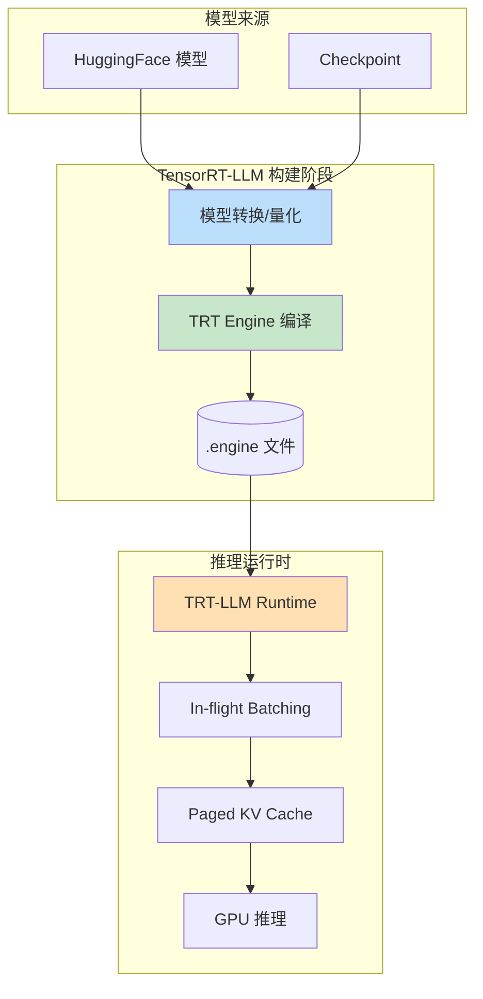

# TensorRT-LLM推理加速

> **文档说明**：系统讲解 NVIDIA TensorRT-LLM 大模型推理加速框架，包括核心优化技术（算子融合、量化、KV Cache、FlashAttention、PagedAttention）、模型构建编译、推理部署、量化支持（INT8/INT4/AWQ/GPTQ/SmoothQuant）、高级特性（推测解码、In-flight Batching、多GPU）、性能调优、与vLLM对比、最佳实践和常见问题。
>
> **适用人群**：AI 工程师、大模型推理优化工程师、算法工程师、需要极致推理性能的开发者
>
> **前置知识**：[[大模型推理优化]]、[[推测解码与Speculative Decoding]]、[[vLLM推理服务部署实战]]

---

## 一、概述

### 1. TensorRT 是什么

```text
TensorRT：
- NVIDIA 开发的高性能深度学习推理优化器和运行时
- 2016 年发布，目前最新版本 10.x
- 支持 C++ 和 Python API
- 核心能力：模型优化、算子融合、量化、内核自动调优

TensorRT 优化技术：
1. 算子融合（Layer Fusion）
   - 将多个操作合并为一个内核
   - 减少 kernel launch 开销和内存读写
   - 例如：Conv + BN + ReLU 融合为一个内核

2. 量化（Quantization）
   - FP32 → FP16 / INT8 / INT4
   - 减少显存占用和计算量
   - 支持 PTQ（训练后量化）和 QAT（量化感知训练）

3. 内核自动调优（Auto-Tuning）
   - 针对特定 GPU 架构选择最优内核实现
   - 考虑输入形状、batch size、数据类型
   - 构建时搜索最优配置

4. 动态形状支持
   - 支持运行时动态输入形状
   - Optimization Profile 定义形状范围

5. 多流执行
   - 支持 CUDA Stream 并行
   - 提高 GPU 利用率

TensorRT vs 原生框架：
- 推理速度通常快 2-10 倍
- 显存占用减少 30-70%
- 但需要构建（编译）过程，灵活性稍低
```

```text
### 2. TensorRT-LLM 介绍
```

```text
TensorRT-LLM：
- NVIDIA 专为大语言模型（LLM）优化的 TensorRT 分支
- 2023 年开源（GitHub: NVIDIA/TensorRT-LLM）
- 基于 TensorRT 核心，增加 LLM 专用优化
- 支持主流大模型：LLaMA、GPT、Mistral、Mixtral、Qwen、Baichuan、ChatGLM、Phi、Gemma 等

核心特性：
1. 极致性能
   - 针对 LLM 推理深度优化
   - 比 HuggingFace Transformers 快 5-20 倍
   - 比 vLLM 快 1.5-3 倍（特定场景）

2. 丰富的模型支持
   - 内置主流模型架构
   - 支持自定义模型
   - 持续更新新模型

3. 量化支持
   - FP16 / BF16
   - INT8（SmoothQuant、AWQ、GPTQ）
   - INT4（AWQ、GPTQ、FP8）
   - 权重量化 + KV Cache 量化

4. 高级推理技术
   - In-flight Batching（连续批处理）
   - Paged KV Cache（分页 KV 缓存）
   - FlashAttention / FlashDecoding
   - 推测解码（Speculative Decoding）
   - 多 GPU 并行（Tensor/Pipeline/Sequence Parallel）

5. 生产级部署
   - C++ 和 Python API
   - Triton Inference Server 集成
   - 动态批处理
   - 流式输出
   - 监控指标

6. 开源生态
   - Apache 2.0 协议
   - 活跃社区
   - 与 NVIDIA 硬件深度优化
```



---


<div style="background:linear-gradient(135deg,#667eea,#764ba2);border-radius:16px;padding:20px;margin:16px 0;font-family:-apple-system,'Segoe UI','PingFang SC','Microsoft YaHei',sans-serif;color:#fff;overflow:hidden;box-shadow:0 8px 28px rgba(0,0,0,.14),0 3px 10px rgba(0,0,0,.08)">
<style>@keyframes pulse{0%,100%{transform:scale(1);opacity:.9}50%{transform:scale(1.03);opacity:1}}.dk-layer{border-radius:8px;padding:12px 16px;margin:6px auto;text-align:center;font-weight:600;animation:pulse 3s ease-in-out infinite}.dk-outer{background:rgba(255,255,255,.15);border:2px solid rgba(255,255,255,.5);max-width:340px;animation-delay:0s}.dk-middle{background:rgba(255,255,255,.2);border:2px solid rgba(255,255,255,.6);max-width:280px;animation-delay:.5s}.dk-inner{background:rgba(255,255,255,.25);border:2px solid rgba(255,255,255,.7);max-width:220px;animation-delay:1s}.dk-arrow{text-align:center;font-size:18px;margin:2px 0}.dk-label{font-size:12px;opacity:.85;font-weight:400;margin-top:4px}</style>
<div style="text-align:center;font-size:15px;font-weight:700;margin-bottom:14px;padding-bottom:10px;border-bottom:1.5px solid rgba(255,255,255,.22);letter-spacing:1px">🔥 TensorRT-LLM 推理加速体系</div>
<div class="dk-layer dk-outer">模型层 · 量化+剪枝+蒸馏<div class="dk-label">INT8/INT4量化/SmoothQuant/AWQ/GPTQ</div></div>
<div class="dk-arrow">▼ 包含</div>
<div class="dk-layer dk-middle">内核层 · 算子融合+FlashAttention<div class="dk-label">CUDA Graph/融合MLP/FlashAttention/分页KV</div></div>
<div class="dk-arrow">▼ 包含</div>
<div class="dk-layer dk-inner">调度层 · 连续批处理+投机解码<div class="dk-label">Inflight batching/Chained speculation/多GPU</div></div>
</div>

> 🔍 **知识点深度解析**
>
> **作用**：TensorRT-LLM 是 NVIDIA 推出的 LLM 推理加速库，通过内核级优化、量化、连续批处理、投机解码等技术，在 NVIDIA GPU 上实现极致推理性能，吞吐量可比 HuggingFace 原生提升 10-100 倍。
>
> **原理**：TensorRT-LLM 基于 TensorRT 深度学习推理优化器，针对 LLM 场景做了深度定制。内核层通过算子融合（融合注意力、MLP、归一化）减少显存读写和 kernel launch 开销，用 FlashAttention 实现 IO 感知的精确注意力计算。量化支持 INT8/INT4（SmoothQuant/AWQ/GPTQ），在几乎不损失精度的前提下降低显存和计算量。调度层采用 Inflight Batching（连续批处理）动态管理请求，投机解码用小模型草稿+大模型验证加速自回归生成。多 GPU 支持张量并行和流水线并行，支持 C++/Python API。
>
> **用法要点**：① NVIDIA GPU 极致性能首选 TensorRT-LLM ② 先从 vLLM 开始，需要极致性能再迁移到 TRT-LLM ③ 量化优先用 INT8 SmoothQuant（精度损失小），显存紧张用 INT4 AWQ ④ 开启 Inflight Batching 提升吞吐 ⑤ 投机解码需额外部署小模型作为草稿模型 ⑥ 多卡用 tensor_parallel，注意 NVLink 带宽 ⑦ 编译时指定 GPU 架构（--gpu_architecture） ⑧ 生产环境用 C++ 运行时，开发调试用 Python API

> 💡 **深度讲解**：TensorRT-LLM 是 NVIDIA 官方推出的大模型推理优化框架，基于 TensorRT 深度学习推理优化器，针对 LLM 推理做了深度定制。它的核心优势是"极致的 NVIDIA GPU 性能"——通过 CUDA Graph、算子融合、FP8/INT4 量化 kernel 深度优化、In-flight Batching 等技术，在 NVIDIA GPU 上实现业界领先的推理性能（通常比 vLLM 快 10-30%）。但它的劣势也很明显：部署复杂度高（需要先编译引擎 build engine，再运行推理 run，编译过程耗时且需要匹配 GPU 架构）、模型支持滞后于 vLLM（新模型需要等待官方支持或手动编写配置）、仅支持 NVIDIA GPU（不支持 AMD/Apple Silicon）。TensorRT-LLM 的典型适用场景是：对推理延迟和吞吐有极致要求的生产环境、固定模型和 GPU 配置的场景、NVIDIA 生态深度绑定的企业。对于需要快速迭代模型、多 GPU 平台支持、快速原型开发的场景，vLLM 是更合适的选择。
>
> **📝 精简总结**：TensorRT-LLM 是 NVIDIA 官方推理框架，极致 GPU 性能(比 vLLM 快 10-30%)，但部署复杂(需编译引擎)、模型支持滞后、仅支持 NVIDIA；适合极致性能需求的固定生产环境。

## 二、核心优化技术

### 1. 算子融合（Kernel Fusion）

```text
LLM 中的算子融合：

1. GEMM + 偏置 + 激活融合
   - 矩阵乘法 + 偏置加法 + GELU/SiLU 激活
   - 减少中间结果的内存读写
   - 例如：FFN 中的 up_proj + SiLU + gate_proj

2. Attention 融合
   - QKV 投影融合（一个 GEMM 算出 Q、K、V）
   - FlashAttention（融合 QK^T + Softmax + V）
   - FlashDecoding（解码阶段优化）

3. RMSNorm + 量化融合
   - RMSNorm 计算与权重量化加载融合
   - 减少内存往返

4. RoPE 融合
   - 旋转位置编码与 Attention 融合
   - 减少中间张量

5. 残差连接融合
   - 残差加法与 LayerNorm 融合
   - 减少 kernel launch

效果：
- 减少 30-50% 的 kernel launch
- 减少 20-40% 的内存带宽需求
- 整体推理速度提升 1.5-2x
```

### 2. 量化（Quantization）

```markdown
TensorRT-LLM 支持的量化方式：

1. FP16 / BF16（半精度）
   - 默认精度
   - 几乎无质量损失
   - 比 FP32 快 2 倍，显存减半
   - 所有现代 GPU 支持

2. INT8 权重量化
   - 权重从 FP16 量化到 INT8
   - 显存减少 50%
   - 计算速度提升（INT8 Tensor Core）
   - 可能有轻微质量损失
   - 方法：SmoothQuant、AWQ、GPTQ

3. INT4 权重量化
   - 权重从 FP16 量化到 INT4
   - 显存减少 75%
   - 支持更大模型在单卡运行
   - 质量损失比 INT8 稍大
   - 方法：AWQ、GPTQ、FP4

4. FP8（8位浮点）
   - NVIDIA H100/H200 支持
   - E4M3（前向）和 E5M2（梯度）
   - 比 INT8 精度更好
   - 训练和推理都可用

5. KV Cache 量化
   - KV Cache 从 FP16 量化到 INT8/FP8
   - 减少 KV Cache 显存占用
   - 支持更长上下文
   - 对质量影响很小

6. 激活量化
   - 激活值也量化（W8A8）
   - 计算全 INT8
   - 速度更快但质量损失较大
   - 需要校准数据

量化方法对比：
| 方法 | 原理 | 质量 | 速度 | 适用场景 |
|------|------|------|------|---------|
| SmoothQuant | 平滑激活分布，W8A8 | 高 | 快 | 通用 |
| AWQ | 保护显著权重，W4A16 | 高 | 快 | INT4 首选 |
| GPTQ | 逐层误差补偿，W4A16 | 高 | 快 | INT4 备选 |
| FP8 | 浮点8位 | 极高 | 极快 | H100+ |
```

### 3. KV Cache 优化

```text
KV Cache（键值缓存）：
- 自回归解码时，缓存之前 token 的 K 和 V
- 避免重复计算
- 是 LLM 推理显存占用的主要部分

KV Cache 大小计算：
- 每个 token 的 KV Cache = 2 × num_layers × num_heads × head_dim × bytes_per_element
- LLaMA-7B：2 × 32 × 32 × 128 × 2 = 524,288 bytes/token ≈ 0.5MB/token（FP16）
- 2048 上下文：约 1GB
- 4096 上下文：约 2GB

TensorRT-LLM KV Cache 优化：

1. Paged KV Cache（分页 KV Cache）
   - 类似虚拟内存的分页机制
   - KV Cache 分成固定大小的块（Block）
   - 按需分配，避免内存碎片
   - 支持动态增长和共享
   - 与 vLLM 的 PagedAttention 类似

2. KV Cache 量化
   - FP16 → INT8/FP8
   - 显存减少 50%
   - 支持更长上下文
   - 质量损失极小

3. KV Cache 复用
   - 相同前缀的请求共享 KV Cache
   - 前缀缓存（Prefix Caching）
   - 减少重复计算

4. 双缓冲 KV Cache
   - 计算和内存传输重叠
   - 隐藏内存延迟

效果：
- 显存利用率提升 30-50%
- 支持更长上下文（2x-4x）
- 更高并发（2x-3x）
```

### 4. FlashAttention / FlashDecoding

```text
FlashAttention：
- 2022 年由 Tri Dao 提出
- IO 感知的 Attention 实现
- 将 Attention 计算分块（Tiling），减少 HBM 访问
- 不计算完整的 N×N Attention 矩阵
- 速度提升 2-4x，显存减少

FlashAttention 原理：
- 标准 Attention：计算完整 QK^T → Softmax → ×V，需要 O(N²) 显存
- FlashAttention：分块计算，每次只算一个块，在线 Softmax，O(N) 显存
- 利用 SRAM（高速缓存）减少 HBM（显存）访问

FlashDecoding：
- 针对解码阶段（batch size=1，序列长）优化
- 解码时 Q 只有一个 token，K/V 很长
- 标准 FlashAttention 在解码时不够高效
- FlashDecoding 将 K/V 分块，并行计算，最后归约
- 解码速度提升 1.5-2x

TensorRT-LLM 中的实现：
- 内置 FlashAttention v2/v3
- 自动根据 GPU 架构选择最优实现
- 支持 FlashDecoding
- 支持不同的 Attention 变体（GQA、MQA、MLA）

效果：
- Attention 计算速度提升 2-4x
- 显存占用减少 50-80%
- 支持更长上下文
- 整体推理速度提升 1.3-2x
```

### 5. In-flight Batching（连续批处理）

```text
In-flight Batching（也叫 Continuous Batching / Iterative Batching）：
- 动态批处理技术
- 新请求可以随时加入 batch
- 完成的请求随时退出
- 不需要等所有请求完成才开始下一批

传统静态批处理：
- 请求1、2、3 同时开始
- 必须等最长的请求完成
- 短请求等待长请求，GPU 空闲
- 吞吐量低

In-flight Batching：
- 请求1、2、3 同时开始
- 请求2 完成后，立即加入请求4
- 请求1 完成后，立即加入请求5
- GPU 始终满负荷
- 吞吐量提升 2-10x

TensorRT-LLM 实现：
- Python 运行时内置 In-flight Batching
- C++ 运行时（高性能）也支持
- 可配置最大 batch size、最大序列长度
- 支持请求优先级
- 支持抢占（高优先级请求抢占低优先级）

与 vLLM 对比：
- vLLM 是 In-flight Batching 的先驱
- TensorRT-LLM 借鉴并优化
- TensorRT-LLM 的内核更优化，单请求延迟更低
- vLLM 的调度更灵活，生态更丰富
```

---

> 💡 **深度讲解**：TensorRT-LLM 的优化技术栈可以分为三层：计算层优化、显存层优化、调度层优化。计算层包括算子融合（将多个小算子合并为一个大 kernel，减少 HBM 访问和 kernel launch 开销）、FP8 推理（利用 Hopper 架构的 FP8 tensor core，计算吞吐量翻倍，精度损失极小）、INT4/INT8 权重量化（AWQ/GPTQ/SmoothQuant，减少权重显存和计算量）、FlashAttention（分块计算注意力，减少 HBM 访问）。显存层包括 Paged KV Cache（分页管理 KV Cache，类似 vLLM 的 PagedAttention）、KV Cache 量化（FP8/INT8 KV，减少显存占用）、CPU Offload（将不活跃的 KV Cache 或权重放到 CPU 内存，支持更大模型）。调度层包括 In-flight Batching（连续批处理，token 级动态增删请求）、Chunked Prefill（分块预填充，避免长 prompt 阻塞）、推测解码（Medusa/EAGLE 多头预测，减少串行调用）。TensorRT-LLM 的独特优势在于"全栈优化"——从底层 CUDA kernel 到上层调度策略都由 NVIDIA 深度优化，且与 GPU 硬件特性（Tensor Core、NVLink、NVSwitch）紧密结合，这是第三方框架难以匹敌的。
>
> **📝 精简总结**：TensorRT-LLM 优化分三层：计算层(算子融合+FP8+量化+FlashAttention)、显存层(Paged KV+量化+CPU Offload)、调度层(In-flight Batching+Chunked Prefill+推测解码)；全栈优化+硬件紧密结合是独特优势。

## 三、安装与环境

### 1. 系统要求

```text
硬件要求：
- NVIDIA GPU（Volta 架构及以上：T4、V100、A10、A100、L40、L4、H100、H200）
- 建议 Ampere 及以上（A10/A100/L40/L4）
- H100/H200 支持 FP8，性能最佳
- 显存：根据模型大小选择（7B 模型 INT4 需 ~6GB）

软件要求：
- Linux（Ubuntu 20.04/22.04、CentOS 7/8）
- NVIDIA Driver >= 525.60.13
- CUDA >= 12.1
- Python >= 3.9
- CMake >= 3.18
- GCC >= 9.4
- TensorRT >= 9.0
```

### 2. Docker 安装（推荐）

```bash
# 拉取 TensorRT-LLM Docker 镜像
# 方式1：从 NVIDIA NGC 拉取
docker pull nvcr.io/nvidia/tensorrt_llm:24.01

# 方式2：从源码构建
git clone https://github.com/NVIDIA/TensorRT-LLM.git
cd TensorRT-LLM
git submodule update --init --recursive

# 构建 Docker 镜像
make -C docker release_build

# 运行容器
docker run --gpus all -it --rm \
  -v $(pwd):/workspace \
  -w /workspace \
  nvcr.io/nvidia/tensorrt_llm:24.01
```

### 3. Python 包安装

```python
# 安装 TensorRT-LLM Python 包
# 需要先安装 TensorRT
pip install tensorrt_llm -U --extra-index-url https://pypi.nvidia.com

# 或从源码编译
git clone https://github.com/NVIDIA/TensorRT-LLM.git
cd TensorRT-LLM
git submodule update --init --recursive

# 安装依赖
pip install -r requirements.txt

# 编译安装
python setup.py install  # 或 pip install .
```

---

## 四、模型构建与编译

### 1. 模型转换

```bash
# 以 LLaMA-2 7B 为例

# 1. 下载模型（从 HuggingFace）
git lfs install
git clone https://huggingface.co/meta-llama/Llama-2-7b-hf

# 2. 转换为 TensorRT-LLM 格式（可选量化）
cd TensorRT-LLM/examples/llama

# FP16（默认）
python convert_checkpoint.py \
  --model_dir /models/Llama-2-7b-hf \
  --output_dir /models/llama-7b-fp16 \
  --dtype float16

# INT8 量化（SmoothQuant）
python convert_checkpoint.py \
  --model_dir /models/Llama-2-7b-hf \
  --output_dir /models/llama-7b-int8 \
  --dtype float16 \
  --use_smooth_quant \
  --per_channel \
  --per_token \
  --calib_size 512

# INT4 量化（AWQ）
python convert_checkpoint.py \
  --model_dir /models/Llama-2-7b-hf \
  --output_dir /models/llama-7b-int4-awq \
  --dtype float16 \
  --use_weight_only \
  --weight_only_precision int4_awq \
  --calib_size 512

# INT4 量化（GPTQ）
python convert_checkpoint.py \
  --model_dir /models/Llama-2-7b-hf \
  --output_dir /models/llama-7b-int4-gptq \
  --dtype float16 \
  --use_weight_only \
  --weight_only_precision int4_gptq \
  --calib_size 512

# 多 GPU（Tensor Parallel）
python convert_checkpoint.py \
  --model_dir /models/Llama-2-70b-hf \
  --output_dir /models/llama-70b-tp4 \
  --dtype float16 \
  --tp_size 4  # 4 卡张量并行
```

### 2. 编译 TRT Engine

**编译为 TensorRT Engine（.engine 文件）**

#### 单 GPU
```bash
trtllm-build \
  --checkpoint_dir /models/llama-7b-fp16 \
  --output_dir /engines/llama-7b-fp16 \
  --gemm_plugin float16 \
  --max_batch_size 32 \
  --max_input_len 2048 \
  --max_output_len 512 \
  --max_seq_len 2560
```

#### INT8 量化
```bash
trtllm-build \
  --checkpoint_dir /models/llama-7b-int8 \
  --output_dir /engines/llama-7b-int8 \
  --gemm_plugin int8 \
  --max_batch_size 64 \
  --max_input_len 2048 \
  --max_output_len 512
```

#### INT4 量化
```bash
trtllm-build \
  --checkpoint_dir /models/llama-7b-int4-awq \
  --output_dir /engines/llama-7b-int4-awq \
  --gemm_plugin weight_only \
  --weight_only_precision int4_awq \
  --max_batch_size 128 \
  --max_input_len 4096 \
  --max_output_len 1024
```

#### 多 GPU（Tensor Parallel）
```bash
trtllm-build \
  --checkpoint_dir /models/llama-70b-tp4 \
  --output_dir /engines/llama-70b-tp4 \
  --gemm_plugin float16 \
  --max_batch_size 16 \
  --max_input_len 2048 \
  --max_output_len 512 \
  --workers 4  # 4 个 worker 并行编译
```

#### 关键参数说明
```text
--max_batch_size：最大 batch size（影响显存和性能）
--max_input_len：最大输入长度
--max_output_len：最大输出长度
--max_seq_len：最大序列长度（input + output）
--gemm_plugin：GEMM 插件精度（float16/int8/weight_only）
--workers：编译并行 worker 数
--strongly_typed：强类型（减少类型转换，提升性能）
--use_paged_context_fmha：分页上下文 FMHA（长上下文优化）
```

### 3. 编译时间与显存

```text
编译时间参考（A100）：
- 7B 模型 FP16：~5-10 分钟
- 7B 模型 INT4：~10-15 分钟
- 70B 模型 FP16 TP4：~30-60 分钟
- 70B 模型 INT4 TP4：~60-90 分钟

编译时显存需求：
- 7B 模型：~16-24GB
- 13B 模型：~24-32GB
- 70B 模型 TP4：每卡 ~24-32GB

注意：
- 编译是一次性过程，编译后 engine 文件可复用
- engine 文件与 GPU 架构、TensorRT 版本绑定
- 换 GPU 或升级版本需要重新编译
- 可以用 --workers 加速编译
```

---

## 五、推理部署

### 1. Python API 推理

```python
# simple_infer.py
from tensorrt_llm.runtime import ModelRunner
import torch

# 加载 Engine
runner = ModelRunner.from_dir(
    engine_dir="/engines/llama-7b-fp16",
    lora_dir=None,
    rank=0,
)

# 输入配置
input_text = "解释什么是人工智能"
max_new_tokens = 200
temperature = 0.7
top_p = 0.95
top_k = 50
repetition_penalty = 1.1

# Tokenizer（用 HuggingFace tokenizer）
from transformers import AutoTokenizer
tokenizer = AutoTokenizer.from_pretrained("/models/Llama-2-7b-hf")
input_ids = tokenizer.encode(input_text, return_tensors="pt").cuda()

# 推理
with torch.no_grad():
    outputs = runner.generate(
        batch_input_ids=input_ids,
        max_new_tokens=max_new_tokens,
        temperature=temperature,
        top_k=top_k,
        top_p=top_p,
        repetition_penalty=repetition_penalty,
        end_id=tokenizer.eos_token_id,
        pad_id=tokenizer.pad_token_id,
        output_sequence_lengths=True,
        return_dict=True,
    )

# 解码输出
output_ids = outputs["output_ids"]
sequence_lengths = outputs["sequence_lengths"]
for i in range(output_ids.shape[0]):
    output_len = sequence_lengths[i].item()
    output_text = tokenizer.decode(output_ids[i, 0, :output_len], skip_special_tokens=True)
    print(f"输出: {output_text}")
```

### 2. 流式输出

```python
# stream_infer.py
from tensorrt_llm.runtime import ModelRunner
import torch

runner = ModelRunner.from_dir(engine_dir="/engines/llama-7b-fp16")

# 流式生成
def stream_generate(input_text, max_new_tokens=200):
    input_ids = tokenizer.encode(input_text, return_tensors="pt").cuda()

    with torch.no_grad():
        for token in runner.generate(
            batch_input_ids=input_ids,
            max_new_tokens=max_new_tokens,
            streaming=True,  # 启用流式
            temperature=0.7,
            end_id=tokenizer.eos_token_id,
            pad_id=tokenizer.pad_token_id,
        ):
            # token 是生成的单个 token
            yield tokenizer.decode(token, skip_special_tokens=True)

# 使用
for text in stream_generate("写一首诗"):
    print(text, end="", flush=True)
```

### 3. C++ 高性能运行时

```bash
# TensorRT-LLM 提供 C++ 运行时，性能更高
# 编译 C++ 示例
cd TensorRT-LLM/cpp
mkdir build && cd build
cmake .. -DTRTLLM_BUILD_TESTS=OFF
make -j$(nproc)

# 运行 C++ 推理
./bin/gptSession \
  --engine_dir=/engines/llama-7b-fp16 \
  --tokenizer_dir=/models/Llama-2-7b-hf \
  --input_text="解释什么是人工智能" \
  --max_output_len=200 \
  --temperature=0.7

# C++ 运行时优势：
# - 更低的延迟（无 Python 开销）
# - 更高的吞吐量
# - 更稳定的生产部署
# - 支持 In-flight Batching
```

### 4. Triton Inference Server 部署

**Triton + TensorRT-LLM 部署（生产级）**

#### 1. 准备模型仓库
```text
model_repository/
└── tensorrt_llm/
    ├── config.pbtxt
    └── 1/
        └── llama-7b-fp16/  # engine 目录
```

#### 2. config.pbtxt
```text
name: "tensorrt_llm"
backend: "tensorrtllm"

instance_group [
  {
    count: 1
    kind: KIND_GPU
    gpus: [0]
  }
]

parameters:
  key: "gpt_model_path"
  value: { string_value: "/models/llama-7b-fp16" }
  key: "max_tokens_in_paged_kv_cache"
  value: { string_value: "8192" }
  key: "kv_cache_free_gpu_memory_fraction"
  value: { string_value: "0.9" }
  key: "enable_chunked_context"
  value: { string_value: "1" }
```

#### 3. 启动 Triton
```bash
docker run --gpus all --rm -p 8000:8000 -p 8001:8001 -p 8002:8002 \
  -v $(pwd)/model_repository:/models \
  nvcr.io/nvidia/tritonserver:24.01-trtllm-python-py3 \
  tritonserver --model-repository=/models
```

#### 4. 客户端调用
```text
HTTP: http://localhost:8000/v2/models/tensorrt_llm/infer
gRPC: localhost:8001
```

---

## 六、高级特性

### 1. 推测解码（Speculative Decoding）

TensorRT-LLM 支持推测解码，需要大模型 engine + 小模型（推测模型）engine。

#### 1. 构建大模型 engine（目标模型）
```bash
trtllm-build --checkpoint_dir /models/llama-70b \
  --output_dir /engines/llama-70b \
  --gemm_plugin float16
```

#### 2. 构建小模型 engine（推测模型）
```bash
trtllm-build --checkpoint_dir /models/llama-7b \
  --output_dir /engines/llama-7b-spec \
  --gemm_plugin float16
```

#### 3. 推理时启用推测解码
```bash
python run.py \
  --engine_dir /engines/llama-70b \
  --speculative_model_dir /engines/llama-7b-spec \
  --num_speculative_tokens 5 \
  --max_new_tokens 200
```

#### 关键参数
```text
--speculative_model_dir：推测模型 engine 目录
--num_speculative_tokens：一次推测的 token 数（通常 3-8）
--speculative_length：推测长度
--use_acceptance_history：使用接受历史优化
```

**效果**：
- 加速比 1.5-3x（取决于接受率）
- 输出质量与标准解码完全一致

### 2. 多 GPU 并行

```text
TensorRT-LLM 支持的并行策略：

1. Tensor Parallel（TP，张量并行）
   - 将单个层的权重切分到多个 GPU
   - 每个 GPU 计算部分结果，最后 AllReduce
   - 适合超大模型（70B+）单卡放不下
   - 通信开销大，需要 NVLink（推荐）
   - tp_size 通常 2/4/8

2. Pipeline Parallel（PP，流水线并行）
   - 将模型的不同层放到不同 GPU
   - GPU1 计算前 N 层，GPU2 计算后 N 层
   - 微批次流水线，减少气泡
   - 适合超深模型
   - pp_size 通常 2/4/8

3. Sequence Parallel（SP，序列并行）
   - 将序列维度切分
   - 配合 Tensor Parallel 使用
   - 减少长序列的显存峰值
   - 适合长上下文场景

4. Expert Parallel（EP，专家并行）
   - MoE 模型（如 Mixtral）的专家切分
   - 每个 GPU 放部分专家
   - All-to-All 通信

配置示例：
```
```bash
# 70B 模型，2 节点 8 卡，TP=4 PP=2
trtllm-build \
  --checkpoint_dir /models/llama-70b-tp4-pp2 \
  --output_dir /engines/llama-70b-tp4-pp2 \
  --gemm_plugin float16 \
  --max_batch_size 16
```

#### 运行时指定 GPU
```bash
mpirun -n 8 --allow-run-as-root \
  python run.py --engine_dir /engines/llama-70b-tp4-pp2
```

### 3. LoRA 支持

TensorRT-LLM 支持 LoRA（Low-Rank Adaptation），可以在一个基础模型上加载多个 LoRA 适配器。

#### 1. 转换 LoRA 权重
```bash
python convert_lora.py \
  --base_model_dir /models/Llama-2-7b-hf \
  --lora_path /models/lora/finance \
  --output_dir /models/lora/finance-trtllm \
  --dtype float16
```

#### 2. 构建基础模型 engine（启用 LoRA 插件）
```bash
trtllm-build \
  --checkpoint_dir /models/llama-7b-fp16 \
  --output_dir /engines/llama-7b-lora \
  --gemm_plugin float16 \
  --lora_plugin float16 \
  --max_lora_rank 64
```

#### 3. 推理时指定 LoRA
```bash
python run.py \
  --engine_dir /engines/llama-7b-lora \
  --lora_dir /models/lora/finance-trtllm \
  --input_text="分析这份财报"
```

### 4. 多模态支持

TensorRT-LLM 支持多模态模型（如 LLaVA、BLIP-2、Qwen-VL）。

#### LLaVA 示例
```bash
cd TensorRT-LLM/examples/multimodal

# 1. 转换模型
python convert_checkpoint.py \
  --model_dir /models/llava-v1.5-7b \
  --output_dir /models/llava-7b-trtllm \
  --dtype float16

# 2. 编译
trtllm-build \
  --checkpoint_dir /models/llava-7b-trtllm \
  --output_dir /engines/llava-7b \
  --gemm_plugin float16

# 3. 推理（图片 + 文本）
python run.py \
  --engine_dir /engines/llava-7b \
  --input_text="描述这张图片" \
  --input_image /path/to/image.jpg
```

---

## 七、性能调优

### 1. 关键性能指标

LLM 推理性能指标：

1. 首 Token 延迟（TTFT，Time To First Token）
   - 从请求到第一个 token 输出的时间
   - 影响用户体验（感知响应速度）
   - 预填充阶段决定
   - 目标：< 500ms（交互式）

2. 每 Token 延迟（TPOT，Time Per Output Token）
   - 生成每个 token 的平均时间
   - 决定生成速度
   - 解码阶段决定
   - 目标：< 50ms/token（流畅）

3. 吞吐量（Throughput）
   - 单位时间处理的 token 数或请求数
   - tokens/sec 或 requests/sec
   - 决定服务容量
   - In-flight Batching 主要优化指标

4. 端到端延迟（E2E Latency）
   - 从请求到完整响应的时间
   - TTFT + 输出长度 × TPOT

5. 显存利用率
   - GPU 显存使用比例
   - KV Cache 占用是关键
   - 目标：70-90%（留余量）

6. GPU 利用率
   - SM（流式多处理器）利用率
   - 目标：> 70%
   - 低利用率说明有瓶颈（内存/调度）

### 2. 调优策略

1. 量化调优
   - 能用 INT4 就不用 INT8，能用 INT8 就不用 FP16
   - AWQ 通常比 GPTQ 质量好
   - KV Cache 也量化（INT8/FP8）
   - 评估质量损失，可接受就用更低精度

2. Batch 调优
   - max_batch_size：根据显存和延迟目标设置
   - 太小：GPU 利用率低，吞吐量低
   - 太大：单请求延迟高，可能 OOM
   - 用 In-flight Batching 动态调整
   - 压测找到最优值

3. KV Cache 调优
   - kv_cache_free_gpu_memory_fraction：0.8-0.95
   - 留 5-20% 给计算临时变量
   - Paged KV Cache 减少碎片
   - KV Cache 量化支持更长上下文

4. 上下文长度调优
   - max_input_len / max_output_len 按需设置
   - 设置过大浪费显存（KV Cache 预分配）
   - 用动态形状支持不同长度
   - 长上下文用 --use_paged_context_fmha

5. 算子插件调优
   - --gemm_plugin：选择最优 GEMM 实现
   - --strongly_typed：减少类型转换
   - FlashAttention：自动启用
   - 自定义插件：热点算子手动优化

6. 多 GPU 调优
   - TP：需要 NVLink，否则通信瓶颈
   - PP：适合节点间（无 NVLink）
   - 混合并行：TP + PP
   - 监控通信占比，过高则调整策略

7. 编译调优
   - --workers：多 worker 并行编译
   - --timing_cache：缓存调优结果，加速重编译
   - --builder_optimization_level：优化级别（0-3）
   - 针对目标 GPU 架构编译

### 3. 压测方法

使用 TensorRT-LLM 自带的压测工具。

#### 1. 基准测试
```bash
python benchmarks/python/benchmark.py \
  --engine_dir /engines/llama-7b-fp16 \
  --tokenizer_dir /models/Llama-2-7b-hf \
  --max_input_len 2048 \
  --max_output_len 512 \
  --batch_size 1,8,16,32 \
  --num_runs 5
```

#### 2. 模拟真实流量
```bash
python benchmarks/python/gpt_manager_benchmark.py \
  --engine_dir /engines/llama-7b-fp16 \
  --tokenizer_dir /models/Llama-2-7b-hf \
  --request_rate 10 \
  --max_duration 60 \
  --max_input_len 2048 \
  --max_output_len 512
```

#### 3. 关键输出指标
- TTFT（首 token 延迟）
- TPOT（每 token 延迟）
- Throughput（吞吐量 tokens/sec）
- GPU 利用率
- 显存使用

**外部压测工具**
- Triton 性能分析器
- Locust / k6（HTTP 接口压测）
- NVIDIA DCGM（GPU 监控）

---

## 八、与 vLLM 对比

| 维度 | TensorRT-LLM | vLLM |
|------|-------------|------|
| **开发商** | NVIDIA | UC Berkeley（开源社区） |
| **语言** | C++/Python | Python |
| **单请求延迟** | 更低（深度优化内核） | 中等 |
| **吞吐量** | 高 | 高（In-flight Batching 先驱） |
| **量化支持** | 丰富（INT8/INT4/FP8/AWQ/GPTQ/SmoothQuant） | 丰富（AWQ/GPTQ/SqueezeLLM） |
| **模型支持** | 主流模型（持续增加） | 非常丰富（社区贡献快） |
| **部署灵活性** | 需编译 engine，灵活性稍低 | 即开即用，灵活性高 |
| **生产稳定性** | 高（NVIDIA 背书，Triton 集成） | 高（广泛使用） |
| **多 GPU** | TP/PP/SP/EP 完善 | TP/PP（PP 较新） |
| **推测解码** | 支持 | 支持 |
| **LoRA** | 支持 | 支持 |
| **多模态** | 支持（LLaVA等） | 支持 |
| **开源协议** | Apache 2.0 | Apache 2.0 |
| **硬件** | NVIDIA GPU 专属 | NVIDIA GPU（AMD/Intel 实验性） |
| **编译时间** | 需要（5-60分钟） | 不需要 |
| **适用场景** | 极致性能、生产部署、NVIDIA 硬件 | 快速迭代、丰富模型、灵活部署 |

选择建议：
- 追求极致延迟和吞吐量 → TensorRT-LLM
- 需要快速切换模型、丰富生态 → vLLM
- 生产环境 + NVIDIA 硬件 → TensorRT-LLM + Triton
- 研究/快速验证 → vLLM
- 两者可以共存：不同模型用不同框架

---

## 九、最佳实践

### 1. 模型选择与量化

- [ ] **根据显存选精度**：7B 模型 FP16 需 ~14GB，INT4 需 ~4-5GB
- [ ] **优先 AWQ**：INT4 量化首选 AWQ，质量损失小
- [ ] **KV Cache 量化**：长上下文场景务必开启 KV Cache 量化
- [ ] **质量评估**：量化后用标准数据集评估（MMLU、HumanEval等）
- [ ] **校准数据**：量化校准用领域相关数据，512 条左右
- [ ] **FP8 优先**：H100/H200 上优先用 FP8，质量接近 FP16

### 2. 编译优化

- [ ] **针对目标 GPU 编译**：不要跨架构复用 engine
- [ ] **合理设置 max 参数**：max_batch_size、max_input_len 按需设置
- [ ] **启用强类型**：--strongly_typed 减少类型转换开销
- [ ] **启用分页 FMHA**：长上下文用 --use_paged_context_fmha
- [ ] **多 worker 编译**：--workers 加速编译
- [ ] **缓存调优结果**：--timing_cache 加速重编译

### 3. 部署优化

- [ ] **In-flight Batching**：生产环境务必启用连续批处理
- [ ] **Paged KV Cache**：启用分页 KV Cache，提高显存利用率
- [ ] **合理的 KV Cache 比例**：kv_cache_free_gpu_memory_fraction 0.85-0.9
- [ ] **请求超时**：设置合理的请求超时，防止恶意长请求
- [ ] **最大长度限制**：限制 input/output 最大长度
- [ ] **优雅关闭**：处理完进行中请求再关闭
- [ ] **健康检查**：提供 /health 端点
- [ ] **监控告警**：GPU 利用率、显存、延迟、吞吐量

### 4. 性能监控

- [ ] **DCGM 监控**：用 NVIDIA DCGM 监控 GPU 指标
- [ ] **Prometheus + Grafana**：可视化监控面板
- [ ] **关键指标告警**：延迟 P99、错误率、GPU 利用率
- [ ] **日志聚合**：集中收集推理日志
- [ ] **链路追踪**：OpenTelemetry 集成
- [ ] **定期压测**：版本更新后压测对比

### 5. 成本优化

- [ ] **选择合适 GPU**：L4 性价比高，H100 性能最强
- [ ] **量化降低显存**：INT4 可以用更小的 GPU
- [ ] **提高利用率**：In-flight Batching 提高 GPU 利用率
- [ ] **自动扩缩容**：根据流量自动扩缩容
- [ ] **Spot 实例**：非关键任务用竞价实例
- [ ] **模型缓存**：常用模型常驻显存，避免重复加载

---

## 十、常见问题与排查

| 问题 | 原因 | 解决方案 |
|------|------|---------|
| **编译失败** | CUDA/TensorRT 版本不匹配/内存不足/依赖缺失 | 检查版本兼容性；增加编译内存；用 Docker 官方镜像；查看编译日志 |
| **编译时间太长** | 模型大/worker 少/优化级别高 | 用 --workers 多 worker；降低优化级别；用 timing cache；小模型先验证 |
| **推理结果不对** | tokenizer 不匹配/配置错/量化质量差 | 确认 tokenizer 与模型一致；检查 config.json；用 FP16 对比；重新量化 |
| **显存溢出（OOM）** | batch 太大/上下文太长/精度太高 | 降低 max_batch_size；降低 max_input_len；用 INT4 量化；KV Cache 量化；多 GPU |
| **推理速度慢** | 未用插件/量化/batch 太小/GPU 利用率低 | 启用 gemm_plugin；量化；增大 batch；用 In-flight Batching；检查 GPU 利用率 |
| **多 GPU 报错** | 并行配置错/NCCL 问题/通信失败 | 检查 tp_size/pp_size 与 GPU 数匹配；检查 NCCL 环境变量；测试 NVLink；用 mpirun |
| **推测解码没加速** | 接受率低/小模型太慢/参数不当 | 换同系列小模型；降低温度；调整 num_speculative_tokens；检查接受率 |
| **量化后质量差** | 校准数据不当/量化方法不适合/精度太低 | 用领域相关校准数据；换 AWQ；提高精度（INT4→INT8）；增加校准样本 |
| **Triton 部署失败** | 模型仓库结构错/config 错/版本不匹配 | 检查模型仓库结构；检查 config.pbtxt；确认 Triton 与 TRT-LLM 版本匹配 |
| **流式输出卡顿** | 网络延迟/服务端缓冲/客户端处理慢 | 检查网络；禁用服务端缓冲；优化客户端；用 gRPC 替代 HTTP |
| **KV Cache 不足** | 上下文太长/batch 太大/显存不够 | 降低 max_seq_len；降低 batch；KV Cache 量化；增加显存；多 GPU |
| **engine 文件跨 GPU 不可用** | engine 与 GPU 架构绑定 | 在目标 GPU 上重新编译；不要跨架构复制 |
| **自定义模型不支持** | TensorRT-LLM 未内置该架构 | 参考已有模型实现自定义；用通用模型定义；提 Issue/PR；先用 vLLM |
| **FP8 不生效** | GPU 不支持（需 H100+）/配置错 | 确认 GPU 架构（H100/H200）；检查 --fp8 配置；查看编译日志 |
| **延迟不稳定** | 动态形状/调度抖动/其他进程干扰 | 固定形状范围；隔离 GPU；禁用其他进程；检查频率缩放 |
| **吞吐量上不去** | batch 太小/请求率低/GPU 利用率低 | 增大 batch；提高请求率；用 In-flight Batching；检查是否内存带宽瓶颈 |
| **升级后不兼容** | API 变更/engine 格式变更 | 查看 CHANGELOG；重新编译 engine；更新客户端代码；锁定版本 |
| **LoRA 切换慢** | LoRA 权重加载/切换开销 | 预加载常用 LoRA；限制并发 LoRA 数；用更小的 LoRA rank |
| **长上下文性能差** | Attention 复杂度 O(n²)/KV Cache 大 | 用 FlashAttention；Paged KV Cache；KV Cache 量化；用支持长上下文的模型 |

---

## 十一、关联笔记

### AI 推理与服务
- [[大模型推理优化]] · [[推测解码与Speculative Decoding]] · [[vLLM推理服务部署实战]]
- [[模型服务网格与多模型管理]] · [[AI推理成本优化]] · [[LLM推理引擎选型对比]]

### 大模型技术
- [[大模型微调-LoRA与QLoRA]] · [[Prompt工程高级技巧]] · [[DPO直接偏好优化]]
- [[RAG检索增强生成]] · [[AI Agent架构设计]]

```text
### Python 全栈
```
- [[Python-LangChain应用开发]] · [[Python-异步编程asyncio]] · [[Python-Web框架FastAPI实战]]

### 云原生
- [[K8s-核心概念与架构]] · [[APM应用性能监控-SkyWalking]] · [[Jenkins流水线实战]]

### 导航
- [[MOC-AI与效率工具]] · [[MOC-Python全栈]] · [[全栈+AI工程双轨融合学习路线图]]

> **学习路径建议**：先掌握 [[大模型推理优化]] 推理基础 → 学习 [[vLLM推理服务部署实战]] 推理服务 → 深入本文 TensorRT-LLM 极致优化 → 实践 [[推测解码与Speculative Decoding]] 高级加速 → 研究 [[模型服务网格与多模型管理]] 生产部署 → 构建完整的 LLM 推理优化与服务体系。

---

## 🔗 关联笔记

- [[vLLM-高吞吐推理引擎]] — 通用高吞吐推理，TensorRT-LLM 的主要对比对象
- [[SGLang高效推理框架]] — 结构化生成优化，另一个推理框架选择
- [[GPU显存优化与批处理]] — GPU 显存优化原理，TensorRT-LLM 优化基础
- [[推测解码与Speculative Decoding]] — TensorRT-LLM 支持的 Medusa/EAGLE 推测解码
- [[模型量化-GPTQ-AWQ-GGUF]] — 量化原理，TensorRT-LLM 量化支持基础

## 📖 前置知识

- [[GPU显存优化与批处理]]
- [[模型量化-GPTQ-AWQ-GGUF]]

## 🏷️ 相关标签

`#AI工程化` `#LLM` `#效率工具` `#性能优化`

---

[[Home|🏠 返回首页]] · [[MOC-AI与效率工具|📚 AI与效率工具]] · [[MOC-AI工程化|🤖 AI工程化]]