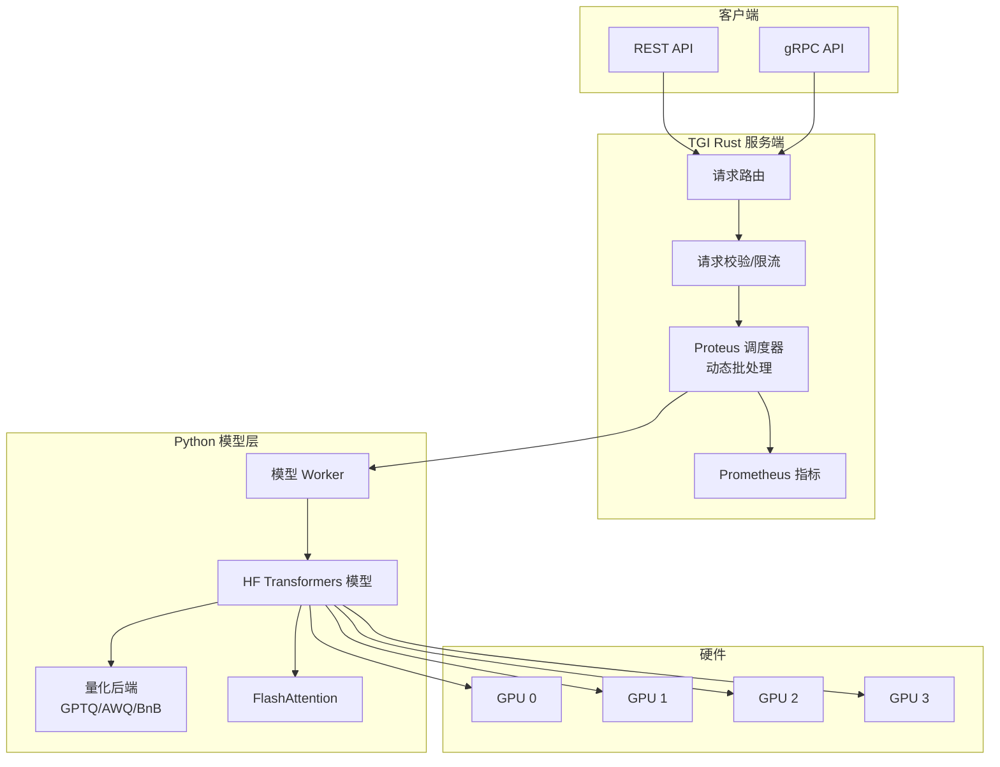
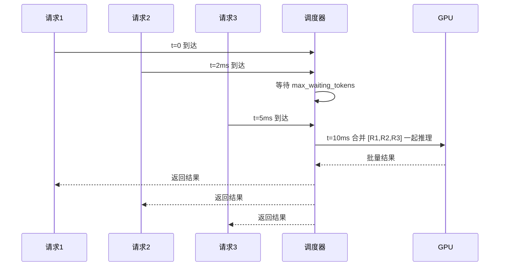

# Text Generation Inference (TGI)

> **文档说明**：系统讲解 HuggingFace 官方的大模型推理服务框架 Text Generation Inference (TGI)，涵盖核心架构（Rust 服务端 + Python 模型层）、动态批处理、FlashAttention、张量并行、量化支持（GPTQ/AWQ/BitsAndBytes）、Proteus 调度器、OpenAI 兼容 API、Streaming、生产部署与监控、与 vLLM 的对比选型，含 Docker 部署命令、API 调用代码、性能调优配置和高可用方案。
>
> **适用人群**：AI 应用开发者、需要在生产环境部署大模型推理服务的全栈工程师、评估推理框架的技术负责人
>
> **前置知识**：[[vLLM-高吞吐推理引擎]]、[[GPU显存优化与批处理]]、[[模型服务化-OpenAI兼容API]]

---

## 一、概述

**Text Generation Inference (TGI)** 是 HuggingFace 官方开源的大模型推理服务框架，最初为 HuggingFace Inference API 提供动力。TGI 用 Rust 编写高性能服务端，Python 运行模型，支持动态批处理、FlashAttention、张量并行、多种量化方案，提供 OpenAI 兼容的 REST API 和流式输出。TGI 的特点是**生产级稳定性**和**广泛的模型兼容性**，是 HuggingFace 生态的首选推理服务。

### 1. TGI 解决了什么问题

| 痛点（裸模型推理） | TGI 解决的问题 |
|-----------------|--------------|
| 单请求推理，并发能力差 | 动态批处理（Dynamic Batching），自动合并请求 |
| 长序列推理显存爆炸 | FlashAttention + PagedAttention（新版本）+ 量化 |
| 大模型单卡跑不动 | 张量并行（Tensor Parallelism），多卡分摊 |
| 没有标准 API，集成困难 | OpenAI 兼容 API + 原生 API，SDK 直接可用 |
| 流式输出实现复杂 | 内置 SSE 流式，支持 token 级推送 |
| 生产部署缺乏监控 | Prometheus 指标、健康检查、日志结构化 |
| 模型加载慢，启动时间长 | 模型预加载、Sharded 加载、CUDA Graph |

### 2. TGI 架构



### 3. TGI vs vLLM 对比

| 维度 | TGI | vLLM |
|------|-----|------|
| **开发方** | HuggingFace | UC Berkeley（开源社区） |
| **服务端语言** | Rust（高性能） | Python + C++ |
| **核心技术** | 动态批处理 + FlashAttention | PagedAttention + 连续批处理 |
| **吞吐量** | 高 | 更高（PagedAttention 显存利用率好） |
| **模型兼容性** | 最广（HF 生态原生） | 广（持续扩展） |
| **量化支持** | GPTQ/AWQ/BitsAndBytes/EETQ | AWQ/GPTQ/GPTQ-Marlin |
| **张量并行** | ✅ | ✅ |
| **OpenAI 兼容 API** | ✅（/v1 端点） | ✅ |
| **生产稳定性** | 高（HF 官方背书） | 高（广泛生产使用） |
| **部署方式** | Docker 为主 | Docker + Python |
| **社区活跃度** | 高 | 非常高 |
| **适用场景** | HF 生态、需要 gRPC、企业级 | 高吞吐、大规模、成本敏感 |

---


<div style="background:linear-gradient(135deg,#667eea,#764ba2);border-radius:16px;padding:20px;margin:16px 0;font-family:-apple-system,'Segoe UI','PingFang SC','Microsoft YaHei',sans-serif;color:#fff;overflow:hidden;box-shadow:0 8px 28px rgba(0,0,0,.14),0 3px 10px rgba(0,0,0,.08)">
<style>@keyframes pulse{0%,100%{transform:scale(1);opacity:.9}50%{transform:scale(1.03);opacity:1}}.dk-layer{border-radius:8px;padding:12px 16px;margin:6px auto;text-align:center;font-weight:600;animation:pulse 3s ease-in-out infinite}.dk-outer{background:rgba(255,255,255,.15);border:2px solid rgba(255,255,255,.5);max-width:340px;animation-delay:0s}.dk-middle{background:rgba(255,255,255,.2);border:2px solid rgba(255,255,255,.6);max-width:280px;animation-delay:.5s}.dk-inner{background:rgba(255,255,255,.25);border:2px solid rgba(255,255,255,.7);max-width:220px;animation-delay:1s}.dk-arrow{text-align:center;font-size:18px;margin:2px 0}.dk-label{font-size:12px;opacity:.85;font-weight:400;margin-top:4px}</style>
<div style="text-align:center;font-size:15px;font-weight:700;margin-bottom:14px;padding-bottom:10px;border-bottom:1.5px solid rgba(255,255,255,.22);letter-spacing:1px">📦 TGI 推理服务架构</div>
<div class="dk-layer dk-outer">服务层 · OpenAI兼容API+gRPC<div class="dk-label">REST/gRPC接口/流式输出/健康检查</div></div>
<div class="dk-arrow">▼ 包含</div>
<div class="dk-layer dk-middle">推理层 · 连续批处理+FlashAttention<div class="dk-label">动态批处理/FlashAttention v2/Sharded前缀缓存</div></div>
<div class="dk-arrow">▼ 包含</div>
<div class="dk-layer dk-inner">模型层 · 量化+Safetensors+PEFT<div class="dk-label">GPTQ/AWQ量化/LoRA适配器/多模型加载</div></div>
</div>

> 🔍 **知识点深度解析**
>
> **作用**：Text Generation Inference (TGI) 是 HuggingFace 推出的 LLM 推理服务框架，提供生产级的模型部署、连续批处理、FlashAttention、量化支持，是 HuggingFace 生态的标准推理服务。
>
> **原理**：TGI 基于 Rust 构建高性能服务端，Python 处理模型推理。核心特性包括：连续批处理（Continuous Batching）动态管理请求队列，FlashAttention v2 加速注意力计算，Sharded 前缀缓存共享相同前缀的 KV Cache，支持 GPTQ/AWQ 量化降低显存，支持 LoRA/PEFT 适配器动态加载。提供 OpenAI 兼容 API（/v1/chat/completions）和原生 API（/generate），支持流式输出（SSE）、健康检查、Prometheus 指标。与 HuggingFace Hub 深度集成，一条命令部署任意 HF 模型。
>
> **用法要点**：① HuggingFace 生态用户首选 TGI，模型兼容性最好 ② 生产部署用 Docker 镜像（ghcr.io/huggingface/text-generation-inference） ③ 开启 --flash-attention 2 加速注意力 ④ 量化用 --quantize gptq 或 awq ⑤ 连续批处理参数：--max-batch-size、--max-batch-prefill-tokens ⑥ 前缀缓存用 --sharded-past ⑦ 监控指标：throughput、latency、queue_size ⑧ 与 LangChain 的 HuggingFaceEndpoint 集成

> 💡 **深度讲解**：Text Generation Inference（TGI）是 HuggingFace 官方推出的大模型推理服务框架，专为生产环境部署设计。它的核心定位是"HuggingFace 生态的推理服务标准"——与 Transformers 库深度集成，支持几乎所有 HuggingFace 上的模型，提供 OpenAI 兼容 API、连续批处理、FlashAttention、量化支持、张量并行等生产级特性。TGI 的优势在于：模型支持最广泛（HuggingFace 上的新模型通常第一时间被 TGI 支持）、生产级稳定性（HuggingFace 官方维护，Inference Endpoints 产品后端就是 TGI）、Docker 一键部署（官方镜像，配置简单）。TGI 的劣势在于：性能略逊于 vLLM（连续批处理和 PagedAttention 的实现不如 vLLM 极致）、量化支持有限（主要支持 bitsandbytes 和 GPTQ，AWQ 支持较晚）、定制化能力弱（配置项不如 vLLM 丰富）。TGI 的典型适用场景：HuggingFace 生态深度用户、需要快速部署多种模型的场景、对稳定性要求高但性能要求不极致的生产环境。对于追求极致吞吐和最新优化技术的场景，vLLM 是更好的选择。
>
> **📝 精简总结**：TGI 是 HuggingFace 官方推理框架，模型支持最广泛+生产级稳定+Docker 一键部署；性能略逊于 vLLM，量化支持有限；适合 HF 生态用户和稳定性优先场景。

## 二、底层原理

### 1. 动态批处理（Dynamic Batching）

TGI 的核心优化之一是动态批处理：请求不会立即执行，而是等待一个短暂的窗口期（`max_waiting_tokens`），将窗口期内到达的请求合并为一个 batch 一起推理。



**关键参数**：
- `max_batch_total_tokens`：一个 batch 中所有请求的总 token 数上限
- `max_waiting_tokens`：等待新请求的最大 token 数（控制延迟-吞吐权衡）
- `max_batch_prefill_tokens`：预填充阶段的最大 token 数

### 2. Proteus 调度器

TGI v2.0+ 引入了 Proteus 调度器，替代旧的 Python 调度器，用 Rust 实现：

| 特性 | 说明 |
|------|------|
| **连续批处理** | 每个解码步骤后动态增删请求（类似 vLLM） |
| **分块预填充** | 长 prompt 分块处理，不阻塞短请求 |
| **优先级调度** | 支持不同优先级的请求队列 |
| **显存管理** | 精细化 KV Cache 管理，减少碎片 |
| **抢占机制** | 高优先级请求可抢占低优先级请求的 KV Cache |

### 3. 张量并行

TGI 支持张量并行将模型分布到多卡：

```text
--num-shard 2   # 2 卡张量并行
--num-shard 4   # 4 卡张量并行
```

实现方式：
- **行并行**：Linear 层按输出维度切分，各卡计算部分结果后 all-reduce
- **列并行**：Linear 层按输入维度切分，各卡输出部分隐藏状态后拼接
- 注意力层的 Q/K/V/O 均做张量并行
- 需要 NVLink 或高带宽互联（PCIe 也可以但较慢）

### 4. 量化支持

| 量化方案 | 命令参数 | 说明 |
|---------|---------|------|
| **BitsAndBytes NF4** | `--quantize bitsandbytes-nf4` | QLoRA 同款，4bit，质量好 |
| **BitsAndBytes FP8** | `--quantize bitsandbytes-fp8` | FP8 量化，适合 Hopper 架构 |
| **GPTQ** | `--quantize gptq` | 需提前用 GPTQ 量化的模型 |
| **AWQ** | `--quantize awq` | 需提前用 AWQ 量化的模型 |
| **EETQ** | `--quantize eetq` | 8bit，速度快，质量接近 FP16 |

---

## 三、实操

### 1. Docker 部署

```bash
# === 基础部署（单卡，FP16）===
docker run -d \
  --gpus all \
  -p 8080:80 \
  -v $PWD/data:/data \
  ghcr.io/huggingface/text-generation-inference:latest \
  --model-id Qwen/Qwen2.5-7B-Instruct \
  --dtype float16 \
  --max-input-length 4096 \
  --max-total-tokens 6144 \
  --max-batch-prefill-tokens 4096 \
  --max-batch-total-tokens 32768 \
```
  --max-concurrent-requests 128

```bash
# === AWQ 量化部署（省显存）===
docker run -d \
  --gpus all \
  -p 8080:80 \
  -v $PWD/data:/data \
  ghcr.io/huggingface/text-generation-inference:latest \
  --model-id Qwen/Qwen2.5-7B-Instruct-AWQ \
  --quantize awq \
  --dtype float16 \
  --max-input-length 8192 \
  --max-total-tokens 12288 \
  --max-batch-total-tokens 65536 \
```
  --max-concurrent-requests 256

```bash
# === 多卡张量并行（70B 模型）===
docker run -d \
  --gpus '"device=0,1,2,3"' \
  -p 8080:80 \
  -v $PWD/data:/data \
  --shm-size 1g \
  ghcr.io/huggingface/text-generation-inference:latest \
  --model-id meta-llama/Meta-Llama-3.1-70B-Instruct \
  --num-shard 4 \
  --dtype bfloat16 \
  --max-input-length 4096 \
  --max-total-tokens 8192 \
  --max-batch-prefill-tokens 8192 \
  --max-batch-total-tokens 65536 \
  --max-concurrent-requests 64 \
```
  --trust-remote-code

```text
## === 启用 FlashAttention v3 ===
```
## 需要 Ampere+ 架构（A100/A10/H100）
```bash
docker run -d \
  --gpus all \
  -p 8080:80 \
  ghcr.io/huggingface/text-generation-inference:latest \
  --model-id Qwen/Qwen2.5-7B-Instruct \
  --flash-attention \
```
  --dtype bfloat16

```bash
# === 本地模型路径 ===
docker run -d \
  --gpus all \
  -p 8080:80 \
  -v /path/to/local/model:/model \
  ghcr.io/huggingface/text-generation-inference:latest \
  --model-id /model \
```
  --dtype float16

### 2. API 调用

```python
# app/tgi_client.py — TGI API 客户端
import requests
import json
from openai import OpenAI

TGI_BASE = "http://localhost:8080"

# === 方式1：原生 API ===
def generate_native(prompt: str, max_new_tokens: int = 512,
                    temperature: float = 0.7, stream: bool = False):
    """TGI 原生 generate API"""
    resp = requests.post(
        f"{TGI_BASE}/generate",
        json={
            "inputs": prompt,
            "parameters": {
                "max_new_tokens": max_new_tokens,
                "temperature": temperature,
                "top_p": 0.9,
                "do_sample": True,
                "return_full_text": False,
            },
            "stream": stream,
        },
        timeout=120,
    )
    if stream:
        for line in resp.iter_lines(decode_unicode=True):
            if line.startswith("data:"):
                data = json.loads(line[5:])
                yield data.get("token", {}).get("text", "")
    else:
        return resp.json()["generated_text"]


# === 方式2：OpenAI 兼容 API（推荐）===
client = OpenAI(base_url=f"{TGI_BASE}/v1", api_key="tgi")

def chat_openai(message: str, model: str = "tgi", stream: bool = False):
    """通过 OpenAI 兼容接口调用"""
    resp = client.chat.completions.create(
        model=model,
        messages=[
            {"role": "system", "content": "你是一个有帮助的助手。"},
            {"role": "user", "content": message},
        ],
        temperature=0.7,
        max_tokens=512,
        stream=stream,
    )
    if stream:
        for chunk in resp:
            if chunk.choices[0].delta.content:
                print(chunk.choices[0].delta.content, end="", flush=True)
    else:
        return resp.choices[0].message.content


# === 方式3：gRPC（高性能，需安装 tgi client）===
# from text_generation import Client
# grpc_client = Client("http://localhost:8080")
# result = grpc_client.generate("你好", max_new_tokens=512)


# 使用示例
if __name__ == "__main__":
    # 非流式
    answer = chat_openai("解释什么是分布式系统")
    print("回答:", answer[:200])

    # 流式
    print("\n流式输出:")
    chat_openai("写一首关于春天的诗", stream=True)

    # 原生 API
    print("\n原生 API:")
    result = generate_native("Python的装饰器是什么？")
    print(result[:200])
```

### 3. 健康检查与监控

```python
# app/tgi_monitor.py — TGI 监控
import requests
import time

TGI_BASE = "http://localhost:8080"

def health_check():
    """健康检查"""
    resp = requests.get(f"{TGI_BASE}/health", timeout=5)
    return resp.status_code == 200

def get_metrics():
    """获取 Prometheus 指标"""
    resp = requests.get(f"{TGI_BASE}/metrics", timeout=5)
    metrics = {}
    for line in resp.text.split("\n"):
        if line.startswith("tgi_") and not line.startswith("#"):
            parts = line.split()
            if len(parts) >= 2:
                metrics[parts[0]] = parts[1]
    return metrics

def get_model_info():
    """获取模型信息"""
    resp = requests.get(f"{TGI_BASE}/info", timeout=5)
    return resp.json()


# 监控关键指标
def monitor():
    if not health_check():
        print("⚠️ TGI 服务不健康！")
        return

    info = get_model_info()
    print(f"模型: {info['model_id']}")
    print(f"设备: {info.get('device', 'unknown')}")
    print(f"框架: {info.get('framework', 'unknown')}")

    metrics = get_metrics()
    key_metrics = {
        "并发请求数": metrics.get("tgi_ongoing_requests", "N/A"),
        "排队请求数": metrics.get("tgi_queue_size", "N/A"),
        "平均延迟": metrics.get("tgi_request_duration_seconds_sum", "N/A"),
        "吞吐量(tok/s)": metrics.get("tgi_tokens_per_second", "N/A"),
        "批大小": metrics.get("tgi_batch_size", "N/A"),
    }
    for k, v in key_metrics.items():
        print(f"  {k}: {v}")


if __name__ == "__main__":
    while True:
        monitor()
        time.sleep(10)
```

### 4. 生产级 Docker Compose 部署

```bash
# docker-compose.yml — TGI 生产部署
services:
  tgi:
    image: ghcr.io/huggingface/text-generation-inference:2.4
    container_name: tgi
    ports:
      - "8080:80"
    volumes:
      - tgi_data:/data
      - ./models:/models  # 本地模型缓存
    environment:
      - HUGGING_FACE_HUB_TOKEN=${HF_TOKEN}  # 访问门控模型
      - CUDA_MEMORY_FRACTION=0.9
    deploy:
      resources:
        reservations:
          devices:
            - driver: nvidia
              count: all
              capabilities: [gpu]
    command: >
      --model-id Qwen/Qwen2.5-7B-Instruct
      --quantize awq
      --dtype float16
      --max-input-length 8192
      --max-total-tokens 12288
      --max-batch-prefill-tokens 8192
      --max-batch-total-tokens 65536
      --max-concurrent-requests 256
      --max-waiting-tokens 20
      --flash-attention
      --cuda-memory-fraction 0.9
      --trust-remote-code
    shm_size: "1g"
    restart: unless-stopped
    healthcheck:
      test: ["CMD", "curl", "-f", "http://localhost:80/health"]
      interval: 30s
      timeout: 10s
      retries: 3
      start_period: 120s  # 模型加载需要时间

  # Prometheus 监控
  prometheus:
    image: prom/prometheus:latest
    ports:
      - "9090:9090"
    volumes:
      - ./prometheus.yml:/etc/prometheus/prometheus.yml
    depends_on:
      - tgi

  # Grafana 看板
  grafana:
    image: grafana/grafana:latest
    ports:
      - "3000:3000"
    environment:
      - GF_SECURITY_ADMIN_PASSWORD=admin
    depends_on:
      - prometheus

volumes:
  tgi_data:
```

### 5. 性能基准测试

```python
# eval/tgi_benchmark.py — TGI 性能基准
import requests
import time
import concurrent.futures
import statistics

TGI_BASE = "http://localhost:8080"

def single_request(prompt: str, max_tokens: int = 256):
    """单次请求，测量延迟和吞吐"""
    t0 = time.time()
    resp = requests.post(
        f"{TGI_BASE}/generate",
        json={"inputs": prompt,
              "parameters": {"max_new_tokens": max_tokens, "temperature": 0.7}},
        timeout=120,
    )
    latency = time.time() - t0
    tokens = resp.json().get("details", {}).get("generated_tokens", 0)
    return {"latency": latency, "tokens": tokens, "tps": tokens / latency}


def benchmark_concurrent(concurrency: int, prompt: str, n_requests: int = 20):
    """并发基准测试"""
    t0 = time.time()
    with concurrent.futures.ThreadPoolExecutor(max_workers=concurrency) as ex:
        results = list(ex.map(lambda _: single_request(prompt), range(n_requests)))
    total = time.time() - t0

    return {
        "并发": concurrency,
        "请求数": n_requests,
        "总耗时(s)": round(total, 2),
        "系统吞吐(tok/s)": round(sum(r["tokens"] for r in results) / total, 1),
        "平均延迟(s)": round(statistics.mean(r["latency"] for r in results), 2),
        "P50延迟(s)": round(sorted(r["latency"] for r in results)[len(results)//2], 2),
        "P95延迟(s)": round(sorted(r["latency"] for r in results)[int(0.95*len(results))-1], 2),
        "单请求吞吐(tok/s)": round(statistics.mean(r["tps"] for r in results), 1),
    }


prompt = "请详细解释微服务架构的优缺点，包括服务拆分、通信方式、数据一致性和运维挑战。"
for c in [1, 4, 16, 32, 64, 128]:
    try:
        result = benchmark_concurrent(c, prompt)
        print(f"\n并发 {c}:")
        for k, v in result.items():
            print(f"  {k}: {v}")
    except Exception as e:
        print(f"并发 {c}: 错误 - {e}")
        break
```

---

## 四、常见问题与排查

| 问题现象 | 原因分析 | 解决方案 |
|---------|---------|---------|
| Docker 启动后一直处于 loading 状态 | 模型下载慢或 GPU 初始化慢，`start_period` 不够 | 查看 `docker logs tgi` 确认进度；预下载模型到本地 volume；增大 healthcheck 的 `start_period` 到 300s |
| API 返回 "model is overloaded" | 并发请求超过 `max-concurrent-requests`，队列已满 | 增大 `--max-concurrent-requests`；增大 `--max-batch-total-tokens`；客户端实现重试+退避；部署多实例负载均衡 |
| 量化模型加载报错 "missing gptq config" | 模型不是 GPTQ 量化版本，但加了 `--quantize gptq` | 确认模型是 GPTQ/AWQ 量化版本（HF 上有 -AWQ/-GPTQ 后缀）；FP16 模型不加 `--quantize` 参数 |
| 多卡张量并行报错 "NCCL error" | GPU 间通信问题，或 `--num-shard` 与实际 GPU 数不匹配 | 确认 `--num-shard` 等于可用 GPU 数；检查 NVLink 连接；设置 `NCCL_DEBUG=INFO` 查看详细错误；Docker 中加 `--shm-size 1g` |
| 长 prompt 请求被截断 | `--max-input-length` 设置太小 | 增大 `--max-input-length`（如 4096→8192）；注意会增加 KV Cache 显存需求；客户端先检查输入长度 |
| 输出包含特殊 token（<|im_start|>） | 模型 chat template 未正确应用，直接传了原始文本 | 用 `/v1/chat/completions` 而非 `/generate`；或手动用 tokenizer 的 `apply_chat_template` 格式化；设置 `--disable-custom-kernels` 排查 |
| FlashAttention 不生效 | GPU 架构不支持（需 Ampere+），或 dtype 不对 | 确认 GPU 是 A100/A10/H100/RTX 30+；用 `--dtype bfloat16` 或 `float16`；查看启动日志是否有 "Using Flash Attention" |
| 吞吐量低，GPU 利用率 < 50% | batch 太小，或 `max-waiting-tokens` 太小，或请求到达率低 | 增大 `--max-batch-total-tokens`；增大 `--max-waiting-tokens`（延迟换吞吐）；用压测工具确认是否请求量不足 |
| 显存 OOM 即使量化了 | `max-batch-total-tokens` 太大，或 `max-input-length` 太长 | 减小 `--max-batch-total-tokens`；减小 `--max-input-length`；设置 `--cuda-memory-fraction 0.85` 预留更多显存；用更大量化（4bit→3bit） |
| OpenAI 兼容 API 返回 404 | TGI 版本太旧（< 1.4）不支持 /v1 端点 | 升级 TGI 到最新版（2.x）；确认访问路径是 `/v1/chat/completions` 而非 `/chat/completions` |
| 自定义模型（微调后）加载失败 | 模型架构不在 TGI 支持列表，或缺少 config.json | 确认模型架构在 TGI 支持列表（见官方文档）；加 `--trust-remote-code`；检查 config.json 的 `model_type` 字段；用 HF Transformers 先验证模型可加载 |

---

## 五、进阶与最佳实践

### 1. 生产部署检查清单

- [ ] **模型选择**：根据业务需求选择模型大小和量化方式
- [ ] **显存规划**：用显存计算器确认 GPU 显存足够（权重 + KV Cache + 激活）
- [ ] **参数调优**：根据延迟/吞吐需求调整 batch 参数
- [ ] **健康检查**：配置 Docker healthcheck，启动期足够长
- [ ] **监控告警**：Prometheus + Grafana，监控延迟/吞吐/错误率/显存
- [ ] **限流降级**：API 网关层限流，TGI 过载时返回 429
- [ ] **多实例**：高可用部署多实例，Nginx/HAProxy 负载均衡
- [ ] **滚动更新**：模型更新时蓝绿部署，避免服务中断
- [ ] **日志收集**：结构化日志输出到 ELK/Loki
- [ ] **安全**：API 鉴权（TGI 无原生鉴权，用反向代理加 Key）

### 2. TGI 关键参数调优指南

| 参数 | 延迟优先 | 吞吐优先 | 说明 |
|------|---------|---------|------|
| `max-batch-total-tokens` | 16384 | 65536+ | 越大吞吐越高，延迟可能增加 |
| `max-waiting-tokens` | 5 | 20+ | 等待时间换 batch 大小 |
| `max-concurrent-requests` | 32 | 256+ | 最大并发数 |
| `max-input-length` | 2048 | 8192+ | 影响 KV Cache |
| `max-batch-prefill-tokens` | 2048 | 8192+ | 预填充 batch |
| `cuda-memory-fraction` | 0.85 | 0.95 | GPU 显存使用比例 |

### 3. TGI vs vLLM 选型建议

| 场景 | 推荐 | 理由 |
|------|------|------|
| **HF 生态深度集成** | TGI | 原生支持所有 HF 模型，包括自定义架构 |
| **最高吞吐量** | vLLM | PagedAttention 显存利用率更高 |
| **需要 gRPC 接口** | TGI | 原生 gRPC 支持 |
| **企业级稳定性** | TGI | HF 官方维护，SLA 有保障 |
| **大规模成本优化** | vLLM | 吞吐更高，单 GPU 服务更多请求 |
| **快速原型** | 均可 | 两者 Docker 一键启动 |
| **AWQ 量化推理** | vLLM | AWQ kernel 优化更好 |
| **自定义模型架构** | TGI | trust_remote_code 支持更好 |

### 4. 高可用架构

```text
                    ┌─────────────┐
                    │  Nginx/HAProxy │ (负载均衡 + 鉴权 + 限流)
                    └──────┬──────┘
                           │
              ┌────────────┼────────────┐
              ▼            ▼            ▼
         ┌────────┐  ┌────────┐  ┌────────┐
         │ TGI #1 │  │ TGI #2 │  │ TGI #3 │
         │ GPU 0  │  │ GPU 1  │  │ GPU 2  │
         └────────┘  └────────┘  └────────┘
              │            │            │
              └────────────┼────────────┘
                           ▼
                    ┌─────────────┐
                    │  Prometheus  │ (指标收集)
                    │  + Grafana   │ (监控看板)
                    └─────────────┘
```

---

## 六、关联笔记

### 推理与服务
- [[vLLM-高吞吐推理引擎]] · [[Ollama-本地模型部署]] · [[GPU显存优化与批处理]]
- [[SGLang高效推理框架]] · [[TensorRT-LLM推理加速]] · [[KV Cache与推理加速]]
- [[模型服务化-OpenAI兼容API]] · [[推测解码与Speculative Decoding]]

### 大模型技术
- [[模型量化-GPTQ-AWQ-GGUF]] · [[主流开源模型架构对比]] · [[大模型训练范式-PT-SFT-RLHF]]

### AI 工程化
- [[统一AI网关设计与实现]] · [[AI网关与多模型路由]] · [[LLM接口封装与统一SDK]]
- [[成本控制与Token计费]] · [[AI应用可观测性-Langfuse]] · [[MOC-AI工程化]]

### 导航
- [[MOC-AI与效率工具]] · [[全栈+AI工程双轨融合学习路线图]]

> **学习路径建议**：先掌握 [[模型服务化-OpenAI兼容API]] 理解接口标准 → 学习本文 TGI 部署与调优 → 对比 [[vLLM-高吞吐推理引擎]] 选择合适框架 → 深入 [[GPU显存优化与批处理]] 极致优化 → 实践 [[统一AI网关设计与实现]] 构建生产级服务。

---

## 🔗 关联笔记

- [[vLLM-高吞吐推理引擎]] — 更高性能的推理引擎，TGI 的主要对比对象
- [[SGLang高效推理框架]] — 结构化生成优化的推理框架
- [[Ollama-本地模型部署]] — 本地开发场景的轻量替代
- [[模型服务化-OpenAI兼容API]] — TGI OpenAI 兼容 API 的标准规范
- [[模型量化-GPTQ-AWQ-GGUF]] — 量化原理，TGI 量化支持基础

## 📖 前置知识

- [[模型服务化-OpenAI兼容API]]
- [[模型量化-GPTQ-AWQ-GGUF]]

## 🏷️ 相关标签

`#AI工程化` `#LLM` `#效率工具`

---

[[Home|🏠 返回首页]] · [[MOC-AI与效率工具|📚 AI与效率工具]] · [[MOC-AI工程化|🤖 AI工程化]]