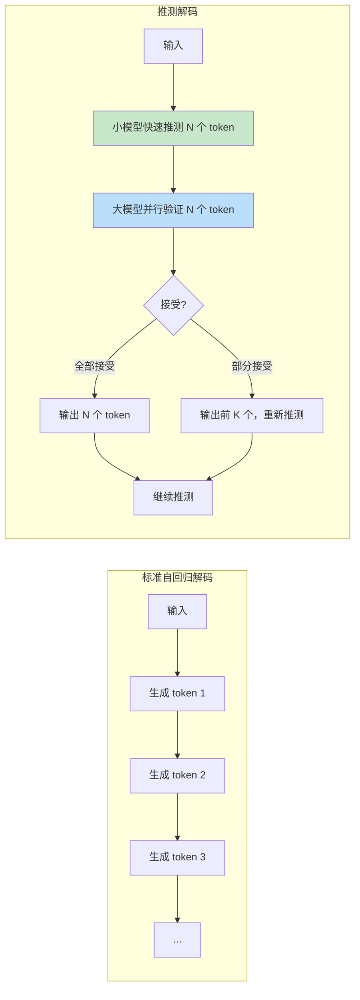

# 推测解码与Speculative Decoding

> **文档说明**：系统讲解大语言模型推测解码（Speculative Decoding）技术，包括自回归解码瓶颈、推测解码原理、推测模型选择、验证过程、接受率与加速比、主流变体（EAGLE/Medusa/Lookahead/自推测）、实现细节、与其他加速技术对比、最佳实践和常见问题。
>
> **适用人群**：AI 工程师、大模型推理优化工程师、算法工程师、关注 LLM 推理性能的开发者
>
> **前置知识**：[[大模型推理优化]]、[[TensorRT-LLM推理加速]]、[[vLLM推理服务部署实战]]

---

## 一、概述

### 1. 自回归解码的瓶颈

```text
自回归解码（Autoregressive Decoding）：
- LLM 生成文本的标准方式：一次生成一个 token
- 每个 token 的生成依赖之前所有 token
- 串行执行，无法并行生成

解码过程：
输入: "今天天气"
Step 1: P(token | "今天天气") → "很"
Step 2: P(token | "今天天气很") → "好"
Step 3: P(token | "今天天气很好") → "，"
Step 4: P(token | "今天天气很好，") → "适合"
...

性能瓶颈：
1. 内存带宽瓶颈（Memory Bandwidth Bound）
   - 每生成一个 token，需要把整个模型参数从显存读到计算单元
   - 模型越大，参数越多，读取时间越长
   - 计算量相对小（只有一个 token 的 batch）
   - 因此推理是内存带宽受限，而非计算受限

2. 串行性
   - 第 N 个 token 必须等第 N-1 个生成完
   - 无法像训练那样并行处理整个序列
   - 生成长文本时延迟累积

3. 单 token 计算效率低
   - batch size = 1 时，GPU 计算单元利用率低
   - 大量时间花在数据搬运而非计算

量化分析：
- 7B 模型，FP16，参数约 14GB
- 读取 14GB 数据，假设显存带宽 1TB/s
- 每 token 至少需要 14ms（仅读参数，不算计算）
- 生成 100 token 需要 1.4 秒
- 70B 模型需要 14 秒（100 token）

这就是推测解码要解决的问题：如何在不改变输出的前提下，加速自回归解码？
```



### 2. 推测解码的核心思想

```python
推测解码（Speculative Decoding）：
- 2018 年由 Google DeepMind 提出（"Fast Inference from Transformers via Speculative Decoding"）
- 核心思想：用一个小模型（推测模型/Draft Model）快速生成多个候选 token，
  再用大模型（目标模型/Target Model）一次性并行验证这些候选 token
- 大模型可以并行处理多个 token（因为输入已经确定），计算效率高
- 验证通过的 token 直接输出，不通过的从该位置重新开始

关键洞察：
- 小模型生成一个 token 很快（参数少，读取快）
- 大模型验证多个 token 和验证一个 token 的时间差不多（都是读一次参数）
  - 因为大模型的瓶颈是读参数，不是计算
  - batch size 从 1 变成 K，计算量增加，但读参数时间不变
- 所以：用小模型的 K 次快速生成 + 大模型的 1 次验证，替代大模型的 K 次串行生成

数学保证：
- 推测解码可以证明输出分布与标准解码完全一致（在特定采样策略下）
- 贪心解码（greedy）：完全一致
- 随机采样：需要用 Rejection Sampling 保证分布一致
- 不会降低生成质量

加速比：
- 理论加速比 = 1 / (1 - 接受率 + 接受率 × (小模型时间 / 大模型时间))
- 实际加速比通常 1.5x - 3x
- 取决于：推测模型质量、接受率、大小模型速度比、生成长度
```

---


<div style="background:linear-gradient(135deg,#f093fb,#f5576c);border-radius:16px;padding:20px;margin:16px 0;font-family:-apple-system,'Segoe UI','PingFang SC','Microsoft YaHei',sans-serif;color:#fff;overflow:hidden;box-shadow:0 8px 28px rgba(0,0,0,.14),0 3px 10px rgba(0,0,0,.08)">
<style>@keyframes flow{0%{transform:translateX(-10px);opacity:0}15%{transform:translateX(0);opacity:1}85%{transform:translateX(0);opacity:1}100%{transform:translateX(10px);opacity:0}}.flow-step{display:inline-block;background:rgba(255,255,255,.2);border:2px solid rgba(255,255,255,.5);border-radius:8px;padding:10px 14px;margin:4px;text-align:center;font-weight:600;font-size:13px;animation:flow 4s ease-in-out infinite;min-width:90px}.flow-step:nth-child(2){animation-delay:.5s}.flow-step:nth-child(4){animation-delay:1s}.flow-step:nth-child(6){animation-delay:1.5s}.flow-step:nth-child(8){animation-delay:2s}.flow-arrow{display:inline-block;font-size:20px;animation:flow 4s ease-in-out infinite;vertical-align:middle}.flow-code{background:rgba(0,0,0,.2);border-radius:6px;padding:8px 12px;margin-top:10px;font-family:monospace;font-size:12px;text-align:center}</style>
<div style="text-align:center;font-size:15px;font-weight:700;margin-bottom:14px;padding-bottom:10px;border-bottom:1.5px solid rgba(255,255,255,.22);letter-spacing:1px">🎯 推测解码 Speculative Decoding 流程</div>
<div style="text-align:center;white-space:nowrap;overflow-x:auto">
<span class="flow-step">小模型草稿</span><span class="flow-arrow">→</span><span class="flow-step">大模型验证</span><span class="flow-arrow">→</span><span class="flow-step">接受/拒绝</span><span class="flow-arrow">→</span><span class="flow-step">批量并行</span><span class="flow-arrow">→</span><span class="flow-step">加速生成</span>
</div>
<div class="flow-code">小模型快速生成γ个候选token→大模型一次前向并行验证→接受正确的→拒绝则回退→2-3倍加速</div>
</div>

> 🔍 **知识点深度解析**
>
> **作用**：推测解码（Speculative Decoding）用一个小模型快速生成候选 token，再用大模型一次前向计算并行验证，接受正确的候选、拒绝错误的回退，在不损失输出质量的前提下实现 2-3 倍的解码加速。
>
> **原理**：自回归生成的瓶颈是每生成一个 token 都需要一次大模型前向计算（内存带宽受限）。推测解码的核心思想是用计算量小的小模型（草稿模型）快速生成 γ 个候选 token（通常3-5个），然后大模型在一次前向计算中并行验证所有候选（因为注意力是并行的）。验证时大模型计算每个候选位置的概率分布，与小模型的采样结果比较：匹配的 token 被接受（节省了大模型的单独计算），第一个不匹配的 token 被大模型的结果替换，后续候选丢弃。由于小模型草稿的接受率通常 70-90%，平均每步大模型能处理多个 token，实现 2-3 倍加速且输出分布与纯大模型完全一致。
>
> **用法要点**：① 推测解码不改变输出质量，是无损加速 ② 草稿模型选择：同系列小模型（如Qwen2.5-0.5B搭配72B），接受率高 ③ 候选长度 γ=3-5 是最佳平衡（太长接受率低，太短加速少） ④ vLLM 用 --speculative-model 指定草稿模型 ⑤ 适合长文本生成场景（代码、写作、翻译） ⑥ 短回答场景加速不明显（验证开销占比大） ⑦ 草稿模型需与大模型共享 tokenizer ⑧ 监控接受率（acceptance rate），低于50%说明草稿模型不合适

> 💡 **深度讲解**：推测解码（Speculative Decoding）是一种加速 LLM 自回归解码的技术，核心思想是"用小模型快速猜，用大模型验证"。传统自回归解码每步只能生成一个 token（需要一次大模型前向计算），延迟受限于大模型的单步计算时间。推测解码引入一个小的"草稿模型"（Draft Model），它可以快速生成多个候选 token（如 4-8 个），然后用大模型（Target Model）一次前向计算验证所有候选 token——接受匹配的 token，拒绝不匹配的，从第一个不匹配的位置重新开始。这样在理想情况下，大模型的一次前向计算可以生成多个 token，等效于将解码速度提升数倍。推测解码的数学保证是"输出分布不变"——通过精心设计的采样和验证策略，推测解码的输出分布与大模型直接生成完全一致，不会降低生成质量。推测解码的加速效果取决于"接受率"（草稿模型生成的 token 被大模型接受的比例）——接受率越高，加速比越大。通常同系列的小模型作为草稿（如 Qwen2.5-0.5B 草稿 + Qwen2.5-7B 验证），接受率可达 60-80%，加速比 2-3 倍。推测解码适用于解码阶段（decode），不适用于预填充阶段（prefill）；适用于生成较长输出（> 32 token），短输出场景额外开销大于收益。
>
> **📝 精简总结**：推测解码核心是"小模型猜+大模型验证"，一次大模型前向生成多个 token，加速比 2-3x；数学保证输出分布不变；加速取决于接受率(同系列小模型 60-80%)；适用于长输出解码阶段。

## 二、推测解码原理

### 1. 标准推测解码流程

```text
标准推测解码（Speculative Decoding）算法：

输入：
- M_q：大模型（目标模型，质量高，速度慢）
- M_p：小模型（推测模型，质量稍低，速度快）
- 前缀 x = [x_1, x_2, ..., x_n]
- γ：推测长度（一次推测多少个 token，通常 4-8）

算法：
1. 小模型自回归生成 γ 个候选 token
   - 用 M_p 从 x 开始，依次生成 x_{n+1}, x_{n+2}, ..., x_{n+γ}
   - 得到候选序列：x' = [x_{n+1}, x_{n+2}, ..., x_{n+γ}]
   - 同时得到小模型的概率分布：p_1, p_2, ..., p_γ

2. 大模型并行验证
   - 将 [x, x'] 拼接，一次性输入大模型 M_q
   - 大模型并行计算所有位置的输出
   - 得到大模型的概率分布：q_1, q_2, ..., q_γ, q_{γ+1}

3. 逐 token 验证（贪心解码）
   - 从第一个候选 token 开始：
     - 如果 M_q 的 argmax == x'_i（大模型也选这个 token）→ 接受
     - 否则 → 拒绝，用大模型的 argmax 替换，停止验证
   - 记录第一个被拒绝的位置 r（0 表示全部接受）

4. 输出
   - 如果全部接受（r = γ）：输出所有 γ 个 token，再加上大模型额外生成的 1 个 token
   - 如果部分接受（r < γ）：输出前 r 个 token，第 r+1 个用大模型的结果
   - 从新的前缀继续下一轮推测

5. 重复，直到生成结束符或达到最大长度

关键：
- 步骤 1（小模型生成 γ 个 token）：γ × T_small
- 步骤 2（大模型验证 γ 个 token）：T_large（和验证 1 个差不多）
- 总时间：γ × T_small + T_large
- 标准解码生成 γ 个 token：γ × T_large
- 加速比 = γ × T_large / (γ × T_small + T_large)
```

### 2. 接受率与加速比

```text
接受率（Acceptance Rate）：
- 推测的 token 被大模型接受的比例
- 是推测解码性能的关键指标
- 接受率越高，加速比越大

影响接受率的因素：
1. 推测模型质量
   - 小模型越接近大模型，接受率越高
   - 同系列模型（如 LLaMA-7B 推测 LLaMA-70B）接受率高
   - 不同系列模型接受率低

2. 任务类型
   - 简单任务（如代码生成、格式固定）接受率高
   - 创造性任务（如诗歌、故事）接受率低
   - 常见词接受率高，生僻词接受率低

3. 推测长度 γ
   - γ 越大，平均接受率越低（越往后越难预测）
   - 但 γ 越大，单次验证的 token 越多
   - 存在最优 γ（通常 4-8）

4. 温度（Temperature）
   - 温度低（greedy）接受率高
   - 温度高（随机采样）接受率低
   - 随机采样需要 Rejection Sampling

加速比计算：
- T_small：小模型生成 1 个 token 的时间
- T_large：大模型生成 1 个 token 的时间
- α：平均接受率（每个位置的接受概率）
- γ：推测长度

期望每轮输出 token 数：
E[output] = (1 - (1-α)^γ) / α  （几何分布期望）
近似：当 α 高时，E ≈ γ

期望每轮时间：
E[time] = γ × T_small + T_large

加速比：
Speedup = E[output] × T_large / E[time]
        ≈ γ × T_large / (γ × T_small + T_large)

示例：
- T_small = 1ms，T_large = 10ms，γ = 5，α = 0.8
- E[output] ≈ 4（平均接受 4 个）
- E[time] = 5 × 1 + 10 = 15ms
- 标准解码 4 个 token：4 × 10 = 40ms
- 加速比 = 40 / 15 ≈ 2.67x

实际加速比通常 1.5x - 3x，很少超过 3x。
```

### 3. 随机采样的 Rejection Sampling

```text
贪心解码（Greedy）：
- 大模型和小模型都选概率最大的 token
- 验证简单：大模型 argmax == 候选 token → 接受
- 输出分布与标准解码完全一致

随机采样（Stochastic Sampling）：
- 需要从概率分布中采样，不是选 argmax
- 直接验证会改变输出分布（因为小模型和大模型分布不同）
- 需要用 Rejection Sampling 保证分布一致

Rejection Sampling 算法：
对每个候选 token x'_i：
1. 从小模型分布 p_i 中采样得到 x'_i
2. 大模型给出该位置的分布 q_i
3. 计算接受概率：r = min(1, q_i(x'_i) / p_i(x'_i))
   - 如果大模型给这个 token 的概率 >= 小模型 → 一定接受
   - 如果大模型概率 < 小模型 → 按比例接受
4. 以概率 r 接受 x'_i
   - 接受 → 继续下一个
   - 拒绝 → 从调整后的分布 (q_i - p_i)_+ 中重新采样，作为输出
5. 拒绝后停止，从新 token 重新开始

为什么这样分布一致？
- 可以数学证明：经过 Rejection Sampling 后，输出的 token 分布
  与直接从大模型 q_i 采样完全一致
- 这是推测解码的核心理论保证

实际实现：
- vLLM、TensorRT-LLM 等框架都实现了 Rejection Sampling
- 用户只需配置推测模型，框架自动处理
- 贪心解码不需要 Rejection Sampling，更快
```

---

## 三、推测模型选择

### 1. 推测模型的要求

```text
好的推测模型（Draft Model）应具备：

1. 速度快
   - 参数量小（通常是大模型的 1/10 到 1/5）
   - 推理延迟低
   - 小模型生成 γ 个 token 的时间 < 大模型生成 1 个 token

2. 质量高
   - 预测的 token 尽量与大模型一致
   - 接受率高
   - 最好与大模型同系列、同训练数据

3. 兼容性好
   - 与大模型使用相同的 tokenizer
   - 词表一致
   - 上下文格式一致（如 ChatML、Llama 格式）

常见推测模型组合：
- LLaMA-7B → LLaMA-70B（同系列，接受率高）
- LLaMA-7B → LLaMA-13B（小模型推测稍大模型）
- GPT-4 小版本 → GPT-4 大版本（OpenAI 内部）
- 蒸馏模型 → 原模型（用大模型蒸馏出小模型）

不推荐的组合：
- 不同系列模型（如用 GPT 推测 LLaMA）
- tokenizer 不同的模型
- 小模型质量太差（接受率低于 30% 没意义）
```

### 2. 推测模型获取方式

```text
获取推测模型的方式：

1. 使用同系列小模型（最简单）
   - LLaMA-7B 推测 LLaMA-70B
   - Mistral-7B 推测 Mixtral-8x7B
   - 直接从 HuggingFace 下载

2. 模型蒸馏（Distillation）
   - 用大模型作为教师，训练小模型
   - 小模型学习大模型的输出分布
   - 接受率更高
   - 需要训练成本

3. 微调（Fine-tuning）
   - 在特定任务数据上微调小模型
   - 针对特定场景优化接受率
   - 如代码生成场景，用代码数据微调小模型

4. 量化小模型
   - 小模型进一步量化（INT4/INT8）
   - 更快，质量损失小
   - 推测模型对质量要求不极致，可以激进量化

5. N-gram 模型（最简单的推测模型）
   - 不需要神经网络，用 n-gram 统计
   - 速度极快
   - 但接受率低（尤其对复杂文本）
   - 适合特定场景（如代码、格式固定文本）
```

---

## 四、主流推测解码变体

### 1. EAGLE

```text
EAGLE（Extrapolation Algorithm for Greater Language-model Efficiency）：
- 2024 年提出
- 核心思想：不直接推测 token，而是推测"特征"（hidden states）
- 用一个轻量级的特征预测模型，预测大模型的中间层特征
- 然后用大模型的输出层从特征生成 token

优势：
- 接受率更高（特征比 token 更容易预测）
- 推测模型更小（只需要预测特征，不需要完整语言模型）
- 加速比可达 2x-3x

工作流程：
1. 用大模型处理当前前缀，得到中间层特征 h_t
2. EAGLE 模型从 h_t 预测下一个特征 h_{t+1}
3. 重复预测 γ 个特征：h_{t+1}, h_{t+2}, ..., h_{t+γ}
4. 大模型的输出层从这些特征生成候选 token
5. 大模型并行验证（类似标准推测解码）

特点：
- EAGLE 模型是大模型的"副产品"，可以从大模型蒸馏
- 不需要单独的小语言模型
- 与大模型共享 tokenizer 和词表
- 实现相对复杂
```

### 2. Medusa

```text
Medusa（美杜莎）：
- 2024 年由 UC Berkeley 提出
- 核心思想：在大模型上额外加几个"头"（head），每个头预测未来多个 token
- 不需要单独的小模型，直接修改大模型

架构：
- 原始大模型有 1 个输出头（预测下 1 个 token）
- Medusa 加 K 个额外头（Medusa Head）
- 第 i 个 Medusa Head 预测未来第 i 个 token
- 所有头共享大模型的主干（backbone）

工作流程：
1. 大模型处理当前 token，得到 hidden state
2. 原始头预测下 1 个 token（标准方式）
3. Medusa Head 1 预测未来第 2 个 token
4. Medusa Head 2 预测未来第 3 个 token
5. ...
6. 得到候选树（不是线性序列，因为每个位置有多个候选）
7. 用大模型验证候选树，找最长接受路径

优势：
- 不需要单独的推测模型
- 接受率高（Medusa Head 是为推测专门训练的）
- 可以形成候选树，提高接受概率
- 训练简单（只训练额外的头，主干冻结）

劣势：
- 需要修改模型结构
- 需要训练 Medusa Head（虽然只训练头，成本低）
- 推理时需要额外计算（多个头的前向传播）

加速比：通常 2x 左右。
```

### 3. Lookahead

```text
Lookahead Decoding：
- 2024 年由 Microsoft 提出
- 核心思想：用大模型自己的 KV Cache 做推测，不需要额外模型
- 也叫"自推测解码"（Self-Speculative Decoding）

工作流程：
1. 大模型生成当前 token x_t
2. 利用大模型的 KV Cache，快速生成几个"草稿" token
   - 怎么快速？用 n-gram 匹配或简单的启发式
   - 或者用大模型的低精度（INT4）快速前向
3. 大模型用全精度验证草稿 token
4. 接受的输出，不接受的重新生成

变体：
- N-gram Lookahead：在已有文本中找 n-gram 匹配，推测后续 token
- Draft Model Lookahead：用大模型的量化版本作为推测模型
- Jacobi Iteration：用雅可比迭代并行解码

优势：
- 不需要额外的小模型
- 不需要训练
- 即插即用

劣势：
- 接受率不如专门的推测模型
- 实现复杂
- 加速比有限（通常 1.2x-1.5x）
```

### 4. 自推测解码（Self-Speculative）

```text
自推测解码（Self-Speculative Decoding）：
- 用大模型自己作为推测模型
- 不需要额外的小模型

方式：
1. 量化版本推测
   - 大模型的 INT4/INT8 量化版本作为推测模型
   - 全精度版本作为验证模型
   - 量化版本快，全精度准
   - 同模型，接受率高

2. 少层推测
   - 用大模型的前 N 层作为推测模型
   - 完整模型作为验证
   - 少层前向快
   - 但需要额外的输出头

3. 低秩推测
   - 用大模型的低秩近似（LoRA）作为推测模型
   - 参数量小，速度快

优势：
- 不需要单独训练或下载小模型
- 同模型，tokenizer 和词表天然一致
- 接受率高

劣势：
- 需要两份模型（量化版和全精度版），显存占用增加
- 或需要修改模型结构
- 加速比通常 1.5x-2x

代表工作：
- Self-Speculative Decoding（Google）
- Fast Inference with Self-Speculation
- Medusa（也算自推测的一种）
```

### 5. 推测解码变体对比

| 方法 | 推测模型 | 接受率 | 加速比 | 实现复杂度 | 需要训练 | 显存开销 |
|------|---------|--------|--------|-----------|---------|---------|
| **标准推测解码** | 独立小模型 | 中高 | 1.5-3x | 低 | 否 | 中（两份模型） |
| **EAGLE** | 特征预测模型 | 高 | 2-3x | 高 | 是（蒸馏） | 低 |
| **Medusa** | 额外头 | 高 | 1.5-2.5x | 中 | 是（训练头） | 低 |
| **Lookahead** | 无/自身 | 低 | 1.2-1.5x | 高 | 否 | 无 |
| **自推测（量化）** | 自身量化版 | 高 | 1.5-2x | 低 | 否 | 高（两份模型） |
| **N-gram 推测** | n-gram 模型 | 低 | 1.1-1.3x | 低 | 否 | 极低 |

---

## 五、实现细节

### 1. vLLM 中的推测解码

```python
# vLLM 中启用推测解码
from vllm import LLM, SamplingParams

# 方式1：命令行启动
# vllm serve meta-llama/Llama-2-70b-chat-hf \
#   --speculative-model meta-llama/Llama-2-7b-chat-hf \
#   --num-speculative-tokens 5 \
#   --speculative-max-draft-tokens 5

# 方式2：Python API
llm = LLM(
    model="meta-llama/Llama-2-70b-chat-hf",
    speculative_model="meta-llama/Llama-2-7b-chat-hf",
    num_speculative_tokens=5,
    speculative_max_draft_tokens=5,
    # speculative_config 可以更详细配置
)

prompts = ["解释什么是人工智能"]
sampling_params = SamplingParams(temperature=0.8, top_p=0.95, max_tokens=200)
outputs = llm.generate(prompts, sampling_params)

for output in outputs:
    print(output.outputs[0].text)
```

```html
# vLLM 推测解码相关参数
--speculative-model <model>          # 推测模型名称或路径
--speculative-model-quantization <q>  # 推测模型量化方式
--num-speculative-tokens <n>          # 推测 token 数（默认 5）
--speculative-max-draft-tokens <n>    # 最大草稿 token 数
--speculative-disable-by-batch-size   # 大 batch 时自动禁用
--speculative-algorithm <alg>         # 算法（typical_acceptance_sampler / rejection_sampler）
```

### 2. TensorRT-LLM 中的推测解码

```python
# TensorRT-LLM 推测解码配置
# build 时启用推测解码
# python build.py --model_dir ./llama-70b \
#   --speculative_model_dir ./llama-7b \
#   --num_speculative_tokens 5 \
#   --use_gpt_attention_plugin \
#   --output_dir ./trt_llama_70b_spec

# 推理时配置
from tensorrt_llm.runtime import ModelRunner

runner = ModelRunner.from_dir(
    engine_dir="./trt_llama_70b_spec",
    speculative_model_dir="./trt_llama_7b_spec",
    num_speculative_tokens=5,
)

# 生成
outputs = runner.generate(
    batch_input_ids=input_ids,
    max_new_tokens=200,
    temperature=0.8,
    top_p=0.95,
)
```

### 3. 手动实现（教学用）

```python
# 简化版推测解码实现（教学用，非生产级）
import torch
from transformers import AutoModelForCausalLM, AutoTokenizer

class SpeculativeDecoder:
    def __init__(self, target_model_name, draft_model_name, device="cuda"):
        self.device = device
        self.tokenizer = AutoTokenizer.from_pretrained(target_model_name)
        self.target_model = AutoModelForCausalLM.from_pretrained(
            target_model_name, torch_dtype=torch.float16
        ).to(device).eval()
        self.draft_model = AutoModelForCausalLM.from_pretrained(
            draft_model_name, torch_dtype=torch.float16
        ).to(device).eval()

    @torch.no_grad()
    def generate(self, prompt, max_new_tokens=100, gamma=5, temperature=0):
        input_ids = self.tokenizer.encode(prompt, return_tensors="pt").to(self.device)
        generated = []

        while len(generated) < max_new_tokens:
            # Step 1: 小模型推测 gamma 个 token
            draft_ids = input_ids.clone()
            draft_tokens = []
            draft_logits = []

            for _ in range(gamma):
                outputs = self.draft_model(draft_ids)
                next_logits = outputs.logits[:, -1, :]
                draft_logits.append(next_logits)

                if temperature == 0:
                    next_token = next_logits.argmax(dim=-1, keepdim=True)
                else:
                    probs = torch.softmax(next_logits / temperature, dim=-1)
                    next_token = torch.multinomial(probs, num_samples=1)

                draft_tokens.append(next_token.item())
                draft_ids = torch.cat([draft_ids, next_token], dim=-1)

            # Step 2: 大模型并行验证
            target_outputs = self.target_model(draft_ids)
            target_logits = target_outputs.logits[:, -(gamma+1):, :]

            # Step 3: 逐 token 验证（贪心解码简化版）
            accepted = 0
            for i in range(gamma):
                target_token = target_logits[:, i, :].argmax(dim=-1).item()
                if target_token == draft_tokens[i]:
                    accepted += 1
                else:
                    # 拒绝，用大模型的 token
                    draft_tokens[i] = target_token
                    break

            # Step 4: 输出接受的 token
            output_tokens = draft_tokens[:accepted + 1]
            generated.extend(output_tokens)

            # 更新输入
            new_ids = torch.tensor([output_tokens], device=self.device)
            input_ids = torch.cat([input_ids, new_ids], dim=-1)

            # 检查结束符
            if self.tokenizer.eos_token_id in output_tokens:
                break

        return self.tokenizer.decode(generated, skip_special_tokens=True)


# 使用
decoder = SpeculativeDecoder(
    target_model_name="meta-llama/Llama-2-70b-chat-hf",
    draft_model_name="meta-llama/Llama-2-7b-chat-hf",
)
result = decoder.generate("解释什么是机器学习", max_new_tokens=200)
print(result)
```

---

## 六、与其他加速技术对比

### 1. 推测解码 vs 量化

```text
量化（Quantization）：
- 减少模型参数的位宽（FP16 → INT8/INT4）
- 减少显存占用和内存带宽需求
- 每 token 生成更快
- 可能有轻微质量损失

推测解码：
- 不改变模型精度
- 用小模型推测 + 大模型验证
- 减少大模型的调用次数
- 输出质量完全一致

对比：
- 量化：每 token 都快，但快的幅度有限（2x 左右）
- 推测解码：不是每 token 都快，但平均快（1.5-3x）
- 两者可以叠加：量化的大模型 + 量化的小模型推测
- 叠加后加速比可达 3-5x

推荐：两者都用，效果叠加。
```

### 2. 推测解码 vs 连续批处理（Continuous Batching）

```text
连续批处理（Continuous Batching / In-flight Batching）：
- vLLM 的核心技术
- 动态管理 batch，新请求随时加入，完成的随时退出
- 提高 GPU 利用率和吞吐量
- 主要优化吞吐量（throughput），不是单请求延迟

推测解码：
- 主要优化单请求延迟（latency）
- 对吞吐量也有帮助（因为大模型调用次数减少）

对比：
- 连续批处理：高并发场景效果好，提高整体吞吐量
- 推测解码：单请求场景效果好，降低首 token 和生成延迟
- 两者可以叠加：vLLM 同时支持连续批处理和推测解码

推荐：高并发用连续批处理，低延迟用推测解码，两者都用。
```

### 3. 推测解码 vs PagedAttention

```text
PagedAttention：
- vLLM 的核心技术
- 用分页方式管理 KV Cache，减少内存碎片
- 提高显存利用率和 batch size
- 主要优化吞吐量和显存效率

推测解码：
- 优化计算效率，减少大模型前向次数
- 主要优化延迟

对比：
- PagedAttention：解决显存问题，支持更大 batch
- 推测解码：解决计算问题，减少前向次数
- 两者正交，可以叠加

推荐：都用，vLLM 默认开启 PagedAttention，再加上推测解码。
```

### 4. 加速技术组合推荐

```text
生产环境推荐的推理加速组合：

基础层（必用）：
1. 模型量化（INT8/INT4 AWQ/GPTQ）
   - 减少显存和带宽
   - 加速比 1.5-2x

2. 连续批处理（Continuous Batching）
   - 提高吞吐量
   - vLLM/TensorRT-LLM 默认支持

3. PagedAttention
   - 高效 KV Cache 管理
   - vLLM 默认支持

进阶层（推荐）：
4. 推测解码（Speculative Decoding）
   - 降低延迟
   - 加速比 1.5-3x
   - 需要额外的小模型

5. FlashAttention
   - 加速 Attention 计算
   - 现代框架默认支持

6. 算子融合（Operator Fusion）
   - 减少 kernel launch 开销
   - TensorRT-LLM 自动优化

高级层（按需）：
7. 模型并行（Tensor/Pipeline Parallel）
   - 超大模型（70B+）需要
   - 多 GPU 分布式推理

8. KV Cache 量化
   - 减少 KV Cache 显存
   - 支持更长上下文

9. 投机解码 + 量化叠加
   - 量化大模型 + 量化小模型推测
   - 加速比可达 3-5x

预期效果：
- 仅量化：1.5-2x
- 量化 + 推测解码：3-5x
- 全部优化：5-10x（取决于模型和硬件）
```

---

## 七、最佳实践

### 1. 推测解码使用场景

- [ ] **长文本生成**：生成 token 越多，推测解码收益越大（短文本开销大）
- [ ] **低延迟需求**：对话、实时翻译等需要快速响应的场景
- [ ] **贪心/低温采样**：温度低时接受率高，推测解码效果好
- [ ] **有合适的小模型**：同系列小模型，接受率高
- [ ] **单请求或低并发**：高并发时连续批处理收益更大

### 2. 不适合的场景

- [ ] **短文本生成**：生成 token 少，推测开销占比大
- [ ] **高温随机采样**：接受率低，Rejection Sampling 开销大
- [ ] **没有合适小模型**：不同系列模型接受率低，不如不用
- [ ] **显存不足**：需要加载两份模型，显存不够
- [ ] **高并发吞吐量优先**：连续批处理收益更大

### 3. 参数调优

- [ ] **推测长度 γ**：通常 4-8，太小收益低，太大接受率下降
  - 接受率高的模型可以用 8-10
  - 接受率低的模型用 3-5
- [ ] **推测模型选择**：同系列、同 tokenizer、质量尽量高
  - 优先用大模型的蒸馏版本
  - 其次用同系列小模型
- [ ] **推测模型量化**：推测模型可以激进量化（INT4），速度更快
- [ ] **批处理阈值**：大 batch 时自动禁用推测解码（连续批处理收益更大）
- [ ] **温度设置**：低温（0.3-0.7）接受率高，高温效果差

### 4. 部署实践

- [ ] **先测试接受率**：部署前用典型输入测试接受率，接受率 > 50% 才有意义
- [ ] **监控加速比**：生产环境监控实际加速比，低于 1.2x 考虑关闭
- [ ] **显存规划**：大模型 + 小模型的显存总和，留 20% 余量
- [ ] **回退机制**：推测解码异常时自动回退到标准解码
- [ ] **A/B 测试**：对比开启/关闭推测解码的实际效果
- [ ] **版本兼容**：确保推测模型和目标模型的 tokenizer、词表一致

---

## 八、常见问题与排查

| 问题 | 原因 | 解决方案 |
|------|------|---------|
| **推测解码后更慢** | 接受率太低/小模型太慢/γ 设置不当 | 检查接受率（应 >50%）；换更快的小模型；调整 γ；短文本关闭 |
| **接受率低** | 推测模型质量差/不同系列/高温采样 | 换同系列小模型；用蒸馏模型；降低温度；用贪心解码 |
| **显存不足（OOM）** | 加载了两份模型 | 量化推测模型（INT4）；用更小的推测模型；降低 batch；开启 CPU offload |
| **输出质量下降** | 实现有误/采样策略不对 | 确认用了 Rejection Sampling（随机采样时）；检查框架版本；对比标准解码输出 |
| **vLLM 推测解码不生效** | 参数未设/模型不兼容/版本问题 | 检查 --speculative-model 参数；确认 tokenizer 一致；升级 vLLM；查看日志 |
| **推测模型加载失败** | 模型路径错/格式不支持/词表不一致 | 检查模型路径；用 HuggingFace 格式；确认 tokenizer 一致；测试小模型单独推理 |
| **加速比低于预期** | 接受率低/小模型不够快/带宽瓶颈 | 优化推测模型；调整 γ；检查是否内存带宽饱和；量化大模型 |
| **高并发时推测解码变慢** | 大 batch 时推测开销大 | 配置大 batch 自动禁用（--speculative-disable-by-batch-size）；连续批处理优先 |
| **Medusa 训练不收敛** | 学习率不对/数据不足/冻结策略错 | 调整学习率（1e-4 到 1e-3）；增加数据；只训练头，冻结主干；用 warmup |
| **EAGLE 特征不匹配** | 层选择错/维度不对 | 确认选的中间层；检查特征维度；用官方提供的 EAGLE 模型 |
| **推测解码和 FlashAttention 冲突** | 框架版本/插件兼容问题 | 升级框架；检查插件兼容性；查看 issue；暂时关闭其中一个 |
| **多 GPU 推测解码报错** | 模型并行配置错/推测模型放置错 | 确认大模型和小模型的并行策略；小模型可以放单 GPU；查看官方文档 |
| **KV Cache 不一致** | 推测模型和大模型 KV Cache 格式不同 | 确认用相同的 attention 实现；统一 KV Cache 格式；用框架内置的推测解码 |
| **首 token 延迟增加** | 推测模型加载/预热开销 | 预热模型；推测解码主要优化生成阶段，首 token 可能不变或略增 |
| **生成结束符异常** | 推测模型生成了结束符但被拒绝 | 这是正常现象，框架会处理；检查是否有逻辑错误 |
| **不同框架结果不一致** | 实现细节差异/采样策略 | 用相同的随机种子对比；确认采样参数一致；这是已知现象，不影响质量 |
| **推测模型需要微调吗** | 取决于接受率 | 默认不需要；接受率低时可以在目标领域微调小模型；或用蒸馏模型 |
| **能推测自己吗** | 可以（自推测） | 用量化版本作为推测模型；或用 Medusa/EAGLE；不需要额外模型 |
| **推测解码支持流式输出吗** | 支持 | vLLM/TensorRT-LLM 都支持流式；接受的 token 批量输出；用户无感知 |

---

## 🔗 关联笔记

- [[vLLM-高吞吐推理引擎]] — vLLM 推测解码实现，--speculative-model 配置
- [[TensorRT-LLM推理加速]] — TensorRT-LLM Medusa/EAGLE 推测解码支持
- [[KV Cache与推理加速]] — KV Cache 原理，推测解码的基础
- [[GPU显存优化与批处理]] — GPU 显存优化，推测解码的显存考量
- [[主流开源模型架构对比]] — 草稿模型与大模型的选型配对

## 📖 前置知识

- [[KV Cache与推理加速]]
- [[vLLM-高吞吐推理引擎]]

## 🏷️ 相关标签

`#AI工程化` `#LLM` `#效率工具` `#性能优化`

---

[[Home|🏠 返回首页]] · [[MOC-AI与效率工具|📚 AI与效率工具]] · [[MOC-AI工程化|🤖 AI工程化]]