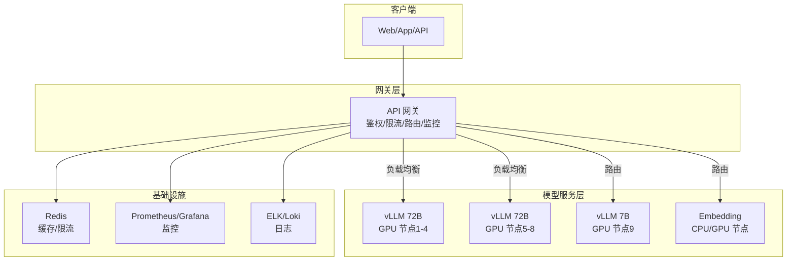

# 模型服务化 - OpenAI 兼容 API

> **文档说明**：系统讲解如何将开源大模型（LLaMA、Qwen、Mistral 等）部署为 OpenAI 兼容的 API 服务，包括 vLLM、Ollama、Text Generation Inference、LocalAI 等主流推理框架的对比与部署，OpenAI API 规范详解（Chat Completions/Completions/Embeddings/Models），API 网关与多模型路由，以及生产级部署最佳实践（负载均衡、限流、监控、成本优化）。
>
> **适用人群**：AI 应用架构师、全栈工程师、需要私有化部署大模型的开发者
>
> **前置知识**：[[vLLM-推理加速与部署]]、[[统一AI网关设计与实现]]、[[Docker-核心原理与镜像优化]]

---

## 一、概述

**模型服务化**是将训练好的大语言模型（LLM）部署为可通过 API 调用的在线服务。**OpenAI 兼容 API** 是指服务端实现与 OpenAI API 相同的接口规范，使得任何使用 OpenAI SDK 的客户端可以无缝切换到自建模型服务，无需修改代码。

### 1. 为什么需要模型服务化

| 需求 | 说明 |
|------|------|
| **私有化部署** | 数据敏感，不能调用第三方 API，需自建模型服务 |
| **成本控制** | 大规模调用时，自建模型比 API 调用更经济 |
| **模型定制** | 需要使用微调后的模型或特定开源模型 |
| **低延迟** | 本地部署减少网络延迟，提升响应速度 |
| **合规要求** | 数据不出域，满足行业合规要求 |
| **多模型管理** | 统一管理多个模型，按需路由 |

### 2. 为什么选择 OpenAI 兼容 API

| 优势 | 说明 |
|------|------|
| **生态兼容** | 所有支持 OpenAI API 的 SDK、工具、框架可直接使用 |
| **切换成本低** | 客户端只需修改 base_url 和 api_key，不需修改业务代码 |
| **标准化** | 统一的请求/响应格式，便于多模型统一管理 |
| **工具链丰富** | LangChain、LlamaIndex、AutoGen 等都支持 OpenAI 兼容接口 |
| **渐进式迁移** | 可先使用 OpenAI API，后期平滑迁移到自建服务 |

### 3. 主流推理框架对比

| 框架 | 出品方 | 语言 | OpenAI 兼容 | 性能 | 特点 | 适用场景 |
|------|--------|------|------------|------|------|---------|
| **vLLM** | UC Berkeley | Python | ✅ 内置 | 极高 | PagedAttention、连续批处理、高吞吐 | 生产环境高吞吐服务 |
| **Ollama** | Ollama | Go | ✅ 可开启 | 中 | 极简部署、本地开发、模型管理 | 本地开发、快速原型 |
| **TGI** | HuggingFace | Python/Rust | ✅ 内置 | 高 | HF 生态、连续批处理、量化 | HF 生态用户 |
| **LocalAI** | mudler | Go | ✅ 内置 | 中 | 全本地、多模型格式、无 GPU 也可跑 | 边缘设备、无 GPU 环境 |
| **TensorRT-LLM** | NVIDIA | Python/C++ | ⚠️ 需配合 | 极高 | NVIDIA GPU 极致优化 | 极致性能、NVIDIA 生态 |
| **MLC LLM** | CMU | Python/C++ | ✅ | 高 | 跨平台、移动端、WebGPU | 移动端、浏览器 |
| **llama.cpp** | ggerganov | C/C++ | ⚠️ 需 server | 中高 | 轻量、CPU 优化、量化 | 本地、CPU 推理 |
| **FastChat** | LMSYS | Python | ✅ 内置 | 中 | 多模型对话、训练、评估 | 研究、多模型对比 |

**推荐选择**：
- **生产环境高吞吐** → vLLM
- **本地开发/快速原型** → Ollama
- **HuggingFace 生态** → TGI
- **边缘/无 GPU** → LocalAI / llama.cpp
- **极致 NVIDIA 性能** → TensorRT-LLM

---


<div style="background:linear-gradient(135deg,#667eea,#764ba2);border-radius:16px;padding:20px;margin:16px 0;font-family:-apple-system,'Segoe UI','PingFang SC','Microsoft YaHei',sans-serif;color:#fff;overflow:hidden;box-shadow:0 8px 28px rgba(0,0,0,.14),0 3px 10px rgba(0,0,0,.08)">
<style>@keyframes pulse{0%,100%{transform:scale(1);opacity:.9}50%{transform:scale(1.03);opacity:1}}.dk-layer{border-radius:8px;padding:12px 16px;margin:6px auto;text-align:center;font-weight:600;animation:pulse 3s ease-in-out infinite}.dk-outer{background:rgba(255,255,255,.15);border:2px solid rgba(255,255,255,.5);max-width:340px;animation-delay:0s}.dk-middle{background:rgba(255,255,255,.2);border:2px solid rgba(255,255,255,.6);max-width:280px;animation-delay:.5s}.dk-inner{background:rgba(255,255,255,.25);border:2px solid rgba(255,255,255,.7);max-width:220px;animation-delay:1s}.dk-arrow{text-align:center;font-size:18px;margin:2px 0}.dk-label{font-size:12px;opacity:.85;font-weight:400;margin-top:4px}</style>
<div style="text-align:center;font-size:15px;font-weight:700;margin-bottom:14px;padding-bottom:10px;border-bottom:1.5px solid rgba(255,255,255,.22);letter-spacing:1px">🔌 OpenAI 兼容 API 服务架构</div>
<div class="dk-layer dk-outer">接口层 · REST+SSE流式<div class="dk-label">/v1/chat/completions/embeddings/models</div></div>
<div class="dk-arrow">▼ 包含</div>
<div class="dk-layer dk-middle">适配层 · 模型适配器+格式转换<div class="dk-label">OpenAI格式↔各模型格式/统一错误处理</div></div>
<div class="dk-arrow">▼ 包含</div>
<div class="dk-layer dk-inner">推理层 · vLLM/TGI/Ollama后端<div class="dk-label">多引擎统一调度/负载均衡/健康检查</div></div>
</div>

> 🔍 **知识点深度解析**
>
> **作用**：OpenAI 兼容 API 是大模型服务化的标准接口规范，通过统一的 REST API（/v1/chat/completions 等）和流式输出（SSE），让不同推理引擎和模型提供商使用相同的客户端代码，实现模型可替换和多模型管理。
>
> **原理**：OpenAI API 已成为 LLM 服务的事实标准，核心端点包括：/v1/chat/completions（聊天补全，支持 messages 数组、stream 流式、function calling）、/v1/completions（文本补全）、/v1/embeddings（向量嵌入）、/v1/models（模型列表）。请求格式使用 JSON，响应支持 SSE（Server-Sent Events）流式输出（data: {"choices":[{"delta":{"content":"..."}}]}）。各推理框架（vLLM、TGI、Ollama、SGLang）都提供 OpenAI 兼容端点，使得应用层只需写一次 OpenAI 客户端代码，即可切换不同模型和推理引擎，无需修改业务逻辑。
>
> **用法要点**：① 新应用直接使用 OpenAI SDK 或兼容客户端，便于后续切换模型 ② 流式输出用 stream=True，解析 SSE 的 data 行 ③ function calling 用 tools 参数，支持并行工具调用 ④ 统一错误处理：429限流、500服务错误、超时重试 ⑤ 多模型管理用 AI 网关（LiteLLM/One API）统一路由 ⑥ 自部署模型用 vLLM 的 --served-model-name 映射模型名 ⑦ 监控 tokens 用量（prompt_tokens/completion_tokens）控制成本 ⑧ 注意各兼容实现的差异（部分不支持 response_format/logprobs）

> 💡 **深度讲解**：OpenAI 兼容 API 已经成为大模型服务的事实标准（de facto standard）。它的核心价值是"模型无关性"——上层应用只需编写一次调用逻辑，就可以无缝切换底层模型（OpenAI GPT、Anthropic Claude、本地 vLLM、Ollama、SGLang 等），无需修改代码。这种标准化极大地降低了 AI 应用的开发和迁移成本，促进了整个生态的繁荣。OpenAI 兼容 API 的核心接口包括：/v1/chat/completions（对话补全，最常用）、/v1/completions（文本补全，已逐步被 chat 取代）、/v1/embeddings（文本嵌入，RAG 必备）、/v1/models（模型列表）、/v1/moderations（内容审核）。关键参数包括：model（模型名称）、messages（对话消息列表，包含 role 和 content）、temperature（采样温度，0=确定性，1=随机性）、max_tokens（最大生成 token 数）、top_p（核采样阈值）、stream（是否流式输出）、tools/functions（工具调用，Function Calling）、response_format（响应格式约束，如 JSON mode）。流式输出（SSE）是 AI 应用的关键特性——通过 Server-Sent Events 逐 token 返回生成结果，大幅降低用户感知延迟（首 token 延迟 vs 总延迟）。几乎所有主流推理框架（vLLM、SGLang、TGI、TensorRT-LLM、Ollama）都提供 OpenAI 兼容 API，这也是该标准能够成为事实标准的原因。
>
> **📝 精简总结**：OpenAI 兼容 API 是大模型服务事实标准，核心价值是模型无关性(一次编写处处切换)；核心接口 chat/completions+embeddings；关键参数 temperature/max_tokens/stream/tools；流式 SSE 降低感知延迟；所有主流框架都兼容。

## 二、OpenAI API 规范详解

### 1. API 基础

| 项目 | 说明 |
|------|------|
| **Base URL** | `https://api.openai.com/v1`（OpenAI）/ `http://localhost:8000/v1`（自建） |
| **认证** | `Authorization: Bearer <api_key>` |
| **内容类型** | `Content-Type: application/json` |
| **响应格式** | JSON |

### 2. Chat Completions（对话补全）

最核心的 API，用于多轮对话。

**请求**：
```text
POST /v1/chat/completions
{
  "model": "qwen2.5-72b",
  "messages": [
    {"role": "system", "content": "你是一个 helpful assistant"},
    {"role": "user", "content": "你好"},
    {"role": "assistant", "content": "你好！有什么可以帮你的？"},
    {"role": "user", "content": "介绍一下自己"}
  ],
  "temperature": 0.7,
  "top_p": 0.9,
  "max_tokens": 1024,
  "stream": false,
  "presence_penalty": 0,
  "frequency_penalty": 0,
  "stop": ["\n\n"],
  "response_format": {"type": "text"}
}
```

**请求参数说明**：

| 参数 | 类型 | 说明 | 默认值 |
|------|------|------|--------|
| `model` | string | 模型名称 | 必填 |
| `messages` | array | 对话消息列表 | 必填 |
| `temperature` | float | 温度（0-2），越高越随机 | 1.0 |
| `top_p` | float | 核采样（0-1） | 1.0 |
| `max_tokens` | int | 最大生成 Token 数 | 模型上限 |
| `stream` | bool | 是否流式输出 | false |
| `presence_penalty` | float | 存在惩罚（-2到2） | 0 |
| `frequency_penalty` | float | 频率惩罚（-2到2） | 0 |
| `stop` | string/array | 停止序列 | null |
| `response_format` | object | 响应格式（text/json_object） | text |
| `tools` | array | 工具定义（Function Calling） | null |
| `tool_choice` | string/object | 工具选择策略 | auto |
| `seed` | int | 随机种子（可复现） | null |

**消息角色**：
| 角色 | 说明 |
|------|------|
| `system` | 系统提示词，设定助手行为 |
| `user` | 用户消息 |
| `assistant` | 助手回复 |
| `tool` | 工具调用结果（Function Calling） |

**非流式响应**：
```json
{
  "id": "chatcmpl-abc123",
  "object": "chat.completion",
  "created": 1699999999,
  "model": "qwen2.5-72b",
  "choices": [
    {
      "index": 0,
      "message": {
        "role": "assistant",
        "content": "我是一个 AI 助手..."
      },
      "finish_reason": "stop"
    }
  ],
  "usage": {
    "prompt_tokens": 50,
    "completion_tokens": 100,
    "total_tokens": 150
  }
}
```

**流式响应（SSE）**：
```text
data: {"id":"chatcmpl-abc","choices":[{"delta":{"role":"assistant"},"finish_reason":null}]}

data: {"id":"chatcmpl-abc","choices":[{"delta":{"content":"你"},"finish_reason":null}]}

data: {"id":"chatcmpl-abc","choices":[{"delta":{"content":"好"},"finish_reason":null}]}

data: {"id":"chatcmpl-abc","choices":[{"delta":{},"finish_reason":"stop"}]}

data: [DONE]
```

### 3. Completions（文本补全）

传统的文本补全 API（非对话），部分模型支持。

```text
POST /v1/completions
{
  "model": "qwen2.5-72b",
  "prompt": "从前有座山，",
  "max_tokens": 100,
  "temperature": 0.7
}
```

### 4. Embeddings（向量嵌入）

```text
POST /v1/embeddings
{
  "model": "bge-large-zh",
  "input": ["文本1", "文本2"],
  "encoding_format": "float"
}
```

**响应**：
```json
{
  "object": "list",
  "data": [
    {"object": "embedding", "index": 0, "embedding": [0.1, 0.2, ...]},
    {"object": "embedding", "index": 1, "embedding": [0.3, 0.4, ...]}
  ],
  "model": "bge-large-zh",
  "usage": {"prompt_tokens": 10, "total_tokens": 10}
}
```

### 5. Models（模型列表）

```text
GET /v1/models
```

**响应**：
```json
{
  "object": "list",
  "data": [
    {"id": "qwen2.5-72b", "object": "model", "created": 1699999999, "owned_by": "organization"},
    {"id": "qwen2.5-7b", "object": "model", "created": 1699999999, "owned_by": "organization"}
  ]
}
```

### 6. Function Calling（工具调用）

```text
POST /v1/chat/completions
{
  "model": "qwen2.5-72b",
  "messages": [{"role": "user", "content": "北京今天天气怎么样？"}],
  "tools": [
    {
      "type": "function",
      "function": {
        "name": "get_weather",
        "description": "获取指定城市的天气",
        "parameters": {
          "type": "object",
          "properties": {
            "city": {"type": "string", "description": "城市名称"}
          },
          "required": ["city"]
        }
      }
    }
  ],
  "tool_choice": "auto"
}
```

**响应（模型决定调用工具）**：
```json
{
  "choices": [{
    "message": {
      "role": "assistant",
      "tool_calls": [{
        "id": "call_abc123",
        "type": "function",
        "function": {"name": "get_weather", "arguments": "{\"city\":\"北京\"}"}
      }]
    },
    "finish_reason": "tool_calls"
  }]
}
```

---

## 三、vLLM 部署 OpenAI 兼容服务

### 1. Docker 部署

```bash
# 拉取 vLLM 镜像
docker pull vllm/vllm-openai:latest
```

## 启动 OpenAI 兼容 API 服务
```bash
docker run --gpus all \
  -p 8000:8000 \
  -v ~/.cache/huggingface:/root/.cache/huggingface \
  vllm/vllm-openai:latest \
  --model Qwen/Qwen2.5-72B-Instruct \
  --served-model-name qwen2.5-72b \
  --tensor-parallel-size 4 \
  --max-model-len 32768 \
  --gpu-memory-utilization 0.9 \
  --dtype bfloat16 \
```
  --api-key your-api-key

### 2. 关键参数说明

| 参数 | 说明 | 推荐值 |
|------|------|--------|
| `--model` | 模型名称或路径 | 必填 |
| `--served-model-name` | API 中暴露的模型名 | 与 model 一致或自定义 |
| `--tensor-parallel-size` | 张量并行 GPU 数 | 根据 GPU 数量 |
| `--max-model-len` | 最大上下文长度 | 模型支持的最大值 |
| `--gpu-memory-utilization` | GPU 显存利用率 | 0.85-0.95 |
| `--dtype` | 数据类型 | bfloat16（A100/H100）/ float16 |
| `--api-key` | API 密钥 | 生产环境必设 |
| `--quantization` | 量化方式 | awq/gptq/squeezellm |
| `--max-num-seqs` | 最大并发序列数 | 256 |
| `--enable-prefix-caching` | 启用前缀缓存 | 开启（重复请求加速） |

### 3. 多模型部署

## 启动多个模型（需足够显存）
```bash
docker run --gpus all -p 8000:8000 \
  vllm/vllm-openai:latest \
  --model Qwen/Qwen2.5-72B-Instruct \
  --served-model-name qwen2.5-72b \
```
  --tensor-parallel-size 4

## 另一个模型用不同端口
```bash
docker run --gpus '"device=4,5,6,7"' -p 8001:8000 \
  vllm/vllm-openai:latest \
  --model Qwen/Qwen2.5-7B-Instruct \
```
  --served-model-name qwen2.5-7b

### 4. 客户端调用

```python
from openai import OpenAI

# 连接自建 vLLM 服务
client = OpenAI(
    base_url="http://localhost:8000/v1",
    api_key="your-api-key"
)

# 对话补全
response = client.chat.completions.create(
    model="qwen2.5-72b",
    messages=[{"role": "user", "content": "你好"}],
    temperature=0.7,
    max_tokens=100
)
print(response.choices[0].message.content)

# 流式输出
stream = client.chat.completions.create(
    model="qwen2.5-72b",
    messages=[{"role": "user", "content": "写一首诗"}],
    stream=True
)
for chunk in stream:
    if chunk.choices[0].delta.content:
        print(chunk.choices[0].delta.content, end="")
```

```bash
# curl 调用
curl http://localhost:8000/v1/chat/completions \
  -H "Content-Type: application/json" \
  -H "Authorization: Bearer your-api-key" \
```
  -d '{
    "model": "qwen2.5-72b",
    "messages": [{"role": "user", "content": "你好"}],
    "max_tokens": 100
  }'

---

## 四、Ollama 部署

### 1. 安装与启动

```bash
# Linux 安装
curl -fsSL https://ollama.com/install.sh | sh

# 拉取模型
ollama pull qwen2.5:7b

# 启动服务（默认 11434 端口）
ollama serve

# 开启 OpenAI 兼容 API（设置环境变量）
OLLAMA_HOST=0.0.0.0:11434 ollama serve
```

### 2. Docker 部署

```bash
docker run -d \
  -p 11434:11434 \
  -v ollama:/root/.ollama \
  --gpus all \
  --name ollama \
```
  ollama/ollama

```bash
# 拉取模型
docker exec -it ollama ollama pull qwen2.5:7b
```

### 3. OpenAI 兼容调用

Ollama 默认在 `/v1` 路径提供 OpenAI 兼容 API：

```python
from openai import OpenAI

client = OpenAI(
    base_url="http://localhost:11434/v1",
    api_key="ollama"  # 任意值
)

response = client.chat.completions.create(
    model="qwen2.5:7b",
    messages=[{"role": "user", "content": "你好"}]
)
```

---

## 五、API 网关与多模型路由

### 1. 为什么需要 API 网关

| 需求 | 说明 |
|------|------|
| **多模型统一入口** | 多个模型服务统一为一个 API 端点 |
| **负载均衡** | 同一模型多实例负载均衡 |
| **鉴权与限流** | 统一 API Key 管理、限流、配额 |
| **模型路由** | 根据模型名/请求特征路由到不同后端 |
| **监控统计** | 统一日志、监控、用量统计 |
| **故障转移** | 后端故障时自动切换 |

### 2. 自建轻量网关（Python + FastAPI）

```python
from fastapi import FastAPI, Request, HTTPException
from fastapi.responses import StreamingResponse
import httpx
import asyncio

app = FastAPI()

# 模型路由配置
MODEL_ROUTES = {
    "qwen2.5-72b": ["http://gpu-node1:8000/v1", "http://gpu-node2:8000/v1"],
    "qwen2.5-7b": ["http://gpu-node3:8000/v1"],
    "bge-large-zh": ["http://embedding-node:8000/v1"],
}

# 简单轮询负载均衡
class LoadBalancer:
    def __init__(self, backends):
        self.backends = backends
        self.index = 0
        self.lock = asyncio.Lock()

    async def get_backend(self):
        async with self.lock:
            backend = self.backends[self.index % len(self.backends)]
            self.index += 1
            return backend

load_balancers = {model: LoadBalancer(backends) for model, backends in MODEL_ROUTES.items()}

@app.post("/v1/chat/completions")
async def chat_completions(request: Request):
    body = await request.json()
    model = body.get("model")

    if model not in load_balancers:
        raise HTTPException(status_code=404, detail=f"模型 {model} 不存在")

    backend = await load_balancers[model].get_backend()
    stream = body.get("stream", False)

    async with httpx.AsyncClient(timeout=None) as client:
        if stream:
            # 流式响应透传
            async def generate():
                async with client.stream("POST", f"{backend}/chat/completions", json=body) as resp:
                    async for chunk in resp.aiter_bytes():
                        yield chunk
            return StreamingResponse(generate(), media_type="text/event-stream")
        else:
            # 非流式响应
            resp = await client.post(f"{backend}/chat/completions", json=body)
            return resp.json()

@app.get("/v1/models")
async def list_models():
    return {
        "object": "list",
        "data": [{"id": model, "object": "model"} for model in MODEL_ROUTES.keys()]
    }
```

### 3. 生产级网关方案

| 方案 | 说明 | 适用场景 |
|------|------|---------|
| **自建 FastAPI/Go** | 轻量自定义网关 | 简单路由、定制需求 |
| **Nginx** | 反向代理+负载均衡 | 基础负载均衡 |
| **Kong/APISIX** | 专业 API 网关 | 企业级、插件丰富 |
| **LiteLLM Proxy** | 专门的 LLM 网关 | 多模型统一、成本监控 |
| **One API / New API** | 开源 LLM API 管理 | 渠道管理、用户计费 |

**LiteLLM Proxy 部署**：
```python
# 安装
pip install 'litellm[proxy]'

# 配置文件 config.yaml
model_list:
  - model_name: qwen2.5-72b
    litellm_params:
      model: openai/qwen2.5-72b
      api_base: http://gpu-node1:8000/v1
      api_key: your-key
  - model_name: qwen2.5-7b
    litellm_params:
      model: openai/qwen2.5-7b
      api_base: http://gpu-node3:8000/v1

# 启动
litellm --config config.yaml --port 4000 --api_key your-gateway-key
```

---

## 六、生产级部署最佳实践

### 1. 部署架构



### 2. 高可用

| 措施 | 说明 |
|------|------|
| **多实例部署** | 同一模型部署多个实例，负载均衡 |
| **健康检查** | 定期检查后端健康，自动剔除故障节点 |
| **故障转移** | 后端故障时自动切换到备用实例 |
| **超时重试** | 请求超时自动重试（注意幂等性） |
| **降级策略** | 大模型不可用时降级到小模型或返回缓存 |
| **GPU 高可用** | 多 GPU 节点，避免单节点故障 |

### 3. 性能优化

| 优化 | 说明 |
|------|------|
| **连续批处理** | vLLM/TGI 内置，高并发下大幅提升吞吐 |
| **PagedAttention** | vLLM 核心技术，高效显存管理 |
| **量化** | AWQ/GPTQ/INT4 量化，降低显存需求 |
| **前缀缓存** | 重复 System Prompt 缓存，减少计算 |
| **Speculative Decoding** | 小模型草稿+大模型验证，加速推理 |
| **批处理大小调优** | 根据 GPU 显存调整 max_num_seqs |
| **GPU 选型** | A100/H100 适合大模型，L40/L4 适合中小模型 |

### 4. 安全

| 措施 | 说明 |
|------|------|
| **API Key 鉴权** | 所有请求必须携带有效 API Key |
| **HTTPS** | 生产环境必须 HTTPS |
| **限流** | 按用户/IP 限流，防止滥用 |
| **配额管理** | 按用户设置 Token/请求配额 |
| **输入过滤** | 过滤恶意输入、Prompt 注入 |
| **输出审核** | 敏感内容过滤 |
| **网络隔离** | 模型服务不直接暴露公网，通过网关访问 |
| **日志脱敏** | 日志中不记录敏感信息 |

### 5. 监控指标

| 指标 | 说明 | 告警阈值 |
|------|------|---------|
| **QPS** | 每秒请求数 | 根据容量 |
| **延迟（P50/P95/P99）** | 响应延迟 | P99 > 10s 告警 |
| **首 Token 延迟（TTFT）** | 第一个 Token 生成时间 | > 2s 告警 |
| **吞吐量（Tokens/s）** | 每秒生成 Token 数 | 突降告警 |
| **GPU 利用率** | GPU 计算利用率 | < 50% 或 > 95% |
| **GPU 显存使用率** | 显存使用比例 | > 90% 告警 |
| **错误率** | 请求失败比例 | > 1% 告警 |
| **队列长度** | 等待处理的请求数 | 持续增长告警 |
| **KV Cache 使用率** | KV Cache 占用比例 | > 90% 告警 |

---

## 七、成本优化

| 策略 | 说明 | 节省比例 |
|------|------|---------|
| **模型路由** | 简单任务用小模型，复杂任务用大模型 | 40%-70% |
| **量化部署** | INT4/AWQ 量化，降低显存需求，可部署更大模型 | 30%-50% |
| **批处理** | 高并发下连续批处理，提升 GPU 利用率 | 20%-40% |
| **前缀缓存** | 重复 System Prompt 缓存，减少计算 | 10%-30% |
| **输出长度限制** | 合理设置 max_tokens，避免生成过长 | 20%-50% |
| **缓存结果** | 相同请求缓存结果，不重复调用 | 30%-70% |
| **按需扩缩容** | 根据流量自动扩缩容 GPU 实例 | 动态 |
| **Spot 实例** | 使用云厂商竞价实例，降低成本 | 50%-70% |
| **蒸馏小模型** | 用大模型蒸馏小模型，小模型处理大部分请求 | 50%-80% |

---

## 八、常见问题与排查

| 问题 | 原因 | 解决方案 |
|------|------|---------|
| 服务启动失败 | 显存不足 / 模型下载失败 / CUDA 版本不匹配 | 检查显存、模型路径、CUDA 版本 |
| OOM（显存溢出） | 模型太大 / 并发太高 / max-model-len 太大 | 量化、减小并发、减小上下文长度、张量并行 |
| 响应慢 | GPU 利用率低 / 批处理未开启 / 模型太大 | 检查 GPU 利用率、调整 max_num_seqs、使用更快模型 |
| 首 Token 延迟高 | 排队等待 / 前缀未缓存 / 模型加载慢 | 增加实例、开启前缀缓存、预热模型 |
| 输出乱码 | 模型与 tokenizer 不匹配 / 编码问题 | 确认模型和 tokenizer 一致，检查编码 |
| 流式输出中断 | 网络超时 / 服务端断开 / 代理缓冲 | 增加超时、关闭代理缓冲、检查 SSE 配置 |
| API 调用 404 | base_url 错误 / 模型名错误 | 检查 base_url 是否含 /v1，模型名是否与 served-model-name 一致 |
| 鉴权失败 | api_key 不匹配 / 未设置 | 检查 api_key，服务端启动时设置 --api-key |
| Function Calling 不生效 | 模型不支持 / 工具定义格式错误 | 确认模型支持 Function Calling，检查 tools 格式 |
| 多模型路由错误 | 网关配置错误 / 后端不可达 | 检查网关路由配置，确认后端服务健康 |
| GPU 利用率低 | 并发太低 / 批处理参数不当 | 增加并发、调整 max_num_seqs、检查调度 |
| 生成重复内容 | temperature 太低 / top_p 太小 | 调整 temperature（0.7）和 top_p（0.9） |

---

## 🔗 关联笔记

- [[vLLM-高吞吐推理引擎]] — vLLM 内置 OpenAI 兼容 API 服务
- [[模型服务网格与多模型管理]] — 多模型路由、负载均衡、版本管理的进阶方案
- [[AI网关与多模型路由设计]] — AI 网关设计，多模型统一接入的生产方案
- [[Ollama-本地模型部署]] — Ollama OpenAI 兼容 API，本地开发
- [[Java-LLM接口封装与降级策略]] — Java 侧 LLM 接口封装，多模型适配

## 📖 前置知识

- [[vLLM-高吞吐推理引擎]]
- [[Ollama-本地模型部署]]

## 🏷️ 相关标签

`#AI工程化` `#LLM` `#效率工具`

---

[[Home|🏠 返回首页]] · [[MOC-AI与效率工具|📚 AI与效率工具]] · [[MOC-AI工程化|🤖 AI工程化]]