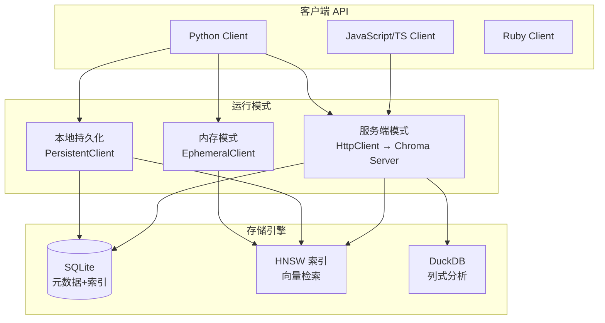

# Chroma 轻量向量库

> **文档说明**：系统讲解 Chroma 开源嵌入式向量数据库，涵盖核心概念（Collection/Embedding/Metadata）、安装与初始化、文档增删改查、元数据过滤、距离度量（余弦/L2/内积）、持久化模式（内存/本地/Docker 服务端）、与 LangChain/LlamaIndex 集成、多模态支持、性能调优、与 Qdrant/PgVector 的对比选型，含可运行的 Python 代码和 RAG 完整示例。
>
> **适用人群**：AI 应用开发者、需要快速搭建 RAG 原型的全栈工程师、个人项目和小规模生产环境的技术人员
>
> **前置知识**：[[RAG架构设计与流程]]、[[向量检索算法-HNSW-IVF]]、[[Embedding模型选型]]

---

## 一、概述

<div style="background:linear-gradient(135deg,#4facfe,#00f2fe);border-radius:16px;padding:20px;margin:16px 0;font-family:-apple-system,'Segoe UI','PingFang SC','Microsoft YaHei',sans-serif;color:#fff;overflow:hidden;box-shadow:0 8px 28px rgba(0,0,0,.14),0 3px 10px rgba(0,0,0,.08)">
<style>@keyframes highlight{0%,100%{box-shadow:0 0 0 rgba(255,255,255,0)}50%{box-shadow:0 0 20px rgba(255,255,255,.4)}}.hl-box{background:rgba(255,255,255,.2);border-radius:10px;padding:14px 18px;margin:10px 0;animation:highlight 3s ease-in-out infinite;border-left:4px solid rgba(255,255,255,.6)}.hl-formula{font-family:monospace;font-size:14px;text-align:center;background:rgba(0,0,0,.15);border-radius:8px;padding:12px;margin:10px 0}</style>
<div style="text-align:center;font-size:15px;font-weight:700;margin-bottom:14px;padding-bottom:10px;border-bottom:1.5px solid rgba(255,255,255,.22);letter-spacing:1px;text-shadow:0 1px 3px rgba(0,0,0,.12)">📌 Chroma 轻量向量库</div>
<div class="hl-box">系统讲解 Chroma 开源嵌入式向量数据库，涵盖核心概念（Collection/Embedding/Metadata）、安装与初始化、文档增删改查、元数据过滤、距离度量（余弦/L2/内积）、持久化模式（内存/本地/Docker 服务端）、与 LangChain/LlamaIndex 集成、多模态支...</div>
<div class="hl-formula">文本 → Embedding → 向量存储 → 相似度计算 → Top-K检索</div>
<div style="font-size:13px;opacity:.9;margin-top:8px">💡 掌握核心概念是理解 RAG 系统的关键第一步</div>
</div>

> 🔍 **知识点深度解析**
>
> **作用**：Chroma 轻量向量库 是 RAG 系统中的关键组件，解决向量检索与知识增强中的核心问题，适用于需要高效语义搜索和知识增强的 AI 应用场景。
>
> **原理**：通过将文本转化为高维向量表示，利用向量空间中的相似度计算实现语义级检索，结合大模型生成能力完成知识增强问答。
>
> **用法要点**：① 选择合适的 Embedding 模型和向量维度 ② 合理配置检索参数（Top-K、相似度阈值） ③ 结合元数据过滤提升精准度 ④ 定期更新向量索引以保证数据一致性

**Chroma** 是一个开源的轻量级向量数据库，设计理念是"为 AI 原生应用而生的最简单向量数据库"。Chroma 的核心优势是**零配置启动**——`pip install chromadb` 后即可在内存中使用，无需启动服务、无需配置端口，适合 RAG 原型开发、个人项目和中小规模应用（百万级向量以内）。

### 1. Chroma 解决了什么问题

| 痛点（无向量库） | Chroma 解决的问题 |
|----------------|-----------------|
| 语义检索需要自己写相似度计算 | 内置余弦/L2/内积距离，自动检索 Top-K |
| 向量存储需要自己管理文件/数据库 | 自动持久化到本地 SQLite + 自定义格式 |
| 元数据过滤需要自己实现 | 支持 where 条件过滤（按标签/来源/时间） |
| 多模态检索需要分别处理 | 原生支持文本/图像/多模态 Embedding |
| 与 LLM 框架集成需要写适配层 | LangChain/LlamaIndex/Dify 原生集成 |
| 生产部署需要复杂的集群配置 | 单文件持久化，Docker 一键启动服务端 |

### 2. Chroma 架构



### 3. Chroma vs 其他向量库

| 维度 | Chroma | Qdrant | PgVector | FAISS |
|------|--------|--------|----------|-------|
| **部署方式** | 嵌入式/服务端 | 服务端/Docker | PostgreSQL 扩展 | 嵌入式库 |
| **易用性** | 最高（零配置） | 高 | 中（需 PG） | 中（需自己管理） |
| **性能** | 中（百万级） | 高（亿级） | 中（千万级） | 高（内存） |
| **元数据过滤** | ✅ | ✅（强） | ✅（SQL） | ❌ |
| **持久化** | ✅ 本地文件 | ✅ | ✅（PG） | 需自己实现 |
| **分布式** | ❌（单机） | ✅（集群） | ✅（PG 集群） | ❌ |
| **多模态** | ✅ 原生 | ✅ | 需扩展 | ✅ |
| **适用规模** | < 100万向量 | 亿级 | 千万级 | 任意（内存） |
| **学习曲线** | 最平缓 | 平缓 | 中（需懂 PG） | 中 |

---

> 💡 **深度讲解**：Chroma 是目前最流行的轻量级向量数据库，专为 AI 原生应用设计，核心定位是"让开发者在 5 分钟内搭建向量检索"。Chroma 的核心优势：极简 API（3 行代码完成嵌入和检索）、内置 Embedding 支持（自动调用 OpenAI/Cohere/HuggingFace 等 Embedding 模型，无需手动生成向量）、零配置启动（内存模式无需安装任何服务，持久化模式只需指定目录）、Python/JS 客户端（官方支持 Python 和 JavaScript/TypeScript）、活跃社区（GitHub 15k+ stars，LangChain/LlamaIndex 默认集成）。Chroma 的架构非常简洁：客户端库直接操作本地文件（持久化模式）或内存（内存模式），没有独立的服务进程，也没有分布式能力。底层使用 HNSW 算法进行近似最近邻搜索，支持持久化到 SQLite（元数据）和 Parquet（向量数据）。Chroma 的适用场景：原型开发和快速验证（5 分钟搭建 RAG 原型）、小规模生产（< 10 万向量，单用户或小团队）、嵌入式应用（桌面应用、移动应用内嵌向量检索）、教学和学习（API 简单，适合学习 RAG 概念）。不适用场景：大规模生产（> 100 万向量，Chroma 性能和并发能力不足）、多用户高并发（Chroma 没有服务端，不支持高并发查询）、复杂过滤和聚合（Chroma 的元数据过滤功能有限）、分布式部署（Chroma 不支持分布式和水平扩展）。Chroma 的最佳实践：原型阶段用内存模式快速迭代，生产小规模用持久化模式，规模扩大后迁移到 Qdrant 或 Milvus（Chroma 的数据可以导出为标准格式迁移）。Chroma 是 RAG 学习和原型的最佳起点，但不是生产级大规模系统的最终选择。
>
> **📝 精简总结**：Chroma是最流行轻量向量库，核心是5分钟搭建向量检索；优势：极简API(3行代码)+内置Embedding(自动调用模型)+零配置(内存/本地文件)+Python/JS客户端+活跃社区(LangChain默认)；架构简洁无服务进程，底层HNSW+SQLite+Parquet；适用原型/小规模生产(<10万)/嵌入式/教学；不适用大规模/高并发/复杂过滤/分布式；是RAG学习最佳起点但非大规模最终选择。

## 二、底层原理

### 1. 核心数据模型

| 概念 | 说明 | 类比 |
|------|------|------|
| **Collection** | 向量集合，相当于一个"表" | SQL 中的 Table |
| **Embedding** | 向量表示，float 数组 | 行数据中的向量列 |
| **Document** | 原始文本内容 | 行数据中的文本列 |
| **Metadata** | 键值对元数据 | 行数据中的属性列 |
| **ID** | 唯一标识符 | 主键 |

每个 Collection 中的条目包含：`id` + `embedding` + `document` + `metadata`，四者可选但至少有 embedding 或 document（有 document 时用 embedding function 自动生成向量）。

### 2. 距离度量

Chroma 支持三种距离度量，在创建 Collection 时指定：

| 度量 | 公式 | 适用场景 |
|------|------|---------|
| **余弦相似度 (cosine)** | `1 - cos(a,b)` | 文本语义检索（最常用） |
| **L2 距离 (l2)** | `||a - b||²` | 图像检索、通用场景 |
| **内积 (ip)** | `-a·b` | 已归一化向量的快速检索 |

```text
collection = client.create_collection(
    name="my_collection",
    metadata={"hnsw:space": "cosine"}  # 或 "l2" / "ip"
)
```

### 3. HNSW 索引参数

Chroma 底层使用 HNSW（Hierarchical Navigable Small World）索引，可通过 metadata 调优：

| 参数 | 默认值 | 说明 |
|------|--------|------|
| `hnsw:construction_ef` | 100 | 构建时的搜索广度，越大索引越精确但构建越慢 |
| `hnsw:search_ef` | 10 | 搜索时的搜索广度，越大召回越高但越慢 |
| `hnsw:M` | 16 | 每个节点的连接数，越大内存占用越高 |
| `hnsw:num_threads` | CPU 核心数 | 构建索引的线程数 |
| `hnsw:resize_factor` | 1.2 | 向量数量增长时的扩容因子 |
| `hnsw:batch_size` | 100 | 批量插入大小 |
| `hnsw:sync_threshold` | 1000 | 自动持久化的阈值 |

### 4. 存储格式

本地持久化模式下，Chroma 的存储结构：

```text
chroma_db/
├── chroma.sqlite3          # SQLite 数据库（元数据、集合信息）
└── chroma-embeddings-xxx/  # 向量索引目录
    └── <collection_id>/
        ├── data.bin        # 向量数据
        └── metadata.bin    # 索引元数据
```

---

---

> 💡 **深度讲解**：本节围绕，深入剖析其技术原理与实践要点，帮助读者建立系统性的认知框架。
>
> **📝 精简总结**：本节介绍了，掌握这些内容是理解整个知识体系的重要基础。

## 三、实操

### 1. 基础使用（本地持久化）

```python
# examples/chroma_basic.py — Chroma 基础使用
import chromadb
from chromadb.utils import embedding_functions

# 1. 创建客户端（本地持久化）
client = chromadb.PersistentClient(path="./chroma_db")

# 也可以用内存模式（不持久化）
# client = chromadb.EphemeralClient()

# 2. 创建/获取 Collection
# 使用默认的 all-MiniLM-L6-v2 Embedding 模型（自动下载）
default_ef = embedding_functions.DefaultEmbeddingFunction()

collection = client.get_or_create_collection(
    name="tech_notes",
    embedding_function=default_ef,
    metadata={"hnsw:space": "cosine", "description": "技术笔记向量库"},
)

# 3. 添加文档（自动生成 Embedding）
collection.add(
    documents=[
        "Transformer 是一种基于自注意力机制的神经网络架构，由 Google 在 2017 年提出。",
        "RAG（检索增强生成）通过外部知识库检索相关文档，增强 LLM 的回答准确性。",
        "LangChain 是一个 LLM 应用开发框架，提供 Chain、Agent、Memory 等抽象。",
        "向量数据库存储文本的 Embedding 向量，支持语义相似度检索。",
        "HNSW 是一种层次化导航小世界图索引算法，用于高效的近似最近邻搜索。",
    ],
    metadatas=[
        {"category": "深度学习", "author": "张三", "date": "2026-01-15"},
        {"category": "AI工程", "author": "李四", "date": "2026-02-20"},
        {"category": "框架", "author": "王五", "date": "2026-03-10"},
        {"category": "数据库", "author": "张三", "date": "2026-04-05"},
        {"category": "算法", "author": "李四", "date": "2026-05-12"},
    ],
    ids=["doc_001", "doc_002", "doc_003", "doc_004", "doc_005"],
)

# 4. 语义检索
results = collection.query(
    query_texts=["什么是检索增强生成？"],
    n_results=3,
)

print("检索结果:")
for i, (doc, dist, meta) in enumerate(zip(
    results["documents"][0], results["distances"][0], results["metadatas"][0]
)):
    print(f"  {i+1}. [距离: {dist:.4f}] {doc}")
    print(f"     分类: {meta['category']}, 作者: {meta['author']}")

# 5. 带元数据过滤的检索
results_filtered = collection.query(
    query_texts=["深度学习模型"],
    n_results=2,
    where={"category": "深度学习"},  # 只检索分类为深度学习的文档
)
print("\n过滤后结果:", results_filtered["documents"][0])

# 6. 更新和删除
collection.update(
    ids=["doc_001"],
    documents=["Transformer 是 Google 2017 年提出的自注意力架构，是 GPT/BERT 的基础。"],
)
collection.delete(ids=["doc_005"])

# 7. 查看 Collection 信息
print(f"\nCollection 名称: {collection.name}")
print(f"文档数量: {collection.count()}")
```

### 2. 使用 OpenAI Embedding

```python
# examples/chroma_openai_embedding.py — OpenAI Embedding
import chromadb
from chromadb.utils.embedding_functions import OpenAIEmbeddingFunction

# OpenAI Embedding 函数
openai_ef = OpenAIEmbeddingFunction(
    api_key="sk-xxx",
    model_name="text-embedding-3-small",  # 1536 维
)

client = chromadb.PersistentClient(path="./chroma_db_openai")
collection = client.get_or_create_collection(
    name="company_docs",
    embedding_function=openai_ef,
    metadata={"hnsw:space": "cosine"},
)

# 添加文档
collection.add(
    documents=["公司年假政策：入职满1年享5天年假，满3年享10天。",
               "加班政策：工作日加班1.5倍工资，周末2倍，法定节假日3倍。"],
    ids=["policy_001", "policy_002"],
    metadatas=[{"type": "HR", "version": "2026"}, {"type": "HR", "version": "2026"}],
)

# 检索
results = collection.query(
    query_texts=["我工作两年了，有几天年假？"],
    n_results=2,
)
print(results["documents"][0][0])
```

### 3. 批量导入大型文档

```python
# examples/chroma_batch_import.py — 批量导入
import chromadb
from langchain_text_splitters import RecursiveCharacterTextSplitter
from chromadb.utils import embedding_functions
import os

client = chromadb.PersistentClient(path="./chroma_db_large")
ef = embedding_functions.DefaultEmbeddingFunction()
collection = client.get_or_create_collection("knowledge_base", embedding_function=ef)

# 文本分块
splitter = RecursiveCharacterTextSplitter(
    chunk_size=500,
    chunk_overlap=50,
    separators=["\n\n", "\n", "。", "！", "？", " ", ""],
)

def import_directory(directory: str, batch_size: int = 100):
    """批量导入目录下所有 txt 文件"""
    all_docs = []
    all_metadatas = []
    all_ids = []

    for filename in os.listdir(directory):
        if not filename.endswith(".txt"):
            continue
        filepath = os.path.join(directory, filename)
        with open(filepath, "r", encoding="utf-8") as f:
            content = f.read()
        chunks = splitter.split_text(content)
        for i, chunk in enumerate(chunks):
            all_docs.append(chunk)
            all_metadatas.append({"source": filename, "chunk": i})
            all_ids.append(f"{filename}_{i}")

    # 批量插入（避免单次过大）
    for i in range(0, len(all_docs), batch_size):
        batch_end = min(i + batch_size, len(all_docs))
        collection.add(
            documents=all_docs[i:batch_end],
            metadatas=all_metadatas[i:batch_end],
            ids=all_ids[i:batch_end],
        )
        print(f"已导入 {batch_end}/{len(all_docs)} 条")

    print(f"导入完成，共 {collection.count()} 条")

import_directory("./docs")
```

### 4. Docker 服务端部署

```bash
# 拉取并启动 Chroma 服务端
docker run -d \
  --name chroma \
  -p 8000:8000 \
  -v ./chroma_data:/chroma/chroma \
  -e IS_PERSISTENT=TRUE \
  -e ANONYMIZED_TELEMETRY=FALSE \
  chromadb/chroma:latest

# 验证
curl http://localhost:8000/api/v1/heartbeat
```

```python
# 客户端连接服务端
import chromadb

client = chromadb.HttpClient(host="localhost", port=8000)
# 带认证（生产环境）
# client = chromadb.HttpClient(host="localhost", port=8000, settings=Settings(
#     chroma_client_auth_provider="chromadb.auth.token.TokenAuthClientProvider",
#     chroma_client_auth_credentials="your-token"
# ))

collection = client.get_or_create_collection("remote_collection")
print(f"服务端 Collection 数量: {len(client.list_collections())}")
```

### 5. RAG 完整示例

```python
# examples/chroma_rag.py — Chroma + LLM 完整 RAG
import chromadb
from chromadb.utils import embedding_functions
from openai import OpenAI

# 初始化
client = chromadb.PersistentClient("./chroma_rag")
ef = embedding_functions.DefaultEmbeddingFunction()
collection = client.get_or_create_collection("rag_docs", embedding_function=ef)
llm = OpenAI()

# 知识库文档（实际应用中从文件加载）
docs = [
    "全栈+AI工程知识库包含 Java、Python、Vue3、AI工程化四大板块。",
    "AI工程化涵盖 RAG、Agent、Function Calling、模型部署等内容。",
    "知识库使用 Obsidian 管理，采用原子化笔记规范，含 Frontmatter 元数据。",
    "向量检索使用 Chroma 数据库，Embedding 模型为 all-MiniLM-L6-v2。",
]
collection.add(documents=docs, ids=[f"doc_{i}" for i in range(len(docs))])


def rag_query(question: str, n_results: int = 3) -> str:
    """RAG 查询：检索 → 构建 Prompt → LLM 生成"""
    # 1. 检索相关文档
    results = collection.query(
        query_texts=[question],
        n_results=n_results,
    )
    context = "\n\n".join(results["documents"][0])

    # 2. 构建增强 Prompt
    prompt = f"""请根据以下上下文回答用户问题。如果上下文中没有答案，请说"根据现有资料无法回答"。

上下文：
{context}

用户问题：{question}

回答："""

    # 3. LLM 生成
    resp = llm.chat.completions.create(
        model="gpt-4o-mini",
        messages=[{"role": "user", "content": prompt}],
        temperature=0,
    )
    return resp.choices[0].message.content


# 使用
answer = rag_query("这个知识库用什么向量数据库？")
print("回答:", answer)
```

---

---

> 💡 **深度讲解**：本节围绕，深入剖析其技术原理与实践要点，帮助读者建立系统性的认知框架。
>
> **📝 精简总结**：本节介绍了，掌握这些内容是理解整个知识体系的重要基础。

## 四、常见问题与排查

| 问题现象 | 原因分析 | 解决方案 |
|---------|---------|---------|
| `chromadb` 安装后导入报错 | 缺少系统依赖（SQLite 版本过低） | 升级 Python 到 3.9+；`pip install --upgrade chromadb`；Linux 上确保 SQLite ≥ 3.35 |
| 添加文档时报 "embedding dimension mismatch" | Collection 已用其他维度的 Embedding 创建，换了模型 | 删除旧 Collection 重新创建（`client.delete_collection`）；或确保使用相同的 embedding_function |
| 检索结果不相关 | Embedding 模型不适合中文，或分块太大/太小 | 中文用 `text2vec` 或 OpenAI `text-embedding-3-small`；调整 chunk_size（300-800 字符）；增大 `n_results` 后人工筛选 |
| 本地持久化文件越来越大 | 删除文档后空间未回收，HNSW 索引有碎片 | 定期 `client.reset()` 重建（会清空所有数据）；或导出数据后重建 Collection；设置 `hnsw:resize_factor` 合理 |
| Docker 服务端连接超时 | 端口未映射、防火墙拦截、容器未启动 | `docker ps` 确认容器运行；`-p 8000:8000` 端口映射；`curl localhost:8000/api/v1/heartbeat` 测试 |
| 批量导入 OOM | 单次 batch 太大，Embedding 生成和索引构建占用内存 | 减小 batch_size（50-100）；用 `collection.add` 分批；64位 Python + 足够内存；大数据集用 Qdrant 替代 |
| 元数据过滤不生效 | where 条件语法错误，或字段名不匹配 | 用正确的 where 语法：`{"category": "AI"}`、`{"$and": [...]}`、`{"price": {"$gte": 100}}`；确认 metadata 中的 key 完全一致 |
| 多模态检索不工作 | 未使用多模态 Embedding 函数 | 用 `chromadb.utils.embedding_functions.OpenCLIPEmbeddingFunction`；图像和文本用同一多模态模型生成向量 |
| 查询速度慢（>1s） | 向量数量大 + HNSW 参数未调优 + 默认 Embedding 模型慢 | 增大 `hnsw:search_ef`（10→50）换精度，或减小换速度；用更快的 Embedding 模型；超百万向量换 Qdrant |
| Collection 名包含特殊字符报错 | Collection 名限制：3-63 字符，小写字母/数字/连字符/下划线/点 | 用合法名称：`"my-collection_v1"`；不能以点或连字符开头结尾；不能有连续点 |

---

---

> 💡 **深度讲解**：本节围绕，深入剖析其技术原理与实践要点，帮助读者建立系统性的认知框架。
>
> **📝 精简总结**：本节介绍了，掌握这些内容是理解整个知识体系的重要基础。

## 五、进阶与最佳实践

### 1. 适用场景与边界

| 场景 | 是否推荐 Chroma | 替代方案 |
|------|---------------|---------|
| **个人项目/原型** | ✅ 强烈推荐 | - |
| **中小团队 RAG（<10万向量）** | ✅ 推荐 | - |
| **生产 API 服务（10-100万向量）** | ⚠️ 可用，需服务端部署 | Qdrant |
| **大规模（>100万向量）** | ❌ 不推荐 | Qdrant / Milvus / Weaviate |
| **需要分布式集群** | ❌ 不支持 | Qdrant / Milvus |
| **需要复杂过滤+聚合** | ⚠️ 基础过滤可用 | PgVector（SQL 全功能） |
| **多模态检索** | ✅ 原生支持 | Qdrant |
| **边缘/离线部署** | ✅ 单文件即可 | FAISS |

### 2. 性能调优建议

## 高性能 Collection 配置
```text
collection = client.create_collection(
    name="high_perf",
    metadata={
```
        "hnsw:space": "cosine",
        "hnsw:construction_ef": 200,   # 构建更精确（一次性成本）
        "hnsw:search_ef": 50,          # 搜索更精确
        "hnsw:M": 32,                  # 更多连接（更高内存，更好召回）
        "hnsw:num_threads": 8,         # 多线程构建
        "hnsw:batch_size": 200,        # 更大批量
        "hnsw:sync_threshold": 5000,   # 减少持久化频率
    },
)

### 3. 数据备份与迁移

```css
# 导出 Collection 数据
data = collection.get(include=["documents", "metadatas", "embeddings"])
```

## 导入到新 Collection
```text
new_collection = client.create_collection("backup", embedding_function=ef)
new_collection.add(
```
```text
    ids=data["ids"],
    documents=data["documents"],
    metadatas=data["metadatas"],
    embeddings=data["embeddings"],  # 直接复用向量，不重新生成
```
)

## 直接复制持久化目录（离线备份）
```text
## cp -r ./chroma_db ./chroma_backup_20260907
```

### 4. 与 LangChain 集成

```python
from langchain_chroma import Chroma
from langchain_openai import OpenAIEmbeddings
from langchain_text_splitters import RecursiveCharacterTextSplitter

# LangChain Chroma 封装
vectorstore = Chroma(
    persist_directory="./chroma_langchain",
    embedding_function=OpenAIEmbeddings(model="text-embedding-3-small"),
    collection_name="langchain_docs",
)

# 添加文档
vectorstore.add_texts(["文档1", "文档2"], metadatas=[{"src": "a"}, {"src": "b"}])

# 检索
docs = vectorstore.similarity_search("问题", k=3)

# 转为 Retriever 供 RAG 链使用
retriever = vectorstore.as_retriever(search_kwargs={"k": 4})
```

---

---

> 💡 **深度讲解**：本节围绕，深入剖析其技术原理与实践要点，帮助读者建立系统性的认知框架。
>
> **📝 精简总结**：本节介绍了，掌握这些内容是理解整个知识体系的重要基础。

## 🔗 关联笔记

- [[向量库选型对比表]] — 向量数据库选型，Chroma 是轻量首选
- [[Qdrant-高性能向量检索]] — Chroma 规模扩大后的升级选择
- [[Milvus-架构与部署]] — 大规模生产级替代
- [[PgVector-PostgreSQL向量扩展]] — 另一个轻量选择，基于 PostgreSQL
- [[RAG检索增强生成]] — RAG 向量存储入门
- [[本地知识库接入LLM]] — 本地知识库常用 Chroma

## 📖 前置知识

- [[RAG检索增强生成]]
- [[向量库选型对比表]]

## 🏷️ 相关标签

`#AI应用` `#RAG` `#向量数据库` `#效率工具`

---

[[Home|🏠 返回首页]] · [[MOC-AI与效率工具|📚 AI与效率工具]] · [[MOC-AI工程化|🤖 AI工程化]]