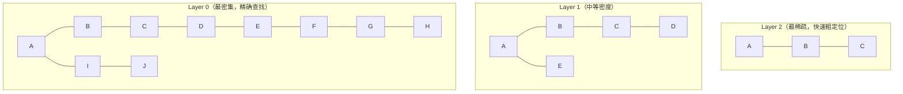
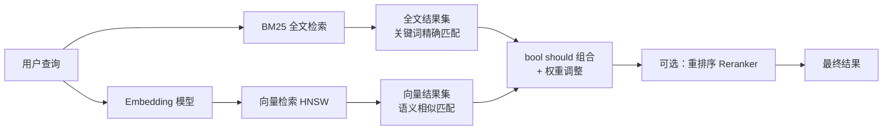

# 🔍 Elasticsearch 向量检索

> **文档说明**：系统讲解 Elasticsearch 8.x 原生向量检索（dense_vector + HNSW）的核心概念、底层原理、索引设计、纯向量检索、混合检索（全文 BM25 + 向量相似度）、带过滤的向量检索、Python/Java 客户端实操、性能调优和生产级最佳实践。ES 向量检索的最大优势是**无需引入新的向量数据库**，在已有 ES 集群上即可实现 RAG 所需的混合检索能力。
>
> **适用人群**：AI 应用工程师、RAG 系统开发者、Elasticsearch 运维/开发工程师、需要做语义检索的后端开发者
>
> **前置知识**：[[Elasticsearch-全文检索引擎]] · [[高级RAG-Hybrid检索与重排序]] · [[向量库选型对比表]]

---

## 一、概述

<div style="background:linear-gradient(135deg,#4facfe,#00f2fe);border-radius:16px;padding:20px;margin:16px 0;font-family:-apple-system,'Segoe UI','PingFang SC','Microsoft YaHei',sans-serif;color:#fff;overflow:hidden;box-shadow:0 8px 28px rgba(0,0,0,.14),0 3px 10px rgba(0,0,0,.08)">
<style>@keyframes highlight{0%,100%{box-shadow:0 0 0 rgba(255,255,255,0)}50%{box-shadow:0 0 20px rgba(255,255,255,.4)}}.hl-box{background:rgba(255,255,255,.2);border-radius:10px;padding:14px 18px;margin:10px 0;animation:highlight 3s ease-in-out infinite;border-left:4px solid rgba(255,255,255,.6)}.hl-formula{font-family:monospace;font-size:14px;text-align:center;background:rgba(0,0,0,.15);border-radius:8px;padding:12px;margin:10px 0}</style>
<div style="text-align:center;font-size:15px;font-weight:700;margin-bottom:14px;padding-bottom:10px;border-bottom:1.5px solid rgba(255,255,255,.22);letter-spacing:1px;text-shadow:0 1px 3px rgba(0,0,0,.12)">📌 🔍 Elasticsearch 向量检索</div>
<div class="hl-box">系统讲解 Elasticsearch 8.x 原生向量检索（dense_vector + HNSW）的核心概念、底层原理、索引设计、纯向量检索、混合检索（全文 BM25 + 向量相似度）、带过滤的向量检索、Python/Java 客户端实操、性能调优和生产级最佳实践。ES 向量检索的最大优势是**无...</div>
<div class="hl-formula">文本 → Embedding → 向量存储 → 相似度计算 → Top-K检索</div>
<div style="font-size:13px;opacity:.9;margin-top:8px">💡 掌握核心概念是理解 RAG 系统的关键第一步</div>
</div>

> 🔍 **知识点深度解析**
>
> **作用**：🔍 Elasticsearch 向量检索 是 RAG 系统中的关键组件，解决向量检索与知识增强中的核心问题，适用于需要高效语义搜索和知识增强的 AI 应用场景。
>
> **原理**：通过将文本转化为高维向量表示，利用向量空间中的相似度计算实现语义级检索，结合大模型生成能力完成知识增强问答。
>
> **用法要点**：① 选择合适的 Embedding 模型和向量维度 ② 合理配置检索参数（Top-K、相似度阈值） ③ 结合元数据过滤提升精准度 ④ 定期更新向量索引以保证数据一致性

### 1.1 什么是 ES 向量检索

Elasticsearch 从 8.0 版本开始原生支持 `dense_vector` 字段类型和 HNSW（Hierarchical Navigable Small World）近似最近邻（ANN）索引，使得 ES 不仅能做传统的全文检索（BM25），还能做**语义向量检索**，并将两者结合实现**混合检索（Hybrid Search）**。

这意味着：如果你已经有一个 Elasticsearch 集群（用于日志、搜索、业务数据），无需额外部署 Milvus/Pinecone/Weaviate 等专用向量数据库，就可以在 ES 上直接构建 RAG 系统的检索层。

### 1.2 核心应用场景

| 场景 | 说明 | 典型产品 |
|------|------|---------|
| **RAG 语义检索** | 将文档分块后向量化存储，用户问题向量化后检索最相似的文档块 | 企业知识库问答、客服机器人 |
| **混合检索** | 全文检索（关键词精确匹配）+ 向量检索（语义匹配）结合，提升召回率 | 电商搜索、文档搜索、代码搜索 |
| **语义去重** | 计算文本向量相似度，识别重复或近似内容 | 内容平台去重、新闻聚合 |
| **推荐系统** | 基于用户行为向量和物品向量做相似度推荐 | 内容推荐、商品推荐 |
| **图像/多模态检索** | 存储图像 Embedding，实现以图搜图 | 电商以图搜图、素材库检索 |
| **异常检测** | 计算日志/指标向量与正常模式的距离，发现异常 | AIOps、安全监控 |

### 1.3 核心优势

| 优势 | 说明 |
|------|------|
| **减少技术栈** | 已有 ES 集群无需新增向量数据库，降低运维成本和系统复杂度 |
| **混合检索原生支持** | BM25 全文 + 向量相似度在同一查询中组合，无需跨库聚合 |
| **生态成熟** | ES 有完善的客户端（Python/Java/Go/JS）、监控、集群管理、安全认证 |
| **过滤能力强** | 向量检索可与 term/range/geo 等过滤条件组合，实现带元数据过滤的语义检索 |
| **聚合分析** | 检索结果可做聚合统计（按分类、时间、作者等），专用向量库通常不支持 |
| **高可用可扩展** | ES 分布式架构天然支持水平扩展、副本容错、滚动升级 |
| **8.x 性能提升** | 8.x 的 HNSW 实现经过多轮优化，性能已接近专用向量数据库 |

### 1.4 与专用向量数据库的对比

| 维度 | Elasticsearch 8.x | Milvus | Pinecone | Weaviate |
|------|-------------------|--------|----------|----------|
| **向量检索** | HNSW ANN | HNSW/IVF_FLAT 等多种 | HNSW | HNSW |
| **全文检索** | ✅ BM25 原生 | ❌ 需外接 | ❌ 需外接 | ✅ BM25 |
| **混合检索** | ✅ 原生支持 | ⚠️ 需自行组合 | ⚠️ 需自行组合 | ✅ 原生支持 |
| **过滤能力** | ✅ 丰富（term/range/geo/script） | ✅ 标量过滤 | ✅ 元数据过滤 | ✅ 丰富 |
| **聚合分析** | ✅ 强大 | ⚠️ 有限 | ❌ | ⚠️ 有限 |
| **运维复杂度** | 中（已有集群则低） | 高（分布式组件多） | 低（SaaS 托管） | 中 |
| **成本** | 已有集群则边际成本低 | 中（需自建） | 高（按用量付费） | 中 |
| **适用场景** | 已有 ES、需要混合检索、中等规模向量 | 超大规模向量、纯向量场景 | 快速上线、不想运维 | 需要混合检索、模块化架构 |

> **选型建议**：如果你的场景需要**全文+语义混合检索**，或者**已经有 ES 集群**，优先选择 ES 向量检索。如果是**纯向量场景、超大规模（亿级以上）、对 QPS 和延迟要求极高**，考虑专用向量数据库。

---

> 💡 **深度讲解**：Elasticsearch（ES）向量检索是在已有 Elasticsearch 搜索引擎基础上扩展的向量检索能力，核心价值是"在统一的搜索平台中同时支持关键词检索和向量检索，实现真正的混合搜索"。对于已经使用 Elasticsearch 的团队（日志分析、全文搜索、可观测性等场景），ES 向量检索可以在不引入新基础设施的情况下实现 RAG 系统的向量存储和检索，且天然支持 BM25 + 向量的混合检索（这是 ES 的最大优势——关键词检索是 ES 的核心能力，向量检索是扩展能力，两者可以无缝融合）。ES 向量检索的发展历程：ES 7.x 引入 dense_vector 字段类型（仅支持精确搜索，性能差）→ ES 8.0 引入 HNSW 近似最近邻搜索（性能大幅提升）→ ES 8.x 持续优化（支持量化、过滤优化、性能提升）→ ES 8.11+ 支持 kNN 搜索与过滤的联合优化。ES 向量检索的核心特性：dense_vector 字段类型（支持 float32 向量，最大维度 4096）、HNSW 索引（高性能近似最近邻搜索，支持动态更新）、kNN 搜索 API（专门的向量搜索接口，支持过滤和排序）、混合检索（kNN + query 组合，通过 RRF 或线性加权融合）、丰富的过滤（ES 的标量过滤能力是所有向量数据库中最强的之一，支持范围、term、bool 等复杂过滤）、聚合分析（向量检索结果可以与 ES 的聚合分析能力结合）、生态成熟（Kibana 可视化、Logstash 数据接入、Beats 数据采集等完整生态）。ES 向量检索的适用场景：已有 ES 生态的团队（避免引入新组件）、需要强混合检索的场景（关键词 + 向量深度融合）、复杂过滤需求（ES 的过滤能力远超专用向量库）、日志/文档 + 向量的统一搜索平台。不适用场景：纯向量大规模检索（ES 的向量性能不如 Milvus/Qdrant）、极高并发低延迟（ES 的查询延迟和并发不如专用向量库）、没有 ES 运维经验的团队（ES 运维复杂度高）。ES 向量检索的最佳实践：使用 HNSW 索引（不要用精确搜索）、合理设置索引参数（m、ef_construction、ef_search）、利用混合检索（kNN + BM25 RRF 融合）、结合过滤（pre_filter 减少搜索空间）、使用 ES 8.11+ 版本（性能和功能更完善）。
>
> **📝 精简总结**：ES向量检索核心价值是统一搜索平台中关键词+向量混合搜索，已有ES生态团队无需新基础设施；发展：7.x dense_vector(精确)→8.0 HNSW(ANN)→8.x优化→8.11+联合过滤；特性：dense_vector(4096维)+HNSW+kNN API+混合检索(RRF融合)+强过滤(ES最强)+聚合分析+成熟生态(Kibana/Logstash)；适用已有ES生态/强混合检索/复杂过滤/统一搜索平台；不适用纯向量大规模/极高并发/无ES运维经验；最佳实践用HNSW+混合检索+pre_filter+8.11+。

## 二、底层原理

### 2.1 dense_vector 字段类型

`dense_vector` 是 ES 8.x 引入的字段类型，用于存储固定维度的浮点向量：

```json
{
  "mappings": {
    "properties": {
      "embedding": {
        "type": "dense_vector",
        "dims": 1536,
        "index": true,
        "similarity": "cosine"
      }
    }
  }
}
```

**关键参数**：

| 参数 | 说明 | 可选值 | 默认值 |
|------|------|--------|--------|
| `dims` | 向量维度，必须与 Embedding 模型输出一致 | 1-4096（8.x） | 无，必填 |
| `index` | 是否构建 ANN 索引（设为 false 只能用 script_score 暴力计算） | true/false | false（7.x）/ true（8.x 推荐） |
| `similarity` | 相似度计算方式 | `cosine`/`dot_product`/`l2_norm`/`max_inner_product` | `l2_norm` |

**相似度选择指南**：

| 相似度 | 公式 | 适用场景 | 注意事项 |
|--------|------|---------|---------|
| `cosine` | 余弦相似度 | 文本 Embedding（OpenAI、BGE 等），向量未归一化 | 最常用，对向量长度不敏感 |
| `dot_product` | 点积 | 向量已归一化（L2 范数=1），性能略优于 cosine | 必须确保向量归一化，否则结果错误 |
| `l2_norm` | 欧氏距离 | 图像向量、未归一化的数值向量 | 距离越小越相似，ES 会自动转换为分数 |
| `max_inner_product` | 最大内积 | 推荐系统、已归一化的向量 | 与 dot_product 类似，但分数范围不同 |

### 2.2 HNSW 索引原理

HNSW（Hierarchical Navigable Small World）是目前最主流的 ANN（近似最近邻）索引算法，ES 8.x 采用 HNSW 作为默认的向量索引实现。

**HNSW 核心思想**：构建多层导航图，上层是稀疏的"高速公路"（快速粗定位），下层是密集的"普通道路"（精确查找）。查询时从最上层开始，逐层向下逼近最近邻。



**HNSW 可调参数**（在 `index_options` 中配置）：

| 参数 | 说明 | 默认值 | 调优建议 |
|------|------|--------|---------|
| `type` | 索引类型 | `hnsw` | 8.x 只有 hnsw |
| `m` | 每层每个节点的最大连接数 | 16 | 数据量大/维度高时增大（如 32-64），提高召回率但增加内存和构建时间 |
| `ef_construction` | 构建时的候选队列大小 | 100 | 增大提高索引质量（召回率），但构建更慢；建议 100-500 |
| `ef_search` | 查询时的候选队列大小 | 动态 | 查询时通过 `num_candidates` 控制，增大提高召回率但增加延迟 |

**召回率 vs 延迟的权衡**：
- `num_candidates` 越大 → 召回率越高，但查询延迟越长
- 经验值：`num_candidates = k * 10 ~ k * 50`（k 是要返回的结果数）
- 例如要返回 top 5，`num_candidates` 设为 50-250

### 2.3 混合检索原理

混合检索将全文检索（BM25）和向量检索（余弦相似度）的结果结合，优势互补：



**混合检索的 ES 查询结构**：

```json
{
  "query": {
    "bool": {
      "should": [
        { "match": { "content": { "query": "用户问题", "boost": 1.0 } } },
        { "knn": { "field": "embedding", "query_vector": [...], "k": 10, "num_candidates": 100, "boost": 1.5 } }
      ]
    }
  },
  "size": 10
}
```

**关键机制**：
- `should` 子句：两个检索结果取并集，分数相加
- `boost`：调整全文和向量的权重（向量通常给更高权重，因为语义匹配更精准）
- ES 会自动归一化两种分数（BM25 分数和向量相似度分数）到可比范围
- 可通过 `rank` 字段使用 RRF（Reciprocal Rank Fusion）做更高级的结果融合

### 2.4 带过滤的向量检索

ES 向量检索支持在检索前或检索后应用过滤条件，这是专用向量数据库的弱项：

```json
{
  "knn": {
    "field": "embedding",
    "query_vector": [...],
    "k": 10,
    "num_candidates": 100,
    "filter": {
      "bool": {
        "must": [
          { "term": { "category": "技术文档" } },
          { "range": { "created_at": { "gte": "2024-01-01" } } }
        ]
      }
    }
  }
}
```

**预过滤（Pre-filter）vs 后过滤（Post-filter）**：
- ES 8.x 的 `knn` 查询中的 `filter` 是**预过滤**：先过滤候选集，再在过滤后的集合中做向量检索，更高效
- 传统 `script_score` 方式是后过滤：先做全量向量计算，再过滤，性能差
- 预过滤的代价：如果过滤后候选集太小，可能影响召回率

---

---

> 💡 **深度讲解**：本节围绕，深入剖析其技术原理与实践要点，帮助读者建立系统性的认知框架。
>
> **📝 精简总结**：本节介绍了，掌握这些内容是理解整个知识体系的重要基础。

## 三、实操示例

### 3.1 环境准备

```python
# 启动 Elasticsearch 8.x（Docker）
docker run -d \
  --name es-vector \
  -p 9200:9200 \
  -e "discovery.type=single-node" \
  -e "xpack.security.enabled=false" \
  -e "ES_JAVA_OPTS=-Xms2g -Xmx2g" \
  docker.elastic.co/elasticsearch/elasticsearch:8.11.0

# 安装 Python 客户端
pip install elasticsearch==8.11.0 sentence-transformers openai

# 验证
curl http://localhost:9200
```

### 3.2 创建向量索引

```python
"""
创建支持向量检索的索引
关键：dense_vector 字段配置 + HNSW 索引参数
"""
from elasticsearch import Elasticsearch

es = Elasticsearch("http://localhost:9200")

INDEX_NAME = "knowledge_base"

# 索引 mapping
mappings = {
    "properties": {
        "doc_id": {"type": "keyword"},
        "title": {"type": "text", "analyzer": "ik_max_word"},  # 中文分词需安装 IK 插件
        "content": {"type": "text", "analyzer": "ik_max_word"},
        "category": {"type": "keyword"},
        "tags": {"type": "keyword"},
        "created_at": {"type": "date"},
        "chunk_index": {"type": "integer"},
        # 向量字段：1536维（OpenAI text-embedding-3-small），余弦相似度，HNSW索引
        "embedding": {
            "type": "dense_vector",
            "dims": 1536,
            "index": True,
            "similarity": "cosine",
            "index_options": {
                "type": "hnsw",
                "m": 16,              # 每层最大连接数
                "ef_construction": 200  # 构建时候选队列大小
            }
        }
    }
}

# 设置（可选，调整分片数等）
settings = {
    "number_of_shards": 3,
    "number_of_replicas": 1,
    "index": {
        "refresh_interval": "30s"  # 向量索引构建较慢，适当延长刷新间隔
    }
}

# 创建索引
if es.indices.exists(index=INDEX_NAME):
    es.indices.delete(index=INDEX_NAME)

es.indices.create(index=INDEX_NAME, mappings=mappings, settings=settings)
print(f"索引 {INDEX_NAME} 创建成功")
```

### 3.3 文档向量化与写入

```python
"""
文档分块 → 向量化 → 写入 ES
使用 OpenAI Embedding API（也可用 sentence-transformers 本地模型）
"""
from openai import OpenAI
import numpy as np
import time

client = OpenAI(api_key="your-api-key")

def get_embedding(text: str, model: str = "text-embedding-3-small") -> list:
    """获取文本的向量表示"""
    response = client.embeddings.create(input=text, model=model)
    return response.data[0].embedding

def chunk_document(text: str, chunk_size: int = 500, overlap: int = 50) -> list:
    """简单的文档分块（实际项目可用 LangChain TextSplitter）"""
    chunks = []
    start = 0
    while start < len(text):
        end = start + chunk_size
        chunks.append(text[start:end])
        start = end - overlap
    return chunks

# 示例文档
documents = [
    {
        "doc_id": "doc_001",
        "title": "Elasticsearch 向量检索指南",
        "content": "Elasticsearch 8.x 支持原生向量检索，使用 dense_vector 字段和 HNSW 索引...",
        "category": "技术文档",
        "tags": ["elasticsearch", "向量检索", "RAG"],
        "created_at": "2024-01-15"
    },
    # ... 更多文档
]

# 批量写入
batch_size = 50
operations = []

for doc in documents:
    chunks = chunk_document(doc["content"])
    for i, chunk in enumerate(chunks):
        # 向量化
        embedding = get_embedding(chunk)

        operations.append({"index": {"_index": INDEX_NAME}})
        operations.append({
            "doc_id": doc["doc_id"],
            "title": doc["title"],
            "content": chunk,
            "category": doc["category"],
            "tags": doc["tags"],
            "created_at": doc["created_at"],
            "chunk_index": i,
            "embedding": embedding
        })

        # 批量提交
        if len(operations) >= batch_size * 2:
            es.bulk(operations=operations, refresh=True)
            operations = []
            print(f"已写入 {len(operations)//2} 条...")

if operations:
    es.bulk(operations=operations, refresh=True)

print(f"文档写入完成，共 {es.count(index=INDEX_NAME)['count']} 条向量记录")
```

### 3.4 纯向量检索（KNN 查询）

```python
"""
纯向量检索：用户问题向量化后，检索最相似的文档块
ES 8.x 使用 knn 查询（推荐），7.x 使用 script_score
"""

def vector_search(query: str, top_k: int = 5, num_candidates: int = 100) -> list:
    """
    纯向量检索
    :param query: 用户查询文本
    :param top_k: 返回结果数
    :param num_candidates: HNSW 搜索候选数（越大召回越高，延迟越长）
    """
    # 1. 查询向量化
    query_vector = get_embedding(query)

    # 2. KNN 查询
    response = es.search(
        index=INDEX_NAME,
        knn={
            "field": "embedding",
            "query_vector": query_vector,
            "k": top_k,
            "num_candidates": num_candidates
        },
        size=top_k,
        _source=["doc_id", "title", "content", "category", "chunk_index"]
    )

    # 3. 解析结果
    results = []
    for hit in response["hits"]["hits"]:
        results.append({
            "score": hit["_score"],           # 相似度分数（0-1，越高越相似）
            "doc_id": hit["_source"]["doc_id"],
            "title": hit["_source"]["title"],
            "content": hit["_source"]["content"][:200] + "...",  # 截断显示
            "category": hit["_source"]["category"],
            "chunk_index": hit["_source"]["chunk_index"]
        })

    return results

# 使用
results = vector_search("如何在 Elasticsearch 中做向量检索？")
for r in results:
    print(f"[{r['score']:.4f}] {r['title']} - {r['content'][:80]}")
```

### 3.5 混合检索（全文 + 向量）

```python
"""
混合检索：BM25 全文检索 + 向量语义检索
通过 bool should 组合，boost 调整权重
"""

def hybrid_search(
    query: str,
    top_k: int = 5,
    vector_boost: float = 1.5,   # 向量检索权重
    text_boost: float = 1.0,     # 全文检索权重
    num_candidates: int = 100
) -> list:
    """混合检索"""
    query_vector = get_embedding(query)

    response = es.search(
        index=INDEX_NAME,
        query={
            "bool": {
                "should": [
                    # 全文检索（BM25）
                    {
                        "multi_match": {
                            "query": query,
                            "fields": ["title^2", "content"],  # title 权重加倍
                            "boost": text_boost
                        }
                    },
                    # 向量检索（KNN）
                    {
                        "knn": {
                            "field": "embedding",
                            "query_vector": query_vector,
                            "k": top_k * 2,  # 多取一些，最终再截断
                            "num_candidates": num_candidates,
                            "boost": vector_boost
                        }
                    }
                ]
            }
        },
        size=top_k,
        _source=["doc_id", "title", "content", "category"]
    )

    return [
        {
            "score": hit["_score"],
            "title": hit["_source"]["title"],
            "content": hit["_source"]["content"][:200],
            "category": hit["_source"]["category"]
        }
        for hit in response["hits"]["hits"]
    ]

# 使用
results = hybrid_search("ES 向量检索的性能如何调优？")
for r in results:
    print(f"[{r['score']:.4f}] {r['title']}")
```

### 3.6 带过滤的向量检索

```python
"""
带元数据过滤的向量检索
在 knn 查询中使用 filter 预过滤
"""

def filtered_vector_search(
    query: str,
    category: str = None,
    date_from: str = None,
    tags: list = None,
    top_k: int = 5
) -> list:
    """带过滤条件的向量检索"""
    query_vector = get_embedding(query)

    # 构建过滤条件
    filter_clauses = []
    if category:
        filter_clauses.append({"term": {"category": category}})
    if date_from:
        filter_clauses.append({"range": {"created_at": {"gte": date_from}}})
    if tags:
        filter_clauses.append({"terms": {"tags": tags}})

    knn_query = {
        "field": "embedding",
        "query_vector": query_vector,
        "k": top_k,
        "num_candidates": 100
    }

    if filter_clauses:
        knn_query["filter"] = {"bool": {"must": filter_clauses}}

    response = es.search(
        index=INDEX_NAME,
        knn=knn_query,
        size=top_k
    )

    return [
        {"score": h["_score"], "title": h["_source"]["title"], "category": h["_source"]["category"]}
        for h in response["hits"]["hits"]
    ]

# 使用：只在"技术文档"分类中，且2024年以后创建的文档中检索
results = filtered_vector_search(
    query="HNSW 索引调优",
    category="技术文档",
    date_from="2024-01-01"
)
```

### 3.7 Java 客户端实现（Spring Boot）

```python
/**
 * Java 客户端实现 ES 向量检索（Spring Boot + Elasticsearch Java Client）
 */
@Service
@Slf4j
public class VectorSearchService {

    @Autowired
    private ElasticsearchClient esClient;

    @Autowired
    private EmbeddingService embeddingService;  // 调用 Embedding API

    /**
     * 纯向量检索
     */
    public List<SearchResult> vectorSearch(String query, int topK) throws IOException {
        // 1. 获取查询向量
        float[] queryVector = embeddingService.embed(query);

        // 2. 构建 KNN 查询
        KnnQuery knnQuery = KnnQuery.of(k -> k
            .field("embedding")
            .queryVector(queryVector)
            .k(topK)
            .numCandidates(100)
        );

        // 3. 执行搜索
        SearchResponse<Map> response = esClient.search(s -> s
            .index("knowledge_base")
            .knn(knnQuery)
            .size(topK),
            Map.class
        );

        // 4. 解析结果
        return response.hits().hits().stream()
            .map(hit -> new SearchResult(
                hit.score(),
                (String) hit.source().get("title"),
                (String) hit.source().get("content")
            ))
            .collect(Collectors.toList());
    }

    /**
     * 混合检索
     */
    public List<SearchResult> hybridSearch(String query, int topK) throws IOException {
        float[] queryVector = embeddingService.embed(query);

        SearchResponse<Map> response = esClient.search(s -> s
            .index("knowledge_base")
            .query(q -> q
                .bool(b -> b
                    .should(should -> should
                        .multiMatch(mm -> mm
                            .query(query)
                            .fields("title^2", "content")
                            .boost(1.0f)
                        )
                    )
                    .should(should -> should
                        .knn(k -> k
                            .field("embedding")
                            .queryVector(queryVector)
                            .k(topK * 2)
                            .numCandidates(100)
                            .boost(1.5f)
                        )
                    )
                )
            )
            .size(topK),
            Map.class
        );

        return parseResults(response);
    }
}
```

### 3.8 完整 RAG 检索服务封装

```python
"""
完整的 RAG 检索服务：封装向量化、检索、混合检索、结果组装
"""
from typing import List, Dict, Optional
from elasticsearch import Elasticsearch
from openai import OpenAI

class RAGRetriever:
    """RAG 检索器：基于 ES 向量检索 + 混合检索"""

    def __init__(
        self,
        es_url: str = "http://localhost:9200",
        index_name: str = "knowledge_base",
        openai_api_key: str = None,
        embedding_model: str = "text-embedding-3-small"
    ):
        self.es = Elasticsearch(es_url)
        self.index_name = index_name
        self.client = OpenAI(api_key=openai_api_key)
        self.embedding_model = embedding_model

    def _get_embedding(self, text: str) -> List[float]:
        """获取文本向量"""
        resp = self.client.embeddings.create(input=text, model=self.embedding_model)
        return resp.data[0].embedding

    def search(
        self,
        query: str,
        top_k: int = 5,
        mode: str = "hybrid",  # vector / text / hybrid
        filters: Optional[Dict] = None,
        vector_boost: float = 1.5,
        text_boost: float = 1.0
    ) -> List[Dict]:
        """
        统一检索入口
        :param mode: vector（纯向量）/ text（纯全文）/ hybrid（混合）
        """
        query_vector = self._get_embedding(query)

        if mode == "vector":
            body = {"knn": self._build_knn(query_vector, top_k, filters)}
        elif mode == "text":
            body = {"query": self._build_text_query(query, filters)}
        else:  # hybrid
            body = {
                "query": {
                    "bool": {
                        "should": [
                            self._build_text_query(query, filters, text_boost),
                            {"knn": self._build_knn(query_vector, top_k * 2, filters, vector_boost)}
                        ]
                    }
                }
            }

        response = self.es.search(index=self.index_name, body=body, size=top_k)
        return self._parse_response(response)

    def _build_knn(self, vector, k, filters=None, boost=None):
        knn = {"field": "embedding", "query_vector": vector, "k": k, "num_candidates": k * 20}
        if filters:
            knn["filter"] = filters
        if boost:
            knn["boost"] = boost
        return knn

    def _build_text_query(self, query, filters=None, boost=1.0):
        q = {"multi_match": {"query": query, "fields": ["title^2", "content"], "boost": boost}}
        if filters:
            return {"bool": {"must": [q], "filter": filters}}
        return q

    def _parse_response(self, response):
        results = []
        for hit in response["hits"]["hits"]:
            src = hit["_source"]
            results.append({
                "score": round(hit["_score"], 4),
                "doc_id": src.get("doc_id"),
                "title": src.get("title"),
                "content": src.get("content"),
                "category": src.get("category"),
                "chunk_index": src.get("chunk_index")
            })
        return results

    def assemble_context(self, results: List[Dict], max_chars: int = 3000) -> str:
        """将检索结果组装为 LLM 上下文"""
        context_parts = []
        total_chars = 0
        for i, r in enumerate(results, 1):
            part = f"[文档{i}] 标题：{r['title']}\n内容：{r['content']}\n"
            if total_chars + len(part) > max_chars:
                break
            context_parts.append(part)
            total_chars += len(part)
        return "\n".join(context_parts)


# 使用示例
retriever = RAGRetriever(openai_api_key="sk-xxx")

# 混合检索
results = retriever.search("ES 向量检索如何调优？", mode="hybrid", top_k=5)

# 组装上下文给 LLM
context = retriever.assemble_context(results)
print(context)
```

---

---

> 💡 **深度讲解**：本节围绕，深入剖析其技术原理与实践要点，帮助读者建立系统性的认知框架。
>
> **📝 精简总结**：本节介绍了，掌握这些内容是理解整个知识体系的重要基础。

## 四、常见问题与排查

| 问题现象 | 可能原因 | 解决方案 |
|---------|---------|---------|
| **向量检索慢，延迟高** | `num_candidates` 太大；`index: false` 用了 script_score 暴力计算；向量维度太高；数据量太大单分片压力大 | 减小 `num_candidates`（k*10 起步）；确保 `index: true` 用 HNSW；考虑降维（如 1536→768）；增加分片数，水平扩展 |
| **检索结果不准确，召回率低** | `num_candidates` 太小；`m` 和 `ef_construction` 太小导致索引质量差；向量模型不匹配；文档分块不合理 | 增大 `num_candidates`（k*30~k*50）；重建索引时增大 `m`（32）和 `ef_construction`（200-500）；确保查询和索引用同一个 Embedding 模型；优化分块策略（语义分块、增加 overlap） |
| **内存不足，OOM** | 向量字段占用内存大（每个向量 dims*4 字节）；分片数太多；JVM 堆内存设置太小 | 估算内存：文档数 × dims × 4字节 × 1.5（HNSW 额外开销）；增加机器内存或减少副本；合理设置 JVM 堆（-Xms/-Xmx，建议不超过物理内存 50%）；考虑向量量化（ES 8.11+ 支持 scalar_quantization） |
| **混合检索权重不对，全文结果压过向量** | `boost` 设置不合理；BM25 分数和向量分数量级差异大 | 调整 `boost`（向量通常给 1.5-3.0，全文给 1.0）；使用 `rank` + RRF 融合替代简单 should 相加；通过测试集调优权重 |
| **写入速度慢，批量导入耗时长** | `refresh_interval` 太短；`number_of_replicas` 写入时设为 1；批量大小不合理；HNSW 索引构建本身较慢 | 写入前设置 `refresh_interval: -1` 和 `number_of_replicas: 0`，写完后恢复；批量大小 50-200 条；增大 `bulk` 线程池；使用 SSD 磁盘 |
| **向量维度不匹配报错** | 索引 `dims` 与 Embedding 模型输出维度不一致；不同模型混用 | 创建索引时确认 `dims` 与模型一致（OpenAI 3-small=1536，3-large=3072，BGE-base=768）；同一索引必须用同一个 Embedding 模型；换模型需重建索引 |
| **中文全文检索效果差** | 未安装中文分词插件（IK），默认按字分词 | 安装 IK 分词插件；mapping 中 `"analyzer": "ik_max_word"`（索引）和 `"search_analyzer": "ik_smart"`（搜索）；考虑用同义词词典 |
| **过滤后检索结果为空或太少** | 过滤条件太严格，过滤后候选集太小；预过滤影响 HNSW 搜索范围 | 放宽过滤条件；增大 `num_candidates`；如果过滤后集合很小，考虑用 `script_score` 暴力计算（小数据集可接受）；改用后过滤（先检索再过滤） |
| **ES 版本不支持 knn 查询** | 版本低于 8.0；8.x 早期版本 knn 语法不同 | 升级到 8.5+（推荐 8.11+，功能最完善）；7.x 用 `script_score` + `cosineSimilarity` 函数（暴力计算，性能差） |
| **向量分数不是 0-1 范围** | 使用了 `l2_norm` 或 `dot_product`（未归一化）；不同相似度分数范围不同 | `cosine` 分数范围 0-1（越高越相似）；`l2_norm` 是距离（越小越相似，ES 转换为分数）；`dot_product` 要求向量归一化，否则分数可能 >1 或 <0 |
| **查询时报 circuit_breaking_exception** | 查询时向量数据加载超过内存限制；fielddata 内存不足 | 增大 `indices.breaker.total.limit`；增加节点内存；减小 `num_candidates`；考虑用 `store: true` 将向量存到磁盘（但增加 IO） |
| **重建索引时数据迁移慢** | 直接 reindex 大索引；未优化写入参数 | 使用 `_reindex` API + wait_for_completion=false 异步执行；写入前关闭 refresh 和副本；用 slice 并行 reindex；考虑用快照恢复 |

---

---

> 💡 **深度讲解**：本节围绕，深入剖析其技术原理与实践要点，帮助读者建立系统性的认知框架。
>
> **📝 精简总结**：本节介绍了，掌握这些内容是理解整个知识体系的重要基础。

## 五、进阶与最佳实践

### 5.1 性能调优清单

| 调优方向 | 具体措施 | 预期效果 |
|---------|---------|---------|
| **索引构建** | `m: 16-32`，`ef_construction: 200-500`，`refresh_interval: 30s-60s` | 提升索引质量和召回率 |
| **查询性能** | `num_candidates: k*10 ~ k*30`，避免过大；热点索引预热 | 降低查询延迟 |
| **内存优化** | 合理设置 JVM 堆（不超过 50% 物理内存）；8.11+ 用标量量化（scalar_quantization）减少内存 75% | 降低内存占用 |
| **写入优化** | 批量写入（50-200条/批）；写入时关闭 refresh 和副本；用 SSD | 提升写入吞吐量 |
| **集群规划** | 向量数据建议独立节点（hot tier）；每个分片不超过 50GB；3 分片起步 | 稳定可扩展 |
| **缓存利用** | 开启 query cache；热点查询用 `filter` 上下文（可缓存） | 提升重复查询速度 |

### 5.2 向量量化（ES 8.11+）

ES 8.11 引入标量量化（scalar_quantization），可将向量内存占用减少约 75%，性能损失很小：

```json
{
  "mappings": {
    "properties": {
      "embedding": {
        "type": "dense_vector",
        "dims": 1536,
        "index": true,
        "similarity": "cosine",
        "index_options": {
          "type": "hnsw",
          "m": 16,
          "ef_construction": 200,
          "quantization": {
            "scalar": {
              "bits": 4,           // 4-bit 量化，内存减少 75%
              "compression": "encode"  // encode: 压缩存储，decode: 不压缩（测试用）
            }
          }
        }
      }
    }
  }
}
```

### 5.3 RRF 结果融合（ES 8.11+）

RRF（Reciprocal Rank Fusion）是比简单 `should` 加权更科学的混合检索结果融合方式：

```json
{
  "size": 10,
  "query": {
    "bool": {
      "should": [
        { "multi_match": { "query": "用户问题", "fields": ["title^2", "content"] } },
        { "knn": { "field": "embedding", "query_vector": [...], "k": 20, "num_candidates": 100 } }
      ]
    }
  },
  "rank": {
    "rrf": {
      "window_size": 50,
      "rank_constant": 20
    }
  }
}
```

### 5.4 生产环境部署架构

```text
                    ┌─────────────┐
                    │   负载均衡   │
                    │  (Nginx/LB)  │
                    └──────┬──────┘
                           │
              ┌────────────┼────────────┐
              ▼            ▼            ▼
        ┌──────────┐ ┌──────────┐ ┌──────────┐
        │ ES 节点1  │ │ ES 节点2  │ │ ES 节点3  │
        │ (master)  │ │ (data)   │ │ (data)   │
        │ 16GB RAM  │ │ 32GB RAM │ │ 32GB RAM │
        └──────────┘ └──────────┘ └──────────┘
              │            │            │
              └────────────┼────────────┘
                           ▼
                    ┌─────────────┐
                    │  共享存储 SSD │
                    │  (向量索引)   │
                    └─────────────┘
```

**生产环境配置建议**：
- **内存**：向量数据节点 32GB+（JVM 堆 16GB，剩余给文件系统缓存）
- **CPU**：8 核+（HNSW 查询是 CPU 密集型）
- **磁盘**：SSD（NVMe 最佳），向量索引 IO 密集
- **分片**：3 主分片 + 1 副本起步，按数据量扩展
- **JVM**：`-Xms16g -Xmx16g`，不要超过 32GB（压缩指针失效）
- **监控**：监控 JVM 堆使用率、fielddata 内存、查询延迟 P99、索引大小

### 5.5 与 RAG 系统的集成最佳实践

1. **文档分块策略**：
   - 按语义分块（标题/段落），而非固定字符数
   - 块大小 300-800 token，overlap 50-100 token
   - 每个块保留元数据（doc_id、标题、分类、页码、chunk_index）

2. **Embedding 模型选择**：
   - 中文场景：BGE-large-zh、m3e-large、text-embedding-3-small
   - 英文场景：text-embedding-3-small/large、Cohere embed
   - 维度权衡：768 维（内存小，性能好）vs 1536 维（精度高，内存大）

3. **检索策略**：
   - 默认用混合检索（hybrid），兼顾关键词精确匹配和语义匹配
   - 对短查询（关键词式）偏重全文检索；对长查询（自然语言）偏重向量检索
   - 检索 top_k 取 10-20，经 Reranker 重排序后取 top 3-5 给 LLM

4. **结果重排序（Rerank）**：
   - 用 CrossEncoder 模型（如 bge-reranker）对检索结果精排
   - 或用 LLM 自身做重排序（让 LLM 判断哪些文档最相关）
   - 重排序可显著提升 RAG 答案质量

5. **索引更新策略**：
   - 增量更新：新文档实时向量化写入
   - 全量重建：Embedding 模型升级时，用 `_reindex` 异步重建
   - 别名切换：新索引构建完成后，通过别名原子切换，零停机

### 5.6 生产环境最佳实践清单

| 类别 | 最佳实践 | 说明 |
|------|---------|------|
| **索引设计** | `dims` 与模型一致，`similarity: cosine`，`index: true` | 最基础的正确配置 |
| **索引设计** | HNSW `m: 16-32`，`ef_construction: 200` | 平衡索引质量和构建时间 |
| **索引设计** | 8.11+ 启用 4-bit 标量量化 | 内存减少 75%，召回率损失 <1% |
| **查询优化** | `num_candidates = k * 10 ~ k * 30` | 平衡延迟和召回率 |
| **查询优化** | 默认混合检索，`vector_boost: 1.5-2.0` | 兼顾精确匹配和语义匹配 |
| **查询优化** | 8.11+ 用 RRF 替代简单 should 加权 | 更科学的结果融合 |
| **写入优化** | 批量写入 50-200 条，写入时关闭 refresh/副本 | 提升写入吞吐量 3-5 倍 |
| **集群规划** | 向量数据独立节点，32GB+ 内存，SSD | 避免向量查询影响其他业务 |
| **集群规划** | 每个分片 ≤ 50GB，3 主分片起步 | 稳定可扩展 |
| **监控告警** | 监控 JVM 堆、fielddata、查询延迟 P99、索引大小 | 提前发现问题 |
| **监控告警** | 告警阈值：堆使用率 >85%，P99 延迟 >500ms | 及时响应 |
| **安全** | 启用 X-Pack Security，HTTPS 传输加密，RBAC 权限控制 | 生产环境必须 |
| **备份** | 定期快照备份（SLM），跨集群复制（CCR）容灾 | 数据安全 |
| **版本** | 使用 8.11+ LTS 版本，功能最完善 | 避免早期版本 bug 和功能缺失 |

---

---

> 💡 **深度讲解**：本节围绕，深入剖析其技术原理与实践要点，帮助读者建立系统性的认知框架。
>
> **📝 精简总结**：本节介绍了，掌握这些内容是理解整个知识体系的重要基础。

## 🔗 关联笔记

- [[向量库选型对比表]] — 向量数据库选型对比
- [[高级RAG-Hybrid检索与重排序]] — ES 混合检索是核心优势
- [[Qdrant-高性能向量检索]] — 专用向量库对比
- [[Milvus-架构与部署]] — 大规模向量检索替代
- [[RAG检索增强生成]] — RAG 向量存储选型

## 📖 前置知识

- [[RAG检索增强生成]]
- [[高级RAG-Hybrid检索与重排序]]

## 🏷️ 相关标签

`#AI应用` `#RAG` `#向量数据库` `#Elasticsearch`

---

[[Home|🏠 返回首页]] · [[MOC-AI与效率工具|📚 AI与效率工具]] · [[MOC-AI工程化|🤖 AI工程化]]