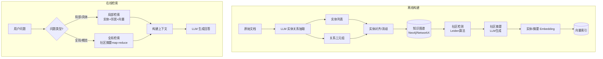
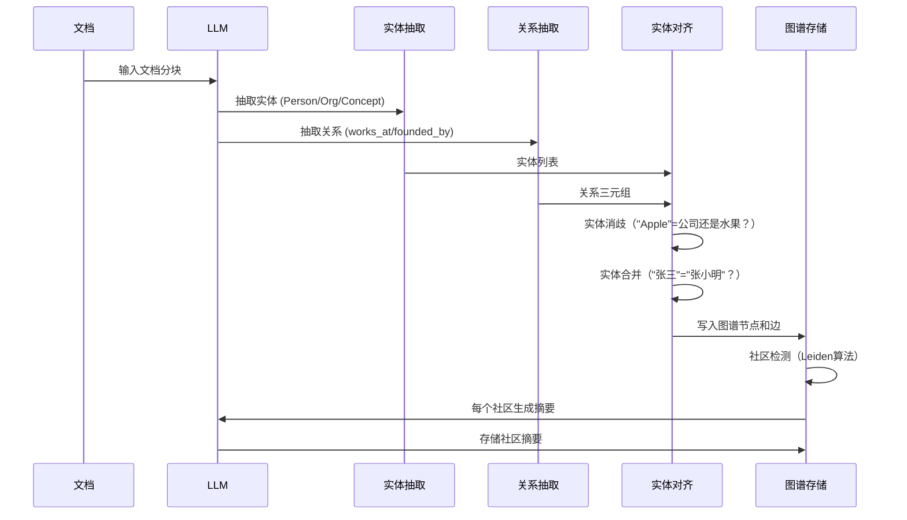

# GraphRAG 知识图谱增强

> **文档说明**：系统讲解 GraphRAG（知识图谱增强的检索增强生成）技术，涵盖与传统向量 RAG 的差异、知识图谱构建流程（实体抽取/关系抽取/实体对齐）、图检索策略（社区检测/多跳遍历/子图检索）、Microsoft GraphRAG 框架、Neo4j + 向量混合检索、LightRAG 轻量方案、适用场景与局限性，含可运行的知识图谱构建代码、Neo4j Cypher 查询、GraphRAG 检索流程和与 LangChain 集成示例。
>
> **适用人群**：AI 应用架构师、需要处理复杂关系型知识的全栈工程师、对 RAG 进阶技术感兴趣的开发者
>
> **前置知识**：[[RAG架构设计与流程]]、[[向量检索算法-HNSW-IVF]]、[[Chroma-轻量向量库]]

---

## 一、概述

<div style="background:linear-gradient(135deg,#4facfe,#00f2fe);border-radius:16px;padding:20px;margin:16px 0;font-family:-apple-system,'Segoe UI','PingFang SC','Microsoft YaHei',sans-serif;color:#fff;overflow:hidden;box-shadow:0 8px 28px rgba(0,0,0,.14),0 3px 10px rgba(0,0,0,.08)">
<style>@keyframes highlight{0%,100%{box-shadow:0 0 0 rgba(255,255,255,0)}50%{box-shadow:0 0 20px rgba(255,255,255,.4)}}.hl-box{background:rgba(255,255,255,.2);border-radius:10px;padding:14px 18px;margin:10px 0;animation:highlight 3s ease-in-out infinite;border-left:4px solid rgba(255,255,255,.6)}.hl-formula{font-family:monospace;font-size:14px;text-align:center;background:rgba(0,0,0,.15);border-radius:8px;padding:12px;margin:10px 0}</style>
<div style="text-align:center;font-size:15px;font-weight:700;margin-bottom:14px;padding-bottom:10px;border-bottom:1.5px solid rgba(255,255,255,.22);letter-spacing:1px;text-shadow:0 1px 3px rgba(0,0,0,.12)">📌 GraphRAG 知识图谱增强</div>
<div class="hl-box">系统讲解 GraphRAG（知识图谱增强的检索增强生成）技术，涵盖与传统向量 RAG 的差异、知识图谱构建流程（实体抽取/关系抽取/实体对齐）、图检索策略（社区检测/多跳遍历/子图检索）、Microsoft GraphRAG 框架、Neo4j + 向量混合检索、LightRAG 轻量方案、适用场景与...</div>
<div class="hl-formula">Query → Embedding → Vector Search → Context → LLM Generation</div>
<div style="font-size:13px;opacity:.9;margin-top:8px">💡 掌握核心概念是理解 RAG 系统的关键第一步</div>
</div>

> 🔍 **知识点深度解析**
>
> **作用**：GraphRAG 知识图谱增强 是 RAG 系统中的关键组件，解决向量检索与知识增强中的核心问题，适用于需要高效语义搜索和知识增强的 AI 应用场景。
>
> **原理**：通过将文本转化为高维向量表示，利用向量空间中的相似度计算实现语义级检索，结合大模型生成能力完成知识增强问答。
>
> **用法要点**：① 选择合适的 Embedding 模型和向量维度 ② 合理配置检索参数（Top-K、相似度阈值） ③ 结合元数据过滤提升精准度 ④ 定期更新向量索引以保证数据一致性

**GraphRAG** 是将知识图谱（Knowledge Graph）与 RAG 结合的检索增强技术。传统向量 RAG 只能检索"语义相似的文本片段"，而 GraphRAG 可以理解实体之间的关系，进行多跳推理和全局摘要，特别适合处理需要跨文档关联、复杂关系推理、全局概览的问题。Microsoft 于 2024 年开源 GraphRAG 框架，证明了在"全局问题"（如"这个数据集的主要主题是什么"）上 GraphRAG 显著优于向量 RAG。

### 1. 传统 RAG 的局限

| 痛点（向量 RAG） | GraphRAG 解决的问题 |
|----------------|-------------------|
| 只能检索局部相似片段，无法全局概览 | 知识图谱的社区检测 + 社区摘要，支持全局问题 |
| 多跳关系推理困难（A的B的C是谁） | 图遍历支持多跳关系查询 |
| 实体分散在不同文档中，无法关联 | 实体对齐将不同文档中的同一实体合并 |
| 检索结果缺乏结构化关系 | 图谱中的 (实体, 关系, 实体) 三元组提供结构化上下文 |
| 无法回答"总结所有文档的主题" | 社区摘要 + 层级摘要支持全局聚合 |

### 2. GraphRAG 架构



### 3. GraphRAG vs 向量 RAG vs 混合 RAG

| 维度 | 向量 RAG | GraphRAG | 混合 RAG |
|------|---------|----------|---------|
| **检索单位** | 文本块 | 实体+关系+子图 | 文本块 + 子图 |
| **全局问题** | 差 | 优秀 | 优秀 |
| **局部问题** | 优秀 | 良好 | 优秀 |
| **多跳推理** | 弱 | 强 | 强 |
| **构建成本** | 低（分块+向量化） | 高（LLM抽取+图谱构建） | 高 |
| **检索延迟** | 低（向量检索） | 中（图遍历+LLM） | 中 |
| **更新维护** | 简单（增量索引） | 复杂（图谱更新+对齐） | 复杂 |
| **适用数据** | 非结构化文本 | 关系密集型文档 | 通用 |

---

> 💡 **深度讲解**：GraphRAG（Graph-based Retrieval-Augmented Generation）是微软提出的 RAG 增强技术，核心思想是"用知识图谱增强检索能力，支持全局语义理解和多跳推理"。传统向量 RAG 的检索是"局部检索"——基于向量相似度找到与查询最相似的文档片段，但这种方式存在三个固有局限：一是无法回答需要综合多篇文档的"全局性问题"（如"总结这个领域的主要趋势"）；二是无法支持需要跨文档推理的"多跳问题"（如"A 公司的 CEO 曾经在哪家公司任职？"）；三是检索结果缺乏结构化的关系信息（实体之间的关系、层级结构）。GraphRAG 通过构建知识图谱解决这些问题——从文档中提取实体（Entity）和关系（Relationship），构建知识图谱，然后基于图谱进行检索和推理。GraphRAG 的检索分为两种模式：局部检索（Local Search，基于实体和关系的子图检索，回答具体问题）和全局检索（Global Search，基于社区检测和全局摘要，回答全局性问题）。GraphRAG 的典型适用场景：企业知识库的全局分析、多跳推理问答、复杂关系查询、领域知识图谱构建。不适用场景：简单事实问答（向量 RAG 足够）、实时性要求极高的场景（图谱构建耗时）、文档量极小的场景（图谱构建 overhead 大于收益）。
>
> **📝 精简总结**：GraphRAG用知识图谱增强RAG，解决传统向量RAG三局限：全局问题(综合多篇)、多跳推理(跨文档)、关系缺失；检索分局部(子图)和全局(社区摘要)；适用企业全局分析/多跳推理，不适用简单问答/极高实时。

## 二、底层原理

### 1. 知识图谱构建流程



**实体抽取 Prompt 示例**：
```text
从以下文本中抽取实体和关系。
实体类型：人物、组织、地点、技术、概念
关系类型：创立、任职于、使用、依赖于、属于
输出 JSON 格式：
{"entities": [{"name": "...", "type": "...", "description": "..."}],
 "relationships": [{"source": "...", "relation": "...", "target": "...", "description": "..."}]}
```

### 2. 社区检测与层级摘要

GraphRAG 的核心创新之一是**社区检测 + 层级摘要**：

1. **Leiden 社区检测算法**：将图谱中的实体划分为社区（紧密连接的子图）
2. **层级化**：小社区合并为大社区，形成层级结构（0级=细粒度，N级=全局）
3. **社区摘要**：对每个社区，LLM 根据社区内的实体和关系生成摘要
4. **Map-Reduce 全局回答**：全局问题时，先在每个社区摘要中 map 搜索相关信息，再 reduce 汇总

```mermaid
graph TB
    subgraph Level 2（全局）
        L2[整个领域的摘要]
    end
    subgraph Level 1（中观）
        L1A[社区A摘要<br/>AI框架]
        L1B[社区B摘要<br/>数据库]
    end
    subgraph Level 0（微观）
        E1[LangChain] -->|使用| E2[Chroma]
        E3[Qdrant] -->|属于| E4[向量数据库]
        E5[PostgreSQL] -->|扩展| E6[PgVector]
    end

    E1 --> L1A
    E2 --> L1B
    E3 --> L1B
    E4 --> L1B
    E5 --> L1B
    E6 --> L1B
    L1A --> L2
    L1B --> L2
```

### 3. 局部检索策略

对于具体问题（"张三在哪个公司工作？"），GraphRAG 的局部检索：

1. **实体匹配**：从问题中识别实体，在图谱中找到对应节点
2. **邻居扩展**：获取该实体的 1-2 跳邻居节点和关系
3. **文本检索**：用实体名称和关系描述做向量检索，获取相关文本块
4. **上下文构建**：将实体描述、关系、文本块组合为上下文

### 4. 全局检索策略（Map-Reduce）

对于全局问题（"这个知识库的主要技术栈是什么？"）：

1. **Map 阶段**：将问题与所有 Level 1 社区摘要做向量匹配，选出 Top-K 相关社区
2. **Reduce 阶段**：LLM 基于选中的社区摘要生成全局回答
3. **可选下钻**：如果需要细节，进一步检索 Level 0 的实体和文本

---

---

> 💡 **深度讲解**：本节围绕，深入剖析其技术原理与实践要点，帮助读者建立系统性的认知框架。
>
> **📝 精简总结**：本节介绍了，掌握这些内容是理解整个知识体系的重要基础。

## 三、实操

### 1. 用 LLM 构建知识图谱

```python
# graphrag/build_graph.py — 知识图谱构建
from openai import OpenAI
import json
from neo4j import GraphDatabase

client = OpenAI()
neo4j_driver = GraphDatabase.driver("bolt://localhost:7687", auth=("neo4j", "password"))

EXTRACT_PROMPT = """你是一个知识图谱构建专家。从以下文本中抽取实体和关系。

实体类型：人物、组织、技术、产品、概念、地点
关系类型：创立、任职于、使用、依赖于、属于、开发、集成

文本：
{text}

严格输出 JSON，不要有其他文字：
{{"entities": [{{"name": "实体名", "type": "类型", "description": "一句话描述"}}],
 "relationships": [{{"source": "源实体", "relation": "关系", "target": "目标实体", "description": "关系描述"}}]}}"""


def extract_entities(text: str) -> dict:
    """用 LLM 抽取实体和关系"""
    resp = client.chat.completions.create(
        model="gpt-4o-mini",
        temperature=0,
        response_format={"type": "json_object"},
        messages=[{"role": "user", "content": EXTRACT_PROMPT.format(text=text[:3000])}],
    )
    return json.loads(resp.choices[0].message.content)


def write_to_neo4j(data: dict, source_doc: str):
    """将抽取结果写入 Neo4j"""
    with neo4j_driver.session() as session:
        # 写入实体节点
        for ent in data["entities"]:
            session.run("""
                MERGE (e:Entity {name: $name})
                SET e.type = $type, e.description = $description,
                    e.source = $source
            """, name=ent["name"], type=ent["type"],
                 description=ent["description"], source=source_doc)

        # 写入关系边
        for rel in data["relationships"]:
            session.run("""
                MATCH (s:Entity {name: $source})
                MATCH (t:Entity {name: $target})
                MERGE (s)-[r:RELATION {type: $relation}]->(t)
                SET r.description = $description, r.source = $source
            """, source=rel["source"], target=rel["target"],
                 relation=rel["relation"], description=rel["description"],
                 source=source_doc)


# 批量处理文档
documents = [
    {"id": "doc1", "text": "LangChain 是一个 LLM 应用开发框架，使用 Chroma 作为向量存储，支持 Function Calling。"},
    {"id": "doc2", "text": "Qdrant 是一个高性能向量数据库，用 Rust 编写，支持 HNSW 索引和过滤检索。"},
    {"id": "doc3", "text": "PostgreSQL 可以通过 PgVector 扩展支持向量检索，适合已有 PG 基础设施的团队。"},
]

for doc in documents:
    print(f"处理: {doc['id']}")
    data = extract_entities(doc["text"])
    write_to_neo4j(data, doc["id"])
    print(f"  抽取到 {len(data['entities'])} 个实体, {len(data['relationships'])} 个关系")

neo4j_driver.close()
```

### 2. Neo4j 图检索

```mermaid
# graphrag/graph_retrieval.py — 基于图谱的检索
from neo4j import GraphDatabase
from openai import OpenAI
import chromadb
from chromadb.utils import embedding_functions

neo4j_driver = GraphDatabase.driver("bolt://localhost:7687", auth=("neo4j", "password"))
client = OpenAI()

# 向量库（存储原始文本块）
chroma_client = chromadb.PersistentClient("./chroma_graphrag")
ef = embedding_functions.DefaultEmbeddingFunction()
collection = chroma_client.get_or_create_collection("docs", embedding_function=ef)


def extract_query_entities(question: str) -> list[str]:
    """从问题中抽取要查询的实体"""
    resp = client.chat.completions.create(
        model="gpt-4o-mini", temperature=0,
        messages=[{"role": "user",
                   "content": f"从以下问题中抽取关键实体名称，只输出实体名，用逗号分隔：\n{question}"}],
    )
    return [e.strip() for e in resp.choices[0].message.content.split(",")]


def retrieve_subgraph(entity_names: list[str], max_hops: int = 2) -> str:
    """从图谱中检索实体的多跳子图"""
    context_parts = []
    with neo4j_driver.session() as session:
        for name in entity_names:
            # 模糊匹配实体
            result = session.run("""
                MATCH (e:Entity)
                WHERE e.name CONTAINS $name
                OPTIONAL MATCH (e)-[r:RELATION]-(neighbor)
                RETURN e.name AS entity, e.type AS type, e.description AS desc,
                       collect(DISTINCT {relation: r.type, target: neighbor.name, desc: r.description}) AS relations
                LIMIT 5
            """, name=name)
            for record in result:
                context_parts.append(f"实体: {record['entity']} ({record['type']}) - {record['desc']}")
                for rel in record["relations"]:
                    if rel["relation"]:
                        context_parts.append(
                            f"  关系: {record['entity']} --{rel['relation']}--> {rel['target']} ({rel['desc']})"
                        )
    return "\n".join(context_parts)


def graphrag_query(question: str) -> str:
    """GraphRAG 完整查询流程"""
    # 1. 抽取问题实体
    entities = extract_query_entities(question)
    print(f"识别实体: {entities}")

    # 2. 图谱检索（结构化关系）
    graph_context = retrieve_subgraph(entities)
    print(f"图谱上下文:\n{graph_context[:300]}...")

    # 3. 向量检索（非结构化文本）
    vector_results = collection.query(query_texts=[question], n_results=3)
    vector_context = "\n\n".join(vector_results["documents"][0])

    # 4. 合并上下文，生成回答
    prompt = f"""请根据以下知识图谱信息和文档片段回答问题。

知识图谱信息：
{graph_context}

相关文档片段：
{vector_context}

问题：{question}

回答："""

    resp = client.chat.completions.create(
        model="gpt-4o-mini", messages=[{"role": "user", "content": prompt}], temperature=0,
    )
    return resp.choices[0].message.content


answer = graphrag_query("LangChain 使用了哪些向量数据库？")
print(f"\n回答: {answer}")
```

### 3. Microsoft GraphRAG 框架使用

```mermaid
# 安装 Microsoft GraphRAG
pip install graphrag

# 初始化项目
graphrag init --root ./my_graphrag_project

# 配置 .env
echo "GRAPHRAG_API_KEY=sk-xxx" >> .env
echo "GRAPHRAG_LLM_MODEL=gpt-4o-mini" >> .env
echo "GRAPHRAG_EMBEDDING_MODEL=text-embedding-3-small" >> .env

# 将文档放入 input/ 目录
# cp ./docs/*.txt ./my_graphrag_project/input/

# 构建索引（抽取实体+关系+社区+摘要）
python -m graphrag.index --root ./my_graphrag_project

# 全局查询（概览类问题）
python -m graphrag.query --root ./my_graphrag_project \
  --method global \
  "这个知识库涵盖了哪些技术领域？"

# 局部查询（具体问题）
python -m graphrag.query --root ./my_graphrag_project \
  --method local \
  "LangChain 和 Chroma 是什么关系？"
```

### 4. LightRAG 轻量方案

```python
# LightRAG 是更轻量的 GraphRAG 实现（支持多种图存储）
# pip install lightrag-hku

from lightrag import LightRAG, QueryParam
from lightrag.llm import openai_complete_if_cache, openai_embed
import os

os.environ["OPENAI_API_KEY"] = "sk-xxx"

rag = LightRAG(
    working_dir="./lightrag_data",
    llm_model_func=openai_complete_if_cache,
    embedding_func=openai_embed,
)

# 插入文档
with open("./docs/tech_articles.txt", "r", encoding="utf-8") as f:
    rag.insert(f.read())

# 局部查询（具体问题）
answer = rag.query("LangChain 支持哪些向量数据库？",
                   param=QueryParam(mode="local"))
print("局部查询:", answer)

# 全局查询（概览问题）
answer = rag.query("总结这个知识库的主要技术方向",
                   param=QueryParam(mode="global"))
print("全局查询:", answer)

# 混合查询（结合局部+全局）
answer = rag.query("AI 框架和数据库之间有什么关系？",
                   param=QueryParam(mode="hybrid"))
print("混合查询:", answer)
```

---

---

> 💡 **深度讲解**：本节围绕，深入剖析其技术原理与实践要点，帮助读者建立系统性的认知框架。
>
> **📝 精简总结**：本节介绍了，掌握这些内容是理解整个知识体系的重要基础。

## 四、常见问题与排查

| 问题现象 | 原因分析 | 解决方案 |
|---------|---------|---------|
| 实体抽取质量差，关系错误多 | LLM 模型太小或 Prompt 不清晰 | 用 GPT-4o 而非 gpt-4o-mini 做抽取；Prompt 中给出实体/关系类型的明确定义和示例；对抽取结果做后处理校验 |
| 实体对齐失败（同一实体多个节点） | 没有做实体消歧，LLM 输出名称不统一 | 实现实体对齐：用 Embedding 相似度匹配候选实体；维护实体别名表；抽取时强制使用标准名称 |
| 图谱构建成本高（LLM 调用费用大） | 每个文档块都调用 LLM 抽取，token 消耗大 | 先用关键词/规则预抽取，LLM 只处理复杂文档；用小模型（gpt-4o-mini）做初筛，大模型做精抽；缓存重复文档的抽取结果 |
| 全局查询回答空洞/泛泛 | 社区摘要质量差，或 map-reduce 选中的社区不相关 | 优化社区摘要 Prompt；增大 Top-K 社区数量；检查社区检测参数（resolution）；对 Level 0 实体也做检索补充细节 |
| Neo4j 查询慢 | 图谱节点多，未建索引，或多跳遍历太深 | 对 Entity.name 建索引（`CREATE INDEX FOR (e:Entity) ON (e.name)`）；限制遍历跳数（≤3）；用 APOC 插件优化路径查询 |
| GraphRAG 比向量 RAG 效果还差 | 数据量小（<10篇文档），图谱稀疏，社区检测无意义 | 小数据集用向量 RAG 即可；GraphRAG 适合文档量大（>50篇）且关系密集的场景；混合检索（图谱+向量）通常优于纯 GraphRAG |
| 增量更新困难 | 新增文档需要重新构建整个图谱和社区 | 实现增量抽取：只对新文档抽取实体，合并到已有图谱；社区检测定期全量重算（如每周）；实体级别的增量更新可行，社区摘要需重新生成 |
| 多跳推理结果错误 | 图遍历路径不对，或关系方向理解错误 | 在 Prompt 中明确关系方向；遍历后用 LLM 验证路径合理性；限制最大跳数（2-3跳），避免错误累积 |
| Microsoft GraphRAG 索引构建失败 | 依赖版本冲突，或 API 限流 | 用官方 Docker 镜像；降低并发数（`--n-workers 2`）；检查 API Key 额度；查看 `logs/` 目录的详细错误 |
| 图谱存储选择困难 | Neo4j 社区版有局限，NetworkX 不适合大规模 | <10万节点用 NetworkX（内存）/Chroma+元数据；10万-1000万用 Neo4j；>1000万用 NebulaGraph / JanusGraph 分布式图数据库 |

---

---

> 💡 **深度讲解**：本节围绕，深入剖析其技术原理与实践要点，帮助读者建立系统性的认知框架。
>
> **📝 精简总结**：本节介绍了，掌握这些内容是理解整个知识体系的重要基础。

## 五、进阶与最佳实践

### 1. GraphRAG 适用场景判断

| 场景特征 | 推荐方案 |
|---------|---------|
| 文档 < 20 篇，简单问答 | 纯向量 RAG（Chroma/Qdrant） |
| 文档 20-100 篇，有一定关联 | 向量 RAG + 实体元数据过滤 |
| 文档 > 100 篇，关系密集（企业知识/学术文献） | GraphRAG（局部+全局） |
| 需要全局概览/跨文档总结 | GraphRAG 全局检索 |
| 需要多跳推理（A的B的C） | GraphRAG 局部检索 + 图遍历 |
| 实时性要求高（< 500ms） | 纯向量 RAG（GraphRAG 延迟较高） |
| 数据持续高频更新 | 向量 RAG（GraphRAG 更新成本高） |

### 2. 混合检索架构（推荐生产方案）

生产环境中，纯 GraphRAG 或纯向量 RAG 都不是最优，推荐**混合检索**：

```text
用户问题
  ├→ 向量检索（Top-K 文本块）─────┐
  ├→ 实体抽取 → 图谱检索（子图）──┤
  └→ 关键词检索（BM25）──────────┤
                                  ↓
                          重排序（Reranker）
                                  ↓
                          上下文构建 → LLM 生成
```

三种检索结果互补：向量检索捕获语义相似性，图谱检索捕获结构化关系，BM25 捕获精确关键词匹配。

### 3. 图谱质量保障

- **人工审核**：关键领域的实体和关系需人工审核，避免 LLM 幻觉进入图谱
- **置信度评分**：每个关系带置信度（LLM 自评），低置信度关系不参与检索
- **版本管理**：图谱变更记录版本，支持回滚
- **定期校验**：用 LLM 定期检查图谱中的矛盾关系（如 A 是 B 的父公司同时 B 是 A 的父公司）

### 4. 成本控制

| 优化 | 节省比例 |
|------|---------|
| 用 gpt-4o-mini 做抽取，gpt-4o 只做最终回答 | 60-80% LLM 成本 |
| 文档去重后再抽取 | 30-50% |
| 缓存相同/相似文档的抽取结果 | 20-40% |
| 社区摘要只在图谱变更时重新生成 | 持续节省 |
| 局部查询不触发全局 map-reduce | 50% 查询成本 |

---

---

> 💡 **深度讲解**：本节围绕，深入剖析其技术原理与实践要点，帮助读者建立系统性的认知框架。
>
> **📝 精简总结**：本节介绍了，掌握这些内容是理解整个知识体系的重要基础。

## 🔗 关联笔记

- [[RAG检索增强生成]] — 基础 RAG 概念与流程
- [[高级RAG-Hybrid检索与重排序]] — 混合检索与重排序
- [[向量库选型对比表]] — 向量数据库选型
- [[RAG架构设计与流程]] — RAG 系统架构
- [[RAG评估指标与方法]] — RAG 评估方法

## 📖 前置知识

- [[RAG检索增强生成]]
- [[高级RAG-Hybrid检索与重排序]]

## 🏷️ 相关标签

`#AI应用` `#RAG` `#AI工程化` `#LLM`

---

[[Home|🏠 返回首页]] · [[MOC-AI与效率工具|📚 AI与效率工具]] · [[MOC-AI工程化|🤖 AI工程化]]