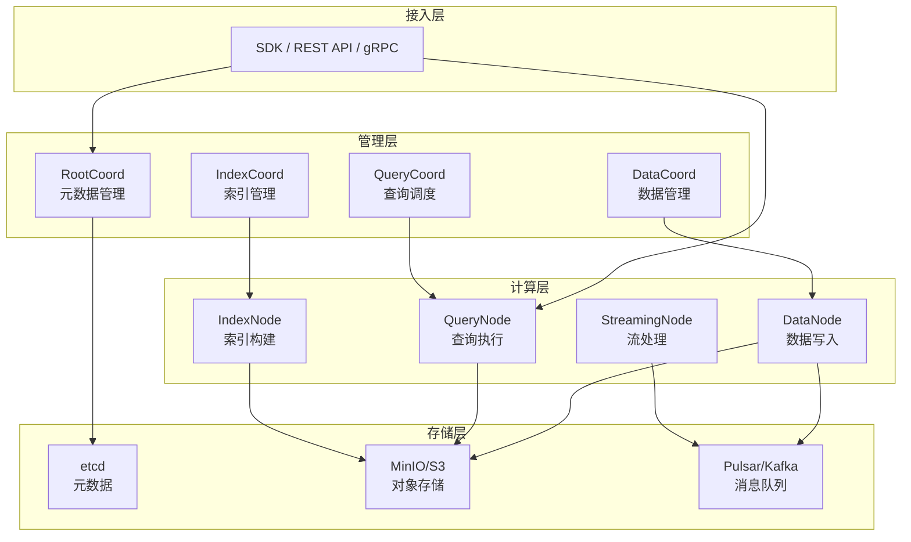
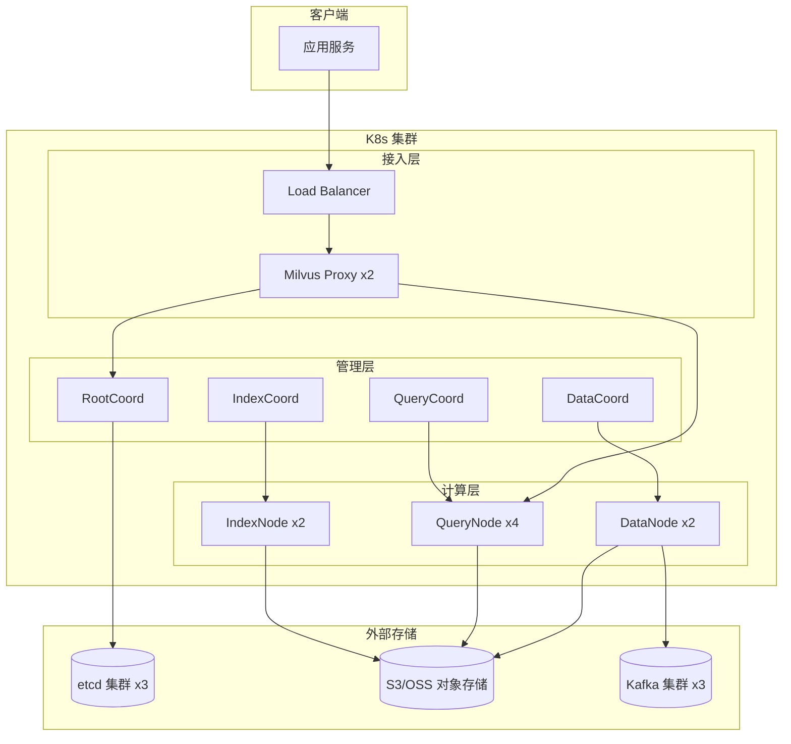
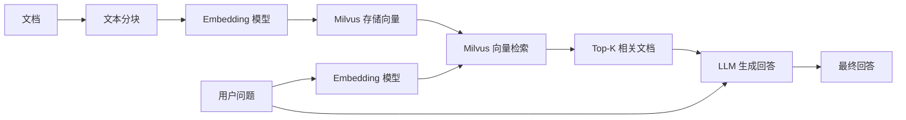

# Milvus 架构与部署

> **文档说明**：系统讲解 Milvus 向量数据库的核心架构（存算分离、分布式组件）、数据模型（Collection/Partition/Field/Index）、索引类型（IVF/HNSW/DiskANN/GPU 索引）、部署方式（Docker Compose/K8s/单机/集群）、性能调优、数据管理与备份，以及与 RAG 系统的集成实践和常见问题排查。
>
> **适用人群**：AI 应用架构师、全栈工程师、需要构建向量检索/RAG 系统的开发者
>
> **前置知识**：[[向量检索原理与ANN算法]]、[[向量库选型对比表]]、[[RAG架构设计与流程]]

---

## 一、概述

<div style="background:linear-gradient(135deg,#4facfe,#00f2fe);border-radius:16px;padding:20px;margin:16px 0;font-family:-apple-system,'Segoe UI','PingFang SC','Microsoft YaHei',sans-serif;color:#fff;overflow:hidden;box-shadow:0 8px 28px rgba(0,0,0,.14),0 3px 10px rgba(0,0,0,.08)">
<style>@keyframes highlight{0%,100%{box-shadow:0 0 0 rgba(255,255,255,0)}50%{box-shadow:0 0 20px rgba(255,255,255,.4)}}.hl-box{background:rgba(255,255,255,.2);border-radius:10px;padding:14px 18px;margin:10px 0;animation:highlight 3s ease-in-out infinite;border-left:4px solid rgba(255,255,255,.6)}.hl-formula{font-family:monospace;font-size:14px;text-align:center;background:rgba(0,0,0,.15);border-radius:8px;padding:12px;margin:10px 0}</style>
<div style="text-align:center;font-size:15px;font-weight:700;margin-bottom:14px;padding-bottom:10px;border-bottom:1.5px solid rgba(255,255,255,.22);letter-spacing:1px;text-shadow:0 1px 3px rgba(0,0,0,.12)">📌 Milvus 架构与部署</div>
<div class="hl-box">系统讲解 Milvus 向量数据库的核心架构（存算分离、分布式组件）、数据模型（Collection/Partition/Field/Index）、索引类型（IVF/HNSW/DiskANN/GPU 索引）、部署方式（Docker Compose/K8s/单机/集群）、性能调优、数据管理与备份，以及...</div>
<div class="hl-formula">Milvus 架构与部署 核心机制</div>
<div style="font-size:13px;opacity:.9;margin-top:8px">💡 掌握核心概念是理解 RAG 系统的关键第一步</div>
</div>

> 🔍 **知识点深度解析**
>
> **作用**：Milvus 架构与部署 是 RAG 系统中的关键组件，解决向量检索与知识增强中的核心问题，适用于需要高效语义搜索和知识增强的 AI 应用场景。
>
> **原理**：通过将文本转化为高维向量表示，利用向量空间中的相似度计算实现语义级检索，结合大模型生成能力完成知识增强问答。
>
> **用法要点**：① 选择合适的 Embedding 模型和向量维度 ② 合理配置检索参数（Top-K、相似度阈值） ③ 结合元数据过滤提升精准度 ④ 定期更新向量索引以保证数据一致性

**Milvus** 是由 Zilliz 开源的云原生向量数据库，专为海量向量数据的相似性检索而设计，支持十亿级向量的毫秒级检索，是目前最流行的开源向量数据库之一。

### 1. Milvus 是什么

| 特性 | 说明 |
|------|------|
| **类型** | 开源云原生向量数据库 |
| **出品方** | Zilliz（LF AI & Data 基金会毕业项目） |
| **语言** | Go（核心）+ C++（引擎）+ Python/Java/Go SDK |
| **许可证** | Apache 2.0 |
| **定位** | 生产级、高性能、可扩展的向量数据库 |
| **最新稳定版** | 2.5.x（2026） |

### 2. 核心特性

| 特性 | 说明 |
|------|------|
| **高性能** | 十亿级向量毫秒级检索，支持 GPU 加速 |
| **云原生** | 存算分离架构，K8s 原生部署，弹性扩缩容 |
| **分布式** | 无状态计算节点 + 分布式存储，水平扩展 |
| **多索引** | 支持 IVF、HNSW、DiskANN、GPU 索引等多种索引 |
| **混合检索** | 向量检索 + 标量过滤（布尔表达式） |
| **数据一致性** | 支持强一致/最终一致，事务性写入 |
| **多租户** | Database/Collection/Partition 多级隔离 |
| **动态 Schema** | 支持动态字段，灵活数据模型 |
| **TTL** | 支持数据自动过期 |
| **备份恢复** | 支持全量/增量备份与恢复 |

### 3. Milvus vs 其他向量库

| 维度 | Milvus | Qdrant | Weaviate | Pinecone | pgvector |
|------|--------|--------|----------|----------|----------|
| **类型** | 分布式向量库 | 单机/分布式 | 单机/分布式 | 托管 SaaS | PG 扩展 |
| **开源** | ✅ Apache 2.0 | ✅ Apache 2.0 | ✅ BSD-3 | ❌ 闭源 | ✅ PostgreSQL |
| **分布式** | ✅ 原生 | ⚠️ 有限 | ⚠️ 有限 | ✅ 托管 | ❌ |
| **GPU 加速** | ✅ | ❌ | ❌ | ✅ | ❌ |
| **十亿级** | ✅ | ⚠️ | ⚠️ | ✅ | ❌ |
| **混合检索** | ✅ | ✅ | ✅ | ✅ | ✅ |
| **标量过滤** | ✅ 丰富 | ✅ | ✅ | ✅ | ✅ SQL |
| **部署复杂度** | 中高 | 低 | 低 | 极低（托管） | 低 |
| **适用规模** | 大规模生产 | 中小规模 | 中小规模 | 任意规模 | 小规模 |

**选择建议**：
- **大规模生产、十亿级向量** → Milvus
- **中小规模、简单部署** → Qdrant / Weaviate
- **已有 PostgreSQL、向量数据少** → pgvector
- **不想运维、预算充足** → Pinecone

---

> 💡 **深度讲解**：Milvus 是目前最主流的开源分布式向量数据库，由 Zilliz 公司开发，2019 年开源，2021 年毕业于 LF AI & Data 基金会，是向量数据库领域的事实标准之一。Milvus 的核心定位是"云原生分布式向量数据库"——专为大规模向量检索设计，支持十亿级向量的毫秒级查询，具备水平扩展、高可用、容灾备份等企业级特性。Milvus 的适用场景：大规模 RAG 系统（百万级以上文档）、推荐系统（用户/物品向量召回）、图像/视频检索（以图搜图）、自然语言处理（语义搜索、问答系统）、异常检测（时序向量异常检测）。不适用场景：小规模原型开发（Milvus 部署复杂度高，Chroma/FAISS 更合适）、强事务需求（Milvus 是最终一致性，不支持 ACID 事务）、复杂关系查询（Milvus 是向量数据库，不擅长图遍历和关系查询）。Milvus 的核心优势：分布式架构（存算分离，支持水平扩展）、多种索引（HNSW、IVF、ANNOY、DiskANN 等）、丰富过滤（标量字段过滤、复合查询）、混合检索（向量+标量联合查询）、云原生（Kubernetes 部署、Operator 管理）、多语言 SDK（Python、Java、Go、Node.js 等）、高可用（多副本、故障自动转移）。Milvus 2.x 版本采用存算分离架构，分为访问层（Proxy）、协调服务层（RootCoord/QueryCoord/DataCoord/IndexCoord）、工作节点层（QueryNode/DataNode/IndexNode）、存储层（etcd 元数据、MinIO/S3 对象存储、Pulsar/Kafka 消息队列）。
>
> **📝 精简总结**：Milvus是最主流开源分布式向量数据库，LF AI毕业项目，定位云原生大规模向量检索，支持十亿级毫秒查询；适用大规模RAG/推荐/图像检索，不适用小规模原型/强事务/复杂关系；核心优势：分布式存算分离+多索引+丰富过滤+混合检索+云原生+多SDK+高可用；2.x存算分离四層架构。

## 二、核心架构

### 1. 存算分离架构

Milvus 采用**存算分离**的云原生架构，计算层无状态可水平扩展，存储层使用分布式对象存储。



### 2. 核心组件说明

| 组件 | 类型 | 职责 |
|------|------|------|
| **RootCoord** | 管理节点 | 元数据管理、Collection/Partition 创建删除、时间戳分配、数据定义 |
| **QueryCoord** | 管理节点 | 查询节点调度、负载均衡、Segment 加载/释放、查询资源管理 |
| **DataCoord** | 管理节点 | 数据节点管理、数据写入调度、Segment 管理、数据过期 |
| **IndexCoord** | 管理节点 | 索引节点管理、索引构建任务调度、索引元数据管理 |
| **QueryNode** | 计算节点 | 执行向量检索和标量查询，加载 Segment 到内存，无状态可扩展 |
| **DataNode** | 计算节点 | 消费消息队列中的数据，写入对象存储，构建增量数据，无状态 |
| **IndexNode** | 计算节点 | 构建向量索引（IVF/HNSW/DiskANN），CPU/GPU 加速，无状态 |
| **StreamingNode** | 计算节点 | 流处理，实时数据订阅与推送（2.4+ 新增） |
| **Proxy** | 接入层 | API 网关，请求路由、鉴权、限流、结果合并 |
| **etcd** | 存储 | 元数据存储（Collection/Schema/Segment 信息） |
| **MinIO/S3** | 存储 | 对象存储，持久化向量数据和索引文件 |
| **Pulsar/Kafka** | 存储 | 消息队列，数据写入的缓冲和日志 |

### 3. 数据写入流程

```text
客户端 → Proxy → Pulsar/Kafka（写入消息队列）
                                    ↓
                              DataNode 消费
                                    ↓
                         写入对象存储（MinIO/S3）
                                    ↓
                           生成 Segment（数据段）
                                    ↓
                         IndexNode 构建索引（异步）
                                    ↓
                         QueryCoord 加载 Segment
                                    ↓
                           QueryNode 可查询
```

### 4. 数据查询流程

```text
客户端 → Proxy → QueryCoord（路由到 QueryNode）
                        ↓
                  QueryNode 执行检索
                  （内存中 Segment 向量检索 + 标量过滤）
                        ↓
                  结果返回 Proxy 合并
                        ↓
                    返回客户端
```

---

## 三、数据模型

### 1. 核心概念

| 概念 | 说明 | 类比 |
|------|------|------|
| **Database** | 数据库，最高级隔离单元 | MySQL 的 Database |
| **Collection** | 集合，一组实体的容器 | MySQL 的 Table |
| **Partition** | 分区，Collection 的逻辑分片，可按标签隔离 | MySQL 的 Partition |
| **Entity/Row** | 实体/行，一条数据记录 | MySQL 的 Row |
| **Field** | 字段，实体的属性 | MySQL 的 Column |
| **Vector Field** | 向量字段，存储向量数据 | 特殊的 Column |
| **Scalar Field** | 标量字段，存储非向量数据（INT/VARCHAR/JSON/Bool） | 普通 Column |
| **Segment** | 数据段，Collection 的物理分片，数据按 Segment 组织 | 数据文件 |
| **Index** | 索引，加速向量检索的数据结构 | MySQL 的 Index |

### 2. 字段类型

| 类型 | 说明 | 示例 |
|------|------|------|
| **INT8/INT16/INT32/INT64** | 整数 | 1, 100, 9999 |
| **FLOAT/DOUBLE** | 浮点数 | 3.14, 2.718 |
| **VARCHAR** | 字符串（最大 65535） | "hello" |
| **BOOL** | 布尔值 | true/false |
| **JSON** | JSON 对象 | {"key": "value"} |
| **Array** | 数组（2.4+） | [1, 2, 3] |
| **FLOAT_VECTOR** | 浮点向量 | [0.1, 0.2, ...] |
| **BINARY_VECTOR** | 二值向量 | 0/1 数组 |
| **FP16_VECTOR** | 半精度浮点向量（2.4+） | 节省显存 |
| **BF16_VECTOR** | 脑浮点向量（2.4+） | 节省显存 |
| **SPARSE_FLOAT_VECTOR** | 稀疏向量（2.4+） | 适合文本检索 |

### 3. Schema 设计示例

```python
from pymilvus import CollectionSchema, FieldSchema, DataType

# 字段定义
book_id = FieldSchema(
    name="book_id",
    dtype=DataType.INT64,
    is_primary=True,
    auto_id=False
)

book_name = FieldSchema(
    name="book_name",
    dtype=DataType.VARCHAR,
    max_length=200
)

word_count = FieldSchema(
    name="word_count",
    dtype=DataType.INT64
)

book_intro = FieldSchema(
    name="book_intro",
    dtype=DataType.FLOAT_VECTOR,
    dim=768  # 向量维度
)

# Collection Schema
schema = CollectionSchema(
    fields=[book_id, book_name, word_count, book_intro],
    description="图书信息集合",
    enable_dynamic_field=True  # 启用动态字段
)
```

---

## 四、索引类型

### 1. 索引分类

| 类别 | 索引类型 | 说明 |
|------|---------|------|
| **浮点向量索引** | IVF_FLAT, IVF_SQ8, IVF_PQ | 倒排文件索引 |
| | HNSW | 层次化导航小世界图 |
| | DISKANN | 磁盘友好的图索引 |
| | SCANN | 可扩展最近邻搜索 |
| **二值向量索引** | BIN_FLAT, BIN_IVF | 二值向量索引 |
| **GPU 索引** | GPU_IVF_FLAT, GPU_IVF_PQ, GPU_CAGRA | GPU 加速索引 |
| **稀疏向量索引** | SPARSE_INVERTED_INDEX, SPARSE_WAND | 稀疏向量索引（2.4+） |

### 2. 常用索引对比

| 索引 | 类型 | 内存占用 | 检索速度 | 召回率 | 构建速度 | 适用场景 |
|------|------|---------|---------|--------|---------|---------|
| **FLAT** | 暴力 | 高 | 慢（小数据快） | 100% | 快 | 数据量小（<100万）、需精确 |
| **IVF_FLAT** | 倒排 | 中 | 快 | 可调 | 中 | 通用、内存充足 |
| **IVF_SQ8** | 倒排+量化 | 低（1/4） | 快 | 略降 | 中 | 内存有限、可接受精度损失 |
| **IVF_PQ** | 倒排+乘积量化 | 极低（1/16+） | 快 | 较低 | 慢 | 超大规模、内存极有限 |
| **HNSW** | 图 | 高 | 极快 | 高 | 慢 | 低延迟、高召回、内存充足 |
| **DISKANN** | 图+磁盘 | 低 | 较快 | 高 | 慢 | 超大规模、内存有限、SSD |
| **GPU_IVF_FLAT** | GPU倒排 | 中 | 极快 | 可调 | 中 | 有 GPU、高吞吐 |
| **GPU_CAGRA** | GPU图 | 高 | 极快 | 高 | 慢 | 有 GPU、低延迟高召回 |

### 3. 索引参数详解

**IVF 系列参数**：
| 参数 | 说明 | 推荐值 |
|------|------|--------|
| `nlist` | 聚类中心数（桶数） | 数据量平方根，如 1亿→10000 |
| `nprobe` | 查询时扫描的桶数 | 10-100（越大越准越慢） |
| `m` | PQ 子向量数（IVF_PQ） | 8-64（需被维度整除） |
| `nbits` | PQ 每个子向量比特数 | 8（默认） |

**HNSW 参数**：
| 参数 | 说明 | 推荐值 |
|------|------|--------|
| `M` | 每层最大连接数 | 16-64（越大越准越耗内存） |
| `efConstruction` | 构建时搜索宽度 | 200-500（越大构建越慢索引越好） |
| `ef` | 查询时搜索宽度 | 64-512（越大越准越慢） |

**DISKANN 参数**：
| 参数 | 说明 | 推荐值 |
|------|------|--------|
| `search_list` | 搜索列表大小 | 100-500 |
| `search_length** | 构建时搜索长度 | 30-100 |
| `out_degree** | 出度 | 2-8 |

### 4. 索引选择决策

```text
数据量 < 100万？
├─ 是 → FLAT（精确检索，简单）
└─ 否 → 内存是否充足？
    ├─ 是 → 延迟要求高？
    │   ├─ 是 → HNSW（低延迟高召回）
    │   └─ 否 → IVF_FLAT（通用均衡）
    └─ 否 → 有 SSD？
        ├─ 是 → DISKANN（磁盘友好）
        └─ 否 → IVF_PQ / IVF_SQ8（极致压缩）
```

---

## 五、部署方式

### 1. Docker Compose 单机部署（开发测试）

```bash
# 下载 Milvus 单机版 docker-compose
wget https://github.com/milvus-io/milvus/releases/download/v2.5.0/milvus-standalone-docker-compose.yml -O docker-compose.yml

# 启动
docker compose up -d

# 查看状态
docker compose ps

# 停止
docker compose down
```

**docker-compose.yml 包含**：
- `milvus-standalone`：Milvus 单机服务（整合所有组件）
- `etcd`：元数据存储
- `minio`：对象存储

**端口**：
- `19530`：gRPC 端口（SDK 连接）
- `9091`：Metrics 端口（Prometheus）
- `9000`：MinIO 控制台

### 2. Docker Compose 集群部署（小规模生产）

```bash
# 下载集群版
wget https://github.com/milvus-io/milvus/releases/download/v2.5.0/milvus-cluster-docker-compose.yml -O docker-compose.yml

docker compose up -d
```

**集群版组件**：
- `milvus-proxy`：API 网关
- `milvus-rootcoord`、`milvus-querycoord`、`milvus-datacoord`、`milvus-indexcoord`：管理节点
- `milvus-querynode`、`milvus-datanode`、`milvus-indexnode`：计算节点
- `etcd`、`minio`、`pulsar`：存储依赖

### 3. Kubernetes 部署（生产推荐）

## 添加 Helm 仓库
```bash
helm repo add milvus https://zilliztech.github.io/milvus-helm/
helm repo update
```

## 安装 Milvus 集群版
```bash
helm install my-milvus milvus/milvus \
  --set cluster.enabled=true \
  --set persistence.enabled=true \
  --set persistence.persistentVolumeClaim.storageClassName=standard \
  --set etcd.persistence.storageClass=standard \
  --set minio.persistence.storageClass=standard \
  --set pulsar.persistence.storageClass=standard \
  --namespace milvus \
```
  --create-namespace

```bash
# 查看 Pod
kubectl get pods -n milvus
```

```bash
# 端口转发
kubectl port-forward service/my-milvus 19530:19530 -n milvus
```

**K8s 关键配置**：
| 配置 | 说明 |
|------|------|
| `cluster.enabled` | 是否启用集群模式 |
| `queryNode.replicas` | 查询节点副本数 |
| `dataNode.replicas` | 数据节点副本数 |
| `indexNode.replicas` | 索引节点副本数 |
| `proxy.replicas` | Proxy 副本数 |
| `persistence.enabled` | 是否启用持久化存储 |
| `externalEtcd.enabled` | 使用外部 etcd |
| `externalS3.enabled` | 使用外部 S3 存储 |
| `externalKafka.enabled` | 使用外部 Kafka |

### 4. 生产级部署架构



**生产环境建议**：
- 使用**外部 etcd 集群**（3 节点），不使用内置
- 使用**外部对象存储**（S3/OSS/MinIO 集群），不使用内置
- 使用**外部 Kafka/Pulsar 集群**（3 节点），不使用内置
- QueryNode 根据查询负载**水平扩展**
- 启用**持久化存储**，使用 SSD
- 配置**资源限制**（CPU/内存/GPU）
- 启用**监控**（Prometheus + Grafana）

---

## 六、Python SDK 实战

### 1. 连接 Milvus

```python
from pymilvus import connections, utility

# 连接
connections.connect(
    alias="default",
    host="localhost",
    port="19530",
    # user="root",
    # password="Milvus",
    # db_name="default"
)

# 检查连接
print(utility.list_collections())
```

### 2. 创建 Collection

```python
from pymilvus import Collection, CollectionSchema, FieldSchema, DataType

# 定义字段
fields = [
    FieldSchema(name="id", dtype=DataType.INT64, is_primary=True, auto_id=True),
    FieldSchema(name="title", dtype=DataType.VARCHAR, max_length=500),
    FieldSchema(name="content", dtype=DataType.VARCHAR, max_length=10000),
    FieldSchema(name="category", dtype=DataType.VARCHAR, max_length=100),
    FieldSchema(name="create_time", dtype=DataType.INT64),
    FieldSchema(name="embedding", dtype=DataType.FLOAT_VECTOR, dim=1024),
]

# 创建 Schema
schema = CollectionSchema(
    fields=fields,
    description="文档知识库",
    enable_dynamic_field=True
)

# 创建 Collection
collection = Collection(
    name="documents",
    schema=schema,
    using="default",
    # shards_num=2,  # 分片数
    # consistency_level="Bounded"  # 一致性级别
)

# 创建分区
collection.create_partition("tech")
collection.create_partition("finance")
```

### 3. 插入数据

```python
import numpy as np

# 准备数据
data = [
    ["文档1标题", "文档2标题"],  # title
    ["文档1内容...", "文档2内容..."],  # content
    ["tech", "finance"],  # category
    [1700000000, 1700000001],  # create_time
    np.random.random((2, 1024)).tolist(),  # embedding
]

# 插入
collection.insert(data)

# 刷新（确保数据可查询）
collection.flush()
```

### 4. 创建索引

```css
# HNSW 索引参数
index_params = {
```
    "index_type": "HNSW",
    "metric_type": "COSINE",  # 距离度量：L2/IP/COSINE
    "params": {
        "M": 32,
        "efConstruction": 400
```text
    }
}
```

```css
# 创建索引
collection.create_index(
```
```text
    field_name="embedding",
    index_params=index_params
```
)

```css
# 标量字段索引（加速过滤）
collection.create_index(
```
```text
    field_name="category",
    index_name="category_idx"
```
)

### 5. 加载与检索

```python
# 加载 Collection 到内存
collection.load()

# 向量检索
search_params = {
    "metric_type": "COSINE",
    "params": {"ef": 256}  # HNSW 查询参数
}

query_vector = np.random.random(1024).tolist()

results = collection.search(
    data=[query_vector],
    anns_field="embedding",
    param=search_params,
    limit=10,
    expr="category == 'tech'",  # 标量过滤
    output_fields=["title", "content", "category"],
    consistency_level="Bounded"
)

# 解析结果
for hits in results:
    for hit in hits:
        print(f"ID: {hit.id}, 距离: {hit.distance:.4f}")
        print(f"标题: {hit.entity.get('title')}")
        print(f"内容: {hit.entity.get('content')[:100]}")
```

### 6. 混合检索（向量+标量）

## 向量检索 + 标量过滤
```text
results = collection.search(
    data=[query_vector],
    anns_field="embedding",
    param=search_params,
    limit=10,
    expr="category == 'tech' and create_time > 1700000000",
    output_fields=["title", "category"]
```
)

## 标量查询（非向量）
```text
results = collection.query(
    expr="category == 'tech'",
    output_fields=["id", "title", "create_time"],
    limit=100
```
)

### 7. 数据管理

```python
# 删除数据
collection.delete(expr="id in [1, 2, 3]")

# 更新数据（先删后插，或使用 upsert）
collection.upsert(data)

# 释放内存（不删除数据）
collection.release()

# 删除 Collection
utility.drop_collection("documents")

# 查看 Collection 信息
print(collection.num_entities)  # 实体数量
print(collection.schema)  # Schema
```

---

## 七、性能调优

### 1. 硬件配置建议

| 规模 | 向量数 | QueryNode | 内存 | GPU | 存储 |
|------|--------|-----------|------|-----|------|
| 小型 | < 1000万 | 1 | 16-32GB | 可选 | 100GB SSD |
| 中型 | 1000万-1亿 | 2-4 | 64-128GB | 推荐 | 500GB-1TB SSD |
| 大型 | 1亿-10亿 | 4-8 | 256-512GB | 推荐 | 2-5TB NVMe |
| 超大型 | > 10亿 | 8+ | 512GB+ | 必须 | 5TB+ NVMe |

### 2. 索引调优

| 调优项 | 建议 |
|--------|------|
| **索引类型** | 根据数据量和内存选择（参考索引选择决策） |
| **nlist（IVF）** | 数据量的平方根，1亿→10000 |
| **nprobe（IVF）** | 从 10 开始，逐步增加直到召回率达标 |
| **M（HNSW）** | 16-64，内存充足选大值 |
| **efConstruction（HNSW）** | 200-500，构建慢但索引质量高 |
| **ef（HNSW 查询）** | 64-512，根据延迟和召回率权衡 |
| **metric_type** | 文本用 COSINE，通用用 L2，归一化后用 IP |

### 3. 查询调优

| 调优项 | 建议 |
|--------|------|
| **一致性级别** | 生产用 Bounded（默认），强一致用 Strong（慢） |
| **分区裁剪** | 查询时指定 partition_names，减少扫描范围 |
| **标量过滤** | 过滤性强的条件放 expr，利用标量索引 |
| **limit** | 只取需要的数量，避免取过多 |
| **output_fields** | 只取需要的字段，减少数据传输 |
| **批量查询** | 一次 search 传多个 query 向量，提升吞吐 |
| **预热** | 系统启动后先执行一些查询预热缓存 |

### 4. 写入调优

| 调优项 | 建议 |
|--------|------|
| **批量插入** | 每次插入 1000-10000 条，减少 RPC 次数 |
| **分片数** | shards_num 根据写入并发设置，通常 2-16 |
| **DataNode 数量** | 高写入场景增加 DataNode 副本 |
| **异步刷盘** | 不需要立即可查时，不调用 flush |
| **索引构建时机** | 数据全部导入后再建索引，避免重复构建 |

### 5. 内存管理

| 配置 | 说明 |
|------|------|
| `queryNode.gracefulTime` | 优雅停止时间 |
| `queryNode.overloadedMemoryThreshold` | 内存过载阈值（默认 90%） |
| `common.retentionDuration** | 数据保留时间 |
| `dataCoord.segment.maxSize** | Segment 最大大小（默认 512MB） |
| `queryCoord.autoLoadBalance** | 自动负载均衡 |

---

## 八、RAG 集成实践

### 1. RAG 系统中的 Milvus



### 2. 完整 RAG 示例

```python
from pymilvus import connections, Collection, FieldSchema, CollectionSchema, DataType
from sentence_transformers import SentenceTransformer
import numpy as np

# 1. 连接 Milvus
connections.connect(host="localhost", port="19530")

# 2. 加载 Embedding 模型
model = SentenceTransformer('BAAI/bge-large-zh-v1.5')

# 3. 定义 Collection
fields = [
    FieldSchema(name="id", dtype=DataType.INT64, is_primary=True, auto_id=True),
    FieldSchema(name="text", dtype=DataType.VARCHAR, max_length=10000),
    FieldSchema(name="source", dtype=DataType.VARCHAR, max_length=500),
    FieldSchema(name="chunk_index", dtype=DataType.INT64),
    FieldSchema(name="embedding", dtype=DataType.FLOAT_VECTOR, dim=1024),
]
schema = CollectionSchema(fields=fields, description="RAG 知识库")
collection = Collection("rag_knowledge", schema)

# 4. 文档分块与入库
documents = [
    {"text": "Milvus 是一个向量数据库...", "source": "milvus_doc.md", "chunk_index": 0},
    {"text": "HNSW 是一种图索引算法...", "source": "index_doc.md", "chunk_index": 0},
    # ... 更多文档
]

for doc in documents:
    embedding = model.encode(doc["text"]).tolist()
    collection.insert([
        [doc["text"]],
        [doc["source"]],
        [doc["chunk_index"]],
        [embedding]
    ])

# 5. 创建索引并加载
collection.create_index("embedding", {
    "index_type": "HNSW",
    "metric_type": "COSINE",
    "params": {"M": 32, "efConstruction": 400}
})
collection.load()

# 6. 检索与生成
def rag_query(question, top_k=5):
    # 问题向量化
    query_embedding = model.encode(question).tolist()

    # 向量检索
    results = collection.search(
        data=[query_embedding],
        anns_field="embedding",
        param={"metric_type": "COSINE", "params": {"ef": 256}},
        limit=top_k,
        output_fields=["text", "source"]
    )

    # 构建上下文
    context = "\n\n".join([
        f"[来源: {hit.entity.get('source')}]\n{hit.entity.get('text')}"
        for hit in results[0]
    ])

    # 构建 Prompt
    prompt = f"""请根据以下上下文回答问题。如果上下文中没有相关信息，请回答"根据现有资料无法回答"。

上下文：
{context}

问题：{question}

回答："""

    # 调用 LLM（此处用 OpenAI 兼容 API）
    from openai import OpenAI
    client = OpenAI(base_url="http://localhost:8000/v1", api_key="key")
    response = client.chat.completions.create(
        model="qwen2.5-72b",
        messages=[{"role": "user", "content": prompt}],
        temperature=0.3
    )

    return response.choices[0].message.content, results[0]

# 使用
answer, sources = rag_query("Milvus 支持哪些索引类型？")
print(answer)
```

---

## 九、常见问题与排查

| 问题 | 原因 | 解决方案 |
|------|------|---------|
| 连接超时 | 服务未启动 / 端口错误 / 防火墙 | 检查服务状态、端口 19530、防火墙规则 |
| Collection 创建失败 | 字段类型错误 / 维度不匹配 / 名称重复 | 检查 Schema、向量维度、Collection 名称 |
| 插入失败 | 字段数量不匹配 / 数据类型错误 / 向量维度错误 | 检查插入数据与 Schema 是否一致 |
| 索引构建失败 | 索引类型不支持 / 参数错误 / 内存不足 | 检查索引类型和参数、增加内存 |
| 查询无结果 | Collection 未加载 / 数据未刷新 / 过滤条件错误 | collection.load()、flush()、检查 expr |
| 查询慢 | 索引未创建 / ef/nprobe 太小 / 数据量太大 | 创建索引、调大 ef/nprobe、优化硬件 |
| 召回率低 | ef/nprobe 太小 / 索引类型不合适 / 向量质量差 | 调大 ef/nprobe、换索引、优化 Embedding |
| OOM（内存溢出） | 数据量太大 / HNSW 内存占用高 / QueryNode 内存不足 | 换 IVF_PQ/DISKANN、增加内存、减少加载 |
| 写入慢 | 单条插入 / DataNode 不足 / 消息队列瓶颈 | 批量插入、增加 DataNode、优化 Kafka |
| 数据不一致 | 一致性级别设置 / 未 flush / 主从延迟 | 使用 Strong 一致性、flush 后查询 |
| 端口冲突 | 19530 被占用 | 修改端口或停止占用进程 |
| etcd 连接失败 | etcd 未启动 / 地址错误 | 检查 etcd 状态和配置 |
| MinIO 连接失败 | MinIO 未启动 / 凭证错误 | 检查 MinIO 状态和 AccessKey |
| GPU 索引不可用 | 未安装 GPU 版本 / 无 GPU 硬件 | 使用 GPU 镜像、确认 GPU 驱动 |
| 升级后数据丢失 | 版本不兼容 / 未备份 | 升级前备份、查阅升级指南 |
| 删除 Collection 后空间未释放 | 后台异步清理 / 对象存储垃圾回收 | 等待后台清理、手动触发 compaction |

---

## 🔗 关联笔记

- [[向量库选型对比表]] — 向量数据库选型对比
- [[向量检索算法-HNSW-IVF]] — Milvus 支持的索引算法原理
- [[Qdrant-高性能向量检索]] — Milvus 的主要竞品对比
- [[RAG检索增强生成]] — RAG 系统的向量存储选型
- [[RAG架构设计与流程]] — RAG 架构中向量库的位置

## 📖 前置知识

- [[向量检索算法-HNSW-IVF]]
- [[向量库选型对比表]]

## 🏷️ 相关标签

`#AI应用` `#RAG` `#向量数据库` `#AI工程化`

---

[[Home|🏠 返回首页]] · [[MOC-AI与效率工具|📚 AI与效率工具]] · [[MOC-AI工程化|🤖 AI工程化]]