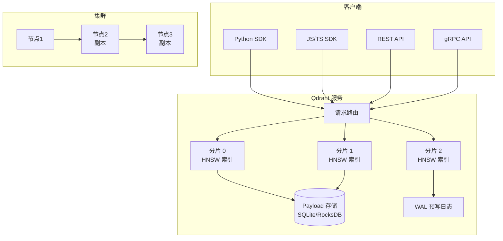

# Qdrant 高性能向量检索

> **文档说明**：系统讲解 Qdrant 开源高性能向量数据库，涵盖核心架构（Rust 编写、HNSW 索引、分片复制）、Collection 与 Payload 设计、距离度量、过滤检索（Payload Filter）、混合检索（向量+全文+稀疏）、量化压缩（Scalar/Binary/Product Quantization）、分布式集群部署、与 LangChain/Dify 集成、性能基准，含可运行的 Docker 部署、Python SDK 代码、RAG 完整示例和生产调优指南。
>
> **适用人群**：AI 应用开发者、需要构建大规模向量检索服务的全栈工程师、从 Chroma/PgVector 升级到生产级向量库的技术团队
>
> **前置知识**：[[RAG架构设计与流程]]、[[向量检索算法-HNSW-IVF]]、[[PgVector-PostgreSQL向量扩展]]

---

## 一、概述

<div style="background:linear-gradient(135deg,#4facfe,#00f2fe);border-radius:16px;padding:20px;margin:16px 0;font-family:-apple-system,'Segoe UI','PingFang SC','Microsoft YaHei',sans-serif;color:#fff;overflow:hidden;box-shadow:0 8px 28px rgba(0,0,0,.14),0 3px 10px rgba(0,0,0,.08)">
<style>@keyframes highlight{0%,100%{box-shadow:0 0 0 rgba(255,255,255,0)}50%{box-shadow:0 0 20px rgba(255,255,255,.4)}}.hl-box{background:rgba(255,255,255,.2);border-radius:10px;padding:14px 18px;margin:10px 0;animation:highlight 3s ease-in-out infinite;border-left:4px solid rgba(255,255,255,.6)}.hl-formula{font-family:monospace;font-size:14px;text-align:center;background:rgba(0,0,0,.15);border-radius:8px;padding:12px;margin:10px 0}</style>
<div style="text-align:center;font-size:15px;font-weight:700;margin-bottom:14px;padding-bottom:10px;border-bottom:1.5px solid rgba(255,255,255,.22);letter-spacing:1px;text-shadow:0 1px 3px rgba(0,0,0,.12)">📌 Qdrant 高性能向量检索</div>
<div class="hl-box">系统讲解 Qdrant 开源高性能向量数据库，涵盖核心架构（Rust 编写、HNSW 索引、分片复制）、Collection 与 Payload 设计、距离度量、过滤检索（Payload Filter）、混合检索（向量+全文+稀疏）、量化压缩（Scalar/Binary/Product Quanti...</div>
<div class="hl-formula">文本 → Embedding → 向量存储 → 相似度计算 → Top-K检索</div>
<div style="font-size:13px;opacity:.9;margin-top:8px">💡 掌握核心概念是理解 RAG 系统的关键第一步</div>
</div>

> 🔍 **知识点深度解析**
>
> **作用**：Qdrant 高性能向量检索 是 RAG 系统中的关键组件，解决向量检索与知识增强中的核心问题，适用于需要高效语义搜索和知识增强的 AI 应用场景。
>
> **原理**：通过将文本转化为高维向量表示，利用向量空间中的相似度计算实现语义级检索，结合大模型生成能力完成知识增强问答。
>
> **用法要点**：① 选择合适的 Embedding 模型和向量维度 ② 合理配置检索参数（Top-K、相似度阈值） ③ 结合元数据过滤提升精准度 ④ 定期更新向量索引以保证数据一致性

**Qdrant** 是一个用 Rust 编写的开源高性能向量数据库，专为生产级向量检索设计。Qdrant 的核心优势是**性能和可扩展性**——HNSW 索引 + Rust 实现带来毫秒级查询延迟，支持亿级向量，内置分片和复制实现高可用，丰富的 Payload 过滤和混合检索能力使其成为生产环境向量数据库的首选之一。

### 1. Qdrant 解决了什么问题

| 痛点（轻量向量库） | Qdrant 解决的问题 |
|-----------------|-----------------|
| 百万级向量后查询变慢 | Rust + HNSW 优化，亿级向量仍保持毫秒级查询 |
| 元数据过滤能力弱 | 强大的 Payload Filter（类 SQL 条件，支持范围/全文/地理） |
| 无法水平扩展 | 内置分片（Sharding）和复制（Replication），支持集群 |
| 高并发下不稳定 | Rust 内存安全 + 异步 IO，支持高并发读写 |
| 向量占用显存/内存大 | 内置量化（Scalar/Binary/PQ），压缩 4-10 倍 |
| 混合检索需要自己实现 | 原生支持向量+全文+稀疏向量混合检索 |
| 生产部署缺乏监控 | 内置 Prometheus 指标、健康检查、分布式一致性 |

### 2. Qdrant 架构



### 3. Qdrant vs 其他向量库

| 维度 | Qdrant | Chroma | PgVector | Milvus |
|------|--------|--------|----------|--------|
| **语言** | Rust | Python | C（PG扩展） | C++/Go |
| **部署** | Docker/二进制 | 嵌入式/Docker | PostgreSQL 扩展 | Docker/K8s |
| **索引** | HNSW | HNSW | HNSW/IVFFlat | HNSW/IVF/DiskANN |
| **过滤** | 强（Payload Filter） | 基础 | 强（SQL） | 强 |
| **量化** | Scalar/Binary/PQ | 有限 | 无 | 多种 |
| **分布式** | ✅ 分片+复制 | ❌ | ❌（PG 分区） | ✅ |
| **混合检索** | ✅ 向量+全文+稀疏 | ❌ | ✅（+PG FTS） | ✅ |
| **性能** | 极高 | 中 | 中 | 极高 |
| **适用规模** | 亿级 | 百万级 | 千万级 | 十亿级 |
| **学习曲线** | 中 | 最低 | 低（会SQL） | 较陡 |

---

> 💡 **深度讲解**：Qdrant 是用 Rust 编写的高性能向量数据库，2021 年开源，以"高性能、丰富过滤、易用性"为核心卖点，是目前增长最快的向量数据库之一。Qdrant 的核心优势：Rust 实现（内存安全、高性能、低资源占用）、丰富的过滤检索（支持嵌套过滤、范围查询、地理空间过滤，过滤性能优于 Milvus）、量化支持（标量量化 SQ、乘积量化 PQ、二值量化 BQ，减少内存占用）、HNSW 索引（高性能图索引，支持动态更新）、混合检索（向量+稀疏向量 BM25，内置支持）、云原生部署（Docker、Kubernetes、Helm Chart）、多语言 SDK（Python、TypeScript、Go、Rust、Java 等）、REST + gRPC API（REST 易用，gRPC 高性能）。Qdrant 的适用场景：中大规模 RAG 系统（万到千万级向量）、需要丰富过滤的检索（电商商品搜索、内容推荐）、资源受限环境（Rust 低内存占用，适合边缘部署）、混合检索需求（向量+关键词联合检索）。与 Milvus 的对比：Qdrant 部署更简单（单二进制或 Docker，Milvus 需要 etcd+MinIO+Pulsar 等组件）、过滤性能更好（Qdrant 的 payload 索引设计更高效）、Rust 实现更安全（无 GC 停顿，延迟更稳定）；Milvus 分布式能力更强（存算分离，支持超大规模）、索引类型更丰富（HNSW/IVF/ANNOY/DiskANN）、生态更成熟（LF AI 毕业项目，企业用户更多）。选型建议：中小规模团队、注重部署简单和过滤性能选 Qdrant；超大规模、需要完整分布式能力选 Milvus。Qdrant Cloud 提供全托管服务，适合不想运维的团队。
>
> **📝 精简总结**：Qdrant是Rust编写的高性能向量数据库，核心优势：Rust(内存安全/低资源/无GC停顿)+丰富过滤(嵌套/范围/地理，优于Milvus)+量化(SQ/PQ/BQ)+HNSW+混合检索(内置BM25)+云原生+多SDK+REST/gRPC；适用中大规模RAG/丰富过滤/资源受限/混合检索；vs Milvus：Qdrant部署简单过滤好，Milvus分布式强索引多；中小选Qdrant，超大选Milvus。

## 二、底层原理

### 1. Collection 与 Vector

Qdrant 的核心数据模型：

| 概念 | 说明 |
|------|------|
| **Collection** | 向量集合，相当于表，有独立的配置（向量维度、距离、索引参数） |
| **Point** | 向量数据点，包含 id、vector、payload |
| **Vector** | 浮点数组，维度在 Collection 创建时固定 |
| **Payload** | JSON 格式的元数据，可建索引用于过滤 |
| **Named Vector** | 一个 Point 可以有多个命名字段的向量（多模态） |

### 2. 距离度量

| 度量 | 参数名 | 适用场景 |
|------|--------|---------|
| **Cosine** | `Cosine` | 文本语义检索（最常用，自动归一化） |
| **Euclid** | `Euclid` | L2 距离，图像、通用 |
| **Dot** | `Dot` | 内积，已归一化向量的快速检索 |
| **Manhattan** | `Manhattan` | L1 距离，特殊场景 |

### 3. HNSW 索引参数

Qdrant 的 HNSW 实现有丰富的调优参数：

| 参数 | 默认值 | 说明 |
|------|--------|------|
| `m` | 16 | 每层最大连接数，越大内存越高、召回越好 |
| `ef_construct` | 100 | 构建时搜索广度，越大构建越慢索引越精确 |
| `ef_search` | 16 | 查询时搜索广度，可在查询时动态覆盖 |
| `full_scan_threshold` | 10000 | 小于此数量的点直接全量扫描（小集合更快） |
| `max_indexing_threads` | 0（auto） | 索引构建线程数 |
| `on_disk` | false | 索引是否存磁盘（省内存，稍慢） |

### 4. Payload 过滤

Qdrant 的过滤语法类似 MongoDB：

```json
{
  "must": [
    {"key": "category", "match": {"value": "技术"}},
    {"key": "date", "range": {"gte": "2026-01-01"}}
  ],
  "should": [
    {"key": "author", "match": {"value": "张三"}},
    {"key": "tags", "match": {"any": ["AI", "RAG"]}}
  ],
  "must_not": [
    {"key": "status", "match": {"value": "draft"}}
  ]
}
```

支持的过滤操作：`match`（精确/任意匹配）、`range`（范围）、`geo_bounding_box`/`geo_radius`（地理）、`text`（全文）、`is_empty`/`is_null`、`values_count`（数组长度）。

### 5. 量化压缩

Qdrant 支持三种量化，可在不重建索引的情况下启用：

| 量化类型 | 压缩比 | 质量损失 | 说明 |
|---------|--------|---------|------|
| **Scalar Quantization** | 2x（FP32→INT8） | < 1% | 标量量化，最简单，推荐首选 |
| **Binary Quantization** | 4-8x | 1-3% | 二值量化，极速，适合粗排 |
| **Product Quantization (PQ)** | 4-10x | 2-5% | 乘积量化，压缩比最高 |
| **Scalar + OnDisk** | 4x+ | < 2% | 标量量化 + 磁盘存储 |

---

---

> 💡 **深度讲解**：本节围绕，深入剖析其技术原理与实践要点，帮助读者建立系统性的认知框架。
>
> **📝 精简总结**：本节介绍了，掌握这些内容是理解整个知识体系的重要基础。

## 三、实操

### 1. Docker 部署

```bash
# 单节点部署
docker run -d \
  --name qdrant \
  -p 6333:6333 \
  -p 6334:6334 \
  -v ./qdrant_data:/qdrant/storage \
  -e QDRANT__SERVICE__GRPC_PORT=6334 \
  qdrant/qdrant:latest

# 带认证和配置的部署
docker run -d \
  --name qdrant \
  -p 6333:6333 \
  -v ./qdrant_data:/qdrant/storage \
  -v ./qdrant_config:/qdrant/config \
  -e QDRANT__SERVICE__API_KEY=your-secret-key \
  -e QDRANT__SERVICE__READ_API_KEY=your-read-key \
  qdrant/qdrant:latest

# 验证
curl http://localhost:6333/health
# 输出: {"title":"qdrant - vector search engine","version":"1.x.x"}
```

```yaml
# docker-compose.yml — 生产部署
services:
  qdrant:
    image: qdrant/qdrant:v1.12
    ports:
      - "6333:6333"   # REST
      - "6334:6334"   # gRPC
    volumes:
      - qdrant_storage:/qdrant/storage
      - ./qdrant_config.yaml:/qdrant/config/production.yaml
    environment:
      - QDRANT__SERVICE__API_KEY=${QDRANT_API_KEY}
    ulimits:
      nofile:
        soft: 65536
        hard: 65536
    restart: unless-stopped
    healthcheck:
      test: ["CMD", "curl", "-f", "http://localhost:6333/health"]
      interval: 30s
      timeout: 5s
      retries: 3

volumes:
  qdrant_storage:
```

### 2. Python SDK 基础操作

```python
# app/qdrant_store.py — Qdrant 向量存储
from qdrant_client import QdrantClient
from qdrant_client.http import models
from qdrant_client.models import Distance, VectorParams, PointStruct, Filter, FieldCondition, MatchValue
from openai import OpenAI
import uuid

client = OpenAI()

# 连接 Qdrant
qdrant = QdrantClient(
    url="http://localhost:6333",
    api_key="your-secret-key",  # 可选
    prefer_grpc=True,  # 优先用 gRPC（更快）
)

COLLECTION_NAME = "tech_docs"
EMBEDDING_DIM = 1536


def create_collection():
    """创建 Collection（带 HNSW 配置和量化）"""
    # 先删除已存在的（开发环境）
    if qdrant.collection_exists(COLLECTION_NAME):
        qdrant.delete_collection(COLLECTION_NAME)

    qdrant.create_collection(
        collection_name=COLLECTION_NAME,
        vectors_config=VectorParams(
            size=EMBEDDING_DIM,
            distance=Distance.COSINE,
            on_disk=False,  # 内存索引（快）
        ),
        # HNSW 索引配置
        hnsw_config=models.HnswConfigDiff(
            m=16,
            ef_construct=128,
            full_scan_threshold=10000,
        ),
        # 量化配置（可选，省内存）
        quantization_config=models.ScalarQuantization(
            scalar=models.ScalarQuantizationConfig(
                type=models.ScalarType.INT8,
                quantile=0.99,
                always_ram=True,
            )
        ),
        # 优化器配置
        optimizers_config=models.OptimizersConfigDiff(
            indexing_threshold=1000,  # 超过1000条开始建索引
            memmap_threshold=50000,
        ),
    )

    # 为 Payload 字段建索引（加速过滤）
    qdrant.create_payload_index(
        collection_name=COLLECTION_NAME,
        field_name="category",
        field_schema=models.PayloadSchemaType.KEYWORD,
    )
    qdrant.create_payload_index(
        collection_name=COLLECTION_NAME,
        field_name="created_at",
        field_schema=models.PayloadSchemaType.DATETIME,
    )
    print(f"Collection '{COLLECTION_NAME}' 创建成功")


def embed(text: str) -> list[float]:
    resp = client.embeddings.create(model="text-embedding-3-small", input=text)
    return resp.data[0].embedding


def add_documents(docs: list[dict]):
    """批量添加文档"""
    points = []
    for doc in docs:
        points.append(PointStruct(
            id=str(uuid.uuid4()),
            vector=embed(doc["content"]),
            payload={
                "content": doc["content"],
                "category": doc.get("category", "general"),
                "author": doc.get("author", "unknown"),
                "source": doc.get("source", ""),
                "tags": doc.get("tags", []),
            },
        ))
    # 批量插入（Qdrant 自动处理大批量）
    qdrant.upsert(collection_name=COLLECTION_NAME, points=points, wait=True)
    print(f"已插入 {len(points)} 条")


def search(query: str, k: int = 5, category: str = None,
           min_score: float = 0.7) -> list[dict]:
    """语义检索（带过滤和分数阈值）"""
    query_filter = None
    if category:
        query_filter = Filter(
            must=[FieldCondition(key="category", match=MatchValue(value=category))]
        )

    results = qdrant.search(
        collection_name=COLLECTION_NAME,
        query_vector=embed(query),
        query_filter=query_filter,
        limit=k,
        score_threshold=min_score,
        with_payload=True,
        # 查询时动态调整 ef_search（召回 vs 速度）
        search_params=models.SearchParams(hnsw_ef=128),
    )
    return [{"id": r.id, "score": r.score, **r.payload} for r in results]


# 使用示例
if __name__ == "__main__":
    create_collection()

    docs = [
        {"content": "Qdrant 是用 Rust 编写的高性能向量数据库，支持 HNSW 索引。", "category": "数据库", "author": "张三"},
        {"content": "HNSW 是层次化导航小世界图算法，用于近似最近邻搜索。", "category": "算法", "author": "李四"},
        {"content": "RAG 通过检索外部知识库增强 LLM 回答，常用向量数据库做检索。", "category": "AI", "author": "王五"},
        {"content": "LangChain 支持 Qdrant 作为向量存储，通过 LangChain 集成。", "category": "框架", "author": "张三"},
    ]
    add_documents(docs)

    # 检索
    results = search("什么是向量数据库？", k=3)
    for r in results:
        print(f"[{r['score']:.3f}] {r['content']} (分类: {r['category']})")

    # 带过滤
    results = search("RAG 是什么？", category="AI", k=2)
    print(f"\nAI分类结果: {len(results)} 条")
```

### 3. 混合检索（向量 + 全文）

```python
# app/hybrid_search.py — Qdrant 混合检索
from qdrant_client import QdrantClient
from qdrant_client.http import models
from qdrant_client.models import (
    Distance, VectorParams, PointStruct, FusionQuery, FusionAlgorithm,
    SearchRequest, Filter, FieldCondition, MatchText,
)

qdrant = QdrantClient("http://localhost:6333", prefer_grpc=True)

# 创建支持稀疏向量（全文）的 Collection
qdrant.create_collection(
    collection_name="hybrid_docs",
    vectors_config={
        "dense": VectorParams(size=1536, distance=Distance.COSINE),
    },
    sparse_vectors_config={
        "sparse": models.SparseVectorParams(),
    },
)

# 插入时同时提供稠密向量和稀疏向量
qdrant.upsert(
    collection_name="hybrid_docs",
    points=[
        PointStruct(
            id="1",
            vector={
                "dense": [0.1] * 1536,  # 稠密向量（Embedding）
                "sparse": models.SparseVector(  # 稀疏向量（BM25/全文）
                    indices=[100, 200, 300],
                    values=[1.5, 2.0, 0.8],
                ),
            },
            payload={"content": "Qdrant 支持混合检索", "category": "db"},
        ),
    ],
)

# 混合检索：RRF 融合稠密和稀疏结果
results = qdrant.query_points(
    collection_name="hybrid_docs",
    prefetch=[
        models.Prefetch(
            query=[0.1] * 1536,  # 稠密查询向量
            using="dense",
            limit=20,
        ),
        models.Prefetch(
            query=models.SparseVector(indices=[100], values=[1.0]),  # 稀疏查询
            using="sparse",
            limit=20,
        ),
    ],
    query=FusionQuery(fusion=FusionAlgorithm.RRF),  # Reciprocal Rank Fusion
    limit=10,
)
```

### 4. 批量导入大数据集

```python
# app/batch_import.py — 批量导入
from qdrant_client import QdrantClient
from qdrant_client.models import PointStruct
from openai import OpenAI
import os
from langchain_text_splitters import RecursiveCharacterTextSplitter

qdrant = QdrantClient("http://localhost:6333", prefer_grpc=True)
client = OpenAI()

def batch_embed(texts: list[str], batch_size: int = 64) -> list[list[float]]:
    """批量生成 Embedding（减少 API 调用）"""
    embeddings = []
    for i in range(0, len(texts), batch_size):
        batch = texts[i:i+batch_size]
        resp = client.embeddings.create(model="text-embedding-3-small", input=batch)
        embeddings.extend([d.embedding for d in resp.data])
    return embeddings


def import_directory(directory: str, collection: str = "large_docs"):
    """导入目录下所有文本文件"""
    splitter = RecursiveCharacterTextSplitter(chunk_size=500, chunk_overlap=50)
    all_chunks = []
    all_metadata = []

    for filename in os.listdir(directory):
        if not filename.endswith(".txt"):
            continue
        with open(os.path.join(directory, filename), "r", encoding="utf-8") as f:
            chunks = splitter.split_text(f.read())
            for chunk in chunks:
                all_chunks.append(chunk)
                all_metadata.append({"source": filename})

    print(f"共 {len(all_chunks)} 个文本块，开始生成 Embedding...")
    embeddings = batch_embed(all_chunks)

    # 批量插入（每批 500 条）
    BATCH = 500
    for i in range(0, len(all_chunks), BATCH):
        points = [
            PointStruct(
                id=f"doc_{i+j}",
                vector=embeddings[i+j],
                payload={"content": all_chunks[i+j], **all_metadata[i+j]},
            )
            for j in range(min(BATCH, len(all_chunks) - i))
        ]
        qdrant.upsert(collection_name=collection, points=points, wait=False)
        print(f"已导入 {min(i+BATCH, len(all_chunks))}/{len(all_chunks)}")

    # 等待索引构建完成
    qdrant.wait_for_collection_loading(collection_name=collection)
    print("导入完成，索引已就绪")
```

### 5. 与 LangChain 集成

```python
# app/langchain_qdrant.py — LangChain + Qdrant
from langchain_qdrant import QdrantVectorStore
from langchain_openai import OpenAIEmbeddings
from qdrant_client import QdrantClient

# 方式1：用 URL 连接
qdrant_client = QdrantClient(url="http://localhost:6333", prefer_grpc=True)

vectorstore = QdrantVectorStore(
    client=qdrant_client,
    collection_name="langchain_docs",
    embedding=OpenAIEmbeddings(model="text-embedding-3-small"),
    distance="Cosine",
)

# 添加文档
from langchain_core.documents import Document
vectorstore.add_documents([
    Document(page_content="Qdrant 性能优秀", metadata={"category": "db"}),
])

# 检索（带过滤）
results = vectorstore.similarity_search(
    "向量数据库",
    k=5,
    filter={"category": "db"},  # Qdrant Payload Filter
    score_threshold=0.7,
)

# MMR 检索（最大边际相关性，减少重复）
results = vectorstore.max_marginal_relevance_search(
    "RAG 技术", k=5, fetch_k=20, lambda_mult=0.5,
)

# 转为 Retriever
retriever = vectorstore.as_retriever(
    search_type="mmr",
    search_kwargs={"k": 4, "fetch_k": 20},
)
```

---

---

> 💡 **深度讲解**：本节围绕，深入剖析其技术原理与实践要点，帮助读者建立系统性的认知框架。
>
> **📝 精简总结**：本节介绍了，掌握这些内容是理解整个知识体系的重要基础。

## 四、常见问题与排查

| 问题现象 | 原因分析 | 解决方案 |
|---------|---------|---------|
| Qdrant 启动后内存占用持续增长 | HNSW 索引在内存中，数据量增大内存增长 | 启用 `on_disk=True` 将索引存磁盘；启用量化（Scalar/Binary）；限制 Collection 数量；监控 `qdrant_storage` 大小 |
| 查询延迟高（>100ms） | `ef_search` 太大、数据量超内存、或未建 Payload 索引 | 降低 `hnsw_ef`（128→64）；为常用过滤字段建 Payload 索引；启用量化；检查是否全量扫描（`full_scan_threshold`） |
| 插入速度慢 | `wait=True` 同步等待、单条插入、或索引构建中 | 批量插入（500+/批）；`wait=False` 异步插入；插入期间临时设 `indexing_threshold=100000` 暂停索引，插入完再恢复 |
| 过滤检索结果为空 | Payload 字段未建索引、过滤条件不匹配、或字段类型不对 | 确认 payload 中字段存在且值匹配；`create_payload_index` 建索引；用 `scroll` API 无过滤验证数据存在；检查字段类型（keyword vs integer） |
| gRPC 连接失败 | 端口未映射（6334）、或 `prefer_grpc=True` 但服务端 gRPC 未启用 | Docker 映射 `-p 6334:6334`；服务端设置 `QDRANT__SERVICE__GRPC_PORT=6334`；客户端设 `prefer_grpc=False` 回退 REST |
| 量化后召回率明显下降 | 量化参数激进（Binary 对高维向量损失大） | 先用 Scalar INT8（损失最小）；Binary 只用于粗排+精排两阶段；PQ 的 `overlap` 参数调优；量化后重新评估召回率 |
| 分布式集群数据不一致 | 副本同步延迟、或写入因子设置太低 | 设置 `write_consistency_factor=2`（多数写）；监控副本同步状态；写入后 `wait=True` 等待确认；用 `replication_factor=2` 至少2副本 |
| Collection 删除后空间未释放 | Qdrant 不会自动回收磁盘空间（segment 合并） | 触发优化：`POST /collections/{name}/optimize`；设置 `optimizers_config` 的 `vacuum_min_vector_number`；定期重建 Collection |
| 多向量（Named Vector）查询报错 | 查询时未指定 `using` 参数，或向量名不匹配 | 查询时指定 `query_vector=("vector_name", vec)`；确认 Collection 创建时 `vectors_config` 中定义了对应名称 |
| 从 Chroma 迁移到 Qdrant 数据格式不对 | Chroma 的 id/embedding/metadata 与 Qdrant 的 PointStruct 格式不同 | 写迁移脚本：Chroma `get()` 导出 → 转为 `PointStruct(id=..., vector=..., payload=...)` → Qdrant `upsert()`；注意 id 类型（Qdrant 支持 int/UUID） |
| 高并发下出现 "timeout" | 连接池太小、或 Qdrant 节点资源不足 | 客户端增大连接池（`QdrantClient(..., grpc_options=...)`）；水平扩展 Qdrant 节点；检查 CPU/内存/磁盘 IO；启用 `on_disk` 后磁盘 IO 可能成为瓶颈 |

---

---

> 💡 **深度讲解**：本节围绕，深入剖析其技术原理与实践要点，帮助读者建立系统性的认知框架。
>
> **📝 精简总结**：本节介绍了，掌握这些内容是理解整个知识体系的重要基础。

## 五、进阶与最佳实践

### 1. 生产部署配置推荐

```yaml
# qdrant_config.yaml — 生产配置
storage:
  storage_path: /qdrant/storage
  max_segment_size: 500000  # 大 segment 减少合并

service:
  max_request_size: 33554432  # 32MB 最大请求
  enable_cors: true
  api_key: your-secret-key

cluster:
  enabled: true
  p2p:
    port: 6335
  consensus:
    tick_period_ms: 100

optimizers:
  indexing_threshold: 1000
  optimization_interval_secs: 30
  vacuum_min_vector_number: 10000

# HNSW 默认参数
hnsw_index:
  m: 16
  ef_construct: 128
  full_scan_threshold: 10000
```

### 2. 性能调优检查清单

- [ ] **向量维度**：用最小够用的维度（1536 vs 3072，差2倍内存）
- [ ] **距离度量**：文本用 Cosine，已归一化向量用 Dot（更快）
- [ ] **HNSW 参数**：m=16, ef_construct=128, ef_search=64-128
- [ ] **Payload 索引**：所有过滤字段都建索引
- [ ] **量化**：Scalar INT8 首选，内存减半，质量几乎无损
- [ ] **批量操作**：插入/查询都用批量，减少网络往返
- [ ] **gRPC**：生产环境用 gRPC 而非 REST（快 2-5 倍）
- [ ] **连接池**：客户端配置足够的连接数
- [ ] **监控**：Prometheus 指标 + Grafana 看板
- [ ] **备份**：定期 snapshot（`POST /collections/{name}/snapshots`）

### 3. 集群部署架构

```text
                    ┌──────────────┐
                    │  Load Balancer │ (gRPC/REST 负载均衡)
                    └──────┬───────┘
                           │
              ┌────────────┼────────────┐
              ▼            ▼            ▼
         ┌────────┐  ┌────────┐  ┌────────┐
         │Qdrant 1│  │Qdrant 2│  │Qdrant 3│
         │Shard 0 │  │Shard 1 │  │Shard 2 │
         │Replica │  │Replica │  │Replica │
         └───┬────┘  └───┬────┘  └───┬────┘
             │           │           │
             └───────────┼───────────┘
                         ▼
                  ┌─────────────┐
                  │  Raft 共识   │ (元数据一致性)
                  └─────────────┘
```

- 3 节点起步（Raft 共识需要奇数节点）
- 每个 Collection 设 `replication_factor=2`（2副本）
- 分片数 `shards=3`（3分片，数据分散）
- 写入因子 `write_consistency_factor=2`（多数确认）

### 4. 成本优化

| 优化 | 节省 |
|------|------|
| Scalar INT8 量化 | 50% 内存 |
| Binary 量化 + 精排 | 75% 内存 |
| on_disk 索引 | 内存→磁盘（成本降80%，延迟增2-3x） |
| 更小 Embedding 模型（1536→768） | 50% 存储和内存 |
| 定期清理旧数据/优化 segment | 10-30% 磁盘 |
| 冷热分离：热数据内存，冷数据磁盘 | 显著成本降低 |

---

---

> 💡 **深度讲解**：本节围绕，深入剖析其技术原理与实践要点，帮助读者建立系统性的认知框架。
>
> **📝 精简总结**：本节介绍了，掌握这些内容是理解整个知识体系的重要基础。

## 🔗 关联笔记

- [[向量库选型对比表]] — 向量数据库选型对比
- [[Milvus-架构与部署]] — Qdrant 的主要竞品
- [[向量检索算法-HNSW-IVF]] — Qdrant 默认 HNSW 索引
- [[RAG检索增强生成]] — RAG 向量存储选型
- [[高级RAG-Hybrid检索与重排序]] — Qdrant 内置混合检索

## 📖 前置知识

- [[向量检索算法-HNSW-IVF]]
- [[向量库选型对比表]]

## 🏷️ 相关标签

`#AI应用` `#RAG` `#向量数据库` `#效率工具`

---

[[Home|🏠 返回首页]] · [[MOC-AI与效率工具|📚 AI与效率工具]] · [[MOC-AI工程化|🤖 AI工程化]]