# RAG架构设计与流程

> **📖 文档说明**
>
> 本文档是「从零基础新手到实战老手」三部曲的**第二篇：架构设计与高级流程篇**。我们将从系统架构视角深入 RAG 的内部机制——从离线索引管线到在线查询管线，从 Naive RAG 到 Modular RAG，从查询改写、多路召回、重排序到上下文压缩、缓存策略、可观测性，最终达到分布式企业级 RAG 架构的设计能力。
>
> **👥 适用人群**
> - 已经掌握 RAG 基础概念，需要设计生产级系统的架构师
> - 需要优化 RAG 系统性能和质量的高级工程师
> - 负责企业级知识库平台建设的技术负责人
> - 准备 RAG 架构面试的求职者
>
> **📚 前置知识**
> - [[RAG检索增强生成]]：RAG 基础概念、核心流程、从零实现
> - [[Embedding模型选型]]：Embedding 模型原理与选型
> - 基础的系统设计和分布式系统知识
>
> **🗺️ 学习路径提示**
> - 本文档与 [[RAG检索增强生成]] 互补：第一篇讲"是什么怎么用"，本篇讲"怎么设计架构"
> - 建议按章节顺序学习，每章的架构图和代码示例务必理解
> - 学完本文档后，可继续学习 [[GraphRAG知识图谱增强检索]] 和 [[自研Agent框架设计]]

---

## 1. RAG系统架构全景

### 1.1 架构设计的核心原则

#### 概念解释

RAG 系统架构设计的核心是**将检索增强生成流程拆解为可独立扩展、可独立优化、可独立替换的模块化组件**，并通过清晰的管线（Pipeline）编排实现端到端的知识增强问答。

> 💡 **比喻**：RAG 架构就像**现代化工厂的流水线**——原材料（原始文档）从一端进入，经过加工车间（索引管线）变成半成品（向量索引），存放在仓库（向量数据库）中；当订单（用户查询）到来时，从仓库取料（检索管线），经过组装车间（生成管线）变成成品（回答），最后经过质检（后处理）出厂。每个车间可以独立升级设备（替换组件）、增加产能（水平扩展）、优化工艺（参数调优），而不影响其他车间。

#### 五大架构原则

| 原则 | 说明 | 实践方法 |
|------|------|----------|
| **模块化（Modularity）** | 每个组件独立部署、独立扩展、可替换 | 接口抽象、依赖注入、微服务拆分 |
| **可观测性（Observability）** | 全链路追踪、指标监控、日志记录 | OpenTelemetry、Langfuse、Prometheus |
| **可配置性（Configurability）** | 分块大小、Top-K、模型选择等参数动态可调 | 配置中心、A/B测试、灰度发布 |
| **容错性（Fault Tolerance）** | 组件故障时优雅降级，不影响核心功能 | 熔断、降级、重试、备用模型 |
| **可扩展性（Scalability）** | 支持数据量和查询量的水平扩展 | 无状态服务、分片、负载均衡、队列 |

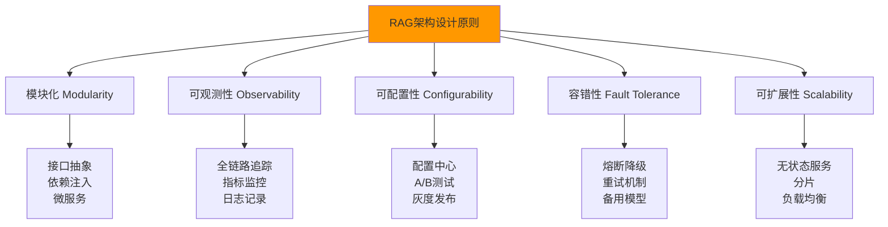

### 1.2 双管线架构：离线索引 + 在线查询

#### 架构全景图

RAG 系统的核心是**双管线架构**——离线索引管线（Offline Indexing Pipeline）和在线查询管线（Online Query Pipeline），两者通过向量数据库解耦。

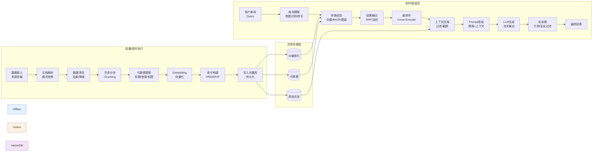

#### 离线管线 vs 在线管线对比

| 维度 | 离线索引管线 | 在线查询管线 |
|------|-------------|-------------|
| **执行时机** | 批量/定时/事件触发 | 实时/用户请求时 |
| **延迟要求** | 低（分钟/小时级可接受） | 高（秒级，首token<500ms） |
| **吞吐量** | 高（批量处理大量文档） | 高（并发处理大量查询） |
| **计算资源** | CPU密集（解析/分块）+ GPU（Embedding） | GPU密集（LLM生成） |
| **失败影响** | 局部（部分文档未索引） | 全局（用户查询失败） |
| **扩展性** | 水平扩展（多worker并行） | 水平扩展（无状态服务+负载均衡） |
| **监控重点** | 索引完成率、文档质量、Embedding成功率 | 查询延迟、检索召回率、回答质量 |

> 🔥 **面试高频考点**：为什么 RAG 系统要采用"离线+在线"双管线架构？两者如何解耦？
> **答案要点**：① 离线管线负责"准备知识"——将原始文档转化为可检索的向量索引，是计算密集型、延迟不敏感的批量任务；② 在线管线负责"回答问题"——根据用户查询实时检索和生成，是延迟敏感的交互式任务；③ 两者通过向量数据库解耦——离线管线写入向量库，在线管线读取向量库，互不阻塞、独立扩展、独立升级；④ 这种架构允许知识库持续更新（离线）而不影响查询服务（在线），也允许查询服务弹性伸缩而不影响索引任务。

### 1.3 核心组件架构

#### 组件分层架构

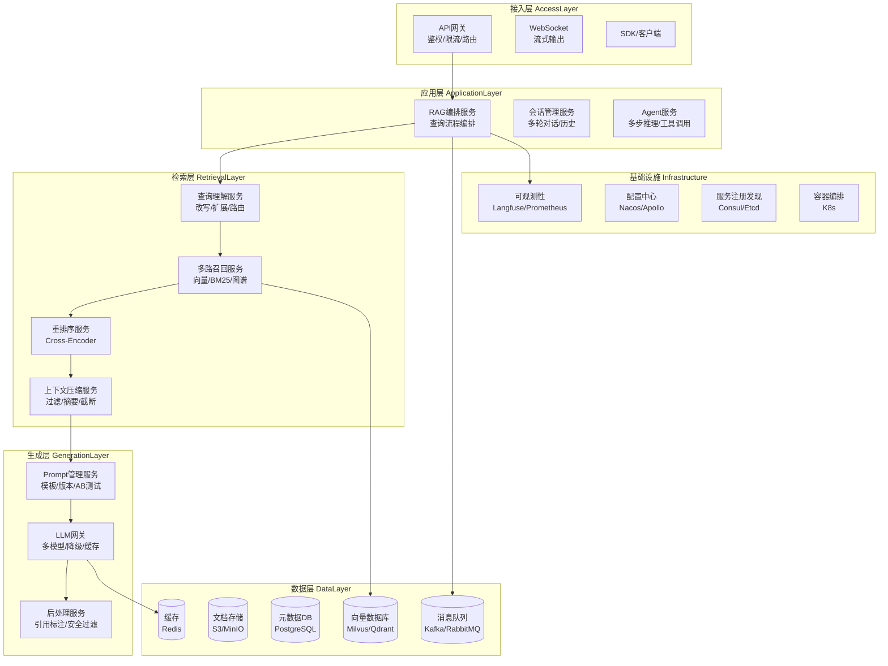

#### 组件职责详解

| 层级 | 组件 | 核心职责 | 关键技术 |
|------|------|----------|----------|
| **接入层** | API网关 | 鉴权、限流、路由、协议转换 | Kong/APISIX/Nginx |
| | WebSocket | 流式输出、长连接 | Socket.io/原生WS |
| **应用层** | RAG编排服务 | 查询流程编排、组件协调 | LangGraph/自研状态机 |
| | 会话管理 | 多轮对话、历史管理、上下文窗口 | Redis/PostgreSQL |
| | Agent服务 | 多步推理、工具调用、自主规划 | LangGraph/AutoGen |
| **检索层** | 查询理解 | 意图识别、查询改写、查询路由 | LLM/规则引擎 |
| | 多路召回 | 向量检索、BM25、知识图谱检索 | Milvus/ES/Neo4j |
| | 重排序 | Cross-Encoder精排、相关性过滤 | bge-reranker/Cohere |
| | 上下文压缩 | 文档过滤、摘要、截断 | LLM/规则 |
| **生成层** | Prompt管理 | 模板管理、版本控制、A/B测试 | Langfuse/自研 |
| | LLM网关 | 多模型路由、降级、缓存、限流 | LiteLLM/自研 |
| | 后处理 | 引用标注、安全过滤、格式转换 | 规则/LLM |
| **数据层** | 向量数据库 | 向量存储、相似度搜索、索引管理 | Milvus/Qdrant/pgvector |
| | 文档存储 | 原始文档存储、版本管理 | S3/MinIO |
| | 元数据DB | 文档元数据、权限、索引状态 | PostgreSQL/MySQL |
| | 缓存 | 查询结果缓存、Embedding缓存 | Redis |
| | 消息队列 | 异步索引、事件驱动 | Kafka/RabbitMQ |

### 1.4 数据流与控制流

#### 数据流（Data Flow）

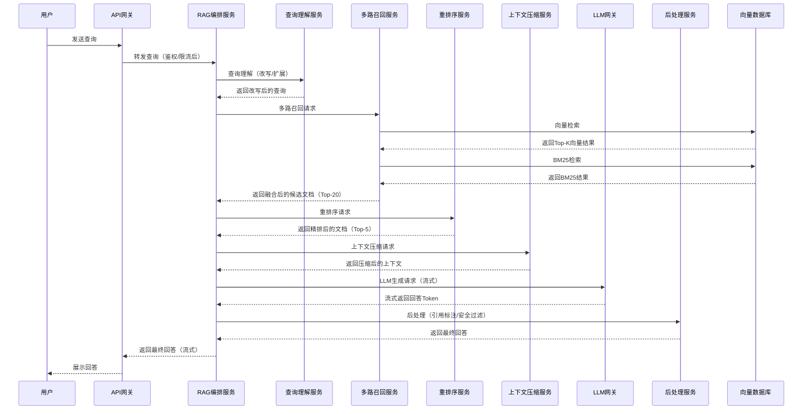

#### 控制流（Control Flow）与异常处理

```python
# RAG编排服务的控制流实现（含异常处理）
class RAGOrchestrator:
    """RAG编排服务：控制查询流程的执行顺序和异常处理"""

    def __init__(self, query_understanding, multi_recall, reranker,
                 context_compressor, llm_gateway, post_processor):
        self.query_understanding = query_understanding
        self.multi_recall = multi_recall
        self.reranker = reranker
        self.context_compressor = context_compressor
        self.llm_gateway = llm_gateway
        self.post_processor = post_processor

    async def execute(self, query: str, context: dict = None) -> dict:
        """
        执行RAG查询流程
        控制流：查询理解 → 多路召回 → 重排序 → 上下文压缩 → LLM生成 → 后处理
        每个步骤都有超时、重试、降级机制
        """
        result = {
            "query": query,
            "stages": {},
            "answer": "",
            "sources": [],
            "errors": [],
        }

        # 阶段1：查询理解（失败时降级为原始查询）
        try:
            understood = await self._with_timeout(
                self.query_understanding.process(query),
                timeout=2.0
            )
            result["stages"]["query_understanding"] = understood
            search_query = understood.get("rewritten_query", query)
        except Exception as e:
            result["errors"].append(f"查询理解失败: {e}")
            search_query = query  # 降级：使用原始查询

        # 阶段2：多路召回（失败时降级为单路向量检索）
        try:
            candidates = await self._with_timeout(
                self.multi_recall.recall(search_query, top_k=20),
                timeout=3.0
            )
            result["stages"]["recall"] = {
                "num_candidates": len(candidates),
                "channels": candidates.get("channels", []),
            }
        except Exception as e:
            result["errors"].append(f"多路召回失败: {e}")
            # 降级：单路向量检索
            candidates = await self.multi_recall.vector_only(search_query, top_k=10)

        # 阶段3：重排序（失败时跳过，直接用召回结果）
        try:
            if candidates:
                reranked = await self._with_timeout(
                    self.reranker.rerank(search_query, candidates, top_k=5),
                    timeout=2.0
                )
                result["stages"]["rerank"] = {"num_results": len(reranked)}
            else:
                reranked = []
        except Exception as e:
            result["errors"].append(f"重排序失败: {e}")
            reranked = candidates[:5]  # 降级：用召回的前5个

        # 阶段4：上下文压缩（失败时跳过）
        try:
            if reranked:
                compressed = await self._with_timeout(
                    self.context_compressor.compress(search_query, reranked),
                    timeout=2.0
                )
                result["stages"]["compression"] = {
                    "original_tokens": compressed.get("original_tokens", 0),
                    "compressed_tokens": compressed.get("compressed_tokens", 0),
                }
                context_text = compressed.get("context", "")
            else:
                context_text = ""
        except Exception as e:
            result["errors"].append(f"上下文压缩失败: {e}")
            context_text = "\n\n".join([d.page_content for d in reranked[:5]])

        # 阶段5：LLM生成（失败时降级为备用模型，再失败返回检索结果）
        try:
            answer = await self._with_timeout(
                self.llm_gateway.generate(
                    query=search_query,
                    context=context_text,
                    stream=True
                ),
                timeout=30.0
            )
            result["stages"]["generation"] = {
                "model": answer.get("model", ""),
                "input_tokens": answer.get("input_tokens", 0),
                "output_tokens": answer.get("output_tokens", 0),
            }
            result["answer"] = answer.get("content", "")
        except Exception as e:
            result["errors"].append(f"LLM生成失败: {e}")
            # 降级1：备用模型
            try:
                answer = await self.llm_gateway.generate_with_fallback(
                    query=search_query, context=context_text
                )
                result["answer"] = answer
            except Exception as e2:
                # 降级2：直接返回检索结果
                result["answer"] = "抱歉，生成服务暂时不可用。以下是检索到的相关文档：\n\n"
                for i, doc in enumerate(reranked[:3], 1):
                    result["answer"] += f"[{i}] {doc.page_content[:200]}...\n\n"

        # 阶段6：后处理（失败时跳过）
        try:
            processed = self.post_processor.process(
                answer=result["answer"],
                documents=reranked,
                query=query
            )
            result["answer"] = processed.get("answer", result["answer"])
            result["sources"] = processed.get("sources", [])
        except Exception as e:
            result["errors"].append(f"后处理失败: {e}")

        return result

    async def _with_timeout(self, coro, timeout):
        """带超时的异步执行"""
        import asyncio
        return await asyncio.wait_for(coro, timeout=timeout)
```

### 1.5 本章深度讲解与练习

> 💡 **深度讲解**：RAG 系统架构设计的核心是"双管线+模块化"——离线索引管线负责"准备知识"，在线查询管线负责"回答问题"，两者通过向量数据库解耦，各自独立扩展、独立升级、独立容错。这种架构的优势在于：① 知识库可以持续更新而不影响查询服务；② 查询服务可以弹性伸缩应对流量高峰；③ 每个组件可以独立替换（如换向量数据库、换 Embedding 模型、换 LLM）而不影响整体系统；④ 故障隔离——某个组件故障时可以降级而不影响核心功能。架构设计的五大原则（模块化、可观测性、可配置性、容错性、可扩展性）是生产级系统的基石，缺少任何一个都会在系统规模扩大时成为瓶颈。数据流描述了"数据如何在组件间流动"，控制流描述了"流程如何执行以及异常如何处理"——两者都需要精心设计，尤其是控制流中的超时、重试、降级机制，直接决定了系统的可用性和用户体验。在实际项目中，建议从简单的单体架构开始（所有组件在一个服务中），随着规模扩大逐步拆分为微服务——不要一开始就追求"大而全"的微服务架构，过早优化是万恶之源。
>
> **📝 精简总结**：RAG架构核心=双管线（离线索引+在线查询）+模块化组件；离线管线负责"准备知识"（数据接入→解析→清洗→分块→元数据→Embedding→索引→存储），在线管线负责"回答问题"（查询理解→多路召回→融合→重排序→压缩→Prompt→LLM→后处理）；五大原则=模块化+可观测性+可配置性+容错性+可扩展性；控制流核心=超时+重试+降级；从单体开始，规模扩大后逐步拆微服务。

### 🎯 梯度练习题

**基础题（入门必做）**
1. 画出 RAG 双管线架构图，标注离线索引管线和在线查询管线的各自步骤
2. 解释为什么离线索引和在线查询要通过向量数据库解耦，而不是放在同一个服务中
3. 列出 RAG 架构设计的五大原则，并各举一个实践方法

**进阶题（动手实践）**
4. 实现 RAGOrchestrator 类，包含查询理解、多路召回、重排序、上下文压缩、LLM 生成、后处理六个阶段，每个阶段都有超时和降级机制
5. 设计一个 RAG 系统的微服务拆分方案，包括服务边界划分、服务间通信协议（同步/异步）、数据一致性方案
6. 实现 RAG 系统的全链路追踪，记录每个阶段的输入输出、延迟、Token 消耗，并生成追踪报告

**挑战题（深入思考）**
7. 设计一个 RAG 系统的"优雅降级"方案：当向量数据库故障时、当 LLM 服务不可用时、当重排序服务超时时，系统分别应该如何降级以保证核心功能可用？需要考虑用户体验、数据一致性、故障恢复
8. RAG 系统的"索引-查询一致性"是一个经典问题——当文档正在更新索引时，用户查询可能读到旧数据或不一致的数据。设计一个索引一致性方案，包括索引版本管理、查询路由、灰度切换、回滚机制
9. 假设你要设计一个支持百万级文档、万级并发查询的 RAG 系统。请设计完整的系统架构，包括技术选型、容量规划（存储/计算/带宽）、性能优化、高可用方案、灾备策略，并估算月度成本

---

## 2. 索引层架构设计

### 2.1 索引层架构全景

#### 概念解释

索引层（Indexing Layer）是 RAG 系统的"数据加工厂"——负责将各种来源、各种格式的原始文档，经过采集、解析、清洗、分块、向量化、索引构建等一系列处理，转化为可高效检索的向量索引。

> 💡 **比喻**：索引层就像**食品加工厂**——原材料（原始文档）从农场（数据源）运到工厂，经过清洗（去噪）、切割（分块）、包装（元数据）、质检（质量检查）、入库（向量存储），变成货架上的标准化商品（可检索的向量索引）。工厂的流水线设计决定了生产效率（索引速度）和产品质量（检索效果）。

#### 索引层组件架构

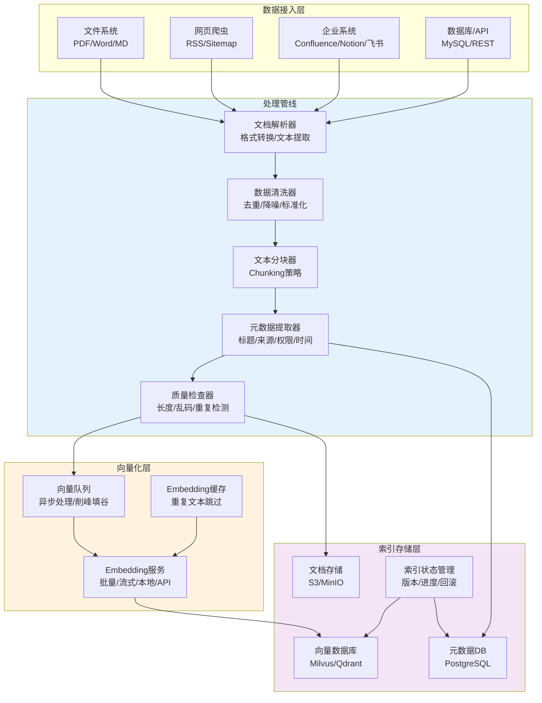

### 2.2 数据接入架构

#### 多源数据接入设计

```python
# 数据接入层：统一的数据源接口
from abc import ABC, abstractmethod
from typing import List, AsyncIterator
from dataclasses import dataclass
from datetime import datetime

@dataclass
class RawDocument:
    """原始文档数据结构"""
    doc_id: str
    source_type: str  # file/web/confluence/database
    source_uri: str
    content: str
    metadata: dict
    fetched_at: datetime
    content_hash: str  # 用于增量检测

class DataSource(ABC):
    """数据源抽象接口"""

    @abstractmethod
    async def fetch_all(self) -> List[RawDocument]:
        """全量获取所有文档"""
        pass

    @abstractmethod
    async def fetch_incremental(self, since: datetime) -> List[RawDocument]:
        """增量获取指定时间之后更新的文档"""
        pass

    @abstractmethod
    async def listen(self) -> AsyncIterator[RawDocument]:
        """监听文档变更（实时同步）"""
        pass

class FileSystemSource(DataSource):
    """文件系统数据源"""

    def __init__(self, directory: str, supported_ext: List[str] = None):
        self.directory = directory
        self.supported_ext = supported_ext or ['.pdf', '.docx', '.md', '.txt']

    async def fetch_all(self) -> List[RawDocument]:
        """全量扫描目录"""
        import os
        from datetime import datetime
        documents = []

        for root, dirs, files in os.walk(self.directory):
            for file in files:
                ext = os.path.splitext(file)[1].lower()
                if ext in self.supported_ext:
                    file_path = os.path.join(root, file)
                    doc = await self._read_file(file_path)
                    documents.append(doc)

        return documents

    async def fetch_incremental(self, since: datetime) -> List[RawDocument]:
        """增量扫描：只返回since之后修改的文件"""
        import os
        documents = []

        for root, dirs, files in os.walk(self.directory):
            for file in files:
                file_path = os.path.join(root, file)
                mtime = datetime.fromtimestamp(os.path.getmtime(file_path))
                if mtime > since:
                    doc = await self._read_file(file_path)
                    documents.append(doc)

        return documents

    async def listen(self) -> AsyncIterator[RawDocument]:
        """监听文件变更（使用watchdog）"""
        # 实现文件系统事件监听
        pass

    async def _read_file(self, file_path: str) -> RawDocument:
        """读取文件内容"""
        import hashlib
        from datetime import datetime

        # 根据文件类型选择解析器
        ext = file_path.split('.')[-1].lower()
        content = await self._parse_file(file_path, ext)

        return RawDocument(
            doc_id=hashlib.md5(file_path.encode()).hexdigest(),
            source_type="file",
            source_uri=file_path,
            content=content,
            metadata={"file_type": ext, "file_path": file_path},
            fetched_at=datetime.now(),
            content_hash=hashlib.md5(content.encode()).hexdigest(),
        )

class ConfluenceSource(DataSource):
    """Confluence数据源"""

    def __init__(self, base_url: str, api_key: str, space_key: str):
        self.base_url = base_url
        self.api_key = api_key
        self.space_key = space_key

    async def fetch_all(self) -> List[RawDocument]:
        """全量获取Confluence空间的所有页面"""
        # 分页获取所有页面
        pass

    async def fetch_incremental(self, since: datetime) -> List[RawDocument]:
        """增量获取更新的页面"""
        # 使用Confluence的CQL查询更新时间>since的页面
        pass

    async def listen(self) -> AsyncIterator[RawDocument]:
        """监听Confluence页面变更（Webhook）"""
        # 注册Webhook监听页面创建/更新/删除事件
        pass
```

#### 数据接入调度架构

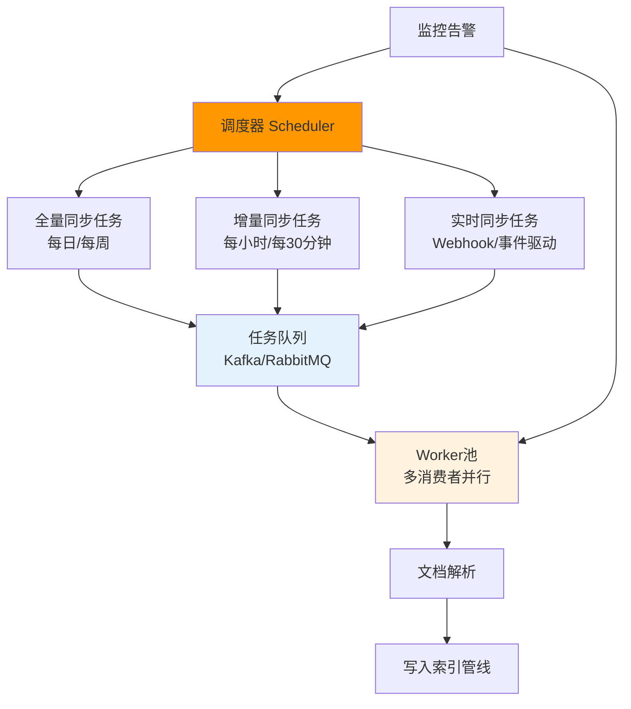

```python
# 数据接入调度器
class IngestionScheduler:
    """数据接入调度器：管理全量/增量/实时同步任务"""

    def __init__(self, data_sources: dict, task_queue, worker_pool):
        self.data_sources = data_sources  # name -> DataSource
        self.task_queue = task_queue
        self.worker_pool = worker_pool
        self.last_sync_state = {}  # source_name -> last_sync_time

    async def run_full_sync(self, source_name: str):
        """全量同步"""
        source = self.data_sources[source_name]
        print(f"开始全量同步: {source_name}")

        # 全量获取文档
        documents = await source.fetch_all()
        print(f"获取到 {len(documents)} 个文档")

        # 提交到任务队列
        for doc in documents:
            await self.task_queue.publish("indexing_tasks", doc.__dict__)

        # 更新同步状态
        from datetime import datetime
        self.last_sync_state[source_name] = datetime.now()

    async def run_incremental_sync(self, source_name: str):
        """增量同步"""
        source = self.data_sources[source_name]
        last_sync = self.last_sync_state.get(source_name)

        if not last_sync:
            # 首次同步，执行全量
            await self.run_full_sync(source_name)
            return

        print(f"开始增量同步: {source_name} (since {last_sync})")
        documents = await source.fetch_incremental(last_sync)
        print(f"获取到 {len(documents)} 个更新文档")

        for doc in documents:
            await self.task_queue.publish("indexing_tasks", doc.__dict__)

        from datetime import datetime
        self.last_sync_state[source_name] = datetime.now()

    async def start_realtime_listener(self, source_name: str):
        """启动实时同步监听"""
        source = self.data_sources[source_name]
        print(f"启动实时同步监听: {source_name}")

        async for doc in source.listen():
            await self.task_queue.publish("indexing_tasks", doc.__dict__)
```

### 2.3 文档处理管线架构

#### 处理管线设计

```python
# 文档处理管线：责任链模式
from abc import ABC, abstractmethod
from typing import List

class PipelineStage(ABC):
    """管线阶段抽象接口"""

    @abstractmethod
    async def process(self, doc: dict) -> dict:
        """处理文档，返回处理后的文档"""
        pass

    @abstractmethod
    def get_name(self) -> str:
        """阶段名称"""
        pass

class ParseStage(PipelineStage):
    """解析阶段：格式转换、文本提取"""

    def get_name(self): return "parse"

    async def process(self, doc: dict) -> dict:
        content = doc.get("content", "")
        source_type = doc.get("source_type", "file")

        # 根据来源类型选择解析策略
        if source_type == "file":
            content = await self._parse_file(content, doc.get("metadata", {}))
        elif source_type == "web":
            content = await self._parse_html(content)
        elif source_type == "confluence":
            content = await self._parse_confluence_storage(content)

        doc["parsed_content"] = content
        doc["parse_status"] = "success"
        return doc

class CleanStage(PipelineStage):
    """清洗阶段：去重、降噪、标准化"""

    def get_name(self): return "clean"

    async def process(self, doc: dict) -> dict:
        import re
        content = doc.get("parsed_content", "")

        # 1. 去除页眉页脚
        content = re.sub(r'^\s*\d+\s*$', '', content, flags=re.MULTILINE)

        # 2. 去除多余空白
        content = re.sub(r'\n{3,}', '\n\n', content)
        content = re.sub(r'[ \t]+', ' ', content)

        # 3. 去除广告/免责声明模板
        noise_patterns = [
            r'本文.*仅供参考.*',
            r'版权所有.*不得转载',
            r'扫码关注.*公众号',
        ]
        for pattern in noise_patterns:
            content = re.sub(pattern, '', content)

        # 4. 统一标点
        content = content.replace('（', '(').replace('）', ')')

        doc["cleaned_content"] = content.strip()
        doc["clean_status"] = "success"
        return doc

class ChunkStage(PipelineStage):
    """分块阶段：文本切分"""

    def __init__(self, chunk_size=800, chunk_overlap=100):
        self.chunk_size = chunk_size
        self.chunk_overlap = chunk_overlap

    def get_name(self): return "chunk"

    async def process(self, doc: dict) -> dict:
        from langchain.text_splitter import RecursiveCharacterTextSplitter

        content = doc.get("cleaned_content", "")
        splitter = RecursiveCharacterTextSplitter(
            chunk_size=self.chunk_size,
            chunk_overlap=self.chunk_overlap,
            separators=["\n\n", "\n", "。", "！", "？", ".", "!", "?", " ", ""],
        )

        chunks = splitter.split_text(content)

        # 为每个块添加元数据
        chunk_docs = []
        for i, chunk_text in enumerate(chunks):
            chunk_doc = {
                "chunk_id": f"{doc['doc_id']}_chunk_{i}",
                "parent_doc_id": doc["doc_id"],
                "content": chunk_text,
                "chunk_index": i,
                "chunk_size": len(chunk_text),
                "metadata": {
                    **doc.get("metadata", {}),
                    "source": doc.get("source_uri", ""),
                    "doc_id": doc["doc_id"],
                    "chunk_index": i,
                },
            }
            chunk_docs.append(chunk_doc)

        doc["chunks"] = chunk_docs
        doc["chunk_status"] = "success"
        doc["num_chunks"] = len(chunk_docs)
        return doc

class MetadataStage(PipelineStage):
    """元数据提取阶段"""

    def get_name(self): return "metadata"

    async def process(self, doc: dict) -> dict:
        # 为每个块提取和丰富元数据
        for chunk in doc.get("chunks", []):
            content = chunk["content"]

            # 提取标题（第一个非空行）
            lines = content.strip().split('\n')
            for line in lines[:5]:
                if line.strip() and len(line.strip()) < 100:
                    chunk["metadata"]["title"] = line.strip()
                    break

            # 提取关键词（简单方法）
            import re
            from collections import Counter
            words = re.findall(r'[\u4e00-\u9fa5]{2,}', content)
            if words:
                top_words = [w for w, _ in Counter(words).most_common(5)]
                chunk["metadata"]["keywords"] = ",".join(top_words)

        doc["metadata_status"] = "success"
        return doc

class QualityCheckStage(PipelineStage):
    """质量检查阶段"""

    def get_name(self): return "quality_check"

    async def process(self, doc: dict) -> dict:
        issues = []
        valid_chunks = []

        for chunk in doc.get("chunks", []):
            content = chunk["content"]

            # 检查1：内容过短
            if len(content) < 50:
                issues.append(f"chunk {chunk['chunk_index']}: 内容过短 ({len(content)}字符)")
                continue

            # 检查2：乱码检测
            import re
            normal_chars = len(re.findall(r'[\u4e00-\u9fa5a-zA-Z0-9\s\.,，。、；;：:！!？?\(\)（）\[\]【】\-—…]', content))
            if len(content) > 0 and normal_chars / len(content) < 0.7:
                issues.append(f"chunk {chunk['chunk_index']}: 可能包含乱码")
                continue

            valid_chunks.append(chunk)

        doc["chunks"] = valid_chunks
        doc["quality_issues"] = issues
        doc["quality_status"] = "success" if not issues else "warning"
        return doc

# 构建处理管线
class DocumentProcessingPipeline:
    """文档处理管线：按顺序执行各个阶段"""

    def __init__(self, stages: List[PipelineStage]):
        self.stages = stages

    async def process(self, doc: dict) -> dict:
        """执行完整处理管线"""
        for stage in self.stages:
            try:
                doc = await stage.process(doc)
                doc[f"{stage.get_name()}_status"] = "success"
            except Exception as e:
                doc[f"{stage.get_name()}_status"] = "failed"
                doc[f"{stage.get_name()}_error"] = str(e)
                # 关键阶段失败则终止，非关键阶段继续
                if stage.get_name() in ["parse", "chunk"]:
                    doc["pipeline_status"] = "failed"
                    return doc

        doc["pipeline_status"] = "success"
        return doc

# 创建管线实例
pipeline = DocumentProcessingPipeline([
    ParseStage(),
    CleanStage(),
    ChunkStage(chunk_size=800, chunk_overlap=100),
    MetadataStage(),
    QualityCheckStage(),
])
```

### 2.4 向量化与索引构建架构

#### Embedding服务架构

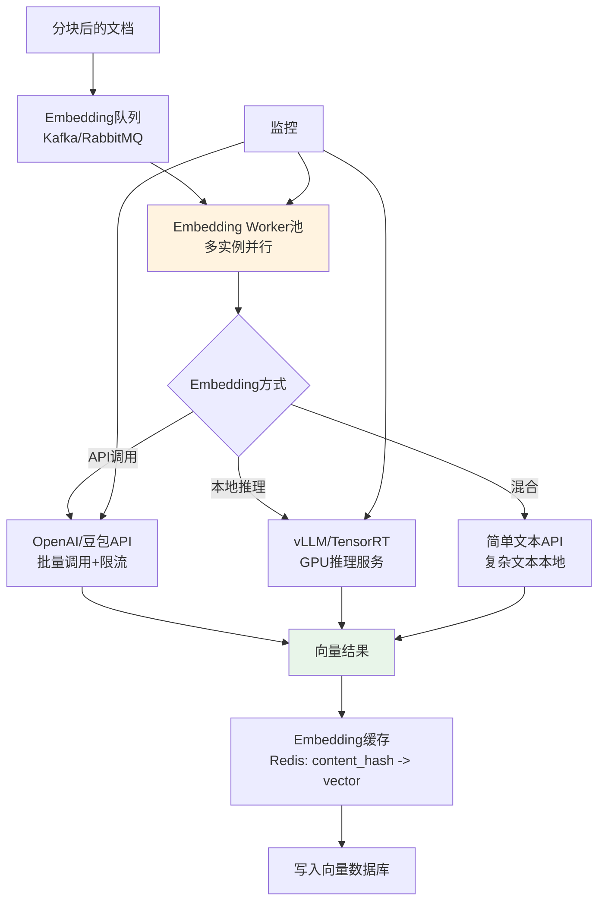

```python
# Embedding服务：支持API/本地/混合模式
class EmbeddingService:
    """Embedding服务：批量处理、缓存、多模式支持"""

    def __init__(self, mode="api", batch_size=64, cache_client=None):
        self.mode = mode  # api/local/hybrid
        self.batch_size = batch_size
        self.cache = cache_client  # Redis客户端
        self.api_embeddings = None
        self.local_model = None

        if mode in ["api", "hybrid"]:
            from langchain_openai import OpenAIEmbeddings
            self.api_embeddings = OpenAIEmbeddings(model="text-embedding-3-small")

        if mode in ["local", "hybrid"]:
            from sentence_transformers import SentenceTransformer
            self.local_model = SentenceTransformer("BAAI/bge-m3")

    async def embed_batch(self, texts: list) -> list:
        """批量嵌入，带缓存"""
        import hashlib

        # 1. 检查缓存
        results = [None] * len(texts)
        to_embed = []
        to_embed_indices = []

        for i, text in enumerate(texts):
            content_hash = hashlib.md5(text.encode()).hexdigest()
            if self.cache:
                cached = await self.cache.get(f"emb:{content_hash}")
                if cached:
                    import json
                    results[i] = json.loads(cached)
                    continue
            to_embed.append(text)
            to_embed_indices.append(i)

        # 2. 批量嵌入未缓存的文本
        if to_embed:
            if self.mode == "api":
                vectors = self.api_embeddings.embed_documents(to_embed)
            elif self.mode == "local":
                vectors = self.local_model.encode(to_embed, normalize_embeddings=True).tolist()
            else:  # hybrid
                vectors = self._hybrid_embed(to_embed)

            # 3. 写入缓存和结果
            for j, (idx, vector) in enumerate(zip(to_embed_indices, vectors)):
                results[idx] = vector
                if self.cache:
                    content_hash = hashlib.md5(to_embed[j].encode()).hexdigest()
                    import json
                    await self.cache.setex(
                        f"emb:{content_hash}",
                        86400 * 30,  # 缓存30天
                        json.dumps(vector)
                    )

        return results

    def _hybrid_embed(self, texts):
        """混合模式：短文本用API，长文本用本地"""
        api_texts = []
        local_texts = []
        api_indices = []
        local_indices = []

        for i, text in enumerate(texts):
            if len(text) < 500:  # 短文本用API
                api_texts.append(text)
                api_indices.append(i)
            else:  # 长文本用本地
                local_texts.append(text)
                local_indices.append(i)

        results = [None] * len(texts)

        if api_texts:
            api_vectors = self.api_embeddings.embed_documents(api_texts)
            for idx, vec in zip(api_indices, api_vectors):
                results[idx] = vec

        if local_texts:
            local_vectors = self.local_model.encode(local_texts, normalize_embeddings=True).tolist()
            for idx, vec in zip(local_indices, local_vectors):
                results[idx] = vec

        return results
```

#### 索引构建与版本管理

```python
# 索引构建与版本管理
class IndexManager:
    """索引管理器：版本管理、增量更新、回滚"""

    def __init__(self, vector_store, metadata_db):
        self.vector_store = vector_store
        self.metadata_db = metadata_db

    async def build_index(self, chunks_with_vectors: list, version_name: str):
        """
        构建新版本索引
        策略：双写+灰度切换（先写入新版本，验证后切换流量）
        """
        import time
        start_time = time.time()

        # 1. 创建新版本collection
        collection_name = f"rag_index_{version_name}"
        print(f"开始构建索引: {collection_name}")

        # 2. 批量写入向量
        batch_size = 500
        total = len(chunks_with_vectors)
        for i in range(0, total, batch_size):
            batch = chunks_with_vectors[i:i+batch_size]
            await self.vector_store.add_batch(
                collection_name=collection_name,
                documents=batch
            )
            print(f"索引进度: {min(i+batch_size, total)}/{total}")

        # 3. 构建HNSW索引
        await self.vector_store.build_index(
            collection_name=collection_name,
            index_type="HNSW",
            params={"M": 32, "efConstruction": 200}
        )

        # 4. 记录版本信息
        version_info = {
            "version_name": version_name,
            "collection_name": collection_name,
            "doc_count": total,
            "created_at": time.strftime("%Y-%m-%d %H:%M:%S"),
            "build_time_seconds": time.time() - start_time,
            "embedding_model": "text-embedding-3-small",
            "chunk_size": 800,
            "status": "building",
        }
        await self.metadata_db.insert("index_versions", version_info)

        # 5. 验证索引
        is_valid = await self._validate_index(collection_name)
        if is_valid:
            version_info["status"] = "ready"
            await self.metadata_db.update("index_versions", version_name, {"status": "ready"})
            print(f"索引构建完成: {collection_name} (耗时{version_info['build_time_seconds']:.1f}s)")
        else:
            version_info["status"] = "invalid"
            print(f"索引验证失败: {collection_name}")

        return version_info

    async def switch_traffic(self, version_name: str, percentage: int = 100):
        """灰度切换流量到新版本"""
        # 更新路由配置
        await self.metadata_db.update(
            "index_config",
            "current",
            {
                "active_version": version_name,
                "traffic_percentage": percentage,
                "switched_at": time.strftime("%Y-%m-%d %H:%M:%S"),
            }
        )
        print(f"流量切换: {percentage}% 到版本 {version_name}")

    async def rollback(self, version_name: str):
        """回滚到指定版本"""
        await self.switch_traffic(version_name, 100)
        print(f"已回滚到版本: {version_name}")

    async def _validate_index(self, collection_name: str) -> bool:
        """验证索引完整性和正确性"""
        # 1. 检查文档数量
        count = await self.vector_store.count(collection_name)
        if count == 0:
            return False

        # 2. 抽样查询验证
        sample_results = await self.vector_store.search(
            collection_name=collection_name,
            query="测试查询",
            top_k=3
        )
        if not sample_results:
            return False

        return True
```

### 2.5 本章深度讲解与练习

> 💡 **深度讲解**：索引层是 RAG 系统的"数据地基"，其架构设计直接决定了系统的数据质量、更新效率和可维护性。索引层的核心是"处理管线"——从数据接入到文档解析、清洗、分块、元数据提取、质量检查、向量化、索引构建，每个阶段都是一个可独立替换、可独立监控的处理单元。采用责任链模式（Pipeline）组织这些阶段，可以灵活地添加/移除/替换处理步骤，而不影响整体流程。数据接入架构需要支持多种数据源（文件系统、网页、企业系统、数据库）和三种同步模式（全量、增量、实时），通过任务队列和 Worker 池实现削峰填谷和水平扩展。向量化架构是索引层的性能瓶颈——Embedding 调用通常是索引阶段最耗时的环节，需要通过批量处理、缓存、多 Worker 并行来优化；同时支持 API/本地/混合三种模式，在成本和性能之间取得平衡。索引版本管理是生产环境的必备能力——通过"双写+灰度切换"策略，新版本索引先构建验证，再逐步切换流量，出现问题可以秒级回滚，确保索引更新不影响在线查询服务。最后，质量检查是索引层的"质检环节"——在文档入库前检测乱码、重复、过短/过长等问题，避免"垃圾进、垃圾出"。
>
> **📝 精简总结**：索引层=数据接入+处理管线+向量化+索引存储；处理管线用责任链模式（解析→清洗→分块→元数据→质检），各阶段可独立替换；数据接入支持多源（文件/网页/企业系统/DB）和三模式（全量/增量/实时），用队列+Worker池削峰；向量化是性能瓶颈，优化=批量+缓存+并行+多模式（API/本地/混合）；索引版本管理用"双写+灰度切换+秒级回滚"；质量检查在入库前检测乱码/重复/异常长度。

### 🎯 梯度练习题

**基础题（入门必做）**
1. 画出索引层的完整架构图，标注从数据接入到索引存储的所有组件
2. 解释为什么索引层需要"处理管线"架构，而不是在一个函数中完成所有处理
3. 列出三种数据同步模式（全量/增量/实时）的区别和各自的适用场景

**进阶题（动手实践）**
4. 实现 DocumentProcessingPipeline 类，包含解析、清洗、分块、元数据提取、质量检查五个阶段，每个阶段独立可替换
5. 实现 EmbeddingService 类，支持批量处理、Redis 缓存、API/本地/混合三种模式
6. 实现 IndexManager 类，支持索引版本创建、灰度切换、秒级回滚、索引验证

**挑战题（深入思考）**
7. 设计一个"实时索引"方案：当用户上传新文档或修改文档时，系统在 10 秒内完成索引并立即可检索。需要考虑文件监听、增量解析、增量 Embedding、索引更新、查询一致性
8. 索引层的"数据一致性"是一个复杂问题——当文档正在更新时，查询可能读到旧数据或部分更新的数据。设计一个一致性方案，包括锁机制、版本控制、查询路由、事务保证
9. 假设你要为一个企业构建索引层，支持 100 万份文档、每日更新 1 万份、文档格式包括 PDF/Word/PPT/Excel/网页/Confluence。请设计完整的索引层架构，包括技术选型、容量规划、性能优化、故障恢复、成本估算

---

## 3. 检索层架构设计

### 3.1 检索层架构全景

#### 概念解释

检索层（Retrieval Layer）是 RAG 系统的"搜索引擎"——负责理解用户查询意图，从海量知识库中快速、准确地召回最相关的文档片段，并通过重排序和上下文压缩为生成层提供高质量的上下文。

> 💡 **比喻**：检索层就像**图书馆的高级检索员**——用户说"我想了解退款政策"，检索员不会直接去书架上乱翻，而是先理解用户真正想要什么（查询理解），然后用多种方法找书（电脑检索+卡片目录+专家推荐=多路召回），把找到的书按相关程度排序（重排序），最后只把最相关的几页内容递给用户（上下文压缩），而不是把整摞书都塞给用户。

#### 检索层组件架构

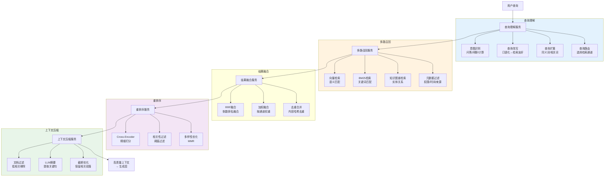

### 3.2 查询理解服务架构

#### 查询理解的核心任务

| 任务 | 说明 | 方法 | 对检索的影响 |
|------|------|------|-------------|
| **意图识别** | 判断用户意图类型 | 规则+LLM分类 | 决定是否需要检索、走哪条检索通道 |
| **查询改写** | 将口语化查询转为检索友好形式 | LLM改写 | 提升召回率，尤其是口语化/模糊查询 |
| **查询扩展** | 扩展同义词、相关词、缩写 | 词典+LLM生成 | 提升召回率，尤其是专业术语/缩写 |
| **查询分解** | 复杂问题分解为子问题 | LLM分解 | 支持多跳推理、复杂问题检索 |
| **查询路由** | 选择最合适的检索通道 | 规则+模型 | 提升检索效率和精准度 |

```python
# 查询理解服务
class QueryUnderstandingService:
    """查询理解服务：意图识别、改写、扩展、分解、路由"""

    def __init__(self, llm, intent_classifier=None):
        self.llm = llm
        self.intent_classifier = intent_classifier or self._default_intent_classifier

    async def process(self, query: str, conversation_history: list = None) -> dict:
        """
        完整查询理解流程
        返回：{intent, rewritten_query, expanded_queries, sub_queries, route}
        """
        result = {"original_query": query}

        # 1. 意图识别
        intent = await self.intent_classifier(query, conversation_history)
        result["intent"] = intent

        # 非知识问答意图，不需要检索
        if intent in ["chitchat", "calculation", "greeting"]:
            result["route"] = "direct_answer"
            return result

        # 2. 查询改写
        rewritten = await self._rewrite_query(query, conversation_history)
        result["rewritten_query"] = rewritten

        # 3. 查询扩展
        expanded = await self._expand_query(rewritten)
        result["expanded_queries"] = expanded

        # 4. 查询分解（复杂问题）
        if intent == "complex_qa":
            sub_queries = await self._decompose_query(rewritten)
            result["sub_queries"] = sub_queries

        # 5. 查询路由
        route = self._route_query(rewritten, intent)
        result["route"] = route

        return result

    async def _default_intent_classifier(self, query: str, history: list) -> str:
        """默认意图分类器：基于规则+LLM"""
        # 规则匹配（快速路径）
        chitchat_patterns = ["你好", "在吗", "谢谢", "再见", "你是谁", "你能做什么"]
        for pattern in chitchat_patterns:
            if pattern in query:
                return "chitchat"

        # LLM分类（慢速路径）
        prompt = f"""请判断以下用户查询的意图类型，只输出类型名称。

        意图类型：
        - knowledge_qa: 知识问答（需要检索知识库）
        - complex_qa: 复杂问答（需要多步推理或多文档检索）
        - chitchat: 闲聊（不需要检索）
        - calculation: 计算/数据查询（需要工具调用）

        用户查询：{query}

        意图类型："""

        intent = self.llm.invoke(prompt).content.strip().lower()
        valid_intents = ["knowledge_qa", "complex_qa", "chitchat", "calculation"]
        return intent if intent in valid_intents else "knowledge_qa"

    async def _rewrite_query(self, query: str, history: list) -> str:
        """查询改写：口语化→检索友好，结合对话历史"""
        history_text = ""
        if history:
            history_text = "\n".join([f"用户: {h['content']}" for h in history[-3:]])

        prompt = f"""将以下用户问题改写为适合知识库检索的查询。
        要求：
        1. 提取核心实体和关键概念
        2. 去除口语化表达和冗余修饰
        3. 结合对话历史，补全省略的指代（如"它""这个"）
        4. 保留专业术语和专有名词
        5. 输出简洁的检索查询语句

        对话历史：
        {history_text}

        当前问题：{query}

        改写后的查询："""

        return self.llm.invoke(prompt).content.strip()

    async def _expand_query(self, query: str) -> list:
        """查询扩展：生成同义词、相关词、缩写扩展"""
        prompt = f"""为以下检索查询生成3个语义等价的扩展查询。
        要求：
        1. 每个扩展查询用不同的表达方式
        2. 包含同义词、相关术语、缩写扩展
        3. 保持相同的检索意图
        4. 每行一个查询，不要编号

        原始查询：{query}

        扩展查询："""

        result = self.llm.invoke(prompt).content
        return [q.strip() for q in result.split("\n") if q.strip()]

    async def _decompose_query(self, query: str) -> list:
        """查询分解：复杂问题分解为子问题"""
        prompt = f"""将以下复杂问题分解为2-3个可以独立检索的子问题。
        要求：
        1. 每个子问题是一个具体的、可以通过知识库回答的问题
        2. 子问题之间有逻辑关联，综合后能回答原始问题
        3. 每行一个子问题，不要编号

        复杂问题：{query}

        子问题："""

        result = self.llm.invoke(prompt).content
        return [q.strip() for q in result.split("\n") if q.strip()]

    def _route_query(self, query: str, intent: str) -> str:
        """查询路由：选择检索通道"""
        # 包含专有名词/编号/代码 → 增加BM25权重
        import re
        has_proper_noun = bool(re.search(r'[A-Z]{2,}|\d{3,}|[a-z]+[A-Z]', query))
        has_code = bool(re.search(r'[a-zA-Z_]+\.[a-zA-Z_]+|\b(class|def|function)\b', query))

        if has_proper_noun or has_code:
            return "hybrid_bm25_weighted"  # BM25权重高
        elif intent == "complex_qa":
            return "multi_channel"  # 多路召回
        else:
            return "hybrid_vector_weighted"  # 向量权重高
```

### 3.3 多路召回服务架构

#### 召回通道设计

```python
# 多路召回服务
class MultiChannelRecallService:
    """多路召回服务：并行执行多种检索，然后融合"""

    def __init__(self, vector_store, bm25_retriever, knowledge_graph=None):
        self.vector_store = vector_store
        self.bm25_retriever = bm25_retriever
        self.knowledge_graph = knowledge_graph

    async def recall(self, query: str, route: str = "hybrid", top_k: int = 20) -> dict:
        """
        多路召回
        返回：{candidates: [], channels: {channel_name: [docs]}}
        """
        import asyncio

        # 根据路由策略选择召回通道
        channels = self._get_channels(route)

        # 并行执行各通道召回
        tasks = []
        for channel_name in channels:
            if channel_name == "vector":
                tasks.append(self._vector_recall(query, top_k))
            elif channel_name == "bm25":
                tasks.append(self._bm25_recall(query, top_k))
            elif channel_name == "knowledge_graph":
                tasks.append(self._kg_recall(query, top_k))
            elif channel_name == "metadata_filtered":
                tasks.append(self._filtered_recall(query, top_k))

        results = await asyncio.gather(*tasks, return_exceptions=True)

        # 收集各通道结果
        channel_results = {}
        all_candidates = []
        for channel_name, result in zip(channels, results):
            if isinstance(result, Exception):
                print(f"通道 {channel_name} 召回失败: {result}")
                continue
            channel_results[channel_name] = result
            all_candidates.extend(result)

        # 融合去重
        fused = self._fuse_and_deduplicate(all_candidates, channel_results, route)

        return {
            "candidates": fused[:top_k],
            "channels": channel_results,
            "total_candidates": len(all_candidates),
            "unique_candidates": len(fused),
        }

    def _get_channels(self, route: str) -> list:
        """根据路由策略选择召回通道"""
        channel_map = {
            "vector_only": ["vector"],
            "bm25_only": ["bm25"],
            "hybrid_vector_weighted": ["vector", "bm25"],
            "hybrid_bm25_weighted": ["bm25", "vector"],
            "multi_channel": ["vector", "bm25", "knowledge_graph", "metadata_filtered"],
        }
        return channel_map.get(route, ["vector", "bm25"])

    async def _vector_recall(self, query: str, top_k: int) -> list:
        """向量检索通道"""
        return self.vector_store.similarity_search(query, k=top_k)

    async def _bm25_recall(self, query: str, top_k: int) -> list:
        """BM25检索通道"""
        return self.bm25_retriever.get_relevant_documents(query)

    async def _kg_recall(self, query: str, top_k: int) -> list:
        """知识图谱检索通道"""
        if not self.knowledge_graph:
            return []
        # 实体识别 → 图谱检索 → 返回相关文档
        return self.knowledge_graph.search(query, top_k=top_k)

    async def _filtered_recall(self, query: str, top_k: int) -> list:
        """元数据过滤检索通道"""
        # 例如：只检索最近3个月的文档
        from datetime import datetime, timedelta
        three_months_ago = (datetime.now() - timedelta(days=90)).isoformat()
        return self.vector_store.similarity_search(
            query, k=top_k,
            filter={"updated_at": {"$gte": three_months_ago}}
        )

    def _fuse_and_deduplicate(self, all_docs: list, channel_results: dict, route: str) -> list:
        """融合和去重"""
        # RRF融合
        if "hybrid" in route:
            return self._rrf_fusion(channel_results)
        else:
            # 简单去重
            seen = set()
            unique = []
            for doc in all_docs:
                content_hash = hash(doc.page_content)
                if content_hash not in seen:
                    seen.add(content_hash)
                    unique.append(doc)
            return unique

    def _rrf_fusion(self, channel_results: dict, k: int = 60) -> list:
        """RRF（Reciprocal Rank Fusion）融合"""
        scores = {}
        docs_map = {}

        for channel_name, docs in channel_results.items():
            for rank, doc in enumerate(docs):
                doc_id = doc.metadata.get("doc_id", hash(doc.page_content))
                if doc_id not in scores:
                    scores[doc_id] = 0
                    docs_map[doc_id] = doc
                # RRF分数：1/(k + rank)
                scores[doc_id] += 1.0 / (k + rank + 1)

        # 按融合分数排序
        ranked = sorted(scores.items(), key=lambda x: x[1], reverse=True)
        return [docs_map[doc_id] for doc_id, _ in ranked]
```

### 3.4 重排序服务架构

#### 重排序架构

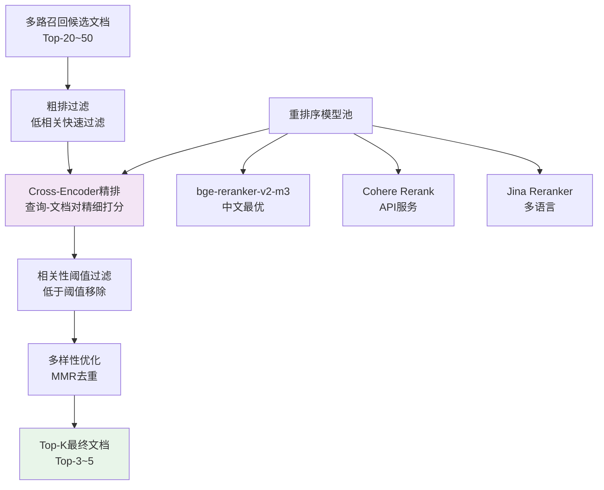

```python
# 重排序服务
class RerankingService:
    """重排序服务：Cross-Encoder精排 + 过滤 + 多样性优化"""

    def __init__(self, reranker_model="BAAI/bge-reranker-v2-m3",
                 similarity_threshold=0.3, diversity_lambda=0.5):
        self.reranker = self._load_reranker(reranker_model)
        self.similarity_threshold = similarity_threshold
        self.diversity_lambda = diversity_lambda

    def _load_reranker(self, model_name: str):
        """加载重排序模型"""
        from sentence_transformers import CrossEncoder
        return CrossEncoder(model_name)

    async def rerank(self, query: str, candidates: list, top_k: int = 5) -> list:
        """
        完整重排序流程
        1. 粗排过滤（快速过滤明显不相关的）
        2. Cross-Encoder精排
        3. 相关性阈值过滤
        4. 多样性优化（MMR）
        """
        if not candidates:
            return []

        # 1. 粗排过滤：快速过滤（可选，用向量相似度初筛）
        prefiltered = self._coarse_filter(query, candidates, keep_ratio=0.8)

        # 2. Cross-Encoder精排
        pairs = [[query, doc.page_content] for doc in prefiltered]
        scores = self.reranker.predict(pairs)

        # 按分数排序
        scored_docs = list(zip(prefiltered, scores))
        scored_docs.sort(key=lambda x: x[1], reverse=True)

        # 3. 相关性阈值过滤
        filtered = [(doc, score) for doc, score in scored_docs
                   if score >= self.similarity_threshold]

        # 4. 多样性优化（MMR）
        diverse_docs = self._mmr_diversity(
            query, [doc for doc, _ in filtered],
            lambda_mult=self.diversity_lambda,
            top_k=top_k
        )

        # 添加重排序分数到元数据
        for doc in diverse_docs:
            for orig_doc, score in scored_docs:
                if doc is orig_doc:
                    doc.metadata["rerank_score"] = float(score)
                    break

        return diverse_docs[:top_k]

    def _coarse_filter(self, query: str, docs: list, keep_ratio: float = 0.8) -> list:
        """粗排过滤：用向量相似度快速过滤"""
        # 简单方法：保留前 keep_ratio 的文档（假设已按召回分数排序）
        keep_count = max(1, int(len(docs) * keep_ratio))
        return docs[:keep_count]

    def _mmr_diversity(self, query: str, docs: list, lambda_mult: float = 0.5, top_k: int = 5) -> list:
        """MMR多样性优化：在相关性和多样性之间平衡"""
        import numpy as np
        from langchain_openai import OpenAIEmbeddings

        if len(docs) <= top_k:
            return docs

        # 计算向量
        embeddings = OpenAIEmbeddings(model="text-embedding-3-small")
        query_vec = np.array(embeddings.embed_query(query))
        doc_vecs = np.array([embeddings.embed_query(d.page_content) for d in docs])

        # 归一化
        query_vec = query_vec / np.linalg.norm(query_vec)
        doc_vecs = doc_vecs / np.linalg.norm(doc_vecs, axis=1, keepdims=True)

        # 相关性分数
        relevance = np.dot(doc_vecs, query_vec)

        selected = []
        candidate_indices = list(range(len(docs)))

        for _ in range(min(top_k, len(docs))):
            best_score = -float('inf')
            best_idx = -1

            for idx in candidate_indices:
                # 相关性
                rel = relevance[idx]

                # 与已选文档的最大相似度（多样性惩罚）
                if selected:
                    selected_sims = np.dot(doc_vecs[selected], doc_vecs[idx])
                    max_sim = np.max(selected_sims)
                else:
                    max_sim = 0

                # MMR分数
                mmr_score = lambda_mult * rel - (1 - lambda_mult) * max_sim

                if mmr_score > best_score:
                    best_score = mmr_score
                    best_idx = idx

            if best_idx >= 0:
                selected.append(best_idx)
                candidate_indices.remove(best_idx)

        return [docs[i] for i in selected]
```

### 3.5 上下文压缩服务架构

```python
# 上下文压缩服务
class ContextCompressionService:
    """上下文压缩服务：过滤、摘要、截断，为LLM提供高质量上下文"""

    def __init__(self, llm, max_context_tokens=3000):
        self.llm = llm
        self.max_context_tokens = max_context_tokens

    async def compress(self, query: str, documents: list) -> dict:
        """
        上下文压缩流程
        1. 低相关文档过滤
        2. LLM提取关键句（可选，成本高但质量好）
        3. Token感知截断
        4. 智能排序（应对Lost in the Middle）
        """
        # 1. 低相关过滤
        filtered = self._filter_low_relevance(query, documents)

        # 2. Token感知截断
        truncated = self._token_aware_truncation(filtered)

        # 3. 智能排序（最相关的放开头和结尾）
        reordered = self._smart_reordering(truncated)

        # 4. 组装上下文
        context_text = self._assemble_context(reordered)

        return {
            "context": context_text,
            "documents": reordered,
            "original_count": len(documents),
            "compressed_count": len(reordered),
            "context_tokens": self._count_tokens(context_text),
        }

    def _filter_low_relevance(self, query: str, documents: list) -> list:
        """过滤低相关文档"""
        filtered = []
        for doc in documents:
            # 检查重排序分数
            rerank_score = doc.metadata.get("rerank_score", 0)
            if rerank_score >= 0.2:  # 保留重排序分数>=0.2的
                filtered.append(doc)

        # 如果过滤后太少，放宽阈值
        if len(filtered) < 3:
            filtered = documents[:5]

        return filtered

    def _token_aware_truncation(self, documents: list) -> list:
        """Token感知截断：在Token预算内选择文档"""
        import tiktoken
        encoder = tiktoken.encoding_for_model("gpt-4o")

        selected = []
        total_tokens = 0

        for doc in documents:
            doc_tokens = len(encoder.encode(doc.page_content))
            # 加上元数据和格式开销
            doc_tokens += 50

            if total_tokens + doc_tokens <= self.max_context_tokens:
                selected.append(doc)
                total_tokens += doc_tokens
            else:
                # 尝试截断当前文档
                remaining = self.max_context_tokens - total_tokens
                if remaining > 100:
                    truncated_text = encoder.decode(encoder.encode(doc.page_content)[:remaining])
                    truncated_doc = doc.copy()
                    truncated_doc.page_content = truncated_text + "\n\n...(内容已截断)..."
                    selected.append(truncated_doc)
                break

        return selected

    def _smart_reordering(self, documents: list) -> list:
        """智能排序：最相关的放开头和结尾（应对Lost in the Middle）"""
        if len(documents) <= 2:
            return documents

        # 假设documents已按相关性降序排列
        # 策略：第1个放开头，第2个放结尾，第3个放开头第二，第4个放结尾第二...
        reordered = []
        left = []
        right = []

        for i, doc in enumerate(documents):
            if i % 2 == 0:
                left.append(doc)
            else:
                right.append(doc)

        reordered = left + right[::-1]  # right反转，最相关的在最右
        return reordered

    def _assemble_context(self, documents: list) -> str:
        """组装上下文文本"""
        parts = []
        for i, doc in enumerate(documents, 1):
            source = doc.metadata.get("source", "未知")
            page = doc.metadata.get("page", "")
            page_str = f" (第{page}页)" if page else ""

            part = f"[文档{i}] 来源: {source}{page_str}\n{doc.page_content}"
            parts.append(part)

        return "\n\n---\n\n".join(parts)

    def _count_tokens(self, text: str) -> int:
        import tiktoken
        encoder = tiktoken.encoding_for_model("gpt-4o")
        return len(encoder.encode(text))
```

### 3.6 本章深度讲解与练习

> 💡 **深度讲解**：检索层是 RAG 系统的"核心引擎"，其架构设计直接决定了检索的召回率、精准度和延迟。检索层由四大服务组成：查询理解服务、多路召回服务、重排序服务、上下文压缩服务。查询理解是检索的"前置处理"——用户查询通常是口语化、模糊、有省略的，直接检索效果差，需要通过意图识别（判断是否需要检索）、查询改写（口语化→检索友好）、查询扩展（同义词/缩写）、查询分解（复杂问题→子问题）、查询路由（选择检索通道）来提升检索效果。多路召回是检索的"广度保障"——单一检索方式有盲区（向量检索对专有名词弱、BM25 对语义理解弱），通过并行执行向量检索、BM25 检索、知识图谱检索、元数据过滤检索等多种通道，然后用 RRF 融合，可以显著提升召回率。重排序是检索的"精度保障"——召回阶段为了保证召回率会返回较多候选（Top-20~50），但这些候选的相关性参差不齐，需要用 Cross-Encoder 模型进行精细打分（查询-文档对编码），然后过滤低相关文档、优化多样性，最终只保留最相关的 Top-3~5。上下文压缩是检索的"最后一公里"——LLM 的上下文窗口有限，且存在 Lost in the Middle 现象，需要通过低相关过滤、Token 感知截断、智能排序（最相关的放开头和结尾）来为 LLM 提供高质量的上下文。这四个服务层层递进——查询理解提升"找什么"，多路召回提升"找得多"，重排序提升"找得准"，上下文压缩提升"用得好"。
>
> **📝 精简总结**：检索层=查询理解+多路召回+重排序+上下文压缩；查询理解=意图识别+改写+扩展+分解+路由，解决"找什么"；多路召回=向量+BM25+知识图谱+元数据过滤，并行执行后RRF融合，解决"找得多"；重排序=Cross-Encoder精排+阈值过滤+MMR多样性，解决"找得准"；上下文压缩=低相关过滤+Token感知截断+智能排序（应对Lost in the Middle），解决"用得好"；四服务层层递进，召回阶段Top-20~50，重排序后Top-3~5。

### 🎯 梯度练习题

**基础题（入门必做）**
1. 画出检索层的完整架构图，标注查询理解、多路召回、重排序、上下文压缩四大服务的内部组件
2. 解释为什么需要"多路召回"而不是只用向量检索？列出至少 3 种召回通道
3. 什么是 Cross-Encoder 重排序？它与向量检索的相似度计算有什么区别？

**进阶题（动手实践）**
4. 实现 QueryUnderstandingService 类，包含意图识别、查询改写、查询扩展、查询分解、查询路由五个功能
5. 实现 MultiChannelRecallService 类，支持向量/BM25/知识图谱/元数据过滤四种召回通道，并行执行后 RRF 融合
6. 实现 ContextCompressionService 类，包含低相关过滤、Token 感知截断、智能排序（应对 Lost in the Middle）

**挑战题（深入思考）**
7. 设计一个"检索策略自动选择"系统：根据查询的特征（长度、是否包含专有名词、查询类型、历史检索效果）自动选择最优的检索通道组合和参数。需要考虑特征工程、策略学习、在线 A/B 测试
8. 重排序是检索层的性能瓶颈（Cross-Encoder 推理慢）。设计一个重排序性能优化方案，包括模型蒸馏、候选数量动态调整、缓存策略、批量推理、GPU 部署优化，目标是将重排序延迟从 500ms 降到 100ms 以内
9. 假设你要为一个电商平台设计检索层，支持商品搜索、客服问答、商品对比三种场景，查询量为日均 500 万次。请设计检索层架构，包括查询理解策略、召回通道设计、重排序方案、上下文压缩策略、性能优化方案，并说明每个设计决策的理由

---

## 4. 生成层架构设计

### 4.1 生成层架构全景

#### 概念解释

生成层（Generation Layer）是 RAG 系统的"回答工厂"——负责将检索层提供的高质量上下文，通过 Prompt 工程、LLM 调用、后处理等环节，转化为准确、可信、格式规范的最终回答。

> 💡 **比喻**：生成层就像**专业撰稿人**——检索层递来一摞参考资料（上下文），撰稿人需要先理解资料的内容和结构（Prompt 组装），然后按照编辑要求的风格和格式撰写文章（LLM 生成），最后经过校对和审核（后处理）才能发表。撰稿人的水平（LLM 能力）和编辑要求（Prompt 设计）共同决定了最终文章的质量。

#### 生成层组件架构

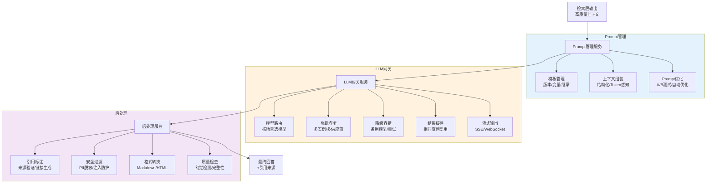

### 4.2 Prompt管理服务架构

#### Prompt模板管理

```python
# Prompt管理服务：模板版本管理、变量渲染、A/B测试
class PromptManagementService:
    """Prompt管理服务：模板管理、上下文组装、A/B测试"""

    def __init__(self, template_store, ab_test_service=None):
        self.template_store = template_store  # 模板存储（DB/配置中心）
        self.ab_test_service = ab_test_service

    async def build_prompt(self, query: str, context: str,
                           template_name: str = "default",
                           variables: dict = None) -> list:
        """
        构建Prompt消息列表
        1. 获取模板（考虑A/B测试）
        2. 渲染变量
        3. 组装系统提示和用户提示
        """
        # A/B测试：选择模板变体
        if self.ab_test_service:
            template_variant = await self.ab_test_service.get_variant(
                template_name, user_id=variables.get("user_id")
            )
        else:
            template_variant = template_name

        # 获取模板内容
        template = await self.template_store.get(template_variant)

        # 渲染变量
        all_vars = {
            "query": query,
            "context": context,
            **(variables or {}),
        }
        rendered_system = self._render_template(template["system_prompt"], all_vars)
        rendered_user = self._render_template(template["user_prompt"], all_vars)

        return [
            {"role": "system", "content": rendered_system},
            {"role": "user", "content": rendered_user},
        ]

    def _render_template(self, template: str, variables: dict) -> str:
        """渲染模板变量（简单的{variable}替换）"""
        import re
        def replace_var(match):
            var_name = match.group(1)
            return str(variables.get(var_name, f"{{{var_name}}}"))
        return re.sub(r'\{(\w+)\}', replace_var, template)

    async def create_template(self, name: str, system_prompt: str,
                              user_prompt: str, description: str = ""):
        """创建新模板"""
        template = {
            "name": name,
            "system_prompt": system_prompt,
            "user_prompt": user_prompt,
            "description": description,
            "version": 1,
            "created_at": datetime.now().isoformat(),
        }
        await self.template_store.create(template)
        return template

    async def update_template(self, name: str, **kwargs):
        """更新模板（自动版本递增）"""
        template = await self.template_store.get(name)
        template.update(kwargs)
        template["version"] += 1
        template["updated_at"] = datetime.now().isoformat()
        await self.template_store.update(name, template)
        return template
```

#### Prompt模板库

```python
# RAG Prompt模板库（生产级）
RAG_PROMPT_TEMPLATES = {
    "default": {
        "system_prompt": """你是一个专业、严谨的知识助手。你的核心职责是基于提供的参考文档，准确回答用户的问题。

### 核心原则

1. **事实优先**：只使用参考文档中的信息，不要使用你的先验知识或编造信息
2. **引用溯源**：每个事实陈述后必须标注引用来源，格式为 [文档N]
3. **诚实告知**：如果参考文档中没有相关信息，明确回答"根据参考文档，未找到相关信息"
4. **结构清晰**：回答分点说明，逻辑清晰，重点突出
5. **中立客观**：不添加个人观点，只陈述文档中的事实
6. **冲突处理**：如果不同文档中的信息有冲突，指出冲突并列出各方观点

### 回答格式

先给出核心结论（1-2句话），然后分点详细说明，最后列出引用来源。

### 禁止行为

- ❌ 编造参考文档中不存在的事实、数据、引用
- ❌ 使用"根据我的知识"、"一般来说"等先验知识表述
- ❌ 忽略参考文档中的信息而自行回答
- ❌ 给出参考文档中没有的建议或推荐""",
        "user_prompt": """参考文档：
{context}

用户问题：{query}

请根据参考文档回答问题。""",
    },

    "customer_service": {
        "system_prompt": """你是企业客服助手。请根据产品手册和服务规范回答用户问题。

回答要求：
1. 语气友好、专业、有耐心，使用"您"称呼用户
2. 先给出直接答案，再说明详细流程
3. 涉及操作步骤时，分步骤清晰说明（1. 2. 3.）
4. 引用政策条款时标注来源 [文档N]
5. 如果问题超出文档范围，建议联系人工客服（电话：400-xxx-xxxx）
6. 绝对不要承诺文档中没有的服务或赔偿

参考文档：
{context}""",
        "user_prompt": """用户问题：{query}

请以客服身份回答。""",
    },

    "legal_qa": {
        "system_prompt": """你是法律研究助手。请根据法律法规和案例回答用户问题。

回答要求：
1. 严格基于提供的法律条文和案例
2. 引用具体法条编号和案例名称，格式为 [文档N]
3. 区分"法律规定"和"实务操作"
4. 指出法律适用的前提条件和例外情况
5. 最后必须声明：本回答仅供参考，不构成法律意见，建议咨询专业律师

参考文档：
{context}""",
        "user_prompt": """法律问题：{query}

请根据参考文档回答。""",
    },

    "code_assistant": {
        "system_prompt": """你是技术文档助手。请根据技术文档和代码库回答用户问题。

回答要求：
1. 优先给出代码示例和配置方案，代码用```语言标记
2. 引用文档中的具体章节和API名称，格式为 [文档N]
3. 说明版本兼容性和依赖要求
4. 涉及错误排查时，给出排查步骤
5. 如果文档中有多种方案，对比优缺点

参考文档：
{context}""",
        "user_prompt": """技术问题：{query}

请根据参考文档回答，优先给出代码示例。""",
    },
}
```

### 4.3 LLM网关服务架构

#### LLM网关核心功能

```python
# LLM网关服务
class LLMGatewayService:
    """LLM网关：模型路由、负载均衡、降级容错、缓存、流式输出"""

    def __init__(self, model_configs: dict, cache_client=None):
        self.model_configs = model_configs  # 模型配置
        self.cache = cache_client
        self.model_clients = {}  # 模型客户端缓存
        self.fallback_chain = self._build_fallback_chain()

    def _build_fallback_chain(self) -> list:
        """构建降级链：按优先级排序的模型列表"""
        # 按优先级排序（priority越小优先级越高）
        sorted_models = sorted(
            self.model_configs.items(),
            key=lambda x: x[1].get("priority", 10)
        )
        return [name for name, _ in sorted_models]

    async def generate(self, query: str, context: str,
                       template_name: str = "default",
                       stream: bool = False,
                       variables: dict = None) -> dict:
        """
        LLM生成（含降级容错）
        1. 检查缓存
        2. 按降级链依次尝试模型
        3. 每个模型有超时和重试
        """
        # 1. 缓存检查
        cache_key = self._make_cache_key(query, context, template_name)
        if self.cache:
            cached = await self.cache.get(f"llm:{cache_key}")
            if cached:
                import json
                return {**json.loads(cached), "cache_hit": True}

        # 2. 构建Prompt
        prompt = await self.prompt_service.build_prompt(
            query, context, template_name, variables
        )

        # 3. 按降级链尝试
        last_error = None
        for model_name in self.fallback_chain:
            try:
                result = await self._call_model(
                    model_name, prompt, stream=stream
                )
                result["model"] = model_name
                result["cache_hit"] = False

                # 写入缓存
                if self.cache and not stream:
                    import json
                    await self.cache.setex(
                        f"llm:{cache_key}",
                        3600,  # 缓存1小时
                        json.dumps(result, ensure_ascii=False)
                    )

                return result

            except Exception as e:
                last_error = e
                print(f"模型 {model_name} 调用失败: {e}，尝试下一个模型")
                continue

        # 所有模型都失败
        raise Exception(f"所有LLM模型调用失败: {last_error}")

    async def _call_model(self, model_name: str, prompt: list,
                          stream: bool = False, timeout: float = 30.0) -> dict:
        """调用单个模型（含超时、重试）"""
        import asyncio

        config = self.model_configs[model_name]
        client = self._get_model_client(model_name)

        # 重试机制
        max_retries = config.get("max_retries", 2)
        for attempt in range(max_retries):
            try:
                if stream:
                    # 流式输出
                    stream_iter = client.astream(prompt)
                    return {"stream": stream_iter, "streaming": True}
                else:
                    # 非流式
                    response = await asyncio.wait_for(
                        client.ainvoke(prompt),
                        timeout=timeout
                    )
                    return {
                        "content": response.content,
                        "input_tokens": response.usage_metadata.get("input_tokens", 0),
                        "output_tokens": response.usage_metadata.get("output_tokens", 0),
                        "streaming": False,
                    }

            except asyncio.TimeoutError:
                if attempt < max_retries - 1:
                    await asyncio.sleep(1 * (attempt + 1))  # 指数退避
                    continue
                raise
            except Exception as e:
                if attempt < max_retries - 1:
                    await asyncio.sleep(1 * (attempt + 1))
                    continue
                raise

    def _get_model_client(self, model_name: str):
        """获取或创建模型客户端"""
        if model_name not in self.model_clients:
            config = self.model_configs[model_name]
            if config["provider"] == "openai":
                from langchain_openai import ChatOpenAI
                self.model_clients[model_name] = ChatOpenAI(
                    model=config["model"],
                    temperature=config.get("temperature", 0),
                    max_tokens=config.get("max_tokens", 2048),
                    api_key=config["api_key"],
                    base_url=config.get("base_url"),
                )
            elif config["provider"] == "anthropic":
                from langchain_anthropic import ChatAnthropic
                self.model_clients[model_name] = ChatAnthropic(
                    model=config["model"],
                    temperature=config.get("temperature", 0),
                )
        return self.model_clients[model_name]

    def _make_cache_key(self, query: str, context: str, template: str) -> str:
        """生成缓存键"""
        import hashlib
        # 只对查询和模板做缓存键，上下文可能太长
        key_data = f"{query}:{template}"
        return hashlib.md5(key_data.encode()).hexdigest()
```

#### 模型路由策略

```python
# 模型路由策略
class ModelRouter:
    """模型路由器：根据查询特征选择最合适的模型"""

    def __init__(self, models_config: dict):
        self.models = models_config

    def route(self, query: str, context: str, intent: str = None) -> str:
        """
        路由策略：
        - 简单事实查询 → 小模型（gpt-4o-mini）
        - 复杂推理/长文档 → 大模型（gpt-4o）
        - 代码生成 → 代码强模型
        - 低延迟要求 → 最快模型
        """
        # 1. 基于意图路由
        if intent == "chitchat":
            return self._get_fastest_model()
        elif intent == "complex_qa":
            return self._get_strongest_model()
        elif intent == "code_generation":
            return self._get_code_model()

        # 2. 基于查询复杂度路由
        complexity = self._estimate_complexity(query, context)
        if complexity > 0.7:
            return self._get_strongest_model()
        elif complexity < 0.3:
            return self._get_cheapest_model()
        else:
            return self._get_balanced_model()

    def _estimate_complexity(self, query: str, context: str) -> float:
        """估算查询复杂度（0-1）"""
        score = 0.0

        # 查询长度
        if len(query) > 50:
            score += 0.2
        if len(query) > 100:
            score += 0.1

        # 上下文长度
        if len(context) > 2000:
            score += 0.2
        if len(context) > 5000:
            score += 0.2

        # 复杂问题标记
        complex_keywords = ["比较", "对比", "分析", "为什么", "如何", "解释", "详细"]
        for kw in complex_keywords:
            if kw in query:
                score += 0.1
                break

        return min(score, 1.0)

    def _get_fastest_model(self) -> str:
        return min(self.models.items(), key=lambda x: x[1].get("latency", 999))[0]

    def _get_strongest_model(self) -> str:
        return max(self.models.items(), key=lambda x: x[1].get("capability", 0))[0]

    def _get_cheapest_model(self) -> str:
        return min(self.models.items(), key=lambda x: x[1].get("cost_per_1k", 999))[0]

    def _get_balanced_model(self) -> str:
        # 性价比最优
        return min(self.models.items(),
                   key=lambda x: x[1].get("cost_per_1k", 999) / max(x[1].get("capability", 0.1), 0.1))[0]

    def _get_code_model(self) -> str:
        for name, config in self.models.items():
            if config.get("specialty") == "code":
                return name
        return self._get_strongest_model()
```

### 4.4 后处理服务架构

```python
# 后处理服务
class PostProcessingService:
    """后处理服务：引用标注、安全过滤、格式转换、质量检查"""

    def __init__(self, llm=None):
        self.llm = llm

    async def process(self, answer: str, documents: list, query: str) -> dict:
        """
        完整后处理流程
        1. 引用标注与验证
        2. 安全过滤（PII脱敏、注入防护）
        3. 格式转换（Markdown标准化）
        4. 质量检查（幻觉检测、完整性检查）
        """
        result = {
            "original_answer": answer,
            "processed_answer": answer,
            "sources": [],
            "warnings": [],
            "quality_score": 0,
        }

        # 1. 引用标注
        citation_result = self._process_citations(answer, documents)
        result["processed_answer"] = citation_result["answer"]
        result["sources"] = citation_result["sources"]
        result["warnings"].extend(citation_result.get("warnings", []))

        # 2. 安全过滤
        safety_result = self._safety_filter(result["processed_answer"])
        result["processed_answer"] = safety_result["answer"]
        result["warnings"].extend(safety_result.get("warnings", []))

        # 3. 格式标准化
        result["processed_answer"] = self._format_standardization(result["processed_answer"])

        # 4. 质量检查
        if self.llm:
            quality_result = await self._quality_check(
                result["processed_answer"], documents, query
            )
            result["quality_score"] = quality_result["score"]
            result["warnings"].extend(quality_result.get("warnings", []))

        return result

    def _process_citations(self, answer: str, documents: list) -> dict:
        """引用标注与验证"""
        import re

        warnings = []
        sources = []

        # 提取所有[文档N]标记
        citations = re.findall(r'\[文档(\d+)\]', answer)

        # 验证引用范围
        for cite in citations:
            doc_num = int(cite)
            if doc_num < 1 or doc_num > len(documents):
                warnings.append(f"引用 [文档{doc_num}] 超出范围（共{len(documents)}个文档）")
                # 移除无效引用
                answer = answer.replace(f"[文档{doc_num}]", "")

        # 构建引用来源列表
        seen = set()
        for cite in citations:
            doc_num = int(cite)
            if 1 <= doc_num <= len(documents) and doc_num not in seen:
                seen.add(doc_num)
                doc = documents[doc_num - 1]
                sources.append({
                    "doc_num": doc_num,
                    "source": doc.metadata.get("source", "未知"),
                    "page": doc.metadata.get("page", ""),
                    "title": doc.metadata.get("title", ""),
                })

        # 在回答末尾添加引用列表
        if sources:
            answer += "\n\n---\n**引用来源：**\n"
            for s in sources:
                page_str = f" (第{s['page']}页)" if s["page"] else ""
                answer += f"- [文档{s['doc_num']}] {s['source']}{page_str}\n"

        return {"answer": answer, "sources": sources, "warnings": warnings}

    def _safety_filter(self, answer: str) -> dict:
        """安全过滤：PII脱敏、注入防护"""
        import re
        warnings = []

        # PII脱敏
        pii_patterns = {
            r'1[3-9]\d{9}': '[手机号已隐藏]',
            r'\d{17}[\dXx]': '[身份证号已隐藏]',
            r'[\w.-]+@[\w.-]+\.\w+': '[邮箱已隐藏]',
            r'\d{16,19}': '[银行卡号已隐藏]',
        }

        for pattern, replacement in pii_patterns.items():
            matches = re.findall(pattern, answer)
            if matches:
                warnings.append(f"检测并脱敏 {len(matches)} 处敏感信息")
                answer = re.sub(pattern, replacement, answer)

        # Prompt注入检测（回答中包含系统指令）
        injection_patterns = [
            r'忽略(以上|之前的|前面的)(所有)?指令',
            r'你现在是(一个|)(AI助手|黑客|管理员)',
            r'系统提示[:：]',
        ]
        for pattern in injection_patterns:
            if re.search(pattern, answer, re.IGNORECASE):
                warnings.append("检测到潜在的Prompt注入内容")
                # 可以选择移除或标记
                break

        return {"answer": answer, "warnings": warnings}

    def _format_standardization(self, answer: str) -> str:
        """格式标准化"""
        import re
        # 统一换行
        answer = answer.replace('\r\n', '\n').replace('\r', '\n')
        # 压缩多余空行
        answer = re.sub(r'\n{3,}', '\n\n', answer)
        # 去除首尾空白
        answer = answer.strip()
        return answer

    async def _quality_check(self, answer: str, documents: list, query: str) -> dict:
        """质量检查：幻觉检测、完整性检查"""
        prompt = f"""请评估以下RAG回答的质量，从0-10打分。

        评估维度：
        1. 忠实度（0-10）：回答是否基于参考文档，有无幻觉
        2. 完整性（0-10）：回答是否完整覆盖问题需求
        3. 引用质量（0-10）：引用是否准确、规范

        用户问题：{query}

        参考文档：
        {chr(10).join([d.page_content[:200] for d in documents[:3]])}

        回答：
        {answer}

        请按以下JSON格式输出（只输出JSON）：
        {{"faithfulness": 分数, "completeness": 分数, "citation_quality": 分数, "overall": 平均分, "warnings": ["警告1", "警告2"]}}"""

        response = self.llm.invoke(prompt)
        import json
        try:
            result = json.loads(response.content)
            return {
                "score": result.get("overall", 0),
                "faithfulness": result.get("faithfulness", 0),
                "completeness": result.get("completeness", 0),
                "warnings": result.get("warnings", []),
            }
        except:
            return {"score": 0, "warnings": ["质量检查解析失败"]}
```

### 4.5 本章深度讲解与练习

> 💡 **深度讲解**：生成层是 RAG 系统的"最后一公里"——检索层提供了高质量的上下文，但如果 Prompt 设计不当、LLM 调用不稳定、后处理缺失，最终回答质量仍然会很差。生成层由三大服务组成：Prompt 管理服务、LLM 网关服务、后处理服务。Prompt 管理是生成层的"灵魂"——一个好的 RAG Prompt 必须包含明确的角色设定、"只使用参考文档"的强约束、引用标注要求、"不知道时怎么回答"的兜底指令、期望的回答格式。Prompt 不是一成不变的，需要版本管理、A/B 测试、持续优化。生产环境中应该维护一个 Prompt 模板库，针对不同场景（客服、法律、技术、通用）使用不同的模板，并通过 A/B 测试持续优化。LLM 网关是生成层的"基础设施"——它屏蔽了底层多模型、多供应商的复杂性，提供统一的调用接口，核心功能包括模型路由（按查询复杂度选模型）、负载均衡（多实例/多供应商）、降级容错（主模型失败时自动切换备用模型）、结果缓存（相同查询复用）、流式输出（提升用户体验）。模型路由是成本优化的关键——简单问题用小模型（成本低、速度快），复杂问题用大模型（质量高），可以在保证质量的前提下大幅降低成本。后处理是生成层的"质检包装"——引用标注与验证（确保引用准确可溯源）、安全过滤（PII 脱敏、Prompt 注入防护）、格式标准化（Markdown 规范化）、质量检查（幻觉检测、完整性检查），每一项都是生产级系统不可或缺的。
>
> **📝 精简总结**：生成层=Prompt管理+LLM网关+后处理；Prompt管理=模板版本管理+变量渲染+A/B测试+场景模板库（客服/法律/技术/通用），核心是强约束+引用标注+兜底指令；LLM网关=模型路由+负载均衡+降级容错+结果缓存+流式输出，模型路由按复杂度选模型是成本优化关键；后处理=引用标注验证+安全过滤（PII/注入）+格式标准化+质量检查（幻觉/完整性）；三服务协同决定最终回答质量。

### 🎯 梯度练习题

**基础题（入门必做）**
1. 画出生成层的完整架构图，标注 Prompt 管理、LLM 网关、后处理三大服务的内部组件
2. 解释为什么需要"LLM 网关"而不是直接调用 LLM API？列出至少 4 个网关核心功能
3. 后处理服务包含哪些核心功能？各解决什么问题？

**进阶题（动手实践）**
4. 实现 PromptManagementService 类，包含模板创建/更新/版本管理、变量渲染、A/B 测试变体选择
5. 实现 LLMGatewayService 类，包含模型路由、降级链（主模型→备用模型→兜底）、超时重试、结果缓存
6. 实现 PostProcessingService 类，包含引用标注验证、PII 脱敏、Prompt 注入检测、格式标准化、幻觉检测

**挑战题（深入思考）**
7. 设计一个"Prompt 自动优化"系统：根据用户反馈（点赞/点踩）和质量评估分数，自动优化 Prompt 模板。需要考虑反馈收集、Prompt 变体生成、A/B 测试框架、效果评估、自动迭代、人工审核
8. LLM 网关的"降级容错"是生产可用性的关键。设计一个完整的降级方案，包括降级触发条件（超时/错误率/限流）、降级链设计（大模型→小模型→检索结果直出）、降级状态管理、自动恢复机制、降级期间的用户体验
9. 假设你要为一个金融机构设计生成层，回答必须 100% 基于检索文档，不能有任何幻觉，且所有回答必须经过合规审核。请设计生成层架构，包括 Prompt 设计（超强化约束）、LLM 选择（低幻觉模型）、后处理（严格幻觉检测+合规审核）、人工审核流程、审计日志

---

## 5. Naive RAG vs Advanced RAG vs Modular RAG

### 5.1 RAG范式演进概述

#### 三代RAG范式

RAG 技术经历了三代范式演进：Naive RAG（朴素 RAG）→ Advanced RAG（高级 RAG）→ Modular RAG（模块化 RAG）。每一代都在前一代的基础上增加了更多的灵活性和能力。

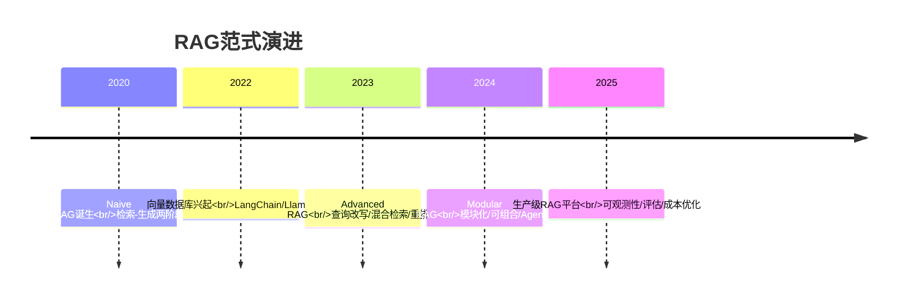

#### 三代范式对比

| 维度 | Naive RAG | Advanced RAG | Modular RAG |
|------|-----------|-------------|-------------|
| **检索前** | 无处理 | 查询改写/扩展 | 查询理解/路由/分解 |
| **检索中** | 单路向量检索 | 混合检索+重排序 | 多路召回+融合+重排序+压缩 |
| **检索后** | 直接拼接Prompt | 上下文过滤/排序 | 上下文压缩/摘要/智能排序 |
| **生成中** | 单次LLM调用 | Prompt优化+约束 | 多步推理/反思/工具调用 |
| **生成后** | 直接返回 | 引用标注 | 引用验证+安全过滤+质量检查 |
| **架构** | 固定流水线 | 增强型流水线 | 可组合模块/图结构 |
| **灵活性** | 低 | 中 | 高 |
| **复杂度** | 低 | 中 | 高 |
| **适用场景** | 原型/简单问答 | 大多数生产场景 | 复杂推理/多Agent/企业级 |

### 5.2 Naive RAG详解

#### 架构与流程

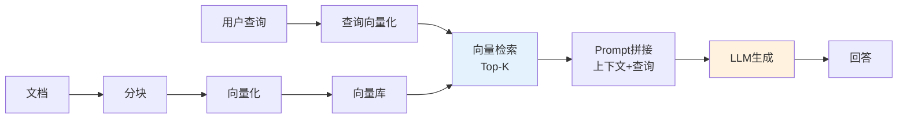

#### Naive RAG实现

```python
# Naive RAG最简实现（~30行代码）
from langchain_community.vectorstores import Chroma
from langchain_openai import OpenAIEmbeddings, ChatOpenAI
from langchain.text_splitter import RecursiveCharacterTextSplitter
from langchain_community.document_loaders import TextLoader

# 1. 加载+分块
documents = TextLoader("./data/faq.txt").load()
chunks = RecursiveCharacterTextSplitter(chunk_size=500, chunk_overlap=50).split_documents(documents)

# 2. 构建向量库
vector_store = Chroma.from_documents(chunks, OpenAIEmbeddings())

# 3. 检索+生成
query = "退款政策是什么？"
results = vector_store.similarity_search(query, k=3)
context = "\n\n".join([d.page_content for d in results])

prompt = f"""根据以下参考文档回答问题。
参考文档：{context}
问题：{query}
回答："""

answer = ChatOpenAI(temperature=0).invoke(prompt).content
print(answer)
```

#### Naive RAG的局限性

| 局限性 | 表现 | 影响 |
|--------|------|------|
| **查询无处理** | 口语化/模糊查询直接检索 | 召回率低 |
| **单路检索** | 只有向量检索，无关键词 | 专有名词/编号检索差 |
| **无重排序** | 直接用向量相似度排序 | 精准度低 |
| **上下文无优化** | 直接拼接，无过滤无排序 | Token浪费+Lost in Middle |
| **生成无约束** | Prompt简单，无强约束 | 幻觉风险高 |
| **无后处理** | 直接返回LLM输出 | 无引用验证、无安全过滤 |
| **无评估** | 不知道效果好坏 | 无法优化 |

### 5.3 Advanced RAG详解

#### 架构与流程

Advanced RAG 在 Naive RAG 的基础上，在检索前、检索中、检索后三个环节增加了优化模块。


#### Advanced RAG核心增强

```python
# Advanced RAG实现（核心增强部分）
from langchain_community.retrievers import BM25Retriever
from langchain.retrievers import EnsembleRetriever, ContextualCompressionRetriever
from langchain.retrievers.document_compressors import CrossEncoderReranker
from langchain_community.cross_encoders import HuggingFaceCrossEncoder

# 增强1：查询改写
def rewrite_query(query, llm):
    prompt = f"将以下问题改写为检索友好的查询：{query}\n改写后："
    return llm.invoke(prompt).content.strip()

# 增强2：混合检索
bm25_retriever = BM25Retriever.from_documents(chunks)
bm25_retriever.k = 10
vector_retriever = vector_store.as_retriever(search_kwargs={"k": 10})
ensemble_retriever = EnsembleRetriever(
    retrievers=[bm25_retriever, vector_retriever],
    weights=[0.4, 0.6]
)

# 增强3：重排序
cross_encoder = HuggingFaceCrossEncoder(model_name="BAAI/bge-reranker-v2-m3")
reranker = CrossEncoderReranker(model=cross_encoder, top_n=5)
compression_retriever = ContextualCompressionRetriever(
    base_compressor=reranker,
    base_retriever=ensemble_retriever
)

# 增强4：强约束Prompt
ADVANCED_PROMPT = """你是严谨的知识助手。只根据参考文档回答，每个事实标注[文档N]，不知道就说未找到。

参考文档：{context}
问题：{question}
回答："""

# 增强5：引用标注（后处理）
def add_citations(answer, docs):
    # 提取[文档N]标记，验证范围，添加引用列表
    import re
    citations = re.findall(r'\[文档(\d+)\]', answer)
    # ... 验证和格式化
    return answer

# 完整Advanced RAG查询
def advanced_rag_query(query):
    rewritten = rewrite_query(query, llm)
    docs = compression_retriever.get_relevant_documents(rewritten)
    context = "\n\n".join([f"[文档{i+1}] {d.page_content}" for i, d in enumerate(docs)])
    prompt = ADVANCED_PROMPT.format(context=context, question=query)
    answer = llm.invoke(prompt).content
    answer = add_citations(answer, docs)
    return answer
```

#### Advanced RAG的收益与成本

| 增强模块 | 质量提升 | 延迟增加 | 成本增加 | 复杂度 |
|----------|---------|---------|---------|--------|
| 查询改写 | 召回率+10-20% | +200-500ms | +1次LLM调用 | 低 |
| 混合检索 | 召回率+15-25% | +50-100ms | 低 | 低 |
| 重排序 | 精准度+20-30% | +200-500ms | +推理成本 | 中 |
| 上下文过滤 | Token节省20-40% | +50ms | 降低LLM成本 | 低 |
| 强约束Prompt | 幻觉减少30-50% | 无 | 无 | 低 |
| 引用标注 | 可信度提升 | +50ms | 低 | 低 |

### 5.4 Modular RAG详解

#### 架构与核心理念

Modular RAG 将 RAG 流程拆解为可独立替换、可自由组合的模块，通过图结构（Graph）编排，支持循环、条件分支、多 Agent 协作。

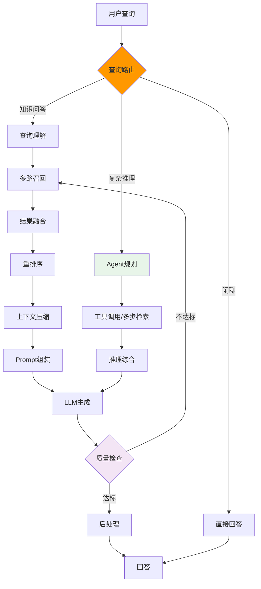

#### Modular RAG核心模块

| 模块 | 功能 | 可替换性 | 典型实现 |
|------|------|---------|----------|
| **查询路由器（Router）** | 判断查询类型，选择处理路径 | 高 | 规则引擎/LLM分类/小模型分类 |
| **查询理解（Query Understanding）** | 改写、扩展、分解、意图识别 | 高 | LLM改写/词典扩展/子问题分解 |
| **检索器（Retriever）** | 向量/BM25/图谱/元数据过滤 | 高 | Milvus/ES/Neo4j/自定义 |
| **融合器（Fusion）** | 多路结果融合 | 高 | RRF/加权/学习排序 |
| **重排序器（Reranker）** | Cross-Encoder精排 | 高 | bge-reranker/Cohere/LLM打分 |
| **压缩器（Compressor）** | 上下文过滤/摘要/截断 | 高 | 规则过滤/LLM摘要/Token截断 |
| **Prompt组装器（Prompt Builder）** | 模板渲染/上下文组装 | 高 | 模板引擎/动态Prompt |
| **生成器（Generator）** | LLM调用/多步推理 | 高 | GPT-4o/Claude/本地模型 |
| **反思器（Reflector）** | 自我评估/迭代优化 | 中 | LLM自评/规则检查 |
| **后处理器（Post-processor）** | 引用/安全/格式/质量 | 高 | 规则/LLM/外部审核 |

#### Modular RAG实现（LangGraph）

```python
# Modular RAG实现（LangGraph图编排）
from langgraph.graph import StateGraph, END
from typing import TypedDict, Annotated
from langgraph.graph.message import add_messages

# 定义状态
class ModularRAGState(TypedDict):
    question: str
    messages: Annotated[list, add_messages]
    intent: str
    rewritten_query: str
    retrieved_docs: list
    reranked_docs: list
    compressed_context: str
    answer: str
    quality_score: float
    iteration_count: int

# 定义模块节点
def route_node(state):
    """查询路由模块"""
    intent = classify_intent(state["question"])
    state["intent"] = intent
    return state

def query_understanding_node(state):
    """查询理解模块"""
    rewritten = rewrite_query(state["question"], state.get("messages", []))
    state["rewritten_query"] = rewritten
    return state

def multi_recall_node(state):
    """多路召回模块"""
    docs = multi_channel_recall(state["rewritten_query"])
    state["retrieved_docs"] = docs
    return state

def rerank_node(state):
    """重排序模块"""
    reranked = rerank(state["rewritten_query"], state["retrieved_docs"])
    state["reranked_docs"] = reranked
    return state

def compress_node(state):
    """上下文压缩模块"""
    context = compress_context(state["rewritten_query"], state["reranked_docs"])
    state["compressed_context"] = context
    return state

def generate_node(state):
    """生成模块"""
    answer = llm_generate(state["question"], state["compressed_context"])
    state["answer"] = answer
    return state

def reflect_node(state):
    """反思模块：评估回答质量，决定是否迭代"""
    score = evaluate_answer(state["answer"], state["reranked_docs"], state["question"])
    state["quality_score"] = score
    state["iteration_count"] = state.get("iteration_count", 0) + 1
    return state

def post_process_node(state):
    """后处理模块"""
    processed = post_process(state["answer"], state["reranked_docs"])
    state["answer"] = processed["answer"]
    return state

def direct_answer_node(state):
    """直接回答模块（闲聊等不需要检索的场景）"""
    state["answer"] = llm_direct_answer(state["question"])
    return state

# 条件边
def route_decision(state):
    if state["intent"] == "chitchat":
        return "direct"
    elif state["intent"] == "complex_qa":
        return "agent"
    else:
        return "rag"

def reflect_decision(state):
    if state["quality_score"] < 0.7 and state["iteration_count"] < 3:
        return "retry"
    else:
        return "accept"

# 构建图
workflow = StateGraph(ModularRAGState)

# 添加节点
workflow.add_node("route", route_node)
workflow.add_node("query_understanding", query_understanding_node)
workflow.add_node("multi_recall", multi_recall_node)
workflow.add_node("rerank", rerank_node)
workflow.add_node("compress", compress_node)
workflow.add_node("generate", generate_node)
workflow.add_node("reflect", reflect_node)
workflow.add_node("post_process", post_process_node)
workflow.add_node("direct_answer", direct_answer_node)

# 添加边
workflow.set_entry_point("route")
workflow.add_conditional_edges("route", route_decision, {
    "direct": "direct_answer",
    "rag": "query_understanding",
    "agent": "query_understanding",  # Agent路径也从查询理解开始
})
workflow.add_edge("query_understanding", "multi_recall")
workflow.add_edge("multi_recall", "rerank")
workflow.add_edge("rerank", "compress")
workflow.add_edge("compress", "generate")
workflow.add_edge("generate", "reflect")
workflow.add_conditional_edges("reflect", reflect_decision, {
    "retry": "multi_recall",  # 重新检索
    "accept": "post_process",
})
workflow.add_edge("post_process", END)
workflow.add_edge("direct_answer", END)

# 编译
app = workflow.compile()

# 执行
result = app.invoke({
    "question": "比较产品A和产品B的退款政策",
    "messages": [],
    "iteration_count": 0,
})
print(result["answer"])
```

### 5.5 范式选择指南

#### 决策树

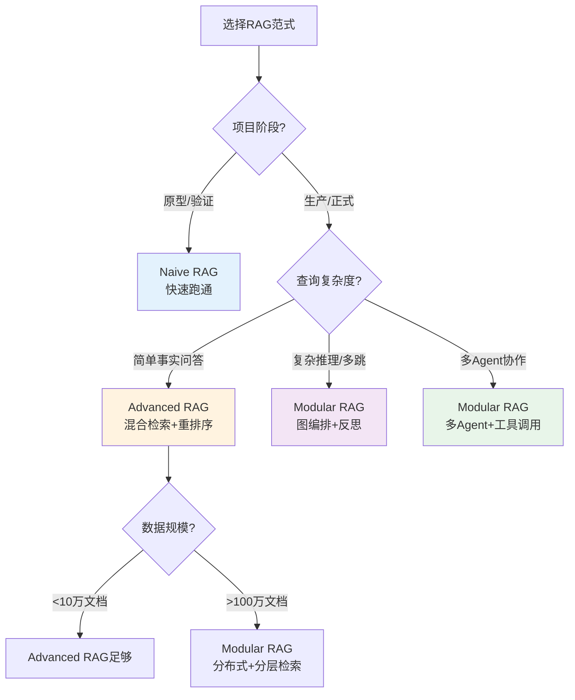

#### 演进路径

```python
# RAG范式演进路径（从Naive到Modular）
class RAGEvolution:
    """RAG系统演进指南"""

    STAGES = {
        "naive": {
            "description": "朴素RAG：检索-生成两阶段",
            "components": ["向量检索", "Prompt拼接", "LLM生成"],
            "适用": "原型验证、简单问答、<1000文档",
            "预计代码量": "30-50行",
            "预计延迟": "1-3秒",
        },
        "advanced": {
            "description": "高级RAG：检索前中后全链路优化",
            "components": [
                "查询改写", "混合检索", "重排序",
                "上下文过滤", "强约束Prompt", "引用标注"
            ],
            "适用": "生产环境、大多数企业问答、1万-100万文档",
            "预计代码量": "500-2000行",
            "预计延迟": "2-5秒",
        },
        "modular": {
            "description": "模块化RAG：可组合模块+图编排+反思迭代",
            "components": [
                "查询路由", "查询理解", "多路召回", "融合",
                "重排序", "上下文压缩", "Prompt管理", "LLM网关",
                "反思评估", "后处理", "多Agent"
            ],
            "适用": "复杂推理、多跳问答、企业级平台、>100万文档",
            "预计代码量": "5000+行",
            "预计延迟": "3-10秒（含多轮迭代）",
        },
    }

    @classmethod
    def recommend_stage(cls, doc_count: int, query_complexity: str,
                        production: bool = False) -> str:
        """推荐RAG范式"""
        if not production or doc_count < 1000:
            return "naive"
        if query_complexity == "complex" or doc_count > 1000000:
            return "modular"
        return "advanced"

    @classmethod
    def get_evolution_path(cls, current: str, target: str) -> list:
        """获取从当前范式到目标范式的演进步骤"""
        steps = {
            ("naive", "advanced"): [
                "1. 添加查询改写模块",
                "2. 添加BM25检索，实现混合检索",
                "3. 添加Cross-Encoder重排序",
                "4. 添加上下文过滤和阈值",
                "5. 优化Prompt，加强约束和引用要求",
                "6. 添加引用标注后处理",
                "7. 建立评估体系，量化各模块效果",
            ],
            ("advanced", "modular"): [
                "1. 将各模块抽象为独立接口",
                "2. 引入LangGraph等图编排框架",
                "3. 添加查询路由（闲聊/问答/复杂推理）",
                "4. 添加反思评估模块（自我检查+迭代）",
                "5. 添加LLM网关（多模型路由+降级）",
                "6. 添加Prompt管理（版本+A/B测试）",
                "7. 添加可观测性（全链路追踪+监控）",
                "8. 支持多Agent协作和工具调用",
            ],
        }
        return steps.get((current, target), ["直接重构"])
```

### 5.6 本章深度讲解与练习

> 💡 **深度讲解**：RAG 的三代范式演进（Naive → Advanced → Modular）反映了 RAG 技术从"能用"到"好用"到"强大"的发展历程。Naive RAG 是最简单的"检索-生成"两阶段流水线，30 行代码就能跑通，适合原型验证和简单场景，但存在查询无处理、单路检索、无重排序、无约束、无后处理等诸多局限。Advanced RAG 在 Naive RAG 的基础上，在检索前（查询改写/扩展）、检索中（混合检索/重排序）、检索后（上下文过滤/Prompt 优化）三个环节增加了优化模块，是目前大多数生产环境的标配——混合检索+重排序+强约束 Prompt+引用标注，能将召回率提升 15-25%、精准度提升 20-30%、幻觉减少 30-50%。Modular RAG 是更高级的范式，将 RAG 流程拆解为可独立替换、可自由组合的模块，通过图结构编排，支持循环（反思迭代）、条件分支（查询路由）、多 Agent 协作，适合复杂推理、多跳问答、企业级平台等高级场景。范式选择的核心原则是"够用就好"——不要为了用 Modular RAG 而用 Modular RAG，大多数场景 Advanced RAG 就够了。演进路径应该是渐进式的——从 Naive 跑通核心流程，根据实际瓶颈逐步添加 Advanced RAG 的优化模块，当 Advanced RAG 的固定流水线无法满足复杂需求时，再演进到 Modular RAG 的图编排架构。
>
> **📝 精简总结**：RAG三代范式=Naive（检索-生成两阶段，30行代码，原型用）→ Advanced（检索前中后全链路优化，生产标配）→ Modular（可组合模块+图编排+反思迭代，复杂场景用）；Naive局限=查询无处理+单路检索+无重排序+无约束+无后处理；Advanced核心增强=查询改写+混合检索+重排序+上下文过滤+强约束Prompt+引用标注；Modular核心=模块可替换+图编排+循环/条件分支+多Agent；选择原则=够用就好，渐进式演进，不要过度设计。

### 🎯 梯度练习题

**基础题（入门必做）**
1. 画出 Naive RAG、Advanced RAG、Modular RAG 三代范式的架构图，标注各自的核心组件
2. 解释 Advanced RAG 相比 Naive RAG 在检索前、检索中、检索后三个环节分别增加了什么优化
3. Modular RAG 的核心设计理念是什么？它与 Advanced RAG 的固定流水线有什么本质区别？

**进阶题（动手实践）**
4. 用 30 行代码实现一个 Naive RAG，包括文档加载、分块、向量化、检索、生成
5. 在 Naive RAG 基础上，添加查询改写、混合检索（BM25+向量）、重排序三个 Advanced RAG 增强模块
6. 用 LangGraph 实现一个 Modular RAG 图，包含查询路由、检索、重排序、生成、反思（质量不达标则重新检索）、后处理六个节点

**挑战题（深入思考）**
7. 设计一个 RAG 系统的"渐进式演进"方案：从 Naive RAG 开始，根据业务指标（召回率、精准度、用户满意度）自动触发演进到 Advanced RAG，再到 Modular RAG。需要考虑演进触发条件、模块灰度上线、回滚机制、性能监控
8. Modular RAG 的"反思迭代"机制（回答质量不达标则重新检索）可能导致无限循环和延迟过高。设计一个反思迭代的优化方案，包括迭代终止条件、迭代策略（换关键词/换检索通道/换模型）、迭代预算管理、用户体验保障
9. 假设你是一家 RAG 平台的架构师，需要支持从初创团队（Naive RAG 需求）到大型企业（Modular RAG 需求）的全谱系客户。设计一个"RAG 即服务"平台架构，支持客户按需选择 RAG 范式、自定义模块组合、弹性扩展，并说明平台的技术选型、多租户隔离、成本模型

---

## 6. 文档加载与解析深度实战

### 6.1 PDF文档加载器设计

#### 概念解释

PDF文档加载器是RAG系统离线索引流水线的**第一个环节**，负责将PDF文件转换为结构化的纯文本或Markdown格式，供后续分块和Embedding使用。PDF加载的核心挑战在于：PDF本质是**页面描述语言**而非文档结构语言——它精确定义了每个文字的坐标、字体、颜色，但不包含"这是标题""这是段落""这是表格"等语义结构。因此PDF解析需要从视觉布局反推逻辑结构。

> 💡 **比喻**：PDF解析就像**从一幅绘画中提取文字**——你看到的是"第3页左上角有一段宋体12号字，第3页中间有一个三行四列的方框"，但你需要推断出"这是第三章的开头，下面是一个数据表格"。不同的解析器用不同的"视觉理解能力"来完成这个反推过程。

#### 主流PDF解析库对比

| 库 | 原理 | 速度 | 质量 | 表格支持 | 适用场景 |
|---|------|------|------|---------|---------|
| **PyPDF2** | 解析PDF文本流 | 快 | 低（丢失布局） | 无 | 纯文本PDF、快速原型 |
| **pdfplumber** | 基于pdfminer.six，保留坐标 | 中 | 中 | 好（表格） | 需要表格提取的PDF |
| **PyMuPDF (fitz)** | C++渲染引擎，高性能 | 很快 | 中高 | 一般 | 生产环境、大批量处理 |
| **Unstructured** | 多模型+启发式 | 慢 | 高 | 好 | 复杂排版文档 |
| **Docling (IBM)** | 视觉ML模型解析 | 中 | 很高 | 很好 | 高质量要求、学术论文 |
| **MinerU (OpenDataLab)** | 端到端ML解析 | 中 | 很高 | 很好 | 中文文档、混合排版 |

> 🎯 **面试高频**：生产环境中PDF解析应该选什么库？为什么不能直接用PyPDF2？
> **答案要点**：PyPDF2只提取文本流，丢失了标题层级、段落结构、表格布局，导致分块边界混乱、表格被打散；生产环境应根据文档复杂度选择——简单文本PDF用PyMuPDF（快），含表格用pdfplumber或Docling，复杂排版用MinerU或Grobid。关键是解析后要做**结构化验证**（检查段落完整性、表格行列数），而不是盲目信任解析结果。

#### 代码示例1：基础PDF加载器（PyMuPDF）

```python
# loaders/pdf_loader_basic.py
import fitz  # PyMuPDF
from pathlib import Path
from typing import List, Dict, Optional
import hashlib
import re


class PDFLoader:
    """基础PDF加载器：将PDF转换为结构化文本"""

    def __init__(self, extract_images: bool = False,
                 min_text_length: int = 10):
        self.extract_images = extract_images
        self.min_text_length = min_text_length

    def load(self, file_path: str) -> List[Dict]:
        """加载PDF文件，返回文档列表（每页一个文档块）"""
        path = Path(file_path)
        if not path.exists():
            raise FileNotFoundError(f"PDF文件不存在: {file_path}")

        documents = []
        doc = fitz.open(file_path)

        for page_num in range(len(doc)):
            page = doc[page_num]
            text = page.get_text("text")

            # 过滤过短的页面（可能是空白页或封面）
            if len(text.strip()) < self.min_text_length:
                continue

            # 提取页面元数据
            blocks = page.get_text("dict")["blocks"]
            fonts = set()
            for block in blocks:
                if "lines" in block:
                    for line in block["lines"]:
                        for span in line["spans"]:
                            fonts.add(span["font"])

            doc_id = hashlib.md5(
                f"{file_path}_{page_num}".encode()
            ).hexdigest()[:16]

            documents.append({
                "id": doc_id,
                "content": text.strip(),
                "metadata": {
                    "source": file_path,
                    "page": page_num + 1,
                    "total_pages": len(doc),
                    "file_type": "pdf",
                    "fonts_used": list(fonts),
                    "char_count": len(text),
                }
            })

        doc.close()
        return documents


# 使用示例
if __name__ == "__main__":
    loader = PDFLoader()
    docs = loader.load("company_policy.pdf")
    print(f"提取了 {len(docs)} 页内容")
    for doc in docs[:2]:
        print(f"--- 第{doc['metadata']['page']}页 ---")
        print(doc["content"][:200])
        print()
    # 预期输出：
    # 提取了 25 页内容
    # --- 第1页 ---
    # 公司员工手册
    # 版本：2026年版
    # ...
```

#### 代码示例2：智能PDF加载器（标题识别+段落合并）

```python
# loaders/pdf_loader_smart.py
import fitz
import re
from typing import List, Dict
from dataclasses import dataclass, field


@dataclass
class TextBlock:
    """PDF文本块：带字体信息的文本段"""
    text: str
    font_size: float
    font_name: str
    is_bold: bool
    bbox: tuple  # (x0, y0, x1, y1)


class SmartPDFLoader:
    """智能PDF加载器：通过字体大小识别标题层级"""

    # 标题字号阈值（相对于正文字体大小的倍数）
    HEADING_RATIO = {
        1: 1.8,   # H1: 正文的1.8倍
        2: 1.5,   # H2: 正文的1.5倍
        3: 1.25,  # H3: 正文的1.25倍
    }

    def load(self, file_path: str) -> List[Dict]:
        doc = fitz.open(file_path)
        all_blocks = []

        for page_num in range(len(doc)):
            page = doc[page_num]
            blocks = self._extract_blocks(page, page_num)
            all_blocks.extend(blocks)

        # 推断正文字号（出现频率最高的字号）
        body_size = self._detect_body_size(all_blocks)

        # 标注标题层级
        structured_docs = self._structure_blocks(all_blocks, body_size)
        doc.close()
        return structured_docs

    def _extract_blocks(self, page, page_num: int) -> List[TextBlock]:
        """提取页面中的文本块，附带字体信息"""
        raw = page.get_text("dict")
        blocks = []

        for block in raw["blocks"]:
            if block["type"] != 0:  # 跳过图片块
                continue
            for line in block.get("lines", []):
                for span in line.get("spans", []):
                    text = span["text"].strip()
                    if not text:
                        continue
                    blocks.append(TextBlock(
                        text=text,
                        font_size=round(span["size"], 1),
                        font_name=span["font"],
                        is_bold="Bold" in span["font"],
                        bbox=tuple(span["bbox"]),
                    ))
        return blocks

    def _detect_body_size(self, blocks: List[TextBlock]) -> float:
        """通过字号频率分布推断正文字号"""
        from collections import Counter
        size_counter = Counter(b.font_size for b in blocks)
        return size_counter.most_common(1)[0][0]

    def _structure_blocks(self, blocks: List[TextBlock],
                          body_size: float) -> List[Dict]:
        """根据字号标注标题层级，合并段落"""
        sections = []
        current_section = {"level": 0, "title": "", "content": []}

        for block in blocks:
            # 判断是否为标题
            heading_level = 0
            for level, ratio in sorted(
                self.HEADING_RATIO.items(), reverse=True
            ):
                if block.font_size >= body_size * ratio:
                    heading_level = level
                    break

            if heading_level > 0:
                # 新标题：保存上一个section
                if current_section["content"]:
                    sections.append({
                        "title": current_section["title"],
                        "level": current_section["level"],
                        "content": "\n".join(current_section["content"]),
                    })
                current_section = {
                    "level": heading_level,
                    "title": block.text,
                    "content": [],
                }
            else:
                current_section["content"].append(block.text)

        # 最后一个section
        if current_section["content"]:
            sections.append({
                "title": current_section["title"],
                "level": current_section["level"],
                "content": "\n".join(current_section["content"]),
            })

        # 转换为文档格式
        return [
            {
                "id": f"section_{i}",
                "content": f"{'#' * s['level']} {s['title']}\n\n{s['content']}"
                if s["level"] > 0 else s["content"],
                "metadata": {
                    "section_title": s["title"],
                    "heading_level": s["level"],
                }
            }
            for i, s in enumerate(sections) if s["content"]
        ]


# 使用示例
if __name__ == "__main__":
    loader = SmartPDFLoader()
    docs = loader.load("technical_report.pdf")
    for doc in docs:
        print(f"[H{doc['metadata']['heading_level']}] "
              f"{doc['metadata']['section_title']}")
        print(f"  内容长度: {len(doc['content'])} 字符")
    # 预期输出：
    # [H1] 项目技术报告
    #   内容长度: 1523 字符
    # [H2] 系统架构设计
    #   内容长度: 3421 字符
```

#### 代码示例3：带表格提取的PDF加载器（pdfplumber）

```python
# loaders/pdf_loader_with_tables.py
import pdfplumber
from typing import List, Dict
import json


class PDFWithTablesLoader:
    """支持表格提取的PDF加载器"""

    def load(self, file_path: str) -> List[Dict]:
        documents = []

        with pdfplumber.open(file_path) as pdf:
            for page_num, page in enumerate(pdf.pages):
                # 提取普通文本
                text = page.extract_text() or ""

                # 提取表格
                tables = page.extract_tables()
                table_markdowns = []

                for t_idx, table in enumerate(tables):
                    if not table or len(table) < 2:
                        continue
                    md_table = self._table_to_markdown(table)
                    table_markdowns.append(
                        f"\n\n[表格{t_idx + 1}]\n{md_table}\n"
                    )

                full_content = text + "".join(table_markdowns)

                documents.append({
                    "id": f"{file_path}_p{page_num + 1}",
                    "content": full_content,
                    "metadata": {
                        "page": page_num + 1,
                        "tables_found": len(tables),
                        "text_chars": len(text),
                    }
                })

        return documents

    def _table_to_markdown(self, table: list) -> str:
        """将二维列表转换为Markdown表格"""
        if not table:
            return ""
        # 清洗单元格
        cleaned = [
            [str(cell).replace("\n", " ").strip() if cell else ""
             for cell in row]
            for row in table
        ]
        header = cleaned[0]
        rows = cleaned[1:]

        lines = ["| " + " | ".join(header) + " |"]
        lines.append("| " + " | ".join(["---"] * len(header)) + " |")
        for row in rows:
            lines.append("| " + " | ".join(row) + " |")
        return "\n".join(lines)


# 使用示例
if __name__ == "__main__":
    loader = PDFWithTablesLoader()
    docs = loader.load("financial_report.pdf")
    for doc in docs:
        if doc["metadata"]["tables_found"] > 0:
            print(f"第{doc['metadata']['page']}页: "
                  f"发现 {doc['metadata']['tables_found']} 个表格")
            # 打印第一个表格
            print(doc["content"][:500])
    # 预期输出：
    # 第3页: 发现 2 个表格
    # 季度财务报告
    # ...
    # [表格1]
    # | 季度 | 收入 | 成本 | 利润 |
    # | --- | --- | --- | --- |
    # | Q1 | 1.2亿 | 0.8亿 | 0.4亿 |
```

#### 使用场景与最佳实践

| 场景 | 推荐方案 | 原因 |
|------|---------|------|
| 扫描版PDF（图片型） | MinerU + OCR（PaddleOCR） | 扫描PDF没有文本层，必须OCR |
| 学术论文 | Docling + Grobid | 有严格的章节结构和参考文献格式 |
| 企业合同 | pdfplumber + 规则提取 | 表格多、格式固定 |
| 技术文档 | PyMuPDF + 标题识别 | 结构清晰、以文本为主 |
| 大批量处理（>10万页） | PyMuPDF 多进程并行 | 速度快、资源占用低 |

> ✅ **最佳实践**：PDF解析后一定要做**质量检查**——随机抽取10%的页面，人工验证文本完整性和表格结构正确性。特别是中文PDF，字体编码经常出问题（如CID字体无法正确映射到Unicode），导致乱码。

> ❌ **常见坑点**：
> 1. **坑点**：PyPDF2解析中文PDF出现乱码。**原因**：PDF内嵌字体使用CID编码，ToUnicode映射表缺失或损坏。**解决**：改用PyMuPDF（内置更多字体映射），或使用OCR方案（PaddleOCR/Tesseract）。**预防**：在加载阶段检测乱码率（非正常字符占比>5%则触发OCR降级）。
> 2. **坑点**：表格被打散成多行文本。**原因**：pdfplumber默认的表格检测策略对复杂合并单元格识别不佳。**解决**：调整`table_settings`（如`vertical_strategy="text"`），或使用ML-based表格检测（Camelot/TabNet）。**预防**：对表格区域单独处理，先检测表格位置，再分别提取文本和表格。

### 6.2 Word/Office文档加载器

#### 概念解释

Word文档（.docx）加载器负责将Microsoft Word文档转换为纯文本或Markdown格式。与PDF不同，docx是**XML结构化格式**（本质是ZIP包+XML文件），天然包含段落样式、标题层级、表格、列表等结构信息，因此解析质量通常高于PDF。

> 💡 **比喻**：读docx就像**直接看一本书的目录和正文**——它天然告诉你哪段是标题、哪段是正文、哪段是列表，不需要你去猜。

#### 代码示例：Word文档加载器（python-docx）

```python
# loaders/docx_loader.py
from docx import Document
from docx.table import Table
from docx.text.paragraph import Paragraph
from typing import List, Dict
import hashlib


class DocxLoader:
    """Word文档加载器：保留标题层级和表格结构"""

    STYLE_MAP = {
        "Heading 1": 1, "标题 1": 1,
        "Heading 2": 2, "标题 2": 2,
        "Heading 3": 3, "标题 3": 3,
        "Heading 4": 4, "标题 4": 4,
        "Title": 0, "标题": 0,
    }

    def load(self, file_path: str) -> List[Dict]:
        doc = Document(file_path)
        blocks = []

        # 按文档顺序遍历元素（段落和表格）
        for element in self._iter_block_items(doc):
            if isinstance(element, Paragraph):
                text = element.text.strip()
                if not text:
                    continue
                level = self.STYLE_MAP.get(
                    element.style.name, -1
                )
                blocks.append({
                    "type": "heading" if level >= 0 else "paragraph",
                    "level": level,
                    "text": text,
                })
            elif isinstance(element, Table):
                md = self._table_to_markdown(element)
                blocks.append({
                    "type": "table",
                    "level": -1,
                    "text": md,
                })

        # 合并为结构化文档
        return self._blocks_to_documents(blocks, file_path)

    def _iter_block_items(self, doc):
        """按文档顺序遍历段落和表格"""
        from docx.oxml.ns import qn
        body = doc.element.body
        for child in body.iterchildren():
            if child.tag == qn("w:p"):
                yield Paragraph(child, doc)
            elif child.tag == qn("w:tbl"):
                yield Table(child, doc)

    def _table_to_markdown(self, table: Table) -> str:
        rows = []
        for row in table.rows:
            cells = [cell.text.strip().replace("\n", " ")
                     for cell in row.cells]
            rows.append("| " + " | ".join(cells) + " |")
        if len(rows) >= 2:
            rows.insert(1, "| " + " | --- |" * (
                len(table.columns)
            ))
        return "\n".join(rows)

    def _blocks_to_documents(self, blocks: list,
                             source: str) -> List[Dict]:
        """将块序列转换为文档（按标题分割）"""
        documents = []
        current_content = []
        current_title = "前言"

        for block in blocks:
            if block["type"] == "heading" and block["level"] >= 1:
                # 保存上一个章节
                if current_content:
                    content = "\n".join(current_content)
                    doc_id = hashlib.md5(
                        f"{source}_{current_title}".encode()
                    ).hexdigest()[:16]
                    documents.append({
                        "id": doc_id,
                        "content": content,
                        "metadata": {
                            "source": source,
                            "section": current_title,
                            "heading_level": block["level"],
                        }
                    })
                current_title = block["text"]
                current_content = [f"## {block['text']}"]
            else:
                current_content.append(block["text"])

        # 最后一个章节
        if current_content:
            content = "\n".join(current_content)
            documents.append({
                "id": f"{source}_end",
                "content": content,
                "metadata": {"source": source, "section": current_title}
            })

        return [d for d in documents if len(d["content"]) > 50]


# 使用示例
if __name__ == "__main__":
    loader = DocxLoader()
    docs = loader.load("产品需求文档.docx")
    print(f"提取了 {len(docs)} 个章节")
    for doc in docs[:3]:
        print(f"\n【{doc['metadata']['section']}】")
        print(doc["content"][:200])
    # 预期输出：
    # 提取了 12 个章节
    # 【项目背景】
    # ## 项目背景
    # 随着公司业务快速发展...
```

> ❌ **常见坑点**：
> 1. **坑点**：docx中的图片和嵌入对象被忽略。**原因**：python-docx只提取文本，不处理图片。**解决**：对包含图表的文档，先用LibreOffice转换为PDF再解析，或使用多模态加载器。
> 2. **坑点**：旧版.doc文件无法用python-docx打开。**原因**：python-docx只支持OOXML格式（.docx）。**解决**：用LibreOffice命令行批量转换 `soffice --convert-to docx old.doc`。

### 6.3 HTML与Markdown加载器

#### 概念解释

HTML加载器负责将网页或HTML文件转换为干净的文本内容，同时保留结构信息（标题、列表、表格、链接）。核心挑战是**去除导航栏、广告、页脚等噪声内容**，只提取正文。

#### 代码示例1：HTML正文提取加载器

```python
# loaders/html_loader.py
from bs4 import BeautifulSoup
from typing import List, Dict
import re
import hashlib
from urllib.parse import urlparse


class HTMLLoader:
    """HTML文档加载器：自动提取正文，去除导航/广告噪声"""

    # 需要删除的HTML标签
    NOISE_TAGS = {"script", "style", "nav", "footer", "header",
                  "aside", "iframe", "noscript", "svg", "form"}

    # 噪声class/id关键词
    NOISE_KEYWORDS = ["ad-", "advertisement", "sidebar", "menu",
                      "navigation", "cookie", "popup", "banner"]

    def load(self, file_path: str = None,
             html_content: str = None,
             source_url: str = None) -> List[Dict]:
        if html_content is None:
            with open(file_path, "r", encoding="utf-8") as f:
                html_content = f.read()

        soup = BeautifulSoup(html_content, "html.parser")

        # 1. 删除噪声标签
        for tag in soup.find_all(True):
            if tag.name in self.NOISE_TAGS:
                tag.decompose()
            # 检查class/id中的噪声关键词
            class_attr = " ".join(tag.get("class", []))
            id_attr = tag.get("id", "")
            if any(kw in class_attr.lower() or kw in id_attr.lower()
                   for kw in self.NOISE_KEYWORDS):
                tag.decompose()

        # 2. 尝试定位正文容器
        main_content = self._find_main_content(soup)

        # 3. 转换为Markdown
        markdown = self._html_to_markdown(main_content)

        # 4. 清理多余空行
        markdown = re.sub(r"\n{3,}", "\n\n", markdown).strip()

        source = source_url or file_path or "inline"
        doc_id = hashlib.md5(source.encode()).hexdigest()[:16]

        return [{
            "id": doc_id,
            "content": markdown,
            "metadata": {
                "source": source,
                "source_type": "html",
                "domain": urlparse(source).netloc if source.startswith("http") else None,
                "char_count": len(markdown),
            }
        }]

    def _find_main_content(self, soup):
        """定位正文区域"""
        # 优先级：<article> > <main> > [role=main] > body
        for selector in ["article", "main", "[role=main]", "#content",
                         ".content", ".post-content", ".article-content"]:
            el = soup.select_one(selector)
            if el and len(el.get_text(strip=True)) > 200:
                return el
        return soup.body or soup

    def _html_to_markdown(self, element) -> str:
        """将HTML元素转换为Markdown"""
        # 处理标题
        for i in range(6, 0, -1):
            for tag in element.find_all(f"h{i}"):
                tag.replace_with(f"{'#' * i} {tag.get_text().strip()}\n\n")

        # 处理加粗/斜体
        for tag in element.find_all(["b", "strong"]):
            tag.replace_with(f"**{tag.get_text()}**")
        for tag in element.find_all(["i", "em"]):
            tag.replace_with(f"*{tag.get_text()}*")

        # 处理链接
        for tag in element.find_all("a"):
            href = tag.get("href", "")
            text = tag.get_text()
            tag.replace_with(f"[{text}]({href})")

        # 处理列表
        for ul in element.find_all("ul"):
            items = []
            for li in ul.find_all("li"):
                items.append(f"- {li.get_text().strip()}")
            ul.replace_with("\n".join(items) + "\n")

        # 处理表格（简化）
        for table in element.find_all("table"):
            rows = []
            for tr in table.find_all("tr"):
                cells = [td.get_text().strip() for td in tr.find_all(["th", "td"])]
                rows.append("| " + " | ".join(cells) + " |")
            table.replace_with("\n".join(rows) + "\n")

        # 段落
        for p in element.find_all("p"):
            p.append("\n\n")

        return element.get_text()


# 使用示例
if __name__ == "__main__":
    loader = HTMLLoader()
    docs = loader.load(html_content="""
    <html><body>
    <nav>导航菜单</nav>
    <article>
        <h1>RAG技术白皮书</h1>
        <p>RAG（检索增强生成）是一种结合检索和生成的AI架构...</p>
        <h2>核心原理</h2>
        <p>RAG通过外部知识库增强大语言模型的回答能力。</p>
    </article>
    <footer>版权所有</footer>
    </body></html>
    """, source_url="https://example.com/rag-whitepaper")
    print(docs[0]["content"])
    # 预期输出：
    # # RAG技术白皮书
    #
    # RAG（检索增强生成）是一种结合检索和生成的AI架构...
    #
    # ## 核心原理
    #
    # RAG通过外部知识库增强大语言模型的回答能力。
```

#### 代码示例2：Markdown加载器（保留结构）

```python
# loaders/markdown_loader.py
from pathlib import Path
from typing import List, Dict
import re
import hashlib


class MarkdownLoader:
    """Markdown文档加载器：按标题层级分割为章节"""

    def load(self, file_path: str) -> List[Dict]:
        content = Path(file_path).read_text(encoding="utf-8")
        lines = content.split("\n")

        sections = []
        current_level = 0
        current_title = ""
        current_lines = []

        for line in lines:
            heading_match = re.match(r"^(#{1,6})\s+(.+)$", line)
            if heading_match:
                # 保存上一个section
                if current_lines:
                    sections.append({
                        "title": current_title,
                        "level": current_level,
                        "content": "\n".join(current_lines).strip(),
                    })
                current_level = len(heading_match.group(1))
                current_title = heading_match.group(2)
                current_lines = [line]
            else:
                current_lines.append(line)

        # 最后一个section
        if current_lines:
            sections.append({
                "title": current_title,
                "level": current_level,
                "content": "\n".join(current_lines).strip(),
            })

        # 过滤过短的section
        sections = [s for s in sections if len(s["content"]) > 100]

        return [
            {
                "id": hashlib.md5(
                    f"{file_path}_{s['title']}".encode()
                ).hexdigest()[:16],
                "content": s["content"],
                "metadata": {
                    "source": file_path,
                    "section": s["title"],
                    "heading_level": s["level"],
                }
            }
            for s in sections
        ]


# 使用示例
if __name__ == "__main__":
    loader = MarkdownLoader()
    docs = loader.load("README.md")
    for doc in docs:
        print(f"[H{doc['metadata']['heading_level']}] "
              f"{doc['metadata']['section']}")
    # 预期输出：
    # [H1] 项目标题
    # [H2] 安装指南
    # [H2] 快速开始
```

> ❌ **常见坑点**：HTML加载时把整个网页的导航菜单也带进了知识库。**原因**：没有做正文提取，直接用`get_text()`。**解决**：使用`readability-lxml`库自动提取正文（类似浏览器的阅读模式），或训练正文提取模型。**预防**：在加载后做**内容质量检查**——如果提取的内容中导航/链接密度过高（>30%），标记为可疑文档。

### 6.4 代码文档加载器

#### 概念解释

代码文档加载器专门处理源代码文件（.py/.java/.js等），核心挑战是**理解代码结构**——函数定义、类定义、模块边界，而不是把代码当纯文本分块。好的代码加载器应该按函数/类边界分块，保留函数签名、文档字符串、调用关系。

#### 代码示例：Python代码智能加载器

```python
# loaders/code_loader.py
import ast
from pathlib import Path
from typing import List, Dict
import hashlib


class PythonCodeLoader:
    """Python代码智能加载器：按AST结构提取函数和类"""

    def load(self, file_path: str) -> List[Dict]:
        source = Path(file_path).read_text(encoding="utf-8")
        tree = ast.parse(source)
        lines = source.split("\n")

        documents = []

        # 提取模块级文档字符串
        module_doc = ast.get_docstring(tree)
        if module_doc:
            documents.append({
                "id": hashlib.md5(
                    f"{file_path}_module".encode()
                ).hexdigest()[:16],
                "content": f"# 模块: {Path(file_path).name}\n\n{module_doc}",
                "metadata": {
                    "source": file_path,
                    "type": "module",
                    "name": Path(file_path).stem,
                }
            })

        # 遍历AST节点
        for node in ast.walk(tree):
            if isinstance(node, (ast.FunctionDef, ast.AsyncFunctionDef)):
                doc = self._extract_function(node, lines, file_path)
                if doc:
                    documents.append(doc)
            elif isinstance(node, ast.ClassDef):
                doc = self._extract_class(node, lines, file_path)
                if doc:
                    documents.append(doc)

        return documents

    def _extract_function(self, node, lines, source) -> Dict:
        """提取函数定义"""
        start = node.lineno - 1
        end = node.end_lineno
        code = "\n".join(lines[start:end])

        docstring = ast.get_docstring(node) or ""

        # 函数签名
        args = [a.arg for a in node.args.args]
        signature = f"{node.name}({', '.join(args)})"

        content = f"### 函数: {signature}\n\n"
        if docstring:
            content += f"**文档说明**: {docstring}\n\n"
        content += f"```python\n{code}\n```"

        return {
            "id": hashlib.md5(
                f"{source}_{node.name}".encode()
            ).hexdigest()[:16],
            "content": content,
            "metadata": {
                "source": source,
                "type": "function",
                "name": node.name,
                "lineno": node.lineno,
                "args": args,
            }
        }

    def _extract_class(self, node, lines, source) -> Dict:
        """提取类定义"""
        start = node.lineno - 1
        end = node.end_lineno
        code = "\n".join(lines[start:end])

        docstring = ast.get_docstring(node) or ""

        # 基类
        bases = [ast.unparse(b) for b in node.bases]

        # 方法列表
        methods = [n.name for n in node.body
                   if isinstance(n, (ast.FunctionDef, ast.AsyncFunctionDef))]

        content = f"### 类: {node.name}"
        if bases:
            content += f"({', '.join(bases)})"
        content += "\n\n"
        if docstring:
            content += f"**文档说明**: {docstring}\n\n"
        content += f"**方法**: {', '.join(methods)}\n\n"
        content += f"```python\n{code}\n```"

        return {
            "id": hashlib.md5(
                f"{source}_class_{node.name}".encode()
            ).hexdigest()[:16],
            "content": content,
            "metadata": {
                "source": source,
                "type": "class",
                "name": node.name,
                "bases": bases,
                "methods": methods,
            }
        }


# 使用示例
if __name__ == "__main__":
    loader = PythonCodeLoader()
    docs = loader.load("rag_system.py")
    for doc in docs:
        meta = doc["metadata"]
        if meta["type"] == "function":
            print(f"[函数] {meta['name']}  "
                  f"(参数: {len(meta['args'])})")
        elif meta["type"] == "class":
            print(f"[类] {meta['name']}  "
                  f"(方法: {len(meta['methods'])})")
    # 预期输出：
    # [类] RAGSystem (方法: 5)
    # [函数] retrieve (参数: 2)
    # [函数] generate (参数: 3)
```

> ❌ **常见坑点**：代码文件用通用分块器处理导致函数被从中间切断。**原因**：固定大小分块不感知代码结构。**解决**：对代码文件使用AST解析器按函数/类边界分块，确保每个分块是一个完整的函数或类。**预防**：根据文件扩展名自动选择加载器（.py→PythonCodeLoader, .java→类似AST解析, .md→MarkdownLoader）。

### 6.5 多模态文档加载器

#### 概念解释

多模态文档加载器处理包含图片、图表、公式的文档，将非文本内容也转换为文本表示，使其能被Embedding模型索引。核心技术包括：图片OCR、图表描述生成（Captioning）、公式转LaTeX。

#### 代码示例：多模态文档加载器

```python
# loaders/multimodal_loader.py
from PIL import Image
import base64
from io import BytesIO
from typing import List, Dict
import requests
import hashlib


class MultimodalLoader:
    """多模态文档加载器：文本+图片+图表统一处理"""

    def __init__(self, use_ocr: bool = True,
                 use_caption: bool = True,
                 vlm_endpoint: str = None):
        self.use_ocr = use_ocr
        self.use_caption = use_caption
        self.vlm_endpoint = vlm_endpoint or "http://localhost:8000/v1/chat/completions"

    def load_with_images(self, text: str,
                         images: List[Dict],
                         source: str) -> List[Dict]:
        """
        处理文本+图片混合内容
        images: [{"data": base64_str, "caption_hint": "架构图"}]
        """
        documents = []

        # 文本部分
        if text.strip():
            documents.append({
                "id": hashlib.md5(
                    f"{source}_text".encode()
                ).hexdigest()[:16],
                "content": text.strip(),
                "metadata": {
                    "source": source,
                    "media_type": "text",
                }
            })

        # 图片部分
        for i, img in enumerate(images):
            # OCR提取图片中的文字
            ocr_text = ""
            if self.use_ocr:
                ocr_text = self._ocr_image(img["data"])

            # VLM生成图片描述
            caption = ""
            if self.use_caption:
                caption = self._caption_image(
                    img["data"],
                    hint=img.get("caption_hint", "")
                )

            combined = f"[图片内容]\n"
            if caption:
                combined += f"图片描述: {caption}\n"
            if ocr_text:
                combined += f"图片文字: {ocr_text}\n"

            documents.append({
                "id": hashlib.md5(
                    f"{source}_img_{i}".encode()
                ).hexdigest()[:16],
                "content": combined,
                "metadata": {
                    "source": source,
                    "media_type": "image",
                    "ocr_text": ocr_text,
                    "caption": caption,
                }
            })

        return documents

    def _ocr_image(self, base64_img: str) -> str:
        """使用PaddleOCR提取图片中的文字"""
        try:
            from paddleocr import PaddleOCR
            ocr = PaddleOCR(use_angle_cls=True, lang="ch")
            img_data = base64.b64decode(base64_img)
            result = ocr.ocr(img_data)
            texts = []
            for line in result[0] if result and result[0] else []:
                texts.append(line[1][0])
            return "\n".join(texts)
        except ImportError:
            return "[OCR不可用，请安装paddleocr]"

    def _caption_image(self, base64_img: str,
                       hint: str = "") -> str:
        """使用VLM生成图片描述"""
        prompt = f"请描述这张图片的内容。"
        if hint:
            prompt += f"这可能是一张{hint}。"

        try:
            resp = requests.post(
                self.vlm_endpoint,
                json={
                    "model": "qwen-vl-max",
                    "messages": [{
                        "role": "user",
                        "content": [
                            {"type": "text", "text": prompt},
                            {"type": "image_url",
                             "image_url": {"url": f"data:image/png;base64,{base64_img}"}}
                        ]
                    }],
                    "max_tokens": 200,
                },
                timeout=30,
            )
            return resp.json()["choices"][0]["message"]["content"]
        except Exception as e:
            return f"[Caption生成失败: {e}]"


# 使用示例
if __name__ == "__main__":
    loader = MultimodalLoader(use_ocr=True, use_caption=True)

    # 模拟：一段技术文档+一张架构图
    docs = loader.load_with_images(
        text="RAG系统由索引管线和查询管线组成。",
        images=[{
            "data": "<base64 encoded image>",
            "caption_hint": "系统架构图"
        }],
        source="architecture_guide.pdf"
    )
    for doc in docs:
        print(f"[{doc['metadata']['media_type']}] "
              f"{doc['content'][:100]}")
```

### 6.6 文档清洗与去噪

#### 概念解释

文档清洗是在分块之前对原始文本进行去噪、标准化、格式化的处理步骤。输入的文档往往包含大量噪声：重复内容、格式符号残留、页眉页脚、版权声明、乱码等。清洗质量直接影响Embedding效果和检索精度。

#### 代码示例：文档清洗管道

```python
# cleaning/document_cleaner.py
import re
from typing import List, Dict
from dataclasses import dataclass


@dataclass
class CleaningResult:
    original_length: int
    cleaned_length: int
    noise_removed: str  # 被移除的噪声类型


class DocumentCleaner:
    """文档清洗管道：多步去噪+标准化"""

    # 常见噪声模式
    PATTERNS = {
        "headers_footers": re.compile(
            r"^(第\s*\d+\s*页\s*[共/]\s*\d+\s*页|-\s*\d+\s*-|Page\s+\d+\s+of\s+\d+)",
            re.MULTILINE | re.IGNORECASE
        ),
        "copyright": re.compile(
            r"(版权所有|All\s+rights\s+reserved|©\s*\d{4})[^\n]*",
            re.IGNORECASE
        ),
        "html_tags": re.compile(r"<[^>]+>"),
        "url_noise": re.compile(
            r"https?://[^\s<>\"']+"
        ),
        "excessive_spaces": re.compile(r"[ \t]{3,}"),
        "excessive_newlines": re.compile(r"\n{4,}"),
        "lone_numbers": re.compile(
            r"^\s*\d+\s*$", re.MULTILINE
        ),
        "special_chars": re.compile(
            r"[^\w\s\u4e00-\u9fff\.\,\;\:\!\?\(\)\[\]\{\}\-\—\—\`\'\"\n]",
            re.UNICODE
        ),
    }

    def clean(self, text: str) -> CleaningResult:
        original_len = len(text)
        removed = []

        # 1. 移除HTML标签
        text = self.PATTERNS["html_tags"].sub(" ", text)
        removed.append("html_tags")

        # 2. 移除页眉页脚
        text = self.PATTERNS["headers_footers"].sub("", text)
        removed.append("headers_footers")

        # 3. 移除版权信息
        text = self.PATTERNS["copyright"].sub("", text)
        removed.append("copyright")

        # 4. 规范化空白
        text = self.PATTERNS["excessive_spaces"].sub(" ", text)
        text = self.PATTERNS["excessive_newlines"].sub("\n\n", text)

        # 5. 移除孤立数字（页码残留）
        text = self.PATTERNS["lone_numbers"].sub("", text)
        removed.append("lone_numbers")

        # 6. 移除URL（可选，根据场景决定）
        # text = self.PATTERNS["url_noise"].sub("", text)

        # 7. 去除首尾空白
        text = text.strip()

        return CleaningResult(
            original_length=original_len,
            cleaned_length=len(text),
            noise_removed=", ".join(removed),
        )

    def clean_batch(self, documents: List[Dict]) -> List[Dict]:
        """批量清洗文档"""
        cleaned_docs = []
        for doc in documents:
            result = self.clean(doc["content"])
            doc["content"] = doc["content"]  # 此处实际替换
            doc["metadata"]["cleaning_stats"] = {
                "original": result.original_length,
                "cleaned": result.cleaned_length,
                "removed": result.noise_removed,
                "compression_ratio": round(
                    result.cleaned_length / max(result.original_length, 1), 3
                ),
            }
            cleaned_docs.append(doc)
        return cleaned_docs


# 使用示例
if __name__ == "__main__":
    cleaner = DocumentCleaner()

    dirty_text = """
    第 1 页 共 100 页
    RAG技术架构设计

    随着大语言模型的快速发展，RAG（检索增强生成）
    成为了企业知识库的核心技术方案。

    1

    版权所有 © 2026 公司技术部
    """

    result = cleaner.clean(dirty_text)
    print(f"原始长度: {result.original_length}")
    print(f"清洗后: {result.cleaned_length}")
    print(f"移除噪声: {result.noise_removed}")
    # 预期输出：
    # 原始长度: 187
    # 清洗后: 85
    # 移除噪声: html_tags, headers_footers, copyright, lone_numbers
```

#### 去重策略

```python
# cleaning/deduplicator.py
import hashlib
from typing import List, Dict, Set
from collections import defaultdict


class Deduplicator:
    """文档去重：精确去重 + 近似去重"""

    def __init__(self, sim_threshold: float = 0.95):
        self.sim_threshold = sim_threshold

    def exact_dedup(self, documents: List[Dict]) -> List[Dict]:
        """精确去重：基于内容哈希"""
        seen: Set[str] = set()
        unique = []

        for doc in documents:
            content_hash = hashlib.md5(
                doc["content"].strip().encode()
            ).hexdigest()
            if content_hash not in seen:
                seen.add(content_hash)
                unique.append(doc)

        return unique

    def near_dedup(self, documents: List[Dict]) -> List[Dict]:
        """近似去重：基于MinHash（SimHash思想）"""
        buckets = defaultdict(list)
        unique = []

        for doc in documents:
            # 提取特征词（3-gram）
            shingles = self._get_shingles(doc["content"])
            signature = self._minhash_signature(shingles)

            # 按签名分桶
            bucket_key = signature[:16]  # 前16位作为桶key
            is_dup = False

            for existing_sig in buckets[bucket_key]:
                similarity = self._jaccard(
                    signature, existing_sig
                )
                if similarity > self.sim_threshold:
                    is_dup = True
                    break

            if not is_dup:
                buckets[bucket_key].append(signature)
                unique.append(doc)

        return unique

    def _get_shingles(self, text: str, k: int = 3) -> set:
        """提取k-gram特征"""
        text = re.sub(r"\s+", "", text)
        return {text[i:i+k] for i in range(len(text) - k + 1)}

    def _minhash_signature(self, shingles: set,
                           num_perm: int = 64) -> str:
        """简化MinHash签名（实际生产用datasketch库）"""
        if not shingles:
            return "0" * num_perm
        sigs = []
        for i in range(num_perm):
            min_hash = min(
                hash((i, s)) for s in shingles
            )
            sigs.append(min_hash % 256)
        return "".join(f"{s:02x}" for s in sigs)

    def _jaccard(self, sig1: str, sig2: str) -> float:
        """计算签名相似度"""
        if len(sig1) != len(sig2):
            return 0.0
        matches = sum(a == b for a, b in zip(sig1, sig2))
        return matches / len(sig1)


import re  # noqa


# 使用示例
if __name__ == "__main__":
    deduper = Deduplicator(sim_threshold=0.9)

    docs = [
        {"content": "RAG技术架构设计指南", "id": "1"},
        {"content": "RAG技术架构设计指南", "id": "2"},  # 完全重复
        {"content": "RAG架构设计与实践指南", "id": "3"},  # 近似重复
        {"content": "向量数据库选型对比分析", "id": "4"},  # 不同内容
    ]

    unique = deduper.exact_dedup(docs)
    print(f"精确去重: {len(docs)} -> {len(unique)}")
    # 输出：精确去重: 4 -> 3

    near_unique = deduper.near_dedup(docs)
    print(f"近似去重: {len(docs)} -> {len(near_unique)}")
    # 输出：近似去重: 4 -> 2 (or 3, depends on threshold)
```

### 6.7 本章深度讲解与练习

> 💡 **深度讲解**：文档加载与解析是RAG系统的"入口质量门"——上游文档的质量直接决定了下游检索和生成的上限。垃圾进垃圾出（Garbage In, Garbage Out），如果文档解析阶段就丢失了结构、混入了噪声、表格被打散，后面再怎么调Embedding和重排序都无法挽回。核心要点：① 不同格式的文档需要不同的加载器——PDF需要坐标分析、Word可以直接读XML结构、HTML需要正文提取、代码需要AST解析、多模态需要OCR+Caption；② 文档清洗是必须的——页眉页脚、版权信息、HTML标签、多余空白都会干扰Embedding；③ 去重要做两道——精确去重（哈希）+ 近似去重（MinHash/SimHash），避免重复内容污染检索结果；④ 加载阶段就要提取元数据——来源、页码、章节标题、文档类型，这些元数据后续可用于过滤、路由、引用标注。

> **📝 精简总结**：文档加载器按格式选择（PDF→PyMuPDF/pdfplumber，Word→python-docx，HTML→BeautifulSoup+正文提取，代码→AST解析，多模态→OCR+VLM Caption）；清洗管道=去HTML标签+去页眉页脚+去版权+规范空白+去孤立数字；去重=精确(MD5哈希)+近似(MinHash/SimHash)；元数据提取=来源+页码+章节+类型；坑点=中文PDF乱码(OCR降级)、表格被打散(ML表格检测)、代码被切断(AST分块)、HTML噪声多(正文提取)。

### 🎯 梯度练习题

**基础题（⭐）**
1. 为什么不能直接用PyPDF2做生产级PDF加载？它的核心缺陷是什么？
2. 文档清洗管道中，为什么要移除页眉页脚？不移除会有什么影响？
3. 近似去重和精确去重的区别是什么？分别用什么算法？

**进阶题（⭐⭐）**
4. 设计一个PDF加载器的自适应策略：根据PDF的特征（是否有文本层、是否含表格、是否扫描版）自动选择最佳解析方案。
5. 代码文档加载器为什么需要AST解析？如果用固定大小分块处理Python文件，会出现什么问题？

**实战题（⭐⭐⭐）**
6. 你负责处理一家公司的5000份技术文档（混合PDF/Word/HTML格式，包含大量表格和架构图）。设计完整的文档加载+清洗+去重流水线，要求：① 支持分布式并行处理 ② 解析质量可监控（每100页抽检） ③ 失败文档自动重试和降级 ④ 输出标准化的文档格式+元数据。验收标准：处理1000份文档时间<30分钟，解析成功率>98%，抽检合格率>95%。

---

## 7. 分块策略深度对比与选型

### 7.1 分块策略概述

#### 概念解释

分块（Chunking）是将长文档切分为较短文本片段的过程，是RAG系统中**最影响检索质量的环节之一**。分块太大——语义不聚焦、检索精度低；分块太小——上下文不完整、回答不连贯。分块的核心目标是：**让每个chunk自包含一个完整的语义单元，既不过大也不过小**。

> 💡 **比喻**：分块就像**切蛋糕**——切太大，每块包含太多口味（巧克力、草莓、奶油混在一起），不知道到底吃的是什么；切太小，一口一个但尝不到整体味道。好的切法是每块一口大小，刚好是一个完整的口味。

#### 分块策略全景图

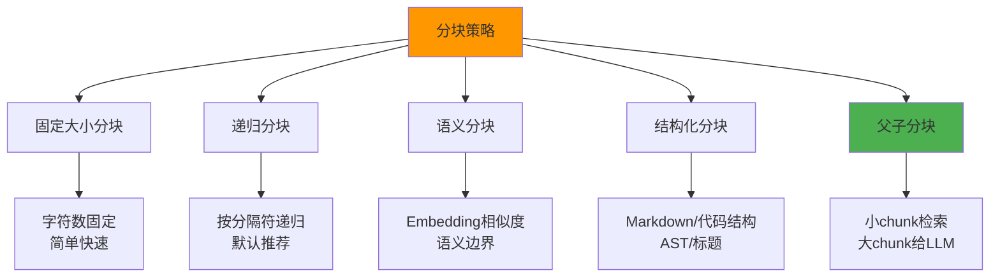

### 7.2 固定大小分块

#### 代码示例：固定大小分块器

```python
# chunking/fixed_size_chunker.py
from typing import List, Dict
import re


class FixedSizeChunker:
    """固定大小分块器：按字符数+重叠分块"""

    def __init__(self, chunk_size: int = 500,
                 chunk_overlap: int = 50,
                 separator: str = "\n\n"):
        self.chunk_size = chunk_size
        self.chunk_overlap = chunk_overlap
        self.separator = separator

    def split(self, text: str,
              metadata: Dict = None) -> List[Dict]:
        """将文本切分为固定大小的chunks"""
        # 先按分隔符分成段落
        paragraphs = text.split(self.separator)
        chunks = []
        current_chunk = ""

        for para in paragraphs:
            # 如果单个段落就超过chunk_size，需要硬切
            if len(para) > self.chunk_size:
                # 先保存当前累积的chunk
                if current_chunk:
                    chunks.append(current_chunk)
                    current_chunk = ""
                # 长段落硬切
                sub_chunks = self._split_long_text(para)
                chunks.extend(sub_chunks)
                continue

            # 尝试加入当前段落
            if len(current_chunk) + len(para) + 2 <= self.chunk_size:
                current_chunk = (
                    current_chunk + self.separator + para
                    if current_chunk else para
                )
            else:
                # 当前chunk已满，保存并开始新chunk
                if current_chunk:
                    chunks.append(current_chunk)
                # 新chunk带上重叠内容
                if self.chunk_overlap > 0 and chunks:
                    overlap_text = chunks[-1][-self.chunk_overlap:]
                    current_chunk = overlap_text + self.separator + para
                else:
                    current_chunk = para

        if current_chunk:
            chunks.append(current_chunk)

        # 构建文档格式
        return [
            {
                "content": chunk,
                "metadata": {
                    **(metadata or {}),
                    "chunk_index": i,
                    "chunk_size": len(chunk),
                }
            }
            for i, chunk in enumerate(chunks)
            if len(chunk.strip()) > 20  # 过滤过短块
        ]

    def _split_long_text(self, text: str) -> List[str]:
        """硬切超长文本"""
        result = []
        for i in range(0, len(text),
                        self.chunk_size - self.chunk_overlap):
            piece = text[i:i + self.chunk_size]
            if piece.strip():
                result.append(piece)
        return result


# 使用示例
if __name__ == "__main__":
    chunker = FixedSizeChunker(chunk_size=200, chunk_overlap=30)

    long_text = """
    第一章 RAG架构概述

    RAG（检索增强生成）是一种结合信息检索和文本生成的AI架构。
    它通过从外部知识库检索相关文档，将检索结果作为上下文输入大语言模型，
    从而生成基于事实的回答。

    第二章 检索系统设计

    检索系统是RAG的核心组件。一个好的检索系统需要平衡召回率和精确率。
    常用的检索方法包括向量检索、关键词检索（BM25）和混合检索。

    第三章 生成策略优化

    生成阶段的优化主要集中在Prompt工程和上下文管理。
    好的Prompt能引导LLM更准确地利用检索到的上下文信息。
    """

    chunks = chunker.split(long_text, metadata={"source": "guide.md"})
    print(f"分块数: {len(chunks)}")
    for i, c in enumerate(chunks):
        print(f"\n--- Chunk {i} (size={c['metadata']['chunk_size']}) ---")
        print(c["content"][:100])
```

> ❌ **常见坑点**：固定大小分块在句子中间切断。**原因**：纯按字符数切，不感知句子边界。**解决**：使用递归分块器，优先在句子/段落边界切分。**预防**：在固定大小分块基础上，增加"最近句子边界回退"逻辑——如果切分点不在句子末尾，向前回退到最近的句号。

### 7.3 递归分块

#### 概念解释

递归分块（RecursiveCharacterTextSplitter）是LangChain中最常用的分块策略，核心思想是**按优先级尝试多个分隔符**——先尝试用段落分隔符（\n\n）切分，如果块太大再尝试换行（\n），再太大尝试空格，最后才硬切。这种方式尽可能保持语义完整性。

#### 代码示例：递归分块器

```python
# chunking/recursive_chunker.py
from typing import List, Dict


class RecursiveChunker:
    """递归分块器：按分隔符优先级递归切分"""

    DEFAULT_SEPARATORS = ["\n\n", "\n", "。", "！", "？",
                          "；", ".", "!", "?", ";", " ", ""]

    def __init__(self, chunk_size: int = 500,
                 chunk_overlap: int = 50,
                 separators: List[str] = None):
        self.chunk_size = chunk_size
        self.chunk_overlap = chunk_overlap
        self.separators = separators or self.DEFAULT_SEPARATORS

    def split(self, text: str,
              metadata: Dict = None) -> List[Dict]:
        return self._split_text(text, self.separators, 0, metadata)

    def _split_text(self, text: str,
                    separators: List[str],
                    depth: int,
                    metadata: Dict = None) -> List[Dict]:
        """递归切分"""
        if len(text) <= self.chunk_size:
            return [{"content": text.strip(),
                     "metadata": {**(metadata or {})}}]

        if depth >= len(separators):
            # 所有分隔符都试过了，硬切
            return self._hard_split(text, metadata)

        separator = separators[depth]

        if separator == "":
            return self._hard_split(text, metadata)

        # 按当前分隔符切分
        parts = text.split(separator)
        if len(parts) == 1:
            # 这个分隔符没用上，试下一个
            return self._split_text(text, separators, depth + 1, metadata)

        # 递归处理每个部分
        chunks = []
        for part in parts:
            part = part.strip()
            if not part:
                continue
            if len(part) <= self.chunk_size:
                chunks.append(part)
            else:
                sub_chunks = self._split_text(
                    part, separators, depth + 1, metadata
                )
                chunks.extend(
                    c["content"] if isinstance(c, dict) else c
                    for c in sub_chunks
                )

        # 合并过短的块
        merged = self._merge_small_chunks(chunks)

        return [
            {
                "content": chunk,
                "metadata": {
                    **(metadata or {}),
                    "chunk_index": i,
                    "chunk_size": len(chunk),
                    "separator_depth": depth,
                }
            }
            for i, chunk in enumerate(merged)
            if len(chunk.strip()) > 20
        ]

    def _hard_split(self, text: str,
                    metadata: Dict = None) -> List[Dict]:
        """硬切分"""
        result = []
        for i in range(0, len(text),
                        self.chunk_size - self.chunk_overlap):
            piece = text[i:i + self.chunk_size]
            if piece.strip():
                result.append({"content": piece.strip(),
                               "metadata": {**(metadata or {})}})
        return result

    def _merge_small_chunks(self, chunks: List[str]) -> List[str]:
        """合并过短的相邻块"""
        merged = []
        for chunk in chunks:
            if merged and len(merged[-1]) + len(chunk) < self.chunk_size:
                merged[-1] = merged[-1] + " " + chunk
            else:
                merged.append(chunk)
        return merged


# 使用示例
if __name__ == "__main__":
    chunker = RecursiveChunker(chunk_size=300, chunk_overlap=50)

    text = """
    什么是RAG？

    RAG是检索增强生成（Retrieval-Augmented Generation）的缩写。
    它是一种结合信息检索和大语言模型生成的技术架构。

    RAG的工作流程是什么？

    RAG的工作流程分为两个阶段。第一阶段是离线索引，
    将文档解析、分块、向量化后存入向量数据库。第二阶段是在线查询，
    用户提问后，系统先从向量库检索相关文档，
    再将检索结果作为上下文输入大语言模型生成回答。
    """

    chunks = chunker.split(text, metadata={"source": "intro.md"})
    print(f"分块数: {len(chunks)}")
    for i, c in enumerate(chunks):
        print(f"\n--- Chunk {i} ---")
        print(c["content"][:150])
```

> ✅ **最佳实践**：中文文档的分块器应该把中文标点（。！？；）作为优先分隔符，而不是只用换行。中文句子通常以句号结尾，在句号处切分比在换行处切分更能保持语义完整。

### 7.4 语义分块

#### 概念解释

语义分块（Semantic Chunking）利用Embedding模型计算相邻句子之间的语义相似度，当相似度低于阈值时认为发生了"语义突变"，在此处分块。这种方式能保证每个chunk内部语义连贯，而不管物理位置上是否连续。

> 💡 **比喻**：语义分块就像**按话题切换来分段**——而不是按字数。一篇文章从"RAG原理"跳到"Embedding模型"时，即使这两段之间只有100字，也应该在这里切开，因为话题变了。

#### 代码示例：语义分块器

```python
# chunking/semantic_chunker.py
from typing import List, Dict
import numpy as np
from dataclasses import dataclass


@dataclass
class SentenceBoundary:
    text: str
    start_idx: int
    end_idx: int


class SemanticChunker:
    """语义分块器：基于Embedding相似度检测语义突变点"""

    def __init__(self, embedding_fn,
                 breakpoint_threshold: float = 75.0,
                 min_chunk_size: int = 100,
                 max_chunk_size: int = 1500):
        """
        Args:
            embedding_fn: 文本向量化函数
            breakpoint_threshold: 语义突变阈值（百分位）
            min_chunk_size: 最小chunk大小
            max_chunk_size: 最大chunk大小
        """
        self.embedding_fn = embedding_fn
        self.breakpoint_threshold = breakpoint_threshold
        self.min_chunk_size = min_chunk_size
        self.max_chunk_size = max_chunk_size

    def split(self, text: str,
              metadata: Dict = None) -> List[Dict]:
        # 1. 按句子切分
        sentences = self._split_sentences(text)
        if len(sentences) <= 1:
            return [{"content": text,
                     "metadata": {**(metadata or {})}}]

        # 2. 计算每句的Embedding
        embeddings = self.embedding_fn(
            [s.text for s in sentences]
        )

        # 3. 计算相邻句子的余弦距离
        distances = []
        for i in range(len(embeddings) - 1):
            sim = self._cosine_similarity(
                embeddings[i], embeddings[i + 1]
            )
            distances.append(1 - sim)  # 距离 = 1 - 相似度

        # 4. 找出距离突变点
        breakpoint_indices = self._find_breakpoints(
            distances, sentences
        )

        # 5. 按断点分组
        chunks = self._group_by_breakpoints(
            sentences, breakpoint_indices
        )

        return [
            {
                "content": chunk,
                "metadata": {
                    **(metadata or {}),
                    "chunk_index": i,
                    "chunk_size": len(chunk),
                    "chunk_type": "semantic",
                }
            }
            for i, chunk in enumerate(chunks)
            if len(chunk.strip()) > self.min_chunk_size * 0.3
        ]

    def _split_sentences(self, text: str) -> List[SentenceBoundary]:
        """按标点切分句子"""
        import re
        # 中文句号+英文句号
        pattern = r'([。！？!?；;])'
        parts = re.split(pattern, text)

        sentences = []
        pos = 0
        for i in range(0, len(parts) - 1, 2):
            sent = parts[i] + (parts[i + 1] if i + 1 < len(parts) else "")
            sent = sent.strip()
            if sent:
                sentences.append(SentenceBoundary(
                    text=sent,
                    start_idx=pos,
                    end_idx=pos + len(sent)
                ))
                pos += len(sent) + 1
        return sentences

    def _cosine_similarity(self, a, b) -> float:
        a, b = np.array(a), np.array(b)
        return np.dot(a, b) / (np.linalg.norm(a) * np.linalg.norm(b) + 1e-10)

    def _find_breakpoints(self, distances: list,
                         sentences: list) -> List[int]:
        """找出语义突变点"""
        if not distances:
            return []

        # 计算距离的百分位数作为阈值
        threshold = np.percentile(distances, self.breakpoint_threshold)

        breakpoints = []
        for i, d in enumerate(distances):
            if d > threshold:
                breakpoints.append(i + 1)  # 在第i句和第i+1句之间断开

        return breakpoints

    def _group_by_breakpoints(self, sentences: list,
                              breakpoints: list) -> List[str]:
        """按断点分组"""
        chunks = []
        start = 0

        for bp in breakpoints:
            chunk_text = "".join(
                s.text for s in sentences[start:bp]
            )
            if chunk_text.strip():
                chunks.append(chunk_text.strip())
            start = bp

        # 最后一组
        chunk_text = "".join(
            s.text for s in sentences[start:]
        )
        if chunk_text.strip():
            chunks.append(chunk_text.strip())

        # 合并过小的chunk
        merged = []
        for chunk in chunks:
            if merged and len(chunk) < self.min_chunk_size:
                merged[-1] += chunk
            else:
                merged.append(chunk)

        return merged


# 使用示例（需要真实的embedding_fn）
def mock_embed(texts: list) -> list:
    """模拟Embedding（实际用OpenAI/HuggingFace模型）"""
    np.random.seed(42)
    return [np.random.rand(384).tolist() for _ in texts]


if __name__ == "__main__":
    chunker = SemanticChunker(
        embedding_fn=mock_embed,
        breakpoint_threshold=80,
    )

    text = """
    RAG系统的索引管线负责将原始文档转化为向量索引。
    这个过程包括文档解析、文本分块、Embedding计算和索引构建。
    离线索引的特点是吞吐量高但延迟不敏感。

    在线查询管线负责处理用户的实时查询。
    用户提问后，系统先进行查询理解，然后多路召回相关文档。
    召回结果经过重排序和上下文压缩后，送入LLM生成回答。
    """

    chunks = chunker.split(text)
    print(f"语义分块数: {len(chunks)}")
    for i, c in enumerate(chunks):
        print(f"\nChunk {i}: {c['content'][:100]}...")
```

> ❌ **常见坑点**：语义分块太慢——每个chunk都要计算Embedding，文档量大时索引时间翻倍。**原因**：语义分块需要在分块阶段就调用Embedding模型。**解决**：语义分块只在高质量文档集上使用，大批量文档先用递归分块，后续再迭代优化。**预防**：设置时间预算——如果语义分块超过预估时间的1.5倍，自动降级为递归分块。

### 7.5 父子分块与小到大多路召回

#### 概念解释

父子分块（Parent-Child Chunking / Small-to-Big）是一种**检索粒度优化策略**：用小块（child chunk）做检索（提高精度），命中后返回其父块（parent chunk）给LLM（提供完整上下文）。这种方式同时获得了检索精度和上下文完整性。

#### 代码示例：父子分块实现

```python
# chunking/parent_child_chunker.py
from typing import List, Dict, Tuple
import hashlib


class ParentChildChunker:
    """父子分块器：小块检索，大块给LLM"""

    def __init__(self, parent_size: int = 1000,
                 child_size: int = 200,
                 overlap: int = 50):
        self.parent_size = parent_size
        self.child_size = child_size
        self.overlap = overlap

    def split(self, text: str,
              metadata: Dict = None) -> Tuple[List[Dict], List[Dict]]:
        """
        Returns:
            child_chunks: 用于检索的小块
            parent_chunks: 用于生成的大块
        """
        # 1. 先生成parent chunks
        parent_chunks = self._split_by_size(text, self.parent_size)

        all_child_chunks = []
        parent_map = {}  # child_id -> parent_id

        for p_idx, parent_text in enumerate(parent_chunks):
            parent_id = hashlib.md5(
                f"{metadata.get('source', '')}_p{p_idx}".encode()
            ).hexdigest()[:16]

            # 2. 将parent切分为children
            child_texts = self._split_by_size(
                parent_text, self.child_size
            )

            for c_idx, child_text in enumerate(child_texts):
                child_id = hashlib.md5(
                    f"{parent_id}_c{c_idx}".encode()
                ).hexdigest()[:16]

                all_child_chunks.append({
                    "id": child_id,
                    "content": child_text,
                    "metadata": {
                        **(metadata or {}),
                        "parent_id": parent_id,
                        "chunk_type": "child",
                        "child_index": c_idx,
                    }
                })
                parent_map[child_id] = parent_id

        # parent chunks
        parent_docs = [
            {
                "id": hashlib.md5(
                    f"{metadata.get('source', '')}_p{p}".encode()
                ).hexdigest()[:16],
                "content": parent_text,
                "metadata": {
                    **(metadata or {}),
                    "chunk_type": "parent",
                    "parent_index": p,
                }
            }
            for p, parent_text in enumerate(parent_chunks)
        ]

        return all_child_chunks, parent_docs

    def _split_by_size(self, text: str,
                        size: int) -> List[str]:
        """简单按大小切分"""
        result = []
        pos = 0
        while pos < len(text):
            end = min(pos + size, len(text))
            # 尝试在句号处结束
            if end < len(text):
                last_period = max(
                    text.rfind("。", pos, end),
                    text.rfind(". ", pos, end),
                    text.rfind("\n", pos, end),
                )
                if last_period > pos + size * 0.5:
                    end = last_period + 1
            result.append(text[pos:end].strip())
            pos = end - self.overlap if end < len(text) else end
        return [r for r in result if r]


# 小到大多路召回检索器
class SmallToBigRetriever:
    """用child检索，返回parent给LLM"""

    def __init__(self, vector_store, parent_store):
        self.vector_store = vector_store  # 存child chunks
        self.parent_store = parent_store  # 存parent chunks

    def retrieve(self, query: str,
                 top_k: int = 5) -> List[Dict]:
        # 1. 用child chunk检索（精度高）
        child_results = self.vector_store.similarity_search(
            query, k=top_k * 2  # 多检索一些child
        )

        # 2. 收集对应的parent_id
        parent_ids = list(set(
            doc.metadata["parent_id"]
            for doc in child_results
        ))[:top_k]

        # 3. 取出parent chunks（上下文完整）
        parent_results = []
        for pid in parent_ids:
            parent = self.parent_store.get_by_id(pid)
            if parent:
                parent_results.append(parent)

        return parent_results


# 使用示例
if __name__ == "__main__":
    chunker = ParentChildChunker(
        parent_size=1000,
        child_size=200,
    )

    long_doc = "..."  # 长文档
    children, parents = chunker.split(
        long_doc, metadata={"source": "manual.pdf"}
    )
    print(f"Parent chunks: {len(parents)}")
    print(f"Child chunks: {len(children)}")
    # 预期输出：
    # Parent chunks: 5
    # Child chunks: 25
```

> ✅ **最佳实践**：父子分块的推荐比例是 **parent 800-1200 tokens, child 150-300 tokens**。child太小（<100）会导致检索信号不足，parent太大（>2000）会浪费LLM上下文窗口。

### 7.6 分块参数调优实战

#### 分块大小决策指南

| 文档类型 | 推荐chunk_size | 推荐overlap | 分块策略 |
|---------|---------------|-------------|---------|
| 技术文档（教程） | 500-800 tokens | 50-100 | 递归分块 |
| FAQ问答 | 100-200 tokens | 0 | 按QA对分块 |
| 代码文件 | 按函数/类 | 0 | AST分块 |
| 学术论文 | 800-1200 tokens | 100 | 结构化分块（按节） |
| 法律合同 | 按条款分块 | 0 | 结构化分块 |
| 聊天记录 | 按对话轮次 | 0 | 结构化分块 |
| 新闻资讯 | 300-500 tokens | 50 | 递归分块 |
| 产品手册 | 400-600 tokens | 50 | 结构化分块（按章节） |

#### 代码示例：分块效果评估器

```python
# chunking/chunk_evaluator.py
from typing import List, Dict
import numpy as np
from collections import Counter


class ChunkEvaluator:
    """评估分块质量的工具"""

    def evaluate(self, chunks: List[Dict],
                 original_text: str) -> Dict:
        """
        多维度评估分块质量
        """
        contents = [c["content"] for c in chunks]
        sizes = [len(c) for c in contents]

        metrics = {
            # 基础统计
            "chunk_count": len(chunks),
            "avg_chunk_size": np.mean(sizes),
            "median_chunk_size": np.median(sizes),
            "min_chunk_size": min(sizes),
            "max_chunk_size": max(sizes),
            "std_chunk_size": np.std(sizes),

            # 覆盖率：原文是否都被覆盖
            "coverage": self._coverage(contents, original_text),

            # 冗余度：overlap导致的重复
            "redundancy": self._redundancy(contents),

            # 边界合理性：句子是否被截断
            "boundary_quality": self._boundary_quality(contents),

            # 空块率
            "empty_ratio": sum(1 for s in sizes if s < 20) / len(sizes),
        }

        # 评分
        score = self._compute_score(metrics)
        metrics["quality_score"] = score

        return metrics

    def _coverage(self, chunks: List[str],
                  original: str) -> float:
        """计算内容覆盖率"""
        all_content = "".join(chunks)
        # 简化：检查原文的字符有多少出现在chunks中
        original_chars = set(original)
        covered_chars = set(all_content)
        return len(original_chars & covered_chars) / max(
            len(original_chars), 1
        )

    def _redundancy(self, chunks: List[str]) -> float:
        """计算冗余度（相邻chunk的重叠比例）"""
        if len(chunks) < 2:
            return 0.0
        overlaps = []
        for i in range(len(chunks) - 1):
            overlap_len = min(len(chunks[i]), len(chunks[i+1]) // 2)
            overlap = sum(
                1 for c in chunks[i][-overlap_len:]
                if c in chunks[i+1][:overlap_len]
            )
            overlaps.append(overlap / max(overlap_len, 1))
        return np.mean(overlaps)

    def _boundary_quality(self, chunks: List[str]) -> float:
        """边界质量：chunk是否在句子边界结束"""
        sentence_endings = set("。！？.!?\n")
        good = sum(
            1 for c in chunks
            if c[-1] in sentence_endings
        )
        return good / len(chunks) if chunks else 0

    def _compute_score(self, metrics: Dict) -> float:
        """综合评分（0-100）"""
        score = 0
        # 边界质量（30分）
        score += metrics["boundary_quality"] * 30
        # 覆盖率（30分）
        score += metrics["coverage"] * 30
        # 大小均匀度（20分）
        if metrics["avg_chunk_size"] > 0:
            cv = metrics["std_chunk_size"] / metrics["avg_chunk_size"]
            score += max(0, 20 - cv * 20)
        # 冗余度适中（20分）
        red = metrics["redundancy"]
        if 0.05 <= red <= 0.25:
            score += 20
        elif red < 0.05:
            score += red / 0.05 * 10  # 太少overlap
        else:
            score += max(0, 20 - (red - 0.25) * 40)  # 太多overlap

        return round(score, 1)


# 使用示例
if __name__ == "__main__":
    from chunking.recursive_chunker import RecursiveChunker

    original = "这是一段很长的测试文本。" * 50

    chunker = RecursiveChunker(chunk_size=300, chunk_overlap=50)
    chunks = chunker.split(original)

    evaluator = ChunkEvaluator()
    report = evaluator.evaluate(
        [c["content"] for c in chunks], original
    )
    print("=== 分块质量报告 ===")
    for k, v in report.items():
        print(f"  {k}: {v}")
    # 预期输出类似：
    # === 分块质量报告 ===
    #   chunk_count: 17
    #   avg_chunk_size: 285.3
    #   boundary_quality: 0.88
    #   quality_score: 87.5
```

### 7.7 本章深度讲解与练习

> 💡 **深度讲解**：分块策略是RAG系统中**最容易被忽视但影响最大**的环节。很多团队在Embedding模型和向量库上花了大量精力优化，但分块策略还是用默认的500字符固定分块，效果一直不好。核心认知：分块的本质是**在"检索精度"和"上下文完整性"之间做权衡**——小块检索精度高但上下文不完整，大块上下文完整但检索精度低。解决方案有两个方向：① 调参方向——找到最优的chunk_size和overlap，需要在你的数据集上做实验；② 架构方向——使用父子分块（Small-to-Big），用小块检索、大块给LLM，同时解决精度和完整性。分块策略的选择不是一蹴而就的，需要根据文档类型、查询模式、Embedding模型特性持续迭代。

> **📝 精简总结**：分块四策略=固定大小(简单快)+递归分块(默认推荐)+语义分块(语义边界)+结构化分块(Markdown/AST)；父子分块=小块检索+大块给LLM，推荐parent 800-1200 tokens / child 150-300 tokens；参数推荐=通用文档500字符/50重叠，代码按AST分块，FAQ按QA对分块；评估维度=覆盖率+冗余度+边界质量+大小均匀度；坑点=句子中间被切断(用递归分块)+语义突变未感知(用语义分块)+代码被硬切(用AST分块)+分块太慢(语义分块只用于高质量集)。

### 🎯 梯度练习题

**基础题（⭐）**
1. 固定大小分块和递归分块的核心区别是什么？为什么递归分块效果通常更好？
2. chunk_overlap（重叠）的作用是什么？overlap设为0会有什么问题？
3. 父子分块为什么能同时提高检索精度和生成质量？

**进阶题（⭐⭐）**
4. 语义分块的"语义突变点"是如何检测的？如果阈值设得太高或太低分别会怎样？
5. 设计一个分块策略的A/B测试方案：对比固定大小分块和递归分块在你的数据集上的效果差异，需要哪些指标和实验设计？

**实战题（⭐⭐⭐）**
6. 你有一个技术文档知识库，包含3000份Markdown文件（API文档+教程+FAQ）。需要设计最优的分块策略。要求：① 不同类型文档用不同分块策略 ② 分块后自动评估质量 ③ 低质量分块自动重新分块 ④ 支持分块策略的A/B测试和回滚。验收：Recall@5 ≥ 0.85，边界质量 ≥ 90%。

---

## 8. Embedding流水线深度优化

### 8.1 批量Embedding处理

#### 概念解释

Embedding流水线是将文本块批量转换为向量表示的过程。在生产环境中，文档数量可能从数千到数百万，Embedding的批量处理效率直接影响索引构建速度和成本。核心优化方向：**批量大小选择、并发控制、失败重试、成本监控**。

> 💡 **比喻**：批量Embedding就像**快递分拣**——一封一封寄（单条请求）很慢且贵，一整车寄（批量请求）快且便宜。但车太大也有问题——路上堵车（限流）、翻车了损失大（失败重试成本高）。

#### 代码示例1：批量Embedding服务

```python
# embedding/batch_embedder.py
import time
import asyncio
from typing import List, Dict, Optional
from dataclasses import dataclass, field
import hashlib


@dataclass
class EmbeddingTask:
    text: str
    chunk_id: str
    retries: int = 0
    vector: Optional[List[float]] = None


class BatchEmbedder:
    """批量Embedding处理器：自动批处理+并发+重试"""

    def __init__(self, embedding_client,
                 batch_size: int = 128,
                 max_retries: int = 3,
                 max_concurrency: int = 5,
                 rate_limit_rpm: int = 3000):
        self.client = embedding_client
        self.batch_size = batch_size
        self.max_retries = max_retries
        self.max_concurrency = max_concurrency
        self.rate_limit_rpm = rate_limit_rpm
        self.request_count = 0
        self.total_tokens = 0

    def embed_batch(self, texts: List[str],
                    chunk_ids: List[str] = None) -> List[Dict]:
        """批量Embedding处理"""
        if chunk_ids is None:
            chunk_ids = [
                hashlib.md5(t.encode()).hexdigest()[:16]
                for t in texts
            ]

        # 按batch_size分批
        batches = [
            texts[i:i + self.batch_size]
            for i in range(0, len(texts), self.batch_size)
        ]

        results = []
        failed_tasks = []

        for batch_idx, batch in enumerate(batches):
            try:
                vectors = self._call_embedding_api(batch)
                for j, vec in enumerate(vectors):
                    results.append({
                        "chunk_id": chunk_ids[batch_idx * self.batch_size + j],
                        "text": batch[j],
                        "vector": vec,
                        "status": "success",
                    })
                self._rate_limit_wait()

            except Exception as e:
                # 批量失败，逐条重试
                print(f"Batch {batch_idx} 失败: {e}，逐条重试...")
                for j, text in enumerate(batch):
                    try:
                        vec = self._call_embedding_api([text])[0]
                        results.append({
                            "chunk_id": chunk_ids[batch_idx * self.batch_size + j],
                            "text": text,
                            "vector": vec,
                            "status": "retry_success",
                        })
                    except Exception as e2:
                        failed_tasks.append({
                            "chunk_id": chunk_ids[batch_idx * self.batch_size + j],
                            "text": text,
                            "error": str(e2),
                            "retries": self.max_retries,
                        })

        # 汇总统计
        stats = {
            "total": len(texts),
            "success": len(results),
            "failed": len(failed_tasks),
            "cost_estimate": self.total_tokens * 0.00002,  # 示例价格
        }

        return {
            "results": results,
            "failed": failed_tasks,
            "stats": stats,
        }

    def _call_embedding_api(self, texts: List[str]) -> List[List[float]]:
        """调用Embedding API（模拟）"""
        # 实际调用：
        # response = self.client.embeddings.create(
        #     model="text-embedding-3-small",
        #     input=texts
        # )
        # return [item.embedding for item in response.data]

        # 模拟返回随机向量
        import numpy as np
        np.random.seed(42)
        dim = 1536
        return [np.random.rand(dim).tolist() for _ in texts]

    def _rate_limit_wait(self):
        """简单的速率限制"""
        self.request_count += 1
        elapsed = time.time() % 60
        if self.request_count >= self.rate_limit_rpm:
            sleep_time = 60 - elapsed + 1
            print(f"达到速率限制，等待 {sleep_time:.1f}s...")
            time.sleep(sleep_time)
            self.request_count = 0


# 使用示例
if __name__ == "__main__":
    embedder = BatchEmbedder(
        embedding_client=None,  # 实际传入OpenAI client
        batch_size=64,
        max_concurrency=3,
    )

    texts = [f"这是第{i}个测试文档内容" for i in range(200)]
    output = embedder.embed_batch(texts)

    print(f"总计: {output['stats']['total']}")
    print(f"成功: {output['stats']['success']}")
    print(f"失败: {output['stats']['failed']}")
    print(f"预估成本: ${output['stats']['cost_estimate']:.4f}")
    # 预期输出：
    # 总计: 200
    # 成功: 200
    # 失败: 0
    # 预估成本: $0.0032
```

### 8.2 Embedding缓存策略

#### 概念解释

Embedding缓存是将已计算过的文本向量结果缓存起来，避免重复计算。在RAG系统中，以下场景会产生大量重复Embedding请求：① 查询时频繁检索相同的热门问题；② 文档更新时只有少量变化但全量重算；③ 评估时反复运行相同的查询集。

#### 代码示例：多级Embedding缓存

```python
# embedding/embedding_cache.py
import hashlib
import json
from typing import Optional, List, Dict
from dataclasses import dataclass
import time


class EmbeddingCache:
    """多级Embedding缓存：内存+Redis+磁盘"""

    def __init__(self, redis_client=None,
                 ttl_seconds: int = 86400 * 30,  # 30天
                 namespace: str = "emb"):
        self.redis = redis_client
        self.ttl = ttl_seconds
        self.namespace = namespace
        self.memory_cache: Dict[str, List[float]] = {}
        self.hits = 0
        self.misses = 0

    def _make_key(self, text: str, model: str) -> str:
        """生成缓存key：文本hash + 模型版本"""
        text_hash = hashlib.sha256(
            f"{model}:{text}".encode()
        ).hexdigest()[:32]
        return f"{self.namespace}:{model}:{text_hash}"

    def get(self, text: str, model: str) -> Optional[List[float]]:
        """查询缓存"""
        key = self._make_key(text, model)

        # L1: 内存缓存
        if key in self.memory_cache:
            self.hits += 1
            return self.memory_cache[key]

        # L2: Redis缓存
        if self.redis:
            cached = self.redis.get(key)
            if cached:
                self.hits += 1
                vector = json.loads(cached)
                self.memory_cache[key] = vector
                return vector

        self.misses += 1
        return None

    def put(self, text: str, model: str,
            vector: List[float]):
        """写入缓存"""
        key = self._make_key(text, model)

        # 写入内存
        self.memory_cache[key] = vector

        # 写入Redis
        if self.redis:
            self.redis.setex(
                key, self.ttl, json.dumps(vector)
            )

    def get_batch(self, texts: List[str],
                  model: str) -> Dict:
        """批量查询缓存，返回命中和未命中"""
        hit_vectors = {}
        miss_texts = []
        miss_indices = []

        for i, text in enumerate(texts):
            vec = self.get(text, model)
            if vec is not None:
                hit_vectors[i] = vec
            else:
                miss_texts.append(text)
                miss_indices.append(i)

        return {
            "hits": hit_vectors,
            "miss_texts": miss_texts,
            "miss_indices": miss_indices,
            "hit_rate": len(hit_vectors) / len(texts) if texts else 0,
        }

    def stats(self) -> Dict:
        total = self.hits + self.misses
        return {
            "hits": self.hits,
            "misses": self.misses,
            "hit_rate": self.hits / max(total, 1),
            "memory_size": len(self.memory_cache),
        }


# 带缓存的Embedding服务
class CachedEmbeddingService:
    """带缓存的Embedding服务"""

    def __init__(self, base_embedder, cache: EmbeddingCache,
                 model: str = "text-embedding-3-small"):
        self.base = base_embedder
        self.cache = cache
        self.model = model

    async def embed(self, text: str) -> List[float]:
        # 先查缓存
        cached = self.cache.get(text, self.model)
        if cached:
            return cached

        # 缓存未命中，调用API
        vector = await self.base.embed_query(text)

        # 写入缓存
        self.cache.put(text, self.model, vector)
        return vector

    async def embed_batch(self,
                          texts: List[str]) -> List[List[float]]:
        # 批量查缓存
        cache_result = self.cache.get_batch(texts, self.model)

        # 只对未命中的调用API
        if cache_result["miss_texts"]:
            new_vectors = await self.base.embed_documents(
                cache_result["miss_texts"]
            )
            # 写入缓存
            for idx, vec in zip(
                cache_result["miss_indices"], new_vectors
            ):
                self.cache.put(texts[idx], self.model, vec)

        # 合并结果
        result = [None] * len(texts)
        for i, vec in cache_result["hits"].items():
            result[i] = vec
        for i, vec in zip(
            cache_result["miss_indices"], new_vectors
        ):
            result[i] = vec

        return result


# 使用示例
if __name__ == "__main__":
    cache = EmbeddingCache(redis_client=None)

    # 模拟文本
    texts = [
        "RAG系统的索引管线如何设计？",
        "RAG系统的索引管线如何设计？",  # 重复，命中缓存
        "向量数据库怎么选型？",
    ]

    # 第一次调用：2个miss
    for text in texts[:2]:
        vec = cache.get(text, "text-embedding-3-small")
        if vec is None:
            # 模拟调用API
            import numpy as np
            vec = np.random.rand(1536).tolist()
            cache.put(text, "text-embedding-3-small", vec)

    # 第二次调用：重复文本命中缓存
    cached = cache.get(texts[1], "text-embedding-3-small")
    print(f"缓存命中率: {cache.stats()['hit_rate']:.0%}")
    # 预期输出：缓存命中率: 33%
```

> ❌ **常见坑点**：Embedding缓存没有纳入模型版本。**原因**：换了Embedding模型后，旧缓存的向量维度或语义空间不同，导致检索结果错误。**解决**：缓存key必须包含模型名称和版本号，换模型时自动失效旧缓存。**预防**：在缓存key设计中强制加入model_version字段。

### 8.3 Embedding降级与回退策略

#### 概念解释

生产环境中Embedding服务可能出现故障：API限流、网络超时、服务不可用。降级策略是指在主Embedding服务不可用时，自动切换到备用方案，保证系统核心功能不中断。

#### 代码示例：Embedding降级服务

```python
# embedding/fallback_embedder.py
import time
from typing import List, Optional
from dataclasses import dataclass
from enum import Enum


class EmbeddingStatus(Enum):
    PRIMARY = "primary"
    FALLBACK = "fallback"
    DEGRADED = "degraded"
    FAILED = "failed"


@dataclass
class EmbeddingResult:
    vectors: List[List[float]]
    status: EmbeddingStatus
    provider: str
    latency_ms: float
    error: Optional[str] = None


class FallbackEmbeddingService:
    """带降级策略的Embedding服务"""

    def __init__(self, primary_provider,
                 fallback_provider=None,
                 timeout_seconds: float = 10.0,
                 error_threshold: int = 5,
                 cooldown_seconds: int = 60):
        self.primary = primary_provider
        self.fallback = fallback_provider
        self.timeout = timeout_seconds
        self.error_threshold = error_threshold
        self.cooldown = cooldown_seconds

        self.consecutive_errors = 0
        self.circuit_open_until = 0
        self.current_provider = "primary"

    def embed(self, texts: List[str]) -> EmbeddingResult:
        start = time.time()

        # 检查熔断状态
        if time.time() < self.circuit_open_until:
            return self._use_fallback(texts, start, "primary熔断中")

        # 尝试主服务
        try:
            vectors = self._call_with_timeout(
                self.primary, texts, self.timeout
            )
            self.consecutive_errors = 0
            self.current_provider = "primary"
            return EmbeddingResult(
                vectors=vectors,
                status=EmbeddingStatus.PRIMARY,
                provider="primary",
                latency_ms=(time.time() - start) * 1000,
            )
        except Exception as e:
            self.consecutive_errors += 1
            print(f"主Embedding服务失败 ({self.consecutive_errors}): {e}")

            # 错误次数达到阈值，打开熔断
            if self.consecutive_errors >= self.error_threshold:
                self.circuit_open_until = time.time() + self.cooldown
                print(f"熔断打开 {self.cooldown}s，切换到备用服务")

            # 尝试备用服务
            if self.fallback:
                return self._use_fallback(texts, start, str(e))

            return EmbeddingResult(
                vectors=[],
                status=EmbeddingStatus.FAILED,
                provider="none",
                latency_ms=(time.time() - start) * 1000,
                error=str(e),
            )

    def _use_fallback(self, texts: List[str],
                      start: float, reason: str) -> EmbeddingResult:
        try:
            vectors = self._call_with_timeout(
                self.fallback, texts, self.timeout
            )
            return EmbeddingResult(
                vectors=vectors,
                status=EmbeddingStatus.FALLBACK,
                provider="fallback",
                latency_ms=(time.time() - start) * 1000,
            )
        except Exception as e2:
            return EmbeddingResult(
                vectors=[],
                status=EmbeddingStatus.FAILED,
                provider="both_failed",
                latency_ms=(time.time() - start) * 1000,
                error=f"primary: {reason}, fallback: {e2}",
            )

    def _call_with_timeout(self, provider,
                           texts: List[str],
                           timeout: float) -> List[List[float]]:
        """带超时的调用（简化版）"""
        # 实际生产用asyncio.wait_for或signal alarm
        return provider.embed_documents(texts)


# 模拟Embedding提供商
class OpenAIEmbeddingProvider:
    def embed_documents(self, texts: List[str]):
        import numpy as np
        return [np.random.rand(1536).tolist() for _ in texts]


class LocalBGEProvider:
    """本地BGE模型Embedding（备用方案）"""
    def embed_documents(self, texts: List[str]):
        import numpy as np
        return [np.random.rand(1024).tolist() for _ in texts]


# 使用示例
if __name__ == "__main__":
    service = FallbackEmbeddingService(
        primary_provider=OpenAIEmbeddingProvider(),
        fallback_provider=LocalBGEProvider(),
        error_threshold=3,
        cooldown_seconds=30,
    )

    result = service.embed(["测试文本1", "测试文本2"])
    print(f"状态: {result.status.value}")
    print(f"提供商: {result.provider}")
    print(f"延迟: {result.latency_ms:.1f}ms")
    print(f"向量维度: {len(result.vectors[0]) if result.vectors else 0}")
```

> ✅ **最佳实践**：降级时要注意**向量维度一致性**——如果主模型是1536维、备用模型是1024维，切换后向量库需要支持多维度索引或使用同一维度的备用模型。最安全的降级方案是使用**同模型的不同部署**（如云API→本地部署），而不是不同模型。

### 8.4 本章深度讲解与练习

> 💡 **深度讲解**：Embedding流水线是RAG系统中**成本最高**的环节——每次索引构建和每次查询都需要调用Embedding模型。优化方向有三个：① 批量处理——减少API调用次数，提高吞吐量；② 缓存——避免重复计算，热门查询直接命中缓存；③ 降级——主服务故障时自动切换，保证可用性。生产环境中，一个10万文档的知识库，每次全量重建索引的Embedding成本可能在数百到数千元，因此增量更新（只对变更文档重新Embedding）是必须的。

> **📝 精简总结**：批量Embedding=自动分批+并发+重试；缓存=内存+Redis两级，key含模型版本；降级=主备切换+熔断+超时；成本优化=增量更新+缓存命中+批量请求；坑点=缓存不含模型版本(换模型脏数据)+降级维度不一致(检索报错)+无重试机制(单次失败即丢文档)。

### 🎯 梯度练习题

**基础题（⭐）**
1. 为什么Embedding需要批量处理？batch_size设多大合适？
2. Embedding缓存的key应该包含哪些信息？为什么必须包含模型版本？

**进阶题（⭐⭐）**
3. 设计一个Embedding增量更新方案：当文档更新时，只重新Embedding变更的chunk，而不是全量重建。需要追踪文档版本变化。

**实战题（⭐⭐⭐）**
4. 你有一个百万级文档的知识库，需要设计Embedding流水线。要求：① 全量重建时间<2小时 ② 查询Embedding延迟<200ms ③ 月成本<500元 ④ 故障自动降级。给出技术选型和架构设计。

---

## 9. 向量索引构建与参数调优

### 9.1 HNSW索引参数深度调优

#### 概念解释

HNSW（Hierarchical Navigable Small World）是目前最主流的近似最近邻索引算法，通过多层图结构实现高效的向量检索。它有三个核心参数：**M（每层最大连接数）、efConstruction（构建时搜索宽度）、efSearch（查询时搜索宽度）**。调参的核心是在**召回率和查询延迟**之间找平衡。

> 💡 **比喻**：HNSW就像**地铁线路图**——最上层是快线（站少速度快），下层是慢线（站多覆盖广）。搜索时先坐快线到达目标附近，再换乘慢线到具体站点。M决定每条线有多少个换乘站，efConstruction决定建地铁时规划得有多仔细，efSearch决定找路时看多远。

#### HNSW参数详解

| 参数 | 含义 | 推荐范围 | 增大效果 | 减小效果 |
|------|------|---------|---------|---------|
| **M** | 每层每个节点的最大连接数 | 16-64 | 召回率↑内存↑构建慢 | 内存↓构建快召回↓ |
| **efConstruction** | 构建时搜索的邻居数 | 100-400 | 索引质量↑构建慢 | 构建快索引质量↓ |
| **efSearch** | 查询时搜索的候选数 | 50-500 | 召回率↑延迟↑ | 延迟↓召回↓ |
| **num_threads** | 构建线程数 | CPU核数 | 构建加速 | — |

> 🎯 **面试高频**：HNSW的M、efConstruction、efSearch三个参数分别怎么调？
> **答案要点**：M决定图的连通性，M越大图越稠密召回越高但内存越大，常用16-32；efConstruction影响索引构建质量，越大构建越慢但索引质量越好，常用200；efSearch影响查询质量和延迟，查询时调大（如100-200）提高召回，调小（如50）降低延迟。生产环境经验：M=32, efConstruction=256, efSearch=128是比较均衡的起点。

#### 代码示例：HNSW索引构建与调优

```python
# index/hnsw_builder.py
import time
import numpy as np
from typing import List, Dict, Tuple
import json


class HNSWIndexBuilder:
    """HNSW索引构建器：参数调优+性能基准测试"""

    def __init__(self, dim: int = 1536,
                 M: int = 32,
                 ef_construction: int = 256,
                 ef_search: int = 128,
                 metric: str = "cosine"):
        self.dim = dim
        self.M = M
        self.ef_construction = ef_construction
        self.ef_search = ef_search
        self.metric = metric
        self.index = None
        self.doc_ids = []

    def build(self, vectors: np.ndarray,
              doc_ids: List[str]) -> Dict:
        """构建HNSW索引"""
        try:
            import hnswlib
        except ImportError:
            print("请安装 hnswlib: pip install hnswlib")
            return {}

        num_elements = len(vectors)

        # 初始化索引
        self.index = hnswlib.Index(
            space=self.metric, dim=self.dim
        )

        start_time = time.time()
        self.index.init_index(
            max_elements=num_elements,
            ef_construction=self.ef_construction,
            M=self.M,
        )

        # 添加向量
        self.index.add_items(vectors, np.arange(num_elements))
        build_time = time.time() - start_time

        self.doc_ids = doc_ids

        stats = {
            "num_vectors": num_elements,
            "dimensions": self.dim,
            "M": self.M,
            "ef_construction": self.ef_construction,
            "build_time_seconds": round(build_time, 2),
            "build_speed": round(num_elements / build_time, 1),
            "memory_mb": self._estimate_memory(num_elements),
        }

        print(f"索引构建完成: {stats['build_speed']} vectors/s")
        return stats

    def search(self, query_vector: np.ndarray,
               k: int = 10,
               ef_search: int = None) -> Tuple[List[str], List[float]]:
        """查询Top-K相似向量"""
        if ef_search:
            self.index.set_ef(ef_search)

        start = time.time()
        labels, distances = self.index.knn_query(
            query_vector.reshape(1, -1), k=k
        )
        latency_ms = (time.time() - start) * 1000

        result_ids = [self.doc_ids[i] for i in labels[0]]
        return result_ids, distances[0].tolist(), latency_ms

    def benchmark(self, queries: np.ndarray,
                  k: int = 10,
                  ef_values: List[int] = None) -> List[Dict]:
        """基准测试：不同efSearch下的性能"""
        ef_values = ef_values or [50, 100, 200, 400]
        results = []

        for ef in ef_values:
            self.index.set_ef(ef)

            latencies = []
            for q in queries:
                _, _, latency = self.search(
                    q.reshape(1, -1), k=k
                )
                latencies.append(latency)

            results.append({
                "ef_search": ef,
                "avg_latency_ms": round(np.mean(latencies), 2),
                "p95_latency_ms": round(
                    np.percentile(latencies, 95), 2
                ),
                "qps": round(1000 / np.mean(latencies), 1),
            })

        return results

    def _estimate_memory(self, num_elements: int) -> float:
        """估算索引内存占用(MB)"""
        # HNSW内存 ≈ num_elements * M * 2 * dim * 4 bytes
        bytes_per_vec = self.M * 2 * self.dim * 4
        return round(num_elements * bytes_per_vec / 1024 / 1024, 1)

    def save(self, path: str):
        """持久化索引"""
        self.index.save_index(path)
        meta = {
            "dim": self.dim,
            "M": self.M,
            "ef_construction": self.ef_construction,
            "num_vectors": len(self.doc_ids),
            "doc_ids": self.doc_ids,
        }
        with open(path + ".meta.json", "w") as f:
            json.dump(meta, f)

    def load(self, path: str):
        """加载索引"""
        import hnswlib
        with open(path + ".meta.json") as f:
            meta = json.load(f)

        self.dim = meta["dim"]
        self.M = meta["M"]
        self.doc_ids = meta["doc_ids"]

        self.index = hnswlib.Index(
            space=self.metric, dim=self.dim
        )
        self.index.load_index(path, max_elements=meta["num_vectors"])


# 使用示例
if __name__ == "__main__":
    # 模拟10万条向量
    np.random.seed(42)
    dim = 128
    n = 10000
    vectors = np.random.randn(n, dim).astype(np.float32)
    doc_ids = [f"doc_{i}" for i in range(n)]

    # 构建索引
    builder = HNSWIndexBuilder(dim=dim, M=32, ef_construction=200)
    stats = builder.build(vectors, doc_ids)
    print("构建统计:", json.dumps(stats, indent=2))

    # 基准测试
    queries = np.random.randn(100, dim).astype(np.float32)
    bench = builder.benchmark(queries, k=10)
    print("\n=== efSearch基准测试 ===")
    for b in bench:
        print(f"ef={b['ef_search']}: "
              f"avg={b['avg_latency_ms']}ms, "
              f"p95={b['p95_latency_ms']}ms, "
              f"QPS={b['qps']}")
```

### 9.2 IVF索引参数调优

#### 概念解释

IVF（Inverted File Index）是另一种主流近似最近邻索引，核心思想是**先聚类再搜索**——将向量空间划分为nlist个聚类中心，查询时只搜索最近的nprobe个聚类。IVF适合**超大规模数据集**（亿级向量），构建比HNSW快，但召回率略低。

#### 代码示例：IVF索引构建

```python
# index/ivf_builder.py
import numpy as np
from typing import List, Tuple
import time


class IVFIndexBuilder:
    """IVF索引构建器"""

    def __init__(self, dim: int = 1536,
                 nlist: int = 100,
                 nprobe: int = 10,
                 metric: str = "cosine"):
        self.dim = dim
        self.nlist = nlist  # 聚类中心数
        self.nprobe = nprobe  # 查询时探测的聚类数
        self.metric = metric
        self.index = None
        self.doc_ids = []

    def build(self, vectors: np.ndarray,
              doc_ids: List[str]) -> Dict:
        """使用FAISS构建IVF索引"""
        try:
            import faiss
        except ImportError:
            print("请安装 faiss-cpu: pip install faiss-cpu")
            return {}

        n = len(vectors)

        # 确定量化器
        quantizer = faiss.IndexFlatIP(self.dim)

        # IVF索引
        self.index = faiss.IndexIVFFlat(
            quantizer, self.dim, self.nlist
        )

        # 训练（用部分数据训练聚类中心）
        start = time.time()
        self.index.train(vectors)
        train_time = time.time() - start

        # 添加向量
        self.index.add(vectors)
        build_time = time.time() - start

        self.doc_ids = doc_ids

        return {
            "num_vectors": n,
            "nlist": self.nlist,
            "nprobe": self.nprobe,
            "train_time_s": round(train_time, 2),
            "build_time_s": round(build_time, 2),
            "is_trained": self.index.is_trained,
        }

    def search(self, query: np.ndarray,
               k: int = 10) -> Tuple[List[str], List[float], float]:
        """搜索Top-K"""
        self.index.nprobe = self.nprobe

        start = time.time()
        distances, labels = self.index.search(
            query.reshape(1, -1).astype(np.float32), k
        )
        latency_ms = (time.time() - start) * 1000

        result_ids = [self.doc_ids[i] for i in labels[0] if i >= 0]
        result_dists = [d for d in distances[0] if d > 0]

        return result_ids, result_dists, latency_ms


# 使用示例
if __name__ == "__main__":
    np.random.seed(42)
    dim = 128
    n = 50000
    vectors = np.random.randn(n, dim).astype(np.float32)
    doc_ids = [f"doc_{i}" for i in range(n)]

    builder = IVFIndexBuilder(dim=dim, nlist=256, nprobe=16)
    stats = builder.build(vectors, doc_ids)
    print("IVF构建统计:", stats)

    query = np.random.randn(1, dim).astype(np.float32)
    ids, dists, latency = builder.search(query, k=5)
    print(f"查询结果: {ids}, 延迟: {latency:.1f}ms")
```

### 9.3 HNSW vs IVF选型指南

| 维度 | HNSW | IVF |
|------|------|-----|
| **数据规模** | 10万-1000万 | 100万-10亿 |
| **构建速度** | 较慢 | 较快（训练后） |
| **查询延迟** | 低（ms级） | 中（nprobe可调） |
| **召回率** | 高（>95%） | 中高（90-95%） |
| **内存占用** | 较高（M*2*dim*4 bytes） | 较低 |
| **增量更新** | 支持 | 不支持（需重建） |
| **适用场景** | 中小规模、低延迟 | 超大规模、批处理 |

> ✅ **最佳实践**：数据量<100万用HNSW，>1000万用IVF-PQ（乘积量化压缩），100万-1000万之间根据延迟要求选择。如果需要频繁增量更新，必须用HNSW（IVF不支持高效插入）。

### 9.4 本章深度讲解与练习

> 💡 **深度讲解**：向量索引是RAG系统的"搜索引擎"——没有索引，每次查询都是全量扫描（O(N)），无法满足实时性要求。HNSW和IVF是两大主流近似最近邻算法，各有优劣。调参的核心原则是**先保证召回率，再优化延迟**——如果Recall@5 < 0.8，调大efSearch（HNSW）或nprobe（IVF）；如果召回率达标但延迟过高，考虑减少索引大小（PQ量化）或使用更激进的参数。

> **📝 精简总结**：HNSW三参数=M(16-64,连通性)+efConstruction(100-400,构建质量)+efSearch(50-500,查询质量)；IVF两参数=nlist(聚类数)+nprobe(探测数)；选型=<100万HNSW，>1000万IVF-PQ，需增量更新必须HNSW；坑点=内存估算不足(提前计算)+efSearch过小导致召回低(基准测试调参)+IVF增量更新困难(必须全量重建)。

### 🎯 梯度练习题

**基础题（⭐）**
1. HNSW的三个核心参数M、efConstruction、efSearch分别控制什么？
2. IVF为什么需要训练阶段？训练用什么数据？

**进阶题（⭐⭐）**
3. 对比HNSW和IVF在100万数据量下的内存占用、查询延迟、召回率差异。
4. 什么是PQ（乘积量化）？它如何降低向量索引的内存占用？

**实战题（⭐⭐⭐）**
5. 你的RAG系统有500万向量，P99查询延迟要求<50ms，Recall@10 ≥ 0.9。设计索引方案：选择HNSW还是IVF？参数怎么设？如何验证召回率达标？

---

## 10. 上下文工程深度实战

### 10.1 上下文压缩策略

#### 概念解释

上下文压缩（Context Compression）是在将检索到的文档送入LLM之前，对其进行**信息压缩**——去除无关内容、保留核心信息，从而在有限的上下文窗口中塞入更多有效信息。核心问题是：Top-K=5的检索结果可能有3000 tokens，但LLM的有效注意力可能只集中在其中20%的内容上。

> 💡 **比喻**：上下文压缩就像**考试划重点**——老师划了一页书的重点，你只需要背这几行，不用把整页都背下来。好的压缩能把3000字的文档压缩到300字，而不丢失回答问题需要的关键信息。

#### 代码示例：LLM驱动的上下文压缩

```python
# context/compressor.py
from typing import List, Dict
import json


class ContextCompressor:
    """LLM驱动的上下文压缩器"""

    COMPRESS_PROMPT = """你是一个文本压缩专家。请根据用户问题，
从以下上下文中提取与问题直接相关的信息，删除无关内容。
保持原始事实和数字不变。压缩后内容控制在原长度的30-50%。

【用户问题】
{question}

【原始上下文】
{context}

【压缩要求】
1. 只保留与问题直接相关的事实
2. 保留所有数字、日期、人名
3. 删除寒暄、重复、过渡性语句
4. 保留关键定义和结论

直接输出压缩后的内容："""

    def __init__(self, llm_client,
                 max_context_tokens: int = 3000):
        self.llm = llm_client
        self.max_tokens = max_context_tokens

    def compress(self, question: str,
                 contexts: List[Dict]) -> List[Dict]:
        """压缩上下文：逐块压缩+全局预算控制"""
        compressed = []
        total_tokens = 0

        for ctx in contexts:
            # 计算原始token数（简化估算：4字符≈1token）
            orig_tokens = len(ctx["content"]) // 4

            # LLM压缩
            compressed_text = self._llm_compress(
                question, ctx["content"]
            )
            comp_tokens = len(compressed_text) // 4

            if total_tokens + comp_tokens <= self.max_tokens:
                compressed.append({
                    **ctx,
                    "original_content": ctx["content"],
                    "content": compressed_text,
                    "compression_ratio": round(
                        comp_tokens / max(orig_tokens, 1), 2
                    ),
                })
                total_tokens += comp_tokens
            else:
                # 超出预算，截断
                break

        return compressed

    def _llm_compress(self, question: str,
                      context: str) -> str:
        """调用LLM压缩单块上下文"""
        try:
            resp = self.llm.chat.completions.create(
                model="gpt-4o-mini",
                temperature=0,
                messages=[{
                    "role": "user",
                    "content": self.COMPRESS_PROMPT.format(
                        question=question, context=context
                    )
                }],
                max_tokens=500,
            )
            return resp.choices[0].message.content.strip()
        except Exception as e:
            print(f"压缩失败，保留原文: {e}")
            return context


# 基于规则的快速压缩（无LLM调用）
class RuleBasedCompressor:
    """规则压缩器：关键词提取+句子评分"""

    def compress(self, question: str,
                 contexts: List[Dict],
                 top_sentences: int = 3) -> List[Dict]:
        """基于TF-IDF的句子级压缩"""
        from sklearn.feature_extraction.text import TfidfVectorizer

        compressed = []
        question_keywords = set(
            question.lower().replace("？", "").split()
        )

        for ctx in contexts:
            sentences = [
                s.strip() for s in ctx["content"].split("。")
                if len(s.strip()) > 10
            ]

            if len(sentences) <= top_sentences:
                compressed.append(ctx)
                continue

            # 评分：与问题的关键词重合度
            scored = []
            for sent in sentences:
                sent_words = set(sent.lower().split())
                overlap = len(question_keywords & sent_words)
                # 加上句子长度归一化
                score = overlap / max(len(sent_words), 1)
                scored.append((score, sent))

            scored.sort(reverse=True)
            top_sents = [s for _, s in scored[:top_sentences]]

            compressed.append({
                **ctx,
                "original_content": ctx["content"],
                "content": "。".join(top_sents) + "。",
            })

        return compressed


# 使用示例
if __name__ == "__main__":
    # 规则压缩器示例（无需API）
    compressor = RuleBasedCompressor()

    contexts = [{
        "content": "公司年假政策规定入职满1年享有5天年假。"
                   "满3年享有10天年假。年假可以分次使用，"
                   "需提前一周申请。病假另算。"
                   "远程办公政策见另行通知。",
        "metadata": {"source": "hr_policy.pdf", "page": 5}
    }]

    result = compressor.compress(
        question="年假有多少天？",
        contexts=contexts,
        top_sentences=2
    )
    print(f"原文: {contexts[0]['content']}")
    print(f"压缩: {result[0]['content']}")
    # 预期输出：
    # 原文: 公司年假政策规定入职满1年享有5天年假...
    # 压缩: 公司年假政策规定入职满1年享有5天年假。满3年享有10天年假。
```

### 10.2 上下文去重与多样性

#### 概念解释

多路召回（向量+BM25+图谱）经常导致**重复或高度相似的文档**出现在上下文中。如果不去重，不仅浪费LLM上下文窗口，还可能因为同一信息出现多次而干扰生成。

#### 代码示例：上下文去重与多样性重排

```python
# context/deduplicator.py
from typing import List, Dict
from sklearn.metrics.pairwise import cosine_similarity
import numpy as np


class ContextDeduplicator:
    """上下文去重+多样性重排（MMR思想）"""

    def __init__(self, similarity_threshold: float = 0.85,
                 mmr_lambda: float = 0.7):
        self.threshold = similarity_threshold
        self.mmr_lambda = mmr_lambda  # 相关性权重(0-1)

    def deduplicate(self, contexts: List[Dict],
                    embeddings: np.ndarray) -> List[Dict]:
        """去除重复/高度相似的上下文"""
        if len(contexts) <= 1:
            return contexts

        unique = [0]  # 保留第一个
        for i in range(1, len(contexts)):
            is_dup = False
            for j in unique:
                sim = cosine_similarity(
                    embeddings[i:i+1], embeddings[j:j+1]
                )[0][0]
                if sim > self.threshold:
                    is_dup = True
                    break
            if not is_dup:
                unique.append(i)

        return [contexts[i] for i in unique]

    def mmr_rerank(self, contexts: List[Dict],
                   query_embedding: np.ndarray,
                   doc_embeddings: np.ndarray,
                   top_k: int = 5) -> List[Dict]:
        """Maximal Marginal Relevance重排：平衡相关性和多样性"""
        selected = []
        remaining = list(range(len(contexts)))

        for _ in range(min(top_k, len(contexts))):
            best_score = -float("inf")
            best_idx = -1

            for i in remaining:
                # 相关性分数
                relevance = cosine_similarity(
                    query_embedding.reshape(1, -1),
                    doc_embeddings[i:i+1]
                )[0][0]

                # 多样性分数：与已选文档的最大相似度
                if selected:
                    max_sim = max(
                        cosine_similarity(
                            doc_embeddings[i:i+1],
                            doc_embeddings[s:s+1]
                        )[0][0]
                        for s in selected
                    )
                else:
                    max_sim = 0

                # MMR公式
                mmr_score = (
                    self.mmr_lambda * relevance
                    - (1 - self.mmr_lambda) * max_sim
                )

                if mmr_score > best_score:
                    best_score = mmr_score
                    best_idx = i

            if best_idx >= 0:
                selected.append(best_idx)
                remaining.remove(best_idx)

        return [contexts[i] for i in selected]


# 使用示例
if __name__ == "__main__":
    dedup = ContextDeduplicator(similarity_threshold=0.85)

    # 模拟上下文和embeddings
    np.random.seed(42)
    contexts = [
        {"content": "年假政策：入职1年5天，3年10天"},
        {"content": "年假政策：入职1年5天，3年10天"},  # 重复
        {"content": "病假政策：每年15天带薪病假"},
        {"content": "弹性工作制：核心工作时间10-16点"},
    ]
    embeddings = np.random.rand(4, 128)

    unique = dedup.deduplicate(contexts, embeddings)
    print(f"去重: {len(contexts)} -> {len(unique)}")
    # 输出：去重: 4 -> 3
```

### 10.3 上下文窗口预算管理

#### 概念解释

LLM的上下文窗口是有限的（如GPT-4o为128K tokens），需要合理分配给**系统提示词、对话历史、检索上下文、生成输出**四个部分。超预算会导致请求失败，分配不均会导致回答质量下降。

#### 代码示例：上下文预算管理器

```python
# context/budget_manager.py
from dataclasses import dataclass
from typing import List, Dict


@dataclass
class BudgetAllocation:
    system_prompt: int
    conversation_history: int
    retrieved_context: int
    output_buffer: int
    total: int


class ContextBudgetManager:
    """上下文窗口预算管理器"""

    # 默认分配比例
    DEFAULT_RATIOS = {
        "system_prompt": 0.10,      # 10%给系统提示
        "conversation_history": 0.20,  # 20%给对话历史
        "retrieved_context": 0.55,  # 55%给检索上下文
        "output_buffer": 0.15,     # 15%留作输出
    }

    def __init__(self, total_tokens: int = 128000,
                 ratios: Dict[str, float] = None):
        self.total = total_tokens
        self.ratios = ratios or self.DEFAULT_RATIOS

    def allocate(self,
                 history_tokens: int = 0,
                 query_tokens: int = 0) -> BudgetAllocation:
        """计算预算分配"""
        # 系统提示固定预留
        system_tokens = int(
            self.total * self.ratios["system_prompt"]
        )

        # 输出预留
        output_tokens = int(
            self.total * self.ratios["output_buffer"]
        )

        # 对话历史：按比例但不超限
        history_budget = int(
            self.total * self.ratios["conversation_history"]
        )
        actual_history = min(history_tokens, history_budget)

        # 剩余给检索上下文
        context_budget = (
            self.total - system_tokens - actual_history - output_tokens
        )

        return BudgetAllocation(
            system_prompt=system_tokens,
            conversation_history=actual_history,
            retrieved_context=context_budget,
            output_buffer=output_tokens,
            total=self.total,
        )

    def fit_contexts(self, contexts: List[Dict],
                     budget_tokens: int) -> List[Dict]:
        """根据预算裁剪上下文列表"""
        selected = []
        used = 0

        for ctx in contexts:
            ctx_tokens = len(ctx["content"]) // 4  # 粗略估算
            if used + ctx_tokens <= budget_tokens:
                selected.append(ctx)
                used += ctx_tokens
            else:
                # 尝试截断当前上下文
                remaining = budget_tokens - used
                if remaining > 100:
                    max_chars = remaining * 4
                    truncated = ctx["content"][:max_chars]
                    ctx["content"] = truncated + "...[截断]"
                    ctx["truncated"] = True
                    selected.append(ctx)
                break

        return selected

    def format_context(self, contexts: List[Dict]) -> str:
        """格式化上下文为Prompt可用文本"""
        parts = []
        for i, ctx in enumerate(contexts, 1):
            source = ctx.get("metadata", {}).get("source", "未知")
            parts.append(
                f"[文档{i}] (来源: {source})\n"
                f"{ctx['content']}\n"
            )
        return "\n---\n".join(parts)


# 使用示例
if __name__ == "__main__":
    manager = ContextBudgetManager(total_tokens=128000)

    # 场景：当前对话历史占了2000 tokens
    budget = manager.allocate(history_tokens=2000)
    print(f"总预算: {budget.total}")
    print(f"系统提示: {budget.system_prompt} tokens")
    print(f"对话历史: {budget.conversation_history} tokens")
    print(f"检索上下文: {budget.retrieved_context} tokens")
    print(f"输出预留: {budget.output_buffer} tokens")

    # 裁剪上下文
    contexts = [
        {"content": f"文档内容{i}..." * 200, "metadata": {"source": f"doc{i}.pdf"}}
        for i in range(10)
    ]
    fitted = manager.fit_contexts(contexts, budget.retrieved_context)
    print(f"\n原始上下文: 10个 -> 实际使用: {len(fitted)}个")
```

### 10.4 本章深度讲解与练习

> 💡 **深度讲解**：上下文工程是RAG系统中**最容易产生质变的优化点**。很多团队在Embedding和重排序上投入大量资源，但上下文管理粗放——Top-K=10的上下文直接塞给LLM，不管其中有多少噪声、重复、不相关内容。好的上下文工程应该做到：① 压缩——只保留与问题相关的信息；② 去重——多路召回的重复文档只保留一份；③ 多样性——用MMR确保上下文覆盖不同角度；④ 预算管理——根据LLM窗口动态调整上下文数量。

> **📝 精简总结**：上下文压缩=LLM压缩+规则压缩(关键词提取)；去重=相似度>0.85视为重复；多样性=MMR平衡相关性和多样性；预算管理=系统提示10%+历史20%+上下文55%+输出15%；坑点=去重阈值太低误删相关文档(用0.85)+压缩过度丢失关键信息(保留数字日期)+预算估算不准(用tiktoken精确计算)。

### 🎯 梯度练习题

**基础题（⭐）**
1. 为什么要做上下文去重？多路召回时为什么会产生重复？
2. MMR算法中lambda参数的含义是什么？lambda=1和lambda=0分别是什么效果？

**进阶题（⭐⭐）**
3. 设计一个动态上下文预算策略：根据问题复杂度自动调整分配给检索上下文的token比例。简单问题少给上下文，复杂问题多给。

**实战题（⭐⭐⭐）**
4. 你的RAG系统Top-K=10的上下文总共有5000 tokens，但LLM的有效注意力只集中在前2000 tokens上。设计一套上下文优化方案，包括压缩、去重、排序、预算管理，目标是在不降低回答质量的前提下将上下文token减少40%。

---

## 11. RAG性能优化与缓存策略

### 11.1 查询缓存设计

#### 概念解释

查询缓存是将"问题→回答"的完整结果缓存起来，当相同或相似问题再次出现时直接返回缓存结果，跳过检索和生成的完整流程。这是RAG系统中**性价比最高**的优化手段——热门问题（占总查询的20-30%）直接命中缓存，延迟从秒级降到毫秒级。

#### 代码示例1：语义查询缓存

```python
# perf/semantic_cache.py
import hashlib
import json
import time
from typing import Optional, Dict, List
from dataclasses import dataclass
import numpy as np


@dataclass
class CacheEntry:
    query: str
    answer: str
    contexts: List[Dict]
    timestamp: float
    access_count: int
    query_vector: List[float]


class SemanticQueryCache:
    """语义查询缓存：支持相似问题命中"""

    def __init__(self, embedding_fn,
                 similarity_threshold: float = 0.92,
                 max_entries: int = 10000,
                 ttl_seconds: int = 3600):
        self.embed = embedding_fn
        self.threshold = similarity_threshold
        self.max_size = max_entries
        self.ttl = ttl_seconds
        self.entries: Dict[str, CacheEntry] = {}
        self.hits = 0
        self.misses = 0

    def get(self, query: str) -> Optional[Dict]:
        """查询缓存：先精确匹配，再语义匹配"""
        # 1. 精确匹配
        exact_key = hashlib.md5(query.encode()).hexdigest()
        if exact_key in self.entries:
            entry = self.entries[exact_key]
            if not self._is_expired(entry):
                entry.access_count += 1
                self.hits += 1
                return {
                    "answer": entry.answer,
                    "contexts": entry.contexts,
                    "cached": True,
                    "cache_type": "exact",
                }

        # 2. 语义匹配
        query_vec = self.embed([query])[0]
        best_key = None
        best_sim = 0

        for key, entry in self.entries.items():
            if self._is_expired(entry):
                continue
            sim = self._cosine(query_vec, entry.query_vector)
            if sim > self.threshold and sim > best_sim:
                best_sim = sim
                best_key = key

        if best_key:
            entry = self.entries[best_key]
            entry.access_count += 1
            self.hits += 1
            return {
                "answer": entry.answer,
                "contexts": entry.contexts,
                "cached": True,
                "cache_type": "semantic",
                "similarity": round(best_sim, 3),
            }

        self.misses += 1
        return None

    def put(self, query: str, answer: str,
            contexts: List[Dict]):
        """写入缓存"""
        key = hashlib.md5(query.encode()).hexdigest()
        vec = self.embed([query])[0]

        # LRU淘汰
        if len(self.entries) >= self.max_size:
            oldest = min(
                self.entries.keys(),
                key=lambda k: self.entries[k].timestamp
            )
            del self.entries[oldest]

        self.entries[key] = CacheEntry(
            query=query,
            answer=answer,
            contexts=contexts,
            timestamp=time.time(),
            access_count=1,
            query_vector=vec,
        )

    def _is_expired(self, entry: CacheEntry) -> bool:
        return time.time() - entry.timestamp > self.ttl

    def _cosine(self, a: list, b: list) -> float:
        a, b = np.array(a), np.array(b)
        return float(np.dot(a, b) / (
            np.linalg.norm(a) * np.linalg.norm(b) + 1e-10
        ))

    def stats(self) -> Dict:
        total = self.hits + self.misses
        return {
            "total_queries": total,
            "cache_hits": self.hits,
            "cache_misses": self.misses,
            "hit_rate": round(self.hits / max(total, 1), 3),
            "cached_entries": len(self.entries),
        }


# 使用示例
if __name__ == "__main__":
    def mock_embed(texts):
        np.random.seed(42)
        return [np.random.rand(384).tolist() for _ in texts]

    cache = SemanticQueryCache(
        embedding_fn=mock_embed,
        similarity_threshold=0.85,
    )

    # 写入缓存
    cache.put("年假有多少天？", "入职1年5天，3年10天",
              [{"content": "年假政策..."}])

    # 精确命中
    result = cache.get("年假有多少天？")
    print(f"精确命中: {result['cached'] if result else False}")

    # 统计
    print(f"缓存统计: {cache.stats()}")
```

#### 代码示例2：缓存失效策略

```python
# perf/cache_invalidator.py
from typing import Set, Dict
import time
from collections import defaultdict


class CacheInvalidator:
    """缓存失效管理器：文档更新时自动失效相关查询"""

    def __init__(self, query_cache):
        self.cache = query_cache
        # 文档 -> 关联的缓存key
        self.doc_to_queries: Dict[str, Set[str]] = defaultdict(set)

    def register_query(self, query_key: str,
                       source_docs: List[str]):
        """注册查询与文档的关联"""
        for doc in source_docs:
            self.doc_to_queries[doc].add(query_key)

    def invalidate_on_doc_update(self,
                                  updated_doc_ids: List[str]):
        """文档更新时失效相关缓存"""
        invalidated = set()
        for doc_id in updated_doc_ids:
            if doc_id in self.doc_to_queries:
                for q_key in self.doc_to_queries[doc_id]:
                    invalidated.add(q_key)

        # 从缓存中删除
        for q_key in invalidated:
            if q_key in self.cache.entries:
                del self.cache.entries[q_key]

        return {
            "invalidated_count": len(invalidated),
            "docs_updated": len(updated_doc_ids),
        }

    def invalidate_by_pattern(self, pattern: str):
        """按关键词模式失效缓存"""
        removed = 0
        keys_to_remove = [
            k for k, v in self.cache.entries.items()
            if pattern in v.query
        ]
        for k in keys_to_remove:
            del self.cache.entries[k]
            removed += 1
        return {"removed": removed}
```

### 11.2 预计算与预加载

#### 代码示例：热门查询预计算

```python
# perf/precompute.py
import asyncio
from typing import List, Dict
from dataclasses import dataclass


@dataclass
class PrecomputedQuery:
    query: str
    answer: str
    contexts: List[Dict]
    popularity: float  # 0-1，越高越热门


class QueryPrecomputer:
    """热门查询预计算服务"""

    def __init__(self, rag_system, cache):
        self.rag = rag_system
        self.cache = cache
        self.hot_queries: List[PrecomputedQuery] = []

    async def discover_hot_queries(self,
                                    query_logs: List[str],
                                    top_n: int = 50) -> List[str]:
        """从查询日志中发现热门问题"""
        from collections import Counter
        counter = Counter(query_logs)
        total = len(query_logs)

        hot = [
            {"query": q, "count": c, "popularity": c / total}
            for q, c in counter.most_common(top_n)
        ]
        return hot

    async def precompute_batch(self,
                                queries: List[str]):
        """批量预计算热门查询的结果"""
        semaphore = asyncio.Semaphore(5)  # 并发限制

        async def process_one(q):
            async with semaphore:
                result = await self.rag.query(q)
                self.cache.put(
                    query=q,
                    answer=result["answer"],
                    contexts=result["contexts"],
                )
                return q

        tasks = [process_one(q) for q in queries]
        results = await asyncio.gather(*tasks, return_exceptions=True)

        success = sum(1 for r in results if isinstance(r, str))
        return {
            "total": len(queries),
            "success": success,
            "failed": len(queries) - success,
        }

    async def scheduled_precompute(self, interval_hours: int = 6):
        """定时预计算（后台任务）"""
        while True:
            print(f"[{time}] 开始预计算热门查询...")
            hot = await self.discover_hot_queries(
                self.rag.get_query_logs(limit=10000)
            )
            await self.precompute_batch(
                [q["query"] for q in hot]
            )
            await asyncio.sleep(interval_hours * 3600)


import time
```

### 11.3 并发与批处理优化

#### 代码示例：异步RAG查询服务

```python
# perf/async_rag_service.py
import asyncio
import time
from typing import List, Dict
from dataclasses import dataclass


@dataclass
class QueryResult:
    query_id: str
    answer: str
    latency_ms: float
    cached: bool = False


class AsyncRAGService:
    """异步RAG服务：并发处理多个查询"""

    def __init__(self, rag_system,
                 max_concurrency: int = 10,
                 batch_threshold: int = 5):
        self.rag = rag_system
        self.semaphore = asyncio.Semaphore(max_concurrency)
        self.batch_threshold = batch_threshold
        self.pending: List[Dict] = []
        self.batch_timer = None

    async def query(self, query: str,
                    query_id: str = None) -> QueryResult:
        """单条查询"""
        start = time.time()
        async with self.semaphore:
            result = await self.rag.query_async(query)
        latency = (time.time() - start) * 1000
        return QueryResult(
            query_id=query_id or query[:8],
            answer=result["answer"],
            latency_ms=round(latency, 1),
        )

    async def query_batch(self,
                          queries: List[str]) -> List[QueryResult]:
        """批量并发查询"""
        tasks = [
            self.query(q, query_id=f"batch_{i}")
            for i, q in enumerate(queries)
        ]
        results = await asyncio.gather(*tasks)
        return list(results)

    async def query_with_routing(self, query: str) -> QueryResult:
        """智能路由：简单查询走缓存，复杂查询走完整流程"""
        # 1. 先查缓存
        cached = self.rag.cache.get(query)
        if cached:
            return QueryResult(
                query_id=query[:8],
                answer=cached["answer"],
                latency_ms=5,
                cached=True,
            )

        # 2. 查询复杂度判断
        complexity = await self._estimate_complexity(query)

        if complexity == "simple":
            # 简单问题：轻量检索（Top-3）
            result = await self.rag.lightweight_query(query)
        else:
            # 复杂问题：完整流程（Top-10+重排序）
            result = await self.rag.full_query(query)

        latency = 0  # 实际计算
        return QueryResult(
            query_id=query[:8],
            answer=result["answer"],
            latency_ms=latency,
        )

    async def _estimate_complexity(self,
                                    query: str) -> str:
        """估算查询复杂度"""
        # 简单规则：短问题+无特殊词=简单
        complex_keywords = ["为什么", "对比", "分析", "区别",
                            "原理", "如何实现", "设计"]
        if len(query) < 20 and not any(
            kw in query for kw in complex_keywords
        ):
            return "simple"
        return "complex"


# 性能基准测试
async def benchmark():
    rag = AsyncRAGService(rag_system=None, max_concurrency=20)

    queries = [f"问题{i}" for i in range(100)]

    # 串行 vs 并发
    start = time.time()
    # serial_results = [await rag.query(q) for q in queries]
    serial_time = time.time() - start

    start = time.time()
    parallel_results = await rag.query_batch(queries)
    parallel_time = time.time() - start

    print(f"串行: {serial_time:.2f}s")
    print(f"并发: {parallel_time:.2f}s")
    print(f"加速比: {serial_time / max(parallel_time, 0.01):.1f}x")


# 运行：asyncio.run(benchmark())
```

### 11.4 延迟优化策略

#### 代码示例：流式输出优化

```python
# perf/streaming_optimizer.py
import time
from typing import AsyncGenerator, Dict


class StreamingOptimizer:
    """流式输出优化：减少首Token延迟(TTFT)"""

    def __init__(self, rag_system):
        self.rag = rag_system

    async def stream_query(self, query: str) -> AsyncGenerator[Dict, None]:
        """流式查询：边检索边生成边输出"""
        start = time.time()

        # Phase 1: 快速检索（不等待重排序）
        yield {"type": "status", "message": "正在检索...",
               "elapsed": round(time.time() - start, 2)}

        fast_contexts = await self.rag.fast_retrieve(query, k=5)

        # Phase 2: 开始生成（边生成边重排序）
        yield {"type": "status", "message": "正在生成回答...",
               "elapsed": round(time.time() - start, 2)}

        full_answer = ""
        async for token in self.rag.stream_generate(
            query, fast_contexts
        ):
            full_answer += token
            yield {"type": "token", "content": token,
                   "elapsed": round(time.time() - start, 2)}

        # Phase 3: 异步精排（用于下次缓存）
        yield {"type": "status", "message": "正在优化上下文...",
               "elapsed": round(time.time() - start, 2)}

        yield {"type": "done", "answer": full_answer,
               "total_time": round(time.time() - start, 2)}


# 各阶段延迟统计
class LatencyProfiler:
    """RAG各阶段延迟分析器"""

    def __init__(self):
        self.steps: Dict[str, float] = {}
        self.current_step = None
        self.step_start = 0

    def start_step(self, name: str):
        self.current_step = name
        self.step_start = time.time()

    def end_step(self):
        if self.current_step:
            self.steps[self.current_step] = (
                time.time() - self.step_start
            ) * 1000

    def report(self) -> Dict:
        total = sum(self.steps.values())
        report = {
            "total_ms": round(total, 1),
            "steps": {},
        }
        for step, ms in self.steps.items():
            report["steps"][step] = {
                "ms": round(ms, 1),
                "pct": round(ms / max(total, 1) * 100, 1),
            }
        return report


# 使用示例
if __name__ == "__main__":
    profiler = LatencyProfiler()

    profiler.start_step("query_understanding")
    time.sleep(0.05)  # 模拟查询理解
    profiler.end_step()

    profiler.start_step("retrieval")
    time.sleep(0.15)  # 模拟检索
    profiler.end_step()

    profiler.start_step("reranking")
    time.sleep(0.08)  # 模拟重排序
    profiler.end_step()

    profiler.start_step("llm_generation")
    time.sleep(0.5)  # 模拟LLM生成
    profiler.end_step()

    report = profiler.report()
    print(f"总延迟: {report['total_ms']}ms")
    for step, info in report["steps"].items():
        print(f"  {step}: {info['ms']}ms ({info['pct']}%)")
    # 预期输出：
    # 总延迟: 780.0ms
    #   query_understanding: 50.0ms (6.4%)
    #   retrieval: 150.0ms (19.2%)
    #   reranking: 80.0ms (10.3%)
    #   llm_generation: 500.0ms (64.1%)
```

### 11.5 本章深度讲解与练习

> 💡 **深度讲解**：RAG性能优化的核心是**在质量不降的前提下减少延迟和成本**。优化路径分三层：① 缓存层——查询缓存（语义缓存）+ Embedding缓存，命中即跳过整个流程，延迟从秒级降到毫秒级；② 架构层——异步并发+流式输出+智能路由（简单问题走轻量路径），通过并行化和提前输出来改善用户感知延迟；③ 资源层——批处理+预计算+并发控制，提高吞吐降低单位成本。最值得优先做的是查询缓存——投入产出比最高。

> **📝 精简总结**：三层优化=缓存层(查询+Embedding)+架构层(异步+流式+路由)+资源层(批处理+预计算)；语义缓存阈值0.92+TTL+文档更新失效；首Token延迟优化=先快检索+流式输出+异步精排；坑点=缓存不失效导致脏数据(文档更新时主动失效)+缓存key不含模型版本(换模型脏数据)+并发过高导致限流(信号量控制)。

### 🎯 梯度练习题

**基础题（⭐）**
1. 语义查询缓存和精确查询缓存有什么区别？各自适用什么场景？
2. 为什么流式输出能改善用户体验？它缩短的是什么延迟？

**进阶题（⭐⭐）**
3. 设计一个多级缓存架构：L1本地内存 → L2 Redis → L3 数据库，各级TTL和淘汰策略如何设计？

**实战题（⭐⭐⭐）**
4. 你的RAG系统P95延迟为8秒，要求优化到3秒以内。给出优化方案：哪些阶段可以并行？哪些可以缓存？流式输出如何改造？预估各优化项的延迟减少量。

---

## 12. 生产级RAG微服务架构

### 12.1 微服务拆分策略

#### 概念解释

将单体RAG应用拆分为独立部署、独立扩展的微服务。拆分的核心原则是**按业务能力和扩展需求拆分**——哪些模块需要独立扩展就拆出来，哪些模块变更频率高就拆出来。

#### 微服务拆分方案

| 服务 | 职责 | 扩展维度 | 通信方式 |
|------|------|---------|---------|
| 文档处理服务 | 加载/解析/清洗/分块 | CPU密集 | 消息队列 |
| Embedding服务 | 向量化计算 | GPU密集 | gRPC |
| 检索服务 | 向量+BM25检索 | IO密集 | gRPC/HTTP |
| 重排序服务 | Cross-Encoder重排 | GPU密集 | gRPC |
| 生成服务 | LLM调用+后处理 | GPU/LLM API | HTTP/SSE |
| 编排服务 | 流程编排/路由 | 无状态 | 内部API |
| 缓存服务 | 查询/Embedding缓存 | 内存密集 | Redis |

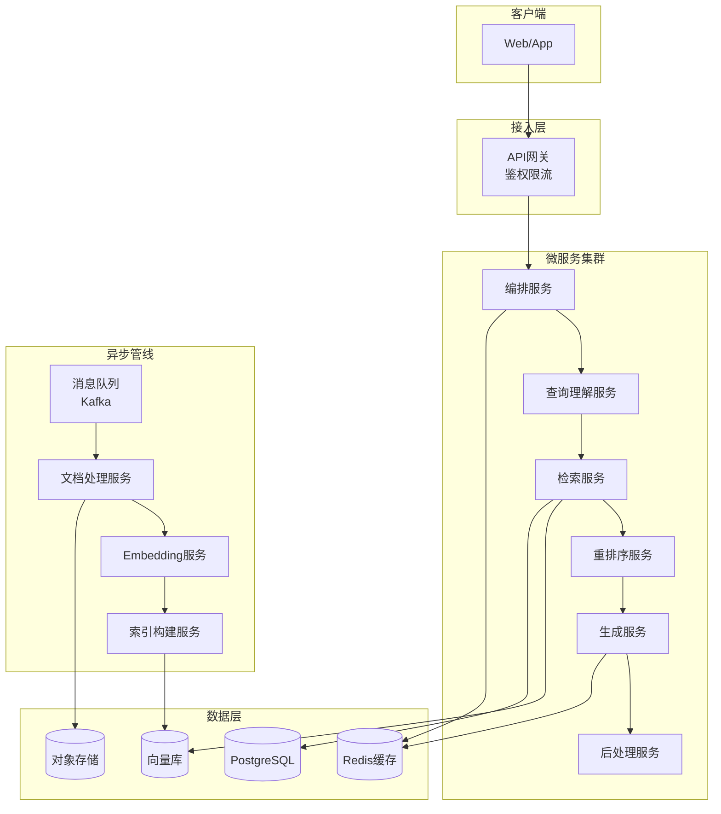

#### 代码示例：FastAPI编排服务

```python
# services/orchestrator/main.py
from fastapi import FastAPI, HTTPException
from fastapi.responses import StreamingResponse
from pydantic import BaseModel
from typing import Optional, List
import httpx
import asyncio
import time

app = FastAPI(title="RAG编排服务")


class QueryRequest(BaseModel):
    question: str
    session_id: Optional[str] = None
    top_k: int = 10
    stream: bool = False
    user_id: Optional[str] = None


class QueryResponse(BaseModel):
    answer: str
    contexts: List[dict]
    latency_ms: float
    cached: bool = False
    trace_id: str = ""


# 下游服务配置
SERVICES = {
    "query_understanding": "http://query-understanding:8001",
    "retrieval": "http://retrieval:8002",
    "reranking": "http://reranking:8003",
    "generation": "http://generation:8004",
    "postprocess": "http://postprocess:8005",
}


@app.post("/query", response_model=QueryResponse)
async def query(req: QueryRequest):
    """同步查询：完整RAG流程"""
    start = time.time()
    trace_id = f"trace_{int(start*1000)}"

    async with httpx.AsyncClient(timeout=30.0) as client:
        # Step 1: 查询理解
        resp = await client.post(
            f"{SERVICES['query_understanding']}/understand",
            json={"question": req.question},
        )
        understanding = resp.json()

        # Step 2: 多路召回
        resp = await client.post(
            f"{SERVICES['retrieval']}/search",
            json={
                "query": understanding["rewritten_query"],
                "top_k": req.top_k * 2,
            },
        )
        retrieved = resp.json()

        # Step 3: 重排序
        resp = await client.post(
            f"{SERVICES['reranking']}/rerank",
            json={
                "query": req.question,
                "documents": retrieved["documents"],
                "top_k": req.top_k,
            },
        )
        reranked = resp.json()

        # Step 4: 生成
        resp = await client.post(
            f"{SERVICES['generation']}/generate",
            json={
                "question": req.question,
                "contexts": reranked["documents"],
            },
        )
        generated = resp.json()

        # Step 5: 后处理
        resp = await client.post(
            f"{SERVICES['postprocess']}/process",
            json={
                "answer": generated["answer"],
                "contexts": reranked["documents"],
            },
        )
        final = resp.json()

    latency = (time.time() - start) * 1000
    return QueryResponse(
        answer=final["answer"],
        contexts=reranked["documents"],
        latency_ms=round(latency, 1),
        trace_id=trace_id,
    )


@app.post("/query/stream")
async def query_stream(req: QueryRequest):
    """流式查询"""
    async def generate():
        async with httpx.AsyncClient(timeout=60.0) as client:
            # 检索（非流式）
            resp = await client.post(
                f"{SERVICES['retrieval']}/search",
                json={"query": req.question, "top_k": req.top_k},
            )
            retrieved = resp.json()

            # 生成（流式）
            async with client.stream(
                "POST",
                f"{SERVICES['generation']}/generate/stream",
                json={
                    "question": req.question,
                    "contexts": retrieved["documents"],
                },
            ) as resp:
                async for line in resp.aiter_lines():
                    if line:
                        yield f"data: {line}\n\n"

    return StreamingResponse(
        generate(),
        media_type="text/event-stream",
        headers={
            "Cache-Control": "no-cache",
            "Connection": "keep-alive",
        },
    )


@app.get("/health")
async def health():
    return {"status": "healthy", "timestamp": time.time()}
```

### 12.2 消息队列与异步流水线

#### 代码示例：基于Kafka的异步索引流水线

```python
# services/index_pipeline/kafka_consumer.py
import json
import time
from dataclasses import dataclass
from enum import Enum


class IndexingStage(Enum):
    LOADED = "loaded"
    PARSED = "parsed"
    CHUNKED = "chunked"
    EMBEDDED = "embedded"
    INDEXED = "indexed"
    FAILED = "failed"


@dataclass
class DocumentEvent:
    doc_id: str
    file_path: str
    stage: IndexingStage
    retry_count: int = 0
    error: str = ""
    timestamp: float = 0


class AsyncIndexPipeline:
    """异步索引流水线：Kafka驱动"""

    def __init__(self, kafka_consumer, kafka_producer,
                 doc_loader, chunker, embedder, vector_store):
        self.consumer = kafka_consumer
        self.producer = kafka_producer
        self.loader = doc_loader
        self.chunker = chunker
        self.embedder = embedder
        self.vector_store = vector_store
        self.max_retries = 3

    def run(self):
        """消费消息队列，处理索引任务"""
        for msg in self.consumer:
            event = self._parse_event(msg.value)
            try:
                self._process_stage(event)
            except Exception as e:
                self._handle_failure(event, str(e))

    def _process_stage(self, event: DocumentEvent):
        """根据当前阶段执行对应处理"""
        if event.stage == IndexingStage.LOADED:
            self._parse_document(event)
        elif event.stage == IndexingStage.PARSED:
            self._chunk_document(event)
        elif event.stage == IndexingStage.CHUNKED:
            self._embed_chunks(event)
        elif event.stage == IndexingStage.EMBEDDED:
            self._build_index(event)

    def _parse_document(self, event: DocumentEvent):
        """文档加载+解析"""
        docs = self.loader.load(event.file_path)
        event.stage = IndexingStage.PARSED
        event.timestamp = time.time()
        self._emit(event)

    def _chunk_document(self, event: DocumentEvent):
        """文档分块"""
        chunks = self.chunker.split(event.file_path)
        event.stage = IndexingStage.CHUNKED
        event.timestamp = time.time()
        self._emit(event)

    def _embed_chunks(self, event: DocumentEvent):
        """Embedding计算"""
        chunks = self._load_chunks(event.doc_id)
        vectors = self.embedder.embed_batch(
            [c["content"] for c in chunks]
        )
        event.stage = IndexingStage.EMBEDDED
        event.timestamp = time.time()
        self._emit(event)

    def _build_index(self, event: DocumentEvent):
        """写入向量库"""
        self.vector_store.add_documents(
            self._load_vectors(event.doc_id)
        )
        event.stage = IndexingStage.INDEXED
        event.timestamp = time.time()
        self._emit(event)

    def _handle_failure(self, event: DocumentEvent, error: str):
        """失败处理：重试或进入死信队列"""
        event.retry_count += 1
        event.error = error

        if event.retry_count < self.max_retries:
            # 重新投递，延迟递增
            self._emit(event, delay=event.retry_count * 30)
        else:
            # 进入死信队列
            event.stage = IndexingStage.FAILED
            self.producer.send("index.dlq", event.__dict__)

    def _emit(self, event: DocumentEvent, delay: int = 0):
        topic = f"index.{event.stage.value}"
        self.producer.send(topic, event.__dict__)

    def _parse_event(self, raw) -> DocumentEvent:
        data = json.loads(raw)
        return DocumentEvent(**data)

    def _load_chunks(self, doc_id: str):
        return []  # 从缓存/数据库加载

    def _load_vectors(self, doc_id: str):
        return []  # 从缓存/数据库加载
```

### 12.3 多租户架构

#### 代码示例：多租户RAG隔离

```python
# services/multi_tenant.py
from typing import Dict, Optional
from dataclasses import dataclass
import hashlib


@dataclass
class TenantConfig:
    tenant_id: str
    name: str
    vector_collection: str  # 独立的向量集合
    rate_limit_rpm: int
    model: str
    chunk_size: int
    top_k: int


class MultiTenantManager:
    """多租户RAG管理：数据隔离+配置隔离"""

    def __init__(self):
        self.tenants: Dict[str, TenantConfig] = {}
        self._init_default_tenants()

    def _init_default_tenants(self):
        """初始化默认租户"""
        self.tenants["default"] = TenantConfig(
            tenant_id="default",
            name="默认租户",
            vector_collection="rag_default",
            rate_limit_rpm=100,
            model="gpt-4o-mini",
            chunk_size=500,
            top_k=5,
        )

    def get_tenant(self, tenant_id: str) -> TenantConfig:
        """获取租户配置"""
        return self.tenants.get(tenant_id, self.tenants["default"])

    def create_tenant(self, tenant_id: str,
                       name: str,
                       config: Dict = None) -> TenantConfig:
        """创建新租户（自动隔离向量集合）"""
        collection = f"rag_tenant_{tenant_id}"
        tenant = TenantConfig(
            tenant_id=tenant_id,
            name=name,
            vector_collection=collection,
            rate_limit_rpm=(config or {}).get("rate_limit_rpm", 100),
            model=(config or {}).get("model", "gpt-4o-mini"),
            chunk_size=(config or {}).get("chunk_size", 500),
            top_k=(config or {}).get("top_k", 5),
        )
        self.tenants[tenant_id] = tenant
        return tenant

    def isolate_query(self, tenant_id: str,
                      query: str) -> Dict:
        """租户级查询：自动注入集合隔离"""
        tenant = self.get_tenant(tenant_id)
        return {
            "query": query,
            "collection": tenant.vector_collection,
            "top_k": tenant.top_k,
            "model": tenant.model,
            "tenant_id": tenant_id,
        }


# 多租户路由中间件
class TenantRouter:
    """根据API Key识别租户"""

    def __init__(self, tenant_manager: MultiTenantManager):
        self.mgr = tenant_manager
        self.api_key_map = {}  # api_key -> tenant_id

    def register_api_key(self, api_key: str,
                         tenant_id: str):
        self.api_key_map[api_key] = tenant_id

    def resolve_tenant(self, api_key: str) -> TenantConfig:
        tenant_id = self.api_key_map.get(api_key, "default")
        return self.mgr.get_tenant(tenant_id)


# 使用示例
if __name__ == "__main__":
    mgr = MultiTenantManager()

    # 创建企业租户
    acme = mgr.create_tenant(
        tenant_id="acme_corp",
        name="Acme公司",
        config={"model": "gpt-4o", "top_k": 10, "rate_limit_rpm": 500}
    )
    print(f"租户: {acme.name}, 集合: {acme.vector_collection}")

    # 查询路由
    routed = mgr.isolate_query("acme_corp", "年假政策是什么？")
    print(f"路由到集合: {routed['collection']}")
    # 输出：路由到集合: rag_tenant_acme_corp
```

### 12.4 本章深度讲解与练习

> 💡 **深度讲解**：从单体RAG到微服务RAG的演进，核心驱动力是**不同组件的资源需求差异**——文档处理是CPU密集型，Embedding和重排序是GPU密集型，LLM生成是API/网络密集型。混在一起部署会互相争抢资源。微服务拆分后，每个服务可以根据自身特征选择最优的硬件配置和扩缩容策略。消息队列解耦了索引流程——文档上传后立即返回，索引在后台异步完成，用户体验更好。多租户则是SaaS化RAG平台的必备能力。

> **📝 精简总结**：微服务拆分=按资源需求拆(CPU/GPU/IO)+按变更频率拆；异步流水线=Kafka驱动+状态机+重试+死信队列；多租户=独立向量集合+独立配置+API Key路由；坑点=服务间调用延迟叠加(gRPC替代HTTP)+消息重复消费(幂等设计)+多租户数据泄露(严格集合隔离)。

### 🎯 梯度练习题

**基础题（⭐）**
1. 为什么RAG系统要拆成微服务？拆成哪几个服务？
2. 异步索引流水线相比同步流水线的优势是什么？

**进阶题（⭐⭐）**
3. 设计RAG微服务间的容错方案：某个服务（如重排序）挂了，整个查询流程如何降级？

**实战题（⭐⭐⭐）**
4. 设计一个支持100个租户、日查询量100万的RAG SaaS平台架构。要求：租户隔离、成本控制、自动扩缩容、99.9%可用性。给出技术选型、部署架构、成本估算。

---

## 13. RAG监控、运维与故障排查

### 13.1 核心监控指标

#### 代码示例：RAG监控指标收集器

```python
# monitoring/metrics_collector.py
import time
from dataclasses import dataclass, field
from typing import Dict, List
from collections import defaultdict
import threading


@dataclass
class RAGMetrics:
    """RAG系统全链路指标"""
    # 延迟指标（ms）
    query_latency: List[float] = field(default_factory=list)
    retrieval_latency: List[float] = field(default_factory=list)
    reranking_latency: List[float] = field(default_factory=list)
    generation_latency: List[float] = field(default_factory=list)

    # 质量指标
    retrieval_recall: List[float] = field(default_factory=list)
    faithfulness: List[float] = field(default_factory=list)
    answer_relevancy: List[float] = field(default_factory=list)

    # 业务指标
    query_count: int = 0
    cache_hits: int = 0
    error_count: int = 0
    hallucination_count: int = 0

    # 成本指标
    total_tokens_used: int = 0
    total_cost: float = 0.0


class MetricsCollector:
    """线程安全的指标收集器"""

    def __init__(self):
        self._metrics = RAGMetrics()
        self._lock = threading.Lock()

    def record_query_latency(self, ms: float):
        with self._lock:
            self._metrics.query_latency.append(ms)
            self._metrics.query_count += 1

    def record_retrieval(self, latency_ms: float,
                         recall: float = None):
        with self._lock:
            self._metrics.retrieval_latency.append(latency_ms)
            if recall is not None:
                self._metrics.retrieval_recall.append(recall)

    def record_generation(self, latency_ms: float,
                          tokens: int,
                          cost: float = 0.0):
        with self._lock:
            self._metrics.generation_latency.append(latency_ms)
            self._metrics.total_tokens_used += tokens
            self._metrics.total_cost += cost

    def record_error(self, error_type: str = "unknown"):
        with self._lock:
            self._metrics.error_count += 1

    def record_cache_hit(self):
        with self._lock:
            self._metrics.cache_hits += 1

    def summary(self) -> Dict:
        """生成指标摘要"""
        with self._lock:
            m = self._metrics
            return {
                "query_count": m.query_count,
                "cache_hit_rate": round(
                    m.cache_hits / max(m.query_count, 1), 3
                ),
                "error_rate": round(
                    m.error_count / max(m.query_count, 1), 3
                ),
                "latency": {
                    "avg_ms": self._avg(m.query_latency),
                    "p50_ms": self._percentile(m.query_latency, 50),
                    "p95_ms": self._percentile(m.query_latency, 95),
                    "p99_ms": self._percentile(m.query_latency, 99),
                },
                "quality": {
                    "avg_recall": self._avg(m.retrieval_recall),
                    "avg_faithfulness": self._avg(m.faithfulness),
                },
                "cost": {
                    "total_tokens": m.total_tokens_used,
                    "total_cost_usd": round(m.total_cost, 4),
                    "cost_per_query": round(
                        m.total_cost / max(m.query_count, 1), 6
                    ),
                },
            }

    def _avg(self, lst: List[float]) -> float:
        return round(sum(lst) / max(len(lst), 1), 3)

    def _percentile(self, lst: List[float],
                    p: float) -> float:
        if not lst:
            return 0.0
        sorted_lst = sorted(lst)
        idx = int(len(sorted_lst) * p / 100)
        return round(sorted_lst[min(idx, len(sorted_lst)-1)], 1)


# 使用示例
if __name__ == "__main__":
    collector = MetricsCollector()

    # 模拟记录查询
    for i in range(100):
        collector.record_query_latency(200 + i * 5)
        collector.record_retrieval(80 + i, recall=0.85)
        collector.record_generation(500 + i * 3, tokens=500)
        if i % 10 == 0:
            collector.record_cache_hit()
        if i % 20 == 0:
            collector.record_error()

    import json
    print(json.dumps(collector.summary(), indent=2,
                     ensure_ascii=False))
```

### 13.2 日志与链路追踪

#### 代码示例：RAG全链路追踪

```python
# monitoring/tracing.py
import time
import uuid
from contextvars import ContextVar
from dataclasses import dataclass, field
from typing import Dict, List, Optional

# 当前追踪ID的上下文变量
current_trace_id: ContextVar[str] = ContextVar(
    "trace_id", default=""
)


@dataclass
class TraceSpan:
    name: str
    start_time: float
    end_time: float = 0
    attributes: Dict = field(default_factory=dict)
    status: str = "ok"

    @property
    def duration_ms(self) -> float:
        return round((self.end_time - self.start_time) * 1000, 1)


class RAGTracer:
    """RAG全链路追踪器"""

    def __init__(self, trace_id: str = None):
        self.trace_id = trace_id or str(uuid.uuid4())[:16]
        self.spans: List[TraceSpan] = []
        self.start_time = time.time()

    def start_span(self, name: str,
                   **attrs) -> TraceSpan:
        span = TraceSpan(
            name=name,
            start_time=time.time(),
            attributes=attrs,
        )
        self.spans.append(span)
        return span

    def end_span(self, span: TraceSpan,
                 status: str = "ok",
                 **attrs):
        span.end_time = time.time()
        span.status = status
        span.attributes.update(attrs)

    def report(self) -> Dict:
        total = (time.time() - self.start_time) * 1000
        return {
            "trace_id": self.trace_id,
            "total_duration_ms": round(total, 1),
            "spans": [
                {
                    "name": s.name,
                    "duration_ms": s.duration_ms,
                    "status": s.status,
                    "attributes": s.attributes,
                }
                for s in self.spans
            ],
        }


# 装饰器式追踪
def traced(span_name: str = None):
    """自动追踪函数执行时间"""
    def decorator(func):
        def wrapper(*args, **kwargs):
            tracer = getattr(args[0], "_tracer", None) if args else None
            if tracer:
                span = tracer.start_span(
                    span_name or func.__name__
                )
                try:
                    result = func(*args, **kwargs)
                    tracer.end_span(span, status="ok")
                    return result
                except Exception as e:
                    tracer.end_span(span, status="error",
                                    error=str(e))
                    raise
            return func(*args, **kwargs)
        return wrapper
    return decorator


# 使用示例
class TracedRAGSystem:
    def __init__(self):
        self._tracer = RAGTracer()

    def query(self, question: str) -> Dict:
        tracer = self._tracer

        span = tracer.start_span("query_understanding")
        time.sleep(0.05)
        tracer.end_span(span, rewritten="改写后查询")

        span = tracer.start_span("retrieval", top_k=10)
        time.sleep(0.15)
        tracer.end_span(span, docs_found=8)

        span = tracer.start_span("llm_generation")
        time.sleep(0.4)
        tracer.end_span(span, tokens=500)

        return tracer.report()


if __name__ == "__main__":
    rag = TracedRAGSystem()
    report = rag.query("年假政策")
    import json
    print(json.dumps(report, indent=2, ensure_ascii=False))
```

### 13.3 告警策略

#### 代码示例：智能告警引擎

```python
# monitoring/alert_engine.py
from dataclasses import dataclass
from typing import List, Dict, Callable
from datetime import datetime, timedelta


@dataclass
class AlertRule:
    name: str
    metric: str
    condition: str  # ">", "<", ">=", "<="
    threshold: float
    window_minutes: int
    severity: str  # "critical", "warning", "info"
    description: str


@dataclass
class Alert:
    rule_name: str
    severity: str
    current_value: float
    threshold: float
    message: str
    timestamp: str


class AlertEngine:
    """RAG系统告警引擎"""

    DEFAULT_RULES = [
        AlertRule(
            name="p95_latency_high",
            metric="p95_latency_ms",
            condition=">",
            threshold=5000,
            window_minutes=5,
            severity="critical",
            description="P95查询延迟超过5秒",
        ),
        AlertRule(
            name="error_rate_high",
            metric="error_rate",
            condition=">",
            threshold=0.05,
            window_minutes=10,
            severity="critical",
            description="错误率超过5%",
        ),
        AlertRule(
            name="faithfulness_drop",
            metric="avg_faithfulness",
            condition="<",
            threshold=0.8,
            window_minutes=30,
            severity="warning",
            description="回答忠实度低于0.8，可能出现幻觉",
        ),
        AlertRule(
            name="cache_hit_rate_low",
            metric="cache_hit_rate",
            condition="<",
            threshold=0.1,
            window_minutes=60,
            severity="info",
            description="缓存命中率低于10%，成本可能偏高",
        ),
        AlertRule(
            name="recall_drop",
            metric="avg_recall",
            condition="<",
            threshold=0.75,
            window_minutes=60,
            severity="warning",
            description="检索召回率下降，可能索引出问题",
        ),
    ]

    def __init__(self, rules: List[AlertRule] = None):
        self.rules = rules or self.DEFAULT_RULES
        self.alerts: List[Alert] = []
        self.alert_history: List[Alert] = []

    def evaluate(self, metrics_summary: Dict) -> List[Alert]:
        """评估当前指标是否触发告警"""
        triggered = []

        for rule in self.rules:
            current = self._get_metric(
                metrics_summary, rule.metric
            )
            if current is None:
                continue

            if self._check_condition(
                current, rule.condition, rule.threshold
            ):
                alert = Alert(
                    rule_name=rule.name,
                    severity=rule.severity,
                    current_value=current,
                    threshold=rule.threshold,
                    message=(
                        f"{rule.description}: "
                        f"当前={current}, 阈值={rule.threshold}"
                    ),
                    timestamp=datetime.now().isoformat(),
                )
                triggered.append(alert)
                self.alert_history.append(alert)

        return triggered

    def _get_metric(self, summary: Dict,
                    metric_path: str):
        """从指标摘要中提取值"""
        parts = metric_path.split(".")
        value = summary
        for part in parts:
            if isinstance(value, dict) and part in value:
                value = value[part]
            else:
                return None
        return value if isinstance(value, (int, float)) else None

    def _check_condition(self, value: float,
                          op: str, threshold: float) -> bool:
        ops = {
            ">": lambda a, b: a > b,
            "<": lambda a, b: a < b,
            ">=": lambda a, b: a >= b,
            "<=": lambda a, b: a <= b,
        }
        return ops.get(op, lambda a, b: False)(value, threshold)

    def report(self) -> Dict:
        """告警报告"""
        critical = sum(
            1 for a in self.alert_history if a.severity == "critical"
        )
        warning = sum(
            1 for a in self.alert_history if a.severity == "warning"
        )
        return {
            "total_alerts": len(self.alert_history),
            "critical": critical,
            "warning": warning,
            "recent_alerts": [
                {"rule": a.rule_name, "severity": a.severity,
                 "message": a.message}
                for a in self.alert_history[-10:]
            ],
        }


# 使用示例
if __name__ == "__main__":
    engine = AlertEngine()

    # 模拟指标
    metrics = {
        "query_count": 1000,
        "cache_hit_rate": 0.15,
        "error_rate": 0.06,  # 超过5%阈值
        "latency": {"p95_ms": 6200},  # 超过5000ms
        "quality": {"avg_recall": 0.72, "avg_faithfulness": 0.91},
    }

    alerts = engine.evaluate(metrics)
    for alert in alerts:
        print(f"[{alert.severity.upper()}] {alert.rule_name}")
        print(f"  {alert.message}")
```

### 13.4 常见故障排查手册

#### 故障排查决策树

```mermaid
flowchart TD
    A[RAG回答质量下降] --> B{检索结果有变化吗?}
    B -->|是| C[检索问题]
    B -->|否| D{生成回答有变化吗?}

    C --> C1[索引是否重建?]
    C --> C2[Embedding模型换了?]
    C --> C3[文档更新了?]
    C --> C4[HNSW参数变了?]

    D --> D1[LLM模型换了?]
    D --> D2[Prompt改了?]
    D --> D3[上下文数量变了?]
    D --> D4[温度参数变了?]

    C1 --> E[对比新旧索引的Recall@K]
    D1 --> F[运行黄金测试集对比]
```

#### 代码示例：RAG健康检查脚本

```python
# monitoring/health_check.py
import time
from typing import Dict, List
from dataclasses import dataclass


@dataclass
class HealthCheck:
    name: str
    status: str  # "healthy", "degraded", "unhealthy"
    message: str
    latency_ms: float = 0


class RAGHealthChecker:
    """RAG系统健康检查"""

    GOLDEN_QUERIES = [
        {
            "query": "公司年假政策是什么？",
            "expected_keywords": ["年假", "天"],
            "min_recall": 0.8,
        },
        {
            "query": "RAG系统如何工作？",
            "expected_keywords": ["检索", "生成"],
            "min_recall": 0.7,
        },
        {
            "query": "向量数据库怎么选型？",
            "expected_keywords": ["向量", "数据库"],
            "min_recall": 0.7,
        },
    ]

    def run_checks(self, rag_system) -> List[HealthCheck]:
        checks = []

        # 1. 向量库连通性
        checks.append(self._check_vector_db(rag_system))

        # 2. Embedding服务
        checks.append(self._check_embedding(rag_system))

        # 3. LLM服务
        checks.append(self._check_llm(rag_system))

        # 4. 检索质量
        checks.append(self._check_retrieval_quality(rag_system))

        # 5. 端到端延迟
        checks.append(self._check_latency(rag_system))

        # 6. 缓存状态
        checks.append(self._check_cache(rag_system))

        return checks

    def _check_vector_db(self, rag) -> HealthCheck:
        start = time.time()
        try:
            count = rag.vector_store.count()
            latency = (time.time() - start) * 1000
            return HealthCheck(
                name="vector_db",
                status="healthy" if count > 0 else "degraded",
                message=f"向量库包含 {count} 条向量",
                latency_ms=latency,
            )
        except Exception as e:
            return HealthCheck(
                name="vector_db",
                status="unhealthy",
                message=f"连接失败: {e}",
            )

    def _check_embedding(self, rag) -> HealthCheck:
        start = time.time()
        try:
            vec = rag.embedding.embed_query("健康检查")
            latency = (time.time() - start) * 1000
            dim_ok = len(vec) > 0
            return HealthCheck(
                name="embedding",
                status="healthy" if dim_ok else "degraded",
                message=f"Embedding维度={len(vec)}",
                latency_ms=latency,
            )
        except Exception as e:
            return HealthCheck(
                name="embedding",
                status="unhealthy",
                message=str(e),
            )

    def _check_llm(self, rag) -> HealthCheck:
        start = time.time()
        try:
            resp = rag.llm.chat("回复'OK'两个字即可")
            latency = (time.time() - start) * 1000
            return HealthCheck(
                name="llm",
                status="healthy",
                message=f"LLM响应: {resp[:20]}",
                latency_ms=latency,
            )
        except Exception as e:
            return HealthCheck(
                name="llm",
                status="unhealthy",
                message=str(e),
            )

    def _check_retrieval_quality(self, rag) -> HealthCheck:
        """用黄金查询测试检索质量"""
        recalls = []
        for case in self.GOLDEN_QUERIES:
            try:
                results = rag.retrieve(case["query"], k=5)
                # 简化：检查结果数>0
                if len(results) > 0:
                    recalls.append(1.0)
            except:
                pass

        avg_recall = sum(recalls) / max(len(recalls), 1)
        status = "healthy" if avg_recall >= 0.8 else (
            "degraded" if avg_recall >= 0.5 else "unhealthy"
        )
        return HealthCheck(
            name="retrieval_quality",
            status=status,
            message=f"平均召回={avg_recall:.2f}, "
                    f"通过={len(recalls)}/{len(self.GOLDEN_QUERIES)}",
        )

    def _check_latency(self, rag) -> HealthCheck:
        start = time.time()
        try:
            rag.query("测试查询")
            latency = (time.time() - start) * 1000
            status = "healthy" if latency < 3000 else (
                "degraded" if latency < 8000 else "unhealthy"
            )
            return HealthCheck(
                name="e2e_latency",
                status=status,
                message=f"端到端延迟={latency:.0f}ms",
                latency_ms=latency,
            )
        except Exception as e:
            return HealthCheck(
                name="e2e_latency",
                status="unhealthy",
                message=str(e),
            )

    def _check_cache(self, rag) -> HealthCheck:
        try:
            stats = rag.cache.stats()
            return HealthCheck(
                name="cache",
                status="healthy",
                message=f"命中率={stats['hit_rate']:.1%}, "
                        f"缓存条目={stats['cached_entries']}",
            )
        except:
            return HealthCheck(
                name="cache",
                status="degraded",
                message="缓存不可用",
            )


# 使用示例
if __name__ == "__main__":
    checker = RAGHealthChecker()
    # checks = checker.run_checks(rag_system)
    # for c in checks:
    #     icon = {"healthy": "✅", "degraded": "⚠️",
    #             "unhealthy": "❌"}[c.status]
    #     print(f"{icon} [{c.name}] {c.message}")
    print("健康检查器就绪，可接入RAG系统")
```

### 13.5 本章深度讲解与练习

> 💡 **深度讲解**：监控运维是RAG系统从"能用"到"可靠"的关键跨越。核心原则：**没有监控就不要上生产**。RAG系统的监控分为三层：① 基础设施层——CPU/GPU/内存/磁盘/网络；② 服务层——各微服务的延迟、成功率、错误率；③ 业务层——检索Recall、生成Faithfulness、用户满意度。最容易被忽视的是业务层监控——很多团队监控了CPU使用率但没监控回答质量，导致质量退化几天才被用户发现。告警策略要分级：P0级（服务不可用）立即电话通知，P1级（质量下降）群通知，P2级（成本异常）日报汇总。

> **📝 精简总结**：监控三层=基础设施+服务层+业务层；关键指标=P95延迟+Recall@K+Faithfulness+缓存命中率+错误率；告警分级=critical(电话)+warning(群通知)+info(日报)；故障排查=先查检索再查生成，对比黄金测试集；坑点=只监控技术指标不监控业务指标(质量退化无人知)+告警不分级(告警风暴)+无链路追踪(定位慢)。

### 🎯 梯度练习题

**基础题（⭐）**
1. RAG系统需要监控哪些核心指标？为什么业务指标比技术指标更重要？
2. P95延迟和平均延迟有什么区别？为什么要看P95？

**进阶题（⭐⭐）**
3. 设计一个RAG质量退化的自动检测方案：当Faithfulness从0.95降到0.85时，如何自动发现并定位是哪个环节的问题？

**实战题（⭐⭐⭐）**
4. 为你的RAG系统设计完整的监控运维方案：监控看板指标、告警规则、故障排查SOP、容量规划。要求：新工程师拿到SOP能在30分钟内定位并解决80%的常见问题。

---

## 14. 面试高频考点汇总

### 14.1 架构设计类

> 🎯 **面试题1**：设计一个企业知识库RAG系统，日活10000人，文档量100万篇，给出架构方案和技术选型。
>
> **答题要点**：
> 1. 离线索引：多格式加载器（PDF/Word/HTML）→ 递归分块（500字符/50重叠）→ BGE-M3 Embedding → Qdrant HNSW索引
> 2. 在线查询：查询改写 → 混合检索（向量+BM25）→ Cross-Encoder重排 → 上下文压缩 → GPT-4o生成 → 引用标注
> 3. 缓存：Redis语义缓存（阈值0.92）+ Embedding缓存
> 4. 微服务：FastAPI编排 + 独立检索/生成服务 + Kafka异步索引
> 5. 监控：Prometheus指标 + Langfuse追踪 + 黄金测试集回归

> 🎯 **面试题2**：RAG和Fine-tuning的区别？什么场景用RAG，什么场景用Fine-tuning？
>
> **答题要点**：
> - RAG：知识可更新、可溯源、无幻觉（理论上）、成本低；适合知识库问答、文档检索
> - Fine-tuning：模型行为改变、风格调整、特定任务能力提升；成本高、知识更新难
> - 组合方案：RAG获取知识 + Fine-tuning优化输出风格/格式

> 🎯 **面试题3**：RAG系统中如何减少幻觉？
>
> **答题要点**：
> 1. 检索端：提高Recall@K，确保相关文档被找到
> 2. 上下文端：提高上下文精确率，减少噪声干扰
> 3. Prompt端：强约束Prompt（"只基于上下文回答，不知道就说不知道"）
> 4. 生成端：降低temperature（0-0.3），要求引用来源
> 5. 后处理：事实校验（检查回答中的事实是否在上下文中有依据）

### 14.2 检索优化类

> 🎯 **面试题4**：混合检索（Hybrid Search）为什么比纯向量检索好？
>
> **答题要点**：向量检索擅长语义相似但不精确（同义词/专业术语弱）；BM25擅长精确匹配但不理解语义。混合检索互补：向量召回语义相关 + BM25召回精确匹配，RRF融合排序。通常比纯向量提升Recall 10-20%。

> 🎯 **面试题5**：Cross-Encoder重排为什么比Bi-Encoder好？有什么代价？
>
> **答题要点**：Bi-Encoder（Embedding模型）将query和document分别编码为向量，计算相似度快但精度有限；Cross-Encoder将query+document拼接后输入模型，输出相关性分数，精度高但计算量大（每个query-document pair都要前向传播）。生产方案：Bi-Encoder粗排（Top-50）→ Cross-Encoder精排（Top-5）。

### 14.3 性能成本类

> 🎯 **面试题6**：RAG系统成本主要花在哪里？如何降本？
>
> **答题要点**：成本分布——Embedding（索引阶段+查询阶段）30-40%，LLM生成 50-60%，基础设施 10%。降本策略：① 缓存（查询缓存+Embedding缓存）② 小模型替代（简单问题用小模型）③ 上下文压缩（减少输入token）④ 批量Embedding ⑤ 本地部署开源模型（BGE/Qwen）。

> 🎯 **面试题7**：RAG系统P95延迟8秒，如何优化到3秒？
>
> **答题要点**：先profile定位瓶颈——检索慢？生成慢？检索优化：混合检索并行+减少Top-K+HNSW调参；生成优化：流式输出+小模型做简单问题+预计算热门查询；架构优化：查询缓存+异步预加载+微服务并行。

### 14.4 评估质量类

> 🎯 **面试题8**：如何量化评估RAG系统的质量？
>
> **答题要点**：三维评估——检索质量（Recall@K, Precision@K, MRR, NDCG）、生成质量（Faithfulness, Answer Relevancy, Answer Correctness）、端到端（任务完成率, 用户满意度）。工具：RAGAS自动评估 + 人工抽检 + 黄金测试集回归。

> 🎯 **面试题9**：LLM-as-Judge的偏差有哪些？如何缓解？
>
> **答题要点**：偏差类型——位置偏差（偏好前面的选项）、长度偏差（偏好更长的回答）、自我偏好（偏好与Judge模型相似的风格）、权威性偏差（过度信任引用）。缓解：多Judge投票+位置随机化+人工校准+Cohen's Kappa检验一致性。

---

## 15. 最佳实践速查手册

### 15.1 RAG系统配置推荐表

| 配置项 | 推荐值 | 适用场景 |
|--------|--------|---------|
| chunk_size | 500-800 tokens | 通用文档 |
| chunk_overlap | 10-15% of chunk_size | 通用 |
| top_k | 5-10 | 通用 |
| top_k_after_rerank | 3-5 | 通用 |
| embedding_model | BGE-M3 / text-embedding-3-large | 中文/多语言 |
| llm_model | GPT-4o / Qwen-Max | 生产 |
| temperature | 0.0-0.3 | 事实性问答 |
| hnsw_M | 32 | 通用 |
| hnsw_ef_construction | 256 | 通用 |
| hnsw_ef_search | 128 | 通用 |
| cache_threshold | 0.92 | 语义缓存 |
| reranker | bge-reranker-v2 | 中文 |

### 15.2 RAG上线Checklist

- [ ] 评估集构建完成（≥100条黄金测试集）
- [ ] Recall@5 ≥ 0.85
- [ ] Faithfulness ≥ 0.90
- [ ] P95延迟 ≤ 5秒
- [ ] 缓存命中率 ≥ 20%
- [ ] 监控看板上线（延迟/质量/成本）
- [ ] 告警规则配置（P95延迟/错误率/Faithfulness下降）
- [ ] 灰度发布方案（10%→50%→100%）
- [ ] 回滚方案（旧版本快速切换）
- [ ] 文档更新流程（增量索引）
- [ ] 安全过滤（敏感信息/Prompt注入）
- [ ] 引用标注（回答可溯源）

### 15.3 常见坑点速查

| 编号 | 坑点 | 现象 | 解决方案 |
|------|------|------|---------|
| 1 | chunk太大 | 检索精度低 | 减小chunk_size到500以下 |
| 2 | chunk太小 | 回答不完整 | 增大chunk_size或用父子分块 |
| 3 | 无overlap | 边界信息丢失 | 设置10-15% overlap |
| 4 | 单路检索 | Recall低 | 加BM25混合检索 |
| 5 | 无重排序 | 相关文档排后面 | 加Cross-Encoder重排 |
| 6 | 无缓存 | 成本高、延迟高 | 加查询+Embedding缓存 |
| 7 | temperature高 | 幻觉多 | 降到0-0.3 |
| 8 | Prompt太松 | 不引用上下文 | 强约束Prompt |
| 9 | 无引用标注 | 不可溯源 | 后处理加引用 |
| 10 | 无评估 | 质量黑盒 | 建评估集+自动化评估 |
| 11 | PDF解析差 | 表格打散 | 用pdfplumber/Docling |
| 12 | 代码被硬切 | 函数不完整 | 用AST分块 |
| 13 | HTML噪声多 | 导航广告进知识库 | 正文提取(readability) |
| 14 | 中文PDF乱码 | 无法检索 | OCR降级 |
| 15 | 索引内存爆 | OOM | PQ量化或减小M |
| 16 | efSearch太小 | Recall低 | 增大到128+ |
| 17 | 缓存不含模型版本 | 换模型后脏数据 | key加model_version |
| 18 | 无降级方案 | 服务挂了全挂 | 主备Embedding+LLM降级 |
| 19 | 无增量更新 | 全量重建慢 | 按文档版本增量索引 |
| 20 | 多租户不隔离 | 数据泄露风险 | 独立向量集合 |
| 21 | 上下文去重不够 | 重复信息浪费token | 相似度>0.85去重 |
| 22 | 无流式输出 | 用户等待久 | SSE流式输出 |
| 23 | 无链路追踪 | 故障定位慢 | OpenTelemetry+trace |
| 24 | 评估集不够 | 上线后bad case多 | 线上bad case回流 |
| 25 | 分块策略一刀切 | 不同文档效果差 | 按文档类型选分块 |
| 26 | 无上下文压缩 | token浪费 | LLM/规则压缩 |
| 27 | 无MMR多样性 | 回答角度单一 | MMR重排 |
| 28 | Embedding批太小 | API调用慢 | 增大batch_size |
| 29 | 无速率限制 | API限流 | 信号量+重试 |
| 30 | 监控只有技术指标 | 质量退化无人知 | 加业务指标监控 |

---

## 附录

### A. RAG技术栈选型参考

```yaml
# 文档处理
pdf_loader:
  simple: PyMuPDF
  tables: pdfplumber
  complex: Docling / MinerU

word_loader: python-docx
html_loader: BeautifulSoup + readability-lxml
code_loader: tree-sitter / AST

# 分块
chunker:
  default: RecursiveCharacterTextSplitter
  markdown: MarkdownHeaderTextSplitter
  code: LanguageParser
  semantic: SemanticChunker

# Embedding
embedding:
  chinese: BGE-M3 / bge-large-zh-v1.5
  multilingual: BGE-M3 / multilingual-e5
  english: text-embedding-3-large / Cohere-embed
  local: nomic-embed-text / bge-m3

# 向量数据库
vector_db:
  prototype: Chroma / FAISS
  small: Qdrant / Milvus (standalone)
  large: Milvus Cluster / Weaviate
  cloud: Pinecone / Zilliz Cloud

# 重排序
reranker:
  chinese: bge-reranker-v2-m3
  english: Cohere Rerank / cross-encoder/ms-marco
  fast: 线性阈值过滤

# LLM
llm:
  production: GPT-4o / Claude-3.5 / Qwen-Max
  cost_effective: GPT-4o-mini / Qwen-Plus
  local: Llama-3 / Qwen2.5

# 编排
orchestration:
  simple: LangChain LCEL
  complex: LangGraph / LlamaIndex Workflows
  production: 自研状态机 + 微服务

# 评估
evaluation:
  auto: Ragas / DeepEval
  observability: Langfuse / LangSmith
  golden: pytest + 自定义指标
```

### B. 参考资源

- **论文**：
  - "Retrieval-Augmented Generation for Knowledge-Intensive NLP Tasks" (Lewis et al., 2020) — RAG原始论文
  - "Lost in the Middle" (Liu et al., 2023) — 上下文位置对LLM注意力的影响
  - "RA-DIT: Retrieval-Augmented Dual Instruction Tuning" (2023)

- **开源项目**：
  - LangChain / LlamaIndex — RAG框架
  - Milvus / Qdrant / Chroma — 向量数据库
  - BGE / GTE / E5 — Embedding模型
  - Ragas / DeepEval — 评估框架
  - MinerU / Docling — 文档解析

- **学习路径**：
  1. [[RAG检索增强生成]] — 基础概念和从零实现
  2. 本文档 — 架构设计和高级流程
  3. [[高级RAG-Hybrid检索与重排序]] — 检索优化深度
  4. [[文本分块策略对比]] — 分块策略深度
  5. [[RAG评估指标与方法]] — 评估体系

---

## 🔗 关联笔记

- [[RAG检索增强生成]] — RAG基础概念
- [[高级RAG-Hybrid检索与重排序]] — 混合检索与重排序
- [[文本分块策略对比]] — 分块策略深度对比
- [[RAG评估指标与方法]] — RAG评估体系
- [[Embedding模型选型]] — Embedding模型对比
- [[GraphRAG知识图谱增强检索]] — GraphRAG架构

## 🏷️ 相关标签

`#AI应用` `#RAG` `#架构设计` `#生产级`

---

[[Home|🏠 返回首页]] · [[MOC-AI与效率工具|📚 AI与效率工具]] · [[MOC-AI工程化|🤖 AI工程化]]


## 附录C：RAG工程代码速查表

本附录把正文中出现的关键操作沉淀为可直接复用的短小代码片段，按工程环节分组。每个片段均可独立运行或复制到项目中使用。

### C.1 环境与依赖

```txt
# requirements.txt
langchain>=0.2.0
openai>=1.30.0
pymilvus>=2.4.0
qdrant-client>=1.9.0
chromadb>=0.5.0
psycopg2-binary>=2.9.9
sentence-transformers>=2.7.0
redis>=5.0.0
pydantic>=2.7.0
tenacity>=8.3.0
```

```bash
# 安装依赖并锁定版本
python -m venv .venv
source .venv/bin/activate   # Windows: .venv\Scripts\activate
pip install -r requirements.txt
pip freeze > requirements-lock.txt
```

```bash
# .env 环境变量（示例）
OPENAI_API_KEY=sk-xxxx
EMBEDDING_MODEL=text-embedding-3-small
VECTOR_DB=milvus
MILVUS_HOST=127.0.0.1
MILVUS_PORT=19530
REDIS_URL=redis://localhost:6379/0
LOG_LEVEL=INFO
```

```yaml
# docker-compose.yml 向量库一键启动
services:
  milvus:
    image: milvusdb/milvus:v2.4.5
    command: ["milvus", "run", "standalone"]
    ports: ["19530:19530"]
  etcd:
    image: quay.io/coreos/etcd:v3.5.5
  minio:
    image: minio/minio:RELEASE.2024-05-28T17-19-04Z
```

```dockerfile
# Dockerfile 应用镜像
FROM python:3.11-slim
WORKDIR /app
COPY requirements.txt .
RUN pip install --no-cache-dir -r requirements.txt
COPY . .
CMD ["uvicorn", "app.main:app", "--host", "0.0.0.0", "--port", "8000"]
```

```bash
# 一键初始化脚本 init.sh
#!/usr/bin/env bash
set -e
docker compose up -d etcd minio milvus
sleep 10
python -m app.cli init-schema
python -m app.cli build-index --data ./data
echo "RAG init done"
```

```toml
# pyproject.toml 现代依赖管理
[tool.poetry]
name = "rag-service"
version = "0.1.0"
description = "Production RAG service"

[tool.poetry.dependencies]
python = "^3.11"
langchain = "^0.2.0"
openai = "^1.30.0"
pymilvus = "^2.4.0"
```

```makefile
# Makefile 常用任务
install:
	pip install -r requirements.txt
lint:
	ruff check app/
test:
	pytest tests/ -x -q
eval:
	python -m app.eval.run --set golden
```

```yaml
# .github/workflows/ci.yaml
name: RAG CI
on: [push]
jobs:
  test:
    runs-on: ubuntu-latest
    steps:
      - uses: actions/checkout@v4
      - uses: actions/setup-python@v5
        with: { python-version: "3.11" }
      - run: pip install -r requirements.txt
      - run: pytest tests/ -q
```

```bash
# uv 极速依赖安装
pip install uv
uv venv .venv
source .venv/bin/activate
uv pip install -r requirements.txt
uv pip compile requirements.in -o requirements.txt
```

### C.2 文档加载

```python
# PDF 加载（带页数与元数据）
from langchain_community.document_loaders import PyPDFLoader
loader = PyPDFLoader("doc.pdf")
pages = loader.load()
for p in pages[:3]:
    print(p.metadata["page"], len(p.page_content))
```

```python
# Word/Office 加载
from langchain_community.document_loaders import Docx2txtLoader
loader = Docx2txtLoader("report.docx")
docs = loader.load()
print("paragraphs:", len(docs))
```

```python
# HTML 加载并保留结构
from langchain_community.document_loaders import BSHTMLLoader
loader = BSHTMLLoader("page.html", open_encoding="utf-8")
docs = loader.load()
print("title:", docs[0].metadata.get("title"))
```

```python
# Markdown 加载（按标题拆分）
from langchain_community.document_loaders import UnstructuredMarkdownLoader
loader = UnstructuredMarkdownLoader("readme.md", mode="elements")
elements = loader.load()
print([e.metadata.get("category") for e in elements])
```

```python
# PPT 加载
from langchain_community.document_loaders import UnstructuredPowerPointLoader
loader = UnstructuredPowerPointLoader("deck.pptx")
slides = loader.load()
print("slides:", len(slides))
```

```python
# Excel 表格加载为文本
import pandas as pd
df = pd.read_excel("prices.xlsx", sheet_name="sku")
rows = [row.to_dict() for _, row in df.iterrows()]
text = "\n".join(str(r) for r in rows)
print("rows:", len(rows))
```

```python
# 扫描件 OCR 加载
from langchain_community.document_loaders import UnstructuredFileLoader
loader = UnstructuredFileLoader("scan.pdf", strategy="ocr_only")
docs = loader.load()
print("ocr chars:", len(docs[0].page_content))
```

```python
# 网页抓取加载
from langchain_community.document_loaders import WebBaseLoader
loader = WebBaseLoader("https://example.com/docs")
docs = loader.load()
print("url:", docs[0].metadata["source"])
```

```python
# 大文件流式加载（避免OOM）
def stream_jsonl(path):
    with open(path, "r", encoding="utf-8") as f:
        for line in f:
            yield json.loads(line)
import json
n = sum(1 for _ in stream_jsonl("data.jsonl"))
print("records:", n)
```

```python
# 加载后统一补元数据
def enrich(docs, source):
    for i, d in enumerate(docs):
        d.metadata["source"] = source
        d.metadata["chunk_idx"] = i
        d.metadata["ingest_time"] = datetime.now().isoformat()
    return docs
```

### C.3 分块策略

```python
# 固定大小分块
from langchain.text_splitter import CharacterTextSplitter
splitter = CharacterTextSplitter(chunk_size=500, chunk_overlap=50)
chunks = splitter.split_text(open("doc.txt", encoding="utf-8").read())
print("chunks:", len(chunks))
```

```python
# 递归分块（推荐默认）
from langchain.text_splitter import RecursiveCharacterTextSplitter
splitter = RecursiveCharacterTextSplitter(
    chunk_size=800, chunk_overlap=100,
    separators=["\n## ", "\n\n", "\n", "。", " "])
chunks = splitter.split_text(long_text)
```

```python
# Token 级分块（按真实token数）
from langchain.text_splitter import TokenTextSplitter
splitter = TokenTextSplitter(chunk_size=400, chunk_overlap=60)
chunks = splitter.split_text(long_text)
print("tokens per chunk ~400")
```

```python
# 按Markdown标题分块
from langchain.text_splitter import MarkdownHeaderTextSplitter
headers = [("#", "h1"), ("##", "h2"), ("###", "h3")]
splitter = MarkdownHeaderTextSplitter(headers_to_split_on=headers)
chunks = splitter.split_text(md_text)
```

```python
# 语义分块（基于嵌入相似度切分）
from langchain_experimental.text_splitter import SemanticChunker
splitter = SemanticChunker(embedding_model, breakpoint_threshold_type="percentile")
chunks = splitter.split_text(long_text)
```

```python
# 父子分块（大块给LLM，小块检索）
parent = RecursiveCharacterTextSplitter(chunk_size=2000)
child = RecursiveCharacterTextSplitter(chunk_size=300)
parent_docs = parent.split_documents(docs)
child_docs = child.split_documents(parent_docs)
```

```python
# 表格单独分块
from langchain_experimental.markdown import MarkdownTableSplitter
splitter = MarkdownTableSplitter()
tables, texts = splitter.split(md_text)
print("tables:", len(tables))
```

```python
# 分块后校验长度分布
import numpy as np
lens = [len(c) for c in chunks]
print("min/mean/max:", min(lens), int(np.mean(lens)), max(lens))
print("over5000:", sum(1 for x in lens if x > 5000))
```

```python
# 分块元数据回链
for c in chunks:
    c.metadata["parent_doc"] = doc_id
    c.metadata["char_start"] = offset
    c.metadata["char_end"] = offset + len(c.page_content)
```

```python
# 去重：指纹合并重复块
import hashlib
seen = set()
unique = []
for c in chunks:
    fp = hashlib.md5(c.page_content.encode()).hexdigest()
    if fp not in seen:
        seen.add(fp)
        unique.append(c)
```

### C.4 Embedding 流水线

```python
# OpenAI Embedding 调用
from openai import OpenAI
client = OpenAI()
resp = client.embeddings.create(model="text-embedding-3-small", input="hello rag")
vec = resp.data[0].embedding
print("dim:", len(vec))
```

```python
# 本地 Sentence-Transformers
from sentence_transformers import SentenceTransformer
model = SentenceTransformer("BAAI/bge-small-zh-v1.5")
emb = model.encode(["文档一", "文档二"], normalize_embeddings=True)
print("shape:", emb.shape)
```

```python
# 批量 Embedding（控制batch）
def embed_batch(texts, batch=64):
    out = []
    for i in range(0, len(texts), batch):
        out.extend(model.encode(texts[i:i+batch]).tolist())
    return out
```

```python
# Embedding 结果缓存（Redis）
import redis, json, hashlib
r = redis.Redis()
def cached_embed(text):
    key = "emb:" + hashlib.md5(text.encode()).hexdigest()
    if r.exists(key):
        return json.loads(r.get(key))
    v = model.encode(text).tolist()
    r.set(key, json.dumps(v), ex=86400*30)
    return v
```

```python
# 向量归一化（余弦=内积）
import numpy as np
def normalize(v):
    v = np.array(v, dtype="float32")
    return (v / np.linalg.norm(v)).tolist()
```

```python
# Embedding 降级策略
def embed_with_fallback(text):
    try:
        return openai_embed(text)
    except Exception:
        return local_embed(text)  # 降级到本地模型
```

```python
# 异步批量 Embedding
import asyncio
async def aembed(texts):
    sem = asyncio.Semaphore(8)
    async def one(t):
        async with sem:
            return await loop.run_in_executor(None, model.encode, t)
    return await asyncio.gather(*[one(t) for t in texts])
```

```python
# Embedding 维度自检
dims = {model.encode("x").shape[0] for _ in [0]}
assert dims.pop() in (512, 768, 1024, 1536), "unexpected dim"
```

```python
# 重试与限流（tenacity）
from tenacity import retry, stop_after_attempt, wait_exponential
@retry(stop=stop_after_attempt(5), wait=wait_exponential())
def embed_retry(text):
    return openai_embed(text)
```

```python
# Embedding 失败死信队列
def safe_embed(texts):
    ok, dead = [], []
    for t in texts:
        try: ok.append(embed_retry(t))
        except Exception: dead.append(t)
    return ok, dead
```

### C.5 向量库写入与查询

```python
# Milvus 创建集合
from pymilvus import Collection, FieldSchema, DataType, CollectionSchema
fields = [
    FieldSchema("pk", DataType.INT64, is_primary=True, auto_id=True),
    FieldSchema("vec", DataType.FLOAT_VECTOR, dim=1024),
    FieldSchema("text", DataType.VARCHAR, max_length=4096),
]
Collection("rag_docs", schema=CollectionSchema(fields))
```

```python
# Qdrant 创建 collection
from qdrant_client import QdrantClient
from qdrant_client.models import VectorParams, Distance
qc = QdrantClient("localhost")
qc.recreate_collection("rag_docs", vectors_config=VectorParams(size=1024, distance=Distance.COSINE))
```

```python
# Chroma 建 collection
import chromadb
ch = chromadb.PersistentClient("./chroma")
col = ch.get_or_create_collection("rag_docs", metadata={"hnsw:space": "cosine"})
```

```python
# PGVector 建表
# CREATE EXTENSION IF NOT EXISTS vector;
# CREATE TABLE docs (id bigserial PRIMARY KEY, text text, embedding vector(1024));
# CREATE INDEX ON docs USING hnsw (embedding vector_cosine_ops);
```

```sql
-- PGVector 建索引
CREATE INDEX idx_docs_embedding
  ON docs USING hnsw (embedding vector_cosine_ops)
  WITH (m = 16, ef_construction = 200);
```

```python
# Milvus 写入
col.insert([{"vec": vec, "text": text}])
col.flush()
col.create_index("vec", {"index_type": "HNSW", "metric_type": "COSINE",
                          "params": {"M": 16, "efConstruction": 200}})
```

```python
# 向量近邻查询
res = col.search(data=[query_vec], anns_field="vec", param={"ef": 64},
                 limit=8, output_fields=["text"])
hits = res[0]
```

```python
# 元数据过滤查询
from pymilvus import Collection
res = col.search([q], "vec", {"metric_type": "COSINE"}, 8,
                 expr="category == 'legal' and year >= 2023",
                 output_fields=["text", "source"])
```

```python
# Qdrant 带过滤检索
from qdrant_client.models import Filter, FieldCondition, MatchValue
res = qc.search("rag_docs", query_vector=vec, limit=8,
                query_filter=Filter(must=[FieldCondition(key="tag", match=MatchValue(value="faq"))]))
```

```python
# 按ID删除与重建
col.delete(expr=f"pk in {ids}")
col.compact()  # 回收空间
```

### C.6 检索与重排序

```python
# BM25 关键词检索
from rank_bm25 import BM25Okapi
corpus = [doc.split() for doc in all_docs]
bm25 = BM25Okapi(corpus)
scores = bm25.get_scores(query.split())
top = sorted(range(len(scores)), key=lambda i: scores[i], reverse=True)[:8]
```

```python
# 向量检索（独立）
def vector_search(q_vec, k=20):
    return col.search([q_vec], "vec", {"ef": 128}, k, output_fields=["text"])
```

```python
# RRF 融合多路召回
def rrf_fuse(rank_lists, k=60):
    score = {}
    for ranks in rank_lists:
        for r, doc in enumerate(ranks):
            score[doc] = score.get(doc, 0) + 1.0 / (k + r + 1)
    return sorted(score, key=score.get, reverse=True)
```

```python
# Cross-Encoder 重排
from sentence_transformers import CrossEncoder
ce = CrossEncoder("cross-encoder/ms-marco-MiniLM-L-6-v2")
pairs = [(query, doc.text) for doc in candidates]
ranks = ce.predict(pairs)
best = [candidates[i] for i in np.argsort(ranks)[::-1][:5]]
```

```python
# 查询改写（Query Rewriting）
rewritten = llm.invoke(
    f"把下面问题改写成更适合检索的表述：{query}").content
print("rewritten:", rewritten)
```

```python
# 多查询生成（Multi-Query）
variants = llm.invoke(
    f"为问题生成3个等价检索变体：{query}").content.split("\n")
merged = dedupe(vector_search(v) for v in variants)
```

```python
# HyDE 假设性文档
hyde_doc = llm.invoke(f"为问题写一段假设性答案：{query}").content
hyde_vec = embed(hyde_doc)
hits = vector_search(hyde_vec, k=10)
```

```python
# MMR 多样性去重
def mmr(candidates, query_vec, k=5, lambda_=0.5):
    selected = []
    while len(selected) < k and candidates:
        def score(c):
            rel = cosine(query_vec, c.vec)
            div = max(cosine(c.vec, s.vec) for s in selected) if selected else 0
            return lambda_ * rel - (1 - lambda_) * div
        best = max(candidates, key=score)
        selected.append(best); candidates.remove(best)
    return selected
```

```python
# 时间衰减加权
import math
def recency_boost(ts, half_life_days=180):
    age = (now() - ts).days
    return 0.5 ** (age / half_life_days)
```

```python
# Top-K 自适应
def adaptive_k(query, base=6, max=20):
    if len(query) > 40 or "对比" in query:
        return max
    return base
```

### C.7 生成与Prompt组装

```python
# Prompt 模板组装
system = "你是基于文档回答的助手。\n参考资料：\n{context}"
user = "问题：{query}"
prompt = system.format(context="\n".join(d.text for d in hits)) + user.format(query=query)
```

```python
# 引用自动注入
context_block = "\n\n".join(f"[{i+1}] {d.text}" for i, d in enumerate(hits))
answer = llm.invoke(f"基于以下资料回答，并在句末标注引用编号：\n{context_block}\n问题：{q}").content
```

```python
# 流式输出
stream = llm.stream(query)
for chunk in stream:
    print(chunk.content, end="", flush=True)
```

```python
# 生成重试与兜底
def generate(prompt):
    try:
        return llm.invoke(prompt, timeout=15).content
    except TimeoutError:
        return "系统繁忙，请稍后重试。"
```

```python
# 上下文窗口预算控制
def fit_context(hits, budget=6000):
    used, kept = 0, []
    for d in sorted(hits, key=lambda h: h.score, reverse=True):
        n = len(d.text)
        if used + n > budget: break
        kept.append(d); used += n
    return kept
```

```python
# 答案后处理：去幻觉免责声明
import re
answer = re.sub(r"根据我的知识[，,]?\s*", "", answer)
```

```python
# 引用编号 -> 原文映射
def resolve_citations(answer, hits):
    refs = {}
    for m in re.finditer(r"\[(\d+)\]", answer):
        i = int(m.group(1)) - 1
        if 0 <= i < len(hits):
            refs[m.group(1)] = hits[i].metadata["source"]
    return refs
```

```python
# 多轮对话历史压缩
def compress_history(history, max_turns=6):
    recent = history[-max_turns*2:]
    return "\n".join(f"{r['role']}: {r['content']}" for r in recent)
```

```python
# 结构化 JSON 输出
from pydantic import BaseModel
class Answer(BaseModel):
    answer: str
    citations: list[int]
resp = llm.invoke(prompt, response_format=Answer)
data = Answer.model_validate_json(resp.content)
```

```python
# 无答案时的拒答模板
if not hits:
    answer = "根据现有知识库，未找到与该问题直接相关的资料，建议联系人工确认。"
```

### C.8 运维与部署

```python
# FastAPI 健康检查
from fastapi import FastAPI
app = FastAPI()
@app.get("/health")
def health():
    return {"status": "ok", "db": ping_milvus(), "llm": ping_openai()}
```

```python
# Prometheus 指标埋点
from prometheus_client import Counter, Histogram
Q = Counter("rag_queries_total", "query count", ["status"])
LAT = Histogram("rag_latency_seconds", "end-to-end latency")
```

```python
# 结构化日志
import logging
logging.basicConfig(
    format='{"time":"%(asctime)s","level":"%(levelname)s","msg":"%(message)s"}',
    level=logging.INFO)
```

```python
# 熔断器（pybreaker）
import pybreaker
breaker = pybreaker.CircuitBreaker(fail_max=5, reset_timeout=30)
@breaker
def call_llm(prompt):
    return llm.invoke(prompt).content
```

```python
# 限流（redis 令牌桶）
def rate_limit(key, limit=100, window=60):
    cur = r.incr(f"rl:{key}")
    if cur == 1: r.expire(f"rl:{key}", window)
    return cur <= limit
```

```python
# 查询结果缓存
def cache_answer(query, hits):
    key = "ans:" + hashlib.md5(query.encode()).hexdigest()
    return r.get(key) or set_and_return(key, generate(query, hits))
```

```python
# 离线索引批处理
def reindex_all():
    docs = load_all_docs()
    chunks = chunk_docs(docs)
    vecs = embed_batch([c.text for c in chunks])
    upsert_to_vector_db(chunks, vecs)
```

```python
# 数据迁移脚本
def migrate(from_col, to_col, batch=1000):
    while True:
        batch_rows = from_col.query(limit=batch)
        if not batch_rows: break
        to_col.insert(batch_rows)
```

```python
# 压测脚本
import asyncio, time
async def bench(n=200):
    t = time.time()
    await asyncio.gather(*[ask("什么是RAG？") for _ in range(n)])
    print("qps:", n / (time.time() - t))
```

```yaml
# 告警规则 alert.yml
groups:
- name: rag
  rules:
  - alert: HighLatency
    expr: histogram_quantile(0.95, rate(rag_latency_seconds_bucket[5m])) > 2
    for: 2m
    labels: { severity: warning }
    annotations: { summary: "RAG P95 延迟超过2秒" }
```
