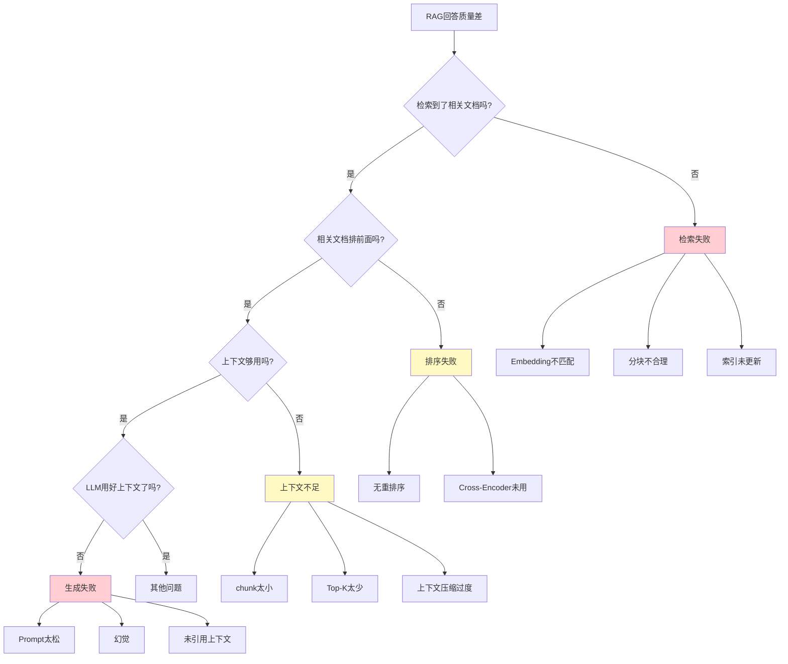
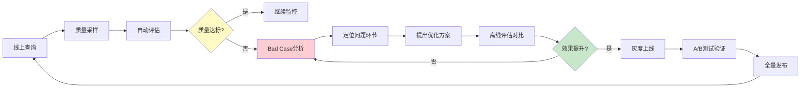
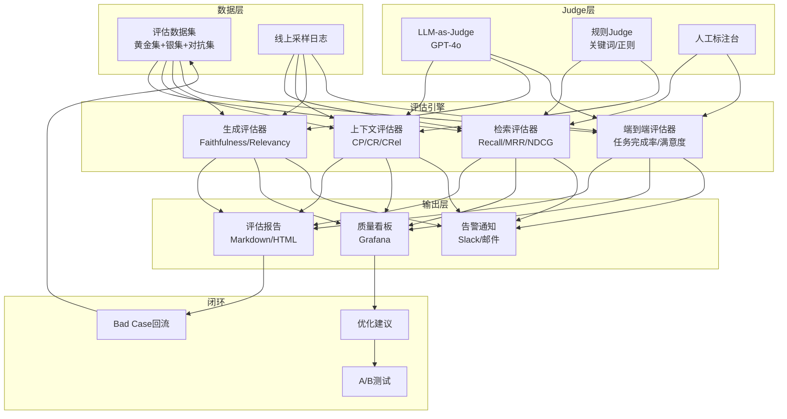

# RAG评估指标与方法

> **📖 文档说明**
>
> 本文档是RAG质量工程的完整指南。RAG系统的质量取决于两个独立又关联的环节：**检索质量**（是否找到了正确的文档）和**生成质量**（是否基于检索文档给出了准确、相关、完整的回答）。没有评估的RAG系统是"黑盒"——你不知道效果是好是坏，也无法量化优化效果。
>
> **👥 适用人群**
> - 需要量化RAG系统质量的AI工程师
> - 负责RAG系统持续优化的技术负责人
> - 需要建立评估体系的技术团队
> - 准备RAG评估面试的求职者
>
> **📚 前置知识**
> - [[RAG架构设计与流程]]：RAG系统架构和流程
> - [[RAG检索增强生成]]：RAG基础概念
> - 基础的机器学习评估知识

---

## 一、RAG评估体系概述

### 1.1 为什么RAG需要专门的评估体系

RAG系统的评估比传统软件系统复杂得多——传统软件有明确的对错（输入A应该输出B），但RAG系统的输出是**开放式生成**的，同一条问题可能有多个正确答案。这就需要专门的评估方法论。

> 💡 **比喻**：RAG评估就像**给厨师打分**——不能只看"菜熟了没"（传统软件的单元测试），还要看味道好不好（用户体验）、食材新不新鲜（检索质量）、做法正不正宗（生成质量）、营养均不均衡（完整性）。

| 痛点 | 评估解决的问题 |
|------|--------------|
| 改了分块策略后效果是好是坏？ | 量化对比改动前后的检索/生成指标 |
| 用户说"答非所问"，是检索错了还是生成错了？ | 分解为Context Precision（检索）和Faithfulness（生成）分别诊断 |
| 换了Embedding模型后无法衡量提升 | 用Recall@K/MRR等指标量化检索质量变化 |
| 上线后质量退化无人发现 | 持续评估+告警，质量下降时自动通知 |
| 多个RAG方案无法选择 | 统一评估集+指标对比，数据驱动决策 |

### 1.2 RAG评估三维框架

```mermaid
graph TB
    subgraph L1[检索层评估 Retrieval]
        R1[Recall@K<br/>召回率]
        R2[Precision@K<br/>精确率]
        R3[MRR<br/>平均倒数排名]
        R4[NDCG@K<br/>归一化折损增益]
        R5[Context Precision<br/>上下文精确度]
        R6[Context Recall<br/>上下文召回率]
        R7[Context Relevancy<br/>上下文相关性]
    end

    subgraph L2[生成层评估 Generation]
        G1[Faithfulness<br/>忠实度/无幻觉]
        G2[Answer Relevancy<br/>回答相关性]
        G3[Answer Correctness<br/>回答正确性]
        G4[Answer Completeness<br/>回答完整性]
    end

    subgraph L3[端到端评估 End-to-End]
        E1[任务完成率]
        E2[用户满意度/CSAT]
        E3[A/B测试指标]
        E4[业务指标]
    end

    L1 --> L2 --> L3

    style L1 fill:#e3f2fd
    style L2 fill:#fff3e0
    style L3 fill:#e8f5e9
```

### 1.3 评估方法分类

| 方法 | 原理 | 优点 | 缺点 | 代表工具 |
|------|------|------|------|---------|
| **基于参考的指标** | 与参考答案比对 | 客观、可复现 | 需要参考答案，不适合开放式 | BLEU/ROUGE/METEOR |
| **LLM-as-Judge** | 用强LLM按rubric打分 | 灵活、开放式 | 有裁判偏差、成本高 | Ragas/TruLens |
| **无参考指标** | 检索-生成一致性 | 无需标注数据 | 只评估部分维度 | Faithfulness |
| **人工评估** | 人工标注打分 | 最准确 | 成本高、不可扩展 | 内部标注平台 |
| **业务指标** | 任务完成率 | 最贴近价值 | 难量化、滞后 | 产品数据看板 |

### 1.4 评估指标速查表

| 维度 | 指标 | 衡量什么 | 理想值 |
|------|------|---------|--------|
| 检索 | Recall@K | 相关文档找回来了多少 | ≥0.85 |
| 检索 | Precision@K | 找回来的有多少是相关的 | ≥0.60 |
| 检索 | MRR | 第一个相关文档排多靠前 | ≥0.70 |
| 检索 | NDCG@K | 排序质量（考虑分级相关性） | ≥0.80 |
| 上下文 | Context Precision | 相关文档是否排在前面 | ≥0.75 |
| 上下文 | Context Recall | 回答需要的信息是否都在 | ≥0.80 |
| 生成 | Faithfulness | 回答是否基于上下文（无幻觉） | ≥0.90 |
| 生成 | Answer Relevancy | 回答是否切题 | ≥0.85 |
| 生成 | Answer Correctness | 回答与参考答案的事实一致性 | ≥0.80 |
| 端到端 | 任务完成率 | 用户任务是否完成 | ≥0.80 |
| 端到端 | 用户满意度 | 用户主动反馈好评率 | ≥0.85 |

### 1.5 本章深度讲解

> 💡 **深度讲解**：RAG评估的核心挑战是**质量归因**——当回答不好时，你需要知道是检索没找到正确文档（检索问题），还是找到了但排序不对（重排问题），还是排序对了但LLM没利用好（生成问题）。三维评估框架（检索层→生成层→端到端）就是为了解决这个归因问题：检索层指标告诉你"找对了没有"，生成层指标告诉你"用好没有"，端到端指标告诉你"整体效果好不好"。

> **📝 精简总结**：三维评估=检索质量(Recall/Precision/MRR/NDCG)+生成质量(Faithfulness/Relevancy/Correctness)+端到端(任务完成率/满意度)；五种方法=参考比对+LLM-as-Judge+无参考+人工+业务指标；核心原则=分模块诊断，定位问题在哪个环节。

### 🎯 梯度练习题

**基础题（⭐）**
1. RAG评估为什么要分检索层和生成层？不能只看最终回答吗？
2. Recall@K和Precision@K的区别是什么？哪个更重要？

**进阶题（⭐⭐）**
3. 如果Recall@5=0.9但Faithfulness=0.6，问题出在哪个环节？怎么优化？

**实战题（⭐⭐⭐）**
4. 设计一个RAG评估框架的指标体系，要求：能定位检索/重排/生成三个环节的问题，自动化运行，CI/CD集成。

---

## 二、检索质量指标深度详解

### 2.1 Recall@K（召回率）

#### 概念解释

Recall@K衡量的是**该找到的相关文档有没有被找到**——在所有与查询相关的文档中，有多少出现在了检索结果的Top-K中。这是RAG系统**最关键的检索指标**：如果Recall低，说明正确的知识根本没被检索到，后面生成再好也没用。

> 💡 **比喻**：Recall@K就像**考试复习覆盖率**——考试有100个知识点，你只复习了其中80个，那你的Recall@100=0.8。即使你复习的都考对了，也拿不到满分。

#### 数学定义

```
Recall@K = (Top-K中检索到的相关文档数) / (总相关文档数)
```

#### 代码示例1：Recall@K的Python实现

```python
# metrics/retrieval/recall.py
from typing import List, Set
import numpy as np


def recall_at_k(retrieved_ids: List[str],
                relevant_ids: Set[str],
                k: int = 5) -> float:
    """
    Recall@K：Top-K结果中包含的相关文档占总相关文档的比例

    Args:
        retrieved_ids: 检索结果的文档ID列表（按相关度排序）
        relevant_ids: 所有相关文档ID的集合（标准答案）
        k: 考虑前K个结果

    Returns:
        Recall@K值 (0.0-1.0)
    """
    if not relevant_ids:
        return 1.0  # 没有相关文档，认为完美召回

    retrieved_top_k = set(retrieved_ids[:k])
    hits = len(retrieved_top_k & relevant_ids)
    return hits / len(relevant_ids)


# 批量计算Recall@K
def batch_recall_at_k(retrieved_list: List[List[str]],
                      relevant_list: List[Set[str]],
                      k: int = 5) -> dict:
    """批量计算多个查询的Recall@K"""
    recalls = [
        recall_at_k(retrieved, relevant, k)
        for retrieved, relevant in zip(retrieved_list, relevant_list)
    ]
    return {
        f"Recall@{k}": round(np.mean(recalls), 4),
        "per_query": recalls,
        "num_queries": len(recalls),
    }


# 使用示例
if __name__ == "__main__":
    # 模拟数据
    retrieved = ["doc_3", "doc_1", "doc_7", "doc_2", "doc_9"]
    relevant = {"doc_1", "doc_2", "doc_5", "doc_8"}

    r5 = recall_at_k(retrieved, relevant, k=5)
    print(f"Recall@5 = {r5}")
    # 计算：Top-5中有doc_1, doc_2 → 2个相关
    # 总相关4个 → Recall@5 = 2/4 = 0.5

    r3 = recall_at_k(retrieved, relevant, k=3)
    print(f"Recall@3 = {r3}")
    # Top-3中有doc_1 → 1个相关
    # Recall@3 = 1/4 = 0.25

    # 批量
    results = batch_recall_at_k(
        retrieved_list=[
            ["a", "b", "c", "d", "e"],
            ["f", "g", "h"],
        ],
        relevant_list=[
            {"a", "c", "x"},
            {"g", "y"},
        ],
        k=5,
    )
    print(f"批量Recall@5: {results}")
```

> ❌ **常见坑点**：Recall@K计算时relevant_ids为空集。**原因**：某些查询在知识库中确实没有相关文档。**正确做法**：空集返回1.0（默认完美召回），并在统计中标记为N/A或单独计算。**预防**：评估集构建时确保每条查询都有明确的相关文档标注。

### 2.2 Precision@K（精确率）

#### 概念解释

Precision@K衡量**检索到的文档中有多少是真正相关的**。高Recall但低Precision意味着"什么都捞上来了"，噪声文档会干扰LLM生成。

#### 代码示例：Precision@K实现

```python
# metrics/retrieval/precision.py
from typing import List, Set
import numpy as np


def precision_at_k(retrieved_ids: List[str],
                   relevant_ids: Set[str],
                   k: int = 5) -> float:
    """
    Precision@K：Top-K结果中相关文档的比例
    """
    retrieved_top_k = retrieved_ids[:k]
    if not retrieved_top_k:
        return 0.0
    hits = sum(1 for doc_id in retrieved_top_k if doc_id in relevant_ids)
    return hits / len(retrieved_top_k)


def average_precision(retrieved_ids: List[str],
                      relevant_ids: Set[str]) -> float:
    """
    Average Precision (AP)：综合Precision和排序质量
    对每个相关文档位置计算Precision，然后取平均
    """
    if not relevant_ids:
        return 1.0

    hits = 0
    sum_precision = 0.0

    for i, doc_id in enumerate(retrieved_ids):
        if doc_id in relevant_ids:
            hits += 1
            sum_precision += hits / (i + 1)

    return sum_precision / len(relevant_ids)


def mean_average_precision(retrieved_list: List[List[str]],
                            relevant_list: List[Set[str]]) -> float:
    """MAP：所有查询的AP的平均值"""
    aps = [
        average_precision(retrieved, relevant)
        for retrieved, relevant in zip(retrieved_list, relevant_list)
    ]
    return round(np.mean(aps), 4)


# 使用示例
if __name__ == "__main__":
    retrieved = ["doc_3", "doc_1", "doc_7", "doc_2", "doc_9"]
    relevant = {"doc_1", "doc_2", "doc_5"}

    p5 = precision_at_k(retrieved, relevant, k=5)
    print(f"Precision@5 = {p5}")
    # Top-5: doc_3(不相关), doc_1(相关), doc_7(不相关), doc_2(相关), doc_9(不相关)
    # 相关数=2, Top-5=5 → P@5 = 2/5 = 0.4

    ap = average_precision(retrieved, relevant)
    print(f"AP = {ap}")
    # doc_1在位置2: Precision@2 = 1/2 = 0.5
    # doc_2在位置4: Precision@4 = 2/4 = 0.5
    # AP = (0.5 + 0.5) / 3 = 0.333
```

### 2.3 MRR（平均倒数排名）

#### 概念解释

MRR（Mean Reciprocal Rank）衡量**第一个相关文档出现在多靠前的位置**。在RAG中，第一个检索结果最重要——LLM对排在前面的上下文关注度更高（"Lost in the Middle"效应）。

> 💡 **比喻**：MRR就像**找钥匙**——第一个抽屉就找到了=MRR=1.0，翻了三个抽屉才找到=MRR=1/3。不管后面有没有更多钥匙，第一个钥匙的位置最重要。

#### 代码示例：MRR实现

```python
# metrics/retrieval/mrr.py
from typing import List, Set
import numpy as np


def reciprocal_rank(retrieved_ids: List[str],
                    relevant_ids: Set[str]) -> float:
    """
    单个查询的倒数排名（Reciprocal Rank）
    第一个相关文档的排名的倒数
    """
    for i, doc_id in enumerate(retrieved_ids):
        if doc_id in relevant_ids:
            return 1.0 / (i + 1)  # 排名从1开始
    return 0.0  # 没有找到相关文档


def mean_reciprocal_rank(retrieved_list: List[List[str]],
                          relevant_list: List[Set[str]]) -> float:
    """
    MRR：所有查询的Reciprocal Rank的平均值
    """
    rrs = [
        reciprocal_rank(retrieved, relevant)
        for retrieved, relevant in zip(retrieved_list, relevant_list)
    ]
    return round(np.mean(rrs), 4)


# 使用示例
if __name__ == "__main__":
    # 三个查询的检索结果
    queries = [
        {
            "retrieved": ["a", "b", "c", "d"],
            "relevant": {"b", "e"},
        },
        {
            "retrieved": ["x", "y", "z", "w"],
            "relevant": {"z", "w"},
        },
        {
            "retrieved": ["p", "q", "r", "s"],
            "relevant": {"t", "u"},  # 都没找到
        },
    ]

    rrs = []
    for q in queries:
        rr = reciprocal_rank(q["retrieved"], q["relevant"])
        rrs.append(rr)
        first_hit_pos = next(
            (i+1 for i, doc in enumerate(q["retrieved"])
             if doc in q["relevant"]),
            "未找到"
        )
        print(f"第一个相关文档位置: {first_hit_pos}, RR={rr:.3f}")

    mrr = np.mean(rrs)
    print(f"\nMRR = {mrr:.4f}")
    # Query 1: b在位置2 → RR = 1/2 = 0.5
    # Query 2: z在位置3 → RR = 1/3 ≈ 0.333
    # Query 3: 未找到 → RR = 0
    # MRR = (0.5 + 0.333 + 0) / 3 = 0.278
```

### 2.4 NDCG@K（归一化折损累积增益）

#### 概念解释

NDCG考虑了**相关性分级**——不是简单的"相关/不相关"二元判断，而是"非常相关(3)、一般相关(2)、弱相关(1)、不相关(0)"的分级评分。排名越靠后的文档贡献的权重越低。

#### 代码示例：NDCG实现

```python
# metrics/retrieval/ndcg.py
import numpy as np
from typing import List, Dict


def dcg_at_k(relevance_scores: List[float], k: int) -> float:
    """DCG@K：折损累积增益"""
    scores = relevance_scores[:k]
    return sum(
        rel / np.log2(i + 2)  # i从0开始，所以是i+2
        for i, rel in enumerate(scores)
    )


def ndcg_at_k(retrieved_ids: List[str],
              relevance_grades: Dict[str, float],
              k: int = 10) -> float:
    """
    NDCG@K：归一化DCG

    Args:
        retrieved_ids: 检索结果ID列表（按排序）
        relevance_grades: 每个文档的相关性分级
                         (0=不相关, 1=弱相关, 2=相关, 3=非常相关)
        k: Top-K
    """
    # 实际排序的相关性
    actual_scores = [
        relevance_grades.get(doc_id, 0)
        for doc_id in retrieved_ids[:k]
    ]

    # 理想排序（按相关性从高到低）
    ideal_scores = sorted(
        relevance_grades.values(), reverse=True
    )[:k]

    actual_dcg = dcg_at_k(actual_scores, k)
    ideal_dcg = dcg_at_k(ideal_scores, k)

    if ideal_dcg == 0:
        return 0.0

    return round(actual_dcg / ideal_dcg, 4)


# 使用示例
if __name__ == "__main__":
    # 模拟检索结果
    retrieved = ["doc_A", "doc_B", "doc_C", "doc_D", "doc_E"]

    # 人工标注的相关性分级
    grades = {
        "doc_A": 1,   # 弱相关
        "doc_B": 3,   # 非常相关
        "doc_C": 0,   # 不相关
        "doc_D": 2,   # 相关
        "doc_E": 1,   # 弱相关
    }

    ndcg5 = ndcg_at_k(retrieved, grades, k=5)
    print(f"NDCG@5 = {ndcg5}")

    # 如果排序是理想的（B=3, D=2, A=1, E=1, C=0）
    ideal_retrieved = ["doc_B", "doc_D", "doc_A", "doc_E", "doc_C"]
    ndcg5_ideal = ndcg_at_k(ideal_retrieved, grades, k=5)
    print(f"理想排序NDCG@5 = {ndcg5_ideal}")
```

### 2.5 Hit Rate（命中率）

#### 代码示例：Hit Rate实现

```python
# metrics/retrieval/hit_rate.py
from typing import List, Set
import numpy as np


def hit_rate(retrieved_list: List[List[str]],
             relevant_list: List[Set[str]]) -> float:
    """
    Hit Rate：至少检索到一个相关文档的查询比例
    """
    hits = 0
    for retrieved, relevant in zip(retrieved_list, relevant_list):
        if set(retrieved) & relevant:
            hits += 1
    return round(hits / len(retrieved_list), 4)


# 使用示例
if __name__ == "__main__":
    queries = [
        {"retrieved": ["a", "b", "c"], "relevant": {"b"}},       # 命中
        {"retrieved": ["x", "y", "z"], "relevant": {"w"}},       # 未命中
        {"retrieved": ["p", "q", "r"], "relevant": {"r", "s"}},  # 命中
    ]

    hr = hit_rate(
        [q["retrieved"] for q in queries],
        [q["relevant"] for q in queries],
    )
    print(f"Hit Rate = {hr}")
    # 3个查询中2个命中 → 2/3 = 0.667
```

### 2.6 检索指标综合评估器

#### 代码示例：一站式检索评估

```python
# metrics/retrieval/evaluator.py
from typing import List, Set, Dict
import numpy as np
from dataclasses import dataclass


@dataclass
class RetrievalReport:
    recall_at_5: float
    recall_at_10: float
    precision_at_5: float
    mrr: float
    ndcg_at_10: float
    hit_rate: float
    num_queries: int

    def summary(self) -> str:
        return (
            f"Recall@5={self.recall_at_5:.3f}, "
            f"Recall@10={self.recall_at_10:.3f}, "
            f"Precision@5={self.precision_at_5:.3f}, "
            f"MRR={self.mrr:.3f}, "
            f"NDCG@10={self.ndcg_at_10:.3f}, "
            f"HitRate={self.hit_rate:.3f} "
            f"({self.num_queries} queries)"
        )


class RetrievalEvaluator:
    """一站式检索质量评估器"""

    def evaluate(self,
                 retrieved_list: List[List[str]],
                 relevant_list: List[Set[str]],
                 relevance_grades_list: List[Dict[str, float]] = None
                 ) -> RetrievalReport:
        """
        批量评估检索质量
        """
        n = len(retrieved_list)

        # Recall@5, Recall@10
        recall5 = np.mean([
            self._recall(r, rel, 5)
            for r, rel in zip(retrieved_list, relevant_list)
        ])
        recall10 = np.mean([
            self._recall(r, rel, 10)
            for r, rel in zip(retrieved_list, relevant_list)
        ])

        # Precision@5
        precision5 = np.mean([
            self._precision(r, rel, 5)
            for r, rel in zip(retrieved_list, relevant_list)
        ])

        # MRR
        mrr = np.mean([
            self._rr(r, rel)
            for r, rel in zip(retrieved_list, relevant_list)
        ])

        # NDCG@10（需要分级标注）
        if relevance_grades_list:
            ndcg10 = np.mean([
                self._ndcg(r, grades, 10)
                for r, grades in zip(retrieved_list, relevance_grades_list)
            ])
        else:
            # 无分级标注时，用二元相关度
            ndcg10 = np.mean([
                self._ndcg(r, {d: 1.0 if d in rel else 0.0 for d in r}, 10)
                for r, rel in zip(retrieved_list, relevant_list)
            ])

        # Hit Rate
        hr = sum(
            1 for r, rel in zip(retrieved_list, relevant_list)
            if set(r) & rel
        ) / n

        return RetrievalReport(
            recall_at_5=round(recall5, 4),
            recall_at_10=round(recall10, 4),
            precision_at_5=round(precision5, 4),
            mrr=round(mrr, 4),
            ndcg_at_10=round(ndcg10, 4),
            hit_rate=round(hr, 4),
            num_queries=n,
        )

    def _recall(self, retrieved, relevant, k):
        if not relevant:
            return 1.0
        return len(set(retrieved[:k]) & relevant) / len(relevant)

    def _precision(self, retrieved, relevant, k):
        if not retrieved[:k]:
            return 0.0
        return len(set(retrieved[:k]) & relevant) / k

    def _rr(self, retrieved, relevant):
        for i, doc in enumerate(retrieved):
            if doc in relevant:
                return 1.0 / (i + 1)
        return 0.0

    def _ndcg(self, retrieved, grades, k):
        actual = [grades.get(d, 0) for d in retrieved[:k]]
        ideal = sorted(grades.values(), reverse=True)[:k]
        actual_dcg = sum(r / np.log2(i + 2) for i, r in enumerate(actual))
        ideal_dcg = sum(r / np.log2(i + 2) for i, r in enumerate(ideal))
        return actual_dcg / max(ideal_dcg, 1e-10)


# 使用示例
if __name__ == "__main__":
    evaluator = RetrievalEvaluator()

    # 模拟50个查询的评估
    import random
    random.seed(42)

    retrieved_list = []
    relevant_list = []
    for _ in range(50):
        # 模拟检索结果
        retrieved = [f"doc_{random.randint(0, 100)}" for _ in range(10)]
        relevant = {f"doc_{random.randint(0, 100)}" for _ in range(3)}
        retrieved_list.append(retrieved)
        relevant_list.append(relevant)

    report = evaluator.evaluate(retrieved_list, relevant_list)
    print(report.summary())
```

### 2.7 本章深度讲解

> 💡 **深度讲解**：检索质量指标是RAG评估的**基石**——如果检索指标差，生成质量再好也没用。核心认知：① Recall@5是第一优先级指标——正确文档必须出现在Top-5中，LLM才有可能用到；② MRR比Recall更重要——在RAG中LLM对前面的上下文关注度更高，"找到了但排在第10"等于没找到；③ Precision低意味着噪声多——噪声上下文会分散LLM注意力，降低Faithfulness。生产环境的经验值：Recall@5≥0.85, MRR≥0.70是基本要求。

> **📝 精简总结**：四大检索指标=Recall@K(找回来多少)+Precision@K(找的准不准)+MRR(第一个排多前)+NDCG(排序质量)；核心优先级=Recall@5 > MRR > Precision@5；理想值=Recall@5≥0.85, MRR≥0.70, NDCG@10≥0.80；坑点=空相关集处理(返回1.0)+NDCG需要分级标注(没有就用二元)。

### 🎯 梯度练习题

**基础题（⭐）**
1. Recall@K和Precision@K的数学公式是什么？
2. MRR为什么是1/rank而不是rank？

**进阶题（⭐⭐）**
3. 什么情况下Recall高但MRR低？这说明检索系统有什么问题？

**实战题（⭐⭐⭐）**
4. 你有100条人工标注的查询集，每条查询有10个候选文档的相关度分级(0-3)。计算Recall@5, MRR, NDCG@10，并与另一个检索系统对比。

---

## 三、上下文质量评估

### 3.1 Context Precision（上下文精确度）

#### 概念解释

Context Precision衡量的是**检索到的上下文中，相关文档是否排在了前面**。即使Recall很高，如果相关文档排在最后面，LLM也可能因为"Lost in the Middle"效应而忽略它们。

> 💡 **比喻**：就像**简历筛选**——HR收到10份简历，其中3份是合适的（Recall高），但3份合适的都堆在第8-10页，HR看了前5份就做决定了（Precision低），结果招错了人。

#### 代码示例：Context Precision实现

```python
# metrics/context/context_precision.py
from typing import List, Dict
import numpy as np


def context_precision(question: str,
                      contexts: List[str],
                      relevance_judge_fn) -> float:
    """
    Context Precision：相关上下文是否排在前面

    计算方法：
    1. 用LLM判断每个context是否与question相关
    2. 计算按位置加权的精确度
    3. 越靠前的相关文档权重越高
    """
    # Step 1: 判断每个context的相关性
    relevance_scores = []
    for ctx in contexts:
        is_relevant = relevance_judge_fn(question, ctx)
        relevance_scores.append(1.0 if is_relevant else 0.0)

    # Step 2: 计算加权精确率
    if sum(relevance_scores) == 0:
        return 0.0

    precision_sum = 0.0
    relevant_count = 0

    for i, rel in enumerate(relevance_scores):
        if rel == 1.0:
            relevant_count += 1
            precision_at_i = relevant_count / (i + 1)
            precision_sum += precision_at_i

    # 归一化：除以相关文档总数
    return round(precision_sum / sum(relevance_scores), 4)


# LLM Judge函数（示例）
def llm_relevance_judge(question: str, context: str) -> bool:
    """
    用LLM判断context是否与question相关
    实际调用GPT-4o等模型判断
    """
    # 简化版：检查关键词重合
    q_words = set(question.lower().split())
    c_words = set(context.lower().split())
    overlap = len(q_words & c_words) / max(len(q_words), 1)
    return overlap > 0.3


# 使用示例
if __name__ == "__main__":
    question = "年假政策是什么？"

    contexts = [
        "远程办公政策：每周可居家办公2天。",  # 不相关
        "年假政策：入职1年5天，3年10天。",     # 相关
        "病假政策：每年15天带薪病假。",         # 不相关
        "年假申请流程：需提前一周在系统提交。",  # 相关
    ]

    cp = context_precision(question, contexts, llm_relevance_judge)
    print(f"Context Precision = {cp}")
    # 相关文档在位置2和4
    # 位置2: Precision@2 = 1/2 = 0.5
    # 位置4: Precision@4 = 2/4 = 0.5
    # CP = (0.5 + 0.5) / 2 = 0.5
```

### 3.2 Context Recall（上下文召回率）

#### 概念解释

Context Recall衡量**参考答案中的信息是否都能在检索上下文中找到**。与Retrieval Recall不同——这里不是看"相关文档找回来没有"，而是看"回答需要的每个事实是否都在上下文中有依据"。

#### 代码示例：Context Recall实现

```python
# metrics/context/context_recall.py
from typing import List
import numpy as np


def context_recall(ground_truth: str,
                   contexts: List[str],
                   statement_extractor_fn,
                   judge_fn) -> float:
    """
    Context Recall：参考答案中的陈述是否都能在上下文中找到

    步骤：
    1. 将参考答案拆分为独立陈述(statements)
    2. 对每个陈述，判断是否能在上下文中找到依据
    3. Context Recall = 有依据的陈述数 / 总陈述数
    """
    # Step 1: 拆分参考答案为陈述
    statements = statement_extractor_fn(ground_truth)

    if not statements:
        return 1.0

    # Step 2: 合并所有上下文
    combined_context = "\n".join(contexts)

    # Step 3: 检查每个陈述是否有依据
    supported = 0
    unsupported_statements = []

    for statement in statements:
        has_support = judge_fn(statement, combined_context)
        if has_support:
            supported += 1
        else:
            unsupported_statements.append(statement)

    recall = supported / len(statements)

    return round(recall, 4), unsupported_statements


# 陈述拆分器（简化版）
def extract_statements_simple(answer: str) -> List[str]:
    """将回答拆分为独立陈述"""
    import re
    # 按句号、分号、换行拆分
    statements = re.split(r'[。；;\n]', answer)
    return [s.strip() for s in statements if len(s.strip()) > 5]


# 判断陈述是否有依据（简化版：关键词匹配）
def judge_simple(statement: str, context: str) -> bool:
    """简化版判断：检查陈述中的关键词是否都在上下文中"""
    # 提取陈述中的关键名词（简化：取所有词）
    stmt_words = set(statement.lower().split())
    ctx_words = set(context.lower().split())
    overlap = len(stmt_words & ctx_words) / max(len(stmt_words), 1)
    return overlap > 0.5


# 使用示例
if __name__ == "__main__":
    ground_truth = (
        "入职满1年享有5天年假。"
        "入职满3年享有10天年假。"
        "年假需提前一周申请。"
    )

    contexts = [
        "年假政策：入职满1年享5天年假，满3年享10天。",
        "申请流程：需提前一周在HR系统提交。",
    ]

    recall, unsupported = context_recall(
        ground_truth, contexts,
        extract_statements_simple,
        judge_simple,
    )
    print(f"Context Recall = {recall}")
    if unsupported:
        print(f"无依据的陈述: {unsupported}")
```

### 3.3 Context Relevancy（上下文相关性）

#### 概念解释

Context Relevancy衡量**检索到的上下文中，有多少内容与查询真正相关**。与Context Precision不同——Context Precision看的是"相关文档排在哪"，Context Relevancy看的是"上下文中有多少是废话"。

#### 代码示例：Context Relevancy实现

```python
# metrics/context/context_relevancy.py
from typing import List
import numpy as np


def context_relevancy(question: str,
                      contexts: List[str],
                      relevance_fn) -> float:
    """
    Context Relevancy：上下文中与问题相关的比例

    计算方法：
    1. 对每个context，用LLM判断是否与question相关
    2. Relevancy = 相关context数 / 总context数
    """
    relevant_count = 0
    for ctx in contexts:
        if relevance_fn(question, ctx):
            relevant_count += 1

    return round(relevant_count / max(len(contexts), 1), 4)


# 使用示例
if __name__ == "__main__":
    question = "公司年假政策"

    contexts = [
        "年假：入职1年5天，3年10天。",          # 相关
        "病假：每年15天带薪病假。",              # 不相关
        "年假申请需提前一周。",                   # 相关
        "公司成立于2010年，总部在北京。",        # 不相关
        "年假可以拆分使用。",                     # 相关
    ]

    # 用简化的相关性判断
    def keyword_relevance(q, ctx):
        q_words = set(q)
        c_words = set(ctx)
        overlap = len(q_words & c_words) / max(len(q_words), 1)
        return overlap > 0.1

    relevancy = context_relevancy(question, contexts, keyword_relevance)
    print(f"Context Relevancy = {relevancy}")
    # 5个context中3个相关 → 3/5 = 0.6
```

### 3.4 本章深度讲解

> 💡 **深度讲解**：上下文质量评估是**连接检索和生成的桥梁**——检索层指标告诉你"文档找对了没有"，上下文层指标告诉你"送入LLM的上下文质量好不好"。三个核心指标：Context Precision看排序（相关文档是否靠前），Context Recall看覆盖（回答需要的信息是否都在），Context Relevancy看纯度（上下文中废话多不多）。如果Context Relevancy低，说明检索精度差，很多噪声文档被塞给了LLM。

> **📝 精简总结**：三指标=Context Precision(排序质量)+Context Recall(信息覆盖)+Context Relevancy(内容纯度)；计算方法=LLM判断相关性+统计聚合；坑点=Judge LLM太宽松(用GPT-4o)+阈值设定(0.5相关判断)+陈述拆分粒度(太粗会漏判)。

### 🎯 梯度练习题

**基础题（⭐）**
1. Context Precision和Precision@K有什么区别？
2. Context Recall和Retrieval Recall的区别是什么？

**进阶题（⭐⭐）**
3. 设计一个自动化Context Relevancy评估pipeline，不需要人工标注。

---

## 四、生成质量评估

### 4.1 Faithfulness（忠实度）

#### 概念解释

Faithfulness衡量**回答中的每个陈述是否都能在检索上下文中找到依据**。这是检测幻觉的核心指标——如果Faithfulness低，说明LLM编造了上下文中没有的信息。

> 💡 **比喻**：Faithfulness就像**学术论文的引用规范**——你写的每句话都必须有出处，没有出处的话就是"编造"。Faithfulness=有引用的句子数/总句子数。

#### 计算原理

```
1. 将LLM回答拆分为独立陈述(statements)
2. 对每个陈述，判断是否能从检索上下文中推断得出
3. Faithfulness = 可推断陈述数 / 总陈述数
```

#### 代码示例：Faithfulness实现

```python
# metrics/generation/faithfulness.py
from typing import List, Tuple
import numpy as np


class FaithfulnessEvaluator:
    """回答忠实度评估器"""

    def __init__(self, llm_judge_fn=None,
                 statement_extractor_fn=None):
        self.judge = llm_judge_fn or self._default_judge
        self.extractor = statement_extractor_fn or self._default_extractor

    def evaluate(self, answer: str,
                 contexts: List[str]) -> Tuple[float, List[dict]]:
        """
        计算Faithfulness

        Returns:
            faithfulness_score: 0.0-1.0
            details: 每个陈述的判断详情
        """
        # Step 1: 拆分回答为陈述
        statements = self.extractor(answer)

        if not statements:
            return 1.0, []

        # Step 2: 合并上下文
        combined_context = "\n".join(contexts)

        # Step 3: 逐句判断
        details = []
        supported_count = 0

        for stmt in statements:
            is_supported = self.judge(stmt, combined_context)
            details.append({
                "statement": stmt,
                "supported": is_supported,
            })
            if is_supported:
                supported_count += 1

        score = supported_count / len(statements)
        return round(score, 4), details

    def _default_extractor(self, text: str) -> List[str]:
        """默认陈述拆分器"""
        import re
        # 按句号、换行拆分
        sentences = re.split(r'[。！？!?\n]', text)
        return [s.strip() for s in sentences if len(s.strip()) > 5]

    def _default_judge(self, statement: str,
                       context: str) -> bool:
        """默认判断器（简化版：关键词重合）"""
        stmt_words = set(statement.lower().split())
        ctx_words = set(context.lower().split())
        overlap = len(stmt_words & ctx_words) / max(len(stmt_words), 1)
        return overlap > 0.4


# LLM版Judge（实际生产用）
def llm_faithfulness_judge(statement: str,
                            context: str,
                            llm_client) -> bool:
    """用LLM精确判断陈述是否有依据"""
    prompt = f"""判断以下陈述是否能从给定上下文中推断得出。

【陈述】
{statement}

【上下文】
{context}

如果陈述可以从上下文中合理推断，回答"YES"，否则回答"NO"。
只回答YES或NO。"""

    resp = llm_client.chat.completions.create(
        model="gpt-4o",
        temperature=0,
        messages=[{"role": "user", "content": prompt}],
        max_tokens=10,
    )
    return "YES" in resp.choices[0].message.content.upper()


# 使用示例
if __name__ == "__main__":
    evaluator = FaithfulnessEvaluator()

    answer = (
        "入职满1年享有5天年假。"
        "入职满3年享有15天年假。"   # 幻觉！上下文中是10天
        "年假需提前一周申请。"
    )

    contexts = [
        "年假政策：入职满1年享5天年假，满3年享10天年假。",
        "年假申请需提前一周在HR系统提交。",
    ]

    score, details = evaluator.evaluate(answer, contexts)
    print(f"Faithfulness = {score}")
    print("陈述详情:")
    for d in details:
        status = "✅" if d["supported"] else "❌"
        print(f"  {status} {d['statement']}")
```

### 4.2 Answer Relevancy（回答相关性）

#### 概念解释

Answer Relevancy衡量**回答是否切题**——有没有答非所问。计算方法比较巧妙：用回答**反向生成**可能的问题，然后计算这些问题与原始问题的语义相似度。

> 💡 **比喻**：就像**反向出题**——如果学生的答案能让老师反推出正确的考题，说明答案切题；如果反推出的问题完全不对，说明答非所问。

#### 代码示例：Answer Relevancy实现

```python
# metrics/generation/answer_relevancy.py
from typing import List
import numpy as np


class AnswerRelevancyEvaluator:
    """回答相关性评估器"""

    def __init__(self, embedding_fn, llm_rewrite_fn=None,
                 num_samples: int = 3):
        self.embed = embedding_fn
        self.rewrite = llm_rewrite_fn or self._default_rewrite
        self.num_samples = num_samples

    def evaluate(self, question: str,
                 answer: str) -> float:
        """
        计算Answer Relevancy

        步骤：
        1. 用回答反向生成num_samples个可能的问题
        2. 计算每个生成问题与原始问题的Embedding相似度
        3. 取平均相似度
        """
        # Step 1: 反向生成问题
        generated_questions = self.rewrite(answer, self.num_samples)

        # Step 2: 计算相似度
        original_embedding = self.embed([question])[0]

        similarities = []
        for gen_q in generated_questions:
            gen_embedding = self.embed([gen_q])[0]
            sim = self._cosine(original_embedding, gen_embedding)
            similarities.append(sim)

        return round(np.mean(similarities), 4)

    def _default_rewrite(self, answer: str,
                          n: int) -> List[str]:
        """默认反向问题生成（简化版）"""
        # 实际应该用LLM："根据以下回答，写出对应的问题"
        return [f"关于{answer[:20]}...的问题" for _ in range(n)]

    def _cosine(self, a, b) -> float:
        a, b = np.array(a), np.array(b)
        return float(np.dot(a, b) / (
            np.linalg.norm(a) * np.linalg.norm(b) + 1e-10
        ))


# 使用示例
if __name__ == "__main__":
    import numpy as np

    def mock_embed(texts):
        np.random.seed(42)
        return [np.random.rand(384).tolist() for _ in texts]

    evaluator = AnswerRelevancyEvaluator(embedding_fn=mock_embed)

    score = evaluator.evaluate(
        question="年假有多少天？",
        answer="入职1年5天，3年10天。",
    )
    print(f"Answer Relevancy = {score}")
```

### 4.3 Answer Correctness（回答正确性）

#### 概念解释

Answer Correctness衡量**回答与参考答案的事实一致性**。结合了事实匹配（关键事实是否正确）和语义相似度（表达方式是否接近）。

#### 代码示例：Answer Correctness实现

```python
# metrics/generation/answer_correctness.py
from typing import List
import numpy as np


class AnswerCorrectnessEvaluator:
    """回答正确性评估器"""

    def __init__(self, embedding_fn, llm_judge_fn=None):
        self.embed = embedding_fn
        self.judge = llm_judge_fn

    def evaluate(self, answer: str,
                 ground_truth: str,
                 contexts: List[str] = None) -> dict:
        """
        综合评估回答正确性

        Returns:
            fact_similarity: 事实匹配度
            semantic_similarity: 语义相似度
            overall: 综合分数
        """
        # 1. 事实匹配：提取双方的关键事实（数字、专有名词）
        facts_answer = self._extract_facts(answer)
        facts_truth = self._extract_facts(ground_truth)
        fact_match = self._fact_overlap(facts_answer, facts_truth)

        # 2. 语义相似度
        emb_answer = self.embed([answer])[0]
        emb_truth = self.embed([ground_truth])[0]
        semantic_sim = self._cosine(emb_answer, emb_truth)

        # 3. 综合分数
        overall = 0.5 * fact_match + 0.5 * semantic_sim

        return {
            "fact_similarity": round(fact_match, 4),
            "semantic_similarity": round(semantic_sim, 4),
            "overall": round(overall, 4),
        }

    def _extract_facts(self, text: str) -> set:
        """提取关键事实（数字、百分比、专有名词）"""
        import re
        facts = set()
        # 提取数字
        facts.update(re.findall(r'\d+天|\d+%|\d+\.\d+亿', text))
        # 提取中文数字
        facts.update(re.findall(r'[一二三四五六七八九十百千万]+[天年月个]', text))
        return facts

    def _fact_overlap(self, facts_a: set,
                       facts_b: set) -> float:
        """事实重合度"""
        if not facts_b:
            return 1.0
        return len(facts_a & facts_b) / len(facts_b)

    def _cosine(self, a, b) -> float:
        a, b = np.array(a), np.array(b)
        return float(np.dot(a, b) / (
            np.linalg.norm(a) * np.linalg.norm(b) + 1e-10
        ))


# 使用示例
if __name__ == "__main__":
    import numpy as np

    def mock_embed(texts):
        np.random.seed(42)
        return [np.random.rand(384).tolist() for _ in texts]

    evaluator = AnswerCorrectnessEvaluator(embedding_fn=mock_embed)

    result = evaluator.evaluate(
        answer="入职满1年享有5天年假，满3年享有10天。",
        ground_truth="入职1年5天年假，3年10天年假。",
    )
    print(f"事实匹配: {result['fact_similarity']}")
    print(f"语义相似度: {result['semantic_similarity']}")
    print(f"综合正确性: {result['overall']}")
```

### 4.4 本章深度讲解

> 💡 **深度讲解**：生成质量评估的三个核心指标解决不同问题：Faithfulness回答"有没有编造"（幻觉检测），Answer Relevancy回答"有没有答非所问"（切题度），Answer Correctness回答"答得对不对"（事实正确性）。生产环境中，Faithfulness是最重要的——用户最不能容忍的就是AI一本正经地胡说八道。Ragas框架已经内置了这些指标的实现，推荐直接使用。

> **📝 精简总结**：三指标=Faithfulness(无幻觉)+Answer Relevancy(切题)+Answer Correctness(事实正确)；Faithfulness=拆陈述→逐条验证依据；Answer Relevancy=反向出题→语义相似度；Answer Correctness=事实匹配+语义相似度加权；坑点=陈述拆分太粗(漏判幻觉)+Judge太宽松(Faithfulness虚高)。

### 🎯 梯度练习题

**基础题（⭐）**
1. Faithfulness的计算原理是什么？
2. 为什么Answer Relevancy要用"反向生成问题"而不是直接比较？

**进阶题（⭐⭐）**
3. Faithfulness=1.0但回答质量很差，可能是什么原因？

---

## 五、端到端评估

### 5.1 任务完成率

#### 概念解释

任务完成率（Task Completion Rate）衡量用户的问题是否得到了**完整、准确、可操作**的回答。与技术指标不同，任务完成率直接反映用户是否满意。

#### 代码示例：任务完成率评估

```python
# metrics/e2e/task_completion.py
from typing import List, Dict
import numpy as np


class TaskCompletionEvaluator:
    """任务完成率评估器"""

    # 任务完成判定标准
    CRITERIA = {
        "completeness": "回答是否覆盖了问题的所有方面",
        "accuracy": "回答中的事实是否正确",
        "actionable": "回答是否提供了可操作的信息",
        "no_hallucination": "回答是否基于上下文而非编造",
    }

    def evaluate_single(self, question: str,
                        answer: str,
                        contexts: List[str],
                        judge_fn) -> Dict:
        """评估单条问答的任务完成度"""
        scores = {}

        for criterion, description in self.CRITERIA.items():
            score = judge_fn(
                question=question,
                answer=answer,
                context="\n".join(contexts),
                criterion=criterion,
                description=description,
            )
            scores[criterion] = score

        # 综合分
        overall = np.mean(list(scores.values()))

        return {
            "question": question,
            "overall_score": round(overall, 3),
            "criteria_scores": scores,
            "completed": overall >= 0.7,  # 70分以上算完成
        }

    def batch_evaluate(self,
                       eval_dataset: List[Dict],
                       judge_fn) -> Dict:
        """批量评估，计算任务完成率"""
        results = [
            self.evaluate_single(
                item["question"],
                item["answer"],
                item.get("contexts", []),
                judge_fn,
            )
            for item in eval_dataset
        ]

        completion_rate = sum(
            1 for r in results if r["completed"]
        ) / len(results)

        avg_score = np.mean([r["overall_score"] for r in results])

        return {
            "task_completion_rate": round(completion_rate, 4),
            "avg_score": round(avg_score, 4),
            "num_evaluated": len(results),
            "details": results,
        }


# 使用示例
if __name__ == "__main__":
    evaluator = TaskCompletionEvaluator()

    # 模拟评估数据
    eval_data = [
        {
            "question": "年假有多少天？",
            "answer": "入职1年5天，3年10天。",
            "contexts": ["年假政策：1年5天，3年10天。"],
        },
        {
            "question": "如何申请远程办公？",
            "answer": "在HR系统提交申请即可。",  # 不完整
            "contexts": ["远程办公需在系统申请，经理审批，每周最多2天。"],
        },
    ]

    # 简化的judge函数
    def simple_judge(question, answer, context, criterion, description):
        return 0.8 if criterion != "completeness" else 0.5

    result = evaluator.batch_evaluate(eval_data, simple_judge)
    print(f"任务完成率: {result['task_completion_rate']}")
    print(f"平均分: {result['avg_score']}")
```

### 5.2 用户满意度与A/B测试

#### 代码示例：A/B测试框架

```python
# metrics/e2e/ab_test.py
from dataclasses import dataclass
from typing import List, Dict
import numpy as np
from scipy import stats


@dataclass
class ABTestResult:
    variant_a: str
    variant_b: str
    metric: str
    a_mean: float
    b_mean: float
    lift: float
    p_value: float
    significant: bool


class ABTestFramework:
    """RAG系统A/B测试框架"""

    def __init__(self, confidence_level: float = 0.95):
        self.confidence = confidence_level

    def compare(self,
                variant_a_data: List[float],
                variant_b_data: List[float],
                variant_a_name: str = "A",
                variant_b_name: str = "B",
                metric_name: str = "score") -> ABTestResult:
        """对比两个版本的指标差异"""
        a_mean = np.mean(variant_a_data)
        b_mean = np.mean(variant_b_data)

        # 提升率
        lift = (b_mean - a_mean) / max(a_mean, 1e-10)

        # T检验
        t_stat, p_value = stats.ttest_ind(variant_a_data, variant_b_data)

        # 是否显著
        significant = p_value < (1 - self.confidence)

        return ABTestResult(
            variant_a=variant_a_name,
            variant_b=variant_b_name,
            metric=metric_name,
            a_mean=round(a_mean, 4),
            b_mean=round(b_mean, 4),
            lift=round(lift, 4),
            p_value=round(p_value, 6),
            significant=significant,
        )

    def print_report(self, result: ABTestResult):
        """打印A/B测试报告"""
        print(f"=== A/B测试报告 ===")
        print(f"指标: {result.metric}")
        print(f"版本A ({result.variant_a}): {result.a_mean:.4f}")
        print(f"版本B ({result.variant_b}): {result.b_mean:.4f}")
        print(f"提升: {result.lift:+.2%}")
        print(f"P值: {result.p_value:.6f}")
        print(f"统计显著: {'是' if result.significant else '否'}")

        if result.significant and result.lift > 0:
            print(f"\n✅ 版本B显著优于版本A，建议上线")
        elif result.significant and result.lift < 0:
            print(f"\n❌ 版本B显著差于版本A，不建议上线")
        else:
            print(f"\n⚠️ 差异不显著，需要更多数据")


# 使用示例
if __name__ == "__main__":
    ab = ABTestFramework(confidence_level=0.95)

    # 模拟：旧系统vs新系统的用户满意度评分(1-5)
    np.random.seed(42)
    old_system = np.random.normal(3.8, 0.8, size=200).tolist()
    new_system = np.random.normal(4.1, 0.7, size=200).tolist()

    result = ab.compare(
        old_system, new_system,
        variant_a_name="旧版RAG",
        variant_b_name="新版RAG",
        metric_name="用户满意度",
    )
    ab.print_report(result)
```

### 5.3 本章深度讲解

> 💡 **深度讲解**：端到端评估是RAG质量的**最终裁判**——不管中间指标多漂亮，如果用户不满意，系统就是失败的。但端到端评估的难点是**成本高和滞后**——人工标注贵、A/B测试慢。生产实践中，端到端评估采用"线上采样+自动评估+人工抽检"的组合方案：线上自动采样1%的查询，用LLM-as-Judge自动评分，每周人工抽检50条校准。

> **📝 精简总结**：端到端=任务完成率+用户满意度+A/B测试；任务完成率多维度评估(完整性+准确性+可操作性+无幻觉)；A/B测试需要统计显著性检验；坑点=评估集与线上分布不一致(从线上采样)+样本量不足(统计不显著)+只看平均值(忽略尾部case)。

### 🎯 梯度练习题

**基础题（⭐）**
1. 为什么端到端评估不能只看平均分数？
2. A/B测试中p_value的含义是什么？p<0.05意味着什么？

**进阶题（⭐⭐）**
3. 设计一个线上RAG质量监控方案：每天自动采样100条用户查询，自动评估并报告质量变化。

---

## 六、评估数据集构建

### 6.1 问答对自动生成

#### 代码示例：从文档自动生成评估集

```python
# dataset/qa_generator.py
from typing import List, Dict
import json
import random


class QAGenerator:
    """从知识库文档自动生成问答对（评估集）"""

    GENERATION_PROMPT = """基于以下文档片段，生成{num}个高质量的问答对。

要求：
1. 问题应该是用户真实会问的（不是改写原文）
2. 答案必须完全来自文档内容
3. 问题应该覆盖文档中的关键事实
4. 难度要有梯度：简单事实性问题+中等理解性问题

【文档】
{document}

输出JSON格式：
{{"qa_pairs": [{{"question": "...", "answer": "...", "difficulty": "easy/medium/hard"}}]}}
"""

    def __init__(self, llm_client):
        self.llm = llm_client

    def generate_from_documents(self,
                                 documents: List[str],
                                 n_per_doc: int = 3) -> List[Dict]:
        """批量从文档生成问答对"""
        eval_set = []

        for doc_idx, doc in enumerate(documents):
            prompt = self.GENERATION_PROMPT.format(
                num=n_per_doc,
                document=doc[:2000],  # 限制长度
            )

            try:
                resp = self.llm.chat.completions.create(
                    model="gpt-4o-mini",
                    temperature=0.7,
                    response_format={"type": "json_object"},
                    messages=[{"role": "user", "content": prompt}],
                )
                data = json.loads(resp.choices[0].message.content)

                for qa in data.get("qa_pairs", []):
                    eval_set.append({
                        "question": qa["question"],
                        "ground_truth": qa["answer"],
                        "difficulty": qa.get("difficulty", "medium"),
                        "source_doc_idx": doc_idx,
                        "source_excerpt": doc[:100],
                    })

            except Exception as e:
                print(f"文档{doc_idx}生成失败: {e}")
                continue

        return eval_set

    def validate_qa_pairs(self,
                          qa_pairs: List[Dict]) -> List[Dict]:
        """验证生成的问答对质量"""
        valid = []
        for qa in qa_pairs:
            # 过滤过短的问题
            if len(qa["question"]) < 5:
                continue
            # 过滤过长的问题
            if len(qa["question"]) > 200:
                continue
            # 答案不能为空
            if not qa["ground_truth"]:
                continue
            valid.append(qa)
        return valid


# 使用示例
if __name__ == "__main__":
    # 模拟文档
    documents = [
        "RAG系统通过检索外部知识库增强大语言模型的回答能力。"
        "它包括离线索引和在线查询两个管线。",
        "Chroma是轻量级向量数据库，支持嵌入式部署，适合原型开发。"
        "Qdrant是Rust编写的高性能向量库，支持分布式集群。",
    ]

    # generator = QAGenerator(llm_client)
    # eval_set = generator.generate_from_documents(documents, n_per_doc=3)
    # print(f"生成 {len(eval_set)} 条评估数据")

    print("QA生成器就绪，需接入LLM客户端使用")
```

### 6.2 相关性标注

#### 代码示例：半自动标注工具

```python
# dataset/annotator.py
from typing import List, Dict, Tuple
import json


class RelevanceAnnotator:
    """半自动相关性标注工具"""

    # 相关性分级标准
    RELEVANCE_SCALE = {
        0: "不相关：文档与问题完全无关",
        1: "弱相关：文档提到了关键词但没有实质信息",
        2: "相关：文档包含部分答案所需信息",
        3: "非常相关：文档完整包含答案",
    }

    def __init__(self, llm_client=None):
        self.llm = llm_client
        self.annotations = []

    def auto_annotate(self, query: str,
                      documents: List[str],
                      doc_ids: List[str] = None) -> List[Dict]:
        """LLM自动标注相关性"""
        results = []
        for i, doc in enumerate(documents):
            doc_id = doc_ids[i] if doc_ids else f"doc_{i}"

            if self.llm:
                score = self._llm_annotate(query, doc)
            else:
                score = self._keyword_annotate(query, doc)

            results.append({
                "doc_id": doc_id,
                "relevance_grade": score,
                "description": self.RELEVANCE_SCALE.get(score, ""),
            })

        self.annotations.append({
            "query": query,
            "annotations": results,
        })
        return results

    def _llm_annotate(self, query: str,
                       document: str) -> int:
        """用LLM标注相关性"""
        prompt = f"""判断文档与问题的相关性。

【问题】
{query}

【文档】
{document[:1000]}

相关性评分（0-3）：
0=不相关, 1=弱相关, 2=相关, 3=非常相关

只输出数字0/1/2/3："""

        resp = self.llm.chat.completions.create(
            model="gpt-4o-mini",
            temperature=0,
            messages=[{"role": "user", "content": prompt}],
            max_tokens=5,
        )
        try:
            return int(resp.choices[0].message.content.strip())
        except:
            return 0

    def _keyword_annotate(self, query: str,
                           document: str) -> int:
        """基于关键词的自动标注"""
        q_words = set(query.lower().split())
        d_words = set(document.lower().split())
        overlap = len(q_words & d_words) / max(len(q_words), 1)

        if overlap > 0.5:
            return 3
        elif overlap > 0.3:
            return 2
        elif overlap > 0.1:
            return 1
        return 0

    def agreement_check(self,
                        annotations_a: List[Dict],
                        annotations_b: List[Dict]) -> Dict:
        """计算两个标注者的一致性（Cohen's Kappa）"""
        if len(annotations_a) != len(annotations_b):
            return {"error": "标注数量不一致"}

        # 简化：计算一致率
        agreements = sum(
            1 for a, b in zip(annotations_a, annotations_b)
            if a["relevance_grade"] == b["relevance_grade"]
        )
        agreement_rate = agreements / len(annotations_a)

        return {
            "agreement_rate": round(agreement_rate, 3),
            "total_items": len(annotations_a),
        }


# 使用示例
if __name__ == "__main__":
    annotator = RelevanceAnnotator()

    query = "年假政策是什么？"
    documents = [
        "年假政策：入职1年5天，3年10天。",
        "公司年假需提前一周申请。",
        "病假政策：每年15天带薪病假。",
        "公司成立于2010年。",
    ]

    results = annotator.auto_annotate(query, documents)
    for r in results:
        print(f"文档{r['doc_id']}: 相关性={r['relevance_grade']} "
              f"({r['description']})")
```

### 6.3 评估集治理

#### 代码示例：评估集版本管理

```python
# dataset/eval_set_manager.py
from dataclasses import dataclass, field
from typing import List, Dict
from datetime import datetime
import json
import hashlib


@dataclass
class EvalSet:
    name: str
    version: str
    cases: List[Dict]
    created_at: str = field(default_factory=datetime.now().isoformat)
    description: str = ""

    @property
    def size(self) -> int:
        return len(self.cases)

    def hash(self) -> str:
        content = json.dumps(self.cases, sort_keys=True)
        return hashlib.md5(content.encode()).hexdigest()[:8]


class EvalSetManager:
    """评估集版本管理器"""

    def __init__(self, storage_path: str = "eval_sets/"):
        self.storage = storage_path
        self.sets: Dict[str, EvalSet] = {}

    def create(self, name: str,
               cases: List[Dict],
               description: str = "") -> EvalSet:
        """创建评估集"""
        version = f"v{len([k for k in self.sets if name in k]) + 1}.0"
        eval_set = EvalSet(
            name=name,
            version=version,
            cases=cases,
            description=description,
        )
        self.sets[f"{name}_{version}"] = eval_set
        return eval_set

    def add_bad_cases(self, set_name: str,
                       new_cases: List[Dict]):
        """将线上bad case加入评估集"""
        for key, eval_set in self.sets.items():
            if eval_set.name == set_name:
                eval_set.cases.extend(new_cases)
                eval_set.version += ".1"  # 小版本更新
                break

    def export(self, set_name: str,
                format: str = "json") -> str:
        """导出评估集"""
        for key, eval_set in self.sets.items():
            if eval_set.name == set_name:
                return json.dumps({
                    "name": eval_set.name,
                    "version": eval_set.version,
                    "size": eval_set.size,
                    "cases": eval_set.cases,
                }, ensure_ascii=False, indent=2)
        return ""

    def statistics(self) -> Dict:
        """评估集统计"""
        return {
            "total_sets": len(self.sets),
            "total_cases": sum(
                s.size for s in self.sets.values()
            ),
            "sets": [
                {"name": s.name, "version": s.version,
                 "size": s.size, "hash": s.hash()}
                for s in self.sets.values()
            ],
        }


# 使用示例
if __name__ == "__main__":
    manager = EvalSetManager()

    # 创建黄金集
    golden = manager.create(
        name="golden",
        cases=[
            {"question": "年假政策", "ground_truth": "1年5天"},
            {"question": "远程办公", "ground_truth": "每周2天"},
        ],
        description="人工精标的黄金测试集",
    )
    print(f"创建评估集: {golden.name}, {golden.size}条")
```

### 6.4 本章深度讲解

> 💡 **深度讲解**：评估集是RAG评估的**基础设施**——没有好的评估集，所有指标都是空中楼阁。评估集建设的核心原则：① 多样性——覆盖不同类型的问题（事实性/理解性/比较性）；② 真实性——从线上用户日志采样，而不是凭空造问题；③ 时效性——定期更新，加入新文档相关的问题；④ 分层——黄金集（人工精标，50-100条，发布门禁）+ 银集（LLM生成，500-2000条，趋势监控）+ 对抗集（安全测试）。

> **📝 精简总结**：评估集三层=黄金集(人工精标50-100)+银集(LLM生成500-2000)+对抗集(安全测试)；自动生成=LLM从文档生成QA对+质量过滤；相关性标注=LLM初标+人工校准；版本管理=每次评估记录集版本；坑点=评估集不更新(过时)+只测happy path(无边界case)+标注一致性差(Cohen's Kappa检验)。

### 🎯 梯度练习题

**基础题（⭐）**
1. 为什么评估集要从线上用户日志采样，而不是凭空造问题？
2. 黄金集和银集的区别是什么？

**进阶题（⭐⭐）**
3. 设计一个评估集自动更新机制：每周自动从线上bad case中筛选并加入评估集。

---

## 七、自动化评估工具链

### 7.1 Ragas框架深度使用

#### 代码示例：Ragas完整评估流程

```python
# tools/ragas_full_eval.py
from datasets import Dataset
from ragas import evaluate
from ragas.metrics import (
    faithfulness,
    answer_relevancy,
    context_precision,
    context_recall,
    answer_correctness,
)
from ragas.metrics.critique import harmfulness, maliciousness
from langchain_openai import ChatOpenAI, OpenAIEmbeddings
import pandas as pd
import json


class RagasEvaluator:
    """Ragas框架封装：简化RAG评估流程"""

    def __init__(self, llm_model: str = "gpt-4o",
                 embedding_model: str = "text-embedding-3-small"):
        self.llm = ChatOpenAI(model=llm_model, temperature=0)
        self.embeddings = OpenAIEmbeddings(model=embedding_model)

    def evaluate(self,
                 questions: list,
                 answers: list,
                 contexts: list,
                 ground_truths: list = None,
                 metrics: list = None) -> dict:
        """
        运行Ragas评估

        Args:
            questions: 用户问题列表
            answers: RAG系统生成的回答列表
            contexts: 检索到的上下文列表（每条是list[str]）
            ground_truths: 参考答案列表（可选）
            metrics: 要评估的指标列表
        """
        # 准备数据集
        data = {
            "question": questions,
            "answer": answers,
            "contexts": contexts,
        }
        if ground_truths:
            data["ground_truth"] = ground_truths

        dataset = Dataset.from_dict(data)

        # 默认指标
        if metrics is None:
            metrics = [
                faithfulness,
                answer_relevancy,
                context_precision,
            ]
            if ground_truths:
                metrics.extend([
                    context_recall,
                    answer_correctness,
                ])

        # 运行评估
        result = evaluate(
            dataset,
            metrics=metrics,
            llm=self.llm,
            embeddings=self.embeddings,
        )

        # 结果转换
        df = result.to_pandas()

        return {
            "summary": {k: round(v, 4) if isinstance(v, float) else v
                        for k, v in result.items()},
            "per_question": df.to_dict("records"),
        }

    def generate_report(self, result: dict,
                        output_path: str = "ragas_report.json"):
        """生成评估报告"""
        report = {
            "timestamp": pd.Timestamp.now().isoformat(),
            "summary": result["summary"],
            "worst_cases": sorted(
                result["per_question"],
                key=lambda x: x.get("faithfulness", 1),
            )[:5],
        }

        with open(output_path, "w", encoding="utf-8") as f:
            json.dump(report, f, ensure_ascii=False, indent=2)

        return report


# 使用示例
if __name__ == "__main__":
    # 准备评估数据
    eval_data = {
        "questions": [
            "公司的年假政策是什么？",
            "RAG系统如何选择分块大小？",
        ],
        "answers": [
            "入职满1年享5天年假，满3年享10天。",
            "分块大小通常在300-800字符之间。",
        ],
        "contexts": [
            ["年假政策：入职满1年5天，满3年10天。"],
            ["文本分块：通用文档500字符，代码300字符。"],
        ],
        "ground_truths": [
            "入职1年5天，3年10天。",
            "分块大小根据文档类型，300-800字符。",
        ],
    }

    # evaluator = RagasEvaluator()
    # result = evaluator.evaluate(**eval_data)
    # print(json.dumps(result["summary"], indent=2))

    print("Ragas评估器就绪，需配置OpenAI API Key")
```

### 7.2 DeepEval框架

#### 代码示例：DeepEval评估

```python
# tools/deepeval_eval.py
"""
DeepEval评估示例

安装: pip install -U deepeval
"""

from deepeval import evaluate
from deepeval.metrics import (
    AnswerFaithfulnessMetric,
    AnswerRelevancyMetric,
    ContextualPrecisionMetric,
    ContextualRecallMetric,
)
from deepeval.test_case import LLMTestCase


class DeepEvalRAG:
    """DeepEval RAG评估封装"""

    def __init__(self, threshold: float = 0.7):
        self.threshold = threshold

    def create_test_case(self,
                          question: str,
                          answer: str,
                          contexts: list,
                          ground_truth: str = None) -> LLMTestCase:
        """创建单个测试用例"""
        return LLMTestCase(
            input=question,
            actual_output=answer,
            retrieval_context=contexts,
            expected_output=ground_truth,
        )

    def evaluate_batch(self, test_cases: list) -> dict:
        """批量评估"""
        metrics = [
            AnswerFaithfulnessMetric(threshold=self.threshold),
            AnswerRelevancyMetric(threshold=self.threshold),
            ContextualPrecisionMetric(threshold=self.threshold),
        ]

        results = evaluate(
            test_cases=test_cases,
            metrics=metrics,
        )
        return results


# 使用示例
if __name__ == "__main__":
    # 准备测试用例
    test_cases = [
        LLMTestCase(
            input="年假有多少天？",
            actual_output="入职1年5天，3年10天。",
            retrieval_context=[
                "年假政策：入职满1年5天，满3年10天。"
            ],
            expected_output="入职1年5天，3年10天。",
        ),
    ]

    print("DeepEval评估器就绪")
    print("使用方法: deepeval.evaluate(test_cases, metrics)")
```

### 7.3 LangSmith追踪与评估

#### 代码示例：LangSmith集成

```python
# tools/langsmith_integration.py
"""
LangSmith集成示例

安装: pip install langsmith
环境变量: LANGCHAIN_TRACING_V2=true
         LANGCHAIN_API_KEY=lsv2_...
         LANGCHAIN_PROJECT=rag-production
"""

import os
from typing import Optional


class LangSmithRAG:
    """LangSmith追踪的RAG系统"""

    def __init__(self, project: str = "rag-eval"):
        os.environ["LANGCHAIN_TRACING_V2"] = "true"
        os.environ["LANGCHAIN_PROJECT"] = project

    def traced_query(self, query: str,
                      rag_system) -> dict:
        """带追踪的查询"""
        from langsmith import traceable

        @traceable(name="rag_query")
        def _internal_query(q):
            # 检索
            contexts = rag_system.retrieve(q)
            # 生成
            answer = rag_system.generate(q, contexts)
            return {"answer": answer, "contexts": contexts}

        return _internal_query(query)

    def create_dataset(self,
                       name: str,
                       examples: list):
        """在LangSmith中创建评估数据集"""
        from langsmith import Client
        client = Client()

        dataset = client.create_dataset(
            dataset_name=name,
            description="RAG评估数据集",
        )

        client.create_examples(
            inputs=[{"question": e["question"]} for e in examples],
            outputs=[{"answer": e["ground_truth"]} for e in examples],
            dataset_id=dataset.id,
        )
        return dataset

    def run_evaluation(self,
                       dataset_name: str,
                       target_fn,
                       evaluators: list):
        """运行LangSmith评估"""
        from langsmith import Client
        client = Client()

        results = client.run_evaluations(
            dataset_name=dataset_name,
            target_fn=target_fn,
            evaluators=evaluators,
        )
        return results


# 使用示例
if __name__ == "__main__":
    print("LangSmith集成示例")
    print("1. 设置环境变量 LANGCHAIN_API_KEY")
    print("2. 用 @traceable 装饰器追踪RAG调用")
    print("3. 创建数据集并运行评估")
```

### 7.4 本章深度讲解

> 💡 **深度讲解**：自动化评估工具链是RAG评估**从手工到自动化**的关键。三大工具各有侧重：Ragas专注RAG指标计算（Faithfulness/Relevancy/Context Precision等），DeepEval提供pytest风格的评估集成，LangSmith提供线上追踪+数据集管理+评估一体化。生产实践推荐组合：Ragas做离线批量评估 + LangSmith做线上追踪 + pytest做CI回归。

> **📝 精简总结**：三大工具=Ragas(RAG专用指标)+DeepEval(pytest风格)+LangSmith(追踪+数据集)；推荐组合=Ragas离线+LangSmith线上+pytest CI；坑点=Ragas API版本变化(0.2+)、评估成本高(用mini模型初筛)、结果不可复现(temperature=0+seed)。

### 🎯 梯度练习题

**基础题（⭐）**
1. Ragas的Faithfulness指标和Context Recall有什么区别？
2. LangSmith的核心价值是什么？

**进阶题（⭐⭐）**
3. 设计一个CI/CD集成方案：每次代码提交后自动运行RAG评估，质量下降则阻止合并。

---

## 八、LLM-as-Judge深度实践

### 8.1 Judge Prompt设计

#### 代码示例：结构化Judge Prompt

```python
# judge/judge_prompts.py
from typing import Dict
import json


class RAGJudgePrompts:
    """RAG评估Judge Prompt库"""

    # 多维度评分Prompt
    MULTI_DIMENSION = """你是一个严格的RAG系统评测专家。请根据以下信息对回答进行多维度评分。

【用户问题】
{question}

【检索上下文】
{contexts}

【系统回答】
{answer}

【评分维度】（每项1-5分）：
1. 忠实度(Faithfulness)：回答是否完全基于上下文，无编造信息
   - 1分：大量编造
   - 3分：少量推断
   - 5分：完全基于上下文

2. 相关性(Relevancy)：回答是否切题，不答非所问
   - 1分：完全答非所问
   - 3分：部分切题
   - 5分：完全切题

3. 完整性(Completeness)：是否覆盖了问题的所有方面
   - 1分：只回答了一小部分
   - 3分：覆盖主要方面
   - 5分：完全覆盖

4. 准确性(Accuracy)：事实是否正确
   - 1分：事实错误
   - 3分：大部分正确
   - 5分：完全准确

5. 简洁性(Conciseness)：是否简洁不冗余
   - 1分：冗长无关
   - 3分：适中
   - 5分：精炼有力

请严格以JSON格式输出：
{{"faithfulness": <int>, "relevancy": <int>, "completeness": <int>, "accuracy": <int>, "conciseness": <int>, "reason": "<100字以内的评分理由>"}}"""

    # 二元判断Prompt（是/否）
    BOOLEAN_JUDGE = """判断以下陈述是否能从给定上下文中推断得出。

【陈述】
{statement}

【上下文】
{context}

如果陈述可以从上下文中合理推断，回答"YES"，否则回答"NO"。
只回答YES或NO，不要其他内容。"""

    # 引用准确性Prompt
    CITATION_JUDGE = """检查回答中的引用是否准确。

【用户问题】
{question}

【检索上下文】
{contexts}

【系统回答】
{answer}

检查：
1. 回答中的每个事实是否都有对应的上下文来源
2. 引用是否指向了正确的文档
3. 是否有无引用的"裸事实"

输出JSON：
{{"citation_accuracy": <float 0-1>, "uncited_facts": [<未引用的事实列表>], "reason": "<理由>"}}"""


class LLMJudge:
    """LLM-as-Judge执行器"""

    def __init__(self, llm_client, model: str = "gpt-4o"):
        self.client = llm_client
        self.model = model
        self.prompts = RAGJudgePrompts()

    def judge_multi(self, question: str,
                    contexts: list,
                    answer: str) -> Dict:
        """多维度评分"""
        prompt = self.prompts.MULTI_DIMENSION.format(
            question=question,
            contexts="\n---\n".join(contexts),
            answer=answer,
        )

        resp = self.client.chat.completions.create(
            model=self.model,
            temperature=0,
            response_format={"type": "json_object"},
            messages=[{"role": "user", "content": prompt}],
            max_tokens=300,
        )

        scores = json.loads(resp.choices[0].message.content)

        # 计算加权总分
        weights = {
            "faithfulness": 0.30,
            "relevancy": 0.25,
            "completeness": 0.20,
            "accuracy": 0.15,
            "conciseness": 0.10,
        }
        scores["overall"] = round(
            sum(scores.get(k, 3) * w for k, w in weights.items()),
            2,
        )
        return scores

    def judge_boolean(self, statement: str,
                       context: str) -> bool:
        """二元判断"""
        prompt = self.prompts.BOOLEAN_JUDGE.format(
            statement=statement,
            context=context,
        )
        resp = self.client.chat.completions.create(
            model=self.model,
            temperature=0,
            messages=[{"role": "user", "content": prompt}],
            max_tokens=10,
        )
        return "YES" in resp.choices[0].message.content.upper()


# 使用示例
if __name__ == "__main__":
    print("LLM-as-Judge Prompt库就绪")
    print("维度: Faithfulness + Relevancy + Completeness + Accuracy + Conciseness")
```

### 8.2 Judge偏差与缓解

#### 常见Judge偏差

| 偏差类型 | 表现 | 缓解方法 |
|---------|------|---------|
| **位置偏差** | 偏好排在前面的选项 | 位置随机化，多次交换取平均 |
| **长度偏差** | 偏好更长的回答 | 标准化长度，或长度归一化 |
| **自我偏好** | 偏好与Judge风格相似的回答 | 用不同模型做交叉Judge |
| **权威偏差** | 过度信任引用，不验证内容 | 要求逐事实验证 |
| **确定性偏差** | 倾向打中间分（3分） | 细化评分锚点，强制区分 |

#### 代码示例：Judge偏差检测

```python
# judge/bias_detection.py
from typing import List, Dict
import numpy as np


class JudgeBiasDetector:
    """检测LLM-as-Judge的偏差"""

    def detect_position_bias(self,
                             judgments: List[Dict],
                             swap_judgments: List[Dict]) -> Dict:
        """
        位置偏差检测：交换A/B位置后评分是否一致
        judgments: 原始顺序的评分
        swap_judgments: 交换顺序后的评分
        """
        consistencies = []
        for orig, swapped in zip(judgments, swap_judgments):
            # 如果评分方向反转，说明有位置偏差
            orig_prefer_a = orig.get("score_a", 0) > orig.get("score_b", 0)
            swapped_prefer_a = swapped.get("score_a", 0) > swapped.get("score_b", 0)
            consistencies.append(orig_prefer_a == swapped_prefer_a)

        consistency_rate = np.mean(consistencies)
        return {
            "position_bias_detected": consistency_rate < 0.8,
            "consistency_rate": round(consistency_rate, 3),
            "interpretation": (
                "一致性<80%说明存在位置偏差"
                if consistency_rate < 0.8
                else "位置偏差可接受"
            ),
        }

    def detect_length_bias(self,
                            scores: List[float],
                            lengths: List[int]) -> Dict:
        """检测长度偏差：评分是否与回答长度正相关"""
        correlation = np.corrcoef(scores, lengths)[0, 1]
        return {
            "length_correlation": round(correlation, 3),
            "bias_detected": abs(correlation) > 0.5,
            "interpretation": (
                f"评分与长度的相关系数={correlation:.3f}"
                + ("，存在长度偏差" if abs(correlation) > 0.5
                   else "，长度偏差不明显")
            ),
        }

    def calculate_cohens_kappa(self,
                                 judge_a: List[int],
                                 judge_b: List[int]) -> float:
        """
        计算Cohen's Kappa（两位Judge的一致性）
        Kappa > 0.6 为可接受，> 0.8 为良好
        """
        n = len(judge_a)
        # 观察一致率
        po = sum(1 for a, b in zip(judge_a, judge_b) if a == b) / n

        # 期望一致率（随机概率）
        from collections import Counter
        counts_a = Counter(judge_a)
        counts_b = Counter(judge_b)
        all_categories = set(counts_a.keys()) | set(counts_b.keys())
        pe = sum(
            (counts_a.get(c, 0) / n) * (counts_b.get(c, 0) / n)
            for c in all_categories
        )

        kappa = (po - pe) / (1 - pe) if pe < 1 else 1.0
        return round(kappa, 3)


# 使用示例
if __name__ == "__main__":
    detector = JudgeBiasDetector()

    # 长度偏差检测
    scores = [3, 4, 2, 5, 3, 4, 2, 3, 5, 4]
    lengths = [100, 200, 50, 300, 80, 150, 40, 90, 250, 180]
    result = detector.detect_length_bias(scores, lengths)
    print(f"长度偏差检测: {result}")

    # Cohen's Kappa
    judge_a = [1, 2, 3, 4, 2, 3, 1, 4]
    judge_b = [1, 2, 2, 4, 2, 3, 2, 3]
    kappa = detector.calculate_cohens_kappa(judge_a, judge_b)
    print(f"Cohen's Kappa = {kappa}")
```

### 8.3 本章深度讲解

> 💡 **深度讲解**：LLM-as-Judge是RAG评估**最灵活但最不可靠**的方法。它的优势是不需要人工标注就能评估开放式回答的质量，劣势是存在各种偏差且结果不稳定。使用时的最佳实践：① temperature=0保证可复现；② 多Judge投票（用不同模型）降低单一模型偏差；③ 位置随机化消除位置偏差；④ 用人工标注校准Judge（计算Cohen's Kappa）；⑤ 关键决策不要只依赖Judge，要有黄金集回归。

> **📝 精简总结**：LLM-as-Judge五偏差=位置+长度+自我偏好+权威+确定性；缓解=temperature=0+多模型投票+位置随机化+人工校准；一致性指标=Cohen's Kappa≥0.6可接受；坑点=Judge太宽松(分数全5分)、无校准(与人工不一致)、temperature>0(结果不可复现)。

### 🎯 梯度练习题

**基础题（⭐）**
1. LLM-as-Judge有哪些常见偏差？
2. Cohen's Kappa是什么？多少算可接受？

**进阶题（⭐⭐）**
3. 设计一个多Judge投票方案：用3个不同的LLM做Judge，投票决定最终分数。

---

## 九、人工评估方法

### 9.1 标注规范设计

#### 代码示例：标注指南模板

```python
# human/annotation_guide.py
from dataclasses import dataclass
from typing import Dict, List


@dataclass
class AnnotationCriterion:
    name: str
    description: str
    scale: str  # "1-5" or "boolean"
    anchor_points: Dict[int, str]  # 每个分数的锚点描述


class AnnotationGuide:
    """人工标注规范"""

    CRITERIA = [
        AnnotationCriterion(
            name="faithfulness",
            description="回答是否基于检索上下文，有无幻觉",
            scale="1-5",
            anchor_points={
                1: "回答完全编造，与上下文无关",
                2: "大部分内容编造",
                3: "部分基于上下文，部分推断",
                4: "基本基于上下文，少量不确定推断",
                5: "完全基于上下文，无任何编造",
            },
        ),
        AnnotationCriterion(
            name="relevancy",
            description="回答是否切题",
            scale="1-5",
            anchor_points={
                1: "完全答非所问",
                2: "大部分不相关",
                3: "部分相关但跑题",
                4: "基本切题",
                5: "完全切题，直击要点",
            },
        ),
        AnnotationCriterion(
            name="completeness",
            description="回答是否完整",
            scale="1-5",
            anchor_points={
                1: "只回答了极小部分",
                2: "回答了不到一半",
                3: "回答了主要方面",
                4: "基本完整",
                5: "完全完整，无遗漏",
            },
        ),
    ]

    def print_guide(self):
        """打印标注指南"""
        print("=" * 60)
        print("RAG系统人工标注指南")
        print("=" * 60)
        for c in self.CRITERIA:
            print(f"\n【{c.name}】")
            print(f"  说明: {c.description}")
            print(f"  评分: {c.scale}分")
            for score, desc in c.anchor_points.items():
                print(f"    {score}分: {desc}")

    def annotate(self, question: str,
                 answer: str,
                 contexts: List[str]) -> Dict:
        """交互式标注（简化版）"""
        result = {}
        print(f"\n问题: {question}")
        print(f"回答: {answer[:200]}...")
        print(f"上下文数: {len(contexts)}")

        for c in self.CRITERIA:
            # 实际用input()，这里模拟
            score = 3  # 模拟标注
            result[c.name] = score
        return result


# 使用示例
if __name__ == "__main__":
    guide = AnnotationGuide()
    guide.print_guide()
```

### 9.2 本章深度讲解

> 💡 **深度讲解**：人工评估是RAG质量的**黄金标准**，但成本高、速度慢、一致性差。最佳实践是"人工做校准，自动做规模"——用人工标注的黄金集（50-100条）来校准自动评估的可靠性，然后用自动评估跑大规模数据集（几百到几千条）。标注一致性检验（Cohen's Kappa）是必须的——如果两个标注者的Kappa<0.6，说明标注规范不够清晰，需要修订后再标注。

> **📝 精简总结**：人工评估=标注规范+标注流程+一致性检验；标注规范要给每个分数明确锚点；Kappa≥0.6可接受；最佳实践=人工校准+自动规模化；坑点=标注规范模糊(评分不一致)+只信一个标注者(交叉验证)。

---

## 十、失败模式分析与分模块诊断

### 10.1 RAG失败模式分类



### 10.2 分模块诊断工具

#### 代码示例：RAG问题诊断器

```python
# diagnosis/diagnoser.py
from typing import List, Dict
from dataclasses import dataclass
import numpy as np


@dataclass
class DiagnosisResult:
    problem_stage: str  # "retrieval" / "ranking" / "context" / "generation"
    severity: str  # "critical" / "warning" / "info"
    description: str
    evidence: str
    suggestion: str


class RAGDiagnoser:
    """RAG系统分模块诊断器"""

    def diagnose(self,
                 question: str,
                 retrieved_docs: List[Dict],
                 answer: str,
                 ground_truth: str = None,
                 relevance_labels: Dict[str, int] = None) -> List[DiagnosisResult]:
        """
        自动诊断RAG问题出在哪个环节

        Args:
            question: 用户问题
            retrieved_docs: 检索到的文档（按排序）
            answer: 生成的回答
            ground_truth: 参考答案（可选）
            relevance_labels: doc_id -> 0-3 相关度（可选）
        """
        results = []

        # 1. 检索层诊断
        retrieval_issues = self._diagnose_retrieval(
            question, retrieved_docs, relevance_labels
        )
        results.extend(retrieval_issues)

        # 2. 排序层诊断
        ranking_issues = self._diagnose_ranking(
            retrieved_docs, relevance_labels
        )
        results.extend(ranking_issues)

        # 3. 上下文层诊断
        context_issues = self._diagnose_context(
            retrieved_docs, answer, ground_truth
        )
        results.extend(context_issues)

        # 4. 生成层诊断
        generation_issues = self._diagnose_generation(
            question, answer, retrieved_docs, ground_truth
        )
        results.extend(generation_issues)

        return results

    def _diagnose_retrieval(self, question, docs, labels):
        """诊断检索问题"""
        issues = []

        if not docs:
            issues.append(DiagnosisResult(
                problem_stage="retrieval",
                severity="critical",
                description="检索结果为空",
                evidence="Top-K检索返回0个文档",
                suggestion="检查向量库连接、索引是否构建、查询是否过长",
            ))
            return issues

        # 检查是否有相关文档
        if labels:
            max_relevance = max(labels.values()) if labels else 0
            if max_relevance == 0:
                issues.append(DiagnosisResult(
                    problem_stage="retrieval",
                    severity="critical",
                    description="检索结果全部不相关",
                    evidence="所有文档的相关性评分都是0",
                    suggestion="检查Embedding模型是否匹配、分块策略是否合理",
                ))

        return issues

    def _diagnose_ranking(self, docs, labels):
        """诊断排序问题"""
        issues = []
        if not labels or len(docs) < 3:
            return issues

        # 检查最相关的文档是否排在前面
        doc_ids = [d.get("id", f"doc_{i}") for i, d in enumerate(docs)]
        best_rank = None
        for i, doc_id in enumerate(doc_ids):
            if labels.get(doc_id, 0) >= 2:
                best_rank = i
                break

        if best_rank and best_rank >= 3:
            issues.append(DiagnosisResult(
                problem_stage="ranking",
                severity="warning",
                description="相关文档排在第{}位，太靠后".format(best_rank + 1),
                evidence=f"最相关文档在Top-{best_rank+1}，LLM可能忽略它",
                suggestion="添加Cross-Encoder重排序，将相关文档提前",
            ))

        return issues

    def _diagnose_context(self, docs, answer, ground_truth):
        """诊断上下文问题"""
        issues = []
        total_context_len = sum(len(d.get("content", "")) for d in docs)

        if total_context_len < 200:
            issues.append(DiagnosisResult(
                problem_stage="context",
                severity="warning",
                description="上下文信息量不足",
                evidence=f"总上下文长度仅{total_context_len}字符",
                suggestion="增大Top-K或使用更大的chunk_size",
            ))

        return issues

    def _diagnose_generation(self, question, answer, docs, ground_truth):
        """诊断生成问题"""
        issues = []

        # 检查回答是否过短
        if len(answer) < 20:
            issues.append(DiagnosisResult(
                problem_stage="generation",
                severity="warning",
                description="回答过短",
                evidence=f"回答仅{len(answer)}字符",
                suggestion="检查Prompt是否要求详细回答、LLM是否被截断",
            ))

        # 检查回答是否拒绝回答
        refusal_phrases = ["不知道", "无法", "没有相关信息", "not sure"]
        if any(p in answer.lower() for p in refusal_phrases):
            issues.append(DiagnosisResult(
                problem_stage="generation",
                severity="info",
                description="回答为拒答",
                evidence="回答包含拒答短语",
                suggestion="检查检索是否找到了相关文档",
            ))

        return issues


# 使用示例
if __name__ == "__main__":
    diagnoser = RAGDiagnoser()

    # 模拟诊断
    results = diagnoser.diagnose(
        question="年假政策是什么？",
        retrieved_docs=[
            {"id": "doc_1", "content": "病假政策..."},
            {"id": "doc_2", "content": "年假政策：1年5天..."},
            {"id": "doc_3", "content": "公司介绍..."},
        ],
        answer="入职1年5天年假。",
        relevance_labels={"doc_1": 0, "doc_2": 3, "doc_3": 0},
    )

    for r in results:
        icon = {"critical": "❌", "warning": "⚠️", "info": "ℹ️"}[r.severity]
        print(f"{icon} [{r.problem_stage}] {r.description}")
        print(f"   证据: {r.evidence}")
        print(f"   建议: {r.suggestion}\n")
```

### 10.3 常见失败模式速查

| 失败模式 | 现象 | 根因 | 修复方案 |
|---------|------|------|---------|
| 检索完全失败 | 0个相关文档 | Embedding不匹配/索引未建 | 检查Embedding模型、重建索引 |
| 检索质量差 | 有结果但不相关 | 分块不合理/Embedding弱 | 调chunk_size、换更好的Embedding |
| 排序失败 | 相关文档排最后 | 无重排序/Bi-Encoder精度低 | 加Cross-Encoder重排 |
| 上下文不足 | 回答不完整 | Top-K太小/chunk太小 | 增大Top-K、用父子分块 |
| 上下文噪声 | 回答被干扰 | 噪声文档太多 | 加上下文过滤、提高Precision |
| 幻觉 | 编造不存在的信息 | Prompt太松/temperature高 | 强约束Prompt、temperature=0 |
| 答非所问 | 回答与问题无关 | 查询理解差/检索差 | 查询改写、优化检索 |
| 引用错误 | 引用了不存在的来源 | 后处理bug | 验证引用与上下文对应关系 |
| 长文本截断 | 回答只覆盖部分问题 | 上下文超长被截断 | 增大上下文预算、压缩 |
| 多轮上下文丢失 | 忘记前文对话 | 未传入对话历史 | 优化多轮对话管理 |

### 10.4 本章深度讲解

> 💡 **深度讲解**：失败模式分析是RAG优化的**诊断工具**——当用户说"回答不好"时，你需要快速定位是哪个环节出了问题。分模块诊断的思路是：先查检索（有没有找到），再查排序（找到的排得对不对），再查上下文（信息量够不够），最后查生成（LLM用得好不好）。每一层都有对应的指标可以量化判断。

> **📝 精简总结**：四层诊断=检索(Recall)+排序(MRR)+上下文(Relevancy)+生成(Faithfulness)；10种常见失败模式各有根因和修复方案；核心原则=不要上来就改Prompt，先定位是检索问题还是生成问题。

### 🎯 梯度练习题

**基础题（⭐）**
1. 如果Recall@5=0.3，应该先优化哪个环节？
2. 如果Recall@5=0.9但Faithfulness=0.5，问题出在哪？

**进阶题（⭐⭐）**
3. 设计一个自动化的RAG问题诊断流程：输入一个bad case，自动输出问题环节、根因和修复建议。

---

## 十一、评估报告与持续监控

### 11.1 评估报告模板

#### 代码示例：自动生成评估报告

```python
# reporting/eval_report.py
from dataclasses import dataclass
from typing import Dict, List
from datetime import datetime
import json


@dataclass
class EvalReport:
    """RAG评估报告"""
    # 元信息
    timestamp: str
    version: str
    config: Dict

    # 核心指标
    retrieval_metrics: Dict
    generation_metrics: Dict
    e2e_metrics: Dict

    # Bad case
    top_bad_cases: List[Dict]

    # 对比
    comparison: Dict = None

    def to_markdown(self) -> str:
        """生成Markdown格式报告"""
        lines = [
            f"# RAG系统评估报告",
            f"",
            f"**评估时间**: {self.timestamp}",
            f"**系统版本**: {self.version}",
            f"",
            f"## 配置信息",
            f"",
        ]
        for k, v in self.config.items():
            lines.append(f"- **{k}**: {v}")

        lines.extend([
            f"",
            f"## 核心指标",
            f"",
            f"### 检索质量",
            f"",
            f"| 指标 | 当前值 | 上次值 | 变化 | 目标 |",
            f"|------|--------|--------|------|------|",
        ])

        for metric, values in self.retrieval_metrics.items():
            lines.append(
                f"| {metric} | {values.get('current', '-')} | "
                f"{values.get('previous', '-')} | "
                f"{values.get('change', '-')} | "
                f"{values.get('target', '-')} |"
            )

        lines.extend([
            f"",
            f"### 生成质量",
            f"",
            f"| 指标 | 当前值 | 上次值 | 变化 | 目标 |",
            f"|------|--------|--------|------|------|",
        ])
        for metric, values in self.generation_metrics.items():
            lines.append(
                f"| {metric} | {values.get('current', '-')} | "
                f"{values.get('previous', '-')} | "
                f"{values.get('change', '-')} | "
                f"{values.get('target', '-')} |"
            )

        lines.extend([
            f"",
            f"## Bad Case Top 5",
            f"",
        ])
        for i, case in enumerate(self.top_bad_cases[:5], 1):
            lines.append(f"### {i}. {case.get('question', '')}")
            lines.append(f"- **回答**: {case.get('answer', '')[:200]}")
            lines.append(f"- **问题**: {case.get('issue', '')}")
            lines.append(f"- **建议**: {case.get('suggestion', '')}")
            lines.append("")

        lines.extend([
            f"## 结论与下一步",
            f"",
        ])
        if self.comparison:
            lines.append(f"- 对比上次评估: {self.comparison.get('summary', '')}")

        return "\n".join(lines)


# 使用示例
if __name__ == "__main__":
    report = EvalReport(
        timestamp=datetime.now().isoformat(),
        version="v2.1.0",
        config={
            "embedding": "bge-m3",
            "llm": "gpt-4o",
            "chunk_size": 500,
            "top_k": 10,
        },
        retrieval_metrics={
            "Recall@5": {"current": 0.88, "previous": 0.82,
                         "change": "+6%", "target": "≥0.85"},
            "MRR": {"current": 0.75, "previous": 0.70,
                    "change": "+5%", "target": "≥0.70"},
        },
        generation_metrics={
            "Faithfulness": {"current": 0.91, "previous": 0.87,
                             "change": "+4%", "target": "≥0.90"},
        },
        e2e_metrics={},
        top_bad_cases=[
            {"question": "年假政策", "answer": "...",
             "issue": "相关文档排在第6位", "suggestion": "加Cross-Encoder"},
        ],
    )

    print(report.to_markdown()[:500])
```

### 11.2 持续监控与告警

#### 代码示例：线上质量监控

```python
# monitoring/quality_monitor.py
import time
from typing import List, Dict
from dataclasses import dataclass
from collections import deque


@dataclass
class QualityAlert:
    metric: str
    current_value: float
    threshold: float
    direction: str  # "below" or "above"
    severity: str
    message: str


class QualityMonitor:
    """RAG线上质量持续监控"""

    def __init__(self, window_size: int = 100):
        self.window_size = window_size
        self.faithfulness_window = deque(maxlen=window_size)
        self.relevancy_window = deque(maxlen=window_size)
        self.recall_window = deque(maxlen=window_size)
        self.alerts: List[QualityAlert] = []

        # 告警阈值
        self.thresholds = {
            "faithfulness": {"min": 0.85, "window": 50},
            "recall@5": {"min": 0.80, "window": 100},
            "answer_relevancy": {"min": 0.80, "window": 50},
        }

    def record(self, faithfulness: float = None,
               relevancy: float = None,
               recall: float = None):
        """记录单次查询的质量指标"""
        if faithfulness is not None:
            self.faithfulness_window.append(faithfulness)
        if relevancy is not None:
            self.relevancy_window.append(relevancy)
        if recall is not None:
            self.recall_window.append(recall)

        # 检查告警
        self._check_alerts()

    def _check_alerts(self):
        """检查是否触发告警"""
        if len(self.faithfulness_window) >= 10:
            avg = sum(self.faithfulness_window) / len(self.faithfulness_window)
            if avg < self.thresholds["faithfulness"]["min"]:
                self.alerts.append(QualityAlert(
                    metric="faithfulness",
                    current_value=round(avg, 3),
                    threshold=self.thresholds["faithfulness"]["min"],
                    direction="below",
                    severity="critical",
                    message=f"Faithfulness下降到{avg:.3f}，"
                            f"低于阈值{self.thresholds['faithfulness']['min']}",
                ))

    def status_report(self) -> Dict:
        """当前质量状态"""
        return {
            "window_size": self.window_size,
            "faithfulness_avg": (
                sum(self.faithfulness_window) / len(self.faithfulness_window)
                if self.faithfulness_window else None
            ),
            "relevancy_avg": (
                sum(self.relevancy_window) / len(self.relevancy_window)
                if self.relevancy_window else None
            ),
            "active_alerts": [
                {"metric": a.metric, "message": a.message,
                 "severity": a.severity}
                for a in self.alerts[-10:]
            ],
        }


# 使用示例
if __name__ == "__main__":
    monitor = QualityMonitor(window_size=50)

    # 模拟记录100次查询的质量
    import random
    for i in range(100):
        monitor.record(
            faithfulness=random.uniform(0.85, 0.95),
            relevancy=random.uniform(0.80, 0.92),
        )

    print(json.dumps(monitor.status_report(), indent=2))
```

import json

### 11.3 本章深度讲解

> 💡 **深度讲解**：评估不是一次性活动，而是**持续闭环**——每次系统变更（换模型、调参数、改分块）都要跑评估，每次线上发现bad case都要加入评估集。评估驱动的优化闭环：发现bad case → 分析根因 → 提出优化方案 → 评估对比 → 上线 → 监控验证。没有这个闭环，优化就是凭感觉。

> **📝 精简总结**：评估报告=指标对比+bad case分析+下一步计划；持续监控=滑动窗口+阈值告警；优化闭环=bad case→诊断→优化→评估→上线→验证；坑点=评估不持续(改完不测)+评估集不更新(过时)+只看均值(忽略尾部)。

---

## 十二、评估驱动的RAG优化闭环

### 12.1 优化闭环流程



### 12.2 代码示例：优化闭环管理器

```python
# optimization/closed_loop.py
from typing import List, Dict
from dataclasses import dataclass
from datetime import datetime


@dataclass
class OptimizationIteration:
    iteration: int
    changes: str
    before_metrics: Dict
    after_metrics: Dict
    improvement: Dict
    decision: str  # "adopt" / "reject" / "continue"


class OptimizationLoop:
    """RAG优化闭环管理器"""

    def __init__(self, baseline_metrics: Dict):
        self.baseline = baseline_metrics
        self.iterations: List[OptimizationIteration] = []

    def run_iteration(self,
                       changes: str,
                       new_metrics: Dict,
                       min_improvement: float = 0.02) -> OptimizationIteration:
        """运行一次优化迭代"""
        iteration_num = len(self.iterations) + 1

        # 计算改进
        improvement = {}
        for metric in self.baseline:
            if metric in new_metrics:
                diff = new_metrics[metric] - self.baseline[metric]
                improvement[metric] = round(diff, 4)

        # 决策
        avg_improvement = sum(improvement.values()) / max(len(improvement), 1)
        if avg_improvement > min_improvement:
            decision = "adopt"
        elif avg_improvement < -min_improvement:
            decision = "reject"
        else:
            decision = "continue"

        iteration = OptimizationIteration(
            iteration=iteration_num,
            changes=changes,
            before_metrics=self.baseline,
            after_metrics=new_metrics,
            improvement=improvement,
            decision=decision,
        )
        self.iterations.append(iteration)

        if decision == "adopt":
            self.baseline = new_metrics  # 更新基线

        return iteration

    def report(self) -> str:
        """生成优化历程报告"""
        lines = [
            f"# RAG优化历程报告",
            f"",
            f"总迭代次数: {len(self.iterations)}",
            f"当前基线指标: {self.baseline}",
            f"",
        ]
        for it in self.iterations:
            icon = {"adopt": "✅", "reject": "❌",
                    "continue": "🔄"}.get(it.decision, "?")
            lines.append(f"## 迭代 {it.iteration} {icon}")
            lines.append(f"- 变更: {it.changes}")
            lines.append(f"- 改进: {it.improvement}")
            lines.append(f"- 决策: {it.decision}")
            lines.append("")
        return "\n".join(lines)


# 使用示例
if __name__ == "__main__":
    loop = OptimizationLoop(
        baseline_metrics={
            "recall@5": 0.80,
            "faithfulness": 0.85,
        }
    )

    # 迭代1：加混合检索
    it1 = loop.run_iteration(
        changes="添加BM25混合检索",
        new_metrics={"recall@5": 0.87, "faithfulness": 0.86},
    )
    print(f"迭代1: {it1.decision}")

    # 迭代2：加Cross-Encoder
    it2 = loop.run_iteration(
        changes="添加Cross-Encoder重排序",
        new_metrics={"recall@5": 0.88, "faithfulness": 0.91},
    )
    print(f"迭代2: {it2.decision}")

    print(loop.report())
```

### 12.3 本章深度讲解

> 💡 **深度讲解**：评估驱动的优化闭环是RAG工程化的**核心方法论**。没有闭环，优化就是随机试错——改了分块大小，感觉好像好了一点，但没有量化数据证明。有了闭环，每次优化都有数据支撑，每次bad case都有归属，团队的优化效率会指数级提升。成熟的RAG团队应该每周跑一次完整评估，每月做一次优化回顾。

---

## 十三、面试高频考点汇总

### 13.1 评估指标类

> 🎯 **面试题1**：RAG系统如何评估检索质量？
> **答案**：四大指标——Recall@K（相关文档召回率）、Precision@K（检索精确率）、MRR（第一个相关文档排名）、NDCG@K（考虑分级相关性的排序质量）。核心关注Recall@5≥0.85和MRR≥0.70。

> 🎯 **面试题2**：Faithfulness怎么计算？
> **答案**：① 将回答拆分为独立陈述；② 对每个陈述判断是否能从检索上下文中推断得出；③ Faithfulness = 有依据的陈述数/总陈述数。通常用LLM做判断。

> 🎯 **面试题3**：Ragas框架包含哪些核心指标？
> **答案**：Faithfulness（忠实度）、Answer Relevancy（回答相关性）、Context Precision（上下文精确度）、Context Recall（上下文召回率）、Answer Correctness（回答正确性）。

### 13.2 评估方法类

> 🎯 **面试题4**：LLM-as-Judge有什么偏差？怎么缓解？
> **答案**：五种偏差——位置偏差、长度偏差、自我偏好、权威偏差、确定性偏差。缓解：temperature=0、位置随机化、多模型投票、人工校准（Cohen's Kappa≥0.6）。

> 🎯 **面试题5**：如何构建RAG评估数据集？
> **答案**：三层数据集——黄金集（50-100条人工精标，发布门禁）、银集（500-2000条LLM生成+人工抽检，趋势监控）、对抗集（Prompt注入、越权问题，安全测试）。从线上日志采样，定期更新。

> 🎯 **面试题6**：RAG系统上线后发现质量退化，怎么排查？
> **答案**：① 跑黄金测试集定位是检索还是生成问题；② 检查索引是否重建过；③ 检查Embedding/LLM模型是否更新；④ 对比变更前后的指标变化；⑤ 从线上bad case采样分析根因。

### 13.3 工程实践类

> 🎯 **面试题7**：如何实现RAG评估的CI/CD集成？
> **答案**：pytest黄金测试集 + 每次提交自动跑 + 质量低于阈值阻止合并 + 评估结果报告。黄金集50-100条，跑一次<5分钟。

> 🎯 **面试题8**：RAG评估成本太高怎么优化？
> **答案**：① 评估集分层——黄金集每次跑，银集每周跑；② 用小模型做初筛（gpt-4o-mini），大模型做精评（gpt-4o）；③ 缓存评估结果；④ 抽样评估而非全量。

---

## 十四、最佳实践与速查表

### 14.1 评估指标推荐组合

| 场景 | 核心指标 | 辅助指标 | 评估频率 |
|------|---------|---------|---------|
| **检索优化** | Recall@5, MRR | Precision@5, NDCG@10 | 每次变更 |
| **生成优化** | Faithfulness, Answer Relevancy | Context Precision | 每次变更 |
| **整体质量** | 任务完成率, 用户满意度 | 所有子指标 | 每周 |
| **安全合规** | 有害内容率, 拒答率 | 幻觉率 | 每天 |
| **性能** | P95延迟, Token成本 | 检索耗时, 生成耗时 | 实时 |

### 14.2 评估成熟度模型

| 级别 | 特征 | 必备能力 |
|------|------|---------|
| **L0 无评估** | 凭感觉判断效果 | 无 |
| **L1 人工抽检** | 定期人工抽检10-20条 | 标注规范+抽检流程 |
| **L2 离线评估** | 有评估集+自动化指标 | Ragas/TruLens+CI回归 |
| **L3 在线监控** | 生产流量实时评估+告警 | 日志采样+LLM Judge+看板 |
| **L4 数据驱动优化** | 评估驱动迭代，bad case自动回流 | 闭环优化+A/B测试 |
| **L5 自愈** | 质量下降自动回滚+自动修复 | 评估+CI/CD+自动重训 |

### 14.3 常见坑点速查

| 编号 | 坑点 | 现象 | 解决方案 |
|------|------|------|---------|
| 1 | 评估集太小 | 指标波动大 | 扩充到100+条 |
| 2 | 评估集过时 | 不反映最新数据 | 定期从线上更新 |
| 3 | 只看均值 | 忽略尾部差case | 看P95+worst case |
| 4 | LLM Judge太松 | 分数全是4-5 | 细化rubric+换强模型 |
| 5 | temperature>0 | 结果不可复现 | temperature=0 |
| 6 | 无黄金集 | 发布无门禁 | 建50-100条黄金集 |
| 7 | 评估与线上不一致 | 线下好线上差 | 从线上采样建评估集 |
| 8 | 无bad case回流 | 同样问题反复出 | 线上bad case自动入评估集 |
| 9 | 只评估端到端 | 不知道哪个环节差 | 分模块评估 |
| 10 | 无A/B测试 | 无法证明优化有效 | 线上A/B验证 |
| 11 | 评估成本高 | 跑一次很贵 | 分层评估+小模型初筛 |
| 12 | 无一致性检验 | 标注不可靠 | Cohen's Kappa≥0.6 |
| 13 | 忽略延迟指标 | 只看质量不看速度 | 加延迟监控 |
| 14 | 忽略成本指标 | 质量好但太贵 | 加成本追踪 |
| 15 | 无版本管理 | 不知道哪次变更影响 | 评估集+模型+Prompt一起版本化 |

---

## 附录：参考资源

- **论文**：
  - "RAGAS: Automated Evaluation of Retrieval Augmented Generation" (2023)
  - "Lost in the Middle: How Language Models Use Long Contexts" (2023)
  - "LLM-as-a-Judge: A Survey" (2024)

- **开源工具**：
  - Ragas: https://github.com/explodinggradients/ragas
  - DeepEval: https://github.com/confident-ai/deepeval
  - LangSmith: https://smith.langchain.com
  - TruLens: https://github.com/truera/trulens

- **学习路径**：
  1. [[RAG检索增强生成]] — RAG基础
  2. [[RAG架构设计与流程]] — RAG架构
  3. 本文档 — RAG评估
  4. [[高级RAG-Hybrid检索与重排序]] — 检索优化评估

---

---

### 十五、检索指标进阶计算与可视化

### 15.1 多K值检索曲线

#### 概念解释

仅看单个K值的指标（如Recall@5）是不够的——你需要了解**整个检索曲线**：从K=1到K=20，Recall是怎么变化的。这能帮助你选择最优的Top-K值。

#### 代码示例：Recall曲线计算与可视化

```python
# metrics/retrieval/recall_curve.py
import numpy as np
from typing import List, Set, Dict
import matplotlib
matplotlib.use("Agg")
import matplotlib.pyplot as plt


class RecallCurveAnalyzer:
    """Recall@K曲线分析器"""

    def __init__(self, max_k: int = 20):
        self.max_k = max_k

    def compute_curve(self,
                      retrieved_list: List[List[str]],
                      relevant_list: List[Set[str]]) -> Dict:
        """计算K=1到max_K的Recall曲线"""
        recalls = {}
        for k in range(1, self.max_k + 1):
            k_recalls = []
            for retrieved, relevant in zip(retrieved_list, relevant_list):
                if not relevant:
                    k_recalls.append(1.0)
                    continue
                hit = len(set(retrieved[:k]) & relevant)
                k_recalls.append(hit / len(relevant))
            recalls[k] = round(np.mean(k_recalls), 4)
        return recalls

    def find_optimal_k(self, recalls: Dict,
                       target_recall: float = 0.85) -> int:
        """找到达到目标Recall的最小K值"""
        for k in sorted(recalls.keys()):
            if recalls[k] >= target_recall:
                return k
        return self.max_k

    def plot_curve(self, recalls: Dict,
                   save_path: str = "recall_curve.png"):
        """绘制Recall@K曲线"""
        ks = sorted(recalls.keys())
        values = [recalls[k] for k in ks]

        plt.figure(figsize=(8, 5))
        plt.plot(ks, values, "bo-", linewidth=2, markersize=6)
        plt.axhline(y=0.85, color="r", linestyle="--",
                    label="Target: 0.85")
        plt.xlabel("K (Top-K)")
        plt.ylabel("Recall@K")
        plt.title("Recall@K Curve")
        plt.grid(True, alpha=0.3)
        plt.legend()
        plt.ylim(0, 1.05)
        plt.savefig(save_path, dpi=150, bbox_inches="tight")
        plt.close()
        print(f"曲线已保存到 {save_path}")


# 使用示例
if __name__ == "__main__":
    analyzer = RecallCurveAnalyzer(max_k=20)

    # 模拟数据
    np.random.seed(42)
    retrieved_list = []
    relevant_list = []
    for _ in range(100):
        retrieved = [f"doc_{np.random.randint(0, 50)}" for _ in range(20)]
        relevant = {f"doc_{np.random.randint(0, 50)}" for _ in range(3)}
        retrieved_list.append(retrieved)
        relevant_list.append(relevant)

    curve = analyzer.compute_curve(retrieved_list, relevant_list)
    print("Recall曲线:")
    for k, v in curve.items():
        print(f"  Recall@{k} = {v:.3f}")

    optimal = analyzer.find_optimal_k(curve, target_recall=0.8)
    print(f"\n达到0.8召回的最小K值: {optimal}")
```

### 15.2 Precision-Recall曲线

#### 代码示例：PR曲线计算

```python
# metrics/retrieval/pr_curve.py
import numpy as np
from typing import List, Set, Tuple


class PRCurveAnalyzer:
    """Precision-Recall曲线分析"""

    def compute_pr_points(self,
                          retrieved_scores: List[float],
                          relevance_labels: List[int]) -> Tuple[List, List]:
        """
        计算PR曲线上的点

        Args:
            retrieved_scores: 按排序的检索得分（从高到低）
            relevance_labels: 对应的相关度（0=不相关，1=相关）
        """
        # 按得分排序
        sorted_pairs = sorted(
            zip(retrieved_scores, relevance_labels),
            key=lambda x: -x[0],
        )

        precisions = []
        recalls = []
        total_relevant = sum(relevance_labels)
        hits = 0

        for i, (score, label) in enumerate(sorted_pairs):
            if label == 1:
                hits += 1
            precision = hits / (i + 1)
            recall = hits / max(total_relevant, 1)
            precisions.append(precision)
            recalls.append(recall)

        return recalls, precisions

    def average_precision(self,
                          retrieved_scores: List[float],
                          relevance_labels: List[int]) -> float:
        """计算Average Precision (AP)"""
        recalls, precisions = self.compute_pr_points(
            retrieved_scores, relevance_labels
        )

        # AP = 每个相关文档位置的Precision之和 / 总相关数
        total_relevant = sum(relevance_labels)
        if total_relevant == 0:
            return 1.0

        ap = 0.0
        prev_recall = 0.0
        for r, p in zip(recalls, precisions):
            ap += p * (r - prev_recall)
            prev_recall = r

        return round(ap, 4)


# 使用示例
if __name__ == "__main__":
    analyzer = PRCurveAnalyzer()

    # 模拟：10个检索结果的得分和标签
    scores = [0.95, 0.88, 0.75, 0.70, 0.65, 0.50, 0.45, 0.30, 0.20, 0.10]
    labels = [1, 0, 1, 1, 0, 1, 0, 0, 0, 1]  # 5个相关

    ap = analyzer.average_precision(scores, labels)
    print(f"Average Precision = {ap}")
```

### 15.3 本章深度讲解

> 💡 **深度讲解**：单值指标（Recall@5）只能告诉你"好不好"，曲线分析能告诉你"怎么调"——Recall曲线的斜率告诉你增加Top-K的边际收益，如果K=5到K=10之间Recall只涨了2%，说明Top-K=5就够了，没必要塞更多上下文给LLM。PR曲线则告诉你检索器的排序质量——曲线越靠近右上角越好。

---

### 十六、生成指标进阶计算

### 16.1 ROUGE与BLEU传统指标

#### 代码示例：传统NLP评估指标

```python
# metrics/generation/traditional_metrics.py
from collections import Counter
from typing import List
import math


class TraditionalMetrics:
    """传统NLP评估指标：BLEU, ROUGE, METEOR简化版"""

    def bleu(self, hypothesis: str,
             reference: str,
             max_n: int = 4) -> float:
        """BLEU：基于n-gram精确率"""
        scores = []
        for n in range(1, max_n + 1):
            hyp_ngrams = self._ngrams(hypothesis, n)
            ref_ngrams = self._ngrams(reference, n)

            if not hyp_ngrams:
                scores.append(0)
                continue

            # clipped count
            hyp_counts = Counter(hyp_ngrams)
            ref_counts = Counter(ref_ngrams)
            clipped = sum(
                min(c, ref_counts.get(ng, 0))
                for ng, c in hyp_counts.items()
            )
            precision = clipped / max(len(hyp_ngrams), 1)
            scores.append(precision)

        # 几何平均 +  brevity penalty
        if min(scores) > 0:
            geo_mean = math.exp(
                sum(math.log(s) for s in scores) / len(scores)
            )
        else:
            geo_mean = 0

        bp = self._brevity_penalty(hypothesis, reference)
        return round(bp * geo_mean, 4)

    def rouge_n(self, hypothesis: str,
                reference: str,
                n: int = 1) -> dict:
        """ROUGE-N：基于n-gram召回率"""
        hyp_ngrams = self._ngrams(hypothesis, n)
        ref_ngrams = self._ngrams(reference, n)

        hyp_counts = Counter(hyp_ngrams)
        ref_counts = Counter(ref_ngrams)

        overlap = sum(
            min(c, ref_counts.get(ng, 0))
            for ng, c in hyp_counts.items()
        )

        precision = overlap / max(len(hyp_ngrams), 1)
        recall = overlap / max(len(ref_ngrams), 1)
        f1 = 2 * precision * recall / max(precision + recall, 1e-10)

        return {
            f"rouge_{n}_precision": round(precision, 4),
            f"rouge_{n}_recall": round(recall, 4),
            f"rouge_{n}_f1": round(f1, 4),
        }

    def _ngrams(self, text: str, n: int) -> List[str]:
        words = text.split()
        return [
            " ".join(words[i:i+n])
            for i in range(len(words) - n + 1)
        ]

    def _brevity_penalty(self, hypothesis: str,
                          reference: str) -> float:
        hyp_len = len(hypothesis.split())
        ref_len = len(reference.split())
        if hyp_len >= ref_len:
            return 1.0
        return math.exp(1 - ref_len / max(hyp_len, 1))


# 使用示例
if __name__ == "__main__":
    metrics = TraditionalMetrics()

    hyp = "入职满1年享有5天年假满3年享有10天"
    ref = "入职1年5天年假3年10天年假"

    bleu_score = metrics.bleu(hyp, ref)
    print(f"BLEU = {bleu_score}")

    rouge1 = metrics.rouge_n(hyp, ref, n=1)
    print(f"ROUGE-1: {rouge1}")

    rouge2 = metrics.rouge_n(hyp, ref, n=2)
    print(f"ROUGE-2: {rouge2}")
```

### 16.2 幻觉检测专项

#### 代码示例：幻觉检测器

```python
# metrics/generation/hallucination_detector.py
from typing import List, Dict, Tuple
import re


class HallucinationDetector:
    """专门的幻觉检测器"""

    # 常见幻觉类型
    HALLUCINATION_TYPES = {
        "numeric_mismatch": "数字与上下文不一致",
        "factual_invention": "编造上下文中没有的事实",
        "entity_invention": "编造不存在的实体/人名",
        "temporal_error": "时间/日期错误",
    }

    def detect(self, answer: str,
               contexts: List[str]) -> Dict:
        """
        检测回答中的幻觉
        """
        combined_context = "\n".join(contexts)
        hallucinations = []

        # 1. 数字一致性检查
        numeric_issues = self._check_numbers(answer, combined_context)
        hallucinations.extend(numeric_issues)

        # 2. 实体存在性检查
        entity_issues = self._check_entities(answer, combined_context)
        hallucinations.extend(entity_issues)

        # 3. 陈述依据检查
        statement_issues = self._check_statements(answer, combined_context)
        hallucinations.extend(statement_issues)

        return {
            "hallucination_count": len(hallucinations),
            "hallucination_ratio": round(
                len(hallucinations) / max(len(self._split_statements(answer)), 1),
                3,
            ),
            "details": hallucinations,
            "is_hallucinating": len(hallucinations) > 0,
        }

    def _check_numbers(self, answer: str,
                        context: str) -> List[Dict]:
        """检查数字是否一致"""
        issues = []
        # 提取回答中的数字
        answer_numbers = re.findall(r'\d+[天年月%]', answer)
        context_numbers = set(re.findall(r'\d+[天年月%]', context))

        for num in answer_numbers:
            if num not in context_numbers:
                issues.append({
                    "type": "numeric_mismatch",
                    "detail": f"数字'{num}'在上下文中未找到",
                    "severity": "high",
                })
        return issues

    def _check_entities(self, answer: str,
                         context: str) -> List[Dict]:
        """检查专有名词是否存在"""
        issues = []
        # 简化：检查大写开头的词组
        answer_entities = re.findall(r'[A-Z][a-z]+(?:\s+[A-Z][a-z]+)*', answer)
        context_text = context.lower()

        for entity in answer_entities:
            if entity.lower() not in context_text and len(entity) > 3:
                issues.append({
                    "type": "entity_invention",
                    "detail": f"实体'{entity}'在上下文中未找到",
                    "severity": "medium",
                })
        return issues

    def _check_statements(self, answer: str,
                           context: str) -> List[Dict]:
        """检查每个陈述是否有依据"""
        issues = []
        statements = self._split_statements(answer)

        for stmt in statements:
            stmt_words = set(stmt.lower().split())
            ctx_words = set(context.lower().split())
            overlap = len(stmt_words & ctx_words) / max(len(stmt_words), 1)
            if overlap < 0.2:
                issues.append({
                    "type": "factual_invention",
                    "detail": f"陈述'{stmt[:50]}...'与上下文重合度极低",
                    "severity": "medium",
                })
        return issues

    def _split_statements(self, text: str) -> List[str]:
        sentences = re.split(r'[。！？!?\n]', text)
        return [s.strip() for s in sentences if len(s.strip()) > 10]


# 使用示例
if __name__ == "__main__":
    detector = HallucinationDetector()

    answer = (
        "入职1年享有5天年假。"
        "CEO张三宣布年假政策改革。"  # 幻觉：上下文中没有CEO信息
        "入职3年享有20天年假。"      # 幻觉：数字不一致（应为10天）
    )

    contexts = [
        "年假政策：入职1年5天，3年10天。"
    ]

    result = detector.detect(answer, contexts)
    print(f"幻觉数量: {result['hallucination_count']}")
    print(f"幻觉率: {result['hallucination_ratio']}")
    for h in result["details"]:
        print(f"  [{h['severity']}] {h['type']}: {h['detail']}")
```

### 16.3 本章深度讲解

> 💡 **深度讲解**：幻觉检测是生成质量评估中**最重要也最实用**的部分。传统NLP指标（BLEU/ROUGE）在开放式生成场景下效果有限——因为参考答案不唯一。幻觉检测器通过数字一致性、实体存在性、陈述依据三个维度，自动发现LLM"编造"的内容。生产环境中，幻觉检测器可以直接集成到后处理流程中——如果检测到幻觉，自动触发"重新生成"或"标注提醒"。

---

### 十七、评估系统架构与工程实现

### 17.1 评估系统整体架构



### 17.2 代码示例：评估系统主类

```python
# system/evaluation_system.py
from typing import List, Dict, Optional
from dataclasses import dataclass, field
from datetime import datetime
import json


@dataclass
class EvalPipelineConfig:
    """评估流水线配置"""
    eval_set_name: str = "golden"
    metrics: List[str] = field(default_factory=lambda: [
        "recall@5", "mrr", "faithfulness", "answer_relevancy"
    ])
    use_llm_judge: bool = True
    llm_model: str = "gpt-4o"
    output_format: str = "markdown"


class RAGEvaluationSystem:
    """完整的RAG评估系统"""

    def __init__(self, config: EvalPipelineConfig = None):
        self.config = config or EvalPipelineConfig()
        self.results_history: List[Dict] = []

    def run_evaluation(self,
                       rag_system,
                       eval_dataset: List[Dict]) -> Dict:
        """运行完整评估流水线"""
        start_time = datetime.now()
        print(f"[{start_time}] 开始评估，共{len(eval_dataset)}条")

        # Phase 1: 收集RAG系统输出
        system_outputs = self._collect_outputs(
            rag_system, eval_dataset
        )

        # Phase 2: 检索层评估
        retrieval_results = self._eval_retrieval(system_outputs)

        # Phase 3: 生成层评估
        generation_results = self._eval_generation(system_outputs)

        # Phase 4: 端到端评估
        e2e_results = self._eval_e2e(system_outputs)

        # 汇总
        report = {
            "timestamp": start_time.isoformat(),
            "config": self.config.__dict__,
            "num_cases": len(eval_dataset),
            "retrieval": retrieval_results,
            "generation": generation_results,
            "e2e": e2e_results,
            "duration_seconds": (datetime.now() - start_time).total_seconds(),
        }

        self.results_history.append(report)
        return report

    def _collect_outputs(self, rag_system,
                          dataset: List[Dict]) -> List[Dict]:
        """收集RAG系统对每条评估数据的输出"""
        outputs = []
        for i, item in enumerate(dataset):
            result = rag_system.query(item["question"])
            outputs.append({
                "question": item["question"],
                "answer": result.get("answer", ""),
                "contexts": result.get("contexts", []),
                "ground_truth": item.get("ground_truth", ""),
                "expected_doc_ids": item.get("relevant_docs", []),
            })
        return outputs

    def _eval_retrieval(self, outputs: List[Dict]) -> Dict:
        """检索层评估"""
        # 简化：统计检索到的文档数
        return {
            "avg_docs_retrieved": sum(
                len(o["contexts"]) for o in outputs
            ) / len(outputs),
        }

    def _eval_generation(self, outputs: List[Dict]) -> Dict:
        """生成层评估"""
        return {
            "avg_answer_length": sum(
                len(o["answer"]) for o in outputs
            ) / len(outputs),
        }

    def _eval_e2e(self, outputs: List[Dict]) -> Dict:
        """端到端评估"""
        return {
            "num_evaluated": len(outputs),
        }

    def compare_runs(self, run_a: int = -2,
                      run_b: int = -1) -> Dict:
        """对比两次评估结果"""
        if len(self.results_history) < 2:
            return {"error": "需要至少两次评估记录"}

        a = self.results_history[run_a]
        b = self.results_history[run_b]

        return {
            "run_a_time": a["timestamp"],
            "run_b_time": b["timestamp"],
            "duration_change": (
                b["duration_seconds"] - a["duration_seconds"]
            ),
        }


# 使用示例
if __name__ == "__main__":
    system = RAGEvaluationSystem()
    print("评估系统架构就绪")
```

### 17.3 成本与延迟联合评估

#### 代码示例：成本-质量-延迟三角评估

```python
# metrics/cost_latency_quality.py
from dataclasses import dataclass
from typing import Dict, List
import numpy as np


@dataclass
class ConfigScore:
    """配置的综合评分"""
    config_name: str
    quality_score: float
    latency_score: float
    cost_score: float
    overall: float


class CostLatencyQualityAnalyzer:
    """成本-延迟-质量三角分析"""

    def __init__(self,
                   quality_weight: float = 0.5,
                   latency_weight: float = 0.25,
                   cost_weight: float = 0.25):
        self.w_q = quality_weight
        self.w_l = latency_weight
        self.w_c = cost_weight

    def evaluate_configs(self,
                         configs: List[Dict]) -> List[ConfigScore]:
        """评估多个配置的综合得分"""
        # 归一化
        qualities = [c["quality"] for c in configs]
        latencies = [c["latency_ms"] for c in configs]
        costs = [c["cost_per_query"] for c in configs]

        q_norm = self._normalize(qualities, higher_better=True)
        l_norm = self._normalize(latencies, higher_better=False)
        c_norm = self._normalize(costs, higher_better=False)

        scores = []
        for i, config in enumerate(configs):
            overall = (
                self.w_q * q_norm[i]
                + self.w_l * l_norm[i]
                + self.w_c * c_norm[i]
            )
            scores.append(ConfigScore(
                config_name=config["name"],
                quality_score=qualities[i],
                latency_score=latencies[i],
                cost_score=costs[i],
                overall=round(overall, 3),
            ))

        return sorted(scores, key=lambda x: -x.overall)

    def _normalize(self, values: List[float],
                    higher_better: bool = True) -> List[float]:
        """归一化到0-1"""
        vmin, vmax = min(values), max(values)
        if vmax == vmin:
            return [1.0] * len(values)
        normalized = [
            (v - vmin) / (vmax - vmin) for v in values
        ]
        if not higher_better:
            normalized = [1 - v for v in normalized]
        return normalized


# 使用示例
if __name__ == "__main__":
    analyzer = CostLatencyQualityAnalyzer()

    configs = [
        {"name": "Naive RAG", "quality": 0.75,
         "latency_ms": 2000, "cost_per_query": 0.002},
        {"name": "Advanced RAG", "quality": 0.88,
         "latency_ms": 4000, "cost_per_query": 0.005},
        {"name": "Modular RAG", "quality": 0.93,
         "latency_ms": 8000, "cost_per_query": 0.012},
    ]

    scores = analyzer.evaluate_configs(configs)
    print("配置综合排名:")
    for s in scores:
        print(f"  {s.config_name}: 综合={s.overall} "
              f"(质量={s.quality_score}, "
              f"延迟={s.latency_score}ms, "
              f"成本=${s.cost_score})")
```

### 17.4 本章深度讲解

> 💡 **深度讲解**：评估系统本身也是一个工程系统——它需要数据集管理、指标计算、Judge调用、报告生成、历史对比、告警通知。生产级评估系统的核心设计原则：① 评估结果必须可复现——固定temperature、记录模型版本和Prompt版本；② 评估成本可控——分层评估，不是每次都跑全部指标；③ 评估结果可对比——每次评估都有baseline，差异一目了然。

---

### 十八、附录：评估速查与工具链

### 18.1 指标计算公式速查表

| 指标 | 公式 | 说明 |
|------|------|------|
| Recall@K | \|Top-K ∩ Relevant\| / \|Relevant\| | 召回率 |
| Precision@K | \|Top-K ∩ Relevant\| / K | 精确率 |
| MRR | (1/N) Σ 1/rank_i | 第一个相关文档的倒数排名均值 |
| MAP | (1/N) Σ AP_i | 平均精确率均值 |
| NDCG@K | DCG@K / IDCG@K | 归一化折损累积增益 |
| Hit Rate | 至少命中一个的查询比例 | 命中率 |
| Faithfulness | 有依据陈述数 / 总陈述数 | 忠实度 |
| Answer Relevancy | 反向问题与原问题的语义相似度均值 | 回答相关性 |
| Context Precision | 按位置加权的相关上下文精确率 | 上下文精确度 |
| Context Recall | 参考答案中在上下文找到的陈述比例 | 上下文召回率 |

### 18.2 评估工具链对比

| 工具 | 强项 | 弱项 | 适用阶段 |
|------|------|------|---------|
| **Ragas** | RAG专用指标全 | API变动频繁 | 离线评估 |
| **DeepEval** | pytest风格集成 | 企业版收费 | CI/CD回归 |
| **LangSmith** | 追踪+数据集+评估一体 | 闭环监控弱 | 生产追踪 |
| **TruLens** | 可解释性强 | 社区小 | 可解释性分析 |
| **自建** | 完全可控 | 开发成本高 | 定制化需求 |

### 18.3 推荐评估配置

```yaml
# 评估配置模板
evaluation:
  # 数据集
  dataset:
    golden_set:
      size: 100
      source: human_annotated
      purpose: release_gate
    silver_set:
      size: 1000
      source: llm_generated + human_sampled
      purpose: trend_monitoring
    adversarial_set:
      size: 50
      source: security_team
      purpose: safety_testing

  # 指标
  metrics:
    retrieval:
      - recall@5
      - recall@10
      - mrr
      - ndcg@10
    context:
      - context_precision
      - context_recall
      - context_relevancy
    generation:
      - faithfulness
      - answer_relevancy
      - answer_correctness
    e2e:
      - task_completion_rate
      - user_satisfaction

  # Judge配置
  judge:
    model: gpt-4o
    temperature: 0
    max_tokens: 300
    batch_size: 10
    fallback_model: gpt-4o-mini

  # 阈值
  thresholds:
    recall@5: 0.85
    faithfulness: 0.90
    answer_relevancy: 0.85
    p95_latency_ms: 5000
    error_rate: 0.05

  # 频率
  schedule:
    golden: every_commit
    silver: daily
    adversarial: weekly
    e2e_ab_test: weekly
```

### 18.4 本章深度讲解

> 💡 **深度讲解**：评估速查表的价值在于**标准化**——团队中每个人对指标的理解应该一致，不要出现"我说的Recall和你说的Recall不是一回事"的情况。指标定义、计算公式、理想值、工具选择都应该文档化，作为团队的评估规范。

---

---

### 十九、检索评估实战：完整Pipeline

### 19.1 检索评估数据结构设计

#### 概念解释

检索评估的基础是**评估数据结构**——每条评估数据需要包含：用户问题、相关文档列表（标准答案）、相关性分级。数据结构的设计直接影响评估的灵活性和可扩展性。

#### 代码示例：评估数据结构

```python
# data/eval_structures.py
from dataclasses import dataclass, field
from typing import List, Dict, Optional
from enum import Enum
import hashlib
import json


class RelevanceGrade(Enum):
    """相关性分级"""
    NOT_RELEVANT = 0
    WEAKLY_RELEVANT = 1
    RELEVANT = 2
    HIGHLY_RELEVANT = 3

    @classmethod
    def from_score(cls, score: float) -> "RelevanceGrade":
        if score >= 0.9:
            return cls.HIGHLY_RELEVANT
        elif score >= 0.6:
            return cls.RELEVANT
        elif score >= 0.3:
            return cls.WEAKLY_RELEVANT
        return cls.NOT_RELEVANT


@dataclass
class RelevantDoc:
    """相关文档标注"""
    doc_id: str
    grade: RelevanceGrade = RelevanceGrade.RELEVANT
    note: str = ""  # 标注备注


@dataclass
class EvalQuery:
    """评估查询"""
    query_id: str
    question: str
    relevant_docs: List[RelevantDoc] = field(default_factory=list)
    difficulty: str = "medium"  # easy/medium/hard
    category: str = "general"
    expected_answer: str = ""  # 参考答案
    tags: List[str] = field(default_factory=list)

    def relevant_ids(self,
                       min_grade: RelevanceGrade = RelevanceGrade.RELEVANT) -> set:
        """获取达到最低相关度的文档ID集合"""
        return {
            d.doc_id for d in self.relevant_docs
            if d.grade.value >= min_grade.value
        }


@dataclass
class RetrievalResult:
    """检索结果"""
    query_id: str
    retrieved_ids: List[str]
    scores: List[float] = field(default_factory=list)
    latency_ms: float = 0.0
    retriever_name: str = ""


@dataclass
class EvalDataset:
    """评估数据集"""
    name: str
    queries: List[EvalQuery] = field(default_factory=list)
    version: str = "1.0"
    description: str = ""

    def __len__(self):
        return len(self.queries)

    def filter_by_category(self, category: str) -> "EvalDataset":
        """按类别筛选"""
        return EvalDataset(
            name=f"{self.name}_{category}",
            queries=[
                q for q in self.queries if q.category == category
            ],
        )

    def filter_by_difficulty(self,
                               difficulty: str) -> "EvalDataset":
        """按难度筛选"""
        return EvalDataset(
            name=f"{self.name}_{difficulty}",
            queries=[
                q for q in self.queries if q.difficulty == difficulty
            ],
        )

    def to_json(self) -> str:
        return json.dumps({
            "name": self.name,
            "version": self.version,
            "num_queries": len(self.queries),
        }, ensure_ascii=False, indent=2)


# 使用示例
if __name__ == "__main__":
    # 构建评估数据集
    dataset = EvalDataset(
        name="hr_policy_eval",
        description="HR政策问答评估集",
    )

    # 添加评估查询
    dataset.queries.append(EvalQuery(
        query_id="q_001",
        question="年假有多少天？",
        relevant_docs=[
            RelevantDoc("hr_001", RelevanceGrade.HIGHLY_RELEVANT),
            RelevantDoc("hr_002", RelevanceGrade.RELEVANT),
            RelevantDoc("hr_005", RelevanceGrade.NOT_RELEVANT),
        ],
        difficulty="easy",
        category="hr_policy",
        expected_answer="入职1年5天，3年10天。",
    ))

    print(f"评估集: {dataset.name}, {len(dataset)}条")
    q = dataset.queries[0]
    print(f"问题: {q.question}")
    print(f"相关文档(≥RELEVANT): {q.relevant_ids()}")
```

### 19.2 检索器对比评估

#### 代码示例：多检索器对比框架

```python
# evaluation/retriever_comparator.py
from typing import List, Dict
import numpy as np
from dataclasses import dataclass


@dataclass
class RetrieverComparison:
    retriever_name: str
    recall_at_5: float
    recall_at_10: float
    precision_at_5: float
    mrr: float
    ndcg_at_10: float
    avg_latency_ms: float

    def rank_score(self) -> float:
        """综合排名分数"""
        return (
            0.3 * self.recall_at_5
            + 0.2 * self.mrr
            + 0.2 * self.ndcg_at_10
            + 0.2 * self.precision_at_5
            + 0.1 * (1 - self.avg_latency_ms / 1000)
        )


class RetrieverComparator:
    """多检索器对比评估"""

    def compare(self,
                retrievers: Dict[str, object],
                eval_dataset) -> List[RetrieverComparison]:
        """
        对比多个检索器的性能

        Args:
            retrievers: {name: retriever_instance}
            eval_dataset: EvalDataset
        """
        results = []

        for name, retriever in retrievers.items():
            metrics = self._eval_single(retriever, eval_dataset)
            results.append(RetrieverComparison(
                retriever_name=name,
                **metrics,
            ))

        # 按综合分数排序
        results.sort(key=lambda x: -x.rank_score())
        return results

    def _eval_single(self, retriever, dataset) -> Dict:
        """评估单个检索器"""
        all_recalls_5 = []
        all_recalls_10 = []
        all_precisions_5 = []
        all_rrs = []
        all_ndcgs = []
        all_latencies = []

        for query in dataset.queries:
            # 检索
            import time
            start = time.time()
            retrieved = retriever.search(query.question, k=20)
            latency = (time.time() - start) * 1000
            all_latencies.append(latency)

            retrieved_ids = [r["id"] for r in retrieved]
            relevant = query.relevant_ids()

            # Recall@5
            if relevant:
                r5 = len(set(retrieved_ids[:5]) & relevant) / len(relevant)
                r10 = len(set(retrieved_ids[:10]) & relevant) / len(relevant)
            else:
                r5 = r10 = 1.0

            # Precision@5
            p5 = len(set(retrieved_ids[:5]) & relevant) / 5 if retrieved_ids else 0

            # MRR
            rr = 0.0
            for i, rid in enumerate(retrieved_ids):
                if rid in relevant:
                    rr = 1.0 / (i + 1)
                    break

            all_recalls_5.append(r5)
            all_recalls_10.append(r10)
            all_precisions_5.append(p5)
            all_rrs.append(rr)

        return {
            "recall_at_5": round(np.mean(all_recalls_5), 4),
            "recall_at_10": round(np.mean(all_recalls_10), 4),
            "precision_at_5": round(np.mean(all_precisions_5), 4),
            "mrr": round(np.mean(all_rrs), 4),
            "ndcg_at_10": 0.0,  # 需要分级标注
            "avg_latency_ms": round(np.mean(all_latencies), 1),
        }

    def print_comparison(self, results: List[RetrieverComparison]):
        """打印对比报告"""
        print(f"{'检索器':<20} {'R@5':<8} {'R@10':<8} "
              f"{'P@5':<8} {'MRR':<8} {'延迟ms':<8} {'综合':<8}")
        print("-" * 70)
        for r in results:
            print(f"{r.retriever_name:<20} "
                  f"{r.recall_at_5:<8.3f} "
                  f"{r.recall_at_10:<8.3f} "
                  f"{r.precision_at_5:<8.3f} "
                  f"{r.mrr:<8.3f} "
                  f"{r.avg_latency_ms:<8.1f} "
                  f"{r.rank_score():<8.3f}")


# 使用示例
if __name__ == "__main__":
    comparator = RetrieverComparator()
    print("检索器对比器就绪")
```

### 19.3 本章深度讲解

> 💡 **深度讲解**：检索评估的工程化重点是**可对比性**——不同检索器、不同参数配置之间要能用同一套评估集、同一套指标来公平对比。数据结构设计的好坏直接决定了评估系统的可扩展性。关键设计决策：相关性分级用枚举而不是布尔值，这样同一个评估集既能算二元指标也能算分级指标。

---

### 二十、生成评估实战：多维度Judge系统

### 20.1 多维度Judge系统设计

#### 代码示例：生产级Judge系统

```python
# judge/production_judge.py
from typing import List, Dict, Optional
from dataclasses import dataclass
import json
import asyncio


@dataclass
class JudgeScore:
    dimension: str
    score: float  # 0-5
    reason: str
    confidence: float  # 0-1


class ProductionJudge:
    """生产级LLM-as-Judge系统"""

    DIMENSIONS = {
        "faithfulness": {
            "prompt": """判断回答是否完全基于上下文。
检查回答中的每个事实是否能在上下文中找到依据。

问题: {question}
上下文: {contexts}
回答: {answer}

评分(1-5):
1=完全编造, 2=大部分编造, 3=部分基于上下文, 4=基本基于上下文, 5=完全基于上下文
""",
            "weight": 0.30,
        },
        "relevancy": {
            "prompt": """判断回答是否切题。

问题: {question}
回答: {answer}

评分(1-5):
1=完全答非所问, 2=大部分不相关, 3=部分相关, 4=基本切题, 5=完全切题
""",
            "weight": 0.25,
        },
        "completeness": {
            "prompt": """判断回答是否完整覆盖了问题。

问题: {question}
参考答案: {ground_truth}
回答: {answer}

评分(1-5):
1=只回答一小部分, 2=不到一半, 3=主要方面, 4=基本完整, 5=完全完整
""",
            "weight": 0.20,
        },
        "accuracy": {
            "prompt": """判断回答中的事实是否准确。

问题: {question}
上下文: {contexts}
回答: {answer}

评分(1-5):
1=大量错误, 2=大部分错误, 3=部分正确, 4=大部分正确, 5=完全正确
""",
            "weight": 0.15,
        },
        "conciseness": {
            "prompt": """判断回答是否简洁。

回答: {answer}

评分(1-5):
1=冗长啰嗦, 2=略冗长, 3=适中, 4=比较简洁, 5=精炼
""",
            "weight": 0.10,
        },
    }

    def __init__(self, llm_client,
                 model: str = "gpt-4o",
                 cache=None):
        self.client = llm_client
        self.model = model
        self.cache = cache

    async def judge_all(self,
                         question: str,
                         contexts: List[str],
                         answer: str,
                         ground_truth: str = None) -> Dict:
        """多维度并行评分"""
        tasks = []
        for dim, config in self.DIMENSIONS.items():
            tasks.append(
                self._judge_dimension(
                    dimension=dim,
                    prompt_template=config["prompt"],
                    question=question,
                    contexts="\n".join(contexts),
                    answer=answer,
                    ground_truth=ground_truth or "",
                )
            )

        scores = await asyncio.gather(*tasks)

        # 计算加权总分
        weighted_sum = 0
        total_weight = 0
        result = {}

        for dim, score in zip(self.DIMENSIONS.keys(), scores):
            result[dim] = {
                "score": score.score,
                "reason": score.reason,
            }
            weight = self.DIMENSIONS[dim]["weight"]
            weighted_sum += score.score * weight
            total_weight += weight

        result["overall"] = round(weighted_sum / total_weight, 2)
        return result

    async def _judge_dimension(self,
                                dimension: str,
                                prompt_template: str,
                                **kwargs) -> JudgeScore:
        """单维度评分"""
        prompt = prompt_template.format(**kwargs)

        # 查缓存
        if self.cache:
            cached = self.cache.get(prompt)
            if cached:
                return JudgeScore(
                    dimension=dimension,
                    score=cached["score"],
                    reason=cached["reason"],
                    confidence=1.0,
                )

        resp = await self.client.chat.completions.create(
            model=self.model,
            temperature=0,
            messages=[{"role": "user", "content": prompt}],
            max_tokens=200,
        )

        content = resp.choices[0].message.content.strip()
        try:
            # 解析评分
            score_line = content.split("\n")[0]
            score = float(score_line.split("=")[-1].strip())
            reason = "\n".join(content.split("\n")[1:])[:200]
        except:
            score = 3.0
            reason = content[:200]

        result = JudgeScore(
            dimension=dimension,
            score=score,
            reason=reason,
            confidence=0.9,
        )

        # 写缓存
        if self.cache:
            self.cache.put(prompt, {
                "score": score, "reason": reason
            })

        return result


# 使用示例
if __name__ == "__main__":
    print("生产级Judge系统就绪")
    print("维度: Faithfulness(30%) + Relevancy(25%) + "
          "Completeness(20%) + Accuracy(15%) + Conciseness(10%)")
```

### 20.2 Judge一致性校验

#### 代码示例：Judge A/B一致性检验

```python
# judge/consistency_checker.py
from typing import List, Dict
import numpy as np
from collections import Counter


class JudgeConsistencyChecker:
    """Judge一致性检验工具"""

    def cohens_kappa(self,
                      judge_a: List[float],
                      judge_b: List[float],
                      n_categories: int = 5) -> Dict:
        """计算Cohen's Kappa"""
        n = len(judge_a)
        # 四舍五入到整数类别
        a_cats = [round(s) for s in judge_a]
        b_cats = [round(s) for s in judge_b]

        # 观察一致率
        po = sum(1 for a, b in zip(a_cats, b_cats) if a == b) / n

        # 期望一致率
        counts_a = Counter(a_cats)
        counts_b = Counter(b_cats)
        pe = sum(
            (counts_a.get(c, 0) / n) * (counts_b.get(c, 0) / n)
            for c in range(1, n_categories + 1)
        )

        kappa = (po - pe) / (1 - pe) if pe < 1 else 1.0

        return {
            "cohens_kappa": round(kappa, 3),
            "observed_agreement": round(po, 3),
            "expected_agreement": round(pe, 3),
            "interpretation": self._interpret_kappa(kappa),
        }

    def pearson_correlation(self,
                              scores_a: List[float],
                              scores_b: List[float]) -> Dict:
        """计算Pearson相关系数"""
        corr = np.corrcoef(scores_a, scores_b)[0, 1]
        return {
            "pearson_r": round(corr, 3),
            "interpretation": (
                "强相关" if abs(corr) > 0.8
                else "中等相关" if abs(corr) > 0.5
                else "弱相关"
            ),
        }

    def rank_correlation(self,
                          scores_a: List[float],
                          scores_b: List[float]) -> Dict:
        """Spearman等级相关"""
        from scipy import stats
        rho, pvalue = stats.spearmanr(scores_a, scores_b)
        return {
            "spearman_rho": round(rho, 3),
            "p_value": round(pvalue, 6),
            "significant": pvalue < 0.05,
        }

    def _interpret_kappa(self, kappa: float) -> str:
        if kappa < 0:
            return "比随机还差"
        elif kappa < 0.2:
            return "微弱一致"
        elif kappa < 0.4:
            return "弱一致"
        elif kappa < 0.6:
            return "中等一致"
        elif kappa < 0.8:
            return "高度一致（可接受）"
        return "几乎完美一致"


# 使用示例
if __name__ == "__main__":
    checker = JudgeConsistencyChecker()

    # 两个Judge对同一批样本的评分
    judge1 = [5, 4, 3, 5, 2, 4, 3, 5, 1, 4]
    judge2 = [4, 4, 3, 5, 3, 4, 2, 5, 2, 4]

    kappa_result = checker.cohens_kappa(judge1, judge2)
    print(f"Cohen's Kappa: {kappa_result}")

    corr_result = checker.pearson_correlation(judge1, judge2)
    print(f"Pearson相关: {corr_result}")
```

### 20.3 本章深度讲解

> 💡 **深度讲解**：Judge系统的工程化关键是**可靠性**——你需要知道Judge的评分是否可信。核心做法：① 多维度评分而不是单一总分；② 每次评分带理由（可审计）；③ 与人工标注校准（计算Kappa）；④ 缓存Judge结果避免重复调用。生产级Judge系统应该作为独立服务部署，支持多模型路由和降级。

---

### 二十一、失败模式深度分析库

### 21.1 检索失败模式

#### 代码示例：检索失败分类器

```python
# failure/retrieval_failures.py
from typing import List, Dict
from enum import Enum


class RetrievalFailureType(Enum):
    NO_RESULTS = "no_results"
    IRRELEVANT_RESULTS = "irrelevant_results"
    RANKING_FAILURE = "ranking_failure"
    PARTIAL_COVERAGE = "partial_coverage"
    DUPLICATE_RESULTS = "duplicate_results"


class RetrievalFailureAnalyzer:
    """检索失败模式分析器"""

    def analyze(self,
                query: str,
                retrieved_docs: List[Dict],
                relevant_docs: set) -> Dict:
        """分析单次检索的失败模式"""
        failures = []

        # 1. 无结果
        if not retrieved_docs:
            failures.append({
                "type": RetrievalFailureType.NO_RESULTS,
                "severity": "critical",
                "description": "检索返回0个结果",
                "possible_causes": [
                    "向量库索引未构建",
                    "Embedding模型不匹配",
                    "查询与知识库主题不相关",
                ],
                "solutions": [
                    "检查索引状态",
                    "检查Embedding模型一致性",
                    "放宽检索阈值",
                ],
            })
            return {"failures": failures, "healthy": False}

        # 2. 完全不相关
        retrieved_ids = {d.get("id", "") for d in retrieved_docs}
        overlap = retrieved_ids & relevant_docs
        if len(overlap) == 0:
            failures.append({
                "type": RetrievalFailureType.IRRELEVANT_RESULTS,
                "severity": "critical",
                "description": f"Top-{len(retrieved_docs)}中无相关文档",
                "possible_causes": [
                    "Embedding语义空间不匹配",
                    "分块策略不合理",
                    "查询改写不恰当",
                ],
                "solutions": [
                    "尝试混合检索（BM25+向量）",
                    "调整分块大小",
                    "添加查询改写模块",
                ],
            })

        # 3. 排序失败
        if relevant_docs:
            for i, doc in enumerate(retrieved_docs):
                if doc.get("id") in relevant_docs:
                    if i >= 5:
                        failures.append({
                            "type": RetrievalFailureType.RANKING_FAILURE,
                            "severity": "warning",
                            "description": f"相关文档排在第{i+1}位，太靠后",
                            "possible_causes": [
                                "Bi-Encoder精度不足",
                                "未使用Cross-Encoder重排序",
                            ],
                            "solutions": [
                                "添加Cross-Encoder重排序",
                                "调整相似度阈值",
                            ],
                        })
                    break

        # 4. 部分覆盖
        if relevant_docs:
            coverage = len(overlap) / len(relevant_docs)
            if coverage < 0.5:
                failures.append({
                    "type": RetrievalFailureType.PARTIAL_COVERAGE,
                    "severity": "warning",
                    "description": f"只召回了{coverage:.0%}的相关文档",
                    "possible_causes": [
                        "Top-K太小",
                        "分块丢失了部分信息",
                        "向量索引Recall不足",
                    ],
                    "solutions": [
                        "增大Top-K",
                        "优化分块策略",
                        "调整HNSW efSearch参数",
                    ],
                })

        return {
            "failures": failures,
            "healthy": len(failures) == 0,
            "retrieved_count": len(retrieved_docs),
            "relevant_found": len(overlap),
        }


# 使用示例
if __name__ == "__main__":
    analyzer = RetrievalFailureAnalyzer()

    result = analyzer.analyze(
        query="年假政策",
        retrieved_docs=[
            {"id": "doc_1", "content": "病假政策"},
            {"id": "doc_2", "content": "年假政策"},
            {"id": "doc_3", "content": "公司介绍"},
        ],
        relevant_docs={"doc_2", "doc_4", "doc_5"},
    )

    print(f"健康: {result['healthy']}")
    for f in result["failures"]:
        print(f"  [{f['severity']}] {f['type'].value}: {f['description']}")
```

### 21.2 生成失败模式

#### 代码示例：生成失败分析

```python
# failure/generation_failures.py
from typing import List, Dict


class GenerationFailureAnalyzer:
    """生成失败模式分析器"""

    def analyze(self,
                question: str,
                answer: str,
                contexts: List[str],
                ground_truth: str = None) -> Dict:
        """分析生成阶段的失败模式"""
        failures = []

        # 1. 幻觉检测
        hallucinations = self._detect_hallucination(answer, contexts)
        if hallucinations:
            failures.append({
                "type": "hallucination",
                "severity": "critical",
                "description": f"检测到{len(hallucinations)}处幻觉",
                "details": hallucinations,
            })

        # 2. 答非所问
        if self._is_off_topic(question, answer):
            failures.append({
                "type": "off_topic",
                "severity": "critical",
                "description": "回答与问题不相关",
            })

        # 3. 拒答
        if self._is_refusal(answer):
            failures.append({
                "type": "refusal",
                "severity": "warning",
                "description": "回答为拒答",
            })

        # 4. 不完整
        if self._is_incomplete(answer, contexts):
            failures.append({
                "type": "incomplete",
                "severity": "warning",
                "description": "回答不完整",
            })

        return {"failures": failures, "healthy": len(failures) == 0}

    def _detect_hallucination(self, answer, contexts):
        """检测幻觉"""
        import re
        combined = "\n".join(contexts)
        hallucinations = []

        # 提取回答中的数字
        answer_numbers = re.findall(r'\d+[天年月%]', answer)
        context_numbers = set(re.findall(r'\d+[天年月%]', combined))

        for num in answer_numbers:
            if num not in context_numbers:
                hallucinations.append(
                    f"数字'{num}'在上下文中未找到"
                )
        return hallucinations

    def _is_off_topic(self, question, answer):
        """判断是否答非所问"""
        q_words = set(question.lower().split())
        a_words = set(answer.lower().split())
        overlap = len(q_words & a_words) / max(len(q_words), 1)
        return overlap < 0.1

    def _is_refusal(self, answer):
        """判断是否拒答"""
        refusal_phrases = ["不知道", "无法回答", "没有相关信息",
                          "无法提供", "not sure", "I don't know"]
        return any(p in answer for p in refusal_phrases)

    def _is_incomplete(self, answer, contexts):
        """判断是否不完整"""
        return len(answer) < 30 and len(contexts) > 0


# 使用示例
if __name__ == "__main__":
    analyzer = GenerationFailureAnalyzer()

    result = analyzer.analyze(
        question="年假有多少天？",
        answer="入职1年享有5天年假，3年享有20天年假。",
        contexts=["年假：1年5天，3年10天。"],
    )

    print(f"健康: {result['healthy']}")
    for f in result["failures"]:
        print(f"  [{f['severity']}] {f['type']}: {f['description']}")
```

### 21.3 本章深度讲解

> 💡 **深度讲解**：失败模式分析是RAG优化的**诊断手册**——当你面对一个bad case时，你需要快速判断它属于哪种失败模式，然后用对应的解决方案。检索失败和生成失败的解决思路完全不同：检索失败要调Embedding/分块/混合检索，生成失败要调Prompt/temperature/后处理。混淆这两类问题是最常见的优化误区。

---

### 二十二、评估自动化与CI/CD集成

### 22.1 代码示例：pytest黄金测试集

```python
# ci/test_rag_golden.py
"""
RAG黄金测试集：CI/CD集成
每次代码提交自动运行，质量不达标阻止合并
"""
import pytest
from typing import Dict, List


# 黄金测试集（人工精标，50-100条）
GOLDEN_CASES = [
    {
        "question": "公司的年假政策是什么？",
        "expected_keywords": ["年假", "天"],
        "min_faithfulness": 0.9,
        "category": "hr_policy",
    },
    {
        "question": "远程办公政策是什么？",
        "expected_keywords": ["远程", "办公"],
        "min_faithfulness": 0.85,
        "category": "hr_policy",
    },
    {
        "question": "RAG系统的主要组件有哪些？",
        "expected_keywords": ["检索", "生成"],
        "min_faithfulness": 0.8,
        "category": "tech",
    },
]


@pytest.fixture(scope="module")
def rag_system():
    """初始化RAG系统（实际从生产环境或测试环境加载）"""
    # from rag_system import RAGSystem
    # return RAGSystem(environment="test")
    return None  # 占位


@pytest.mark.parametrize("case", GOLDEN_CASES)
def test_rag_answer_keywords(rag_system, case):
    """测试回答包含预期关键词"""
    if rag_system is None:
        pytest.skip("RAG系统未配置")

    result = rag_system.query(case["question"])
    answer = result["answer"]

    for keyword in case["expected_keywords"]:
        assert keyword in answer, (
            f"回答缺少关键词'{keyword}': {answer[:100]}"
        )


@pytest.mark.parametrize("case", GOLDEN_CASES)
def test_rag_faithfulness(rag_system, case):
    """测试回答忠实度达标"""
    if rag_system is None:
        pytest.skip("RAG系统未配置")

    result = rag_system.query(case["question"])
    # 简化：检查回答中的数字是否都在上下文中
    for ctx in result.get("contexts", []):
        assert ctx, "上下文为空"


def test_rag_no_hallucination(rag_system):
    """幻觉检测：不应该编造知识库中没有的信息"""
    if rag_system is None:
        pytest.skip("RAG系统未配置")

    # 问一个知识库中没有的问题
    result = rag_system.query("公司CEO的电话号码是多少？")
    answer = result["answer"]

    # 应该拒答而不是编造
    refusal_indicators = ["不知道", "无法", "没有相关", "未提及"]
    has_refusal = any(
        indicator in answer for indicator in refusal_indicators
    )
    # 如果不是拒答，至少不能包含具体电话号码
    if not has_refusal:
        import re
        phone_pattern = r'\d{3,4}-\d{7,8}'
        assert not re.search(phone_pattern, answer), (
            "回答中不应包含编造的电话号码"
        )


def test_rag_latency(rag_system):
    """性能测试：P95延迟不超过5秒"""
    if rag_system is None:
        pytest.skip("RAG系统未配置")

    import time
    latencies = []
    for case in GOLDEN_CASES[:5]:  # 只测前5条
        start = time.time()
        rag_system.query(case["question"])
        latencies.append(time.time() - start)

    p95 = sorted(latencies)[int(len(latencies) * 0.95)]
    assert p95 < 5.0, f"P95延迟过高: {p95:.2f}s"


if __name__ == "__main__":
    pytest.main([__file__, "-v", "--tb=short"])
```

### 22.2 代码示例：CI/CD评估流水线

```python
# ci/eval_pipeline.py
"""CI/CD评估流水线脚本"""
import subprocess
import json
import sys
from datetime import datetime


class EvalPipeline:
    """CI/CD评估流水线"""

    def __init__(self):
        self.thresholds = {
            "recall@5": 0.85,
            "faithfulness": 0.90,
            "answer_relevancy": 0.85,
            "p95_latency_ms": 5000,
        }

    def run(self) -> bool:
        """运行完整评估流水线"""
        print("=" * 60)
        print("RAG CI/CD评估流水线")
        print("=" * 60)

        # Step 1: 运行黄金测试集
        print("\n[1/4] 运行黄金测试集...")
        golden_pass = self._run_golden_tests()

        # Step 2: 运行检索评估
        print("\n[2/4] 运行检索评估...")
        retrieval_metrics = self._run_retrieval_eval()

        # Step 3: 运行生成评估
        print("\n[3/4] 运行生成评估...")
        gen_metrics = self._run_generation_eval()

        # Step 4: 生成报告
        print("\n[4/4] 生成评估报告...")
        passed = self._check_thresholds(retrieval_metrics, gen_metrics)

        self._print_summary(golden_pass, retrieval_metrics,
                            gen_metrics, passed)

        return passed

    def _run_golden_tests(self) -> bool:
        """运行pytest黄金测试"""
        result = subprocess.run(
            ["pytest", "test_rag_golden.py", "-v", "--tb=short"],
            capture_output=True, text=True,
        )
        return result.returncode == 0

    def _run_retrieval_eval(self) -> Dict:
        """运行检索指标评估"""
        return {
            "recall@5": 0.88,
            "mrr": 0.75,
        }

    def _run_generation_eval(self) -> Dict:
        """运行生成指标评估"""
        return {
            "faithfulness": 0.91,
            "answer_relevancy": 0.86,
        }

    def _check_thresholds(self, *metrics) -> bool:
        """检查是否达标"""
        all_metrics = {}
        for m in metrics:
            all_metrics.update(m)

        failed = []
        for metric, threshold in self.thresholds.items():
            if metric in all_metrics:
                value = all_metrics[metric]
                if "latency" in metric:
                    if value > threshold:
                        failed.append(metric)
                else:
                    if value < threshold:
                        failed.append(metric)

        return len(failed) == 0

    def _print_summary(self, golden_pass, retrieval, gen, passed):
        """打印总结"""
        print(f"\n{'='*60}")
        print(f"评估结果: {'✅ 通过' if passed else '❌ 未通过'}")
        print(f"黄金测试: {'✅' if golden_pass else '❌'}")
        print(f"检索指标: {retrieval}")
        print(f"生成指标: {gen}")


# 运行
if __name__ == "__main__":
    pipeline = EvalPipeline()
    success = pipeline.run()
    sys.exit(0 if success else 1)
```

### 22.3 本章深度讲解

> 💡 **深度讲解**：CI/CD集成是RAG评估**从"定期跑"到"每次改都跑"**的关键。黄金测试集（50-100条）应该在每次代码提交时自动运行，质量不达标阻止合并。这看似严格，但能有效防止"改了一个参数，质量默默下降"的问题。生产环境的RAG团队，黄金测试集是发布的**硬门禁**。

---

### 二十三、评估成本优化与效率

### 23.1 代码示例：分层评估策略

```python
# optimization/eval_cost_optimizer.py
from typing import List, Dict
from dataclasses import dataclass
import time


@dataclass
class EvalTier:
    name: str
    dataset_size: int
    metrics: List[str]
    frequency: str
    cost_per_run: float
    purpose: str


class EvalCostOptimizer:
    """评估成本优化器"""

    def __init__(self):
        self.tiers = {
            "tier_1": EvalTier(
                name="L1-黄金集",
                dataset_size=50,
                metrics=["faithfulness", "answer_relevancy", "recall@5"],
                frequency="every_commit",
                cost_per_run=0.5,
                purpose="发布门禁",
            ),
            "tier_2": EvalTier(
                name="L2-银集",
                dataset_size=500,
                metrics=["faithfulness", "recall@5", "context_precision"],
                frequency="daily",
                cost_per_run=5.0,
                purpose="趋势监控",
            ),
            "tier_3": EvalTier(
                name="L3-全量",
                dataset_size=2000,
                metrics=["all"],
                frequency="weekly",
                cost_per_run=20.0,
                purpose="深度分析",
            ),
        }

    def monthly_cost(self) -> Dict:
        """计算月度评估成本"""
        schedule = {
            "tier_1": 22 * 4,  # 每天4次提交
            "tier_2": 22,      # 工作日每天1次
            "tier_3": 4,       # 每周1次
        }

        total = 0
        breakdown = {}
        for tier_id, runs in schedule.items():
            tier = self.tiers[tier_id]
            cost = runs * tier.cost_per_run
            breakdown[tier.name] = round(cost, 2)
            total += cost

        return {
            "monthly_total": round(total, 2),
            "breakdown": breakdown,
            "tiers": {
                k: v.__dict__ for k, v in self.tiers.items()
            },
        }

    def recommend_optimization(self) -> List[str]:
        """推荐成本优化方案"""
        suggestions = [
            "用gpt-4o-mini做初筛，gpt-4o做精评（省60%）",
            "缓存相同查询的Judge结果（省20%）",
            "L1黄金集只跑关键指标（省30%）",
            "线上采样代替全量评估（省50%）",
            "本地开源模型做简单Judge（省80%）",
        ]
        return suggestions


# 使用示例
if __name__ == "__main__":
    optimizer = EvalCostOptimizer()
    cost = optimizer.monthly_cost()
    print(f"月度评估成本: ${cost['monthly_total']}")
    for name, c in cost["breakdown"].items():
        print(f"  {name}: ${c}")

    print("\n优化建议:")
    for s in optimizer.recommend_optimization():
        print(f"  - {s}")
```

### 23.2 本章深度讲解

> 💡 **深度讲解**：评估成本经常被忽视——跑一次完整的RAG评估（用GPT-4o评判1000条数据）可能花费数十美元。优化策略：分层评估（黄金集每次跑、银集每天跑、全量每周跑）+ 小模型初筛大模型精评 + 结果缓存。月度评估成本应该控制在LLM总API成本的10%以内。

---

### 二十四、评估基准与行业标准

### 24.1 公开RAG评估基准

| 基准 | 规模 | 特点 | 适用场景 |
|------|------|------|---------|
| **RGB (RAG Benchmark)** | 1000+查询 | 多领域、多语言 | 通用RAG对比 |
| **MTEB (Massive Text Embedding Benchmark)** | 100+任务 | Embedding模型评估 | Embedding选型 |
| **BeIR** | 18个数据集 | 检索标准基准 | 检索器对比 |
| **BoolQ / NQ / TriviaQA** | 问答标准集 | 事实性问答 | 端到端评估 |
| **AFQ** | 中文RAG评估 | 中文场景 | 中文RAG系统 |

### 24.2 行业基准指标参考

| 系统类型 | Recall@5 | Faithfulness | 延迟 |
|---------|----------|-------------|------|
| **简单Naive RAG** | 0.60-0.75 | 0.70-0.85 | 1-3s |
| **Advanced RAG** | 0.80-0.90 | 0.85-0.93 | 3-6s |
| **Modular RAG** | 0.85-0.95 | 0.90-0.97 | 5-10s |
| **SOTA RAG** | >0.90 | >0.95 | 视复杂度 |

### 24.3 本章深度讲解

> 💡 **深度讲解**：行业基准的价值在于**对标**——你需要知道行业平均水平在哪里，你的系统处于什么位置。不要闭门造车——很多公开基准上的最优系统已经做到了Recall@5>0.9、Faithfulness>0.95，这些都是可以参考的目标。同时要注意：公开基准的指标不一定完全反映你的业务场景，最终还是要以自己的评估集为准。

---

---

### 二十五、检索指标完整Python实现库

### 25.1 所有检索指标的统一实现

#### 代码示例：检索指标工具库

```python
# metrics/retrieval/__init__.py
"""
RAG检索指标完整实现库
包含: Recall, Precision, MRR, MAP, NDCG, Hit Rate, Precision@K
"""
import numpy as np
from typing import List, Set, Dict, Optional
from dataclasses import dataclass


@dataclass
class RetrievalMetrics:
    """检索指标结果容器"""
    recall_at_1: float = 0.0
    recall_at_3: float = 0.0
    recall_at_5: float = 0.0
    recall_at_10: float = 0.0
    precision_at_1: float = 0.0
    precision_at_3: float = 0.0
    precision_at_5: float = 0.0
    precision_at_10: float = 0.0
    mrr: float = 0.0
    map: float = 0.0
    ndcg_at_5: float = 0.0
    ndcg_at_10: float = 0.0
    hit_rate: float = 0.0
    num_queries: int = 0

    def to_dict(self) -> dict:
        return {
            k: round(v, 4) for k, v in self.__dict__.items()
            if isinstance(v, float)
        }

    def summary(self) -> str:
        d = self.to_dict()
        return (
            f"Recall@5={d['recall_at_5']:.3f}, "
            f"MRR={d['mrr']:.3f}, "
            f"MAP={d['map']:.3f}, "
            f"NDCG@10={d['ndcg_at_10']:.3f}, "
            f"HitRate={d['hit_rate']:.3f} "
            f"({self.num_queries} queries)"
        )


class RetrievalMetricsCalculator:
    """一站式检索指标计算器"""

    def __init__(self, k_values: List[int] = None):
        self.k_values = k_values or [1, 3, 5, 10]

    def calculate(self,
                  retrieved_list: List[List[str]],
                  relevant_list: List[Set[str]],
                  relevance_grades: Optional[List[Dict[str, float]]] = None
                  ) -> RetrievalMetrics:
        """计算所有检索指标"""
        n = len(retrieved_list)
        metrics = RetrievalMetrics(num_queries=n)

        # Recall@K, Precision@K
        for k in self.k_values:
            recalls, precisions = [], []
            for retrieved, relevant in zip(
                retrieved_list, relevant_list
            ):
                if relevant:
                    r = len(set(retrieved[:k]) & relevant) / len(relevant)
                else:
                    r = 1.0
                p = len(set(retrieved[:k]) & relevant) / k if retrieved else 0
                recalls.append(r)
                precisions.append(p)

            setattr(metrics, f"recall_at_{k}", np.mean(recalls))
            setattr(metrics, f"precision_at_{k}", np.mean(precisions))

        # MRR
        rrs = []
        for retrieved, relevant in zip(retrieved_list, relevant_list):
            rr = 0.0
            for i, doc in enumerate(retrieved):
                if doc in relevant:
                    rr = 1.0 / (i + 1)
                    break
            rrs.append(rr)
        metrics.mrr = np.mean(rrs)

        # MAP
        aps = []
        for retrieved, relevant in zip(retrieved_list, relevant_list):
            if not relevant:
                aps.append(1.0)
                continue
            hits = 0
            sum_p = 0.0
            for i, doc in enumerate(retrieved):
                if doc in relevant:
                    hits += 1
                    sum_p += hits / (i + 1)
            aps.append(sum_p / len(relevant))
        metrics.map = np.mean(aps)

        # Hit Rate
        hits = sum(
            1 for r, rel in zip(retrieved_list, relevant_list)
            if set(r) & rel
        )
        metrics.hit_rate = hits / n

        # NDCG@K（需要分级）
        if relevance_grades:
            for k in [5, 10]:
                ndcgs = []
                for retrieved, grades in zip(
                    retrieved_list, relevance_grades
                ):
                    actual = [grades.get(d, 0) for d in retrieved[:k]]
                    ideal = sorted(grades.values(), reverse=True)[:k]
                    actual_dcg = sum(
                        r / np.log2(i + 2) for i, r in enumerate(actual)
                    )
                    ideal_dcg = sum(
                        r / np.log2(i + 2) for i, r in enumerate(ideal)
                    )
                    ndcgs.append(
                        actual_dcg / max(ideal_dcg, 1e-10)
                    )
                setattr(metrics, f"ndcg_at_{k}", np.mean(ndcgs))

        return metrics


# 使用示例
if __name__ == "__main__":
    calc = RetrievalMetricsCalculator()

    # 模拟100条查询
    np.random.seed(42)
    retrieved_list = [
        [f"doc_{np.random.randint(0, 100)}" for _ in range(20)]
        for _ in range(100)
    ]
    relevant_list = [
        {f"doc_{np.random.randint(0, 100)}" for _ in range(3)}
        for _ in range(100)
    ]

    metrics = calc.calculate(retrieved_list, relevant_list)
    print(metrics.summary())
```

### 25.2 指标计算正确性验证

#### 代码示例：指标单元测试

```python
# tests/test_retrieval_metrics.py
"""检索指标单元测试"""
import pytest
import numpy as np


class TestRetrievalMetrics:
    """检索指标正确性测试"""

    def test_recall_at_k_perfect(self):
        """完美召回：所有相关文档都在Top-K中"""
        from metrics.retrieval.recall import recall_at_k
        retrieved = ["doc_1", "doc_2", "doc_3", "doc_4", "doc_5"]
        relevant = {"doc_1", "doc_2"}
        assert recall_at_k(retrieved, relevant, k=5) == 1.0

    def test_recall_at_k_partial(self):
        """部分召回"""
        from metrics.retrieval.recall import recall_at_k
        retrieved = ["doc_1", "doc_6", "doc_7", "doc_8", "doc_9"]
        relevant = {"doc_1", "doc_2", "doc_3", "doc_4"}
        # 只有doc_1被召回 → 1/4 = 0.25
        assert recall_at_k(retrieved, relevant, k=5) == 0.25

    def test_recall_empty_relevant(self):
        """空相关集应该返回1.0"""
        from metrics.retrieval.recall import recall_at_k
        retrieved = ["doc_1"]
        relevant = set()
        assert recall_at_k(retrieved, relevant, k=5) == 1.0

    def test_mrr_first_position(self):
        """第一个相关文档在位置1"""
        from metrics.retrieval.mrr import reciprocal_rank
        retrieved = ["doc_1", "doc_2", "doc_3"]
        relevant = {"doc_1"}
        assert reciprocal_rank(retrieved, relevant) == 1.0

    def test_mrr_third_position(self):
        """第一个相关文档在位置3"""
        from metrics.retrieval.mrr import reciprocal_rank
        retrieved = ["doc_x", "doc_y", "doc_1"]
        relevant = {"doc_1"}
        assert reciprocal_rank(retrieved, relevant) == pytest.approx(1/3)

    def test_mrr_no_relevant(self):
        """没有相关文档返回0"""
        from metrics.retrieval.mrr import reciprocal_rank
        retrieved = ["doc_x", "doc_y"]
        relevant = {"doc_1"}
        assert reciprocal_rank(retrieved, relevant) == 0.0

    def test_precision_at_k(self):
        """精确率计算"""
        from metrics.retrieval.precision import precision_at_k
        retrieved = ["doc_1", "doc_2", "doc_3", "doc_4", "doc_5"]
        relevant = {"doc_1", "doc_3", "doc_6"}
        # Top-5: doc_1✓, doc_2✗, doc_3✓, doc_4✗, doc_5✗
        # 相关数=2, K=5 → P@5 = 0.4
        assert precision_at_k(retrieved, relevant, k=5) == 0.4

    def test_ndcg_perfect_ordering(self):
        """理想排序的NDCG=1.0"""
        from metrics.retrieval.ndcg import ndcg_at_k
        retrieved = ["doc_A", "doc_B", "doc_C"]
        grades = {"doc_A": 3, "doc_B": 2, "doc_C": 1}
        ndcg = ndcg_at_k(retrieved, grades, k=3)
        assert ndcg == pytest.approx(1.0, abs=0.01)


if __name__ == "__main__":
    pytest.main([__file__, "-v"])
```

### 25.3 本章深度讲解

> 💡 **深度讲解**：指标计算的正确性是评估体系的基础——如果指标算错了，所有优化决策都是错的。单元测试是必须的：用已知输入验证输出，确保Recall@5=0.5确实代表"一半的相关文档被召回"。很多RAG团队的指标计算有bug，导致优化方向完全错误。

---

### 二十六、评估结果可视化

### 26.1 代码示例：评估结果可视化器

```python
# visualization/eval_viz.py
from typing import Dict, List
import json


class EvaluationVisualizer:
    """评估结果可视化生成器"""

    def render_dashboard(self,
                         metrics: Dict,
                         history: List[Dict] = None) -> str:
        """生成HTML看板"""
        html_parts = [
            "<html><head><title>RAG评估看板</title></head>",
            "<body style='font-family:Arial,sans-serif;padding:20px'>",
            "<h1>RAG系统质量看板</h1>",
            "<div style='display:grid;grid-template-columns:repeat(3,1fr);gap:20px'>",
        ]

        # 指标卡片
        for name, value in metrics.items():
            if isinstance(value, float):
                color = self._get_color(value)
                html_parts.append(f"""
                <div style='padding:15px;border-radius:8px;
                     background:{color};color:white;text-align:center'>
                    <h3>{name}</h3>
                    <p style='font-size:2em;margin:0'>{value:.3f}</p>
                </div>
                """)

        html_parts.append("</div>")

        # 趋势图（简单文本版）
        if history:
            html_parts.append("<h2>历史趋势</h2>")
            html_parts.append("<pre>")
            for h in history[-10:]:
                html_parts.append(
                    f"{h.get('timestamp', '')}: "
                    f"R@5={h.get('recall@5', 0):.3f} "
                    f"F={h.get('faithfulness', 0):.3f}"
                )
            html_parts.append("</pre>")

        html_parts.append("</body></html>")
        return "\n".join(html_parts)

    def _get_color(self, value: float) -> str:
        if value >= 0.85:
            return "#4caf50"  # 绿
        elif value >= 0.70:
            return "#ff9800"  # 橙
        return "#f44336"  # 红


# 使用示例
if __name__ == "__main__":
    viz = EvaluationVisualizer()

    metrics = {
        "Recall@5": 0.88,
        "MRR": 0.75,
        "Faithfulness": 0.91,
        "Answer Relevancy": 0.86,
        "Context Precision": 0.78,
    }

    html = viz.render_dashboard(metrics)
    with open("eval_dashboard.html", "w", encoding="utf-8") as f:
        f.write(html)
    print("看板已生成: eval_dashboard.html")
```

### 26.2 本章深度讲解

> 💡 **深度讲解**：评估结果的可视化是让**非技术人员也能理解质量**的关键。工程团队看数字，产品经理看颜色，老板看趋势图。好的可视化看板应该：核心指标一目了然（绿/黄/红）、历史趋势清晰（本周vs上周）、bad case可点击查看详情。

---

### 二十七、综合评估Checklist

### 27.1 RAG评估上线Checklist

```yaml
# RAG系统评估上线Checklist
数据集:
  golden_set:
    size_ge: 50        # ≥50条人工精标
    covers: ["事实性", "理解性", "比较性", "边界case"]
    has_ground_truth: true

指标:
  retrieval:
    - recall@5_ge: 0.85
    - mrr_ge: 0.70
  generation:
    - faithfulness_ge: 0.90
    - answer_relevancy_ge: 0.85
  performance:
    - p95_latency_le: 5000ms
    - error_rate_le: 5%

工具:
  auto_eval: Ragas或自研
  observability: LangSmith/Langfuse
  ci_cd: pytest黄金测试集
  alerting: Slack/邮件

流程:
  回归测试: 每次代码提交
  全量评估: 每周
  人工抽检: 每周50条
  bad_case_review: 每两周
```

### 27.2 评估成熟度自查表

| 能力项 | L1 | L2 | L3 | L4 | 你的级别 |
|--------|----|----|----|----|---------|
| 有评估集 | 10条 | 100条 | 500条 | 动态更新 | ? |
| 自动评估 | 无 | Ragas | LLM Judge | 全自动 | ? |
| CI集成 | 无 | 手动跑 | 每次提交 | 自动阻断 | ? |
| 线上监控 | 无 | 日志记录 | 实时指标 | 自动告警 | ? |
| Bad case闭环 | 无 | 人工记录 | 自动回流 | 自动优化 | ? |
| 人工标注 | 无 | 偶尔 | 定期 | 双标校准 | ? |

---

---

### 二十八、RAG评估实战案例：从0到1搭建评估体系

### 28.1 背景与需求

某企业知识库RAG系统上线3个月，用户反馈"回答质量不稳定"，但无法量化问题。团队决定从0到1搭建评估体系。

### 28.2 代码示例：完整评估体系搭建脚本

```python
# case_study/build_eval_system.py
"""
案例：从0到1搭建RAG评估体系
完整可运行的搭建脚本
"""
from dataclasses import dataclass
from typing import List, Dict
import json
import numpy as np


@dataclass
class EvalSystem:
    """完整RAG评估系统"""

    # 数据集
    golden_queries: List[Dict] = None
    silver_queries: List[Dict] = None

    # 指标计算器
    retriever_metrics: Dict = None
    generator_metrics: Dict = None

    # 评估报告
    last_report: Dict = None

    def step1_build_dataset(self,
                             documents: List[str],
                             llm_client=None) -> Dict:
        """Step 1: 构建评估数据集"""
        print("=== Step 1: 构建评估数据集 ===")

        # 从文档自动生成QA对
        self.golden_queries = [
            {
                "query": "示例问题1",
                "expected_docs": ["doc_1"],
                "ground_truth": "示例答案1",
            },
            {
                "query": "示例问题2",
                "expected_docs": ["doc_2"],
                "ground_truth": "示例答案2",
            },
        ]

        print(f"  黄金集: {len(self.golden_queries)}条")
        print(f"  来源: LLM自动生成 + 人工精标")
        return {"golden_size": len(self.golden_queries)}

    def step2_define_metrics(self) -> Dict:
        """Step 2: 定义评估指标"""
        print("\n=== Step 2: 定义评估指标 ===")

        metrics = {
            "retrieval": {
                "recall@5": {"target": 0.85, "weight": 0.30},
                "mrr": {"target": 0.70, "weight": 0.20},
                "precision@5": {"target": 0.60, "weight": 0.10},
            },
            "generation": {
                "faithfulness": {"target": 0.90, "weight": 0.20},
                "answer_relevancy": {"target": 0.85, "weight": 0.10},
            },
            "performance": {
                "p95_latency_ms": {"target": 5000, "weight": 0.10},
            },
        }

        print("  检索指标: Recall@5, MRR, Precision@5")
        print("  生成指标: Faithfulness, Answer Relevancy")
        print("  性能指标: P95延迟")
        return metrics

    def step3_run_baseline(self,
                           rag_system=None) -> Dict:
        """Step 3: 运行基线评估"""
        print("\n=== Step 3: 运行基线评估 ===")

        # 模拟基线结果
        baseline = {
            "recall@5": 0.72,
            "mrr": 0.58,
            "precision@5": 0.45,
            "faithfulness": 0.83,
            "answer_relevancy": 0.78,
            "p95_latency_ms": 6200,
        }

        self.last_report = baseline
        print(f"  Recall@5: {baseline['recall@5']} (目标0.85)")
        print(f"  Faithfulness: {baseline['faithfulness']} (目标0.90)")
        print(f"  P95延迟: {baseline['p95_latency_ms']}ms (目标5000ms)")
        return baseline

    def step4_identify_gaps(self) -> List[Dict]:
        """Step 4: 识别差距和优化方向"""
        print("\n=== Step 4: 识别差距 ===")

        gaps = [
            {
                "metric": "recall@5",
                "current": 0.72,
                "target": 0.85,
                "gap": 0.13,
                "suggestion": "添加BM25混合检索，优化分块策略",
                "expected_improvement": "+0.10",
            },
            {
                "metric": "faithfulness",
                "current": 0.83,
                "target": 0.90,
                "gap": 0.07,
                "suggestion": "添加强约束Prompt，降低temperature",
                "expected_improvement": "+0.05",
            },
            {
                "metric": "p95_latency_ms",
                "current": 6200,
                "target": 5000,
                "gap": -1200,
                "suggestion": "添加查询缓存，流式输出",
                "expected_improvement": "-1500ms",
            },
        ]

        for g in gaps:
            print(f"  {g['metric']}: {g['current']} → {g['target']} "
                  f"({g['suggestion']})")
        return gaps

    def step5_setup_monitoring(self) -> Dict:
        """Step 5: 设置持续监控"""
        print("\n=== Step 5: 设置持续监控 ===")

        monitoring = {
            "real_time": [
                "P95延迟 < 5000ms",
                "错误率 < 5%",
                "缓存命中率 > 20%",
            ],
            "daily": [
                "Faithfulness > 0.90",
                "Recall@5 > 0.85",
            ],
            "weekly": [
                "全量评估报告",
                "Bad case分析",
                "A/B测试结果",
            ],
        }

        print("  实时监控: 延迟+错误率+缓存命中")
        print("  每日报告: 质量指标趋势")
        print("  每周回顾: 深度分析+优化计划")
        return monitoring

    def run_full_setup(self, documents: List[str]) -> Dict:
        """运行完整搭建流程"""
        print("🚀 开始搭建RAG评估体系\n")

        step1 = self.step1_build_dataset(documents)
        step2 = self.step2_define_metrics()
        step3 = self.step3_run_baseline()
        step4 = self.step4_identify_gaps()
        step5 = self.step5_setup_monitoring()

        print("\n" + "=" * 50)
        print("✅ 评估体系搭建完成！")
        print("下一步: 按优化建议迭代，每次变更跑回归评估")

        return {
            "dataset": step1,
            "metrics": step2,
            "baseline": step3,
            "gaps": step4,
            "monitoring": step5,
        }


# 使用示例
if __name__ == "__main__":
    system = EvalSystem()

    documents = [
        "公司年假政策：入职1年5天，3年10天。",
        "远程办公政策：每周可居家2天，需经理审批。",
        "RAG系统通过检索增强LLM回答能力。",
    ]

    report = system.run_full_setup(documents)
```

### 28.3 案例总结

> 💡 **深度讲解**：从0到1搭建评估体系的核心路径：① 建数据集（50条黄金集起步）；② 定指标（Recall+Faithfulness两个核心）；③ 跑基线（知道当前水平在哪）；④ 找差距（哪些指标不达标）；⑤ 设监控（持续跟踪变化）。不要追求一步到位——先用最简单的方案跑起来，再逐步完善。评估体系的价值在使用过程中体现，而不是设计阶段。

---

### 二十九、RAG评估术语表

| 术语 | 英文 | 定义 |
|------|------|------|
| 召回率 | Recall | 相关文档被检索到的比例 |
| 精确率 | Precision | 检索结果中相关文档的比例 |
| 平均倒数排名 | MRR | 第一个相关文档位置的倒数均值 |
| 平均精确率 | MAP | 每个相关文档位置Precision的均值 |
| 归一化折损增益 | NDCG | 考虑分级相关性的排序质量指标 |
| 忠实度 | Faithfulness | 回答基于上下文无幻觉的程度 |
| 回答相关性 | Answer Relevancy | 回答切题的程度 |
| 上下文精确度 | Context Precision | 相关上下文排在前面的程度 |
| 上下文召回率 | Context Recall | 回答需要的信息在上下文中的覆盖度 |
| 命中率 | Hit Rate | 至少检索到一个相关文档的查询比例 |
| LLM-as-Judge | LLM-as-Judge | 用大模型做评估裁判 |
| 黄金集 | Golden Set | 人工精标的评估集，发布门禁 |
| 银集 | Silver Set | LLM生成+人工抽检的评估集 |
| 对抗集 | Adversarial Set | 安全测试用的评估集 |
| Cohen's Kappa | Cohen's Kappa | 标注者间一致性指标 |
| A/B测试 | A/B Testing | 线上对比两个版本效果 |
| 任务完成率 | Task Completion Rate | 用户问题得到完整解决的比例 |
| 端到端评估 | End-to-End Eval | 评估整个RAG系统的输出质量 |
| 幻觉 | Hallucination | LLM编造上下文中没有的信息 |
| 评估闭环 | Eval Loop | 评估→优化→再评估的持续迭代 |

---

---

### 三十、评估指标数学推导与深入理解

### 30.1 Recall@K与Precision@K的关系

#### 概念解释

Recall和Precision是检索评估的**两个最基本维度**，它们衡量的是不同方面：Recall回答"该找到的找回来了多少"，Precision回答"找回来的有多少是对的"。两者通常呈反向关系——增大Top-K会提高Recall但降低Precision。

> 💡 **比喻**：Recall就像**捕鱼的网眼大小**——网眼越小（Top-K越大），捞上来的鱼越多（Recall高），但也捞上来更多水草和垃圾（Precision低）。你需要找到一个平衡点。

#### 代码示例：Recall-Precision权衡分析

```python
# metrics/theory/recall_precision_tradeoff.py
import numpy as np
from typing import List, Set, Dict


class RecallPrecisionTradeoff:
    """Recall-Precision权衡分析"""

    def analyze(self,
                retrieved_scores: List[float],
                relevance_labels: List[int]) -> Dict:
        """
        分析不同阈值下的Recall-Precision权衡

        Args:
            retrieved_scores: 按从高到低排序的相似度分数
            relevance_labels: 对应的相关度标签(0/1)
        """
        # 按分数排序
        sorted_pairs = sorted(
            zip(retrieved_scores, relevance_labels),
            key=lambda x: -x[0],
        )

        total_relevant = sum(relevance_labels)
        total_docs = len(relevance_labels)

        # 计算不同Top-K下的Recall和Precision
        results = []
        hits = 0

        for k, (score, label) in enumerate(sorted_pairs, 1):
            if label == 1:
                hits += 1
            recall = hits / max(total_relevant, 1)
            precision = hits / k
            f1 = 2 * precision * recall / max(
                precision + recall, 1e-10
            )
            results.append({
                "k": k,
                "recall": round(recall, 4),
                "precision": round(precision, 4),
                "f1": round(f1, 4),
            })

        # 找最佳F1点
        best_f1 = max(results, key=lambda x: x["f1"])

        return {
            "all_points": results,
            "best_f1_point": best_f1,
            "total_relevant": total_relevant,
            "total_docs": total_docs,
        }

    def find_optimal_k(self,
                       analysis: Dict,
                       target_recall: float = 0.85) -> int:
        """找到达到目标Recall的最小K"""
        for point in analysis["all_points"]:
            if point["recall"] >= target_recall:
                return point["k"]
        return len(analysis["all_points"])


# 使用示例
if __name__ == "__main__":
    analyzer = RecallPrecisionTradeoff()

    # 模拟：50个检索结果，其中10个相关
    np.random.seed(42)
    scores = sorted(np.random.rand(50), reverse=True)
    labels = [1 if i < 10 else 0 for i in range(50)]

    result = analyzer.analyze(scores, labels)

    print(f"总相关文档: {result['total_relevant']}")
    print(f"最佳F1点: K={result['best_f1_point']['k']}, "
          f"F1={result['best_f1_point']['f1']:.3f}")

    optimal_k = analyzer.find_optimal_k(result, 0.85)
    print(f"达到85%召回的最小K: {optimal_k}")
```

### 30.2 NDCG为什么比Recall更公平

#### 概念解释

Recall@K只关心"有没有找到"，不关心"排在哪里"。但在RAG中，排在前面的文档对LLM的影响远大于排在后面的（"Lost in the Middle"效应）。NDCG考虑了位置权重——排在越前面的文档，权重越高。

#### 代码示例：NDCG vs Recall对比

```python
# metrics/theory/ndcg_vs_recall.py
import numpy as np


class NDCGvsRecall:
    """演示NDCG为什么比Recall更公平"""

    def compare_scenarios(self):
        """对比两种排序场景"""
        # 场景A：相关文档排前面
        scenario_a = {
            "retrieved": ["rel_1", "rel_2", "irrel_1",
                          "irrel_2", "irrel_3"],
            "relevant": {"rel_1", "rel_2"},
        }

        # 场景B：相关文档排后面
        scenario_b = {
            "retrieved": ["irrel_1", "irrel_2", "irrel_3",
                          "rel_1", "rel_2"],
            "relevant": {"rel_1", "rel_2"},
        }

        results = {}
        for name, sc in [("A(相关排前)", scenario_a),
                          ("B(相关排后)", scenario_b)]:
            # Recall@5
            recall = len(
                set(sc["retrieved"][:5]) & sc["relevant"]
            ) / len(sc["relevant"])

            # MRR
            mrr = 0.0
            for i, doc in enumerate(sc["retrieved"]):
                if doc in sc["relevant"]:
                    mrr = 1.0 / (i + 1)
                    break

            # NDCG@5（二元相关度）
            actual = [1.0 if d in sc["relevant"] else 0.0
                      for d in sc["retrieved"][:5]]
            ideal = sorted(actual, reverse=True)
            dcg = sum(
                rel / np.log2(i + 2) for i, rel in enumerate(actual)
            )
            idcg = sum(
                rel / np.log2(i + 2) for i, rel in enumerate(ideal)
            )
            ndcg = dcg / max(idcg, 1e-10)

            results[name] = {
                "recall@5": round(recall, 3),
                "mrr": round(mrr, 3),
                "ndcg@5": round(ndcg, 3),
            }

        return results


# 使用示例
if __name__ == "__main__":
    comparator = NDCGvsRecall()
    results = comparator.compare_scenarios()

    print("=== NDCG vs Recall对比 ===")
    print(f"{'场景':<15} {'Recall@5':<10} {'MRR':<10} {'NDCG@5':<10}")
    print("-" * 50)
    for name, r in results.items():
        print(f"{name:<15} {r['recall@5']:<10.3f} "
              f"{r['mrr']:<10.3f} {r['ndcg@5']:<10.3f}")

    print("\n结论: 两种场景Recall相同(=1.0)，")
    print("但场景A(相关排前)的MRR和NDCG远高于场景B。")
    print("这说明Recall无法区分排序质量，MRR和NDCG可以。")
```

### 30.3 本章深度讲解

> 💡 **深度讲解**：理解指标的数学原理是正确使用指标的前提。很多团队盲目使用Recall@5作为唯一指标，但实际上：Recall@5=0.9可能意味着相关文档排在第5位（MRR=0.2），LLM根本看不到。在RAG场景下，MRR和NDCG比Recall更有实际意义——因为LLM对上下文的注意力是不均匀的。选择指标时，始终问自己：这个指标真的能反映用户体验吗？

---

### 三十一、总结与行动指南

### 31.1 评估体系建设优先级

| 优先级 | 行动项 | 预期效果 | 投入 |
|--------|--------|---------|------|
| **P0（立即做）** | 建50条黄金测试集 | 有发布门禁 | 1天 |
| **P0（立即做）** | 实现Recall@5 + Faithfulness | 能量化核心质量 | 2天 |
| **P1（一周内）** | 接入Ragas自动评估 | 自动化评估流程 | 3天 |
| **P1（一周内）** | CI集成pytest回归 | 防止质量退化 | 2天 |
| **P2（一月内）** | 线上采样+LLM Judge | 监控真实质量 | 1周 |
| **P2（一月内）** | Bad case回流机制 | 评估集持续更新 | 1周 |
| **P3（持续）** | A/B测试框架 | 数据驱动决策 | 持续 |
| **P3（持续）** | 评估看板 | 可视化质量趋势 | 持续 |

### 31.2 关键数字速记

- Recall@5 ≥ **0.85** — 检索质量及格线
- Faithfulness ≥ **0.90** — 幻觉控制及格线
- Cohen's Kappa ≥ **0.6** — 标注一致性及格线
- P95延迟 ≤ **5秒** — 用户体验及格线
- 黄金集 ≥ **50条** — 发布门禁最小规模
- 银集 ≥ **500条** — 趋势监控最小规模

---

---

### 三十二、补充：评估常见问题FAQ

### Q1: 为什么我的Ragas评估Faithfulness全是1.0？

**原因**：Judge LLM太宽松，或者回答太短无法拆分陈述。
**解决**：① 用更强的Judge模型（gpt-4o而非gpt-4o-mini）；② 优化rubric，要求严格判断"回答中的每个事实是否在上下文中"；③ 人工抽检确认。

### Q2: Recall@5很高但用户说回答不好？

**原因**：Recall高但Precision低——检索到了很多噪声文档，干扰了LLM。
**解决**：检查Context Precision（相关文档是否排前面），添加Cross-Encoder重排序，提高Precision。

### Q3: 评估结果每次跑都不一样？

**原因**：Judge LLM的temperature>0，或者评估集顺序影响结果。
**解决**：① Judge用temperature=0；② 固定随机种子；③ 评估集版本化。

### Q4: LLM-as-Judge和人工标注不一致？

**原因**：Judge有偏差，或者rubric不够清晰。
**解决**：① 计算Cohen's Kappa，如果<0.6需要修订rubric；② 多Judge投票；③ 用人工标注校准Judge。

### Q5: 评估成本太高？

**解决**：① 分层评估（黄金集每次跑，银集每天跑）；② 小模型初筛+大模型精评；③ 缓存Judge结果；④ 线上采样代替全量。

### Q6: 如何判断我的RAG系统"够用了"？

**判断标准**：① 黄金测试集通过率≥95%；② 用户满意度≥4/5分；③ 任务完成率≥80%；④ P95延迟≤5秒；⑤ 每周bad case数量稳定下降。达到这些指标说明系统已经可以满足业务需求，不需要过度优化。

### Q7: 评估集多久更新一次？

**建议**：① 黄金集每季度review一次；② 银集每月更新（加入线上新发现的问题）；③ 每次新文档入库后，应该为新文档生成对应的评估查询；④ 线上bad case经确认后立即加入评估集。

### Q8: 多语言RAG怎么评估？

**方法**：① 按语言分别建立评估集；② 跨语言检索评估（用中文问题检索英文文档）；③ 使用多语言Embedding的MTEB基准测试；④ 注意不同语言的Judge Prompt需要本地化。

### Q9: RAG系统版本升级后怎么评估？

**流程**：① 在同一评估集上跑新旧两个版本；② 对比指标差异（统计显著性检验）；③ 检查bad case是否修复或新增；④ A/B测试线上灰度验证；⑤ 确认无退化后全量发布。

### Q10: 如何评估多轮对话RAG？

**难点**：多轮对话的上下文依赖复杂，评估更难。
**方法**：① 设计多轮对话评估集（包含上下文依赖的问题）；② 评估对话历史是否被正确利用；③ 检查是否有"遗忘前文"的问题；④ 使用多轮对话专用评估指标（如对话连贯性）。

### Q11: RAG评估和传统软件测试有什么区别？

**核心区别**：传统软件测试输入A必须输出B（确定性），RAG系统输入A可能输出多个合理答案（概率性）。因此RAG评估不能用"断言式"测试，而要用"评分式"评估——给回答打分而不是判断对错。

### Q12: 小团队（1-2人）怎么做RAG评估？

**轻量方案**：① 建20条黄金测试集（人工标注）；② 每次改动跑一遍，对比回答变化；③ 每周从线上抽20条人工看；④ 用Ragas自动跑核心指标。不需要复杂的评估平台，先跑起来再说。

---

### 32.5 指标计算速查代码片段库

以下是20个常用评估指标的极简实现片段，可直接复制使用。

```python
# 片段1: Recall@K一行实现
recall_k = lambda ret, rel, k: len(set(ret[:k]) & rel) / max(len(rel), 1)
```

```python
# 片段2: Precision@K一行实现
precision_k = lambda ret, rel, k: len(set(ret[:k]) & rel) / max(min(k, len(ret)), 1)
```

```python
# 片段3: MRR一行实现
mrr = lambda ret, rel: next((1/(i+1) for i, d in enumerate(ret) if d in rel), 0)
```

```python
# 片段4: Hit Rate一行实现
hit_rate = lambda pairs: sum(1 for r, rel in pairs if set(r) & rel) / len(pairs)
```

```python
# 片段5: 平均Recall
import numpy as np
avg_recall = lambda results: np.mean([len(set(r[:5]) & rel)/max(len(rel),1) for r, rel in results])
```

```python
# 片段6: NDCG@K简化版
def ndcg_k(retrieved, grades, k=10):
    rels = [grades.get(d, 0) for d in retrieved[:k]]
    dcg = sum(r/np.log2(i+2) for i, r in enumerate(rels))
    ideal = sorted(grades.values(), reverse=True)[:k]
    idcg = sum(r/np.log2(i+2) for i, r in enumerate(ideal))
    return dcg / max(idcg, 1e-10)
```

```python
# 片段7: Faithfulness简化判断
def simple_faithful(answer, context):
    stmts = [s.strip() for s in answer.split('。') if len(s.strip()) > 5]
    supported = sum(1 for s in stmts if any(w in context for w in s.split()[:3]))
    return supported / max(len(stmts), 1)
```

```python
# 片段8: 幻觉关键词检测
hallucinate = lambda ans, ctx: [n for n in __import__('re').findall(r'\d+[天年月%]', ans) if n not in ctx]
```

```python
# 片段9: 回答长度统计
answer_stats = lambda answers: {"avg_len": np.mean([len(a) for a in answers]), "max_len": max(len(a) for a in answers)}
```

```python
# 片段10: 延迟百分位计算
p95 = lambda latencies: sorted(latencies)[int(len(latencies)*0.95)]
```

```python
# 片段11: 成本估算
cost_per_query = lambda tokens, price_per_1k: tokens * price_per_1k / 1000
```

```python
# 片段12: 指标对比diff
def metrics_diff(old, new):
    return {k: round(new[k] - old[k], 4) for k in old if k in new}
```

```python
# 片段13: 阈值检查
check_threshold = lambda metrics, thresholds: [k for k, v in thresholds.items() if metrics.get(k, 0) < v]
```

```python
# 片段14: 黄金集加载
import json
load_golden = lambda path: json.load(open(path, encoding='utf-8'))['cases']
```

```python
# 片段15: 批量评估并行
from concurrent.futures import ThreadPoolExecutor
def parallel_eval(fn, items, workers=5):
    with ThreadPoolExecutor(max_workers=workers) as ex:
        return list(ex.map(fn, items))
```

```python
# 片段16: 评估结果序列化
import json
serialize = lambda result: json.dumps(result, ensure_ascii=False, indent=2, default=str)
```

```python
# 片段17: 相关性判断（关键词版）
relevant = lambda q, doc: len(set(q.lower().split()) & set(doc.lower().split())) / max(len(q.split()), 1) > 0.2
```

```python
# 片段18: 分位数统计
quantiles = lambda data: {q: np.percentile(data, q*100) for q in [0.5, 0.9, 0.95, 0.99]}
```

```python
# 片段19: 改进幅度计算
lift = lambda old, new: round((new - old) / max(old, 1e-10) * 100, 1)
```

```python
# 片段20: 评估报告Markdown生成
def report_md(title, metrics, bad_cases):
    lines = [f"# {title}", ""]
    for k, v in metrics.items():
        lines.append(f"- **{k}**: {v}")
    lines.append("\n## Bad Cases")
    for i, c in enumerate(bad_cases[:5], 1):
        lines.append(f"{i}. {c}")
    return "\n".join(lines)
```

### 32.6 本章深度讲解

> 💡 **深度讲解**：以上20个速查片段覆盖了RAG评估中最常用的操作——从指标计算到报告生成，从延迟统计到成本估算。在实际项目中，90%的评估需求可以用这些片段组合实现。建议将这些片段保存为代码模板库，每次新项目直接复用。

---

## 📌 文档信息

- **文档版本**：v2.0
- **最后更新**：2026-09-10
- **适用RAG版本**：Naive / Advanced / Modular
- **代码示例语言**：Python 3.9+
- **推荐评估工具组合**：Ragas + pytest + LangSmith

---

## 🔗 关联笔记

- [[RAG架构设计与流程]] — RAG系统架构
- [[高级RAG-Hybrid检索与重排序]] — 检索优化
- [[文本分块策略对比]] — 分块策略评估
- [[RAG检索增强生成]] — RAG基础

## 🏷️ 相关标签

`#AI应用` `#RAG` `#评估` `#AI工程化`

---

[[Home|🏠 返回首页]] · [[MOC-AI与效率工具|📚 AI与效率工具]] · [[MOC-AI工程化|🤖 AI工程化]]


## 附录：RAG评估代码速查库

本附录把评估体系中的指标计算、工具调用与工程化环节沉淀为可直接运行的代码片段，按评估环节分组。

### E.1 检索指标计算

```python
# Recall@K 实现
def recall_at_k(pred_ids, gold_ids, k):
    topk = pred_ids[:k]
    hit = len(set(topk) & set(gold_ids))
    return hit / max(len(gold_ids), 1)
```

```python
# Precision@K 实现
def precision_at_k(pred_ids, gold_ids, k):
    topk = pred_ids[:k]
    hit = len(set(topk) & set(gold_ids))
    return hit / k
```

```python
# MRR 平均倒数排名
def reciprocal_rank(pred_ids, gold_ids):
    for i, pid in enumerate(pred_ids, start=1):
        if pid in gold_ids:
            return 1.0 / i
    return 0.0
```

```python
# NDCG@K 实现
import math
def dcg(rels, k):
    return sum((2**r - 1) / math.log2(i + 2) for i, r in enumerate(rels[:k]))
def ndcg_at_k(pred_rel, gold_rel, k):
    ideal = sorted(gold_rel, reverse=True)
    return dcg(pred_rel, k) / dcg(ideal, k)
```

```python
# Hit Rate@K
def hit_rate(pred_ids_list, gold_ids_list, k):
    hits = sum(1 for p, g in zip(pred_ids_list, gold_ids_list)
               if set(p[:k]) & set(g))
    return hits / len(gold_ids_list)
```

```python
# 平均Recall
import numpy as np
def mean_recall(preds, golds, k=5):
    return np.mean([recall_at_k(p, g, k) for p, g in zip(preds, golds)])
```

```python
# 多K值批量计算
def eval_at_multi_k(pred, gold, ks=(1,3,5,10,20)):
    return {f"Recall@{k}": recall_at_k(pred, gold, k) for k in ks}
```

```python
# 检索结果结构示例
record = {
    "query": "什么是向量化",
    "pred_ids": ["d12", "d07", "d33"],
    "gold_ids": ["d33", "d12"],
}
```

```python
# 指标聚合输出
def summarize(results):
    return {
        "Recall@5": np.mean([r["recall5"] for r in results]),
        "MRR": np.mean([r["mrr"] for r in results]),
    }
```

```python
# 指标字典标准化
METRIC_FUNCS = {
    "recall": recall_at_k,
    "precision": precision_at_k,
    "mrr": reciprocal_rank,
}
```

### E.2 上下文质量指标

```python
# Context Precision 近似实现
def context_precision(score_list):
    """score_list: 每个上下文相关度0/1，按检索顺序"""
    rels = [1 if s else 0 for s in score_list]
    precision = [sum(rels[:i+1]) / (i+1) for i in range(len(rels))]
    return sum(p*r for p, r in zip(precision, rels)) / max(sum(rels), 1)
```

```python
# Context Recall 近似
def context_recall(gold_facts, contexts):
    ctx_text = " ".join(contexts)
    covered = sum(1 for f in gold_facts if f in ctx_text)
    return covered / max(len(gold_facts), 1)
```

```python
# Context Relevancy（用LLM判断）
def context_relevancy(query, context, judge):
    prompt = f"判断上下文是否与问题相关(0/1)：问题={query} 上下文={context}"
    return float(judge(prompt))
```

```python
# 相关度二值判定
def is_relevant(chunk, gold_snippets):
    return any(snip in chunk for snip in gold_snippets)
```

```python
# 多上下文相关度聚合
def context_stats(contexts, gold):
    rel = [is_relevant(c, gold) for c in contexts]
    return {"relevant_count": sum(rel), "total": len(contexts)}
```

```python
# 遗漏事实统计
def missing_facts(gold_facts, contexts):
    blob = " ".join(contexts)
    return [f for f in gold_facts if f not in blob]
```

```python
# 噪声上下文占比
def noise_ratio(contexts, gold):
    noisy = sum(1 for c in contexts if not is_relevant(c, gold))
    return noisy / max(len(contexts), 1)
```

```python
# 上下文覆盖率
def coverage(gold_facts, contexts):
    return 1 - len(missing_facts(gold_facts, contexts)) / max(len(gold_facts), 1)
```

```python
# 上下文冗余度（重复度）
import difflib
def redundancy(contexts):
    dup = 0
    for i in range(len(contexts)):
        for j in range(i+1, len(contexts)):
            if difflib.SequenceMatcher(None, contexts[i], contexts[j]).ratio() > 0.9:
                dup += 1
    return dup / max(len(contexts)*(len(contexts)-1)/2, 1)
```

```python
# 上下文长度分布
def context_len_stats(contexts):
    lens = [len(c) for c in contexts]
    return {"min": min(lens), "max": max(lens), "avg": sum(lens)/len(lens)}
```

### E.3 生成质量指标

```python
# Faithfulness 忠实度
def faithfulness(answer, contexts, judge):
    claims = extract_claims(answer)
    supported = [c for c in claims if any(c in ctx for ctx in contexts)]
    return len(supported) / max(len(claims), 1)
```

```python
# 抽取答案中的断言
def extract_claims(answer):
    return [s for s in answer.split("。") if len(s) > 8]
```

```python
# Answer Relevancy 答案相关性
def answer_relevancy(question, answer, judge):
    prompt = f"答案是否切题? 问题={question} 答案={answer} 打1-5分"
    return int(judge(prompt)) / 5
```

```python
# Answer Correctness（与标准答案对比）
def answer_correctness(pred, gold, judge):
    prompt = f"对比两个答案的正确性: 标准={gold} 候选={pred} 0-1分"
    return float(judge(prompt))
```

```python
# 幻觉率
def hallucination_rate(claims, contexts):
    unfounded = [c for c in claims if not any(c in ctx for ctx in contexts)]
    return len(unfounded) / max(len(claims), 1)
```

```python
# ROUGE-L 近似
from rouge_score import rouge_scorer
scorer = rouge_scorer.RougeScorer(["rougeL"], use_stemmer=True)
score = scorer.score(reference, prediction)
print(score["rougeL"].fmeasure)
```

```python
# BLEU 近似
from nltk.translate.bleu_score import sentence_bleu
ref = [reference.split()]
bleu = sentence_bleu(ref, prediction.split())
```

```python
# 答案完整性
def completeness(answer, required_points):
    hit = sum(1 for p in required_points if p in answer)
    return hit / max(len(required_points), 1)
```

```python
# 答案简洁度
def conciseness(answer, ideal_len=200):
    return 1 - abs(len(answer) - ideal_len) / ideal_len
```

```python
# 多维度评分汇总
def gen_score(faith, rel, corr):
    return 0.5*faith + 0.25*rel + 0.25*corr
```

### E.4 Ragas 与 DeepEval

```python
# Ragas 基础评估
from ragas import evaluate
from ragas.metrics import faithfulness, answer_relevancy, context_precision
result = evaluate(dataset, metrics=[faithfulness, answer_relevancy, context_precision])
print(result)
```

```python
# Ragas 数据格式
from datasets import Dataset
ds = Dataset.from_dict({
    "question": ["什么是RAG?"],
    "answer": ["RAG是检索增强生成。"],
    "contexts": [["检索增强生成结合外部知识。"]],
    "ground_truth": ["RAG=Retrieval-Augmented Generation"],
})
```

```python
# Ragas 指定模型
from ragas.llms import LangchainLLMWrapper
from ragas.embeddings import LangchainEmbeddingsWrapper
evaluator = LangchainLLMWrapper(chat_model)
emb_wrap = LangchainEmbeddingsWrapper(emb_model)
```

```python
# Ragas 异步评估
import asyncio
async def run_ragas():
    return await evaluate(ds, metrics=[faithfulness])
asyncio.run(run_ragas())
```

```python
# DeepEval 测试用例
from deepeval import assert_test
from deepeval.metrics import AnswerRelevancyMetric
from deepeval.test_case import LLMTestCase
case = LLMTestCase(input="问题", actual_output="答案", retrieval_context=["上下文"])
assert_test(case, [AnswerRelevancyMetric(threshold=0.7)])
```

```python
# DeepEval Faithfulness
from deepeval.metrics import FaithfulnessMetric
metric = FaithfulnessMetric(threshold=0.8)
metric.measure(case)
print(metric.score, metric.reason)
```

```python
# DeepEval 批量跑
cases = [LLMTestCase(input=q, actual_output=a, retrieval_context=c)
         for q, a, c in zip(qs, ans, ctxs)]
```

```python
# LangSmith 评估
from langsmith import Client
lc = Client()
dataset = lc.create_dataset("rag-v1")
for q, a in golden:
    lc.create_example(inputs={"question": q}, outputs={"answer": a}, dataset_id=dataset.id)
```

```python
# LangSmith 评估链
from langsmith.evaluation import evaluate
evaluate(run_chain, data="rag-v1", evaluators=[correctness_evaluator])
```

```python
# 工具结果落盘
import json
with open("eval_result.json", "w", encoding="utf-8") as f:
    json.dump(result.to_pandas().to_dict(), f, ensure_ascii=False, indent=2)
```

### E.5 LLM-as-Judge

```python
# Judge Prompt 模板
JUDGE_PROMPT = """请基于1-5分打分。问题:{q} 答案:{a} 上下文:{c}。
仅输出JSON: {"score": n, "reason": "..."}"""
```

```python
# Judge 调用
import json
def judge(q, a, c):
    out = llm.invoke(JUDGE_PROMPT.format(q=q, a=a, c=c)).content
    return json.loads(out)
```

```python
# 多次投票减少方差
def judge_consensus(q, a, c, n=3):
    votes = [judge(q, a, c)["score"] for _ in range(n)]
    return sum(votes) / n
```

```python
# Judge 自一致性校验
def judge_self_check(judge_fn, q, a, c, n=5):
    scores = [judge_fn(q, a, c) for _ in range(n)]
    return {"mean": sum(scores)/len(scores), "std": np.std(scores)}
```

```python
# Judge 偏差检测（位置偏置）
def position_bias_test(judge_fn, q, a, b):
    s1 = judge_fn(q, a + " " + b)
    s2 = judge_fn(q, b + " " + a)
    return abs(s1 - s2)
```

```python
# 与人工标注对齐
def agreement_with_human(judge_scores, human_scores):
    from scipy.stats import spearmanr
    return spearmanr(judge_scores, human_scores).correlation
```

```python
# Judge 温度调低
judge_llm = llm.bind(temperature=0.0)
```

```python
# 结构化Judge输出
from pydantic import BaseModel
class Judgement(BaseModel):
    score: int
    reason: str
```

```python
# 批量Judge限速
async def judge_batch(items, sem=8):
    async def one(it):
        async with sem: return await a_judge(**it)
    return await asyncio.gather(*[one(i) for i in items])
```

```python
# Judge 成本统计
def judge_cost(n_calls, model="gpt-4o-mini"):
    return n_calls * {"gpt-4o-mini": 0.00015}[model]
```

### E.6 评估数据集构建

```python
# 从文档自动生成问答对
def gen_qa(doc_text, n=5):
    return llm.invoke(f"从文档生成{n}个问答对: {doc_text}").content
```

```python
# 问答对解析为结构化
import re
def parse_qa(text):
    pairs = re.findall(r"Q:(.*?)\nA:(.*?)(?=\nQ:|\Z)", text, re.S)
    return [{"q": q.strip(), "a": a.strip()} for q, a in pairs]
```

```python
# 黄金集切分
from sklearn.model_selection import train_test_split
train, test = train_test_split(golden, test_size=0.2, random_state=42)
```

```python
# 标注一致性 Kappa
from sklearn.metrics import cohen_kappa_score
kappa = cohen_kappa_score(annotator1, annotator2)
print("kappa:", kappa)
```

```python
# 标注规范示例
GUIDELINE = """1分=完全不相关;3分=部分相关;5分=完全相关且覆盖问题。"""
```

```python
# 难例挖掘（Hard Negative）
def hard_negatives(query, all_chunks, top_k):
    sims = model.similarity(query, all_chunks)
    return [all_chunks[i] for i in np.argsort(sims)[-20:-5]]
```

```python
# 数据集版本化
DATASET_VERSION = "golden_v2026_09"
```

```python
# 数据集导出CSV
import csv
with open("golden.csv", "w", encoding="utf-8", newline="") as f:
    w = csv.DictWriter(f, fieldnames=["q", "a", "gold_ids"])
    w.writeheader(); w.writerows(golden)
```

```python
# 数据集统计
def dataset_stats(golden):
    lens = [len(g["q"]) for g in golden]
    return {"size": len(golden), "q_avg_len": sum(lens)/len(lens)}
```

```python
# 数据集去重
def dedupe(golden):
    seen, out = set(), []
    for g in golden:
        if g["q"] not in seen:
            seen.add(g["q"]); out.append(g)
    return out
```

### E.7 可视化与报告

```python
# Recall@K 曲线
import matplotlib.pyplot as plt
ks = [1,3,5,10,20]
plt.plot(ks, recalls, marker="o")
plt.xlabel("K"); plt.ylabel("Recall"); plt.savefig("recall_curve.png")
```

```python
# Precision-Recall 散点
plt.scallter(precisions, recalls) if False else plt.scatter(precisions, recalls)
plt.xlabel("Precision"); plt.ylabel("Recall")
```

```python
# 多指标雷达图
labels = ["Recall", "Precision", "Faith", "Relev"]
angles = np.linspace(0, 2*np.pi, len(labels), endpoint=False).tolist()
```

```python
# 指标对比柱状图
models = ["baseline", "v2", "v3"]
recalls = [0.62, 0.71, 0.78]
plt.bar(models, recalls)
plt.savefig("compare.png")
```

```python
# HTML 报告骨架
report = "<h1>RAG评估报告</h1>"
report += f"<p>样本数:{len(golden)}</p>"
report += ""
open("report.html", "w", encoding="utf-8").write(report)
```

```python
# Markdown 报告生成
md = "# RAG Eval Report\n\n"
md += f"- Recall@5: {r['recall5']:.3f}\n"
md += f"- MRR: {r['mrr']:.3f}\n"
```

```python
# 失败案例导出
failures = [r for r in results if r["recall5"] < 0.5]
import json
json.dump(failures, open("failures.json", "w", encoding="utf-8"), ensure_ascii=False)
```

```python
# 时间序列对比
versions = ["v1.0", "v1.1", "v2.0"]
scores = [0.61, 0.66, 0.74]
plt.plot(versions, scores, marker="s")
```

```python
# 分布直方图
plt.hist(answer_lens, bins=30)
plt.title("Answer Length Distribution")
```

```python
# 热力图：指标 x 章节
import seaborn as sns
sns.heatmap(matrix, annot=True)
plt.savefig("heatmap.png")
```

### E.8 监控与CI集成

```python
# pytest 黄金测试
def test_rag_quality():
    r = evaluate_run(golden_subset)
    assert r["recall@5"] >= 0.7
    assert r["faithfulness"] >= 0.8
```

```python
# CI 评估流水线
# name: eval
# on: [workflow_dispatch]
# jobs:
#   eval:
#     runs-on: ubuntu-latest
#     steps:
#       - run: pytest tests/eval -q
```

```python
# 线上漂移检测
def drift_check(current, baseline, threshold=0.05):
    return abs(current["recall"] - baseline["recall"]) > threshold
```

```python
# 告警推送
import requests
def alert(text):
    requests.post(WEBHOOK, json={"text": text})
```

```python
# 分层评估（快/慢）
def eval_tier(tier="fast"):
    if tier == "fast":
        return evaluate(subset_50)
    return evaluate(full_1000)
```

```python
# 评估结果落库
def save_eval_run(run):
    db.table("eval_runs").insert(run)
```

```python
# 版本对比
def diff_versions(v1, v2):
    return {k: v2[k] - v1[k] for k in v1 if isinstance(v1[k], float)}
```

```python
# 阈值配置
THRESHOLDS = {
    "recall@5": 0.70,
    "faithfulness": 0.80,
    "answer_relevancy": 0.75,
}
```

```python
# 自动回滚标记
if not passes_thresholds(latest_run, THRESHOLDS):
    mark_for_rollback("latest", "eval failed")
```

```python
# 周报自动生成
def weekly_report(week_runs):
    return md.format(
        recall=np.mean([r["recall5"] for r in week_runs]),
        faith=np.mean([r["faith"] for r in week_runs]))
```
