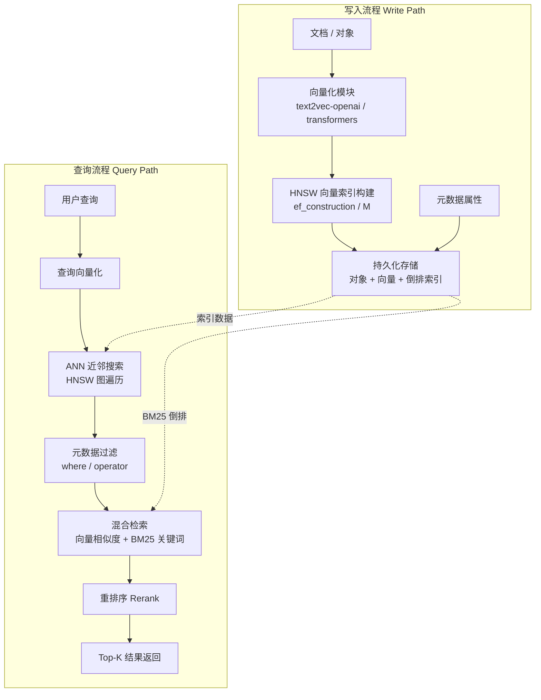

# Weaviate-向量数据库

> **文档说明**：系统讲解 Weaviate 向量数据库的架构、安装部署、数据模型、基本操作、向量搜索（语义/混合/多模态）、过滤聚合、性能优化，以及与其他向量数据库的对比和最佳实践。
>
> **适用人群**：AI 应用开发者、后端工程师、需要构建语义搜索和 RAG 系统的开发者
>
> **前置知识**：[[RAG检索增强生成]]、[[Python-多模态AI应用开发]]、[[大模型推理优化]]

---

## 一、概述

<div style="background:linear-gradient(135deg,#4facfe,#00f2fe);border-radius:16px;padding:20px;margin:16px 0;font-family:-apple-system,'Segoe UI','PingFang SC','Microsoft YaHei',sans-serif;color:#fff;overflow:hidden;box-shadow:0 8px 28px rgba(0,0,0,.14),0 3px 10px rgba(0,0,0,.08)">
<style>@keyframes highlight{0%,100%{box-shadow:0 0 0 rgba(255,255,255,0)}50%{box-shadow:0 0 20px rgba(255,255,255,.4)}}.hl-box{background:rgba(255,255,255,.2);border-radius:10px;padding:14px 18px;margin:10px 0;animation:highlight 3s ease-in-out infinite;border-left:4px solid rgba(255,255,255,.6)}.hl-formula{font-family:monospace;font-size:14px;text-align:center;background:rgba(0,0,0,.15);border-radius:8px;padding:12px;margin:10px 0}</style>
<div style="text-align:center;font-size:15px;font-weight:700;margin-bottom:14px;padding-bottom:10px;border-bottom:1.5px solid rgba(255,255,255,.22);letter-spacing:1px;text-shadow:0 1px 3px rgba(0,0,0,.12)">📌 Weaviate-向量数据库</div>
<div class="hl-box">系统讲解 Weaviate 向量数据库的架构、安装部署、数据模型、基本操作、向量搜索（语义/混合/多模态）、过滤聚合、性能优化，以及与其他向量数据库的对比和最佳实践。</div>
<div class="hl-formula">文本 → Embedding → 向量存储 → 相似度计算 → Top-K检索</div>
<div style="font-size:13px;opacity:.9;margin-top:8px">💡 掌握核心概念是理解 RAG 系统的关键第一步</div>
</div>

> 🔍 **知识点深度解析**
>
> **作用**：Weaviate-向量数据库 是 RAG 系统中的关键组件，解决向量检索与知识增强中的核心问题，适用于需要高效语义搜索和知识增强的 AI 应用场景。
>
> **原理**：通过将文本转化为高维向量表示，利用向量空间中的相似度计算实现语义级检索，结合大模型生成能力完成知识增强问答。
>
> **用法要点**：① 选择合适的 Embedding 模型和向量维度 ② 合理配置检索参数（Top-K、相似度阈值） ③ 结合元数据过滤提升精准度 ④ 定期更新向量索引以保证数据一致性

### Weaviate 架构与索引流程



### 1. 什么是向量数据库

```text
向量数据库（Vector Database）：
- 专门存储和检索高维向量的数据库
- 向量 = 数据的语义表示（embedding）
- 支持相似度搜索（最近邻搜索 ANN）
- 结合传统数据库的过滤、CRUD、持久化

传统数据库 vs 向量数据库：
- 传统：精确匹配（WHERE name = '张三'）
- 向量：语义相似（找与"苹果手机"最相似的文档）

应用场景：
- RAG（检索增强生成）
- 语义搜索
- 推荐系统
- 图像/音频/视频检索
- 去重和聚类
- 异常检测
```

### 2. Weaviate 简介

```text
Weaviate：
- 开源的向量数据库（BSD-3 许可证）
- Go 语言编写，高性能
- 内置向量索引（HNSW）
- 支持模块化（向量化、生成式 AI）
- GraphQL + REST API
- 支持多模态（文本、图像）
- 支持混合搜索（向量 + 关键词 BM25）
- 云服务：Weaviate Cloud Services (WCS)

核心特性：
- 实时 CRUD
- 过滤搜索
- 聚合查询
- 多租户
- 横向扩展
- 数据持久化
```

### 3. 向量数据库对比

| 数据库 | 语言 | 索引 | 特点 | 适用场景 |
|--------|------|------|------|---------|
| **Weaviate** | Go | HNSW | 模块化、GraphQL、混合搜索 | RAG、多模态 |
| **Milvus** | C++/Go | HNSW/IVF | 高性能、分布式、云原生 | 大规模、企业级 |
| **Qdrant** | Rust | HNSW | 高性能、过滤优化、API 友好 | 推荐、搜索 |
| **Pinecone** | - | - | 全托管、无服务器 | 快速上线、SaaS |
| **Chroma** | Python | HNSW | 简单、轻量、本地 | 原型、开发 |
| **FAISS** | C++ | 多种 | Meta 开源、库而非数据库 | 研究、嵌入式 |
| **pgvector** | C | HNSW/IVF | PostgreSQL 扩展 | 已有 PG 栈 |
| **Elasticsearch** | Java | HNSW | 全文+向量、成熟 | 搜索增强 |

---

> 💡 **深度讲解**：Weaviate 是一个开源的向量数据库，核心特色是"模块化架构和内置向量化器（Vectorizer）"——与其他需要手动生成向量再入库的向量数据库不同，Weaviate 内置了多种向量化器模块（OpenAI、Cohere、HuggingFace、Transformers 等），可以在数据入库时自动调用向量化器生成向量，大幅简化开发流程。Weaviate 的核心特性：模块化架构（向量化器、重排序器、生成器等都是可插拔模块，按需启用）、内置向量化器（支持 20+ 种 Embedding 模型，自动生成向量）、混合检索（内置 BM25 + 向量混合检索，无需额外配置）、GraphQL API（除 REST 外支持 GraphQL 查询，灵活的字段选择和关联查询）、多租户（原生支持多租户隔离，适合 SaaS 应用）、云原生（Docker、Kubernetes、Helm Chart，支持水平扩展）、Weaviate Cloud（全托管服务，Serverless 和 Dedicated 两种模式）。Weaviate 的适用场景：需要快速搭建的 RAG 系统（内置向量化器，无需手动处理嵌入）、多租户 SaaS 应用（原生多租户支持）、混合检索需求（内置 BM25+向量，无需额外实现）、GraphQL 偏好团队（灵活的查询 API）、不想运维的团队（Weaviate Cloud 全托管）。与其他向量数据库的对比：vs Chroma——Weaviate 是服务端架构，支持高并发和分布式，Chroma 是嵌入式库；vs Qdrant——Weaviate 模块化更丰富（内置向量化器），Qdrant 过滤性能更好；vs Milvus——Weaviate 部署更简单（模块化单体），Milvus 分布式能力更强。Weaviate 的最佳实践：根据数据规模选择部署模式（小规模用单节点 Docker，大规模用 Kubernetes 集群）、选择合适的向量化器（OpenAI text-embedding-3 效果好但需 API Key，本地模型用 Transformers 向量化器）、利用模块化特性（重排序器提升检索精度，生成器实现 RAG 生成）、使用 GraphQL 进行复杂查询（关联查询、聚合、过滤）。
>
> **📝 精简总结**：Weaviate是开源向量数据库，核心特色是模块化架构+内置向量化器(入库自动生成向量，简化开发)；特性：可插拔模块(向量化/重排序/生成器)+20+向量化器+内置混合检索(BM25+向量)+GraphQL API+原生多租户+云原生+全托管云；适用快速RAG/多租户SaaS/混合检索/GraphQL偏好/不想运维；vs Chroma是服务端vs嵌入式，vs Qdrant模块丰富vs过滤好，vs Milvus部署简单vs分布式强。

## 二、安装部署

### 1. Docker 部署

```yaml
# docker-compose.yml
version: '3.4'
services:
  weaviate:
    image: semitechnologies/weaviate:1.25.0
    ports:
      - "8080:8080"
      - "50051:50051"
    environment:
      QUERY_DEFAULTS_LIMIT: 25
      AUTHENTICATION_ANONYMOUS_ACCESS_ENABLED: 'true'
      PERSISTENCE_DATA_PATH: '/var/lib/weaviate'
      DEFAULT_VECTORIZER_MODULE: 'text2vec-openai'
      ENABLE_MODULES: 'text2vec-openai,generative-openai'
      OPENAI_APIKEY: 'your-openai-api-key'
      CLUSTER_HOSTNAME: 'node1'
    volumes:
      - weaviate-data:/var/lib/weaviate
    restart: always

volumes:
  weaviate-data:
```

### 启动

```bash
docker-compose up -d

# 验证
curl http://localhost:8080/v1/meta
```

### 2. 嵌入式模式（Python）

```python
# 无需单独部署，嵌入式运行
import weaviate
from weaviate.embedded import EmbeddedOptions

client = weaviate.Client(
    embedded_options=EmbeddedOptions()
)
# 自动下载并启动 Weaviate，适合开发和原型
```

### 3. 云服务（WCS）

```python
import weaviate
import os

client = weaviate.Client(
    url="https://your-cluster.weaviate.network",
    auth_client_secret=weaviate.AuthApiKey(api_key=os.environ["WCS_API_KEY"]),
    additional_headers={
        "X-OpenAI-Api-Key": os.environ["OPENAI_API_KEY"]
    }
)
```

### 4. Kubernetes 部署

```text
### Helm 部署
```

```bash
helm repo add weaviate https://weaviate.github.io/weaviate-helm
helm install my-weaviate weaviate/weaviate \
    --set modules.text2vec-openai.enabled=true \
    --set env.OPENAI_APIKEY=your-key
```

---

## 三、数据模型

### 1. Collection（集合）

```text
Weaviate 数据模型：
- Collection（原 Class）：数据集合，类似关系数据库的表
- Property：属性，类似列
- Object：对象，类似行
- Vector：向量，每个对象的语义表示

Collection 定义包含：
- name：集合名
- properties：属性列表
- vectorizer：向量化模块
- vectorIndexConfig：向量索引配置
- multiTenancyConfig：多租户配置
```

### 2. 创建 Collection

```python
import weaviate
from weaviate.classes.config import Configure, Property, DataType

client = weaviate.connect_to_local()

# 创建集合
questions = client.collections.create(
    name="Question",
    vectorizer_config=Configure.Vectorizer.text2vec_openai(),  # 自动向量化
    generative_config=Configure.Generative.openai(),  # 生成式 AI
    properties=[
        Property(name="question", data_type=DataType.TEXT),
        Property(name="answer", data_type=DataType.TEXT),
        Property(name="category", data_type=DataType.TEXT),
        Property(name="difficulty", data_type=DataType.INT),
    ]
)
```

### 3. 自定义向量（不使用向量化模块）

### 不使用自动向量化，自己提供向量

```python
collection = client.collections.create(
    name="Document",
    vectorizer_config=Configure.Vectorizer.none(),  # 禁用自动向量化
    properties=[
        Property(name="title", data_type=DataType.TEXT),
        Property(name="content", data_type=DataType.TEXT),
    ]
)

# 插入时自己提供向量
collection.data.insert({
    "title": "文档标题",
    "content": "文档内容..."
}, vector=[0.1, 0.2, 0.3, ...])  # 自己计算的 embedding
```

---

## 四、基本操作

### 1. 插入数据

```python
questions = client.collections.get("Question")

# 单条插入
uuid = questions.data.insert({
    "question": "什么是向量数据库？",
    "answer": "向量数据库是存储和检索高维向量的数据库",
    "category": "数据库",
    "difficulty": 2
})
```

### 批量插入

```python
with questions.batch.dynamic() as batch:
    for i in range(100):
        batch.add_object({
            "question": f"问题 {i}",
            "answer": f"答案 {i}",
            "category": "测试",
            "difficulty": i % 5
        })
```

### 2. 查询数据

```python
# 按 ID 获取
obj = questions.query.fetch_object_by_id(uuid)
print(obj.properties)

# 获取所有（分页）
response = questions.query.fetch_objects(limit=10, offset=0)
for obj in response.objects:
    print(obj.properties["question"])
```

### 3. 更新和删除

```python
# 更新
questions.data.update(
    uuid=uuid,
    properties={"answer": "更新后的答案"}
)

# 删除
questions.data.delete_by_id(uuid)
```

### 按条件删除

```python
questions.data.delete_many(
    where=Filter.by_property("category").equal("测试")
)
```

---

## 五、向量搜索

### 1. 语义搜索（nearText）

```python
from weaviate.classes.query import Filter

questions = client.collections.get("Question")

# 语义搜索：找与查询最相似的问题
response = questions.query.near_text(
    query="数据库存储向量",
    limit=5,
    return_metadata=MetadataQuery(distance=True)  # 返回距离
)

for obj in response.objects:
    print(f"{obj.properties['question']} (距离: {obj.metadata.distance:.4f})")
```

### 2. 向量搜索（nearVector）

### 用自定义向量搜索

```python
query_vector = [0.1, 0.2, ...]  # 自己计算的 embedding
response = questions.query.near_vector(
    near_vector=query_vector,
    limit=5
)
```

### 3. 混合搜索（Hybrid）

### 混合搜索：向量相似度 + BM25 关键词

```python
response = questions.query.hybrid(
    query="向量数据库",
    limit=5,
    alpha=0.5  # 0=纯BM25, 1=纯向量, 0.5=各一半
)
```

### 4. 带过滤的搜索

```python
from weaviate.classes.query import Filter

# 语义搜索 + 过滤
response = questions.query.near_text(
    query="数据库",
    limit=5,
    filters=Filter.by_property("difficulty").less_than(3)
        & Filter.by_property("category").equal("数据库")
)

# 过滤操作符：equal, not_equal, less_than, greater_than, like, contains_any
```

### 5. 生成式搜索（RAG）

```python
# 检索 + 生成（RAG）
response = questions.generate.near_text(
    query="什么是向量数据库？",
    limit=3,
    single_prompt="根据以下内容回答问题: {question} 答案: {answer}"
)

print(response.generated)  # 生成的回答

# 分组任务（对每个检索结果生成）
response = questions.generate.near_text(
    query="数据库",
    limit=3,
    grouped_task="总结这些问题的共同主题"
)
print(response.generated)
```

---

## 六、高级功能

### 1. 多模态搜索

### 创建支持图像的集合

```python
images = client.collections.create(
    name="Image",
    vectorizer_config=Configure.Vectorizer.multi2vec_clip(
        image_fields=["image"],
        text_fields=["description"]
    ),
    properties=[
        Property(name="description", data_type=DataType.TEXT),
        Property(name="image", data_type=DataType.BLOB),
    ]
)

# 以文搜图
response = images.query.near_text(query="一只猫", limit=5)
```

### 以图搜图

```python
with open("cat.jpg", "rb") as f:
    image_b64 = base64.b64encode(f.read()).decode()
response = images.query.near_image(near_image=image_b64, limit=5)
```

### 2. 聚合查询

```python
from weaviate.classes.query import GroupBy

# 聚合：按 category 分组
response = questions.query.near_text(
    query="数据库",
    limit=10,
    group_by=GroupBy(prop="category", groups=3, objects_per_group=2)
)

for group in response.groups:
    print(f"分类: {group.name}, 数量: {group.number_of_objects}")
```

### 3. 多租户

### 创建多租户集合

```python
collection = client.collections.create(
    name="MultiTenantDoc",
    multi_tenant_config=Configure.multi_tenant(
        enabled=True,
        auto_tenant_creation=True
    ),
    properties=[Property(name="content", data_type=DataType.TEXT)]
)
```

### 添加租户

```python
collection.tenants.create([
    Tenant(name="tenant_a"),
    Tenant(name="tenant_b"),
])
```

### 按租户查询

```python
tenant_a = collection.with_tenant("tenant_a")
tenant_a.data.insert({"content": "租户A的数据"})
```

---

## 七、性能优化

### 1. HNSW 索引配置

```python
collection = client.collections.create(
    name="OptimizedCollection",
    vector_index_config=Configure.VectorIndex.hnsw(
        distance_metric=Configure.VectorIndex.Distance.COSINE,  # 距离度量
        ef_construction=128,  # 构建时的 ef（越大越准越慢）
        ef=64,  # 查询时的 ef（越大越准越慢）
        max_connections=16,  # 每个节点最大连接数（M）
        cleanup_interval_seconds=60,
    ),
    properties=[...]
)
```

### 动态调整查询 ef

```python
collection.config.update(
    vector_index_config=Configure.VectorIndex.hnsw(ef=128)
)
```

```text
HNSW 参数调优：
- ef_construction：构建质量，128-512，越大索引越准但构建越慢
- ef（查询）：搜索广度，16-512，越大越准但越慢
- max_connections (M)：节点连接数，8-64，越大内存越多
- 距离度量：cosine（推荐）、dot、l2、hamming

权衡：
- 高精度：ef=256, M=32（慢但准）
- 高性能：ef=32, M=16（快但可能漏召回）
- 默认：ef=128, M=16（平衡）
```

### 2. 批量导入优化

```python
# 批量导入最佳实践
with collection.batch.dynamic() as batch:
    batch.batch_size = 100  # 每批大小
    batch.num_workers = 4   # 并发数
    batch.concurrent_requests = 4

    for item in large_dataset:
        batch.add_object(item)

# 检查导入错误
if collection.batch.failed_objects:
    for err in collection.batch.failed_objects:
        print(f"导入失败: {err.message}")
```

### 3. 查询优化

```text
查询优化技巧：
1. 限制返回字段：return_properties 指定需要的字段
2. 合理设置 limit：只取需要的数量
3. 用过滤减少搜索空间：先过滤再搜索
4. 缓存热点查询：相同查询缓存结果
5. 异步查询：并发执行多个查询
6. 分页用 cursor：大结果集避免深分页
7. 选择合适的 ef：根据精度需求调整
```

---

## 八、RAG 完整示例

```python
"""
完整 RAG 系统：文档导入 + 语义检索 + LLM 生成
"""
import weaviate
from weaviate.classes.config import Configure, Property, DataType
from weaviate.classes.query import MetadataQuery

# 1. 连接客户端
client = weaviate.connect_to_local(
    headers={"X-OpenAI-Api-Key": "your-key"}
)

# 2. 创建集合
docs = client.collections.create(
    name="Document",
    vectorizer_config=Configure.Vectorizer.text2vec_openai(
        model="text-embedding-3-small"
    ),
    generative_config=Configure.Generative.openai(
        model="gpt-4o"
    ),
    properties=[
        Property(name="title", data_type=DataType.TEXT),
        Property(name="content", data_type=DataType.TEXT),
        Property(name="source", data_type=DataType.TEXT),
    ]
)

# 3. 导入文档（分块）
def chunk_text(text, chunk_size=500, overlap=50):
    chunks = []
    for i in range(0, len(text), chunk_size - overlap):
        chunks.append(text[i:i + chunk_size])
    return chunks

documents = [
    {"title": "文档1", "content": "..."},
    {"title": "文档2", "content": "..."},
]

with docs.batch.dynamic() as batch:
    for doc in documents:
        for i, chunk in enumerate(chunk_text(doc["content"])):
            batch.add_object({
                "title": doc["title"],
                "content": chunk,
                "source": f"{doc['title']}#chunk{i}"
            })

# 4. RAG 查询
def rag_query(question: str) -> str:
    response = docs.generate.near_text(
        query=question,
        limit=5,
        single_prompt=(
            f"根据以下参考资料回答问题：{question}\n\n"
            "参考资料：\n{content}\n\n"
            "如果资料中没有相关信息，请说'根据现有资料无法回答'。"
        )
    )
    return response.generated

# 使用
answer = rag_query("Weaviate 支持哪些向量化模块？")
print(answer)
```

---

## 九、最佳实践

### 1. 数据建模

- [ ] **合理分块**：文档 200-1000 字，重叠 10-20%
- [ ] **选择向量化模型**：根据语言和任务选合适 embedding 模型
- [ ] **元数据丰富**：存储来源、时间、分类等便于过滤
- [ ] **统一维度**：同一集合向量维度一致
- [ ] **多租户隔离**：多客户场景用 multi-tenancy

### 2. 索引和查询

- [ ] **选择距离度量**：文本用 cosine，归一化后用 dot
- [ ] **调优 HNSW 参数**：根据精度/性能需求调整 ef 和 M
- [ ] **批量导入**：用 batch API，设置合适的 batch_size
- [ ] **过滤下推**：用 where 过滤减少搜索范围
- [ ] **限制返回字段**：只取需要的属性，减少传输
- [ ] **监控召回率**：定期评估搜索质量

### 3. 运维

- [ ] **数据备份**：定期备份，Weaviate 支持导出
- [ ] **资源监控**：CPU、内存、磁盘、查询延迟
- [ ] **索引重建**：大数据量导入后优化索引
- [ ] **版本升级**：关注新版本，测试后升级
- [ ] **高可用**：生产环境用集群部署
- [ ] **限流**：防止查询过载

---

## 十、常见问题与排查

| 问题 | 原因 | 解决方案 |
|------|------|---------|
| **搜索结果不准** | 向量化模型不匹配/分块不好 | 换 embedding 模型、优化分块、调整 ef |
| **导入慢** | 单条插入/batch 太小 | 用 batch API、增大 batch_size、并发 |
| **内存占用高** | HNSW M 太大/数据量大 | 减小 M、用过滤、分片 |
| **查询延迟高** | ef 太大/数据量大 | 减小 ef、加过滤、增加节点 |
| **向量维度不匹配** | 模型不一致 | 统一向量化模型、重建集合 |
| **过滤搜索慢** | 未建过滤索引/过滤基数低 | 用高基数字段过滤、调整索引 |
| **OOM** | 数据量超过内存 | 增加内存、用过滤、分页查询 |
| **多模态搜索不准** | CLIP 模型限制 | 用更好的多模态模型、调整提示词 |
| **混合搜索效果差** | alpha 不合适 | 调整 alpha（0-1）、调优 BM25 |
| **重复数据** | 未去重 | 导入前去重、用唯一 ID |
| **中文效果差** | 模型中文能力弱 | 用中文优化的 embedding（bge/m3e） |
| **RAG 回答幻觉** | 检索不相关/提示词不好 | 优化检索、改进提示词、增加约束 |
| **冷启动慢** | 首次查询加载模型 | 预热、保持服务运行 |
| **数据不一致** | 并发写入冲突 | 用事务/乐观锁、批量导入 |
| **升级后报错** | 版本不兼容 | 查升级指南、备份后升级、测试环境验证 |

---

## 十一、关联笔记

### AI 与 RAG
- [[RAG检索增强生成]] · [[Python-多模态AI应用开发]] · [[大模型推理优化]]
- [[提示词工程进阶]] · [[Java-AI流式响应实战]]

### 向量与搜索
- [[搜索引擎原理与倒排索引]] · [[哈希表与哈希算法]] · [[KV Cache与推理加速]]

```text
### Python
```
- [[Python-API版本化与文档]] · [[Python-GraphQL接口开发]] · [[FastAPI-WebSocket实时通信]]

### 导航
- [[MOC-AI与效率工具]] · [[MOC-Python全栈]] · [[全栈+AI工程双轨融合学习路线图]]

> **学习路径建议**：先掌握 [[RAG检索增强生成]] RAG 基础 → 深入本文 Weaviate 向量数据库 → 学习 [[Python-多模态AI应用开发]] 多模态 → 实践 [[Java-AI流式响应实战]] 流式输出 → 研究 [[大模型推理优化]] 部署优化 → 构建完整的 AI 应用和 RAG 系统能力。

---

## 📖 前置知识

- [[RAG检索增强生成]]
- [[向量库选型对比表]]

## 🏷️ 相关标签

`#AI应用` `#RAG` `#向量数据库` `#效率工具`

---

[[Home|🏠 返回首页]] · [[MOC-AI与效率工具|📚 AI与效率工具]] · [[MOC-AI工程化|🤖 AI工程化]]