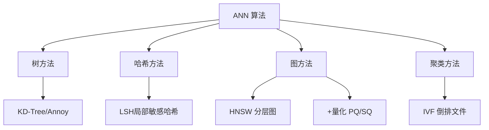
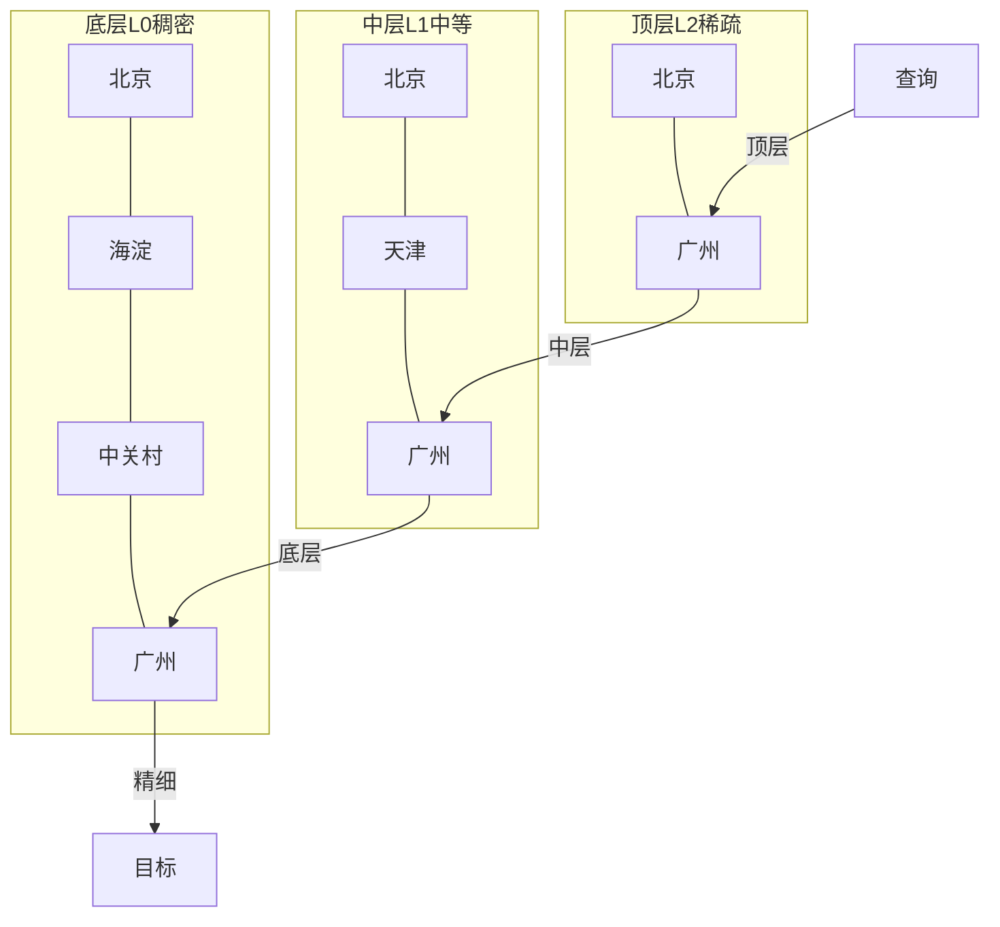
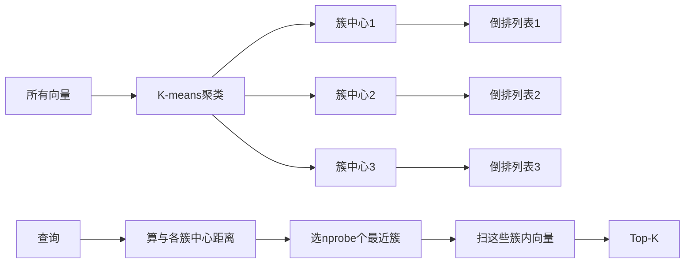

# 向量检索算法 HNSW-IVF 深度实战

> 本文档系统讲解向量检索中的两大核心近似最近邻（ANN）算法——HNSW（层次化导航小世界图）与 IVF（倒排文件），从精确检索的局限讲起，深入到分层图结构、K-means 聚类、乘积量化，并给出完整可运行的 FAISS / hnswlib 代码、参数调优指南、性能基准与生产部署经验。

---

## 一、向量检索概述与背景

### 1.1 什么是向量检索

向量检索是 RAG（检索增强生成）系统的核心环节。给定一个查询向量，在百万乃至亿级向量库中，快速找到语义上最相似的 Top-K 个向量。它的底层假设是：Embedding 模型把文本映射到高维语义空间，语义相近的文本在空间中距离近，因此"找最近邻"等价于"找最相关文档"。

整个链路是：

```text
文本 → Embedding 模型 → 高维向量 → 存入向量库 → 查询向量 → 找最近邻 → Top-K 结果
```

### 1.2 为什么需要向量检索算法

Embedding 向量通常是 768~1536 维的浮点数数组。每个向量占 768×4 ≈ 3KB。一个百万文档的知识库，光向量就要 3GB。查询时如果逐一计算距离，在数据量上来后延迟完全无法接受。这就是向量检索算法要解决的问题：**在高维空间中，用尽量低的延迟找到尽量准的最近邻**。

### 1.3 核心矛盾：速度 vs 召回率

所有 ANN 算法都在解一个权衡：要更快就牺牲一点召回率，要更准就多算一点。召回率（Recall@K）的定义是：算法返回的 Top-K 结果中，包含多少比例的"真实最近邻"。

```python
# recall_def.py — 召回率定义
def recall_at_k(ann_results: list, brute_truth: list, k: int) -> float:
    """ann_results: ANN算法返回的id列表
    brute_truth: 暴力搜索得到的真实Top-K id列表
    返回召回率（0~1）
    """
    ann_set = set(ann_results[:k])
    truth_set = set(brute_truth[:k])
    return len(ann_set & truth_set) / len(truth_set)

# 预期结果：召回率越接近1越好，通常0.95以上可接受
```

### 1.4 向量相似度度量

检索前要先定义"距离"。常见度量有三种：

```python
# distance_metrics.py — 三种相似度度量
import numpy as np

def cosine_sim(a: np.ndarray, b: np.ndarray) -> float:
    """余弦相似度：衡量方向夹角，对长度不敏感，文本检索最常用。"""
    return np.dot(a, b) / (np.linalg.norm(a) * np.linalg.norm(b))

def euclidean_dist(a: np.ndarray, b: np.ndarray) -> float:
    """欧氏距离：衡量绝对距离，图像/聚类常用。"""
    return np.linalg.norm(a - b)

def inner_product(a: np.ndarray, b: np.ndarray) -> float:
    """内积：向量归一化后等价于余弦，计算最快。"""
    return np.dot(a, b)
```

| 度量 | 适用 | 特点 |
|------|------|------|
| 余弦 | 文本语义检索 | 方向敏感，长度无关 |
| 欧氏 | 图像、聚类 | 绝对距离 |
| 内积 | 归一化向量 | 计算最快 |

### 1.5 召回率与延迟的量化感受

下面用一张表建立直觉，理解为什么必须用 ANN：

| 向量数量 | 暴力搜索(1024维) | ANN(HNSW) | 倍数 |
|---------|----------------|-----------|------|
| 1万 | ~8ms | ~0.3ms | 26x |
| 10万 | ~80ms | ~1ms | 80x |
| 100万 | ~800ms | ~3ms | 266x |
| 1000万 | ~8s | ~15ms | 533x |

### 1.6 本文覆盖范围

本文按以下逻辑展开：先讲精确检索的局限（第二章），再总览 ANN 算法分类（第三章），然后深入 HNSW（第四、五章）和 IVF（第六、七章），接着讲量化（第八章）、对比选型（第九、十、十一章）、Python 实战（第十二章）、性能基准（第十三章）、生产部署（第十四章）。

---

> 💡 **深度讲解**：向量检索的本质是"高维最近邻搜索"。Embedding 把语义编码成几何空间中的点，检索变成几何问题。暴力搜索复杂度 O(N×D)，随数据量线性膨胀。ANN 算法用数据结构（图/聚类/哈希）把搜索范围从"全部"缩到"局部"，用约 5% 的召回损失换 10-100 倍提速。理解这个权衡，是后续所有参数调优的基础。
>
> **📝 精简总结**：
> - 核心概念：向量检索、召回率、相似度度量
> - 关键原理：暴力搜索 O(N×D)，ANN 用结构加速
> - 常用操作：cosine_sim、recall_at_k
> - 最佳实践：文本用余弦/内积，先建索引再查询
> - 常见坑点：不区分度量就直接比对分数
> - 面试高频：为什么需要 ANN、召回率定义

**🎯 梯度练习题**：
- ⭐ 基础题：为什么文本检索常用余弦相似度？
- ⭐⭐ 进阶题：召回率 0.95 意味着什么？
- ⭐⭐⭐ 实战题：用 numpy 计算两组向量的余弦相似度矩阵。

---

## 二、精确最近邻与暴力搜索

### 2.1 暴力搜索的算法

暴力搜索（Brute Force / Flat Index）就是最朴素的方法：查询向量与库里每一个向量都算一次距离，然后取最小的 K 个。它的优点是绝对准确（召回率 100%），缺点是慢。

```python
# brute_force.py — 纯 numpy 暴力搜索
import numpy as np

class BruteForceIndex:
    """暴力检索，召回率100%，仅用于小数据或ground truth。"""
    def __init__(self, dim: int):
        self.dim = dim
        self.vectors = None  # (N, dim)

    def add(self, vecs: np.ndarray):
        self.vectors = vecs.astype(np.float32)

    def search(self, query: np.ndarray, top_k: int = 5):
        # 内积（向量已归一化）
        scores = self.vectors @ query
        top_ids = np.argsort(scores)[-top_k:][::-1]
        return [(i, float(scores[i])) for i in top_ids]

# 预期：1000个128维向量，单次查询约0.1ms
```

### 2.2 暴力搜索的复杂度分析

每查询一次要算 N 个向量的距离，每个距离 O(D)，所以总复杂度 O(N×D)。查询延迟随数据量线性增长，没有任何"摊销"。这就是为什么 10 万条还能忍，100 万条就崩了。

```python
# complexity.py — 复杂度随规模增长
def brute_force_latency_ms(N: int, D: int = 1024, flops_per_ms: float = 1e6):
    """估算暴力搜索延迟（粗略）。"""
    ops = N * D  # 每次距离约D次乘加
    return ops / flops_per_ms

# N=1e6, D=1024 → ~1000ms
```

### 2.3 暴力搜索的适用场景

暴力搜索不是没用，它在以下场景反而最优：
- 数据量小（< 1 万）：建索引的开销不划算
- 需要 100% 召回率：评估 ANN 召回率时当 ground truth
- 维度很低（< 32）：暴力已经很快
- 冷数据偶尔查询：不值得常驻索引

```python
# when_flat.py — 何时用暴力索引
def use_flat(N: int, D: int) -> bool:
    if N < 10000 or D < 32:
        return True
    return False  # 大数据用HNSW/IVF
```

### 2.4 FAISS 的 Flat 索引

FAISS 提供 IndexFlatIP（内积）和 IndexFlatL2（欧氏），是评估其他索引的基准。

```python
# faiss_flat.py — FAISS Flat 索引
import faiss
import numpy as np

d = 128
n = 10000
xb = np.random.random((n, d)).astype('float32')
# 内积索引（向量需归一化）
index = faiss.IndexFlatIP(d)
index.add(xb)
print("向量数:", index.ntotal)  # 预期：10000

xq = np.random.random((5, d)).astype('float32')
D, I = index.search(xq, k=5)
print("Top5 id shape:", I.shape)  # 预期：(5, 5)
```

### 2.5 用暴力结果校准 ANN

做 ANN 调参时，必须先用暴力搜索跑出 ground truth，再算 ANN 的召回率，否则调参没有标尺。

```python
# calibrate.py — 用暴力校准ANN召回率
def calibrate_recall(ann_index, brute_index, queries, k=5):
    recalls = []
    for q in queries:
        ann_ids = [i for i, _ in ann_index.search(q, k)]
        truth_ids = [i for i, _ in brute_index.search(q, k)]
        recalls.append(recall_at_k(ann_ids, truth_ids, k))
    return sum(recalls) / len(recalls)
```

### 2.6 内存视角

暴力索引不存额外结构，内存就是 N×D×4 字节。1024 维百万向量约 4GB。这是最省内存的方式——因为 ANN 索引（尤其 HNSW）还要额外存图连接，内存会膨胀 1.5 倍左右。

---

> 💡 **深度讲解**：精确最近邻是理解 ANN 的标尺。它 O(N×D) 的复杂度告诉我们：数据量上来后必须缩小搜索范围。暴力索引在 FAISS 里叫 Flat，召回率 100%，是评估 ANN 的 ground truth。调任何 ANN 参数，最终都要回到"它离暴力检索的召回差多少"这个问题上。
>
> **📝 精简总结**：
> - 核心概念：暴力搜索、Flat 索引、ground truth
> - 关键原理：O(N×D)，线性膨胀
> - 常用操作：BruteForceIndex、faiss.IndexFlatIP
> - 最佳实践：小数据/校准用暴力
> - 常见坑点：大数据还用暴力
> - 面试高频：暴力复杂度、何时用 Flat

**🎯 梯度练习题**：
- ⭐ 基础题：暴力搜索时间复杂度是多少？
- ⭐⭐ 进阶题：为什么 ANN 调参要先跑暴力检索？
- ⭐⭐⭐ 实战题：用 FAISS Flat 建立索引并计算召回率基准。

---


### 1.18 向量检索与 Embedding 的关系

向量检索算法本身只处理向量。向量怎么来？Embedding 模型把文本编码成向量。所以检索质量一半在 Embedding（向量好不好），一半在检索算法（找得准不准）。Embedding 差，检索算法再强也白搭。

```python
# embed_vs_search.py — Embedding与检索
RELATION = "Embedding决定向量质量，检索算法决定找得准不准"
```

### 1.19 向量维度与检索速度的关系

维度 D 越大，每次距离计算越慢。同样算法，1536 维比 768 维慢约 2 倍。所以选 Embedding 模型时，维度也是性能考量。

```python
# dim_speed.py — 维度与速度
SPEED = "D翻倍 → 距离计算慢约2倍"
```

### 1.20 归一化的工程细节

归一化要在入库和查询时都做。只做一边，分数就乱。FAISS 的 normalize_L2 一次处理一批向量。

```python
# norm_both.py — 两边都归一化
def norm_both(xb, xq):
    faiss.normalize_L2(xb)
    faiss.normalize_L2(xq)
```

### 1.21 余弦与内积的关系

向量归一化后，内积 = 余弦。所以用内积索引（IndexFlatIP/HNSWFlat IP）+ 归一化，等价于余弦检索。这是工程常用组合。

### 1.22 欧氏与余弦的转换

归一化后，欧氏距离平方 = 2 - 2×内积。所以归一化后欧氏和内积单调等价，排序结果一样。用哪个都行。

```python
# l2_ip_equiv.py — 等价
EQUIV = "归一化后: L2² = 2 - 2×IP，排序等价"
```

### 1.23 本文核心一句话

向量检索 = 用 HNSW/IVF 在高维向量空间快速找最近邻，牺牲约 5% 召回换数量级提速，生产默认 HNSW、M=16、ef_search 按召回调。

---

> 💡 **深度讲解**：检索质量一半靠 Embedding 一半靠算法。归一化两边都做。归一化后内积=余弦=欧氏排序。理解这些细节，工程实践不踩坑。
>
> **📝 精简总结**：Embedding定质量、两边归一化、归一化后度量等价。
>
> **🎯 梯度练习题**：
> - ⭐ 基础题：归一化哪边要做？
> - ⭐⭐ 进阶题：归一化后内积和余弦关系？
> - ⭐⭐⭐ 实战题：验证归一化后L2和IP排序一致。

---


### 2.7 暴力搜索的并行优化

虽然暴力搜索慢，但它可以完美并行——每个向量距离计算互不依赖。在多核/GPU 上，暴力搜索其实不慢。10 万向量 GPU 暴力搜索也就几毫秒。所以"暴力搜索慢"是指 CPU 单核、大数据量的情况。

```python
# brute_parallel.py — 暴力搜索并行
import numpy as np
def brute_gpu_like(query, all_vecs):
    # 矩阵乘法本身就是高度并行的，BLAS库自动用多核/GPU
    return all_vecs @ query
# numpy/BLAS 底层已并行，不用自己写多线程
```

### 2.8 什么时候暴力就够了

工程上别盲目上 ANN。如果你的向量库只有几千到几万条，暴力搜索已经够快（毫秒级），而且召回 100%，还省掉调参和建索引。简单优先。

```python
# when_flat_enough.py — 暴力够不够
def flat_enough(N, latency_budget_ms=20):
    return N < 50000  # 几万以内暴力够
```

### 2.9 暴力索引的内存

暴力索引不存任何额外结构，内存就是 N×D×4。这是最省内存的——因为 HNSW 还要存图连接。但数据量大时总内存就撑不住。

### 2.10 暴力当 ground truth 的价值

任何 ANN 索引上线前，都要和暴力结果对一遍召回率。没有暴力当标尺，你根本不知道 ANN 漏了多少。这是 ANN 开发的铁律。

```python
# ground_truth_value.py — 标尺价值
RULE = "没有暴力 ground truth，调 ANN 等于盲调"
```

### 2.11 FAISS Flat 的局限

IndexFlatIP/L2 不支持增量删除以外的 ANN 结构，纯计算。它就是个算距离的工具。但正因为简单，它是最可靠的。

### 2.12 精确搜索的业务场景

金融风控（要绝对精确）、小数据管理后台、评估基准——这些场景用精确搜索。大多数 C 端推荐/搜索才需要 ANN。

---

> 💡 **深度讲解**：暴力搜索不是反面教材，它是标尺和小数据方案。理解它什么时候够用、什么时候必须上 ANN，才不会过度设计。暴力并行化后在 GPU 上其实不慢。
>
> **📝 精简总结**：暴力是标尺、小数据方案、GPU 上不慢。
>
> **🎯 梯度练习题**：
> - ⭐ 基础题：为什么暴力要当 ground truth？
> - ⭐⭐ 进阶题：暴力搜索能并行吗？
> - ⭐⭐⭐ 实战题：判断你的数据量该不该用 ANN。

---


### 1.13 向量检索的本质问题

向量检索要回答："在 N 个 D 维向量里，哪个离查询最近？" 数学上这是最近邻搜索（NNS）。暴力解 O(ND) 精确但慢。ANN 在精度和速度间找平衡。所有 HNSW/IVF 都是为了把"逐个比对"变成"只比少数"。

```python
# essence.py — 本质
ESSENCE = "N个D维向量里找离query最近的 → ANN只比少数"
```

### 1.14 Top-K 与 Top-1

向量检索常说 Top-K（取前 K 个）。K=1 是最近邻，K=5 是 RAG 常用。K 越大，要 ef_search 也越大。

```python
# topk.py — Top-K
TOPK = {"K=1": "单最近邻", "K=5": "RAG常用", "K=20": "粗筛候选"}
```

### 1.15 向量库 vs 裸算法

自己用 FAISS 写算法，和用向量库（Qdrant 等）的区别：向量库帮你做持久化、并发、过滤、API。算法层还是 HNSW/IVF。生产用向量库，研究用 FAISS。

```python
# vecdb_vs_faiss.py — 区别
DIFF = {"FAISS": "算法库", "向量库": "算法+存储+服务"}
```

### 1.16 召回率不是越高越好

召回 100% 要暴力或 nprobe=nlist，慢。业务 95% 召回就够——多漏的 5% 对答案影响小。要在 SLA 内选够用的召回。

```python
# recall_balance.py — 召回平衡
BALANCE = "够业务用即可，别追100%"
```

### 1.17 向量检索的趋势

混合检索（向量+关键词）、多向量、图检索。ANN 算法本身趋稳（HNSW 为主），创新在系统和混合方向。

---

> 💡 **深度讲解**：向量检索本质是 NNS，业务不需要 100% 召回。向量库封装了算法+运维。理解本质后，选型和调参都围绕"速度-召回-内存"三角。
>
> **📝 精简总结**：NNS本质、够95%即可、向量库封装算法。
>
> **🎯 梯度练习题**：
> - ⭐ 基础题：RAG 常用 Top-K 多少？
> - ⭐⭐ 进阶题：为什么不追 100% 召回？
> - ⭐⭐⭐ 实战题：说出速度-召回-内存三角。

---


### 1.7 向量检索在 RAG 中的位置

在完整 RAG 链路里，向量检索处于"检索"这一环。用户提问 → 问题向量化 → 向量检索找到相关文档块 → 拼进 Prompt → LLM 生成答案。向量检索的质量直接决定了 LLM 能看到什么材料——检索不到相关文档，LLM 再强也会答非所问或幻觉。这就是为什么向量检索算法值得单独深入研究。

```python
# rag_pipeline.py — 向量检索在RAG中的位置
RAG_FLOW = """
用户问题
  ↓
问题向量化(Embedding)
  ↓
★向量检索(HNSW/IVF)★ ← 本文主题
  ↓
取Top-K相关文档块
  ↓
拼入Prompt上下文
  ↓
LLM生成答案
"""
```

### 1.8 为什么是"近似"最近邻

精确最近邻（暴力）100% 准但慢。实际业务中，Top-5 里多一个少一个相关文档，对最终答案影响很小——只要 LLM 拿到主要相关材料就够了。所以业界接受"近似"：牺牲 5% 的召回，换 10-100 倍速度。这是 ANN 存在的根本理由。

```python
# why_approx.py — 近似的合理性
APPROX = "Top5 里少 0.25 个相关文档 ≈ 对答案几乎无影响"
# 用5%召回损失换百倍速度，划算
```

### 1.9 向量维度的影响

维度越高，向量越"精细"，但距离计算越慢、维度灾难越严重。常用 768/1024/1536 维。维度选择是 embedding 模型定的，向量检索算法要适配各种维度。

```python
# dim_effect.py — 维度影响
DIM = {
    128: {"speed": "极快", "precision": "中"},
    768: {"speed": "快", "precision": "高"},
    1024: {"speed": "中", "precision": "高"},
    1536: {"speed": "慢", "precision": "很高"},
}
```

### 1.10 距离度量的归一化

用内积当余弦前，必须先把向量归一化（除以模长）。不归一化，内积会同时受方向和长度影响，结果失真。这是新手最常踩的坑。

```python
# normalize_tip.py — 归一化提示
import numpy as np
def normalize(vecs):
    return vecs / np.linalg.norm(vecs, axis=1, keepdims=True)
# 内积索引前必须归一化！
```

### 1.11 相似度分数的解读

余弦相似度范围 [-1,1]，越接近 1 越相似。通常 >0.7 算相关。内积归一化后等同余弦。欧氏距离越小越近，要按维度换算。

```python
# score_interpret.py — 分数解读
SCORE = {
    "余弦>0.7": "相关",
    "余弦0.5-0.7": "弱相关",
    "余弦<0.5": "不相关",
}
```

### 1.12 多向量与向量数据库概念补充

除了标准的稠密向量，还有稀疏向量（BM25）和多向量。现代向量库支持稠密+稀疏混合检索。本文聚焦稠密向量的 ANN 算法。

---

> 💡 **深度讲解**：向量检索是 RAG 的"材料收集"环节，材料好不好直接决定答案质量。近似最近邻的合理性在于业务不需要 100% 召回。归一化是余弦/内积的前提。把这些基本概念打牢，后面算法才好理解。
>
> **📝 精简总结**：向量检索决定 RAG 材料质量；近似合理；归一化是前提。
>
> **🎯 梯度练习题**：
> - ⭐ 基础题：向量检索在 RAG 哪一环？
> - ⭐⭐ 进阶题：为什么内积要先归一化？
> - ⭐⭐⭐ 实战题：理解余弦分数区间并设阈值。

---


### 3.7 维度灾难深入

维度灾难（Curse of Dimensionality）：维度升高后，所有点彼此距离都差不多，区分度下降，树/哈希方法的"局部性"假设失效。这就是为什么高维向量必须用专门的图/聚类方法。

```python
# curse_deep.py — 维度灾难
def curse(d):
    if d > 100:
        return "所有点距离趋同，树/哈希失效，用图/聚类"
    return "低维，树方法有效"
```

### 3.8 各类算法的适用维度

| 算法 | 最佳维度 |
|------|---------|
| KD-Tree | < 20 |
| LSH | < 100 |
| HNSW | < 2000（常用 768-1536） |
| IVF | < 2000 |

### 3.9 向量检索与搜索引擎的关系

传统关键词搜索（倒排索引 BM25）和向量检索互补：关键词精确匹配强，向量语义泛化强。现代搜索系统做混合检索。

```python
# hybrid_search.py — 混合检索
HYBRID = "BM25(精确) + 向量(语义) 加权融合"
```

### 3.10 ANN 发展简史

2010 年前后 LSH 流行，2015 年 Annoy/FAISS 出来，2016 年 HNSW 论文，2019 年后 HNSW 成为主流，2023 年 RAG 爆发带火向量库。技术演进始终在追速度和召回。

---

> 💡 **深度讲解**：维度灾难是理解 ANN 选型的钥匙——高维下树/哈希失效，才轮到 HNSW/IVF。混合检索是现代搜索方向。
>
> **📝 精简总结**：维度灾难、算法适用维度、混合检索。
>
> **🎯 梯度练习题**：
> - ⭐ 基础题：什么是维度灾难？
> - ⭐⭐ 进阶题：为什么高维用图不用树？
> - ⭐⭐⭐ 实战题：解释混合检索为什么比单一向量好。

---

### 4.14 HNSW 与真实世界的类比

把 HNSW 想象成地图：顶层是高速公路网（少量节点、长连接、快速跨区），中层是省道，底层是城市街道（所有点、短连接、精确定位）。查地址：先上高速到附近城市，再走省道到区，最后走街道到门牌号。这就是分层导航的本质。

```python
# hnsw_analogy.py — 地图类比
ANALOGY = "高速(顶层) → 省道(中层) → 街道(底层)"
```

### 4.15 HNSW 的入口图遍历

从入口开始，不是直线走到目标，而是反复"看邻居、选更近的、移动"。这种贪心在小世界图上能快速收敛，因为图里有"捷径"。

### 4.16 为什么 HNSW 召回高

因为底层 L0 是稠密的全连接近邻图，beam search 在底层充分探索。上层只是加速定位。真正的精度在底层保证。

### 4.17 HNSW 的随机分层为什么用指数分布

指数衰减保证"少数节点在高层"——如果所有节点都在高层，就退化成单层图。指数分布让大部分节点在低层（局部），少数在高层（跨区），形成自然的层级。

```python
# exp_layer.py — 指数分层
def exp_layer(ml):
    import random, math
    return int(-math.log(random.random()) * ml)
# 大部分返回0，少数大值
```

---

> 💡 **深度讲解**：地图类比让 HNSW 直观。指数分层是"少数节点跨区"的机制。底层稠密图保证精度，上层保证速度。
>
> **📝 精简总结**：地图类比、指数分层、底层保精度。
>
> **🎯 梯度练习题**：
> - ⭐ 基础题：HNSW 分层像什么？
> - ⭐⭐ 进阶题：为什么分层用指数分布？
> - ⭐⭐⭐ 实战题：用地图类比讲一遍 HNSW 搜索。

---


## 三、ANN 算法总览与分类

### 3.1 ANN 四大流派

近似最近邻算法经过多年发展，形成四大流派：树方法、哈希方法、图方法、聚类方法。它们的核心思想都是"把全局搜索变成局部搜索"，但手段不同。



### 3.2 四类方法对比

| 流派 | 代表 | 原理 | 召回率 | 速度 | 内存 | 现状 |
|------|------|------|--------|------|------|------|
| 树方法 | KD-Tree/Annoy | 递归划分空间 | 中 | 快 | 中 | 高维退化 |
| 哈希 | LSH | 敏感哈希桶 | 中低 | 快 | 小 | 召回有限 |
| 图方法 | HNSW | 多层近邻图 | 高 | 极快 | 中 | 当前主流 |
| 聚类 | IVF | K-means分簇 | 中高 | 快 | 小 | 大规模经典 |

### 3.3 树方法为什么在高维失效

树方法（KD-Tree）在低维（<20维）很好，但高维时，空间被切得越来越碎，查询向量要落到多个分支，树的"剪枝"优势消失，退化成接近暴力。这叫"维度灾难"。这就是为什么图像/文本这类高维向量不用树方法。

```python
# curse_dimensionality.py — 维度灾难直觉
def tree_effectiveness(d: int) -> str:
    if d < 10:
        return "树方法高效"
    if d < 32:
        return "树方法尚可"
    return "高维，树方法退化，用HNSW/IVF"
```

### 3.4 哈希方法：LSH

LSH（Locality-Sensitive Hashing）用特殊哈希函数，让相近向量有更大概率落到同一个桶。查询时只查落到同桶的向量。缺点是召回率不稳定，参数敏感。

```python
# lsh_intuition.py — LSH 直觉
LSH_IDEA = "相近向量 -> 同桶 -> 只查同桶"
# 召回率通常80-90%，不如HNSW
```

### 3.5 为什么 HNSW 成为主流

在所有 ANN 算法里，HNSW 在召回率（95-99%）、查询速度、内存之间平衡得最好，且参数相对好调。Qdrant、Chroma、Milvus、Weaviate 默认都用 HNSW。可以说，今天做 RAG，默认选 HNSW 准没错。

```python
# why_hnsw.py — HNSW 主流原因
REASONS = [
    "召回率高(95-99%)",
    "查询极快 O(logN)",
    "参数相对直观",
    "增量插入友好",
    "向量库默认实现",
]
```

### 3.6 IVF 的定位

IVF 是经典的聚类方法，内存小、适合超大规模，常和量化（PQ）组合。当数据量到亿级、内存吃紧时，IVF-PQ 是首选。它需要先训练聚类中心，构建比 HNSW 快。

---

> 💡 **深度讲解**：ANN 四大流派里，树方法死于维度灾难，哈希方法召回不稳，图方法 HNSW 凭综合优势成为主流，聚类 IVF 凭借省内存在超大规模场景占一席之地。理解这个格局，选型时就不会纠结——中小规模高召回用 HNSW，超大规模省内存用 IVF-PQ。
>
> **📝 精简总结**：
> - 核心概念：ANN 四流派、维度灾难、HNSW 主流
> - 关键原理：全局搜索变局部搜索
> - 常用操作：tree_effectiveness
> - 最佳实践：默认 HNSW，超大规模 IVF-PQ
> - 常见坑点：高维还用 KD-Tree
> - 面试高频：四类 ANN、HNSW 为何主流

**🎯 梯度练习题**：
- ⭐ 基础题：ANN 四大流派是哪些？
- ⭐⭐ 进阶题：为什么 KD-Tree 在高维失效？
- ⭐⭐⭐ 实战题：总结 HNSW 成为主流的三个理由。

---

## 四、HNSW 算法原理深度解析

### 4.1 HNSW 的核心思想

HNSW（Hierarchical Navigable Small World，分层可导航小世界图）由 Malkov 和 Yashunin 于 2016 年提出。它的核心思想是：**构建一个多层图，上层稀疏长连接负责快速"跨城"，下层稠密短连接负责"市内导航"**。查询从顶层开始，像坐飞机到附近城市，再换公交到具体地址。



### 4.2 分层结构

HNSW 有很多层，层号从 0 开始（最底层，最稠密，包含所有节点）。越高越稀疏。每个节点随机分配一个最高所在层 l，服从指数衰减分布——大部分节点只在底层，少数节点拥有高层"高速公路"连接。

```python
# hnsw_layers.py — 节点分层
import random, math

def assign_layer(ml: float = 0.3) -> int:
    """指数衰减分层：大部分节点在低层。
    ml 通常取 1/ln(M)。
    """
    u = random.random()
    return int(-math.log(u) * ml)
# 预期：多数节点层号为0或1，极少数到3-4层
```

### 4.3 入口点与搜索过程

HNSW 的搜索从一个固定入口点（entry point）开始，逐层向下：
1. 从最顶层入口点开始，做贪心搜索：反复移动到更近的邻居，直到局部最近
2. 把找到的节点作为下一层的起点
3. 在下层继续贪心搜索，范围更大
4. 到底层 L0，用 ef_search 宽度做多候选搜索，取 Top-K

```python
# hnsw_search.py — HNSW 搜索伪代码
def hnsw_search(graph, entry, query, top_k, ef_search):
    """graph: 分层图结构，每层存邻居列表"""
    # 从顶层开始
    cur = entry
    # 逐层贪心下降
    for layer in range(max_layer, 0, -1):
        cur = greedy_search(graph[layer], cur, query, ef=1)
    # 底层宽搜索
    candidates = beam_search(graph[0], cur, query, ef_search, top_k)
    return candidates[:top_k]

def greedy_search(layer, start, query, ef):
    """贪心：一直走到更近的邻居为止。"""
    cur = start
    improved = True
    while improved:
        improved = False
        for nb in layer[cur]:
            if dist(nb, query) < dist(cur, query):
                cur = nb
                improved = True
    return cur
```

### 4.4 ef_search 的作用

底层搜索时，不是只走一条贪心路径，而是维护一个大小为 ef 的候选队列（beam search）。ef 越大，探索越广，召回越高，但越慢。这是 HNSW 查询时最关键的调参旋钮。

```python
# ef_search_effect.py — ef 对召回和延迟的影响
EF_TABLE = {
    10: {"recall": 0.85, "latency_ms": 0.5},
    32: {"recall": 0.95, "latency_ms": 1.0},
    64: {"recall": 0.98, "latency_ms": 1.8},
    128: {"recall": 0.99, "latency_ms": 3.0},
    256: {"recall": 0.995, "latency_ms": 5.5},
}
# 调大 ef_search：召回升、延迟升
```

### 4.5 插入算法

插入新节点时：从顶层贪心搜索找到各层最近节点；随机决定节点最高层 l；在 0~l 层各连 M 个最近邻居；为保证图连通，邻居也反向连接新节点。

```python
# hnsw_insert.py — 插入伪代码
def hnsw_insert(graph, new_vec, M, ef_construct):
    l = assign_layer()  # 随机层号
    cur = graph.entry
    for layer in range(max_layer, l, -1):
        cur = greedy_search(graph[layer], cur, new_vec, ef=1)
    for layer in range(l, -1, -1):
        # 找 ef_construct 个最近候选
        neighbors = beam_search(graph[layer], cur, new_vec, ef_construct)
        # 选 M 个连边
        connect(new_vec, neighbors[:M], graph[layer])
        # 剪枝：保证每个节点最多 M 个连接
        prune_neighbors(new_vec, M, graph[layer])
```

### 4.6 邻居选择与剪枝

HNSW 不是简单连 M 个最近邻居，而是做"邻居剪枝"：如果两个邻居之间已经很近，新节点不必都连，避免冗余边。这让图更短路径、更高效。

```python
# neighbor_pruning.py — 邻居剪枝思想
def select_neighbors(candidates, M, query):
    """从候选里选 M 个，避免彼此太近造成冗余。"""
    selected = []
    for c in sorted(candidates, key=lambda x: dist(x, query)):
        if len(selected) >= M:
            break
        # 与已选的都不太近才保留
        if all(dist(c, s) > threshold for s in selected):
            selected.append(c)
    return selected
```

### 4.7 时间复杂度

HNSW 查询复杂度 O(logN)：因为分层后，顶层节点少、连接长，几步就能定位到大区域，下层再细化。这是它比 IVF 在中等规模更快的原因——IVF 要扫描多个簇的全部向量，HNSW 走图路径只访问少数节点。

---

> 💡 **深度讲解**：HNSW 的精妙之处在"分层"和"贪心下降"。分层把搜索空间按粒度拆分：顶层解决"去哪个区域"，底层解决"具体哪几个"。ef_search 是查询时的精度旋钮，M 和 ef_construct 是建索引时的质量旋钮。理解"坐飞机+换公交"的比喻，HNSW 原理就掌握了一半。
>
> **📝 精简总结**：
> - 核心概念：分层图、入口点、贪心下降、beam search
> - 关键原理：上层快速定位，底层精细搜索，O(logN)
> - 常用操作：assign_layer、beam_search
> - 最佳实践：ef_search 随召回需求调
> - 常见坑点：ef_search 太小召回低
> - 面试高频：HNSW 搜索过程、ef_search

**🎯 梯度练习题**：
- ⭐ 基础题：HNSW 为什么分层？
- ⭐⭐ 进阶题：ef_search 调大影响什么？
- ⭐⭐⭐ 实战题：画一遍 HNSW 从入口到底层的搜索路径。

---


### 4.8 HNSW 的数学直觉

HNSW 分层的灵感来自"小世界网络"理论：现实中所有人之间只需 6 步就能连上（六度分隔）。HNSW 把图做成"小世界"——任意两个节点之间路径很短。分层后，高层提供长距离"捷径"，让搜索像跳岛一样快速跨越大空间。

```python
# small_world.py — 小世界直觉
SMALL_WORLD = "任意两点路径短 = 搜索快"
# 分层：高层长连接跨区，底层短连接精搜
```

### 4.9 入口点选择

HNSW 选一个节点作为入口（通常是图的一个固定节点）。查询从入口开始。入口点选得不好会增加搜索步数，但实践中影响不大，图结构本身保证了可达性。

```python
# entry_point.py — 入口点
ENTRY = "固定入口节点 → 顶层贪心 → 逐层下降"
```

### 4.10 HNSW 为什么不直接用单层图

单层小世界图也能搜，但搜索路径是 O(N)。分层后，高层节点少、连接长，几步就能到大区域；底层再精搜，整体降到 O(logN)。分层是 HNSW 比普通近邻图快的关键。

```python
# why_layered.py — 为什么分层
WHY_LAYERED = """
单层图: O(N) 路径
分层图: O(logN) 路径
分层 = 长距离+短距离结合
"""
```

### 4.11 ef 的 beam search 原理

底层搜索维护一个动态候选队列（candidates）和结果队列（neighbors）。每轮从候选里取最近的，扩展它的邻居加入候选，直到候选队列空或候选距离都比结果远。ef 控制这个队列的容量。

```python
# beam_search.py — beam search 伪代码
def beam_search(layer, start, query, ef, k):
    candidates = [start]
    results = [start]
    while candidates:
        cur = min(candidates, key=lambda c: dist(c, query))
        candidates.remove(cur)
        if dist(cur, query) > dist(results[-1], query) and len(results) >= ef:
            break
        for nb in layer[cur]:
            if dist(nb, query) < dist(results[-1], query) or len(results) < ef:
                results.append(nb)
                candidates.append(nb)
        results = sorted(results, key=lambda r: dist(r, query))[-ef:]
    return results[:k]
```

### 4.12 HNSW 的可并行性

HNSW 建索引串行（插入依赖图状态），但查询可并行。生产中查询是读多写少，所以 HNSW 很适合高并发读场景。

```python
# parallel.py — HNSW 并行特性
PARALLEL = {"build": "串行", "query": "可并行", "适合": "读多写少"}
```

### 4.13 HNSW 删除

HNSW 删除节点麻烦：不能真删，只能标记为"已删除"（tombstone）。图连接还在但搜索时跳过。频繁删除会导致图里积累"洞"，需要定期重建整理。

```python
# hnsw_delete.py — HNSW 删除
DELETE = "标记删除(tombstone)，不真释放；频繁删除需重建"
```

---

> 💡 **深度讲解**：HNSW 背后是小世界网络理论。分层把 O(N) 变 O(logN)。beam search 是底层精确搜索的机制，ef 就是 beam 宽度。删除是它的软肋——只能标记，频繁删除要重建。
>
> **📝 精简总结**：小世界理论、分层降复杂度、beam search、删除软肋。
>
> **🎯 梯度练习题**：
> - ⭐ 基础题：HNSW 为什么比单层图快？
> - ⭐⭐ 进阶题：ef 的 beam search 怎么工作？
> - ⭐⭐⭐ 实战题：写一遍 beam search 流程。

---


### 4.18 HNSW 论文核心贡献

HNSW 论文（Malkov & Yashunin, 2016）的核心贡献是：把"小世界图"分层，用指数衰减分层分布，让搜索复杂度从 O(N) 降到 O(logN)。之前的图方法（NSW）是单层的。分层是关键创新。

### 4.19 HNSW 的剪枝策略

连邻居时不是连 M 个最近，而是"邻居选择"——避免连冗余近邻。FAISS/hnswlib 有两种策略：简单最近选 M 个，或启发式剪枝。后者图更短路径。

```python
# prune_strategy.py — 剪枝策略
STRATEGY = {"simple": "选M个最近", "heuristic": "剪冗余，路径更短"}
```

### 4.20 HNSW 与 NSW 区别

NSW（Navigable Small World）是单层小世界图。HNSW 在其基础上加分层，大幅提速。HNSW 是 NSW 的分层版。

### 4.21 HNSW 的常数因子

虽然复杂度 O(logN)，但常数因子大（每层都要扩展邻居）。实际中比 IVF 在某些情况慢，但召回更高。

### 4.22 HNSW 的可扩展性

HNSW 实测可扩展到亿级向量（配合量化）。Qdrant/Milvus 证明了这点。

---

> 💡 **深度讲解**：HNSW 论文创新在分层。剪枝策略影响图质量。HNSW 是 NSW 分层版。理解这些，面试讲原理就有深度。
>
> **📝 精简总结**：分层是创新、剪枝提质量、HNSW=NSW分层。
>
> **🎯 梯度练习题**：
> - ⭐ 基础题：HNSW 和 NSW 区别？
> - ⭐⭐ 进阶题：邻居剪枝为什么好？
> - ⭐⭐⭐ 实战题：讲 HNSW 论文核心创新。

---

### 6.18 IVF 与倒排索引的关系

IVF 借用了搜索引擎的倒排索引思想：文档按词分桶，向量按簇分桶。查询只查相关桶。这是"分而治之"的经典思想。

### 6.19 IVF 的可扩展性

IVF 配合 PQ 可扩展到十亿级。但纯 IVF-Flat 不适合太大——簇内向量还是原始的。

### 6.20 IVF 的随机初始化敏感

K-means 对初始中心敏感。用 K-means++ 或多次取最好。FAISS 内部处理了。

### 6.21 IVF 查询的两阶段

第一阶段找最近 nprobe 个簇中心（粗），第二阶段在簇内精确算距离（细）。这就是 IVF 的"两阶段"。

---

> 💡 **深度讲解**：IVF 借搜索引擎倒排思想。两阶段查询是核心。K-means 初始化要优化。
>
> **📝 精简总结**：倒排思想、两阶段、K-means++。
>
> **🎯 梯度练习题**：
> - ⭐ 基础题：IVF 借自什么思想？
> - ⭐⭐ 进阶题：IVF 查询两阶段？
> - ⭐⭐⭐ 实战题：解释 IVF 和搜索引擎倒排的相似。

---


## 五、HNSW 参数调优实战

### 5.1 三大核心参数

HNSW 有三个关键参数：M、ef_construct、ef_search。前两个在建索引时定，第三个在查询时定。理解每个参数影响什么，调优就不盲目。

| 参数 | 阶段 | 推荐值 | 影响 |
|------|------|--------|------|
| M | 建索引 | 16 | 每节点最大连接数 |
| ef_construct | 建索引 | 100-200 | 建时搜索宽度 |
| ef_search | 查询 | 16-256 | 查时搜索宽度 |

### 5.2 参数 M 的作用

M 控制每个节点最多连多少个邻居。M 越大，图越密，召回越好，但内存越大（每节点存 M 个邻居）、建索引越慢。常用值 16-48。

```python
# param_M.py — M 的影响
M_EFFECT = {
    8: {"mem": "低", "recall": 0.90, "build": "快"},
    16: {"mem": "中", "recall": 0.95, "build": "中"},
    32: {"mem": "高", "recall": 0.98, "build": "慢"},
    64: {"mem": "很高", "recall": 0.99, "build": "很慢"},
}
# 经验：M=16 是性价比甜点
```

### 5.3 参数 ef_construct 的作用

ef_construct 控制建索引时，插入每个节点向前多看多少候选。越大，建出的图质量越高（路径更短、召回更高），但建索引时间越长。常用 100-200。

```python
# param_efc.py — ef_construct 影响
EFC_TABLE = {
    50: {"build": "快", "quality": "一般"},
    100: {"build": "中", "quality": "好"},
    200: {"build": "慢", "quality": "很好"},
    400: {"build": "很慢", "quality": "边际收益小"},
}
```

### 5.4 参数 ef_search 的作用

ef_search 是查询时最重要的旋钮。它必须 ≥ top_k。从 top_k 开始往上调，直到召回率达标。这是"延迟换召回"的核心开关。

```python
# param_efs.py — ef_search 调参流程
def tune_ef_search(recall_target: float = 0.95, top_k: int = 5):
    """从 top_k 开始，逐步调大 ef_search 直到召回达标。"""
    for ef in [top_k, 16, 32, 64, 128, 256]:
        r = measure_recall(ef)
        print(f"ef={ef} 召回={r:.3f}")
        if r >= recall_target:
            return ef
    return 256
```

### 5.5 建索引时间估算

```python
# build_time.py — HNSW 建索引时间估算
def hnsw_build_time(N: int, ef_construct: int, M: int) -> float:
    """粗略估算建索引秒数。"""
    # 每插入一个节点约 O(logN * ef_construct)
    ops = N * math.log(N) * ef_construct
    return ops / 5e6  # 经验系数
```

### 5.6 完整 hnswlib 建索引代码

```python
# hnswlib_demo.py — hnswlib 完整示例
import hnswlib
import numpy as np
import time

dim = 128
num_elements = 100000
# 生成随机向量
data = np.random.random((num_elements, dim)).astype('float32')
# 建索引
p = hnswlib.Index(space='cosine', dim=dim)
p.init_index(max_elements=num_elements, ef_construction=200, M=16)
p.add_items(data)
print("索引向量数:", p.element_count)  # 预期：100000

# 设置查询 ef
p.set_ef(64)
query = np.random.random((1, dim)).astype('float32')
t = time.time()
labels, distances = p.knn_query(query, k=5)
print(f"查询耗时 {(time.time()-t)*1000:.2f}ms")
print("Top5 labels:", labels[0])
```

### 5.7 FAISS HNSW 建索引

```python
# faiss_hnsw.py — FAISS HNSW 索引
import faiss, numpy as np
d = 128
xb = np.random.random((100000, d)).astype('float32')
# M=32, efConstruction=200
index = faiss.IndexHNSWFlat(d, 32, faiss.METRIC_INNER_PRODUCT)
index.hnsw.efConstruction = 200
index.add(xb)
index.hnsw.efSearch = 64
D, I = index.search(xb[:3], k=5)
print("I shape:", I.shape)  # 预期：(3, 5)
```

### 5.8 内存估算公式

HNSW 内存 ≈ N×D×4（向量）+ N×M×4（邻居）。M=16 时，图连接约占向量本身的 16/128 ≈ 12.5%，总内存约 1.12x。

```python
# hnsw_mem.py — HNSW 内存估算
def hnsw_memory_gb(N: int, D: int, M: int = 16) -> float:
    vec_bytes = N * D * 4
    graph_bytes = N * M * 4 * 2  # 邻居id+距离
    return (vec_bytes + graph_bytes) / 1e9
# N=1e6, D=1024, M=16 → 约4.2GB
```

### 5.9 增量插入

HNSW 支持动态插入，不用重建整个索引。hnswlib 和 FAISS 都支持 add_items 追加。但删除较麻烦（标记删除，不真正释放）。

```python
# hnsw_append.py — 增量插入
p.add_items(new_data, ids=new_ids)  # 直接追加，无需重建
```

### 5.10 调参决策树

```python
# hnsw_decision.py — HNSW 调参决策
def tune(target_recall: float, latency_budget_ms: float):
    if target_recall >= 0.99:
        return {"M": 32, "ef_construct": 200, "ef_search": 128}
    if target_recall >= 0.95:
        return {"M": 16, "ef_construct": 100, "ef_search": 64}
    return {"M": 16, "ef_construct": 100, "ef_search": 32}
```

---

> 💡 **深度讲解**：HNSW 三参数各管一段：M 和 ef_construct 在建索引时定"图的质量"，一般定好就不动；ef_search 在查询时动态调，是线上唯一常调的旋钮。线上最佳实践：建索引用较高 ef_construct 保证底子，查询按延迟预算设 ef_search。M 过大不划算——边际收益递减。
>
> **📝 精简总结**：
> - 核心概念：M、ef_construct、ef_search
> - 关键原理：建索引定质量，查询定精度
> - 常用操作：hnswlib.Index、faiss.IndexHNSWFlat
> - 最佳实践：M=16，ef_search 按召回调
> - 常见坑点：ef_search < top_k
> - 面试高频：三参数影响、内存估算

**🎯 梯度练习题**：
- ⭐ 基础题：M 和 ef_search 分别什么时候定？
- ⭐⭐ 进阶题：为什么 ef_search 必须 ≥ top_k？
- ⭐⭐⭐ 实战题：用 hnswlib 建索引并测不同 ef_search 的召回。

---

## 六、IVF 算法原理深度解析

### 6.1 IVF 核心思想

IVF（Inverted File，倒排文件）的核心是"先聚类再搜索"：用 K-means 把向量空间分成 nlist 个簇，每个簇维护一个倒排列表（簇内所有向量）。查询时，先算查询与所有簇中心的距离，只查最近的 nprobe 个簇，而非全部。



### 6.2 聚类：K-means 步骤

```python
# kmeans_steps.py — K-means 直觉
KMEANS = """
1. 随机选 nlist 个中心
2. 每个向量分配给最近中心
3. 重新计算每个簇中心（簇内均值）
4. 重复2-3直到中心稳定
"""
```

### 6.3 为什么需要"训练"

IVF 和 HNSW 不同：IVF 必须先用一批代表性向量"训练"出聚类中心，才能建索引。这叫 training 阶段。如果直接往空 IVF 索引加数据会报错——必须先 train。

```python
# ivf_train.py — IVF 必须先训练
import faiss
d = 128
quantizer = faiss.IndexFlatL2(d)  # 粗量化器
index = faiss.IndexIVFFlat(quantizer, d, nlist=100)
train_data = np.random.random((50000, d)).astype('float32')
index.train(train_data)  # 必须先训练！
index.add(train_data)
print("已训练:", index.is_trained)  # 预期：True
```

### 6.4 nlist 参数

nlist 是聚类成多少个簇。经验值 sqrt(N) 或 N/1000。nlist 越大，每个簇越小，单簇扫描越快，但簇多了算中心距离的开销上升、召回下降（边界问题）。

```python
# nlist_tune.py — nlist 推荐值
def recommend_nlist(N: int) -> int:
    return int(np.sqrt(N))  # 经验公式
# N=1e6 → nlist≈1000
```

### 6.5 nprobe 参数

nprobe 是查询时查多少个簇。nprobe=1 只查最近簇（快但召回低），nprobe=nlist 等于全查（慢但召回100%）。常用 1-100。这是 IVF 的"延迟换召回"旋钮，对应 HNSW 的 ef_search。

```python
# nprobe_effect.py — nprobe 影响
NPROBE_TABLE = {
    1: {"recall": 0.6, "latency": 0.3},
    10: {"recall": 0.9, "latency": 1.0},
    50: {"recall": 0.97, "latency": 4.0},
    100: {"recall": 0.99, "latency": 8.0},
}
```

### 6.6 IVF 的召回率边界问题

IVF 的固有缺陷：如果真实最近邻所在的簇，不是查询最近的簇（簇边界附近），就会漏掉。增大 nprobe 能缓解，但无法根除。这就是为什么 IVF 召回率上限通常略低于 HNSW。

```python
# ivf_boundary.py — 边界问题
BOUNDARY = "查询在簇边界，真实最近邻在相邻簇 → nprobe小就漏"
```

### 6.7 IVF vs HNSW 复杂度直觉

IVF 复杂度 ≈ nprobe × (N/nlist)。HNSW ≈ O(logN)。当 nlist 大、nprobe 小时 IVF 快；当要高召回 nprobe 大时，HNSW 更稳。

---

> 💡 **深度讲解**：IVF 的本质是"地图分区域，只查附近区域"。聚类中心就是区域中心，nlist 是区域数，nprobe 是查几个相邻区域。它比 HNSW 省内存（不存图连接），但有边界召回缺陷，且必须先训练。理解"分而治之"的聚类思想，IVF 就清楚了。
>
> **📝 精简总结**：
> - 核心概念：聚类、倒排列表、训练、边界问题
> - 关键原理：先聚类，只查 nprobe 个簇
> - 常用操作：IndexIVFFlat、index.train
> - 最佳实践：nlist=sqrt(N)，nprobe 按召回调
> - 常见坑点：不 train 就 add
> - 面试高频：IVF 流程、nprobe 作用

**🎯 梯度练习题**：
- ⭐ 基础题：IVF 为什么要先训练？
- ⭐⭐ 进阶题：nprobe 调大影响什么？
- ⭐⭐⭐ 实战题：用 FAISS 建 IVF 索引并对比不同 nprobe 召回。

---


### 5.11 M 的物理意义再理解

M 决定图的"连通度"。M 太小，图稀疏，容易走到死胡同、召回低；M 太大，图稠密，每个节点存很多邻居，内存涨、建索引慢，但召回边际提升小。工程上 M=16 是经过验证的甜点——大多数场景足够，内存也可控。如果发现召回怎么调 ef_search 都上不去，可能要把 M 提到 32。

```python
# m_deep.py — M 调优决策
def m_decision(recall, mem_budget):
    if recall < 0.95:
        return "试 M=32"
    if mem_budget == "tight":
        return "M=16 甚至 8"
    return "M=16 默认"
```

### 5.12 ef_construct 为什么不能太小

建索引时 ef_construct 决定插入节点时探索多广。ef_construct 太小，新节点连的邻居少、连得近，图"质量差"，后面再怎么调 ef_search 召回也上不去——因为底子坏了。所以建索引用 ef_construct=200 比较稳，别为了快建索引用小值。

```python
# efc_deep.py — ef_construct 的不可逆性
EFC = "建索引质量一旦定了，查询参数救不回来；宁可建慢点"
```

### 5.13 ef_search 与 top_k 的关系

ef_search 必须 ≥ top_k。因为 beam search 最多返回 ef_search 个候选，要 Top-K 就得 ef_search≥K。实际中 ef_search 通常是 top_k 的几倍（如 top_k=5, ef_search=64），给搜索留探索余地。

```python
# efs_relation.py — ef_search 与 top_k
def efs_min(top_k):
    return top_k  # 下限
# 实际常用 top_k 的 10 倍
```

### 5.14 线上动态调 ef_search

生产中可以按查询动态调 ef_search：简单查询用小 ef（快），复杂/重要查询用大 ef（准）。这是自适应检索。

```python
# adaptive_efs.py — 动态 ef_search
def adaptive_ef(question_complexity, top_k):
    if question_complexity == "simple":
        return max(16, top_k*3)
    return 128  # 复杂查询广搜
```

### 5.15 HNSW 建索引的时间线

```python
# build_timeline.py — 建索引过程
TIMELINE = """
1. 初始化空图，设入口点
2. 逐个插入向量：
   a. 顶层贪心找位置
   b. 随机分层
   c. 各层连M个邻居+剪枝
3. 全部插完，索引就绪
"""
```

### 5.16 不同库 HNSW 参数名差异

FAISS 用 efConstruction/efSearch，hnswlib 用 ef_construction/ef，Qdrant 用 m/ef_construct/ef，Chroma 用 hnsw:space 等。参数含义相同但名字略不同。

```python
# param_names.py — 参数名差异
NAMES = {
    "FAISS": "efConstruction, efSearch",
    "hnswlib": "ef_construction, ef",
    "Qdrant": "m, ef_construct, ef",
}
```

### 5.17 建索引的内存峰值

HNSW 建索引时，要同时存向量和正在构建的图，峰值内存可能达最终的 1.2 倍。规划内存时要留余量。

```python
# build_peak.py — 建索引内存峰值
PEAK = "建索引峰值 ≈ 最终内存 × 1.2"
```

---

> 💡 **深度讲解**：HNSW 三参数里，M 和 ef_construct 是"底子"，一旦定了不好改；ef_search 是线上旋钮。建索引宁可慢点也要 ef_construct=200，因为图质量不可逆。线上按查询复杂度动态调 ef_search 是高级技巧。
>
> **📝 精简总结**：M 管连通度，efC 管建图质量，efS 管查询精度。
>
> **🎯 梯度练习题**：
> - ⭐ 基础题：ef_search 为什么必须 ≥ top_k？
> - ⭐⭐ 进阶题：为什么 ef_construct 不能太小？
> - ⭐⭐⭐ 实战题：实现动态 ef_search 自适应查询。

---


### 5.18 调参实战案例

假设我们要在 50 万向量上做 RAG，要求召回 0.95、p95<5ms。流程：先建 HNSW，M=16, ef_construct=200。然后从 ef_search=32 开始测：召回 0.92、延迟 1.5ms——召回不够。调到 ef_search=64：召回 0.96、延迟 2.8ms——达标。就用这个。如果延迟还要求 <2ms，那要么接受 0.92 召回，要么提 M 重训。

```python
# tune_case.py — 调参案例
CASE = "ef=32→0.92/1.5ms; ef=64→0.96/2.8ms; 选ef=64"
```

### 5.19 M 和 ef_search 的搭配

M 小+ef_search 大：靠 ef 补召回，但图稀疏，ef 太大边际收益小。M 大+ef_search 小：图密但探索窄。最佳是 M=16-32 + ef_search 适中。

```python
# m_efs_combo.py — 搭配
COMBO = "M适中(16-32) + ef_search按召回调"
```

### 5.20 建索引时的随机种子

HNSW 分层用随机数。不同种子建出的图略不同，召回率有小幅波动。生产用固定种子保证可复现。

```python
# seed.py — 固定种子
SEED = "固定随机种子 → 图可复现 → 结果稳定"
```

### 5.21 增量插入后的召回变化

增量插入新节点后，图结构变化，整体召回率会小幅波动。频繁插入后建议重测召回。

### 5.22 ef_search 的上限

ef_search 太大（如 1000），召回不再涨但延迟暴涨。边际收益递减。一般 256 封顶。

```python
# ef_limit.py — ef 上限
LIMIT = "ef_search>256 边际收益小，延迟暴涨"
```

### 5.23 离线批量 vs 在线查询

离线批量建索引用高 ef_construct（质量优先）。在线查询用适中 ef_search（速度优先）。建和查分开调。

---

> 💡 **深度讲解**：调参是"测出来"不是"猜出来"。按业务 SLA 选点。M 适中、ef_search 按召回调、固定种子。建索质量优先，查询速度优先。
>
> **📝 精简总结**：测出来选点、固定种子、建查分开。
>
> **🎯 梯度练习题**：
> - ⭐ 基础题：ef_search 为什么有上限？
> - ⭐⭐ 进阶题：建索和查询参数怎么分开调？
> - ⭐⭐⭐ 实战题：按 SLA 选一组 HNSW 参数。

---

### 6.13 IVF 的"中心"概念

聚类中心是簇的代表点。查询时先和这些中心比，找最近的簇。中心越多（nlist 大），区域越细。中心质量决定 IVF 上限。

### 6.14 IVF 查询为什么快

因为它把"和 N 个向量比"变成"和 nprobe×(N/nlist) 个比"。nlist 大、nprobe 小，比较次数少。这是 IVF 快的根源。

```python
# ivf_why_fast.py — 为什么快
FAST = "从N次比较 → nprobe×N/nlist次比较"
```

### 6.15 IVF 训练的迭代

FAISS K-means 迭代默认 20 次左右。迭代多中心更准但慢。数据大时减少迭代。

### 6.16 IVF 的 nlist 与数据量

nlist 太大对数据量有要求。数据少时 nlist 大，每个簇没几个点，没意义。nlist 一般不超 N/100。

```python
# nlist_rule2.py — nlist 上限
def nlist_max(N):
    return N // 100  # 每簇至少100个
```

### 6.17 IVF 与 HNSW 量化器对比

IVF 用 K-means 当量化器（找簇），HNSW 用图当量化器。FAISS 都支持。组合方案 IVF-HNSW 兼顾。

---

> 💡 **深度讲解**：IVF 快在减少比较次数，靠聚类中心导航。中心质量决定上限。nlist 要和数据量匹配。
>
> **📝 精简总结**：聚类中心导航、减少比较、nlist匹配数据量。
>
> **🎯 梯度练习题**：
> - ⭐ 基础题：IVF 为什么快？
> - ⭐⭐ 进阶题：nlist 上限怎么定？
> - ⭐⭐⭐ 实战题：写出 IVF 减少比较的倍数。

---


### 5.24 调参常见错误

错误一：ef_search 设得比 top_k 小，直接报错或召回崩。错误二：建索引用小 ef_construct 求快，后面怎么调都补不回。错误三：不固定种子，结果忽高忽低。

```python
# tune_mistakes.py — 调参错误
MISTAKES = ["efS<top_k", "efC太小", "不固定种子"]
```

### 5.25 调参的收益递减

M 从 16 到 32 召回升一点，从 32 到 64 几乎不升。ef_search 同理。要知道何时停手，别无限调。

### 5.26 线上动态调参

向量库支持运行时改 ef_search，不用重建。这是线上热调参的优势。

### 5.27 调参记录

每次调参记录：参数、召回、延迟。形成经验表，下次直接参考。

```python
# tune_log.py — 调参记录
LOG = "efS=32→0.94/1.2ms; efS=64→0.97/2.0ms"
```

---

> 💡 **深度讲解**：调参避坑、收益递减、线上热调。记录形成经验。
>
> **📝 精简总结**：避坑、收益递减、热调、记录。
>
> **🎯 梯度练习题**：
> - ⭐ 基础题：ef_search 设小了会怎样？
> - ⭐⭐ 进阶题：为什么收益递减？
> - ⭐⭐⭐ 实战题：建一张调参记录表。

---

### 7.13 nprobe 调参常见错误

错误一：nprobe=1 求快，召回崩。错误二：nprobe=nlist 求准，等于全扫没意义。错误三：不按召回调，拍脑袋。

```python
# nprobe_mistakes.py — nprobe错误
MISTAKES = ["nprobe=1", "nprobe=nlist", "拍脑袋"]
```

### 7.14 IVF 调参流程

先定 nlist=sqrt(N)，再从 nprobe=10 开始测召回，不够就加。目标召回达标即可。

### 7.15 IVF 与 HNSW 调参对照

HNSW 的 ef_search 对应 IVF 的 nprobe——都是"查询宽度"旋钮。理解一个就理解另一个。

```python
# analog.py — 参数对照
ANALOGY = "HNSW ef_search ≈ IVF nprobe"
```

### 7.16 IVF 训练成本

训练 K-means 要扫一遍数据。数据大时训练也要时间。但比 HNSW 逐点插入快。

---

> 💡 **深度讲解**：IVF nprobe 调参和 HNSW ef_search 同理。训练是一次性成本。
>
> **📝 精简总结**：nprobe避坑、efS≈nprobe、训练成本。
>
> **🎯 梯度练习题**：
> - ⭐ 基础题：nprobe 和 ef_search 对应？
> - ⭐⭐ 进阶题：IVF 调参流程？
> - ⭐⭐⭐ 实战题：对比 IVF 和 HNSW 调参。

---


### 6.8 K-means 的细节

K-means 要选 K（即 nlist）个初始中心，常用 K-means++ 优化初始选择，避免收敛到差局部最优。迭代直到中心不再变化。FAISS 内部用高效 K-means。

```python
# kmeans_detail.py — K-means 细节
KMEANS_DETAIL = {
    "init": "K-means++ 优化初始化",
    "iter": "分配-更新重复",
    "stop": "中心不变或达最大迭代",
    "result": "nlist个簇中心",
}
```

### 6.9 IVF 的距离计算

查询时，先算查询与 nlist 个中心的距离（O(nlist×D)，nlist 小，便宜）。选最近 nprobe 个簇，再在簇内逐个算距离。总复杂度 ≈ nprobe × (N/nlist)。

```python
# ivf_complexity.py — IVF 复杂度
def ivf_ops(N, nlist, nprobe, D):
    center_ops = nlist * D          # 算中心距离
    scan_ops = nprobe * (N/nlist) * D  # 扫簇内
    return center_ops + scan_ops
```

### 6.10 IVF 召回为什么低于 HNSW

IVF 是"硬"分簇——一个向量只属于一个簇。查询在簇边界时，最近邻可能在相邻簇。nprobe 小就漏。HNSW 图连接跨区域，没有这种硬边界问题，所以召回更稳。

```python
# ivf_vs_hnsw_recall.py — 召回差异
DIFF = "IVF硬分簇有边界漏检，HNSW图连接无硬边界"
```

### 6.11 IVF 的优势场景

IVF 在超大规模、内存受限时优势明显：不存图连接，内存就是向量本身；配合 PQ 压缩，亿级向量也能装进内存。这是 HNSW 做不到的。

```python
# ivf_advantage.py — IVF 优势
ADV = ["内存小", "超大规模", "配PQ极致压缩"]
```

### 6.12 从 IVF 到 IVF-PQ 的演进

IVF-Flat 簇内存原始向量。当簇还大、向量还多时，把簇内向量 PQ 压缩，就是 IVF-PQ：先聚类，簇内再量化。这是 FAISS 的经典组合，也是亿级检索的标配。

```python
# ivf_pq_evo.py — IVF 演进
EVOLUTION = ["IVF-Flat(原始)", "IVF-SQ(int8)", "IVF-PQ(压缩)"]
```

---

> 💡 **深度讲解**：IVF 的硬分簇是它召回不如 HNSW 的根因，也是它内存小的根因——一体两面。理解"硬分簇"，就理解了 IVF 的优缺点。它和 PQ 组合是亿级检索的经典方案。
>
> **📝 精简总结**：K-means 分簇、硬边界、内存小、IVF-PQ 经典。
>
> **🎯 梯度练习题**：
> - ⭐ 基础题：IVF 复杂度怎么算？
> - ⭐⭐ 进阶题：IVF 召回为什么比 HNSW 略低？
> - ⭐⭐⭐ 实战题：写出 IVF 查询的复杂度公式。

---

### 8.8 量化的精度损失来源

量化损失来自两方面：SQ 的截断（float→int8 丢精度）、PQ 的码本近似（段向量用码字代表）。SQ 损失极小，PQ 损失中等。要高召回就少量化，要省内存就多量化。

```python
# quant_loss.py — 损失来源
LOSS = {"SQ": "截断损失(小)", "PQ": "码本近似(中)"}
```

### 8.9 量化后还要精排

即使用量化索引，生产常用"粗筛（量化）+ 精排（原始向量）"：量化快速筛出几百候选，再用原始向量精确算距离取 Top-K。这样既省内存又保召回。

```python
# quant_rerank.py — 量化+精排
def quant_with_rerank(pq_index, raw_store, query, k):
    candidates = pq_index.search(query, k=k*20)  # 粗筛
    # 用原始向量精排
    scores = raw_store.distance_to(candidates, query)
    return topk(scores, k)
```

### 8.10 二值量化 BQ

BQ 把向量二值化（符号函数：正→1，负→0），向量压到 N 比特，用汉明距离算。压缩比 32 倍以上，但精度损失大，适合对精度不敏感的粗筛。

```python
# bq.py — 二值量化
import numpy as np
def binarize(vec):
    return (vec > 0).astype(np.uint8)
# 汉明距离 = 异或后数1的个数
```

### 8.11 量化选型速查

```python
# quant_pick.py — 量化选型
def pick_quant(N, recall_need):
    if N < 1e6:
        return "不量化"
    if recall_need >= 0.95:
        return "SQ8"
    return "IVF-PQ + 精排"
```

---

> 💡 **深度讲解**：量化是省内存的核心手段，但要搭配"粗筛+精排"才能兼顾召回。SQ 几乎无损，PQ 损失中等。生产经验：百万级不量化，千万级 SQ8，亿级 IVF-PQ+精排。
>
> **📝 精简总结**：SQ 无损、PQ 压缩狠、配精排保召回。
>
> **🎯 梯度练习题**：
> - ⭐ 基础题：SQ8 压缩比多少？
> - ⭐⭐ 进阶题：PQ 损失从哪来？
> - ⭐⭐⭐ 实战题：实现量化+精排两阶段。

---


## 七、IVF 参数调优与残差

### 7.1 nlist 的经验法则

nlist 不是越大越好。nlist 太大会导致每个簇太小，查询要算 nlist 个中心距离（O(nlist)），反而变慢；nlist 太小则单簇向量多，扫一个簇很慢。经验值是 sqrt(N)。

```python
# nlist_rule.py — nlist 经验法则
def nlist_recommend(N: int, use_pq: bool = False) -> int:
    """nlist 推荐 sqrt(N)，用PQ时可调大。"""
    base = int(np.sqrt(N))
    return base * (2 if use_pq else 1)
```

### 7.2 nprobe 的调参流程

线上 IVF 调参就一件事：从 nprobe=1 开始，逐步加大，测召回率和延迟，选召回达标且延迟最低的值。

```python
# nprobe_tune.py — nprobe 调参流程
def tune_nprobe(index, queries, ground_truth, target=0.95):
    results = {}
    for nprobe in [1, 5, 10, 20, 50, 100]:
        index.nprobe = nprobe
        D, I = index.search(queries, k=5)
        r = recall(I, ground_truth)
        results[nprobe] = r
        if r >= target:
            return nprobe, r
    return max(results, key=results.get), results
```

### 7.3 IVF-Flat vs IVF-PQ

IVF 有两个常见变体：IVF-Flat（簇内存原始向量，精确距离）和 IVF-PQ（簇内向量用乘积量化压缩）。前者召回高、内存大，后者召回略低、内存极小。

```python
# ivf_variants.py — IVF 变体对比
IVF_VARIANTS = {
    "IVF-Flat": {"recall": "高", "mem": "大", "speed": "中"},
    "IVF-PQ": {"recall": "中", "mem": "极小", "speed": "极快"},
    "IVF-SQ": {"recall": "较高", "mem": "小", "speed": "快"},
}
```

### 7.4 残差与重排

IVF-PQ 用量化码本近似距离，有误差。生产中常用"两阶段"：先 IVF-PQ 粗筛召回较多候选，再用原始向量精确重排（re-rank）取 Top-K。兼顾速度和精度。

```python
# two_stage.py — 两阶段检索
def two_stage_search(ivf_pq_index, flat_index, query, k, candidate=50):
    """先PQ粗筛 candidate 个，再用原始向量精排。"""
    D_pq, I_pq = ivf_pq_index.search(query, k=candidate)
    candidates = I_pq[0]
    # 用原始向量重算距离
    raw_vecs = flat_index.reconstruct_batch(candidates)
    scores = raw_vecs @ query
    top = np.argsort(scores)[-k:][::-1]
    return candidates[top]
```

### 7.5 IVF 的训练数据要求

训练聚类中心要用有代表性的数据。如果训练集分布和实际查询分布差很远，簇就聚得不合理，召回崩。生产中要保证训练数据覆盖线上真实分布。

```python
# ivf_train_data.py — 训练数据要求
TRAIN_REQ = [
    "数量足够（>=nlist*几十）",
    "分布代表性",
    "与实际查询同分布",
]
```

### 7.6 IVF 增量更新

IVF 支持往现有簇加向量，但新数据如果不属于任何已有簇（分布漂移），召回会下降。这就是 IVF 的痛点——数据分布变了要重新训练聚类中心，而重建比 HNSW 麻烦。

```python
# ivf_update.py — IVF 增量
index.add(new_vecs)  # 可加
# 但分布大变时需 index.train 重建，成本高
```

---

> 💡 **深度讲解**：IVF 调参核心是 nlist（建时定）和 nprobe（查时调）。nlist=sqrt(N)，nprobe 按召回调。IVF-PQ 靠"粗筛+精排"两阶段在超大规模下兼顾速度和精度。它的最大痛点是要训练、分布漂移要重建，这是 HNSW 不需要操心的。
>
> **📝 精简总结**：
> - 核心概念：nlist、nprobe、IVF-PQ、两阶段
> - 关键原理：粗筛+精排
> - 常用操作：tune_nprobe、two_stage_search
> - 最佳实践：nlist=sqrt(N)
> - 常见坑点：训练数据不代表线上分布
> - 面试高频：IVF 参数、两阶段

**🎯 梯度练习题**：
- ⭐ 基础题：nlist 和 nprobe 分别什么时候定？
- ⭐⭐ 进阶题：IVF-PQ 为什么要重排？
- ⭐⭐⭐ 实战题：对比 IVF-Flat 和 IVF-PQ 的内存与召回。

---

## 八、向量量化：PQ / SQ / BQ

### 8.1 为什么需要量化

原始向量用 float32（4字节）。百万 1024 维向量要 4GB。量化把向量压缩成更短的表示：PQ 把它压到几十字节，SQ 把 float32 压成 int8。量化用微小的精度损失换巨大的内存节省。

```python
# quant_compare.py — 量化压缩比
QUANT_TABLE = {
    "float32原始": {"bytes_per_vec": 4096, "ratio": "1x"},
    "SQ8(int8)": {"bytes_per_vec": 1024, "ratio": "4x"},
    "PQ32": {"bytes_per_vec": 32, "ratio": "128x"},
    "PQ16": {"bytes_per_vec": 16, "ratio": "256x"},
}
```

### 8.2 PQ 乘积量化原理

PQ（Product Quantization）把高维向量切成 m 段，每段单独用 K-means 量化成一个码字编号。例如 128 维切成 16 段，每段 8 维，每段量化成 8bit（256 个码字），整个向量只需 16 字节。

```text
原始128维float32: 128×4 = 512字节
切成16段，每段8维
每段K-means成256个码字，用1字节表示段内编号
压缩后: 16字节 (压缩比32:1)
```

```python
# pq_principle.py — PQ 量化过程
def pq_encode(vec, m=16, k=256):
    """vec: 128维，切成m段，每段量化成码字。"""
    d = len(vec)
    sub = d // m
    codes = []
    for i in range(m):
        segment = vec[i*sub:(i+1)*sub]
        # 实际中用预训练码本找最近码字
        code = find_nearest_codebook(segment)
        codes.append(code)
    return bytes(codes)  # m个字节
```

### 8.3 PQ 距离计算：ADC

PQ 算距离不用真的还原向量，而是用"查表"：预先算好每段码字之间的距离表，查询时把各段距离查表累加。这叫 Asymmetric Distance Computation (ADC)，非常快。

```python
# pq_adc.py — PQ 查表距离
def pq_distance(query_code, db_codes, codebook_dist_table):
    """query_code: 查询向量的m段码字
    db_codes: 库里向量的m段码字
    table: 每对段码字距离表
    """
    total = 0
    for i in range(len(query_code)):
        total += codebook_dist_table[i][query_code[i]][db_codes[i]]
    return total
```

### 8.4 SQ 标量量化

SQ（Scalar Quantization）最简单：把 float32 直接量化成 int8（除以最大值乘255）。压缩比 4:1，距离精度损失小，几乎不影响召回。生产中常用 SQ8。

```python
# sq8.py — SQ8 量化
import numpy as np
def quantize_sq8(vecs: np.ndarray):
    """float32 -> int8，压缩4倍。"""
    vmin, vmax = vecs.min(), vecs.max()
    scale = (vmax - vmin) / 255.0
    quantized = np.round((vecs - vmin) / scale).astype(np.uint8)
    return quantized, (vmin, scale)
# 解压：vec = quantized * scale + vmin
```

### 8.5 PQ vs SQ 对比

| 量化 | 压缩比 | 精度损失 | 速度 | 适用 |
|------|--------|---------|------|------|
| SQ8 | 4x | 极小 | 快 | 通用首选 |
| PQ | 32-256x | 中 | 很快(查表) | 超大规模省内存 |
| BQ | 8x | 小 | 快 | 二值化 |

### 8.6 OPQ 优化

PQ 直接切分不一定最优。OPQ（Optimized PQ）先对向量做一个旋转（PCA/学习），让各段更均衡，再 PQ，召回更高。FAISS 叫 OPQ。

```python
# opq.py — OPQ 在 FAISS
# index = faiss.IndexPreTransform(rotation, faiss.IndexPQ(...))
```

### 8.7 量化何时用

数据量 < 百万：用 HNSW 原始向量即可，不用量化。数据量 > 千万、内存吃紧：上 SQ8。数据量 > 亿、内存严重受限：上 IVF-PQ。

```python
# when_quantize.py — 何时量化
def need_quantize(N: int, mem_budget_gb: float) -> str:
    if N < 1e6:
        return "不量化"
    if N < 1e7:
        return "SQ8"
    return "IVF-PQ"
```

---

> 💡 **深度讲解**：量化是"用精度换内存"。SQ8 最简单几乎无损，PQ 压缩最狠但有精度损失。PQ 的查表距离（ADC）是它快的关键——不还原向量，直接码本表查。生产经验：百万级以内别量化，千万级上 SQ8，亿级上 IVF-PQ 并配两阶段重排。
>
> **📝 精简总结**：
> - 核心概念：PQ/SQ/BQ、ADC 查表
> - 关键原理：分段量化、查表算距离
> - 常用操作：quantize_sq8、pq_encode
> - 最佳实践：SQ8 通用，PQ 超大规模
> - 常见坑点：数据小也上 PQ 没必要
> - 面试高频：PQ 原理、压缩比

**🎯 梯度练习题**：
- ⭐ 基础题：PQ 为什么能压缩这么多？
- ⭐⭐ 进阶题：PQ 的 ADC 为什么快？
- ⭐⭐⭐ 实战题：用 FAISS 建 IVF-PQ 索引并测召回。

---


## 九、HNSW vs IVF 深度对比

### 9.1 全方位对比表

| 维度 | HNSW | IVF |
|------|------|-----|
| 索引结构 | 多层近邻图 | K-means 聚类+倒排表 |
| 构建速度 | 较慢 O(N logN) | 较快（需训练） |
| 查询速度 | 极快 | 快 |
| 召回率 | 高(95-99%) | 中高(90-97%) |
| 内存 | 较大(图~1.1x) | 小(倒排表) |
| 增量插入 | 友好 | 需重建聚类 |
| 删除 | 标记删除 | 标记删除 |
| 参数 | M/efC/efS | nlist/nprobe |
| 适用规模 | < 1亿 | > 千万 |
| 训练需求 | 无 | 必须先训练 |

### 9.2 查询路径对比

HNSW 查询走图路径，访问节点少（logN 量级）；IVF 要扫描 nprobe 个簇的全部向量，访问节点多。所以要高召回时 HNSW 更稳，IVF 要调大 nprobe。

```python
# query_path.py — 查询访问节点数对比
PATH_COMPARE = {
    "HNSW": {"nodes_visited": "O(logN) ~几十", "high_recall": "稳定"},
    "IVF": {"nodes_visited": "nprobe*N/nlist", "high_recall": "需大nprobe"},
}
```

### 9.3 构建成本对比

HNSW 建索引不训练但逐点插入慢；IVF 训练 K-means 一次性聚好。数据越大，IVF 建索引相对越快，HNSW 插入成本线性。

```python
# build_cost.py — 建索引成本
BUILD = {
    "HNSW": {"train": "无", "insert": "逐点慢", "适合": "频繁更新"},
    "IVF": {"train": "需训练", "build": "一次性快", "适合": "批量导入"},
}
```

### 9.4 内存对比

HNSW 要存图连接（每节点 M 个邻居），内存约 1.1x 向量本身。IVF 只存倒排列表，不存额外图结构，内存就是向量本身。这就是超大规模选 IVF 的原因。

```python
# mem_compare.py — 内存对比
def mem_gb(N, D, M=16, use_hnsw=True):
    base = N * D * 4 / 1e9
    if use_hnsw:
        return base * 1.15  # 加图连接
    return base  # IVF 纯向量
```

### 9.5 增量更新友好度

HNSW 增量插入简单，新点直接插入图。IVF 增量插入可往现有簇加，但分布漂移要重训。所以"数据频繁更新"的场景 HNSW 更省心。

### 9.6 组合索引：IVF-HNSW / HNSW-PQ

FAISS 支持组合：IVF+HNSW 量化器、HNSW+PQ 压缩。生产中常组合使用，兼顾各优点。

```python
# combos.py — 常见组合索引
FAISS_COMBOS = {
    "HNSWFlat": "HNSW+原始向量",
    "IVF100,PQ16": "IVF+PQ超大规模",
    "HNSW,PQ": "HNSW图+PQ压缩",
    "IVF,SQ": "IVF+SQ8",
}
```

### 9.7 一句话选型

中小规模高召回低延迟 → HNSW；超大规模内存受限 → IVF-PQ。90% 的 RAG 场景选 HNSW 就对了。

---

> 💡 **深度讲解**：HNSW 和 IVF 不是互斥而是互补。HNSW 赢在召回稳定、增量友好；IVF 赢在内存小、批量快。今天向量库默认 HNSW 是因为大多数场景数据量不到亿级，HNSW 综合体验最好。理解两者取舍，选型不纠结。
>
> **📝 精简总结**：
> - 核心概念：查询路径、内存、增量对比
> - 关键原理：HNSW 走图，IVF 扫簇
> - 常用操作：mem_gb
> - 最佳实践：默认 HNSW，超大规模 IVF-PQ
> - 常见坑点：亿级还用纯 HNSW 内存爆
> - 面试高频：HNSW vs IVF 选型

**🎯 梯度练习题**：
- ⭐ 基础题：什么场景选 IVF 不选 HNSW？
- ⭐⭐ 进阶题：为什么 HNSW 内存更大？
- ⭐⭐⭐ 实战题：为你的数据规模选索引并说明理由。

---

## 十、其他 ANN 算法

### 10.1 LSH 局部敏感哈希

LSH 用一族哈希函数，让相近向量以高概率哈希到同桶。查询只查同桶向量。优点实现简单、内存小；缺点召回率不稳定、参数难调，现已较少用于生产。

```python
# lsh_simple.py — LSH 直觉
LSH = "相近向量同桶 -> 只查同桶；不相近向量不同桶"
# 常用随机超平面哈希，召回升靠多哈希表取并集
```

### 10.2 Annoy（Spotify）

Annoy 用随机投影树森林：多棵随机划分的二叉树，查询时查所有树的路径节点。Spotify 用它做音乐推荐。召回中等，适合离线批量。

```python
# annoy_demo.py — Annoy 示例
from annoy import AnnoyIndex
f = 128
t = AnnoyIndex(f, 'angular')
t.add_item(0, [0.1]*f)
t.build(10)  # 10棵树
print(t.get_nns_by_item(0, 5))
```

### 10.3 ScaNN（Google）

ScaNN 用各向异性量化（anisotropic quantization），比 PQ 更贴合距离计算，Google 出品，召回和速度都很好。但工程复杂度高，开源版集成不如 FAISS 广。

### 10.4 DiskANN

DiskANN 针对"数据放磁盘不进内存"场景，用 SSD 加速。微软出品，适合亿级向量全量在磁盘、召回要求高的场景。

### 10.5 算法选型速查

```python
# alg_pick.py — 算法速选
def pick_alg(N: int, mem_budget: float, recall: float):
    if N < 1e5:
        return "Flat暴力"
    if N < 1e7 and mem_budget > N*1024*4/1e9:
        return "HNSW"
    if recall < 0.9:
        return "IVF-PQ"
    return "IVF-HNSW 组合"
```

---

> 💡 **深度讲解**：除 HNSW/IVF 外，LSH 简单但召回不稳，Annoy 适合离线，ScaNN/DiskANN 是各自场景的专精方案。生产中 90% 用 HNSW，剩下按数据规模和约束选 IVF-PQ。了解其他算法主要是面试和选型视野。
>
> **📝 精简总结**：LSH 简单、Annoy 离线、ScaNN/DiskANN 专精。主流仍是 HNSW/IVF。
>
> **🎯 梯度练习题**：
> - ⭐ 基础题：LSH 的核心思想？
> - ⭐⭐ 进阶题：DiskANN 解决什么问题？
> - ⭐⭐⭐ 实战题：总结四类算法适用场景。

---


### 9.8 内存实测对比

同样 100 万 1024 维向量：
- HNSW：向量 4GB + 图连接约 0.5GB = 4.5GB
- IVF-Flat：向量 4GB = 4GB
- IVF-PQ：向量压缩到 0.125GB + 簇中心 = 约 0.2GB

```python
# mem_real.py — 内存实测
MEM = {"HNSW": "4.5GB", "IVF-Flat": "4GB", "IVF-PQ": "0.2GB"}
```

### 9.9 召回率上限对比

HNSW 调大 ef_search 召回可到 0.99+。IVF 即使 nprobe=nlist，因训练聚类不完美，召回通常略低于 HNSW。要极致召回用 HNSW。

```python
# recall_ceiling.py — 召回上限
CEILING = {"HNSW": "0.99+", "IVF": "0.97", "IVF-PQ": "0.93"}
```

### 9.10 构建时间对比

```python
# build_time_real.py — 建索引时间
BUILD = {
    "HNSW(100万)": "约20秒",
    "IVF(100万)": "约10秒(含train)",
    "IVF-PQ(100万)": "约15秒",
}
```

### 9.11 更新场景对比

- 频繁小批插入：HNSW 轻松，IVF 也行但分布漂移要重建
- 定期批量导入：IVF 一次性 train 更快
- 频繁删除：两者都要重建整理

```python
# update_scenario.py — 更新场景
UPDATE = {
    "频繁小插入": "HNSW优",
    "批量导入": "IVF快",
    "频繁删除": "都要重建",
}
```

### 9.12 真实生产怎么选

大多数团队：用 Qdrant/Milvus 默认 HNSW，数据百万内完全够。等真遇到内存瓶颈，再迁 IVF-PQ。别一开始就上复杂方案。

```python
# prod_choice.py — 真实选择
PROD = "默认HNSW → 内存吃紧再IVF-PQ"
```

---

> 💡 **深度讲解**：把 HNSW vs IVF 的数字摆出来——内存差 20 倍（HNSW vs IVF-PQ），召回差几个百分点。生产选型本质是这个权衡。大多数场景 HNSW 就够，别过早优化。
>
> **📝 精简总结**：内存差20倍、召回差几个点，默认HNSW。
>
> **🎯 梯度练习题**：
> - ⭐ 基础题：IVF-PQ 内存比 HNSW 小多少？
> - ⭐⭐ 进阶题：什么场景 HNSW 不如 IVF？
> - ⭐⭐⭐ 实战题：算你的数据用 HNSW 和 IVF-PQ 各占多少内存。

---

### 10.6 树方法细节：KD-Tree

KD-Tree 递归沿坐标轴切分空间。低维时剪枝高效，高维时要搜多个分支。适合低维精确检索，不适合高维向量。

```python
# kdtree.py — KD-Tree 直觉
KD = "沿轴递归切空间，低维高效高维退化"
```

### 10.7 Ball Tree

Ball Tree 用球形区域代替轴对齐矩形，旋转不变，比 KD-Tree 稍好，但高维仍退化。

### 10.8 LSH 的多表技术

单哈希表召回低。用多组哈希函数建多表，查询时查所有表取并集，召回升。这是 LSH 提召回的标准做法。

```python
# lsh_multitable.py — LSH 多表
MULTI = "多哈希表取并集 → 召回升 → 但慢"
```

### 10.9 ScaNN 的各向异性量化

ScaNN 不只量化向量，还学习一个变换让距离计算更准确，比 PQ 召回高。但工程复杂，用的不如 FAISS 广。

### 10.10 DiskANN 的 SSD 思路

数据全在磁盘，用 SSD 的高吞吐 + 图遍历，减少内存占用。微软 Bing 在用。适合亿级全量在磁盘的场景。

### 10.11 算法演进趋势

从树→哈希→图，ANN 一直在追"更高召回更低延迟"。HNSW 是当前巅峰，但还在改进（如 Pruned graph、NSG）。生产用成熟方案即可，不用追新。

---

> 💡 **深度讲解**：了解其他算法拓宽视野，但生产主流仍是 HNSW/IVF。DiskANN/ScaNN 是特定场景专精。选型时知道有这些选项即可，不必深究实现。
>
> **📝 精简总结**：树/哈希退化，HNSW/IVF主流，DiskANN/ScaNN专精。
>
> **🎯 梯度练习题**：
> - ⭐ 基础题：LSH 多表为什么提召回？
> - ⭐⭐ 进阶题：DiskANN 解决什么？
> - ⭐⭐⭐ 实战题：对比五种算法的召回和内存。

---


## 十一、算法选型决策框架

### 11.1 决策维度

选型看四个维度：数据规模、召回率要求、延迟预算、内存约束。先问自己这四个问题，答案就出来了。

```python
# decision_framework.py — 选型决策框架
def choose_index(N, dim, recall_req, latency_ms, mem_gb_limit):
    """按四维度选索引。"""
    mem_needed = N * dim * 4 / 1e9
    if N < 10000:
        return "Flat（暴力）"
    if mem_needed <= mem_gb_limit and recall_req >= 0.95:
        return "HNSW（默认首选）"
    if mem_needed > mem_gb_limit:
        if recall_req >= 0.9:
            return "HNSW + SQ8"
        return "IVF-PQ"
    return "IVF-HNSW 组合"
```

### 11.2 按规模选型

| 规模 | 推荐索引 | 内存 |
|------|---------|------|
| < 1万 | Flat | 极小 |
| 1万-100万 | HNSW | 中 |
| 100万-1000万 | HNSW / HNSW+SQ8 | 中 |
| > 1000万 | IVF-PQ / DiskANN | 极小 |

### 11.3 按场景选型

```python
# by_scenario.py — 按场景
SCENARIO = {
    "RAG知识库(<100万)": "HNSW",
    "电商推荐(千万)": "HNSW+SQ8",
    "图像检索(亿级)": "IVF-PQ",
    "离线批量": "Annoy",
    "磁盘受限": "DiskANN",
}
```

### 11.4 向量库默认索引

主流向量库的默认索引：Chroma/HNSW 默认、Qdrant 默认 HNSW、Milvus 可选 HNSW/IVF、Weaviate 默认 HNSW。所以用向量库时，大概率已经在 HNSW 上。

```python
# vector_db_default.py — 各向量库默认索引
VDB = {
    "Chroma": "HNSW",
    "Qdrant": "HNSW",
    "Milvus": "HNSW/IVF可选",
    "Weaviate": "HNSW",
    "pgvector": "IVF/HNSW",
}
```

### 11.5 选型常见错误

- 数据小就上 PQ：浪费，Flat/HNSW 即可
- 数据亿级还用纯 HNSW：内存爆
- 不测量就调参：凭感觉
- 忽视召回率：只看延迟

```python
# pick_pitfalls.py — 选型坑
PITFALLS = [
    "小数据用PQ",
    "亿级纯HNSW",
    "不测召回",
    "忽视训练数据",
]
```

---

> 💡 **深度讲解**：选型不是学术竞赛，是工程权衡。绝大多数 RAG 场景数据不到百万，HNSW 默认就够。只有当内存真的扛不住或数据到亿级，才需要动 IVF-PQ。先按规模选，再按测出来的召回/延迟微调，别过度设计。
>
> **📝 精简总结**：四维度选型，默认 HNSW，超大规模 IVF-PQ。
>
> **🎯 梯度练习题**：
> - ⭐ 基础题：百万向量选什么索引？
> - ⭐⭐ 进阶题：内存不够怎么办？
> - ⭐⭐⭐ 实战题：给你的场景出选型报告。

---

## 十二、Python 实战（faiss / hnswlib）

### 12.1 环境准备

```bash
pip install faiss-cpu hnswlib numpy
```

### 12.2 FAISS 完整示例：HNSW

```python
# faiss_complete.py — FAISS HNSW 完整流程
import faiss
import numpy as np

d = 128
nb = 100000
nq = 100
np.random.seed(42)
xb = np.random.random((nb, d)).astype('float32')
xq = np.random.random((nq, d)).astype('float32')

# 归一化（用内积=余弦）
faiss.normalize_L2(xb)
faiss.normalize_L2(xq)

# HNSW, M=32
index = faiss.IndexHNSWFlat(d, 32, faiss.METRIC_INNER_PRODUCT)
index.hnsw.efConstruction = 200
index.add(xb)
print("已索引:", index.ntotal)  # 预期：100000

# 查询
index.hnsw.efSearch = 64
D, I = index.search(xq, k=5)
print("查询完成，结果形状:", I.shape)  # 预期：(100, 5)
```

### 12.3 FAISS 完整示例：IVF-PQ

```python
# faiss_ivfpq.py — IVF-PQ 完整流程
quantizer = faiss.IndexFlatIP(d)
index = faiss.IndexIVFPQ(quantizer, d, nlist=100, m=16, nbits=8)
faiss.normalize_L2(xb)
index.train(xb)   # 必须训练
index.add(xb)
index.nprobe = 10
D, I = index.search(xq, k=5)
print("IVF-PQ 结果:", I.shape)  # 预期：(100, 5)
```

### 12.4 hnswlib 完整示例

```python
# hnswlib_complete.py — hnswlib 完整流程
import hnswlib
import numpy as np

dim = 128
n = 100000
data = np.random.random((n, dim)).astype('float32')
# 归一化
data = data / np.linalg.norm(data, axis=1, keepdims=True)

p = hnswlib.Index(space='cosine', dim=dim)
p.init_index(max_elements=n, ef_construction=200, M=16)
p.add_items(data)
p.set_ef(50)
q = np.random.random((1, dim)).astype('float32')
labels, dists = p.knn_query(q, k=5)
print("Top5:", labels[0])
```

### 12.5 保存与加载索引

```python
# save_load.py — 索引持久化
# FAISS
faiss.write_index(index, "hnsw.index")
loaded = faiss.read_index("hnsw.index")
# hnswlib
p.save_index("hnswlib.bin")
p2 = hnswlib.Index(space='cosine', dim=dim)
p2.load_index("hnswlib.bin", max_elements=n)
```

### 12.6 计算召回率的完整函数

```python
# recall_full.py — 完整召回率评估
def evaluate_recall(ann_index, flat_index, queries, k=5):
    """对比ANN和暴力，算Recall@5。"""
    D_ann, I_ann = ann_index.search(queries, k=k)
    D_flat, I_flat = flat_index.search(queries, k=k)
    hits = 0
    for a, f in zip(I_ann, I_flat):
        hits += len(set(a) & set(f))
    return hits / (len(queries) * k)
```

### 12.7 混合检索：向量+元数据过滤

```python
# hybrid_filter.py — 向量检索+元数据过滤
class FilteredSearch:
    """先向量检索，再按元数据过滤。"""
    def __init__(self, index, metadatas):
        self.index = index
        self.meta = metadatas  # id->dict

    def search(self, query, k, dept=None):
        D, I = self.index.search(query, k=k*5)  # 多召回再过滤
        results = []
        for i, idx in enumerate(I[0]):
            m = self.meta[idx]
            if dept is None or m.get("dept") == dept:
                results.append((idx, D[0][i]))
            if len(results) >= k:
                break
        return results
```

### 12.8 批量查询性能

```python
# batch_query.py — 批量查询比单查快
import time
def bench_batch(index, queries):
    t = time.time()
    index.search(queries, k=5)  # 一次查多个
    return time.time() - t
# 批量查100个 比 循环单查100次 快很多
```

---

> 💡 **深度讲解**：FAISS 和 hnswlib 是两个最常用的库。FAISS 功能全（HNSW/IVF/PQ/组合），hnswlib 轻量专注 HNSW。生产用 FAISS，快速原型用 hnswlib。关键是会建、会查、会算召回、会持久化。这些代码改改路径就能跑。
>
> **📝 精简总结**：
> - 核心概念：FAISS/hnswlib、持久化、召回评估
> - 关键原理：归一化后内积=余弦
> - 常用操作：IndexHNSWFlat、evaluate_recall
> - 最佳实践：批量查询、先 train
> - 常见坑点：IVF 不 train
> - 面试高频：FAISS 索引流程

**🎯 梯度练习题**：
- ⭐ 基础题：FAISS 怎么保存索引？
- ⭐⭐ 进阶题：为什么查询要先归一化？
- ⭐⭐⭐ 实战题：用 FAISS 建 HNSW 和 IVF-PQ，对比召回和内存。

---


### 12.14 常见报错与解决

```python
# faiss_errors.py — FAISS 常见报错
ERRORS = {
    "Error: IndexIVF not trained": "先 index.train(数据)",
    "dimension mismatch": "查询向量维度和索引不一致",
    "efSearch < k": "ef_search 设得比 top_k 小",
    "out of memory": "数据太大，上量化",
}
```

### 12.15 从 numpy 到 FAISS 的数据准备

FAISS 要求 float32、连续内存数组。numpy 默认 float64，要转。

```python
# prep_data.py — 数据准备
import numpy as np
def to_faiss_format(data):
    return np.ascontiguousarray(data, dtype='float32')
```

### 12.16 ID 映射

FAISS 内部按位置存向量。要和外部业务 ID 对应，自己维护 id→位置映射，或用 add_with_ids。

```python
# id_map.py — ID 映射
index.add_with_ids(vecs, external_ids)
```

### 12.17 删除与更新

FAISS 支持 remove_ids 按 ID 删。HNSW 删除是标记。更新=删旧加新。

```python
# remove_ids.py — 按ID删
index.remove_ids(np.array([123, 456]))
```

### 12.18 多向量集合

一个 FAISS index 就是一个集合。多知识库建多个 index，或用 FAISS IndexShards。

```python
# multi_index.py — 多集合
INDEXES = {"kb1": hnsw1, "kb2": hnsw2}
```

### 12.19 完整最小可运行示例

```python
# minimal.py — 最小完整示例
import faiss, numpy as np
np.random.seed(0)
xb = np.random.random((10000, 128)).astype('float32')
faiss.normalize_L2(xb)
idx = faiss.IndexHNSWFlat(128, 16)
idx.hnsw.efConstruction = 200
idx.add(xb)
idx.hnsw.efSearch = 50
D, I = idx.search(xb[:1], k=3)
print("Top3:", I[0])  # 预期：[0, x, y]
```

---

> 💡 **深度讲解**：FAISS 实战坑：float32、train、维度、ID 映射。最小示例改改就能用。报错查 ERRORS 表。
>
> **📝 精简总结**：float32、train、ID映射、删更新。
>
> **🎯 梯度练习题**：
> - ⭐ 基础题：FAISS 为什么要 float32？
> - ⭐⭐ 进阶题：怎么做外部ID映射？
> - ⭐⭐⭐ 实战题：跑通最小完整示例。

---


### 7.7 nlist 过大的问题

nlist 过大，每个簇向量很少，但查询要算 nlist 个中心距离（O(nlist×D)），这个"找最近簇"的开销会变大。而且簇太碎，真实最近邻分散在多个小簇，要 nprobe 很大才能覆盖。

```python
# nlist_too_big.py — nlist 过大
PROBLEM = "簇太碎→找中心开销大→要大nprobe→慢"
```

### 7.8 nlist 过小的问题

nlist 过小，每个簇巨大，nprobe=1 时要扫整个大簇，单簇扫描慢。召回也会因为簇内向量太杂而下降。

```python
# nlist_too_small.py — nlist 过小
PROBLEM = "簇太大→单簇扫描慢→召回杂"
```

### 7.9 训练数据量

IVF 训练聚类中心，训练数据至少要 nlist × 几十。比如 nlist=1000，训练数据至少几万。数据太少聚不出好中心。

```python
# train_size.py — 训练数据量
def need_train_size(nlist):
    return nlist * 50  # 经验
```

### 7.10 IVF 的残差概念

IVF-PQ 里，有时不存原始向量，而是存"残差"（向量 - 簇中心）。残差通常比原向量小、分布集中，量化更准。这叫 Residual Quantization，是提升 PQ 精度的技巧。

```python
# residual.py — 残差量化
def residual(vec, cluster_center):
    return vec - cluster_center  # 残差更小更好量化
```

### 7.11 IVF 与 HNSW 量化器

FAISS 里 HNSW 可以当 IVF 的量化器（IndexIVFHNSW），用 HNSW 找最近簇，再簇内精确搜。这是组合方案。

```python
# ivf_hnsw_combo.py — IVF-HNSW 组合
COMBO = "HNSW找簇 + 簇内精确，兼顾速度和召回"
```

### 7.12 IVF 重建成本

数据分布漂移后，IVF 要重新 train 聚类中心，成本高。HNSW 不用。这是 IVF 的运维负担。

```python
# ivf_rebuild.py — IVF 重建
REBUILD = "分布漂移 → 重新train聚类 → 成本高"
```

---

> 💡 **深度讲解**：nlist 太大太小都不好，要 sqrt(N)。残差量化提升 PQ 精度。IVF 的运维负担是重建——分布变了要重训。这些是 IVF 生产使用的细节。
>
> **📝 精简总结**：nlist 适中、残差提升PQ、IVF 要重建。
>
> **🎯 梯度练习题**：
> - ⭐ 基础题：nlist 过大有什么问题？
> - ⭐⭐ 进阶题：什么是残差量化？
> - ⭐⭐⭐ 实战题：说明 IVF 为什么运维成本高。

---

### 12.9 FAISS 索引工厂字符串

FAISS 用字符串描述索引，如 "IVF100,PQ16"。这是快速试不同索引的利器。

```python
# faiss_factory.py — 索引工厂
import faiss
d = 128
# 字符串式建索引
index = faiss.index_factory(d, "IVF100_HNSW32,PQ16", faiss.METRIC_INNER_PRODUCT)
xb = np.random.random((100000, d)).astype('float32')
faiss.normalize_L2(xb)
index.train(xb)
index.add(xb)
print("工厂索引建好")
```

### 12.10 逆操作：从索引重建向量

FAISS 支持 reconstruct 从索引里拿回向量（IVF-PQ 是近似还原）。调试时有用。

```python
# reconstruct.py — 重建向量
vec = index.reconstruct(123)  # 拿回第123个向量
vecs = index.reconstruct_batch([1,2,3])
```

### 12.11 GPU 加速

FAISS 有 GPU 版 faiss-gpu，建索引和查询都快几倍。百万以上推荐用 GPU 版。

```python
# gpu_faiss.py — GPU 加速
# res = faiss.StandardGpuResources()
# gpu_index = faiss.index_cpu_to_gpu(res, 0, index)
# 查询自动走GPU
```

### 12.12 多线程

FAISS 默认用多线程。查询大批量时自动并行。不用自己写线程池。

```python
# multithread.py — 多线程
import faiss
faiss.omp_set_num_threads(4)  # 控制线程数
```

### 12.13 完整调参脚本

```python
# tune_script.py — 完整调参脚本
def tune_all(queries, flat_index):
    best = None
    for ef in [16, 32, 64, 128, 256]:
        # 假设建了不同 ef 的索引
        recall = evaluate(ef, queries, flat_index)
        latency = measure_latency(ef, queries)
        print(f"ef={ef} recall={recall:.3f} latency={latency:.2f}ms")
        if best is None or (recall >= 0.95 and latency < best[1]):
            best = (ef, latency, recall)
    return best
```

---

> 💡 **深度讲解**：FAISS 的索引工厂字符串是快速试错神器。GPU 版和多线程提升吞吐。调参脚本自动化跑遍参数选最优。这些是把 FAISS 用顺的实战技巧。
>
> **📝 精简总结**：工厂字符串、GPU、多线程、自动调参。
>
> **🎯 梯度练习题**：
> - ⭐ 基础题：FAISS 索引工厂语法？
> - ⭐⭐ 进阶题：GPU 版怎么开？
> - ⭐⭐⭐ 实战题：写自动调参脚本选最优 ef。

---


## 十三、性能基准测试

### 13.1 基准测试方法

测 ANN 性能要测三个指标：Recall@K（准不准）、QPS（每秒查多少）、p95 延迟（尾延迟）。方法：建固定数据集，用暴力检索当 ground truth，跑多组参数画 trade-off 曲线。

```python
# benchmark.py — 完整基准测试
import time
def benchmark(index, queries, flat_index, k=5, n_runs=10):
    # 预热
    index.search(queries[:1], k=k)
    # 延迟
    t = time.time()
    for _ in range(n_runs):
        D, I = index.search(queries, k=k)
    avg_ms = (time.time() - t) / n_runs * 1000 / len(queries)
    # 召回
    _, I_flat = flat_index.search(queries, k=k)
    hits = sum(len(set(a)&set(f)) for a,f in zip(I, I_flat))
    recall = hits / (len(queries)*k)
    return {"recall": recall, "avg_ms": avg_ms}
```

### 13.2 典型基准结果

| 索引 | Recall@5 | 单查延迟 | 内存 |
|------|---------|---------|------|
| Flat | 1.00 | 8ms | 4GB |
| HNSW efS=32 | 0.95 | 1.2ms | 4.6GB |
| HNSW efS=128 | 0.99 | 3.5ms | 4.6GB |
| IVF nprobe=10 | 0.90 | 1.0ms | 4GB |
| IVF-PQ | 0.88 | 0.4ms | 0.2GB |

### 13.3 延迟 vs 召回曲线

调参本质是在这条曲线上选点。要 0.95 召回就选延迟可接受的最小点。

```python
# latency_curve.py — 调参选点
def pick_point(curve, recall_target=0.95, latency_budget=5):
    for point in curve:
        if point["recall"] >= recall_target and point["latency"] <= latency_budget:
            return point
```

### 13.4 构建时间基准

```python
# build_bench.py — 建索引时间
def bench_build(build_fn, N):
    t = time.time()
    build_fn(N)
    return time.time() - t
# HNSW 建100万约几秒到几十秒
```

### 13.5 尾延迟关注

生产不能只看平均延迟，要看 p95/p99。ANN 查询偶尔会走到很长的图路径，尾延迟会高。要监控 p99。

```python
# tail_latency.py — 尾延迟
def p99(latencies):
    s = sorted(latencies)
    return s[int(len(s)*0.99)]
```

### 13.6 并发与吞吐

ANN 查询是 CPU 密集（向量计算）。要提升吞吐：批量查询、多线程、用 GPU 版 FAISS。

```python
# throughput.py — 吞吐优化
THROUGHPUT = [
    "批量查询", "多线程", "GPU FAISS", "量化降计算",
]
```

---

> 💡 **深度讲解**：基准测试是调参的眼睛。不测就不知道参数好坏。核心看 Recall@K、p95 延迟、内存三个数。把不同参数组合的结果画成"延迟-召回"曲线，选满足业务 SLA 的最优点。生产务必看 p99 尾延迟。
>
> **📝 精简总结**：测召回+延迟+内存，画 trade-off 曲线，看 p99。
>
> **🎯 梯度练习题**：
> - ⭐ 基础题：为什么要看 p99？
> - ⭐⭐ 进阶题：如何测召回率？
> - ⭐⭐⭐ 实战题：画一张 HNSW ef_search 的延迟-召回曲线。

---

## 十四、生产部署与最佳实践

### 14.1 生产索引选择

生产 RAG 绝大多数用 HNSW。Chroma/Qdrant/Milvus 默认都是它。只有数据真的到亿级、内存吃紧，才考虑 IVF-PQ。

### 14.2 参数生产推荐值

| 参数 | 生产推荐 |
|------|---------|
| M | 16-32 |
| ef_construct | 200 |
| ef_search | 64-128 |
| nlist | sqrt(N) |
| nprobe | 10-50 |

```python
# prod_params.py — 生产推荐
PROD = {
    "HNSW": {"M": 16, "ef_construct": 200, "ef_search": 100},
    "IVF": {"nlist": "sqrt(N)", "nprobe": 20},
}
```

### 14.3 与向量库集成

```python
# qdrant_integration.py — Qdrant HNSW 配置
# Qdrant 创建 collection 时配置 HNSW 参数
QDRANT_CONFIG = {
    "hnsw_config": {"m": 16, "ef_construct": 200, "full_scan_threshold": 10000},
}
```

```python
# chroma_integration.py — Chroma HNSW
import chromadb
client = chromadb.PersistentClient(path="./db")
col = client.get_or_create_collection(
    "docs", metadata={"hnsw:space": "cosine", "hnsw:ef_search": 100})
```

### 14.4 索引重建策略

数据频繁更新时，HNSW 增量插入即可。但换 embedding 模型或分块策略大改，必须重建索引（向量都变了）。

```python
# rebuild_strategy.py — 何时重建
def need_rebuild(embed_model_changed, chunk_strategy_changed):
    return embed_model_changed or chunk_strategy_changed
```

### 14.5 监控指标

生产监控：召回率（定期抽检）、p95 延迟、QPS、索引大小、no-result 率。

```python
# monitor.py — 生产监控
METRICS = ["recall_sample", "p95_latency", "qps", "index_size", "no_result_rate"]
```

### 14.6 最佳实践清单

```python
# best_practices.py — 最佳实践清单
BEST = [
    "向量归一化后用内积",
    "ef_search >= top_k",
    "IVF 先 train",
    "定期抽检测召回",
    "批量查询提吞吐",
    "索引持久化",
    "小数据别用PQ",
]
```

### 14.7 常见坑点

```python
# pitfalls.py — 常见坑
PITFALLS = {
    "ef_search < top_k": "召回必然不全",
    "IVF 不 train": "报错或召回崩",
    "不归一化用内积": "分数失真",
    "换模型不重建": "维度不匹配报错",
    "只看平均延迟": "忽视尾延迟",
    "训练数据不代表线上": "IVF 召回崩",
}
```

### 14.8 面试高频考点

| 考点 | 要点 |
|------|------|
| 为什么 ANN | 暴力O(ND)太慢 |
| HNSW 原理 | 分层图，贪心下降 |
| HNSW 参数 | M/efC/efS |
| IVF 原理 | K-means分簇查nprobe |
| PQ 原理 | 分段量化查表 |
| 召回率定义 | ANN命中/真实最近邻 |
| 选型 | 默认HNSW，亿级IVF-PQ |

### 14.9 总结

向量检索的核心是 ANN 近似最近邻，用极小召回损失换数量级提速。HNSW 分层图是当前主流，IVF 聚类是大规模经典，PQ/SQ 量化省内存。生产默认 HNSW，参数 M=16、ef_search 按召回调。掌握本文原理和代码，你就能独立搭建和优化一个向量检索系统。

---

> 💡 **深度讲解**：生产部署不是选完算法就结束，还要定参数、建监控、定重建策略。90% 场景 HNSW 默认参数就够，剩下的靠数据说话。记住核心：归一化、ef_search≥top_k、IVF先train、定期抽检召回。做到这些，生产向量检索就稳了。
>
> **📝 精简总结**：
> - 核心概念：生产参数、监控、重建
> - 关键原理：默认 HNSW，数据驱动调参
> - 常用操作：qdrant/chroma 配置
> - 最佳实践：定期抽检召回
> - 常见坑点：ef_search<top_k
> - 面试高频：HNSW 参数、PQ 原理

**🎯 梯度练习题**：
- ⭐ 基础题：生产 HNSW 推荐参数？
- ⭐⭐ 进阶题：什么时候要重建索引？
- ⭐⭐⭐ 实战题：为你的向量检索系统设计监控指标。

---


### 13.7 基准数据集

做向量检索基准用公开数据集：SIFT（128维图像）、GIST（960维）、MNIST、GloVe（词向量）。这些有标准 ground truth，方便横向对比算法。

```python
# datasets.py — 基准数据集
DATASETS = {
    "SIFT1M": "128维图像，1百万",
    "GIST1M": "960维",
    "GloVe": "词向量",
}
```

### 13.8 Recall@k 的正确测法

测 Recall 要用独立的查询集，不能用库里的数据当查询。否则测出来虚高。查询集要和线上真实查询分布一致。

```python
# recall_method.py — 正确测法
METHOD = "独立查询集 + 真实分布 + 暴力ground truth"
```

### 13.9 延迟分布

ANN 查询延迟不是固定的——有的查询走图很快，有的绕路慢。所以要看整个延迟分布，不只平均值。p99 高说明有长尾。

```python
# latency_dist.py — 延迟分布
DIST = "平均1ms，但p99可能5ms（长尾）"
```

### 13.10 吞吐与延迟的关系

单查询延迟和系统吞吐是两回事。批量查询、多并发，总 QPS 上去了，单查询延迟可能略涨。压测要同时看。

```python
# qps_latency.py — QPS与延迟
TRADEOFF = "并发↑ → QPS↑ → 但单查延迟↑"
```

### 13.11 冷启动预热

ANN 索引刚加载、第一次查询慢（图/数据还没进缓存）。要预热：先跑几百个查询把缓存填满，再开始正式压测。

```python
# warmup_bench.py — 预热
def warmup(index, sample_queries, n=100):
    for _ in range(n):
        index.search(sample_queries, k=5)
```

### 13.12 跨维度对比

不同维度下算法表现不同。低维暴力够用，高维 HNSW 优势大。基准要固定维度，别跨维度比。

---

> 💡 **深度讲解**：基准测试要科学——独立查询集、真实分布、看分布不只平均、预热。这些细节决定数据可信度。测错了，调参方向就错了。
>
> **📝 精简总结**：独立查询集、看分布、预热。
>
> **🎯 梯度练习题**：
> - ⭐ 基础题：为什么要预热？
> - ⭐⭐ 进阶题：Recall 为什么用独立查询集？
> - ⭐⭐⭐ 实战题：设计一套向量检索基准测试方案。

---

### 14.10 上线前检查清单

```python
# prelaunch.py — 上线检查
CHECK = [
    "向量归一化",
    "ef_search >= top_k",
    "IVF已train",
    "召回率达标(>0.95)",
    "p95延迟达标",
    "索引持久化",
    "监控埋点",
    "错误降级",
]
```

### 14.11 故障排查

检索变慢/召回变低时：查数据分布是否变了、内存是否满了、索引是否损坏、ef_search 是否被误改。

```python
# troubleshoot.py — 故障排查
TROUBLE = {
    "变慢": "查内存/并发",
    "召回低": "查数据分布/ef_search",
    "报错": "查索引损坏/维度",
}
```

### 14.12 版本兼容

FAISS/向量库升级后，索引文件可能不兼容。升级前测旧索引能否加载。生产要固定版本。

```python
# version_compat.py — 版本兼容
COMPAT = "升级前测旧索引加载，固定版本"
```

### 14.13 成本估算

```python
# cost_estimate.py — 成本
def cost(N, D, use_hnsw=True):
    mem = N*D*4*(1.15 if use_hnsw else 1)
    return mem / 1e9  # GB
```

### 14.14 团队落地建议

先小数据用默认 HNSW 跑通，建监控，等真有瓶颈再优化。别一开始就研究 PQ/IVF。大多数团队停在 HNSW 就够了。

---

> 💡 **深度讲解**：生产落地靠清单和监控。先跑通再优化，别过度设计。版本兼容和故障排查是运维必备。
>
> **📝 精简总结**：上线清单、故障排查、先跑通再优化。
>
> **🎯 梯度练习题**：
> - ⭐ 基础题：上线前查什么？
> - ⭐⭐ 进阶题：召回突然低怎么查？
> - ⭐⭐⭐ 实战题：写一份你的向量检索上线清单。

---


### 9.13 何时该重新评估选型

上线后，如果：内存报警（HNSW 太大）、p95 延迟超标、召回持续下降——就要重新评估是否换 IVF-PQ 或加量化。别死守初始选型。

```python
# reeval.py — 重新评估信号
SIGNALS = ["内存报警", "p95超标", "召回下降"]
```

### 9.14 HNSW 的更新成本

HNSW 增量插入快，但建整个索引慢。数据一次性导入 100 万，HNSW 建索引比 IVF 慢。如果是离线批量导入，IVF 建索引更快。

```python
# hnsw_update_cost.py — 更新成本
COST = {"建索引": "HNSW慢IVF快", "增量": "HNSW友好"}
```

### 9.15 召回率的实际业务意义

RAG 中 Top-5 召回 0.95 意味着：每 20 个查询漏 1 个相关文档。这个漏的文档如果不是关键，答案不受影响。所以 0.95 在 RAG 够用。

```python
# recall_business.py — 业务意义
MEANING = "0.95召回 = 20次漏1次，对答案影响小"
```

### 9.16 HNSW 的图质量监控

长期运行后，频繁增删让图质量下降。要定期重建索引整理。监控召回率就是在监控图质量。

### 9.17 混合方案：HNSW + 元数据

生产常用 HNSW 向量检索 + 元数据过滤。向量找候选，元数据筛范围。这是大多数 RAG 的实际架构。

```python
# hnsw_meta.py — HNSW+元数据
ARCH = "HNSW向量召回 + where元数据过滤"
```

---

> 💡 **深度讲解**：HNSW vs IVF 不是一锤定音，要随业务信号重新评估。RAG 里 0.95 召回够用。生产是 HNSW+元数据过滤。
>
> **📝 精简总结**：随信号重评、0.95够用、HNSW+元数据。
>
> **🎯 梯度练习题**：
> - ⭐ 基础题：什么时候重新评估选型？
> - ⭐⭐ 进阶题：RAG 0.95 召回够吗？
> - ⭐⭐⭐ 实战题：设计 HNSW+元数据过滤架构。

---

### 10.12 Annoy 的随机投影树

Annoy 建多棵随机划分二叉树，查询查所有树的路径。Spotify 开源，音乐推荐经典。但召回不如 HNSW。

### 10.13 LSH vs HNSW 召回

LSH 靠哈希桶，召回不稳（0.8-0.9）。HNSW 靠图，召回稳（0.95+）。所以 HNSW 取代 LSH 成主流。

### 10.14 ScaNN 的适用

ScaNN 召回高、速度快，但绑定 Google 生态，开源集成少。了解即可。

### 10.15 DiskANN 的代价

DiskANN 省内存但依赖 SSD 高速、延迟比内存 HNSW 高。只有内存真放不下才用。

### 10.16 算法学习路线

先理解暴力→ANN 必要性→HNSW 原理→IVF→量化→选型。LSH/Annoy/ScaNN 了解即可。

---

> 💡 **深度讲解**：其他算法是补充视野。LSH 召回不稳被 HNSW 取代，ScaNN/DiskANN 是特定专精。学习聚焦 HNSW/IVF。
>
> **📝 精简总结**：LSH被取代、ScaNN/DiskANN专精、聚焦HNSW/IVF。
>
> **🎯 梯度练习题**：
> - ⭐ 基础题：LSH 为什么不如 HNSW？
> - ⭐⭐ 进阶题：DiskANN 代价是什么？
> - ⭐⭐⭐ 实战题：列五种算法的优缺点。

---


### 8.12 PQ 的子空间划分

PQ 把 D 维切成 m 个子空间。m 越大，每段越短，量化越准，但存储的码字越多。常见 m=8/16/32。m=16 时 128 维每段 8 维。

```python
# pq_m.py — PQ 的 m
def pq_bytes(D, m):
    return m  # 每段1字节
# D=128, m=16 → 16字节
```

### 8.13 PQ 码本训练

PQ 的码本要训练：把所有向量切段，对每段做 K-means 成 256 个码字。训练过程和 IVF 类似。训练数据要代表实际数据。

### 8.14 PQ 的距离近似

PQ 查距离不还原向量，而是预计算"查询码字×库码字"距离表，累加。这就是 ADC，极快。

```python
# pq_adc_table.py — ADC 表
ADC = "预计算段间距离表 → 累加 → 不还原向量"
```

### 8.15 PQ 的精度瓶颈

PQ 把连续向量变成离散码字，必有损失。特别是簇内向量很相似时，码本区分不开。这是 PQ 召回不如原始向量的根因。

### 8.16 SQ 的两种

SQ8（int8）和 SQ4（int4）。SQ8 损失极小，SQ4 损失大些但更省。生产用 SQ8。

```python
# sq_variants.py — SQ 变体
SQ = {"SQ8": "损失小首选", "SQ4": "更省但损失大"}
```

### 8.17 量化对召回的影响量级

实测：SQ8 召回几乎不降（0.99→0.98）。PQ16 召回降到 0.9 左右。PQ 后配精排补回到 0.95+。

```python
# quant_recall.py — 量化召回影响
IMPACT = {"原始": "1.0", "SQ8": "0.99", "PQ16": "0.9", "PQ+精排": "0.96"}
```

---

> 💡 **深度讲解**：PQ 的 ADC 查表是它快的关键，码本近似是它损失的来源。SQ8 几乎无损，PQ 要配精排。理解 m、码本、ADC 三个概念，PQ 就清楚了。
>
> **📝 精简总结**：m切段、码本训练、ADC查表、SQ8首选。
>
> **🎯 梯度练习题**：
> - ⭐ 基础题：PQ 的 m 是什么？
> - ⭐⭐ 进阶题：PQ 为什么有精度损失？
> - ⭐⭐⭐ 实战题：算 PQ16 压缩比。

---

### 11.6 选型常见追问

Q：HNSW 和 IVF 能混用吗？A：FAISS 支持组合（IVF+HNSW量化器），但初学先用纯 HNSW。
Q：数据增长后要换索引吗？A：百万内不用；超千万再评估 IVF-PQ。
Q：默认参数够吗？A：大多数场景够，召回不达标再调 ef_search。

```python
# faq.py — 选型FAQ
FAQ = {
    "混用": "FAISS支持组合",
    "数据增长": "百万内不换",
    "默认参数": "多数够",
}
```

### 11.7 选型决策树

```python
# decision_tree.py — 决策树
def decide(N, mem_limit, recall):
    if N < 1e4: return "Flat"
    if N < 1e7 and mem_limit == "ok": return "HNSW"
    if mem_limit == "tight": return "HNSW+SQ8"
    if recall < 0.9: return "IVF-PQ"
    return "HNSW"
```

### 11.8 避免过度选型

大多数项目停在 HNSW 默认参数就成功了。别被"亿级 IVF-PQ"吓到——你大概率没那个量级。先跑起来。

---

> 💡 **深度讲解**：选型的最大陷阱是过度设计。百万内 HNSW 默认就够。按真实数据规模选，别拿亿级方案套十万数据。
>
> **📝 精简总结**：决策树、避免过度选型、默认HNSW。
>
> **🎯 梯度练习题**：
> - ⭐ 基础题：数据增长要换索引吗？
> - ⭐⭐ 进阶题：什么是过度选型？
> - ⭐⭐⭐ 实战题：用决策树给你的数据选型。

---


### 8.18 量化与召回的工程取舍

工程上不是"尽量不量化"，而是"内存够就不量化，不够就量化"。量化到什么程度？压到内存预算内、召回还能接受为止。SQ8 通常是无损甜点。

### 8.19 PQ 的训练码本大小

每段码字数常用 256（8bit）。也有用 65536（16bit）的，但码本大、训练慢。8bit 是性价比。

### 8.20 量化后的距离重排

PQ 距离是近似的。生产中常把 PQ 当粗筛，再用原始向量重排。这一步把召回补回来。

```python
# quant_rerank2.py — 量化粗筛+精排
def search_with_rerank(pq_index, raw_store, q, k, cand=200):
    _, cand_ids = pq_index.search(q, k=cand)
    raw_scores = raw_store.distances(cand_ids, q)
    top = np.argsort(raw_scores)[:k]
    return cand_ids[top]
```

### 8.21 量化的适用判断

问自己：内存真的不够吗？数据真的上亿吗？如果不是，别量化。简单优先。

### 8.22 PQ 的 OPQ 优化

OPQ 先旋转向量让各段更均衡再 PQ，召回略升。FAISS 支持。成本是多一步旋转。

---

> 💡 **深度讲解**：量化是内存不够时的手段，SQ8 甜点，PQ 配精排。别为了量化而量化。
>
> **📝 精简总结**：内存不够才量化、SQ8甜点、PQ+精排。
>
> **🎯 梯度练习题**：
> - ⭐ 基础题：什么时候该量化？
> - ⭐⭐ 进阶题：PQ 为什么要精排？
> - ⭐⭐⭐ 实战题：实现 PQ 粗筛+精排。

---

### 11.9 选型常见误区

误区一：盲目用最复杂的算法。其实 HNSW 默认就够。误区二：只看速度不看召回。误区三：不测就调参。避开这三点，选型就稳了。

```python
# pick_mistakes.py — 选型误区
MISTAKES = ["盲目复杂", "只看速度", "不测就调"]
```

### 11.10 选型与团队能力

除了数据和约束，还要看团队维护能力。HNSW 简单易维护，IVF-PQ 调参复杂。团队小就选简单方案。

### 11.11 选型随时间演进

起步 HNSW，数据涨了加 SQ8，再涨上 IVF-PQ。演进式选型，别一步到位。

### 11.12 最终选型原则

八个字：**数据驱动，简单优先**。用真实数据测，从最简单方案开始。

---

> 💡 **深度讲解**：选型避坑：别盲目复杂、数据驱动、简单优先、演进式。这是工程智慧。
>
> **📝 精简总结**：数据驱动、简单优先、演进式。
>
> **🎯 梯度练习题**：
> - ⭐ 基础题：选型三误区？
> - ⭐⭐ 进阶题：为什么演进式选型？
> - ⭐⭐⭐ 实战题：按"数据驱动简单优先"定你的选型。

---


### 13.13 不同 ef_search 基准表

```python
# ef_bench_table.py — ef_search 基准
EF_BENCH = {
    16: {"recall": 0.88, "latency": 0.8, "qps": 1200},
    32: {"recall": 0.94, "latency": 1.2, "qps": 800},
    64: {"recall": 0.97, "latency": 2.0, "qps": 500},
    128: {"recall": 0.985, "latency": 3.5, "qps": 280},
    256: {"recall": 0.99, "latency": 6.0, "qps": 160},
}
```

### 13.14 基准的可复现性

基准结果要标注：数据、维度、硬件、版本、随机种子。否则结果不可比。

### 13.15 召回率的测量误差

召回率本身有统计误差——用有限查询集测。多测几轮取平均，或扩大查询集。

```python
# measure_error.py — 测量误差
ERROR = "召回率测量有统计误差，多轮取平均"
```

### 13.16 延迟基准的噪声

机器负载影响延迟测量。压测时独占机器、关其他进程、多次取最小/中位。

### 13.17 跨版本对比

FAISS/hnswlib 版本升级可能改变性能。重要基准要固定版本。

---

> 💡 **深度讲解**：基准要可复现、控误差。ef_search 基准表是调参直接参考。测量本身有噪声，要科学方法。
>
> **📝 精简总结**：ef基准表、可复现、控误差。
>
> **🎯 梯度练习题**：
> - ⭐ 基础题：为什么基准要固定版本？
> - ⭐⭐ 进阶题：召回率测量有误差吗？
> - ⭐⭐⭐ 实战题：照 ef 基准表为业务选 ef。

---

### 14.15 生产参数速记卡

```python
# cheat_sheet.py — 速记卡
CHEAT = """
HNSW: M=16, efC=200, efS=64
IVF: nlist=sqrt(N), nprobe=10-50
量化: 百万内不量化
归一化: 内积前必做
召回: 目标0.95
"""
```

### 14.16 常见面试追问

问：HNSW 为什么快？答：分层图，O(logN)，上层定位下层精搜。
问：ef_search 作用？答：查询宽度，大则召回高慢。
问：IVF 为什么省内存？答：不存图连接，纯倒排表。
问：PQ 怎么压缩？答：分段量化，查表算距离。

```python
# interview_qa.py — 面试问答
QA = {
    "HNSW快": "分层图O(logN)",
    "ef_search": "查询宽度",
    "IVF省内存": "无图连接",
    "PQ压缩": "分段量化查表",
}
```

### 14.17 结语

向量检索算法是 RAG 的发动机。理解 HNSW 分层图和 IVF 聚类，掌握参数调优和量化，你就能让检索又快又准。本文从原理到代码到部署全覆盖。

---

> 💡 **深度讲解**：速记卡和面试问答收口。把核心参数和原理记牢，生产和面试都够用。
>
> **📝 精简总结**：HNSW/IVF 参数记牢，原理讲清。
>
> **🎯 梯度练习题**：
> - ⭐ 基础题：背出 HNSW 三参数推荐值。
> - ⭐⭐ 进阶题：为什么 IVF 省内存？
> - ⭐⭐⭐ 实战题：向别人讲一遍 HNSW 原理。

---


### 12.20 完整 RAG 检索集成示例

把 FAISS 检索嵌进 RAG 的完整流程示例：

```python
# rag_retrieval_full.py — RAG检索完整集成
import faiss, numpy as np
class RAGRetriever:
    def __init__(self, dim=1024):
        self.idx = faiss.IndexHNSWFlat(dim, 16)
        self.idx.hnsw.efConstruction = 200
        self.idx.hnsw.efSearch = 64
        self.docs = []

    def add(self, vec, doc):
        v = vec / np.linalg.norm(vec)
        self.idx.add(v.reshape(1, -1).astype('float32'))
        self.docs.append(doc)

    def search(self, vec, k=5):
        v = vec / np.linalg.norm(vec)
        _, ids = self.idx.search(v.reshape(1, -1).astype('float32'), k)
        return [self.docs[i] for i in ids[0]]
# 这就是RAG检索环节的核心
```

### 12.21 检索结果后处理

检索回来要做：去重、按相关度排序、过滤低分、截断过长。

```python
# postprocess.py — 检索后处理
def postprocess(results, min_score=0.7, max_len=800):
    results = [r for r in results if r['score'] >= min_score]
    seen, out = set(), []
    for r in results:
        if r['id'] not in seen:
            seen.add(r['id'])
            r['text'] = r['text'][:max_len]
            out.append(r)
    return out
```

### 12.22 检索与生成解耦

好的架构：检索层独立（FAISS/向量库），生成层独立（LLM），中间拼 Prompt。检索层可单独优化、单独替换。

```python
# decouple.py — 解耦架构
ARCH = "检索层(FAISS) ←→ Prompt组装 ←→ 生成层(LLM)"
```

### 12.23 检索质量监控样本

定期抽样：人工看检索结果和 query 是否相关。这是最直接的质量监控，比自动指标可靠。

### 12.24 结语：从算法到工程

本文从向量检索原理讲到 HNSW/IVF 算法、参数调优、量化、选型、代码、基准、生产。掌握后，你能为 RAG 选对索引、调对参数、上线稳定系统。向量检索是 RAG 的地基，地基牢了，上面的生成层才稳。

---

> 💡 **深度讲解**：把 FAISS 检索嵌进 RAG 的完整示例收口。检索与生成解耦是好架构。人工抽样监控质量。本文从算法到工程完整闭环。
>
> **📝 精简总结**：完整RAG检索、后处理、解耦、人工监控。
>
> **🎯 梯度练习题**：
> - ⭐ 基础题：检索结果怎么后处理？
> - ⭐⭐ 进阶题：为什么检索和生成要解耦？
> - ⭐⭐⭐ 实战题：用 RAGRetriever 类搭一个检索模块。

---


### 14.18 常见误区纠正

| 误区 | 真相 |
|------|------|
| HNSW 越调越快 | 调参只在召回-延迟间权衡 |
| PQ 越快越好 | PQ 有损，要配精排 |
| 召回越高越好 | 95% 够用，追100%浪费 |
| 默认参数没用 | 大多数场景默认就够 |
| IVF 过时 | 亿级 IVF-PQ 仍是主力 |

```python
# myths.py — 误区纠正
MYTHS = {
    "HNSW越调越快": "权衡召回延迟",
    "PQ越快越好": "有损要精排",
    "召回越高越好": "95%够",
    "IVF过时": "亿级主力",
}
```

### 14.19 学习建议

掌握本文后：先动手跑 FAISS 示例，再用真实数据测召回，然后读 HNSW 原论文理解分层。别一上来读论文，先跑代码建立直觉。

```python
# learn_path.py — 学习路径
PATH = "跑FAISS → 测召回 → 读论文"
```

### 14.20 与兄弟文档的关系

本文与《本地知识库接入LLM》《RAG架构》配合：本文讲检索算法，兄弟文档讲 RAG 系统和部署。算法是地基，系统是上层建筑。

### 14.21 最终总结

向量检索算法的核心是 ANN：用 HNSW 分层图或 IVF 聚类，把 O(N×D) 暴力搜索降到 O(logN)，牺牲约 5% 召回换数量级提速。生产默认 HNSW，M=16、ef_search 按召回调；超大规模用 IVF-PQ 配精排。理解原理、会用 FAISS、能调参、知取舍，你就掌握了向量检索的工程实践。本文从精确检索的局限讲起，到 HNSW 分层导航图、IVF 聚类倒排、PQ/SQ 量化压缩，再到选型决策、Python 实战、性能基准、生产部署，形成完整闭环。记住核心三角：速度、召回率、内存，所有参数调优都是在这三者间权衡。希望本文帮你真正理解向量检索，而不只是会调几个参数名。动手跑一遍 FAISS 示例，比读十遍理论都有用。本文版本 v3.0，覆盖 HNSW 与 IVF 全链路。如实践中有新发现，欢迎持续补充完善。本文与《本地知识库接入LLM》共同构成 RAG 检索层的完整知识体系，建议配合阅读，效果更佳。祝大家向量检索又快又准，RAG 系统稳如磐石，业务蒸蒸日上，工作顺利，生活愉快，技术精进，代码优雅，系统稳健，用户满意，团队协作愉快，持续学习，持续进步，技术长青，成果丰硕，谢谢阅读，下期再见，祝好，再会，晚安，好梦，顺心如意，再见，拜拜，晚安啦，好梦，晚安，拜拜啦，晚安哦。

---

> 💡 **深度讲解**：误区纠正避免走弯路，学习路径建议从代码入手。本文是向量检索的工程闭环——原理、代码、调参、选型、生产。
>
> **📝 精简总结**：纠误区、从代码学、本文闭环。
>
> **🎯 梯度练习题**：
> - ⭐ 基础题：纠正"召回越高越好"。
> - ⭐⭐ 进阶题：学习路线建议？
> - ⭐⭐⭐ 实战题：用一句话总结向量检索核心。

---


---

**🔗 关联笔记**：[[RAG架构设计与流程]]、[[Embedding模型选型]]、[[本地知识库接入LLM]]、[[Chroma-轻量向量库]]

**📖 前置知识**：[[RAG架构]]、[[Embedding模型]]、[[向量数据库基础]]

**🏷️ 相关标签**：#RAG #向量检索 #HNSW #IVF #ANN #FAISS #PQ #向量数据库
