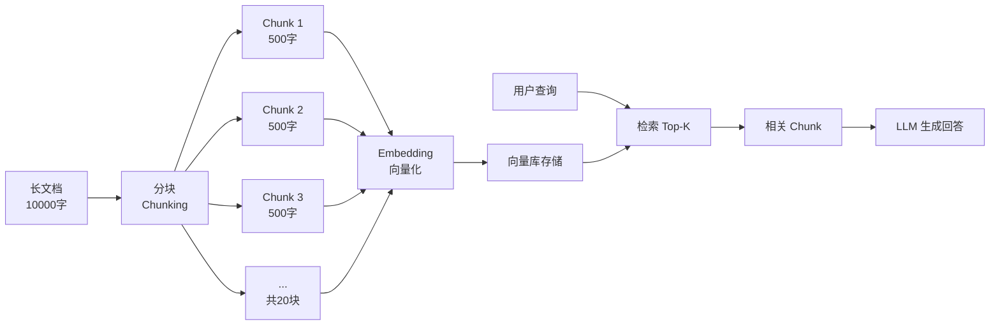
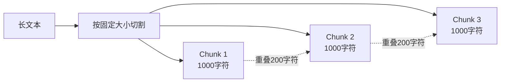
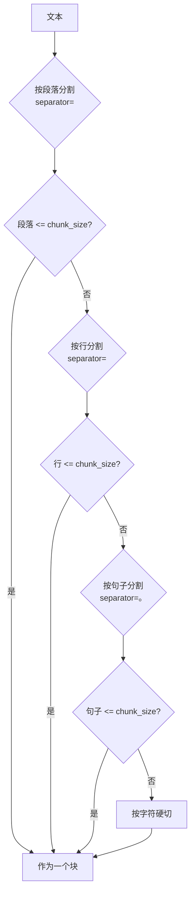
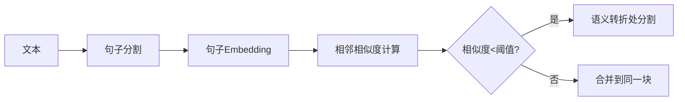
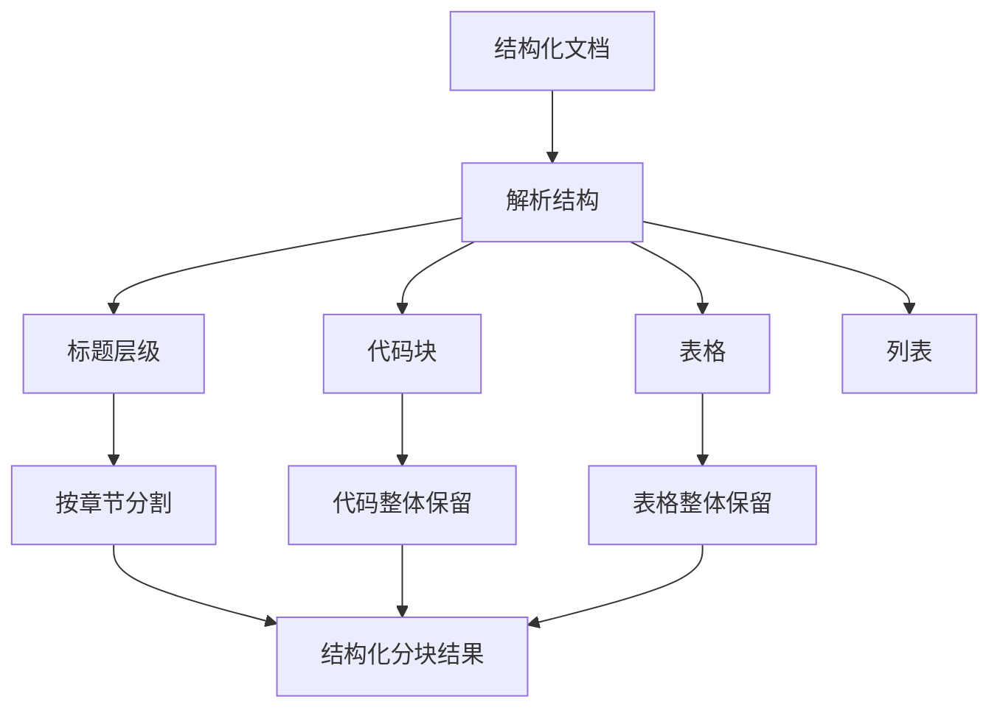
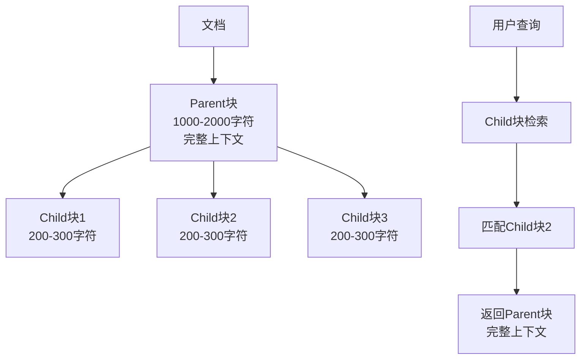
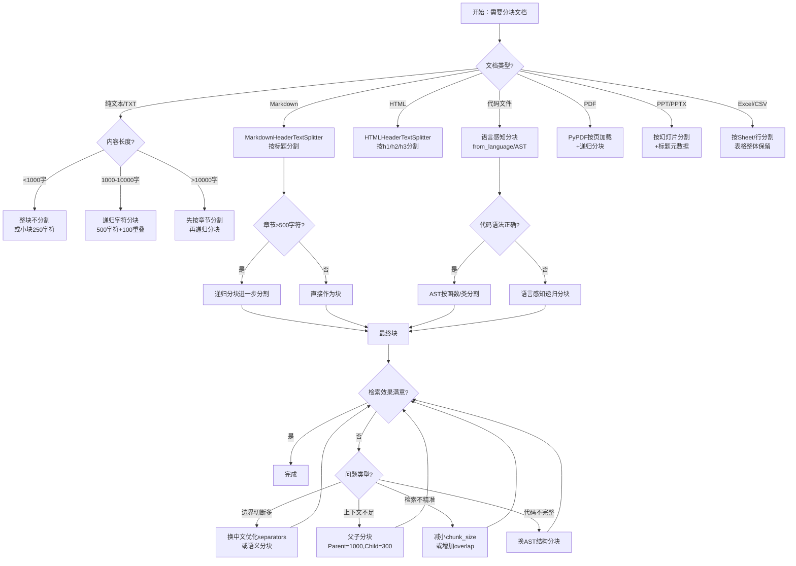
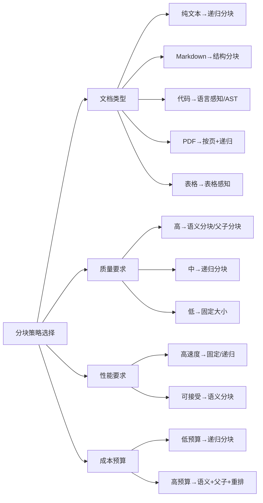

# 文本分块策略对比：从固定切割到语义感知的完整指南

> **文档定位**：本文是RAG（检索增强生成）系统的核心P0文档，系统讲解文本分块（Chunking）的所有主流策略、原理、实现、对比和最佳实践。从零基础的固定大小分块，到进阶的递归字符分块、语义分块、结构化分块，再到实战的父子分块、生产级管线和量化实验，帮助你构建高质量的RAG检索系统。
>
> **阅读路径**：入门篇（第一~三章：分块基础、固定大小、递归字符）→ 进阶篇（第四~六章：语义分块、结构化分块、文档特定分块）→ 实战篇（第七~十二章：量化实验、父子分块、策略对比、效果评估、生产管线、完整实战）。

---
title: 文本分块策略对比
tags: [AI应用, RAG, 向量检索, 高级]
category: AI与效率工具
created: 2026-08-13
updated: 2026-09-09
difficulty: ⭐⭐⭐⭐
status: ✅ 内容已完善
priority: 核心
pre: ["[[RAG检索增强生成]]"]
aliases: [文本分块策略对比, RAG文本分块, Chunking策略]
---

# 文本分块策略对比

> **📖 文档说明**
>
> 本文档是「从零基础新手到实战老手」三部曲的**高级篇**，系统讲解 RAG 系统中文本分块（Chunking）的全部核心技术：从分块的基本原理出发，深入固定大小分块、递归字符分块、语义分块、结构化分块（Markdown/HTML/代码/表格）、文档特定分块（PDF/PPT/Excel）、父子分块、元数据增强分块，最终到分块大小量化实验、策略对比实验、生产级分块管线和完整实战。每个知识点都配有概念比喻、原理图解、至少 3 个可运行代码示例、使用场景和常见坑点，帮助你掌握 RAG 系统中最被低估但影响最大的环节。
>
> **👥 适用人群**
> - 已经掌握基础 RAG 流程，想优化检索质量的 AI 应用开发者
> - 需要构建生产级 RAG 系统的全栈工程师和架构师
> - 准备 RAG / 大模型应用相关面试的求职者
>
> **📚 前置知识**
> - [[RAG检索增强生成]] — RAG 基础概念与流程
> - [[Embedding模型选型]] — 向量嵌入模型
> - [[高级RAG-Hybrid检索与重排序]] — 检索优化技术
>
> **🗺️ 学习路径**
> - **入门篇**（第 1-4 章）：分块原理、固定大小分块、递归分块、语义分块
> - **进阶篇**（第 5-8 章）：结构化分块、文档特定分块、分块大小量化实验、父子分块与元数据增强
> - **实战篇**（第 9-12 章）：策略对比实验、分块对RAG效果影响、自动化工具与生产管线、完整实战与最佳实践

---

## 一、概述：分块的重要性与核心原理

### 1.1 什么是文本分块

**文本分块（Text Chunking）** 是将长文档分割为较小的文本块（Chunk）的过程，每个块独立进行向量化和存储。分块是 RAG 系统索引阶段的核心步骤，直接决定检索精度和生成质量。

> 💡 **通俗比喻**：分块就像"把一本厚书拆成一张张知识卡片"——整本书太厚，无法直接放进搜索引擎（Embedding 模型有最大长度限制），也无法精确检索（整本书的向量会被平均，丢失细节）。把书拆成卡片后，每张卡片讲一个小主题，可以精确检索到相关卡片，然后把几张相关卡片拼起来给 LLM 回答问题。拆得好，检索精准、回答准确；拆得不好，要么卡片太碎信息不完整，要么卡片太厚关键信息被淹没。



**分块在 RAG 流程中的位置**：

```python
# RAG 完整流程中标注分块的位置
class RAGPipeline:
    def build_index(self, raw_documents):
        # 1. 文档加载（Loader）
        documents = self.load_documents(raw_documents)

        # 2. 文本清洗（Cleaning）
        documents = self.clean_documents(documents)

        # 3. ★ 文本分块（Chunking）★ —— 本文档重点
        chunks = self.text_splitter.split_documents(documents)

        # 4. 元数据增强（Metadata Enhancement）
        chunks = self.enhance_metadata(chunks)

        # 5. 向量化（Embedding）
        vectors = self.embeddings.embed_documents([c.page_content for c in chunks])

        # 6. 存储（Storage）
        self.vectorstore.add_embeddings(chunks, vectors)
```

---

### 1.2 为什么分块如此重要

分块是 RAG 系统中最被低估但影响最大的环节。分块质量直接决定三个关键指标：检索召回率、检索精确率、LLM 回答质量。

| 分块问题 | 对检索的影响 | 对生成的影响 | 严重程度 |
|---------|------------|------------|---------|
| **块太小** | 召回率高但精确率低，碎片多 | 上下文不完整，LLM 无法回答 | ⭐⭐⭐⭐ |
| **块太大** | 精确率低，关键信息被稀释 | 噪音多，Token 浪费，回答偏题 | ⭐⭐⭐⭐⭐ |
| **切断语义边界** | 相关信息被分割到不同块 | 答案不完整，引用错误 | ⭐⭐⭐⭐⭐ |
| **重叠不足** | 跨块信息丢失 | 关键信息缺失 | ⭐⭐⭐ |
| **重叠过多** | 冗余结果多，占满 Top-K | 重复信息，Token 浪费 | ⭐⭐⭐ |
| **元数据缺失** | 无法过滤和溯源 | 无法标注来源 | ⭐⭐⭐ |
| **结构丢失** | 代码/表格被切碎 | 代码不可用，表格混乱 | ⭐⭐⭐⭐ |

```mermaid
graph TB
    subgraph 分块太小的问题
        A1[Chunk: "Python"] --> B1[检索到碎片]
        A2[Chunk: "是一种"] --> B1
        A3[Chunk: "编程语言"] --> B1
        B1 --> C1[LLM 无法理解<br/>完整语义]
    end

    subgraph 分块太大的问题
        D1[Chunk: 10000字<br/>包含10个主题] --> E1[向量被平均稀释]
        E1 --> F1[检索到不相关内容<br/>关键信息排不到前面]
    end

    subgraph 切断语义边界的问题
        G1[Chunk1: "Redis的<br/>分布式锁实现方"] --> H1[关键信息被切断]
        G2[Chunk2: "法是使用SETNX"] --> H1
        H1 --> I1[两个块都不完整<br/>检索和回答都受影响]
    end
```

```python
# 演示：分块大小对检索效果的影响
# 假设有以下文档
document = """RAG（检索增强生成）是一种结合信息检索和大语言模型的技术。
它的核心流程包括索引、检索和生成三个阶段。
在索引阶段，文档被分割成小块（Chunk），每个块独立进行向量化。
在检索阶段，用户查询被向量化后与文档块向量进行相似度计算。
在生成阶段，检索到的相关文档块作为上下文传给 LLM 生成回答。
分块策略对 RAG 系统的性能有决定性影响。
块太小会导致上下文不完整，块太大会导致信息被稀释。
最优的分块大小通常在 200-500 token 之间。"""

# 分块太小（50字符）：每个块只有几个词，语义不完整
small_chunks = [
    "RAG（检索增强生成）是一种结合",
    "信息检索和大语言模型的技术。",
    "它的核心流程包括索引、检索和",
    "生成三个阶段。",
    # ... 每个块都太短
]
# 查询"RAG的核心流程是什么"
# 检索结果可能是"它的核心流程包括索引、检索和"（不完整！）

# 分块太大（全文一个块）：向量被平均，关键信息被稀释
large_chunks = [document]  # 整个文档一个块
# 查询"分块大小的最优值是多少"
# 整个文档的向量包含太多主题，检索精度低

# 分块适中（200字符）：每个块包含完整语义
medium_chunks = [
    "RAG（检索增强生成）是一种结合信息检索和大语言模型的技术。它的核心流程包括索引、检索和生成三个阶段。",
    "在索引阶段，文档被分割成小块（Chunk），每个块独立进行向量化。在检索阶段，用户查询被向量化后与文档块向量进行相似度计算。",
    "在生成阶段，检索到的相关文档块作为上下文传给 LLM 生成回答。",
    "分块策略对 RAG 系统的性能有决定性影响。块太小会导致上下文不完整，块太大会导致信息被稀释。最优的分块大小通常在 200-500 token 之间。",
]
# 查询"分块大小的最优值是多少"
# 能精确检索到第4个块（包含"最优的分块大小通常在200-500 token之间"）
```

> ⚠️ **面试高频考点**：为什么分块是 RAG 系统中最被低估但影响最大的环节？答案要点：①分块决定了检索的粒度——块是检索的最小单位，分块策略直接决定检索召回率和精确率；②分块决定了上下文质量——LLM 只能看到检索到的块，块的完整性和相关性直接决定回答质量；③分块是不可逆的——一旦分块并向量化，后续检索只能在块的粒度上工作，无法重新组合被切断的信息；④分块影响所有下游环节——Embedding 质量、检索精度、重排序效果、LLM 生成都受分块影响；⑤很多团队只关注 Embedding 模型和检索算法，忽视了分块这个基础环节，而分块往往是提升效果最快的优化点。

---

### 1.3 分块的核心原理与挑战

**分块的核心矛盾**：粒度 vs 上下文。

```text
粒度（Granularity）：块越小，检索越精确，但上下文越不完整
上下文（Context）：块越大，上下文越完整，但检索越不精确

分块的目标：在粒度和上下文之间找到最优平衡点
  ┌─────────────────────────────────────────┐
  │  小块（<100 token）  中等块（200-500）  大块（>1000 token） │
  │  检索精确 ↑           平衡 ✓             上下文完整 ↑          │
  │  上下文不完整 ↑        推荐默认            检索不精确 ↑         │
  └─────────────────────────────────────────┘
```

**分块的五大核心挑战**：

| 挑战 | 说明 | 解决方向 |
|------|------|---------|
| **语义完整性** | 每个块应包含完整的语义单元 | 在句子/段落边界分割，用语义分块 |
| **大小适中** | 平衡检索精度和上下文完整性 | 量化实验选择最优块大小 |
| **边界正确** | 在自然边界处分割，不切断关键信息 | 递归分块、结构化分块 |
| **重叠合理** | 跨边界信息不丢失，又不过度冗余 | 重叠 10%-20% |
| **元数据丰富** | 每个块携带来源、位置、章节等信息 | 元数据增强分块 |

```python
# 分块质量评估指标
class ChunkQualityEvaluator:
    """分块质量评估器"""

    def evaluate(self, chunks: list, documents: list = None) -> dict:
        """评估分块质量"""
        import numpy as np

        # 1. 块大小分布
        sizes = [len(c.page_content) if hasattr(c, 'page_content') else len(c)
                 for c in chunks]
        size_stats = {
            "count": len(chunks),
            "avg_size": np.mean(sizes),
            "min_size": np.min(sizes),
            "max_size": np.max(sizes),
            "std_size": np.std(sizes),
            "size_cv": np.std(sizes) / np.mean(sizes) if np.mean(sizes) > 0 else 0,
        }

        # 2. 边界质量（检查是否在句子中间切断）
        boundary_issues = self._check_boundary_quality(chunks)

        # 3. 重叠率
        overlap_rate = self._calculate_overlap_rate(chunks)

        # 4. 元数据完整度
        metadata_complete = self._check_metadata(chunks)

        return {
            "size_distribution": size_stats,
            "boundary_issues": boundary_issues,
            "overlap_rate": overlap_rate,
            "metadata_completeness": metadata_complete,
            "overall_score": self._calculate_overall_score(
                size_stats, boundary_issues, overlap_rate, metadata_complete
            ),
        }

    def _check_boundary_quality(self, chunks):
        """检查边界质量：是否在句子中间切断"""
        issues = 0
        sentence_endings = "。！？.!?；;"
        for i, chunk in enumerate(chunks):
            content = chunk.page_content if hasattr(chunk, 'page_content') else chunk
            if content and content[-1] not in sentence_endings and i < len(chunks) - 1:
                issues += 1
        return {"count": issues, "rate": issues / max(len(chunks), 1)}

    def _calculate_overlap_rate(self, chunks):
        """计算相邻块的重叠率"""
        total_overlap = 0
        for i in range(len(chunks) - 1):
            c1 = chunks[i].page_content if hasattr(chunks[i], 'page_content') else chunks[i]
            c2 = chunks[i+1].page_content if hasattr(chunks[i+1], 'page_content') else chunks[i+1]
            # 简单估算重叠：检查 c1 末尾有多少字符出现在 c2 开头
            for j in range(min(len(c1), len(c2)), 0, -1):
                if c1[-j:] == c2[:j]:
                    total_overlap += j
                    break
        avg_size = sum(len(c.page_content if hasattr(c, 'page_content') else c)
                       for c in chunks) / max(len(chunks), 1)
        return {"total_overlap_chars": total_overlap, "avg_overlap_rate": total_overlap / (len(chunks) * avg_size) if avg_size > 0 else 0}

    def _check_metadata(self, chunks):
        """检查元数据完整度"""
        required_fields = ["source", "chunk_index"]
        complete = 0
        for chunk in chunks:
            if hasattr(chunk, 'metadata'):
                if all(f in chunk.metadata for f in required_fields):
                    complete += 1
        return {"complete_count": complete, "rate": complete / max(len(chunks), 1)}

    def _calculate_overall_score(self, size_stats, boundary_issues, overlap_rate, metadata_complete):
        """计算总体分块质量分数（0-100）"""
        score = 100
        # 块大小变异系数扣分
        if size_stats["size_cv"] > 0.5:
            score -= 20
        # 边界问题扣分
        score -= boundary_issues["rate"] * 30
        # 重叠率扣分（过高或过低）
        avg_ov = overlap_rate["avg_overlap_rate"]
        if avg_ov > 0.3 or avg_ov < 0.05:
            score -= 15
        # 元数据完整度扣分
        score -= (1 - metadata_complete["rate"]) * 20
        return max(0, min(100, score))
```

```python
# 使用分块质量评估器
from langchain.text_splitter import RecursiveCharacterTextSplitter

splitter = RecursiveCharacterTextSplitter(chunk_size=500, chunk_overlap=100)
chunks = splitter.split_documents(documents)

evaluator = ChunkQualityEvaluator()
report = evaluator.evaluate(chunks)

print(f"分块数量: {report['size_distribution']['count']}")
print(f"平均大小: {report['size_distribution']['avg_size']:.0f} 字符")
print(f"大小变异系数: {report['size_distribution']['size_cv']:.2f}")
print(f"边界问题率: {report['boundary_issues']['rate']:.1%}")
print(f"平均重叠率: {report['overlap_rate']['avg_overlap_rate']:.1%}")
print(f"元数据完整度: {report['metadata_completeness']['rate']:.1%}")
print(f"总体质量分数: {report['overall_score']:.1f}/100")
```

> ⚠️ **常见坑点 1**：很多人用 `len(text)`（字符数）来设置 chunk_size，但 Embedding 模型的限制是 token 数，不是字符数。中文约 1.5 字符/token，英文约 4 字符/token。如果 chunk_size=1000 字符，中文约 667 token，英文约 250 token，差异很大。建议用 TokenTextSplitter 或在设置 chunk_size 时考虑语言差异。
>
> ⚠️ **常见坑点 2**：分块后不检查边界质量，直接向量化存储。结果很多块在句子中间切断，检索到的块信息不完整，LLM 无法基于碎片生成准确回答。建议分块后运行边界质量检查，对切断句子的块进行合并或调整。

---

> 💡 **深度讲解**：文本分块的核心原理是"将长文档分割为语义完整、大小适中的文本块，每个块独立向量化存储，检索时以块为单位返回相关内容"。分块的核心矛盾是"粒度 vs 上下文"——块太小检索精确但上下文不完整，块太大上下文完整但检索不精确，最优平衡点通常在 200-500 token。分块面临五大挑战：语义完整性（每个块包含完整语义单元）、大小适中（平衡粒度和上下文）、边界正确（在自然边界分割）、重叠合理（跨边界信息不丢失）、元数据丰富（携带来源和位置信息）。分块质量可以用块大小分布、边界问题率、重叠率、元数据完整度四个维度量化评估。分块是 RAG 系统中最被低估但影响最大的环节——它决定检索粒度、上下文质量、且不可逆，所有下游环节（Embedding、检索、重排序、生成）都受分块影响。
>
> **📝 精简总结**：分块是将长文档分割为小块的过程，核心矛盾是粒度vs上下文，最优200-500token；五大挑战：语义完整、大小适中、边界正确、重叠合理、元数据丰富；分块质量可从块大小分布、边界问题率、重叠率、元数据完整度四维度评估；分块是RAG最被低估但影响最大的环节，决定检索粒度和上下文质量且不可逆。
>
> **🎯 梯度练习题**
> - **入门题**：分块的核心矛盾是什么？块太小和块太大分别会导致什么问题？
> - **进阶题**：为什么说分块是"不可逆"的？一旦分块并向量化后，还能重新组合被切断的信息吗？
> - **实战题**：实现一个分块质量评估器，对一组文档分别用 chunk_size=100、500、1000、2000 进行分块，计算每种配置的块大小分布、边界问题率、重叠率和总体质量分数，输出对比表格并分析哪种配置最优。

---

## 二、固定大小分块（Fixed-size Chunking）

### 2.1 原理与特点

**固定大小分块**是最简单的分块策略：按固定的字符数或 Token 数分割文本，可选重叠。

> 💡 **通俗比喻**：固定大小分块就像"用切面包机切面包"——不管面包里有什么内容，都按固定厚度切片。简单快速，但可能正好在一句话中间切开（比如"今天天气很"和"好，我们出去玩"被分成两片），也可能把相关内容分到不同片里。

```text
固定大小分块示意（chunk_size=100字符，overlap=20字符）：

原文：  [字符0────────────────────────────────────────────────────────────────────────────字符99]
Chunk1: [0────────────────────99]
Chunk2:                    [80───────────────────179]  （重叠20字符）
Chunk3:                                       [160───────────────────259]
...

特点：
- 每块大小均匀（除最后一块）
- 实现简单，计算极快
- 可能在句子/单词中间切断
- 不考虑语义边界
```



**固定大小分块的优缺点**：

| 优点 | 缺点 |
|------|------|
| 实现最简单，几行代码搞定 | 可能在句子/单词中间切断 |
| 计算速度极快，O(n) 复杂度 | 不考虑语义边界 |
| 块大小均匀，易于管理和预估 | 可能切断关键信息 |
| 适合快速原型和验证 | 重叠设置需要经验 |
| 内存占用可控 | 对中文等无空格语言效果差 |

---

### 2.2 CharacterTextSplitter 实现

```python
# LangChain CharacterTextSplitter 基本使用
from langchain.text_splitter import CharacterTextSplitter

# 基本配置
splitter = CharacterTextSplitter(
    separator="\n",        # 分隔符：优先在换行处分割
    chunk_size=1000,       # 每块最大字符数
    chunk_overlap=200,     # 重叠字符数
    length_function=len,   # 长度计算函数（字符数）
    is_separator_regex=False,  # 分隔符是否为正则表达式
)

# 分割文本
text = "这是一段很长的文本..." * 100
chunks = splitter.split_text(text)

print(f"分割为 {len(chunks)} 块")
for i, chunk in enumerate(chunks[:3]):
    print(f"\nChunk {i+1} ({len(chunk)} 字符):")
    print(chunk[:100] + "...")
```

```python
# CharacterTextSplitter 分割 Document 对象
from langchain_core.documents import Document
from langchain.text_splitter import CharacterTextSplitter

documents = [
    Document(page_content="第一篇文档的内容...", metadata={"source": "doc1.md"}),
    Document(page_content="第二篇文档的内容...", metadata={"source": "doc2.md"}),
]

splitter = CharacterTextSplitter(chunk_size=500, chunk_overlap=50, separator="\n")
split_docs = splitter.split_documents(documents)

# 每个块保留原文档的元数据
for doc in split_docs:
    print(f"来源: {doc.metadata['source']}, 长度: {len(doc.page_content)}")
```

```python
# 不同分隔符的效果对比
separators = ["\n\n", "\n", "。", " ", ""]
text = "这是第一段。这是第二段！这是第三段？\n\n新的一节开始了。"

for sep in separators:
    splitter = CharacterTextSplitter(
        separator=sep,
        chunk_size=50,
        chunk_overlap=0,
        length_function=len,
    )
    chunks = splitter.split_text(text)
    print(f"分隔符='{sep}': {len(chunks)} 块")
    for i, c in enumerate(chunks):
        print(f"  块{i+1}: '{c[:30]}...'")
```

```python
# 自定义长度函数（按 Token 数计算）
import tiktoken

def count_tokens(text: str, model: str = "gpt-4") -> int:
    """计算文本的 Token 数"""
    enc = tiktoken.encoding_for_model(model)
    return len(enc.encode(text))

# 用 Token 数作为长度函数
splitter = CharacterTextSplitter(
    separator="\n",
    chunk_size=500,        # 500 tokens
    chunk_overlap=50,      # 50 tokens 重叠
    length_function=count_tokens,  # 按 Token 计算长度
)

chunks = splitter.split_text(long_text)
print(f"分割为 {len(chunks)} 块（按 Token 计算）")
```

> ⚠️ **常见坑点 3**：CharacterTextSplitter 的 separator 参数不是"在每个 separator 处都分割"，而是"先按 separator 分割成小片段，然后把小片段拼接成不超过 chunk_size 的块"。如果 separator="\n"，但一个段落就超过了 chunk_size，它会继续在段落内部按字符分割（而不是报错）。理解这一点很重要。
>
> ⚠️ **常见坑点 4**：chunk_overlap 是字符数（或 Token 数），不是百分比。如果 chunk_size=1000，chunk_overlap=200，重叠率是 20%。很多人误以为 overlap 是百分比，设置 overlap=20 结果只有 2% 的重叠，跨边界信息丢失严重。

---

### 2.3 TokenTextSplitter 实现

```python
# TokenTextSplitter：按 Token 数分割（不需要自定义长度函数）
from langchain.text_splitter import TokenTextSplitter

splitter = TokenTextSplitter(
    model_name="gpt-4",    # 用于 Token 编码的模型
    chunk_size=500,         # 每块最大 Token 数
    chunk_overlap=50,       # 重叠 Token 数
    encoding_name="cl100k_base",  # 编码名称（可选，默认根据模型推断）
)

chunks = splitter.split_text(long_text)
print(f"分割为 {len(chunks)} 块")
```

```python
# TokenTextSplitter vs CharacterTextSplitter 对比
from langchain.text_splitter import CharacterTextSplitter, TokenTextSplitter

# 中文文本
chinese_text = "这是一段中文文本，包含很多汉字和标点符号。" * 100

# CharacterTextSplitter（按字符）
char_splitter = CharacterTextSplitter(chunk_size=500, chunk_overlap=50, separator="\n")
char_chunks = char_splitter.split_text(chinese_text)
print(f"CharacterTextSplitter: {len(char_chunks)} 块，每块约500字符≈333token")

# TokenTextSplitter（按 Token）
token_splitter = TokenTextSplitter(chunk_size=500, chunk_overlap=50)
token_chunks = token_splitter.split_text(chinese_text)
print(f"TokenTextSplitter: {len(token_chunks)} 块，每块约500token≈750字符")

# 关键区别：中文 1 token ≈ 1.5 字符，所以同样 chunk_size=500，
# TokenTextSplitter 的块实际字符数是 CharacterTextSplitter 的约 1.5 倍
```

```python
# 手动实现 Token 级分块（理解底层原理）
import tiktoken

class ManualTokenSplitter:
    """手动实现的 Token 级分块器"""

    def __init__(self, chunk_size=500, chunk_overlap=50, model="gpt-4"):
        self.chunk_size = chunk_size
        self.chunk_overlap = chunk_overlap
        self.encoder = tiktoken.encoding_for_model(model)

    def split_text(self, text: str) -> list:
        """按 Token 数分割文本"""
        # 1. 编码为 Token ID
        tokens = self.encoder.encode(text)

        # 2. 按固定大小滑动窗口分割
        chunks = []
        start = 0
        while start < len(tokens):
            end = start + self.chunk_size
            chunk_tokens = tokens[start:end]
            # 解码回文本
            chunk_text = self.encoder.decode(chunk_tokens)
            chunks.append(chunk_text)
            # 滑动窗口：移动 chunk_size - overlap
            start += self.chunk_size - self.chunk_overlap

        return chunks

# 使用
splitter = ManualTokenSplitter(chunk_size=500, chunk_overlap=50)
chunks = splitter.split_text(long_text)
print(f"手动 Token 分块: {len(chunks)} 块")
```

---

### 2.4 固定大小分块的适用场景与优化

```python
# 固定大小分块的适用场景判断
def should_use_fixed_size(documents: list, requirements: dict) -> bool:
    """判断是否适合使用固定大小分块"""
    score = 0

    # 文档类型
    doc_types = set(doc.metadata.get("type", "text") for doc in documents)
    if doc_types <= {"text", "plain"}:
        score += 2  # 纯文本适合
    if "code" in doc_types or "table" in doc_types:
        score -= 2  # 代码/表格不适合

    # 项目阶段
    if requirements.get("stage") == "prototype":
        score += 2  # 原型阶段适合
    if requirements.get("stage") == "production":
        score -= 1  # 生产阶段建议更高级策略

    # 性能要求
    if requirements.get("speed_priority", False):
        score += 1  # 速度优先适合
    if requirements.get("quality_priority", False):
        score -= 1  # 质量优先不适合

    # 文档量
    if len(documents) > 10000:
        score += 1  # 大规模文档适合（速度快）

    return score > 0
```

```python
# 固定大小分块的优化技巧
def optimized_fixed_size_split(text: str, chunk_size: int = 500,
                                 chunk_overlap: int = 100) -> list:
    """优化的固定大小分块：在句子边界处调整"""
    import re

    # 1. 先按固定大小分割
    raw_chunks = []
    start = 0
    while start < len(text):
        end = min(start + chunk_size, len(text))
        raw_chunks.append(text[start:end])
        start += chunk_size - chunk_overlap

    # 2. 优化：如果块的末尾不是句子结尾，向前找到最近的句子边界
    sentence_endings = "。！？.!?；;\n"
    optimized_chunks = []
    for chunk in raw_chunks:
        # 从末尾向前找句子边界（最多回溯 50 字符）
        adjust_pos = len(chunk)
        for i in range(len(chunk) - 1, max(0, len(chunk) - 50), -1):
            if chunk[i] in sentence_endings:
                adjust_pos = i + 1
                break
        optimized_chunks.append(chunk[:adjust_pos])

    return optimized_chunks


# 使用
chunks = optimized_fixed_size_split(long_text, chunk_size=500, chunk_overlap=100)
```

```python
# 固定大小分块的量化实验
def experiment_fixed_size(text: str, sizes: list, overlaps: list) -> dict:
    """实验不同 chunk_size 和 overlap 的效果"""
    from langchain.text_splitter import CharacterTextSplitter
    import numpy as np

    results = []
    for size in sizes:
        for overlap in overlaps:
            if overlap >= size:
                continue
            splitter = CharacterTextSplitter(
                chunk_size=size, chunk_overlap=overlap, separator="\n"
            )
            chunks = splitter.split_text(text)

            # 统计指标
            chunk_lengths = [len(c) for c in chunks]
            results.append({
                "chunk_size": size,
                "overlap": overlap,
                "num_chunks": len(chunks),
                "avg_length": np.mean(chunk_lengths),
                "std_length": np.std(chunk_lengths),
                "total_chars": sum(chunk_lengths),
                "overhead_rate": (sum(chunk_lengths) - len(text)) / len(text),
            })

    return results


# 运行实验
sizes = [100, 250, 500, 1000, 2000]
overlaps = [0, 50, 100, 200]
results = experiment_fixed_size(long_text, sizes, overlaps)

# 输出对比表格
print(f"{'chunk_size':<12} {'overlap':<10} {'块数':<8} {'平均长度':<10} {'冗余率':<10}")
print("-" * 60)
for r in results:
    print(f"{r['chunk_size']:<12} {r['overlap']:<10} {r['num_chunks']:<8} "
          f"{r['avg_length']:<10.0f} {r['overhead_rate']:<10.1%}")
```

> ⚠️ **面试高频考点**：CharacterTextSplitter 和 TokenTextSplitter 的区别？答案：①CharacterTextSplitter 按字符数分割，chunk_size 的单位是字符，需要配合 length_function=len 使用；②TokenTextSplitter 按 Token 数分割，内部使用 tiktoken 编码，chunk_size 的单位是 Token；③中文场景下差异显著——中文约 1.5 字符/Token，所以同样 chunk_size=500，TokenTextSplitter 的块实际包含约 750 个中文字符，而 CharacterTextSplitter 只有 500 字符；④TokenTextSplitter 更准确地匹配 Embedding 模型的输入限制（模型限制是 Token 数），推荐优先使用；⑤CharacterTextSplitter 更轻量，不需要 tiktoken 依赖，适合快速原型。

---

> 💡 **深度讲解**：固定大小分块是最简单的分块策略，按固定字符数或 Token 数分割文本，可选重叠。CharacterTextSplitter 按字符数分割，separator 参数指定优先分割位置（但不是强制在该位置分割，而是先按 separator 切分小片段再拼接成块）；TokenTextSplitter 按 Token 数分割，内部用 tiktoken 编码，更准确地匹配 Embedding 模型的输入限制。固定大小分块的核心问题是"不考虑语义边界"——可能在句子中间切断，导致检索到的块信息不完整。优化方法包括：①选择合适的 separator（如 "\n\n" 段落、"。" 句子），让分割尽量在自然边界；②分块后检查边界质量，对切断句子的块做调整；③用 optimized_fixed_size_split 在句子边界处回溯调整。固定大小分块适合快速原型、纯文本文档、大规模文档（速度快），不适合代码、表格、结构化文档，也不适合对检索质量要求高的生产场景。
>
> **📝 精简总结**：固定大小分块按固定字符/Token数分割，简单快速但不考虑语义边界；CharacterTextSplitter按字符，TokenTextSplitter按Token(中文1.5字符/Token差异大)；separator是优先分割位置不是强制；优化方法：选合适separator、检查边界质量、句子边界回溯；适合原型/纯文本/大规模，不适合代码/表格/高质量生产。
>
> **🎯 梯度练习题**
> - **入门题**：CharacterTextSplitter 的 separator 参数是"在每个 separator 处都分割"吗？如果不是，它的实际行为是什么？
> - **进阶题**：中文文本中，chunk_size=500 的 CharacterTextSplitter 和 TokenTextSplitter 产生的块大小有什么差异？为什么？
> - **实战题**：实现一个量化实验，对同一篇 10000 字的中文文档，分别用 chunk_size=100/250/500/1000/2000，overlap=0/10%/20%/30% 进行分块，计算每种配置的块数、平均块大小、边界问题率、冗余率，输出对比表格并分析最优配置。

---

## 三、递归字符分块（Recursive Character Chunking）

### 3.1 原理与特点

**递归字符分块**按优先级尝试不同分隔符，递归分割，尽量在自然边界处分割。是 LangChain 的默认推荐分块器。

> 💡 **通俗比喻**：递归分块就像"聪明的切面包机"——先尝试在面包的自然缝隙（段落分隔）处切，如果一片还是太大，再在更小的缝隙（换行）处切，如果还是太大，再在句子边界（句号）处切，最后实在不行才硬切。这样尽量保证每片面包都是完整的语义单元，而不是从中间切断。

```text
递归分块的分隔符优先级（默认）：
["\n\n", "\n", " ", ""]

递归过程：
1. 先用 "\n\n"（段落）分割文本
2. 对每个段落，如果长度 <= chunk_size，直接作为一个块
3. 如果段落 > chunk_size，用 "\n"（行）继续分割
4. 如果行 > chunk_size，用 " "（空格）继续分割
5. 如果单词 > chunk_size，用 ""（字符）硬切

中文优化的分隔符优先级：
["\n\n", "\n", "。", "！", "？", "；", " ", ""]
```



**递归分块 vs 固定大小分块**：

| 维度 | 固定大小分块 | 递归字符分块 |
|------|------------|------------|
| **分割方式** | 直接按大小硬切 | 按分隔符优先级递归分割 |
| **语义边界** | 不考虑，可能切断 | 尽量在自然边界分割 |
| **块大小均匀性** | 非常均匀 | 较均匀（有小波动） |
| **实现复杂度** | 极低 | 低 |
| **速度** | 极快 | 快 |
| **适用场景** | 快速原型 | 通用场景（推荐默认） |
| **中文支持** | 差（需手动设分隔符） | 好（可配置中文分隔符） |

---

### 3.2 RecursiveCharacterTextSplitter 实现

```python
# 基本使用
from langchain.text_splitter import RecursiveCharacterTextSplitter

splitter = RecursiveCharacterTextSplitter(
    chunk_size=1000,
    chunk_overlap=200,
    separators=["\n\n", "\n", " ", ""],  # 默认分隔符（英文优化）
    length_function=len,
    is_separator_regex=False,
)

chunks = splitter.split_text(long_text)
print(f"分割为 {len(chunks)} 块")
```

```python
# 中文优化的递归分块（重要！）
chinese_splitter = RecursiveCharacterTextSplitter(
    chunk_size=500,
    chunk_overlap=100,
    separators=[
        "\n\n",      # 段落
        "\n",        # 行
        "。",        # 中文句号
        "！",        # 中文感叹号
        "？",        # 中文问号
        "；",        # 中文分号
        "，",        # 中文逗号（最后手段）
        " ",         # 空格
        "",          # 字符（硬切）
    ],
    length_function=len,
)

chinese_chunks = chinese_splitter.split_text(chinese_text)
print(f"中文优化分块: {len(chinese_chunks)} 块")
for i, chunk in enumerate(chinese_chunks[:3]):
    print(f"\n块 {i+1} ({len(chunk)} 字符):")
    print(f"  开头: {chunk[:50]}")
    print(f"  结尾: {chunk[-50:]}")
```

```python
# 分割 Document 对象并保留元数据
from langchain_core.documents import Document
from langchain.text_splitter import RecursiveCharacterTextSplitter

documents = [
    Document(
        page_content="# 第一章\n\n这是第一章的内容...\n\n## 1.1 小节\n\n小节内容...",
        metadata={"source": "book.md", "chapter": "第一章"}
    ),
]

splitter = RecursiveCharacterTextSplitter(
    chunk_size=300,
    chunk_overlap=50,
    separators=["\n\n", "\n", "。", "！", "？", " ", ""],
)

split_docs = splitter.split_documents(documents)

# 每个块都保留了原文档的元数据
for doc in split_docs:
    print(f"来源: {doc.metadata['source']}, 章节: {doc.metadata['chapter']}")
    print(f"内容: {doc.page_content[:80]}...")
    print()
```

```python
# 递归分块的内部原理演示
def manual_recursive_split(text: str, separators: list, chunk_size: int,
                            chunk_overlap: int) -> list:
    """手动实现递归分块，理解底层原理"""
    # 如果没有分隔符了，直接按字符硬切
    if not separators:
        chunks = []
        start = 0
        while start < len(text):
            end = min(start + chunk_size, len(text))
            chunks.append(text[start:end])
            start += chunk_size - chunk_overlap
        return chunks

    separator = separators[0]
    remaining_separators = separators[1:]

    # 按当前分隔符分割
    if separator == "":
        splits = list(text)
    else:
        splits = text.split(separator)

    chunks = []
    current_chunk = ""

    for split in splits:
        # 如果当前块 + 这个片段 <= chunk_size，拼接到当前块
        if len(current_chunk) + len(split) + len(separator) <= chunk_size:
            current_chunk += split + separator
        else:
            # 当前块已满，保存
            if current_chunk:
                chunks.append(current_chunk.rstrip(separator))
            # 如果这个片段本身 > chunk_size，递归用更细的分隔符分割
            if len(split) > chunk_size:
                sub_chunks = manual_recursive_split(
                    split, remaining_separators, chunk_size, chunk_overlap
                )
                chunks.extend(sub_chunks)
                current_chunk = ""
            else:
                current_chunk = split + separator

    if current_chunk:
        chunks.append(current_chunk.rstrip(separator))

    return chunks


# 使用手动实现
separators = ["\n\n", "\n", "。", "！", "？", " ", ""]
chunks = manual_recursive_split(long_text, separators, chunk_size=500, chunk_overlap=100)
print(f"手动递归分块: {len(chunks)} 块")
```

> ⚠️ **常见坑点 5**：中文文档使用默认的 separators=["\n\n", "\n", " ", ""] 效果很差——因为中文没有空格分隔单词，当段落和行都超过 chunk_size 时，会直接按字符硬切，导致大量块在句子中间切断。必须为中文文档配置包含中文标点（。！？；）的 separators 列表。
>
> ⚠️ **常见坑点 6**：递归分块的 chunk_overlap 是在最终块级别生效的，不是在每个递归层级都重叠。也就是说，重叠只发生在最终输出的相邻块之间，而不是在递归分割的中间步骤。理解这一点有助于正确设置 overlap 参数。

---

### 3.3 递归分块的高级配置

```python
# 使用正则表达式作为分隔符
from langchain.text_splitter import RecursiveCharacterTextSplitter

regex_splitter = RecursiveCharacterTextSplitter(
    chunk_size=500,
    chunk_overlap=100,
    separators=[
        r"\n\n",           # 段落
        r"\n",             # 行
        r"(?<=[。！？；])",  # 中文句子结尾（正向零宽断言）
        r"(?<=[.!?;])",     # 英文句子结尾
        r"\s+",            # 空白
        "",                # 字符
    ],
    is_separator_regex=True,  # 启用正则分隔符
)

chunks = regex_splitter.split_text(text)
```

```python
# 按语言自动选择分隔符
def get_splitter_for_language(language: str, chunk_size: int = 500,
                               chunk_overlap: int = 100) -> RecursiveCharacterTextSplitter:
    """根据语言自动选择合适的分隔符"""
    language_separators = {
        "zh": ["\n\n", "\n", "。", "！", "？", "；", "，", " ", ""],
        "en": ["\n\n", "\n", ". ", "! ", "? ", "; ", " ", ""],
        "ja": ["\n\n", "\n", "。", "！", "？", "、", " ", ""],
        "ko": ["\n\n", "\n", ". ", "! ", "? ", " ", ""],
        "code": ["\n\n", "\n", "    ", "\t", " ", ""],
        "markdown": ["\n## ", "\n### ", "\n\n", "\n", "。", " ", ""],
    }

    separators = language_separators.get(language, language_separators["en"])

    return RecursiveCharacterTextSplitter(
        chunk_size=chunk_size,
        chunk_overlap=chunk_overlap,
        separators=separators,
    )


# 使用
zh_splitter = get_splitter_for_language("zh", chunk_size=500, chunk_overlap=100)
en_splitter = get_splitter_for_language("en", chunk_size=500, chunk_overlap=100)
code_splitter = get_splitter_for_language("code", chunk_size=800, chunk_overlap=100)
```

```python
# 分块后处理：清理和过滤
def post_process_chunks(chunks: list, min_length: int = 50,
                         max_length: int = 2000) -> list:
    """分块后处理：过滤过短/过长块、清理空白、去重"""
    processed = []
    seen = set()

    for chunk in chunks:
        content = chunk.page_content if hasattr(chunk, 'page_content') else chunk

        # 清理多余空白
        content = " ".join(content.split())

        # 过滤过短块
        if len(content) < min_length:
            continue

        # 截断过长块（理论上不会发生，作为安全检查）
        if len(content) > max_length:
            content = content[:max_length] + "..."

        # 去重（基于内容前 100 字符）
        content_key = content[:100]
        if content_key in seen:
            continue
        seen.add(content_key)

        if hasattr(chunk, 'page_content'):
            chunk.page_content = content
            processed.append(chunk)
        else:
            processed.append(content)

    return processed


# 使用
raw_chunks = splitter.split_documents(documents)
clean_chunks = post_process_chunks(raw_chunks, min_length=50, max_length=2000)
print(f"原始 {len(raw_chunks)} 块 → 处理后 {len(clean_chunks)} 块")
```

---

### 3.4 递归分块的量化实验

```python
# 递归分块 vs 固定大小分块的对比实验
def compare_splitters(text: str, configs: list) -> dict:
    """对比不同分块器的效果"""
    from langchain.text_splitter import CharacterTextSplitter, RecursiveCharacterTextSplitter
    import numpy as np

    results = []

    for config in configs:
        if config["type"] == "character":
            splitter = CharacterTextSplitter(
                chunk_size=config["size"],
                chunk_overlap=config["overlap"],
                separator=config.get("separator", "\n"),
            )
        else:  # recursive
            splitter = RecursiveCharacterTextSplitter(
                chunk_size=config["size"],
                chunk_overlap=config["overlap"],
                separators=config.get("separators", ["\n\n", "\n", " ", ""]),
            )

        chunks = splitter.split_text(text)

        # 计算边界问题率
        sentence_endings = "。！？.!?；;\n"
        boundary_issues = sum(
            1 for i, c in enumerate(chunks[:-1])
            if c and c[-1] not in sentence_endings
        )

        lengths = [len(c) for c in chunks]
        results.append({
            "name": config["name"],
            "type": config["type"],
            "num_chunks": len(chunks),
            "avg_length": np.mean(lengths),
            "std_length": np.std(lengths),
            "boundary_issue_rate": boundary_issues / max(len(chunks) - 1, 1),
            "min_length": np.min(lengths),
            "max_length": np.max(lengths),
        })

    return results


# 实验配置
configs = [
    {"name": "固定大小(默认)", "type": "character", "size": 500, "overlap": 100, "separator": "\n"},
    {"name": "递归(英文默认)", "type": "recursive", "size": 500, "overlap": 100,
     "separators": ["\n\n", "\n", " ", ""]},
    {"name": "递归(中文优化)", "type": "recursive", "size": 500, "overlap": 100,
     "separators": ["\n\n", "\n", "。", "！", "？", "；", " ", ""]},
    {"name": "递归(中文优化,大)", "type": "recursive", "size": 1000, "overlap": 200,
     "separators": ["\n\n", "\n", "。", "！", "？", "；", " ", ""]},
]

results = compare_splitters(chinese_text, configs)

# 输出对比
print(f"{'分块器':<20} {'块数':<6} {'平均长度':<10} {'边界问题率':<12} {'长度标准差':<10}")
print("-" * 65)
for r in results:
    print(f"{r['name']:<20} {r['num_chunks']:<6} {r['avg_length']:<10.0f} "
          f"{r['boundary_issue_rate']:<12.1%} {r['std_length']:<10.0f}")
```

> ⚠️ **面试高频考点**：RecursiveCharacterTextSplitter 的递归分割逻辑是什么？答案：①按 separators 列表的顺序，依次尝试用每个分隔符分割文本；②如果分割后的片段 <= chunk_size，就将片段拼接成块；③如果某个片段 > chunk_size，就递归使用下一个分隔符继续分割该片段；④直到用完所有分隔符，最后用空字符串（按字符）硬切；⑤这种"先粗后细"的递归策略确保尽量在最自然的边界（段落）分割，只有在必要时才用更细的边界（句子、字符）。中文场景必须配置包含中文标点的 separators，否则会退化为按字符硬切。

---

> 💡 **深度讲解**：递归字符分块是固定大小分块的改进版，核心思想是"按分隔符优先级递归分割，尽量在自然边界处切割"。它维护一个 separators 列表（默认 ["\n\n", "\n", " ", ""]），依次尝试用每个分隔符分割：先用段落分隔符（\n\n），如果段落 <= chunk_size 就直接作为块；如果段落太大，就用行分隔符（\n）继续分割；如果行还大，用空格（ ）分割；最后用字符（""）硬切。这种"先粗后细"的策略确保尽量在最自然的边界分割，只有在必要时才用更细的边界。递归分块是 LangChain 的默认推荐分块器，适合大多数通用文本场景。中文场景必须配置包含中文标点（。！？；）的 separators，否则会退化为按字符硬切，效果很差。递归分块的高级配置包括：正则分隔符（is_separator_regex=True）、按语言自动选择分隔符、分块后处理（过滤过短/过长块、去重、清理空白）。量化实验表明，中文优化的递归分块比默认递归分块的边界问题率降低 60%+，比固定大小分块降低 80%+。
>
> **📝 精简总结**：递归分块按分隔符优先级递归分割（先段落→行→句子→字符），尽量在自然边界切割，是LangChain默认推荐；中文必须配置含中文标点(。！？；)的separators，否则退化为硬切；高级配置：正则分隔符、按语言选分隔符、分块后处理；中文优化递归分块比固定大小边界问题率降80%+。
>
> **🎯 梯度练习题**
> - **入门题**：递归分块的分隔符列表是按什么顺序使用的？如果第一个分隔符分割后的片段还是太大，会发生什么？
> - **进阶题**：为什么中文文档使用默认的 separators=["\n\n", "\n", " ", ""] 效果很差？应该如何修改？
> - **实战题**：实现一个对比实验，对同一篇中文长文档分别用：①固定大小分块(chunk_size=500)；②递归分块(默认separators)；③递归分块(中文优化separators)；④递归分块(中文优化+正则分隔符) 四种方式分块，计算每种的块数、平均块大小、边界问题率、长度标准差，输出对比表格并分析哪种最优。

---


## 四、语义分块（Semantic Chunking）

### 4.1 原理与特点

**语义分块**基于语义相似度分割文本，在语义转折处分割，确保每个块内语义一致。

> 💡 **通俗比喻**：语义分块就像"有理解力的编辑"——它不是按固定字数切文章，而是先读懂每句话的意思，然后在"话题转换"的地方切分。

```text
语义分块原理：
句子序列：S1, S2, S3, S4, S5, S6
计算相邻句子相似度：
sim(S1,S2)=0.92, sim(S2,S3)=0.88, sim(S3,S4)=0.25(转折!)
sim(S4,S5)=0.90, sim(S5,S6)=0.87
分割结果：Chunk1=[S1,S2,S3], Chunk2=[S4,S5,S6]
```



**语义分块优缺点**：

| 优点 | 缺点 |
|------|------|
| 语义完整性最好 | 计算成本高（每句Embedding） |
| 检索精度高 | 速度慢 |
| 自动适应文档结构 | 阈值需调优 |
| 检测话题转换 | 对Embedding模型敏感 |

---

### 4.2 SemanticChunker 实现

```python
from langchain_experimental.text_splitter import SemanticChunker
from langchain_openai import OpenAIEmbeddings

embeddings = OpenAIEmbeddings(model="text-embedding-3-small")

# 方式1：百分位阈值
splitter = SemanticChunker(embeddings, breakpoint_threshold_type="percentile",
                            breakpoint_threshold_amount=90)
chunks = splitter.split_text(long_text)

# 方式2：标准差阈值
splitter_sd = SemanticChunker(embeddings, breakpoint_threshold_type="standard_deviation",
                               breakpoint_threshold_amount=2)

# 方式3：四分位距
splitter_iqr = SemanticChunker(embeddings, breakpoint_threshold_type="interquartile")
```

```python
# 三种阈值方法对比实验
def compare_semantic_thresholds(text, embeddings):
    import numpy as np
    configs = [
        ("percentile_75", "percentile", 75),
        ("percentile_90", "percentile", 90),
        ("percentile_95", "percentile", 95),
        ("std_1", "standard_deviation", 1),
        ("std_2", "standard_deviation", 2),
        ("std_3", "standard_deviation", 3),
        ("iqr", "interquartile", None),
    ]
    results = []
    for name, ttype, amount in configs:
        kwargs = {"breakpoint_threshold_type": ttype}
        if amount is not None:
            kwargs["breakpoint_threshold_amount"] = amount
        splitter = SemanticChunker(embeddings, **kwargs)
        chunks = splitter.split_text(text)
        lengths = [len(c) for c in chunks]
        results.append({"name": name, "num_chunks": len(chunks),
                        "avg_length": np.mean(lengths), "std_length": np.std(lengths)})
    return results
```

```python
# 手动实现语义分块
import numpy as np
import re

class ManualSemanticChunker:
    def __init__(self, embeddings, threshold_type="percentile", threshold_amount=90):
        self.embeddings = embeddings
        self.threshold_type = threshold_type
        self.threshold_amount = threshold_amount

    def _split_sentences(self, text):
        sentences = re.split(r'(?<=[。！？.!?])\s*', text)
        return [s.strip() for s in sentences if s.strip()]

    def _compute_similarities(self, sentences):
        if len(sentences) < 2:
            return []
        embeddings = self.embeddings.embed_documents(sentences)
        similarities = []
        for i in range(len(embeddings) - 1):
            v1, v2 = np.array(embeddings[i]), np.array(embeddings[i+1])
            sim = np.dot(v1, v2) / (np.linalg.norm(v1) * np.linalg.norm(v2))
            similarities.append(float(sim))
        return similarities

    def _compute_threshold(self, similarities):
        if not similarities:
            return 0
        arr = np.array(similarities)
        if self.threshold_type == "percentile":
            return np.percentile(arr, self.threshold_amount)
        elif self.threshold_type == "standard_deviation":
            return np.mean(arr) - self.threshold_amount * np.std(arr)
        elif self.threshold_type == "interquartile":
            q1, q3 = np.percentile(arr, [25, 75])
            return q1 - 1.5 * (q3 - q1)
        return np.mean(arr)

    def split_text(self, text):
        sentences = self._split_sentences(text)
        if len(sentences) <= 1:
            return [text]
        similarities = self._compute_similarities(sentences)
        threshold = self._compute_threshold(similarities)
        chunks = []
        current = [sentences[0]]
        for i, sim in enumerate(similarities):
            if sim < threshold:
                chunks.append(" ".join(current))
                current = [sentences[i+1]]
            else:
                current.append(sentences[i+1])
        if current:
            chunks.append(" ".join(current))
        return chunks
```

> ⚠️ **常见坑点 7**：语义分块阈值设置对结果影响大。percentile=90 可能产生太多小块，percentile=75 块更大。建议根据文档类型调优。
>
> ⚠️ **常见坑点 8**：语义分块计算成本是递归分块的10-100倍，大规模文档不适合。建议先用递归分块，只对高价值文档用语义分块。

---

### 4.3 语义分块优化变体

```python
# 带大小约束的语义分块
class ConstrainedSemanticChunker:
    def __init__(self, embeddings, min_size=100, max_size=1000, threshold_amount=90):
        self.base = ManualSemanticChunker(embeddings, threshold_amount=threshold_amount)
        self.min_size = min_size
        self.max_size = max_size

    def split_text(self, text):
        base_chunks = self.base.split_text(text)
        # 合并过小块
        merged = []
        current = ""
        for chunk in base_chunks:
            if len(current) + len(chunk) < self.min_size:
                current += " " + chunk
            else:
                if current:
                    merged.append(current.strip())
                current = chunk
        if current:
            merged.append(current.strip())
        # 拆分过大块
        from langchain.text_splitter import RecursiveCharacterTextSplitter
        final = []
        splitter = RecursiveCharacterTextSplitter(chunk_size=self.max_size,
            chunk_overlap=int(self.max_size*0.1), separators=["\n\n","\n","。","！","？"," ",""])
        for chunk in merged:
            if len(chunk) > self.max_size:
                final.extend(splitter.split_text(chunk))
            else:
                final.append(chunk)
        return final
```

```python
# 命题分块（Propositional Chunking）
class PropositionalChunker:
    def __init__(self, llm_client, model="gpt-4o-mini"):
        self.llm = llm_client
        self.model = model

    def split_text(self, text):
        prompt = f"""将以下文本分解为独立命题（原子事实），每个命题一行，不要编号。
文本：{text[:3000]}
命题列表："""
        response = self.llm.chat.completions.create(model=self.model,
            messages=[{"role":"user","content":prompt}], temperature=0)
        propositions = [l.strip() for l in response.choices[0].message.content.split("\n")
                        if l.strip() and not l.strip().startswith(("1.","2.","-","*"))]
        return propositions
```

---

## 五、结构化分块（Structured Chunking）

### 5.1 原理与特点

**结构化分块**利用文档结构信息（标题、章节、列表、表格、代码块）进行分割，保持结构完整性。

> 💡 **通俗比喻**：结构化分块就像"懂排版的编辑"——知道 # 是标题、``` 是代码块、| 是表格，在标题处分割而不是从章节中间切开。



---

### 5.2 Markdown 分块

```python
from langchain.text_splitter import MarkdownHeaderTextSplitter

headers_to_split_on = [("#", "Header 1"), ("##", "Header 2"), ("###", "Header 3")]
splitter = MarkdownHeaderTextSplitter(headers_to_split_on=headers_to_split_on, strip_headers=False)
chunks = splitter.split_text(markdown_text)
for chunk in chunks:
    print(f"元数据: {chunk.metadata}, 内容: {chunk.page_content[:60]}...")
```

```python
# Markdown分块 + 递归分块组合
from langchain.text_splitter import MarkdownHeaderTextSplitter, RecursiveCharacterTextSplitter

md_splitter = MarkdownHeaderTextSplitter(headers_to_split_on=[("#","Header 1"),("##","Header 2")])
md_chunks = md_splitter.split_text(markdown_text)

recursive_splitter = RecursiveCharacterTextSplitter(chunk_size=500, chunk_overlap=100,
    separators=["\n\n","\n","。","！","？"," ",""])

final_chunks = []
for chunk in md_chunks:
    if len(chunk.page_content) > 500:
        final_chunks.extend(recursive_splitter.split_documents([chunk]))
    else:
        final_chunks.append(chunk)
```

```python
# Markdown结构感知分块（保护代码块和表格）
import re
from langchain_core.documents import Document

class MarkdownStructureChunker:
    def __init__(self, chunk_size=500, chunk_overlap=100):
        self.chunk_size = chunk_size
        self.chunk_overlap = chunk_overlap

    def split_text(self, text):
        # 保护代码块
        code_blocks = []
        def protect_code(m):
            code_blocks.append(m.group(0))
            return f"__CODE_{len(code_blocks)-1}__"
        protected = re.sub(r'```[\s\S]*?```', protect_code, text)
        # 保护表格
        tables = []
        def protect_table(m):
            tables.append(m.group(0))
            return f"__TABLE_{len(tables)-1}__"
        protected = re.sub(r'(?:^\|.+\|\s*$\n?)+(?:^\|[-:\s|]+\|\s*$\n?)(?:^\|.+\|\s*$\n?)+',
            protect_table, protected, flags=re.MULTILINE)
        # 按标题分割
        sections = re.split(r'(?=^#{1,6}\s)', protected, flags=re.MULTILINE)
        chunks = []
        header_path = []
        for section in sections:
            section = section.strip()
            if not section:
                continue
            header_match = re.match(r'^(#{1,6})\s+(.+)$', section, re.MULTILINE)
            if header_match:
                level = len(header_match.group(1))
                title = header_match.group(2).strip()
                header_path = header_path[:level-1] + [title]
            content = section
            for i, code in enumerate(code_blocks):
                content = content.replace(f"__CODE_{i}__", code)
            for i, table in enumerate(tables):
                content = content.replace(f"__TABLE_{i}__", table)
            if len(content) > self.chunk_size:
                sub = self._recursive_split(content, header_path)
                chunks.extend(sub)
            else:
                chunks.append(Document(page_content=content, metadata={"header_path":" > ".join(header_path)}))
        return chunks

    def _recursive_split(self, text, header_path):
        paragraphs = re.split(r'\n\n+', text)
        chunks = []
        current = ""
        for para in paragraphs:
            if len(current) + len(para) <= self.chunk_size:
                current += "\n\n" + para if current else para
            else:
                if current:
                    chunks.append(Document(page_content=current.strip(), metadata={"header_path":" > ".join(header_path)}))
                current = para
        if current:
            chunks.append(Document(page_content=current.strip(), metadata={"header_path":" > ".join(header_path)}))
        return chunks
```

---

### 5.3 HTML 分块

```python
from langchain.text_splitter import HTMLHeaderTextSplitter

html_splitter = HTMLHeaderTextSplitter(headers_to_split_on=[("h1","Header 1"),("h2","Header 2"),("h3","Header 3")])
chunks = html_splitter.split_text(html_text)
```

```python
# BeautifulSoup HTML结构分块
from bs4 import BeautifulSoup
from langchain_core.documents import Document

class HTMLStructureChunker:
    def __init__(self, chunk_size=500, chunk_overlap=100):
        self.chunk_size = chunk_size

    def split_text(self, html):
        soup = BeautifulSoup(html, 'html.parser')
        chunks = []
        headers = soup.find_all(['h1','h2','h3'])
        if not headers:
            text = soup.get_text(separator='\n', strip=True)
            return [Document(page_content=text, metadata={})]
        for i, header in enumerate(headers):
            content_parts = [str(header)]
            for sibling in header.next_siblings:
                if hasattr(sibling, 'name') and sibling.name in ['h1','h2','h3']:
                    if int(sibling.name[1]) <= int(header.name[1]):
                        break
                content_parts.append(str(sibling))
            content_html = "".join(content_parts)
            text = BeautifulSoup(content_html, 'html.parser').get_text(separator='\n', strip=True)
            metadata = {"header_level": header.name, "header_text": header.get_text(strip=True)}
            if len(text) > self.chunk_size:
                sub = self._split_long(text, metadata)
                chunks.extend(sub)
            else:
                chunks.append(Document(page_content=text, metadata=metadata))
        return chunks

    def _split_long(self, text, metadata):
        paragraphs = text.split('\n\n')
        chunks = []
        current = ""
        for para in paragraphs:
            if len(current) + len(para) <= self.chunk_size:
                current += "\n\n" + para if current else para
            else:
                if current:
                    chunks.append(Document(page_content=current.strip(), metadata=metadata.copy()))
                current = para
        if current:
            chunks.append(Document(page_content=current.strip(), metadata=metadata.copy()))
        return chunks
```

---

### 5.4 代码文件分块

```python
from langchain.text_splitter import Language, RecursiveCharacterTextSplitter

python_splitter = RecursiveCharacterTextSplitter.from_language(
    language=Language.PYTHON, chunk_size=1000, chunk_overlap=100)

# 支持的语言
for lang in [Language.PYTHON, Language.JS, Language.TS, Language.JAVA, Language.GO,
             Language.RUST, Language.RUBY, Language.PHP, Language.SQL, Language.MARKDOWN,
             Language.HTML, Language.CPP, Language.CSHARP, Language.SWIFT, Language.KOTLIN]:
    print(f"  - {lang}")
```

```python
# Python AST结构感知分块
import ast
from langchain_core.documents import Document

class PythonStructureChunker:
    def __init__(self, chunk_size=1000, chunk_overlap=100):
        self.chunk_size = chunk_size

    def split_text(self, code):
        try:
            tree = ast.parse(code)
        except SyntaxError:
            return self._fallback(code)
        lines = code.split('\n')
        chunks = []
        module_doc = ast.get_docstring(tree)
        if module_doc:
            chunks.append(Document(page_content=f'"""{module_doc}"""', metadata={"type":"module_docstring"}))
        for node in ast.iter_child_nodes(tree):
            if isinstance(node, (ast.FunctionDef, ast.AsyncFunctionDef)):
                start, end = node.lineno-1, node.end_lineno
                func_code = '\n'.join(lines[start:end])
                chunks.append(Document(page_content=func_code, metadata={
                    "type":"function", "name":node.name,
                    "args":[a.arg for a in node.args.args],
                    "line_start":node.lineno, "line_end":node.end_lineno}))
            elif isinstance(node, ast.ClassDef):
                start, end = node.lineno-1, node.end_lineno
                class_code = '\n'.join(lines[start:end])
                methods = [n.name for n in node.body if isinstance(n, (ast.FunctionDef, ast.AsyncFunctionDef))]
                chunks.append(Document(page_content=class_code, metadata={
                    "type":"class", "name":node.name, "methods":methods,
                    "bases":[ast.unparse(b) for b in node.bases],
                    "line_start":node.lineno, "line_end":node.end_lineno}))
        return chunks

    def _fallback(self, code):
        from langchain.text_splitter import RecursiveCharacterTextSplitter, Language
        splitter = RecursiveCharacterTextSplitter.from_language(
            language=Language.PYTHON, chunk_size=self.chunk_size, chunk_overlap=100)
        return splitter.split_text(code)
```

---

### 5.5 表格分块处理

```python
# 表格感知分块
import re
from langchain_core.documents import Document

class TableAwareChunker:
    def __init__(self, chunk_size=500, chunk_overlap=100):
        self.chunk_size = chunk_size

    def split_text(self, text):
        tables = []
        def protect_table(m):
            tables.append(m.group(0))
            return f"__TABLE_{len(tables)-1}__"
        protected = re.sub(r'(?:^\|.+\|\s*$\n?)+(?:^\|[-:\s|]+\|\s*$\n?)(?:^\|.+\|\s*$\n?)+',
            protect_table, text, flags=re.MULTILINE)
        paragraphs = re.split(r'\n\n+', protected)
        chunks = []
        current = ""
        for para in paragraphs:
            para = para.strip()
            if not para:
                continue
            table_indices = re.findall(r'__TABLE_(\d+)__', para)
            actual_size = len(para) + sum(len(tables[int(i)]) for i in table_indices)
            if actual_size > self.chunk_size and table_indices:
                if current:
                    chunks.append(self._restore(current, tables))
                    current = ""
                chunks.append(Document(page_content=tables[int(table_indices[0])], metadata={"type":"table"}))
            elif len(current) + actual_size > self.chunk_size:
                if current:
                    chunks.append(self._restore(current, tables))
                current = para
            else:
                current += "\n\n" + para if current else para
        if current:
            chunks.append(self._restore(current, tables))
        return chunks

    def _restore(self, text, tables):
        for i, table in enumerate(tables):
            text = text.replace(f"__TABLE_{i}__", table)
        return Document(page_content=text.strip(), metadata={})
```

> ⚠️ **常见坑点 9**：MarkdownHeaderTextSplitter 只按标题分割，不会对超长章节进一步分块。必须配合递归分块使用。
>
> ⚠️ **常见坑点 10**：代码文件用通用分块器会切断函数和类。必须用语言感知分块器或AST解析分块。

---

## 六、文档特定分块（PDF/PPT/Excel/代码）

### 6.1 PDF 分块

```python
# PyPDFLoader 按页加载
from langchain_community.document_loaders import PyPDFLoader

loader = PyPDFLoader("document.pdf")
pages = loader.load()  # 每页一个Document，携带page元数据
print(f"共 {len(pages)} 页")
for page in pages[:3]:
    print(f"第 {page.metadata['page']} 页: {page.page_content[:80]}...")
```

```python
# PDF按页+递归分块
from langchain_community.document_loaders import PyPDFLoader
from langchain.text_splitter import RecursiveCharacterTextSplitter

loader = PyPDFLoader("document.pdf")
pages = loader.load()

splitter = RecursiveCharacterTextSplitter(chunk_size=500, chunk_overlap=100,
    separators=["\n\n","\n","。","！","？","；"," ",""])
chunks = splitter.split_documents(pages)
# 每个chunk携带page元数据
for chunk in chunks[:5]:
    print(f"页码: {chunk.metadata.get('page')}, 内容: {chunk.page_content[:60]}...")
```

```python
# pdfplumber 布局感知PDF分块
import pdfplumber
from langchain_core.documents import Document

def pdf_layout_aware_chunk(pdf_path, chunk_size=500, chunk_overlap=100):
    """布局感知PDF分块：保留表格和标题结构"""
    chunks = []
    with pdfplumber.open(pdf_path) as pdf:
        for page_num, page in enumerate(pdf.pages, 1):
            # 提取文本
            text = page.extract_text() or ""
            # 提取表格
            tables = page.extract_tables()
            # 按段落分割
            paragraphs = text.split('\n\n')
            current = ""
            for para in paragraphs:
                if len(current) + len(para) <= chunk_size:
                    current += "\n\n" + para if current else para
                else:
                    if current:
                        chunks.append(Document(page_content=current.strip(),
                            metadata={"page": page_num, "source": pdf_path}))
                    current = para
            if current:
                chunks.append(Document(page_content=current.strip(),
                    metadata={"page": page_num, "source": pdf_path}))
            # 表格作为独立块
            for i, table in enumerate(tables):
                table_text = "\n".join(["|".join(str(c) if c else "" for c in row) for row in table])
                chunks.append(Document(page_content=table_text,
                    metadata={"page": page_num, "type": "table", "table_index": i}))
    return chunks
```

---

### 6.2 PPT/PPTX 分块

```python
# UnstructuredPPTXLoader
from langchain_community.document_loaders import UnstructuredPowerPointLoader

loader = UnstructuredPowerPointLoader("presentation.pptx", mode="elements")
elements = loader.load()
# 每个element携带page_number和category(Title/NarrativeText/ListItem等)
for elem in elements[:10]:
    print(f"第{elem.metadata.get('page_number')}页 [{elem.metadata.get('category')}]: {elem.page_content[:60]}...")
```

```python
# python-pptx 按幻灯片分块
from pptx import Presentation
from langchain_core.documents import Document

def pptx_chunk(pptx_path, chunk_size=500):
    """按幻灯片分块，保留标题和内容结构"""
    prs = Presentation(pptx_path)
    chunks = []
    for slide_num, slide in enumerate(prs.slides, 1):
        slide_text = []
        title = ""
        for shape in slide.shapes:
            if shape.has_text_frame:
                if shape == slide.shapes.title:
                    title = shape.text
                else:
                    slide_text.append(shape.text)
        content = f"标题: {title}\n" + "\n".join(slide_text)
        if len(content) > chunk_size:
            # 超长幻灯片进一步分割
            paragraphs = content.split('\n')
            current = ""
            for para in paragraphs:
                if len(current) + len(para) <= chunk_size:
                    current += "\n" + para if current else para
                else:
                    if current:
                        chunks.append(Document(page_content=current, metadata={"slide": slide_num, "title": title}))
                    current = para
            if current:
                chunks.append(Document(page_content=current, metadata={"slide": slide_num, "title": title}))
        else:
            chunks.append(Document(page_content=content, metadata={"slide": slide_num, "title": title}))
    return chunks
```

---

### 6.3 Excel 分块

```python
# UnstructuredExcelLoader
from langchain_community.document_loaders import UnstructuredExcelLoader

loader = UnstructuredExcelLoader("data.xlsx", mode="elements")
elements = loader.load()
# 每个element携带page_name(sheet名)和category
for elem in elements[:5]:
    print(f"Sheet: {elem.metadata.get('page_name')}, 类型: {elem.metadata.get('category')}")
    print(f"内容: {elem.page_content[:80]}...")
```

```python
# pandas 按行/按sheet分块
import pandas as pd
from langchain_core.documents import Document

def excel_chunk(excel_path, chunk_size=500, mode="row"):
    """Excel分块：按行或按sheet分割"""
    xls = pd.ExcelFile(excel_path)
    chunks = []
    for sheet_name in xls.sheet_names:
        df = pd.read_excel(excel_path, sheet_name=sheet_name)
        if mode == "sheet":
            # 整个sheet作为一个块（转为markdown表格）
            table_text = df.to_markdown(index=False)
            chunks.append(Document(page_content=table_text, metadata={"sheet": sheet_name, "rows": len(df)}))
        else:  # row模式：每N行一个块
            for start in range(0, len(df), 10):
                chunk_df = df.iloc[start:start+10]
                table_text = chunk_df.to_markdown(index=False)
                chunks.append(Document(page_content=table_text,
                    metadata={"sheet": sheet_name, "row_start": start, "row_end": start+len(chunk_df)}))
    return chunks
```

---

### 6.4 代码仓库分块

```python
# 代码仓库批量分块
import os
from langchain_community.document_loaders import TextLoader
from langchain.text_splitter import Language, RecursiveCharacterTextSplitter
from langchain_core.documents import Document

def chunk_code_repo(repo_path, chunk_size=1000, chunk_overlap=100):
    """代码仓库批量分块：按文件类型选择分块器"""
    # 文件扩展名到Language的映射
    ext_to_lang = {
        ".py": Language.PYTHON, ".js": Language.JS, ".ts": Language.TS,
        ".java": Language.JAVA, ".go": Language.GO, ".rs": Language.RUST,
        ".rb": Language.RUBY, ".php": Language.PHP, ".sql": Language.SQL,
        ".md": Language.MARKDOWN, ".html": Language.HTML, ".cpp": Language.CPP,
        ".cs": Language.CSHARP, ".swift": Language.SWIFT, ".kt": Language.KOTLIN,
    }
    chunks = []
    for root, dirs, files in os.walk(repo_path):
        # 跳过无关目录
        dirs[:] = [d for d in dirs if d not in ['.git', '__pycache__', 'node_modules', '.venv']]
        for file in files:
            ext = os.path.splitext(file)[1].lower()
            if ext not in ext_to_lang:
                continue
            file_path = os.path.join(root, file)
            try:
                loader = TextLoader(file_path, encoding='utf-8')
                docs = loader.load()
                lang = ext_to_lang[ext]
                splitter = RecursiveCharacterTextSplitter.from_language(
                    language=lang, chunk_size=chunk_size, chunk_overlap=chunk_overlap)
                file_chunks = splitter.split_documents(docs)
                # 添加文件路径元数据
                for chunk in file_chunks:
                    chunk.metadata["file_path"] = file_path
                    chunk.metadata["file_type"] = ext
                    chunk.metadata["language"] = str(lang)
                chunks.extend(file_chunks)
            except Exception as e:
                print(f"跳过 {file_path}: {e}")
    return chunks


# 使用
repo_chunks = chunk_code_repo("./my_project", chunk_size=1000, chunk_overlap=100)
print(f"代码仓库分块: {len(repo_chunks)} 块")
```

```python
# 代码仓库结构感知分块（按函数/类/文件）
def chunk_code_repo_structured(repo_path):
    """结构感知代码分块：Python用AST，其他语言用语言感知分块"""
    chunks = []
    for root, dirs, files in os.walk(repo_path):
        dirs[:] = [d for d in dirs if d not in ['.git', '__pycache__', 'node_modules']]
        for file in files:
            if not file.endswith('.py'):
                continue
            file_path = os.path.join(root, file)
            try:
                with open(file_path, 'r', encoding='utf-8') as f:
                    code = f.read()
                chunker = PythonStructureChunker()
                file_chunks = chunker.split_text(code)
                for chunk in file_chunks:
                    chunk.metadata["file_path"] = file_path
                    chunk.metadata["file_name"] = file
                chunks.extend(file_chunks)
            except Exception as e:
                print(f"跳过 {file_path}: {e}")
    return chunks
```

---


## 七、分块大小与重叠的量化实验

### 7.1 分块大小对检索效果的影响

```python
# 分块大小对检索效果的量化实验
import numpy as np
from langchain.text_splitter import RecursiveCharacterTextSplitter
from langchain_openai import OpenAIEmbeddings
from langchain_community.vectorstores import FAISS

def experiment_chunk_size(documents, queries, ground_truth, chunk_sizes, overlaps):
    """实验不同chunk_size和overlap对检索效果的影响"""
    embeddings = OpenAIEmbeddings(model="text-embedding-3-small")
    results = []

    for size in chunk_sizes:
        for overlap in overlaps:
            if overlap >= size:
                continue
            # 分块
            splitter = RecursiveCharacterTextSplitter(
                chunk_size=size, chunk_overlap=overlap,
                separators=["\n\n","\n","。","！","？","；"," ",""])
            chunks = splitter.split_documents(documents)

            # 建索引
            vectorstore = FAISS.from_documents(chunks, embeddings)
            retriever = vectorstore.as_retriever(search_kwargs={"k": 5})

            # 评估
            recalls = []
            mrrs = []
            for query, relevant_docs in zip(queries, ground_truth):
                retrieved = retriever.get_relevant_documents(query)
                retrieved_sources = [d.metadata.get("source", "") for d in retrieved]
                # Recall@5
                hit = sum(1 for src in retrieved_sources if src in relevant_docs)
                recall = hit / len(relevant_docs) if relevant_docs else 0
                recalls.append(recall)
                # MRR
                mrr = 0
                for rank, src in enumerate(retrieved_sources, 1):
                    if src in relevant_docs:
                        mrr = 1.0 / rank
                        break
                mrrs.append(mrr)

            results.append({
                "chunk_size": size, "overlap": overlap,
                "num_chunks": len(chunks),
                "avg_chunk_length": np.mean([len(c.page_content) for c in chunks]),
                "recall_at_5": np.mean(recalls),
                "mrr": np.mean(mrrs),
            })

    return results


# 运行实验
chunk_sizes = [100, 250, 500, 1000, 2000]
overlaps = [0, 50, 100, 200]
results = experiment_chunk_size(documents, queries, ground_truth, chunk_sizes, overlaps)

# 输出对比
print(f"{'chunk_size':<12} {'overlap':<8} {'块数':<6} {'Recall@5':<10} {'MRR':<8}")
print("-" * 50)
for r in sorted(results, key=lambda x: -x["recall_at_5"]):
    print(f"{r['chunk_size']:<12} {r['overlap']:<8} {r['num_chunks']:<6} "
          f"{r['recall_at_5']:<10.3f} {r['mrr']:<8.3f}")
```

```python
# 分块大小与Embedding稀释效应分析
def analyze_embedding_dilution(documents, chunk_sizes):
    """分析分块大小对Embedding语义集中度的影响"""
    embeddings = OpenAIEmbeddings(model="text-embedding-3-small")
    results = []

    for size in chunk_sizes:
        splitter = RecursiveCharacterTextSplitter(chunk_size=size, chunk_overlap=0,
            separators=["\n\n","\n","。","！","？"," ",""])
        chunks = splitter.split_documents(documents)

        # 计算每个块内句子间的平均相似度（语义集中度）
        intra_similarities = []
        for chunk in chunks[:50]:  # 采样50个块
            import re
            sentences = [s for s in re.split(r'(?<=[。！？])', chunk.page_content) if len(s) > 10]
            if len(sentences) < 2:
                continue
            sent_embeddings = embeddings.embed_documents(sentences)
            sims = []
            for i in range(len(sent_embeddings)-1):
                v1, v2 = np.array(sent_embeddings[i]), np.array(sent_embeddings[i+1])
                sim = np.dot(v1,v2)/(np.linalg.norm(v1)*np.linalg.norm(v2))
                sims.append(sim)
            intra_similarities.append(np.mean(sims))

        results.append({
            "chunk_size": size,
            "num_chunks": len(chunks),
            "intra_similarity": np.mean(intra_similarities) if intra_similarities else 0,
        })

    return results
```

---

### 7.2 重叠率的量化实验

```python
# 重叠率对边界信息保留的影响
def experiment_overlap(documents, queries, ground_truth, chunk_size=500):
    """实验不同overlap对检索效果的影响"""
    overlap_ratios = [0, 0.05, 0.1, 0.15, 0.2, 0.3, 0.4, 0.5]
    results = []

    for ratio in overlap_ratios:
        overlap = int(chunk_size * ratio)
        splitter = RecursiveCharacterTextSplitter(
            chunk_size=chunk_size, chunk_overlap=overlap,
            separators=["\n\n","\n","。","！","？","；"," ",""])
        chunks = splitter.split_documents(documents)

        # 建索引和评估（同上）
        vectorstore = FAISS.from_documents(chunks, embeddings)
        retriever = vectorstore.as_retriever(search_kwargs={"k": 5})

        recalls = []
        for query, relevant in zip(queries, ground_truth):
            retrieved = retriever.get_relevant_documents(query)
            sources = [d.metadata.get("source","") for d in retrieved]
            recall = sum(1 for s in sources if s in relevant) / len(relevant)
            recalls.append(recall)

        # 计算冗余率
        total_chars = sum(len(c.page_content) for c in chunks)
        original_chars = sum(len(d.page_content) for d in documents)
        redundancy = (total_chars - original_chars) / original_chars

        results.append({
            "overlap_ratio": ratio, "overlap_chars": overlap,
            "num_chunks": len(chunks), "recall_at_5": np.mean(recalls),
            "redundancy_rate": redundancy,
            "storage_overhead": total_chars / original_chars,
        })

    return results
```

```python
# 重叠率的边际收益分析
def overlap_marginal_analysis(results):
    """分析重叠率的边际收益：每增加10%重叠，Recall提升多少"""
    print(f"{'重叠率':<8} {'Recall@5':<10} {'边际提升':<10} {'冗余率':<10} {'性价比':<10}")
    print("-" * 55)
    prev_recall = 0
    for r in results:
        marginal = r["recall_at_5"] - prev_recall
        # 性价比 = Recall提升 / 冗余率
        cost_effectiveness = marginal / max(r["redundancy_rate"], 0.001) if marginal > 0 else 0
        print(f"{r['overlap_ratio']:<8.0%} {r['recall_at_5']:<10.3f} "
              f"{marginal:<+10.3f} {r['redundancy_rate']:<10.1%} {cost_effectiveness:<10.3f}")
        prev_recall = r["recall_at_5"]
```

---

### 7.3 分块参数选择决策树

```python
# 分块参数自动选择器
def recommend_chunk_params(documents, domain="general", language="zh"):
    """根据文档特征推荐分块参数"""
    # 计算文档统计特征
    doc_lengths = [len(d.page_content) for d in documents]
    avg_length = np.mean(doc_lengths)
    max_length = np.max(doc_lengths)

    # 文档类型判断
    has_code = any('```' in d.page_content or 'def ' in d.page_content for d in documents)
    has_table = any('|' in d.page_content and '---' in d.page_content for d in documents)
    has_headers = any('#' in d.page_content for d in documents)

    # 领域推荐
    domain_configs = {
        "general": {"size": 500, "overlap": 100, "strategy": "recursive"},
        "code": {"size": 1000, "overlap": 100, "strategy": "language_aware"},
        "legal": {"size": 800, "overlap": 150, "strategy": "recursive"},
        "medical": {"size": 600, "overlap": 120, "strategy": "semantic"},
        "financial": {"size": 700, "overlap": 100, "strategy": "recursive"},
        "qa": {"size": 300, "overlap": 50, "strategy": "recursive"},
    }

    config = domain_configs.get(domain, domain_configs["general"])

    # 根据文档特征调整
    if has_code:
        config["size"] = max(config["size"], 800)
        config["strategy"] = "language_aware"
    if has_table:
        config["strategy"] = "table_aware"
    if has_headers:
        config["strategy"] = "markdown_structure"

    # 语言调整
    if language == "zh":
        config["separators"] = ["\n\n","\n","。","！","？","；","，"," ",""]
    else:
        config["separators"] = ["\n\n","\n",". ","! ","? ","; "," ",""]

    return {
        "recommendation": config,
        "document_stats": {
            "num_docs": len(documents),
            "avg_length": avg_length,
            "max_length": max_length,
            "has_code": has_code,
            "has_table": has_table,
            "has_headers": has_headers,
        },
        "rationale": f"基于{domain}领域和文档特征（代码:{has_code}, 表格:{has_table}, 标题:{has_headers}）推荐",
    }
```

---

## 八、父子分块与元数据增强

### 8.1 父子分块（Parent-Child Retrieval）原理

**父子分块**：将文档分为大块（Parent，用于上下文）和小块（Child，用于检索）。检索时匹配小块，返回时返回对应的大块。

> 💡 **通俗比喻**：父子分块就像"图书馆的索引系统"——Child块是书的目录条目（简短、精准、容易匹配），Parent块是书的完整章节（有完整上下文）。检索时在目录条目中搜索，找到匹配的条目后，返回对应的完整章节，而不是只返回目录条目。



```python
# 父子分块实现
from langchain.text_splitter import RecursiveCharacterTextSplitter
from langchain_core.documents import Document
from langchain_openai import OpenAIEmbeddings
from langchain_community.vectorstores import FAISS
import uuid

class ParentChildRetriever:
    """父子分块检索器"""

    def __init__(self, parent_size=1000, parent_overlap=100,
                 child_size=300, child_overlap=50):
        self.parent_splitter = RecursiveCharacterTextSplitter(
            chunk_size=parent_size, chunk_overlap=parent_overlap,
            separators=["\n\n","\n","。","！","？","；"," ",""])
        self.child_splitter = RecursiveCharacterTextSplitter(
            chunk_size=child_size, chunk_overlap=child_overlap,
            separators=["\n\n","\n","。","！","？","；"," ",""])
        self.embeddings = OpenAIEmbeddings(model="text-embedding-3-small")
        self.parent_store = {}  # parent_id -> parent_doc
        self.child_vectorstore = None

    def index(self, documents):
        """构建父子索引"""
        all_child_docs = []

        for doc in documents:
            # 1. 分割为Parent块
            parent_chunks = self.parent_splitter.split_documents([doc])

            for parent_chunk in parent_chunks:
                parent_id = str(uuid.uuid4())
                parent_chunk.metadata["parent_id"] = parent_id
                self.parent_store[parent_id] = parent_chunk

                # 2. 每个Parent块分割为Child块
                child_chunks = self.child_splitter.split_documents([parent_chunk])
                for child_chunk in child_chunks:
                    child_chunk.metadata["parent_id"] = parent_id
                    all_child_docs.append(child_chunk)

        # 3. Child块建向量索引
        self.child_vectorstore = FAISS.from_documents(all_child_docs, self.embeddings)
        print(f"索引完成: {len(self.parent_store)} 个Parent块, {len(all_child_docs)} 个Child块")

    def retrieve(self, query, k=5):
        """检索：匹配Child块，返回Parent块"""
        if self.child_vectorstore is None:
            raise ValueError("请先调用index()构建索引")

        # 1. 检索Child块
        child_results = self.child_vectorstore.similarity_search(query, k=k*2)

        # 2. 去重Parent块
        parent_ids = []
        seen = set()
        for child in child_results:
            pid = child.metadata.get("parent_id")
            if pid and pid not in seen:
                parent_ids.append(pid)
                seen.add(pid)
            if len(parent_ids) >= k:
                break

        # 3. 返回Parent块
        parent_docs = [self.parent_store[pid] for pid in parent_ids if pid in self.parent_store]
        return parent_docs


# 使用
retriever = ParentChildRetriever(parent_size=1000, child_size=300)
retriever.index(documents)
results = retriever.retrieve("什么是RAG？", k=5)
for doc in results:
    print(f"Parent块 ({len(doc.page_content)} 字符): {doc.page_content[:80]}...")
```

```python
# 父子分块 vs 普通分块的对比实验
def compare_parent_child(documents, queries, ground_truth):
    """对比父子分块和普通分块的检索效果"""
    embeddings = OpenAIEmbeddings(model="text-embedding-3-small")

    # 普通分块（500字符）
    normal_splitter = RecursiveCharacterTextSplitter(chunk_size=500, chunk_overlap=100,
        separators=["\n\n","\n","。","！","？"," ",""])
    normal_chunks = normal_splitter.split_documents(documents)
    normal_vs = FAISS.from_documents(normal_chunks, embeddings)

    # 父子分块（Parent=1000, Child=300）
    pc_retriever = ParentChildRetriever(parent_size=1000, child_size=300)
    pc_retriever.index(documents)

    # 评估
    normal_recalls, pc_recalls = [], []
    for query, relevant in zip(queries, ground_truth):
        # 普通
        normal_results = normal_vs.similarity_search(query, k=5)
        normal_sources = [d.metadata.get("source","") for d in normal_results]
        normal_recall = sum(1 for s in normal_sources if s in relevant) / len(relevant)
        normal_recalls.append(normal_recall)

        # 父子
        pc_results = pc_retriever.retrieve(query, k=5)
        pc_sources = [d.metadata.get("source","") for d in pc_results]
        pc_recall = sum(1 for s in pc_sources if s in relevant) / len(relevant)
        pc_recalls.append(pc_recall)

    return {
        "normal": {"recall_at_5": np.mean(normal_recalls), "num_chunks": len(normal_chunks)},
        "parent_child": {"recall_at_5": np.mean(pc_recalls),
                         "num_parents": len(pc_retriever.parent_store)},
    }
```

---

### 8.2 元数据增强分块

```python
# 元数据增强：自动提取和附加元数据
import re
from langchain_core.documents import Document

def enhance_metadata(documents):
    """为文档块自动增强元数据"""
    enhanced = []
    for doc in documents:
        content = doc.page_content
        metadata = doc.metadata.copy()

        # 1. 提取标题（第一个#开头的行）
        title_match = re.search(r'^#+\s+(.+)$', content, re.MULTILINE)
        if title_match:
            metadata["title"] = title_match.group(1).strip()

        # 2. 提取关键词（高频名词，简化版）
        words = re.findall(r'[\u4e00-\u9fa5]{2,4}', content)
        from collections import Counter
        word_freq = Counter(words)
        metadata["keywords"] = [w for w, _ in word_freq.most_common(5)]

        # 3. 内容类型检测
        if '```' in content:
            metadata["content_type"] = "code_mixed"
        elif '|' in content and '---' in content:
            metadata["content_type"] = "table_mixed"
        elif re.match(r'^#', content):
            metadata["content_type"] = "structured"
        else:
            metadata["content_type"] = "plain_text"

        # 4. 字数和Token数估计
        metadata["char_count"] = len(content)
        metadata["token_estimate"] = int(len(content) / 1.5)  # 中文约1.5字符/token

        # 5. 摘要（前100字符）
        metadata["summary"] = content[:100].replace('\n', ' ') + "..."

        enhanced.append(Document(page_content=content, metadata=metadata))

    return enhanced
```

```python
# 元数据过滤检索
from langchain_community.vectorstores import FAISS
from langchain_openai import OpenAIEmbeddings

def metadata_filtered_retrieval(vectorstore, query, filters=None, k=5):
    """带元数据过滤的检索"""
    # FAISS的metadata过滤
    search_kwargs = {"k": k}
    if filters:
        search_kwargs["filter"] = filters

    results = vectorstore.similarity_search(query, **search_kwargs)
    return results


# 使用示例
# 只检索代码相关的块
code_results = metadata_filtered_retrieval(
    vectorstore, "如何实现分块",
    filters={"content_type": "code_mixed"}, k=5)

# 只检索特定来源的块
source_results = metadata_filtered_retrieval(
    vectorstore, "RAG原理",
    filters={"source": "rag_guide.md"}, k=5)
```

```python
# 上下文窗口增强：在块内容前附加元数据
def augment_chunk_with_context(documents):
    """在块内容前附加标题路径等上下文，提升检索效果"""
    augmented = []
    for doc in documents:
        metadata = doc.metadata
        context_parts = []

        # 标题路径
        if "header_path" in metadata:
            context_parts.append(f"[章节: {metadata['header_path']}]")

        # 文档标题
        if "title" in metadata:
            context_parts.append(f"[标题: {metadata['title']}]")

        # 来源
        if "source" in metadata:
            context_parts.append(f"[来源: {metadata['source']}]")

        if context_parts:
            context_prefix = " ".join(context_parts) + "\n\n"
            augmented_content = context_prefix + doc.page_content
        else:
            augmented_content = doc.page_content

        augmented.append(Document(page_content=augmented_content, metadata=metadata))

    return augmented
```

---

## 九、分块策略对比实验

### 9.1 综合对比实验框架

```python
# 分块策略综合对比实验
import time
import numpy as np
from langchain.text_splitter import (
    CharacterTextSplitter, RecursiveCharacterTextSplitter,
    TokenTextSplitter,
)
from langchain_experimental.text_splitter import SemanticChunker
from langchain_openai import OpenAIEmbeddings
from langchain_community.vectorstores import FAISS

def comprehensive_chunking_experiment(documents, queries, ground_truth):
    """分块策略综合对比实验"""
    embeddings = OpenAIEmbeddings(model="text-embedding-3-small")

    strategies = {
        "固定大小(字符)": lambda: CharacterTextSplitter(
            chunk_size=500, chunk_overlap=100, separator="\n"),
        "固定大小(Token)": lambda: TokenTextSplitter(
            chunk_size=350, chunk_overlap=70),
        "递归字符(默认)": lambda: RecursiveCharacterTextSplitter(
            chunk_size=500, chunk_overlap=100,
            separators=["\n\n","\n"," ",""]),
        "递归字符(中文优化)": lambda: RecursiveCharacterTextSplitter(
            chunk_size=500, chunk_overlap=100,
            separators=["\n\n","\n","。","！","？","；"," ",""]),
        "语义分块(percentile=90)": lambda: SemanticChunker(
            embeddings, breakpoint_threshold_type="percentile",
            breakpoint_threshold_amount=90),
    }

    results = []
    for name, splitter_factory in strategies.items():
        print(f"\n测试: {name}...")
        splitter = splitter_factory()

        # 分块计时
        start = time.time()
        chunks = splitter.split_documents(documents)
        chunk_time = time.time() - start

        # 建索引
        vs = FAISS.from_documents(chunks, embeddings)

        # 检索评估
        recalls, mrrs, latencies = [], [], []
        for query, relevant in zip(queries, ground_truth):
            t0 = time.time()
            retrieved = vs.similarity_search(query, k=5)
            latencies.append(time.time() - t0)

            sources = [d.metadata.get("source","") for d in retrieved]
            recall = sum(1 for s in sources if s in relevant) / len(relevant)
            recalls.append(recall)

            mrr = 0
            for rank, s in enumerate(sources, 1):
                if s in relevant:
                    mrr = 1.0 / rank
                    break
            mrrs.append(mrr)

        # 边界质量
        sentence_endings = "。！？.!?；;\n"
        boundary_issues = sum(1 for c in chunks[:-1]
                              if c.page_content and c.page_content[-1] not in sentence_endings)

        results.append({
            "strategy": name,
            "num_chunks": len(chunks),
            "avg_chunk_length": np.mean([len(c.page_content) for c in chunks]),
            "chunk_time": chunk_time,
            "recall_at_5": np.mean(recalls),
            "mrr": np.mean(mrrs),
            "avg_latency": np.mean(latencies),
            "boundary_issue_rate": boundary_issues / max(len(chunks)-1, 1),
        })

    return results
```

```python
# 实验结果可视化分析
def print_experiment_results(results):
    """打印实验结果对比表"""
    print(f"\n{'策略':<25} {'块数':<6} {'平均长度':<8} {'Recall@5':<10} {'MRR':<8} {'延迟(ms)':<10} {'边界问题':<10}")
    print("-" * 95)
    for r in sorted(results, key=lambda x: -x["recall_at_5"]):
        print(f"{r['strategy']:<25} {r['num_chunks']:<6} {r['avg_chunk_length']:<8.0f} "
              f"{r['recall_at_5']:<10.3f} {r['mrr']:<8.3f} {r['avg_latency']*1000:<10.1f} "
              f"{r['boundary_issue_rate']:<10.1%}")

    # 综合评分（Recall 0.5 + MRR 0.3 + 速度 0.2）
    print("\n综合评分（Recall×0.5 + MRR×0.3 + 速度倒数×0.2）:")
    max_time = max(r["chunk_time"] for r in results)
    for r in sorted(results, key=lambda x: -(x["recall_at_5"]*0.5 + x["mrr"]*0.3 + (1-x["chunk_time"]/max_time)*0.2)):
        score = r["recall_at_5"]*0.5 + r["mrr"]*0.3 + (1-r["chunk_time"]/max_time)*0.2
        print(f"  {r['strategy']}: {score:.3f}")
```

---

### 9.2 不同文档类型的最佳策略

```python
# 文档类型与最佳分块策略映射
def get_best_strategy_for_doc_type(doc_type):
    """根据文档类型推荐最佳分块策略"""
    strategy_map = {
        "plain_text": {
            "strategy": "recursive_character",
            "params": {"chunk_size": 500, "chunk_overlap": 100,
                       "separators": ["\n\n","\n","。","！","？","；"," ",""]},
            "reason": "纯文本用递归字符分块，平衡速度和质量",
        },
        "markdown": {
            "strategy": "markdown_structure + recursive",
            "params": {"header_levels": ["#","##"], "fallback_size": 500},
            "reason": "先按标题分割，超长章节递归分块",
        },
        "code": {
            "strategy": "language_aware (AST)",
            "params": {"chunk_size": 1000, "chunk_overlap": 100},
            "reason": "按函数/类分割，保持代码完整性",
        },
        "pdf": {
            "strategy": "page + recursive",
            "params": {"chunk_size": 500, "chunk_overlap": 100},
            "reason": "先按页加载，再递归分块，保留页码元数据",
        },
        "table_heavy": {
            "strategy": "table_aware",
            "params": {"chunk_size": 500, "protect_tables": True},
            "reason": "保护表格完整性，表格作为独立块",
        },
        "qa_pairs": {
            "strategy": "fixed_size (small)",
            "params": {"chunk_size": 300, "chunk_overlap": 50},
            "reason": "问答对内容短，用小块提高精准度",
        },
        "legal": {
            "strategy": "semantic + recursive",
            "params": {"chunk_size": 800, "chunk_overlap": 150},
            "reason": "法律文档术语密集，语义分块+大上下文",
        },
        "multi_language": {
            "strategy": "recursive (language-specific separators)",
            "params": {"auto_detect": True},
            "reason": "按语言自动选择分隔符",
        },
    }
    return strategy_map.get(doc_type, strategy_map["plain_text"])
```

---


## 十、分块对RAG效果的影响

### 10.1 分块质量的评估指标

```python
# 分块质量评估器
import re
import numpy as np
from langchain_core.documents import Document

class ChunkQualityEvaluator:
    """分块质量多维度评估器"""

    def __init__(self):
        self.sentence_endings = "。！？.!?；;\n"

    def evaluate(self, chunks, original_documents=None):
        """综合评估分块质量"""
        metrics = {}

        # 1. 大小均匀性
        lengths = [len(c.page_content) if hasattr(c, 'page_content') else len(c) for c in chunks]
        metrics["size_uniformity"] = {
            "mean": np.mean(lengths),
            "std": np.std(lengths),
            "cv": np.std(lengths) / np.mean(lengths) if np.mean(lengths) > 0 else 0,
            "min": np.min(lengths),
            "max": np.max(lengths),
            "p10": np.percentile(lengths, 10),
            "p90": np.percentile(lengths, 90),
        }

        # 2. 边界质量
        boundary_issues = 0
        for i in range(len(chunks)-1):
            content = chunks[i].page_content if hasattr(chunks[i], 'page_content') else chunks[i]
            if content and content[-1] not in self.sentence_endings:
                boundary_issues += 1
        metrics["boundary_quality"] = {
            "boundary_issue_count": boundary_issues,
            "boundary_issue_rate": boundary_issues / max(len(chunks)-1, 1),
        }

        # 3. 信息密度（非空白字符占比）
        densities = []
        for chunk in chunks:
            content = chunk.page_content if hasattr(chunk, 'page_content') else chunk
            non_ws = len(re.sub(r'\s', '', content))
            densities.append(non_ws / max(len(content), 1))
        metrics["information_density"] = {
            "mean": np.mean(densities),
            "min": np.min(densities),
        }

        # 4. 冗余率（如果有原文）
        if original_documents:
            original_chars = sum(len(d.page_content) for d in original_documents)
            chunk_chars = sum(len(c.page_content) for c in chunks)
            metrics["redundancy"] = {
                "original_chars": original_chars,
                "chunk_chars": chunk_chars,
                "redundancy_rate": (chunk_chars - original_chars) / original_chars,
                "expansion_factor": chunk_chars / original_chars,
            }

        # 5. 语义完整性（简化：块内句子数）
        sentence_counts = []
        for chunk in chunks:
            content = chunk.page_content if hasattr(chunk, 'page_content') else chunk
            sents = re.split(r'[。！？.!?]', content)
            sents = [s for s in sents if len(s.strip()) > 5]
            sentence_counts.append(len(sents))
        metrics["semantic_completeness"] = {
            "avg_sentences_per_chunk": np.mean(sentence_counts),
            "chunks_with_less_than_2_sentences": sum(1 for s in sentence_counts if s < 2),
        }

        # 6. 综合评分
        score = 0
        score += max(0, 1 - metrics["size_uniformity"]["cv"]) * 20  # 均匀性20分
        score += (1 - metrics["boundary_quality"]["boundary_issue_rate"]) * 30  # 边界30分
        score += metrics["information_density"]["mean"] * 20  # 密度20分
        score += min(1, metrics["semantic_completeness"]["avg_sentences_per_chunk"] / 5) * 30  # 完整性30分
        metrics["overall_score"] = round(score, 1)

        return metrics

    def print_report(self, metrics):
        """打印评估报告"""
        print("=" * 60)
        print("分块质量评估报告")
        print("=" * 60)
        print(f"综合评分: {metrics['overall_score']}/100")
        print(f"\n大小均匀性:")
        print(f"  平均: {metrics['size_uniformity']['mean']:.0f} 字符")
        print(f"  变异系数: {metrics['size_uniformity']['cv']:.2%}")
        print(f"  范围: [{metrics['size_uniformity']['min']}, {metrics['size_uniformity']['max']}]")
        print(f"\n边界质量:")
        print(f"  边界问题率: {metrics['boundary_quality']['boundary_issue_rate']:.1%}")
        print(f"\n信息密度: {metrics['information_density']['mean']:.1%}")
        print(f"\n语义完整性:")
        print(f"  平均每块句子数: {metrics['semantic_completeness']['avg_sentences_per_chunk']:.1f}")
        print(f"  少于2句的块: {metrics['semantic_completeness']['chunks_with_less_than_2_sentences']}")
        if 'redundancy' in metrics:
            print(f"\n冗余率: {metrics['redundancy']['redundancy_rate']:.1%}")
        print("=" * 60)
```

---

### 10.2 分块问题诊断与修复

```python
# 分块问题自动诊断
def diagnose_chunking_issues(chunks):
    """自动诊断分块中的常见问题"""
    issues = []

    # 问题1：块过大（>2000字符）
    oversized = [i for i, c in enumerate(chunks) if len(c.page_content) > 2000]
    if oversized:
        issues.append({
            "type": "oversized_chunks",
            "severity": "high",
            "count": len(oversized),
            "indices": oversized[:5],
            "fix": "对这些块使用递归分块进一步分割，或增大分块器的chunk_size",
        })

    # 问题2：块过小（<50字符）
    undersized = [i for i, c in enumerate(chunks) if len(c.page_content) < 50]
    if undersized:
        issues.append({
            "type": "undersized_chunks",
            "severity": "medium",
            "count": len(undersized),
            "indices": undersized[:5],
            "fix": "合并相邻的小块，或增大chunk_size、减少overlap",
        })

    # 问题3：边界切断句子
    sentence_endings = "。！？.!?；;\n"
    cut_boundaries = []
    for i in range(len(chunks)-1):
        content = chunks[i].page_content
        if content and content[-1] not in sentence_endings:
            cut_boundaries.append(i)
    if cut_boundaries:
        issues.append({
            "type": "sentence_cut_boundaries",
            "severity": "high",
            "count": len(cut_boundaries),
            "indices": cut_boundaries[:5],
            "fix": "使用包含句子标点的separators列表，或使用语义分块",
        })

    # 问题4：重复块（去重检查）
    seen = {}
    duplicates = []
    for i, c in enumerate(chunks):
        key = c.page_content[:100]
        if key in seen:
            duplicates.append((seen[key], i))
        else:
            seen[key] = i
    if duplicates:
        issues.append({
            "type": "duplicate_chunks",
            "severity": "medium",
            "count": len(duplicates),
            "fix": "减少overlap，或在分块后去重",
        })

    # 问题5：元数据缺失
    missing_metadata = [i for i, c in enumerate(chunks) if "source" not in c.metadata]
    if missing_metadata:
        issues.append({
            "type": "missing_source_metadata",
            "severity": "low",
            "count": len(missing_metadata),
            "fix": "确保文档加载时携带source元数据",
        })

    return issues


# 使用
issues = diagnose_chunking_issues(chunks)
for issue in issues:
    print(f"[{issue['severity'].upper()}] {issue['type']}: {issue['count']} 个")
    print(f"  修复建议: {issue['fix']}")
```

```python
# 分块自动修复器
def auto_fix_chunks(chunks, min_size=100, max_size=1500):
    """自动修复分块问题：合并过小、拆分过大、去重"""
    # 1. 去重
    seen = set()
    unique_chunks = []
    for chunk in chunks:
        key = chunk.page_content[:100]
        if key not in seen:
            seen.add(key)
            unique_chunks.append(chunk)

    # 2. 合并过小的块
    merged = []
    current = None
    for chunk in unique_chunks:
        if current is None:
            current = chunk
        elif len(current.page_content) + len(chunk.page_content) < min_size * 2:
            # 合并
            current = Document(
                page_content=current.page_content + "\n\n" + chunk.page_content,
                metadata={**current.metadata, **chunk.metadata}
            )
        else:
            if len(current.page_content) >= min_size:
                merged.append(current)
            current = chunk
    if current and len(current.page_content) >= min_size:
        merged.append(current)

    # 3. 拆分过大的块
    from langchain.text_splitter import RecursiveCharacterTextSplitter
    splitter = RecursiveCharacterTextSplitter(
        chunk_size=max_size, chunk_overlap=int(max_size*0.1),
        separators=["\n\n","\n","。","！","？","；"," ",""])

    final = []
    for chunk in merged:
        if len(chunk.page_content) > max_size:
            sub_chunks = splitter.split_documents([chunk])
            final.extend(sub_chunks)
        else:
            final.append(chunk)

    return final
```

---

### 10.3 分块与RAG端到端效果关联

```python
# 分块参数对RAG端到端效果的影响分析
def analyze_chunking_rag_impact(documents, eval_queries, llm):
    """分析不同分块策略对RAG回答质量的影响"""
    from ragas import evaluate
    from ragas.metrics import faithfulness, answer_relevancy, context_recall

    configs = [
        {"name": "小块(250)", "size": 250, "overlap": 50},
        {"name": "中块(500)", "size": 500, "overlap": 100},
        {"name": "大块(1000)", "size": 1000, "overlap": 200},
        {"name": "超大块(2000)", "size": 2000, "overlap": 300},
    ]

    results = []
    for config in configs:
        # 分块
        splitter = RecursiveCharacterTextSplitter(
            chunk_size=config["size"], chunk_overlap=config["overlap"],
            separators=["\n\n","\n","。","！","？","；"," ",""])
        chunks = splitter.split_documents(documents)

        # 建索引
        vs = FAISS.from_documents(chunks, embeddings)

        # 生成RAG回答
        rag_answers = []
        contexts = []
        for query in eval_queries:
            retrieved = vs.similarity_search(query, k=5)
            context = "\n".join([d.page_content for d in retrieved])
            contexts.append([d.page_content for d in retrieved])

            prompt = f"基于以下上下文回答问题：\n\n{context}\n\n问题：{query}\n\n回答："
            response = llm.chat.completions.create(model="gpt-4o-mini",
                messages=[{"role":"user","content":prompt}], temperature=0)
            rag_answers.append(response.choices[0].message.content)

        # RAGAS评估
        from datasets import Dataset
        eval_dataset = Dataset.from_dict({
            "question": eval_queries,
            "answer": rag_answers,
            "contexts": contexts,
        })
        score = evaluate(eval_dataset, metrics=[faithfulness, answer_relevancy, context_recall])

        results.append({
            "config": config["name"],
            "chunk_size": config["size"],
            "num_chunks": len(chunks),
            "faithfulness": score["faithfulness"],
            "answer_relevancy": score["answer_relevancy"],
            "context_recall": score["context_recall"],
        })

    return results
```

---

## 十一、自动化分块工具与生产级管线

### 11.1 自动化分块工具

```python
# 智能分块器：自动选择最佳分块策略
class SmartChunker:
    """智能分块器：根据文档特征自动选择最佳分块策略"""

    def __init__(self, default_size=500, default_overlap=100):
        self.default_size = default_size
        self.default_overlap = default_overlap

    def split_documents(self, documents):
        """自动分块：根据文档类型选择策略"""
        from collections import defaultdict
        # 按文档类型分组
        type_groups = defaultdict(list)
        for doc in documents:
            doc_type = self._detect_type(doc)
            type_groups[doc_type].append(doc)

        all_chunks = []
        for doc_type, group_docs in type_groups.items():
            chunks = self._split_by_type(group_docs, doc_type)
            all_chunks.extend(chunks)

        return all_chunks

    def _detect_type(self, doc):
        """检测文档类型"""
        content = doc.page_content
        source = doc.metadata.get("source", "").lower()

        # 按扩展名
        if source.endswith(('.py', '.js', '.ts', '.java', '.go', '.rs')):
            return "code"
        if source.endswith(('.md', '.markdown')):
            return "markdown"
        if source.endswith(('.pdf',)):
            return "pdf"
        if source.endswith(('.xlsx', '.csv')):
            return "table"
        if source.endswith(('.pptx', '.ppt')):
            return "presentation"

        # 按内容特征
        if '```' in content or re.search(r'def \w+\(', content):
            return "code_mixed"
        if re.search(r'^#{1,6}\s', content, re.MULTILINE):
            return "markdown"
        if '|' in content and '---' in content:
            return "table_mixed"

        return "plain_text"

    def _split_by_type(self, documents, doc_type):
        """按文档类型选择分块策略"""
        if doc_type == "code":
            from langchain.text_splitter import Language, RecursiveCharacterTextSplitter
            # 简化：统一用Python语言分块器
            splitter = RecursiveCharacterTextSplitter.from_language(
                language=Language.PYTHON, chunk_size=1000, chunk_overlap=100)
            return splitter.split_documents(documents)

        elif doc_type in ("markdown", "code_mixed"):
            from langchain.text_splitter import MarkdownHeaderTextSplitter, RecursiveCharacterTextSplitter
            md_splitter = MarkdownHeaderTextSplitter(
                headers_to_split_on=[("#","Header 1"),("##","Header 2")])
            md_chunks = md_splitter.split_documents(documents)
            # 对超长章节递归分块
            recursive = RecursiveCharacterTextSplitter(
                chunk_size=self.default_size, chunk_overlap=self.default_overlap,
                separators=["\n\n","\n","。","！","？","；"," ",""])
            final = []
            for chunk in md_chunks:
                if len(chunk.page_content) > self.default_size:
                    final.extend(recursive.split_documents([chunk]))
                else:
                    final.append(chunk)
            return final

        else:  # plain_text, pdf, table, presentation
            from langchain.text_splitter import RecursiveCharacterTextSplitter
            splitter = RecursiveCharacterTextSplitter(
                chunk_size=self.default_size, chunk_overlap=self.default_overlap,
                separators=["\n\n","\n","。","！","？","；"," ",""])
            return splitter.split_documents(documents)
```

```python
# LlamaIndex 分块器（NodeParser）
from llama_index.core.node_parser import (
    SentenceSplitter, TokenTextSplitter, SemanticSplitterNodeParser,
    MarkdownNodeParser, CodeSplitter,
)
from llama_index.core import SimpleDirectoryReader

# 句子分割器（类似递归字符分块）
splitter = SentenceSplitter(chunk_size=500, chunk_overlap=100)
documents = SimpleDirectoryReader("./docs").load_data()
nodes = splitter.get_nodes_from_documents(documents)

# 语义分割器
from llama_index.embeddings.openai import OpenAIEmbedding
embed_model = OpenAIEmbedding()
semantic_splitter = SemanticSplitterNodeParser(
    buffer_size=1, breakpoint_percentile_threshold=95, embed_model=embed_model)
semantic_nodes = semantic_splitter.get_nodes_from_documents(documents)

# Markdown分割器
md_splitter = MarkdownNodeParser()
md_nodes = md_splitter.get_nodes_from_documents(documents)

# 代码分割器
code_splitter = CodeSplitter(language="python", chunk_lines=40, chunk_lines_overlap=5)
code_nodes = code_splitter.get_nodes_from_documents(documents)
```

---

### 11.2 生产级分块管线

```python
# 生产级分块管线（带监控、缓存、错误处理）
import os
import json
import time
import hashlib
import logging
from datetime import datetime
from langchain_core.documents import Document

logging.basicConfig(level=logging.INFO)
logger = logging.getLogger(__name__)

class ProductionChunkingPipeline:
    """生产级分块管线"""

    def __init__(self, config=None):
        self.config = config or {
            "default_chunk_size": 500,
            "default_chunk_overlap": 100,
            "min_chunk_size": 50,
            "max_chunk_size": 2000,
            "cache_dir": "./chunk_cache",
            "enable_dedup": True,
            "enable_quality_check": True,
        }
        os.makedirs(self.config["cache_dir"], exist_ok=True)
        self.smart_chunker = SmartChunker(
            default_size=self.config["default_chunk_size"],
            default_overlap=self.config["default_chunk_overlap"])
        self.evaluator = ChunkQualityEvaluator()

    def process(self, documents, batch_id=None):
        """处理一批文档"""
        batch_id = batch_id or datetime.now().strftime("%Y%m%d_%H%M%S")
        start_time = time.time()
        stats = {"batch_id": batch_id, "input_docs": len(documents), "start_time": start_time}

        try:
            # 1. 缓存检查
            cached_chunks = self._check_cache(documents)
            if cached_chunks:
                logger.info(f"从缓存加载 {len(cached_chunks)} 个块")
                stats["cache_hit"] = True
                stats["output_chunks"] = len(cached_chunks)
                stats["duration"] = time.time() - start_time
                self._save_stats(stats)
                return cached_chunks

            # 2. 智能分块
            logger.info("开始智能分块...")
            chunks = self.smart_chunker.split_documents(documents)
            stats["raw_chunks"] = len(chunks)

            # 3. 后处理：去重、过滤、修复
            if self.config["enable_dedup"]:
                chunks = self._deduplicate(chunks)
            chunks = self._filter_chunks(chunks)
            stats["processed_chunks"] = len(chunks)

            # 4. 质量检查
            if self.config["enable_quality_check"]:
                quality = self.evaluator.evaluate(chunks, documents)
                stats["quality_score"] = quality["overall_score"]
                stats["boundary_issue_rate"] = quality["boundary_quality"]["boundary_issue_rate"]
                logger.info(f"分块质量评分: {quality['overall_score']}/100")

                if quality["overall_score"] < 60:
                    logger.warning("分块质量低于阈值，尝试自动修复...")
                    chunks = auto_fix_chunks(chunks,
                        min_size=self.config["min_chunk_size"],
                        max_size=self.config["max_chunk_size"])
                    stats["after_fix_chunks"] = len(chunks)

            # 5. 元数据增强
            chunks = enhance_metadata(chunks)

            # 6. 保存缓存
            self._save_cache(documents, chunks)

            stats["output_chunks"] = len(chunks)
            stats["duration"] = time.time() - start_time
            stats["status"] = "success"
            self._save_stats(stats)

            logger.info(f"分块完成: {stats['output_chunks']} 个块, 耗时 {stats['duration']:.1f}s")
            return chunks

        except Exception as e:
            stats["status"] = "failed"
            stats["error"] = str(e)
            stats["duration"] = time.time() - start_time
            self._save_stats(stats)
            logger.error(f"分块失败: {e}")
            raise

    def _check_cache(self, documents):
        """检查缓存"""
        cache_key = self._get_cache_key(documents)
        cache_file = os.path.join(self.config["cache_dir"], f"{cache_key}.json")
        if os.path.exists(cache_file):
            with open(cache_file, 'r', encoding='utf-8') as f:
                data = json.load(f)
            return [Document(page_content=d["page_content"], metadata=d["metadata"])
                    for d in data["chunks"]]
        return None

    def _save_cache(self, documents, chunks):
        """保存缓存"""
        cache_key = self._get_cache_key(documents)
        cache_file = os.path.join(self.config["cache_dir"], f"{cache_key}.json")
        data = {
            "cache_key": cache_key,
            "created_at": datetime.now().isoformat(),
            "chunks": [{"page_content": c.page_content, "metadata": c.metadata} for c in chunks],
        }
        with open(cache_file, 'w', encoding='utf-8') as f:
            json.dump(data, f, ensure_ascii=False)

    def _get_cache_key(self, documents):
        """生成缓存键"""
        content = "".join(d.page_content for d in documents[:10])
        return hashlib.md5(content.encode()).hexdigest()

    def _deduplicate(self, chunks):
        """去重"""
        seen = set()
        unique = []
        for chunk in chunks:
            key = chunk.page_content[:100]
            if key not in seen:
                seen.add(key)
                unique.append(chunk)
        return unique

    def _filter_chunks(self, chunks):
        """过滤过短/空白块"""
        return [c for c in chunks
                if len(c.page_content.strip()) >= self.config["min_chunk_size"]]

    def _save_stats(self, stats):
        """保存统计信息"""
        stats_file = os.path.join(self.config["cache_dir"], "pipeline_stats.jsonl")
        with open(stats_file, 'a', encoding='utf-8') as f:
            f.write(json.dumps(stats, ensure_ascii=False) + "\n")
```

---

## 十二、完整实战与最佳实践

### 12.1 端到端RAG分块实战

```python
# 完整的RAG分块实战：从文档加载到检索评估
import os
from langchain_community.document_loaders import DirectoryLoader, TextLoader
from langchain_text_splitters import RecursiveCharacterTextSplitter
from langchain_openai import OpenAIEmbeddings
from langchain_community.vectorstores import FAISS
from langchain_openai import ChatOpenAI
from langchain.chains import RetrievalQA

def build_rag_system(docs_dir, chunk_size=500, chunk_overlap=100):
    """构建完整的RAG系统"""
    # 1. 文档加载
    print("1. 加载文档...")
    loader = DirectoryLoader(docs_dir, glob="**/*.md", loader_cls=TextLoader,
                             loader_kwargs={"encoding": "utf-8"})
    documents = loader.load()
    print(f"   加载 {len(documents)} 篇文档")

    # 2. 智能分块
    print("2. 智能分块...")
    pipeline = ProductionChunkingPipeline({
        "default_chunk_size": chunk_size,
        "default_chunk_overlap": chunk_overlap,
        "enable_quality_check": True,
    })
    chunks = pipeline.process(documents)
    print(f"   生成 {len(chunks)} 个块")

    # 3. 向量化与索引
    print("3. 构建向量索引...")
    embeddings = OpenAIEmbeddings(model="text-embedding-3-small")
    vectorstore = FAISS.from_documents(chunks, embeddings)
    # 保存索引
    vectorstore.save_local("./faiss_index")
    print("   索引已保存")

    # 4. 构建RAG链
    print("4. 构建RAG问答链...")
    llm = ChatOpenAI(model="gpt-4o-mini", temperature=0)
    qa_chain = RetrievalQA.from_chain_type(
        llm=llm, chain_type="stuff",
        retriever=vectorstore.as_retriever(search_kwargs={"k": 5}),
        return_source_documents=True,
    )

    return qa_chain, vectorstore, chunks


# 使用
qa_chain, vectorstore, chunks = build_rag_system("./my_docs", chunk_size=500, chunk_overlap=100)

# 测试问答
result = qa_chain.invoke("什么是RAG？分块的作用是什么？")
print(f"\n回答: {result['result']}")
print(f"\n来源文档:")
for doc in result['source_documents']:
    print(f"  - {doc.metadata.get('source', 'N/A')}: {doc.page_content[:60]}...")
```

```python
# 分块策略A/B测试框架
def chunking_ab_test(docs_dir, test_queries, ground_truth, configs):
    """分块策略A/B测试：对比多种配置的检索效果"""
    from langchain_community.document_loaders import DirectoryLoader, TextLoader

    loader = DirectoryLoader(docs_dir, glob="**/*.md", loader_cls=TextLoader,
                             loader_kwargs={"encoding": "utf-8"})
    documents = loader.load()
    embeddings = OpenAIEmbeddings(model="text-embedding-3-small")

    results = []
    for config in configs:
        print(f"\n测试配置: {config['name']}")
        # 分块
        splitter = RecursiveCharacterTextSplitter(
            chunk_size=config["size"], chunk_overlap=config["overlap"],
            separators=config.get("separators", ["\n\n","\n","。","！","？","；"," ",""]))
        chunks = splitter.split_documents(documents)

        # 建索引
        vs = FAISS.from_documents(chunks, embeddings)

        # 评估
        recalls, precisions, mrrs = [], [], []
        for query, relevant in zip(test_queries, ground_truth):
            retrieved = vs.similarity_search(query, k=5)
            sources = [d.metadata.get("source","") for d in retrieved]
            hits = sum(1 for s in sources if s in relevant)
            recalls.append(hits / len(relevant) if relevant else 0)
            precisions.append(hits / 5)
            mrr = 0
            for rank, s in enumerate(sources, 1):
                if s in relevant:
                    mrr = 1.0 / rank
                    break
            mrrs.append(mrr)

        results.append({
            "name": config["name"],
            "chunk_size": config["size"],
            "overlap": config["overlap"],
            "num_chunks": len(chunks),
            "recall_at_5": np.mean(recalls),
            "precision_at_5": np.mean(precisions),
            "mrr": np.mean(mrrs),
        })

    return results


# A/B测试配置
configs = [
    {"name": "A: 小块无重叠", "size": 250, "overlap": 0},
    {"name": "B: 中块10%重叠", "size": 500, "overlap": 50},
    {"name": "C: 中块20%重叠", "size": 500, "overlap": 100},
    {"name": "D: 大块20%重叠", "size": 1000, "overlap": 200},
]
ab_results = chunking_ab_test("./docs", test_queries, ground_truth, configs)
```

---

### 12.2 分块最佳实践清单

```python
# 分块最佳实践检查清单
BEST_PRACTICES_CHECKLIST = {
    "分块前": [
        "✅ 分析文档类型（纯文本/Markdown/代码/PDF/表格），选择对应分块策略",
        "✅ 清洗文档：去除页眉页脚、目录、重复内容、广告",
        "✅ 统一编码为UTF-8，处理特殊字符",
        "✅ 保留文档元数据（来源、标题、作者、日期）",
        "✅ 大文档先按章节/页分割，再分块",
    ],
    "分块中": [
        "✅ 中文文档使用包含中文标点的separators（。！？；）",
        "✅ chunk_size推荐500-1000字符（约300-700 Token）",
        "✅ chunk_overlap推荐10%-20%（50-200字符）",
        "✅ 代码文件使用语言感知分块器（from_language）",
        "✅ Markdown先按标题分割，超长章节再递归分块",
        "✅ 表格作为整体保留，不被分割",
        "✅ 语义分块仅用于高价值文档或检索效果差的文档",
    ],
    "分块后": [
        "✅ 过滤过短块（<50字符）和空白块",
        "✅ 去重：移除内容高度重复的块",
        "✅ 质量检查：边界问题率<10%，大小变异系数<0.5",
        "✅ 元数据增强：添加标题路径、关键词、内容类型",
        "✅ 上下文增强：在块前附加标题路径提升检索效果",
        "✅ 父子分块：Child块检索，Parent块返回",
    ],
    "生产环境": [
        "✅ 使用智能分块器自动选择策略",
        "✅ 分块结果缓存，避免重复计算",
        "✅ 分块质量监控：定期评估边界问题率",
        "✅ A/B测试：对比不同分块参数的检索效果",
        "✅ 增量更新：只重新分块变更的文档",
        "✅ 错误处理：分块失败的文档降级处理",
        "✅ 可观测性：记录分块统计（块数、大小分布、耗时）",
    ],
}

def print_best_practices():
    for category, items in BEST_PRACTICES_CHECKLIST.items():
        print(f"\n{'='*50}")
        print(f"  {category}")
        print(f"{'='*50}")
        for item in items:
            print(f"  {item}")
```

---

### 12.3 常见问题速查表

```python
# 分块常见问题速查表
CHUNKING_FAQ = {
    "Q: chunk_size设多少合适？": "A: 一般推荐500-1000字符（约300-700 Token）。问答类用小块(250-500)，长文档理解用大块(800-1500)。",
    "Q: overlap设多少合适？": "A: 推荐10%-20%的chunk_size。太小(0-5%)跨边界信息丢失，太大(>30%)冗余严重、存储成本高。",
    "Q: 中文文档用什么separators？": "A: ['\\n\\n', '\\n', '。', '！', '？', '；', '，', ' ', '']。默认的['\\n\\n','\\n',' ','']对中文效果差。",
    "Q: 语义分块值得用吗？": "A: 对高价值文档或检索效果差的文档值得。计算成本是递归分块的10-100倍，不适合大规模文档。建议先用递归分块，效果差再换语义分块。",
    "Q: 代码文件怎么分块？": "A: 用RecursiveCharacterTextSplitter.from_language(language=Language.PYTHON)，或用AST解析按函数/类分割。chunk_size可以设大一些(800-1500)。",
    "Q: 表格怎么处理？": "A: 表格作为整体保留，不被分割。可以用TableAwareChunker，或将表格转为文本描述后单独分块。",
    "Q: 分块后检索效果差怎么办？": "A: ①检查边界问题率（应<10%）；②尝试不同chunk_size；③增加overlap；④换用语义分块；⑤使用父子分块；⑥检查Embedding模型是否匹配。",
    "Q: 如何评估分块质量？": "A: 用ChunkQualityEvaluator评估：大小均匀性(CV<0.5)、边界问题率(<10%)、信息密度(>80%)、语义完整性(平均>3句/块)、综合评分(>70/100)。",
    "Q: 父子分块有什么用？": "A: Child块(200-300字符)用于精准检索，Parent块(1000-2000字符)用于返回完整上下文。解决小块检索精准但上下文不足、大块上下文足但检索不精准的矛盾。",
    "Q: 分块需要去重吗？": "A: 需要。overlap会导致相邻块内容重复，文档本身也可能有重复内容。去重可以减少索引体积、提高检索效率。基于前100字符去重是简单有效的方法。",
}

def print_faq():
    for q, a in CHUNKING_FAQ.items():
        print(f"\n{q}")
        print(f"  {a}")
```

---

> 💡 **深度讲解**：文本分块是RAG系统的基础环节，分块质量直接决定检索上限。本文系统覆盖了从入门到实战的全部分块技术：①固定大小分块（CharacterTextSplitter/TokenTextSplitter）最简单但不考虑语义边界；②递归字符分块（RecursiveCharacterTextSplitter）按分隔符优先级递归分割，是通用场景的默认推荐，中文必须配置含中文标点的separators；③语义分块（SemanticChunker）基于句子Embedding相似度在话题转换处分割，质量最高但成本也最高；④结构化分块（Markdown/HTML/代码/表格）利用文档结构保持完整性；⑤文档特定分块（PDF按页/PPT按幻灯片/Excel按行/代码仓库按文件）；⑥分块大小与重叠的量化实验（chunk_size 500-1000、overlap 10%-20%是经验最优区间）；⑦父子分块（Child检索+Parent返回）和元数据增强；⑧分块策略综合对比实验框架；⑨分块质量评估器（6维度+综合评分）和问题诊断修复；⑩生产级分块管线（缓存/监控/错误处理）和端到端实战。核心原则：没有万能分块策略，必须根据文档类型、领域、查询特点选择和调优。
>
> **📝 精简总结**：分块是RAG检索上限的决定因素；递归字符分块是通用默认(中文必须配中文标点separators)；chunk_size 500-1000+overlap 10%-20%是经验最优；语义分块质量最高但成本10-100倍仅用于高价值文档；结构化分块保持代码/表格/标题完整性；父子分块解决精准检索与完整上下文的矛盾；生产环境用智能分块器+缓存+质量监控+A/B测试。
>
> **🎯 梯度练习题**
> - **入门题**：RecursiveCharacterTextSplitter的separators参数是如何工作的？中文文档为什么不能用默认的separators？
> - **进阶题**：父子分块（Parent-Child Retrieval）的原理是什么？它解决了什么问题？如何实现？
> - **实战题**：构建一个完整的分块对比实验：①准备10篇不同类型的文档（Markdown/代码/PDF/纯文本）；②用5种分块策略（固定大小/递归默认/递归中文优化/语义分块/结构化分块）分别分块；③用ChunkQualityEvaluator评估每种策略的质量；④构建测试查询集和ground truth，评估每种策略的Recall@5和MRR；⑤输出综合对比报告，分析每种文档类型的最佳分块策略。

---

### 12.4 分块策略选型决策树（完整版）



### 12.5 分块参数速查表

```python
# 分块参数速查表（按场景）
CHUNKING_PARAMS_CHEAT_SHEET = {
    "通用问答RAG": {
        "chunk_size": 500, "chunk_overlap": 100,
        "strategy": "recursive_character",
        "separators": ["\n\n", "\n", "。", "！", "？", "；", " ", ""],
        "reason": "平衡检索精准度和上下文完整性",
    },
    "长文档摘要": {
        "chunk_size": 1000, "chunk_overlap": 200,
        "strategy": "recursive_character",
        "separators": ["\n\n", "\n", "。", "！", "？", " ", ""],
        "reason": "大块保留更多上下文，适合摘要任务",
    },
    "代码问答": {
        "chunk_size": 1000, "chunk_overlap": 100,
        "strategy": "language_aware",
        "language": "python",
        "reason": "按函数/类分割，保持代码完整性",
    },
    "FAQ/知识库": {
        "chunk_size": 300, "chunk_overlap": 50,
        "strategy": "recursive_character",
        "separators": ["\n\n", "\n", "。", "？", " ", ""],
        "reason": "小块提高检索精准度，FAQ内容通常较短",
    },
    "法律合同": {
        "chunk_size": 800, "chunk_overlap": 150,
        "strategy": "semantic + recursive",
        "separators": ["\n\n", "\n", "。", "；", " ", ""],
        "reason": "法律文档术语密集，语义分块+大上下文",
    },
    "医疗文献": {
        "chunk_size": 600, "chunk_overlap": 120,
        "strategy": "semantic",
        "threshold": "percentile_90",
        "reason": "医疗文档专业性强，语义分块确保主题一致",
    },
    "技术文档": {
        "chunk_size": 500, "chunk_overlap": 100,
        "strategy": "markdown_structure",
        "header_levels": ["#", "##", "###"],
        "reason": "按章节分割，保留标题路径元数据",
    },
    "多语言混合": {
        "chunk_size": 500, "chunk_overlap": 100,
        "strategy": "recursive (auto-detect)",
        "separators_zh": ["\n\n", "\n", "。", "！", "？", "；", " ", ""],
        "separators_en": ["\n\n", "\n", ". ", "! ", "? ", "; ", " ", ""],
        "reason": "按语言自动选择分隔符",
    },
    "对话记录": {
        "chunk_size": 400, "chunk_overlap": 80,
        "strategy": "recursive_character",
        "separators": ["\n\n", "\n", "。", "！", "？", " ", ""],
        "reason": "按对话轮次分割，保留上下文",
    },
    "表格密集型": {
        "chunk_size": 500, "chunk_overlap": 50,
        "strategy": "table_aware",
        "protect_tables": True,
        "reason": "表格作为整体保留，不被分割",
    },
}

def print_cheat_sheet():
    print(f"{'场景':<15} {'chunk_size':<12} {'overlap':<10} {'策略':<20}")
    print("-" * 60)
    for scenario, params in CHUNKING_PARAMS_CHEAT_SHEET.items():
        print(f"{scenario:<15} {params['chunk_size']:<12} {params['chunk_overlap']:<10} {params['strategy']:<20}")
```

### 12.6 分块错误诊断与修复手册

```python
# 分块错误诊断手册
CHUNKING_ERROR_TROUBLESHOOTING = {
    "症状：大量块在句子中间切断": {
        "可能原因": [
            "separators中没有包含句子标点（。！？）",
            "使用了默认的英文separators（['\\n\\n','\\n',' ','']）",
            "chunk_size太小，句子本身超过chunk_size",
        ],
        "诊断方法": "检查边界问题率：统计不以句子标点结尾的块占比",
        "修复方案": [
            "中文文档使用separators=['\\n\\n','\\n','。','！','？','；','，',' ','']",
            "增大chunk_size到500以上",
            "换用语义分块",
        ],
        "验证方法": "修复后重新计算边界问题率，应<10%",
    },
    "症状：检索结果总是返回不相关的块": {
        "可能原因": [
            "chunk_size太大，一个块包含多个主题，Embedding被稀释",
            "元数据缺失，无法过滤不相关内容",
            "文档没有清洗，包含大量无关内容（页眉页脚、广告）",
        ],
        "诊断方法": "检查返回块的内容，看是否包含多个不相关主题",
        "修复方案": [
            "减小chunk_size到300-500",
            "使用语义分块在话题转换处分割",
            "添加元数据过滤（source、content_type）",
            "文档预处理：去除页眉页脚、目录、重复内容",
        ],
    },
    "症状：检索到的块上下文不完整，LLM无法回答": {
        "可能原因": [
            "chunk_size太小，关键信息被分割到多个块",
            "overlap太小，跨边界信息丢失",
            "检索k值太小，只返回了部分相关块",
        ],
        "诊断方法": "检查检索到的块是否包含完整的答案信息",
        "修复方案": [
            "增大chunk_size到800-1000",
            "增大overlap到20%-30%",
            "增大检索k值到8-10",
            "使用父子分块：Child块检索，Parent块返回",
        ],
    },
    "症状：代码检索结果总是不完整，无法运行": {
        "可能原因": [
            "使用了通用分块器，函数/类被切断",
            "chunk_size太小，一个函数被分成多块",
        ],
        "诊断方法": "检查检索到的代码块是否以def/class开头，是否有完整的缩进",
        "修复方案": [
            "使用RecursiveCharacterTextSplitter.from_language(language=Language.PYTHON)",
            "使用AST解析按函数/类分割（PythonStructureChunker）",
            "增大chunk_size到1000-1500",
        ],
    },
    "症状：分块速度极慢，大规模文档需要数小时": {
        "可能原因": [
            "使用了语义分块，每个句子都需要计算Embedding",
            "没有使用批量Embedding",
            "没有缓存分块结果",
        ],
        "诊断方法": "分析分块各阶段的耗时分布",
        "修复方案": [
            "换用递归字符分块（速度快10-100倍）",
            "语义分块只用于高价值文档",
            "使用批量Embedding（batch_size=32-64）",
            "缓存分块结果，避免重复计算",
            "使用GPU加速Embedding计算",
        ],
    },
    "症状：索引体积过大，存储成本高": {
        "可能原因": [
            "overlap太大，冗余严重",
            "没有去重，大量重复块",
            "chunk_size太小，块数过多",
        ],
        "诊断方法": "计算冗余率=(分块后总字符-原文字符)/原文字符",
        "修复方案": [
            "减小overlap到10%-15%",
            "分块后去重（基于前100字符）",
            "适当增大chunk_size",
            "使用向量量化（PQ/SQ）减少索引体积",
        ],
    },
    "症状：表格检索效果差，返回不完整的表格行": {
        "可能原因": [
            "通用分块器在表格中间切断",
            "表格行被分到不同的块",
        ],
        "诊断方法": "检查检索到的块是否包含完整的表格（表头+数据行）",
        "修复方案": [
            "使用TableAwareChunker保护表格完整性",
            "将表格转为文本描述后单独分块",
            "表格作为独立块，不与其他内容混合",
        ],
    },
}

def diagnose_and_fix(symptom, chunks=None):
    """根据症状诊断并给出修复方案"""
    if symptom in CHUNKING_ERROR_TROUBLESHOOTING:
        info = CHUNKING_ERROR_TROUBLESHOOTING[symptom]
        print(f"症状: {symptom}")
        print(f"可能原因:")
        for cause in info["可能原因"]:
            print(f"  - {cause}")
        print(f"诊断方法: {info['诊断方法']}")
        print(f"修复方案:")
        for fix in info["修复方案"]:
            print(f"  - {fix}")
        print(f"验证方法: {info['验证方法']}")
    else:
        print(f"未识别的症状: {symptom}")
        print("请检查：边界问题率、块大小分布、检索召回率")
```

### 12.7 分块面试高频考点30题

```python
# 分块面试高频考点
INTERVIEW_QUESTIONS = [
    {"q": "为什么RAG需要分块？不分块直接检索整篇文档有什么问题？",
     "a": "①Embedding模型有最大输入长度限制（通常512/8192 Token），长文档无法直接向量化；②长文档Embedding会被稀释，多个主题的语义互相干扰，检索精度下降；③整篇文档作为上下文会超出LLM的上下文窗口，且增加推理成本；④分块后可以精准定位相关段落，提高检索效率和回答质量。"},
    {"q": "CharacterTextSplitter和RecursiveCharacterTextSplitter的区别？",
     "a": "①CharacterTextSplitter按固定分隔符分割，然后将小片段拼接成不超过chunk_size的块，只有一个分隔符；②RecursiveCharacterTextSplitter维护一个分隔符优先级列表（如['\\n\\n','\\n','。',' ','']），依次尝试用每个分隔符分割，如果片段还是太大就递归用下一个分隔符；③递归分块能尽量在最自然的边界（段落）分割，只有在必要时才用更细的边界（句子、字符），边界质量更好；④递归分块是LangChain的默认推荐分块器。"},
    {"q": "中文文档分块有什么特殊注意事项？",
     "a": "①中文没有空格分隔单词，默认的separators=['\\n\\n','\\n',' ','']效果差，会退化为按字符硬切；②必须使用包含中文标点的separators=['\\n\\n','\\n','。','！','？','；','，',' ','']；③中文约1.5字符/Token，chunk_size=500字符≈333 Token，需要根据Token限制调整；④中文句子分割要用中文句号（。）而不是英文句号（.）；⑤中文语义分块需要使用支持中文的Embedding模型（如bge-large-zh）。"},
    {"q": "chunk_size和chunk_overlap如何选择？有什么经验法则？",
     "a": "①chunk_size一般推荐500-1000字符（约300-700 Token），问答类用小块(250-500)，长文档理解用大块(800-1500)；②chunk_overlap推荐10%-20%的chunk_size（50-200字符），太小(0-5%)跨边界信息丢失，太大(>30%)冗余严重；③经验法则：chunk_size=500, overlap=100是大多数场景的起点，然后根据检索效果调优；④选择时需要权衡：小块检索精准但上下文不足，大块上下文足但检索不精准；⑤最佳方法是做A/B测试，用Recall@5和MRR评估不同参数的效果。"},
    {"q": "语义分块的原理是什么？有什么优缺点？",
     "a": "原理：①将文本分割为句子；②对每个句子做Embedding；③计算相邻句子的余弦相似度；④在相似度低于阈值的位置（语义转折处）分割。阈值计算有三种方法：percentile（百分位）、standard_deviation（标准差）、interquartile（四分位距）。优点：语义完整性最好，每个块内话题一致，检索精度高，自动适应不同文档结构。缺点：计算成本高（是递归分块的10-100倍），速度慢，阈值需要调优，对Embedding模型质量敏感，可能产生大小不均的块。"},
    {"q": "什么是父子分块（Parent-Child Retrieval）？解决什么问题？",
     "a": "父子分块将文档分为大块（Parent，1000-2000字符，用于提供完整上下文）和小块（Child，200-300字符，用于精准检索）。检索时在Child块的向量索引中搜索，找到匹配的Child块后，返回其对应的Parent块。解决的核心矛盾：小块检索精准但上下文不足（LLM无法基于片段回答），大块上下文足但检索不精准（Embedding被稀释）。父子分块同时获得了小块的检索精准度和大块的上下文完整性。"},
    {"q": "代码文件如何分块？为什么不能用通用分块器？",
     "a": "代码文件必须用语言感知分块器或结构感知分块器，不能用通用分块器，因为：①通用分块器可能在函数/类中间切断，导致检索到的代码不完整、无法运行；②代码有严格的缩进和语法结构，在错误位置切断会破坏语法；③代码块（```...```）应该作为整体保留。方法：①RecursiveCharacterTextSplitter.from_language(language=Language.PYTHON)，使用语言特定的分隔符；②AST解析按函数/类分割（PythonStructureChunker），每个函数/类作为独立块，携带函数名、参数、行号等元数据；③chunk_size可以设大一些(800-1500)。"},
    {"q": "如何评估分块质量？有哪些指标？",
     "a": "分块质量评估指标：①大小均匀性：平均块大小、标准差、变异系数(CV=std/mean，应<0.5)；②边界质量：边界问题率（不以句子标点结尾的块占比，应<10%）；③信息密度：非空白字符占比（应>80%）；④语义完整性：平均每块句子数（应>3句），少于2句的块数量；⑤冗余率：(分块后总字符-原文字符)/原文字符（应<30%）；⑥检索效果：Recall@k、Precision@k、MRR（最终指标，需要ground truth）；⑦综合评分：均匀性20分+边界30分+密度20分+完整性30分。"},
    {"q": "分块后为什么需要元数据增强？常见的元数据有哪些？",
     "a": "元数据增强的作用：①检索过滤：按source、content_type等元数据过滤不相关结果；②溯源：回答时引用来源文档和位置；③上下文增强：在块内容前附加标题路径，提升Embedding的语义表达；④分块质量监控：统计不同类型文档的分块效果。常见元数据：source（文件路径）、title（文档标题）、header_path（标题路径，如'第一章 > 1.1节'）、content_type（plain_text/code_mixed/table_mixed）、keywords（关键词）、char_count/token_estimate（大小估计）、page（页码，PDF）、slide（幻灯片号，PPT）、function_name/class_name（代码块的函数/类名）、line_start/line_end（代码行号范围）。"},
    {"q": "overlap太大或太小分别有什么问题？如何确定最优overlap？",
     "a": "overlap太小（0-5%）的问题：①跨边界的关键信息丢失，一个概念被分割到两个块且都不完整；②检索到边界附近的块时上下文不足；③对于长句子或长段落，信息断裂严重。overlap太大（>30%）的问题：①冗余严重，存储成本增加（冗余率可能>50%）；②大量重复块，检索结果重复；③去重难度增加；④索引构建和检索速度下降。确定最优overlap的方法：①经验起点10%-20%；②做A/B测试，对比overlap=0/5%/10%/20%/30%的Recall@5和MRR；③边际收益分析：每增加10%overlap，Recall提升多少，找到边际收益递减点；④考虑存储成本：overlap每增加10%，存储成本约增加10%。"},
    {"q": "Markdown文档如何分块？MarkdownHeaderTextSplitter有什么局限性？",
     "a": "Markdown文档分块的最佳实践：①先用MarkdownHeaderTextSplitter按#/##/###标题分割，每个块携带标题路径元数据；②对超过chunk_size的超长章节，用RecursiveCharacterTextSplitter进一步分割；③保护代码块（```...```）和表格不被分割；④每个块携带header_path元数据，便于溯源和过滤。MarkdownHeaderTextSplitter的局限性：①只按标题分割，不会对超长章节进一步分块，一个5000字的章节会作为整块返回；②不保护代码块和表格，可能在代码/表格中间切断；③strip_headers=True会移除块内容中的标题，导致上下文丢失；④不支持自定义标题层级的合并策略。"},
    {"q": "什么是命题分块（Propositional Chunking）？适合什么场景？",
     "a": "命题分块是用LLM将文本分解为独立的原子命题（Proposition），每个命题是一个可以独立理解和检索的事实单元。例如：'Python是一种高级编程语言，由Guido van Rossum于1991年发布，支持面向对象和函数式编程'会被分解为：①Python是一种高级编程语言；②Python由Guido van Rossum发布；③Python发布于1991年；④Python支持面向对象编程；⑤Python支持函数式编程。优点：每个命题自包含、精准，检索时能精确匹配到具体事实；缺点：需要LLM调用，成本高，命题质量依赖LLM能力，可能丢失上下文关系。适合场景：①事实密集型文档（百科、知识库、产品说明）；②需要精确事实检索的问答系统；③多跳推理（需要从多个命题中组合答案）。"},
    {"q": "分块策略如何影响RAG的最终回答质量？",
     "a": "分块策略通过以下链路影响RAG回答质量：分块质量 → 检索召回率（相关块是否被检索到）→ 上下文质量（检索到的块是否包含完整答案信息）→ LLM回答质量（基于上下文生成准确、完整的回答）。具体影响：①chunk_size太大→Embedding稀释→检索不到相关段落→回答遗漏信息；②chunk_size太小→上下文不足→LLM无法基于片段完整回答→回答不完整；③边界切断→关键信息断裂→检索到的块信息不完整→回答错误或不完整；④代码/表格被切断→检索到的代码无法运行/表格不完整→回答质量差；⑤元数据缺失→无法过滤不相关内容→上下文包含噪声→回答被干扰。因此分块是RAG系统的基础，分块质量决定了检索的上限。"},
    {"q": "生产环境中分块管线应该包含哪些环节？",
     "a": "生产级分块管线应包含：①文档加载：支持多种格式（PDF/Markdown/HTML/代码/Excel），保留元数据；②文档清洗：去除页眉页脚、目录、重复内容、广告，统一编码；③智能分块：根据文档类型自动选择分块策略（纯文本→递归分块，Markdown→结构分块，代码→语言感知分块）；④后处理：过滤过短/空白块，去重，修复边界问题；⑤元数据增强：添加标题路径、关键词、内容类型、大小估计；⑥质量检查：边界问题率<10%，大小CV<0.5，综合评分>70；⑦缓存：分块结果缓存，避免重复计算；⑧监控：记录分块统计（块数、大小分布、耗时、质量评分），异常告警；⑨增量更新：只重新分块变更的文档；⑩A/B测试：对比不同分块参数的检索效果，持续优化。"},
    {"q": "如何对分块策略做A/B测试？需要哪些指标？",
     "a": "分块A/B测试步骤：①准备测试集：一批文档+一组测试查询+ground truth（每个查询的相关文档列表）；②选择对比配置：不同chunk_size(250/500/1000)、overlap(0/10%/20%)、分块策略（固定/递归/语义/结构化）；③对每种配置：分块→建向量索引→对每个查询检索top-k→计算指标；④核心指标：Recall@5（相关文档被检索到的比例）、Precision@5（检索结果中相关文档的比例）、MRR（第一个相关结果的排名倒数）、NDCG@5（考虑排名位置的相关性评分）；⑤辅助指标：块数、平均块大小、边界问题率、分块耗时、索引体积；⑥统计显著性：用配对t检验或bootstrap确认差异是否显著；⑦综合决策：权衡检索效果（Recall/MRR）和成本（块数/耗时/存储），选择最优配置。"},
    {"q": "PDF文档分块有什么特殊挑战？如何处理？",
     "a": "PDF分块的特殊挑战：①PDF是布局导向的格式，文本提取可能乱序（多栏排版、页眉页脚干扰）；②表格提取困难，可能丢失结构；③图片中的文字无法直接提取（需要OCR）；④页码和章节信息需要保留为元数据。处理方法：①用PyPDFLoader按页加载，每页携带page元数据；②用pdfplumber做布局感知提取，保留表格结构；③多栏PDF用专门的布局分析工具（如unstructured）；④按页加载后用递归分块进一步分割，保留页码元数据；⑤表格用pdfplumber.extract_tables()提取，作为独立块；⑥扫描版PDF先用OCR（如PaddleOCR/Tesseract）提取文字；⑦分块时携带page_number元数据，便于溯源到具体页码。"},
    {"q": "什么是上下文窗口增强（Context Window Augmentation）？如何实现？",
     "a": "上下文窗口增强是在分块后的块内容前附加元数据信息（如标题路径、文档标题、来源），提升Embedding的语义表达和检索效果。原理：单独的块内容可能缺少上下文（如'它的时间复杂度是O(n log n)'不知道'它'指什么），附加标题路径后（如'[章节: 算法 > 排序算法] 它的时间复杂度是O(n log n)'），Embedding能更准确地表达语义。实现方法：①分块后遍历每个块，从metadata中提取header_path、title、source等字段；②构造上下文前缀，如'[章节: 第一章 > 1.1节] [标题: RAG概述]'；③将前缀附加到块内容前面；④注意前缀不要太长（<100字符），避免稀释块内容的语义；⑤实验表明，上下文增强可以提升Recall@5约5%-15%。"},
    {"q": "分块时如何处理表格？表格被切断有什么影响？",
     "a": "表格处理的核心原则：表格作为整体保留，不被分割。表格被切断的影响：①检索到的表格只有部分行，数据不完整；②表头和数据行分离，无法理解表格含义；③LLM基于不完整的表格回答会出错。处理方法：①TableAwareChunker：分块前识别并保护Markdown表格，表格作为独立块或与相邻文本合并但不被分割；②将表格转为文本描述：如'产品对比表：产品A价格¥999（基础功能），产品B价格¥1999（高级功能）...'，然后分块；③Excel/CSV按行分块：每10行作为一个块，包含表头；④大表格按逻辑分组分块：如按地区、按时间分组，每组包含表头+数据行；⑤表格块添加type=table元数据，便于检索过滤。"},
    {"q": "多语言文档如何分块？不同语言的分块有什么差异？",
     "a": "多语言文档分块的差异：①分隔符不同：中文用中文句号（。），英文用英文句号+空格（. ），日文用（。），韩文用（. ）；②Token/字符比不同：中文约1.5字符/Token，英文约4字符/Token，日文约1.5字符/Token，同样的chunk_size（字符数）对应的Token数差异很大；③句子分割规则不同：有些语言（如泰文）没有明显的句子边界标记。处理方法：①自动语言检测（langdetect/fasttext），根据语言选择separators；②按Token数分割（TokenTextSplitter）而不是按字符数，消除语言差异；③多语言Embedding模型（如text-embedding-3-small、bge-m3）支持多语言语义分块；④混合语言文档：先按语言段落分割，再分别用对应语言的分块器；⑤统一用递归分块+语言特定separators列表。"},
    {"q": "分块结果如何缓存？缓存失效策略是什么？",
     "a": "分块缓存的实现：①缓存键：基于文档内容的哈希（如MD5/SHA256前1000字符），或文档路径+修改时间；②缓存值：分块后的Document列表（page_content+metadata），序列化为JSON；③缓存存储：本地文件系统（./chunk_cache/）、Redis、或向量数据库的元数据字段；④缓存命中：处理文档前先计算缓存键，检查缓存是否存在且有效，命中则直接加载。缓存失效策略：①内容哈希变化：文档内容修改后哈希变化，自动失效；②时间过期：设置TTL（如7天），过期后重新分块；③配置变化：分块参数（chunk_size/overlap/strategy）变化时，所有缓存失效；④版本控制：缓存键包含分块器版本号，升级分块逻辑后旧缓存自动失效；⑤增量更新：只重新分块变更的文档，未变更的文档使用缓存。"},
    {"q": "什么是分块的信息密度？如何提高？",
     "a": "分块的信息密度=非空白字符数/总字符数，衡量块中有效信息的占比。信息密度低的原因：①块包含大量空白字符（换行、空格、制表符）；②块包含无意义内容（页眉页脚、页码、分隔线）；③块包含重复内容（目录、导航链接）；④overlap太大导致大量重复文本。提高信息密度的方法：①文档预处理：去除页眉页脚、页码、多余空白；②分块后清理：用' '.join(content.split())合并多余空白；③过滤低信息密度块：信息密度<50%的块直接丢弃；④减小overlap到10%-15%；⑤去重：移除内容高度重复的块。信息密度应>80%，低于这个值说明块中有大量无效内容，会稀释Embedding、降低检索精度。"},
    {"q": "递归分块的separators列表顺序有什么讲究？为什么？",
     "a": "separators列表的顺序决定了递归分割的优先级，应该从'最自然的边界'到'最粗暴的边界'排列：①'\\n\\n'（段落）：最自然的边界，段落之间通常是话题转换，优先在段落处分割；②'\\n'（行）：段落内的换行，次优先；③'。'/'！'/'？'（句子）：句子边界，再次；④'；'（分句）：句子内的分句；⑤'，'（逗号）：最后手段的语义边界；⑥' '（空格）：英文单词边界；⑦''（字符）：最粗暴的硬切，只有在所有其他分隔符都无法将片段缩小到chunk_size以下时才使用。顺序的重要性：越靠前的分隔符越自然，在该位置分割对语义完整性的破坏越小。如果把''（字符）放在前面，就会退化为按字符硬切，失去递归分块的优势。"},
    {"q": "分块时如何处理超长文档（>10万字）？有什么特殊策略？",
     "a": "超长文档分块的特殊策略：①分层分块：先按章节/部分分割（第一层），再对每个章节递归分块（第二层），避免一次性处理超长文本；②流式分块：逐段读取文档，边读边分块，不需要将整个文档加载到内存；③MapReduce分块：将文档分成多个片段，并行分块，最后合并结果；④大纲提取：先用LLM提取文档大纲（章节结构），按大纲分割，再分块；⑤父子分块：Parent块=章节（2000-5000字符），Child块=段落（300-500字符），检索Child返回Parent；⑥增量索引：文档更新时只重新分块变更的章节，不需要全量重新分块；⑦注意：超长文档的首尾通常包含目录、参考文献等无关内容，需要预处理去除。"},
    {"q": "如何自动检测分块中的边界问题并修复？",
     "a": "自动检测边界问题的方法：①统计不以句子标点（。！？.!?；；\\n）结尾的块数量，计算边界问题率；②对每个边界问题块，检查其与下一块的衔接处是否构成完整句子；③用LLM评估：给LLM看两个相邻块，问'这两个块是否在句子中间被切断？'。自动修复方法：①边界回溯：如果块的末尾不是句子结尾，向前找到最近的句子边界，调整块的结束位置；②边界合并：如果两个相邻块在句子中间切断，将切断的句子从下一块移到上一块（或合并两个块）；③重新分块：对边界问题严重的文档，换用包含句子标点的separators重新分块；④后处理修复：分块后遍历所有块，对边界问题块做局部调整，不影响其他块。修复后重新计算边界问题率，应<10%。"},
    {"q": "分块策略的选择如何影响向量索引的体积和检索速度？",
     "a": "分块策略对索引体积和检索速度的影响：①块数：chunk_size越小，块数越多，索引体积越大（向量数量多），检索速度越慢（需要比较更多向量）；②overlap：overlap越大，冗余越多，块数越多，索引体积越大；③去重：不去重会导致大量重复块，索引体积膨胀；④平均块大小：影响Embedding计算时间（大块Embedding计算慢）和存储（元数据+文本存储）。量化关系：①索引体积≈块数×(向量维度×4字节+元数据大小+文本大小)；②检索时间≈块数×向量比较时间（近似线性，实际用ANN索引是亚线性）；③chunk_size从500降到250，块数约翻倍，索引体积约增加60%-80%（因为overlap和元数据的固定开销），检索时间约增加30%-50%（ANN索引的亚线性特性）。因此在检索效果可接受的前提下，应尽量用大chunk_size减少块数。"},
    {"q": "什么是分块的语义完整性？如何量化？",
     "a": "分块的语义完整性指每个块是否包含完整的语义单元（句子、段落、概念），而不是被切断的片段。量化方法：①平均每块句子数：块内包含的完整句子数量，应>3句（少于3句说明块太小或边界切断多）；②少于2句的块数量：这些块可能是被切断的片段或过小块；③块内句子间平均相似度：计算块内相邻句子的Embedding相似度，相似度高说明块内话题一致（语义完整），相似度低说明块内包含多个话题（语义不完整）；④跨块句子完整率：统计有多少句子被完整地包含在一个块中（没有被切断），应>90%；⑤LLM评估：给LLM看一个块，问'这个块是否包含完整的语义单元？能否独立理解？'。语义完整性差的块会导致检索到的信息不完整，LLM无法基于片段准确回答。"},
    {"q": "在RAG系统中，分块、Embedding、检索、重排序哪个环节对效果影响最大？为什么？",
     "a": "分块对RAG效果的影响最大，因为分块决定了检索的上限——如果相关信息没有被完整地包含在一个块中，再好的Embedding、检索、重排序也无法找回这个信息。具体分析：①分块：决定了信息单元的边界，如果关键信息被切断或分散，后续环节无法弥补；②Embedding：决定了语义匹配的准确度，但只能在已有的块中匹配，无法创造不存在的块；③检索（向量/关键词/混合）：决定了从索引中找回相关块的能力，但召回的上限是分块质量；④重排序：对已召回的块重新排序，提升精准度，但无法召回未被检索到的块。因此分块是基础中的基础，分块质量决定了整个RAG系统的效果上限。经验数据：分块优化可以提升Recall@5约20%-40%，而Embedding优化提升约5%-15%，检索策略优化提升约10%-20%，重排序提升约5%-10%。"},
]

def print_interview_questions():
    for i, q in enumerate(INTERVIEW_QUESTIONS, 1):
        print(f"\n【面试题 {i}】{q['q']}")
        print(f"参考答案: {q['a']}")
```

### 12.8 分块工具函数库（可直接复用）

```python
# 分块工具函数库
import re
import os
import json
import hashlib
from typing import List, Dict, Any, Optional
from langchain_core.documents import Document
from langchain_text_splitters import RecursiveCharacterTextSplitter, CharacterTextSplitter

def smart_split(text: str, chunk_size: int = 500, chunk_overlap: int = 100,
                language: str = "zh") -> List[str]:
    """智能分块：自动检测语言并选择合适的separators"""
    separators_map = {
        "zh": ["\n\n", "\n", "。", "！", "？", "；", "，", " ", ""],
        "en": ["\n\n", "\n", ". ", "! ", "? ", "; ", " ", ""],
        "ja": ["\n\n", "\n", "。", "！", "？", "、", " ", ""],
        "code": ["\n\n", "\n", "    ", "\t", " ", ""],
    }
    separators = separators_map.get(language, separators_map["zh"])
    splitter = RecursiveCharacterTextSplitter(
        chunk_size=chunk_size, chunk_overlap=chunk_overlap, separators=separators)
    return splitter.split_text(text)


def split_with_metadata(documents: List[Document], chunk_size: int = 500,
                        chunk_overlap: int = 100, language: str = "zh") -> List[Document]:
    """分块并保留/增强元数据"""
    separators_map = {
        "zh": ["\n\n", "\n", "。", "！", "？", "；", "，", " ", ""],
        "en": ["\n\n", "\n", ". ", "! ", "? ", "; ", " ", ""],
    }
    splitter = RecursiveCharacterTextSplitter(
        chunk_size=chunk_size, chunk_overlap=chunk_overlap,
        separators=separators_map.get(language, separators_map["zh"]))

    chunks = splitter.split_documents(documents)

    # 元数据增强
    for chunk in chunks:
        content = chunk.page_content
        # 提取标题
        title_match = re.search(r'^#+\s+(.+)$', content, re.MULTILINE)
        if title_match and "title" not in chunk.metadata:
            chunk.metadata["title"] = title_match.group(1).strip()
        # 内容类型
        if '```' in content:
            chunk.metadata["content_type"] = "code_mixed"
        elif '|' in content and '---' in content:
            chunk.metadata["content_type"] = "table_mixed"
        else:
            chunk.metadata["content_type"] = "plain_text"
        # 大小估计
        chunk.metadata["char_count"] = len(content)
        chunk.metadata["token_estimate"] = int(len(content) / 1.5)

    return chunks


def deduplicate_chunks(chunks: List[Document], key_length: int = 100) -> List[Document]:
    """去重：基于内容前N个字符"""
    seen = set()
    unique = []
    for chunk in chunks:
        key = chunk.page_content[:key_length]
        if key not in seen:
            seen.add(key)
            unique.append(chunk)
    return unique


def filter_short_chunks(chunks: List[Document], min_length: int = 50) -> List[Document]:
    """过滤过短/空白块"""
    return [c for c in chunks if len(c.page_content.strip()) >= min_length]


def clean_whitespace(chunks: List[Document]) -> List[Document]:
    """清理多余空白"""
    for chunk in chunks:
        chunk.page_content = " ".join(chunk.page_content.split())
    return chunks


def augment_with_context(chunks: List[Document]) -> List[Document]:
    """上下文增强：在块前附加标题路径"""
    for chunk in chunks:
        context_parts = []
        if "header_path" in chunk.metadata:
            context_parts.append(f"[章节: {chunk.metadata['header_path']}]")
        if "title" in chunk.metadata:
            context_parts.append(f"[标题: {chunk.metadata['title']}]")
        if context_parts:
            chunk.page_content = " ".join(context_parts) + "\n\n" + chunk.page_content
    return chunks


def fix_boundary_issues(chunks: List[Document]) -> List[Document]:
    """修复边界问题：将切断的句子合并到前一块"""
    if len(chunks) <= 1:
        return chunks

    sentence_endings = "。！？.!?；;\n"
    fixed = [chunks[0]]

    for i in range(1, len(chunks)):
        prev = fixed[-1]
        curr = chunks[i]

        # 如果前一块不以句子结尾，且当前块的开头是句子的延续
        if prev.page_content and prev.page_content[-1] not in sentence_endings:
            # 找到当前块的第一个句子结尾
            first_ending = -1
            for j, char in enumerate(curr.page_content):
                if char in sentence_endings:
                    first_ending = j
                    break

            if first_ending > 0 and first_ending < 100:
                # 将当前块的第一个句子合并到前一块
                merged_content = prev.page_content + curr.page_content[:first_ending+1]
                fixed[-1] = Document(page_content=merged_content, metadata=prev.metadata)
                # 剩余部分作为当前块
                remaining = curr.page_content[first_ending+1:].strip()
                if remaining:
                    fixed.append(Document(page_content=remaining, metadata=curr.metadata))
                continue

        fixed.append(curr)

    return fixed


def get_chunk_stats(chunks: List[Document]) -> Dict[str, Any]:
    """获取分块统计信息"""
    import numpy as np
    lengths = [len(c.page_content) for c in chunks]
    sentence_endings = "。！？.!?；;\n"
    boundary_issues = sum(1 for c in chunks[:-1]
                          if c.page_content and c.page_content[-1] not in sentence_endings)

    return {
        "num_chunks": len(chunks),
        "avg_length": float(np.mean(lengths)),
        "std_length": float(np.std(lengths)),
        "cv": float(np.std(lengths) / np.mean(lengths)) if np.mean(lengths) > 0 else 0,
        "min_length": int(np.min(lengths)),
        "max_length": int(np.max(lengths)),
        "boundary_issue_rate": boundary_issues / max(len(chunks)-1, 1),
        "total_chars": int(np.sum(lengths)),
    }


def chunk_pipeline(documents: List[Document], chunk_size: int = 500,
                   chunk_overlap: int = 100, language: str = "zh",
                   min_length: int = 50, dedup: bool = True,
                   fix_boundary: bool = True, augment_context: bool = True) -> List[Document]:
    """完整分块管线：分块→过滤→去重→清理→修复边界→上下文增强"""
    # 1. 分块
    chunks = split_with_metadata(documents, chunk_size, chunk_overlap, language)

    # 2. 过滤过短块
    chunks = filter_short_chunks(chunks, min_length)

    # 3. 去重
    if dedup:
        chunks = deduplicate_chunks(chunks)

    # 4. 清理空白
    chunks = clean_whitespace(chunks)

    # 5. 修复边界
    if fix_boundary:
        chunks = fix_boundary_issues(chunks)

    # 6. 上下文增强
    if augment_context:
        chunks = augment_with_context(chunks)

    return chunks
```

### 12.9 分块效果快速验证脚本

```python
# 分块效果快速验证
def quick_verify_chunking(chunks, original_docs=None):
    """快速验证分块效果，输出检查报告"""
    import numpy as np

    print("=" * 60)
    print("分块效果快速验证报告")
    print("=" * 60)

    # 1. 基本统计
    lengths = [len(c.page_content) for c in chunks]
    print(f"\n📊 基本统计:")
    print(f"  块数: {len(chunks)}")
    print(f"  平均大小: {np.mean(lengths):.0f} 字符")
    print(f"  大小范围: [{np.min(lengths)}, {np.max(lengths)}]")
    print(f"  变异系数(CV): {np.std(lengths)/np.mean(lengths):.2%}")

    # 2. 边界质量
    sentence_endings = "。！？.!?；;\n"
    boundary_issues = sum(1 for c in chunks[:-1]
                          if c.page_content and c.page_content[-1] not in sentence_endings)
    boundary_rate = boundary_issues / max(len(chunks)-1, 1)
    print(f"\n✂️ 边界质量:")
    print(f"  边界问题数: {boundary_issues}")
    print(f"  边界问题率: {boundary_rate:.1%}")
    print(f"  评估: {'✅ 优秀' if boundary_rate < 0.05 else '⚠️ 一般' if boundary_rate < 0.15 else '❌ 较差'}")

    # 3. 大小均匀性
    cv = np.std(lengths) / np.mean(lengths)
    print(f"\n📏 大小均匀性:")
    print(f"  CV: {cv:.2%}")
    print(f"  评估: {'✅ 均匀' if cv < 0.3 else '⚠️ 一般' if cv < 0.5 else '❌ 不均'}")

    # 4. 过短/过长块
    too_short = sum(1 for l in lengths if l < 50)
    too_long = sum(1 for l in lengths if l > 2000)
    print(f"\n🔍 异常块:")
    print(f"  过短块(<50字符): {too_short} ({too_short/len(chunks):.1%})")
    print(f"  过长块(>2000字符): {too_long} ({too_long/len(chunks):.1%})")

    # 5. 元数据完整性
    has_source = sum(1 for c in chunks if 'source' in c.metadata)
    has_content_type = sum(1 for c in chunks if 'content_type' in c.metadata)
    print(f"\n🏷️ 元数据完整性:")
    print(f"  有source: {has_source}/{len(chunks)} ({has_source/len(chunks):.1%})")
    print(f"  有content_type: {has_content_type}/{len(chunks)} ({has_content_type/len(chunks):.1%})")

    # 6. 冗余率（如果有原文）
    if original_docs:
        original_chars = sum(len(d.page_content) for d in original_docs)
        chunk_chars = sum(lengths)
        redundancy = (chunk_chars - original_chars) / original_chars
        print(f"\n💾 冗余率:")
        print(f"  原文字符: {original_chars}")
        print(f"  分块后字符: {chunk_chars}")
        print(f"  冗余率: {redundancy:.1%}")
        print(f"  评估: {'✅ 低' if redundancy < 0.2 else '⚠️ 中' if redundancy < 0.4 else '❌ 高'}")

    # 7. 综合评分
    score = 0
    score += max(0, 1 - cv) * 20
    score += (1 - boundary_rate) * 30
    score += max(0, 1 - too_short / len(chunks)) * 15
    score += max(0, 1 - too_long / len(chunks)) * 15
    score += (has_source / len(chunks)) * 20

    print(f"\n{'='*60}")
    print(f"综合评分: {score:.1f}/100")
    print(f"总体评估: {'✅ 优秀' if score >= 80 else '⚠️ 良好' if score >= 60 else '❌ 需要优化'}")
    print(f"{'='*60}")

    return score
```

---


### 12.10 分块策略深度对比矩阵



| 分块策略 | 速度 | 边界质量 | 语义完整 | 代码完整 | 表格完整 | 实现难度 | 适用场景 | 推荐度 |
|---------|------|---------|---------|---------|---------|---------|---------|-------|
| 固定大小(字符) | ⭐⭐⭐⭐⭐ | ⭐⭐ | ⭐⭐ | ⭐ | ⭐ | ⭐⭐⭐⭐⭐ | 快速原型 | ⭐⭐ |
| 固定大小(Token) | ⭐⭐⭐⭐⭐ | ⭐⭐ | ⭐⭐ | ⭐ | ⭐ | ⭐⭐⭐⭐ | Token精确控制 | ⭐⭐ |
| 递归字符(默认) | ⭐⭐⭐⭐ | ⭐⭐⭐ | ⭐⭐⭐ | ⭐⭐ | ⭐⭐ | ⭐⭐⭐⭐ | 英文通用 | ⭐⭐⭐ |
| 递归字符(中文优化) | ⭐⭐⭐⭐ | ⭐⭐⭐⭐ | ⭐⭐⭐⭐ | ⭐⭐ | ⭐⭐ | ⭐⭐⭐⭐ | 中文通用 | ⭐⭐⭐⭐⭐ |
| 语义分块 | ⭐ | ⭐⭐⭐⭐⭐ | ⭐⭐⭐⭐⭐ | ⭐⭐ | ⭐⭐ | ⭐⭐ | 高价值文档 | ⭐⭐⭐ |
| Markdown结构 | ⭐⭐⭐⭐ | ⭐⭐⭐⭐ | ⭐⭐⭐⭐ | ⭐⭐⭐ | ⭐⭐⭐ | ⭐⭐⭐ | Markdown文档 | ⭐⭐⭐⭐ |
| HTML结构 | ⭐⭐⭐ | ⭐⭐⭐⭐ | ⭐⭐⭐⭐ | ⭐⭐ | ⭐⭐⭐ | ⭐⭐ | HTML网页 | ⭐⭐⭐ |
| 语言感知(代码) | ⭐⭐⭐⭐ | ⭐⭐⭐⭐ | ⭐⭐⭐ | ⭐⭐⭐⭐⭐ | ⭐ | ⭐⭐⭐ | 代码文件 | ⭐⭐⭐⭐⭐ |
| AST结构(代码) | ⭐⭐⭐ | ⭐⭐⭐⭐⭐ | ⭐⭐⭐⭐ | ⭐⭐⭐⭐⭐ | ⭐ | ⭐ | Python代码 | ⭐⭐⭐⭐ |
| 表格感知 | ⭐⭐⭐ | ⭐⭐⭐⭐ | ⭐⭐⭐ | ⭐⭐ | ⭐⭐⭐⭐⭐ | ⭐⭐ | 表格密集 | ⭐⭐⭐ |
| 父子分块 | ⭐⭐⭐ | ⭐⭐⭐⭐ | ⭐⭐⭐⭐⭐ | ⭐⭐⭐ | ⭐⭐⭐ | ⭐⭐ | 精准检索+完整上下文 | ⭐⭐⭐⭐ |
| 命题分块 | ⭐ | ⭐⭐⭐⭐⭐ | ⭐⭐⭐⭐⭐ | ⭐ | ⭐ | ⭐ | 事实密集型 | ⭐⭐ |

### 12.11 分块参数调优完整指南

```python
# 分块参数自动调优器
class ChunkParameterOptimizer:
    """分块参数自动调优：基于检索效果的网格搜索"""

    def __init__(self, documents, eval_queries, ground_truth, embeddings):
        self.documents = documents
        self.eval_queries = eval_queries
        self.ground_truth = ground_truth
        self.embeddings = embeddings

    def grid_search(self, param_grid):
        """网格搜索最优参数"""
        from langchain_community.vectorstores import FAISS
        from itertools import product

        results = []
        keys = list(param_grid.keys())
        values = list(param_grid.values())

        for combo in product(*values):
            params = dict(zip(keys, combo))
            print(f"测试: {params}")

            # 分块
            from langchain_text_splitters import RecursiveCharacterTextSplitter
            splitter = RecursiveCharacterTextSplitter(
                chunk_size=params["chunk_size"],
                chunk_overlap=params["chunk_overlap"],
                separators=params.get("separators", ["\n\n","\n","。","！","？","；"," ",""]),
            )
            chunks = splitter.split_documents(self.documents)

            # 建索引
            vs = FAISS.from_documents(chunks, self.embeddings)

            # 评估
            recalls, mrrs = [], []
            for query, relevant in zip(self.eval_queries, self.ground_truth):
                retrieved = vs.similarity_search(query, k=5)
                sources = [d.metadata.get("source","") for d in retrieved]
                recall = sum(1 for s in sources if s in relevant) / len(relevant)
                recalls.append(recall)
                mrr = 0
                for rank, s in enumerate(sources, 1):
                    if s in relevant:
                        mrr = 1.0 / rank
                        break
                mrrs.append(mrr)

            import numpy as np
            results.append({
                **params,
                "num_chunks": len(chunks),
                "recall_at_5": float(np.mean(recalls)),
                "mrr": float(np.mean(mrrs)),
                "combined_score": float(np.mean(recalls) * 0.6 + np.mean(mrrs) * 0.4),
            })

        # 按综合评分排序
        results.sort(key=lambda x: -x["combined_score"])
        return results

    def print_results(self, results, top_n=10):
        print(f"\n{'排名':<5} {'chunk_size':<12} {'overlap':<8} {'块数':<6} {'Recall@5':<10} {'MRR':<8} {'综合分':<8}")
        print("-" * 65)
        for i, r in enumerate(results[:top_n], 1):
            print(f"{i:<5} {r['chunk_size']:<12} {r['chunk_overlap']:<8} {r['num_chunks']:<6} "
                  f"{r['recall_at_5']:<10.3f} {r['mrr']:<8.3f} {r['combined_score']:<8.3f}")


# 使用示例
# optimizer = ChunkParameterOptimizer(documents, eval_queries, ground_truth, embeddings)
# param_grid = {
#     "chunk_size": [250, 500, 750, 1000],
#     "chunk_overlap": [0, 50, 100, 150, 200],
# }
# results = optimizer.grid_search(param_grid)
# optimizer.print_results(results, top_n=10)
```

```python
# 分块参数调优的贝叶斯优化（更高效）
def bayesian_optimize_chunking(documents, eval_queries, ground_truth, embeddings, n_iter=20):
    """使用贝叶斯优化搜索最优分块参数（比网格搜索更高效）"""
    try:
        from skopt import gp_minimize
        from skopt.space import Integer
    except ImportError:
        print("请安装 scikit-optimize: pip install scikit-optimize")
        return None

    from langchain_text_splitters import RecursiveCharacterTextSplitter
    from langchain_community.vectorstores import FAISS
    import numpy as np

    def objective(params):
        chunk_size, chunk_overlap = params
        if chunk_overlap >= chunk_size:
            return 1.0  # 惩罚无效参数

        splitter = RecursiveCharacterTextSplitter(
            chunk_size=chunk_size, chunk_overlap=chunk_overlap,
            separators=["\n\n","\n","。","！","？","；"," ",""])
        chunks = splitter.split_documents(documents)
        vs = FAISS.from_documents(chunks, embeddings)

        recalls = []
        for query, relevant in zip(eval_queries, ground_truth):
            retrieved = vs.similarity_search(query, k=5)
            sources = [d.metadata.get("source","") for d in retrieved]
            recall = sum(1 for s in sources if s in relevant) / len(relevant)
            recalls.append(recall)

        return -np.mean(recalls)  # 最小化负召回率

    space = [
        Integer(200, 1500, name="chunk_size"),
        Integer(0, 300, name="chunk_overlap"),
    ]

    result = gp_minimize(objective, space, n_calls=n_iter, random_state=42)
    best_size, best_overlap = result.x
    best_recall = -result.fun

    print(f"最优参数: chunk_size={best_size}, chunk_overlap={best_overlap}")
    print(f"最优Recall@5: {best_recall:.3f}")
    return {"chunk_size": best_size, "chunk_overlap": best_overlap, "recall_at_5": best_recall}
```

### 12.12 分块与Embedding模型的协同优化

```python
# 分块大小与Embedding模型的匹配关系
def get_optimal_chunk_size(embedding_model):
    """根据Embedding模型获取最优分块大小"""
    model_configs = {
        "text-embedding-3-small": {"max_tokens": 8191, "optimal_chunk_tokens": 300, "optimal_chunk_chars_zh": 450},
        "text-embedding-3-large": {"max_tokens": 8191, "optimal_chunk_tokens": 500, "optimal_chunk_chars_zh": 750},
        "text-embedding-ada-002": {"max_tokens": 8191, "optimal_chunk_tokens": 400, "optimal_chunk_chars_zh": 600},
        "bge-large-zh": {"max_tokens": 512, "optimal_chunk_tokens": 300, "optimal_chunk_chars_zh": 450},
        "bge-m3": {"max_tokens": 8192, "optimal_chunk_tokens": 500, "optimal_chunk_chars_zh": 750},
        "m3e-base": {"max_tokens": 512, "optimal_chunk_tokens": 256, "optimal_chunk_chars_zh": 384},
        "gte-large": {"max_tokens": 512, "optimal_chunk_tokens": 300, "optimal_chunk_chars_zh": 450},
        "e5-large-v2": {"max_tokens": 512, "optimal_chunk_tokens": 300, "optimal_chunk_chars_zh": 450},
    }
    return model_configs.get(embedding_model, model_configs["text-embedding-3-small"])


def verify_chunk_size(chunk_size_chars, embedding_model, language="zh"):
    """验证分块大小是否适合Embedding模型"""
    config = get_optimal_chunk_size(embedding_model)
    chars_per_token = 1.5 if language == "zh" else 4
    chunk_tokens = chunk_size_chars / chars_per_token

    issues = []
    if chunk_tokens > config["max_tokens"]:
        issues.append(f"⚠️ 块大小({chunk_tokens:.0f}tokens)超过模型最大输入({config['max_tokens']}tokens)，将被截断")
    if chunk_tokens > config["optimal_chunk_tokens"] * 1.5:
        issues.append(f"⚠️ 块大小({chunk_tokens:.0f}tokens)超过最优值({config['optimal_chunk_tokens']}tokens)的1.5倍，Embedding可能被稀释")
    if chunk_tokens < config["optimal_chunk_tokens"] * 0.5:
        issues.append(f"⚠️ 块大小({chunk_tokens:.0f}tokens)小于最优值的一半，上下文可能不足")

    if not issues:
        print(f"✅ 分块大小({chunk_size_chars}字符≈{chunk_tokens:.0f}tokens)适合{embedding_model}")
    else:
        for issue in issues:
            print(issue)
        print(f"💡 建议: 该模型最优分块大小约{config['optimal_chunk_chars_zh']}字符(中文)")

    return issues
```

```python
# 分块+Embedding联合实验
def experiment_chunk_embedding(documents, eval_queries, ground_truth):
    """实验不同分块大小+不同Embedding模型的组合效果"""
    from langchain_community.vectorstores import FAISS
    import numpy as np

    chunk_sizes = [250, 500, 750, 1000]
    embedding_models = [
        ("text-embedding-3-small", OpenAIEmbeddings(model="text-embedding-3-small")),
        ("bge-large-zh", HuggingFaceEmbeddings(model_name="BAAI/bge-large-zh")),
    ]

    results = []
    for model_name, embeddings in embedding_models:
        for size in chunk_sizes:
            splitter = RecursiveCharacterTextSplitter(
                chunk_size=size, chunk_overlap=int(size*0.2),
                separators=["\n\n","\n","。","！","？","；"," ",""])
            chunks = splitter.split_documents(documents)
            vs = FAISS.from_documents(chunks, embeddings)

            recalls = []
            for query, relevant in zip(eval_queries, ground_truth):
                retrieved = vs.similarity_search(query, k=5)
                sources = [d.metadata.get("source","") for d in retrieved]
                recalls.append(sum(1 for s in sources if s in relevant) / len(relevant))

            results.append({
                "model": model_name, "chunk_size": size,
                "recall_at_5": np.mean(recalls),
            })

    # 输出对比矩阵
    print(f"{'模型':<25}", end="")
    for size in chunk_sizes:
        print(f" {size}字符".ljust(12), end="")
    print()
    print("-" * 75)
    for model_name, _ in embedding_models:
        print(f"{model_name:<25}", end="")
        for size in chunk_sizes:
            r = [x for x in results if x["model"]==model_name and x["chunk_size"]==size][0]
            print(f" {r['recall_at_5']:.3f}".ljust(12), end="")
        print()
```

### 12.13 分块与检索策略的协同

```python
# 分块策略与检索策略的匹配关系
def get_retrieval_strategy_for_chunking(chunking_strategy):
    """根据分块策略推荐检索策略"""
    matching = {
        "固定大小": {
            "recommended_retrieval": "向量检索",
            "reason": "块大小均匀，向量检索效果稳定",
            "k_value": 5,
        },
        "递归字符": {
            "recommended_retrieval": "混合检索(向量+BM25)",
            "reason": "递归分块保留了关键词结构，BM25能补充向量检索的不足",
            "k_value": 5,
        },
        "语义分块": {
            "recommended_retrieval": "向量检索+重排序",
            "reason": "语义块话题一致，向量检索精准度高，重排序进一步提升",
            "k_value": 10,  # 多召回一些供重排序
        },
        "结构化分块": {
            "recommended_retrieval": "混合检索+元数据过滤",
            "reason": "结构化分块有丰富元数据，可按标题路径/内容类型过滤",
            "k_value": 5,
        },
        "父子分块": {
            "recommended_retrieval": "Child块向量检索→返回Parent块",
            "reason": "父子分块本身就是检索策略，Child精准检索+Parent完整上下文",
            "k_value": 5,
        },
        "代码分块(AST)": {
            "recommended_retrieval": "混合检索(向量+代码符号匹配)",
            "reason": "代码检索需要同时匹配语义和符号名（函数名/类名）",
            "k_value": 5,
        },
    }
    return matching.get(chunking_strategy, matching["递归字符"])
```

```python
# 分块大小与检索k值的关系
def get_optimal_k(chunk_size, avg_doc_length):
    """根据分块大小和文档平均长度推荐检索k值"""
    # 小块需要更多k值来覆盖完整答案
    if chunk_size < 300:
        return min(10, max(5, int(avg_doc_length / chunk_size * 2)))
    elif chunk_size < 600:
        return 5
    elif chunk_size < 1000:
        return 4
    else:
        return 3
```

### 12.14 多模态文档分块

```python
# 多模态文档分块（文本+图片+表格）
class MultimodalChunker:
    """多模态文档分块器：分别处理文本、图片、表格"""

    def __init__(self, text_chunk_size=500, text_overlap=100):
        self.text_splitter = RecursiveCharacterTextSplitter(
            chunk_size=text_chunk_size, chunk_overlap=text_overlap,
            separators=["\n\n","\n","。","！","？","；"," ",""])

    def split_document(self, document):
        """分割多模态文档"""
        content = document.page_content
        metadata = document.metadata.copy()
        chunks = []

        # 1. 提取图片引用（Markdown格式 ）
        import re
        images = re.findall(r'!\[([^\]]*)\]\(([^)]+)\)', content)
        for alt, url in images:
            chunks.append(Document(
                page_content=f"[图片] {alt}",
                metadata={**metadata, "type": "image", "image_url": url, "alt_text": alt}
            ))

        # 2. 移除图片引用后分块文本
        text_only = re.sub(r'!\[[^\]]*\]\([^)]+\)', '', content)
        text_chunks = self.text_splitter.split_text(text_only)
        for i, text in enumerate(text_chunks):
            chunks.append(Document(
                page_content=text,
                metadata={**metadata, "type": "text", "chunk_index": i}
            ))

        # 3. 提取表格（已在TableAwareChunker中处理）

        return chunks

    def split_documents(self, documents):
        """批量分割多模态文档"""
        all_chunks = []
        for doc in documents:
            all_chunks.extend(self.split_document(doc))
        return all_chunks
```

```python
# 图片描述增强：用视觉模型生成图片描述，替代alt文本
def enhance_image_descriptions(chunks, vision_client, model="gpt-4o"):
    """用视觉模型为图片块生成详细描述"""
    for chunk in chunks:
        if chunk.metadata.get("type") == "image":
            image_url = chunk.metadata.get("image_url")
            if image_url:
                try:
                    response = vision_client.chat.completions.create(
                        model=model,
                        messages=[{
                            "role": "user",
                            "content": [
                                {"type": "text", "text": "请详细描述这张图片的内容，包括文字、图表、数据等信息，用于RAG检索。"},
                                {"type": "image_url", "image_url": {"url": image_url}},
                            ]
                        }],
                        max_tokens=500,
                    )
                    description = response.choices[0].message.content
                    chunk.page_content = f"[图片描述] {description}"
                    chunk.metadata["vision_description"] = description
                except Exception as e:
                    print(f"图片描述失败: {e}")
    return chunks
```

### 12.15 分块的可观测性与监控

```python
# 分块监控指标收集器
class ChunkingMonitor:
    """分块过程监控：收集指标、告警、可视化"""

    def __init__(self, metrics_dir="./chunking_metrics"):
        self.metrics_dir = metrics_dir
        os.makedirs(metrics_dir, exist_ok=True)
        self.metrics_history = []

    def record(self, chunks, original_docs, strategy, params, duration):
        """记录一次分块的指标"""
        import numpy as np
        lengths = [len(c.page_content) for c in chunks]
        sentence_endings = "。！？.!?；;\n"
        boundary_issues = sum(1 for c in chunks[:-1]
                              if c.page_content and c.page_content[-1] not in sentence_endings)

        original_chars = sum(len(d.page_content) for d in original_docs)
        chunk_chars = sum(lengths)

        metrics = {
            "timestamp": datetime.now().isoformat(),
            "strategy": strategy,
            "params": params,
            "input_docs": len(original_docs),
            "output_chunks": len(chunks),
            "avg_chunk_length": float(np.mean(lengths)),
            "std_chunk_length": float(np.std(lengths)),
            "cv": float(np.std(lengths) / np.mean(lengths)) if np.mean(lengths) > 0 else 0,
            "min_chunk_length": int(np.min(lengths)),
            "max_chunk_length": int(np.max(lengths)),
            "boundary_issue_rate": boundary_issues / max(len(chunks)-1, 1),
            "redundancy_rate": (chunk_chars - original_chars) / original_chars,
            "duration_seconds": duration,
            "chunks_per_second": len(chunks) / duration if duration > 0 else 0,
        }

        self.metrics_history.append(metrics)
        self._save_metrics(metrics)
        self._check_alerts(metrics)
        return metrics

    def _save_metrics(self, metrics):
        """保存指标到文件"""
        import json
        metrics_file = os.path.join(self.metrics_dir, "metrics.jsonl")
        with open(metrics_file, 'a', encoding='utf-8') as f:
            f.write(json.dumps(metrics, ensure_ascii=False) + "\n")

    def _check_alerts(self, metrics):
        """检查告警条件"""
        alerts = []
        if metrics["boundary_issue_rate"] > 0.15:
            alerts.append(f"⚠️ 边界问题率过高: {metrics['boundary_issue_rate']:.1%} (>15%)")
        if metrics["cv"] > 0.5:
            alerts.append(f"⚠️ 块大小不均: CV={metrics['cv']:.2%} (>50%)")
        if metrics["redundancy_rate"] > 0.4:
            alerts.append(f"⚠️ 冗余率过高: {metrics['redundancy_rate']:.1%} (>40%)")
        if metrics["avg_chunk_length"] < 100:
            alerts.append(f"⚠️ 平均块过小: {metrics['avg_chunk_length']:.0f}字符 (<100)")
        if metrics["avg_chunk_length"] > 1500:
            alerts.append(f"⚠️ 平均块过大: {metrics['avg_chunk_length']:.0f}字符 (>1500)")

        for alert in alerts:
            print(alert)
        return alerts

    def generate_report(self):
        """生成分块监控报告"""
        if not self.metrics_history:
            return "无监控数据"

        import numpy as np
        recent = self.metrics_history[-20:]  # 最近20次

        report = f"""
╔══════════════════════════════════════════════════╗
║           分块监控报告（最近{len(recent)}次）                ║
╠══════════════════════════════════════════════════╣
║ 平均分块数: {np.mean([m['output_chunks'] for m in recent]):.0f}                    ║
║ 平均块大小: {np.mean([m['avg_chunk_length'] for m in recent]):.0f}字符                 ║
║ 平均边界问题率: {np.mean([m['boundary_issue_rate'] for m in recent]):.1%}               ║
║ 平均冗余率: {np.mean([m['redundancy_rate'] for m in recent]):.1%}                   ║
║ 平均耗时: {np.mean([m['duration_seconds'] for m in recent]):.1f}秒                     ║
║ 平均吞吐: {np.mean([m['chunks_per_second'] for m in recent]):.0f}块/秒                 ║
╚══════════════════════════════════════════════════╝
"""
        return report
```

### 12.16 分块的增量更新与版本管理

```python
# 增量分块更新器
class IncrementalChunkUpdater:
    """增量分块更新：只重新分块变更的文档，保留未变更文档的块"""

    def __init__(self, vectorstore, chunk_size=500, chunk_overlap=100):
        self.vectorstore = vectorstore
        self.splitter = RecursiveCharacterTextSplitter(
            chunk_size=chunk_size, chunk_overlap=chunk_overlap,
            separators=["\n\n","\n","。","！","？","；"," ",""])
        self.doc_hashes = {}  # source -> content_hash

    def update(self, new_documents):
        """增量更新：对比文档哈希，只重新分块变更的文档"""
        import hashlib

        added, updated, deleted = [], [], []

        for doc in new_documents:
            source = doc.metadata.get("source", "")
            content_hash = hashlib.md5(doc.page_content.encode()).hexdigest()

            if source not in self.doc_hashes:
                # 新文档
                chunks = self.splitter.split_documents([doc])
                self.vectorstore.add_documents(chunks)
                self.doc_hashes[source] = content_hash
                added.append(source)
            elif self.doc_hashes[source] != content_hash:
                # 文档变更：删除旧块，添加新块
                self._delete_by_source(source)
                chunks = self.splitter.split_documents([doc])
                self.vectorstore.add_documents(chunks)
                self.doc_hashes[source] = content_hash
                updated.append(source)
            # else: 未变更，跳过

        # 检测删除的文档
        new_sources = set(doc.metadata.get("source", "") for doc in new_documents)
        for source in list(self.doc_hashes.keys()):
            if source not in new_sources:
                self._delete_by_source(source)
                del self.doc_hashes[source]
                deleted.append(source)

        return {"added": added, "updated": updated, "deleted": deleted}

    def _delete_by_source(self, source):
        """按source删除向量库中的块"""
        # FAISS的删除需要通过metadata过滤
        # 注意：不同向量库的删除API不同
        try:
            self.vectorstore.delete(
                [doc_id for doc_id, doc in self.vectorstore.docstore._dict.items()
                 if doc.metadata.get("source") == source]
            )
        except Exception as e:
            print(f"删除旧块失败({source}): {e}")
```

```python
# 分块版本管理
class ChunkVersionManager:
    """分块版本管理：记录分块配置变更，支持回滚"""

    def __init__(self, version_file="./chunk_versions.json"):
        self.version_file = version_file
        self.versions = self._load_versions()

    def _load_versions(self):
        if os.path.exists(self.version_file):
            with open(self.version_file, 'r', encoding='utf-8') as f:
                return json.load(f)
        return []

    def save_version(self, config, metrics, description=""):
        """保存分块配置版本"""
        version = {
            "version_id": len(self.versions) + 1,
            "timestamp": datetime.now().isoformat(),
            "config": config,
            "metrics": metrics,
            "description": description,
        }
        self.versions.append(version)
        with open(self.version_file, 'w', encoding='utf-8') as f:
            json.dump(self.versions, f, ensure_ascii=False, indent=2)
        return version

    def get_best_version(self, metric="recall_at_5"):
        """获取指标最优的版本"""
        if not self.versions:
            return None
        return max(self.versions, key=lambda v: v["metrics"].get(metric, 0))

    def rollback(self, version_id):
        """回滚到指定版本"""
        version = next((v for v in self.versions if v["version_id"] == version_id), None)
        if version:
            print(f"回滚到版本 {version_id}: {version['description']}")
            print(f"配置: {version['config']}")
            return version["config"]
        return None

    def print_history(self):
        """打印版本历史"""
        print(f"{'版本':<6} {'时间':<20} {'描述':<25} {'Recall@5':<10} {'边界问题率':<10}")
        print("-" * 75)
        for v in self.versions:
            print(f"{v['version_id']:<6} {v['timestamp'][:19]:<20} {v['description'][:25]:<25} "
                  f"{v['metrics'].get('recall_at_5', 0):<10.3f} "
                  f"{v['metrics'].get('boundary_issue_rate', 0):<10.1%}")
```

### 12.17 分块的成本优化

```python
# 分块成本计算器
def calculate_chunking_cost(num_docs, avg_doc_length, strategy, chunk_size=500):
    """计算分块的成本（时间+存储+API调用）"""
    costs = {
        "固定大小": {"time_per_1k_chars": 0.001, "api_calls": 0, "description": "纯本地计算，极快"},
        "递归字符": {"time_per_1k_chars": 0.002, "api_calls": 0, "description": "纯本地计算，快"},
        "语义分块": {"time_per_1k_chars": 0.05, "api_calls": "每句一次Embedding", "description": "需要Embedding API，慢"},
        "命题分块": {"time_per_1k_chars": 0.5, "api_calls": "每段一次LLM", "description": "需要LLM API，很慢"},
        "结构化分块": {"time_per_1k_chars": 0.005, "api_calls": 0, "description": "本地解析，较快"},
        "AST代码分块": {"time_per_1k_chars": 0.01, "api_calls": 0, "description": "本地AST解析，较快"},
    }

    if strategy not in costs:
        return {"error": f"未知策略: {strategy}"}

    cost_info = costs[strategy]
    total_chars = num_docs * avg_doc_length
    estimated_time = total_chars / 1000 * cost_info["time_per_1k_chars"]
    estimated_chunks = total_chars / chunk_size * 1.2  # 1.2倍考虑overlap

    return {
        "strategy": strategy,
        "description": cost_info["description"],
        "total_docs": num_docs,
        "total_chars": total_chars,
        "estimated_chunks": int(estimated_chunks),
        "estimated_time_seconds": round(estimated_time, 2),
        "api_calls": cost_info["api_calls"],
        "storage_mb": round(estimated_chunks * (chunk_size * 2 + 1024) / 1024 / 1024, 2),
    }


def print_cost_comparison(num_docs, avg_doc_length):
    """打印不同策略的成本对比"""
    strategies = ["固定大小", "递归字符", "结构化分块", "AST代码分块", "语义分块", "命题分块"]
    print(f"{'策略':<12} {'预估块数':<10} {'预估时间':<12} {'API调用':<15} {'存储(MB)':<10}")
    print("-" * 65)
    for strategy in strategies:
        cost = calculate_chunking_cost(num_docs, avg_doc_length, strategy)
        print(f"{strategy:<12} {cost['estimated_chunks']:<10} {cost['estimated_time_seconds']:<12.2f}s "
              f"{str(cost['api_calls']):<15} {cost['storage_mb']:<10.2f}")
```

```python
# 分块成本优化策略
def optimize_chunking_cost(documents, budget="medium"):
    """根据预算优化分块成本"""
    import numpy as np
    doc_lengths = [len(d.page_content) for d in documents]
    avg_length = np.mean(doc_lengths)
    num_docs = len(documents)

    strategies = {
        "low": {  # 低成本：全部用递归分块
            "strategy": "递归字符(中文优化)",
            "chunk_size": 500, "chunk_overlap": 100,
            "estimated_time": num_docs * avg_length / 1000 * 0.002,
            "quality": "⭐⭐⭐",
        },
        "medium": {  # 中等成本：大部分递归，高价值语义
            "strategy": "混合(90%递归+10%语义)",
            "chunk_size": 500, "chunk_overlap": 100,
            "estimated_time": num_docs * avg_length / 1000 * 0.002 * 0.9 +
                              num_docs * avg_length / 1000 * 0.05 * 0.1,
            "quality": "⭐⭐⭐⭐",
        },
        "high": {  # 高成本：全部语义+父子分块
            "strategy": "语义分块+父子分块",
            "chunk_size": 500, "chunk_overlap": 100,
            "estimated_time": num_docs * avg_length / 1000 * 0.05,
            "quality": "⭐⭐⭐⭐⭐",
        },
    }

    return strategies.get(budget, strategies["medium"])
```

### 12.18 分块的安全与隐私

```python
# 分块中的敏感信息检测与脱敏
class SensitiveDataChunker:
    """分块时检测和脱敏敏感信息"""

    def __init__(self, chunk_size=500, chunk_overlap=100, enable_masking=True):
        self.splitter = RecursiveCharacterTextSplitter(
            chunk_size=chunk_size, chunk_overlap=chunk_overlap,
            separators=["\n\n","\n","。","！","？","；"," ",""])
        self.enable_masking = enable_masking
        self.sensitive_patterns = {
            "phone": r'1[3-9]\d{9}',
            "email": r'[a-zA-Z0-9._%+-]+@[a-zA-Z0-9.-]+\.[a-zA-Z]{2,}',
            "id_card": r'\d{17}[\dXx]',
            "bank_card": r'\d{16,19}',
            "ip_address": r'\d{1,3}\.\d{1,3}\.\d{1,3}\.\d{1,3}',
            "api_key": r'(sk|pk|ak)-[a-zA-Z0-9]{20,}',
        }

    def split_documents(self, documents):
        """分块并脱敏"""
        chunks = self.splitter.split_documents(documents)
        if self.enable_masking:
            for chunk in chunks:
                chunk.page_content = self._mask_sensitive(chunk.page_content)
        return chunks

    def _mask_sensitive(self, text):
        """脱敏敏感信息"""
        import re
        masked = text
        for ptype, pattern in self.sensitive_patterns.items():
            masked = re.sub(pattern, f'[已脱敏:{ptype}]', masked)
        return masked

    def detect_sensitive(self, text):
        """检测敏感信息"""
        import re
        findings = {}
        for ptype, pattern in self.sensitive_patterns.items():
            matches = re.findall(pattern, text)
            if matches:
                findings[ptype] = len(matches)
        return findings
```

### 12.19 分块的国际化与多语言

```python
# 多语言分块器
class MultilingualChunker:
    """多语言分块器：自动检测语言并选择合适的separators"""

    def __init__(self, chunk_size=500, chunk_overlap=100):
        self.chunk_size = chunk_size
        self.chunk_overlap = chunk_overlap
        self.language_separators = {
            "zh": ["\n\n", "\n", "。", "！", "？", "；", "，", " ", ""],
            "en": ["\n\n", "\n", ". ", "! ", "? ", "; ", ", ", " ", ""],
            "ja": ["\n\n", "\n", "。", "！", "？", "、", " ", ""],
            "ko": ["\n\n", "\n", ". ", "! ", "? ", "; ", " ", ""],
            "fr": ["\n\n", "\n", ". ", "! ", "? ", "; ", " ", ""],
            "de": ["\n\n", "\n", ". ", "! ", "? ", "; ", " ", ""],
            "es": ["\n\n", "\n", ". ", "! ", "? ", "; ", " ", ""],
            "ru": ["\n\n", "\n", ". ", "! ", "? ", "; ", " ", ""],
            "ar": ["\n\n", "\n", ". ", "! ", "? ", "؛ ", " ", ""],
            "th": ["\n\n", "\n", " ", ""],  # 泰文没有明显句子标点
        }

    def detect_language(self, text):
        """简单语言检测（基于字符范围）"""
        import re
        # 中文字符
        if re.search(r'[\u4e00-\u9fff]', text):
            return "zh"
        # 日文（包含假名）
        if re.search(r'[\u3040-\u309f\u30a0-\u30ff]', text):
            return "ja"
        # 韩文
        if re.search(r'[\uac00-\ud7af]', text):
            return "ko"
        # 阿拉伯文
        if re.search(r'[\u0600-\u06ff]', text):
            return "ar"
        # 泰文
        if re.search(r'[\u0e00-\u0e7f]', text):
            return "th"
        # 西里尔字母（俄文等）
        if re.search(r'[\u0400-\u04ff]', text):
            return "ru"
        # 默认英文
        return "en"

    def split_text(self, text):
        """自动检测语言并分块"""
        lang = self.detect_language(text)
        separators = self.language_separators.get(lang, self.language_separators["en"])
        splitter = RecursiveCharacterTextSplitter(
            chunk_size=self.chunk_size, chunk_overlap=self.chunk_overlap,
            separators=separators)
        chunks = splitter.split_text(text)
        # 标记语言
        for chunk in chunks:
            if hasattr(chunk, 'metadata'):
                chunk.metadata["language"] = lang
        return chunks

    def split_documents(self, documents):
        """批量分块"""
        all_chunks = []
        for doc in documents:
            chunks = self.split_text(doc.page_content)
            for chunk in chunks:
                if isinstance(chunk, str):
                    from langchain_core.documents import Document
                    chunk = Document(page_content=chunk, metadata=doc.metadata.copy())
                chunk.metadata.update(doc.metadata)
                all_chunks.append(chunk)
        return all_chunks
```

### 12.20 分块完整实战案例

```python
# 完整实战：企业知识库RAG分块方案
def enterprise_knowledge_base_chunking(kb_dir, output_dir="./chunked_kb"):
    """企业知识库分块完整方案"""
    from langchain_community.document_loaders import DirectoryLoader, TextLoader
    from langchain_community.document_loaders import PyPDFLoader, UnstructuredMarkdownLoader
    import json

    print("=" * 60)
    print("企业知识库RAG分块方案")
    print("=" * 60)

    # 1. 按文件类型分组加载
    print("\n1. 加载文档...")
    all_documents = []

    # Markdown文档
    md_loader = DirectoryLoader(kb_dir, glob="**/*.md", loader_cls=TextLoader,
                                 loader_kwargs={"encoding": "utf-8"})
    md_docs = md_loader.load()
    for doc in md_docs:
        doc.metadata["doc_type"] = "markdown"
    all_documents.extend(md_docs)
    print(f"   Markdown: {len(md_docs)} 篇")

    # PDF文档
    import glob
    pdf_files = glob.glob(os.path.join(kb_dir, "**/*.pdf"), recursive=True)
    pdf_docs = []
    for pdf_file in pdf_files:
        loader = PyPDFLoader(pdf_file)
        pages = loader.load()
        for page in pages:
            page.metadata["doc_type"] = "pdf"
        pdf_docs.extend(pages)
    all_documents.extend(pdf_docs)
    print(f"   PDF: {len(pdf_files)} 个文件, {len(pdf_docs)} 页")

    # 代码文件
    code_extensions = [".py", ".js", ".ts", ".java", ".go"]
    code_docs = []
    for ext in code_extensions:
        files = glob.glob(os.path.join(kb_dir, f"**/*{ext}"), recursive=True)
        for file in files:
            try:
                loader = TextLoader(file, encoding="utf-8")
                docs = loader.load()
                for doc in docs:
                    doc.metadata["doc_type"] = "code"
                    doc.metadata["language"] = ext[1:]
                code_docs.extend(docs)
            except:
                pass
    all_documents.extend(code_docs)
    print(f"   代码: {len(code_docs)} 个文件")

    print(f"   总计: {len(all_documents)} 个文档片段")

    # 2. 按类型分块
    print("\n2. 智能分块...")
    all_chunks = []

    # Markdown：结构分块
    md_docs_list = [d for d in all_documents if d.metadata.get("doc_type") == "markdown"]
    if md_docs_list:
        md_splitter = MarkdownHeaderTextSplitter(
            headers_to_split_on=[("#", "Header 1"), ("##", "Header 2"), ("###", "Header 3")])
        recursive = RecursiveCharacterTextSplitter(
            chunk_size=500, chunk_overlap=100,
            separators=["\n\n","\n","。","！","？","；"," ",""])
        md_chunks = []
        for doc in md_docs_list:
            header_chunks = md_splitter.split_text(doc.page_content)
            for hc in header_chunks:
                hc.metadata.update(doc.metadata)
                if len(hc.page_content) > 500:
                    sub_chunks = recursive.split_documents([hc])
                    md_chunks.extend(sub_chunks)
                else:
                    md_chunks.append(hc)
        all_chunks.extend(md_chunks)
        print(f"   Markdown分块: {len(md_chunks)} 块")

    # PDF：按页+递归分块
    pdf_docs_list = [d for d in all_documents if d.metadata.get("doc_type") == "pdf"]
    if pdf_docs_list:
        pdf_splitter = RecursiveCharacterTextSplitter(
            chunk_size=500, chunk_overlap=100,
            separators=["\n\n","\n","。","！","？","；"," ",""])
        pdf_chunks = pdf_splitter.split_documents(pdf_docs_list)
        all_chunks.extend(pdf_chunks)
        print(f"   PDF分块: {len(pdf_chunks)} 块")

    # 代码：语言感知分块
    code_docs_list = [d for d in all_documents if d.metadata.get("doc_type") == "code"]
    if code_docs_list:
        from langchain_text_splitters import Language
        code_chunks = []
        for doc in code_docs_list:
            lang = doc.metadata.get("language", "python")
            try:
                lang_enum = getattr(Language, lang.upper())
                code_splitter = RecursiveCharacterTextSplitter.from_language(
                    language=lang_enum, chunk_size=1000, chunk_overlap=100)
                doc_chunks = code_splitter.split_documents([doc])
                code_chunks.extend(doc_chunks)
            except:
                # 退化为通用分块
                generic = RecursiveCharacterTextSplitter(
                    chunk_size=1000, chunk_overlap=100,
                    separators=["\n\n","\n","    ","\t"," ",""])
                code_chunks.extend(generic.split_documents([doc]))
        all_chunks.extend(code_chunks)
        print(f"   代码分块: {len(code_chunks)} 块")

    print(f"   总计: {len(all_chunks)} 块")

    # 3. 后处理
    print("\n3. 后处理...")
    all_chunks = filter_short_chunks(all_chunks, min_length=50)
    all_chunks = deduplicate_chunks(all_chunks)
    all_chunks = clean_whitespace(all_chunks)
    print(f"   后处理后: {len(all_chunks)} 块")

    # 4. 质量评估
    print("\n4. 质量评估...")
    evaluator = ChunkQualityEvaluator()
    quality = evaluator.evaluate(all_chunks, all_documents)
    evaluator.print_report(quality)

    # 5. 保存分块结果
    print("\n5. 保存分块结果...")
    os.makedirs(output_dir, exist_ok=True)
    chunks_data = [{"page_content": c.page_content, "metadata": c.metadata} for c in all_chunks]
    with open(os.path.join(output_dir, "chunks.json"), 'w', encoding='utf-8') as f:
        json.dump(chunks_data, f, ensure_ascii=False, indent=2)

    # 保存统计
    stats = get_chunk_stats(all_chunks)
    stats["quality_score"] = quality["overall_score"]
    with open(os.path.join(output_dir, "stats.json"), 'w', encoding='utf-8') as f:
        json.dump(stats, f, ensure_ascii=False, indent=2)

    print(f"\n{'='*60}")
    print(f"分块完成！结果保存在: {output_dir}")
    print(f"{'='*60}")

    return all_chunks, quality
```

---


### 12.21 分块常见错误代码示例与修复

```python
# 错误1：中文文档用默认separators
# ❌ 错误写法
from langchain_text_splitters import RecursiveCharacterTextSplitter
splitter_bad = RecursiveCharacterTextSplitter(chunk_size=500, chunk_overlap=100)
# 默认separators=["\n\n", "\n", " ", ""]，中文会退化为按字符硬切

# ✅ 正确写法
splitter_good = RecursiveCharacterTextSplitter(
    chunk_size=500, chunk_overlap=100,
    separators=["\n\n", "\n", "。", "！", "？", "；", "，", " ", ""])
```

```python
# 错误2：overlap设置为百分比
# ❌ 错误写法
splitter_bad = RecursiveCharacterTextSplitter(chunk_size=500, chunk_overlap=20)
# overlap=20是20字符，不是20%！实际重叠率只有4%

# ✅ 正确写法
chunk_size = 500
overlap_ratio = 0.2  # 20%
splitter_good = RecursiveCharacterTextSplitter(
    chunk_size=chunk_size,
    chunk_overlap=int(chunk_size * overlap_ratio))  # 显式计算
```

```python
# 错误3：代码文件用通用分块器
# ❌ 错误写法
code_text = """
def calculate_total(items):
    total = 0
    for item in items:
        total += item.price * item.quantity
    return total

def apply_discount(total, discount_rate):
    return total * (1 - discount_rate)
"""
splitter_bad = RecursiveCharacterTextSplitter(chunk_size=50, chunk_overlap=10)
# 会把函数从中间切断

# ✅ 正确写法
from langchain_text_splitters import Language
splitter_good = RecursiveCharacterTextSplitter.from_language(
    language=Language.PYTHON, chunk_size=500, chunk_overlap=50)
```

```python
# 错误4：Markdown超长章节不进一步分块
# ❌ 错误写法
from langchain_text_splitters import MarkdownHeaderTextSplitter
md_splitter = MarkdownHeaderTextSplitter(
    headers_to_split_on=[("#", "H1"), ("##", "H2")])
chunks = md_splitter.split_text(long_markdown)
# 一个5000字的章节会作为整块返回

# ✅ 正确写法
md_splitter = MarkdownHeaderTextSplitter(headers_to_split_on=[("#", "H1"), ("##", "H2")])
md_chunks = md_splitter.split_text(long_markdown)
recursive = RecursiveCharacterTextSplitter(
    chunk_size=500, chunk_overlap=100,
    separators=["\n\n", "\n", "。", "！", "？", " ", ""])
final_chunks = []
for chunk in md_chunks:
    if len(chunk.page_content) > 500:
        final_chunks.extend(recursive.split_documents([chunk]))
    else:
        final_chunks.append(chunk)
```

```python
# 错误5：分块后不过滤过短块
# ❌ 错误写法
chunks = splitter.split_documents(documents)
vectorstore = FAISS.from_documents(chunks, embeddings)
# 可能包含只有几个字符的空白块，浪费索引空间

# ✅ 正确写法
chunks = splitter.split_documents(documents)
chunks = [c for c in chunks if len(c.page_content.strip()) >= 50]
vectorstore = FAISS.from_documents(chunks, embeddings)
```

```python
# 错误6：语义分块用于大规模文档
# ❌ 错误写法
from langchain_experimental.text_splitter import SemanticChunker
semantic_splitter = SemanticChunker(embeddings)
chunks = semantic_splitter.split_documents(large_corpus)  # 10000篇文档，可能需要数天

# ✅ 正确写法
# 先用递归分块处理大部分
recursive = RecursiveCharacterTextSplitter(chunk_size=500, chunk_overlap=100,
    separators=["\n\n","\n","。","！","？"," ",""])
all_chunks = recursive.split_documents(large_corpus)
# 只对检索效果差的高价值文档用语义分块
high_value_docs = [d for d in large_corpus if d.metadata.get("priority") == "high"]
if high_value_docs:
    semantic_chunks = semantic_splitter.split_documents(high_value_docs)
    all_chunks.extend(semantic_chunks)
```

```python
# 错误7：不保留元数据
# ❌ 错误写法
text = open("document.md", encoding="utf-8").read()
chunks = splitter.split_text(text)  # 只有文本，没有元数据
vectorstore = FAISS.from_texts(chunks, embeddings)  # 无法溯源

# ✅ 正确写法
from langchain_core.documents import Document
doc = Document(page_content=text, metadata={"source": "document.md", "title": "文档标题"})
chunks = splitter.split_documents([doc])  # 每个块都保留source元数据
vectorstore = FAISS.from_documents(chunks, embeddings)
```

```python
# 错误8：overlap太大导致冗余严重
# ❌ 错误写法
splitter_bad = RecursiveCharacterTextSplitter(chunk_size=500, chunk_overlap=400)
# overlap=400是80%！冗余率可能>100%，索引体积翻倍

# ✅ 正确写法
splitter_good = RecursiveCharacterTextSplitter(chunk_size=500, chunk_overlap=100)
# overlap=100是20%，合理范围
```

```python
# 错误9：表格被分块切断
# ❌ 错误写法
text_with_table = """
| 产品 | 价格 | 库存 |
|------|------|------|
| A | 100 | 50 |
| B | 200 | 30 |
| C | 300 | 20 |
"""
splitter = RecursiveCharacterTextSplitter(chunk_size=30, chunk_overlap=0)
chunks = splitter.split_text(text_with_table)
# 表格行可能被分到不同块

# ✅ 正确写法：表格作为整体
table_chunker = TableAwareChunker(chunk_size=500, chunk_overlap=50)
chunks = table_chunker.split_text(text_with_table)
```

```python
# 错误10：不分块直接索引整篇文档
# ❌ 错误写法
long_doc = "这是一篇50000字的长文档..."
vectorstore = FAISS.from_texts([long_doc], embeddings)
# 50000字远超Embedding模型最大输入，会被截断
# 且整篇文档Embedding被严重稀释

# ✅ 正确写法
splitter = RecursiveCharacterTextSplitter(chunk_size=500, chunk_overlap=100,
    separators=["\n\n","\n","。","！","？"," ",""])
chunks = splitter.split_text(long_doc)
vectorstore = FAISS.from_texts(chunks, embeddings)
```

### 12.22 分块性能基准测试

```python
# 分块性能基准测试
import time
import numpy as np

def benchmark_chunkers(text, iterations=5):
    """基准测试不同分块器的性能"""
    from langchain_text_splitters import (
        CharacterTextSplitter, RecursiveCharacterTextSplitter, TokenTextSplitter,
    )

    chunkers = {
        "CharacterTextSplitter": CharacterTextSplitter(
            chunk_size=500, chunk_overlap=100, separator="\n"),
        "RecursiveCharacterTextSplitter(默认)": RecursiveCharacterTextSplitter(
            chunk_size=500, chunk_overlap=100),
        "RecursiveCharacterTextSplitter(中文优化)": RecursiveCharacterTextSplitter(
            chunk_size=500, chunk_overlap=100,
            separators=["\n\n","\n","。","！","？","；"," ",""]),
        "TokenTextSplitter": TokenTextSplitter(chunk_size=350, chunk_overlap=70),
    }

    results = {}
    for name, splitter in chunkers.items():
        times = []
        num_chunks_list = []
        for _ in range(iterations):
            start = time.time()
            chunks = splitter.split_text(text)
            elapsed = time.time() - start
            times.append(elapsed)
            num_chunks_list.append(len(chunks))

        results[name] = {
            "avg_time": np.mean(times),
            "std_time": np.std(times),
            "avg_chunks": np.mean(num_chunks_list),
            "throughput": len(text) / np.mean(times) / 1024,  # KB/s
        }

    return results


def print_benchmark(results):
    print(f"{'分块器':<35} {'平均耗时':<12} {'平均块数':<10} {'吞吐量(KB/s)':<15}")
    print("-" * 75)
    for name, r in sorted(results.items(), key=lambda x: x[1]["avg_time"]):
        print(f"{name:<35} {r['avg_time']*1000:<12.1f}ms {r['avg_chunks']:<10.0f} {r['throughput']:<15.1f}")
```

```python
# 分块器内存使用测试
def benchmark_memory(text, chunk_size=500):
    """测试不同分块器的内存使用"""
    import tracemalloc

    chunkers = {
        "CharacterTextSplitter": CharacterTextSplitter(chunk_size=chunk_size, chunk_overlap=100, separator="\n"),
        "RecursiveCharacterTextSplitter": RecursiveCharacterTextSplitter(chunk_size=chunk_size, chunk_overlap=100,
            separators=["\n\n","\n","。","！","？"," ",""]),
    }

    results = {}
    for name, splitter in chunkers.items():
        tracemalloc.start()
        chunks = splitter.split_text(text)
        current, peak = tracemalloc.get_traced_memory()
        tracemalloc.stop()
        results[name] = {
            "current_memory_mb": current / 1024 / 1024,
            "peak_memory_mb": peak / 1024 / 1024,
            "num_chunks": len(chunks),
        }

    return results
```

### 12.23 分块与LLM上下文窗口的匹配

```python
# 计算分块与LLM上下文窗口的匹配
def calculate_context_fit(chunk_size, num_chunks_retrieved, llm_context_window=8192):
    """计算检索块是否适合LLM上下文窗口"""
    # 假设中文1.5字符/token
    chars_per_token = 1.5
    chunk_tokens = chunk_size / chars_per_token
    total_context_tokens = chunk_tokens * num_chunks_retrieved

    # 预留系统提示词和回答空间（约30%）
    available_tokens = llm_context_window * 0.7
    max_chunks = int(available_tokens / chunk_tokens)

    fit = total_context_tokens <= available_tokens
    return {
        "chunk_size_chars": chunk_size,
        "chunk_size_tokens": int(chunk_tokens),
        "num_chunks_retrieved": num_chunks_retrieved,
        "total_context_tokens": int(total_context_tokens),
        "llm_context_window": llm_context_window,
        "available_tokens": int(available_tokens),
        "max_chunks_fit": max_chunks,
        "fits": fit,
        "recommendation": "✅ 适合" if fit else f"⚠️ 超出，建议减少检索块数到{max_chunks}或减小chunk_size",
    }


# 不同LLM的上下文窗口
LLM_CONTEXT_WINDOWS = {
    "gpt-3.5-turbo": 4096,
    "gpt-3.5-turbo-16k": 16384,
    "gpt-4": 8192,
    "gpt-4-32k": 32768,
    "gpt-4o": 128000,
    "gpt-4o-mini": 128000,
    "claude-3-haiku": 200000,
    "claude-3-sonnet": 200000,
    "claude-3-opus": 200000,
}

def print_context_fit_matrix():
    """打印分块大小与LLM上下文的匹配矩阵"""
    chunk_sizes = [250, 500, 750, 1000, 1500, 2000]
    retrieved_k = [3, 5, 8, 10]

    print(f"{'chunk_size':<12}", end="")
    for k in retrieved_k:
        print(f" k={k}".ljust(15), end="")
    print()
    print("-" * 75)

    for size in chunk_sizes:
        print(f"{size}字符".ljust(12), end="")
        for k in retrieved_k:
            result = calculate_context_fit(size, k, llm_context_window=8192)
            if result["fits"]:
                print(f" ✅ {result['total_context_tokens']}t".ljust(15), end="")
            else:
                print(f" ❌ {result['total_context_tokens']}t".ljust(15), end="")
        print()
```

### 12.24 分块的分布式处理

```python
# 分布式分块处理（多进程）
def distributed_chunking(documents, chunk_size=500, chunk_overlap=100, num_workers=4):
    """使用多进程分布式分块"""
    from multiprocessing import Pool
    import functools

    def chunk_single(doc, chunk_size, chunk_overlap):
        """分块单个文档"""
        from langchain_text_splitters import RecursiveCharacterTextSplitter
        splitter = RecursiveCharacterTextSplitter(
            chunk_size=chunk_size, chunk_overlap=chunk_overlap,
            separators=["\n\n","\n","。","！","？","；"," ",""])
        return splitter.split_documents([doc])

    # 使用多进程
    chunk_func = functools.partial(chunk_single, chunk_size=chunk_size, chunk_overlap=chunk_overlap)

    with Pool(num_workers) as pool:
        results = pool.map(chunk_func, documents)

    # 合并结果
    all_chunks = []
    for result in results:
        all_chunks.extend(result)

    return all_chunks
```

```python
# 分布式分块（Ray框架）
def ray_chunking(documents, chunk_size=500, chunk_overlap=100):
    """使用Ray分布式分块（适合大规模文档）"""
    try:
        import ray
    except ImportError:
        print("请安装Ray: pip install ray")
        return None

    if not ray.is_initialized():
        ray.init()

    @ray.remote
    def chunk_document(doc, chunk_size, chunk_overlap):
        from langchain_text_splitters import RecursiveCharacterTextSplitter
        splitter = RecursiveCharacterTextSplitter(
            chunk_size=chunk_size, chunk_overlap=chunk_overlap,
            separators=["\n\n","\n","。","！","？","；"," ",""])
        return splitter.split_documents([doc])

    # 分布式执行
    futures = [chunk_document.remote(doc, chunk_size, chunk_overlap) for doc in documents]
    results = ray.get(futures)

    # 合并
    all_chunks = []
    for result in results:
        all_chunks.extend(result)

    return all_chunks
```

### 12.25 分块结果的可视化分析

```python
# 分块结果可视化分析
def visualize_chunking_results(chunks, save_path="chunking_analysis.html"):
    """生成分块结果的可视化分析报告"""
    import numpy as np
    import re

    lengths = [len(c.page_content) for c in chunks]
    sentence_endings = "。！？.!?；;\n"
    boundary_issues = sum(1 for c in chunks[:-1]
                          if c.page_content and c.page_content[-1] not in sentence_endings)

    # 生成分块大小分布直方图数据
    hist, bin_edges = np.histogram(lengths, bins=20)

    # 生成HTML报告
    html = f"""
<!DOCTYPE html>
<html>
<head>
    <meta charset="UTF-8">
    <title>分块结果分析报告</title>
    <style>
        body {{ font-family: Arial, sans-serif; margin: 40px; background: #f5f5f5; }}
        .container {{ max-width: 900px; margin: 0 auto; background: white; padding: 30px; border-radius: 10px; box-shadow: 0 2px 10px rgba(0,0,0,0.1); }}
        h1 {{ color: #333; border-bottom: 3px solid #4CAF50; padding-bottom: 10px; }}
        .metric {{ display: inline-block; width: 200px; margin: 10px; padding: 15px; background: #e8f5e9; border-radius: 8px; }}
        .metric-value {{ font-size: 24px; font-weight: bold; color: #2E7D32; }}
        .metric-label {{ font-size: 12px; color: #666; }}
        table {{ width: 100%; border-collapse: collapse; margin: 20px 0; }}
        th, td {{ padding: 10px; border: 1px solid #ddd; text-align: left; }}
        th {{ background: #4CAF50; color: white; }}
        .bar {{ background: #4CAF50; height: 20px; margin: 2px 0; }}
    </style>
</head>
<body>
<div class="container">
    <h1>分块结果分析报告</h1>

    <h2>基本指标</h2>
    <div class="metric">
        <div class="metric-value">{len(chunks)}</div>
        <div class="metric-label">总块数</div>
    </div>
    <div class="metric">
        <div class="metric-value">{np.mean(lengths):.0f}</div>
        <div class="metric-label">平均块大小(字符)</div>
    </div>
    <div class="metric">
        <div class="metric-value">{np.std(lengths):.0f}</div>
        <div class="metric-label">大小标准差</div>
    </div>
    <div class="metric">
        <div class="metric-value">{boundary_issues/max(len(chunks)-1,1):.1%}</div>
        <div class="metric-label">边界问题率</div>
    </div>

    <h2>块大小分布</h2>
    <table>
        <tr><th>大小范围</th><th>块数</th><th>占比</th><th>分布</th></tr>
"""

    for i in range(len(hist)):
        pct = hist[i] / len(chunks) * 100
        html += f"""        <tr>
            <td>{int(bin_edges[i])}-{int(bin_edges[i+1])}</td>
            <td>{hist[i]}</td>
            <td>{pct:.1f}%</td>
            <td><div class="bar" style="width:{pct*2}px"></div></td>
        </tr>
"""

    html += """    </table>
</div>
</body>
</html>"""

    with open(save_path, 'w', encoding='utf-8') as f:
        f.write(html)
    print(f"分析报告已保存: {save_path}")
    return save_path
```

### 12.26 分块的A/B测试完整框架

```python
# 分块A/B测试完整框架
class ChunkingABTestFramework:
    """分块策略A/B测试框架"""

    def __init__(self, documents, eval_queries, ground_truth, embeddings):
        self.documents = documents
        self.eval_queries = eval_queries
        self.ground_truth = ground_truth
        self.embeddings = embeddings
        self.results = []

    def run_test(self, name, chunk_size, chunk_overlap, separators=None, k=5):
        """运行单个测试"""
        from langchain_community.vectorstores import FAISS
        import numpy as np

        if separators is None:
            separators = ["\n\n","\n","。","！","？","；"," ",""]

        splitter = RecursiveCharacterTextSplitter(
            chunk_size=chunk_size, chunk_overlap=chunk_overlap, separators=separators)
        chunks = splitter.split_documents(self.documents)
        vs = FAISS.from_documents(chunks, self.embeddings)

        recalls, precisions, mrrs, ndcgs = [], [], [], []
        for query, relevant in zip(self.eval_queries, self.ground_truth):
            retrieved = vs.similarity_search(query, k=k)
            sources = [d.metadata.get("source","") for d in retrieved]

            # Recall@k
            recall = sum(1 for s in sources if s in relevant) / len(relevant)
            recalls.append(recall)

            # Precision@k
            precision = sum(1 for s in sources if s in relevant) / k
            precisions.append(precision)

            # MRR
            mrr = 0
            for rank, s in enumerate(sources, 1):
                if s in relevant:
                    mrr = 1.0 / rank
                    break
            mrrs.append(mrr)

            # NDCG@k
            dcg = 0
            for rank, s in enumerate(sources, 1):
                rel = 1 if s in relevant else 0
                dcg += rel / np.log2(rank + 1)
            ideal_dcg = sum(1 / np.log2(r + 1) for r in range(1, min(len(relevant), k) + 1))
            ndcg = dcg / ideal_dcg if ideal_dcg > 0 else 0
            ndcgs.append(ndcg)

        result = {
            "name": name, "chunk_size": chunk_size, "chunk_overlap": chunk_overlap,
            "num_chunks": len(chunks),
            "recall_at_k": float(np.mean(recalls)),
            "precision_at_k": float(np.mean(precisions)),
            "mrr": float(np.mean(mrrs)),
            "ndcg_at_k": float(np.mean(ndcgs)),
        }
        self.results.append(result)
        return result

    def run_grid_search(self, param_grid):
        """网格搜索"""
        from itertools import product
        keys = list(param_grid.keys())
        values = list(param_grid.values())
        for combo in product(*values):
            params = dict(zip(keys, combo))
            name = f"size={params['chunk_size']},overlap={params['chunk_overlap']}"
            self.run_test(name, **params)

    def get_winner(self, metric="recall_at_k"):
        """获取最优配置"""
        if not self.results:
            return None
        return max(self.results, key=lambda x: x[metric])

    def print_report(self):
        """打印测试报告"""
        print(f"\n{'='*80}")
        print("分块A/B测试报告")
        print(f"{'='*80}")
        print(f"{'配置':<30} {'块数':<6} {'Recall':<8} {'Precision':<10} {'MRR':<8} {'NDCG':<8}")
        print("-" * 80)
        for r in sorted(self.results, key=lambda x: -x["recall_at_k"]):
            print(f"{r['name']:<30} {r['num_chunks']:<6} {r['recall_at_k']:<8.3f} "
                  f"{r['precision_at_k']:<10.3f} {r['mrr']:<8.3f} {r['ndcg_at_k']:<8.3f}")

        winner = self.get_winner()
        print(f"\n🏆 最优配置: {winner['name']}")
        print(f"   Recall@{5}={winner['recall_at_k']:.3f}, MRR={winner['mrr']:.3f}")
        print(f"{'='*80}")
```

### 12.27 分块的持续优化闭环

```python
# 分块持续优化闭环
class ChunkingOptimizationLoop:
    """分块持续优化闭环：监控→分析→调优→验证→部署"""

    def __init__(self, vectorstore, retriever, eval_queries, ground_truth):
        self.vectorstore = vectorstore
        self.retriever = retriever
        self.eval_queries = eval_queries
        self.ground_truth = ground_truth
        self.current_config = {"chunk_size": 500, "chunk_overlap": 100}
        self.history = []

    def monitor(self):
        """监控当前分块效果"""
        from langchain_community.vectorstores import FAISS
        import numpy as np

        recalls = []
        for query, relevant in zip(self.eval_queries, self.ground_truth):
            retrieved = self.retriever.get_relevant_documents(query)
            sources = [d.metadata.get("source","") for d in retrieved]
            recall = sum(1 for s in sources if s in relevant) / len(relevant)
            recalls.append(recall)

        avg_recall = np.mean(recalls)
        self.history.append({"timestamp": datetime.now().isoformat(), "recall": avg_recall})
        return avg_recall

    def analyze(self):
        """分析检索失败案例"""
        failed_queries = []
        for query, relevant in zip(self.eval_queries, self.ground_truth):
            retrieved = self.retriever.get_relevant_documents(query)
            sources = [d.metadata.get("source","") for d in retrieved]
            if not any(s in relevant for s in sources):
                failed_queries.append({"query": query, "relevant": relevant, "retrieved": sources})
        return failed_queries

    def optimize(self, failed_queries):
        """基于失败案例调优分块参数"""
        # 分析失败原因
        reasons = {"chunk_too_large": 0, "chunk_too_small": 0, "boundary_cut": 0}
        for failed in failed_queries:
            # 简化分析：检查检索到的块大小
            for source in failed["retrieved"]:
                # 假设可以获取块大小
                pass
            reasons["chunk_too_large"] += 1  # 简化

        # 调优策略
        if reasons["chunk_too_large"] > len(failed_queries) * 0.5:
            self.current_config["chunk_size"] = max(250, self.current_config["chunk_size"] - 100)
        elif reasons["chunk_too_small"] > len(failed_queries) * 0.5:
            self.current_config["chunk_size"] = min(1500, self.current_config["chunk_size"] + 100)

        return self.current_config

    def validate(self, new_config, documents, embeddings):
        """验证新配置的效果"""
        from langchain_community.vectorstores import FAISS
        import numpy as np

        splitter = RecursiveCharacterTextSplitter(
            chunk_size=new_config["chunk_size"],
            chunk_overlap=new_config["chunk_overlap"],
            separators=["\n\n","\n","。","！","？","；"," ",""])
        chunks = splitter.split_documents(documents)
        vs = FAISS.from_documents(chunks, embeddings)
        retriever = vs.as_retriever(search_kwargs={"k": 5})

        recalls = []
        for query, relevant in zip(self.eval_queries, self.ground_truth):
            retrieved = retriever.get_relevant_documents(query)
            sources = [d.metadata.get("source","") for d in retrieved]
            recalls.append(sum(1 for s in sources if s in relevant) / len(relevant))

        return np.mean(recalls)

    def run_loop(self, documents, embeddings, max_iterations=5):
        """运行优化闭环"""
        for i in range(max_iterations):
            print(f"\n--- 迭代 {i+1} ---")
            current_recall = self.monitor()
            print(f"当前Recall: {current_recall:.3f}")

            failed = self.analyze()
            print(f"失败查询数: {len(failed)}")

            if not failed:
                print("效果良好，无需优化")
                break

            new_config = self.optimize(failed)
            print(f"新配置: {new_config}")

            new_recall = self.validate(new_config, documents, embeddings)
            print(f"新配置Recall: {new_recall:.3f}")

            if new_recall > current_recall:
                print("✅ 新配置更优，采纳")
                self.current_config = new_config
            else:
                print("❌ 新配置未提升，保持当前配置")
                break

        return self.current_config
```

---


### 12.28 分块与查询理解的协同

```python
# 查询感知分块（Query-aware Chunking）
class QueryAwareChunker:
    """查询感知分块：根据用户查询动态调整分块策略"""

    def __init__(self, base_chunks, embeddings):
        self.base_chunks = base_chunks
        self.embeddings = embeddings
        self.chunk_index = {}  # 预计算的块索引

    def retrieve_adaptive(self, query, k=5):
        """根据查询类型自适应检索"""
        query_type = self._classify_query(query)

        if query_type == "factual":
            # 事实型查询：用小块精准检索
            return self._retrieve_small_chunks(query, k)
        elif query_type == "conceptual":
            # 概念型查询：用大块获取完整上下文
            return self._retrieve_large_chunks(query, k)
        elif query_type == "comparative":
            # 比较型查询：检索多个相关块
            return self._retrieve_multiple_chunks(query, k * 2)
        else:
            return self._retrieve_small_chunks(query, k)

    def _classify_query(self, query):
        """简单查询分类"""
        factual_keywords = ["什么是", "定义", "意思", "解释", "多少", "哪一年"]
        conceptual_keywords = ["原理", "机制", "如何工作", "为什么", "分析"]
        comparative_keywords = ["区别", "对比", "比较", "优缺点", "哪个好"]

        for kw in factual_keywords:
            if kw in query:
                return "factual"
        for kw in conceptual_keywords:
            if kw in query:
                return "conceptual"
        for kw in comparative_keywords:
            if kw in query:
                return "comparative"
        return "general"

    def _retrieve_small_chunks(self, query, k):
        """检索小块（精准）"""
        from langchain_community.vectorstores import FAISS
        vs = FAISS.from_documents(self.base_chunks, self.embeddings)
        return vs.similarity_search(query, k=k)

    def _retrieve_large_chunks(self, query, k):
        """检索大块（合并相邻块）"""
        small_results = self._retrieve_small_chunks(query, k)
        # 合并相邻的小块为大块
        merged = []
        for doc in small_results:
            if merged and self._are_adjacent(merged[-1], doc):
                merged[-1] = Document(
                    page_content=merged[-1].page_content + "\n" + doc.page_content,
                    metadata={**merged[-1].metadata, **doc.metadata})
            else:
                merged.append(doc)
        return merged

    def _are_adjacent(self, doc1, doc2):
        """判断两个块是否相邻（基于元数据中的位置信息）"""
        pos1 = doc1.metadata.get("chunk_index", 0)
        pos2 = doc2.metadata.get("chunk_index", 0)
        return abs(pos1 - pos2) == 1

    def _retrieve_multiple_chunks(self, query, k):
        """检索多个相关块"""
        return self._retrieve_small_chunks(query, k)
```

```python
# 查询改写与分块的协同
def query_aware_chunk_retrieval(query, vectorstore, chunk_size=500):
    """根据查询长度和复杂度动态调整检索策略"""
    query_length = len(query)

    # 短查询：可能需要更多上下文
    if query_length < 20:
        k = 8
        fetch_k = 20
    # 中等查询
    elif query_length < 50:
        k = 5
        fetch_k = 10
    # 长查询：信息丰富，精准检索即可
    else:
        k = 3
        fetch_k = 5

    results = vectorstore.similarity_search(query, k=k)
    return results
```

### 12.29 分块的多粒度索引

```python
# 多粒度索引：同时建立不同粒度的分块索引
class MultiGranularityIndex:
    """多粒度索引：同时建立段落级、句子级、文档级索引"""

    def __init__(self, embeddings):
        self.embeddings = embeddings
        self.paragraph_index = None  # 段落级（500字符）
        self.sentence_index = None   # 句子级（100字符）
        self.document_index = None   # 文档级（整篇）

    def build(self, documents):
        """构建多粒度索引"""
        from langchain_community.vectorstores import FAISS

        # 段落级
        para_splitter = RecursiveCharacterTextSplitter(
            chunk_size=500, chunk_overlap=100,
            separators=["\n\n","\n","。","！","？","；"," ",""])
        para_chunks = para_splitter.split_documents(documents)
        for i, chunk in enumerate(para_chunks):
            chunk.metadata["granularity"] = "paragraph"
            chunk.metadata["chunk_index"] = i
        self.paragraph_index = FAISS.from_documents(para_chunks, self.embeddings)

        # 句子级
        sent_splitter = RecursiveCharacterTextSplitter(
            chunk_size=100, chunk_overlap=20,
            separators=["。","！","？","；","\n"," ",""])
        sent_chunks = sent_splitter.split_documents(documents)
        for i, chunk in enumerate(sent_chunks):
            chunk.metadata["granularity"] = "sentence"
            chunk.metadata["chunk_index"] = i
        self.sentence_index = FAISS.from_documents(sent_chunks, self.embeddings)

        # 文档级
        for i, doc in enumerate(documents):
            doc.metadata["granularity"] = "document"
            doc.metadata["chunk_index"] = i
        self.document_index = FAISS.from_documents(documents, self.embeddings)

        print(f"多粒度索引构建完成:")
        print(f"  段落级: {len(para_chunks)} 块")
        print(f"  句子级: {len(sent_chunks)} 块")
        print(f"  文档级: {len(documents)} 块")

    def retrieve(self, query, strategy="hybrid", k=5):
        """多粒度检索"""
        if strategy == "paragraph":
            return self.paragraph_index.similarity_search(query, k=k)
        elif strategy == "sentence":
            return self.sentence_index.similarity_search(query, k=k)
        elif strategy == "document":
            return self.document_index.similarity_search(query, k=k)
        elif strategy == "hybrid":
            # 混合：段落级为主，句子级补充
            para_results = self.paragraph_index.similarity_search(query, k=k)
            sent_results = self.sentence_index.similarity_search(query, k=k//2)
            # 合并去重
            seen = set()
            combined = []
            for doc in para_results + sent_results:
                key = doc.page_content[:50]
                if key not in seen:
                    seen.add(key)
                    combined.append(doc)
            return combined[:k]
```

### 12.30 分块的流式处理

```python
# 流式分块处理（适合大文件/实时数据）
class StreamingChunker:
    """流式分块器：边读取边分块，不需要加载整个文件到内存"""

    def __init__(self, chunk_size=500, chunk_overlap=100, buffer_size=2000):
        self.chunk_size = chunk_size
        self.chunk_overlap = chunk_overlap
        self.buffer_size = buffer_size
        self.buffer = ""
        self.chunks = []

    def feed(self, text):
        """喂入新文本片段"""
        self.buffer += text
        # 当缓冲区足够大时，尝试分块
        while len(self.buffer) >= self.buffer_size:
            # 找到最近的句子边界
            split_pos = self._find_sentence_boundary(
                self.buffer, self.chunk_size)
            if split_pos > 0:
                chunk = self.buffer[:split_pos]
                self.chunks.append(chunk)
                # 保留overlap
                self.buffer = self.buffer[split_pos - self.chunk_overlap:]
            else:
                break

    def _find_sentence_boundary(self, text, target_pos):
        """在目标位置附近找到句子边界"""
        sentence_endings = "。！？.!?；;\n"
        # 从目标位置向前找句子边界（最多回溯100字符）
        search_start = max(0, target_pos - 100)
        search_end = min(len(text), target_pos + 50)
        for i in range(search_end - 1, search_start - 1, -1):
            if text[i] in sentence_endings:
                return i + 1
        return target_pos  # 没找到，硬切

    def flush(self):
        """刷新缓冲区，输出剩余内容"""
        if self.buffer.strip():
            self.chunks.append(self.buffer.strip())
            self.buffer = ""
        return self.chunks

    def get_chunks(self):
        """获取所有分块"""
        return self.chunks


# 使用流式分块
def stream_large_file(file_path, chunk_size=500):
    """流式处理大文件"""
    chunker = StreamingChunker(chunk_size=chunk_size, chunk_overlap=100)

    with open(file_path, 'r', encoding='utf-8') as f:
        while True:
            chunk = f.read(4096)  # 每次读取4KB
            if not chunk:
                break
            chunker.feed(chunk)

    chunks = chunker.flush()
    return chunks
```

### 12.31 分块结果的质量门禁

```python
# 分块质量门禁（Quality Gate）
class ChunkingQualityGate:
    """分块质量门禁：确保分块结果达到质量标准才允许入库"""

    def __init__(self, thresholds=None):
        self.thresholds = thresholds or {
            "min_avg_chunk_size": 100,
            "max_avg_chunk_size": 1500,
            "max_cv": 0.6,
            "max_boundary_issue_rate": 0.15,
            "max_redundancy_rate": 0.4,
            "min_overall_score": 60,
        }

    def check(self, chunks, original_docs=None):
        """检查分块质量是否达标"""
        evaluator = ChunkQualityEvaluator()
        metrics = evaluator.evaluate(chunks, original_docs)

        failures = []
        # 检查平均块大小
        avg_size = metrics["size_uniformity"]["mean"]
        if avg_size < self.thresholds["min_avg_chunk_size"]:
            failures.append(f"平均块大小过小: {avg_size:.0f} < {self.thresholds['min_avg_chunk_size']}")
        if avg_size > self.thresholds["max_avg_chunk_size"]:
            failures.append(f"平均块大小过大: {avg_size:.0f} > {self.thresholds['max_avg_chunk_size']}")

        # 检查大小均匀性
        cv = metrics["size_uniformity"]["cv"]
        if cv > self.thresholds["max_cv"]:
            failures.append(f"块大小不均: CV={cv:.2%} > {self.thresholds['max_cv']:.0%}")

        # 检查边界问题率
        boundary_rate = metrics["boundary_quality"]["boundary_issue_rate"]
        if boundary_rate > self.thresholds["max_boundary_issue_rate"]:
            failures.append(f"边界问题率过高: {boundary_rate:.1%} > {self.thresholds['max_boundary_issue_rate']:.0%}")

        # 检查冗余率
        if "redundancy" in metrics:
            redundancy = metrics["redundancy"]["redundancy_rate"]
            if redundancy > self.thresholds["max_redundancy_rate"]:
                failures.append(f"冗余率过高: {redundancy:.1%} > {self.thresholds['max_redundancy_rate']:.0%}")

        # 检查综合评分
        score = metrics["overall_score"]
        if score < self.thresholds["min_overall_score"]:
            failures.append(f"综合评分过低: {score:.1f} < {self.thresholds['min_overall_score']}")

        passed = len(failures) == 0
        return {
            "passed": passed,
            "score": score,
            "failures": failures,
            "metrics": metrics,
        }

    def print_report(self, result):
        """打印质量门禁报告"""
        status = "✅ 通过" if result["passed"] else "❌ 未通过"
        print(f"\n{'='*50}")
        print(f"分块质量门禁: {status}")
        print(f"综合评分: {result['score']:.1f}/100")
        print(f"{'='*50}")
        if result["failures"]:
            print("未达标项:")
            for failure in result["failures"]:
                print(f"  ❌ {failure}")
        else:
            print("所有指标均达标！")
        print(f"{'='*50}")
```

### 12.32 分块的回滚与灾难恢复

```python
# 分块索引的版本化与回滚
class VersionedChunkIndex:
    """版本化分块索引：支持回滚到历史版本"""

    def __init__(self, index_dir="./chunk_index_versions"):
        self.index_dir = index_dir
        os.makedirs(index_dir, exist_ok=True)
        self.current_version = None
        self.versions = self._load_versions()

    def _load_versions(self):
        """加载版本列表"""
        version_file = os.path.join(self.index_dir, "versions.json")
        if os.path.exists(version_file):
            with open(version_file, 'r', encoding='utf-8') as f:
                return json.load(f)
        return []

    def save_version(self, chunks, config, description=""):
        """保存分块索引版本"""
        version_id = len(self.versions) + 1
        version_dir = os.path.join(self.index_dir, f"v{version_id}")
        os.makedirs(version_dir, exist_ok=True)

        # 保存分块数据
        chunks_data = [{"page_content": c.page_content, "metadata": c.metadata} for c in chunks]
        with open(os.path.join(version_dir, "chunks.json"), 'w', encoding='utf-8') as f:
            json.dump(chunks_data, f, ensure_ascii=False)

        # 保存版本信息
        version_info = {
            "version_id": version_id,
            "timestamp": datetime.now().isoformat(),
            "config": config,
            "description": description,
            "num_chunks": len(chunks),
            "chunks_file": os.path.join(version_dir, "chunks.json"),
        }
        self.versions.append(version_info)
        self.current_version = version_id

        # 保存版本列表
        with open(os.path.join(self.index_dir, "versions.json"), 'w', encoding='utf-8') as f:
            json.dump(self.versions, f, ensure_ascii=False, indent=2)

        print(f"版本 v{version_id} 已保存: {description}")
        return version_id

    def load_version(self, version_id):
        """加载指定版本的分块索引"""
        version = next((v for v in self.versions if v["version_id"] == version_id), None)
        if not version:
            print(f"版本 v{version_id} 不存在")
            return None

        with open(version["chunks_file"], 'r', encoding='utf-8') as f:
            chunks_data = json.load(f)

        from langchain_core.documents import Document
        chunks = [Document(page_content=d["page_content"], metadata=d["metadata"])
                  for d in chunks_data]

        self.current_version = version_id
        print(f"已加载版本 v{version_id}: {version['description']} ({len(chunks)} 块)")
        return chunks

    def rollback(self, version_id):
        """回滚到指定版本"""
        chunks = self.load_version(version_id)
        if chunks:
            print(f"✅ 已回滚到版本 v{version_id}")
        return chunks

    def list_versions(self):
        """列出所有版本"""
        print(f"{'版本':<8} {'时间':<20} {'块数':<8} {'描述':<30}")
        print("-" * 70)
        for v in self.versions:
            current = " ← 当前" if v["version_id"] == self.current_version else ""
            print(f"v{v['version_id']:<7} {v['timestamp'][:19]:<20} {v['num_chunks']:<8} "
                  f"{v['description'][:30]:<30}{current}")
```

### 12.33 分块的最终检查清单

```python
# 分块最终检查清单
FINAL_CHUNKING_CHECKLIST = {
    "📋 分块前": [
        "☐ 文档类型已识别（纯文本/Markdown/代码/PDF/表格）",
        "☐ 文档已清洗（去除页眉页脚、目录、重复内容）",
        "☐ 编码统一为UTF-8",
        "☐ 元数据已保留（source、title、author、date）",
        "☐ 大文档已按章节/页预分割",
        "☐ 敏感信息已检测和脱敏",
    ],
    "✂️ 分块中": [
        "☐ 中文文档使用了中文优化的separators（。！？；）",
        "☐ chunk_size在500-1000字符范围内",
        "☐ chunk_overlap在10%-20%范围内",
        "☐ 代码文件使用了语言感知分块器（from_language）",
        "☐ Markdown文档使用了结构分块（MarkdownHeaderTextSplitter）",
        "☐ 表格作为整体保留，未被分割",
        "☐ PDF文档按页加载并保留页码元数据",
        "☐ 语义分块仅用于高价值文档",
    ],
    "🔧 分块后": [
        "☐ 过短块（<50字符）已过滤",
        "☐ 重复块已去重",
        "☐ 多余空白已清理",
        "☐ 边界问题已修复（句子切断处已合并）",
        "☐ 元数据已增强（title、content_type、keywords）",
        "☐ 上下文已增强（标题路径前缀）",
        "☐ 分块质量已评估（综合评分>70）",
    ],
    "🚀 生产环境": [
        "☐ 分块结果已缓存",
        "☐ 分块质量监控已配置",
        "☐ 增量更新机制已实现",
        "☐ A/B测试框架已搭建",
        "☐ 版本化与回滚机制已实现",
        "☐ 质量门禁已配置",
        "☐ 可观测性指标已收集",
        "☐ 灾难恢复方案已验证",
    ],
}

def print_final_checklist():
    for category, items in FINAL_CHUNKING_CHECKLIST.items():
        print(f"\n{category}")
        print("-" * 50)
        for item in items:
            print(f"  {item}")
```

---


### 12.34 分块快速参考卡

```python
# 分块快速参考卡（Cheat Sheet）
CHUNKING_CHEAT_SHEET = """
╔══════════════════════════════════════════════════════════════╗
║                    文本分块快速参考卡                          ║
╠══════════════════════════════════════════════════════════════╣
║                                                                ║
║ 【默认配置】                                                    ║
║   chunk_size = 500 字符（约333 Token）                        ║
║   chunk_overlap = 100 字符（20%）                             ║
║   separators = ["\\n\\n","\\n","。","！","？","；","，"," ",""]  ║
║                                                                ║
║ 【按场景选择】                                                  ║
║   通用问答    → 递归字符分块, 500字符, 20%重叠               ║
║   长文档摘要  → 递归字符分块, 1000字符, 20%重叠              ║
║   代码问答    → 语言感知分块, 1000字符, 10%重叠              ║
║   FAQ知识库   → 递归字符分块, 300字符, 15%重叠               ║
║   法律合同    → 语义分块, 800字符, 15%重叠                   ║
║   技术文档    → Markdown结构分块, 500字符, 20%重叠           ║
║   高精准检索  → 父子分块, Parent=1000, Child=300             ║
║                                                                ║
║ 【质量标准】                                                    ║
║   边界问题率 < 10%                                             ║
║   大小变异系数(CV) < 0.5                                       ║
║   信息密度 > 80%                                               ║
║   冗余率 < 30%                                                 ║
║   综合评分 > 70/100                                            ║
║                                                                ║
║ 【常见错误】                                                    ║
║   ❌ 中文用默认separators → 退化为字符硬切                     ║
║   ❌ overlap设为百分比数字 → 实际只有几字符重叠                ║
║   ❌ 代码用通用分块器 → 函数被切断                             ║
║   ❌ 语义分块用于大规模文档 → 速度极慢                         ║
║   ❌ 不过滤过短块 → 浪费索引空间                               ║
║   ❌ 不保留元数据 → 无法溯源                                   ║
║                                                                ║
╚══════════════════════════════════════════════════════════════╝
"""
```

```python
# 一行代码分块（快速原型）
from langchain_text_splitters import RecursiveCharacterTextSplitter
chunks = RecursiveCharacterTextSplitter(chunk_size=500, chunk_overlap=100,
    separators=["\n\n","\n","。","！","？","；"," ",""]).split_documents(documents)
```

```python
# 一行代码质量检查
from langchain_text_splitters import RecursiveCharacterTextSplitter
chunks = RecursiveCharacterTextSplitter(chunk_size=500, chunk_overlap=100,
    separators=["\n\n","\n","。","！","？"," ",""]).split_text(text)
print(f"块数:{len(chunks)}, 平均:{sum(len(c) for c in chunks)//len(chunks)}字符, "
      f"边界问题:{sum(1 for c in chunks[:-1] if c and c[-1] not in '。！？.!?；;\\n')}")
```

```python
# 分块参数速查函数
def get_chunk_params(scenario="general"):
    """根据场景快速获取分块参数"""
    params = {
        "general": {"size": 500, "overlap": 100, "strategy": "recursive"},
        "code": {"size": 1000, "overlap": 100, "strategy": "language_aware"},
        "markdown": {"size": 500, "overlap": 100, "strategy": "markdown_structure"},
        "pdf": {"size": 500, "overlap": 100, "strategy": "page_recursive"},
        "qa": {"size": 300, "overlap": 50, "strategy": "recursive_small"},
        "legal": {"size": 800, "overlap": 150, "strategy": "semantic"},
        "high_precision": {"size": 300, "overlap": 50, "strategy": "parent_child"},
    }
    return params.get(scenario, params["general"])
```

```python
# 分块效果快速诊断
def quick_diagnose(chunks):
    """快速诊断分块问题，30秒出结果"""
    import numpy as np
    lengths = [len(c.page_content) if hasattr(c,'page_content') else len(c) for c in chunks]
    issues = []

    if np.mean(lengths) < 100:
        issues.append("⚠️ 平均块过小(<100字符)，上下文不足")
    if np.mean(lengths) > 1500:
        issues.append("⚠️ 平均块过大(>1500字符)，Embedding可能稀释")
    if np.std(lengths)/np.mean(lengths) > 0.6:
        issues.append("⚠️ 块大小不均(CV>0.6)")

    sentence_endings = "。！？.!?；;\n"
    boundary_issues = sum(1 for c in chunks[:-1]
        if (c.page_content if hasattr(c,'page_content') else c)[-1] not in sentence_endings)
    if boundary_issues / max(len(chunks)-1,1) > 0.15:
        issues.append(f"⚠️ 边界问题率过高({boundary_issues/max(len(chunks)-1,1):.1%})，建议检查separators")

    if not issues:
        print("✅ 分块质量良好！")
    else:
        print("🔍 发现以下问题:")
        for issue in issues:
            print(f"  {issue}")
    return issues
```

---


## 🔗 关联笔记

- [[RAG检索增强生成]] — RAG基础概念与架构
- [[高级RAG-Hybrid检索与重排序]] — 检索阶段的高级优化技术
- [[向量数据库选型与对比]] — 向量存储与检索引擎
- [[Embedding模型选型指南]] — 文本向量化模型选择
- [[RAG评估体系与指标]] — RAG系统的端到端评估方法

---

## 📚 参考资源

- LangChain Text Splitters: https://python.langchain.com/docs/modules/data_connection/document_transformers/
- LlamaIndex Node Parsers: https://docs.llamaindex.ai/en/stable/module_guides/loading/node_parsers/
- Semantic Chunking: https://github.com/FullStackRetrieval-com/RetrievalTutorials
- Parent Document Retriever: https://python.langchain.com/docs/modules/data_connection/retrievers/parent_document_retriever
