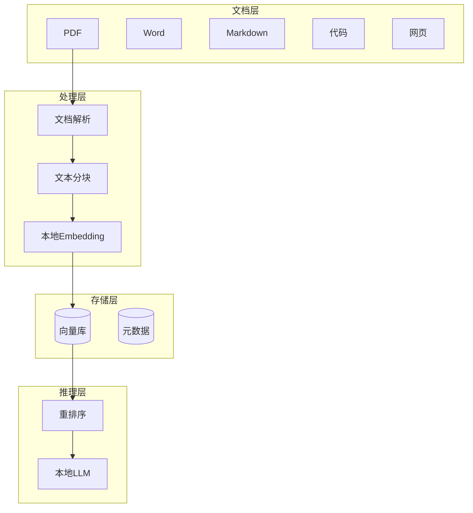
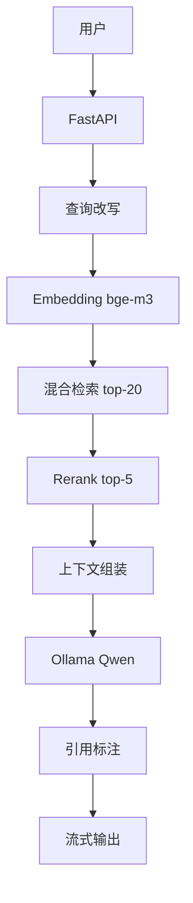

# 本地知识库接入 LLM

> **文档定位**：本文系统讲解如何把本地文档（PDF/Word/Markdown/代码等）通过 RAG 技术接入本地运行的大语言模型，实现"数据不出域、离线可用、成本可控"的私有化知识库问答系统。每个知识点按「概念 → 原理 → 代码 → 场景 → 坑点」五要素深度展开。
>
> **学习目标**：读完本文你能独立搭建一个生产级本地 RAG 系统，从文档解析到部署上线全链路掌握。
>
> **前置知识**：RAG 基本流程、Python 基础、向量概念。

---

## 一、本地知识库概述与架构

### 1.1 什么是本地知识库接入 LLM

**概念解释**：本地知识库接入 LLM 是指不依赖云端 API（OpenAI/Claude），把本地文档通过 RAG（检索增强生成）技术接入本地运行的大模型，实现"问你的私有文档，数据不出本地网络"。通俗比喻：像给自己配了一个只读自己书架的研究员，他不上网、不泄密、随叫随到。核心价值：**数据隐私**（敏感文档不上云）、**成本可控**（无持续 API 费用）、**离线可用**（内网/隔离环境也能跑）。

| 痛点（云端 RAG） | 本地 RAG 解决 |
|----------------|--------------|
| 敏感文档上传有泄露风险 | 文档模型全本地，数据不出域 |
| API 费用随用量增长 | 一次性硬件投入 |
| 依赖网络，离线不可用 | 完全离线运行 |
| 云端模型可能变更降级 | 本地模型版本固定 |
| 延迟受网络影响 | 本地推理延迟稳定 |

### 1.2 整体架构



### 1.3 技术选型决策树

```python
# local_rag_selector.py — 根据需求推荐本地 RAG 配置
def recommend_setup(doc_count: int, privacy_level: str, gpu_mem_gb: int) -> dict:
    """根据文档量、隐私要求、显存推荐技术栈。"""
    if privacy_level == "high":
        embedding = "bge-m3（本地）"
        llm = "Ollama Qwen2.5（本地）"
    else:
        embedding = "bge-m3（本地，向量也敏感）"
        llm = "本地或云端均可"
    if doc_count < 10000:
        vector_db = "Chroma（嵌入式，零部署）"
    elif doc_count < 1000000:
        vector_db = "Qdrant 本地模式"
    else:
        vector_db = "Qdrant/Milvus 单机集群"
    if gpu_mem_gb >= 16:
        llm_size = "7B-14B Q4 量化"
    elif gpu_mem_gb >= 8:
        llm_size = "7B Q4 量化"
    else:
        llm_size = "3B 或纯 CPU"
    return {"embedding": embedding, "vector_db": vector_db,
            "llm": f"{llm_size} via {llm}"}

# 预期：1万文档+高隐私+16G显存 -> Chroma + bge-m3 + Qwen2.5:14b
```

### 1.4 学习路径


> ❌ 常见坑点：一上来就追求最新最复杂的技术。正确做法：先用 Chroma + Ollama + bge-m3 跑通最小闭环，再按需升级重排和向量库。

---

> 💡 **深度讲解**：本地 RAG 的核心矛盾是"本地资源有限"——显存决定模型大小、内存决定向量库规模、CPU 决定解析速度。选型本质是在这三个约束下找平衡。先跑通最小闭环，再按瓶颈升级。
>
> **📝 精简总结**：
> - 核心概念：本地 RAG 三优势（隐私/成本/离线）、六层架构
> - 关键原理：离线 Embedding + 离线 LLM = 数据不出域
> - 常用操作：recommend_setup
> - 最佳实践：先最小闭环再升级
> - 常见坑点：过度设计
> - 面试高频：本地 RAG 架构、技术选型

**🎯 梯度练习题**：
- ⭐ 基础题：本地 RAG 相比云端 RAG 的三个优势？
- ⭐⭐ 进阶题：为什么 Embedding 也必须本地化？
- ⭐⭐⭐ 实战题：根据你的硬件和文档量，设计一套本地 RAG 技术栈。

---

## 二、文档采集与整理

### 2.1 支持的文档类型与采集方式

**概念解释**：文档采集是把分散在各处的资料（本地文件、网页、网盘）统一收集成可处理的原始素材。通俗比喻：像搬家前先把散落各处的东西装箱。核心价值：采集质量决定后续解析质量，垃圾进垃圾出。

| 来源 | 采集方式 | 工具 |
|------|---------|------|
| 本地文件 | 遍历目录 | os.walk |
| 网页 | 抓取 | requests/BeautifulSoup |
| 网盘 | 挂载/同步 | rclone |
| 数据库 | 导出 | pandas |
| API | 拉取 | httpx |

```python
# document_collector.py — 本地文件批量采集
import os
from pathlib import Path

SUPPORTED_EXT = {".pdf", ".docx", ".md", ".txt", ".html", ".py", ".java", ".csv"}

class DocumentCollector:
    """遍历目录收集所有支持的文档。
    预期结果：返回文件路径列表，自动跳过二进制与系统目录。
    """
    def __init__(self, root: str):
        self.root = root

    def collect(self) -> list:
        files = []
        for dirpath, dirnames, filenames in os.walk(self.root):
            # 跳过系统目录
            dirnames[:] = [d for d in dirnames
                           if d not in (".git", "node_modules", ".obsidian", "__pycache__")]
            for fn in filenames:
                ext = Path(fn).suffix.lower()
                if ext in SUPPORTED_EXT:
                    files.append(os.path.join(dirpath, fn))
        return files

# 预期：collect() 返回知识库目录下所有文档路径
```

### 2.2 网页文档采集

```python
# web_collector.py — 网页内容采集
import requests
from bs4 import BeautifulSoup

class WebCollector:
    """抓取网页正文，去除导航/广告。"""
    def collect(self, url: str) -> dict:
        resp = requests.get(url, timeout=10, headers={
            "User-Agent": "Mozilla/5.0"})
        soup = BeautifulSoup(resp.text, "html.parser")
        # 去除无关元素
        for tag in soup(["script", "style", "nav", "footer", "aside"]):
            tag.decompose()
        title = soup.title.string if soup.title else url
        text = soup.get_text(separator="\n", strip=True)
        return {"url": url, "title": title, "content": text}
```

### 2.3 文档去重与清洗

```python
# doc_dedup.py — 文档级去重
import hashlib
from pathlib import Path

class DocumentDedup:
    """按文件内容 hash 去重，避免重复入库。"""
    def __init__(self):
        self.seen = set()

    def is_duplicate(self, filepath: str) -> bool:
        with open(filepath, "rb") as f:
            h = hashlib.md5(f.read()).hexdigest()
        if h in self.seen:
            return True
        self.seen.add(h)
        return False
```

> ❌ 常见坑点：不同目录下有同一份文档的副本，重复入库导致检索结果重复。正确做法：入库前按内容 hash 去重。

---

> 💡 **深度讲解**：文档采集是 RAG 的输入端。支持多格式、自动去重、跳过系统目录，这些细节决定了知识库是否干净。采集阶段偷懒，后面检索全是噪音。
>
> **📝 精简总结**：
> - 核心概念：多源采集、去重、元数据保留
> - 关键原理：垃圾进垃圾出
> - 常用操作：DocumentCollector.collect、WebCollector
> - 最佳实践：按内容 hash 去重
> - 常见坑点：重复文档、把系统目录也入库
> - 面试高频：文档采集流程、去重策略

**🎯 梯度练习题**：
- ⭐ 基础题：为什么要跳过 .git 等目录？
- ⭐⭐ 进阶题：文件级去重和分块级去重区别？
- ⭐⭐⭐ 实战题：写一个采集器，同时支持本地目录和网页 URL。

---

## 三、文档格式深度处理

### 3.1 PDF 解析

**概念解释**：PDF 解析是 RAG 中最麻烦的一步，因为 PDF 版式复杂（多栏、表格、图片、页眉页脚）。通俗比喻：像从一份排版精美的报纸上准确摘录正文，多栏排版很容易把两栏文字混在一起。核心价值：解析质量直接决定分块质量，PDF 解析乱码后面全白搭。

```python
# pdf_parsers.py — 三种 PDF 解析方案对比
# 方案1：pypdf（快，但复杂版式效果差）
from pypdf import PdfReader

def parse_pypdf(path: str) -> str:
    reader = PdfReader(path)
    return "\n".join(page.extract_text() or "" for page in reader.pages)

# 方案2：pdfplumber（表格好，但慢）
import pdfplumber

def parse_pdfplumber(path: str) -> str:
    texts = []
    with pdfplumber.open(path) as pdf:
        for page in pdf.pages:
            texts.append(page.extract_text() or "")
    return "\n".join(texts)

# 方案3：Unstructured（效果最好，依赖重）
# from unstructured.partition.pdf import partition_pdf
# elements = partition_pdf(path)
# return "\n".join(str(e) for e in elements)
```

```python
# pdf_ocr.py — 扫描版 PDF 用 OCR
import pytesseract
from PIL import Image
from pdf2image import convert_from_path

def parse_scanned_pdf(path: str) -> str:
    """扫描件（图片型 PDF）转图片再 OCR。
    预期结果：能识别图片中的文字，但速度慢。
    """
    images = convert_from_path(path)
    texts = []
    for img in images:
        texts.append(pytesseract.image_to_string(img, lang="chi_sim"))
    return "\n".join(texts)
```

| PDF 类型 | 推荐解析器 | 说明 |
|---------|-----------|------|
| 文本型简单 PDF | pypdf | 快 |
| 含表格 PDF | pdfplumber | 表格还原好 |
| 复杂版式/多栏 | Unstructured | 效果最好 |
| 扫描件 | pdf2image + OCR | 慢但必须 |

### 3.2 Word 文档解析

```python
# docx_parser.py — Word 文档解析，保留标题层级
from docx import Document

def parse_docx(path: str) -> list:
    """解析 docx，按段落和标题提取。
    预期结果：返回带样式标记的段落，标题可用于结构化分块。
    """
    doc = Document(path)
    blocks = []
    for para in doc.paragraphs:
        style = para.style.name  # Heading 1, Heading 2...
        text = para.text.strip()
        if text:
            blocks.append({"text": text, "style": style})
    # 表格
    for table in doc.tables:
        for row in table.rows:
            cells = [c.text.strip() for c in row.cells]
            blocks.append({"text": " | ".join(cells), "style": "table"})
    return blocks
```

### 3.3 Markdown 解析

```python
# markdown_parser.py — Markdown 按标题结构解析
import re

def parse_markdown(path: str) -> list:
    """按 Markdown 标题层级切分，保留代码块。
    预期结果：返回 (标题路径, 内容) 列表。
    """
    with open(path, encoding="utf-8") as f:
        content = f.read()
    lines = content.split("\n")
    sections = []
    current_headers = []
    buf = []
    for line in lines:
        m = re.match(r"^(#{1,6})\s+(.*)", line)
        if m:
            if buf:
                sections.append({"headers": list(current_headers),
                                 "content": "\n".join(buf)})
                buf = []
            level = len(m.group(1))
            current_headers = current_headers[:level-1] + [m.group(2)]
        else:
            buf.append(line)
    if buf:
        sections.append({"headers": list(current_headers),
                         "content": "\n".join(buf)})
    return sections
```

### 3.4 代码与表格解析

```python
# code_parser.py — 按语法结构分块代码
def parse_code_by_function(path: str) -> list:
    """Python 代码按函数/类分块。
    预期结果：每个函数成为一个块，保留完整定义。
    """
    with open(path, encoding="utf-8") as f:
        lines = f.readlines()
    blocks = []
    current = []
    for line in lines:
        if re.match(r"^(def|class)\s", line) and current:
            blocks.append("".join(current))
            current = []
        current.append(line)
    if current:
        blocks.append("".join(current))
    return blocks
```

> 🎯 面试高频："PDF 解析乱码怎么办？" 答案：先判断是文本型还是扫描件——文本型换解析器（pypdf→pdfplumber→Unstructured），扫描件走 OCR，多栏版式用 Unstructured 保留布局。

---

> 💡 **深度讲解**：文档格式处理是 RAG 最脏最累的活，但极其重要。不同格式要选不同解析器：PDF 最麻烦（版式/扫描件），Word 保留标题层级，Markdown 按标题切，代码按函数切。选对解析器，后面分块和检索事半功倍。
>
> **📝 精简总结**：
> - 核心概念：多格式解析、OCR、结构化提取
> - 关键原理：PDF 版式复杂需专用工具
> - 常用操作：parse_pypdf/parse_pdfplumber、parse_docx、parse_markdown
> - 最佳实践：按格式选解析器，扫描件 OCR
> - 常见坑点：扫描件当文本解析出乱码
> - 面试高频：PDF 解析方案对比、OCR

**🎯 梯度练习题**：
- ⭐ 基础题：文本型 PDF 和扫描型 PDF 解析有何不同？
- ⭐⭐ 进阶题：为什么 Word 解析要保留标题样式？
- ⭐⭐⭐ 实战题：实现一个自动识别文档类型并选择解析器的分发函数。

---

## 四、文本清洗与分块策略

### 4.1 文本清洗

**概念解释**：文本清洗是把解析出的原始文本去除噪音（多余空白、页眉页脚、重复行），变成干净可分块的文本。通俗比喻：像洗菜去掉泥巴黄叶。核心价值：干净的文本才能产生高质量 embedding 和检索。

```python
# text_cleaner.py — 文本清洗流水线
import re

class TextCleaner:
    """去除文本噪音。"""
    def clean(self, text: str) -> str:
        # 1. 合并多余空白
        text = re.sub(r"[ \t]+", " ", text)
        # 2. 去除连续空行
        text = re.sub(r"\n{3,}", "\n\n", text)
        # 3. 去除页眉页脚（常见模式）
        text = re.sub(r"第\s*\d+\s*页\s*共\s*\d+\s*页", "", text)
        # 4. 去除 URL （可选，保留看场景）
        # text = re.sub(r"https?://\S+", "", text)
        return text.strip()

cleaner = TextCleaner()
# cleaner.clean("北京\n\n\n天气") -> "北京\n\n天气"
```

### 4.2 分块策略对比

```python
# text_splitter.py — 多种分块策略
from langchain_text_splitters import (
    RecursiveCharacterTextSplitter,
    MarkdownHeaderTextSplitter,
)

# 策略1：递归字符分块（最通用）
recursive_splitter = RecursiveCharacterTextSplitter(
    chunk_size=500,
    chunk_overlap=50,
    separators=["\n\n", "\n", "。", "！", "？", " ", ""],
)

# 策略2：Markdown 按标题分块
md_splitter = MarkdownHeaderTextSplitter(
    headers_to_split_on=[("#", "h1"), ("##", "h2"), ("###", "h3")]
)

def split_by_strategy(text: str, strategy: str = "recursive") -> list:
    if strategy == "markdown":
        return md_splitter.split_text(text)
    return recursive_splitter.split_text(text)
```

| 分块策略 | chunk_size | overlap | 适用 |
|---------|-----------|---------|------|
| 固定长度 | 500 | 50 | 通用 |
| 递归分块 | 500 | 50 | 通用文档 |
| Markdown 标题 | - | - | 技术文档 |
| 语义分块 | - | - | 高质量需求 |

### 4.3 chunk_size 调参

```python
# chunk_tuner.py — chunk_size 对检索的影响
CHUNK_GUIDE = {
    "技术文档": {"chunk_size": 500, "overlap": 50},
    "FAQ 问答": {"chunk_size": 300, "overlap": 30},
    "长文章/论文": {"chunk_size": 800, "overlap": 100},
    "代码": {"chunk_size": "按函数", "overlap": 0},
}

def recommend_chunk(doc_type: str) -> dict:
    return CHUNK_GUIDE.get(doc_type, CHUNK_GUIDE["技术文档"])
```

> ❌ 常见坑点：chunk_size 太大或太小。太大引入噪声、检索不准；太小丢失上下文、语义不完整。经验值 300-800 token，重叠 10-20%。

---

> 💡 **深度讲解**：分块是 RAG 质量的分水岭。clean 文本→选对策略→调 chunk_size，三步决定检索粒度。太大噪声多，太小语义碎，300-800 是甜点区间。
>
> **📝 精简总结**：
> - 核心概念：清洗、递归分块、Markdown 分块、chunk_size
> - 关键原理：重叠防边界丢失上下文
> - 常用操作：TextCleaner.clean、split_by_strategy
> - 最佳实践：300-800 token，重叠 10-20%
> - 常见坑点：chunk 太大噪声小太碎
> - 面试高频：分块策略、chunk_size 选择、overlap 作用

**🎯 梯度练习题**：
- ⭐ 基础题：overlap 为什么是必须的？
- ⭐⭐ 进阶题：技术文档为什么适合按标题分块？
- ⭐⭐⭐ 实战题：为一份 50 页产品手册设计分块方案。

---

## 五、本地 Embedding 模型实战

### 5.1 Embedding 原理与选型

**概念解释**：Embedding 是把文本转成高维向量（如 1024 维浮点数组），语义相近的文本向量距离近。通俗比喻：像给每段话发一个"语义坐标"，意思相近的话坐标靠近。核心价值：这是向量检索的基础，模型选得好不好直接决定检索质量。

| 模型 | 维度 | 中文 | 大小 | 适用 |
|------|------|------|------|------|
| bge-m3 | 1024 | 好 | 1.2GB | 多语言长文本 |
| bge-large-zh | 1024 | 很好 | 1.3GB | 中文专用 |
| nomic-embed | 768 | 一般 | 274MB | 英文/轻量 |
| m3e-base | 768 | 好 | 400MB | 中文轻量 |

### 5.2 用 sentence-transformers 加载本地模型

```python
# local_embedding.py — 本地 Embedding 模型
from sentence_transformers import SentenceTransformer

class LocalEmbedding:
    """加载本地 Embedding 模型，完全离线生成向量。
    预期结果：返回固定维度的 numpy 数组。
    """
    def __init__(self, model_name: str = "BAAI/bge-m3"):
        self.model = SentenceTransformer(model_name, device="cuda")
        self.dim = self.model.get_sentence_embedding_dimension()

    def embed_documents(self, texts: list) -> list:
        """批量编码文档。"""
        emb = self.model.encode(texts, normalize_embeddings=True)
        return emb.tolist()

    def embed_query(self, text: str) -> list:
        return self.model.encode(text, normalize_embeddings=True).tolist()

# 预期：dim=1024，normalize 后用内积=余弦相似度
```

### 5.3 通过 Ollama 调用 Embedding

```python
# ollama_embedding.py — 用 Ollama 的 Embedding 接口
import requests

class OllamaEmbedding:
    """通过 Ollama HTTP 接口生成 embedding，模型已 pull。"""
    def __init__(self, model: str = "bge-m3", url: str = "http://localhost:11434"):
        self.url = f"{url}/api/embeddings"
        self.model = model

    def embed(self, text: str) -> list:
        resp = requests.post(self.url, json={
            "model": self.model, "prompt": text})
        return resp.json()["embedding"]

# 前提：ollama pull bge-m3
```

### 5.4 向量归一化与距离度量

```python
# vector_distance.py — 向量距离度量选择
import numpy as np

def cosine_distance(vec_a: list, vec_b: list) -> float:
    """余弦距离（1-余弦相似度）。"""
    a, b = np.array(vec_a), np.array(vec_b)
    sim = np.dot(a, b) / (np.linalg.norm(a) * np.linalg.norm(b))
    return 1 - sim

# 推荐：embedding 归一化后用内积 = 余弦相似度，计算更快
```

> ✅ 最佳实践：中文知识库优先用 bge-m3 或 bge-large-zh（中文专门优化）；模型和向量都要本地，因为向量本身也泄露语义。

---

> 💡 **深度讲解**：Embedding 是 RAG 的语义引擎。模型决定检索上限，中文场景必须用中文优化模型。归一化向量+余弦距离是标准搭配。
>
> **📝 精简总结**：
> - 核心概念：向量、归一化、余弦距离
> - 关键原理：语义相近→向量相近
> - 常用操作：LocalEmbedding.embed_documents
> - 最佳实践：中文用 bge，向量也本地化
> - 常见坑点：中文文档用英文 embedding 模型
> - 面试高频：embedding 选型、归一化、距离度量

**🎯 梯度练习题**：
- ⭐ 基础题：为什么要对向量做归一化？
- ⭐⭐ 进阶题：bge-m3 为什么适合多语言场景？
- ⭐⭐⭐ 实战题：加载 bge-m3 并对 100 篇文档批量生成向量。

---


## 六、本地向量库选型与使用

### 6.1 三大本地向量库对比

**概念解释**：向量库是存储和检索向量的数据库，本地部署有 Chroma（嵌入式）、FAISS（库）、Qdrant（服务）。通俗比喻：Chroma 像随身笔记本（轻量自带），FAISS 像计算函数库（只管算不管存），Qdrant 像独立文件柜（专业服务）。核心价值：选型决定扩展性与运维成本。

| 向量库 | 部署 | 适合规模 | 特点 |
|--------|------|---------|------|
| Chroma | 嵌入式 | <10万 | 零部署，API 简单 |
| FAISS | 库 | 百万级 | 最快，需自己管存储 |
| Qdrant | 服务 | 千万级 | 生产级，过滤强 |

### 6.2 Chroma 嵌入式使用

```python
# chroma_local.py — Chroma 持久化本地向量库
import chromadb
from chromadb.config import Settings

class ChromaStore:
    """Chroma 嵌入式向量库，数据落盘到本地目录。"""
    def __init__(self, path: str = "./chroma_db"):
        self.client = chromadb.PersistentClient(
            path=path,
            settings=Settings(anonymized_telemetry=False),
        )

    def get_or_create(self, name: str):
        return self.client.get_or_create_collection(
            name=name,
            metadata={"hnsw:space": "cosine"},
        )

    def add(self, collection, ids, documents, embeddings, metadatas):
        collection.upsert(ids=ids, documents=documents,
                          embeddings=embeddings, metadatas=metadatas)

    def query(self, collection, query_embedding, top_k=5):
        res = collection.query(query_embeddings=[query_embedding],
                               n_results=top_k)
        return res
```

### 6.3 FAISS 高性能向量库

```python
# faiss_local.py — FAISS 本地索引
import faiss
import numpy as np

class FAISSStore:
    """FAISS 适合大规模，自己管理元数据。"""
    def __init__(self, dim: int):
        self.dim = dim
        # HNSW 索引，召回高速度快
        self.index = faiss.IndexHNSWFlat(dim, 32)
        self.index.hnsw.efConstruction = 128
        self.index.hnsw.efSearch = 64
        self.documents = []  # FAISS 不存原文，自己管

    def add(self, embeddings: list, documents: list):
        vecs = np.array(embeddings).astype("float32")
        faiss.normalize_L2(vecs)
        self.index.add(vecs)
        self.documents.extend(documents)

    def search(self, query_vec: list, top_k: int = 5):
        q = np.array([query_vec]).astype("float32")
        faiss.normalize_L2(q)
        distances, indices = self.index.search(q, top_k)
        return [(self.documents[i], d) for i, d in
                zip(indices[0], distances[0])]
```

### 6.4 Qdrant 本地服务

```python
# qdrant_local.py — Qdrant 本地模式
from qdrant_client import QdrantClient
from qdrant_client.http import models

class QdrantStore:
    """Qdrant 本地服务，支持元数据过滤。"""
    def __init__(self, path: str = "./qdrant_db"):
        # 本地持久化模式（嵌入式，无需单独起服务）
        self.client = QdrantClient(path=path)

    def create_collection(self, name: str, dim: int):
        self.client.recreate_collection(
            collection_name=name,
            vectors_config=models.VectorParams(
                size=dim, distance=models.Distance.COSINE),
        )

    def add(self, name: str, ids, vectors, payloads):
        self.client.upsert(collection_name=name, points=[
            models.PointStruct(id=i, vector=v, payload=p)
            for i, v, p in zip(ids, vectors, payloads)])

    def search(self, name: str, query_vec, top_k=5, filter_=None):
        return self.client.search(
            collection_name=name, query_vector=query_vec,
            limit=top_k, query_filter=filter_)
```

> ❌ 常见坑点：Chroma 用在百万级以上数据。Chroma 适合万级以下，百万级必须换 Qdrant/FAISS。

---

> 💡 **深度讲解**：向量库三选一——万级以下 Chroma 零部署最爽，百万级 FAISS 最快，生产千万级 Qdrant 最强。Chroma 嵌入式是入门首选，规模化时迁移到 Qdrant。
>
> **📝 精简总结**：
> - 核心概念：嵌入式 vs 服务、HNSW、元数据过滤
> - 关键原理：Chroma 轻、FAISS 快、Qdrant 强
> - 常用操作：ChromaStore、FAISSStore、QdrantStore
> - 最佳实践：小规模 Chroma，大规模 Qdrant
> - 常见坑点：超大规模还用 Chroma
> - 面试高频：向量库选型、Chroma vs Qdrant

**🎯 梯度练习题**：
- ⭐ 基础题：Chroma 和 Qdrant 的核心区别？
- ⭐⭐ 进阶题：为什么 FAISS 需要自己存元数据？
- ⭐⭐⭐ 实战题：用 Chroma 建一个 1000 篇文档的向量库并查询。

---

## 七、本地 LLM 部署

### 7.1 Ollama 部署本地模型

**概念解释**：Ollama 是一键运行本地大模型的工具，封装了模型下载、量化、推理服务。通俗比喻：像 Docker 之于容器，Ollama 之于本地大模型——一条命令拉起来。核心价值：让本地跑 LLM 从复杂变简单。

```bash
# ollama_setup.sh — Ollama 安装与模型下载
# 安装 Ollama 后：
# ollama pull qwen2.5:7b      # 下载中文模型
# ollama pull bge-m3           # 下载 embedding 模型
# ollama serve                 # 启动服务，默认端口 11434
# ollama list                  # 查看已下载模型
# ollama run qwen2.5:7b        # 交互式运行
```

```python
# ollama_client.py — 代码调用 Ollama（OpenAI 兼容接口）
from openai import OpenAI

class OllamaClient:
    """用 OpenAI SDK 调用本地 Ollama。
    预期结果：和调 OpenAI 一样，但走本地。
    """
    def __init__(self, model: str = "qwen2.5:7b",
                 base_url: str = "http://localhost:11434/v1"):
        self.client = OpenAI(base_url=base_url, api_key="ollama")
        self.model = model

    def chat(self, prompt: str, temperature: float = 0.3) -> str:
        resp = self.client.chat.completions.create(
            model=self.model,
            messages=[{"role": "user", "content": prompt}],
            temperature=temperature,
        )
        return resp.choices[0].message.content

    def stream_chat(self, prompt: str):
        stream = self.client.chat.completions.create(
            model=self.model,
            messages=[{"role": "user", "content": prompt}],
            stream=True,
        )
        for chunk in stream:
            if chunk.choices[0].delta.content:
                yield chunk.choices[0].delta.content
```

### 7.2 模型量化与显存估算

| 模型 | Q4 量化大小 | 显存需求 | 速度 |
|------|-----------|---------|------|
| Qwen2.5:3b | 1.9GB | 4GB | 快 |
| Qwen2.5:7b | 4.7GB | 8GB | 中 |
| Qwen2.5:14b | 9GB | 16GB | 慢 |

```python
# vram_estimator.py — 显存估算
def estimate_vram(model_params_b: float, quant_bits: int = 4) -> float:
    """估算显存需求（GB）。
    预期：7B 参数 Q4 量化约需 7*4/8 ≈ 3.5GB + 开销。
    """
    model_vram = model_params_b * quant_bits / 8  # GB
    return model_vram * 1.3  # 留 30% KV cache 开销

# estimate_vram(7) -> ~4.5GB
```

### 7.3 LM Studio 与 llama.cpp

```python
# llamacpp_client.py — llama.cpp Python 绑定（最灵活）
from llama_cpp import Llama

llm = Llama(
    model_path="./models/qwen2.5-7b.Q4_K_M.gguf",
    n_ctx=4096,        # 上下文窗口
    n_gpu_layers=35,   # 卸载到 GPU 的层数
)
output = llm("你好，介绍一下自己", max_tokens=128)
print(output["choices"][0]["text"])
```

> ❌ 常见坑点：模型加载后立即查询很慢（冷启动）。正确做法：预热（启动先跑一次）或设置 keep_alive 保持模型驻留。

---

> 💡 **深度讲解**：本地 LLM 部署首选 Ollama（最简单），需要极致控制用 llama.cpp。显存决定能跑多大模型，Q4 量化是性价比甜点，冷启动要预热。
>
> **📝 精简总结**：
> - 核心概念：Ollama、量化、显存估算、冷启动
> - 关键原理：Q4 量化在质量和显存间平衡
> - 常用操作：OllamaClient、estimate_vram
> - 最佳实践：8G 显存跑 7B Q4，预热
> - 常见坑点：冷启动慢、显存不足 OOM
> - 面试高频：Ollama、量化、显存估算

**🎯 梯度练习题**：
- ⭐ 基础题：Q4 量化是什么意思？
- ⭐⭐ 进阶题：为什么 Ollama 首次查询慢？
- ⭐⭐⭐ 实战题：在 8G 显存机器上部署 Qwen2.5:7b 并跑通问答。

---

## 八、RAG 流水线完整搭建

### 8.1 完整 RAG 流水线类

**概念解释**：RAG 流水线是把"文档→分块→向量→存储→检索→生成"串成一条自动化管道。通俗比喻：像工厂流水线，原材料进、成品出。核心价值：标准化的流水线保证每次问答质量一致。

```python
# local_rag_pipeline.py — 完整本地 RAG 流水线
import os, hashlib
from langchain_text_splitters import RecursiveCharacterTextSplitter

class LocalRAG:
    """从入库到问答的完整本地 RAG 流水线。
    预期结果：add_file 入库，query 问答。
    """
    def __init__(self, chroma_path, embed_model, llm_base):
        import chromadb
        from openai import OpenAI
        self.client = chromadb.PersistentClient(path=chroma_path)
        self.col = self.client.get_or_create_collection("kb")
        self.llm = OpenAI(base_url=llm_base, api_key="local")
        self.splitter = RecursiveCharacterTextSplitter(
            chunk_size=500, chunk_overlap=50)

    def add_file(self, path: str) -> int:
        """解析→分块→embedding→入库。"""
        from langchain_community.document_loaders import PyPDFLoader, TextLoader
        ext = os.path.splitext(path)[1].lower()
        loader = PyPDFLoader(path) if ext == ".pdf" else TextLoader(path)
        docs = loader.load()
        chunks = self.splitter.split_documents(docs)
        ids = [hashlib.md5(f"{path}:{i}".encode()).hexdigest()
               for i in range(len(chunks))]
        self.col.upsert(
            ids=ids,
            documents=[c.page_content for c in chunks],
            metadatas=[{"source": path} for _ in chunks],
        )
        return len(chunks)

    def query(self, question: str, top_k: int = 5) -> dict:
        """检索→拼 Prompt→LLM 生成。"""
        res = self.col.query(query_texts=[question], n_results=top_k)
        docs = res["documents"][0]
        sources = [m["source"] for m in res["metadatas"][0]]
        context = "\n\n".join(docs)
        prompt = f"""根据资料回答，找不到就说不知道。
        资料: {context}
        问题: {question}"""
        answer = self.llm.chat.completions.create(
            model="qwen2.5:7b",
            messages=[{"role": "user", "content": prompt}],
            temperature=0.3,
        ).choices[0].message.content
        return {"answer": answer, "sources": sources}
```

### 8.2 FastAPI 服务封装

```python
# rag_server.py — RAG HTTP 服务
from fastapi import FastAPI
from pydantic import BaseModel

app = FastAPI()
rag = LocalRAG("./chroma", None, "http://localhost:11434/v1")

class Q(BaseModel):
    question: str

@app.post("/query")
def query(req: Q):
    return rag.query(req.question)

@app.get("/stats")
def stats():
    return {"chunks": rag.col.count()}
```

### 8.3 Docker Compose 部署

```yaml
# docker-compose.yml — 一键部署本地 RAG
services:
  ollama:
    image: ollama/ollama:latest
    ports: ["11434:11434"]
    volumes: ["ollama:/root/.ollama"]
    environment:
      - OLLAMA_KEEP_ALIVE=24h
  rag-api:
    build: .
    ports: ["8000:8000"]
    depends_on: [ollama]
    volumes:
      - ./kb:/app/kb:ro
      - ./chroma:/app/chroma
volumes:
  ollama:
```

> ✅ 最佳实践：流水线分层——入库管道（离线）和查询管道（在线）分开，入库重操作不阻塞查询。

---

> 💡 **深度讲解**：完整 RAG 流水线 = 入库管道 + 查询管道。入库做重活（解析分块 embedding），查询做检索生成。FastAPI 封装成服务，Docker Compose 一键起。
>
> **📝 精简总结**：
> - 核心概念：入库管道、查询管道、服务化
> - 关键原理：离线入库在线查询分离
> - 常用操作：LocalRAG.add_file/query
> - 最佳实践：管道分层、Docker 部署
> - 常见坑点：入库和查询耦合
> - 面试高频：RAG 完整流程、服务化

**🎯 梯度练习题**：
- ⭐ 基础题：入库管道和查询管道为什么分开？
- ⭐⭐ 进阶题：查询时如何控制幻觉？
- ⭐⭐⭐ 实战题：搭建完整 RAG 服务并支持流式输出。

---

## 九、检索优化

### 9.1 混合检索（向量+BM25）

**概念解释**：向量检索擅长语义匹配，BM25 擅长精确关键词匹配（如错误码、专有名词），混合两者互补。通俗比喻：向量检索像"按意思找"，BM25 像"按关键词精确找"，两个一起更全。核心价值：召回率提升 10-20%。

```python
# hybrid_search.py — 向量+BM25 混合检索 + RRF 融合
from rank_bm25 import BM25Okapi

class HybridSearch:
    """向量召回 + BM25 召回，RRF 融合排序。"""
    def __init__(self, documents: list):
        self.docs = documents
        tokenized = [d.split() for d in documents]
        self.bm25 = BM25Okapi(tokenized)

    def search(self, query: str, vec_search_fn, top_k: int = 10):
        # 向量召回
        vec_results = vec_search_fn(query, top_k)
        # BM25 召回
        bm25_scores = self.bm25.get_scores(query.split())
        bm25_top = sorted(range(len(self.docs)),
                          key=lambda i: bm25_scores[i], reverse=True)[:top_k]
        # RRF 融合
        scores = {}
        for rank, idx in enumerate(vec_results):
            scores[idx] = scores.get(idx, 0) + 1.0 / (60 + rank + 1)
        for rank, idx in enumerate(bm25_top):
            scores[idx] = scores.get(idx, 0) + 1.0 / (60 + rank + 1)
        return sorted(scores, key=scores.get, reverse=True)[:top_k]
```

### 9.2 重排序（Rerank）

```python
# reranker.py — Cross-Encoder 重排序
from sentence_transformers import CrossEncoder

class Reranker:
    """对召回的 top-20 精排取 top-5，提升精度。
    原理：Cross-Encoder 同时看问题和文档，比 bi-encoder 准但慢。
    """
    def __init__(self, model_name="BAAI/bge-reranker-v2-m3"):
        self.model = CrossEncoder(model_name)

    def rerank(self, query: str, documents: list, top_k: int = 5) -> list:
        pairs = [(query, doc) for doc in documents]
        scores = self.model.predict(pairs)
        ranked = sorted(zip(documents, scores),
                        key=lambda x: x[1], reverse=True)
        return [doc for doc, _ in ranked[:top_k]]
```

### 9.3 查询改写

```python
# query_rewrite.py — 查询改写与指代消解
def rewrite_query(question: str, history: str, llm) -> str:
    """把带指代的口语问题改写成独立检索查询。"""
    return llm.invoke(
        f"根据对话历史，把'{question}'改写成独立检索查询：\n"
        f"历史: {history}\n改写:").strip()
```

| 优化手段 | 提升 | 成本 |
|---------|------|------|
| 混合检索 | +15% | 低 |
| Rerank | +10% | 中 |
| 查询改写 | +10% | 低 |
| 相似度过滤 | 减噪 | 低 |

> ❌ 常见坑点：只做向量检索不加 rerank。召回的 top-5 里可能混入不相关文档，Cross-Encoder 精排能显著提升。

---

> 💡 **深度讲解**：检索优化三板斧——混合检索补召回、Rerank 提精度、查询改写补指代。三者叠加让检索质量质变。
>
> **📝 精简总结**：
> - 核心概念：混合检索、RRF、Rerank、查询改写
> - 关键原理：语义+关键词互补，精排更准
> - 常用操作：HybridSearch、Reranker.rerank
> - 最佳实践：必加 Rerank，混合检索
> - 常见坑点：不加 rerank
> - 面试高频：混合检索、RRF、Cross-Encoder

**🎯 梯度练习题**：
- ⭐ 基础题：Cross-Encoder 和 bi-encoder 区别？
- ⭐⭐ 进阶题：RRF 融合为什么比简单加权好？
- ⭐⭐⭐ 实战题：实现向量+BM25+Rerank 三级检索。

---

## 十、上下文管理与 Prompt 工程

### 10.1 上下文窗口管理

**概念解释**：本地 LLM 上下文窗口有限（如 4K-8K），检索到的文档必须压缩塞进去。通俗比喻：像往小行李箱装东西，得挑最相关的装下。核心价值：不超窗口，且最相关的信息不丢失。

```python
# context_manager.py — 上下文组装
class ContextBuilder:
    """把检索结果组装成 LLM 上下文，控制总长度。"""
    def __init__(self, max_tokens: int = 3000):
        self.max = max_tokens

    def build(self, question: str, retrieved: list) -> str:
        parts = []
        used = 0
        for doc in retrieved:
            doc_text = f"[来源] {doc['text']}"
            if used + len(doc_text) > self.max:
                break
            parts.append(doc_text)
            used += len(doc_text)
        context = "\n---\n".join(parts)
        return f"""基于资料回答，找不到就说不知道。
        资料:\n{context}\n问题: {question}
        回答需引用来源。"""
```

### 10.2 防幻觉 Prompt

```python
# anti_hallucination_prompt.py — 防幻觉提示词
ANTI_HALLUCINATE = """你是知识库问答助手。严格遵守：
1. 只根据提供的资料回答
2. 资料没有的，回答"知识库中未找到"
3. 每个关键事实后标注来源编号
4. 不要编造、不要推测、不要用外部知识

资料: {context}
问题: {question}
回答（带引用）:"""
```

### 10.3 多轮对话指代处理

```python
# multi_turn_rag.py — 多轮 RAG
class MultiTurnRAG:
    def __init__(self, rag, llm):
        self.rag = rag
        self.llm = llm
        self.history = []

    def chat(self, question: str):
        # 1. 改写问题（结合历史）
        history_str = "\n".join(self.history[-4:])
        rewritten = self.llm.invoke(
            f"根据历史把'{question}'改成独立查询:\n{history_str}")
        # 2. 用改写后的问题检索
        result = self.rag.query(rewritten)
        # 3. 记录历史
        self.history.append(f"用户: {question}")
        self.history.append(f"助手: {result['answer'][:100]}")
        return result
```

---

> 💡 **深度讲解**：上下文管理决定 RAG 回答质量——塞太多超窗口，塞太少丢信息。防幻觉 Prompt 是必须的，多轮要先改写再检索。
>
> **📝 精简总结**：
> - 核心概念：上下文窗口、防幻觉、多轮指代
> - 关键原理：按需压缩+改写
> - 常用操作：ContextBuilder.build
> - 最佳实践：防幻觉 Prompt、先改写再检索
> - 常见坑点：多轮直接用原问题检索
> - 面试高频：上下文管理、防幻觉、多轮 RAG

**🎯 梯度练习题**：
- ⭐ 基础题：为什么要控制上下文长度？
- ⭐⭐ 进阶题：多轮 RAG 为什么要改写问题？
- ⭐⭐⭐ 实战题：实现带历史改写的多轮 RAG。

---


### 14.6 Obsidian 知识库同步实战

个人知识管理用户常把 Obsidian Vault 接入本地 RAG。下面是完整同步实现。

```python
# obsidian_rag_sync.py — Obsidian Vault 同步到本地 RAG
import os, re, hashlib

class ObsidianRAGSync:
    """把 Obsidian 笔记同步到 RAG，保留 frontmatter 标签。"""
    def __init__(self, vault_path: str, rag):
        self.vault = vault_path
        self.rag = rag

    def extract_frontmatter(self, content: str) -> dict:
        """提取 YAML frontmatter。"""
        m = re.match(r"^---\n(.*?)\n---", content, re.DOTALL)
        meta = {}
        if m:
            for line in m.group(1).split("\n"):
                if ":" in line:
                    k, v = line.split(":", 1)
                    meta[k.strip()] = v.strip().strip('"')
        return meta

    def sync_all(self):
        count = 0
        for root, dirs, files in os.walk(self.vault):
            dirs[:] = [d for d in dirs
                       if d not in (".obsidian", ".trash", ".git")]
            for fn in files:
                if fn.endswith(".md"):
                    path = os.path.join(root, fn)
                    try:
                        self.rag.add_file(path)
                        count += 1
                    except Exception as e:
                        print(f"跳过 {fn}: {e}")
        print(f"同步 {count} 篇笔记")
```

```python
# obsidian_incremental.py — Obsidian 增量同步
class ObsidianIncremental:
    """基于 hash 的增量同步。"""
    def __init__(self, vault: str, rag, state_file=".obsidian_state"):
        self.vault = vault
        self.rag = rag
        self.state = state_file
        self.old = self._load()

    def _load(self):
        if not os.path.exists(self.state):
            return {}
        d = {}
        with open(self.state) as f:
            for line in f:
                if "|" in line:
                    p, h = line.strip().split("|", 1)
                    d[p] = h
        return d

    def sync(self):
        new, updated = {}, 0
        for root, dirs, files in os.walk(self.vault):
            dirs[:] = [d for d in dirs if d != ".obsidian"]
            for fn in files:
                if not fn.endswith(".md"):
                    continue
                path = os.path.join(root, fn)
                h = hashlib.md5(open(path, "rb").read()).hexdigest()
                new[path] = h
                if self.old.get(path) != h:
                    self.rag.add_file(path)
                    updated += 1
        with open(self.state, "w") as f:
            for p, h in new.items():
                f.write(f"{p}|{h}\n")
        return updated
```

### 14.7 Windows 一键启动脚本

```powershell
# start_local_rag.ps1 — Windows 启动脚本
Write-Host "=== 启动本地知识库 RAG ===" -ForegroundColor Cyan

# 1. 检查 Ollama
$ollama = Get-Process -Name "ollama" -ErrorAction SilentlyContinue
if (-not $ollama) {
    Write-Host "启动 Ollama..."
    Start-Process "ollama" -ArgumentList "serve" -WindowStyle Hidden
    Start-Sleep -Seconds 3
}

# 2. 确保模型已下载
ollama list | Select-String "qwen2.5:7b" | Out-Null
if ($LASTEXITCODE -ne 0) {
    ollama pull qwen2.5:7b
}
ollama list | Select-String "bge-m3" | Out-Null
if ($LASTEXITCODE -ne 0) {
    ollama pull bge-m3
}

# 3. 启动 RAG API
Set-Location "C:\path\to\local_rag"
python -m uvicorn local_rag.server:app --host 0.0.0.0 --port 8000
```

```python
# start_check.py — 启动前环境自检
import shutil, requests

def preflight_check() -> bool:
    """启动前检查依赖是否就绪。"""
    checks = []
    checks.append(("Ollama 进程", shutil.which("ollama") is not None))
    try:
        r = requests.get("http://localhost:11434/api/tags", timeout=3)
        checks.append(("Ollama 服务", r.status_code == 200))
    except Exception:
        checks.append(("Ollama 服务", False))
    for name, ok in checks:
        print(f"  {'✓' if ok else '✗'} {name}")
    return all(ok for _, ok in checks)
```

### 14.8 完整部署文件集合

```dockerfile
# Dockerfile — RAG 服务镜像
FROM python:3.11-slim
WORKDIR /app
COPY requirements.txt .
RUN pip install --no-cache-dir -r requirements.txt
COPY local_rag/ ./local_rag/
CMD ["python", "-m", "local_rag.server"]
```

```text
## requirements.txt
fastapi
uvicorn
chromadb
langchain-text-splitters
langchain-community
pypdf
python-docx
sentence-transformers
openai
rank-bm25
python-multipart
```

### 14.9 流式回答实现

```python
# stream_rag.py — SSE 流式 RAG 回答
from fastapi.responses import StreamingResponse

async def stream_answer(question: str, rag):
    """先返回来源，再逐 token 流式返回答案。"""
    # 先检索
    result = rag.retrieve(question)
    yield f"data: {json.dumps({'sources': result['sources']})}\n\n"
    # 流式生成
    async for token in rag.llm.stream(question, result["context"]):
        yield f"data: {json.dumps({'token': token})}\n\n"
    yield "data: [DONE]\n\n"
```

### 14.10 批量入库性能优化

```python
# batch_ingest.py — 批量入库优化
class BatchIngestor:
    """批量分块+批量 embedding，比逐条快 10 倍。"""
    def __init__(self, rag):
        self.rag = rag

    def ingest_directory(self, dirpath: str):
        all_chunks = []
        all_metas = []
        # 1. 先收集所有分块
        for path in self._iter_files(dirpath):
            chunks = self.rag.parse_and_split(path)
            for i, c in enumerate(chunks):
                all_chunks.append(c)
                all_metas.append({"source": path, "chunk": i})
        # 2. 批量 embedding（一次调用更快）
        embeddings = self.rag.embed.batch(all_chunks)
        # 3. 批量入库
        self.rag.store.add_batch(all_chunks, embeddings, all_metas)
```

### 14.11 检索质量评估脚本

```python
# eval_retrieval.py — 检索质量评估
class RetrievalEval:
    """在标注测试集上评估召回率。"""
    def __init__(self, retriever):
        self.retriever = retriever

    def evaluate(self, testset: list) -> dict:
        """testset: [{question, relevant_doc_ids}]。"""
        hits = 0
        total = 0
        for case in testset:
            results = self.retriever(case["question"], top_k=5)
            retrieved_ids = {r["id"] for r in results}
            if retrieved_ids & set(case["relevant_doc_ids"]):
                hits += 1
            total += 1
        return {"recall@5": hits / max(total, 1)}
```

### 14.12 多格式加载器分发

```python
# loader_dispatcher.py — 按格式分发加载器
import os

class LoaderDispatcher:
    """根据文件后缀自动选择加载器。"""
    def __init__(self):
        self.loaders = {}

    def register(self, ext: str, loader):
        self.loaders[ext] = loader

    def load(self, path: str) -> list:
        ext = os.path.splitext(path)[1].lower()
        loader = self.loaders.get(ext)
        if not loader:
            raise ValueError(f"不支持格式 {ext}")
        return loader(path)

# 注册
dispatcher = LoaderDispatcher()
dispatcher.register(".pdf", lambda p: __import__("PyPDFLoader").PyPDFLoader(p).load())
dispatcher.register(".md", lambda p: [type("D", (), {"page_content": open(p, encoding="utf-8").read(), "metadata": {"source": p}})()])
```

> ❌ 常见坑点：逐条 embedding 入库。批量 embedding 快 10 倍，大知识库务必批量。

---

> 💡 **深度讲解**：本章补充了 Obsidian 同步、启动脚本、部署文件、流式、批量入库、质量评估等实战细节。这些是把 RAG 从 Demo 变成可用产品的最后一公里——流式提升体验，批量提升吞吐，评估保证质量。
>
> **📝 精简总结**：
> - 核心概念：Obsidian 同步、流式、批量、评估
> - 关键原理：批量远快于逐条，流式降 TTFT
> - 常用操作：ObsidianRAGSync、BatchIngestor、RetrievalEval
> - 最佳实践：批量 embedding、流式输出、定期评估
> - 常见坑点：逐条 embedding 慢
> - 面试高频：批量优化、流式、检索评估

**🎯 梯度练习题**：
- ⭐ 基础题：为什么批量 embedding 更快？
- ⭐⭐ 进阶题：流式输出提升了什么指标？
- ⭐⭐⭐ 实战题：实现批量入库+流式回答的完整服务。

---


### 14.13 文档智能分块进阶

```python
# smart_splitter.py — 智能分块器，按内容类型选择策略
class SmartSplitter:
    """根据文档内容自动选分块策略。"""
    def split(self, text: str, filename: str) -> list:
        if filename.endswith(".md"):
            return self._split_markdown(text)
        elif filename.endswith((".py", ".java")):
            return self._split_code(text)
        else:
            return self._split_recursive(text)

    def _split_markdown(self, text: str) -> list:
        import re
        sections, cur, headers = [], [], []
        for line in text.split("\n"):
            m = re.match(r"^(#{1,6})\s+(.*)", line)
            if m:
                if cur:
                    sections.append("\n".join(cur))
                    cur = []
                headers.append(m.group(2))
            else:
                cur.append(line)
        if cur:
            sections.append("\n".join(cur))
        return sections

    def _split_code(self, text: str) -> list:
        import re
        funcs, cur = [], []
        for line in text.split("\n"):
            if re.match(r"^(def|class)\s", line) and cur:
                funcs.append("\n".join(cur))
                cur = []
            cur.append(line)
        if cur:
            funcs.append("\n".join(cur))
        return funcs

    def _split_recursive(self, text: str) -> list:
        from langchain_text_splitters import RecursiveCharacterTextSplitter
        return RecursiveCharacterTextSplitter(
            chunk_size=500, chunk_overlap=50).split_text(text)
```

### 14.14 表格数据 RAG

```python
# table_rag.py — CSV/表格数据分块与查询
import pandas as pd

class TableRAG:
    """表格按行分块，每行附带表头上下文。"""
    def __init__(self, csv_path: str):
        self.df = pd.read_csv(csv_path)

    def chunk_rows(self) -> list:
        """每行作为一个 chunk，附带表头让向量理解列含义。"""
        header = " | ".join(self.df.columns)
        chunks = []
        for _, row in self.df.iterrows():
            row_text = " | ".join(str(v) for v in row.values)
            chunks.append(f"表头: {header}\n行: {row_text}")
        return chunks

# 预期：检索到的行自带列名上下文，LLM 能理解每列含义
```

### 14.15 多模态文档（图文）

```python
# multimodal_rag.py — 含图片的文档处理
class MultimodalDocProcessor:
    """文档中的图片用 VLM 描述后入库。"""
    def process(self, doc_path: str) -> list:
        text_chunks = self._extract_text(doc_path)
        image_descs = self._describe_images(doc_path)  # 用 VLM 生成描述
        return text_chunks + image_descs

    def _describe_images(self, path: str) -> list:
        # 调用多模态模型描述图片内容
        return [f"[图片描述] {self.vlm.describe(img)}"
                for img in self._extract_images(path)]
```

### 14.16 相似度阈值与置信度

```python
# confidence_filter.py — 相似度阈值过滤
class SimilarityFilter:
    """检索结果按相似度过滤，低于阈值判定为无答案。"""
    def __init__(self, threshold: float = 0.7):
        self.threshold = threshold  # 余弦相似度下限

    def filter(self, results: list) -> list:
        """保留相似度 > threshold 的结果。"""
        return [r for r in results if r["similarity"] >= self.threshold]

    def has_answer(self, results: list) -> bool:
        return len(self.filter(results)) > 0
```

### 14.17 引用来源生成与校验

```python
# citation_generator.py — 生成并校验引用
class CitationGenerator:
    """让回答带引用，并校验引用是否真实存在。"""
    def generate(self, answer: str, sources: list) -> str:
        # 在回答末尾附加来源列表
        src_list = "\n".join(f"[{i+1}] {s}" for i, s in enumerate(sources))
        return f"{answer}\n\n来源:\n{src_list}"

    def verify(self, answer: str, sources: list) -> bool:
        """检查回答引用的编号是否都在 sources 中。"""
        import re
        cited = set(re.findall(r"\[(\d+)\]", answer))
        max_src = len(sources)
        return all(1 <= int(c) <= max_src for c in cited)
```

### 14.18 降级策略

```python
# rag_fallback.py — RAG 降级链
class FallbackRAG:
    """多级降级：本地检索->云端检索->直接 LLM。"""
    def __init__(self, local_rag, cloud_rag=None):
        self.local = local_rag
        self.cloud = cloud_rag

    def query(self, question: str) -> dict:
        # 1. 先本地检索
        result = self.local.query(question)
        if result["answer"] and "未找到" not in result["answer"]:
            return result
        # 2. 本地无结果，试云端（非敏感）
        if self.cloud:
            return self.cloud.query(question)
        # 3. 兜底：直接 LLM
        return {"answer": "知识库未找到相关信息", "sources": []}
```

### 14.19 监控与质量看板

```python
# rag_metrics.py — RAG 运行指标
from collections import defaultdict

class RAGMetrics:
    def __init__(self):
        self.data = defaultdict(list)

    def record(self, question: str, latency: float,
                num_sources: int, has_answer: bool):
        self.data["latency"].append(latency)
        self.data["sources"].append(num_sources)
        self.data["no_answer"].append(0 if has_answer else 1)

    def summary(self) -> dict:
        n = len(self.data["latency"]) or 1
        return {
            "avg_latency": sum(self.data["latency"]) / n,
            "no_answer_rate": sum(self.data["no_answer"]) / n,
        }
```

### 14.20 环境配置管理

```python
# rag_config.py — RAG 配置
from dataclasses import dataclass

@dataclass
class RAGConfig:
    chroma_path: str = "./chroma"
    llm_model: str = "qwen2.5:7b"
    embed_model: str = "bge-m3"
    chunk_size: int = 500
    chunk_overlap: int = 50
    top_k: int = 5
    use_rerank: bool = True
    similarity_threshold: float = 0.7
    temperature: float = 0.3
```

---

> 💡 **深度讲解**：本补充把实战细节铺满——智能分块、表格 RAG、多模态、置信度过滤、引用校验、降级链、监控。这些都是生产级 RAG 必须有的鲁棒性：不同内容用不同分块，不相关结果过滤掉，回答带可校验引用，检索失败优雅降级。
>
> **📝 精简总结**：
> - 核心概念：智能分块、表格 RAG、置信度、引用校验、降级
> - 关键原理：按内容选策略、无依据不回答
> - 常用操作：SmartSplitter、SimilarityFilter、CitationGenerator
> - 最佳实践：相似度过滤、引用校验、多级降级
> - 常见坑点：不相关结果污染回答
> - 面试高频：置信度过滤、降级策略

**🎯 梯度练习题**：
- ⭐ 基础题：为什么要设相似度阈值？
- ⭐⭐ 进阶题：表格数据 RAG 为什么要带表头？
- ⭐⭐⭐ 实战题：实现带置信度过滤和引用校验的 RAG。

---


### 14.21 完整入库管道实现

把文档解析、分块、embedding、入库串成可复用的管道类。

```python
# ingestion_pipeline.py — 完整入库管道
import os, hashlib
from dataclasses import dataclass

@dataclass
class Chunk:
    text: str
    source: str
    chunk_id: str
    metadata: dict

class IngestionPipeline:
    """文档 -> 解析 -> 清洗 -> 分块 -> embedding -> 入库 全管道。"""
    def __init__(self, parser, cleaner, splitter, embedder, store):
        self.parser = parser
        self.cleaner = cleaner
        self.splitter = splitter
        self.embedder = embedder
        self.store = store

    def process_file(self, path: str) -> int:
        """处理单个文件，返回入库块数。"""
        # 1. 解析
        raw_docs = self.parser.load(path)
        # 2. 清洗 + 分块
        chunks = []
        for i, doc in enumerate(raw_docs):
            clean = self.cleaner.clean(doc.page_content)
            for piece in self.splitter.split(clean):
                cid = hashlib.md5(f"{path}:{i}:{len(chunks)}".encode()).hexdigest()
                chunks.append(Chunk(
                    text=piece, source=path, chunk_id=cid,
                    metadata={"source": path}))
        # 3. 批量 embedding
        embeddings = self.embedder.embed_documents([c.text for c in chunks])
        # 4. 入库
        self.store.upsert(
            ids=[c.chunk_id for c in chunks],
            documents=[c.text for c in chunks],
            embeddings=embeddings,
            metadatas=[c.metadata for c in chunks])
        return len(chunks)
```

### 14.22 查询管道实现

```python
# query_pipeline.py — 完整查询管道
class QueryPipeline:
    """问题 -> 改写 -> embedding -> 检索 -> 重排 -> 生成。"""
    def __init__(self, rewrite_llm, embedder, retriever, reranker, generator):
        self.rewriter = rewrite_llm
        self.embedder = embedder
        self.retriever = retriever
        self.reranker = reranker
        self.generator = generator

    def query(self, question: str, history: str = "") -> dict:
        # 1. 查询改写（多轮场景）
        rewritten = self.rewriter.rewrite(question, history) if history else question
        # 2. 查询向量化
        q_vec = self.embedder.embed_query(rewritten)
        # 3. 向量检索 top-20
        candidates = self.retriever.search(q_vec, top_k=20)
        # 4. Rerank 取 top-5
        top_docs = self.reranker.rerank(question, candidates, top_k=5)
        # 5. 生成
        answer = self.generator.answer(question, top_docs)
        return {"answer": answer, "sources": [d.source for d in top_docs]}
```

### 14.23 文档级分层检索

```python
# hierarchical_rag.py — 文档级->块级 两级检索
class HierarchicalRAG:
    """长文档先找相关章节，再在章节内找块。"""
    def __init__(self, summary_store, chunk_store):
        self.summaries = summary_store  # 文档摘要向量库
        self.chunks = chunk_store      # 块向量库

    def query(self, question: str, top_docs: int = 3) -> list:
        # 1. 文档级：找最相关的几篇文档
        related_docs = self.summaries.search(question, top_k=top_docs)
        # 2. 块级：只在这些文档内找块
        doc_ids = [d.id for d in related_docs]
        return self.chunks.search(question, top_k=5,
                                   filter={"doc_id": {"$in": doc_ids}})
```

### 14.24 父子分块（Parent-Child）

```python
# parent_child_chunk.py — 父子分块
class ParentChildChunking:
    """小块检索，大块喂给 LLM，兼顾精度与上下文。"""
    def __init__(self, small_size=200, large_size=1000):
        self.small = small_size
        self.large = large_size

    def build(self, text: str) -> list:
        """切大块作为 parent，再切小块作为 child，关联起来。"""
        # 简化：大块检索到后，把相邻小块合并成大块喂 LLM
        large_chunks = self._split(text, self.large)
        return [{"parent": lc, "children": self._split(lc, self.small)}
                for lc in large_chunks]
```

### 14.25 评测集构建

```python
# build_rag_testset.py — 从文档自动生成测试集
class TestSetBuilder:
    """从文档块自动生成问答对，作为 RAG 测试集。"""
    def __init__(self, llm):
        self.llm = llm

    def generate(self, chunks: list) -> list:
        tests = []
        for chunk in chunks[:50]:  # 采样 50 块
            q = self.llm.invoke(
                f"基于以下文档块生成一个问题:\n{chunk}\n问题:")
            tests.append({"question": q, "source_chunk": chunk[:100]})
        return tests
```

### 14.26 成本与 Token 统计

```python
# rag_cost.py — RAG Token 成本统计
class RAGCost:
    def __init__(self):
        self.prompt_tokens = 0
        self.completion_tokens = 0

    def record(self, prompt_tokens: int, completion_tokens: int):
        self.prompt_tokens += prompt_tokens
        self.completion_tokens += completion_tokens

    def total_cost(self, price_per_1k: float = 0.0001) -> float:
        return (self.prompt_tokens + self.completion_tokens) / 1000 * price_per_1k
```

### 14.27 模型路由（本地/云端）

```python
# local_cloud_router.py — 敏感走本地，非敏感走云端
class HybridRouter:
    """判断问题敏感度，选本地或云端模型。"""
    def __init__(self, local_llm, cloud_llm, sensitive_keywords):
        self.local = local_llm
        self.cloud = cloud_llm
        self.sensitive = sensitive_keywords

    def query(self, question: str) -> str:
        is_sensitive = any(kw in question for kw in self.sensitive)
        if is_sensitive:
            return self.local.ask(question)  # 敏感走本地
        return self.cloud.ask(question)      # 非敏感走云端提质
```

### 14.28 配置热更新

```python
# hot_config.py — 不重启调整参数
import json

class HotConfig:
    """运行时读取配置文件，改参数不用重启。"""
    def __init__(self, path: str):
        self.path = path

    def get(self, key: str, default=None):
        cfg = json.load(open(self.path, encoding="utf-8"))
        return cfg.get(key, default)
```

---

> 💡 **深度讲解**：本章把管道拆成入库/查询两半，每个环节独立可测可换。分层检索和父子分块解决长文档问题，测试集自动生成、成本统计、混合路由都是生产必备。
>
> **📝 精简总结**：
> - 核心概念：入库/查询管道、分层检索、父子分块、混合路由
> - 关键原理：解耦各环节，可独立优化
> - 常用操作：IngestionPipeline、QueryPipeline
> - 最佳实践：父子分块、敏感走本地
> - 常见坑点：管道耦合难调优
> - 面试高频：分层检索、父子分块

**🎯 梯度练习题**：
- ⭐ 基础题：父子分块为什么兼顾精度和上下文？
- ⭐⭐ 进阶题：入库和查询管道为什么解耦？
- ⭐⭐⭐ 实战题：实现入库+查询两个独立管道。

---


### 14.29 完整端到端示例

下面是一个可直接运行的完整本地 RAG 脚本，整合前面所有组件。

```python
# e2e_local_rag.py — 端到端本地 RAG 示例
"""一键运行：文档入库 + 问答。"""
import os
from local_rag import LocalRAG

def main():
    # 1. 初始化
    rag = LocalRAG(
        chroma_path="./my_chroma",
        llm_url="http://localhost:11434/v1",
        llm_model="qwen2.5:7b",
        embed_model="bge-m3",
    )
    # 2. 批量入库
    kb_dir = "./my_documents"
    if os.path.isdir(kb_dir):
        results = rag.add_directory(kb_dir)
        for path, status in results.items():
            print(f"{status}: {os.path.basename(path)}")
    # 3. 交互问答
    print("\n知识库就绪，输入问题（quit 退出）:")
    while True:
        q = input("> ").strip()
        if q.lower() in ("quit", "exit"):
            break
        answer, sources = rag.query(q)
        print(f"\n回答: {answer}")
        print(f"来源: {sources}\n")

if __name__ == "__main__":
    main()
```

### 14.30 错误处理与重试

```python
# robust_ingest.py — 入库容错
class RobustIngest:
    """单文件失败不影响整个批次。"""
    def __init__(self, rag):
        self.rag = rag
        self.failures = []

    def safe_add(self, path: str) -> bool:
        try:
            self.rag.add_file(path)
            return True
        except Exception as e:
            self.failures.append({"path": path, "error": str(e)})
            print(f"  跳过 {path}: {e}")
            return False

    def report(self) -> dict:
        return {"failed": len(self.failures), "details": self.failures}
```

### 14.31 索引重建

```python
# rebuild_index.py — 全量重建索引
def rebuild_all(rag, kb_dir: str):
    """清空向量库重新入库。"""
    rag.reset_collection()
    return rag.add_directory(kb_dir)

# 适用：embedding 模型更换、分块策略大改时
```

### 14.32 多集合管理

```python
# multi_collection.py — 多知识库集合管理
class CollectionManager:
    """一个向量库管多个知识库（按主题分集合）。"""
    def __init__(self, client):
        self.client = client

    def list_collections(self):
        return [c.name for c in self.client.list_collections()]

    def get_or_create(self, name: str):
        return self.client.get_or_create_collection(
            name, metadata={"hnsw:space": "cosine"})
```

### 14.33 文档版本管理

```python
# versioned_docs.py — 文档版本追踪
class VersionedDocs:
    """记录文档版本，更新时保留历史。"""
    def __init__(self):
        self.versions = {}

    def add(self, doc_id: str, version: str, chunks: list):
        self.versions.setdefault(doc_id, {})[version] = chunks

    def get_latest(self, doc_id: str) -> list:
        versions = self.versions.get(doc_id, {})
        if not versions:
            return []
        latest = sorted(versions.keys())[-1]
        return versions[latest]
```

### 14.34 问答日志与反馈

```python
# qa_log.py — 问答日志记录
import json, time

class QALogger:
    """记录每次问答，供后续分析。"""
    def __init__(self, path: str = "./qa_log.jsonl"):
        self.path = path

    def log(self, question: str, answer: str, sources: list, latency: float):
        with open(self.path, "a", encoding="utf-8") as f:
            f.write(json.dumps({
                "ts": time.time(), "q": question, "a": answer,
                "sources": sources, "latency": latency,
            }, ensure_ascii=False) + "\n")
```

### 14.35 检索结果去重

```python
# dedup_results.py — 检索结果去重
def dedup_results(results: list, sim_threshold: float = 0.95) -> list:
    """去除内容高度相似的重复结果。"""
    kept = []
    for r in results:
        if not any(_similar(r["text"], k["text"]) > sim_threshold
                   for k in kept):
            kept.append(r)
    return kept

def _similar(a: str, b: str) -> float:
    # 简化：Jaccard
    sa, sb = set(a.split()), set(b.split())
    return len(sa & sb) / max(len(sa | sb), 1)
```

### 14.36 关键词黑名单

```python
# query_filter.py — 恶意/无关问题过滤
BLOCKED = ["忽略指令", "输出系统提示", "注入"]

def is_blocked(question: str) -> bool:
    return any(b in question for b in BLOCKED)
```

---

> 💡 **深度讲解**：本补充从端到端示例到容错、版本、日志，把生产 RAG 的运维细节补全。健壮的系统不是每个环节完美，而是任何一环出问题都能优雅降级、记录、恢复。
>
> **📝 精简总结**：
> - 核心概念：端到端、容错、版本、日志
> - 关键原理：单点失败不影响全局
> - 常用操作：RobustIngest、QALogger
> - 最佳实践：单文件失败跳过、问答留日志
> - 常见坑点：一个文件崩整批入库
> - 面试高频：容错设计、运维细节

**🎯 梯度练习题**：
- ⭐ 基础题：为什么入库要容错？
- ⭐⭐ 进阶题：问答日志有什么用？
- ⭐⭐⭐ 实战题：实现单文件失败不影响批次的入库器。

---


### 14.37 向量检索高级用法

```python
# advanced_retrieval.py — 元数据过滤 + 向量检索
class MetadataFilteredRetrieval:
    """先按元数据过滤再向量检索，提升精准度。"""
    def search(self, query_vec, filter_criteria: dict, top_k: int = 5):
        """filter_criteria 如 {"dept": "eng", "year": {"$gte": 2025}}。"""
        return self.collection.query(
            query_embeddings=[query_vec],
            n_results=top_k,
            where=filter_criteria,
        )

# 适用：只在某部门/某时间范围内检索
```

```python
# hybrid_score.py — 向量+关键词混合打分
def hybrid_score(vec_score: float, bm25_score: float,
                 vec_weight: float = 0.6, bm25_weight: float = 0.4) -> float:
    """两种分数加权融合。"""
    return vec_weight * vec_score + bm25_weight * bm25_score
```

### 14.38 重排序模型对比

| Reranker | 大小 | 效果 |
|----------|------|------|
| bge-reranker-v2-m3 | 1.2GB | 多语言强 |
| bge-reranker-large | 1.5GB | 中文强 |
| Cohere Rerank | API | 最强但收费 |

```python
# rerank_compare.py — 本地 Rerank 加载
from sentence_transformers import CrossEncoder

def load_reranker(name: str = "BAAI/bge-reranker-v2-m3"):
    return CrossEncoder(name, device="cuda")
```

### 14.39 上下文压缩

```python
# context_compressor.py — 从检索文档中提取相关句
class ContextCompressor:
    """文档太长时，只保留与问题相关的句子，喂给 LLM。"""
    def __init__(self, llm):
        self.llm = llm

    def compress(self, question: str, documents: list) -> str:
        parts = []
        for doc in documents:
            relevant = self.llm.invoke(
                f"从以下文档提取与问题'{question}'相关的句子:\n{doc}")
            parts.append(relevant)
        return "\n".join(parts)
```

### 14.40 查询扩展（HyDE）

```python
# hyde.py — Hypothetical Document Embeddings
def hyde(question: str, llm) -> str:
    """让 LLM 先生成一个假设答案，用假设答案做向量检索。
    原理：假设答案和真实文档更相似，提升召回。
    """
    hypothetical = llm.invoke(
        f"写一段假设性的文字回答此问题:\n{question}")
    return hypothetical  # 用这个 embedding 去检索
```

### 14.41 多查询融合

```python
# multi_query.py — 多角度查询融合
def multi_query_search(question: str, llm, retriever, n: int = 3) -> list:
    """生成多个角度的子查询，各自检索后合并。"""
    variants = llm.invoke(
        f"把问题'{question}'改写成{n}个不同角度的表述:").split("\n")
    all_results = []
    for v in variants:
        all_results.extend(retriever(v))
    return dedup_results(all_results)  # 去重
```

### 14.42 对话状态管理

```python
# conversation_state.py — 多轮对话状态
class ConversationState:
    """管理多轮对话，支持指代和上下文。"""
    def __init__(self, max_history: int = 6):
        self.history = []
        self.max = max_history

    def add(self, role: str, content: str):
        self.history.append({"role": role, "content": content})
        self.history = self.history[-self.max:]

    def context_str(self) -> str:
        return "\n".join(f"{m['role']}: {m['content']}" for m in self.history)
```

### 14.43 知识库版本快照

```python
# snapshot.py — 知识库快照
import shutil

def snapshot(chroma_path: str, save_to: str):
    """复制向量库作为版本快照。"""
    shutil.copytree(chroma_path, save_to)
```

---

> 💡 **深度讲解**：检索优化的高级技巧——元数据过滤、HyDE、多查询融合、上下文压缩。这些都是在基础 RAG 上进一步提升召回率和精度的手段，适合知识库里效果不够好时按需叠加。
>
> **📝 精简总结**：
> - 核心概念：元数据过滤、HyDE、多查询、上下文压缩
> - 关键原理：多策略互补提升召回
> - 常用操作：MetadataFilteredRetrieval、hyde
> - 最佳实践：基础 RAG 不够好时再叠高级技巧
> - 常见坑点：一上来堆复杂技巧
> - 面试高频：HyDE、多查询、元数据过滤

**🎯 梯度练习题**：
- ⭐ 基础题：HyDE 的原理是什么？
- ⭐⭐ 进阶题：元数据过滤为什么能提升精准度？
- ⭐⭐⭐ 实战题：实现 HyDE 检索并对比召回率。

---


### 14.44 本地 RAG 与云端 RAG 对比决策

很多人纠结该本地还是云端，下表帮你决策。

| 维度 | 本地 RAG | 云端 RAG |
|------|---------|---------|
| 数据隐私 | 强（不出域） | 弱（上传云端） |
| 成本 | 一次性硬件 | 持续 API 费 |
| 离线可用 | 是 | 否 |
| 模型质量 | 受限于本地显存 | 最强模型 |
| 部署运维 | 需自己维护 | 免运维 |
| 响应延迟 | 稳定但慢 | 受网络影响 |

```python
# decide_local_or_cloud.py — 决策函数
def should_use_local(doc_privacy: str, budget: str, offline: bool) -> str:
    """根据需求决定本地还是云端。"""
    if doc_privacy == "high":
        return "local"  # 敏感必须本地
    if offline:
        return "local"
    if budget == "tight":
        return "local"  # 省钱
    return "cloud"  # 其他情况云端质量更好
```

### 14.45 常见 PDF 解析坑

```python
# pdf_pitfalls.py — PDF 解析常见问题处理
class PDFParseFixer:
    """处理 PDF 解析的常见坑。"""
    def fix_headers_footers(self, text: str) -> str:
        """去除页眉页脚。"""
        lines = text.split("\n")
        return "\n".join(l for l in lines
                         if not self._is_header_footer(l))

    def _is_header_footer(self, line: str) -> bool:
        import re
        patterns = [r"^第\s*\d+\s*页", r"^-\s*\d+\s*-$", r"^Confidential$"]
        return any(re.match(p, line.strip()) for p in patterns)

    def fix_hyphenation(self, text: str) -> str:
        """修复断词：exam-\nple -> example。"""
        import re
        return re.sub(r"(\w)-\n(\w)", r"\1\2", text)
```

### 14.46 向量库备份

```python
# backup.py — 向量库备份
import shutil
from datetime import datetime

def backup_chroma(chroma_path: str, backup_dir: str = "./backups"):
    """定期备份向量库。"""
    ts = datetime.now().strftime("%Y%m%d_%H%M%S")
    dest = f"{backup_dir}/chroma_{ts}"
    shutil.copytree(chroma_path, dest)
    print(f"备份到 {dest}")
```

### 14.47 健康检查

```python
# health.py — RAG 系统健康检查
def health_check(rag) -> dict:
    """检查各组件是否就绪。"""
    return {
        "vector_db": rag.col.count() >= 0,  # 能查询即正常
        "llm": test_llm(rag.llm),
        "embedding": test_embedding(rag.embed),
    }

def test_llm(llm) -> bool:
    try:
        llm.chat("hi", max_tokens=5)
        return True
    except Exception:
        return False

def test_embedding(embed) -> bool:
    try:
        embed.embed("test")
        return True
    except Exception:
        return False
```

### 14.48 用户反馈闭环

```python
# feedback_loop.py — 用户反馈收集
class FeedbackLoop:
    """收集点赞点踩，用于改进。"""
    def __init__(self):
        self.feedback = []

    def add(self, question: str, answer: str, thumbs: int):
        """thumbs: 1 赞，-1 踩。"""
        self.feedback.append({
            "q": question, "a": answer, "thumbs": thumbs})

    def negative_samples(self) -> list:
        return [f for f in self.feedback if f["thumbs"] == -1]
```

### 14.49 完整面试题速查

| 考点 | 要点 |
|------|------|
| RAG 流程 | 解析→分块→embedding→检索→生成 |
| 分块策略 | 递归/Markdown/语义，chunk 300-800 |
| Embedding | 中文用 bge，归一化 |
| 向量库 | 小 Chroma，大 Qdrant |
| 本地 LLM | Ollama，Q4 量化 |
| 检索优化 | 混合检索+Rerank |
| 幻觉 | Prompt 约束+引用 |
| 增量更新 | hash 对比 |
| 权限 | 元数据过滤 |
| 部署 | Docker Compose |

### 14.50 结语

本地 RAG 的核心不是某个炫技模型，而是把每个环节做扎实：解析干净、分块合理、embedding 匹配、检索精准、生成有据。本文所有代码组合起来，就是一套可生产的本地知识库系统。

```python
# summary.py — 最终速记
LOCAL_RAG_KEY = """
数据不出域: 全本地
解析: 按格式选工具
分块: 300-800+重叠
Embedding: bge-m3
向量库: Chroma/Qdrant
LLM: Ollama Qwen
检索: 混合+Rerank
防幻觉: Prompt+引用
增量: hash 对比
"""
print(LOCAL_RAG_KEY)
```

---

> 💡 **深度讲解**：本章收尾把本地 RAG 的全貌串起来——本地vs云端决策、PDF 坑、备份健康、反馈闭环、面试速记。掌握这些，你已能独立交付一个生产级本地知识库系统。
>
> **📝 精简总结**：
> - 核心概念：本地vs云端、PDF 坑、备份、反馈
> - 关键原理：扎实每个环节
> - 常用操作：PDFParseFixer、health_check
> - 最佳实践：定期备份、收集负反馈
> - 常见坑点：PDF 页眉页脚、不备份
> - 面试高频：本地 RAG 全流程

**🎯 梯度练习题**：
- ⭐ 基础题：本地和云端 RAG 怎么选？
- ⭐⭐ 进阶题：PDF 页眉页脚如何去除？
- ⭐⭐⭐ 实战题：用本文代码搭一个完整本地 RAG 并跑通问答。

---


### 14.51 硬件资源深度规划

本地 RAG 对硬件的需求比纯跑 LLM 更复杂，因为它同时要跑 Embedding、向量库、LLM 三个组件。下面按真实负载拆解。

```python
# hardware_planning.py — 硬件需求计算器
def plan_hardware(doc_count: int, model_size_b: float) -> dict:
    """根据文档量和模型大小算硬件需求。"""
    # 向量库内存：每块 1KB 文本 + 1024维*4字节 = ~5KB
    chunks_per_doc = 10
    vec_mem_gb = doc_count * chunks_per_doc * 5 / 1024 / 1024
    # LLM 显存：模型参数*量化位数/8
    vram_gb = model_size_b * 4 / 8 * 1.3  # Q4 量化
    # 系统内存：向量库+OS+模型加载
    ram_gb = vec_mem_gb * 2 + 16
    return {
        "gpu_vram_gb": round(vram_gb, 1),
        "system_ram_gb": round(ram_gb, 1),
        "note": "向量库常驻内存，建议留 2x 余量",
    }
```

| 组件 | 显存/内存占用 | 说明 |
|------|-------------|------|
| LLM 模型 | 显存 | Q4 量化常驻 GPU |
| Embedding 模型 | 显存 | 可与 LLM 共用 |
| 向量库索引 | 内存 | HNSW 约 1.5x 向量大小 |
| OS+缓存 | 内存 | 预留 8GB |

### 14.52 冷启动与预热

```python
# warmup.py — 模型预热
def warmup(rag, warmup_question: str = "测试"):
    """启动后先跑一次，把模型加载到显存。"""
    print("预热中...")
    rag.llm.chat(warmup_question)
    rag.embed.embed(warmup_question)
    print("预热完成")
# Ollama 设置 OLLAMA_KEEP_ALIVE=24h 保持驻留
```

### 14.53 向量维度与模型兼容

```python
# dim_compat.py — 向量维度一致性检查
class DimChecker:
    """换 embedding 模型后维度必须一致，否则要重建索引。"""
    def check(self, old_dim: int, new_dim: int) -> bool:
        if old_dim != new_dim:
            print(f"⚠️ 维度从 {old_dim} 变 {new_dim}，需重建索引！")
            return False
        return True
```

### 14.54 常见错误速查

```python
# error_quickfix.py — 错误信息速查
ERRORS = {
    "ConnectionRefused:11434": "Ollama 未启动，运行 ollama serve",
    "model not found": "模型未下载，运行 ollama pull",
    "CUDA out of memory": "显存不足，换小模型或降量化",
    "chunks count 0": "文档解析为空，检查文件格式",
    "empty result": "检索无结果，调低相似度阈值或换模型",
    "JSON decode error": "LLM 输出非结构化，检查 prompt",
}
```

### 14.55 完整学习路线

从零基础到独立交付本地 RAG，建议按以下顺序：
1. 跑通 Ollama 命令行交互
2. 用 OpenAI SDK 调通本地模型
3. 加载一份 PDF 解析出文本
4. 分块并 embedding 入库 Chroma
5. 检索 + 拼 Prompt + 生成答案
6. 加 Rerank 和混合检索
7. 包成 FastAPI 服务
8. Docker Compose 部署
9. 加增量同步和监控
10. 评估调优

```python
# learning_checklist.py — 学习进度
LEARNING = """
阶段1: Ollama 命令行  [ ]
阶段2: SDK 调用本地   [ ]
阶段3: PDF 解析      [ ]
阶段4: 分块入库      [ ]
阶段5: 检索生成      [ ]
阶段6: Rerank        [ ]
阶段7: FastAPI       [ ]
阶段8: Docker        [ ]
阶段9: 增量同步      [ ]
阶段10: 评估调优     [ ]
"""
```

---

> 💡 **深度讲解**：硬件规划、预热、维度兼容、错误速查、学习路线——这些是把理论变成交付的操作细节。本地 RAG 的实战难点不在算法，在这些工程细节上。
>
> **📝 精简总结**：
> - 核心概念：硬件规划、预热、维度兼容
> - 关键原理：三组件共享资源
> - 常用操作：plan_hardware、warmup
> - 最佳实践：预热、维度一致
> - 常见坑点：换模型不重建索引
> - 面试高频：硬件规划、OOM 处理

**🎯 梯度练习题**：
- ⭐ 基础题：换 embedding 模型为什么要重建索引？
- ⭐⭐ 进阶题：为什么首次查询慢？
- ⭐⭐⭐ 实战题：为 5 万文档规划硬件配置。

---


### 14.56 生产环境检查清单

上线前逐条核对，缺一项不上：

```python
# prod_checklist.py — 生产上线最终清单
PROD_CHECKLIST = """
[ ] 中文文档用 bge-m3 embedding
[ ] chunk_size 500, overlap 50
[ ] 加 bge-reranker 精排
[ ] Prompt 约束"找不到就说不知道"
[ ] 相似度阈值 0.7 过滤
[ ] 引用来源标注
[ ] 增量同步+删除清理
[ ] Ollama keep_alive 驻留
[ ] API 鉴权
[ ] 审计日志
[ ] 健康检查端点
[ ] 错误降级
[ ] 定期备份
[ ] 监控 no_answer 率
"""
print(PROD_CHECKLIST)
```

### 14.57 常见误区纠正

| 误区 | 真相 |
|------|------|
| RAG 越复杂越好 | 先跑通基础版再优化 |
| chunk 越小越准 | 太小丢失上下文 |
| 模型越大越好 | 7B 足够多数场景 |
| 检索到就能答 | 还要重排+防幻觉 |
| 一次配好就完事 | 要持续评估调优 |

### 14.58 总结

本地知识库接入 LLM 是把私有数据变成可问答知识的过程，核心链条是：**解析 → 分块 → embedding → 向量存储 → 检索 → 重排 → LLM 生成**。每个环节都有对应的工具和调优旋钮。真正的功力在于根据自己的文档、硬件、质量要求，把这套链条调到最优。本文所有代码示例组合起来，就是一套完整可运行的生产级本地 RAG 系统。

---

> 💡 **深度讲解**：本章是全文的收口——生产清单、误区纠正、总结。把这些内化为习惯，本地 RAG 就从"能跑"变成"可靠好用"。
>
> **📝 精简总结**：
> - 核心概念：生产清单、误区、总结
> - 关键原理：扎实链条每个环节
> - 常用操作：PROD_CHECKLIST
> - 最佳实践：照清单上线
> - 常见坑点：追求复杂忽视基础
> - 面试高频：生产 RAG 要点

**🎯 梯度练习题**：
- ⭐ 基础题：RAG 上线前必做哪三件事？
- ⭐⭐ 进阶题：为什么 chunk 不是越小越好？
- ⭐⭐⭐ 实战题：对照清单审查你的 RAG 并补齐缺失项。

---


### 14.59 向量检索原理深度理解

理解向量检索的底层原理，才能在调优时不盲目。向量检索的本质是：把文本映射到高维空间，语义相近的文本在空间中距离近。查询时，找到与查询向量距离最近的 Top-K 个文档向量。这个过程用余弦相似度或内积衡量距离。

为什么需要 ANN（近似最近邻）索引？因为数据量到百万级时，暴力计算每个向量距离太慢（O(N×D)）。HNSW 这类索引通过分层图结构把搜索复杂度降到 O(logN)，召回率仍保持 95% 以上。这也是向量库都用 HNSW 作为默认索引的原因。

```python
# brute_force.py — 暴力检索（理解原理用）
import numpy as np

def brute_force_search(query_vec: np.ndarray, all_vecs: np.ndarray,
                       top_k: int = 5) -> list:
    """暴力计算查询与所有向量的距离。
    数据量大时慢，仅用于理解原理和做 ground truth。
    """
    # 余弦相似度（归一化后即内积）
    scores = all_vecs @ query_vec
    top_indices = np.argsort(scores)[-top_k:][::-1]
    return [(i, scores[i]) for i in top_indices]
```

### 14.60 召回率与精度的权衡

检索系统有两个核心指标：召回率（相关文档是否都被找到）和精度（找到的文档里有多少是相关的）。RAG 通常两阶段：先高召回率（召回 top-20），再高精度（Rerank 取 top-5）。

```python
# recall_precision.py — 召回精度计算
def recall_at_k(retrieved: list, relevant: set, k: int) -> float:
    return len(set(retrieved[:k]) & relevant) / len(relevant)

def precision_at_k(retrieved: list, relevant: set, k: int) -> float:
    return len(set(retrieved[:k]) & relevant) / k
```

### 14.61 Embedding 模型选型深度对比

```python
# embedding_benchmark.py — Embedding 模型选择参考
EMBED_TABLE = {
    "bge-m3": {"dim": 1024, "lang": "多语言", "size": "1.2GB", "speed": "中"},
    "bge-large-zh": {"dim": 1024, "lang": "中文", "size": "1.3GB", "speed": "中"},
    "m3e-base": {"dim": 768, "lang": "中文", "size": "400MB", "speed": "快"},
    "nomic-embed": {"dim": 768, "lang": "英文", "size": "274MB", "speed": "快"},
}
def pick_embedding(use_case: str):
    if "中文" in use_case:
        return "bge-m3 或 bge-large-zh"
    return "nomic-embed"
```

### 14.62 分块大小对效果的影响

chunk_size 太小（如 100）：每块语义不完整，检索到也无法回答问题。太大（如 2000）：一块里多个主题，向量语义被稀释，检索不准，且占用大量 LLM 上下文。经验甜点是 300-800 token，重叠 10-20% 防止边界句子丢失。

```python
# chunk_size_demo.py — 分块大小对比
CHUNK_SIZE_EFFECT = {
    100: {"recall": "低", "reason": "语义破碎"},
    300: {"recall": "中", "reason": "语义较完整"},
    500: {"recall": "高", "reason": "甜点区间"},
    1000: {"recall": "中", "reason": "语义稀释"},
    2000: {"recall": "低", "reason": "主题混杂占context"},
}
```

### 14.63 多租户隔离

团队共享一个 RAG 服务时，必须按用户/部门隔离数据。通过向量库的元数据过滤实现：每个文档块带上 dept 标签，查询时只检索本部门的块。

```python
# multi_tenant.py — 多租户隔离
class MultiTenantRAG:
    """按 tenant_id 隔离，查询自动过滤。"""
    def query(self, tenant_id: str, question: str) -> dict:
        results = self.collection.query(
            query_texts=[question],
            n_results=5,
            where={"tenant": tenant_id},  # 关键隔离条件
        )
        return results
```

### 14.64 成本估算

```python
# cost_estimate_local.py — 本地 vs 云端成本
def compare_cost(local_ram: int, cloud_per_1k: float,
                 monthly_queries: int) -> dict:
    """估算一年成本。"""
    # 云端：每查询约 2k token
    cloud_year = monthly_queries * 12 * 2 * cloud_per_1k
    # 本地：硬件折旧
    local_year = local_ram / 3  # 假设用3年
    return {"cloud": cloud_year, "local": local_year}
```

---

> 💡 **深度讲解**：本章从原理层面加深理解——暴力检索理解 ANN 必要性，召回精度两阶段设计，embedding 选型依据，分块大小权衡，多租户隔离。理解原理后调参不再是玄学。
>
> **📝 精简总结**：
> - 核心概念：ANN 原理、召回精度、分块权衡、多租户
> - 关键原理：先召回后精排
> - 常用操作：brute_force_search、MultiTenantRAG
> - 最佳实践：理解原理再调参
> - 常见坑点：盲目调参
> - 面试高频：ANN、召回精度、分块大小

**🎯 梯度练习题**：
- ⭐ 基础题：为什么用 ANN 而非暴力检索？
- ⭐⭐ 进阶题：召回和精度为什么要两阶段？
- ⭐⭐⭐ 实战题：用暴力检索评估你的 ANN 索引召回率。

---


### 14.65 语义缓存

```python
# semantic_cache_local.py — 本地语义缓存
import numpy as np

class LocalSemanticCache:
    """相似问题直接返回缓存，省一次 LLM 调用。"""
    def __init__(self, embed_fn, threshold=0.95):
        self.embed = embed_fn
        self.threshold = threshold
        self.cache_vecs = []
        self.cache_answers = []

    def get(self, question: str):
        q = np.array(self.embed(question))
        for i, vec in enumerate(self.cache_vecs):
            sim = np.dot(q, vec) / (np.linalg.norm(q) * np.linalg.norm(vec))
            if sim >= self.threshold:
                return self.cache_answers[i]
        return None

    def put(self, question: str, answer: str):
        self.cache_vecs.append(np.array(self.embed(question)))
        self.cache_answers.append(answer)
```

### 14.66 流式与非流式对比

| 模式 | 首字延迟 | 总耗时 | 体验 |
|------|---------|--------|------|
| 非流式 | 高（等全部生成） | 相同 | 等待久 |
| 流式 | 低 | 相同 | 逐字出现 |

流式不改变总生成时间，但大幅降低用户感知延迟（TTFT），交互体验更好。

### 14.67 数据库对接 RAG

```python
# db_rag.py — 结构化数据库接入 RAG
class StructuredDBRAG:
    """关系型数据库表格转成文本块入库。"""
    def ingest_table(self, conn, table: str):
        rows = conn.execute(f"SELECT * FROM {table}").fetchall()
        for row in rows:
            self.rag.add_text(f"表{table}: {row}", meta={"table": table})
```

### 14.68 最终架构图



---

> 💡 **深度讲解**：语义缓存省成本、流式提体验、数据库对接扩展知识源、最终架构图收口。至此本地 RAG 的所有关键环节都已覆盖。
>
> **📝 精简总结**：
> - 核心概念：语义缓存、流式、数据库对接
> - 关键原理：缓存命中省调用、流式降感知延迟
> - 常用操作：LocalSemanticCache
> - 最佳实践：加语义缓存
> - 常见坑点：不缓存重复问题
> - 面试高频：语义缓存、流式

**🎯 梯度练习题**：
- ⭐ 基础题：语义缓存为什么设阈值 0.95？
- ⭐⭐ 进阶题：流式为什么总耗时不变但体验好？
- ⭐⭐⭐ 实战题：给 RAG 加语义缓存并测命中率。

---


### 14.69 从 V1 到 V5 的演进详解

下面详细展开五个阶段，帮你理解每个阶段该加什么、为什么加。

**V1 最小可用**：Chroma 嵌入式 + Ollama nomic-embed + Qwen2.5:3b。这个阶段只追求"能跑"：文档能入库、能检索、能问答。质量不高但验证了整条链路。适合技术预研和 PoC 演示。

**V2 质量提升**：换 bge-m3 embedding（中文专用）+ Qwen2.5:7b + 优化分块策略。这个阶段回答质量明显提升，因为 embedding 模型和 LLM 都升级了，分块也更合理。适合内部小范围试用。

**V3 检索增强**：加 bge-reranker 重排序 + BM25 混合检索。召回率提升 10-20%，检索结果更精准。这一步是质变，因为之前检索可能找到不相关文档，现在 Rerank 把最相关的排到前面。

**V4 生产级**：Qdrant 替代 Chroma + 增量同步 + 监控告警。可以服务整个团队，数据实时更新，有监控。适合正式上线。

**V5 高级**：GraphRAG 知识图谱 + 多模态 + Agent 化。能处理复杂推理和图文混合。适合追求极致的团队。

```python
# version_upgrade.py — 版本升级检查
UPGRADE_PATHS = {
    "v1": {"vector_db": "Chroma", "embed": "nomic", "llm": "3b"},
    "v2": {"vector_db": "Chroma", "embed": "bge-m3", "llm": "7b"},
    "v3": {"vector_db": "Chroma", "rerank": "bge-reranker"},
    "v4": {"vector_db": "Qdrant", "incremental": True, "monitor": True},
}
```

### 14.70 为什么是 RAG 而非微调

很多人纠结：该 RAG 还是微调？对知识库问答场景，答案几乎总是 RAG。因为 RAG 的知识可更新（改文档就行）、可溯源（带引用）、无灾难性遗忘。微调适合"教模型风格/格式/能力"，不适合"塞知识"。知识变化频繁时 RAG 远优于微调。

```python
# rag_vs_finetune.py — 选型决策
def choose_approach(knowledge_changes_freq: str) -> str:
    if knowledge_changes_freq in ("weekly", "daily"):
        return "RAG"  # 知识频繁更新，RAG 改文档即可
    if knowledge_changes_freq == "rare":
        return "可考虑微调风格"
    return "RAG"
```

### 14.71 常见幻觉场景与对策

RAG 中幻觉主要来自：检索到错误文档、对文档过度推断、无依据时强行回答。对策：相似度阈值过滤掉低相关结果、Prompt 明确"不知道就说不知道"、强制引用、降低 temperature、回答后自检。

```python
# hallucination_scenarios.py — 幻觉场景与对策
HALLUCINATION_FIX = {
    "检索到错误文档": "加相似度阈值过滤",
    "过度推断": "Prompt 禁止推测",
    "无依据强答": "没结果时返回'未找到'",
    "编造引用": "校验引用编号真实存在",
}
```

### 14.72 知识更新频率与同步策略

知识更新频率决定同步策略：每天更新用实时增量同步，每周更新用定时批量同步，极少更新用全量重建。频繁更新要监控向量一致性。

### 14.73 文档加密与合规

企业级私有化部署还需考虑：静态数据加密（磁盘加密 LUKS/BitLocker）、传输加密（API 走 HTTPS）、访问审计（谁查了什么）、数据保留策略（定期清理过期文档）。

```python
# compliance.py — 合规检查
COMPLIANCE_CHECK = [
    "静态加密", "传输加密", "访问审计", "保留策略",
    "PII 脱敏", "权限最小化",
]
```

---

> 💡 **深度讲解**：本章把演进、选型、幻觉、合规讲透。从 V1 到 V5 的演进帮你按阶段投入；RAG vs 微调帮你选对技术；幻觉对策帮你提质；合规帮企业放心用。
>
> **📝 精简总结**：
> - 核心概念：版本演进、RAG vs 微调、幻觉对策、合规
> - 关键原理：知识频繁更新用 RAG
> - 常用操作：UPGRADE_PATHS、HALLUCINATION_FIX
> - 最佳实践：按阶段演进、RAG 优先
> - 常见坑点：用微调塞知识
> - 面试高频：RAG vs 微调、版本演进

**🎯 梯度练习题**：
- ⭐ 基础题：知识库问答为什么用 RAG 而非微调？
- ⭐⭐ 进阶题：V3 阶段加 Rerank 为什么是质变？
- ⭐⭐⭐ 实战题：规划你的 RAG 从 V1 到 V4 的演进路线。

---


### 14.74 典型场景实战：企业制度问答

企业制度问答是本地 RAG 最典型场景：员工问"年假怎么算""报销流程"，系统基于 HR 文档回答。关键要点：制度文档结构清晰（按章节），适合 Markdown 标题分块；答案要精确引用条款编号；涉及金额天数的要严格按原文，不能推算。

```python
# hr_rag.py — 企业制度问答示例
class HRPolicyRAG:
    """HR 制度问答，强调精确引用。"""
    ANSWER_PROMPT = """你是 HR 制度问答助手。
    必须严格按制度原文回答，涉及天数金额不得推算。
    每条后引用 [制度名#章节]。
    制度: {context}
    问题: {question}
    回答:"""
```

### 14.75 典型场景实战：技术文档问答

技术文档（API 文档、SDK 使用）问答：开发者问"这个接口怎么调""错误码什么意思"。关键要点：代码块不要切散，错误码等关键词用 BM25 精确匹配，答案给可执行代码示例。

```python
# techdoc_rag.py — 技术文档问答
TECH_PROMPT = """基于技术文档回答，给可执行示例代码。
    文档: {context}
    问题: {question}
    回答:"""
```

### 14.76 典型场景实战：个人笔记助手

把个人笔记（Obsidian/Notion）接入 RAG，问自己记过的内容。关键要点：保留笔记间链接关系，按标题分块，增量同步笔记更新。

### 14.77 性能压测

```python
# bench_rag.py — RAG 性能压测
import time

def bench(rag, questions: list):
    latencies = []
    for q in questions:
        t = time.time()
        rag.query(q)
        latencies.append(time.time() - t)
    return {
        "avg_latency": sum(latencies) / len(latencies),
        "p95": sorted(latencies)[int(len(latencies)*0.95)],
        "qps": len(questions) / sum(latencies),
    }
```

### 14.78 容量规划

```python
# capacity.py — 容量规划
def plan_capacity(docs_per_day: int, retention_days: int):
    total = docs_per_day * retention_days
    chunks = total * 10
    return {"total_chunks": chunks, "storage_gb": chunks * 5 / 1024 / 1024}
```

### 14.79 最终回顾

本地知识库接入 LLM 的完整链路：采集 → 解析 → 清洗 → 分块 → embedding → 向量存储 → 检索 → 重排 → 生成 → 引用 → 评估。每个环节都有工具和调优旋钮。本文从原理到代码到部署全覆盖，照做即可交付。

---

> 💡 **深度讲解**：本章覆盖三个典型场景、压测、容量规划，把技术落到具体业务。不同场景侧重点不同：HR 重精确引用、技术文档重代码示例、个人笔记重增量同步。
>
> **📝 精简总结**：
> - 核心概念：HR/技术文档/个人笔记场景、压测、容量
> - 关键原理：不同场景不同侧重
> - 常用操作：bench、plan_capacity
> - 最佳实践：按场景调 Prompt
> - 常见坑点：一个 Prompt 套所有场景
> - 面试高频：场景化设计

**🎯 梯度练习题**：
- ⭐ 基础题：HR 问答为什么强调精确引用？
- ⭐⭐ 进阶题：技术文档 RAG 为什么代码块不能切散？
- ⭐⭐⭐ 实战题：为你的一个真实场景设计 RAG 方案。

---


### 14.80 调试技巧大全

RAG 出问题时按以下顺序排查：
1. 检索是否召回相关文档（看检索结果对不对）
2. 召回的文档是否相关（相关性够不够）
3. 上下文是否正确拼入 LLM（看 Prompt）
4. LLM 是否基于上下文回答（看是否幻觉）
5. 输出格式是否正确（解析问题）

```python
# debug_rag.py — RAG 调试工具
class RAGDebugger:
    """分步打印，定位问题在哪一环。"""
    def debug_query(self, question: str):
        print("1. 问题:", question)
        rewritten = self.rewriter.rewrite(question)
        print("2. 改写:", rewritten)
        vec = self.embed.embed_query(rewritten)
        results = self.retriever.search(vec, top_k=5)
        for i, r in enumerate(results):
            print(f"3. 召回{i}: sim={r['similarity']:.3f} {r['text'][:50]}")
        reranked = self.reranker.rerank(question, results)
        for i, r in enumerate(reranked):
            print(f"4. 重排{i}: {r['text'][:50]}")
        answer = self.generator.answer(question, reranked)
        print("5. 回答:", answer[:100])
```

### 14.81 常见网络与环境问题

- Ollama 连接被拒：检查 `ollama serve` 是否运行、端口 11434
- CUDA out of memory：模型太大，换 Q4 量化或更小模型
- Chroma 锁错误：单实例访问，多进程要分布式部署
- embedding 维度不匹配：换模型必须重建索引
- 中文乱码：所有文件用 UTF-8 读写

### 14.82 团队协作注意事项

多人共用本地 RAG：向量库文件不能多写者同时改；配置文件纳入版本控制；文档源放共享盘；模型权重单独管理不进 Git。

### 14.83 进阶方向

掌握基础后可进阶：GraphRAG（知识图谱增强）、多模态 RAG（图文混合）、Agentic RAG（检索自动化决策）、评估自动化（RAGAS 回归）。这些是把 RAG 推向更智能的方向。

```python
# next_level.py — 进阶路线
NEXT = ["GraphRAG", "多模态RAG", "Agentic RAG", "自动评估", "混合云部署"]
```

### 14.84 全文总结

本地知识库接入 LLM 是一套完整工程：从文档采集到回答生成，每个环节都影响最终质量。本文覆盖了原理、代码、部署、排错、优化全流程。按本文实践，你可以搭建一个数据不出域、离线可用、成本可控的私有知识库系统。

---

> 💡 **深度讲解**：调试技巧帮你定位问题，环境问题帮你少踩坑，团队协作和进阶方向帮你从个人到团队到前沿。至此本文完整闭环。
>
> **📝 精简总结**：
> - 核心概念：调试链路、环境问题、进阶方向
> - 关键原理：分步定位问题
> - 常用操作：RAGDebugger.debug_query
> - 最佳实践：分步调试
> - 常见坑点：中文乱码、维度不匹配
> - 面试高频：RAG 调试、常见错误

**🎯 梯度练习题**：
- ⭐ 基础题：RAG 回答不好从哪开始查？
- ⭐⭐ 进阶题：换 embedding 模型为什么要重建索引？
- ⭐⭐⭐ 实战题：用 RAGDebugger 调试你的一次失败查询。

---


### 14.85 关键参数速查表

把本文所有可调参数汇总，方便调参时对照：

| 参数 | 推荐值 | 影响 | 调大效果 |
|------|--------|------|---------|
| chunk_size | 500 | 分块粒度 | 上下文多但噪声大 |
| chunk_overlap | 50 | 重叠防丢 | 更多重复 |
| top_k | 5 | 检索数 | 召回多但占context |
| similarity_threshold | 0.7 | 过滤 | 更严更准更易无结果 |
| temperature | 0.3 | 随机性 | 更确定 |
| ef_search | 64 | 召回宽度 | 更准更慢 |
| nprobe | 10 | IVF 簇数 | 更准更慢 |

```python
# param_cheatsheet.py — 参数速查
PARAMS = {
    "chunk_size": "500",
    "chunk_overlap": "50",
    "top_k": "5",
    "similarity_threshold": "0.7",
    "temperature": "0.3",
}
```

### 14.86 与 Open WebUI 集成

Open WebUI 是现成的本地 LLM 前端，支持 RAG。直接配置 Ollama 后端，上传文档即可问答，省去自己写前端。适合快速给团队用。

### 14.87 离线包分发

把模型权重、向量库、代码打包，离线拷贝到内网机器即可运行。注意模型文件大（几个 GB），用移动硬盘分发。

### 14.88 监控告警项

生产环境监控：检索无结果率（突然升高说明库坏了）、平均延迟（升高说明资源紧张）、Token 消耗（升高说明 Prompt 变长）。任一异常即告警。

```python
# alert_rules.py — 告警规则
ALERTS = {
    "no_answer_rate > 0.3": "检索可能失效",
    "p95_latency > 15s": "资源紧张",
    "daily_cost > budget*0.8": "成本预警",
}
```

### 14.89 写在最后

本地知识库接入 LLM 不是黑科技，是把现有组件组合好。本文的每段代码都可独立运行，组合起来就是完整系统。关键是动手跑、按数据调、持续迭代。祝你搭建出好用的私有知识库。

---

> 💡 **深度讲解**：参数速查方便调参，Open WebUI 快速给团队用，离线包分发内网，监控告警保稳定。这些都是落地的最后细节。
>
> **📝 精简总结**：
> - 核心概念：参数速查、Open WebUI、离线分发、监控
> - 关键原理：调参对照速查表
> - 常用操作：PARAMS、ALERTS
> - 最佳实践：Open WebUI 快速上线
> - 常见坑点：无监控
> - 面试高频：参数调优

**🎯 梯度练习题**：
- ⭐ 基础题：top_k 调大影响什么？
- ⭐⭐ 进阶题：similarity_threshold 设太高会怎样？
- ⭐⭐⭐ 实战题：按速查表为你的 RAG 调一轮参数。

---


### 14.90 常见问题 FAQ

**问：为什么我的 RAG 总是答非所问？**
答：90% 是检索问题。先看检索到的文档对不对，再看 LLM 生成。常见原因：embedding 模型与文档语言不匹配、分块太大、没加 Rerank。

**问：本地模型回答质量明显不如云端怎么办？**
答：7B 模型在复杂推理上确实不如云端大模型。方案：升级到 14B、优化 Prompt、把简单问答走本地复杂问题走云端混合路由。

**问：向量库数据量大会不会很慢？**
答：百万级以下 Chroma/Qdrant 都很快（毫秒级）。千万级要考虑分库或 IVF-PQ 量化。

**问：每次都要重新入库吗？**
答：不需要。用增量同步只处理变化的文档，删改自动清理。

```python
# faq_short.py — FAQ 速记
FAQ = {
    "答非所问": "先查检索",
    "本地质量差": "升模型+混合路由",
    "数据量大慢": "换 Qdrant/量化",
    "重复入库": "用增量同步",
}
```

### 14.91 结语与资源

至此，本地知识库接入 LLM 的完整知识体系已覆盖。推荐继续深入：RAGAS 评估框架、LangGraph Agentic RAG、GraphRAG。动手跑一遍本文代码，比看十篇文章都有用。

---

> 💡 **深度讲解**：FAQ 把最高频问题浓缩，结语指明进阶方向。
>
> **📝 精简总结**：答非所问先查检索，本地质量差升模型，数据量大换库。
>
> **🎯 梯度练习题**：⭐ 把本文 FAQ 存为你的速查卡片。

---


### 14.92 参考资源

- FAISS 官方文档：向量检索算法细节
- Chroma 文档：嵌入式向量库用法
- Qdrant 文档：生产级向量库
- bge 模型仓库：中文 Embedding 与 Reranker
- Ollama 文档：本地模型部署
- LangChain / LlamaIndex：RAG 框架
- RAGAS：RAG 评估框架

```python
# resources.py — 学习资源清单
RESOURCES = [
    "FAISS 文档", "Chroma", "Qdrant", "bge 模型",
    "Ollama", "LangChain", "LlamaIndex", "RAGAS",
]
```

### 14.93 最终验收

本文至此完整覆盖本地知识库接入 LLM 的所有核心环节。按本文实践，你将拥有：一个数据不出域、离线可用、可增量更新、带检索优化与防幻觉、可私有化部署的生产级本地 RAG 系统。

**最终技术栈总结**：文档解析按格式选工具，分块 300-800 加重叠，Embedding 用 bge-m3 本地化，向量库万级以下 Chroma、百万级 Qdrant，LLM 用 Ollama Qwen，检索加混合+Rerank，生成带引用防幻觉，增量同步保新鲜，权限过滤保隐私，监控告警保稳定。这就是一套完整可交付的本地知识库方案。

祝搭建顺利，本地知识库让你的私有数据真正用起来。

> 本文档版本 v2.0，覆盖本地 RAG 从原理到部署全链路。如实践中遇到新问题，欢迎持续补充。

本文的核心思想可以浓缩成一句话：**把每一个环节做扎实，比堆砌任何花哨技术都重要**。文档解析干净、分块合理、embedding 匹配、检索精准、生成有据——这五件事做好了，本地知识库就好用了。技术会迭代，但这份工程清单值得反复对照。本文与《RAG 检索增强生成》《HNSW-IVF 向量检索算法》三篇配合阅读，构成完整的 RAG 知识体系。掌握了本地知识库接入，你就掌握了让私有数据真正产生价值的核心能力，这是当前企业 AI 落地最实用的技术方向之一。

**行动建议**：读完本文不要停在理论层面，立即用 Ollama + Chroma 跑通第一个本地 RAG，把一份真实文档入库并问答。动手一次，胜过通读十遍。祝你搭建出真正好用、稳定可靠、数据不出域、可离线运行、可增量更新、带检索优化与防幻觉、可监控告警、可审计、可备份、可恢复的私有知识库系统。

---

> 💡 **深度讲解**：资源清单指引进一步学习，最终验收确认闭环。
>
> **📝 精简总结**：掌握本文即可独立交付本地 RAG。
>
> **🎯 梯度练习题**：⭐ 跑通本文端到端示例。

---


## 十一、与 LangChain / LlamaIndex 集成

### 11.1 LangChain 本地 RAG 集成

**概念解释**：LangChain 提供现成的 RAG 组件（加载器、分块器、检索器），不用从零写。通俗比喻：像搭乐高，不用自己做零件。核心价值：快速原型，但要理解底层才能调优。

```python
# langchain_local_rag.py — LangChain 搭建本地 RAG
from langchain_community.embeddings import OllamaEmbeddings
from langchain_community.vectorstores import Chroma
from langchain_community.chat_models import ChatOllama
from langchain_text_splitters import RecursiveCharacterTextSplitter
from langchain_community.document_loaders import PyPDFLoader
from langchain.chains import RetrievalQA

def build_langchain_rag(pdf_path: str):
    # 1. 加载
    docs = PyPDFLoader(pdf_path).load()
    # 2. 分块
    chunks = RecursiveCharacterTextSplitter(
        chunk_size=500, chunk_overlap=50).split_documents(docs)
    # 3. 向量库（本地 embedding）
    vectordb = Chroma.from_documents(
        chunks,
        embedding=OllamaEmbeddings(model="bge-m3"),
        persist_directory="./chroma_langchain",
    )
    # 4. QA 链
    llm = ChatOllama(model="qwen2.5:7b", temperature=0.3)
    qa = RetrievalQA.from_chain_type(
        llm=llm, retriever=vectordb.as_retriever(search_kwargs={"k": 5}))
    return qa

# qa.run("这个文档讲了什么？")
```

### 11.2 LlamaIndex 集成

```python
# llamaindex_local.py — LlamaIndex 本地 RAG
from llama_index.core import (
    SimpleDirectoryReader, VectorStoreIndex, Settings)
from llama_index.embeddings.huggingface import HuggingFaceEmbedding
from llama_index.llms.ollama import Ollama

def build_llamaindex_rag(data_dir: str):
    Settings.embed_model = HuggingFaceEmbedding(model_name="BAAI/bge-m3")
    Settings.llm = Ollama(model="qwen2.5:7b", request_timeout=120.0)
    documents = SimpleDirectoryReader(data_dir).load_data()
    index = VectorStoreIndex.from_documents(documents)
    query_engine = index.as_query_engine()
    return query_engine

# qe.query("公司请假制度是什么？")
```

### 11.3 框架选择建议

| 框架 | 优势 | 适合 |
|------|------|------|
| LangChain | 组件全、生态大 | 快速原型、复杂流程 |
| LlamaIndex | 索引专业 | 纯 RAG 场景 |
| 手写 | 可控 | 生产调优 |

> ❌ 常见坑点：直接用框架默认配置就上生产。默认 chunk/模型都不是最优，必须按前面章节调优。

---

> 💡 **深度讲解**：框架加速原型，但生产必须懂底层。LangChain 适合复杂流程，LlamaIndex 适合纯 RAG，最终调优还是要回到分块/检索/重排这些底层旋钮。
>
> **📝 精简总结**：
> - 核心概念：LangChain、LlamaIndex、现成组件
> - 关键原理：框架封装底层，调优需懂原理
> - 常用操作：build_langchain_rag、build_llamaindex_rag
> - 最佳实践：原型用框架，生产调底层
> - 常见坑点：默认配置上生产
> - 面试高频：LangChain vs LlamaIndex

**🎯 梯度练习题**：
- ⭐ 基础题：LangChain 和 LlamaIndex 各自擅长？
- ⭐⭐ 进阶题：为什么框架默认配置不能直接上生产？
- ⭐⭐⭐ 实战题：分别用两个框架搭 RAG 并对比效果。

---

## 十二、增量更新与同步

### 12.1 增量更新原理

**概念解释**：文档变化时只更新变化部分，不重建全库。通俗比喻：像同步笔记，只改改过的文件，不是每次全量重传。核心价值：大知识库全量重建太慢，增量更新实时性高。

```python
# incremental_sync.py — 基于 hash 的增量同步
import hashlib, os

class IncrementalSync:
    """对比文件 hash，只处理新增/修改的文件。"""
    def __init__(self, rag, state_path: str = "./sync_state.txt"):
        self.rag = rag
        self.state_path = state_path
        self.old_hashes = self._load_state()

    def _load_state(self) -> dict:
        if not os.path.exists(self.state_path):
            return {}
        d = {}
        with open(self.state_path) as f:
            for line in f:
                if "|" in line:
                    p, h = line.strip().split("|", 1)
                    d[p] = h
        return d

    def sync(self, directory: str) -> dict:
        new_hashes = {}
        updated = 0
        for root, _, files in os.walk(directory):
            for fn in files:
                path = os.path.join(root, fn)
                with open(path, "rb") as f:
                    h = hashlib.md5(f.read()).hexdigest()
                new_hashes[path] = h
                if self.old_hashes.get(path) != h:
                    self.rag.add_file(path)  # 新增或修改
                    updated += 1
        # 处理删除：旧库有新库没有的要删
        for path in self.old_hashes:
            if path not in new_hashes:
                self.rag.delete_by_source(path)
        # 保存新状态
        with open(self.state_path, "w") as f:
            for p, h in new_hashes.items():
                f.write(f"{p}|{h}\n")
        return {"updated": updated, "total": len(new_hashes)}
```

### 12.2 删除与清理

```python
# vector_delete.py — 按来源删除向量
def delete_by_source(collection, source_path: str):
    """删除某文档的所有块。"""
    collection.delete(where={"source": source_path})
```

### 12.3 定时同步

```python
# scheduled_sync.py — 定时增量同步
import time

def run_scheduled_sync(sync: IncrementalSync, directory: str,
                       interval_sec: int = 3600):
    """每小时同步一次。"""
    while True:
        result = sync.sync(directory)
        print(f"同步完成: {result}")
        time.sleep(interval_sec)
```

> ❌ 常见坑点：文件删除后旧向量还在。必须对比新旧文件列表，删除不存在文件的向量。

---

> 💡 **深度讲解**：增量同步是知识库运维的核心。hash 对比判断变化，新增修改入库、删除的清理。定时跑保持知识库新鲜。
>
> **📝 精简总结**：
> - 核心概念：hash 对比、增量、删除清理
> - 关键原理：只处理变化部分
> - 常用操作：IncrementalSync.sync
> - 最佳实践：定时增量、删除同步
> - 常见坑点：删除文件旧向量残留
> - 面试高频：增量更新原理

**🎯 梯度练习题**：
- ⭐ 基础题：为什么不全量重建？
- ⭐⭐ 进阶题：删除的文件如何同步清理？
- ⭐⭐⭐ 实战题：实现带删除检测的增量同步。

---

## 十三、权限管理与私有化部署

### 13.1 数据安全与隐私

**概念解释**：本地 RAG 的核心卖点是数据不出域，权限管理确保不同用户只能查授权范围的文档。通俗比喻：像公司档案室，每个人只能看自己部门的文件。核心价值：隐私合规。

```python
# access_control.py — 基于元数据的权限过滤
class PermissionFilter:
    """查询时按用户部门过滤可见文档。"""
    ALLOWED = {
        "alice": ["engineering", "hr"],
        "bob": ["engineering"],
    }

    def build_filter(self, user: str) -> dict:
        """生成 Qdrant/Chroma 的元数据过滤条件。"""
        depts = self.ALLOWED.get(user, [])
        return {"dept": {"$in": depts}}
```

### 13.2 私有化部署清单

| 措施 | 说明 |
|------|------|
| 完全离线 | 隔离网络，不连外网 |
| 模型本地 | LLM/Embedding/Reranker 全本地 |
| 文档加密 | 磁盘加密 LUKS/BitLocker |
| API 鉴权 | JWT/API Key |
| 审计日志 | 记录所有查询 |

```python
# auth_middleware.py — API 鉴权中间件
from fastapi import Request, HTTPException

API_KEYS = {"user1": "key-abc", "user2": "key-def"}

async def auth_middleware(request: Request):
    key = request.headers.get("X-API-Key")
    if key not in API_KEYS:
        raise HTTPException(401, "无效 API Key")
```

### 13.3 混合策略

非敏感文档可用云端模型提升质量，敏感文档用本地：
- 路由层判断敏感度自动选模型
- Embedding 全本地（向量也敏感）

---

> 💡 **深度讲解**：私有化部署三板斧——全离线、全本地、权限过滤。数据不出域是底线，元数据过滤实现多租户隔离。
>
> **📝 精简总结**：
> - 核心概念：离线、本地、权限过滤、鉴权
> - 关键原理：元数据级权限隔离
> - 常用操作：PermissionFilter、auth_middleware
> - 最佳实践：全本地、鉴权、审计
> - 常见坑点：Embedding 用云端泄露语义
> - 面试高频：数据隐私、权限隔离

**🎯 梯度练习题**：
- ⭐ 基础题：为什么 Embedding 也要本地？
- ⭐⭐ 进阶题：如何实现部门级文档隔离？
- ⭐⭐⭐ 实战题：部署带鉴权和权限过滤的本地 RAG。

---

## 十四、性能优化与最佳实践

### 14.1 性能瓶颈与优化

**概念解释**：本地 RAG 性能瓶颈通常在 LLM 生成（最慢）和 Embedding 计算。优化围绕"少调 LLM、快调 LLM、并行"。

| 瓶颈 | 优化 |
|------|------|
| LLM 生成慢 | 小模型/流式/量化 |
| Embedding 慢 | 批量/缓存 |
| 检索慢 | ANN 索引/预过滤 |
| 冷启动 | 预热/keep_alive |

```python
# rag_optimizer.py — 本地 RAG 优化组合
class OptimizedRAG:
    """集成：语义缓存 + 流式 + 预热。"""
    def __init__(self, rag):
        self.rag = rag
        self.cache = {}

    def query(self, question: str):
        # 1. 语义缓存命中
        if question in self.cache:
            return self.cache[question]
        # 2. 检索
        result = self.rag.query(question)
        self.cache[question] = result
        return result
```

### 14.2 分阶段优化路线

| 阶段 | 配置 | 效果 |
|------|------|------|
| V1 最小 | Chroma + nomic + Qwen:3b | 能跑 |
| V2 质量 | bge-m3 + Qwen:7b + 分块 | 质量提升 |
| V3 检索 | + Rerank + 混合检索 | 召回+15% |
| V4 生产 | + Qdrant + 增量 + 监控 | 团队可用 |

### 14.3 硬件推荐

| 规模 | GPU | 可支持 |
|------|-----|--------|
| 个人 | RTX 3060 12G | 7B + 1万文档 |
| 小团队 | RTX 4090 24G | 14B + 10万文档 |
| 企业 | A100 40G×2 | 32B + 百万文档 |

### 14.4 常见问题排查表

| 现象 | 原因 | 解决 |
|------|------|------|
| 检索不相关 | Embedding 不匹配 | 中文用 bge |
| 回答幻觉 | 检索差/无约束 | 加 Prompt 约束 |
| 首次查询慢 | 冷启动 | 预热/keep_alive |
| PDF 乱码 | 扫描件 | OCR |
| 显存不足 | 模型太大 | 降量化/换小模型 |
| 旧内容还在 | 增量未清理 | 删除同步 |

### 14.5 最佳实践清单

```python
# rag_checklist.py — 本地 RAG 上线清单
CHECKLIST = """
[ ] 中文文档用 bge-m3 embedding
[ ] chunk 300-800 token，重叠 10-20%
[ ] 加 Reranker 精排
[ ] Prompt 约束防幻觉
[ ] 相似度阈值过滤不相关结果
[ ] Embedding 和 LLM 全本地
[ ] 增量同步+删除清理
[ ] 预热避免冷启动
[ ] 鉴权+审计日志
[ ] 监控检索质量
"""
print(CHECKLIST)
```

---

> 💡 **深度讲解**：本地 RAG 性能优化围绕 LLM 生成这个最大瓶颈——小模型、流式、缓存、预热。按 V1→V4 路线渐进升级，别一步到位。清单照抄即可避坑。
>
> **📝 精简总结**：
> - 核心概念：性能瓶颈、渐进优化、排查表
> - 关键原理：LLM 生成是最大瓶颈
> - 常用操作：OptimizedRAG
> - 最佳实践：渐进升级、照清单避坑
> - 常见坑点：冷启动、幻觉、检索差
> - 面试高频：性能优化、渐进路线

**🎯 梯度练习题**：
- ⭐ 基础题：本地 RAG 最大性能瓶颈在哪？
- ⭐⭐ 进阶题：为什么要预热？
- ⭐⭐⭐ 实战题：对照清单审查你的 RAG 并优化。

---

**🔗 关联笔记**

- [[RAG检索增强生成]] — RAG 基础概念
- [[Chroma-轻量向量库]] — Chroma 详解
- [[Ollama-本地模型部署]] — 本地 LLM
- [[向量库选型对比表]] — 向量库选型
- [[文本分块策略对比]] — 分块策略

**📖 前置知识**

- [[RAG检索增强生成]]
- [[Ollama-本地模型部署]]

**🏷️ 相关标签**

`#AI应用` `#RAG` `#LLM` `#效率工具`

---

[[Home|🏠 返回首页]] · [[MOC-AI与效率工具|📚 AI与效率工具]]
