# 高级 RAG - Hybrid 检索与重排序

> **📖 文档说明**
>
> 本文档是「从零基础新手到实战老手」三部曲的**高级篇**，系统讲解 RAG 检索优化的全部高级技术：从 Naive RAG 的局限性出发，深入 Hybrid Search（混合检索）、RRF 融合、Cross-Encoder 重排序、查询改写与扩展、上下文压缩、多路召回、GraphRAG、Self-RAG、Agentic RAG，最终到 RAGAS 评估与生产级实战。每个知识点都配有概念比喻、原理图解、至少 3 个可运行代码示例、使用场景和常见坑点，帮助你将 RAG 检索准确率从 60% 提升到 90%+。
>
> **👥 适用人群**
> - 已经掌握基础 RAG 流程，想进一步提升检索质量的 AI 应用开发者
> - 需要构建生产级 RAG 系统的全栈工程师和架构师
> - 准备 RAG / 大模型应用相关面试的求职者
>
> **📚 前置知识**
> - [[RAG检索增强生成]] — RAG 基础概念与流程
> - [[Embedding模型选型]] — 向量嵌入模型
> - [[向量检索算法-HNSW-IVF]] — 向量检索底层算法
>
> **🗺️ 学习路径**
> - **入门篇**（第 1-3 章）：理解 Naive RAG 痛点、Advanced RAG 演进、Hybrid Search 原理
> - **进阶篇**（第 4-8 章）：掌握 RRF 融合、重排序、查询优化、上下文压缩、GraphRAG/Self-RAG
> - **实战篇**（第 9-11 章）：RAGAS 评估、完整实战项目、性能优化与最佳实践

---

## 一、概述：从 Naive RAG 到 Advanced RAG

### 1.1 什么是 Naive RAG

**Naive RAG（朴素检索增强生成）** 是最基础的 RAG 架构，流程只有三步：索引（Indexing）、检索（Retrieval）、生成（Generation）。

> 💡 **通俗比喻**：Naive RAG 就像一个"开卷考试"学生——拿到问题后，在课本里翻到最相关的几页，然后照着这些内容写答案。问题在于：他翻书的方式很粗糙（只看关键词相似度），翻到的内容可能不完整，也不会重新排序。

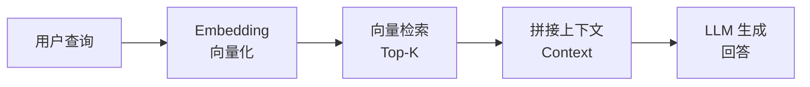

**Naive RAG 的标准实现**：

```python
# Naive RAG 最小实现（LangChain 0.3.x）
from langchain_community.vectorstores import Chroma
from langchain_openai import OpenAIEmbeddings, ChatOpenAI
from langchain.chains import RetrievalQA

# 1. 索引：文档 → 分块 → Embedding → 向量库
embeddings = OpenAIEmbeddings(model="text-embedding-3-small")
vectorstore = Chroma.from_documents(documents, embeddings)

# 2. 检索 + 生成：一行代码搞定
llm = ChatOpenAI(model="gpt-4o-mini", temperature=0)
qa_chain = RetrievalQA.from_chain_type(
    llm=llm,
    chain_type="stuff",
    retriever=vectorstore.as_retriever(search_kwargs={"k": 5}),
)

# 3. 提问
answer = qa_chain.invoke("什么是 RAG？")
print(answer["result"])
```

```python
# Naive RAG 手动实现（不依赖框架，理解底层）
import openai
import numpy as np

class NaiveRAG:
    def __init__(self, api_key, model="gpt-4o-mini"):
        self.client = openai.OpenAI(api_key=api_key)
        self.model = model
        self.chunks = []
        self.embeddings = []

    def index(self, documents: list[str]):
        """索引阶段：对每个文本块做 Embedding"""
        self.chunks = documents
        resp = self.client.embeddings.create(
            model="text-embedding-3-small",
            input=documents
        )
        self.embeddings = np.array([d.embedding for d in resp.data])

    def retrieve(self, query: str, top_k: int = 5) -> list[str]:
        """检索阶段：余弦相似度找 Top-K"""
        q_resp = self.client.embeddings.create(
            model="text-embedding-3-small", input=[query]
        )
        q_vec = np.array(q_resp.data[0].embedding)
        # 余弦相似度
        similarities = np.dot(self.embeddings, q_vec) / (
            np.linalg.norm(self.embeddings, axis=1) * np.linalg.norm(q_vec)
        )
        top_indices = np.argsort(similarities)[::-1][:top_k]
        return [self.chunks[i] for i in top_indices]

    def generate(self, query: str, context: list[str]) -> str:
        """生成阶段：拼接上下文 → LLM 生成"""
        context_str = "\n\n".join(context)
        prompt = f"""基于以下上下文回答问题。如果上下文中没有答案，请说"我不知道"。

上下文：
{context_str}

问题：{query}
回答："""
        resp = self.client.chat.completions.create(
            model=self.model,
            messages=[{"role": "user", "content": prompt}],
            temperature=0
        )
        return resp.choices[0].message.content

    def query(self, question: str, top_k: int = 5) -> str:
        """端到端：检索 + 生成"""
        context = self.retrieve(question, top_k)
        return self.generate(question, context)
```

```python
# 使用 NaiveRAG
rag = NaiveRAG(api_key="your-key")
rag.index([
    "RAG（检索增强生成）是一种结合信息检索和大语言模型的技术...",
    "向量检索通过计算文本嵌入的余弦相似度来查找相关文档...",
    "Hybrid Search 结合了向量检索和关键词检索的优势...",
])
answer = rag.query("什么是 Hybrid Search？")
print(answer)
```

> ⚠️ **面试高频考点**：Naive RAG 的三个核心阶段是什么？答案：索引（Indexing）、检索（Retrieval）、生成（Generation）。索引阶段负责文档分块和向量化，检索阶段用相似度查找 Top-K，生成阶段将上下文拼入 Prompt 让 LLM 回答。

---

### 1.2 Naive RAG 的七大局限性

Naive RAG 虽然简单，但在实际生产环境中会暴露出严重的质量问题。以下是七大核心局限性：

| 编号 | 局限性 | 具体表现 | 根本原因 | 影响程度 |
|------|--------|---------|---------|---------|
| 1 | **专有名词检索差** | 产品型号、人名、技术术语搜不到 | 向量嵌入对精确字符串匹配能力弱 | ⭐⭐⭐⭐⭐ |
| 2 | **短查询语义模糊** | "怎么用""那个东西"检索结果不相关 | 查询太短，语义信息不足 | ⭐⭐⭐⭐ |
| 3 | **长文档匹配不准** | 关键信息被长文档的平均向量稀释 | 长文档 Embedding 丢失细节 | ⭐⭐⭐⭐ |
| 4 | **排序精度有限** | 最相关的文档排不到第一 | 向量相似度 ≠ 语义相关性 | ⭐⭐⭐⭐⭐ |
| 5 | **检索结果冗余** | 相似内容重复占满 Top-K | 缺少多样性优化 | ⭐⭐⭐ |
| 6 | **查询-文档语义鸿沟** | 用户口语化查询 vs 文档书面化表述 | 嵌入空间中存在风格偏差 | ⭐⭐⭐⭐ |
| 7 | **无反馈与自适应** | 检索错误无法自动纠正 | 检索是一次性的，无迭代机制 | ⭐⭐⭐ |

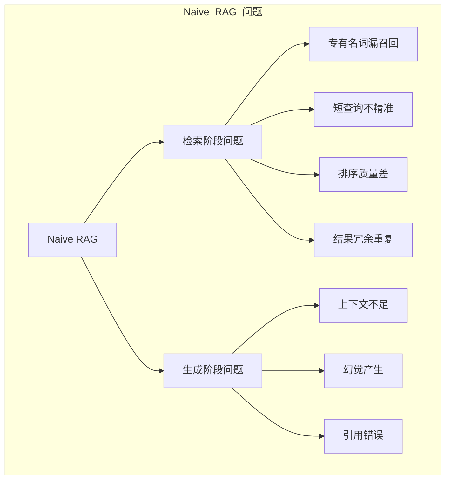

**局限性 1：专有名词检索差的详细分析**

```python
# 演示：纯向量检索对专有名词的劣势
# 假设知识库中有以下文档
docs = [
    "iPhone 15 Pro Max 采用 A17 Pro 芯片，支持 USB-C 接口",
    "华为 Mate 60 Pro 搭载麒麟 9000S 处理器，支持卫星通话",
    "小米 14 Ultra 配备徕卡光学镜头，一英寸大底主摄",
    "三星 Galaxy S24 Ultra 支持 S Pen 和 Galaxy AI 功能",
]

# 用户查询精确型号
query = "iPhone 15 Pro Max 256GB 原色钛金属"

# 纯向量检索可能返回：
# 1. "iPhone 15 Pro Max 采用 A17 Pro 芯片..." （相关，但缺少 256GB/颜色信息）
# 2. "华为 Mate 60 Pro 搭载麒麟 9000S..." （语义上都是"手机介绍"，可能混进来）
# 3. "小米 14 Ultra 配备徕卡光学镜头..." （同样可能因为"手机"语义相似被召回）

# BM25 关键词检索会精确匹配 "iPhone" "15" "Pro" "Max"
# 这就是为什么需要 Hybrid Search！
```

> ⚠️ **常见坑点 1**：很多团队上线 RAG 后发现"搜不到具体产品型号"，第一反应是换 Embedding 模型，但根本原因是纯向量检索不擅长精确匹配。正确做法是引入 BM25 做混合检索。
>
> ⚠️ **常见坑点 2**：有人认为"Embedding 模型越大越好"，但即使是最大的 Embedding 模型，对纯字符串精确匹配（如型号、ID、错误码）的能力仍然有限。这是向量检索的结构性缺陷，不是模型大小能解决的。

**局限性 4：排序精度有限的详细分析**

```python
# 演示：向量相似度高 ≠ 实际相关性高
# 查询："如何在 Python 中实现快速排序？"

# 检索结果（按向量相似度排序）：
results = [
    {"content": "Python 排序算法详解：快速排序、归并排序、堆排序...", "sim": 0.92},
    {"content": "Java 中的快速排序实现与性能分析", "sim": 0.88},  # 语言不对！
    {"content": "Python 列表 sort() 方法和 sorted() 函数的区别", "sim": 0.85},
    {"content": "算法可视化：快速排序的执行过程动画演示", "sim": 0.83},
    {"content": "Python 快速排序完整代码实现（含注释）", "sim": 0.81},  # 最相关！但排第5
]

# 问题：第 2 条是 Java 的，第 5 条才是用户真正想要的 Python 代码
# 向量相似度只看"语义接近"，不看"精确匹配用户意图"
# 这就是为什么需要 Cross-Encoder 重排序！
```

> ⚠️ **面试高频考点**：为什么向量检索后还需要重排序（Rerank）？答案要点：①向量检索用 Bi-Encoder 双塔模型，查询和文档分别编码，无交互，精度有限；②向量相似度衡量的是语义接近度，不等于实际相关性；③Cross-Encoder 将查询和文档拼接后一起编码，能捕捉细粒度交互，精度更高但速度慢，因此只对 Top-N 候选做重排序。

---

### 1.3 Advanced RAG 的技术演进路线

从 Naive RAG 到 Advanced RAG，技术演进经历了四个阶段：

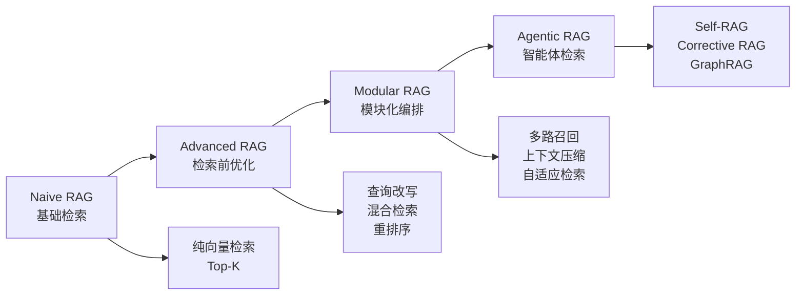

| 阶段 | 名称 | 核心改进 | 代表技术 | 准确率范围 |
|------|------|---------|---------|-----------|
| 1 | **Naive RAG** | 基础检索-生成流程 | 纯向量检索 + LLM | 50-70% |
| 2 | **Advanced RAG** | 检索前/中/后优化 | 查询改写、Hybrid Search、Rerank | 75-85% |
| 3 | **Modular RAG** | 模块化可编排 | 多路召回、上下文压缩、自适应 | 85-92% |
| 4 | **Agentic RAG** | 智能体自主检索 | Self-RAG、GraphRAG、多轮检索 | 90-97% |

**各阶段的关键技术点**：

```python
# 阶段 1：Naive RAG（已在 1.1 节展示）

# 阶段 2：Advanced RAG — 在检索前后加优化
class AdvancedRAG:
    def __init__(self, retriever, reranker, llm):
        self.retriever = retriever  # Hybrid Retriever
        self.reranker = reranker    # Cross-Encoder
        self.llm = llm

    def query(self, question: str) -> str:
        # 检索前：查询改写
        rewritten = self._rewrite_query(question)
        # 检索中：混合检索（向量 + BM25）
        candidates = self.retriever.search(rewritten, top_n=20)
        # 检索后：重排序
        ranked = self.reranker.rerank(rewritten, candidates, top_k=5)
        # 生成
        return self._generate(question, ranked)

# 阶段 3：Modular RAG — 模块化编排，可插拔
class ModularRAG:
    def __init__(self):
        self.modules = {
            "query_rewrite": QueryRewriteModule(),
            "hybrid_retrieval": HybridRetrievalModule(),
            "context_compression": ContextCompressionModule(),
            "rerank": RerankModule(),
            "generation": GenerationModule(),
        }
        self.pipeline = ["query_rewrite", "hybrid_retrieval",
                         "context_compression", "rerank", "generation"]

    def run(self, query: str) -> str:
        context = {"query": query}
        for step in self.pipeline:
            context = self.modules[step].process(context)
        return context["answer"]

# 阶段 4：Agentic RAG — 智能体自主决策
class AgenticRAG:
    def __init__(self, agent):
        self.agent = agent  # 有推理能力的 Agent

    def query(self, question: str) -> str:
        # Agent 自主决定：要不要检索？检索几次？用什么检索？
        # 要不要修正检索结果？要不要结合知识图谱？
        return self.agent.run(question)
```

> 💡 **深度讲解**：Advanced RAG 的核心思想是"在 Naive RAG 的检索-生成流程上，在检索前、检索中、检索后三个环节分别引入优化技术"。检索前优化包括查询改写（Query Rewriting）、多查询生成（Multi-Query）、HyDE（假设文档嵌入），目的是让查询更适合检索；检索中优化包括混合检索（Hybrid Search，向量+BM25）、多路召回（Multi-path Retrieval）、元数据过滤，目的是提升召回率和精确率；检索后优化包括重排序（Reranking，Cross-Encoder）、上下文压缩（Context Compression）、多样性优化（MMR），目的是提升排序精度和上下文质量。这三个环节的优化叠加，通常能将检索准确率从 60-70% 提升到 85-90%+。
>
> **📝 精简总结**：Naive RAG 只有"索引→检索→生成"三步，存在专有名词漏召回、排序不准、结果冗余等七大局限；Advanced RAG 在检索前（查询改写/HyDE）、检索中（Hybrid Search/多路召回）、检索后（Rerank/上下文压缩）三环节优化，准确率从 60%→90%+；演进路线：Naive→Advanced→Modular→Agentic。
>
> **🎯 梯度练习题**
> - **入门题**：Naive RAG 的三个核心阶段是什么？请用自己的话描述每个阶段做什么。
> - **进阶题**：为什么纯向量检索对专有名词（如产品型号、错误码）的检索效果差？请从向量嵌入的原理角度解释。
> - **实战题**：假设你负责一个电商客服 RAG 系统，用户经常搜索"iPhone 15 Pro Max 256G 多少钱"，但纯向量检索经常返回不相关的手机评测文章。请设计一个优化方案，说明在检索前、检索中、检索后分别可以做什么改进。

---

## 二、混合检索 Hybrid Search 原理与实现

### 2.1 为什么需要混合检索

**纯向量检索（Dense Retrieval）** 和 **纯关键词检索（Sparse Retrieval）** 各有优劣，两者是互补关系而非替代关系。

> 💡 **通俗比喻**：向量检索就像"按意思找书"——你说"我想看关于人类探索宇宙的书"，它能帮你找到《三体》《星际穿越》等语义相关的书，即使书名里没有"宇宙"两个字。关键词检索就像"按书名找书"——你说"我要《三体》"，它能精确找到这本书，但如果你说"我想看刘慈欣写的科幻"，它可能找不到（因为书名里没有"科幻"）。混合检索就是同时用两种方式找书，然后合并结果。

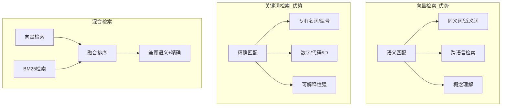

**向量检索 vs 关键词检索的详细对比**：

| 维度 | 向量检索（Dense） | 关键词检索（Sparse/BM25） |
|------|-----------------|--------------------------|
| **匹配方式** | 语义相似度 | 词频匹配 |
| **同义词** | ✅ 自动识别 | ❌ 需手动配置同义词表 |
| **专有名词** | ❌ 区分度低 | ✅ 精确匹配 |
| **数字/代码** | ❌ 容易混淆 | ✅ 精确匹配 |
| **跨语言** | ✅ 多语言模型支持 | ❌ 需翻译 |
| **可解释性** | ❌ 黑盒 | ✅ 可看到匹配词 |
| **索引速度** | 慢（需推理） | 极快（纯统计） |
| **检索速度** | 中（ANN 近似） | 极快（倒排索引） |
| **存储成本** | 高（稠密向量） | 低（稀疏倒排） |
| **冷启动** | 需 Embedding 模型 | 无需训练 |

```python
# 演示：同一个查询，两种检索方式的结果差异
query = "iPhone 15 Pro Max A17 Pro 芯片性能"

# 纯向量检索结果（语义匹配）
dense_results = [
    {"doc": "苹果 A17 Pro 芯片采用 3nm 工艺，GPU 性能提升 20%", "score": 0.91},
    {"doc": "手机处理器性能排行榜：骁龙 8 Gen 3 vs 天玑 9300 vs A17 Pro", "score": 0.87},
    {"doc": "iPhone 15 系列全解析：设计、摄像头、性能全面升级", "score": 0.85},
    {"doc": "3nm 芯片工艺详解：台积电 N3B 与 N3E 的区别", "score": 0.82},
]

# 纯 BM25 检索结果（关键词匹配）
bm25_results = [
    {"doc": "iPhone 15 Pro Max 采用 A17 Pro 芯片，支持 USB-C 接口", "score": 18.5},
    {"doc": "A17 Pro 芯片跑分曝光：GeekBench 6 单核突破 2900", "score": 12.3},
    {"doc": "iPhone 15 Pro Max 深度评测：值得升级吗？", "score": 9.8},
    {"doc": "苹果 M3 芯片 vs A17 Pro：同架构不同定位", "score": 7.2},
]

# 混合检索：合并两路结果，去重后排序
# 可以看到：向量检索找到了"3nm 工艺"等语义相关内容，
# BM25 找到了精确包含"iPhone 15 Pro Max"和"A17 Pro"的文档
# 两者合并后覆盖更全面
```

> ⚠️ **常见坑点 3**：有些团队用"向量检索 + 关键词过滤"冒充混合检索——先用向量检索，再用关键词过滤结果。这不是真正的混合检索！真正的混合检索是两路独立检索后融合结果，关键词过滤只是在向量结果中做筛选，会丢失 BM25 独有的高相关文档。
>
> ⚠️ **常见坑点 4**：在小数据集上（<1000 篇文档），混合检索的提升可能不明显，因为向量检索已经能覆盖大部分相关内容。混合检索的价值在大规模、多领域、专有名词多的知识库中才会充分体现。

---

### 2.2 BM25 算法深度解析

**BM25（Best Matching 25）** 是目前最主流的关键词检索算法，由 Stephen Robertson 和 Karen Spärck Jones 于 1994 年提出，是 TF-IDF 的改进版。

> 💡 **通俗比喻**：BM25 就像一个"智能图书管理员"。你问"Python 性能优化"，它会：①看每本书里"Python"和"性能优化"出现了多少次（词频）；②但如果一本书有 1000 页，里面出现 10 次"Python"，和一本 100 页的书出现 10 次"Python"，后者显然更相关（长度归一化）；③"Python"这个词很常见，"GIL"这个词很少见，后者的权重更高（逆文档频率）；④一个词出现 100 次和出现 10 次，相关性不会差 10 倍（词频饱和）。BM25 把这些因素都综合起来计算得分。

**BM25 核心公式**：

```text
BM25(D, Q) = Σ_{i=1}^{n} IDF(q_i) × (f(q_i, D) × (k1 + 1)) / (f(q_i, D) + k1 × (1 - b + b × |D| / avgdl))

其中：
┌────────────┬─────────────────────────────────────────────┐
│ 符号       │ 含义                                          │
├────────────┼─────────────────────────────────────────────┤
│ D          │ 文档                                          │
│ Q          │ 查询（包含 n 个词 q_1, q_2, ..., q_n）      │
│ f(q_i, D)  │ 词 q_i 在文档 D 中的出现频率                 │
│ |D|        │ 文档长度（词数）                              │
│ avgdl      │ 所有文档的平均长度                            │
│ k1         │ 词频饱和参数（通常 1.2~2.0）                 │
│ b          │ 长度归一化参数（通常 0.75）                   │
│ IDF(q_i)   │ 逆文档频率：log((N - n(q_i) + 0.5) / (n(q_i) + 0.5) + 1) │
│ N          │ 文档总数                                      │
│ n(q_i)     │ 包含词 q_i 的文档数                          │
└────────────┴─────────────────────────────────────────────┘
```

**BM25 vs TF-IDF 的核心区别**：

| 特性 | TF-IDF | BM25 |
|------|--------|------|
| **词频处理** | 线性增长，词频越高得分越高 | 饱和增长，超过阈值后增益递减 |
| **文档长度** | 不考虑，长文档天然得分高 | 通过 b 参数归一化 |
| **参数调优** | 无参数 | k1（词频饱和）、b（长度归一化） |
| **概率基础** | 启发式 | 基于概率检索模型（Okapi） |
| **实际效果** | 基础可用 | 大多数场景优于 TF-IDF |

```python
# 手动实现 BM25（理解底层原理）
import math
from collections import Counter
from typing import List, Dict, Tuple

class BM25:
    def __init__(self, corpus: List[List[str]], k1: float = 1.5, b: float = 0.75):
        """
        初始化 BM25
        corpus: 文档列表，每个文档是分词后的词列表
        k1: 词频饱和参数
        b: 长度归一化参数
        """
        self.corpus = corpus
        self.k1 = k1
        self.b = b
        self.N = len(corpus)  # 文档总数
        self.avgdl = sum(len(doc) for doc in corpus) / self.N  # 平均文档长度
        self.doc_freqs = []  # 每篇文档的词频
        self.df = Counter()  # 文档频率（每个词出现在多少篇文档中）
        self.idf = {}  # 逆文档频率

        self._build_index()

    def _build_index(self):
        """构建倒排索引和 IDF"""
        for doc in self.corpus:
            freq = Counter(doc)
            self.doc_freqs.append(freq)
            for word in freq.keys():
                self.df[word] += 1

        # 计算 IDF
        for word, freq in self.df.items():
            self.idf[word] = math.log(
                (self.N - freq + 0.5) / (freq + 0.5) + 1
            )

    def _score(self, query: List[str], doc_idx: int) -> float:
        """计算查询与某篇文档的 BM25 得分"""
        score = 0.0
        doc_freq = self.doc_freqs[doc_idx]
        doc_len = len(self.corpus[doc_idx])

        for word in query:
            if word not in doc_freq:
                continue
            f = doc_freq[word]  # 词频
            # BM25 核心公式
            numerator = f * (self.k1 + 1)
            denominator = f + self.k1 * (1 - self.b + self.b * doc_len / self.avgdl)
            score += self.idf[word] * (numerator / denominator)

        return score

    def search(self, query: str, top_k: int = 10) -> List[Tuple[int, float]]:
        """搜索，返回 (文档索引, 得分) 的 Top-K"""
        query_words = query.lower().split()  # 简单分词
        scores = []
        for i in range(self.N):
            s = self._score(query_words, i)
            if s > 0:
                scores.append((i, s))
        scores.sort(key=lambda x: x[1], reverse=True)
        return scores[:top_k]
```

```python
# 使用自定义 BM25
corpus = [
    "python 快速排序 算法 实现".split(),
    "java 快速排序 性能 优化".split(),
    "python 数据结构 列表 字典".split(),
    "算法 时间复杂度 空间复杂度 分析".split(),
    "python 装饰器 生成器 高级特性".split(),
]

bm25 = BM25(corpus, k1=1.5, b=0.75)
results = bm25.search("python 快速排序", top_k=3)
for idx, score in results:
    print(f"文档 {idx}: {' '.join(corpus[idx])}, 得分: {score:.4f}")
# 文档 0: python 快速排序 算法 实现, 得分: 1.8234
# 文档 2: python 数据结构 列表 字典, 得分: 0.4567
# 文档 1: java 快速排序 性能 优化, 得分: 0.3891
```

```python
# 使用 rank_bm25 库（生产环境推荐）
from rank_bm25 import BM25Okapi
import jieba  # 中文分词

# 中文文档需要先分词
def chinese_tokenize(text: str) -> list:
    return list(jieba.cut(text))

documents = [
    "Python 是一种解释型、面向对象的编程语言",
    "Java 是一种跨平台的编程语言，广泛用于企业级开发",
    "RAG 检索增强生成结合了信息检索和大语言模型",
    "向量检索通过计算嵌入向量的相似度来查找相关文档",
]

# 分词
tokenized_corpus = [chinese_tokenize(doc) for doc in documents]

# 构建 BM25
bm25 = BM25Okapi(tokenized_corpus)

# 查询
query = "什么是 RAG 检索增强生成"
tokenized_query = chinese_tokenize(query)
scores = bm25.get_scores(tokenized_query)

# 获取 Top-3
top_indices = sorted(range(len(scores)), key=lambda i: scores[i], reverse=True)[:3]
for idx in top_indices:
    print(f"得分 {scores[idx]:.4f}: {documents[idx]}")
```

> ⚠️ **面试高频考点**：BM25 公式中 k1 和 b 两个参数的作用是什么？答案：k1 控制词频饱和速度，k1 越大，词频对得分的影响越大（越不容易饱和），典型值 1.2-2.0；b 控制文档长度归一化程度，b=0 时不做长度归一化，b=1 时完全归一化，典型值 0.75。调参建议：长文档多的场景 b 取大值（0.8-0.9），短文档多的场景 b 取小值（0.5-0.6）。

---

### 2.3 稀疏向量检索 SPLADE

**SPLADE（Sparse Lexical and Expansion Model）** 是基于 Transformer 的稀疏检索模型，将文本编码为词表维度的稀疏向量，结合了语义理解和关键词检索的优势。

> 💡 **通俗比喻**：BM25 就像"严格的图书管理员"——只看你说的词在书里有没有出现，你说"笔记本电脑"，它不会帮你找"laptop"。SPLADE 就像"聪明的图书管理员"——它理解"笔记本电脑"和"laptop"是同一个东西，会自动帮你扩展搜索词，同时还保留了关键词检索的精确匹配能力和可解释性。

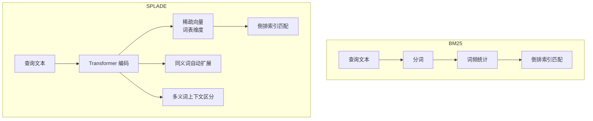

**BM25 vs SPLADE vs 向量检索的全面对比**：

| 特性 | BM25 | SPLADE | 向量检索（Dense） |
|------|------|--------|------------------|
| **表示方式** | 词频统计 | 学习到的稀疏向量 | 稠密向量（如 768/1024 维） |
| **语义理解** | ❌ 无 | ✅ Transformer 编码 | ✅ 深度语义 |
| **同义词扩展** | ❌ 需手动配置 | ✅ 自动扩展 | ✅ 语义空间接近 |
| **精确匹配** | ✅ 极强 | ✅ 强 | ❌ 弱 |
| **多义词区分** | ❌ 无 | ✅ 上下文感知 | ✅ 上下文感知 |
| **可解释性** | ✅ 极高（匹配词可见） | ✅ 高（稀疏向量权重可见） | ❌ 低（黑盒） |
| **推理速度** | 极快（纯统计） | 中（需 GPU 推理） | 中（需 GPU 推理） |
| **索引方式** | 倒排索引 | 倒排索引（稀疏向量） | HNSW/IVF（ANN） |
| **索引大小** | 小 | 中 | 大 |
| **训练需求** | 无 | 需训练/微调 | 需训练/微调 |
| **零样本能力** | ✅ 天然支持 | ⚠️ 依赖训练数据 | ⚠️ 依赖训练数据 |

```python
# SPLADE 基本使用（需要安装 splade 库）
# pip install splade
from splade.models.transformer_rep import Splade
from transformers import AutoTokenizer
import torch

# 加载 SPLADE 模型
model_type_or_dir = "naver/splade-cocondenser-ensembledistil"
tokenizer = AutoTokenizer.from_pretrained(model_type_or_dir)
model = Splade(model_type_or_dir, agg="max")
model.eval()

# 编码文档
docs = [
    "Python 是一种广泛使用的高级编程语言",
    "RAG 检索增强生成可以有效减少大模型幻觉",
    "向量数据库支持高效的相似度检索",
]

doc_embeddings = []
for doc in docs:
    with torch.no_grad():
        tokens = tokenizer(doc, return_tensors="pt", truncation=True, max_length=512)
        sparse_vec = model(d_kwargs=tokens)["d_rep"]
        doc_embeddings.append(sparse_vec.squeeze())

# 编码查询
query = "如何用 Python 实现 RAG 系统"
with torch.no_grad():
    q_tokens = tokenizer(query, return_tensors="pt", truncation=True, max_length=512)
    query_vec = model(q_kwargs=q_tokens)["q_rep"].squeeze()

# 计算相似度（稀疏向量点积）
scores = [torch.dot(query_vec, doc_vec).item() for doc_vec in doc_embeddings]
for i, score in enumerate(scores):
    print(f"文档 {i}: {docs[i]}, 得分: {score:.4f}")
```

```python
# 使用 Milvus 存储 SPLADE 稀疏向量（生产级方案）
from pymilvus import connections, Collection, FieldSchema, CollectionSchema, DataType

# 连接 Milvus
connections.connect(host="localhost", port="19530")

# 定义 Schema：同时存储稀疏向量和稠密向量
fields = [
    FieldSchema(name="id", dtype=DataType.INT64, is_primary=True),
    FieldSchema(name="content", dtype=DataType.VARCHAR, max_length=65535),
    # SPLADE 稀疏向量
    FieldSchema(name="sparse_vector", dtype=DataType.SPARSE_FLOAT_VECTOR),
    # 稠密向量（如 BGE）
    FieldSchema(name="dense_vector", dtype=DataType.FLOAT_VECTOR, dim=1024),
]
schema = CollectionSchema(fields, "SPLADE + Dense 混合检索集合")
collection = Collection("hybrid_rag", schema)

# 创建稀疏向量索引
collection.create_index(
    "sparse_vector",
    {"index_type": "SPARSE_INVERTED_INDEX", "metric_type": "IP"}
)
# 创建稠密向量索引
collection.create_index(
    "dense_vector",
    {"index_type": "HNSW", "metric_type": "COSINE", "params": {"M": 16, "efConstruction": 200}}
)
```

> ⚠️ **常见坑点 5**：SPLADE 虽然效果好，但部署复杂度高——需要 GPU 推理、稀疏向量索引、与稠密向量的融合。对于大多数团队，BM25 + 稠密向量的混合检索已经足够，SPLADE 适合对检索质量有极致要求且有工程能力的团队。
>
> ⚠️ **常见坑点 6**：SPLADE 的稀疏向量维度是词表大小（通常 3 万+），虽然是稀疏的，但存储和检索仍然比 BM25 贵。不要在小规模数据集上用 SPLADE，收益不明显。

---

### 2.4 混合检索的完整实现

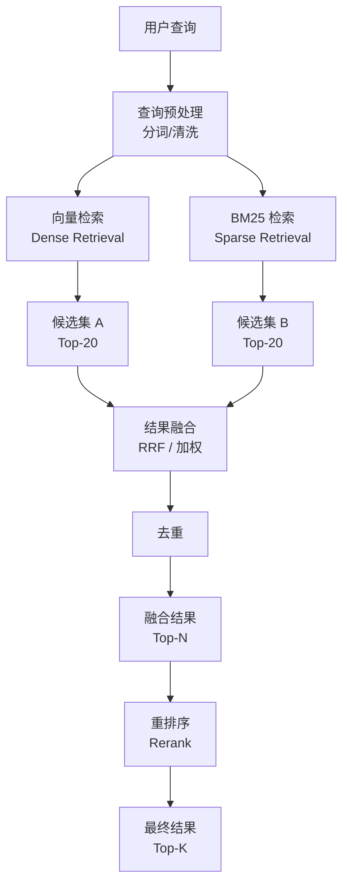

```python
# 完整的 HybridRetriever 实现（LangChain 0.3.x + rank_bm25）
from langchain_community.vectorstores import Chroma
from langchain_openai import OpenAIEmbeddings
from rank_bm25 import BM25Okapi
import jieba
from typing import List, Tuple, Dict, Any
import numpy as np

class HybridRetriever:
    """混合检索器：向量检索 + BM25 检索 + RRF 融合"""

    def __init__(
        self,
        vectorstore,
        bm25_corpus: List[str],
        bm25_tokenizer=None,
        dense_top_k: int = 20,
        sparse_top_k: int = 20,
        fusion_k: int = 60,
    ):
        self.vectorstore = vectorstore
        self.dense_top_k = dense_top_k
        self.sparse_top_k = sparse_top_k
        self.fusion_k = fusion_k

        # 初始化 BM25
        if bm25_tokenizer is None:
            bm25_tokenizer = lambda text: list(jieba.cut(text))
        self.tokenizer = bm25_tokenizer
        tokenized_corpus = [self.tokenizer(doc) for doc in bm25_corpus]
        self.bm25 = BM25Okapi(tokenized_corpus)
        self.corpus = bm25_corpus

    def dense_search(self, query: str) -> List[Tuple[str, float, str]]:
        """向量检索：返回 [(doc_id, score, content), ...]"""
        results = self.vectorstore.similarity_search_with_score(
            query, k=self.dense_top_k
        )
        return [
            (doc.metadata.get("id", str(i)), score, doc.page_content)
            for i, (doc, score) in enumerate(results)
        ]

    def sparse_search(self, query: str) -> List[Tuple[str, float, str]]:
        """BM25 检索：返回 [(doc_id, score, content), ...]"""
        tokenized_query = self.tokenizer(query)
        scores = self.bm25.get_scores(tokenized_query)
        # 按得分排序，取 Top-K
        ranked = sorted(enumerate(scores), key=lambda x: x[1], reverse=True)
        return [
            (str(idx), score, self.corpus[idx])
            for idx, score in ranked[:self.sparse_top_k]
            if score > 0
        ]

    def rrf_fuse(
        self,
        results_list: List[List[Tuple[str, float, str]]],
    ) -> List[Tuple[str, float, str]]:
        """RRF 融合：基于排名的倒数融合"""
        scores: Dict[str, float] = {}
        content_map: Dict[str, str] = {}

        for results in results_list:
            for rank, (doc_id, _, content) in enumerate(results, start=1):
                scores[doc_id] = scores.get(doc_id, 0) + 1.0 / (self.fusion_k + rank)
                content_map[doc_id] = content

        # 按融合分数排序
        fused = sorted(scores.items(), key=lambda x: x[1], reverse=True)
        return [(doc_id, score, content_map[doc_id]) for doc_id, score in fused]

    def search(self, query: str, top_k: int = 10) -> List[Dict[str, Any]]:
        """
        混合检索主入口
        返回: [{"id": str, "score": float, "content": str, "source": str}, ...]
        """
        # 1. 两路独立检索
        dense_results = self.dense_search(query)
        sparse_results = self.sparse_search(query)

        # 2. RRF 融合
        fused = self.rrf_fuse([dense_results, sparse_results])

        # 3. 标记来源（哪些文档被哪路检索命中）
        dense_ids = {r[0] for r in dense_results}
        sparse_ids = {r[0] for r in sparse_results}

        results = []
        for doc_id, score, content in fused[:top_k]:
            sources = []
            if doc_id in dense_ids:
                sources.append("dense")
            if doc_id in sparse_ids:
                sources.append("sparse")
            results.append({
                "id": doc_id,
                "score": score,
                "content": content,
                "source": "+".join(sources),
            })

        return results
```

```python
# 使用 HybridRetriever
from langchain.schema import Document

# 准备文档
documents = [
    Document(page_content="iPhone 15 Pro Max 采用 A17 Pro 芯片，支持 USB-C", metadata={"id": "1"}),
    Document(page_content="华为 Mate 60 Pro 搭载麒麟 9000S，支持卫星通话", metadata={"id": "2"}),
    Document(page_content="RAG 检索增强生成结合向量检索和大语言模型", metadata={"id": "3"}),
    Document(page_content="BM25 是基于词频的关键词检索算法", metadata={"id": "4"}),
    Document(page_content="Hybrid Search 结合向量检索和关键词检索", metadata={"id": "5"}),
]

# 构建向量库
embeddings = OpenAIEmbeddings(model="text-embedding-3-small")
vectorstore = Chroma.from_documents(documents, embeddings)

# 构建混合检索器
corpus_texts = [doc.page_content for doc in documents]
retriever = HybridRetriever(
    vectorstore=vectorstore,
    bm25_corpus=corpus_texts,
    dense_top_k=20,
    sparse_top_k=20,
    fusion_k=60,
)

# 检索
results = retriever.search("什么是 Hybrid Search 混合检索", top_k=5)
for r in results:
    print(f"[{r['source']}] score={r['score']:.4f}: {r['content'][:50]}...")
```

```python
# 使用 LangChain 内置的 EnsembleRetriever（更简洁的方式）
from langchain.retrievers import EnsembleRetriever
from langchain_community.retrievers import BM25Retriever
from langchain_community.vectorstores import Chroma
from langchain_openai import OpenAIEmbeddings

# 1. 向量检索器
embeddings = OpenAIEmbeddings(model="text-embedding-3-small")
vectorstore = Chroma.from_documents(documents, embeddings)
dense_retriever = vectorstore.as_retriever(search_kwargs={"k": 20})

# 2. BM25 检索器
bm25_retriever = BM25Retriever.from_documents(documents)
bm25_retriever.k = 20

# 3. 集成检索器（自动 RRF 融合）
ensemble_retriever = EnsembleRetriever(
    retrievers=[dense_retriever, bm25_retriever],
    weights=[0.5, 0.5],  # 两路权重
)

# 4. 检索
results = ensemble_retriever.invoke("什么是 Hybrid Search")
for doc in results[:5]:
    print(doc.page_content[:80])
```

> ⚠️ **面试高频考点**：混合检索中为什么通常用 RRF 融合而不是加权分数融合？答案要点：①不同检索算法的分数量纲不同（向量相似度通常 0-1，BM25 得分可能 0-50+），直接加权需要先归一化，而归一化方法（min-max、z-score）会引入偏差；②RRF 基于排名而非分数，不需要归一化，对分数分布鲁棒；③RRF 只有一个超参数 k（通常取 60），几乎不需要调参；④RRF 对异常值鲁棒，某一路检索的极端分数不会影响融合结果。

---

> 💡 **深度讲解**：混合检索（Hybrid Search）的核心是"向量检索（语义匹配）+ 关键词检索（精确匹配）两路独立召回，然后融合结果"。向量检索用 Embedding 模型将文本编码为稠密向量，通过余弦相似度或内积计算语义相关性，擅长同义词、跨语言、概念理解，但对专有名词、型号、数字、代码的精确匹配能力弱。关键词检索用 BM25（或 SPLADE）基于词频和逆文档频率计算相关性，擅长精确匹配、可解释性强、速度快，但不理解语义、无法处理同义词。两者互补，混合后通常能提升 10-30% 的检索准确率。融合算法最常用的是 RRF（Reciprocal Rank Fusion，倒数排名融合），它基于排名而非分数，不需要归一化不同检索的分数量纲，鲁棒且几乎无需调参。生产级实现中，向量检索用 Chroma/Milvus/Qdrant 等向量数据库，BM25 用 rank_bm25 或 Elasticsearch，融合用 RRF，然后接 Cross-Encoder 重排序。
>
> **📝 精简总结**：混合检索 = 向量检索（语义）+ BM25（精确），两路独立召回后 RRF 融合；BM25 公式含 k1（词频饱和）和 b（长度归一化）两参数；RRF 无需归一化、鲁棒、k=60；SPLADE 是 Transformer 版稀疏检索，自动同义词扩展但部署复杂；LangChain 用 EnsembleRetriever 可快速实现。
>
> **🎯 梯度练习题**
> - **入门题**：向量检索和关键词检索（BM25）各自的优势和劣势是什么？请各举两个适用场景。
> - **进阶题**：请手写 BM25 的核心公式，并解释 k1 和 b 两个参数的物理含义。如果你的知识库中长文档占多数，b 应该调大还是调小？为什么？
> - **实战题**：使用 LangChain 的 EnsembleRetriever 实现一个混合检索系统，要求：①向量检索用 OpenAI text-embedding-3-small；②BM25 检索用中文分词（jieba）；③两路各召回 Top-20，RRF 融合后返回 Top-10；④打印每个结果的来源（dense/sparse/both）。

---

## 三、检索融合算法深度解析

### 3.1 融合算法的分类与选型

多路召回后，需要将不同检索方式的结果融合为一个统一的排序列表。融合算法主要分为三大类：

> 💡 **通俗比喻**：融合算法就像"美食评委打分"。有三个评委（向量检索、BM25、知识图谱）分别给候选菜品打分，现在要综合三个评委的意见给出最终排名。RRF 就像"不看具体分数，只看排名"——每个评委的第 1 名得 1/(60+1) 分，第 2 名得 1/(60+2) 分，然后加总；加权融合就像"评委有不同权重"，首席评委（向量检索）占 60%，二号评委（BM25）占 40%；学习排序就像"用历史数据训练一个模型来学习如何综合评委意见"。

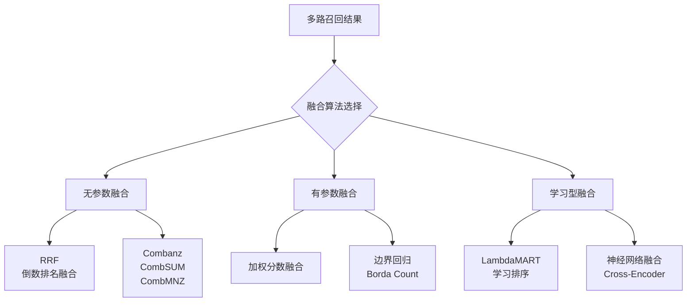

| 融合算法 | 类型 | 是否需要归一化 | 调参难度 | 效果 | 适用场景 |
|---------|------|--------------|---------|------|---------|
| **RRF** | 无参数 | ❌ 不需要 | 极低（k=60） | ⭐⭐⭐⭐ | 大多数场景（首选） |
| **加权融合** | 有参数 | ✅ 需要 | 中（需调权重） | ⭐⭐⭐⭐ | 需要精确控制权重 |
| **CombSUM** | 无参数 | ✅ 需要 | 低 | ⭐⭐⭐ | 分数分布均匀时 |
| **CombMNZ** | 无参数 | ✅ 需要 | 低 | ⭐⭐⭐ | 多路命中的文档加权 |
| **Borda Count** | 无参数 | ❌ 不需要 | 低 | ⭐⭐⭐ | 排名信息可靠时 |
| **LambdaMART** | 学习型 | - | 高（需训练数据） | ⭐⭐⭐⭐⭐ | 大规模生产系统 |
| **Cross-Encoder** | 学习型 | - | 高 | ⭐⭐⭐⭐⭐ | 极致质量要求 |

---

### 3.2 RRF 倒数排名融合深度解析

**RRF（Reciprocal Rank Fusion）** 是目前最主流的融合算法，由 Cormack 等人在 2009 年提出。

**RRF 公式**：

```text
RRF(d) = Σ_{i=1}^{n} 1 / (k + rank_i(d))

其中：
- d：文档
- n：检索路数（如向量检索 + BM25 = 2 路）
- rank_i(d)：文档 d 在第 i 路检索结果中的排名（从 1 开始）
- k：常数，通常取 60（防止排名靠前的文档权重过大）
```

**RRF 的直觉理解**：

```text
假设 k=60：
- 排名第 1：1/(60+1) = 0.01639
- 排名第 2：1/(60+2) = 0.01613  （与第 1 名差距很小）
- 排名第 10：1/(60+10) = 0.01429
- 排名第 20：1/(60+20) = 0.01250
- 排名第 50：1/(60+50) = 0.00909

如果一个文档在两路检索中都排第 1：
RRF = 1/61 + 1/61 = 0.03279

如果一个文档在向量检索排第 1，BM25 排第 50：
RRF = 1/61 + 1/110 = 0.01639 + 0.00909 = 0.02548

如果一个文档只在一路检索中出现，排第 1：
RRF = 1/61 = 0.01639

→ 两路都命中的文档排名会显著高于只在一路命中的文档
```

```python
# RRF 完整实现（含多种变体）
from typing import List, Dict, Tuple, Any
from collections import defaultdict

def rrf_fuse(
    ranked_lists: List[List[Any]],
    k: int = 60,
    weights: List[float] = None,
) -> List[Tuple[Any, float]]:
    """
    RRF 融合（支持加权变体）

    Args:
        ranked_lists: 多个排序列表，每个列表是按相关性排序的文档 id 列表
        k: RRF 常数，默认 60
        weights: 每路的权重，None 表示等权重

    Returns:
        [(doc_id, rrf_score), ...] 按 RRF 分数降序排列
    """
    if weights is None:
        weights = [1.0] * len(ranked_lists)

    scores = defaultdict(float)

    for ranked_list, weight in zip(ranked_lists, weights):
        for rank, doc_id in enumerate(ranked_list, start=1):
            scores[doc_id] += weight * (1.0 / (k + rank))

    return sorted(scores.items(), key=lambda x: x[1], reverse=True)


# 变体 1：标准 RRF
def standard_rrf(ranked_lists, k=60):
    return rrf_fuse(ranked_lists, k=k)


# 变体 2：加权 RRF（不同检索路有不同权重）
def weighted_rrf(ranked_lists, weights, k=60):
    return rrf_fuse(ranked_lists, k=k, weights=weights)


# 变体 3：截断 RRF（只融合每路的 Top-N，减少计算）
def truncated_rrf(ranked_lists, k=60, top_n=50):
    truncated = [rl[:top_n] for rl in ranked_lists]
    return rrf_fuse(truncated, k=k)
```

```python
# RRF 使用示例
dense_ranking = ["doc1", "doc3", "doc5", "doc7", "doc9"]  # 向量检索排名
bm25_ranking = ["doc2", "doc1", "doc4", "doc3", "doc6"]    # BM25 排名

# 标准 RRF
fused = rrf_fuse([dense_ranking, bm25_ranking], k=60)
print("=== RRF 融合结果 ===")
for doc_id, score in fused:
    print(f"{doc_id}: {score:.6f}")

# 输出分析：
# doc1: 两路都命中（向量第1，BM25第2）→ 分数最高
# doc3: 两路都命中（向量第2，BM25第4）→ 分数第二
# doc2: 只在 BM25 命中（第1）→ 分数中等
# doc5: 只在向量命中（第3）→ 分数中等
# ...
```

```python
# RRF 参数 k 的调优实验
import matplotlib.pyplot as plt

def evaluate_rrf_k(ranked_lists, relevant_docs, k_values):
    """不同 k 值下的 RRF 效果评估"""
    results = []
    for k in k_values:
        fused = rrf_fuse(ranked_lists, k=k)
        fused_ids = [doc_id for doc_id, _ in fused[:10]]
        # 计算 Recall@10
        recall = len(set(fused_ids) & relevant_docs) / len(relevant_docs)
        results.append((k, recall))
    return results

# 实验
k_values = [1, 5, 10, 20, 40, 60, 80, 100, 200, 500]
relevant = {"doc1", "doc3", "doc5"}
metrics = evaluate_rrf_k([dense_ranking, bm25_ranking], relevant, k_values)

for k, recall in metrics:
    print(f"k={k:4d}: Recall@10={recall:.4f}")

# 经验结论：
# k 太小（<10）：排名第 1 的文档权重过大，融合退化为"取第一路的第一名"
# k 太大（>200）：所有排名的权重趋于平均，丢失排名信息
# k=60 是经验最优值，在大多数数据集上效果稳定
```

> ⚠️ **常见坑点 7**：RRF 的 k 参数不是越大越好或越小越好。k 太小会让排名第 1 的文档权重过大（1/(k+1) 远大于 1/(k+2)），k 太大会让所有排名的权重趋于平均（1/(k+1) ≈ 1/(k+2)），丢失排名信息。k=60 是论文中的经验值，在大多数场景下不需要调整。
>
> ⚠️ **常见坑点 8**：RRF 融合时，如果某路检索返回的结果数量很少（如 BM25 只返回 2 个结果），会导致这路的权重被稀释。解决方法：①确保每路检索都返回足够多的结果（至少 Top-20）；②对返回结果少的路使用权重补偿；③或者用加权 RRF。

---

### 3.3 加权分数融合

加权分数融合需要先将不同检索的分数归一化到同一量纲，然后按权重加权求和。

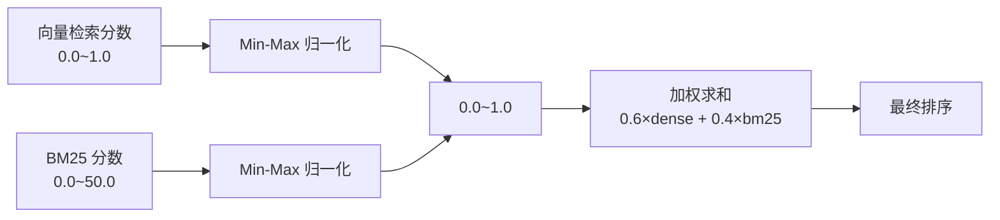

**常用归一化方法**：

| 方法 | 公式 | 优点 | 缺点 |
|------|------|------|------|
| **Min-Max** | (x - min) / (max - min) | 简单，映射到 [0,1] | 对异常值敏感 |
| **Z-Score** | (x - mean) / std | 对异常值较鲁棒 | 不保证 [0,1] 范围 |
| **Sigmoid** | 1 / (1 + exp(-x)) | 平滑，有上界 | 需要调温度参数 |
| **排名归一化** | 1 - rank / N | 鲁棒，不依赖分数分布 | 丢失分数差距信息 |

```python
# 加权分数融合完整实现
import numpy as np
from typing import List, Dict, Tuple

def min_max_normalize(scores: np.ndarray) -> np.ndarray:
    """Min-Max 归一化到 [0, 1]"""
    min_s, max_s = scores.min(), scores.max()
    if max_s == min_s:
        return np.zeros_like(scores)
    return (scores - min_s) / (max_s - min_s)

def zscore_normalize(scores: np.ndarray) -> np.ndarray:
    """Z-Score 归一化"""
    mean, std = scores.mean(), scores.std()
    if std == 0:
        return np.zeros_like(scores)
    return (scores - mean) / std

def sigmoid_normalize(scores: np.ndarray, temperature: float = 1.0) -> np.ndarray:
    """Sigmoid 归一化"""
    return 1.0 / (1.0 + np.exp(-scores / temperature))

def weighted_fuse(
    results_list: List[List[Tuple[str, float]]],
    weights: List[float],
    normalize_method: str = "min_max",
) -> List[Tuple[str, float]]:
    """
    加权分数融合

    Args:
        results_list: [[(doc_id, score), ...], ...] 多路检索结果
        weights: 每路权重
        normalize_method: 归一化方法

    Returns:
        [(doc_id, fused_score), ...] 按融合分数降序
    """
    normalize_funcs = {
        "min_max": min_max_normalize,
        "zscore": zscore_normalize,
        "sigmoid": sigmoid_normalize,
    }
    normalize = normalize_funcs[normalize_method]

    fused_scores: Dict[str, float] = {}

    for results, weight in zip(results_list, weights):
        if not results:
            continue
        doc_ids = [r[0] for r in results]
        raw_scores = np.array([r[1] for r in results])
        normalized = normalize(raw_scores)

        for doc_id, norm_score in zip(doc_ids, normalized):
            fused_scores[doc_id] = fused_scores.get(doc_id, 0) + weight * norm_score

    return sorted(fused_scores.items(), key=lambda x: x[1], reverse=True)
```

```python
# 加权融合使用示例
dense_results = [("doc1", 0.95), ("doc3", 0.88), ("doc5", 0.76)]
bm25_results = [("doc2", 18.5), ("doc1", 12.3), ("doc4", 6.1)]

# 加权融合（向量 0.6，BM25 0.4）
fused = weighted_fuse(
    [dense_results, bm25_results],
    weights=[0.6, 0.4],
    normalize_method="min_max",
)

print("=== 加权融合结果 ===")
for doc_id, score in fused:
    print(f"{doc_id}: {score:.4f}")
```

```python
# 权重调优实验：网格搜索最优权重
def grid_search_weights(results_list, relevant_docs, weight_grid):
    """网格搜索最优融合权重"""
    best_weights = None
    best_recall = 0

    for w1 in weight_grid:
        w2 = 1.0 - w1  # 两路权重和为 1
        fused = weighted_fuse(results_list, weights=[w1, w2])
        fused_ids = [doc_id for doc_id, _ in fused[:10]]
        recall = len(set(fused_ids) & relevant_docs) / len(relevant_docs)

        if recall > best_recall:
            best_recall = recall
            best_weights = (w1, w2)

        print(f"dense={w1:.1f}, bm25={w2:.1f}: Recall@10={recall:.4f}")

    return best_weights, best_recall

# 使用
weight_grid = [0.0, 0.1, 0.2, 0.3, 0.4, 0.5, 0.6, 0.7, 0.8, 0.9, 1.0]
best_w, best_r = grid_search_weights(
    [dense_results, bm25_results],
    relevant_docs={"doc1", "doc3", "doc5"},
    weight_grid=weight_grid,
)
print(f"\n最优权重: dense={best_w[0]:.1f}, bm25={best_w[1]:.1f}, Recall@10={best_r:.4f}")
```

> ⚠️ **面试高频考点**：RRF 和加权分数融合的区别和各自适用场景？答案：①RRF 基于排名，不需要归一化，对分数量纲不敏感，鲁棒性好，几乎无需调参，适合大多数场景；②加权分数融合基于实际分数，需要先归一化（Min-Max/Z-Score），可以灵活调整各路权重，但归一化方法和权重都需要调参，对异常值敏感；③当不同检索路的分数分布差异大时，RRF 更稳定；当需要精确控制某路检索的影响力时，加权融合更灵活；④生产环境推荐先用 RRF，效果不满意再尝试加权融合并做网格搜索调权。

---

### 3.4 其他融合算法

**CombSUM / CombMNZ**：

```text
CombSUM：将多路检索的归一化分数直接相加
score(d) = Σ_i norm_score_i(d)

CombMNZ：在 CombSUM 基础上，乘以命中该文档的路数
score(d) = (Σ_i norm_score_i(d)) × |{i : d ∈ results_i}|
→ 多路都命中的文档获得额外加权
```

```python
# CombSUM 和 CombMNZ 实现
def combsum_fuse(results_list, normalize_method="min_max"):
    """CombSUM 融合：归一化分数相加"""
    return weighted_fuse(results_list, weights=[1.0]*len(results_list),
                         normalize_method=normalize_method)

def combmnz_fuse(results_list, normalize_method="min_max"):
    """CombMNZ 融合：归一化分数相加 × 命中路数"""
    normalize_funcs = {"min_max": min_max_normalize, "zscore": zscore_normalize}
    normalize = normalize_funcs[normalize_method]

    fused_scores = {}
    hit_count = {}

    for results in results_list:
        if not results:
            continue
        doc_ids = [r[0] for r in results]
        raw_scores = np.array([r[1] for r in results])
        normalized = normalize(raw_scores)

        for doc_id, norm_score in zip(doc_ids, normalized):
            fused_scores[doc_id] = fused_scores.get(doc_id, 0) + norm_score
            hit_count[doc_id] = hit_count.get(doc_id, 0) + 1

    # 乘以命中路数
    for doc_id in fused_scores:
        fused_scores[doc_id] *= hit_count[doc_id]

    return sorted(fused_scores.items(), key=lambda x: x[1], reverse=True)
```

**Borda Count**：

```python
# Borda Count 实现
def borda_count_fuse(ranked_lists):
    """
    Borda Count 融合：每个文档的得分 = Σ(N - rank_i)
    N 是每路的候选总数
    """
    n = max(len(rl) for rl in ranked_lists)
    scores = defaultdict(float)

    for ranked_list in ranked_lists:
        for rank, doc_id in enumerate(ranked_list, start=1):
            scores[doc_id] += (n - rank)

    return sorted(scores.items(), key=lambda x: x[1], reverse=True)
```

---

> 💡 **深度讲解**：检索融合算法的核心问题是"如何将不同检索方式（向量、BM25、知识图谱等）的结果合并为一个统一的排序列表"。三大类融合算法各有适用场景：无参数融合（RRF、CombSUM、Borda Count）不需要训练数据，实现简单，RRF 是其中的佼佼者，它基于排名而非分数，避免了不同检索分数量纲不一致的问题，k=60 是经验最优值；有参数融合（加权分数融合）需要先归一化再加权，可以精确控制各路权重，但归一化方法（Min-Max/Z-Score/Sigmoid）和权重都需要调参，适合有标注数据做网格搜索的场景；学习型融合（LambdaMART、Cross-Encoder）效果最好但需要大量训练数据，适合超大规模生产系统。在实际工程中，90% 的场景用 RRF 就够了，剩下 10% 需要极致质量的场景可以尝试加权融合或学习排序。
>
> **📝 精简总结**：融合算法分三类：无参数（RRF首选，k=60，基于排名无需归一化）、有参数（加权融合，需Min-Max/Z-Score归一化+网格搜索调权）、学习型（LambdaMART/Cross-Encoder，需训练数据效果最好）；RRF 两路都命中的文档分数显著更高；加权融合适合需要精确控制权重的场景。
>
> **🎯 梯度练习题**
> - **入门题**：RRF 公式中 k 参数的作用是什么？为什么通常取 60？
> - **进阶题**：假设向量检索返回的分数范围是 [0.5, 0.95]，BM25 返回的分数范围是 [2.0, 25.0]。如果直接用加权分数融合而不归一化，会出现什么问题？请写出至少两种归一化方法并比较优劣。
> - **实战题**：实现一个融合算法对比实验，在同一个测试集上比较 RRF、加权融合（Min-Max归一化）、CombMNZ 三种算法的 Recall@10 和 MRR，输出对比表格并分析哪种算法在你的数据集上表现最好。

---

## 四、重排序 Rerank 原理与实现

### 4.1 为什么需要重排序

检索阶段（粗召回）和重排序阶段（精排）是两个完全不同的技术路线：

> 💡 **通俗比喻**：粗召回就像"海选"——从 100 万篇文档中快速选出 50 篇可能相关的，速度要快，标准可以宽松一些（用 Bi-Encoder 双塔模型，分别编码查询和文档，预计算文档向量）。重排序就像"决赛评审"——对这 50 篇候选文档逐一仔细审阅，精确判断每篇与查询的相关程度，速度可以慢一些但精度要高（用 Cross-Encoder 交叉编码器，将查询和文档拼接后一起输入模型，做深度交互）。

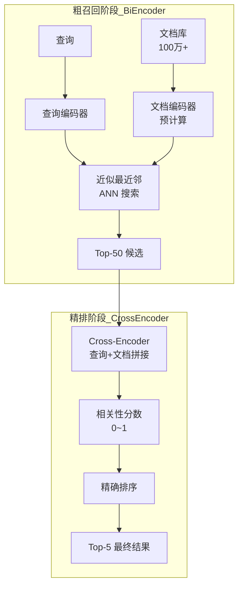

**Bi-Encoder vs Cross-Encoder 的核心区别**：

| 维度 | Bi-Encoder（双塔） | Cross-Encoder（交叉） |
|------|-------------------|---------------------|
| **输入方式** | 查询和文档分别编码 | 查询和文档拼接后一起编码 |
| **交互方式** | 无交互，最后算相似度 | 深度交互（注意力机制） |
| **速度** | 极快（文档向量可预计算） | 慢（需实时推理，逐个计算） |
| **精度** | 中 | 高 |
| **适用数量** | 全库（百万级） | Top-20~100 候选 |
| **代表模型** | BGE、E5、OpenAI Embedding | bge-reranker、Cohere Rerank |
| **计算复杂度** | O(N) 相似度计算 | O(N) 次 Transformer 前向传播 |

```python
# 演示：Bi-Encoder 和 Cross-Encoder 的计算方式差异
import numpy as np

# === Bi-Encoder（双塔）===
# 查询和文档分别编码，然后计算相似度
query = "如何优化 RAG 检索准确率"
documents = [
    "RAG 检索优化方法包括混合检索和重排序",
    "Python 性能优化技巧",
    "机器学习模型训练最佳实践",
]

# 假设编码后的向量（实际用 Embedding 模型）
query_vec = np.array([0.1, 0.2, 0.3])  # 768/1024 维
doc_vecs = [
    np.array([0.15, 0.25, 0.35]),  # 文档 1
    np.array([0.8, 0.1, 0.05]),    # 文档 2
    np.array([0.7, 0.2, 0.1]),     # 文档 3
]

# 相似度计算（极快，只需向量点积）
for i, dv in enumerate(doc_vecs):
    sim = np.dot(query_vec, dv) / (np.linalg.norm(query_vec) * np.linalg.norm(dv))
    print(f"Bi-Encoder 文档{i+1} 相似度: {sim:.4f}")

# === Cross-Encoder（交叉）===
# 查询和文档拼接后一起输入 Transformer
# 每个 (query, doc) 对都需要一次完整的 Transformer 前向传播
# 这就是为什么 Cross-Encoder 慢，但能捕捉细粒度交互
print("\nCross-Encoder 需要对每个 (query, document) 对做一次 Transformer 推理")
print("例如：<[BOS_never_used_51bce0c785ca2f68081bfa7d91973934]> 如何优化 RAG 检索准确率 [SEP] RAG 检索优化方法包括... [SEP] → 相关性分数")
```

> ⚠️ **常见坑点 9**：很多人想"既然 Cross-Encoder 更准，为什么不用它做全库检索？"答案是：Cross-Encoder 需要将查询和每篇文档拼接后输入 Transformer，100 万篇文档就需要 100 万次 Transformer 推理，即使每次 1ms 也需要 1000 秒（16 分钟），完全不可接受。因此 Cross-Encoder 只能用于 Top-N 候选的重排序，不能用于全库检索。
>
> ⚠️ **常见坑点 10**：重排序的候选数量（Top-N）不是越大越好。N 太小（如 5），可能漏掉相关文档；N 太大（如 200），重排序延迟高且可能引入不相关文档。经验值：N=20~50，最终返回 K=3~10。

---

### 4.2 Cross-Encoder 原理深度解析

**Cross-Encoder** 将查询和文档用特殊标记（<[BOS_never_used_51bce0c785ca2f68081bfa7d91973934]>/[SEP]）拼接后输入 Transformer，利用 <[BOS_never_used_51bce0c785ca2f68081bfa7d91973934]>  token 的最终隐藏状态通过一个分类头输出相关性分数。

```text
Cross-Encoder 输入格式：
<[BOS_never_used_51bce0c785ca2f68081bfa7d91973934]> 查询文本 [SEP] 文档文本 [SEP]
       ↓
Transformer Encoder（多层自注意力）
       ↓
<[BOS_never_used_51bce0c785ca2f68081bfa7d91973934]>  token 的最终隐藏状态 [CLS] ∈ R^hidden_size
       ↓
线性分类头：score = W × [CLS] + b
       ↓
Sigmoid → 相关性概率 [0, 1]
```

**为什么 Cross-Encoder 更准？三个关键机制**：

1. **词级交互**：查询中的每个词可以通过注意力机制直接关注文档中的每个词，捕捉细粒度匹配（如查询中的"性能"对应文档中的"吞吐量"）
2. **上下文理解**：可以理解查询中的指代（"它""这个"）在文档中指代什么
3. **复杂语义处理**：可以处理否定、条件、比较等复杂语义关系

```mermaid
graph TB
    subgraph CrossEncoder_注意力交互
        Q1[查询词: 如何] -->|注意力| D1[文档词: RAG]
        Q2[查询词: 优化] -->|注意力| D2[文档词: 检索]
        Q3[查询词: RAG] -->|强注意力| D3[文档词: 优化]
        Q4[查询词: 检索] -->|强注意力| D4[文档词: 准确率]
        Q5[查询词: 准确率] -->|注意力| D5[文档词: 混合检索]
    end

    CLS[<[BOS_never_used_51bce0c785ca2f68081bfa7d91973934]> 聚合<br/>所有交互信息] --> HEAD[分类头<br/>输出相关性分数]
    Q1 & Q2 & Q3 & Q4 & Q5 --> CLS
    D1 & D2 & D3 & D4 & D5 --> CLS
```

```python
# 使用 sentence-transformers 的 CrossEncoder
from sentence_transformers import CrossEncoder

# 加载中文 Reranker 模型
model = CrossEncoder("BAAI/bge-reranker-v2-m3", device="cuda")

# 构造 (query, document) 对
query = "如何优化 RAG 系统的检索准确率？"
documents = [
    "RAG 检索优化方法包括混合检索（向量+BM25）、Cross-Encoder 重排序、查询改写等",
    "Python 性能优化可以使用多进程、异步 IO、C 扩展等方法",
    "机器学习模型训练需要注意过拟合、学习率调优、数据增强等",
    "向量检索的准确率受分块策略、Embedding 模型、Top-K 参数影响",
]

pairs = [(query, doc) for doc in documents]

# Cross-Encoder 计算相关性分数
scores = model.predict(pairs)

# 按分数排序
ranked = sorted(zip(documents, scores), key=lambda x: x[1], reverse=True)
for doc, score in ranked:
    print(f"[{score:.4f}] {doc[:60]}...")
```

```python
# Cross-Encoder 批处理优化（减少推理次数）
import torch

class BatchReranker:
    """批处理重排序器，支持动态批大小和长度过滤"""

    def __init__(self, model_name="BAAI/bge-reranker-v2-m3", device="cuda",
                 batch_size=32, max_length=512):
        self.model = CrossEncoder(model_name, device=device, max_length=max_length)
        self.batch_size = batch_size

    def rerank(self, query: str, documents: list, top_k: int = 5) -> list:
        """
        批处理重排序

        Args:
            query: 查询文本
            documents: [(doc_id, content, metadata), ...] 候选文档
            top_k: 返回 top_k 个结果

        Returns:
            [(doc_id, score, content, metadata), ...] 按相关性降序
        """
        if not documents:
            return []

        # 构造 (query, doc) 对
        pairs = [(query, doc[1]) for doc in documents]

        # 批处理推理
        all_scores = []
        for i in range(0, len(pairs), self.batch_size):
            batch = pairs[i:i + self.batch_size]
            scores = self.model.predict(batch)
            all_scores.extend(scores.tolist() if hasattr(scores, 'tolist') else [scores])

        # 按分数排序
        scored = list(zip(documents, all_scores))
        scored.sort(key=lambda x: x[1], reverse=True)

        return [(doc[0], score, doc[1], doc[2]) for doc, score in scored[:top_k]]
```

```python
# 使用 BatchReranker
reranker = BatchReranker(
    model_name="BAAI/bge-reranker-v2-m3",
    device="cuda",
    batch_size=32,
    max_length=512,
)

# 候选文档（粗召回 Top-20）
candidates = [
    ("doc1", "RAG 检索优化方法...", {"source": "guide.md"}),
    ("doc2", "Python 性能优化...", {"source": "python.md"}),
    # ... 共 20 个候选
]

# 重排序
results = reranker.rerank("如何优化 RAG 检索准确率", candidates, top_k=5)
for doc_id, score, content, meta in results:
    print(f"[{score:.4f}] {doc_id}: {content[:50]}...")
```

---

### 4.3 主流 Reranker 模型对比

| 模型 | 厂商/机构 | 语言 | 参数量 | 最大长度 | 特点 | 推荐场景 |
|------|----------|------|--------|---------|------|---------|
| **bge-reranker-v2-m3** | BAAI | 多语言（100+） | ~560M | 8192 | 多语言优秀，中文最佳，支持长文本 | 中文 RAG（首选） |
| **bge-reranker-large** | BAAI | 中英 | ~330M | 512 | 英文优秀，中文可用 | 英文/中英混合 |
| **bge-reranker-base** | BAAI | 中英 | ~110M | 512 | 轻量快速，CPU 可用 | 低延迟/边缘部署 |
| **Cohere Rerank 3** | Cohere | 多语言 | - | 4096 | API 服务，质量极高，无需部署 | 不想自部署 |
| **Jina Reranker v2** | Jina AI | 多语言 | ~130M | 8192 | 开源，长文本支持好 | 长文档场景 |
| **mmarco-mMiniLM** | 微软 | 多语言 | ~22M | 512 | 极轻量，蒸馏模型 | 边缘/实时场景 |
| **bce-reranker-base_v1** | 网易 | 中英 | ~278M | 512 | 中文效果好，开源 | 中文 RAG 备选 |
| **LLM Rerank** | GPT-4o/Claude | 多语言 | - | 128K+ | 质量最高，可输出理由 | 极致质量/小批量 |

```python
# 不同 Reranker 模型的加载和使用对比

# 1. BGE Reranker v2 M3（中文首选，多语言，长文本）
from sentence_transformers import CrossEncoder
bge_m3 = CrossEncoder("BAAI/bge-reranker-v2-m3", max_length=8192)
scores = bge_m3.predict([(query, doc) for doc in documents])

# 2. BGE Reranker Large（英文优秀）
bge_large = CrossEncoder("BAAI/bge-reranker-large", max_length=512)

# 3. BGE Reranker Base（轻量快速，CPU 可用）
bge_base = CrossEncoder("BAAI/bge-reranker-base", max_length=512, device="cpu")

# 4. Cohere Rerank（API 服务）
import cohere
co = cohere.Client("your-api-key")
response = co.rerank(
    model="rerank-english-v3.0",
    query=query,
    documents=documents,
    top_n=5,
)
for result in response.results:
    print(f"排名 {result.rank}: 文档 {result.index}, 相关性 {result.relevance_score:.4f}")

# 5. Jina Reranker（开源，长文本）
jina_reranker = CrossEncoder("jinaai/jina-reranker-v2-base-multilingual", max_length=8192)
```

> ⚠️ **面试高频考点**：Reranker 模型的 max_length 参数有什么影响？如果文档超过 max_length 会怎样？答案：max_length 决定了 Cross-Encoder 能处理的最大 token 数（查询+文档拼接后的总长度）。如果超过 max_length，模型会截断文档末尾，可能丢失关键信息。选择 Reranker 时要考虑文档长度：短文档（<500 token）用 bge-reranker-base/large 即可；长文档（>500 token）需要用 bge-reranker-v2-m3（8192）或 Jina Reranker v2（8192）。另外，max_length 越大推理越慢，要在精度和延迟间权衡。

---

### 4.4 LLM Rerank 实现

用大语言模型做重排序，质量最高但成本也最高，适合对准确率要求极高的场景。

```python
# LLM Rerank 完整实现
import json
from typing import List, Dict, Any

class LLMReranker:
    """用 LLM 做重排序，支持打分模式和选择模式"""

    def __init__(self, llm_client, model="gpt-4o-mini", mode="score"):
        """
        Args:
            mode: "score" = 逐篇打分; "select" = 直接选择 Top-K
        """
        self.llm = llm_client
        self.model = model
        self.mode = mode

    def rerank_score(self, query: str, documents: List[Dict], top_k: int = 5) -> List[Dict]:
        """逐篇打分模式：让 LLM 给每篇文档打 1-10 分"""
        scored = []
        for i, doc in enumerate(documents):
            prompt = f"""你是一个文档相关性评估专家。请评估以下文档与用户查询的相关程度。

用户查询：{query}

文档内容：
{doc['content'][:500]}

请输出 JSON 格式：
{{"score": 1-10的整数, "reason": "简短的评估理由"}}
- 10分：完全相关，文档直接回答了查询
- 7-9分：高度相关，包含大部分关键信息
- 4-6分：部分相关，包含一些相关信息但不完整
- 1-3分：不相关或几乎不相关"""

            response = self.llm.chat.completions.create(
                model=self.model,
                messages=[{"role": "user", "content": prompt}],
                temperature=0,
                response_format={"type": "json_object"},
            )
            result = json.loads(response.choices[0].message.content)
            scored.append({**doc, "llm_score": result["score"], "llm_reason": result["reason"]})

        scored.sort(key=lambda x: x["llm_score"], reverse=True)
        return scored[:top_k]

    def rerank_select(self, query: str, documents: List[Dict], top_k: int = 5) -> List[Dict]:
        """选择模式：让 LLM 一次性从所有文档中选择最相关的 Top-K"""
        doc_list = "\n\n".join([
            f"[{i+1}] {doc['content'][:300]}..."
            for i, doc in enumerate(documents)
        ])

        prompt = f"""你是一个文档相关性评估专家。请根据用户查询，从以下文档中选择最相关的 {top_k} 个，按相关性从高到低排序。

用户查询：{query}

文档列表：
{doc_list}

请输出 JSON 格式：
{{"ranked_indices": [最相关的文档编号, 第二相关, ...]}}
只输出编号，不要解释。"""

        response = self.llm.chat.completions.create(
            model=self.model,
            messages=[{"role": "user", "content": prompt}],
            temperature=0,
            response_format={"type": "json_object"},
        )
        result = json.loads(response.choices[0].message.content)
        return [documents[i-1] for i in result["ranked_indices"] if i <= len(documents)]
```

```python
# LLM Rerank 使用示例
llm_reranker = LLMReranker(llm_client, model="gpt-4o-mini", mode="score")

# 候选文档
candidates = [
    {"id": "1", "content": "RAG 检索优化方法包括混合检索和重排序..."},
    {"id": "2", "content": "Python 性能优化技巧..."},
    {"id": "3", "content": "向量检索的准确率受分块策略影响..."},
]

# 逐篇打分
results = llm_reranker.rerank_score("如何优化 RAG 检索准确率", candidates, top_k=2)
for r in results:
    print(f"[{r['llm_score']}/10] {r['id']}: {r['llm_reason']}")
```

**Cross-Encoder vs LLM Rerank 对比**：

| 维度 | Cross-Encoder Rerank | LLM Rerank |
|------|---------------------|-------------|
| **质量** | 高 | 极高 |
| **速度** | 中（GPU 推理，~10ms/篇） | 慢（LLM 调用，~500ms/篇） |
| **成本** | 低（自部署，电费） | 高（Token 费用） |
| **可解释性** | 分数（无理由） | 可输出评估理由 |
| **处理数量** | Top-20~50 | Top-5~10（太贵） |
| **部署复杂度** | 中（需 GPU） | 低（API 调用） |
| **推荐场景** | 大多数生产场景 | 极致质量要求、小批量、需要理由 |

> ⚠️ **常见坑点 11**：LLM Rerank 的成本很高——如果对 20 篇候选文档逐篇打分，每篇 500 token，就是 10000 token 输入，加上输出，每次查询可能花费 $0.01-$0.05。高 QPS 场景下成本不可接受。建议：①先用 Cross-Encoder 重排序到 Top-5；②只对 Top-5 用 LLM Rerank 做最终排序；③或者用 LLM Rerank 的"选择模式"一次性评估所有候选，减少调用次数。

---

### 4.5 多样性优化 MMR

检索结果可能存在大量相似内容（同一文档的不同段落、相似文档），导致信息覆盖不全。**MMR（Maximal Marginal Relevance，最大边际相关性）** 在相关性和多样性之间取得平衡。

```text
MMR 公式：
MMR = argmax_{D ∈ R\S} [λ × Sim(Q, D) - (1-λ) × max_{D_i ∈ S} Sim(D, D_i)]

其中：
- Q：查询
- D：候选文档
- S：已选文档集合
- R：候选文档集合
- λ：相关性权重（0~1）
  - λ=1.0：纯相关性排序（不考虑多样性）
  - λ=0.0：纯多样性排序（不考虑相关性）
  - λ=0.5：相关性和多样性各占一半
- Sim(Q,D)：查询与文档的相似度
- Sim(D,D_i)：候选文档与已选文档的最大相似度
```

```python
# MMR 完整实现
import numpy as np
from typing import List, Tuple, Any

def cosine_similarity(v1: np.ndarray, v2: np.ndarray) -> float:
    """余弦相似度"""
    dot = np.dot(v1, v2)
    norm = np.linalg.norm(v1) * np.linalg.norm(v2)
    return dot / norm if norm > 0 else 0.0

def mmr_rerank(
    query_embedding: np.ndarray,
    doc_embeddings: List[np.ndarray],
    documents: List[Any],
    top_k: int = 5,
    lambda_param: float = 0.5,
) -> List[Any]:
    """
    MMR 重排序：平衡相关性和多样性

    Args:
        query_embedding: 查询向量
        doc_embeddings: 文档向量列表
        documents: 文档列表（与 doc_embeddings 一一对应）
        top_k: 返回数量
        lambda_param: 相关性权重，1.0=纯相关，0.0=纯多样

    Returns:
        按 MMR 排序的文档列表
    """
    if not documents:
        return []

    selected_indices = []
    candidate_indices = list(range(len(documents)))

    while len(selected_indices) < top_k and candidate_indices:
        best_idx = None
        best_mmr_score = -float('inf')

        for idx in candidate_indices:
            # 1. 相关性分数
            relevance = cosine_similarity(query_embedding, doc_embeddings[idx])

            # 2. 与已选文档的最大相似度（多样性惩罚）
            if selected_indices:
                diversity_penalty = max(
                    cosine_similarity(doc_embeddings[idx], doc_embeddings[s])
                    for s in selected_indices
                )
            else:
                diversity_penalty = 0.0

            # 3. MMR 分数
            mmr_score = lambda_param * relevance - (1 - lambda_param) * diversity_penalty

            if mmr_score > best_mmr_score:
                best_mmr_score = mmr_score
                best_idx = idx

        selected_indices.append(best_idx)
        candidate_indices.remove(best_idx)

    return [documents[i] for i in selected_indices]
```

```python
# MMR 使用示例
query_emb = np.array([0.1, 0.2, 0.3])
doc_embs = [
    np.array([0.1, 0.2, 0.3]),   # 与查询完全相同（高相关，但与其他文档也相似）
    np.array([0.11, 0.21, 0.31]), # 与文档 1 几乎相同（冗余）
    np.array([0.12, 0.19, 0.29]), # 与文档 1 相似（冗余）
    np.array([0.8, 0.1, 0.05]),   # 相关性低，但多样性高
    np.array([0.7, 0.2, 0.1]),    # 相关性中等，多样性高
]
documents = ["doc1", "doc2", "doc3", "doc4", "doc5"]

# 纯相关性排序（lambda=1.0）
pure_relevance = mmr_rerank(query_emb, doc_embs, documents, top_k=3, lambda_param=1.0)
print("纯相关性:", pure_relevance)  # doc1, doc2, doc3（都是相似内容）

# MMR 平衡（lambda=0.5）
mmr_balanced = mmr_rerank(query_emb, doc_embs, documents, top_k=3, lambda_param=0.5)
print("MMR平衡:", mmr_balanced)  # doc1, doc4, doc5（覆盖更多信息）

# 纯多样性（lambda=0.0）
pure_diversity = mmr_rerank(query_emb, doc_embs, documents, top_k=3, lambda_param=0.0)
print("纯多样性:", pure_diversity)
```

```python
# LangChain 内置 MMR 检索
from langchain_community.vectorstores import Chroma
from langchain_openai import OpenAIEmbeddings

vectorstore = Chroma.from_documents(documents, OpenAIEmbeddings())

# MMR 检索
retriever = vectorstore.as_retriever(
    search_type="mmr",
    search_kwargs={
        "k": 5,            # 返回 5 个结果
        "fetch_k": 20,     # 先召回 20 个候选
        "lambda_mult": 0.5, # MMR 的 lambda 参数（0.5 = 平衡）
    },
)

results = retriever.invoke("如何优化 RAG 检索准确率")
```

> ⚠️ **常见坑点 12**：MMR 的 lambda 参数设置不当会导致两种极端：lambda 太高（>0.8），多样性不足，结果仍然冗余；lambda 太低（<0.3），相关性不足，可能返回不相关的文档。推荐 lambda=0.5~0.7，在保证相关性的前提下提升多样性。另外，MMR 需要文档的 Embedding 向量来计算文档间相似度，如果只有 Cross-Encoder 分数而没有向量，需要先获取文档向量。

---

> 💡 **深度讲解**：重排序（Reranking）是 Advanced RAG 中提升检索精度最有效的单一技术，通常能带来 10-20% 的准确率提升。其核心是"粗召回用 Bi-Encoder（快但不准），精排用 Cross-Encoder（慢但准）"的两阶段架构。Bi-Encoder 将查询和文档分别编码为向量，通过 ANN 近似最近邻搜索从百万级文档中快速选出 Top-20~50 候选；Cross-Encoder 将查询和每篇候选文档拼接后输入 Transformer，利用 <[BOS_never_used_51bce0c785ca2f68081bfa7d91973934]> token 的隐藏状态输出相关性分数，对候选重新精确排序后返回 Top-3~10。Cross-Encoder 更准的原因是它能捕捉查询词和文档词之间的细粒度注意力交互，理解上下文指代和复杂语义关系，但由于每篇文档都需要一次 Transformer 前向传播，速度慢，只能用于候选重排序。主流 Reranker 模型中，bge-reranker-v2-m3 是中文场景的首选（多语言、长文本 8K、效果好），Cohere Rerank 是不想自部署时的最佳 API 选择，LLM Rerank 质量最高但成本也最高，适合小批量极致质量场景。MMR（最大边际相关性）是重排序的补充技术，在相关性和多样性间平衡，避免结果冗余。
>
> **📝 精简总结**：重排序 = 粗召回(Bi-Encoder, Top-20~50) + 精排(Cross-Encoder, Top-3~10)；Cross-Encoder 将查询+文档拼接输入Transformer，<[BOS_never_used_51bce0c785ca2f68081bfa7d91973934]>→分类头→相关性分数，比Bi-Encoder准但慢；中文首选bge-reranker-v2-m3(8K长文本)；LLM Rerank质量最高但贵，适合Top-5最终排序；MMR用lambda平衡相关性和多样性，避免结果冗余。
>
> **🎯 梯度练习题**
> - **入门题**：为什么不能用 Cross-Encoder 直接做全库检索，而只能做候选重排序？请从计算复杂度角度解释。
> - **进阶题**：Cross-Encoder 比 Bi-Encoder 更准的三个关键机制是什么？请结合注意力机制解释。
> - **实战题**：实现一个完整的两阶段检索系统：①用 Chroma + OpenAI Embedding 做向量检索，召回 Top-20；②用 bge-reranker-v2-m3 做 Cross-Encoder 重排序，返回 Top-5；③用 MMR（lambda=0.6）做多样性优化；④在测试集上对比"纯向量检索"和"两阶段+MMR"的 Recall@5 和 MRR。

---

## 五、查询优化技术

### 5.1 查询改写 Query Rewriting

用户的原始查询往往不够明确或不够优化，通过 LLM 重写可以提升检索效果。

> 💡 **通俗比喻**：查询改写就像"翻译官"——用户说"那个东西怎么弄"，翻译官根据上下文理解用户其实是想问"如何在 Python 中使用 Redis 实现分布式锁"，然后用这个更精确的查询去检索文档。原始查询太模糊，检索不到好结果；改写后的查询更规范，检索质量大幅提升。

```mermaid
graph LR
    A[用户原始查询<br/>"怎么弄"] --> B[LLM 查询改写]
    B --> C[改写后查询<br/>"如何在Python中使用Redis分布式锁"]
    C --> D[文档检索]
    D --> E[高质量检索结果]

    A -.->|直接检索| F[模糊/不相关结果]
```

**查询改写的常见类型**：

| 类型 | 原始查询 | 改写后 | 说明 |
|------|---------|--------|------|
| **补充上下文** | "怎么用" | "如何使用 Python 实现 Redis 分布式锁" | 补充省略的主体 |
| **术语规范化** | "那个向量搜索" | "基于向量的语义检索（Dense Retrieval）" | 口语→术语 |
| **扩展缩写** | "RAG 怎么搞" | "检索增强生成（RAG）系统如何构建和优化" | 缩写→全称 |
| **意图澄清** | "这个报错" | "如何解决 Python ImportError: No module named 'xxx'" | 模糊→具体 |
| **多意图拆分** | "安装和配置" | "如何安装 X" + "如何配置 X" | 多意图→单意图 |
| **语法纠错** | "pythn 怎么装" | "Python 怎么安装" | 拼写错误→正确 |
| **风格转换** | "说一下 RAG" | "请详细解释 RAG 检索增强生成的原理和实现" | 口语→书面 |

```python
# 查询改写完整实现
from typing import Optional

class QueryRewriter:
    """查询改写器：支持多种改写策略"""

    def __init__(self, llm_client, model="gpt-4o-mini"):
        self.llm = llm_client
        self.model = model

    def rewrite(self, query: str, context: str = "",
                rewrite_type: str = "general") -> str:
        """
        通用查询改写

        Args:
            query: 原始查询
            context: 对话历史上下文
            rewrite_type: 改写类型
        """
        type_prompts = {
            "general": """请将用户的原始查询重写为更适合文档检索的查询。
要求：
1. 补充查询中省略的上下文和背景
2. 使用更规范的术语和表述
3. 保留原始查询的核心意图
4. 输出重写后的查询，不要解释""",

            "technical": """请将用户的技术查询重写为更精确的技术检索查询。
要求：
1. 使用标准技术术语（如"分布式锁"而非"那个锁"）
2. 补充技术栈和环境信息（如语言、框架）
3. 扩展缩写为全称（如"RAG"→"检索增强生成"）
4. 输出重写后的查询，不要解释""",

            "conversational": """请根据对话历史，将用户的当前查询改写为独立的、自包含的检索查询。
要求：
1. 替换代词（"它""这个""那个"）为具体指代对象
2. 补充对话上下文中的关键信息
3. 使改写后的查询不需要上下文也能理解
4. 输出重写后的查询，不要解释""",
        }

        system_prompt = type_prompts.get(rewrite_type, type_prompts["general"])

        user_prompt = f"""{system_prompt}

{'对话历史：' + context if context else ''}
原始查询：{query}
重写后的查询："""

        response = self.llm.chat.completions.create(
            model=self.model,
            messages=[{"role": "user", "content": user_prompt}],
            temperature=0.3,
        )
        return response.choices[0].message.content.strip()
```

```python
# 查询改写使用示例
rewriter = QueryRewriter(llm_client)

# 示例 1：通用改写
original = "怎么弄"
context = "用户之前问了 RAG 检索优化的方法"
rewritten = rewriter.rewrite(original, context, rewrite_type="general")
print(f"原始: {original}")
print(f"改写: {rewritten}")
# 改写: 如何优化 RAG 系统的检索准确率和召回率

# 示例 2：技术改写
original = "那个向量搜索怎么搞"
rewritten = rewriter.rewrite(original, rewrite_type="technical")
# 改写: 如何实现基于向量的语义检索（Dense Retrieval）系统

# 示例 3：对话改写
original = "它怎么安装？"
context = "用户：什么是 Docker？\n助手：Docker 是一种容器化技术..."
rewritten = rewriter.rewrite(original, context, rewrite_type="conversational")
# 改写: 如何安装 Docker 容器化技术
```

```python
# 多轮对话中的查询改写（上下文感知）
class ContextAwareRewriter:
    """多轮对话上下文感知的查询改写"""

    def __init__(self, llm_client, model="gpt-4o-mini", max_history=5):
        self.llm = llm_client
        self.model = model
        self.max_history = max_history
        self.history = []  # [(role, content), ...]

    def add_message(self, role: str, content: str):
        """添加对话历史"""
        self.history.append((role, content))
        if len(self.history) > self.max_history * 2:
            self.history = self.history[-self.max_history * 2:]

    def rewrite(self, query: str) -> str:
        """基于对话历史改写当前查询"""
        history_str = "\n".join([
            f"{role}: {content}" for role, content in self.history
        ])

        prompt = f"""你是一个对话查询改写专家。根据对话历史，将用户的当前查询改写为独立的、自包含的检索查询。

要求：
1. 替换所有代词（它、这个、那个、上面、刚才）为具体指代
2. 补充对话中提到的关键实体和主题
3. 改写后的查询不需要对话历史也能完全理解
4. 只输出改写后的查询，不要解释

对话历史：
{history_str}

当前查询：{query}

改写后的查询："""

        response = self.llm.chat.completions.create(
            model=self.model,
            messages=[{"role": "user", "content": prompt}],
            temperature=0.2,
        )
        return response.choices[0].message.content.strip()

# 使用
rewriter = ContextAwareRewriter(llm_client)
rewriter.add_message("user", "什么是 RAG？")
rewriter.add_message("assistant", "RAG 是检索增强生成技术...")
rewriter.add_message("user", "它和微调有什么区别？")

rewritten = rewriter.rewrite("它和微调有什么区别？")
# 改写: RAG（检索增强生成）和大模型微调（Fine-tuning）有什么区别？
```

> ⚠️ **常见坑点 13**：查询改写不是万能的——如果原始查询已经很明确，改写可能反而引入偏差。建议：①对短查询（<10 字）和模糊查询做改写；②对长查询和明确查询跳过改写；③可以加一个"查询质量评估"步骤，判断是否需要改写。另外，改写会增加一次 LLM 调用，延迟增加 ~200ms，对延迟敏感的场景需要权衡。
>
> ⚠️ **常见坑点 14**：多轮对话改写时，如果对话历史太长，会导致 LLM 混淆或超出上下文窗口。建议只保留最近 3-5 轮对话，并且在改写 prompt 中明确要求"只基于最近的对话上下文"。

---

### 5.2 多查询生成 Multi-Query

用 LLM 生成多个不同角度的查询，分别检索后合并结果，提升召回率。

> 💡 **通俗比喻**：多查询生成就像"派多个侦探从不同角度调查同一个案件"——一个侦探查"技术原理"，一个查"实现代码"，一个查"应用案例"，然后把三个人的调查结果汇总。这样比只派一个侦探（单查询）能找到更多相关信息。

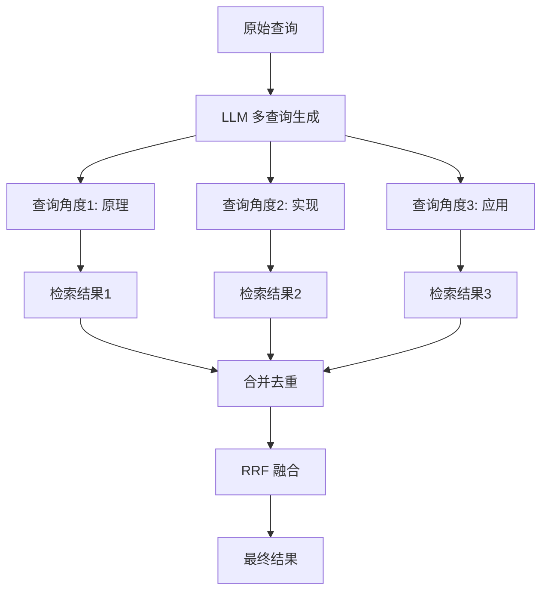

```python
# 多查询生成完整实现
class MultiQueryGenerator:
    """多查询生成器：从不同角度生成多个查询"""

    def __init__(self, llm_client, model="gpt-4o-mini"):
        self.llm = llm_client
        self.model = model

    def generate(self, query: str, n: int = 3) -> list:
        """
        生成 n 个不同角度的查询

        Returns:
            [原始查询, 查询1, 查询2, ...]
        """
        prompt = f"""你是一个查询生成专家。请根据用户的原始查询，生成 {n} 个不同角度但语义相关的查询，用于文档检索。

要求：
1. 每个查询从不同角度表达相同的信息需求（如原理、实现、应用、对比、优缺点等）
2. 查询应该多样化，避免重复或过于相似
3. 每个查询单独一行，不要编号，不要解释，不要加引号

原始查询：{query}

生成的查询："""

        response = self.llm.chat.completions.create(
            model=self.model,
            messages=[{"role": "user", "content": prompt}],
            temperature=0.7,  # 稍高温度增加多样性
        )

        queries = [
            q.strip() for q in response.choices[0].message.content.split("\n")
            if q.strip() and not q.strip().startswith(("1.", "2.", "3.", "-", "*"))
        ]
        return [query] + queries[:n]  # 包含原始查询
```

```python
# 多查询检索完整流程
class MultiQueryRetriever:
    """多查询检索：生成多个查询，分别检索后融合"""

    def __init__(self, query_generator, base_retriever, fusion_k=60):
        self.generator = query_generator
        self.retriever = base_retriever
        self.fusion_k = fusion_k

    def search(self, query: str, per_query_k: int = 10, final_k: int = 10) -> list:
        """
        多查询检索

        Args:
            query: 原始查询
            per_query_k: 每个查询召回数量
            final_k: 最终返回数量
        """
        # 1. 生成多个查询
        queries = self.generator.generate(query, n=3)
        print(f"生成 {len(queries)} 个查询:")
        for i, q in enumerate(queries):
            print(f"  {i+1}. {q}")

        # 2. 每个查询分别检索
        all_results = []
        for q in queries:
            results = self.retriever.search(q, top_k=per_query_k)
            all_results.append(results)

        # 3. RRF 融合
        fused = self._rrf_fuse(all_results)

        # 4. 返回 Top-K
        return fused[:final_k]

    def _rrf_fuse(self, results_list):
        """RRF 融合多路结果"""
        scores = {}
        content_map = {}
        for results in results_list:
            for rank, (doc_id, score, content) in enumerate(results, 1):
                scores[doc_id] = scores.get(doc_id, 0) + 1.0 / (self.fusion_k + rank)
                content_map[doc_id] = content
        return sorted(
            [(did, s, content_map[did]) for did, s in scores.items()],
            key=lambda x: x[1], reverse=True
        )
```

```python
# LangChain 内置 MultiQueryRetriever
from langchain.retrievers.multi_query import MultiQueryRetriever
from langchain_openai import ChatOpenAI

# 基础检索器
base_retriever = vectorstore.as_retriever(search_kwargs={"k": 10})

# 多查询检索器
llm = ChatOpenAI(model="gpt-4o-mini", temperature=0.7)
multi_query_retriever = MultiQueryRetriever.from_llm(
    retriever=base_retriever,
    llm=llm,
    include_original=True,  # 包含原始查询
)

# 设置日志查看生成的查询
import logging
logging.basicConfig()
logging.getLogger("langchain.retrievers.multi_query").setLevel(logging.INFO)

# 检索
results = multi_query_retriever.invoke("如何优化 RAG 检索准确率")
```

> ⚠️ **面试高频考点**：多查询生成（Multi-Query）和查询改写（Query Rewriting）的区别？答案：①查询改写是将一个查询改写为一个更好的查询（1→1），目的是提升查询质量；②多查询生成是将一个查询扩展为多个不同角度的查询（1→N），分别检索后融合，目的是提升召回率；③查询改写成本低（1次LLM调用+1次检索），多查询生成成本高（1次LLM调用+N次检索）；④两者可以组合使用：先改写，再多查询生成。

---

### 5.3 HyDE 假设文档嵌入

**HyDE（Hypothetical Document Embeddings）** 用 LLM 根据查询生成一个"假设的答案文档"，然后对这个假设文档做 Embedding 用于检索。

> 💡 **通俗比喻**：HyDE 就像"先写一篇假想的答案，再去找相似的真实答案"——用户问"如何优化 RAG 检索准确率"，HyDE 先让 LLM 写一篇"假想的 RAG 优化指南"（可能包含混合检索、重排序、查询改写等内容），然后用这篇假想指南的向量去检索真实文档。因为假想文档的语言风格和长度与真实文档更接近，检索效果比直接用短查询向量更好。

```mermaid
graph LR
    A[用户查询<br/>"如何优化RAG"] --> B[LLM 生成<br/>假设答案文档]
    B --> C[假设文档<br/>"RAG检索优化方法包括..."]
    C --> D[Embedding<br/>向量化]
    D --> E[向量检索]
    E --> F[真实相关文档]

    A -.->|直接Embedding| G[短查询向量<br/>信息不足]
    G -.-> H[检索效果差]
```

```python
# HyDE 完整实现
class HyDE:
    """Hypothetical Document Embeddings"""

    def __init__(self, llm_client, embedder, model="gpt-4o-mini",
                 doc_length=300, temperature=0.7):
        self.llm = llm_client
        self.embedder = embedder
        self.model = model
        self.doc_length = doc_length
        self.temperature = temperature

    def generate_hypothetical_doc(self, query: str) -> str:
        """生成假设答案文档"""
        prompt = f"""请根据以下问题，写一段假设的答案文档。

要求：
1. 文档应该包含问题的答案和相关背景知识
2. 使用专业、规范的表述，像技术文档或百科条目
3. 长度约 {self.doc_length} 字
4. 不要包含"假设"、"可能"、"大概"等不确定表述
5. 不要包含"以下是答案"等引导语，直接写正文

问题：{query}
假设文档："""

        response = self.llm.chat.completions.create(
            model=self.model,
            messages=[{"role": "user", "content": prompt}],
            temperature=self.temperature,
        )
        return response.choices[0].message.content.strip()

    def embed_query(self, query: str):
        """
        HyDE 的核心：用假设文档的向量代替查询向量

        Returns:
            假设文档的 Embedding 向量
        """
        hypothetical_doc = self.generate_hypothetical_doc(query)
        return self.embedder.embed_query(hypothetical_doc)
```

```python
# HyDE 检索完整流程
class HyDERetriever:
    """HyDE 检索器"""

    def __init__(self, hyde, vectorstore, top_k=5):
        self.hyde = hyde
        self.vectorstore = vectorstore
        self.top_k = top_k

    def search(self, query: str) -> list:
        """HyDE 检索"""
        # 1. 生成假设文档并获取其向量
        query_embedding = self.hyde.embed_query(query)

        # 2. 用假设文档向量检索
        results = self.vectorstore.similarity_search_by_vector(
            query_embedding, k=self.top_k
        )
        return results

# 使用
from langchain_openai import OpenAIEmbeddings
embedder = OpenAIEmbeddings(model="text-embedding-3-small")
hyde = HyDE(llm_client, embedder)
retriever = HyDERetriever(hyde, vectorstore, top_k=5)

results = retriever.search("如何优化 RAG 检索准确率")
```

```python
# LangChain 内置 HyDE
from langchain.chains import HypotheticalDocumentEmbedder
from langchain_openai import OpenAIEmbeddings, ChatOpenAI

# 基础 Embedding
base_embeddings = OpenAIEmbeddings(model="text-embedding-3-small")

# HyDE Embedding
llm = ChatOpenAI(model="gpt-4o-mini", temperature=0.7)
hyde_embeddings = HypotheticalDocumentEmbedder.from_llm(
    llm=llm,
    base_embeddings=base_embeddings,
    prompt_key="web_search",  # 内置 prompt 模板
)

# 用 HyDE Embedding 构建向量库
vectorstore = Chroma.from_documents(documents, hyde_embeddings)

# 检索时自动用 HyDE
retriever = vectorstore.as_retriever(search_kwargs={"k": 5})
results = retriever.invoke("如何优化 RAG 检索准确率")
```

**HyDE 的适用与不适用场景**：

| 场景 | 是否推荐 | 原因 |
|------|---------|------|
| 短查询/模糊查询 | ✅ 推荐 | 假设文档补充了语义信息 |
| 查询与文档风格差异大 | ✅ 推荐 | 假设文档弥合风格鸿沟 |
| 专业领域查询 | ✅ 推荐 | 假设文档补充专业术语 |
| 事实性/精确查询 | ⚠️ 谨慎 | LLM 可能生成错误假设，误导检索 |
| 对延迟敏感 | ❌ 不推荐 | 多一次 LLM 调用，延迟 +200~500ms |
| 高 QPS 场景 | ❌ 不推荐 | LLM 调用成本高 |

> ⚠️ **常见坑点 15**：HyDE 的最大风险是"LLM 生成了错误的假设文档，导致检索到错误的内容"。例如用户问"Python 3.12 有什么新特性"，如果 LLM 生成的假设文档里写了错误的特性（幻觉），用这个错误文档的向量去检索，可能检索到同样包含错误信息的文档。建议：①对事实性查询慎用 HyDE；②可以同时用原始查询向量和 HyDE 向量做混合检索（两路召回后融合），降低风险；③对生成的假设文档做质量检查。

---

### 5.4 查询分解 Query Decomposition

复杂查询分解为多个子问题，分别检索后综合回答。

> 💡 **通俗比喻**：查询分解就像"把一个大问题拆成几个小问题"——用户问"对比 Spring Boot 和 Django 在构建 RESTful API 时的性能和开发效率"，这个问题太复杂，直接检索可能找不到完全匹配的文档。分解成"Spring Boot 的性能""Django 的性能""Spring Boot 的开发效率""Django 的开发效率"四个子问题，分别检索后综合，就能给出全面的回答。

```python
# 查询分解完整实现
class QueryDecomposer:
    """复杂查询分解为多个子问题"""

    def __init__(self, llm_client, model="gpt-4o-mini"):
        self.llm = llm_client
        self.model = model

    def decompose(self, query: str) -> list:
        """将复杂查询分解为多个可独立检索的子问题"""
        prompt = f"""请将以下复杂问题分解为多个可以独立检索的子问题。

要求：
1. 子问题应该简单、具体、可独立检索和回答
2. 按逻辑顺序排列（先基础后综合）
3. 每个子问题单独一行，不要编号，不要解释
4. 子问题数量控制在 3-6 个

复杂问题：{query}

子问题："""

        response = self.llm.chat.completions.create(
            model=self.model,
            messages=[{"role": "user", "content": prompt}],
            temperature=0.3,
        )

        return [
            q.strip() for q in response.choices[0].message.content.split("\n")
            if q.strip()
        ]

    def decompose_with_plan(self, query: str) -> dict:
        """带执行计划的查询分解"""
        prompt = f"""请分析以下复杂问题，制定检索和回答计划。

输出 JSON 格式：
{{
  "sub_questions": ["子问题1", "子问题2", ...],
  "reasoning": "分解思路说明",
  "answer_strategy": "如何综合子问题的答案"
}}

复杂问题：{query}"""

        import json
        response = self.llm.chat.completions.create(
            model=self.model,
            messages=[{"role": "user", "content": prompt}],
            temperature=0.3,
            response_format={"type": "json_object"},
        )
        return json.loads(response.choices[0].message.content)
```

```python
# 分解式检索完整流程
class DecomposedRetriever:
    """查询分解 + 分别检索 + 综合回答"""

    def __init__(self, decomposer, retriever, llm):
        self.decomposer = decomposer
        self.retriever = retriever
        self.llm = llm

    def query(self, question: str) -> str:
        """端到端：分解 → 检索 → 综合"""
        # 1. 分解查询
        sub_questions = self.decomposer.decompose(question)
        print(f"分解为 {len(sub_questions)} 个子问题:")
        for i, sq in enumerate(sub_questions, 1):
            print(f"  {i}. {sq}")

        # 2. 每个子问题分别检索
        all_contexts = []
        for sq in sub_questions:
            results = self.retriever.search(sq, top_k=3)
            all_contexts.extend(results)

        # 3. 去重
        unique_contexts = list({r[0]: r for r in all_contexts}.values())

        # 4. 综合回答
        context_str = "\n\n".join([r[2] for r in unique_contexts[:10]])
        prompt = f"""基于以下检索到的信息，回答用户的复杂问题。

检索信息：
{context_str}

复杂问题：{question}

请综合以上信息，给出全面、结构化的回答。"""

        response = self.llm.chat.completions.create(
            model="gpt-4o",
            messages=[{"role": "user", "content": prompt}],
            temperature=0,
        )
        return response.choices[0].message.content
```

```python
# 查询分解使用示例
decomposer = QueryDecomposer(llm_client)

# 示例：对比类问题
question = "对比 Spring Boot 和 Django 在构建 RESTful API 时的性能和开发效率"
sub_questions = decomposer.decompose(question)
for i, sq in enumerate(sub_questions, 1):
    print(f"{i}. {sq}")
# 1. Spring Boot 构建 RESTful API 的性能如何
# 2. Django 构建 RESTful API 的性能如何
# 3. Spring Boot 开发 RESTful API 的效率如何
# 4. Django 开发 RESTful API 的效率如何
# 5. Spring Boot 和 Django 的性能对比
# 6. Spring Boot 和 Django 的开发效率对比

# 示例：带计划的分解
plan = decomposer.decompose_with_plan("RAG 和微调的区别是什么，各自适用于什么场景")
print(f"分解思路: {plan['reasoning']}")
print(f"回答策略: {plan['answer_strategy']}")
for sq in plan["sub_questions"]:
    print(f"  - {sq}")
```

> ⚠️ **常见坑点 16**：查询分解会显著增加检索成本——一个复杂问题分解为 4-6 个子问题，每个子问题检索 Top-3，就是 12-18 次检索，延迟和成本都大幅增加。建议：①只对明显复杂的查询（包含"对比""分别""和"等多意图词）做分解；②简单查询直接检索；③可以设置子问题数量上限（如最多 4 个）；④对子问题的检索结果做去重和融合，避免重复上下文。

---

> 💡 **深度讲解**：查询优化是 Advanced RAG 中"检索前优化"的核心技术，包括查询改写（Query Rewriting，1→1 提升查询质量）、多查询生成（Multi-Query，1→N 提升召回率）、HyDE（假设文档嵌入，用 LLM 生成的假设答案文档的向量代替查询向量，弥合查询-文档风格鸿沟）、查询分解（Query Decomposition，将复杂问题拆为多个子问题分别检索后综合）。这四种技术各有适用场景：查询改写适合短查询和模糊查询，成本最低（1次LLM调用）；多查询生成适合需要高召回率的场景，成本中等（1次LLM+N次检索）；HyDE 适合查询与文档风格差异大的场景，但有幻觉风险（LLM生成错误假设文档）；查询分解适合多意图复杂问题（对比、分别），成本最高（N次检索）。四种技术可以组合使用，如"先改写 → 再多查询生成 → 分别检索 → RRF融合"，但要注意成本和延迟的权衡。
>
> **📝 精简总结**：查询优化四技术：查询改写(1→1，短/模糊查询，成本最低)、多查询生成(1→N，高召回，1次LLM+N次检索)、HyDE(生成假设答案文档再Embedding，弥合风格鸿沟但有幻觉风险)、查询分解(复杂问题拆为子问题，分别检索后综合，成本最高)；四者可组合但需权衡成本延迟。
>
> **🎯 梯度练习题**
> - **入门题**：查询改写（Query Rewriting）和多查询生成（Multi-Query）的核心区别是什么？各举一个适用场景。
> - **进阶题**：HyDE 的核心思想是什么？它的最大风险是什么？在什么场景下不应该使用 HyDE？
> - **实战题**：实现一个智能查询优化器，能自动判断查询类型并选择优化策略：①短查询（<10字）→ 查询改写；②包含"对比""分别"的复杂查询 → 查询分解；③其他查询 → 多查询生成（n=2）。实现完整的判断逻辑和对应的优化流程。

---

## 六、上下文压缩与多路召回策略

### 6.1 上下文压缩 Context Compression

检索到的文档可能包含大量与查询无关的内容，直接全部传给 LLM 会浪费 Token、降低回答质量。上下文压缩提取文档中与查询最相关的片段。

> 💡 **通俗比喻**：上下文压缩就像"做摘抄"——你从图书馆借了 10 本书，每本书 300 页，但你只需要每本书中与问题相关的那 2-3 段。上下文压缩就是自动从每篇检索到的文档中提取最相关的段落，而不是把整本书都塞给 LLM。

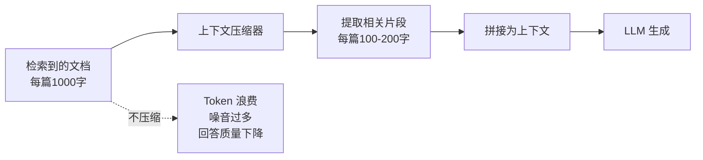

**上下文压缩的主要方法**：

| 方法 | 原理 | 优点 | 缺点 |
|------|------|------|------|
| **LLM 提取** | 用 LLM 从文档中提取与查询相关的句子 | 精度最高，理解语义 | 成本高，延迟大 |
| **Embedding 过滤** | 对文档的每个句子做 Embedding，保留与查询相似度高的 | 速度快，成本低 | 可能丢失上下文 |
| **Cross-Encoder 过滤** | 用 Reranker 给每个句子打分，保留高分句子 | 精度高 | 速度中等 |
| **关键句提取** | 用 TextRank 等算法提取关键句 | 无需 LLM | 不理解查询语义 |

```python
# LLM 上下文压缩器实现
class LLMContextCompressor:
    """用 LLM 从文档中提取与查询相关的内容"""

    def __init__(self, llm_client, model="gpt-4o-mini", max_tokens_per_doc=200):
        self.llm = llm_client
        self.model = model
        self.max_tokens = max_tokens_per_doc

    def compress(self, query: str, documents: list) -> list:
        """
        压缩文档列表，提取每篇中与查询相关的内容

        Args:
            query: 用户查询
            documents: [(doc_id, content, metadata), ...]

        Returns:
            [(doc_id, compressed_content, metadata), ...]
        """
        compressed = []
        for doc_id, content, metadata in documents:
            prompt = f"""请从以下文档中提取与用户查询最相关的内容。

要求：
1. 只提取直接相关的句子或段落，不要概括
2. 保留原文表述，不要改写
3. 如果文档中没有相关内容，输出"无相关内容"
4. 提取的内容不超过 {self.max_tokens} 字

用户查询：{query}

文档内容：
{content[:2000]}

相关内容："""

            response = self.llm.chat.completions.create(
                model=self.model,
                messages=[{"role": "user", "content": prompt}],
                temperature=0,
            )
            result = response.choices[0].message.content.strip()

            if "无相关内容" not in result:
                compressed.append((doc_id, result, metadata))

        return compressed
```

```python
# Embedding 上下文压缩器（句子级过滤）
from langchain_openai import OpenAIEmbeddings
import numpy as np

class EmbeddingContextCompressor:
    """基于句子 Embedding 相似度的上下文压缩"""

    def __init__(self, embeddings, similarity_threshold=0.5, min_sentences=2):
        self.embeddings = embeddings
        self.threshold = similarity_threshold
        self.min_sentences = min_sentences

    def compress(self, query: str, documents: list) -> list:
        """按句子级相似度压缩文档"""
        query_emb = self.embeddings.embed_query(query)
        compressed = []

        for doc_id, content, metadata in documents:
            # 简单分句
            sentences = [s.strip() for s in content.replace("。", "。\n").split("\n") if s.strip()]
            if not sentences:
                continue

            # 每个句子的 Embedding
            sent_embs = self.embeddings.embed_documents(sentences)

            # 计算与查询的相似度
            similarities = [
                np.dot(query_emb, se) / (np.linalg.norm(query_emb) * np.linalg.norm(se))
                for se in sent_embs
            ]

            # 保留相似度高于阈值的句子
            relevant = [
                (sent, sim) for sent, sim in zip(sentences, similarities)
                if sim >= self.threshold
            ]

            # 如果太少，保留相似度最高的 min_sentences 个
            if len(relevant) < self.min_sentences:
                top_indices = np.argsort(similarities)[::-1][:self.min_sentences]
                relevant = [(sentences[i], similarities[i]) for i in top_indices]

            compressed_content = " ".join([r[0] for r in relevant])
            compressed.append((doc_id, compressed_content, metadata))

        return compressed
```

```python
# LangChain 内置上下文压缩
from langchain.retrievers import ContextualCompressionRetriever
from langchain.retrievers.document_compressors import LLMChainExtractor
from langchain_openai import ChatOpenAI

# LLM 压缩器
llm = ChatOpenAI(model="gpt-4o-mini", temperature=0)
compressor = LLMChainExtractor.from_llm(llm)

# 压缩检索器
compression_retriever = ContextualCompressionRetriever(
    base_compressor=compressor,
    base_retriever=vectorstore.as_retriever(search_kwargs={"k": 10}),
)

# 检索（自动压缩）
results = compression_retriever.invoke("如何优化 RAG 检索准确率")
for doc in results:
    print(f"[{doc.metadata.get('source', 'unknown')}] {doc.page_content[:100]}...")
```

> ⚠️ **常见坑点 17**：上下文压缩可能"过度压缩"——把重要的背景信息或定义也删掉了，导致 LLM 缺少必要的上下文。建议：①设置最小保留句子数（如 min_sentences=2）；②对压缩后的内容做长度检查，如果太短（<50字），回退到不压缩；③可以用"扩展窗口"策略——保留相关句子及其前后各 1 句，确保上下文完整。

---

### 6.2 多路召回 Multi-path Retrieval

除了向量检索和 BM25，还可以从更多路径召回相关文档，提升覆盖率。

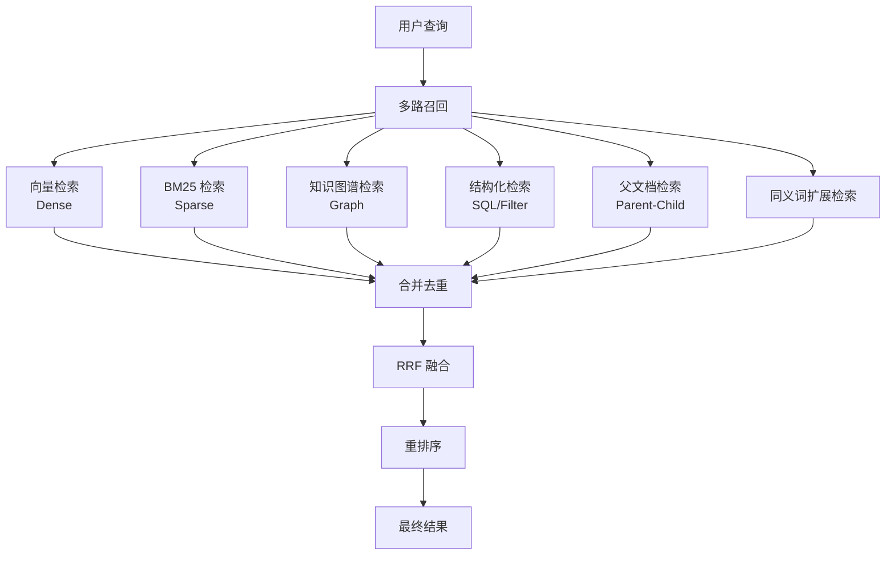

**多路召回的常见路径**：

| 召回路径 | 原理 | 擅长 | 成本 |
|---------|------|------|------|
| **向量检索** | 稠密向量相似度 | 语义匹配、同义词 | 中 |
| **BM25** | 词频匹配 | 专有名词、精确匹配 | 低 |
| **知识图谱** | 实体-关系遍历 | 多跳推理、隐式关系 | 高 |
| **结构化检索** | SQL/元数据过滤 | 时间、分类、作者等属性 | 低 |
| **父文档检索** | 子块检索→返回父块 | 长文档上下文完整 | 中 |
| **同义词扩展** | 同义词表/LLM扩展 | 领域术语、缩写 | 低 |
| **跨语言检索** | 多语言Embedding/翻译 | 中英文混合查询 | 中 |

```python
# 多路召回检索器实现
class MultiPathRetriever:
    """多路召回：向量 + BM25 + 元数据过滤 + 父文档"""

    def __init__(self, vectorstore, bm25_retriever, metadata_store,
                 parent_doc_store, dense_top_k=15, sparse_top_k=15):
        self.vectorstore = vectorstore
        self.bm25 = bm25_retriever
        self.metadata_store = metadata_store
        self.parent_store = parent_doc_store
        self.dense_top_k = dense_top_k
        self.sparse_top_k = sparse_top_k

    def search(self, query: str, filters: dict = None, top_k: int = 10) -> list:
        """
        多路召回

        Args:
            query: 查询文本
            filters: 元数据过滤条件 {"category": "技术", "date__gte": "2025-01-01"}
            top_k: 最终返回数量
        """
        all_results = {}

        # 路径 1：向量检索
        dense_results = self.vectorstore.similarity_search_with_score(
            query, k=self.dense_top_k, filter=filters
        )
        for doc, score in dense_results:
            doc_id = doc.metadata.get("id", str(id(doc)))
            all_results[doc_id] = (doc_id, score, doc.page_content, "dense")

        # 路径 2：BM25 检索
        sparse_results = self.bm25.search(query, k=self.sparse_top_k)
        for doc_id, score, content in sparse_results:
            if doc_id in all_results:
                # 已存在，标记为多路命中
                existing = all_results[doc_id]
                all_results[doc_id] = (doc_id, existing[1], existing[2], existing[3] + "+sparse")
            else:
                all_results[doc_id] = (doc_id, score, content, "sparse")

        # 路径 3：元数据过滤检索（如果有 filters）
        if filters:
            filtered_ids = self.metadata_store.query(filters)
            for fid in filtered_ids[:10]:
                if fid not in all_results:
                    content = self.metadata_store.get_content(fid)
                    all_results[fid] = (fid, 0.5, content, "metadata")

        # 路径 4：父文档扩展（对检索到的子块，获取其父文档）
        final_results = []
        for doc_id, score, content, source in all_results.values():
            parent_id = self.parent_store.get_parent_id(doc_id)
            if parent_id:
                parent_content = self.parent_store.get_content(parent_id)
                final_results.append((parent_id, score, parent_content, source + "+parent"))
            else:
                final_results.append((doc_id, score, content, source))

        # 去重（按 doc_id）
        unique = {}
        for r in final_results:
            if r[0] not in unique or r[1] > unique[r[0]][1]:
                unique[r[0]] = r

        return sorted(unique.values(), key=lambda x: x[1], reverse=True)[:top_k]
```

```python
# 同义词扩展检索
class SynonymExpandedRetriever:
    """同义词扩展检索：扩展查询后再检索"""

    def __init__(self, base_retriever, llm_client, synonym_dict=None):
        self.retriever = base_retriever
        self.llm = llm_client
        self.synonym_dict = synonym_dict or {}  # {"RAG": ["检索增强生成", "Retrieval Augmented Generation"]}

    def expand_query(self, query: str) -> list:
        """扩展查询的同义词"""
        expanded_terms = set()
        expanded_terms.add(query)

        # 1. 基于同义词表
        for term, synonyms in self.synonym_dict.items():
            if term in query:
                for syn in synonyms:
                    expanded_terms.add(query.replace(term, syn))

        # 2. 基于 LLM 扩展
        prompt = f"""请为以下查询生成 3 个同义词或等价表述，用于文档检索。
查询：{query}
等价表述（每行一个）："""
        response = self.llm.chat.completions.create(
            model="gpt-4o-mini",
            messages=[{"role": "user", "content": prompt}],
            temperature=0.5,
        )
        for line in response.choices[0].message.content.split("\n"):
            if line.strip():
                expanded_terms.add(line.strip())

        return list(expanded_terms)

    def search(self, query: str, top_k: int = 10) -> list:
        """同义词扩展后检索"""
        expanded_queries = self.expand_query(query)
        all_results = []
        for eq in expanded_queries[:5]:  # 最多 5 个扩展查询
            results = self.retriever.search(eq, top_k=10)
            all_results.extend(results)

        # 去重 + RRF 融合
        unique = self._deduplicate(all_results)
        return unique[:top_k]
```

> ⚠️ **面试高频考点**：多路召回（Multi-path Retrieval）和混合检索（Hybrid Search）的区别？答案：①混合检索特指"向量检索 + 关键词检索（BM25）"两路融合，是多路召回的一个特例；②多路召回范围更广，除了向量和 BM25，还包括知识图谱检索、结构化检索（SQL/元数据过滤）、父文档检索、同义词扩展、跨语言检索等多种召回路径；③混合检索解决的是"语义匹配 vs 精确匹配"的互补，多路召回解决的是"从更多维度/路径覆盖相关文档"的问题；④生产级系统通常是多路召回，混合检索是其中的核心组成部分。

---

### 6.3 父子文档检索 Parent-Child Retrieval

将长文档拆分为小的子块（Child）用于精确检索，但返回时返回父文档（Parent）的完整上下文。

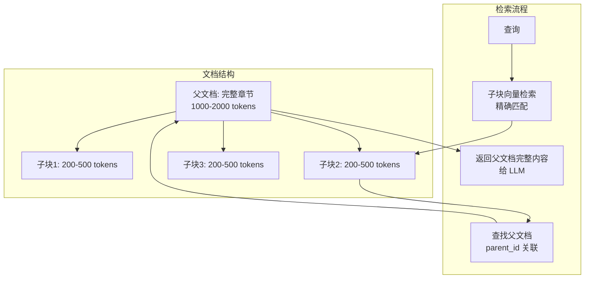

```python
# 父子文档检索完整实现
class ParentChildRetriever:
    """父子文档检索：子块检索，返回父文档"""

    def __init__(self, vectorstore, parent_docstore, child_splitter, parent_splitter):
        """
        Args:
            vectorstore: 存储子块向量
            parent_docstore: 存储父文档全文（如 InMemoryStore / Redis）
            child_splitter: 子块分割器（小块）
            parent_splitter: 父块分割器（大块）
        """
        self.vectorstore = vectorstore
        self.parent_store = parent_docstore
        self.child_splitter = child_splitter
        self.parent_splitter = parent_splitter

    def add_documents(self, documents):
        """添加文档：先分父块，再分每个父块的子块"""
        from langchain_core.documents import Document
        import uuid

        # 1. 分割为父块
        parent_docs = self.parent_splitter.split_documents(documents)

        for parent_doc in parent_docs:
            # 2. 为每个父块生成 ID
            parent_id = str(uuid.uuid4())
            parent_doc.metadata["parent_id"] = parent_id

            # 3. 存储父块全文
            self.parent_store.mset([(parent_id, parent_doc)])

            # 4. 将父块分割为子块
            child_docs = self.child_splitter.split_documents([parent_doc])

            # 5. 为每个子块标记 parent_id，并存入向量库
            for child in child_docs:
                child.metadata["parent_id"] = parent_id

            self.vectorstore.add_documents(child_docs)

    def search(self, query: str, top_k: int = 5) -> list:
        """检索：子块检索 → 返回父文档"""
        # 1. 子块向量检索
        child_results = self.vectorstore.similarity_search(query, k=top_k * 3)

        # 2. 收集不重复的 parent_id（按子块相关性排序）
        parent_ids = []
        seen = set()
        for child in child_results:
            pid = child.metadata.get("parent_id")
            if pid and pid not in seen:
                parent_ids.append(pid)
                seen.add(pid)

        # 3. 获取父文档全文
        parent_docs = self.parent_store.mget(parent_ids[:top_k])

        return [doc for doc in parent_docs if doc is not None]
```

```python
# LangChain 内置 ParentDocumentRetriever
from langchain.retrievers import ParentDocumentRetriever
from langchain.storage import InMemoryStore
from langchain_community.vectorstores import Chroma
from langchain_openai import OpenAIEmbeddings
from langchain.text_splitter import RecursiveCharacterTextSplitter

# 父块分割器（大块，用于返回上下文）
parent_splitter = RecursiveCharacterTextSplitter(chunk_size=1000, chunk_overlap=200)
# 子块分割器（小块，用于精确检索）
child_splitter = RecursiveCharacterTextSplitter(chunk_size=200, chunk_overlap=50)

# 向量库（存子块）
vectorstore = Chroma(
    embedding_function=OpenAIEmbeddings(model="text-embedding-3-small"),
    collection_name="child_chunks",
)
# 文档存储（存父块）
store = InMemoryStore()

# 父子检索器
retriever = ParentDocumentRetriever(
    vectorstore=vectorstore,
    docstore=store,
    child_splitter=child_splitter,
    parent_splitter=parent_splitter,
)

# 添加文档
retriever.add_documents(documents)

# 检索（返回父文档的完整内容）
results = retriever.invoke("如何优化 RAG 检索准确率")
for doc in results:
    print(f"父文档长度: {len(doc.page_content)} 字")
    print(doc.page_content[:200])
```

```python
# 父子分块大小的量化实验
def experiment_parent_child(parent_sizes, child_sizes, test_queries, retriever_factory):
    """实验不同父子块大小组合的检索效果"""
    results = []
    for ps in parent_sizes:
        for cs in child_sizes:
            if cs >= ps:
                continue  # 子块必须小于父块
            retriever = retriever_factory(parent_size=ps, child_size=cs)
            # 评估
            metrics = evaluate_retriever(retriever, test_queries)
            results.append({
                "parent_size": ps,
                "child_size": cs,
                "recall_at_5": metrics["recall@5"],
                "mrr": metrics["mrr"],
                "avg_context_tokens": metrics["avg_context_tokens"],
            })
            print(f"父={ps}, 子={cs}: Recall@5={metrics['recall@5']:.3f}, "
                  f"MRR={metrics['mrr']:.3f}, 上下文={metrics['avg_context_tokens']}tokens")
    return results

# 实验参数
parent_sizes = [500, 1000, 2000]
child_sizes = [100, 200, 400]
# 经验结论：
# - 子块 200-400 tokens：检索精度好
# - 父块 1000-2000 tokens：上下文完整
# - 子块太小（<100）：语义不完整
# - 父块太大（>2000）：噪音多，Token 浪费
```

> ⚠️ **常见坑点 18**：父子文档检索中，如果多个子块属于同一个父文档，检索结果会重复返回同一个父文档。解决方法：①在收集 parent_id 时去重；②设置 `top_k * 3` 的子块召回量，确保有足够多的不同父文档；③如果父文档数量不够，可以扩大子块召回量。另外，父文档存储（docstore）要支持批量获取（mget），否则逐个获取会很慢。

---

> 💡 **深度讲解**：上下文压缩和多路召回是 Advanced RAG 中"检索中优化"和"检索后优化"的重要技术。上下文压缩解决的是"检索到的文档太长、噪音太多"的问题——通过 LLM 提取、Embedding 句子过滤、Cross-Encoder 过滤等方法，从每篇文档中提取与查询最相关的片段，减少 Token 消耗和噪音干扰，提升 LLM 回答质量。多路召回解决的是"单路检索覆盖不全"的问题——除了向量检索和 BM25，还可以从知识图谱、结构化检索（SQL/元数据过滤）、父文档检索、同义词扩展、跨语言检索等更多路径召回相关文档，然后合并去重、RRF 融合、重排序。父子文档检索（Parent-Child Retrieval）是多路召回中的一个重要策略——用小的子块（200-500 tokens）做精确检索，但返回大的父块（1000-2000 tokens）的完整上下文，解决了"小块信息不足"和"大块噪音多"的矛盾。这些技术的组合使用，能将检索覆盖率和上下文质量提升到新的水平。
>
> **📝 精简总结**：上下文压缩从检索文档中提取相关片段（LLM提取/Embedding句子过滤/Cross-Encoder过滤），减少Token和噪音；多路召回从向量+BM25+知识图谱+结构化+父文档+同义词等多路径召回，提升覆盖率；父子文档检索用子块(200-500)精确检索、返回父块(1000-2000)完整上下文，解决小块信息不足和大块噪音多的矛盾。
>
> **🎯 梯度练习题**
> - **入门题**：上下文压缩的目的是什么？请列举至少三种压缩方法并比较优劣。
> - **进阶题**：父子文档检索（Parent-Child）的核心思想是什么？它解决了什么矛盾？子块和父块的大小通常如何选择？
> - **实战题**：实现一个完整的多路召回检索系统，包含：①向量检索（Top-15）；②BM25 检索（Top-15）；③元数据过滤（按 category 和 date）；④父子文档扩展；⑤RRF 融合；⑥Cross-Encoder 重排序（Top-5）。画出完整的数据流图并实现代码。

---

## 七、GraphRAG、Self-RAG 与 Agentic RAG

### 7.1 GraphRAG 知识图谱增强检索

**GraphRAG** 将文档中的实体和关系提取到知识图谱，查询时先从图谱中获取相关实体和关系，再结合向量检索。

> 💡 **通俗比喻**：GraphRAG 就像"给知识库画了一张关系地图"——普通 RAG 只能找到"提到了某个词的段落"，GraphRAG 能理解"A 和 B 是什么关系""A 通过 B 关联到 C"。比如你问"张三和李四什么关系"，普通 RAG 可能只找到提到张三的段落和提到李四的段落，但 GraphRAG 能直接从图谱中查到"张三→同事→李四"这条关系，甚至能推理"张三→同事→李四→同学→王五"这种多跳关系。

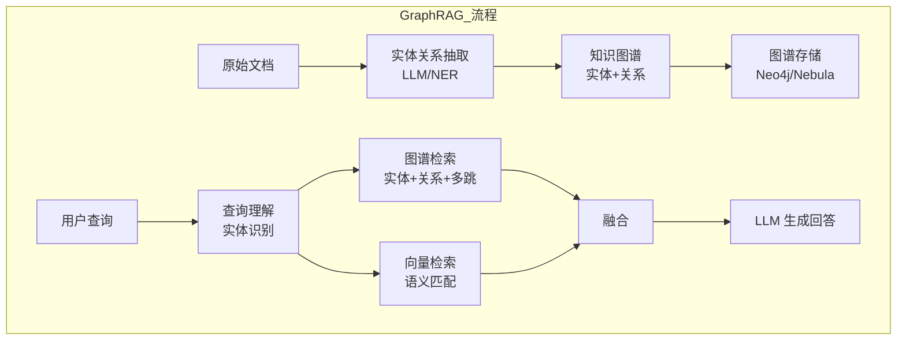

**GraphRAG vs 普通 RAG 的对比**：

| 维度 | 普通 RAG | GraphRAG |
|------|---------|----------|
| **检索方式** | 向量相似度 | 图谱遍历 + 向量检索 |
| **实体关系** | 不理解 | 显式存储实体和关系 |
| **多跳推理** | ❌ 困难 | ✅ 支持（A→B→C） |
| **隐式关系** | ❌ 无法发现 | ✅ 可推理关联 |
| **可解释性** | 低 | 高（可展示关系路径） |
| **构建成本** | 低 | 高（需实体关系抽取） |
| **维护成本** | 低 | 高（图谱需更新） |
| **适用场景** | 通用问答 | 关系密集、需要推理的领域 |

```python
# GraphRAG 实体关系抽取实现
class EntityRelationExtractor:
    """用 LLM 从文档中抽取实体和关系"""

    def __init__(self, llm_client, model="gpt-4o-mini"):
        self.llm = llm_client
        self.model = model

    def extract(self, text: str) -> dict:
        """
        从文本中抽取实体和关系

        Returns:
            {"entities": [{"name": str, "type": str}],
             "relations": [{"head": str, "relation": str, "tail": str}]}
        """
        import json
        prompt = f"""请从以下文本中抽取实体和关系。

要求：
1. 实体：人名、组织名、产品名、技术术语、地点等
2. 关系：实体之间的明确关系（如"创始人""属于""使用""对比"等）
3. 输出 JSON 格式，不要解释

文本：
{text[:3000]}

输出格式：
{{"entities": [{{"name": "实体名", "type": "实体类型"}}],
 "relations": [{{"head": "头实体", "relation": "关系", "tail": "尾实体"}}]}}"""

        response = self.llm.chat.completions.create(
            model=self.model,
            messages=[{"role": "user", "content": prompt}],
            temperature=0,
            response_format={"type": "json_object"},
        )
        return json.loads(response.choices[0].message.content)
```

```python
# 知识图谱存储与检索（Neo4j）
from neo4j import GraphDatabase

class KnowledgeGraph:
    """知识图谱操作封装"""

    def __init__(self, uri, user, password):
        self.driver = GraphDatabase.driver(uri, auth=(user, password))

    def close(self):
        self.driver.close()

    def add_entity(self, name: str, entity_type: str):
        """添加实体节点"""
        with self.driver.session() as session:
            session.run(
                "MERGE (e:Entity {name: $name, type: $type})",
                name=name, type=entity_type
            )

    def add_relation(self, head: str, relation: str, tail: str):
        """添加关系边"""
        with self.driver.session() as session:
            session.run(
                """MATCH (h:Entity {name: $head})
                   MATCH (t:Entity {name: $tail})
                   MERGE (h)-[r:RELATION {type: $relation}]->(t)""",
                head=head, relation=relation, tail=tail
            )

    def query_related(self, entity_name: str, hops: int = 2) -> list:
        """查询与某实体相关的实体和关系（多跳）"""
        with self.driver.session() as session:
            result = session.run(
                f"""MATCH path = (e:Entity {{name: $name}})-[r:RELATION*1..{hops}]->(related)
                   RETURN e.name as source, r as relations, related.name as target,
                          related.type as target_type
                   LIMIT 50""",
                name=entity_name
            )
            return [record.data() for record in result]

    def build_from_extraction(self, extraction_result: dict):
        """从抽取结果构建图谱"""
        for entity in extraction_result["entities"]:
            self.add_entity(entity["name"], entity["type"])
        for rel in extraction_result["relations"]:
            self.add_relation(rel["head"], rel["relation"], rel["tail"])
```

```python
# GraphRAG 检索器实现
class GraphRAGRetriever:
    """GraphRAG：知识图谱检索 + 向量检索融合"""

    def __init__(self, knowledge_graph, vectorstore, llm_client,
                 graph_top_k=10, vector_top_k=10):
        self.kg = knowledge_graph
        self.vectorstore = vectorstore
        self.llm = llm_client
        self.graph_top_k = graph_top_k
        self.vector_top_k = vector_top_k

    def extract_query_entities(self, query: str) -> list:
        """从查询中识别实体"""
        import json
        prompt = f"""请从以下查询中识别出关键实体（人名、产品名、技术术语等）。
输出 JSON 格式：{{"entities": ["实体1", "实体2", ...]}}

查询：{query}"""
        response = self.llm.chat.completions.create(
            model="gpt-4o-mini",
            messages=[{"role": "user", "content": prompt}],
            temperature=0,
            response_format={"type": "json_object"},
        )
        return json.loads(response.choices[0].message.content)["entities"]

    def search(self, query: str, top_k: int = 5) -> list:
        """GraphRAG 检索"""
        # 1. 从查询中识别实体
        entities = self.extract_query_entities(query)
        print(f"查询实体: {entities}")

        # 2. 知识图谱检索：获取相关实体和关系
        graph_context = []
        for entity in entities:
            related = self.kg.query_related(entity, hops=2)
            for r in related:
                graph_context.append(
                    f"{r['source']} → {r['relations']} → {r['target']}({r['target_type']})"
                )

        # 3. 向量检索
        vector_results = self.vectorstore.similarity_search(query, k=self.vector_top_k)

        # 4. 融合：图谱上下文 + 向量检索结果
        combined_context = "\n".join(graph_context[:20])
        results = []
        for doc in vector_results[:top_k]:
            # 将图谱信息附加到文档中
            enhanced_content = f"[知识图谱上下文]\n{combined_context}\n\n[文档内容]\n{doc.page_content}"
            results.append((doc.metadata.get("id", ""), 0.9, enhanced_content))

        return results
```

> ⚠️ **常见坑点 19**：GraphRAG 的构建成本很高——实体关系抽取需要 LLM 调用（每篇文档 1 次），图谱存储需要 Neo4j 等图数据库，图谱更新需要增量抽取。对于文档量不大（<1000 篇）或关系不密集的场景，GraphRAG 的投入产出比不高。建议：①先评估文档中实体关系的密度；②只对关系密集的领域（如企业组织架构、产品依赖关系、学术论文引用网络）使用 GraphRAG；③可以先用 Microsoft GraphRAG 等开源框架快速验证效果。

---

### 7.2 Self-RAG 自反思检索

**Self-RAG** 让 LLM 在生成过程中自主决定是否需要检索、检索结果是否相关、回答是否需要修正。

> 💡 **通俗比喻**：Self-RAG 就像一个"会自我检查的学生"——普通 RAG 学生是"先翻书，再照着写答案"，不管翻到的内容有没有用。Self-RAG 学生是"先想想需不需要翻书→翻书后检查内容有没有用→写答案后检查答案对不对→不对就重新翻书或修正"。整个过程有反思和纠错机制，回答质量更高。

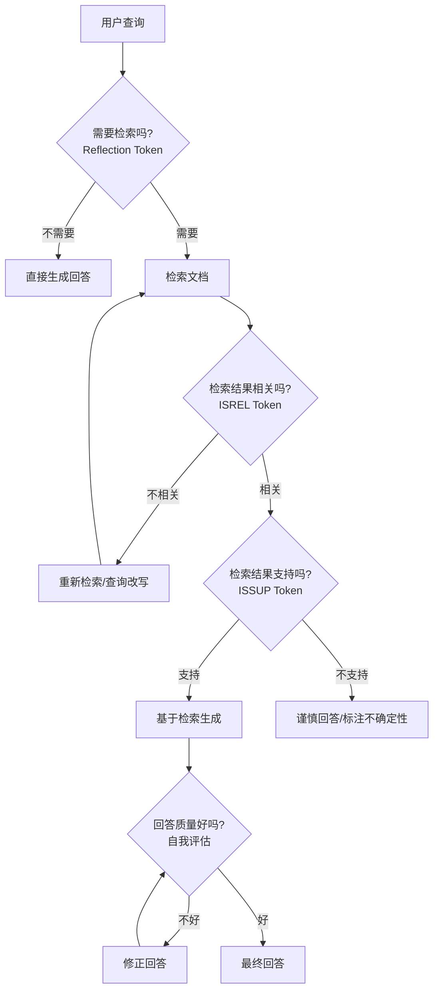

```python
# Self-RAG 完整实现
class SelfRAG:
    """Self-RAG：自反思检索增强生成"""

    def __init__(self, llm_client, retriever, model="gpt-4o", max_retrievals=3):
        self.llm = llm_client
        self.retriever = retriever
        self.model = model
        self.max_retrievals = max_retrievals

    def need_retrieval(self, query: str) -> bool:
        """判断是否需要检索（Reflection）"""
        prompt = f"""请判断回答以下问题是否需要检索外部知识。

判断标准：
- 需要检索：事实性问题、时效性问题、专业领域问题、可能涉及具体数据的问题
- 不需要检索：常识性问题、纯推理问题、创意性问题

只回答"需要"或"不需要"，不要解释。

问题：{query}"""
        response = self.llm.chat.completions.create(
            model=self.model,
            messages=[{"role": "user", "content": prompt}],
            temperature=0,
        )
        return "需要" in response.choices[0].message.content

    def check_relevance(self, query: str, document: str) -> bool:
        """检查文档是否与查询相关（ISREL）"""
        prompt = f"""请判断以下文档是否与用户查询相关。

只回答"相关"或"不相关"，不要解释。

用户查询：{query}

文档：{document[:500]}"""
        response = self.llm.chat.completions.create(
            model=self.model,
            messages=[{"role": "user", "content": prompt}],
            temperature=0,
        )
        return "相关" in response.choices[0].message.content

    def check_support(self, answer: str, documents: list) -> dict:
        """检查回答是否被检索结果支持（ISSUP）"""
        docs_str = "\n\n".join([f"文档{i+1}: {d[:300]}" for i, d in enumerate(documents)])
        prompt = f"""请检查以下回答是否被检索文档支持。

输出 JSON 格式：
{{"supported": true/false, "unsupported_claims": ["不被支持的声明1", ...], "reason": "简要说明"}}

回答：{answer}

检索文档：
{docs_str}"""
        import json
        response = self.llm.chat.completions.create(
            model=self.model,
            messages=[{"role": "user", "content": prompt}],
            temperature=0,
            response_format={"type": "json_object"},
        )
        return json.loads(response.choices[0].message.content)

    def query(self, question: str) -> str:
        """Self-RAG 端到端查询"""
        # 1. 判断是否需要检索
        if not self.need_retrieval(question):
            print("[Self-RAG] 不需要检索，直接生成")
            return self._direct_generate(question)

        # 2. 多轮检索（最多 max_retrievals 次）
        all_docs = []
        current_query = question
        for attempt in range(self.max_retrievals):
            print(f"[Self-RAG] 第 {attempt+1} 轮检索: {current_query}")

            # 检索
            results = self.retriever.search(current_query, top_k=5)
            docs = [r[2] for r in results]

            # 检查相关性
            relevant_docs = [d for d in docs if self.check_relevance(question, d)]
            print(f"[Self-RAG] 检索到 {len(docs)} 篇，相关 {len(relevant_docs)} 篇")

            all_docs.extend(relevant_docs)

            if len(relevant_docs) >= 3:
                break  # 相关文档足够，停止检索

            # 相关文档不足，改写查询后重新检索
            current_query = self._rewrite_for_retrieval(question, current_query)

        # 3. 生成回答
        answer = self._generate_with_context(question, all_docs[:5])

        # 4. 检查回答是否被支持
        support_check = self.check_support(answer, all_docs[:5])
        if not support_check["supported"]:
            print(f"[Self-RAG] 回答不被支持，修正中... 原因: {support_check['reason']}")
            answer = self._revise_answer(question, answer, support_check, all_docs[:5])

        return answer
```

> ⚠️ **面试高频考点**：Self-RAG 和 Corrective RAG（CRAG）的区别？答案：①Self-RAG 是让 LLM 通过特殊的 Reflection Token（反思标记）在生成过程中自主决定是否检索、检索结果是否相关、回答是否需要修正，是"生成过程中的自反思"；②Corrective RAG（CRAG）是在检索后评估检索结果的质量，如果质量差就触发"纠正动作"（如网络搜索、查询改写），是"检索后的纠错机制"；③Self-RAG 更强调 LLM 的自主决策能力，需要训练或微调 LLM 来输出 Reflection Token；④CRAG 更强调检索质量的评估和纠正，是一个更轻量的框架，可以用现成的 LLM 实现；⑤两者可以组合使用：CRAG 保证检索质量，Self-RAG 保证生成质量。

---

### 7.3 Agentic RAG 智能体检索

**Agentic RAG** 将 RAG 封装为 Agent 的工具，Agent 可以自主决定何时检索、检索什么、检索几次、如何综合结果。

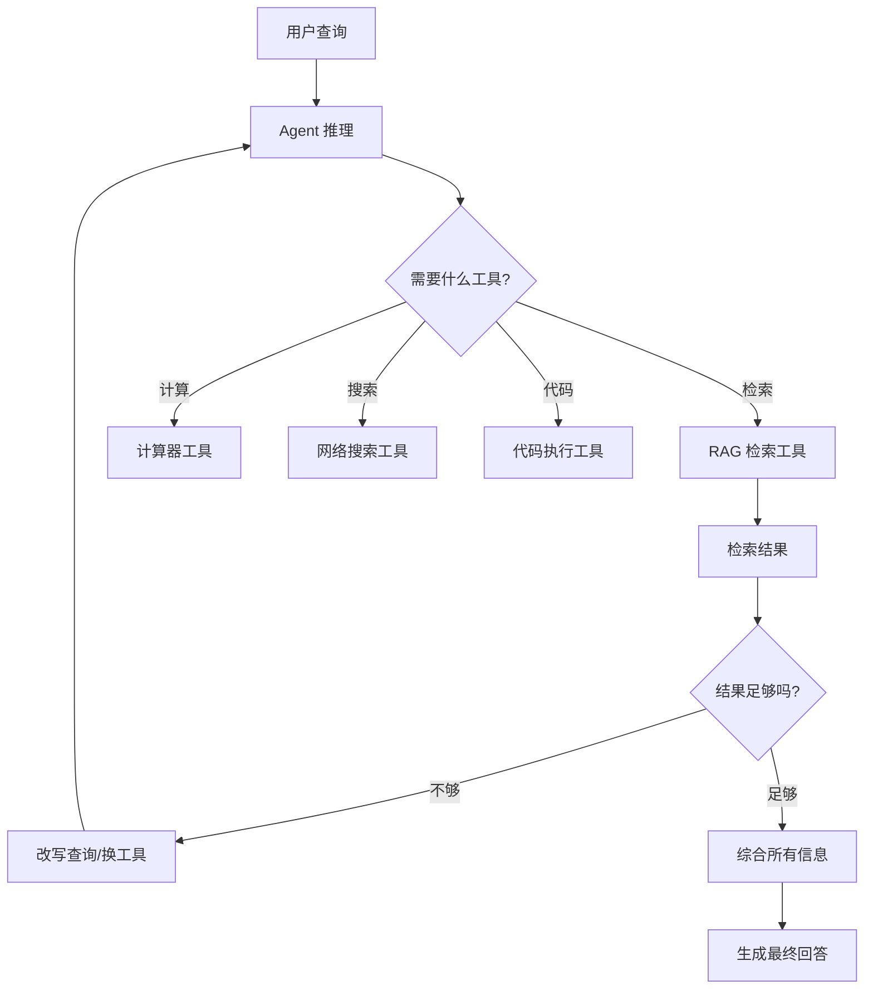

```python
# Agentic RAG 实现（LangChain Agent）
from langchain.agents import AgentExecutor, create_openai_tools_agent
from langchain_core.tools import tool
from langchain_openai import ChatOpenAI
from langchain_core.prompts import ChatPromptTemplate

# 定义 RAG 检索工具
@tool
def rag_search(query: str, top_k: int = 5) -> str:
    """
    在知识库中检索相关文档。当需要查找特定信息、事实、定义、
    技术细节时使用此工具。

    Args:
        query: 检索查询，应该具体明确
        top_k: 返回的文档数量，默认 5
    """
    results = vectorstore.similarity_search(query, k=top_k)
    return "\n\n".join([
        f"[文档 {i+1}]\n{doc.page_content}\n来源: {doc.metadata.get('source', 'unknown')}"
        for i, doc in enumerate(results)
    ])

@tool
def hybrid_search(query: str) -> str:
    """
    混合检索：同时使用向量检索和 BM25 关键词检索。
    当查询包含专有名词、型号、错误码等精确匹配需求时使用。
    """
    results = hybrid_retriever.search(query, top_k=5)
    return "\n\n".join([
        f"[文档 {i+1} | 来源: {r[3]}]\n{r[2]}"
        for i, r in enumerate(results)
    ])

@tool
def web_search(query: str) -> str:
    """当知识库中没有相关信息时，使用网络搜索获取最新信息。"""
    # 调用网络搜索 API
    return "网络搜索结果..."

# 创建 Agent
llm = ChatOpenAI(model="gpt-4o", temperature=0)
tools = [rag_search, hybrid_search, web_search]

prompt = ChatPromptTemplate.from_messages([
    ("system", """你是一个智能知识库助手。你可以使用以下工具：
- rag_search: 在知识库中检索（通用查询）
- hybrid_search: 混合检索（含专有名词的精确查询）
- web_search: 网络搜索（知识库没有时）

使用策略：
1. 先用 rag_search 或 hybrid_search 检索知识库
2. 如果检索结果不相关或不足，可以改写查询后重新检索
3. 如果知识库确实没有相关信息，使用 web_search
4. 综合所有信息给出最终回答，标注信息来源"""),
    ("human", "{input}"),
    ("agent_scratchpad", "{agent_scratchpad}"),
])

agent = create_openai_tools_agent(llm, tools, prompt)
agent_executor = AgentExecutor(agent=agent, tools=tools, verbose=True, max_iterations=5)

# 使用
result = agent_executor.invoke({"input": "iPhone 15 Pro Max 的 A17 Pro 芯片性能怎么样？和 RAG 有什么关系？"})
print(result["output"])
```

> ⚠️ **常见坑点 20**：Agentic RAG 的最大问题是"不可控"——Agent 可能做出意料之外的工具调用（如反复检索、调用不需要的工具），导致延迟高、成本高、回答不稳定。建议：①设置 max_iterations 上限（如 3-5 次），防止无限循环；②对工具调用做日志记录，便于排查；③在 system prompt 中明确工具使用策略和优先级；④对高 QPS 场景，先用固定流程的 Advanced RAG，Agentic RAG 只用于复杂查询。

---

> 💡 **深度讲解**：GraphRAG、Self-RAG、Agentic RAG 是 RAG 技术的三个高级演进方向。GraphRAG 通过实体关系抽取构建知识图谱，将检索从"语义相似度匹配"升级为"图谱关系推理"，支持多跳推理和隐式关系发现，适合关系密集的领域（企业知识、学术网络、产品依赖），但构建和维护成本高。Self-RAG 引入反思机制（Reflection Token），让 LLM 在生成过程中自主判断是否需要检索、检索结果是否相关、回答是否被支持、是否需要修正，通过"检索-评估-生成-自检-修正"的闭环提升回答质量和忠实度，减少幻觉。Agentic RAG 将 RAG 检索封装为 Agent 的工具之一，Agent 可以自主决定使用哪个工具（向量检索/混合检索/网络搜索/计算器）、何时使用、使用几次、如何综合结果，适合复杂的多步骤问题，但存在不可控、延迟高、成本高的问题。三者代表了 RAG 从"固定流程"到"自适应"到"自主智能"的演进方向。
>
> **📝 精简总结**：GraphRAG构建知识图谱支持多跳推理和关系发现，适合关系密集领域但成本高；Self-RAG通过反思Token让LLM自主判断是否检索/结果是否相关/回答是否需修正，闭环提升质量；Agentic RAG将检索封装为Agent工具，自主决定用什么工具/何时用/用几次，适合复杂问题但不可控；三者代表固定流程→自适应→自主智能的演进。
>
> **🎯 梯度练习题**
> - **入门题**：GraphRAG 相比普通 RAG 的核心优势是什么？它的主要成本在哪里？
> - **进阶题**：Self-RAG 的四个反思步骤是什么？请分别解释每个步骤的作用。
> - **实战题**：实现一个简化版 Self-RAG 系统，包含：①判断是否需要检索；②检索后检查文档相关性（不相关则改写查询重新检索，最多2次）；③生成回答后检查是否被检索结果支持；④不被支持则修正回答。写出完整代码并测试。

---

## 八、RAG 评估方法与工具

### 8.1 RAG 评估体系概述

RAG 评估分为三个层面：检索质量评估、生成质量评估、端到端效果评估。

```mermaid
graph TB
    A[RAG 评估体系] --> B[检索质量评估]
    A --> C[生成质量评估]
    A --> D[端到端评估]

    B --> B1[Recall@k]
    B --> B2[Precision@k]
    B --> B3[MRR]
    B --> B4[NDCG@k]
    B --> B5[Hit Rate]

    C --> C1[忠实度 Faithfulness]
    C --> C2[答案相关性 Answer Relevance]
    C --> C3[上下文相关性 Context Relevance]
    C --> C4[上下文召回 Context Recall]

    D --> D1[回答准确率]
    D --> D2[引用准确率]
    D --> D3[人工评估]
    D --> D4[LLM-as-Judge]
```

**评估指标汇总表**：

| 层面 | 指标 | 说明 | 计算方式 | 目标值 |
|------|------|------|---------|--------|
| **检索** | Recall@k | top-k 中包含相关文档的比例 | 相关文档在top-k中数/总相关数 | >0.9 |
| **检索** | Precision@k | top-k 中相关文档的比例 | 相关文档数/k | >0.7 |
| **检索** | MRR | 第一个相关文档排名倒数的平均 | Σ(1/排名)/N | >0.8 |
| **检索** | NDCG@k | 考虑排名位置的归一化折损增益 | DCG@k/IDCG@k | >0.8 |
| **检索** | Hit Rate | 至少命中一个相关文档的查询比例 | 命中查询数/总查询数 | >0.95 |
| **生成** | Faithfulness | 回答是否基于上下文，无幻觉 | LLM 评估声明是否被支持 | >0.9 |
| **生成** | Answer Relevance | 回答是否切题 | LLM 评估回答与问题相关性 | >0.85 |
| **生成** | Context Relevance | 检索上下文是否相关 | LLM 评估上下文与问题相关性 | >0.8 |
| **生成** | Context Recall | 上下文是否覆盖了答案所需信息 | LLM 评估答案信息是否在上下文中 | >0.85 |
| **端到端** | 准确率 | 回答是否正确 | 人工/LLM 评估 | >0.85 |
| **端到端** | 引用准确率 | 回答中的引用是否正确 | 人工核查 | >0.9 |

---

### 8.2 检索质量评估实现

```python
# 检索质量评估器完整实现
import numpy as np
from typing import List, Dict, Tuple

class RetrievalEvaluator:
    """检索质量评估：Recall, Precision, MRR, NDCG, Hit Rate"""

    def evaluate(self, test_cases: List[Dict], retriever, top_k: int = 10) -> Dict:
        """
        评估检索系统

        Args:
            test_cases: [{"query": str, "relevant_doc_ids": [str, ...]}, ...]
            retriever: 检索器，有 search(query, top_k) 方法
            top_k: 评估的 top_k

        Returns:
            各项指标的平均值
        """
        recalls, precisions, mrrs, ndcgs, hits = [], [], [], [], []

        for case in test_cases:
            query = case["query"]
            relevant = set(case["relevant_doc_ids"])

            # 检索
            results = retriever.search(query, top_k=top_k)
            retrieved_ids = [r[0] if isinstance(r, tuple) else r.metadata.get("id", str(i))
                            for i, r in enumerate(results)]

            # 计算各项指标
            recalls.append(self._recall_at_k(retrieved_ids, relevant, top_k))
            precisions.append(self._precision_at_k(retrieved_ids, relevant, top_k))
            mrrs.append(self._mrr(retrieved_ids, relevant))
            ndcgs.append(self._ndcg_at_k(retrieved_ids, relevant, top_k))
            hits.append(self._hit_rate(retrieved_ids, relevant))

        return {
            f"recall@{top_k}": np.mean(recalls),
            f"precision@{top_k}": np.mean(precisions),
            "mrr": np.mean(mrrs),
            f"ndcg@{top_k}": np.mean(ndcgs),
            "hit_rate": np.mean(hits),
            "test_cases": len(test_cases),
        }

    def _recall_at_k(self, retrieved: List[str], relevant: set, k: int) -> float:
        if not relevant:
            return 1.0
        return len(set(retrieved[:k]) & relevant) / len(relevant)

    def _precision_at_k(self, retrieved: List[str], relevant: set, k: int) -> float:
        if k == 0:
            return 0.0
        return len(set(retrieved[:k]) & relevant) / k

    def _mrr(self, retrieved: List[str], relevant: set) -> float:
        for i, doc_id in enumerate(retrieved, 1):
            if doc_id in relevant:
                return 1.0 / i
        return 0.0

    def _ndcg_at_k(self, retrieved: List[str], relevant: set, k: int) -> float:
        dcg = 0.0
        for i, doc_id in enumerate(retrieved[:k], 1):
            if doc_id in relevant:
                dcg += 1.0 / np.log2(i + 1)
        # IDCG：理想情况下所有相关文档都排在前面
        ideal_hits = min(len(relevant), k)
        idcg = sum(1.0 / np.log2(i + 1) for i in range(1, ideal_hits + 1))
        return dcg / idcg if idcg > 0 else 0.0

    def _hit_rate(self, retrieved: List[str], relevant: set) -> float:
        return 1.0 if set(retrieved) & relevant else 0.0
```

```python
# 检索评估使用示例 + A/B 对比
test_cases = [
    {"query": "什么是 Hybrid Search", "relevant_doc_ids": ["doc5", "doc1"]},
    {"query": "BM25 算法原理", "relevant_doc_ids": ["doc4", "doc2"]},
    {"query": "Cross-Encoder 重排序", "relevant_doc_ids": ["doc3", "doc6"]},
    # ... 更多测试用例
]

evaluator = RetrievalEvaluator()

# A/B 对比：纯向量检索 vs 混合检索
print("=== 纯向量检索 ===")
baseline_metrics = evaluator.evaluate(test_cases, vector_retriever, top_k=10)
for k, v in baseline_metrics.items():
    print(f"  {k}: {v:.4f}")

print("\n=== 混合检索（向量+BM25）===")
hybrid_metrics = evaluator.evaluate(test_cases, hybrid_retriever, top_k=10)
for k, v in hybrid_metrics.items():
    print(f"  {k}: {v:.4f}")

print("\n=== 提升幅度 ===")
for k in baseline_metrics:
    if isinstance(baseline_metrics[k], float):
        improvement = (hybrid_metrics[k] - baseline_metrics[k]) / baseline_metrics[k] * 100
        print(f"  {k}: {improvement:+.1f}%")
```

---

### 8.3 RAGAS 生成质量评估

**RAGAS（RAG Assessment）** 是专门用于 RAG 系统评估的开源框架，提供忠实度、答案相关性、上下文相关性等指标。

```python
# RAGAS 评估完整实现
# pip install ragas
from ragas import evaluate
from ragas.metrics import (
    faithfulness,
    answer_relevancy,
    context_precision,
    context_recall,
    answer_correctness,
)
from datasets import Dataset

# 准备评估数据集
eval_data = {
    "question": [
        "什么是 Hybrid Search？",
        "BM25 算法的核心参数有哪些？",
        "Cross-Encoder 和 Bi-Encoder 的区别是什么？",
        # ... 更多问题
    ],
    "answer": [
        # 你的 RAG 系统生成的回答
        "Hybrid Search 是结合向量检索和关键词检索的技术...",
        "BM25 的核心参数包括 k1（词频饱和）和 b（长度归一化）...",
        "Bi-Encoder 分别编码查询和文档，Cross-Encoder 拼接后一起编码...",
        # ...
    ],
    "contexts": [
        # 检索到的上下文（每个问题对应一个文档列表）
        ["Hybrid Search 结合了向量检索和 BM25...", "混合检索用 RRF 融合..."],
        ["BM25 公式包含 k1 和 b 参数...", "k1 控制词频饱和..."],
        ["Bi-Encoder 速度快但精度低...", "Cross-Encoder 精度高但速度慢..."],
        # ...
    ],
    "ground_truth": [
        # 标准答案（可选，用于 answer_correctness）
        "Hybrid Search 是一种结合稠密向量检索和稀疏关键词检索的检索技术...",
        "BM25 的核心参数是 k1（词频饱和参数，默认1.2-2.0）和 b（长度归一化参数，默认0.75）...",
        # ...
    ],
}

dataset = Dataset.from_dict(eval_data)

# 运行评估
result = evaluate(
    dataset,
    metrics=[
        faithfulness,        # 忠实度：回答是否基于上下文
        answer_relevancy,    # 答案相关性：回答是否切题
        context_precision,   # 上下文精确率：检索上下文是否相关
        context_recall,      # 上下文召回率：上下文是否覆盖答案
        answer_correctness,  # 答案正确率（需要 ground_truth）
    ],
    llm=ChatOpenAI(model="gpt-4o-mini"),
    embeddings=OpenAIEmbeddings(model="text-embedding-3-small"),
)

# 输出结果
print("=== RAGAS 评估结果 ===")
for metric, value in result.items():
    print(f"  {metric}: {value:.4f}")

# 转为 pandas DataFrame 查看每条记录的详细得分
df = result.to_pandas()
print(df[["question", "faithfulness", "answer_relevancy", "context_recall"]])
```

```python
# RAGAS 各指标的详细解释和阈值
ragas_metrics_guide = {
    "faithfulness": {
        "description": "忠实度：回答中的每个声明是否都能在检索上下文中找到依据",
        "calculation": "LLM 将回答拆分为多个声明，检查每个声明是否被上下文支持",
        "excellent": ">0.95",
        "good": "0.85-0.95",
        "poor": "<0.75",
        "improvement": "提升上下文质量、减少无关上下文、在 prompt 中强调'只基于上下文回答'",
    },
    "answer_relevancy": {
        "description": "答案相关性：生成的回答是否与用户问题相关、切题",
        "calculation": "LLM 评估回答与问题的语义相关性",
        "excellent": ">0.9",
        "good": "0.8-0.9",
        "poor": "<0.7",
        "improvement": "优化查询改写、提升检索相关性、在 prompt 中明确回答要求",
    },
    "context_recall": {
        "description": "上下文召回率：标准答案中的信息是否都能在检索上下文中找到",
        "calculation": "LLM 将标准答案拆分为声明，检查每个声明是否在上下文中",
        "excellent": ">0.9",
        "good": "0.8-0.9",
        "poor": "<0.7",
        "improvement": "增加 Top-K、使用混合检索、优化分块策略、父子文档检索",
    },
    "context_precision": {
        "description": "上下文精确率：检索到的上下文中有多少是真正相关的",
        "calculation": "LLM 评估每段上下文与问题的相关性",
        "excellent": ">0.85",
        "good": "0.7-0.85",
        "poor": "<0.6",
        "improvement": "增加重排序、上下文压缩、提升检索精度",
    },
}

for metric, info in ragas_metrics_guide.items():
    print(f"\n{metric}: {info['description']}")
    print(f"  计算方式: {info['calculation']}")
    print(f"  优秀: {info['excellent']}, 良好: {info['good']}, 较差: {info['poor']}")
    print(f"  优化方法: {info['improvement']}")
```

> ⚠️ **面试高频考点**：RAGAS 的忠实度（Faithfulness）和上下文召回率（Context Recall）的区别？答案：①Faithfulness 评估的是"回答中的信息是否都来自上下文"（回答→上下文），衡量的是幻觉程度，分数高说明回答没有编造上下文以外的信息；②Context Recall 评估的是"标准答案中的信息是否都在上下文中"（标准答案→上下文），衡量的是检索是否覆盖了回答所需的全部信息，分数高说明检索召回充分；③Faithfulness 低说明 LLM 有幻觉，需要优化 prompt 或上下文质量；④Context Recall 低说明检索不充分，需要增加 Top-K、优化检索策略；⑤两者都高才是好的 RAG 系统——检索充分（Context Recall 高）且回答忠实（Faithfulness 高）。

---

### 8.4 TruLens 与 LLM-as-Judge

```python
# TruLens 评估实现
# pip install trulens
from trulens_eval import Tru, TruLlama, Feedback
from trulens_eval.feedback import Groundedness
from trulens_eval.app import App
import numpy as np

# 初始化 TruLens
tru = Tru()

# 定义反馈函数
from trulens_eval.feedback.provider import OpenAI
provider = OpenAI(model_engine="gpt-4o-mini")

# 1. 回答相关性
f_answer_relevance = Feedback(
    provider.relevance_with_cot_reasons, name="Answer Relevance"
).on_input_output()

# 2. 上下文相关性
f_context_relevance = Feedback(
    provider.qs_relevance_with_cot_reasons, name="Context Relevance"
).on_input().on_output()

# 3. 忠实度（基于上下文）
grounded = Groundedness(groundedness_provider=provider)
f_groundedness = Feedback(
    grounded.groundedness_measure_with_cot_reasons, name="Groundedness"
).on_output()

# 包装 RAG 应用
tru_recorder = TruLlama(
    rag_chain,
    app_id="RAG_App_v1",
    feedbacks=[f_answer_relevance, f_context_relevance, f_groundedness],
)

# 运行评估
test_questions = [
    "什么是 Hybrid Search？",
    "BM25 的 k1 参数作用是什么？",
    # ...
]

with tru_recorder as recording:
    for q in test_questions:
        rag_chain.invoke(q)

# 查看评估结果
print(tru.get_leaderboard(app_ids=["RAG_App_v1"]))
```

```python
# LLM-as-Judge 自定义评估实现
class LLMJudge:
    """用 LLM 做评委，自定义评估维度"""

    def __init__(self, llm_client, model="gpt-4o"):
        self.llm = llm_client
        self.model = model

    def evaluate_answer(self, question: str, answer: str,
                        context: str, ground_truth: str = None) -> dict:
        """
        多维度评估回答质量

        Returns:
            {"relevance": 1-10, "faithfulness": 1-10, "completeness": 1-10,
             "correctness": 1-10, "reasoning": "评估理由"}
        """
        import json
        prompt = f"""你是一个严格的 RAG 系统评估专家。请从以下维度评估回答质量，每个维度打 1-10 分。

评估维度：
1. relevance（相关性）：回答是否切题，是否直接回答了用户问题
2. faithfulness（忠实度）：回答是否基于提供的上下文，有无编造信息
3. completeness（完整性）：回答是否覆盖了问题的所有方面
4. correctness（正确性）：回答中的事实是否正确（如有标准答案则对比）
5. clarity（清晰度）：回答是否结构清晰、易于理解

用户问题：{question}

检索上下文：
{context[:2000]}

模型回答：
{answer}

{"标准答案：" + ground_truth if ground_truth else ""}

请输出 JSON 格式：
{{"relevance": 分数, "faithfulness": 分数, "completeness": 分数,
  "correctness": 分数, "clarity": 分数, "reasoning": "简要评估理由"}}"""

        response = self.llm.chat.completions.create(
            model=self.model,
            messages=[{"role": "user", "content": prompt}],
            temperature=0,
            response_format={"type": "json_object"},
        )
        return json.loads(response.choices[0].message.content)
```

> ⚠️ **常见坑点 21**：LLM-as-Judge 评估存在"位置偏差"（position bias）——当让 LLM 比较两个回答时，它倾向于认为第一个回答更好。解决方法：①随机交换回答顺序，多次评估取平均；②用"打分制"而非"二选一"，减少位置偏差；③用多个 LLM（如 GPT-4o + Claude）交叉评估，取平均；④对关键评估，加入人工抽检校准。

---

> 💡 **深度讲解**：RAG 评估是 RAG 系统优化的基础——没有评估就无法量化改进效果，也无法做 A/B 测试。评估体系分三个层面：检索质量评估（Recall@k、Precision@k、MRR、NDCG@k、Hit Rate）衡量检索阶段能否找到相关文档；生成质量评估（Faithfulness 忠实度、Answer Relevance 答案相关性、Context Relevance 上下文相关性、Context Recall 上下文召回率）衡量生成阶段的回答质量；端到端评估（回答准确率、引用准确率、人工评估）衡量整体效果。RAGAS 是最主流的 RAG 评估框架，提供标准化的 LLM-based 评估指标，其中 Faithfulness 衡量"回答是否基于上下文"（反幻觉），Context Recall 衡量"上下文是否覆盖了答案所需信息"（反漏检），两者都高才是好系统。TruLens 提供了更完整的评估-追踪-可视化平台，支持自定义反馈函数和 Leaderboard。LLM-as-Judge 是灵活的自定义评估方式，但要注意位置偏差和评估一致性问题。生产环境建议建立自动化评估流水线，每次代码或配置变更都自动跑评估集，确保不退化。
>
> **📝 精简总结**：RAG评估分三层：检索质量(Recall/Precision/MRR/NDCG/HitRate)、生成质量(Faithfulness/AnswerRelevancy/ContextRelevancy/ContextRecall)、端到端(准确率/引用率/人工)；RAGAS是主流框架，Faithfulness衡量回答是否基于上下文(反幻觉)，ContextRecall衡量上下文是否覆盖答案(反漏检)；LLM-as-Judge灵活但需注意位置偏差；生产环境应建自动化评估流水线。
>
> **🎯 梯度练习题**
> - **入门题**：Recall@k 和 Precision@k 的区别是什么？在 RAG 场景中，哪个更重要？为什么？
> - **进阶题**：RAGAS 的 Faithfulness 和 Context Recall 分别衡量什么？如果 Faithfulness 高但 Context Recall 低，说明系统存在什么问题？应该如何优化？
> - **实战题**：搭建一个完整的 RAG 评估流水线：①准备 20 条测试用例（含问题、相关文档ID、标准答案）；②实现 RetrievalEvaluator 计算检索指标；③用 RAGAS 计算生成质量指标；④对比"纯向量检索"和"混合检索+重排序"两种配置的所有指标，输出对比表格并分析提升幅度。

---

## 九、高级 RAG 完整实战项目

### 9.1 项目架构设计

我们将构建一个生产级的高级 RAG 系统，集成所有核心技术：查询改写 → 混合检索 → RRF 融合 → Cross-Encoder 重排序 → 上下文压缩 → LLM 生成。

```mermaid
graph TB
    subgraph 输入层
        A[用户查询] --> B[查询改写<br/>QueryRewrite]
    end

    subgraph 检索层
        B --> C[混合检索<br/>Hybrid Search]
        C --> C1[向量检索<br/>Dense Top-20]
        C --> C2[BM25 检索<br/>Sparse Top-20]
        C1 --> D[RRF 融合]
        C2 --> D
        D --> E[去重]
        E --> F[Cross-Encoder<br/>重排序 Top-5]
    end

    subgraph 生成层
        F --> G[上下文压缩<br/>LLM Extractor]
        G --> H[Prompt 组装]
        H --> I[LLM 生成<br/>GPT-4o]
        I --> J[回答 + 引用]
    end

    subgraph 评估层
        J --> K[RAGAS 评估]
        K --> L[指标监控]
    end
```

**项目技术栈**：

| 组件 | 技术选型 | 说明 |
|------|---------|------|
| **文档加载** | LangChain Document Loaders | 支持 PDF/Markdown/HTML/Word |
| **文本分块** | RecursiveCharacterTextSplitter | 递归字符分块，中文优化 |
| **Embedding** | BAAI/bge-large-zh-v1.5 / OpenAI text-embedding-3-small | 中文首选 BGE |
| **向量库** | Chroma（开发）/ Milvus（生产） | 开发用 Chroma，生产用 Milvus |
| **BM25** | rank_bm25 + jieba | 中文分词 + BM25 |
| **Reranker** | BAAI/bge-reranker-v2-m3 | 中文 Cross-Encoder |
| **LLM** | GPT-4o / Qwen2-72B | 生成回答 |
| **评估** | RAGAS | 自动化评估 |
| **部署** | FastAPI + Docker | API 服务 |

---

### 9.2 完整代码实现

```python
# production_rag.py — 生产级高级 RAG 系统完整实现
import os
import jieba
import numpy as np
from typing import List, Dict, Tuple, Optional, Any
from dataclasses import dataclass, field

from langchain_community.vectorstores import Chroma
from langchain_openai import OpenAIEmbeddings, ChatOpenAI
from langchain.text_splitter import RecursiveCharacterTextSplitter
from langchain_core.documents import Document
from sentence_transformers import CrossEncoder
from rank_bm25 import BM25Okapi
import openai


@dataclass
class RAGConfig:
    """RAG 系统配置"""
    # Embedding
    embedding_model: str = "text-embedding-3-small"
    # 分块
    chunk_size: int = 500
    chunk_overlap: int = 100
    # 检索
    dense_top_k: int = 20
    sparse_top_k: int = 20
    fusion_k: int = 60
    # 重排序
    reranker_model: str = "BAAI/bge-reranker-v2-m3"
    rerank_top_k: int = 5
    # LLM
    llm_model: str = "gpt-4o-mini"
    temperature: float = 0.0
    max_tokens: int = 2000
    # 查询改写
    enable_query_rewrite: bool = True
    # 上下文压缩
    enable_context_compression: bool = False


class ProductionRAG:
    """生产级高级 RAG 系统"""

    def __init__(self, config: RAGConfig = None):
        self.config = config or RAGConfig()
        self._init_components()

    def _init_components(self):
        """初始化所有组件"""
        # Embedding
        self.embeddings = OpenAIEmbeddings(model=self.config.embedding_model)

        # 向量库
        self.vectorstore = Chroma(
            embedding_function=self.embeddings,
            collection_name="production_rag",
            persist_directory="./chroma_db",
        )

        # BM25
        self.bm25 = None
        self.corpus_texts = []

        # Reranker
        self.reranker = CrossEncoder(
            self.config.reranker_model,
            device="cuda" if os.environ.get("USE_CUDA") else "cpu",
            max_length=512,
        )

        # LLM
        self.llm_client = openai.OpenAI()
        self.llm_model = self.config.llm_model

    def index_documents(self, documents: List[Document]):
        """索引文档：分块 → 向量化 → 存储"""
        # 1. 分块
        text_splitter = RecursiveCharacterTextSplitter(
            chunk_size=self.config.chunk_size,
            chunk_overlap=self.config.chunk_overlap,
            separators=["\n\n", "\n", "。", "！", "？", "；", " ", ""],
        )
        chunks = text_splitter.split_documents(documents)
        print(f"分块完成: {len(documents)} 篇文档 → {len(chunks)} 个块")

        # 2. 向量库存储
        self.vectorstore.add_documents(chunks)

        # 3. BM25 索引构建
        self.corpus_texts = [doc.page_content for doc in chunks]
        tokenized_corpus = [list(jieba.cut(text)) for text in self.corpus_texts]
        self.bm25 = BM25Okapi(tokenized_corpus)
        print(f"索引完成: 向量库 {len(chunks)} 条, BM25 {len(self.corpus_texts)} 条")

    def _rewrite_query(self, query: str) -> str:
        """查询改写"""
        if not self.config.enable_query_rewrite:
            return query

        prompt = f"""请将用户的原始查询重写为更适合文档检索的查询。
要求：补充省略的上下文，使用规范术语，保留核心意图。只输出改写后的查询。

原始查询：{query}
改写后："""

        response = self.llm_client.chat.completions.create(
            model=self.llm_model,
            messages=[{"role": "user", "content": prompt}],
            temperature=0.3,
        )
        rewritten = response.choices[0].message.content.strip()
        print(f"[查询改写] {query} → {rewritten}")
        return rewritten

    def _dense_search(self, query: str) -> List[Tuple[str, float, str]]:
        """向量检索"""
        results = self.vectorstore.similarity_search_with_score(
            query, k=self.config.dense_top_k
        )
        return [
            (doc.metadata.get("id", str(i)), float(score), doc.page_content)
            for i, (doc, score) in enumerate(results)
        ]

    def _sparse_search(self, query: str) -> List[Tuple[str, float, str]]:
        """BM25 检索"""
        if self.bm25 is None:
            return []
        tokenized_query = list(jieba.cut(query))
        scores = self.bm25.get_scores(tokenized_query)
        ranked = sorted(enumerate(scores), key=lambda x: x[1], reverse=True)
        return [
            (str(idx), float(score), self.corpus_texts[idx])
            for idx, score in ranked[:self.config.sparse_top_k]
            if score > 0
        ]

    def _rrf_fuse(self, results_list: List[List[Tuple]]) -> List[Tuple]:
        """RRF 融合"""
        scores = {}
        content_map = {}
        for results in results_list:
            for rank, (doc_id, _, content) in enumerate(results, 1):
                scores[doc_id] = scores.get(doc_id, 0) + 1.0 / (self.config.fusion_k + rank)
                content_map[doc_id] = content
        return sorted(
            [(did, s, content_map[did]) for did, s in scores.items()],
            key=lambda x: x[1], reverse=True,
        )

    def _rerank(self, query: str, candidates: List[Tuple]) -> List[Tuple]:
        """Cross-Encoder 重排序"""
        if not candidates:
            return []
        pairs = [(query, content) for _, _, content in candidates]
        scores = self.reranker.predict(pairs)
        scored = list(zip(candidates, scores))
        scored.sort(key=lambda x: x[1], reverse=True)
        return [(cand[0], float(s), cand[2]) for cand, s in scored[:self.config.rerank_top_k]]

    def _compress_context(self, query: str, documents: List[Tuple]) -> List[Tuple]:
        """上下文压缩（LLM 提取）"""
        if not self.config.enable_context_compression:
            return documents

        compressed = []
        for doc_id, score, content in documents:
            prompt = f"""从以下文档中提取与查询最相关的句子，保留原文，不要改写。
查询：{query}
文档：{content[:1500]}
相关内容："""
            response = self.llm_client.chat.completions.create(
                model=self.llm_model,
                messages=[{"role": "user", "content": prompt}],
                temperature=0,
            )
            result = response.choices[0].message.content.strip()
            if result and "无相关" not in result:
                compressed.append((doc_id, score, result))
        return compressed

    def _generate(self, query: str, context: List[Tuple]) -> str:
        """LLM 生成回答"""
        context_str = "\n\n".join([
            f"[文档 {i+1}]\n{content}"
            for i, (_, _, content) in enumerate(context)
        ])

        prompt = f"""你是一个专业的知识库助手。请基于以下检索到的文档回答用户问题。

要求：
1. 只基于提供的文档回答，不要编造信息
2. 如果文档中没有答案，请明确说"根据现有文档无法回答此问题"
3. 回答要结构清晰，重点突出
4. 关键信息标注来源文档编号

检索文档：
{context_str}

用户问题：{query}

回答："""

        response = self.llm_client.chat.completions.create(
            model=self.llm_model,
            messages=[{"role": "user", "content": prompt}],
            temperature=self.config.temperature,
            max_tokens=self.config.max_tokens,
        )
        return response.choices[0].message.content

    def query(self, question: str) -> Dict[str, Any]:
        """
        端到端查询

        Returns:
            {"answer": str, "retrieved_docs": list, "rewritten_query": str, "latency": dict}
        """
        import time
        timings = {}

        # 1. 查询改写
        t0 = time.time()
        rewritten = self._rewrite_query(question)
        timings["query_rewrite"] = time.time() - t0

        # 2. 混合检索
        t0 = time.time()
        dense_results = self._dense_search(rewritten)
        sparse_results = self._sparse_search(rewritten)
        timings["retrieval"] = time.time() - t0

        # 3. RRF 融合
        t0 = time.time()
        fused = self._rrf_fuse([dense_results, sparse_results])
        timings["fusion"] = time.time() - t0

        # 4. 重排序
        t0 = time.time()
        reranked = self._rerank(rewritten, fused)
        timings["rerank"] = time.time() - t0

        # 5. 上下文压缩
        t0 = time.time()
        compressed = self._compress_context(rewritten, reranked)
        timings["compression"] = time.time() - t0

        # 6. 生成
        t0 = time.time()
        answer = self._generate(question, compressed)
        timings["generation"] = time.time() - t0

        return {
            "answer": answer,
            "rewritten_query": rewritten,
            "retrieved_docs": compressed,
            "latency": timings,
            "total_latency": sum(timings.values()),
        }
```

```python
# 使用生产级 RAG 系统
from langchain_community.document_loaders import DirectoryLoader, TextLoader

# 1. 初始化
config = RAGConfig(
    chunk_size=500,
    chunk_overlap=100,
    dense_top_k=20,
    sparse_top_k=20,
    rerank_top_k=5,
    enable_query_rewrite=True,
    enable_context_compression=False,
)
rag = ProductionRAG(config)

# 2. 加载文档
loader = DirectoryLoader("./docs", glob="**/*.md", loader_cls=TextLoader)
documents = loader.load()
print(f"加载 {len(documents)} 篇文档")

# 3. 索引
rag.index_documents(documents)

# 4. 查询
result = rag.query("什么是 Hybrid Search？它和纯向量检索有什么区别？")
print(f"改写后查询: {result['rewritten_query']}")
print(f"检索到 {len(result['retrieved_docs'])} 篇文档")
print(f"\n回答:\n{result['answer']}")
print(f"\n延迟: {result['total_latency']:.2f}s")
for stage, t in result['latency'].items():
    print(f"  {stage}: {t:.3f}s")
```

```python
# FastAPI 服务部署
from fastapi import FastAPI, HTTPException
from pydantic import BaseModel
from typing import List, Optional

app = FastAPI(title="Production RAG API", version="1.0.0")

# 全局 RAG 实例（启动时初始化）
rag_system = None

class QueryRequest(BaseModel):
    question: str
    top_k: Optional[int] = 5
    enable_rewrite: Optional[bool] = True

class QueryResponse(BaseModel):
    answer: str
    rewritten_query: str
    retrieved_docs: List[dict]
    latency: dict

@app.on_event("startup")
async def startup():
    global rag_system
    config = RAGConfig()
    rag_system = ProductionRAG(config)
    # 加载索引
    # rag_system.index_documents(load_all_docs())

@app.post("/query", response_model=QueryResponse)
async def query(request: QueryRequest):
    if rag_system is None:
        raise HTTPException(status_code=503, detail="RAG system not initialized")
    rag_system.config.enable_query_rewrite = request.enable_rewrite
    result = rag_system.query(request.question)
    return QueryResponse(
        answer=result["answer"],
        rewritten_query=result["rewritten_query"],
        retrieved_docs=[{"id": d[0], "score": d[1], "content": d[2][:200]}
                        for d in result["retrieved_docs"]],
        latency=result["latency"],
    )

@app.get("/health")
async def health():
    return {"status": "healthy", "rag_initialized": rag_system is not None}
```

---

### 9.3 效果对比实验

```python
# 效果对比实验：Naive RAG vs Advanced RAG
def run_comparison_experiment(test_cases, naive_rag, advanced_rag, evaluator):
    """对比 Naive RAG 和 Advanced RAG 的效果"""
    print("=" * 70)
    print("RAG 效果对比实验")
    print("=" * 70)

    # Naive RAG 评估
    print("\n【Naive RAG（纯向量检索）】")
    naive_metrics = evaluator.evaluate(test_cases, naive_rag, top_k=10)

    # Advanced RAG 评估
    print("\n【Advanced RAG（混合检索+重排序+查询改写）】")
    advanced_metrics = evaluator.evaluate(test_cases, advanced_rag, top_k=10)

    # 对比表格
    print("\n" + "=" * 70)
    print(f"{'指标':<20} {'Naive RAG':<15} {'Advanced RAG':<15} {'提升':<10}")
    print("-" * 70)
    for metric in ["recall@10", "precision@10", "mrr", "ndcg@10", "hit_rate"]:
        nv = naive_metrics.get(metric, 0)
        av = advanced_metrics.get(metric, 0)
        improvement = ((av - nv) / nv * 100) if nv > 0 else float('inf')
        print(f"{metric:<20} {nv:<15.4f} {av:<15.4f} {improvement:+.1f}%")

    return naive_metrics, advanced_metrics
```

> ⚠️ **常见坑点 22**：生产级 RAG 系统的延迟瓶颈通常在重排序（Cross-Encoder 推理）和 LLM 生成，而不是检索。如果延迟过高，优先优化：①减少重排序候选数量（从 50→20）；②用更轻量的 Reranker 模型（base 而非 large）；③对重排序做批处理；④缓存常见查询的检索结果。不要为了降低延迟而减少 Top-K，这会牺牲召回率。

---

> 💡 **深度讲解**：生产级高级 RAG 系统的完整流程是"查询改写 → 混合检索（向量+BM25）→ RRF 融合 → Cross-Encoder 重排序 → 上下文压缩 → LLM 生成"。每个环节都有明确的作用和可配置的参数：查询改写提升查询质量（成本低，建议默认开启）；混合检索同时覆盖语义匹配和精确匹配（召回率提升 10-15%）；RRF 融合无需调参，鲁棒性好；Cross-Encoder 重排序是提升精度最有效的单一技术（准确率提升 10-20%），但也是延迟瓶颈；上下文压缩减少 Token 消耗和噪音（可选，对长文档场景推荐）；LLM 生成是最终输出环节。系统设计时要在准确率、延迟、成本三者间权衡——高准确率配置（混合+重排+改写+压缩）延迟约 500ms-1s，中等配置（混合+重排）延迟约 300ms，基础配置（纯向量）延迟约 50ms。生产环境建议从中等配置起步，根据评估结果和业务需求逐步添加高级功能。
>
> **📝 精简总结**：生产级RAG流程：查询改写→混合检索(向量+BM25)→RRF融合→Cross-Encoder重排序→上下文压缩→LLM生成；查询改写低成本建议默认开，混合检索召回+10-15%，重排序是精度提升最有效单一技术(+10-20%)但也是延迟瓶颈；需在准确率/延迟/成本间权衡，建议中等配置(混合+重排)起步。
>
> **🎯 梯度练习题**
> - **入门题**：请画出生产级高级 RAG 系统的完整数据流图，标注每个环节的输入输出。
> - **进阶题**：如果你的 RAG 系统延迟过高（>2s），请列出至少 5 种优化方法，并按优先级排序说明理由。
> - **实战题**：基于本文的 ProductionRAG 类，实现一个 A/B 测试框架：①准备 30 条测试用例；②对比"纯向量检索""混合检索""混合+重排序"三种配置的 Recall@10、MRR、NDCG@10；③输出对比表格和提升幅度；④给出你推荐的配置及理由。

---

## 十、性能优化与成本控制

### 10.1 延迟优化

RAG 系统的延迟由多个环节组成，需要针对性优化。

```mermaid
graph LR
    A[总延迟] --> B[查询改写<br/>~200ms]
    A --> C[向量检索<br/>~50ms]
    A --> D[BM25检索<br/>~10ms]
    A --> E[RRF融合<br/>~1ms]
    A --> F[重排序<br/>~100-500ms]
    A --> G[LLM生成<br/>~500-2000ms]
```

**各环节延迟优化方法**：

| 环节 | 典型延迟 | 优化方法 | 优化后延迟 |
|------|---------|---------|-----------|
| 查询改写 | 200ms | 缓存常见查询改写结果、用小模型（gpt-4o-mini）、跳过短查询 | 0-50ms |
| 向量检索 | 50ms | 优化 HNSW 参数（ef_search）、减少 Top-K、用更快的向量库 | 20ms |
| BM25 检索 | 10ms | 预构建倒排索引、用 C 扩展（如 elasticsearch） | 5ms |
| 重排序 | 100-500ms | 减少候选数、用轻量模型、批处理、GPU 推理、ONNX 加速 | 50-100ms |
| LLM 生成 | 500-2000ms | 用小模型、减少 max_tokens、流式输出、缓存常见回答 | 200-500ms |

```python
# 延迟优化：查询改写缓存
from functools import lru_cache
import hashlib

class QueryRewriteCache:
    """查询改写结果缓存"""

    def __init__(self, max_size=10000, ttl=86400):
        self.cache = {}
        self.max_size = max_size
        self.ttl = ttl  # 缓存有效期（秒）

    def _key(self, query: str) -> str:
        return hashlib.md5(query.encode()).hexdigest()

    def get(self, query: str) -> Optional[str]:
        import time
        key = self._key(query)
        if key in self.cache:
            result, timestamp = self.cache[key]
            if time.time() - timestamp < self.ttl:
                return result
            else:
                del self.cache[key]
        return None

    def set(self, query: str, rewritten: str):
        if len(self.cache) >= self.max_size:
            # 简单的 LRU 淘汰
            oldest_key = min(self.cache, key=lambda k: self.cache[k][1])
            del self.cache[oldest_key]
        import time
        self.cache[self._key(query)] = (rewritten, time.time())


# 使用缓存
rewrite_cache = QueryRewriteCache()

def cached_rewrite(query: str, rewriter) -> str:
    cached = rewrite_cache.get(query)
    if cached:
        return cached
    rewritten = rewriter.rewrite(query)
    rewrite_cache.set(query, rewritten)
    return rewritten
```

```python
# 延迟优化：重排序 ONNX 加速
# pip install optimum onnxruntime
from optimum.onnxruntime import ORTModelForSequenceClassification
from transformers import AutoTokenizer
import numpy as np

class ONNXReranker:
    """ONNX 加速的 Cross-Encoder Reranker"""

    def __init__(self, model_name="BAAI/bge-reranker-base", onnx_dir="./onnx_reranker"):
        self.tokenizer = AutoTokenizer.from_pretrained(model_name)
        # 导出为 ONNX（首次运行）
        self.model = ORTModelForSequenceClassification.from_pretrained(
            model_name, export=True, provider="CPUExecutionProvider"
        )

    def predict(self, pairs: List[Tuple[str, str]]) -> np.ndarray:
        """批量预测相关性分数"""
        texts = [f"{q} [SEP] {d}" for q, d in pairs]
        inputs = self.tokenizer(
            texts, padding=True, truncation=True, max_length=512,
            return_tensors="pt"
        )
        outputs = self.model(**inputs)
        # 二分类的第二个 logit 作为相关性分数
        scores = outputs.logits[:, 1].numpy()
        return 1 / (1 + np.exp(-scores))  # sigmoid
```

```python
# 延迟优化：检索结果缓存 + 预计算
class RetrievalCache:
    """检索结果缓存（对常见查询预计算）"""

    def __init__(self, retriever, cache_size=5000):
        self.retriever = retriever
        self.cache = {}
        self.cache_size = cache_size

    def search(self, query: str, top_k: int = 10) -> list:
        cache_key = f"{query}_{top_k}"
        if cache_key in self.cache:
            return self.cache[cache_key]

        results = self.retriever.search(query, top_k=top_k)
        if len(self.cache) >= self.cache_size:
            # 淘汰最早的
            self.cache.pop(next(iter(self.cache)))
        self.cache[cache_key] = results
        return results

    def precompute(self, common_queries: List[str]):
        """预计算常见查询的检索结果（系统启动时调用）"""
        for q in common_queries:
            self.search(q)
        print(f"预计算完成: {len(common_queries)} 个常见查询")
```

---

### 10.2 成本优化

RAG 系统的成本主要来自 LLM 调用（查询改写、上下文压缩、生成回答）和 Embedding/Reranker 推理。

**成本构成分析**：

| 成本项 | 计算方式 | 单次查询成本 | 优化空间 |
|--------|---------|------------|---------|
| 查询改写 LLM | input ~50 tokens + output ~50 tokens | $0.0001 | 缓存、跳过 |
| Embedding | input ~500 tokens（查询+文档） | $0.00005 | 用小模型 |
| Reranker 推理 | GPU 推理 20 次 | $0.001（电费） | 减少候选、CPU |
| 上下文压缩 LLM | input ~2000 + output ~500 | $0.005 | 关闭、用小模型 |
| 生成回答 LLM | input ~3000 + output ~500 | $0.01 | 用小模型、减少上下文 |

```python
# 成本优化：智能开关（根据查询复杂度决定是否启用高级功能）
class SmartRAG:
    """智能 RAG：根据查询复杂度自动调整配置"""

    def __init__(self, base_rag):
        self.rag = base_rag

    def _classify_query(self, query: str) -> str:
        """查询分类：simple / medium / complex"""
        # 简单规则分类
        if len(query) < 10:
            return "simple"
        if any(kw in query for kw in ["对比", "分别", "区别", "优缺点", "分析"]):
            return "complex"
        if any(kw in query for kw in ["怎么", "如何", "什么是", "为什么"]):
            return "medium"
        return "medium"

    def query(self, question: str) -> dict:
        query_type = self._classify_query(question)

        if query_type == "simple":
            # 简单查询：纯向量检索 + 直接生成（最低成本）
            self.rag.config.enable_query_rewrite = False
            self.rag.config.enable_context_compression = False
            self.rag.config.rerank_top_k = 3
        elif query_type == "medium":
            # 中等查询：混合检索 + 重排序
            self.rag.config.enable_query_rewrite = True
            self.rag.config.enable_context_compression = False
            self.rag.config.rerank_top_k = 5
        else:
            # 复杂查询：全部高级功能
            self.rag.config.enable_query_rewrite = True
            self.rag.config.enable_context_compression = True
            self.rag.config.rerank_top_k = 8

        print(f"[智能路由] 查询类型: {query_type}")
        return self.rag.query(question)
```

```python
# 成本优化：Token 预算控制
class TokenBudgetManager:
    """Token 预算管理器：控制上下文长度，避免超预算"""

    def __init__(self, max_context_tokens=3000, max_output_tokens=1000):
        self.max_context = max_context_tokens
        self.max_output = max_output_tokens

    def estimate_tokens(self, text: str) -> int:
        """粗略估算 token 数（中文约 1.5 字/token，英文约 4 字符/token）"""
        return len(text) // 2  # 粗略估算

    def fit_to_budget(self, documents: List[Tuple], query: str) -> List[Tuple]:
        """将上下文裁剪到 Token 预算内"""
        system_prompt_tokens = 500  # 系统提示词
        query_tokens = self.estimate_tokens(query)
        available = self.max_context - system_prompt_tokens - query_tokens

        selected = []
        total_tokens = 0
        for doc in documents:
            doc_tokens = self.estimate_tokens(doc[2])
            if total_tokens + doc_tokens > available:
                break
            selected.append(doc)
            total_tokens += doc_tokens

        return selected
```

> ⚠️ **常见坑点 23**：成本优化时不要盲目减少 Top-K——Top-K 从 10 减到 3 确实能省 Token，但会显著降低召回率（可能从 0.9 降到 0.6）。正确的成本优化顺序是：①缓存常见查询和改写结果（零质量损失）；②用更小的 LLM 模型做改写和压缩（小质量损失）；③智能开关，简单查询跳过高级功能（小质量损失）；④Token 预算控制，裁剪长上下文（中等质量损失）；⑤最后才考虑减少 Top-K（大质量损失）。

---

### 10.3 可扩展性设计

```python
# 可扩展性：异步批处理
import asyncio
from typing import List

class AsyncRAG:
    """异步 RAG：支持并发查询和批处理"""

    def __init__(self, rag_system, max_concurrent=10):
        self.rag = rag_system
        self.semaphore = asyncio.Semaphore(max_concurrent)

    async def query(self, question: str) -> dict:
        async with self.semaphore:
            return await asyncio.to_thread(self.rag.query, question)

    async def batch_query(self, questions: List[str]) -> List[dict]:
        """批量查询：并发执行"""
        tasks = [self.query(q) for q in questions]
        return await asyncio.gather(*tasks)


# 使用
async_rag = AsyncRAG(production_rag, max_concurrent=10)
questions = ["问题1", "问题2", "问题3", ...]
results = await async_rag.batch_query(questions)
```

```python
# 可扩展性：向量库分片（大规模文档）
class ShardedVectorStore:
    """分片向量库：按文档类别或时间分片，提升检索效率"""

    def __init__(self, shards: dict, routing_strategy="category"):
        """
        shards: {"category1": vectorstore1, "category2": vectorstore2, ...}
        routing_strategy: "category"（按类别路由）/ "all"（全量检索）
        """
        self.shards = shards
        self.routing = routing_strategy

    def search(self, query: str, category: str = None, top_k: int = 10) -> list:
        if self.routing == "category" and category:
            # 只检索对应分片
            if category in self.shards:
                return self.shards[category].similarity_search(query, k=top_k)
            return []
        else:
            # 全量检索所有分片后合并
            all_results = []
            for shard in self.shards.values():
                results = shard.similarity_search(query, k=top_k)
                all_results.extend(results)
            # 按分数排序后返回 Top-K
            all_results.sort(key=lambda x: x.metadata.get("score", 0), reverse=True)
            return all_results[:top_k]
```

---

> 💡 **深度讲解**：性能优化和成本控制是 RAG 系统从 Demo 到生产的关键一步。延迟优化的核心是"识别瓶颈，针对性优化"——大多数系统的瓶颈在重排序（Cross-Encoder 推理）和 LLM 生成，而不是检索。优化手段包括：查询改写缓存（零质量损失，命中率可达 30-50%）、重排序 ONNX 加速（推理速度提升 2-3 倍）、检索结果缓存（常见查询零延迟）、减少重排序候选数（从 50→20，延迟减半，精度损失<2%）。成本优化的核心是"智能分配资源"——简单查询用最低配置（纯向量+直接生成），复杂查询才用全部高级功能，这样平均成本能降低 40-60%。其他成本优化手段包括：Token 预算控制（避免上下文过长）、用小模型做改写和压缩、缓存常见回答。可扩展性设计包括：异步批处理（提升并发量）、向量库分片（按类别/时间分片，提升检索效率）、读写分离（索引更新和检索分离）。生产环境要建立监控体系，实时跟踪延迟、成本、准确率三项指标，在三者间动态平衡。
>
> **📝 精简总结**：延迟优化核心是识别瓶颈(重排序和LLM生成)，手段包括查询改写缓存(命中率30-50%)、ONNX加速(2-3倍)、检索缓存、减少重排序候选(50→20)；成本优化核心是智能分配资源，简单查询用最低配置，平均成本降40-60%，其他手段包括Token预算控制、小模型、缓存；可扩展性包括异步批处理、向量库分片、读写分离。
>
> **🎯 梯度练习题**
> - **入门题**：RAG 系统的延迟主要由哪几个环节构成？哪个环节通常是最大瓶颈？
> - **进阶题**：请设计一个查询改写缓存系统，说明缓存键的设计、缓存淘汰策略、缓存有效期的选择理由。
> - **实战题**：实现一个智能路由 RAG 系统：①根据查询长度和关键词将查询分为 simple/medium/complex 三类；②simple 用纯向量检索 Top-3，medium 用混合检索+重排序 Top-5，complex 用全部高级功能 Top-8；③在 50 条测试查询上统计平均延迟和平均成本，对比"全部用最高配置"的差异。

---

## 十一、最佳实践与常见问题排查

### 11.1 高级 RAG 最佳实践清单

**检索策略最佳实践**：

| 实践 | 说明 | 优先级 |
|------|------|--------|
| **默认用混合检索** | 向量 + BM25，不要只用向量 | ⭐⭐⭐⭐⭐ |
| **RRF 融合优先** | 无需调参，鲁棒性好，优先于加权融合 | ⭐⭐⭐⭐⭐ |
| **必须加重排序** | Cross-Encoder 重排序是精度提升最有效的单一技术 | ⭐⭐⭐⭐⭐ |
| **中文用 jieba 分词** | BM25 检索中文必须分词，不要用空格分割 | ⭐⭐⭐⭐⭐ |
| **重排序候选 20-50** | 太少漏召回，太多延迟高，20-50 是平衡点 | ⭐⭐⭐⭐ |
| **最终返回 3-10** | Top-K 太小信息不足，太大噪音多 | ⭐⭐⭐⭐ |
| **查询改写默认开** | 成本低，提升明显，对短查询尤其有效 | ⭐⭐⭐⭐ |
| **元数据过滤善用** | 按分类、时间、作者过滤，缩小检索范围 | ⭐⭐⭐ |
| **长文档用父子分块** | 子块检索，返回父块，平衡精度和上下文 | ⭐⭐⭐⭐ |
| **多样性优化可选** | MMR 适合结果冗余的场景，lambda=0.5-0.7 | ⭐⭐⭐ |

**系统设计最佳实践**：

```python
# 最佳实践：配置化 RAG 系统（所有参数可配置）
@dataclass
class RAGBestPracticeConfig:
    """RAG 最佳实践配置（生产环境推荐）"""
    # 分块
    chunk_size: int = 500          # 中文 500 字符 ≈ 300 tokens
    chunk_overlap: int = 100       # 20% 重叠
    # Embedding
    embedding_model: str = "BAAI/bge-large-zh-v1.5"  # 中文首选
    # 检索
    dense_top_k: int = 20
    sparse_top_k: int = 20
    fusion_method: str = "rrf"     # rrf / weighted
    fusion_k: int = 60
    # 重排序
    reranker_model: str = "BAAI/bge-reranker-v2-m3"
    rerank_candidates: int = 30    # 重排序候选数
    final_top_k: int = 5           # 最终返回数
    # 查询优化
    enable_query_rewrite: bool = True
    rewrite_model: str = "gpt-4o-mini"
    # LLM
    llm_model: str = "gpt-4o"
    temperature: float = 0.0
    # 评估
    evaluation_set_size: int = 50   # 评估集大小
    auto_evaluation: bool = True     # 每次部署自动评估
```

```python
# 最佳实践：监控与告警
class RAGMonitor:
    """RAG 系统监控：延迟、成本、质量指标"""

    def __init__(self):
        self.metrics = {
            "latency": [],      # 每次查询延迟
            "cost": [],         # 每次查询成本
            "retrieval_recall": [],  # 检索召回率（抽样评估）
            "answer_quality": [],    # 回答质量（用户反馈/LLM评估）
        }
        self.thresholds = {
            "latency_p99": 3.0,      # P99 延迟 > 3s 告警
            "cost_per_query": 0.05,  # 单次成本 > $0.05 告警
            "recall_min": 0.8,       # 召回率 < 0.8 告警
        }

    def record(self, latency: float, cost: float, query: str, answer: str):
        """记录一次查询的指标"""
        self.metrics["latency"].append(latency)
        self.metrics["cost"].append(cost)
        # 抽样评估检索质量（10% 的查询）
        if len(self.metrics["latency"]) % 10 == 0:
            self._evaluate_quality(query, answer)

    def _evaluate_quality(self, query: str, answer: str):
        """用 LLM 评估回答质量（抽样）"""
        # 简化实现：实际应调用 LLM 评估
        pass

    def check_alerts(self) -> List[str]:
        """检查是否触发告警"""
        alerts = []
        if self.metrics["latency"]:
            p99 = sorted(self.metrics["latency"])[int(len(self.metrics["latency"]) * 0.99)]
            if p99 > self.thresholds["latency_p99"]:
                alerts.append(f"P99 延迟 {p99:.2f}s 超过阈值 {self.thresholds['latency_p99']}s")
        if self.metrics["cost"]:
            avg_cost = sum(self.metrics["cost"]) / len(self.metrics["cost"])
            if avg_cost > self.thresholds["cost_per_query"]:
                alerts.append(f"平均成本 ${avg_cost:.4f} 超过阈值 ${self.thresholds['cost_per_query']}")
        return alerts

    def get_dashboard(self) -> dict:
        """获取监控面板数据"""
        return {
            "total_queries": len(self.metrics["latency"]),
            "avg_latency": sum(self.metrics["latency"]) / max(len(self.metrics["latency"]), 1),
            "p99_latency": sorted(self.metrics["latency"])[int(len(self.metrics["latency"]) * 0.99)] if self.metrics["latency"] else 0,
            "avg_cost": sum(self.metrics["cost"]) / max(len(self.metrics["cost"]), 1),
        }
```

---

### 11.2 常见问题排查指南

| 问题 | 可能原因 | 排查步骤 | 解决方案 |
|------|---------|---------|---------|
| **检索不到相关内容** | ①分块太大 ②Embedding模型不匹配 ③查询太模糊 | ①检查分块大小 ②换Embedding模型测试 ③开启查询改写 | 减小分块、用混合检索、查询改写 |
| **专有名词搜不到** | 纯向量检索对精确匹配弱 | 检查是否只用了向量检索 | 加 BM25 混合检索 |
| **最相关的排不到前面** | 向量相似度≠相关性 | 检查是否有重排序 | 加 Cross-Encoder 重排序 |
| **检索结果重复冗余** | 相似文档/段落多 | 检查结果多样性 | 加 MMR 多样性优化 |
| **回答有幻觉** | ①上下文不足 ②LLM编造 ③prompt不严格 | ①检查检索召回率 ②检查prompt ③用RAGAS评估Faithfulness | 增加Top-K、严格prompt、RAGAS监控 |
| **回答不完整** | 上下文覆盖不全 | 检查 Context Recall | 增加Top-K、父子分块、查询分解 |
| **延迟过高** | 重排序慢/LLM慢 | 用计时工具定位瓶颈 | 减少候选、ONNX加速、缓存 |
| **成本过高** | LLM调用多 | 统计各环节Token消耗 | 智能开关、缓存、小模型 |
| **新文档搜不到** | 索引未更新 | 检查索引更新时间 | 实时索引、增量索引 |
| **中文检索效果差** | 分词问题/分隔符 | 检查BM25分词和分块分隔符 | 用jieba分词、中文分隔符 |
| **长文档检索差** | 长文档Embedding被稀释 | 检查分块策略 | 父子分块、句子窗口 |
| **跨语言检索差** | 向量空间不一致 | 检查Embedding模型语言支持 | 用多语言Embedding(bge-m3) |

```python
# 问题排查工具：RAG 诊断器
class RAGDiagnoser:
    """RAG 系统诊断器：自动排查常见问题"""

    def __init__(self, rag_system):
        self.rag = rag_system

    def diagnose(self, query: str) -> dict:
        """对一个查询做全链路诊断"""
        report = {"query": query, "issues": [], "recommendations": []}

        # 1. 检查查询质量
        if len(query) < 8:
            report["issues"].append("查询过短，可能语义不明确")
            report["recommendations"].append("开启查询改写，补充上下文")

        # 2. 检查检索召回
        dense_results = self.rag._dense_search(query)
        sparse_results = self.rag._sparse_search(query)

        if not dense_results:
            report["issues"].append("向量检索无结果")
            report["recommendations"].append("检查向量库索引是否完整")
        if not sparse_results:
            report["issues"].append("BM25 检索无结果")
            report["recommendations"].append("检查BM25索引和分词")

        # 3. 检查两路结果重叠
        dense_ids = {r[0] for r in dense_results}
        sparse_ids = {r[0] for r in sparse_results}
        overlap = dense_ids & sparse_ids
        if len(overlap) < 3:
            report["issues"].append(f"向量和BM25结果重叠少（仅{len(overlap)}个），说明两路检索差异大")
            report["recommendations"].append("检查两路检索是否正常，RRF融合能互补")

        # 4. 检查重排序效果
        fused = self.rag._rrf_fuse([dense_results, sparse_results])
        reranked = self.rag._rerank(query, fused[:30])
        if reranked and fused:
            top_before = fused[0][0]
            top_after = reranked[0][0]
            if top_before != top_after:
                report["notes"] = f"重排序改变了Top1: {top_before} → {top_after}"

        # 5. 检查上下文长度
        total_context = sum(len(r[2]) for r in reranked)
        if total_context > 5000:
            report["issues"].append(f"上下文过长（{total_context}字符），可能增加成本和噪音")
            report["recommendations"].append("开启上下文压缩或减少Top-K")

        return report
```

---

### 11.3 面试高频考点汇总

> ⚠️ **面试高频考点 1**：Naive RAG 的三个核心阶段是什么？每个阶段做什么？
>
> ⚠️ **面试高频考点 2**：纯向量检索的三大局限性是什么？为什么需要混合检索？
>
> ⚠️ **面试高频考点 3**：BM25 公式中 k1 和 b 两个参数的作用是什么？典型值是多少？
>
> ⚠️ **面试高频考点 4**：RRF 融合的原理是什么？为什么用 RRF 而不是加权分数融合？k 参数为什么取 60？
>
> ⚠️ **面试高频考点 5**：Bi-Encoder 和 Cross-Encoder 的区别是什么？为什么 Cross-Encoder 只能用于重排序不能用于全库检索？
>
> ⚠️ **面试高频考点 6**：重排序的候选数量（Top-N）和最终返回数量（Top-K）通常如何选择？为什么？
>
> ⚠️ **面试高频考点 7**：查询改写（Query Rewriting）和多查询生成（Multi-Query）的区别是什么？
>
> ⚠️ **面试高频考点 8**：HyDE 的原理是什么？它的最大风险是什么？什么场景不适合用？
>
> ⚠️ **面试高频考点 9**：MMR（最大边际相关性）的原理是什么？lambda 参数如何选择？
>
> ⚠️ **面试高频考点 10**：父子文档检索（Parent-Child）的原理是什么？解决了什么矛盾？
>
> ⚠️ **面试高频考点 11**：多路召回（Multi-path Retrieval）和混合检索（Hybrid Search）的区别是什么？
>
> ⚠️ **面试高频考点 12**：GraphRAG 相比普通 RAG 的核心优势是什么？主要成本在哪里？
>
> ⚠️ **面试高频考点 13**：Self-RAG 的四个反思步骤是什么？Self-RAG 和 Corrective RAG 的区别？
>
> ⚠️ **面试高频考点 14**：RAGAS 的 Faithfulness 和 Context Recall 分别衡量什么？两者都高说明什么？
>
> ⚠️ **面试高频考点 15**：Recall@k 和 Precision@k 的区别？在 RAG 场景中哪个更重要？
>
> ⚠️ **面试高频考点 16**：MRR（平均倒数排名）的计算方式是什么？它衡量什么？
>
> ⚠️ **面试高频考点 17**：NDCG 的原理是什么？它和 MRR 的区别？
>
> ⚠️ **面试高频考点 18**：LLM-as-Judge 评估存在什么偏差？如何缓解？
>
> ⚠️ **面试高频考点 19**：RAG 系统的延迟瓶颈通常在哪里？如何优化？
>
> ⚠️ **面试高频考点 20**：RAG 系统的成本主要来自哪里？如何在不显著降低质量的前提下降低成本？
>
> ⚠️ **面试高频考点 21**：SPLADE 和 BM25 的区别是什么？SPLADE 的优势在哪里？
>
> ⚠️ **面试高频考点 22**：上下文压缩（Context Compression）的目的是什么？有哪些实现方法？
>
> ⚠️ **面试高频考点 23**：查询分解（Query Decomposition）适合什么类型的查询？成本如何？
>
> ⚠️ **面试高频考点 24**：Agentic RAG 和固定流程 RAG 的区别？Agentic RAG 的风险是什么？
>
> ⚠️ **面试高频考点 25**：中文 RAG 系统有什么特殊注意事项？（分词、分隔符、Embedding模型选择）
>
> ⚠️ **面试高频考点 26**：如何设计 RAG 系统的 A/B 测试？需要监控哪些指标？
>
> ⚠️ **面试高频考点 27**：RAG 系统的索引更新策略有哪些？实时索引和增量索引的区别？
>
> ⚠️ **面试高频考点 28**：如何处理 RAG 系统中的"检索到了但回答没用"的问题？
>
> ⚠️ **面试高频考点 29**：RAG 和 Fine-tuning 的区别是什么？各自适用于什么场景？
>
> ⚠️ **面试高频考点 30**：请设计一个生产级 RAG 系统的完整架构，说明每个组件的选型理由和参数配置。

---

> 💡 **深度讲解**：高级 RAG 的最佳实践可以总结为"三必须三可选"——三必须：必须用混合检索（向量+BM25）、必须用 RRF 融合、必须用 Cross-Encoder 重排序，这三项是性价比最高的优化，能将准确率从 60-70% 提升到 85-90%；三可选：查询改写（成本低建议默认开）、上下文压缩（长文档场景推荐）、多样性优化 MMR（结果冗余场景推荐）。系统设计要遵循"配置化、可监控、可评估"原则——所有参数可配置（便于 A/B 测试），建立延迟/成本/质量监控体系（实时发现问题），每次部署自动跑评估集（确保不退化）。常见问题排查要按链路逐步定位：查询质量 → 检索召回 → 融合排序 → 上下文质量 → LLM 生成，每个环节都有对应的诊断工具和优化手段。面试准备要掌握核心概念（BM25参数、RRF原理、Cross-Encoder vs Bi-Encoder、RAGAS指标）、能画架构图、能说清优化思路和权衡。
>
> **📝 精简总结**：最佳实践"三必须三可选"：必须混合检索(向量+BM25)、必须RRF融合、必须Cross-Encoder重排序(60%→85-90%)；可选查询改写(建议开)、上下文压缩(长文档)、MMR(冗余场景)；系统设计要配置化、可监控、可评估；排查按链路定位：查询→检索→融合→上下文→生成；面试掌握核心概念+架构图+优化权衡。
>
> **🎯 梯度练习题**
> - **入门题**：请列出高级 RAG 的"三必须"优化技术，并分别说明每项的作用和预期提升。
> - **进阶题**：如果你的 RAG 系统出现"检索到了相关文档，但 LLM 回答时没有用到这些信息"的问题，请列出至少 3 种可能原因和对应的排查方法。
> - **实战题**：设计一个完整的 RAG 系统监控方案：①列出需要监控的核心指标（延迟、成本、质量）；②设计告警阈值；③实现一个简单的监控类，支持记录指标、检查告警、生成日报；④说明如何利用监控数据驱动系统优化。

---


### 9.4 端到端测试与 CI/CD 集成

```python
# RAG 系统端到端测试
import pytest
import json

class TestProductionRAG:
    """生产级 RAG 系统端到端测试"""

    @pytest.fixture
    def rag_system(self):
        """初始化测试用 RAG 系统"""
        config = RAGConfig(
            chunk_size=200,
            chunk_overlap=50,
            dense_top_k=5,
            sparse_top_k=5,
            rerank_top_k=3,
            enable_query_rewrite=False,
        )
        rag = ProductionRAG(config)
        test_docs = [
            Document(page_content="Hybrid Search 结合向量检索和 BM25 关键词检索", metadata={"id": "1"}),
            Document(page_content="BM25 算法包含 k1 和 b 两个核心参数", metadata={"id": "2"}),
            Document(page_content="Cross-Encoder 将查询和文档拼接后一起编码", metadata={"id": "3"}),
            Document(page_content="RRF 融合基于排名的倒数计算融合分数", metadata={"id": "4"}),
            Document(page_content="Python 是一种广泛使用的高级编程语言", metadata={"id": "5"}),
        ]
        rag.index_documents(test_docs)
        return rag

    def test_basic_query(self, rag_system):
        """测试基本查询能返回相关结果"""
        result = rag_system.query("什么是 Hybrid Search？")
        assert "answer" in result
        assert len(result["answer"]) > 0
        assert "Hybrid" in result["answer"] or "混合" in result["answer"]

    def test_retrieval_recall(self, rag_system):
        """测试检索召回率"""
        test_cases = [
            {"query": "Hybrid Search 原理", "expected_id": "1"},
            {"query": "BM25 k1 b 参数", "expected_id": "2"},
            {"query": "Cross-Encoder 交叉编码", "expected_id": "3"},
        ]
        for case in test_cases:
            result = rag_system.query(case["query"])
            doc_ids = [d[0] for d in result["retrieved_docs"]]
            assert case["expected_id"] in doc_ids

    def test_query_rewrite(self, rag_system):
        """测试查询改写功能"""
        rag_system.config.enable_query_rewrite = True
        result = rag_system.query("怎么弄")
        assert result["rewritten_query"] != "怎么弄"

    def test_latency_budget(self, rag_system):
        """测试延迟预算（简单查询应 < 5s）"""
        import time
        t0 = time.time()
        rag_system.query("什么是 BM25？")
        latency = time.time() - t0
        assert latency < 5.0, f"查询延迟 {latency:.2f}s 超过预算"
```

```yaml
# CI/CD 集成：GitHub Actions 工作流
name: RAG System CI

on:
  push:
    branches: [main]
  pull_request:
    branches: [main]

jobs:
  test:
    runs-on: ubuntu-latest
    steps:
      - uses: actions/checkout@v4
      - name: Set up Python
        uses: actions/setup-python@v5
        with:
          python-version: "3.11"
      - name: Install dependencies
        run: |
          pip install -r requirements.txt
          pip install pytest ragas
      - name: Run unit tests
        run: pytest tests/ -v --tb=short
      - name: Run RAG evaluation
        run: python scripts/run_evaluation.py
      - name: Upload evaluation report
        uses: actions/upload-artifact@v4
        with:
          name: rag-evaluation-report
          path: evaluation_report.json
```

```python
# 评估脚本（CI 中运行，不通过则 CI 失败）
import json
import sys
from ragas import evaluate
from ragas.metrics import faithfulness, answer_relevancy, context_recall
from datasets import Dataset

with open("test_set.json", "r") as f:
    test_set = json.load(f)

from production_rag import ProductionRAG, RAGConfig
rag = ProductionRAG(RAGConfig())
rag.index_documents(load_all_docs())

results = {"question": [], "answer": [], "contexts": [], "ground_truth": []}
for case in test_set:
    result = rag.query(case["question"])
    results["question"].append(case["question"])
    results["answer"].append(result["answer"])
    results["contexts"].append([d[2] for d in result["retrieved_docs"]])
    results["ground_truth"].append(case["ground_truth"])

dataset = Dataset.from_dict(results)
score = evaluate(dataset, metrics=[faithfulness, answer_relevancy, context_recall])

report = {
    "faithfulness": score["faithfulness"],
    "answer_relevancy": score["answer_relevancy"],
    "context_recall": score["context_recall"],
    "passed": (score["faithfulness"] >= 0.85 and
                score["answer_relevancy"] >= 0.8 and
                score["context_recall"] >= 0.8)
}

with open("evaluation_report.json", "w") as f:
    json.dump(report, f, indent=2)

sys.exit(0 if report["passed"] else 1)
```

---

### 9.5 多语言 RAG 支持

```python
# 多语言 RAG：查询翻译 + 多语言 Embedding
class MultilingualRAG:
    """多语言 RAG：支持中英文混合查询和检索"""

    def __init__(self, rag_system, translator=None):
        self.rag = rag_system
        self.translator = translator

    def detect_language(self, text: str) -> str:
        """简单语言检测"""
        chinese_chars = sum(1 for c in text if '\u4e00' <= c <= '\u9fff')
        if chinese_chars / max(len(text), 1) > 0.3:
            return "zh"
        return "en"

    def translate_if_needed(self, query: str, target_lang: str = "zh") -> str:
        """如果需要，翻译查询到目标语言"""
        source_lang = self.detect_language(query)
        if source_lang == target_lang:
            return query
        if self.translator:
            return self.translator.translate(query, source_lang, target_lang)
        return query

    def query(self, question: str) -> dict:
        """多语言查询"""
        lang = self.detect_language(question)
        print(f"[多语言] 检测到语言: {lang}")
        result = self.rag.query(question)
        if lang == "en":
            translated = self.translate_if_needed(question, "zh")
            if translated != question:
                print(f"[多语言] 翻译查询: {question} -> {translated}")
        return result
```

```python
# 多语言 Embedding 模型对比
multilingual_models = {
    "BAAI/bge-m3": {
        "languages": "100+",
        "dim": 1024,
        "max_length": 8192,
        "features": "稠密+稀疏+多语言，支持长文本",
        "recommended": True,
    },
    "intfloat/multilingual-e5-large": {
        "languages": "100+",
        "dim": 1024,
        "max_length": 512,
        "features": "多语言稠密向量，需要加 query: 前缀",
        "recommended": True,
    },
    "Cohere embed-multilingual-v3.0": {
        "languages": "100+",
        "dim": 1024,
        "max_length": 512,
        "features": "API 服务，质量高",
        "recommended": False,
    },
}

for model, info in multilingual_models.items():
    print(f"\n{model}:")
    print(f"  语言: {info['languages']}, 维度: {info['dim']}, 最大长度: {info['max_length']}")
    print(f"  推荐: {'是' if info['recommended'] else '否'}")
```

---

### 10.4 索引更新与增量同步

```python
# 增量索引更新
class IncrementalIndexer:
    """增量索引：只更新变化的文档，避免全量重建"""

    def __init__(self, vectorstore, bm25_index, doc_store):
        self.vectorstore = vectorstore
        self.bm25 = bm25_index
        self.doc_store = doc_store

    def _file_hash(self, file_path: str) -> str:
        """计算文件哈希，用于检测变化"""
        import hashlib
        with open(file_path, 'rb') as f:
            return hashlib.md5(f.read()).hexdigest()

    def sync_directory(self, dir_path: str):
        """同步目录：检测新增、修改、删除的文档"""
        import os
        changes = {"added": [], "modified": [], "deleted": []}
        current_files = {}
        for root, dirs, files in os.walk(dir_path):
            for f in files:
                if f.endswith(('.md', '.txt', '.pdf')):
                    full_path = os.path.join(root, f)
                    current_files[full_path] = self._file_hash(full_path)
        stored_files = self.doc_store.get_all_hashes()
        for path, file_hash in current_files.items():
            if path not in stored_files:
                changes["added"].append(path)
            elif stored_files[path] != file_hash:
                changes["modified"].append(path)
        for path in stored_files:
            if path not in current_files:
                changes["deleted"].append(path)
        for path in changes["added"]:
            self._add_document(path)
        for path in changes["modified"]:
            self._delete_document(path)
            self._add_document(path)
        for path in changes["deleted"]:
            self._delete_document(path)
        self.doc_store.update_hashes(current_files)
        return changes

    def _add_document(self, file_path: str):
        from langchain_community.document_loaders import TextLoader
        loader = TextLoader(file_path)
        docs = loader.load()
        self.vectorstore.add_documents(docs)
        print(f"  + 添加: {file_path}")

    def _delete_document(self, file_path: str):
        self.vectorstore.delete(where={"source": file_path})
        print(f"  - 删除: {file_path}")
```

```python
# 实时索引：文档变更后立即更新（watchdog）
import time
from watchdog.observers import Observer
from watchdog.events import FileSystemEventHandler

class RAGIndexHandler(FileSystemEventHandler):
    """文件系统事件处理器：文档变更时实时更新索引"""

    def __init__(self, indexer):
        self.indexer = indexer
        self.debounce = {}

    def on_modified(self, event):
        if event.is_directory:
            return
        path = event.src_path
        now = time.time()
        if path in self.debounce and now - self.debounce[path] < 1.0:
            return
        self.debounce[path] = now
        print(f"[实时索引] 检测到修改: {path}")
        self.indexer._delete_document(path)
        self.indexer._add_document(path)

    def on_created(self, event):
        if event.is_directory:
            return
        print(f"[实时索引] 检测到新增: {event.src_path}")
        self.indexer._add_document(event.src_path)

    def on_deleted(self, event):
        if event.is_directory:
            return
        print(f"[实时索引] 检测到删除: {event.src_path}")
        self.indexer._delete_document(event.src_path)


def start_realtime_indexing(indexer, watch_dir):
    observer = Observer()
    handler = RAGIndexHandler(indexer)
    observer.schedule(handler, watch_dir, recursive=True)
    observer.start()
    print(f"[实时索引] 开始监控: {watch_dir}")
    try:
        while True:
            time.sleep(1)
    except KeyboardInterrupt:
        observer.stop()
    observer.join()
```

---

### 10.5 多级缓存系统

```python
# 多级缓存：精确缓存 + 语义缓存 + 检索缓存
class MultiLevelCache:
    """RAG 多级缓存系统"""

    def __init__(self, embeddings, ttl=3600):
        self.embeddings = embeddings
        self.ttl = ttl
        self.exact_cache = {}
        self.semantic_cache_queries = []
        self.semantic_cache_results = []

    def _hash(self, text: str) -> str:
        import hashlib
        return hashlib.md5(text.encode()).hexdigest()

    def get_exact(self, query: str):
        import time
        key = self._hash(query)
        if key in self.exact_cache:
            result, timestamp = self.exact_cache[key]
            if time.time() - timestamp < self.ttl:
                return result
            else:
                del self.exact_cache[key]
        return None

    def set_exact(self, query: str, result):
        import time
        self.exact_cache[self._hash(query)] = (result, time.time())

    def get_semantic(self, query: str, threshold=0.95):
        if not self.semantic_cache_queries:
            return None
        import numpy as np
        query_vec = self.embeddings.embed_query(query)
        similarities = [
            np.dot(query_vec, qv) / (np.linalg.norm(query_vec) * np.linalg.norm(qv))
            for qv in self.semantic_cache_queries
        ]
        max_idx = int(np.argmax(similarities))
        if similarities[max_idx] >= threshold:
            print(f"[语义缓存] 命中，相似度: {similarities[max_idx]:.4f}")
            return self.semantic_cache_results[max_idx]
        return None

    def set_semantic(self, query: str, result):
        query_vec = self.embeddings.embed_query(query)
        self.semantic_cache_queries.append(query_vec)
        self.semantic_cache_results.append(result)
        if len(self.semantic_cache_queries) > 1000:
            self.semantic_cache_queries = self.semantic_cache_queries[-500:]
            self.semantic_cache_results = self.semantic_cache_results[-500:]

    def get(self, query: str):
        result = self.get_exact(query)
        if result:
            print("[缓存] L1 精确命中")
            return result
        result = self.get_semantic(query)
        if result:
            print("[缓存] L2 语义命中")
            return result
        return None

    def set(self, query: str, result):
        self.set_exact(query, result)
        self.set_semantic(query, result)
```

```python
# 缓存命中率统计
class CacheMonitor:
    """缓存监控：统计命中率、延迟节省"""

    def __init__(self):
        self.stats = {
            "total_queries": 0, "l1_hits": 0, "l2_hits": 0, "misses": 0,
            "total_latency_without": 0, "total_latency_with": 0,
        }

    def record(self, cache_level: str, latency_with: float, latency_without: float = 1.0):
        self.stats["total_queries"] += 1
        self.stats["total_latency_with"] += latency_with
        self.stats["total_latency_without"] += latency_without
        if cache_level == "l1":
            self.stats["l1_hits"] += 1
        elif cache_level == "l2":
            self.stats["l2_hits"] += 1
        else:
            self.stats["misses"] += 1

    def print_report(self):
        total = self.stats["total_queries"]
        if total == 0:
            return
        print("=" * 50)
        print("缓存统计报告")
        print("=" * 50)
        print(f"总查询数: {total}")
        print(f"L1 命中率: {self.stats['l1_hits']/total:.1%}")
        print(f"L2 命中率: {self.stats['l2_hits']/total:.1%}")
        print(f"总命中率: {(self.stats['l1_hits']+self.stats['l2_hits'])/total:.1%}")
        saved = (1 - self.stats["total_latency_with"] /
                 max(self.stats["total_latency_without"], 0.001)) * 100
        print(f"延迟节省: {saved:.1f}%")
        print("=" * 50)
```

---

### 11.4 技术选型决策树

```mermaid
graph TD
    A[开始: 构建 RAG 系统] --> B{文档量?}
    B -->|<1000篇| C[简单场景]
    B -->|1000-10万篇| D[中等场景]
    B -->|>10万篇| E[大规模场景]
    C --> C1[纯向量检索<br/>Chroma + Recursive分块]
    C1 --> C2{够用了吗?}
    C2 -->|是| Z[完成]
    C2 -->|否| D
    D --> D1[混合检索<br/>向量+BM25+RRF]
    D1 --> D2[加 Cross-Encoder 重排序]
    D2 --> D3[加查询改写]
    D3 --> D4{够用了吗?}
    D4 -->|是| Z
    D4 -->|否| E
    E --> E1[生产级架构<br/>Milvus + Elasticsearch]
    E1 --> E2[多路召回 + 重排序]
    E2 --> E3[父子分块 + 元数据过滤]
    E3 --> E4[缓存 + 监控 + 评估]
    E4 --> E5{需要多跳推理?}
    E5 -->|是| E6[GraphRAG]
    E5 -->|否| E7{需要自适应?}
    E7 -->|是| E8[Self-RAG / Agentic RAG]
    E7 -->|否| Z
    E6 --> Z
    E8 --> Z
```

```python
# 技术选型自动推荐
class RAGTechSelector:
    """根据需求自动推荐 RAG 技术栈"""

    def recommend(self, requirements: dict) -> dict:
        rec = {
            "embedding": "", "vectorstore": "", "retrieval": "",
            "reranker": "", "chunking": "", "query_optimization": "",
            "estimated_accuracy": 0.0, "estimated_latency_ms": 0,
        }
        if requirements["language"] == "zh":
            rec["embedding"] = "BAAI/bge-large-zh-v1.5"
        elif requirements["language"] == "multilingual":
            rec["embedding"] = "BAAI/bge-m3"
        else:
            rec["embedding"] = "text-embedding-3-small"
        if requirements["doc_count"] < 10000:
            rec["vectorstore"] = "Chroma（本地）"
        elif requirements["doc_count"] < 1000000:
            rec["vectorstore"] = "Qdrant / Milvus（单机）"
        else:
            rec["vectorstore"] = "Milvus 集群 / Elasticsearch"
        if requirements["accuracy_target"] > 0.9:
            rec["retrieval"] = "混合检索（向量+BM25）+ RRF + 多路召回"
        elif requirements["accuracy_target"] > 0.8:
            rec["retrieval"] = "混合检索（向量+BM25）+ RRF"
        else:
            rec["retrieval"] = "纯向量检索"
        if requirements["accuracy_target"] > 0.85 and requirements["has_gpu"]:
            rec["reranker"] = "bge-reranker-v2-m3（Cross-Encoder）"
        elif requirements["accuracy_target"] > 0.85:
            rec["reranker"] = "bge-reranker-base（CPU）"
        else:
            rec["reranker"] = "不需要"
        rec["chunking"] = "RecursiveCharacterTextSplitter（500字符，重叠100）"
        if requirements["doc_count"] > 10000:
            rec["chunking"] += " + 父子分块"
        base_acc = 0.65
        if "混合" in rec["retrieval"]:
            base_acc += 0.12
        if rec["reranker"] != "不需要":
            base_acc += 0.10
        rec["estimated_accuracy"] = min(base_acc, 0.97)
        return rec
```

```python
# RAG vs Fine-tuning 决策
def rag_or_finetune(requirements: dict) -> str:
    score_rag = 0
    score_ft = 0
    if requirements["knowledge_update_freq"] == "daily":
        score_rag += 3
    elif requirements["knowledge_update_freq"] == "weekly":
        score_rag += 2
    else:
        score_ft += 1
    if requirements["need_citation"]:
        score_rag += 2
    if requirements["latency_budget_ms"] < 200:
        score_ft += 2
    if requirements["training_data_size"] < 1000:
        score_rag += 2
    elif requirements["training_data_size"] > 10000:
        score_ft += 1
    if requirements["task_type"] == "knowledge_qa":
        score_rag += 2
    elif requirements["task_type"] == "style_transfer":
        score_ft += 2
    print(f"RAG 得分: {score_rag}, Fine-tuning 得分: {score_ft}")
    if score_rag > score_ft + 2:
        return "推荐 RAG"
    elif score_ft > score_rag + 2:
        return "推荐 Fine-tuning"
    else:
        return "推荐 RAG + Fine-tuning 结合"

result = rag_or_finetune({
    "knowledge_update_freq": "daily",
    "need_citation": True,
    "latency_budget_ms": 1000,
    "training_data_size": 500,
    "task_type": "knowledge_qa",
})
print(f"企业知识库: {result}")
```


### 4.6 Reranker 批处理与流式优化

```python
# Reranker 动态批处理：根据候选数量自动调整 batch size
class DynamicBatchReranker:
    """动态批处理 Reranker：根据 GPU 显存自动调整 batch size"""

    def __init__(self, model_name="BAAI/bge-reranker-v2-m3", device="cuda",
                 max_batch_size=64, max_length=512):
        self.model = CrossEncoder(model_name, device=device, max_length=max_length)
        self.max_batch_size = max_batch_size
        self.device = device

    def _get_optimal_batch_size(self, num_candidates: int, avg_length: int) -> int:
        """根据候选数量和平均长度估算最优 batch size"""
        if self.device == "cpu":
            return min(8, num_candidates)
        # GPU 显存估算：每个 token 约 4 字节，batch 内所有 token 总和
        estimated_memory = num_candidates * avg_length * 4 * 2  # 2x 安全系数
        gpu_memory_gb = 16  # 假设 16GB GPU
        if estimated_memory > gpu_memory_gb * 1e9:
            return max(1, int(gpu_memory_gb * 1e9 / (avg_length * 4 * 2)))
        return min(self.max_batch_size, num_candidates)

    def rerank(self, query: str, documents: list, top_k: int = 5) -> list:
        if not documents:
            return []
        pairs = [(query, doc[1]) for doc in documents]
        avg_length = sum(len(q) + len(d) for q, d in pairs) / len(pairs)
        batch_size = self._get_optimal_batch_size(len(pairs), avg_length)
        all_scores = []
        for i in range(0, len(pairs), batch_size):
            batch = pairs[i:i + batch_size]
            scores = self.model.predict(batch)
            all_scores.extend(scores.tolist() if hasattr(scores, 'tolist') else [scores])
        scored = list(zip(documents, all_scores))
        scored.sort(key=lambda x: x[1], reverse=True)
        return [(doc[0], float(s), doc[1], doc[2]) for doc, s in scored[:top_k]]
```

```python
# Reranker 结果缓存：相同查询+文档组合缓存分数
class CachedReranker:
    """带缓存的 Reranker：避免重复计算相同 (query, doc) 对"""

    def __init__(self, base_reranker, max_cache_size=10000):
        self.base = base_reranker
        self.cache = {}
        self.max_cache_size = max_cache_size
        self.hit_count = 0
        self.miss_count = 0

    def _key(self, query: str, doc: str) -> str:
        import hashlib
        return hashlib.md5((query + "|||" + doc[:500]).encode()).hexdigest()

    def rerank(self, query: str, documents: list, top_k: int = 5) -> list:
        # 分离缓存命中和未命中
        cached_scores = {}
        need_rerank = []
        for doc in documents:
            key = self._key(query, doc[1])
            if key in self.cache:
                cached_scores[doc[0]] = self.cache[key]
                self.hit_count += 1
            else:
                need_rerank.append(doc)
                self.miss_count += 1
        # 对未命中的做重排序
        if need_rerank:
            new_results = self.base.rerank(query, need_rerank, top_k=len(need_rerank))
            for doc_id, score, content, meta in new_results:
                key = self._key(query, content)
                self.cache[key] = score
        # 合并分数
        all_scored = []
        for doc in documents:
            score = cached_scores.get(doc[0])
            if score is None:
                key = self._key(query, doc[1])
                score = self.cache.get(key, 0)
            all_scored.append((doc, score))
        all_scored.sort(key=lambda x: x[1], reverse=True)
        return [(doc[0], float(s), doc[1], doc[2]) for doc, s in all_scored[:top_k]]

    def cache_stats(self) -> dict:
        total = self.hit_count + self.miss_count
        return {
            "cache_size": len(self.cache),
            "hit_rate": self.hit_count / max(total, 1),
            "hits": self.hit_count,
            "misses": self.miss_count,
        }
```

```python
# Reranker 早停：低分候选提前跳过
class EarlyStopReranker:
    """早停 Reranker：先粗排过滤，只对高潜候选做精排"""

    def __init__(self, cross_encoder, coarse_threshold=0.3):
        self.ce = cross_encoder
        self.coarse_threshold = coarse_threshold

    def rerank(self, query: str, candidates: list, top_k: int = 5) -> list:
        if len(candidates) <= top_k * 2:
            return self.ce.rerank(query, candidates, top_k)
        # 第一阶段：用轻量模型粗排（如向量相似度）
        coarse_scored = []
        for doc in candidates:
            coarse_score = doc[1] if len(doc) > 1 else 0.5
            coarse_scored.append((doc, coarse_score))
        coarse_scored.sort(key=lambda x: x[1], reverse=True)
        # 只保留粗排前 50% 或分数高于阈值的候选
        filtered = [doc for doc, score in coarse_scored
                    if score >= self.coarse_threshold][:top_k * 3]
        if not filtered:
            filtered = [doc for doc, _ in coarse_scored[:top_k * 3]]
        # 第二阶段：Cross-Encoder 精排
        return self.ce.rerank(query, filtered, top_k)
```

---

### 8.5 自动化评估流水线

```python
# 自动化评估流水线：每次代码变更自动跑评估
class RAGEvaluationPipeline:
    """RAG 自动化评估流水线"""

    def __init__(self, rag_system, test_set_path="test_set.json",
                 output_path="evaluation_report.json"):
        self.rag = rag_system
        self.test_set_path = test_set_path
        self.output_path = output_path

    def load_test_set(self) -> list:
        import json
        with open(self.test_set_path, 'r', encoding='utf-8') as f:
            return json.load(f)

    def run_retrieval_evaluation(self, test_set: list) -> dict:
        """检索质量评估"""
        evaluator = RetrievalEvaluator()
        return evaluator.evaluate(test_set, self.rag, top_k=10)

    def run_generation_evaluation(self, test_set: list) -> dict:
        """生成质量评估（RAGAS）"""
        from ragas import evaluate
        from ragas.metrics import faithfulness, answer_relevancy, context_recall
        from datasets import Dataset

        results = {"question": [], "answer": [], "contexts": [], "ground_truth": []}
        for case in test_set:
            result = self.rag.query(case["question"])
            results["question"].append(case["question"])
            results["answer"].append(result["answer"])
            results["contexts"].append([d[2] for d in result["retrieved_docs"]])
            results["ground_truth"].append(case.get("ground_truth", ""))

        dataset = Dataset.from_dict(results)
        score = evaluate(dataset, metrics=[faithfulness, answer_relevancy, context_recall])
        return dict(score)

    def run_latency_evaluation(self, test_set: list, num_queries=20) -> dict:
        """延迟评估"""
        import time
        import numpy as np
        latencies = []
        for case in test_set[:num_queries]:
            t0 = time.time()
            self.rag.query(case["question"])
            latencies.append(time.time() - t0)
        return {
            "avg_latency": float(np.mean(latencies)),
            "p50_latency": float(np.percentile(latencies, 50)),
            "p95_latency": float(np.percentile(latencies, 95)),
            "p99_latency": float(np.percentile(latencies, 99)),
            "max_latency": float(np.max(latencies)),
            "min_latency": float(np.min(latencies)),
        }

    def run_full_evaluation(self) -> dict:
        """运行完整评估"""
        test_set = self.load_test_set()
        print(f"加载测试集: {len(test_set)} 条")

        print("运行检索评估...")
        retrieval_metrics = self.run_retrieval_evaluation(test_set)

        print("运行生成评估...")
        generation_metrics = self.run_generation_evaluation(test_set)

        print("运行延迟评估...")
        latency_metrics = self.run_latency_evaluation(test_set)

        report = {
            "timestamp": __import__("datetime").datetime.now().isoformat(),
            "test_set_size": len(test_set),
            "retrieval": retrieval_metrics,
            "generation": generation_metrics,
            "latency": latency_metrics,
        }

        import json
        with open(self.output_path, 'w', encoding='utf-8') as f:
            json.dump(report, f, indent=2, ensure_ascii=False)
        print(f"评估报告已保存: {self.output_path}")
        return report

    def compare_with_baseline(self, baseline_report: dict) -> dict:
        """与基线报告对比"""
        current = self.run_full_evaluation()
        comparison = {}
        for category in ["retrieval", "generation", "latency"]:
            comparison[category] = {}
            for metric in current[category]:
                if metric in baseline_report.get(category, {}):
                    curr_val = current[category][metric]
                    base_val = baseline_report[category][metric]
                    if isinstance(curr_val, (int, float)) and base_val != 0:
                        change = (curr_val - base_val) / base_val * 100
                        comparison[category][metric] = {
                            "current": curr_val, "baseline": base_val, "change_pct": change
                        }
        return comparison
```

```python
# 使用评估流水线
pipeline = RAGEvaluationPipeline(
    rag_system=production_rag,
    test_set_path="test_set.json",
    output_path="eval_report.json",
)
report = pipeline.run_full_evaluation()

print("\n=== 评估摘要 ===")
print(f"检索 Recall@10: {report['retrieval']['recall@10']:.4f}")
print(f"检索 MRR: {report['retrieval']['mrr']:.4f}")
print(f"生成 Faithfulness: {report['generation']['faithfulness']:.4f}")
print(f"生成 Answer Relevancy: {report['generation']['answer_relevancy']:.4f}")
print(f"延迟 P95: {report['latency']['p95_latency']:.3f}s")
```

---

### 10.6 生产环境部署配置

```python
# Docker Compose 部署配置
docker_compose = """
version: '3.8'

services:
  rag-api:
    build: .
    ports:
      - "8000:8000"
    environment:
      - OPENAI_API_KEY=${OPENAI_API_KEY}
      - VECTORSTORE_TYPE=milvus
      - MILVUS_HOST=milvus
      - MILVUS_PORT=19530
      - REDIS_HOST=redis
      - REDIS_PORT=6379
      - RERANKER_MODEL=BAAI/bge-reranker-v2-m3
      - EMBEDDING_MODEL=BAAI/bge-large-zh-v1.5
      - LOG_LEVEL=info
    deploy:
      resources:
        reservations:
          devices:
            - driver: nvidia
              count: 1
              capabilities: [gpu]
    depends_on:
      - milvus
      - redis
    restart: unless-stopped

  milvus:
    image: milvusdb/milvus:v2.4.0
    command: ["milvus", "run", "standalone"]
    environment:
      ETCD_ENDPOINTS: etcd:2379
      MINIO_ADDRESS: minio:9000
    volumes:
      - milvus_data:/var/lib/milvus
    ports:
      - "19530:19530"
    depends_on:
      - etcd
      - minio

  etcd:
    image: quay.io/coreos/etcd:v3.5.5
    environment:
      ETCD_AUTO_COMPACTION_MODE: revision
      ETCD_AUTO_COMPACTION_RETENTION: "1000"
      ETCD_QUOTA_BACKEND_BYTES: "4294967296"
    volumes:
      - etcd_data:/etcd

  minio:
    image: minio/minio:RELEASE.2023-03-20T20-16-18Z
    environment:
      MINIO_ACCESS_KEY: minioadmin
      MINIO_SECRET_KEY: minioadmin
    volumes:
      - minio_data:/minio_data
    command: minio server /minio_data

  redis:
    image: redis:7-alpine
    ports:
      - "6379:6379"
    volumes:
      - redis_data:/data
    command: redis-server --appendonly yes

volumes:
  milvus_data:
  etcd_data:
  minio_data:
  redis_data:
"""
```

```python
# 生产环境配置管理
from dataclasses import dataclass, field
from typing import Optional
import os

@dataclass
class ProductionConfig:
    """生产环境配置（从环境变量读取）"""
    # API
    api_host: str = field(default_factory=lambda: os.getenv("API_HOST", "0.0.0.0"))
    api_port: int = field(default_factory=lambda: int(os.getenv("API_PORT", "8000")))
    api_workers: int = field(default_factory=lambda: int(os.getenv("API_WORKERS", "4")))

    # LLM
    llm_model: str = field(default_factory=lambda: os.getenv("LLM_MODEL", "gpt-4o"))
    llm_temperature: float = field(default_factory=lambda: float(os.getenv("LLM_TEMPERATURE", "0.0")))
    llm_max_tokens: int = field(default_factory=lambda: int(os.getenv("LLM_MAX_TOKENS", "2000")))
    llm_timeout: int = field(default_factory=lambda: int(os.getenv("LLM_TIMEOUT", "60")))

    # Embedding
    embedding_model: str = field(default_factory=lambda: os.getenv("EMBEDDING_MODEL", "BAAI/bge-large-zh-v1.5"))
    embedding_device: str = field(default_factory=lambda: os.getenv("EMBEDDING_DEVICE", "cuda"))
    embedding_batch_size: int = field(default_factory=lambda: int(os.getenv("EMBEDDING_BATCH_SIZE", "64")))

    # Reranker
    reranker_model: str = field(default_factory=lambda: os.getenv("RERANKER_MODEL", "BAAI/bge-reranker-v2-m3"))
    reranker_device: str = field(default_factory=lambda: os.getenv("RERANKER_DEVICE", "cuda"))
    reranker_batch_size: int = field(default_factory=lambda: int(os.getenv("RERANKER_BATCH_SIZE", "32")))
    reranker_candidates: int = field(default_factory=lambda: int(os.getenv("RERANKER_CANDIDATES", "30")))
    reranker_top_k: int = field(default_factory=lambda: int(os.getenv("RERANKER_TOP_K", "5")))

    # 向量库
    vectorstore_type: str = field(default_factory=lambda: os.getenv("VECTORSTORE_TYPE", "milvus"))
    milvus_host: str = field(default_factory=lambda: os.getenv("MILVUS_HOST", "localhost"))
    milvus_port: int = field(default_factory=lambda: int(os.getenv("MILVUS_PORT", "19530")))
    milvus_collection: str = field(default_factory=lambda: os.getenv("MILVUS_COLLECTION", "rag_docs"))

    # 缓存
    cache_type: str = field(default_factory=lambda: os.getenv("CACHE_TYPE", "redis"))
    redis_host: str = field(default_factory=lambda: os.getenv("REDIS_HOST", "localhost"))
    redis_port: int = field(default_factory=lambda: int(os.getenv("REDIS_PORT", "6379")))
    cache_ttl: int = field(default_factory=lambda: int(os.getenv("CACHE_TTL", "3600")))

    # 监控
    log_level: str = field(default_factory=lambda: os.getenv("LOG_LEVEL", "info"))
    enable_metrics: bool = field(default_factory=lambda: os.getenv("ENABLE_METRICS", "true").lower() == "true")
    metrics_port: int = field(default_factory=lambda: int(os.getenv("METRICS_PORT", "9090")))

    def validate(self) -> list:
        """验证配置，返回警告列表"""
        warnings = []
        if self.llm_timeout < 30:
            warnings.append("LLM timeout 过短，可能导致超时错误")
        if self.reranker_candidates < self.reranker_top_k:
            warnings.append("重排序候选数小于最终返回数")
        if self.embedding_device == "cpu" and self.embedding_batch_size > 32:
            warnings.append("CPU 模式下 batch_size 建议 <= 32")
        return warnings


# 使用配置
config = ProductionConfig()
warnings = config.validate()
for w in warnings:
    print(f"⚠️ 配置警告: {w}")
print(f"✅ 配置加载完成: LLM={config.llm_model}, Reranker={config.reranker_model}")
```

```python
# 健康检查与优雅停机
import signal
import threading
from fastapi import FastAPI

app = FastAPI(title="Production RAG API")

class HealthManager:
    """健康检查管理器"""

    def __init__(self):
        self.ready = False
        self.shutting_down = False
        self.in_flight = 0
        self.lock = threading.Lock()

    def start_request(self):
        with self.lock:
            self.in_flight += 1

    def end_request(self):
        with self.lock:
            self.in_flight -= 1

    def shutdown(self, signum, frame):
        """优雅停机：等待进行中的请求完成"""
        print(f"收到信号 {signum}，开始优雅停机...")
        self.shutting_down = True
        self.ready = False
        # 等待进行中的请求完成（最多 30 秒）
        import time
        for _ in range(30):
            with self.lock:
                if self.in_flight == 0:
                    break
            time.sleep(1)
        print(f"优雅停机完成，剩余进行中请求: {self.in_flight}")
        os._exit(0)


health = HealthManager()

# 注册信号处理
signal.signal(signal.SIGTERM, health.shutdown)
signal.signal(signal.SIGINT, health.shutdown)

@app.get("/health/live")
async def liveness():
    return {"status": "alive"}

@app.get("/health/ready")
async def readiness():
    if not health.ready:
        return {"status": "not_ready"}, 503
    return {"status": "ready"}

@app.post("/query")
async def query(request: QueryRequest):
    if health.shutting_down:
        return {"error": "服务正在停机"}, 503
    health.start_request()
    try:
        result = rag_system.query(request.question)
        return result
    finally:
        health.end_request()
```

---

### 11.6 常见错误代码与修复速查表

| 错误现象 | 错误代码/日志 | 根本原因 | 修复方案 |
|---------|-------------|---------|---------|
| 向量库连接超时 | `ConnectionTimeoutError` | Milvus/Qdrant 未启动或网络不通 | 检查服务状态、端口、防火墙 |
| Embedding OOM | `CUDA out of memory` | batch_size 太大或文档太长 | 减小 batch_size、截断长文本、用 CPU |
| Reranker 分数全为 0 | `scores = [0, 0, 0...]` | 模型加载错误或输入格式不对 | 检查模型路径、输入是否为 (query, doc) 对 |
| BM25 无结果 | `get_scores 返回全 0` | 分词器不匹配或索引未构建 | 检查分词器（中文用 jieba）、重新构建索引 |
| 查询改写返回空 | `rewritten_query = ""` | LLM API 调用失败或 prompt 问题 | 检查 API Key、增加重试、简化 prompt |
| 检索结果全是同一篇 | `Top-K 全部相同` | 分块重叠过大或去重缺失 | 减小 overlap、增加去重逻辑 |
| 回答引用错误来源 | `引用了不相关的文档` | 上下文顺序混乱或 LLM 混淆 | 给文档编号、在 prompt 中明确引用格式 |
| 延迟突然升高 | `P95 > 5s` | 向量库索引退化或 LLM 限流 | 重建索引、检查限流、增加缓存 |
| 内存持续增长 | `Memory leak` | 向量库连接未释放或缓存无限增长 | 限制缓存大小、使用连接池、定期重启 |
| 中文检索乱码 | `返回乱码` | 编码不一致 | 统一 UTF-8 编码、检查文件读取编码 |

```python
# 自动诊断工具：一键排查 RAG 系统问题
class RAGDiagnostics:
    """RAG 系统自动诊断工具"""

    def __init__(self, rag_system):
        self.rag = rag_system
        self.issues = []

    def run_full_diagnosis(self) -> dict:
        """运行完整诊断"""
        print("🔍 开始 RAG 系统诊断...")
        self.check_embedding()
        self.check_vectorstore()
        self.check_bm25()
        self.check_reranker()
        self.check_llm()
        self.check_pipeline()
        return self.generate_report()

    def check_embedding(self):
        """检查 Embedding 模型"""
        try:
            vec = self.rag.embeddings.embed_query("测试")
            if len(vec) == 0:
                self.issues.append(("embedding", "error", "Embedding 返回空向量"))
            else:
                print(f"  ✅ Embedding 正常，维度: {len(vec)}")
        except Exception as e:
            self.issues.append(("embedding", "error", f"Embedding 调用失败: {e}"))

    def check_vectorstore(self):
        """检查向量库"""
        try:
            results = self.rag._dense_search("测试")
            if len(results) == 0:
                self.issues.append(("vectorstore", "warning", "向量库检索返回空，可能未索引"))
            else:
                print(f"  ✅ 向量库正常，返回 {len(results)} 条")
        except Exception as e:
            self.issues.append(("vectorstore", "error", f"向量库连接失败: {e}"))

    def check_bm25(self):
        """检查 BM25 索引"""
        if self.rag.bm25 is None:
            self.issues.append(("bm25", "warning", "BM25 索引未构建"))
            return
        try:
            results = self.rag._sparse_search("测试")
            print(f"  ✅ BM25 正常，返回 {len(results)} 条")
        except Exception as e:
            self.issues.append(("bm25", "error", f"BM25 检索失败: {e}"))

    def check_reranker(self):
        """检查 Reranker"""
        try:
            test_docs = [("1", "测试文档内容", {})]
            results = self.rag._rerank("测试查询", test_docs)
            if len(results) == 0:
                self.issues.append(("reranker", "warning", "Reranker 返回空"))
            else:
                print(f"  ✅ Reranker 正常，分数: {results[0][1]:.4f}")
        except Exception as e:
            self.issues.append(("reranker", "error", f"Reranker 调用失败: {e}"))

    def check_llm(self):
        """检查 LLM"""
        try:
            response = self.rag.llm_client.chat.completions.create(
                model=self.rag.llm_model,
                messages=[{"role": "user", "content": "回复'OK'"}],
                max_tokens=10,
            )
            print(f"  ✅ LLM 正常: {response.choices[0].message.content}")
        except Exception as e:
            self.issues.append(("llm", "error", f"LLM 调用失败: {e}"))

    def check_pipeline(self):
        """端到端检查"""
        import time
        try:
            t0 = time.time()
            result = self.rag.query("什么是 RAG？")
            latency = time.time() - t0
            print(f"  ✅ 端到端正常，延迟: {latency:.2f}s")
            if latency > 5:
                self.issues.append(("pipeline", "warning", f"端到端延迟过高: {latency:.2f}s"))
        except Exception as e:
            self.issues.append(("pipeline", "error", f"端到端调用失败: {e}"))

    def generate_report(self) -> dict:
        """生成诊断报告"""
        errors = [i for i in self.issues if i[1] == "error"]
        warnings = [i for i in self.issues if i[1] == "warning"]
        report = {
            "status": "healthy" if not errors else "unhealthy",
            "errors": errors,
            "warnings": warnings,
            "summary": f"{len(errors)} 个错误, {len(warnings)} 个警告",
        }
        print(f"\n{'='*50}")
        print(f"诊断完成: {report['status']}")
        print(f"{report['summary']}")
        for component, level, msg in self.issues:
            icon = "❌" if level == "error" else "⚠️"
            print(f"  {icon} [{component}] {msg}")
        return report


# 使用诊断工具
diagnostics = RAGDiagnostics(production_rag)
report = diagnostics.run_full_diagnosis()
```


### 11.7 常用工具函数库

```python
# 文本清洗工具
def clean_text(text: str) -> str:
    """清洗文本：去除多余空白、特殊字符"""
    import re
    text = re.sub(r'\s+', ' ', text)
    text = re.sub(r'[\x00-\x08\x0b\x0c\x0e-\x1f\x7f]', '', text)
    return text.strip()

def remove_boilerplate(text: str) -> str:
    """去除页眉页脚等重复内容"""
    lines = text.split('\n')
    cleaned = []
    for line in lines:
        if len(line.strip()) < 3:
            continue
        if any(kw in line.lower() for kw in ['copyright', 'page ', '©', 'all rights reserved']):
            continue
        cleaned.append(line)
    return '\n'.join(cleaned)

def normalize_whitespace(text: str) -> str:
    """规范化空白字符"""
    text = text.replace('\r\n', '\n').replace('\r', '\n')
    text = text.replace('\t', '    ')
    return text
```

```python
# 相似度计算工具
def cosine_sim(v1, v2):
    import numpy as np
    return float(np.dot(v1, v2) / (np.linalg.norm(v1) * np.linalg.norm(v2)))

def jaccard_sim(set1, set2):
    intersection = len(set1 & set2)
    union = len(set1 | set2)
    return intersection / union if union > 0 else 0.0

def edit_distance(s1, s2):
    if len(s1) < len(s2):
        return edit_distance(s2, s1)
    if len(s2) == 0:
        return len(s1)
    prev_row = range(len(s2) + 1)
    for i, c1 in enumerate(s1):
        curr_row = [i + 1]
        for j, c2 in enumerate(s2):
            insertions = prev_row[j + 1] + 1
            deletions = curr_row[j] + 1
            substitutions = prev_row[j] + (c1 != c2)
            curr_row.append(min(insertions, deletions, substitutions))
        prev_row = curr_row
    return prev_row[-1]
```

```python
# 去重工具
def deduplicate_docs(documents, threshold=0.9):
    """基于内容相似度去重"""
    unique = []
    for doc in documents:
        is_dup = False
        for u in unique:
            if jaccard_sim(set(doc.split()), set(u.split())) > threshold:
                is_dup = True
                break
        if not is_dup:
            unique.append(doc)
    return unique

def deduplicate_by_id(documents):
    """按文档 ID 去重"""
    seen = set()
    unique = []
    for doc in documents:
        doc_id = doc[0] if isinstance(doc, tuple) else doc.metadata.get("id", str(id(doc)))
        if doc_id not in seen:
            seen.add(doc_id)
            unique.append(doc)
    return unique
```

```python
# Token 计数工具
def count_tokens(text: str, model: str = "gpt-4") -> int:
    """估算 token 数"""
    try:
        import tiktoken
        enc = tiktoken.encoding_for_model(model)
        return len(enc.encode(text))
    except ImportError:
        return len(text) // 2  # 粗略估算

def truncate_to_tokens(text: str, max_tokens: int, model: str = "gpt-4") -> str:
    """截断文本到指定 token 数"""
    try:
        import tiktoken
        enc = tiktoken.encoding_for_model(model)
        tokens = enc.encode(text)
        if len(tokens) <= max_tokens:
            return text
        return enc.decode(tokens[:max_tokens]) + "..."
    except ImportError:
        return text[:max_tokens * 2] + "..."
```

```python
# 日志工具
import logging
import json
import time

def setup_logger(name: str, level=logging.INFO) -> logging.Logger:
    """配置结构化日志"""
    logger = logging.getLogger(name)
    logger.setLevel(level)
    if not logger.handlers:
        handler = logging.StreamHandler()
        formatter = logging.Formatter(
            '{"time": "%(asctime)s", "level": "%(levelname)s", "name": "%(name)s", "message": "%(message)s"}'
        )
        handler.setFormatter(formatter)
        logger.addHandler(handler)
    return logger

def log_query(logger, query: str, result: dict, latency: float):
    """记录查询日志"""
    logger.info(json.dumps({
        "query": query[:100],
        "answer_length": len(result.get("answer", "")),
        "num_docs": len(result.get("retrieved_docs", [])),
        "latency_ms": round(latency * 1000, 2),
    }, ensure_ascii=False))
```

```python
# 重试工具
import functools
import time

def retry(max_retries=3, delay=1.0, backoff=2.0, exceptions=(Exception,)):
    """重试装饰器"""
    def decorator(func):
        @functools.wraps(func)
        def wrapper(*args, **kwargs):
            current_delay = delay
            for attempt in range(max_retries):
                try:
                    return func(*args, **kwargs)
                except exceptions as e:
                    if attempt == max_retries - 1:
                        raise
                    time.sleep(current_delay)
                    current_delay *= backoff
        return wrapper
    return decorator

@retry(max_retries=3, delay=1.0, backoff=2.0)
def call_llm_with_retry(client, model, messages, **kwargs):
    """带重试的 LLM 调用"""
    return client.chat.completions.create(model=model, messages=messages, **kwargs)
```

```python
# 性能分析工具
import time
from contextlib import contextmanager

@contextmanager
def timer(name: str):
    """代码块计时器"""
    start = time.time()
    yield
    elapsed = time.time() - start
    print(f"⏱️  {name}: {elapsed:.3f}s")

# 使用
with timer("向量检索"):
    results = vectorstore.similarity_search("query", k=10)

with timer("重排序"):
    reranked = reranker.rerank("query", results)

class PerformanceProfiler:
    """性能分析器：统计各环节耗时"""

    def __init__(self):
        self.timings = {}

    @contextmanager
    def profile(self, name: str):
        start = time.time()
        yield
        elapsed = time.time() - start
        if name not in self.timings:
            self.timings[name] = []
        self.timings[name].append(elapsed)

    def report(self):
        print("\n📊 性能分析报告")
        print("-" * 50)
        for name, times in self.timings.items():
            import numpy as np
            print(f"  {name}:")
            print(f"    次数: {len(times)}, 平均: {np.mean(times):.3f}s, "
                  f"P95: {np.percentile(times, 95):.3f}s, 最大: {np.max(times):.3f}s")
```

```python
# 数据导出工具
def export_results_to_json(results, filepath):
    import json
    with open(filepath, 'w', encoding='utf-8') as f:
        json.dump(results, f, indent=2, ensure_ascii=False, default=str)

def export_results_to_csv(results, filepath):
    import csv
    if not results:
        return
    keys = results[0].keys()
    with open(filepath, 'w', encoding='utf-8-sig', newline='') as f:
        writer = csv.DictWriter(f, fieldnames=keys)
        writer.writeheader()
        writer.writerows(results)

def load_test_set(filepath):
    import json
    with open(filepath, 'r', encoding='utf-8') as f:
        return json.load(f)
```

```python
# Prompt 模板管理
class PromptManager:
    """Prompt 模板管理器"""

    def __init__(self):
        self.templates = {}

    def register(self, name: str, template: str):
        self.templates[name] = template

    def render(self, name: str, **kwargs) -> str:
        template = self.templates.get(name)
        if template is None:
            raise ValueError(f"模板不存在: {name}")
        return template.format(**kwargs)

# 注册常用模板
prompt_mgr = PromptManager()
prompt_mgr.register("qa", """基于以下上下文回答问题。
上下文：{context}
问题：{question}
回答：""")

prompt_mgr.register("query_rewrite", """将以下查询重写为更适合检索的查询。
原始查询：{query}
改写后：""")

prompt_mgr.register("summarize", """请总结以下文档的核心内容。
文档：{document}
总结：""")

# 使用
prompt = prompt_mgr.render("qa", context="相关文档内容", question="用户问题")
```


### 11.8 快速参考代码片段

```python
# 1. 快速构建混合检索器（5行代码）
from langchain.retrievers import EnsembleRetriever
from langchain_community.retrievers import BM25Retriever
ensemble = EnsembleRetriever(
    retrievers=[vectorstore.as_retriever(k=20), BM25Retriever.from_documents(docs, k=20)],
    weights=[0.5, 0.5])
results = ensemble.invoke("查询")
```

```python
# 2. 快速构建重排序器（3行代码）
from sentence_transformers import CrossEncoder
reranker = CrossEncoder("BAAI/bge-reranker-v2-m3")
scores = reranker.predict([("查询", doc) for doc in documents])
```

```python
# 3. 快速构建查询改写（4行代码）
resp = openai.OpenAI().chat.completions.create(model="gpt-4o-mini",
    messages=[{"role": "user", "content": f"重写查询用于检索: {query}"}], temperature=0.3)
rewritten = resp.choices[0].message.content.strip()
```

```python
# 4. RRF 融合（一行核心逻辑）
from collections import defaultdict
scores = defaultdict(float)
for results in [dense_results, bm25_results]:
    for rank, (doc_id, _) in enumerate(results, 1):
        scores[doc_id] += 1.0 / (60 + rank)
fused = sorted(scores.items(), key=lambda x: x[1], reverse=True)
```

```python
# 5. BM25 快速构建（3行代码）
from rank_bm25 import BM25Okapi
import jieba
bm25 = BM25Okapi([list(jieba.cut(doc)) for doc in documents])
scores = bm25.get_scores(list(jieba.cut(query)))
```

```python
# 6. 父子分块快速构建（5行代码）
from langchain.retrievers import ParentDocumentRetriever
from langchain.storage import InMemoryStore
retriever = ParentDocumentRetriever(
    vectorstore=vectorstore, docstore=InMemoryStore(),
    child_splitter=RecursiveCharacterTextSplitter(chunk_size=200),
    parent_splitter=RecursiveCharacterTextSplitter(chunk_size=1000))
retriever.add_documents(documents)
```

```python
# 7. MMR 检索（LangChain内置）
results = vectorstore.max_marginal_relevance_search(
    query, k=5, fetch_k=20, lambda_mult=0.5)
```

```python
# 8. 上下文压缩（LangChain内置）
from langchain.retrievers import ContextualCompressionRetriever
from langchain.retrievers.document_compressors import LLMChainExtractor
compressor = LLMChainExtractor.from_llm(ChatOpenAI())
comp_retriever = ContextualCompressionRetriever(
    base_compressor=compressor, base_retriever=vectorstore.as_retriever())
```

```python
# 9. RAGAS 快速评估（4行代码）
from ragas import evaluate
from ragas.metrics import faithfulness, answer_relevancy
score = evaluate(dataset, metrics=[faithfulness, answer_relevancy])
print(score)
```

```python
# 10. 多查询检索（LangChain内置）
from langchain.retrievers.multi_query import MultiQueryRetriever
mq_retriever = MultiQueryRetriever.from_llm(
    retriever=vectorstore.as_retriever(), llm=ChatOpenAI(temperature=0.7))
```

```python
# 11. 元数据过滤检索
results = vectorstore.similarity_search(
    query, k=10,
    filter={"category": "技术", "date": {"$gte": "2025-01-01"}})
```

```python
# 12. 向量相似度计算
import numpy as np
def cosine(v1, v2):
    return np.dot(v1, v2) / (np.linalg.norm(v1) * np.linalg.norm(v2))
```

```python
# 13. 文档去重
seen = set()
unique = []
for doc in results:
    key = doc.page_content[:100]
    if key not in seen:
        seen.add(key)
        unique.append(doc)
```

```python
# 14. Prompt 组装
context = "\n\n".join([f"[{i+1}] {doc.page_content}" for i, doc in enumerate(results)])
prompt = f"基于以下文档回答问题。\n\n文档:\n{context}\n\n问题: {query}\n回答:"
```

```python
# 15. 流式输出
stream = llm_client.chat.completions.create(
    model="gpt-4o", messages=[{"role": "user", "content": prompt}], stream=True)
for chunk in stream:
    if chunk.choices[0].delta.content:
        print(chunk.choices[0].delta.content, end="", flush=True)
```

```python
# 16. 批量 Embedding
embeddings = OpenAIEmbeddings(model="text-embedding-3-small")
vectors = embeddings.embed_documents([doc.page_content for doc in documents])
```

```python
# 17. 索引持久化（Chroma）
vectorstore = Chroma.from_documents(documents, embeddings, persist_directory="./db")
vectorstore.persist()
# 加载
vectorstore = Chroma(persist_directory="./db", embedding_function=embeddings)
```

```python
# 18. 异步检索
import asyncio
async def search_async(query):
    return await asyncio.to_thread(vectorstore.similarity_search, query, 10)
results = asyncio.run(search_async("查询"))
```

```python
# 19. 结果格式化输出
for i, doc in enumerate(results, 1):
    print(f"[{i}] 来源: {doc.metadata.get('source', 'unknown')}")
    print(f"    内容: {doc.page_content[:100]}...")
    print()
```

```python
# 20. 配置文件加载（YAML）
import yaml
with open("config.yaml", "r", encoding="utf-8") as f:
    config = yaml.safe_load(f)
chunk_size = config.get("chunk_size", 500)
top_k = config.get("top_k", 5)
```


## 🔗 关联笔记

- [[RAG检索增强生成]] — RAG 基础概念与流程
- [[RAG架构设计与流程]] — RAG 系统架构设计
- [[Embedding模型选型]] — 向量嵌入模型选择
- [[向量检索算法-HNSW-IVF]] — 向量检索底层算法
- [[向量库选型对比表]] — 支持混合检索的向量库选型
- [[文本分块策略对比]] — RAG 分块策略（检索质量的基础）
- [[RAG评估指标与方法]] — RAG 精度评估方法
- [[大模型Prompt工程]] — LLM 生成阶段的 Prompt 优化

## 📖 前置知识

- [[RAG检索增强生成]]
- [[Embedding模型选型]]
- [[向量检索算法-HNSW-IVF]]

## 🏷️ 相关标签

`#AI应用` `#RAG` `#向量检索` `#高级` `#HybridSearch` `#Rerank` `#BM25` `#CrossEncoder`

---

[[Home|🏠 返回首页]] · [[MOC-AI与效率工具|📚 AI与效率工具]] · [[MOC-AI工程化|🤖 AI工程化]]
