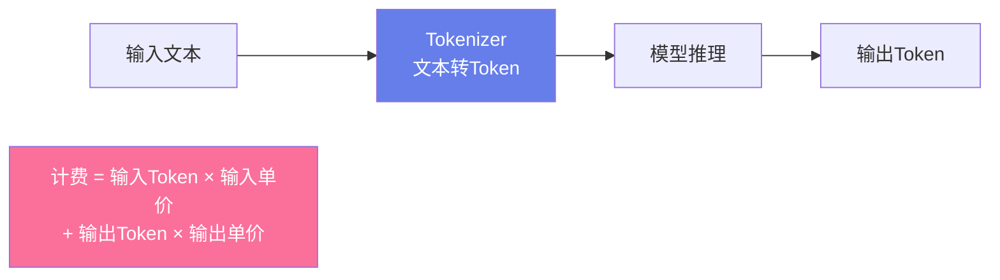

# 🚀 AI API 调用入门实战

> **文档说明**：手把手教你用 Python 和 Java 调用大模型 API，涵盖环境准备、基础调用、参数详解、流式输出、多轮对话、Function Calling、Embeddings、错误处理、重试机制、异步调用、前端集成和成本控制。学完能独立开发 AI 对话功能，是所有 AI 应用（聊天机器人、RAG 问答、Agent）的基础。主流大模型都提供 OpenAI 兼容的 API 格式，学会一种就能快速迁移。
>
> **适用人群**：AI 应用初学者、全栈开发者、需要集成大模型能力的工程师
>
> **前置知识**：[[LLM大模型入门概念]] · Python 或 Java 基础

---

## 一、概述

<div style="background:linear-gradient(135deg,#667eea,#764ba2);border-radius:16px;padding:20px;margin:16px 0;font-family:-apple-system,'Segoe UI','PingFang SC','Microsoft YaHei',sans-serif;color:#fff;overflow:hidden;box-shadow:0 8px 28px rgba(0,0,0,.14),0 3px 10px rgba(0,0,0,.08)">
<style>@keyframes highlight{0%,100%{box-shadow:0 0 0 rgba(255,255,255,0)}50%{box-shadow:0 0 20px rgba(255,255,255,.4)}}.hl-box{background:rgba(255,255,255,.2);border-radius:10px;padding:14px 18px;margin:10px 0;animation:highlight 3s ease-in-out infinite;border-left:4px solid rgba(255,255,255,.6)}.hl-formula{font-family:monospace;font-size:14px;text-align:center;background:rgba(0,0,0,.15);border-radius:8px;padding:12px;margin:10px 0}</style>
<div style="text-align:center;font-size:15px;font-weight:700;margin-bottom:14px;padding-bottom:10px;border-bottom:1.5px solid rgba(255,255,255,.22);letter-spacing:1px;text-shadow:0 1px 3px rgba(0,0,0,.12)">📌 🚀 AI API 调用入门实战</div>
<div class="hl-box">手把手教你用 Python 和 Java 调用大模型 API，涵盖环境准备、基础调用、参数详解、流式输出、多轮对话、Function Calling、Embeddings、错误处理、重试机制、异步调用、前端集成和成本控制。学完能独立开发 AI 对话功能，是所有 AI 应用（聊天机器人、RAG 问答、...</div>
<div class="hl-formula">请求封装 → 认证鉴权 → 参数校验 → 调用执行 → 响应处理 → 错误重试</div>
<div style="font-size:13px;opacity:.9;margin-top:8px">💡 工程化思维是从 Demo 到生产系统的关键跨越</div>
</div>

> 🔍 **知识点深度解析**
>
> **作用**：🚀 AI API 调用入门实战 是 AI 工程化体系中的关键环节，解决从模型能力到生产应用的转化问题，适用于构建稳定、可扩展、可维护的 AI 应用系统。
>
> **原理**：通过标准化的工程方法论和工具链，将大模型的能力封装为可复用的组件，结合最佳实践和质量保障机制，实现 AI 应用的高效开发和可靠运行。
>
> **用法要点**：① 遵循标准化的开发流程和规范 ② 选择合适的工具和框架提升效率 ③ 建立完善的测试和监控机制 ④ 持续优化性能和成本

### 1.1 为什么要学 API 调用

调用大模型 API 是开发 AI 应用的**第一步**。几乎所有 AI 应用的底层都是 API 调用：

| 应用类型 | 底层能力 |
|---------|---------|
| 聊天机器人 | Chat Completion + 多轮对话 |
| RAG 问答 | Embeddings + Chat Completion |
| Agent 智能体 | Chat Completion + Function Calling |
| 内容生成 | Chat Completion + 流式输出 |
| 语义搜索 | Embeddings + 向量检索 |
| 代码助手 | Chat Completion + Function Calling |

**核心优势**：
- **零门槛**：不需要 GPU，不需要训练模型，注册即获取 API Key
- **即开即用**：HTTP 调用，任何语言都能集成
- **持续升级**：模型由服务商维护，自动使用最新版本
- **按需付费**：按 Token 计费，用多少付多少

### 1.2 主流大模型 API 对比

| 服务商 | 模型 | 特点 | 价格（输入/输出，每百万Token） | 国内可用 |
|--------|------|------|------------------------------|---------|
| **DeepSeek** | deepseek-chat / deepseek-reasoner | 性价比极高，推理能力强 | ¥1 / ¥2（chat），¥4 / ¥16（reasoner） | ✅ |
| **通义千问** | qwen-plus / qwen-max / qwen-turbo | 阿里出品，中文好，生态全 | ¥0.8 / ¥2（plus），¥20 / ¥60（max） | ✅ |
| **智谱 GLM** | glm-4 / glm-4-flash | 清华系，中文理解好 | ¥0.1 / ¥0.1（flash，免费） | ✅ |
| **百度文心** | ernie-4.0 / ernie-speed | 百度出品，搜索增强 | ¥0.12 / ¥0.12（speed） | ✅ |
| **OpenAI** | gpt-4o / gpt-4o-mini | 能力最强，生态最完善 | $0.15 / $0.6（4o），$0.15 / $0.6（mini） | ❌ 需代理 |
| **Anthropic** | claude-3-5-sonnet | 长上下文，代码能力强 | $3 / $15 | ❌ 需代理 |
| **Groq** | llama-3.1-70b | 速度极快，免费额度 | $0.59 / $0.79 | ❌ 需代理 |

> **入门推荐**：国内开发者首选 **DeepSeek**（性价比最高）或 **通义千问**（中文好、生态全），两者都兼容 OpenAI API 格式。

### 1.3 核心 API 能力

| 能力 | 端点 | 说明 |
|------|------|------|
| **文本对话** | `/v1/chat/completions` | 最核心，多轮对话、角色设定 |
| **流式输出** | 同上 + `stream=true` | SSE 逐字返回，体验更好 |
| **函数调用** | 同上 + `tools` | Function Calling，让模型调用外部工具 |
| **文本嵌入** | `/v1/embeddings` | 将文本转为向量，用于 RAG/搜索 |
| **模型列表** | `/v1/models` | 查询可用模型 |
| **图片理解** | `/v1/chat/completions`（多模态） | 传入图片，模型理解内容 |

---

---

> 💡 **深度讲解**：本节围绕，深入剖析其技术原理与实践要点，帮助读者建立系统性的认知框架。
>
> **📝 精简总结**：本节介绍了，掌握这些内容是理解整个知识体系的重要基础。

## 二、底层原理

### 2.1 API 调用流程


**请求要素**：
- **方法**：POST
- **认证**：`Authorization: Bearer {API_KEY}`
- **Content-Type**：`application/json`
- **核心参数**：`model`、`messages`、`temperature`、`max_tokens`

**响应结构**：
```json
{
  "id": "chatcmpl-xxx",
  "object": "chat.completion",
  "created": 1699999999,
  "model": "deepseek-chat",
  "choices": [
    {
      "index": 0,
      "message": { "role": "assistant", "content": "回答内容" },
      "finish_reason": "stop"
    }
  ],
  "usage": {
    "prompt_tokens": 50,
    "completion_tokens": 100,
    "total_tokens": 150
  }
}
```

### 2.2 OpenAI 兼容格式

几乎所有主流模型都兼容 OpenAI API 格式，这意味着**学会一次，适配所有**：

```yaml
POST {base_url}/v1/chat/completions
Headers:
  Authorization: Bearer {API_KEY}
  Content-Type: application/json

Body:
{
  "model": "模型名称",
  "messages": [
    {"role": "system", "content": "系统提示词"},
    {"role": "user", "content": "用户问题"}
  ],
  "temperature": 0.7,
  "max_tokens": 2000,
  "stream": false
}
```

**切换模型只需改两个参数**：
```css
# DeepSeek
client = OpenAI(api_key="sk-xxx", base_url="https://api.deepseek.com/v1")
```

```css
# 通义千问
client = OpenAI(api_key="sk-xxx", base_url="https://dashscope.aliyuncs.com/compatible-mode/v1")
```

```css
# OpenAI（默认）
client = OpenAI(api_key="sk-xxx")  # base_url 默认 https://api.openai.com/v1
```

### 2.3 核心参数详解

| 参数 | 类型 | 默认值 | 说明 | 调优建议 |
|------|------|--------|------|---------|
| **model** | string | - | 模型名称 | 根据任务选择：简单用小模型，复杂用大模型 |
| **messages** | array | - | 对话消息数组 | 必须包含至少一条 user 消息 |
| **temperature** | float | 1.0 | 随机性（0-2） | 准确任务 0-0.3，创意任务 0.7-1.0 |
| **top_p** | float | 1.0 | 核采样阈值（0-1） | 一般不改，与 temperature 二选一调 |
| **max_tokens** | int | inf | 最大生成 Token 数 | 根据预期回答长度设置，避免截断 |
| **stream** | bool | false | 是否流式输出 | 用户对话用 true，后台处理用 false |
| **stop** | string/array | null | 停止生成的字符 | 自定义结束标记 |
| **frequency_penalty** | float | 0.0 | 频率惩罚（-2到2） | 减少重复词时设 0.5-1.0 |
| **presence_penalty** | float | 0.0 | 存在惩罚（-2到2） | 增加话题多样性时设 0.5-1.0 |
| **n** | int | 1 | 生成几个回答 | 需要多方案对比时设 2-3 |
| **seed** | int | null | 随机种子 | 需要可复现时设置固定值 |
| **tools** | array | null | Function Calling 工具定义 | 需要模型调用外部工具时使用 |

> **temperature vs top_p**：两者都控制随机性，一般只调一个。temperature 直接调整概率分布的「温度」，top_p 只保留累计概率达到 p 的 Token。经验：temperature 更直观，优先调 temperature。

### 2.4 Token 与计费



**Token 估算**：
- 中文：1 个汉字 ≈ 1.5-2 个 Token
- 英文：1 个单词 ≈ 1.3 个 Token
- 代码：1 行 ≈ 5-10 个 Token

**示例**：
- 输入 1000 中文字 + 输出 500 中文字 ≈ 2000 输入 Token + 1000 输出 Token
- DeepSeek chat 价格：¥1/百万输入 + ¥2/百万输出 = ¥0.002 + ¥0.002 = **¥0.004/次**
- 1000 次调用 ≈ ¥4

---

---

> 💡 **深度讲解**：本节围绕，深入剖析其技术原理与实践要点，帮助读者建立系统性的认知框架。
>
> **📝 精简总结**：本节介绍了，掌握这些内容是理解整个知识体系的重要基础。

## 三、实操示例

### 3.1 环境准备

```python
# ===== 1. 注册账号获取 API Key =====
# DeepSeek: https://platform.deepseek.com （新用户送 500 万 Token）
# 通义千问: https://dashscope.aliyun.com （新用户送额度）
# 智谱: https://open.bigmodel.cn （glm-4-flash 免费）

# ===== 2. 设置环境变量（推荐，不要硬编码） =====
# Windows PowerShell:
$env:DEEPSEEK_API_KEY = "sk-你的密钥"
$env:DASHSCOPE_API_KEY = "sk-你的密钥"

# 永久设置（Windows）:
[Environment]::SetEnvironmentVariable("DEEPSEEK_API_KEY", "sk-xxx", "User")

# ===== 3. 安装 SDK =====
pip install openai python-dotenv httpx
```

### 3.2 Python 基础调用

```python
"""
基础调用：最简单的 AI 对话
"""
import os
from openai import OpenAI

# 从环境变量读取 Key（安全）
api_key = os.getenv("DEEPSEEK_API_KEY")

# 初始化客户端（DeepSeek 兼容 OpenAI 格式）
client = OpenAI(
    api_key=api_key,
    base_url="https://api.deepseek.com/v1"
)

# 发起对话
response = client.chat.completions.create(
    model="deepseek-chat",
    messages=[
        {"role": "system", "content": "你是一个 Python 编程专家，回答简洁准确。"},
        {"role": "user", "content": "写一个快速排序函数，要求有类型注解和注释"}
    ],
    temperature=0.7,
    max_tokens=2000,
)

# 解析响应
answer = response.choices[0].message.content
print(answer)

# 查看 Token 用量
usage = response.usage
print(f"\n输入 Token: {usage.prompt_tokens}")
print(f"输出 Token: {usage.completion_tokens}")
print(f"总 Token: {usage.total_tokens}")
```

### 3.3 流式输出（SSE）

```python
"""
流式输出：逐字打印，体验更好（类似 ChatGPT 的打字效果）
"""
from openai import OpenAI

client = OpenAI(api_key=os.getenv("DEEPSEEK_API_KEY"),
                base_url="https://api.deepseek.com/v1")

stream = client.chat.completions.create(
    model="deepseek-chat",
    messages=[{"role": "user", "content": "写一首关于秋天的诗，4句"}],
    stream=True,  # 关键：启用流式
    temperature=0.9,
)

print("AI: ", end="", flush=True)
full_response = ""
for chunk in stream:
    if chunk.choices and chunk.choices[0].delta.content:
        content = chunk.choices[0].delta.content
        full_response += content
        print(content, end="", flush=True)  # 逐字打印

print("\n\n完整回答:", full_response)
```

**流式输出的优势**：
- 用户体验好：不需要等全部生成完才看到内容
- 首字延迟低：通常 1-2 秒就开始输出
- 可中断：用户可以随时停止生成

### 3.4 多轮对话

```python
"""
多轮对话：维护消息历史，实现连续对话
"""
from openai import OpenAI

client = OpenAI(api_key=os.getenv("DEEPSEEK_API_KEY"),
                base_url="https://api.deepseek.com/v1")

# 消息历史：每次对话都要带上完整历史
messages = [
    {"role": "system", "content": "你是一个 helpful 的助手，回答简洁。"}
]

print("=== AI 对话助手（输入 exit 退出）===")
while True:
    user_input = input("\n你: ")
    if user_input.lower() == "exit":
        break

    # 添加用户消息
    messages.append({"role": "user", "content": user_input})

    # 调用 API
    response = client.chat.completions.create(
        model="deepseek-chat",
        messages=messages,
        temperature=0.7,
        max_tokens=1000,
    )

    answer = response.choices[0].message.content
    print(f"AI: {answer}")

    # 添加 AI 回复到历史（关键！否则下一轮不知道之前说了什么）
    messages.append({"role": "assistant", "content": answer})

    # 可选：限制历史长度，避免超过上下文窗口
    if len(messages) > 20:
        messages = [messages[0]] + messages[-19:]  # 保留 system + 最近 19 条
```

### 3.5 Function Calling（函数调用）

```python
"""
Function Calling：让模型调用外部工具/函数
模型不直接执行函数，而是返回要调用的函数名和参数，由你的代码执行
"""
import json
from openai import OpenAI

client = OpenAI(api_key=os.getenv("DEEPSEEK_API_KEY"),
                base_url="https://api.deepseek.com/v1")

# ===== 1. 定义工具（函数） =====
tools = [
    {
        "type": "function",
        "function": {
            "name": "get_weather",
            "description": "查询指定城市的天气",
            "parameters": {
                "type": "object",
                "properties": {
                    "city": {"type": "string", "description": "城市名称，如北京、上海"},
                    "date": {"type": "string", "description": "日期，格式 YYYY-MM-DD"}
                },
                "required": ["city"]
            }
        }
    },
    {
        "type": "function",
        "function": {
            "name": "calculate",
            "description": "执行数学计算",
            "parameters": {
                "type": "object",
                "properties": {
                    "expression": {"type": "string", "description": "数学表达式，如 2+3*4"}
                },
                "required": ["expression"]
            }
        }
    }
]

# ===== 2. 实际执行函数 =====
def get_weather(city, date=None):
    # 实际项目中调用天气 API
    return f"{city}{date or '今天'}的天气：晴，25°C，微风"

def calculate(expression):
    return f"计算结果: {eval(expression)}"

# ===== 3. 对话循环 =====
messages = [{"role": "user", "content": "北京今天天气怎么样？再帮我算一下 123*456"}]

response = client.chat.completions.create(
    model="deepseek-chat",
    messages=messages,
    tools=tools,
    tool_choice="auto",  # 自动决定是否调用工具
)

message = response.choices[0].message

# ===== 4. 处理工具调用 =====
if message.tool_calls:
    messages.append(message)  # 添加 assistant 的工具调用请求

    for tool_call in message.tool_calls:
        func_name = tool_call.function.name
        func_args = json.loads(tool_call.function.arguments)

        print(f"模型调用工具: {func_name}({func_args})")

        # 执行函数
        if func_name == "get_weather":
            result = get_weather(**func_args)
        elif func_name == "calculate":
            result = calculate(**func_args)
        else:
            result = "未知函数"

        # 将工具结果返回给模型
        messages.append({
            "role": "tool",
            "tool_call_id": tool_call.id,
            "content": result
        })

    # 模型根据工具结果生成最终回答
    final_response = client.chat.completions.create(
        model="deepseek-chat",
        messages=messages,
    )
    print("\n最终回答:", final_response.choices[0].message.content)
else:
    print("回答:", message.content)
```

### 3.6 Embeddings（文本嵌入）

```python
"""
Embeddings：将文本转为向量，用于语义搜索、RAG、相似度计算
"""
from openai import OpenAI

client = OpenAI(api_key=os.getenv("DEEPSEEK_API_KEY"),
                base_url="https://api.deepseek.com/v1")

# 生成嵌入向量
response = client.embeddings.create(
    model="text-embedding-v3",  # DeepSeek 嵌入模型
    input=["人工智能是未来的趋势", "机器学习是AI的一个分支", "今天天气真好"]
)

# 获取向量
embeddings = [item.embedding for item in response.data]
print(f"向量维度: {len(embeddings[0])}")  # 通常 1024 或 1536
print(f"第一个向量前5维: {embeddings[0][:5]}")

# 余弦相似度计算
import numpy as np
def cosine_similarity(a, b):
    return np.dot(a, b) / (np.linalg.norm(a) * np.linalg.norm(b))

sim_01 = cosine_similarity(embeddings[0], embeddings[1])  # AI vs 机器学习 → 高
sim_02 = cosine_similarity(embeddings[0], embeddings[2])  # AI vs 天气 → 低
print(f"\n'AI' vs '机器学习' 相似度: {sim_01:.3f}")  # 约 0.8+
print(f"'AI' vs '天气' 相似度: {sim_02:.3f}")      # 约 0.3-
```

### 3.7 Java 调用（Spring Boot）

```python
/**
 * Spring Boot 中调用 AI API（使用 OkHttp + Jackson）
 */
import okhttp3.*;
import com.fasterxml.jackson.databind.ObjectMapper;
import com.fasterxml.jackson.databind.JsonNode;
import java.util.*;

@Service
public class AIClientService {
    private static final String API_URL = "https://api.deepseek.com/v1/chat/completions";
    private final OkHttpClient httpClient = new OkHttpClient.Builder()
            .connectTimeout(30, TimeUnit.SECONDS)
            .readTimeout(60, TimeUnit.SECONDS)
            .build();
    private final ObjectMapper mapper = new ObjectMapper();

    @Value("${ai.api-key}")  // 从配置文件读取
    private String apiKey;

    /**
     * 基础对话
     */
    public String chat(String userMessage) throws Exception {
        // 构建请求体
        Map<String, Object> body = new HashMap<>();
        body.put("model", "deepseek-chat");
        body.put("messages", List.of(
            Map.of("role", "system", "content", "你是一个 helpful 的助手"),
            Map.of("role", "user", "content", userMessage)
        ));
        body.put("temperature", 0.7);
        body.put("max_tokens", 2000);

        Request request = new Request.Builder()
                .url(API_URL)
                .header("Authorization", "Bearer " + apiKey)
                .header("Content-Type", "application/json")
                .post(RequestBody.create(
                    mapper.writeValueAsString(body),
                    MediaType.get("application/json")
                ))
                .build();

        try (Response response = httpClient.newCall(request).execute()) {
            if (!response.isSuccessful()) {
                throw new RuntimeException("API 调用失败: " + response.code());
            }
            JsonNode json = mapper.readTree(response.body().string());
            return json.path("choices").get(0)
                    .path("message").path("content").asText();
        }
    }

    /**
     * 流式输出（SSE）
     */
    public void streamChat(String userMessage, Consumer<String> onToken) throws Exception {
        Map<String, Object> body = new HashMap<>();
        body.put("model", "deepseek-chat");
        body.put("messages", List.of(Map.of("role", "user", "content", userMessage)));
        body.put("stream", true);

        Request request = new Request.Builder()
                .url(API_URL)
                .header("Authorization", "Bearer " + apiKey)
                .post(RequestBody.create(mapper.writeValueAsString(body),
                        MediaType.get("application/json")))
                .build();

        try (Response response = httpClient.newCall(request).execute()) {
            ResponseBody responseBody = response.body();
            if (responseBody == null) return;

            try (BufferedReader reader = new BufferedReader(
                    new InputStreamReader(responseBody.byteStream()))) {
                String line;
                while ((line = reader.readLine()) != null) {
                    if (line.startsWith("data: ")) {
                        String data = line.substring(6);
                        if ("[DONE]".equals(data)) break;
                        JsonNode json = mapper.readTree(data);
                        String token = json.path("choices").get(0)
                                .path("delta").path("content").asText();
                        if (!token.isEmpty()) onToken.accept(token);
                    }
                }
            }
        }
    }
}
```

### 3.8 错误处理与重试

```python
"""
生产级错误处理：异常捕获 + 指数退避重试
"""
import time
from openai import OpenAI, APIError, RateLimitError, APIConnectionError, APITimeoutError

client = OpenAI(api_key=os.getenv("DEEPSEEK_API_KEY"),
                base_url="https://api.deepseek.com/v1",
                timeout=30.0)  # 超时设置

def chat_with_retry(messages, max_retries=3):
    """带重试的 AI 调用"""
    for attempt in range(max_retries):
        try:
            response = client.chat.completions.create(
                model="deepseek-chat",
                messages=messages,
                temperature=0.7,
                max_tokens=2000,
            )
            return response.choices[0].message.content

        except RateLimitError as e:
            # 429 限流：指数退避等待
            wait_time = 2 ** attempt  # 1s, 2s, 4s
            print(f"限流，等待 {wait_time}s 后重试 ({attempt+1}/{max_retries})")
            time.sleep(wait_time)

        except APIConnectionError as e:
            # 网络连接失败
            print(f"网络连接失败: {e}，重试中...")
            time.sleep(2 ** attempt)

        except APITimeoutError as e:
            # 超时
            print(f"请求超时: {e}，重试中...")
            time.sleep(2 ** attempt)

        except APIError as e:
            # 其他 API 错误（400/500 等）
            print(f"API 错误: {e}")
            if attempt < max_retries - 1:
                time.sleep(2 ** attempt)
            else:
                raise  # 最后一次重试失败，抛出异常

    raise Exception("多次重试后仍失败")

# 使用
try:
    answer = chat_with_retry([{"role": "user", "content": "你好"}])
    print(answer)
except Exception as e:
    print(f"调用失败: {e}")
    # 降级方案：返回默认回复或切换其他模型
```

### 3.9 异步调用

```python
"""
异步调用：同时发起多个请求，提高并发效率
"""
import asyncio
from openai import AsyncOpenAI

async_client = AsyncOpenAI(
    api_key=os.getenv("DEEPSEEK_API_KEY"),
    base_url="https://api.deepseek.com/v1"
)

async def chat_once(prompt):
    """单次异步调用"""
    response = await async_client.chat.completions.create(
        model="deepseek-chat",
        messages=[{"role": "user", "content": prompt}],
        temperature=0.7,
    )
    return response.choices[0].message.content

async def batch_chat(prompts):
    """批量并发调用"""
    tasks = [chat_once(p) for p in prompts]
    results = await asyncio.gather(*tasks)  # 并发执行
    return results

# 使用
prompts = [
    "用一句话解释什么是 AI",
    "用一句话解释什么是机器学习",
    "用一句话解释什么是深度学习",
]
results = asyncio.run(batch_chat(prompts))
for p, r in zip(prompts, results):
    print(f"Q: {p}\nA: {r}\n")
```

### 3.10 前端调用（注意安全）

> **重要**：前端直接调用 AI API 会暴露 API Key！生产环境必须通过后端代理。

```python
// ===== 前端调用（仅开发测试用，生产环境请走后端代理） =====
async function chatWithAI(message) {
    const response = await fetch('https://api.deepseek.com/v1/chat/completions', {
        method: 'POST',
        headers: {
            'Authorization': `Bearer ${API_KEY}`, // ⚠️ 会暴露 Key！
            'Content-Type': 'application/json'
        },
        body: JSON.stringify({
            model: 'deepseek-chat',
            messages: [{ role: 'user', content: message }],
            stream: true
        })
    });

    // 流式读取
    const reader = response.body.getReader();
    const decoder = new TextDecoder();
    let result = '';

    while (true) {
        const { done, value } = await reader.read();
        if (done) break;

        const chunk = decoder.decode(value);
        const lines = chunk.split('\n');
        for (const line of lines) {
            if (line.startsWith('data: ')) {
                const data = line.slice(6);
                if (data === '[DONE]') continue;
                try {
                    const json = JSON.parse(data);
                    const token = json.choices[0]?.delta?.content;
                    if (token) {
                        result += token;
                        console.log(token); // 逐字输出
                    }
                } catch (e) {}
            }
        }
    }
    return result;
}
```

```python
# ===== 正确做法：后端代理（FastAPI 示例） =====
from fastapi import FastAPI
from fastapi.responses import StreamingResponse
from openai import OpenAI

app = FastAPI()
client = OpenAI(api_key=os.getenv("DEEPSEEK_API_KEY"),
                base_url="https://api.deepseek.com/v1")

@app.post("/api/chat")
async def chat(request: dict):
    """后端代理：Key 存在服务端，不暴露给前端"""
    stream = client.chat.completions.create(
        model="deepseek-chat",
        messages=request["messages"],
        stream=True,
    )

    def generate():
        for chunk in stream:
            if chunk.choices[0].delta.content:
                yield chunk.choices[0].delta.content

    return StreamingResponse(generate(), media_type="text/plain")
```

---

---

> 💡 **深度讲解**：本节围绕，深入剖析其技术原理与实践要点，帮助读者建立系统性的认知框架。
>
> **📝 精简总结**：本节介绍了，掌握这些内容是理解整个知识体系的重要基础。

## 四、常见问题与排查

| 问题现象 | 可能原因 | 解决方案 |
|---------|---------|---------|
| **401 Unauthorized** | API Key 错误/过期 | 检查 Key 是否复制完整（无多余空格）；确认 Key 未过期；重新生成 Key |
| **429 Too Many Requests** | 请求频率超限/额度用完 | 降低请求频率；加入指数退避重试；检查账户余额；升级套餐 |
| **400 Bad Request** | 参数错误 | 检查 model 名称是否正确；messages 格式是否合法；参数值是否在范围内 |
| **500 Internal Error** | 服务端故障 | 稍后重试；切换其他模型；查看服务商状态页 |
| **回答被截断** | max_tokens 太小 | 增大 max_tokens；或检查是否触发 stop 条件 |
| **中文乱码** | 编码问题 | 确保文件 UTF-8 编码；终端设置 UTF-8；Python 文件头加 `# -*- coding: utf-8 -*-` |
| **请求超时** | 网络慢/模型响应慢 | 增大 timeout；检查网络连接；用流式输出（首字快） |
| **上下文超长** | messages 太多超过窗口 | 截断历史消息；用摘要压缩历史；换长上下文模型 |
| **模型不存在** | model 名称错误 | 查文档确认模型名；注意大小写；不同服务商模型名不同 |
| **流式输出无数据** | SSE 解析错误 | 检查是否正确处理 `data: ` 前缀；处理 `[DONE]` 结束标记 |
| **Function Calling 不触发** | 工具描述不清/不需要 | 优化工具 description；在用户问题中暗示需要工具；设置 tool_choice |
| **Token 消耗异常** | 历史消息太长/系统提示太长 | 精简 system prompt；定期截断历史；用小模型处理简单任务 |
| **API Key 被盗用** | 硬编码在代码/前端 | 立即重置 Key；用环境变量；走后端代理；设置用量告警 |
| **并发请求失败** | 超过并发限制 | 控制并发数；加入队列；联系服务商提升限额 |
| **回答质量差** | 模型选择不当/Prompt 不好 | 换更强的模型；优化 Prompt（参考 [[Prompt工程基础入门]]）；加 Few-shot 示例 |

---

---

> 💡 **深度讲解**：本节围绕，深入剖析其技术原理与实践要点，帮助读者建立系统性的认知框架。
>
> **📝 精简总结**：本节介绍了，掌握这些内容是理解整个知识体系的重要基础。

## 五、进阶与最佳实践

### 5.1 API Key 安全

```text
安全等级从低到高：

❌ 最差：硬编码在代码里
   client = OpenAI(api_key="sk-123456...")  # 提交到 Git 就泄露了

⚠️ 一般：写在配置文件里
   config.py: API_KEY = "sk-xxx"  # 记得加 .gitignore

✅ 推荐：环境变量
   os.getenv("DEEPSEEK_API_KEY")

✅✅ 更好：配置中心/密钥管理服务
   AWS Secrets Manager / 阿里云 KMS / Vault

✅✅✅ 最佳：后端代理 + 环境变量
   前端不直接调用 AI API，Key 只存在服务端
```

### 5.2 成本控制策略

| 策略 | 说明 | 预期节省 |
|------|------|---------|
| **模型路由** | 简单问题用小模型（qwen-turbo），复杂问题用大模型 | 50-80% |
| **缓存** | 相同/相似问题缓存回答，减少重复调用 | 30-60% |
| **精简 Prompt** | 减少 system prompt 和历史消息长度 | 20-40% |
| **限制 max_tokens** | 根据任务设置合理的输出长度 | 10-30% |
| **批量调用** | 多个请求合并，减少网络开销 | 5-15% |
| **监控告警** | 设置日/月预算告警，避免异常消耗 | 防止意外超支 |
| **免费模型** | 简单任务用免费模型（glm-4-flash） | 100%（部分任务） |

### 5.3 生产环境 Checklist

| 类别 | 检查项 | 说明 |
|------|--------|------|
| **安全** | API Key 不硬编码 | 用环境变量或配置中心 |
| **安全** | 前端走后端代理 | Key 不暴露给客户端 |
| **安全** | 设置 IP 白名单/Referer 限制 | 防止 Key 被盗用 |
| **稳定性** | 错误处理 | 捕获所有异常类型 |
| **稳定性** | 重试机制 | 指数退避，最多 3 次 |
| **稳定性** | 超时设置 | connect 30s，read 60s |
| **稳定性** | 降级方案 | API 不可用时返回默认回复或切换模型 |
| **性能** | 流式输出 | 用户对话场景提升体验 |
| **性能** | 异步调用 | 批量请求并发处理 |
| **性能** | 连接池 | 复用 HTTP 连接 |
| **成本** | Token 监控 | 记录每次调用的 Token 用量 |
| **成本** | 预算告警 | 设置日/月消费上限 |
| **成本** | 模型选型 | 简单任务用便宜模型 |
| **可观测** | 日志记录 | 记录请求/响应/耗时/Token |
| **可观测** | 指标监控 | QPS、延迟、错误率、Token 消耗 |
| **合规** | 数据脱敏 | 不在 Prompt 中放敏感信息 |
| **合规** | 内容审核 | 对用户输入和模型输出做安全审核 |

### 5.4 统一 SDK 封装

```python
"""
统一 AI 客户端封装：支持多模型切换、重试、日志、成本统计
参考 [[LLM接口封装与统一SDK]]
"""
from openai import OpenAI
import time, logging

logging.basicConfig(level=logging.INFO)
logger = logging.getLogger(__name__)

class AIClient:
    def __init__(self, provider="deepseek"):
        configs = {
            "deepseek": {"base_url": "https://api.deepseek.com/v1", "model": "deepseek-chat"},
            "qwen": {"base_url": "https://dashscope.aliyuncs.com/compatible-mode/v1", "model": "qwen-plus"},
            "openai": {"base_url": "https://api.openai.com/v1", "model": "gpt-4o-mini"},
        }
        config = configs[provider]
        self.client = OpenAI(api_key=os.getenv(f"{provider.upper()}_API_KEY"),
                             base_url=config["base_url"])
        self.model = config["model"]

    def chat(self, messages, temperature=0.7, max_tokens=2000, stream=False):
        start = time.time()
        try:
            response = self.client.chat.completions.create(
                model=self.model,
                messages=messages,
                temperature=temperature,
                max_tokens=max_tokens,
                stream=stream,
            )
            elapsed = time.time() - start
            if not stream:
                logger.info(f"AI调用成功 | 耗时:{elapsed:.1f}s | "
                           f"Token:{response.usage.total_tokens}")
            return response
        except Exception as e:
            logger.error(f"AI调用失败 | 耗时:{time.time()-start:.1f}s | 错误:{e}")
            raise
```

---

---

> 💡 **深度讲解**：本节围绕，深入剖析其技术原理与实践要点，帮助读者建立系统性的认知框架。
>
> **📝 精简总结**：本节介绍了，掌握这些内容是理解整个知识体系的重要基础。

## 六、关联笔记

### AI 基础
- [[LLM大模型入门概念]] · [[Transformer架构核心]] · [[Prompt工程基础入门]]

### AI 工程化
- [[LLM接口封装与统一SDK]] · [[SSE-流式响应对接LLM]] · [[AI成本控制与Token计费优化]]
- [[RAG架构设计与流程]] · [[Agent核心概念-ReAct规划]] · [[AI产品实战框架-从0到1]]

### 大模型技术
- [[LoRA-QLoRA参数高效微调]] · [[模型量化与本地部署实践]] · [[vLLM-高吞吐推理引擎]]

### 导航
- [[MOC-AI与效率工具]] · [[MOC-AI工程化]] · [[MOC-综合导航]] · [[Home]]

> 🔍 **知识点深度解析**
>
> **作用**：AI API 调用是所有 AI 应用的基础，解决的是「如何让你的应用具备大模型能力」的问题，是从 0 到 1 构建 AI 应用的第一步。
>
> **底层原理**：通过 HTTP POST 请求向大模型服务商发送包含 messages 数组的 JSON，模型在 GPU 上推理生成回答并以 JSON 返回。流式输出使用 SSE（Server-Sent Events）逐块返回 Token。Function Calling 让模型返回要调用的函数名和参数，由开发者代码执行后将结果传回模型。OpenAI 兼容格式是行业标准，所有主流模型都支持，切换模型只需改 base_url 和 model。
>
> **用法要点**：① 用 OpenAI 兼容 SDK，切换模型只需改 base_url ② API Key 用环境变量，绝不硬编码 ③ 生产环境必须加错误处理 + 指数退避重试 + 超时 ④ 用户对话用流式输出（stream=True）提升体验 ⑤ 多轮对话维护完整 messages 历史，注意上下文窗口限制 ⑥ Function Calling 模型不执行函数，只返回调用请求，由你的代码执行 ⑦ 前端必须走后端代理，防止 Key 泄露 ⑧ 监控 Token 用量，用模型路由和缓存控制成本 ⑨ temperature 准确任务 0-0.3，创意任务 0.7+。

> 💡 **深度讲解**：API 调用看似简单（就是一个 HTTP POST），但生产环境需要考虑很多工程问题：错误处理、重试机制、超时、流式输出、多轮对话管理、成本控制、安全防护。最常见的新手错误是「把 API Key 硬编码在代码里」和「前端直接调用 AI API」——这两个都会导致 Key 泄露，可能被人盗刷产生巨额费用。另一个容易忽视的点是「多轮对话的历史管理」——每次调用都要带上完整历史，否则模型不知道之前说了什么，但历史太长又会超过上下文窗口并增加成本，需要做截断或摘要。建议先从基础调用跑通，再逐步添加流式输出、错误处理、重试等工程化能力。**OpenAI 兼容格式是行业标准，学会一次就能适配几乎所有主流模型，这是非常值得投入的基础技能**。

> 📝 **精简总结**：AI API 调用 = HTTP POST + messages 数组 + 解析 JSON。核心能力：对话、流式输出、多轮对话、Function Calling、Embeddings。关键参数：temperature（随机性）、max_tokens（输出长度）、stream（流式）。生产环境必须：错误处理 + 重试 + 超时 + Key 安全 + 成本监控。国内首选 DeepSeek（性价比）或通义千问（中文好）。

> **学习路径建议**：先学习 [[LLM大模型入门概念]] 理解模型原理 → 学习本文档掌握 API 调用基础 → 参考 [[LLM接口封装与统一SDK]] 做工程化封装 → 学习 [[SSE-流式响应对接LLM]] 实现流式输出 → 学习 [[RAG架构设计与流程]] 构建知识库问答 → 学习 [[Agent核心概念-ReAct规划]] 结合 Function Calling 构建智能体。

---

> **API 调用是 AI 应用的「Hello World」——掌握它，你就打开了 AI 开发的大门。从一个简单的对话开始，逐步构建出 RAG、Agent 等复杂应用。**

---

## 📖 前置知识

- [[AI应用开发入门]]

## 🏷️ 相关标签

`#AI应用` `#LLM` `#API` `#效率工具`

---

[[Home|🏠 返回首页]] · [[MOC-AI工程化-四级展开|📚 返回分类]]

